# 텐배거 리포트 2026-11-15 — 현금이 시총의 3분의 2, 나머지 \$1.5B는 첫 발전소 날짜에 걸린 옵션

> 2026-11-15 · Oklo(OKLO) · 기업: 액체 나트륨 냉각 소형 고속로(15~75MW) 발전소를 짓고 운영해 전력을 팔려는 원전 개발사. 연료 가공·재활용·동위원소 사업을 함께 키운다

## Chiip View

진척은 있었지만 값을 정할 숫자는 아직 하나도 없다. 3Q에 Groves-1(Oklo 텍사스 시험로) 시험로가 무제한 운전 허가를 받았고 Centrus와 HALEU(고순도 저농축 우라늄, 농축도 5~20%) 연료 확정 계약을 맺었다. 반면 첫 발전소 Aurora-INL 목표는 2028에서 2028~2029로 밀렸고, CEO는 Meta 계약이 원자로 건설에 구속력이 없다고 답했으며, 2Q에 약속한 총사업비도 공개하지 않았다. 지금 시가총액 \$4.67B(기본 주식, 완전 희석 \$4.90B) 가운데 \$3.13B가 현금·투자라 시장은 나머지 약 \$1.54B를 첫 발전소 옵션으로 산다. 매출 배수로 보면 그 옵션 값이 거의 남지 않아 구매 등급은 Sell(규칙 등급 Strong Sell에서 토론으로 한 단계 조정), 목표주가 \$16으로 업사이드 −35%다. 시나리오는 약세 \$15.4·기본 \$15.6·강세 \$15.9로 거의 같은데, 12개월 안 매출이 너무 작아 값이 주당 현금 근처에 모이기 때문이다. DCF 내재가치(기본)도 현재가보다 42% 낮아 방향이 같다. 다만 이 두 방법 모두 '첫 호기가 돌면 함대로 늘어난다'는 이진 옵션을 거의 담지 못한다. 그 옵션의 값은 Aurora-INL 일정과 kW당 건설비가 공시될 때 정해진다. 10배 후보가 아니라 첫 발전소를 증명해야 하는 후보다.

## 대시보드
| 항목 | 값 | 설명 |
|---|---|---|
| 주가 | \$23.92 | 고점 대비 -79% · 1년 -76% |
| 시가총액 | \$4.90B | 완전 희석 기준 · EV \$1.77B |
| 업사이드 | -35% | 목표주가 \$16 · 다운사이드 -36% · 손익비(강세÷약세) -0.9 |
| 구매등급 | Sell | 애널리스트 25명: Strong Buy 12 · Buy 2 · Neutral 11 · Sell 0 · Strong Sell 0 |
| 멀티플 | EV/매출 576.9배 | 동종 중앙값 3.5배 |
| 가이던스 4Q26 |  | 컨센서스 \$2M · \$-0.28 |
| 알파 | 5.7/10 | 텐배거 가능성 점수 |
| 이벤트 | 4Q26 실적·10-K(날짜 미공지, 3월 중순 추정 — 2026년은 3/17) | 2027-03-16 |

## 한 장 요약
- **기업가치를 결정하는 내러티브** Oklo의 기업가치는 **첫 발전소 Aurora-INL이 언제 돌고 kW당 얼마에 지어지느냐 × 그다음 호기를 위한 연료와 구속력 있는 고객이 오느냐**로 정해진다. 3Q에는 매출 \$1.86M(인수한 용역 회사 몫), 영업손실 \$71.0M을 냈고 현금·투자는 \$3.13B다. Groves-1 시험로 무제한 운전 허가와 Centrus 연료 확정 계약이 나왔지만, 첫 발전소 목표는 2028에서 2028~2029로 밀렸고 Meta 계약은 건설에 구속력이 없다고 회사가 답했다. 주가는 \$23.92(11/13)로 1년 전 종가 고점 \$174.14의 14%다.
- **밸류에이션 모델로 본 주가 상방은 어디까지인가?** **목표주가 \$16(-35%), 기본 시나리오다.** 강세 \$16(-33%)는 EV/매출 3.0배를 강세 매출에 적용한 값이다. 기본 \$16, 약세 \$15. 손익비 의미 없음(강세가 지금 주가 아래거나 약세가 5% 안), DCF 기준 업사이드 -42%.
- **수주는 어디까지 왔나?** - Aurora-INL 75MW 첫 발전소 — 확정 · 금액 비공개 · 진척 비공개 · 2029 종료
- Groves-1 동위원소 시험로(텍사스) — 확정 · \$0.07B · 진척 100% · 2026-11 종료
- Centrus HALEU 공급 — 확정 · 금액 비공개 · 진척 0% · 미확인 종료
- Siemens Energy 증기터빈·발전기 — 확정 · 금액 비공개 · 진척 비공개 · 미확인 종료
- U.S. Forged Rings(미국 단조 링 제조사) 단조 27기분 — 확정 · 금액 비공개 · 진척 0% · 2035 종료
- Meta 오하이오 1.2GW 캠퍼스 — 미확정
- Switch 12GW 프레임워크 — 미확정
- 잉여 플루토늄 연료 — 미확정
- Equinix·Diamondback·Prometheus 의향서 — 미확정
- 테네시 재활용 시설 — 미확정
구속력 있는 PPA(전력 구매 계약)는 하나도 없다(10-K). 계약서로 확인되는 것은 DOE(미국 에너지부) 인가 사업(Aurora-INL·Groves-1)과 공급 계약(Centrus·Siemens Energy·USFR)이고, 전력 고객 쪽은 Meta 선급 계약(건설 비구속)과 Switch 12GW 프레임워크·비구속 의향서뿐이다
- **누가 사 주나?** 최대 고객 ARMEC·CEI 용역 고객(정부·민간, 엔지니어링·제작 고객) 100%, 상위 3곳 100%. 공시·회사 발표로 확인한 몫은 100%다.
- **마진과 공급망은 어디가 약한가?** GPM 40.9%, OPM -3817.2%. OPM을 가장 흔드는 BOM(제품 원가를 이루는 부품·재료 명세) 항목은 엔지니어링 인력이고 가격 +10%에 -3.55%p다. 공급망 신뢰성은 2.4/10(병목 심각)이고 가장 약한 고리는 HALEU 연료(첫 노심)다.
- **생산능력은 얼마나 늘어나나?** 현재 명목 캐파 0 MWe(발전 용량), 착공 이상 증설 75 MWe(발전 용량). FY2026 CAPEX는 매출의 8384.6%다.
- **지금 가격은 무엇을 가정하나?** 시가총액 \$4.67B(기본 주식 기준, 대시보드는 완전 희석 \$4.90B·EV \$1.77B) 중 현금·투자가 \$3.13B라 시장이 사업에 매기는 값은 약 **\$1.54B**다. 현금흐름으로 풀면 지금 주가는 5년 매출 CAGR **273%**를 요구하고 기본 시나리오는 172%다. 다음 4개 분기 매출 추정은 \$14.9M뿐이라 EV/매출은 500배를 넘는다. 몬테카를로 중앙값은 현재가보다 46% 낮다. 지금 가격은 2030년대 함대 배치를 상당 부분 미리 담고 있다.
- **왜 움직였나?** 2025-10-14 종가 고점 \$174.14에서 1년 만에 86% 내렸다. 매출이 거의 없었고, ATM으로 주식이 늘었고, 금리 상승으로 먼 미래 현금흐름의 할인이 커졌다. 11/5에는 선거 뒤 데이터센터·에너지 반발 보도 속에 −13.2%로 종가 \$19.20까지 갔다(원인은 정황). 3Q 발표 날(11/6) +22.7%, 11/9 +14.0%로 반등했지만 Groves-1 허가(11/11 +3.1%)와 Centrus 계약(11/12 −5.5%)에는 반응이 작았고 11/13 \$23.92로 마감했다.
- **3Q 콜에서 무엇이 바뀌었나?** 좋아진 것은 Groves-1 무제한 운전 허가, Centrus HALEU 확정 다년 계약(최대 5기·2029년 인도), U.S. Forged Rings 27기분 단조 캐파 예약, Meta 선급 자금의 첫 집행이다. 나빠진 것은 첫 발전소 목표 2028 → 2028~2029, PJM(미국 동부 전력망 운영기구) 버지니아 접속 기각, 신규 \$1B ATM과 창업자 신탁의 2027년 매도 계획이다. Meta 계약이 건설에 구속력이 있느냐는 질문에 CEO는 없다고 답했고, CFO는 예약 자본과 연료 마일스톤만 구속된다고 했다. 2Q에 약속한 Aurora-INL 총사업비는 말하지 않았다.
- **무엇이 바뀌면 판단이 달라지나?** Aurora-INL 총사업비가 공시되고 kW당 비용이 경쟁 기저 전력보다 낮게 나오거나, Meta·Switch 중 한 곳이 MW(메가와트)·가격이 있는 구속력 PPA에 서명하면 옵션 값이 숫자로 바뀐다. 그때는 매출 배수가 아니라 발전소 단위 경제성으로 다시 잰다. 반대로 2027년에도 A3F(Oklo 연료 제조 시설) 첫 연료가 나오지 않거나 ATM 잔여 \$0.91B를 다 쓰고 새 프로그램을 내면 약세 쪽이다. 첫 호기 지연 가설은 2028년 DOE 최종 안전분석 제출, 희석 가설은 4Q26 10-K의 ATM 사용액(2027-03), Meta 수요 가설은 PPA 공시로 가른다.

## 한눈에 보기

**일봉**

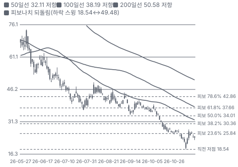

**주봉**

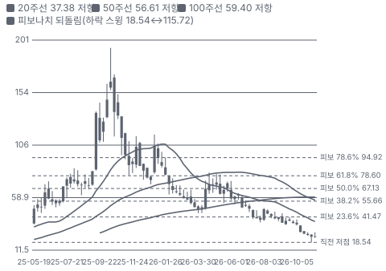

**월봉**

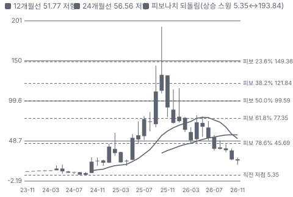

**분기 매출·EPS 실적과 컨센서스**

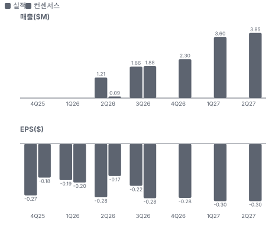

**밸류에이션 주가 시나리오**

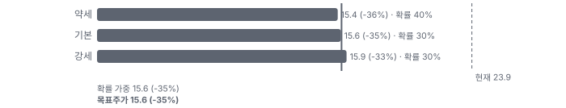

**주가별 업사이드**

- 제품·서비스 포트폴리오

**고객 믹스(9M26, 매출 대비)**

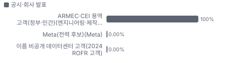

**공급 병목(10점, 낮을수록 병목)**

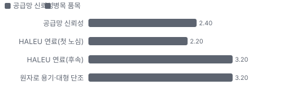

**생산능력 현재와 확충 계획(MWe(발전 용량))**

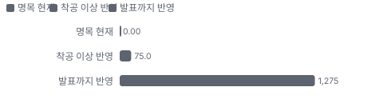

**CAPEX의 매출 대비 비중**

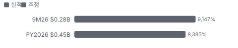

**어닝콜 변화별 주주가치 영향**

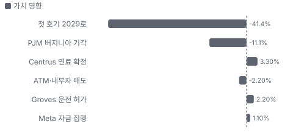

**수주·파이프라인 확실성 사다리**

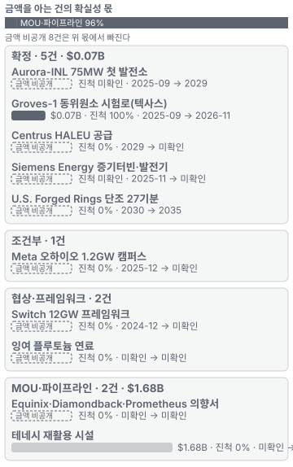

**비용 요인별 매출 대비 비중 1년 변화**

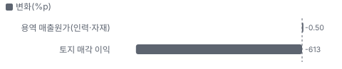

**BOM 항목 가격 +10% 시 OPM 변화**

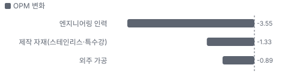

**엔지니어링·제작 용역(ARMEC·CEI) BOM 원가 몫**

**시설별 생산능력(MWe(계획), 큰 순)**

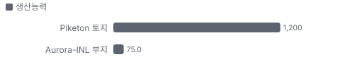

**목표주가 산정 — 기본 시나리오, 도달 확률 약 42%**

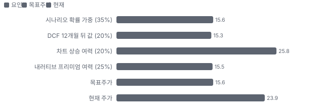

**일봉 지지·저항과 목표주가**

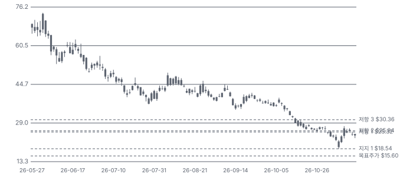

**커뮤니티 언급 수(최근 30일, 채널별)**

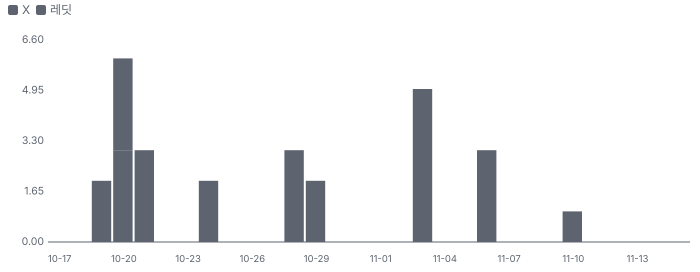

**커뮤니티 게시 수(월, 최근 6개월)**

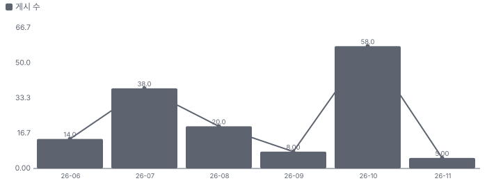

**일별 거래량 분해**

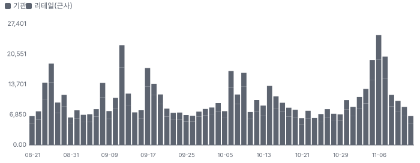

**기관 자금 흐름**

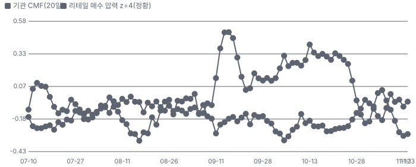

**몬테카를로**

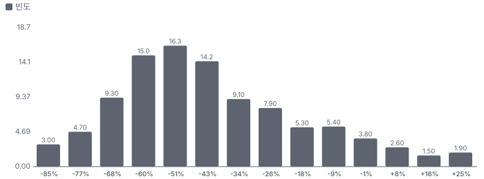

해석: 3,000번 중 229번(8%)에서 가치가 지금 주가 이상이었다. 가정을 흔들어도 지금 주가를 뒷받침하지 못하는 경우가 더 많다. 가운데 값은 0.54배이고, 열 번 중 여덟 번은 0.30~0.95배 사이에 든다.

## 내러티브

> **기업가치를 결정하는 이야기:** 발전소를 직접 짓고 전력을 파는 사업이라 값은 세 숫자로 갈린다. 첫 호기 가동 날짜, 건설비(kW당), 전력 판매 가격이다. 셋 다 아직 공시되지 않았다. 그래서 지금 시가총액 \$4.67B는 현금 \$3.13B와 '나머지 \$1.54B짜리 옵션'으로 읽는 것이 맞다.

> **멀티플·EPS 프리미엄**
> **멀티플:** 선행 이익이 모두 적자라 P/E·EV/EBITDA를 쓸 수 없고 EV/매출로 내려간다. EV는 약 \$1.54B, 다음 4개 분기 매출 추정은 \$14.9M이라 배수는 100배를 넘는다. 매출이 있는 동종(X-Energy 7.4배, BWXT 3.5배, Centrus 2.4배)과 직접 비교할 수 없는 구간이다.
> **EPS:** EPS 추정은 FY2026 −\$0.99, FY2027 −\$1.23, FY2028 −\$1.35다. 8/6 이후 분기 EPS 추정이 분기마다 \$0.06~0.08씩 더 나빠졌다. 비용 추정이 늘어난 몫이다.

### 투자자들은 왜 열광했나

2025년 하반기에는 AI 전력난, 행정부의 원전 행정명령, Meta·Switch 같은 대형 고객 발표가 겹쳐 종가가 \$174(2025-10-14)까지 갔다. 식은 이유는 넷이다. 매출이 계속 0에 가까웠고, ATM으로 9개월에 3,261만 주를 찍었고, 금리가 올라 먼 미래 현금흐름의 할인이 커졌고, 첫 호기가 2029로 밀렸다. 3Q 발표 날(11/6) +22.7%, 11/9 +14.0%로 반등했지만 11/13 \$23.92로 다시 내려왔다.

### 무엇이 기업가치를 바꾸나

> **구조적 체질 변화**
> **변화:** 원자로 설계 회사에서 연료·동위원소·엔지니어링까지 묶은 수직계열 원전 회사로 바뀌는 중
> **증거:** Atomic Alchemy(동위원소)·ARMEC·CEI(제작·엔지니어링) 인수, A3F 연료가공·테네시 재활용 계획(3Q 10-Q)
> **반증:** 2027년에도 비발전 매출이 연 \$20M 아래

> **고부가 믹스 확장**
> **변화:** 해당 없음 — 매출이 인수한 용역뿐이라 믹스를 말할 단계가 아니다
> **증거:** 3Q 매출 \$1.86M 전부 엔지니어링·제작 용역(10-Q)
> **반증:** 동위원소 첫 계약 인도(2027 목표)

> **기술 혁신**
> **변화:** 액체 나트륨 냉각 고속로 — EBR-II(아이다호의 옛 실험 고속로) 설계 계보, 사용후핵연료 재활용 연료
> **증거:** Groves-1은 착공 1년 안 임계, NRC(미국 원자력규제위원회) 설계 기준 토피컬 보고서 승인(2026-04). 다만 75MW급 상업 운전 기록은 없다
> **반증:** Aurora-INL 시운전에서 설계 변경

> **실행 속도**
> **변화:** 시험로는 빨랐고 첫 발전소는 늦어지는 중 **납품 리드타임 36~48개월.** 피어 중앙값 124개월보다 66% 짧다(Vogtle 3호기(AP1000(Westinghouse 대형 가압경수로), 첫 콘크리트 2013-03 → 상업 운전 2023-07, 공개 기록) 124개월). 2Q26(2025-09 착공 → 2028 목표) 36개월보다 17% 길다.
> **증거:** Groves-1 주요 공사 229일·착공 1년 안 임계(3Q 콜). Aurora-INL은 2025-09 착공, 목표 2028 → 2028~2029. NuScale 첫 발전소 계획(UAMPS(유타 지역 공공 전력 공동체))은 2023년 취소됐다(공개 보도). 기준은 착공 → 가동 비교 대상은 최근 미국 상업 원전 실제 기록 1건뿐이다
> **반증:** 2027년 말까지 Aurora-INL 주요 기기 설치가 확인되지 않는다

> **M&A**
> **변화:** 작은 인수로 공급망을 안으로 들였다
> **증거:** Atomic Alchemy(2025-02, \$28.4M), ARMEC(\$20.5M)·CEI(\$12.9M, 2026-06). 시너지 금액 공시 없음
> **반증:** 인수 사업 매출 정체

> **정책·입법 연관성**
> **재정정책:** 첨단 원전 세액공제(45Y·48E)와 DOE 시범사업·연료 배정이 비용을 낮춘다. 세액공제는 법정 일정, 연료 배정·OTA(에너지부 기타 거래 계약)는 확정, 금액 효과는 미확인 3Q 10-Q 정부 지원 항목 반증: 세액공제 축소 입법 의회 동의 4/10 — 하원 2/5(청정에너지 세액공제 축소 논의에서 원전 몫은 유지 쪽 — 표결 기록은 미확인) · 상원 2/5(같음, 표결 기록 미확인).
> **행정명령:** 2025-05 원전 행정명령들(NRC 심사 기한·DOE 시범사업) — DOE 시범사업 11건 중 Oklo 3건 선정 3Q 10-Q 반증: NRC 심사 기한이 법원·규칙으로 무력화 의회 동의 2/10 — 하원 1/5(행정명령 — 의회 의결 없음) · 상원 1/5(같음).
> **연관입법:** ADVANCE(미국 첨단 원전 인허가 촉진법) Act(2024 시행)와 NRC 최종 규칙(2026-10-26 게재, 11/25 시행) — DOE 운전 자료를 NRC 심사에 활용 3Q 콜·10-Q 반증: 규칙 시행 연기

> **고객의 지출 예산**
> **변화:** 전력 고객의 돈은 데이터센터 CAPEX에서 나오고, 연료·동위원소는 연구소·제약 OPEX에서 나온다
> **사업별 예산:** 전력 판매 — 고객 CAPEX(데이터센터 전력 확보 투자(선급·PPA)), 매출의 0%: AI 데이터센터 증설 · 엔지니어링·제작 용역 — 고객 OPEX(정부·민간 엔지니어링 외주 예산), 매출의 100%: 원전·국방 프로젝트 · 동위원소 — 고객 OPEX(제약·연구소 원재료 구매), 매출의 0%: 방사성 의약품 수요
> **증거:** Meta는 예약 캐파에 선급(자본 제공), 2024 데이터센터 고객 \$25M 선급. 용역 매출은 정부·민간 엔지니어링 예산
> **반증:** 하이퍼스케일러 CAPEX 감속

### 내러티브 근거

> 'AI 데이터센터에 전력을 파는 첫 SMR(소형 모듈 원자로)'이라는 이야기는 1년 만에 꺼졌다(2025-10 종가 고점 \$174.14 대비 −86%, 레딧은 조롱 글 위주, 공매도는 유동 주식의 21.9%). 지금 가격의 쟁점은 수요가 아니라 첫 발전소 날짜, 연료, 그리고 ATM으로 주식을 얼마나 더 찍느냐다. 단계는 소멸, 쏠림은 중간이다.

> **AI 데이터센터 기저 전력** · 약화
> **논리:** 하이퍼스케일러가 24시간 무탄소 전력을 원하고 SMR이 그 답이 된다
> **숫자:** Meta 1.2GW·Switch 12GW 프레임워크, 그러나 구속력 PPA 0건(10-K)
> **반증:** 구속력 있는 PPA(MW·가격) 공시
> **출처:** 10-K·3Q 콜

> **DOE 인가 속도** · 강화
> **논리:** DOE 경로로 NRC보다 빨리 짓고 돌린다
> **숫자:** Groves-1 착공 1년 안 임계, 11/11 무제한 운전 허가
> **반증:** Aurora-INL 최종 안전분석이 2028을 넘긴다
> **출처:** 회사 보도자료·3Q 10-Q

> **연료 병목 해소** · 강화
> **논리:** HALEU를 먼저 확보한 회사가 함대를 먼저 짓는다
> **숫자:** EBR-II 5톤 + Centrus 확정 계약(최대 5기, 2029~)
> **반증:** Centrus 증설 지연·플루토늄 배정 무산
> **출처:** 회사 보도자료 2026-11-12

> **현금이 시총의 67%** · 유지
> **논리:** 현금을 빼면 사업 가치가 \$1.5B로 줄어 하방이 얕다
> **숫자:** 시총 \$4.67B − 현금·투자 \$3.13B = \$1.54B
> **반증:** PP&E(유형자산) 지출이 가이던스를 넘거나 첫 호기 비용 초과
> **출처:** 10-Q

> **반대 내러티브 — 희석과 지연** · 강화
> **논리:** 매출 없이 ATM으로 버티고 첫 호기는 미뤄지는 원전 개발사의 전형
> **숫자:** 9M ATM 3,261만 주(+20%), 첫 호기 2028 → 2028~2029, EPS 추정 6개월 하향
> **반증:** 2027년 ATM 없이 Aurora-INL 일정 유지
> **출처:** 10-Q·컨센서스

## 포트폴리오

| 제품·서비스 | 구분 | 무엇 | 쓰는 곳 | 돈 버는 방식 | Mix | Mix 변화(전년 대비) |
|---|---|---|---|---|---|---|
| Aurora(Oklo의 소형 고속로 발전소, 15~75MW) 발전소 | 제품 | 액체 나트륨 냉각 소형 고속로 발전소, 15~75MW | 데이터센터·국방·산업용 기저 전력 | 발전소를 직접 짓고 운영해 전력을 판다(PPA). 매출 0, 첫 호기 2028~2029 목표 | 미확인 | 미확인 |
| 엔지니어링·제작 용역(ARMEC·CEI) | 서비스 | 원전·국방용 정밀 가공과 나트륨 시스템 엔지니어링 | 정부·민간 고객 외주 | 용역 매출. 3Q \$1.86M — 지금 매출의 전부 | 미확인 | 미확인 |
| 연료·재활용 | 제품 | HALEU 금속 연료 가공(A3F)과 사용후핵연료 재활용 | 자사 원자로, 제3자 연료 용역 | 아직 매출 없음. 제3자 가공 용역 2년 안 가능(3Q 콜) | 미확인 | 미확인 |
| 동위원소(Atomic Alchemy) | 제품 | 의료·연구용 방사성 동위원소 생산·처리 | 제약·연구소 | 아직 매출 없음. 2027 첫 계약 인도 목표 | 미확인 | 미확인 |

## 고객

> **9M26 최대 고객 ARMEC·CEI 용역 고객(정부·민간, 엔지니어링·제작 고객) 100%, 상위 3곳 100%, 집중도 집중.** 공시·회사 발표로 확인한 몫은 매출의 100%이고, 나머지 고객 몫은 추정이거나 미분해다. 9개월 매출 \$3.07M은 전부 6월 인수한 ARMEC·CEI의 기존 엔지니어링·제작 고객이다. 전력 매출은 0이고 구속력 있는 PPA도 없다. 전력 고객 후보는 Meta 1.2GW(선급 계약, 건설 비구속), Switch 12GW(프레임워크), Equinix 등 비구속 의향서, 2024년 \$25M 선급을 낸 이름 비공개 데이터센터 고객이다

**고객별 매출 몫(9M26)**
| 고객 | 몫 | 변화 | 근거 |
|---|---|---|---|
| ARMEC·CEI 용역 고객(정부·민간, 엔지니어링·제작 고객) | 100% | 미확인 | 공시 |
| Meta(전력 후보, Meta) | 0% | +0%p | 공시 |
| 이름 비공개 데이터센터 고객(2024 ROFR(우선매수권) 고객) | 0% | +0%p | 공시 |

> **ARMEC·CEI 용역 고객(정부·민간, 엔지니어링·제작 고객)** · 공시
> **사는 것:** 엔지니어링·컨설팅·정밀 제작
> **추정 근거:** 인수로 붙은 매출 — 핵심 사업이 아니다

> **Meta(전력 후보, Meta)** · 공시
> **사는 것:** 오하이오 1.2GW 예약 캐파(선급)
> **추정 근거:** 건설 비구속, 예약 자본·연료 마일스톤만 구속

> **이름 비공개 데이터센터 고객(2024 ROFR 고객)** · 공시
> **사는 것:** 우선매수권 \$25M 선급
> **추정 근거:** Equinix일 가능성은 2Q 콜 발언에 기댄 가설

## 수주·파이프라인

> **2026-11-13 기준 10건.** 확정 \$0.07B, 미확정 \$1.68B.

**수주 목록**
| 상태 | 계약 | 계약 총액 | 진척 | 기간 | 비고 |
|---|---|---|---|---|---|
| 확정 | Aurora-INL 75MW 첫 발전소 | 금액 비공개 | 비공개 | 2025-09 → 2029 | - |
| 확정 | Groves-1 동위원소 시험로(텍사스) | \$0.07B | 100% | 2025-09 → 2026-11 | - |
| 확정 | Centrus HALEU 공급 | 금액 비공개 | 0% | 2029 → 미확인 | - |
| 확정 | Siemens Energy 증기터빈·발전기 | 금액 비공개 | 비공개 | 2025-11 → 미확인 | - |
| 확정 | U.S. Forged Rings 단조 27기분 | 금액 비공개 | 0% | 2030 → 2035 | - |
| 조건부 | Meta 오하이오 1.2GW 캠퍼스 | 금액 비공개 | 0% | 2025-12 → 미확인 | - |
| 프레임워크 | Switch 12GW 프레임워크 | 금액 비공개 | 0% | 2024-12 → 미확인 | - |
| 협상 | 잉여 플루토늄 연료 | 금액 비공개 | 0% | 미확인 → 미확인 | - |
| MOU(양해각서) | Equinix·Diamondback·Prometheus 의향서 | 금액 비공개 | 0% | 미확인 → 미확인 | - |
| 파이프라인 | 테네시 재활용 시설 | \$1.68B | 0% | 미확인 → 미확인 | - |

**실행 속도와 방해 요인**
| 항목 | 상태 | 실행 속도 | 방해 요인 |
|---|---|---|---|
| Aurora-INL 75MW 첫 발전소 | 확정 | 2025-09 비원자력 착공, 굴착 완료·안전 등급 철골 작업, 최종 안전분석 2028, 가동 목표 2028~2029 | DOE 최종 안전분석·기동 승인 · A3F 첫 노심 가공(2027 목표) · 총사업비 미공시 · 전력 구매처 미확정(초기엔 연구소) |
| Groves-1 동위원소 시험로(텍사스) | 확정 | 계획대로(계획 100%, +0%p), 이대로면 2026-11 완료 | 상업 동위원소 생산은 Groves-2(Oklo 두 번째 시험로)와 NRC 면허 필요 |
| Centrus HALEU 공급 | 확정 | 2029년 인도 시작, 최대 5기분 | Centrus 신규 농축 캐파 건설 · 물량·가격 미공시 |
| Siemens Energy 증기터빈·발전기 | 확정 | 엔지니어링·조기 조달 | Aurora-INL 인도 일정 미확인 |
| U.S. Forged Rings 단조 27기분 | 확정 | 2030년 첫 인도~2035 | USFR 신규 공장 건설 · 캐파 예약 — 개별 발주는 앞으로 |
| Meta 오하이오 1.2GW 캠퍼스 | 조건부 | 부지 준비 착수, PJM 접속 약 24개월, 연료 2029년부터 | 원자로 건설 비구속 · 구속력 있는 PPA 없음 · PJM 접속 · NRC 인허가 |
| Switch 12GW 프레임워크 | 프레임워크 | 개별 PPA 미체결 | 구속력 PPA 없음(10-K) |
| 잉여 플루토늄 연료 | 협상 | CEO '수개월 안 일정 명확' | DOE 배정·안전조치 |
| Equinix·Diamondback·Prometheus 의향서 | MOU | MW 미공시 | 비구속 의향서 |
| 테네시 재활용 시설 | 파이프라인 | 시범시설 2027 시운전 목표, 상업 재활용 2030년대 초 | NRC 면허 · 자금 |

## 마진 구조

> **GPM 40.9%, OPM -3817.2%.** 2Q26 대비 GPM +0.5%p, OPM +2231.5%p. 변동비는 매출의 -124%이고, 매출이 10% 늘면 OPM은 +367.4%p 움직인다. 3Q26 매출 \$1.86M(ARMEC·CEI 용역)에 매출원가 \$1.1M으로 매출총이익률은 약 41%다. 그러나 연구개발 \$41.6M·일반관리 \$41.6M이 매출의 수십 배라 영업이익률은 의미가 없다. 비용의 핵심은 발전소 개발 인력과 인허가·연료 준비이고, 손실을 메우는 것은 이자·배당 수익(\$27.9M)이다

**GPM에서 OPM까지(GAAP)**
| 기간 | GPM | 연구개발 | 판관비 | 기타 | OPM |
|---|---|---|---|---|---|
| 2Q26 | 40.4% | 0.0% | 0.0% | 6089.2% | -6048.8% |
| 3Q26 | 40.9% | 2235.4% | 2235.4% | -612.6% | -3817.2% |

**마진을 결정하는 비용 요인 — 비용 +10% 시 OPM**
| 비용 | 매출 대비 | 변화 | 고정비 | OPM |
|---|---|---|---|---|
| 연구개발(원자로·연료 설계, 인허가) | 2235.4% | 미확인 | 90% | -223.54%p |
| 일반관리(SBC 포함) | 2235.4% | 미확인 | 90% | -223.54%p |
| 용역 매출원가(인력·자재) | 59.1% | -0.5%p | 30% | -5.91%p |
| 토지 매각 이익 | -612.6% | -612.6%p | 0% | +61.26%p |

**비용을 움직이는 요인**
| 비용 | 요인 |
|---|---|
| 연구개발(원자로·연료 설계, 인허가, 연구개발) | 인력 확충·DOE 인허가·연료 개발 · 근거 공시 |
| 일반관리(SBC 포함, 판관비) | 인력·주식보상 · 근거 공시 |
| 용역 매출원가(인력·자재, 매출원가) | 엔지니어링 인력·제작 자재 · 근거 공시 |
| 토지 매각 이익(기타) | 일회성 · 근거 공시 |

**엔지니어링·제작 용역(ARMEC·CEI) BOM — 매출의 100%, GPM 41%(3Q26 매출 \$1.861M − 매출원가 \$1.1M(회사 전체 = 용역 전부)), 항목 가격 +10% 시**
| 항목 | 원가 몫 | 전가 | 제품 GPM | OPM |
|---|---|---|---|---|
| 엔지니어링 인력 | 50~70% | 미확인 | -3.5%p | -3.55%p |
| 제작 자재(스테인리스·특수강) | 15~30% | 미확인 | -1.3%p | -1.33%p |
| 외주 가공 | 10~20% | 미확인 | -0.9%p | -0.89%p |
| 미분해 | 3% | - | - | - |

판매가 전가를 모르는 항목은 전가 0%로 계산했다.

**BOM 항목 가격을 움직이는 것**
| 항목 | 요인 |
|---|---|
| 엔지니어링 인력 | 인건비 · 근거 추정 |
| 제작 자재(스테인리스·특수강) | 철강 가격 · 근거 추정 |
| 외주 가공 | 외주 단가 · 근거 추정 |

**투입 물가 — 미국 PPI 3·6·12개월(2026-10, 개정 반영)**
| 항목 | 미국 3개월 | 6개월 | 12개월 | 전가 못 할 때 OPM |
|---|---|---|---|---|
| 제작 자재(스테인리스·특수강) | +6.7% | +17.0% | +32.9%* | - |

별표는 품목보다 넓은 업종 지수다. 지난 1년 투입 물가를 판매가 전가 뒤 원가에 넣으면 OPM은 -4.38%p 움직인다(매출원가의 22% 기준). 물가 지수를 붙이지 못한 매출원가 항목은 용역 매출원가(인력·자재)다(미연결).

## 공급망 병목

이미지 없음(검수 실패) — Aurora 발전소

> **공급망 신뢰성 2.4/10, 병목 심각.** 가장 약한 고리는 HALEU 연료(첫 노심) 2.2점이고, 품목 평균은 2.9점이다. 근거가 부족한 2건(증기터빈·발전기 · 시공(EPC(설계·조달·시공 일괄 수행)))은 점수에서 뺐다. 병목은 연료다. 첫 노심은 DOE가 배정한 EBR-II 회수 HALEU 5톤으로 확보했고, 후속 연료는 Centrus 확정 계약(2029년부터)과 잉여 플루토늄 협상에 달렸다. 터빈은 Siemens Energy와 구속력 계약, 대형 단조는 U.S. Forged Rings 캐파 예약(2030~2035), 시공은 Kiewit다

**병목과 마진 — 품목 가격 +10% 시 OPM**
| 품목 | 점수 | 판정 | 구분 | OPM |
|---|---|---|---|---|
| HALEU 연료(첫 노심, 필수) | 2.2 | 병목 심각 | 출하 차질 위험 | 미확인 |
| HALEU 연료(후속, 필수) | 3.2 | 병목 심각 | 출하 차질 위험 | 미확인 |
| 원자로 용기·대형 단조(필수) | 3.2 | 병목 심각 | 출하 차질 위험 | 미확인 |

> **HALEU 연료(첫 노심)** · 2.2/10
> **왜:** 첫 노심 연료가 없으면 기동할 수 없다
> **병목 요인:** 인증 공급사 1곳 · 캐파 빠듯 · 리드타임 미확인 · 재인증 미확인 · 1위 점유율 100% · 미국 집중 100% · 물량 확보 미확인
> **풀리는 조건:** 일부 — 첫 노심 배정 확인, A3F 가공은 2027 목표

> **HALEU 연료(후속)** · 3.2/10
> **왜:** 두 번째 호기부터 연료 공급원
> **병목 요인:** 인증 공급사 1곳 · 캐파 빠듯 · 리드타임 미확인 · 재인증 미확인 · 1위 점유율 미확인 · 미국 집중 100% · 물량 확보 장기계약
> **풀리는 조건:** 미확인 — 계약은 확정, 농축 증설은 확인 전

> **원자로 용기·대형 단조** · 3.2/10
> **왜:** 함대 배치 속도를 정한다
> **병목 요인:** 인증 공급사 1곳 · 캐파 빠듯 · 리드타임 미확인 · 재인증 미확인 · 1위 점유율 미확인 · 미국 집중 100% · 물량 확보 장기계약
> **풀리는 조건:** 미확인 — 2030 첫 인도 전

**공급사**
| 품목 | 공급사 | 몫 | 근거 |
|---|---|---|---|
| HALEU 연료(첫 노심) | DOE·INL(EBR-II 회수 우라늄 5톤, 첫 노심 배정) | 미확인 | 공시 |
| HALEU 연료(후속) | Centrus(확정 다년 공급, 2029년 인도 시작) | 미확인 | 회사 발표 |
| HALEU 연료(후속) | DOE 잉여 플루토늄(가교 연료) | 미확인 | 추정 |
| 증기터빈·발전기 | Siemens Energy(SST-600 터빈·SGen-100A 발전기) | 미확인 | 회사 발표 |
| 원자로 용기·대형 단조 | U.S. Forged Rings(27기분 캐파 예약) | 미확인 | 공시 |
| 시공(EPC) | Kiewit(Aurora-INL 주시공사) | 미확인 | 공시 |

**무역 통계로 본 공급 지역**
| 품목 | EU 수입처 | 일본 수입처 | EU 1위 전년비 |
|---|---|---|---|
| 원자로 용기·대형 단조 | KR(한국) 40% · TW(대만) 26% · VN(베트남) 15% | 大韓民国 49% · 中華人民共和国 14% | +9.2% |

## 생산능력

> **현재 명목 캐파 0 MWe(발전 용량), 가동률 미확인.** 착공 이상 증설은 75 MWe(발전 용량), 발표까지 합치면 1,275 MWe(발전 용량)이다. 9M26 CAPEX는 \$0.28B로 매출의 9146.9%다. 상업 발전 용량은 0이다. 첫 발전소 Aurora-INL 75MW가 2028~2029 가동 목표로 건설 중이고, 오하이오 Piketon 토지에 Meta용 1.2GW 캠퍼스를 계획한다. 2026 PP&E 지출 가이던스 \$400~500M 중 9개월에 \$280.9M을 썼다

**생산시설 9곳**(10-K Item 2는 본사 전대와 오하이오 Piketon 보유 토지 2곳만 적는다. 나머지는 3Q 10-Q MD&A(경영진 재무 분석 절)·주석의 사업장·프로젝트 부지(계획 포함)) — 이름·위치를 밝힌 곳 8곳, 임차 2곳 · 미확인 5곳 · 소유 1곳. 시설별 생산능력은 2곳만 공개됐다.

**생산시설 9곳 — 명칭·위치·생산능력**
| 시설 | 위치 | 용도 | 생산능력 | 소유·상태 |
|---|---|---|---|---|
| 본사 | 미국 캘리포니아 Santa Clara | 경영·엔지니어링(전대, 2026-12 만료) | 미확인 — 사무 시설 | 임차 · 가동 |
| Aurora-INL 부지 | 미국 아이다호 INL | 첫 상업 발전소(DOE 부지 사용 허가) | 75 MWe(계획) | 임차 · 건설 중 |
| A3F 연료가공시설 | 미국 아이다호 INL | 첫 노심 연료 가공 | 미확인 — 가공 능력 미공시 | 미확인 · 건설 중 |
| Groves-1 시험로 | 미국 텍사스 Lockhart | 동위원소 시험로 | 미확인 — 저출력 시험로 — 출력 미공시 | 미확인 · 가동 |
| Piketon 토지 | 미국 오하이오 Pike County | Meta용 발전 캠퍼스(2025-12 취득) | 1,200 MWe(계획) | 소유 · 계획 |
| Idaho 방사화학 연구소 | 미국 아이다호 | 동위원소 처리(NRC 물질 면허) | 미확인 — 미공시 | 미확인 · 가동 |
| Advanced Fuel Center | 미국 테네시 Oak Ridge | 연료 재활용·가공 | 미확인 — 최대 \$1.68B 로드맵, 용량 미공시 | 미확인 · 계획 |
| ARMEC·CEI 사업장 | 미확인 | 정밀 가공·나트륨 시스템 엔지니어링 | 미확인 — 용역 사업 | 미확인 · 가동 |

**생산능력 확충 계획**
| 계획 | 단계 | 증설 | 가동 시점 | CAPEX |
|---|---|---|---|---|
| Aurora-INL | 착공 | 75 MWe(발전 용량) | 2028~2029 | 미확인 |
| 오하이오 Piketon 캠퍼스(Meta) | 발표 | 1,200 MWe(발전 용량) | 미확인 | 미확인 |

남은 계획의 CAPEX 합계는 \$0.00B(금액 미확인 2건 제외)다. 합계는 FY2026 매출의 0%다.

**증설 방해 요인**
| 계획 | 방해 요인 |
|---|---|
| Aurora-INL | DOE 최종 안전분석(2028)·기동 승인, 첫 노심 연료 가공, 총사업비 미공시 |
| 오하이오 Piketon 캠퍼스(Meta) | 건설 비구속, PJM 접속 약 24개월, NRC 인허가 |

**CAPEX와 매출 대비**
| 기간 | CAPEX | 매출 | 매출 대비 | 구분 |
|---|---|---|---|---|
| 9M26 | \$0.28B | \$0.00B | 9146.9% | 실적 |
| FY2026 | \$0.45B | \$0.01B | 8384.6% | 추정 |

## 해자

> 해자는 원자로 기술 자체보다 '인가 단계·연료·부지를 먼저 쥔 것'이다. 다만 NRC 상업 인허가는 아직 신청 전이고 같은 DOE 경로를 다른 개발사도 쓴다

> **DOE 인가 경로 선점** · 보통
> **해자:** DOE 인가로 시험로를 실제로 짓고 돌렸고, 첫 발전소는 예비 안전성 평가 승인을 받아 건설 중이다
> **근거:** Groves-1은 착공 1년 안 임계(8/5)·11/11 무제한 운전 허가, Aurora-INL 예비 안전성 평가 승인(2026-06), NRC 최종 규칙(11/25 시행)으로 DOE 운전 자료를 NRC 심사에 쓸 수 있다(3Q 10-Q)
> **숫자:** Groves-1 총비용 약 \$75M(CEO)
> **깨지는 조건:** NRC 상업 인허가 신청이 2027년 안에 나오지 않거나 다른 시범사업 참여사가 같은 단계를 먼저 밟는다

> **연료 확보** · 보통
> **해자:** 미국에 상업 HALEU가 없는 상황에서 첫 노심과 후속 연료 경로를 함께 묶었다
> **근거:** EBR-II 회수 HALEU 5톤 배정, Centrus 확정 다년 계약(최대 5기·2029년), 잉여 플루토늄 우선협상(3Q 10-Q·회사 보도자료 11/12)
> **숫자:** 첫 노심 5톤
> **깨지는 조건:** Centrus 농축 증설 지연 또는 플루토늄 배정 무산

> **자본력·공급망 예약** · 약함
> **해자:** 무차입 현금 \$3.1B로 대형 단조·터빈을 먼저 예약했다
> **근거:** 현금·투자 \$3.13B, USFR 27기분 캐파 예약, Siemens Energy 구속력 계약. 그러나 돈은 ATM 희석으로 모았고(9M 3,261만 주) 경쟁사도 현금이 많다(NuScale \$1.86B·X-Energy \$1.81B)
> **숫자:** 현금·투자 \$3.13B
> **깨지는 조건:** 해당 없음 — 약한 해자로 본다

## 경영진·네트워크

> 공동창업자 부부(DeWitte CEO·COO)가 회사를 이끌고, 이사회는 에너지부 부장관·INL 소장·Dominion 원자력 책임자 출신으로 짜였다. 연결은 DOE·국립연구소 쪽에 몰려 있다. 연결이 인가·계약을 만들었다는 증거는 없다

> **Jacob DeWitte** · 공동창업자·CEO·이사회 의장 · 2013
> **프로필:** MIT 원자력공학 박사과정, 국립연구소 펠로
> **비즈니스:** 창업자 신탁이 최대 250만 주 2027년 매도 계획(10b5-1)
> **정계:** 미확인
> **동문:** MIT
> **사모임:** 미확인

> **Caroline DeWitte** · 공동창업자·COO·이사 · 2013
> **프로필:** MIT 원자력공학
> **비즈니스:** -
> **정계:** DOE 원자력자문위원회 위원(2018~2019)
> **동문:** MIT
> **사모임:** 미확인

> **Daniel Poneman** · 이사 · 2025-03
> **프로필:** DOE 부장관(2009~2014), Centrus CEO(2015~2023)
> **비즈니스:** Centrus가 현재 연료 공급사 — 이해관계 주시
> **정계:** 전 DOE 부장관
> **동문:** 미확인
> **사모임:** 미확인

> **Mark Peters** · 이사 · 2026-04
> **프로필:** 전 INL 소장, MITRE CEO
> **비즈니스:** INL은 첫 발전소 부지
> **정계:** 미확인
> **동문:** 미확인
> **사모임:** 미확인

> **R. Craig Bealmear** · CFO · 2023-08
> **프로필:** Renewable Energy Group CFO, BP 북미 다운스트림 CFO
> **비즈니스:** -
> **정계:** 미확인
> **동문:** 미확인
> **사모임:** 미확인

**네트워크 정량화**
| 연결 | 강도 | 닿는 매출 | 가중 노출 | 매출 대비 | 근거 |
|---|---|---|---|---|---|
| 정계: 전 DOE 부장관·전 INL 소장·전 DOE 자문위원이 경영진·이사회에 있다 | 4/5 | 미확인 | 미확인 | 미확인 | DOE 인가·부지·연료 배정에 닿지만 금액으로 환산할 자료가 없다 DEF 14A(주주총회 위임장) |
| 비즈니스: 이사 Poneman이 연료 공급사 Centrus 전 CEO | 3/5 | 미확인 | 미확인 | 미확인 | Centrus 계약 물량·가격 미공시 DEF 14A·회사 보도자료 2026-11-12 |

가중 노출은 연결이 닿는 매출의 크기다. 연결이 그 매출을 만들었다는 뜻이 아니며, 인과는 공개 자료로 입증하지 못한다.

## 약세 논리 및 셀온 조건

| 약세 논리 | 근거 | 반박 | 가를 자료 |
|---|---|---|---|
| 첫 호기는 더 밀린다 | 목표가 2028 → 2028~2029로 바뀌었다(3Q 10-Q). 최근 미국 상업 원전 Vogtle 3호기는 첫 콘크리트에서 상업 운전까지 약 124개월 걸렸다 | Groves-1은 착공 1년 안에 임계했고 Aurora-INL은 굴착을 마치고 안전 등급 철골 작업 중이다 | DOE 최종 안전분석 제출(2028 예정), 2027년 주요 기기 설치 |
| 고객은 아직 없다 | 구속력 있는 PPA가 0건이다(10-K). CEO는 Meta 계약이 건설에 구속력이 없다고 답했다 | Meta가 선급 자금을 Centrus 연료 크레딧으로 실제 집행했다(11/2) | Meta·Switch PPA 공시(MW·가격·기간) |
| 현금은 줄어드는 받침이다 | 2026 PP&E \$400~500M·운영 현금 사용 \$120~150M 가이던스. 9개월 PP&E \$280.9M | 현금·투자 \$3.13B는 1년 이상 운영 자금이고 차입이 없다 | 4Q26 현금흐름표(2027-03), Aurora-INL 총사업비 |
| 희석이 이어진다 | 9개월 ATM 3,261만 주(+20%), 신규 \$1B ATM 잔여 약 \$0.91B, 창업자 신탁 최대 250만 주 2027 매도 계획 | 남은 ATM은 지금 시총의 약 19%로 한도가 보인다 | 10-K ATM 사용액, 새 증자 8-K |
| 경쟁 원전이 더 싸다 | 기존 원전 증출력·재가동이 신규 SMR보다 싸다는 논지가 커뮤니티에 나온다(수치 미검증). NuScale·X-Energy도 현금이 각각 \$1.86B·\$1.81B다 | Oklo는 연료(첫 노심 HALEU 5톤)와 DOE 부지를 먼저 확보했다 | Aurora-INL kW당 건설비 공시 |
| 연료 병목 | 미국 상업 HALEU 공급이 아직 없고, Centrus 물량·가격은 미공시, 잉여 플루토늄은 배정 전이다 | 첫 노심은 DOE 배정으로 확보했고 Centrus는 확정 계약이다 | Centrus 농축 증설 진척, DOE 플루토늄 배정 발표 |

3Q 10-Q(2026-11-06 제출)에서 확인한 것은 중요 구매 약정 없음(전년과 같음, 계약은 통지로 해지 가능), 제한 현금 \$81.9M(이 중 농축우라늄 구매 신용장 \$58.0M은 10/13 해제), 10% 이상 고객 미공시(매출 전부가 6월 인수한 ARMEC·CEI 용역), 정부 지원으로 DOE 원자로 시범사업 3건 선정·DOE 기타 거래 계약 2건·INL 부지 사용 허가·EBR-II 회수 HALEU 5톤 배정·ARPA-E(에너지부 첨단 에너지 연구 사업) FORGE(ARPA-E 핵연료 재활용 연구 과제) \$6.8M이다. 2024년 데이터센터 고객이 낸 우선매수권 선급금 \$25.0M이 부채로 남아 있다. 3Q 실적은 Item 2.02 8-K로 내지 않았고 회사 보도자료로만 냈다. 미확인은 Aurora-INL 총사업비, Centrus 계약 물량·가격, Meta 선급 금액, 의향서 상대방별 MW다. 희석 증권은 9/30, 기본 주식은 11/4 기준이라 날짜가 다르다. 고점은 TradingView 일봉 종가 기준 2025-10-14 \$174.14(장중 2025-10-15 \$193.84), 52주 종가 고점은 2025-12-04 \$111.65다.

> **셀온 조건**
> **조건 1:** Aurora-INL 목표가 다시 2029년 뒤로 밀리거나 DOE 최종 안전분석 제출이 2028년을 넘긴다
> **조건 2:** Aurora-INL 총사업비가 공시되고 kW당 비용이 경쟁 기저 전력(가스 복합·기존 원전 증출력)보다 크게 높다
> **조건 3:** ATM 잔여 \$0.91B를 다 쓰고 새 증자 프로그램을 낸다
> **조건 4:** Centrus 농축 증설이 지연되거나 잉여 플루토늄 배정이 무산된다
> **조건 5:** Meta가 오하이오 계획을 줄이거나 선급 구조를 바꾼다
> **조건 6:** 2027년 안에 A3F 첫 연료 집합체가 나오지 않는다

## 어닝콜 변화

**직전 콜 대비 새로 나오거나 바뀐 내용 → 가치 영향**
| 항목 | 내용 | 직전 콜 | 최신 콜 | 모델 동인 이동 | 확신도 | 가치 영향 |
|---|---|---|---|---|---|---|
| 부정 | 첫 호기 목표 2028 → 2028~2029 | 2028(10-K·2Q 콜 CFO) | 2028~2029(3Q 10-Q), CEO는 시운전 완충이라 설명 | 1년차 성장률 -30.0% | 0.5 | -41.4% |
| 업데이트 | Centrus HALEU 확정 다년 계약 | 6월 LOI(비구속) | 11/12 확정 계약 여러 건, 최대 5기, 2029년 인도, 물량·가격 미공시 | 할인율(WACC) -0.30% | 1.0 | +3.3% |
| 신규 | Meta 선급 자금 Centrus에 집행 | 선급 구조만 | 11/2 초기 자금 지급(금액 미공시) | 할인율(WACC) -0.10% | 1.0 | +1.1% |
| 부정 | Meta 계약 원자로 건설 비구속 확인 | 선급 프레임워크 | CEO가 건설 비구속 명시, 예약 자본·연료 마일스톤만 구속 | 성장 지속(감속 계수) -1.0% | 0.8 | +0.0% |
| 신규 | U.S. Forged Rings 27기분 캐파 예약 | 없음 | 2030~2035 인도, 소규모 초기 투자 | 성장 지속(감속 계수) +1.0% | 1.0 | +0.0% |
| 부정 | PJM 버지니아 신청 철회·FERC(미국 연방에너지규제위원회) 기각 | 여러 신청 진행 | 기각, PJM 900MW 심사 중 | 1년차 성장률 -10.0% | 1.0 | -11.1% |
| 업데이트 | Groves-1 DOE 무제한 운전 허가 | 8/5 첫 임계 | 11/11 최종 운전 보류점 해제 | 할인율(WACC) -0.20% | 1.0 | +2.2% |
| 반복 | 2026 현금 가이던스 유지 | 영업 \$120~150M·PP&E \$400~500M | 같음, 9M PP&E \$280.9M | 기준연도 매출 — | 0.8 | +0.0% |
| 부정 | 신규 \$1B ATM·창업자 신탁 매도 계획 | ATM1(2026년 첫 번째 시장가 증자 프로그램) \$1B 소진 | ATM2(2026년 두 번째 시장가 증자 프로그램) \$1B(잔여 약 \$0.91B), 신탁 최대 250만 주 2027 매도 계획 | 할인율(WACC) +0.20% | 1.0 | -2.2% |
| **합계** | 단독 합 |  |  | 동시 적용 -49.4% |  | **-48.2%** |

**실적 발표 예상 변동폭:** 지난 2번 실적 발표 때 주가는 하루에 평균 ±15.4%(최대 22.7%, 오른 날 1번) 움직였다.

**실적 발표 예상 변동폭 — 과거 실적 발표 다음 거래일 주가 변화**
| 분기 | 발표일 | 주가 변화 |
|---|---|---|
| 2Q26 | 2026-08-07 | -8.1% |
| 3Q26 | 2026-11-06 | +22.7% |

**해석:** 이 기간 주가 -43.3% 중 EPS 추정 변화가 +36.4%, 멀티플 변화가 -58.4% — 주가를 움직인 것은 **멀티플(시장이 붙이는 배수) 변화**이다. 이익 추정은 오르는데 주가가 내렸다면 시장은 숫자가 아니라 지속성·위험(할인율)을 다시 매긴 것이다.

## P·Q 사이클

> **가격·물량을 나눌 표본이 부족하다(전년 대비 0분기).** 가격 근거(미국 PPI(생산자물가지수) 변압기·배전 기기 대용 — 회사 판매가가 아니라 업종 가격)의 이력이 쌓이면 다시 잰다.

## 밸류에이션

> **목표주가 \$16, 업사이드 -35%.** 자리는 기본 시나리오이고 도달 확률은 약 42%다. 기본 \$16, 강세 \$16(-33%), 약세 \$15(-36%). DCF 기준 업사이드는 기본 -42%, 강세 -14%, 약세 -62%다(WACC 10.4%).

선행 EPS·EBITDA가 2029년까지 모두 적자라 기준 멀티플은 EV/매출이고, 12개월 뒤의 다음 4개 분기(4Q27~3Q28) 매출을 쓴다. 이 기간 컨센서스는 약 \$31M(1~2명)이다. 선정 배수는 2.4배(동종 중앙값 3.5배에서 해자·반복 매출·내러티브 소멸·판단 조정 −20% 반영)이고 약세 \$15.4, 기본 \$15.6, 강세 \$15.9이다. 세 값이 거의 같은 이유는 매출 \$10~45M에 배수를 곱한 값이 완전 희석 주당 현금 약 \$15.3에 비해 작기 때문이다. 즉 이 방법은 '현금만 인정하고 발전소 옵션은 0'에 가깝다. DCF 기본도 현재가보다 42% 낮은데, 2026~2029년 PP&E·운영 현금 사용으로 현금이 줄고 흑자는 2031년 이후로 가정했기 때문이다(손 작성 동인, 근거 약함). 두 방법이 같은 방향이지만 둘 다 첫 호기 성공 뒤 함대 확장이라는 꼬리 옵션을 제대로 값매기지 못한다. 그 꼬리는 반대 검증과 셀온 조건에서 따로 본다. 확률은 계산값(약세 35%·기본 30%·강세 35%)에서 약세를 5%p 올리고 강세를 5%p 내렸다. 첫 호기가 이미 한 번 밀렸기 때문이다. 대시보드 시가총액은 옵션·RSU 948만 주를 더한 완전 희석 기준이다.

시나리오 확률: 다음 해 매출 성장 분포로 계산 — 약세 +47.5% 아래·강세 +273.0% 위 확률. 내부 관점(컨센서스 +166.0%, σ 346.4%: 범위 537.1% ÷ d2(5) × 1.5) 100% — 외부 관점 꺼짐(SEC 전 상장사 표본 없음) · 모델 조정: 첫 호기(FOAK(첫 호기)) 원전은 인허가·건설 지연 기저율이 높고, Aurora-INL 가동 목표가 이미 2028년에서 2028년 말~2029년 초로 밀렸다. 반대로 Centrus HALEU 확정 계약과 Groves-1 무제한 운전 승인은 기본 쪽 근거다

> **약세 \$15 (-36%)** · 확률 40%
> **가정:** 1.8배 × 매출 \$10M
> **근거:** Aurora-INL이 2029년 뒤로 더 밀리고 동위원소·연료 용역 매출도 늦어진다. ATM을 더 쓴다

> **기본 \$16 (-35%)** · 확률 30%
> **가정:** 2.4배 × 매출 \$25M
> **근거:** 용역 매출이 이어지고 동위원소 첫 계약이 2027년에 나온다. 컨센서스 \$31M보다 약 20% 낮게 잡았다

> **강세 \$16 (-33%)** · 확률 30%
> **가정:** 3.0배 × 매출 \$45M
> **근거:** 동위원소·연료 제3자 용역이 앞당겨지고 첫 구속력 PPA가 붙는다

**멀티플 선정 — EV/매출**
| 단계 | 조정 | 근거 |
|---|---|---|
| 동종 중앙값 | 3.5배 | 범위 2.4~7.4배, 3곳 |
| 펀더멘털 | +0% | 재료 없음 |
| 해자 | -4% | DOE 인가 경로 선점 보통 · 연료 확보 보통 · 자본력·공급망 예약 약함 — 점수 1.5%에서 동종 기준 5.5%를 뺌 |
| 반복 매출 | -3% | 반복 매출 0%(동종 20%) · 전력 판매(PPA)·연료·동위원소 — 아직 반복 매출 없음 · 반복 단계까지 3년(할인 ×0.50) · 기반 운영 발전소 0기(시험로 Groves-1은 DOE 시험용) |
| 수주 전환·가시성 | +0% | 가시성 재료 없음 |
| 내러티브 | -10% | 단계 소멸 |
| 사이클·실행 판단 | -20% | 동종 EV/매출은 매출이 있는 X-Energy·BWXT·Centrus 값이라 매출 전 단계 Oklo에 그대로 쓰면 과대다. 다만 연료·인허가 진척이 3Q에 확인돼 상한(−30%)까지는 내리지 않는다 |
| **선정** | **2.4배** | 지금 576.9배 |

**동종 레인지**
| 회사 | EV/매출 | 성장 | 영업이익률 | ROIC |
|---|---|---|---|---|
| XE | 7.4 | 88% | -170% | - |
| BWXT | 3.5 | 18% | 12% | 13% |
| LEU | 2.4 | 0% | -1% | -10% |
| **Oklo** | 576.9 |  |  |  |

지금 주가가 요구하는 5년 매출 CAGR 273%, 기본 시나리오 172%. 몬테카를로 중앙값 업사이드 -46%.

> 의사결정 보조(투자자문 아님): ① 매수 매력: 5년 보유 가정 연 기대수익 -5.3% — 주주가 요구하는 수익률(자기자본비용) 10.4%보다 -15.7%p · 요구수익률을 넘을 확률 4% · 안전마진 없음(비관적 경우(하위 10%) 가치가 시총의 30%) → 정량 신호 약함 / ② 위험 예산 지표(이론): 0% — 기대수익이 요구수익률에 못 미친다(켈리 기준 — 수익·손실 확률로 계산한 이론상 최대 노출 — 0%는 참고) · 5년 뒤 나쁜 경우(하위 10%) -69% · 30% 넘게 잃을 확률 54% / ③ 상방(5년): 평균 0.76배 · 2배 이상 확률 1% · 3배 이상 0% · 10배 이상 0% · 잘 풀린 경우(상위 10%) 1.37배 이상

투입 물가 점검: 지난 1년 PPI를 BOM에 넣으면 OPM -4.38%p다(매출원가의 22% 기준).

## 매수 위치(일봉)

> **현재가 \$23.92는 '중간'(가장 가까운 일봉 지지 \$18.54에서 ATR 2.2배 위).** 이 자리에서 목표주가까지 -34.8%, 첫 일봉 저항까지 +5.8%, 다음 지지까지 하방 -22.5%, 손익비 -1.5배.

**가격대별 업사이드(일봉 기준)**
| 가격대 | 가격 | 목표주가까지 | 첫 저항까지 | 다음 지지까지 | 손익비 | 근거 기법(강도) |
|---|---|---|---|---|---|---|
| 현재가 | \$23.92 | -34.8% | +5.8% | -22.5% | -1.5 | - |
| 지지 1 | \$18.54 | -15.8% | +36.6% | 미확인 | 미확인 | 120일 지그재그 저점 · 스윙 저점(1.8) |

**일봉 저항**
| 저항 | 가격 | 현재가 대비 | 근거 기법(강도) |
|---|---|---|---|
| 저항 1 | \$25.32 | +5.8% | 20일선(0.5) |
| 저항 2 | \$25.84 | +8.0% | 피보 23.6%(1.0) |
| 저항 3 | \$30.36 | +26.9% | 피보 38.2%(1.0) |

일봉만 쓴다(주봉·월봉 제외). 손익비 = 목표주가까지 업사이드 ÷ 다음 지지까지 하방. 가격대별 기대값 참고표이며 매수·매도 시점 지시가 아니다.

## 애널리스트 토론

> **토론 결론 Sell(규칙 등급 Strong Sell).** 인가·연료 진척은 확인됐지만 값을 정할 건설비·전력 가격·구속력 고객이 없다. 살아남은 반박은 ATM 공급과 첫 호기 지연이다 토론은 Neutral를 냈지만 규칙 등급에서 1단계까지만 옮길 수 있어 Sell로 정했다.

**패널 — 등급별 자리**
| 자리 | 핵심 논리 | 틀리는 조건 | 최종 투표 |
|---|---|---|---|
| Strong Buy | 현금이 시총의 67%이고 인가·연료 진척이 3Q에 확인됐다. 사업 가치 \$1.5B는 1년 전의 10분의 1이다 | 2027년 A3F 첫 연료가 나오지 않는다 | Buy |
| Buy | 시험로 실행 속도가 첫 발전소에서 반복되면 2029년 첫 전력 판매로 재평가된다 | Aurora-INL 최종 안전분석이 2028년을 넘긴다 | Buy |
| Neutral | 진척은 맞지만 값을 정할 숫자(건설비·전력 가격·PPA)가 하나도 없다 | 총사업비와 kW당 비용 공시 | Neutral |
| Sell | ATM이 남은 한 주가는 공급에 눌린다. 공매도도 많다 | 2027년 ATM 사용 중단 공시 | Neutral |
| Strong Sell | 첫 호기는 이미 밀렸고 원전 첫 호기의 지연·비용 초과 기저율은 높다. Meta도 건설을 약속하지 않았다 | Meta가 구속력 있는 PPA에 서명 | Sell |

**투표**
| Strong Buy | Buy | Neutral | Sell | Strong Sell |
|---|---|---|---|---|
| 0 | 2 | 2 | 1 | 0 |

> **개회 · Strong Buy**
> **발언:** 현금이 하방을 받친다

> **개회 · Buy**
> **발언:** 시험로 실행 기록이 있다

> **개회 · Neutral**
> **발언:** 값을 정할 숫자가 없다

> **개회 · Sell**
> **발언:** 주식 공급이 가격을 정한다

> **개회 · Strong Sell**
> **발언:** 첫 호기 기저율은 지연이다

> **반박1 · Neutral → Strong Buy**
> **발언:** 현금은 PP&E로 해마다 \$0.4~0.5B씩 줄어든다. 하방 받침이 아니라 줄어드는 받침이다

> **반박1 · Strong Buy → Strong Sell**
> **발언:** Groves-1은 착공 1년 안에 임계했다. 기저율이 이 팀에 그대로 맞지 않는다

> **반박1 · Strong Sell → Buy**
> **발언:** Groves-1은 저출력 시험로이고 총비용 \$75M이다. 75MW 발전소와 비교할 수 없다

> **반박1 · Buy → Sell**
> **발언:** ATM 잔여 \$0.91B는 지금 시총의 약 19%다. 끝이 보이는 공급이다

> **반박1 · Sell → Neutral**
> **발언:** 총사업비가 나오면 ATM이 더 커질 수 있다

> **반박2 · Strong Buy → Neutral**
> **발언:** NRC 최종 규칙이 11/25 시행되면 DOE 자료로 상업 인허가가 빨라진다

> **반박2 · Neutral → Strong Buy**
> **발언:** NRC 신청은 아직 없다. 규칙은 경로일 뿐 일정이 아니다

> **반박2 · Buy → Strong Sell**
> **발언:** Centrus 계약 재원이 Meta 선급금이다. Meta가 돈을 넣었다

> **반박2 · Strong Sell → Buy**
> **발언:** 넣은 돈은 연료 예약이지 원자로 건설 약속이 아니다. CEO가 그렇게 답했다

> **반박2 · Sell → Strong Buy**
> **발언:** 현금이 시총의 67%여도 내부자는 계획 매도만 했다

> **최종 · Strong Buy** · Buy
> **발언:** 2027년 연료·기기 설치가 확인되면 의견을 지킨다

> **최종 · Buy**
> **발언:** Aurora-INL 일정이 다음 가를 자료다

> **최종 · Neutral**
> **발언:** 총사업비 공시가 상향 조건이다

> **최종 · Sell** · Neutral
> **발언:** ATM 잔여가 소진되면 중립으로 간다

> **최종 · Strong Sell** · Sell
> **발언:** 구속력 있는 PPA 전엔 의견을 유지한다

남은 반대 의견: 구속력 PPA 전에는 Meta 수요를 셀 수 없다(Strong Sell)

패널은 등급별 논리를 대표하는 자리이고 실존 IB의 의견이 아니다.

## 커뮤니티 반응

통계: 관심 급증 0.0/10(결합 Z -1.1), 최근 7일 신뢰 가중 감성 -0.40.

> **추적 언급은 7일 점수 50(Weak), 24시간 언급 없음. 10월 58건으로 늘었다가 11월은 5건이다. 레딧은 조롱과 손절 글이 많고, X에서는 기존 원전 증출력이 신규 SMR 수요를 깎는다는 논지가 나온다**

**약세** — 매출 없이 증자를 반복하는 회사가 1년 전 과열에서 내려오는 중이라는 글이 대부분이고 고점 대비 손실 인증이 이어진다 근거로 드는 것: 주가 하락·ATM. (레딧 r/wallstreetbets, 2026-11-06)

**강세** — 시총에서 현금 약 \$3B를 빼면 사업 가치가 약 \$2B로 1년 새 91% 줄었다는 계산이 공감을 얻었다 근거로 드는 것: 시총·현금. (레딧 r/wallstreetbets, 2026-10-20)

**새 쟁점** — 기존 원전 증출력이 kW당 약 \$3,580으로 싸서 신규 원자로 대신 고객 선택지가 된다는 논지 근거로 드는 것: Constellation 3Q 콜. (X, 2026-11-09) [사실관계 미확인]

**시장과 다른 점** — 정부·대통령 측 지분 매입설이 댓글에 돌았다 근거로 드는 것: 근거 제시 없음. (레딧 r/wallstreetbets, 2026-10-20) [사실관계 미확인]

**기대가 바뀐 시점:** 2026-06 Moderate(62) → 7~8월 Weak·Negative(39·29) → 10월 Weak(44, 글 58건) — 7/4 임계 기대가 꺼진 뒤 회복하지 못했고 3Q 실적 뒤에도 언급이 늘지 않았다

커뮤니티 의견은 시장 기대의 증거이지 사실이 아니며, 관심 급증은 주가·펀더멘털 변화가 아니다.

## 시장 평가

> **셀사이드(IB 애널리스트)**
> **한 줄:** 셀사이드는 여전히 강세 쪽이지만 질문은 '언제·구속력 있나'로 옮겨 갔다. 목표가는 기대의 증거일 뿐 결론이 아니다.
> **의견 분포:** 25명 중 Strong Buy 12·Buy 2·Hold 11 — 매도 의견은 거의 없다
> **목표가 평균·범위:** \$61.29(\$25~\$130, 21명) — 지금 주가의 2.6배 — 주가를 따라 내려오지 못했다
> **최근 변화:** B. Riley \$92 → \$61(10/28), Wedbush 아웃퍼폼 개시(11/3), 하나증권 목표 \$36 상향(11/12), Citi 중립·\$33 유지(11/6) — 하향 뒤 바닥 다지기
> **EPS 추정:** FY2026 −\$0.99(8명), FY2027 −\$1.23(9명), FY2030 −\$0.27(4명, −\$1.01~+\$1.33) — 흑자 전환 시점에 합의가 없다
> **콜 질문 초점:** Meta 구속력(TD Cowen), 2029 지연(Needham), 플루토늄(Canaccord) — 수요가 아니라 일정·구속력을 묻는다

> **바이사이드(기관 투자자)**
> **한 줄:** 바이사이드 수급의 핵심 변수는 신규 매수가 아니라 회사 자신의 ATM 공급과 공매도다.
> **기관 보유:** 약 48% — yfinance 기준
> **공매도:** 유동 주식의 21.9%, 상환 4.1일 — Seeking Alpha 색인 '시총 \$2B 이상 유틸리티 중 공매도 1위'(11/3)
> **내부자:** CEO·COO 각 \$2M, CFO \$0.43M 계획 매도(11/4 신고), 임원 3명 Form 144(11/13) — 모두 10b5-1 계획 — 매수는 없다
> **ATM:** 9개월 순 \$2.25B(3,261만 주), 잔여 약 \$0.91B — 주가가 낮아질수록 같은 돈에 더 많은 주식

> **언론·업계**
> **한 줄:** 언론은 진척 뉴스를 쓰지만 주가는 금리·선거·ATM에 더 크게 반응했다.
> **2026-11-06:** 3Q 실적 뒤 원전주 동반 급등 — 당일 +22.7%
> **2026-11-11·12:** Groves-1 운전 허가, Centrus 연료 확정 — 11/11 +3.1%, 11/12 −5.5% — 진척 뉴스에 주가 반응은 작았다
> **2026-11-04:** 선거 뒤 데이터센터·에너지 반발 보도 — 11/5 −13.2%(원인 미확인, 정황)

## 체크리스트

| 시점 | 무엇 | 의미 |
|---|---|---|
| 2026-11-25 | NRC 최종 규칙 시행 | DOE 운전 자료를 NRC 상업 인허가 심사에 쓰는 경로가 열린다 |
| 2026-12~2027-02 | Aurora-INL 총사업비·NRC 신청 계획 | 2Q에 약속한 비용 공시가 나오는지 |
| 2027-03(날짜 미공지) | 4Q26 실적·10-K | 4Q PP&E·ATM 사용액, 첫 호기 일정 문구 |
| 2027년 중 | A3F 첫 연료 집합체·Groves-2 착공·동위원소 첫 계약 인도 | 경영진 2027 목표의 실행 여부 |
| 2027-01~12 | 창업자 신탁 10b5-1 매도(최대 250만 주) | 수급 부담과 내부자 시각 |
| 2028 | DOE 최종 안전분석 제출 | 2028~2029 가동 목표가 지켜지는지 |

## 출처
- 3Q26 10-Q(SEC, 2026-11-06 제출) https://www.sec.gov/Archives/edgar/data/1849056/000162828026071319/oklo-20260930.htm
- Oklo 3Q26 실적 보도자료(회사 뉴스룸, 2026-11-06) — Item 2.02 8-K 없음 https://oklo.com/newsroom/news/default.aspx
- 3Q26 어닝콜(2026-11-06)
- 2Q26 어닝콜(2026-08-07)
- 2Q26 10-Q(SEC) https://www.sec.gov/Archives/edgar/data/1849056/000162828026054571/oklo-20260630.htm
- FY2025 10-K(SEC) https://www.sec.gov/Archives/edgar/data/1849056/000162828026018698/oklo-20251231.htm
- 2026 위임장 DEF 14A(SEC) https://www.sec.gov/Archives/edgar/data/1849056/000184905626000023/a2025proxy.htm
- 8-K 2026-09-11 신규 ATM(SEC) https://www.sec.gov/Archives/edgar/data/1849056/000110465926106897/tm2625056d1_8k.htm
- Oklo·Centrus 연료 계약 보도자료(2026-11-12) https://oklo.com/newsroom/oklo-centrus-secure-fuel-supply-for-aurora-powerhouse-deployment-in-ohio
- Groves-1 운전 허가 보도자료(2026-11-11) https://oklo.com/newsroom/oklos-groves-1-to-begin-research-and-demonstration-phase-after-being-cleared-by-u-s-department-o
- Siemens Energy 계약 보도자료(2025-11-19) https://oklo.com/newsroom/news-details/2025/Oklo-and-Siemens-Energy-Sign-Binding-Contract-to-Expedite-Procurement-of-the-Power-Conversion-System-for-Commercial-Power-Plant/default.aspx
- TradingView NYSE:OKLO 일봉(2026-11-14 조회)
- 라이선스 자료 요지 포함 — 외부 공유 금지
- 마스터 노션 자료: 미확인 Americas_Utilities_Power_IPPs_Updating__into_3Q_pullback_presents_compelling_opportunity_f.pdf (요지만, 외부 공유 금지)
- 마스터 노션 자료: 미확인 Americas_Utilities__US_Power_Pipeline__September_capacity_additions_accelerate_led_by_solar_and_storage.pdf (요지만, 외부 공유 금지)
- 마스터 노션 자료: 미확인 Veralto_Corp(3).pdf (요지만, 외부 공유 금지)
- 마스터 노션 자료: BofA 2026-10-30 BofA_-_US_Power__Utilities_-_Watts_On_Tap_Next_Week_-_2026-10-30.pdf (요지만, 외부 공유 금지)
- 마스터 노션 자료: 미확인 Bernstein_-_Americas_Power__Energy_Transition_-_How_much_power_will_the_US_need_-_our_power_demand_forecast_through_2030_-_6_Oct_2026.pdf (요지만, 외부 공유 금지)
- 마스터 노션 자료: 미확인 Energy_Utilities__Mining_Pulse__Investors_Asking__What_Has_Been_the_Strongest__Weakest_Mid_Large_Cap_Performer_Over_the_Pa.pdf (요지만, 외부 공유 금지)
- 마스터 노션 자료: 미확인 Jinko_Holdings_(JKS)__Slight_near-term_margin_relief_likely_to_give_way_to_renewed_pressure_into_year-end.pdf (요지만, 외부 공유 금지)
- 마스터 노션 자료: GS GS_Utilities_Daily__Fortum_takes_full_ownership_of_Elmera_Group____Enel_9M26_operating_data__Output_up_c.5__driven_by_strong_(1).pdf (요지만, 외부 공유 금지)
- 마스터 노션 자료: 미확인 US_Electric_Utilities_New_Texas_Democrat_Governor_Reduces_Texas.pdf (요지만, 외부 공유 금지)
- 마스터 노션 자료: 미확인 APAC Conviction List - Directors_ Cut_ October Update_ Adding Panasonic, CATL, Zijin Mining, Weichai Power, Food & Life, Hanw...(1).pdf (요지만, 외부 공유 금지)
- 마스터 노션 자료: 미확인 Fluence Energy Inc(4).pdf (요지만, 외부 공유 금지)
- 마스터 노션 자료: 미확인 The great electrification_ Can Europe_s grids..-압축됨.pdf (요지만, 외부 공유 금지)
- 마스터 노션 자료: 미확인 BOFA Blue Sweep, Gridlock Risks.pdf (요지만, 외부 공유 금지)
- 마스터 노션 자료: 미확인 MS - Midterm Implications for the Time to Power Stocks.pdf (요지만, 외부 공유 금지)
- 마스터 노션 자료: 미확인 2026-11-06 Citi - Oklo_20261106.pdf (요지만, 외부 공유 금지)
- 마스터 노션 자료: 미확인 Bernstein - Data Center Pipeline Probabilities - Gigawatts versus Bragawatts - what_s really getting built (Oct_26).pdf (요지만, 외부 공유 금지)
- 10-K·3Q 콜
- 3Q 10-Q
- 3Q 10-Q 매출 주석
- 10-K
- 10-K·3Q 10-Q·3Q 콜
- 3Q 10-Q·2Q 콜(최대 \$1.68B 로드맵)
- 3Q 10-Q·콜
- 회사 보도자료 2025-11-19·10-K
- 회사 보도자료 2026-11-11·3Q 콜(총비용 약 \$75M)
- 회사 보도자료 2026-11-12·3Q 10-Q
- 3Q 10-Q 손익
- 용역 사업 일반
- 10-K·3Q 10-Q
- 3Q 10-Q 우선협상
- 회사 보도자료 2026-11-12
- https://www.sec.gov/Archives/edgar/data/1849056/000162828026071319/oklo-20260930.htm

_구매 등급·목표주가 모두 규칙이 계산한 모델 값으로, 개인의 보유 종목·자금 사정을 반영하지 않는다 · 공개 자료 기반 분석이며 투자 권유가 아님 · 1차 판정, 미검증 · Chiip ten-bagger_