# 텐배거 리포트 2026-11-15 — 이익 추정은 올랐는데 주가는 고점의 절반 아래, 시장은 Powell의 '데이터센터 배수'를 걷어 냈다

> 2026-11-15 · Powell Industries(POWL) · 기업: 석유·가스·LNG·유틸리티·데이터센터 현장에 놓는 중전압 배전반·이동식 전기실(E-House)·전력 제어실을 주문 설계해 만드는 휴스턴 전력 장비 제조사

## Chiip View

수주는 증명됐고 속도는 아직이다. 3Q FY26 수주는 사상 최대 \$934M, 잔고는 \$2.4B로 1년 새 69% 늘었고, 차입 없이 현금 \$634M을 쥐고 있다. 3Q 콜 뒤 FY27 EPS 컨센서스는 \$6.69에서 \$6.87로 올랐다. 반면 3Q 매출은 +9%에 그쳤고 12개월 전환율은 54%로 내려갔으며, \$400M 이상 데이터센터 단일 건이 잔고의 17%를 넘는다. 주가 \$142.72(11/13 종가)는 5/11 종가 고점 \$322.05보다 56% 낮고, 시가총액은 완전 희석 기준 \$5.20B, EV \$4.57B다. **우리가 다르게 보는 곳은 '무엇이 빠졌나'다.** 3Q 실적일 이후 −35%는 이익 추정이 아니라 배수(Fwd 1Y P/E 5월 49배 → 22.3배)에서 나왔다. 그래도 22.3배는 동종 중앙값 20.5배보다 높고, 지금 주가는 5년 매출 CAGR 24%를 요구하는데 기본 시나리오는 12%다 — 배수가 내려왔어도 싸지 않다. 경쟁 가설은 셋이다. '데이터센터 단일 건 의존'은 11/16 4Q 수주 구성이, '마진 정점'은 4Q·1Q FY27 GPM(2027-02)이, '업종 배수 되돌림'은 실적 뒤 동종 Fwd 1Y P/E가 가른다. **구매 등급은 Neutral, 목표주가 \$111(−22%)이다.** 규칙 등급은 Sell이었고 애널리스트 토론이 이익 추정 상향과 잔고를 근거로 한 단계 올렸다. 목표주가는 선정 배수 Fwd 1Y P/E 17.9배(동종 레인지 하단)로 계산한 기본 \$106과 강세 \$155 사이다. 약세는 \$62. DCF 내재가치(기본)는 현재가보다 32% 낮다. 정량 신호는 약하다(5년 연 기대수익 +0.6%, 자기자본비용 10.4% 대비 −9.8%p, 안전마진 없음). 가를 것은 11/16 4Q 실적의 수주와 전환율이다.

## 대시보드
| 항목 | 값 | 설명 |
|---|---|---|
| 주가 | \$142.72 | 고점 대비 -56% · 1년 +30% |
| 시가총액 | \$5.20B | 완전 희석 기준 · EV \$4.57B |
| 업사이드 | -22% | 목표주가 \$111 · 다운사이드 -57% · 손익비(강세÷약세) 0.2 |
| 구매등급 | Neutral | 애널리스트 6명: Strong Buy 4 · Buy 0 · Neutral 2 · Sell 0 · Strong Sell 0 |
| 멀티플 | Fwd 1Y P/E 22.3배 | 동종 중앙값 20.5배 |
| 가이던스 4Q FY26(2026-09) |  | 컨센서스 \$328M · \$1.49 |
| 알파 | 5.8/10 | 텐배거 가능성 점수 |
| 이벤트 | FY26 4분기·연간 실적(장 마감 후 발표, 회사 공지 11/3) — 옵션 내재 변동 ±17.7%. 4분기 수주·데이터센터 2단계 여부·FY27 전환율이 첫 확인 사건 | 2026-11-16 |

## 한 장 요약
- **기업가치를 결정하는 내러티브** Powell의 기업가치는 **사상 최대 잔고 \$2.4B가 얼마나 빨리 30% 마진의 매출로 바뀌느냐**로 정해진다. 이익 추정은 3Q 콜 뒤 오히려 올랐는데 주가는 35% 빠졌다 — 데이터센터 업종 배수가 깎인 몫이다.
- **밸류에이션 모델로 본 주가 상방은 어디까지인가?** **목표주가 \$111(-22%), 기본과 강세 사이(강세 쪽 9%)다.** 강세 \$155(+9%)는 Fwd 1Y P/E 19.3배를 강세 EPS에 적용한 값이다. 기본 \$106, 약세 \$62. 손익비 0.2, DCF 기준 업사이드 -32%. 기본 이익이 2년 뒤 컨센서스와 맞아 2년 뒤 멀티플(동종 2년 뒤 중앙값 17.6배 ÷ 1년 뒤 20.5배)을 쓰고 1년을 자기자본비용으로 할인.
- **수주는 어디까지 왔나?** 수주잔고 \$2.40B
- 데이터센터 계통 밖 현장 발전 1단계 — 확정 · \$0.40B · 진척 비공개 · 2028-09 종료
- 2Q 메가 수주 2건(데이터센터·유틸리티 발전) — 확정 · \$0.15B · 진척 비공개 · 미확인 종료
- 나머지 잔고(석유·가스·석유화학·유틸리티·상업) — 확정 · \$1.85B · 진척 비공개 · 2028 종료
건별 진척은 공개되지 않는다. 잔고 \$2.4B 중 \$1.3B(54%)가 12개월 안에 매출이 된다. 대형 건은 \$400M 이상 데이터센터 1건과 2Q의 \$75M 이상 메가 2건이다.
- **누가 사 주나?** 최대 고객 데이터센터 메가 프로젝트 고객(이름 미공시, mega data center order) 9%, 상위 3곳 9%. 공시·회사 발표로 확인한 몫은 0%다.
- **마진과 공급망은 어디가 약한가?** GPM 30.6%, OPM 20.6%. OPM을 가장 흔드는 BOM(제품 원가를 이루는 부품·재료 명세) 항목은 구리 모선·전선이고 가격 +10%에 -0.92%p다. 공급망 신뢰성은 3.3/10(병목 심각)이고 가장 약한 고리는 공장 면적·숙련 제작 인력이다.
- **생산능력은 얼마나 늘어나나?** 현재 명목 캐파 1,614,986 공장 면적(sq ft(제곱피트)), 착공 이상 증설 335,000 공장 면적(sq ft). FY2028 CAPEX는 매출의 4.2%다.
- **지금 가격은 무엇을 가정하나?** 시가총액은 완전 희석 기준 \$5.20B, EV \$4.57B다(대시보드와 같은 기준). 지금 주가는 5년 매출 CAGR **24%**를 요구하고 기본 시나리오는 12%다. Fwd 1Y P/E 22.3배·2Y 19.4배·3Y 17.2배로 동종 중앙값(1Y 20.5배)보다 높다. 시장은 데이터센터 프리미엄을 걷어 냈지만, 잔고 소진이 빨라진다는 가정은 아직 가격에 남아 있다는 뜻이다. 몬테카를로 중앙값은 현재가보다 37% 낮다.
- **왜 움직였나?** 1년 동안 30% 올랐지만 5/11 종가 고점 \$322.05보다 56% 낮다. 3Q 실적 발표일(8/3) 이후 35% 빠진 몫은 거의 모두 배수다 — 같은 기간 FY27 EPS 컨센서스는 3% 올랐고 Fwd 1Y P/E는 약 37% 줄었다. 하락은 세 번에 몰렸다. 7월 말 −27%(원인 공시 없음), 10/22 −11.5%, 11/4~5 이틀 −23%는 전기 장비 업종 동반 매도다.
- **3Q 콜에서 무엇이 바뀌었나?** 좋아진 것은 수주(사상 최대 \$934M, 분기 B/B(수주 ÷ 매출) 3.0배)와 잔고(사상 최대 \$2.4B), 영업현금 \$100M이다. 새로 나온 것은 \$400M 이상 데이터센터 건이 계통 밖 현장 발전의 1단계라는 설명(후속 단계는 같은 구조의 복제), 임차 공장 30만 sq ft 승인, 그린필드 \$70~100M 검토, Jacintoport(Powell의 휴스턴 대형 제작 야드) 33.5만 sq ft 확장(완전 가동 시 연 매출 \$100M 이상)이다. 나빠진 것은 12개월 전환율이 54%로 내려간 것과 CFO의 '매 분기 두 자릿수 매출 성장은 어렵다'는 말이다. 마진 정점 질문에 CEO는 정점이 아니라고 답했다. 숫자 가이던스는 내지 않았다.
- **무엇이 바뀌면 판단이 달라지나?** 11/16 4Q에서 수주가 \$400M 이상(데이터센터 단일 건 없이)이고 GPM이 29% 이상이면 기본~강세 쪽이다. 수주가 \$300M 아래이고 12개월 전환율이 50% 아래로 내려가면 약세 쪽이다. 구리 PPI(생산자물가지수)가 1년 새 +24%라 고정가 잔고의 원가 압박이 4Q GPM에 보이는지가 마진 쪽 첫 확인이다. 데이터센터 집중 가설은 4Q 수주 구성, 캐파 가설은 그린필드 결정 공시, 배수 가설은 실적 뒤 동종 Fwd 1Y P/E로 가른다.

## 한눈에 보기

**일봉**

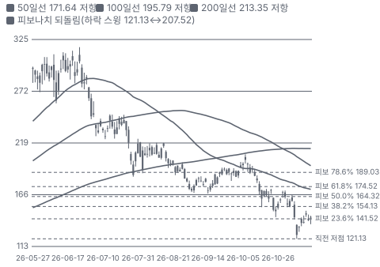

**주봉**

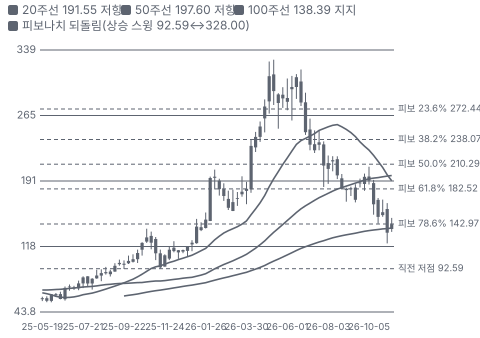

**월봉**

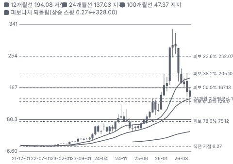

**분기 매출·EPS 실적과 컨센서스**

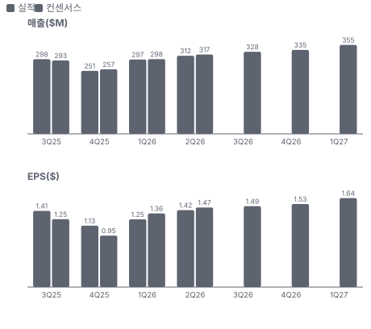

**3Q26 매출 — 지표 추세 vs 가이던스·컨센서스**

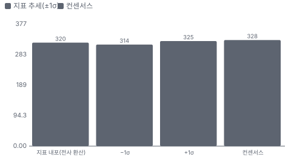

**최근 4개 분기 주가 변화 분석**

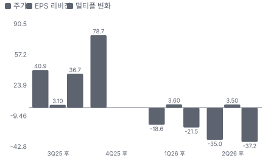

**EPS 리비전**

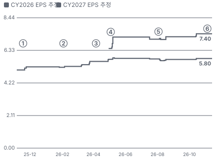

① 25-11-18 FY25 4분기 실적 — 다음 날 −11.3% · EPS 리비전 -
② 26-02-03 FY26 1분기 — 수주 \$439M·GPM 28.4%, 다음 날 +16.3% · EPS 리비전 -
③ 26-04-06 3:1 주식 분할 시행 · EPS 리비전 -
④ 26-05-04 FY26 2분기 — 데이터센터 \$400M+ 메가 수주 공개 · EPS 리비전 +11%
⑤ 26-08-03 FY26 3분기 — 수주 사상 최대 \$934M·잔고 \$2.4B · EPS 리비전 +2%
⑥ 26-11-04 전기 장비 업종 동반 급락 · EPS 리비전 +0%

**멀티플 프리미엄(Fwd 1Y P/E, 최근 4개 분기말)**

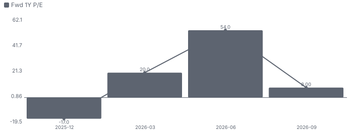

**합리적 멀티플**

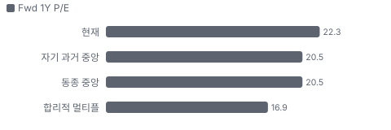

**밸류에이션 주가 시나리오**

**주가별 업사이드**

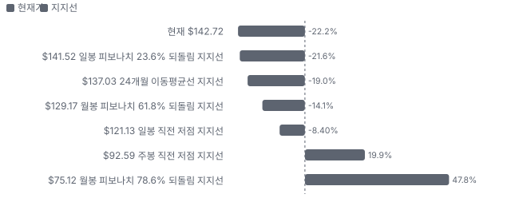
- 제품·서비스 포트폴리오

**고객 믹스(3Q26, 매출 대비)**

**공급 병목(10점, 낮을수록 병목)**

**생산능력 현재와 확충 계획(공장 면적(sq ft))**

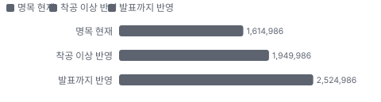

**CAPEX의 매출 대비 비중**

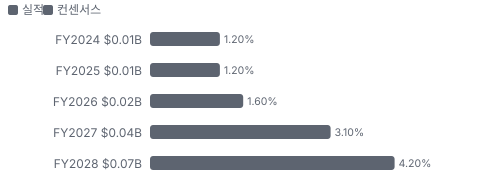

**어닝콜 변화별 주주가치 영향**

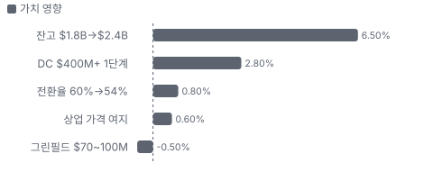

**수주·파이프라인 확실성 사다리**

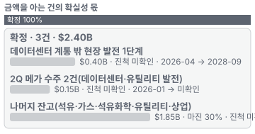

**매출 → 매출총이익 → 영업이익(매출 = 100, 최근 4분기)**

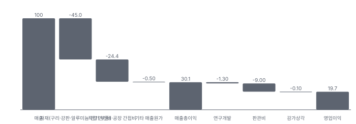

**분기 비용 비중 추이(매출 대비, 공시)**

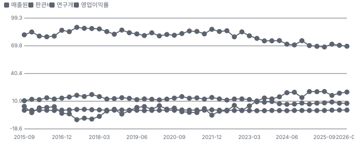

**비용 요인별 매출 대비 비중 1년 변화**

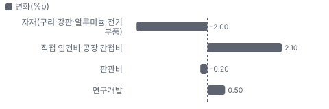

**상업·기타 산업 BOM 원가 몫**

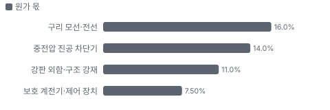

**전력 유틸리티 BOM 원가 몫**

**석유·가스 BOM 원가 몫**

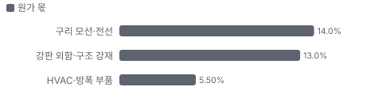

**BOM 항목 가격 +10% 시 OPM 변화**

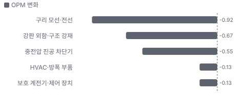

**원가 물가 vs 판매가 물가 — 1년 변화(원가가 판매가보다 더 오르면 단가를 올리지 못하는 만큼 마진이 줄어든다): 원가가 판매가 쪽 물가보다 15.5%p 더 올라 단가 인상이 따라가지 못하면 마진 압박**

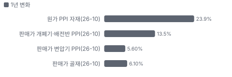

**사업별 매출 vs 물가 — 전년 대비(명목 매출 · 비교 물가 · 실질 = 물량·믹스)**

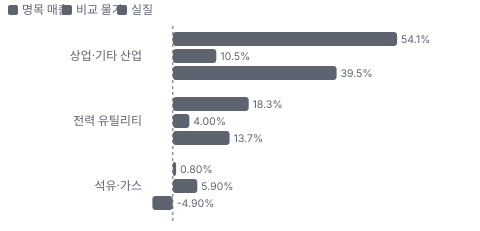

**자산 구성 — 2Q26 분기말 투하자본 \$69.6M**

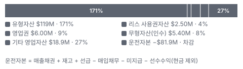

**자산별 변화율 — 최근 12개 분기(3Q23 = 0%) + 다음 4개 분기 추정**

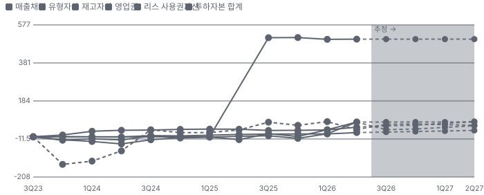

**ROIC 추이 — TTM, 최근 12개 분기 + 다음 4개 분기 추정(컨센서스 NOPAT) · 투하자본이 매출의 5%보다 작은 분기는 비율이 수천 %로 튀어 비움**

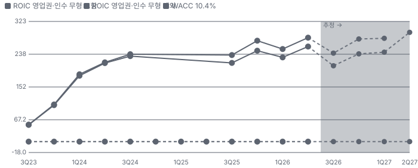

**분기 감가 비율 연율(유형자산 총액 대비)**

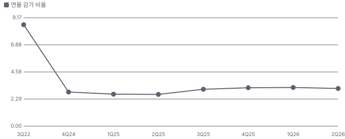

**생산시설별 면적(sq ft, 큰 순) — 생산능력 미공시라 면적을 대용으로**

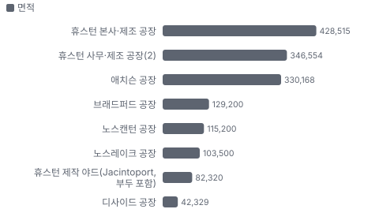

**매출 — 최근 16개 분기 + 다음 분기 추정(아래 지표들과 같은 분기)**

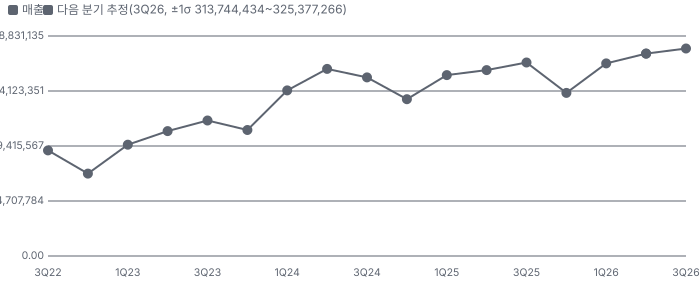

**한국 개폐기·배전반 PPI PPI(지수) — 16개 분기 범위 106.3~111.1(+4.6%)**

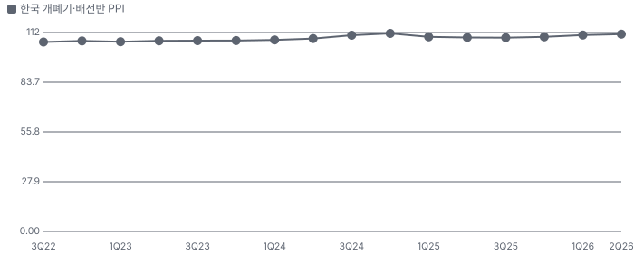

**미국 HS 853720 수입(개폐기·배전반과 같은 4자리 품목군) 수출입(금액) — 16개 분기 범위 118,310,068.0~670,220,162.0(+466.5%)**

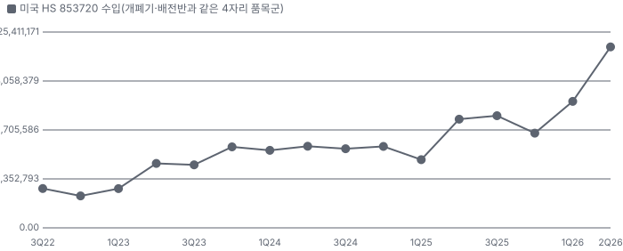

**10년 P·Q 사이클 — 추세(HP 필터) 대비 갭과 8분기 전망**

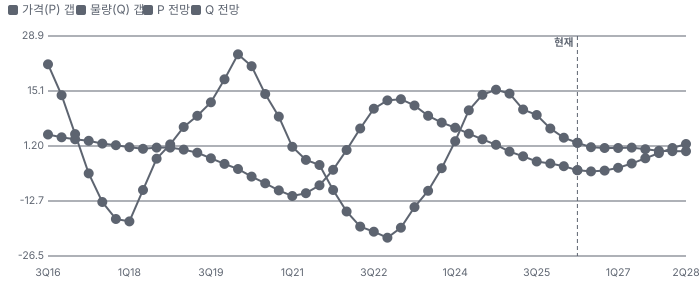

**매출 증가율의 가격·물량 분해와 8분기 전망(전년 대비)**

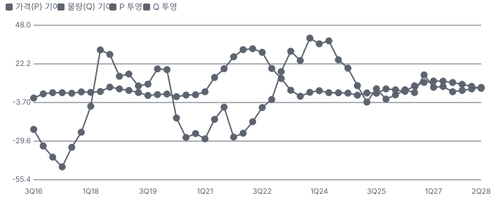

**분기별 매출 증가율 분해**

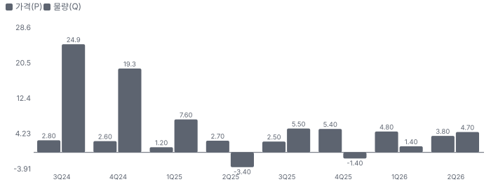

**목표주가 산정 — 기본과 강세 사이(강세 쪽 9%), 도달 확률 약 44%**

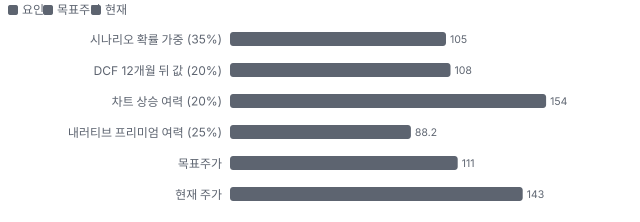

**일봉 지지·저항과 목표주가**

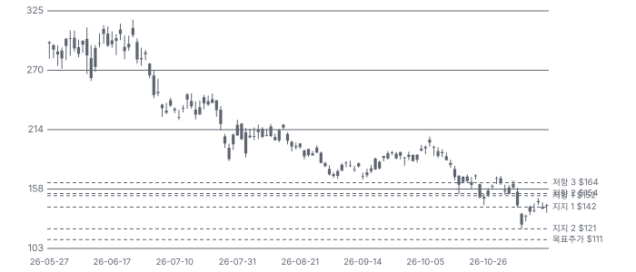

**커뮤니티 언급 수(최근 30일, 채널별)**

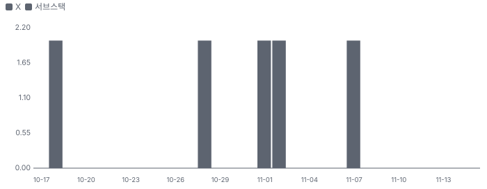

**재고 일수 — 분기별(수주 자료가 없어 수주/출하 비율 없음)**

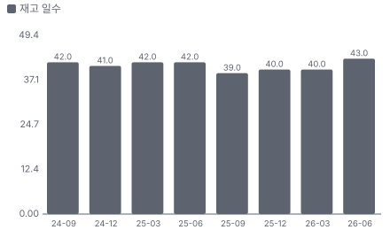

**일별 거래량 분해**

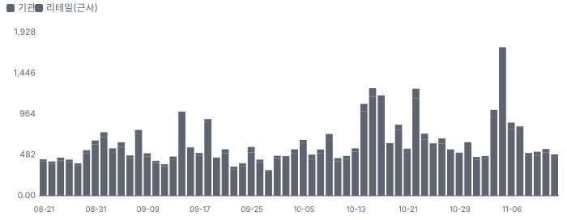

**기관 자금 흐름**

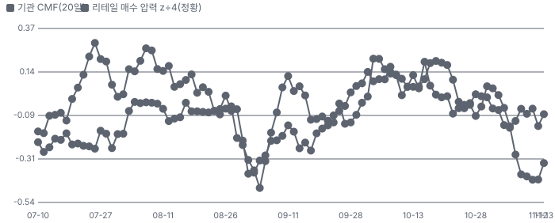

**몬테카를로**

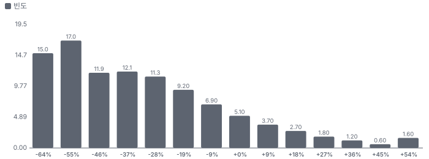

해석: 3,000번 중 413번(14%)에서 가치가 지금 주가 이상이었다. 가정을 흔들어도 지금 주가를 뒷받침하지 못하는 경우가 더 많다. 가운데 값은 0.63배이고, 열 번 중 여덟 번은 0.38~1.07배 사이에 든다.

## 내러티브

> **기업가치를 결정하는 이야기:** 이 회사는 석유·가스·유틸리티·데이터센터 현장에 놓을 배전반·전기실을 주문마다 설계해 만든다. 잔고는 매출의 2배이고 차입이 없다. 성장 속도는 공장 면적이 정하고, 배수는 데이터센터 수주가 이어지느냐가 정한다.

> **멀티플·EPS 프리미엄**
> **멀티플:** Fwd 1Y P/E 22.3배로 동종 중앙값(Eaton·Hubbell·nVent·Vertiv) 20.5배보다 약 9% 높다. 5월 49배에서 절반 아래로 내려왔다.
> **EPS:** 다음 4개 분기 EPS 컨센서스 \$6.40은 TTM \$5.21보다 23% 많다. FY27 EPS는 3Q 콜 뒤 \$6.69 → \$6.87로 소폭 상향.

### 투자자들은 왜 열광했나

2026년 상반기 투자자들은 \$400M 이상 데이터센터 단일 수주와 3배로 뛴 분기 수주에 열광했다 — Fwd 1Y P/E가 49배까지 올랐다. 식은 이유는 회사 숫자가 아니라 업종이다: 데이터센터 파이프라인 신뢰도 논쟁, 선거 뒤 인허가 반발, 11월 초 전기 장비 업종 동반 매도. 매출 성장률이 +9%에 머문 것도 '잔고는 큰데 매출이 안 따라온다'는 실망을 키웠다.

### 무엇이 기업가치를 바꾸나

> **구조적 체질 변화**
> **변화:** 석유·가스 중심에서 유틸리티·데이터센터로 고객이 넓어졌다
> **증거:** 잔고 구성: 석유·가스·석유화학 30%·유틸리티 24%·상업·기타 40%(3Q 콜)
> **반증:** 상업·기타 잔고 비중이 30% 아래로 되돌아간다

> **고부가 믹스 확장**
> **변화:** 주문 설계 E-House(전력 설비를 미리 넣어 만든 이동식 전기실)·중전압 배전반 비중이 올라 GPM이 두 배가 됐다
> **증거:** GPM FY22 15.4% → 3Q26 30.6%
> **반증:** GPM 27% 아래

> **기술 혁신**
> **변화:** 해당 없음(이유: 새 기술보다 기존 중전압 장비의 설계·실행력이 경쟁 축 — 800V DC(직류)·고체 변압기 전환은 2028년 이후로 업계가 본다)
> **증거:** IB 업계 행사 메모(800V DC는 단계 도입)
> **반증:** 데이터센터 고객이 중전압 교류 배전 대신 고체 변압기 직류 구조로 조기 전환

> **실행 속도**
> **변화:** 대형 건은 수주에서 인식까지 2~2.5년, 일반 잔고는 1~3년 **납품 리드타임 12~36개월.** 피어 비교 미확인. 이전 대비 미확인.
> **증거:** 3Q 콜
> **반증:** 12개월 전환율이 다시 60%를 넘는다

> **M&A**
> **변화:** 해당 없음(Remsdaq 소형 인수 1건뿐 — 경영진은 업계 가치가 높아 신중)
> **증거:** 3Q 콜
> **반증:** -

> **정책·입법 연관성**
> **재정정책:** 해당 없음(이 회사 매출에 직접 걸린 세출·세액공제 확인 안 됨) - 반증: - 의회 동의 2/10 — 하원 1/5(관련 세출 논의 확인 안 됨) · 상원 1/5(같음).
> **행정명령:** 대통령 각서 — 에너지부가 국내 전력망 장비 제조 캐파 확대에 절차 단축·연방 자금 투입 2Q FY26 콜(CEO 언급) — 자금 수령·대상 기업 확인 안 됨 반증: Powell 앞 지원 계약이 1년 안에 나오지 않는다 의회 동의 2/10 — 하원 1/5(행정부 각서 — 의회 세출 반영 확인 안 됨) · 상원 1/5(같음).
> **연관입법:** 인허가 개혁(송전·파이프라인)은 양당 논의 중 — 통과 전에는 영향 없음 중간선거 영향 계산(전력망 채널) 반증: -

> **고객의 지출 예산**
> **변화:** 고객 돈은 거의 모두 CAPEX — 발전소·LNG(액화천연가스) 플랜트·변전소·데이터센터 건설비에서 나온다
> **사업별 예산:** **매출의 40%**: 석유·가스·석유화학 — 고객 CAPEX(LNG·파이프라인·정유·석유화학 플랜트 건설비) · 동인: 미국 LNG 수출 설비 증설
**매출의 28%**: 전력 유틸리티 — 고객 CAPEX(변전소·발전소 투자(요금 기반)) · 동인: 부하 증가·노후 설비 교체
**매출의 24%**: 상업·기타 산업(데이터센터 포함) — 고객 CAPEX(데이터센터 건설·현장 발전 설비비) · 동인: AI 데이터센터 전력 수요·계통 연결 지연
> **증거:** 10-K 사업 설명·3Q 콜
> **반증:** 하이퍼스케일러 2027 CAPEX 하향

### 내러티브 근거

> '데이터센터 전력 장비 수혜주'라는 이야기는 수주로 증명됐지만, 시장은 그 이야기에 붙였던 배수를 걷어 냈다(5/11 종가 고점 \$322.05 대비 −56%, 실적 하루 전). 지금 가격은 잔고가 이익이 되는 속도를 묻는다. 동종 대비 멀티플 차이 +9% 중 회사 고유 몫은 +32%다. 단계는 붕괴, 쏠림은 보통(공매도 유통 주식의 11.9%, 리테일 언급 거의 없음, 13F 보유 404곳 중 증가 146·감소 144)이다.

> **데이터센터 전력 설비 수주** · 약화
> **논리:** 하이퍼스케일·계통 밖 발전 데이터센터가 중전압 배전반·E-House를 대량 발주한다
> **숫자:** 3Q 수주 \$934M(전년 약 3배), \$400M+ 단일 건, 상업·기타 잔고 비중 40% — 그런데 이 이야기에 붙던 Fwd 1Y P/E는 5월 49배 → 22.3배
> **반증:** 4Q 수주가 \$300M 아래로 떨어지고 데이터센터 2단계 발주 언급이 없다
> **출처:** 3Q 콜

> **전력 유틸리티 투자 사이클** · 유지
> **논리:** 유틸리티 변전소 투자가 늘고 공급이 모자라 배전반 납기·가격이 받쳐진다
> **숫자:** 유틸리티 매출 3Q26 \$88.6M(전년 +18%), 잔고 비중 24%
> **반증:** 유틸리티 매출이 2개 분기 연속 전년 대비 감소
> **출처:** 10-Q·3Q 콜

> **마진 체질 변화** · 유지
> **논리:** 주문 설계 믹스와 가격으로 GPM이 15%대에서 30%대로 올라섰다
> **숫자:** GPM FY22 15.4% → 3Q26 30.6%, 영업이익률 TTM 19.7%
> **반증:** GPM 27% 아래로 2개 분기
> **출처:** 손익

> **순현금 버퍼** · 강화
> **논리:** 선수금이 쌓여 현금이 시가총액의 12%다 — 하방을 받친다
> **숫자:** 현금 \$634M·차입 0, 3Q 영업현금 \$100M
> **반증:** 선수금 감소로 현금이 2개 분기 연속 감소
> **출처:** 10-Q

> **반대: AI 데이터센터 배수 되돌림** · 강화
> **논리:** 데이터센터 파이프라인 신뢰도(발표 물량의 약 34%)와 선거 뒤 인허가 반발로 '시간 대 전력' 종목 배수가 업종째 깎인다
> **숫자:** Fwd 1Y P/E 5월 49배 → 22.3배, 11/4~5 이틀 −23%(업종 동반)
> **반증:** 4Q 실적 뒤 동종(Vertiv·Eaton) Fwd 1Y P/E가 다시 25배 위로
> **출처:** 배수 이력·IB 업종 자료

> **반대: 캐파 증설과 가격 경쟁** · 유지
> **논리:** 대형 경쟁사와 Powell 모두 공장을 늘려 2028년 무렵 산업 부문 가격이 먼저 꺾인다
> **숫자:** Powell FY26 시설 +20%·그린필드 \$70~100M, 산업 부문은 '가격 민감'(CEO)
> **반증:** FY27 GPM이 30% 위를 유지
> **출처:** 3Q 콜

## 포트폴리오

| 제품·서비스 | 구분 | 무엇 | 쓰는 곳 | 돈 버는 방식 | Mix | Mix 변화(전년 대비) |
|---|---|---|---|---|---|---|
| 석유·가스 | 제품 | LNG·해상·정유 현장용 E-House·전력 제어실·모터 제어반 | 위험 지역 플랜트의 전력 분배·제어 | 프로젝트 수주. 3Q 매출 \$106.3M(전년 +1%) | 34% | -2.7%p |
| 석유화학 | 제품 | 석유화학 플랜트 배전반·E-House | 공정 설비 전력 분배 | 프로젝트 수주. 3Q 매출 \$18.5M(전년 −49%) | 6% | -6.8%p |
| 전력 유틸리티 | 제품 | 변전소용 중전압 배전반·통합 전력 제어실 | 유틸리티 변전소·발전소 연결 | 프로젝트 수주. 3Q 매출 \$88.6M(전년 +18%) | 28% | +2.3%p |
| 상업·기타 산업 | 제품 | 데이터센터·상업 시설용 중전압 배전반·E-House | 데이터센터 전력 분배·현장 발전 연결 | 프로젝트 수주. 3Q 매출 \$76.3M(전년 +54%) | 24% | +7.2%p |
| 경전철·기타 | 서비스 | 경전철 견인 전력 설비·현장 서비스·예비 부품 | 철도 전력·설치 기반 유지보수 | 3Q 매출 \$22.1M | 7% | +0.1%p |

**Mix 변화가 가장 큰 쪽은 상업·기타 산업(+7.2%p, 전년 대비).** 계절성 판정: 분기 매출 계절 지수 기준 있음 → 전년 같은 분기와 비교.

## 고객

> **3Q26 최대 고객 데이터센터 메가 프로젝트 고객(이름 미공시, mega data center order) 9%, 상위 3곳 9%, 집중도 분산.** 공시·회사 발표로 확인한 몫은 매출의 0%이고, 나머지 고객 몫은 추정이거나 미분해다. FY25·FY24 모두 매출 10%를 넘는 고객이 없다(10-K). 다만 \$400M 이상 데이터센터 1건이 잔고의 17% 이상이라 앞으로는 집중도가 오른다. 고객 이름은 공시하지 않는다.

**고객별 매출 몫(3Q26)**
| 고객 | 몫 | 변화 | 근거 |
|---|---|---|---|
| 데이터센터 메가 프로젝트 고객(이름 미공시, mega data center order) | 6~12% | +9%p | 추정 |
| 상위 고객(10% 초과 없음, no single customer >10%) | 미확인 | 미확인 | 공시 |
| 기타·미분해 | 91% | - | - |

> **데이터센터 메가 프로젝트 고객(이름 미공시, mega data center order)** · 추정
> **사는 것:** 계통 밖 현장 발전용 전력 설비 1단계
> **추정 근거:** 잔고의 17% 이상 — 연 매출의 약 10% 안팎이 한 고객에서

> **상위 고객(10% 초과 없음, no single customer >10%)** · 공시
> **사는 것:** LNG·석유화학·유틸리티 프로젝트
> **추정 근거:** FY25 10-K

## 수주·파이프라인

> **2026-06-30 기준 3건.** 확정 \$2.40B. 공시 수주잔고 \$2.40B.

**수주 목록**
| 상태 | 계약 | 계약 총액 | 진척 | 기간 | 비고 |
|---|---|---|---|---|---|
| 확정 | 데이터센터 계통 밖 현장 발전 1단계 | \$0.40B | 비공개 | 2026-04 → 2028-09 | - |
| 확정 | 2Q 메가 수주 2건(데이터센터·유틸리티 발전) | \$0.15B | 비공개 | 2026-01 → 미확인 | - |
| 확정 | 나머지 잔고(석유·가스·석유화학·유틸리티·상업) | \$1.85B | 비공개 | 2026-06 → 2028 | - |

**실행 속도와 방해 요인**
| 항목 | 상태 | 실행 속도 | 방해 요인 |
|---|---|---|---|
| 데이터센터 계통 밖 현장 발전 1단계 | 확정 | 2~2.5년 인식, 5개 이상 공장 분산 | 후속 단계 미확정 · 고객 현장 일정 |
| 2Q 메가 수주 2건(데이터센터·유틸리티 발전) | 확정 | 미확인 | 미확인 |
| 나머지 잔고(석유·가스·석유화학·유틸리티·상업) | 확정 | 12개월 인식 비중 높음 | 석유화학 수요 둔화 · 부품 지연 |

## 마진 구조

> **GPM 30.6%, OPM 20.6%.** 3Q25 대비 GPM -0.1%p, OPM -0.4%p. 변동비는 매출의 61%이고, 매출이 10% 늘면 OPM은 +1.7%p 움직인다. 3Q26 매출원가는 매출의 69.4%로 1년 전 69.3%와 같다. 원가의 가장 큰 몫은 자재(구리·강판·알루미늄·전기 부품, FY25 매출의 45%)다. 고정가 계약이 많아 구리값이 급등하면 진행 중 계약에서는 전가가 늦다. 프로젝트 정산 효과가 연초 이후 GPM에 약 1%p 기여했다(전년 1.3%p, 3Q 콜).

> **매출 100 중 매출원가 69.9, 매출총이익 30.1(최근 4분기, 공시).** 매출원가 요인 중 자재(구리·강판·알루미늄·전기 부품)이 매출의 45.0%로 가장 무겁고, 단가가 +10% 오르면 GPM이 -4.50%p 움직인다. 분기 회귀로 매출 1이 늘 때 매출원가는 0.61 늘고, 매출원가의 고정비 몫은 21%다.

**비용 요인 강도 — 비중·추세·충격(+10%)·탄력**
| 비용 | 구분 | 매출 대비 | 1년 변화 | 마진 기여 | 충격 시 마진 | 매출 탄력 | 고정비 몫 |
|---|---|---|---|---|---|---|---|
| 자재(구리·강판·알루미늄·전기 부품) | 매출원가 요인 | 45.0% | -2.0%p | +2.0%p | -4.50%p | 미확인 | 0% |
| 직접 인건비·공장 간접비 | 매출원가 요인 | 24.4% | +2.1%p | -2.1%p | -2.44%p | 미확인 | 45% |
| 매출원가 | 공시 항목 | 69.9% | -1.3%p | +1.3%p | -6.99%p | 0.61 | 21% |
| 판관비 | 공시 항목 | 9.0% | +0.7%p | -0.7%p | 미확인 | 0.04 | 61% |
| 연구개발 | 공시 항목 | 1.3% | +0.3%p | -0.3%p | 미확인 | 0.01 | 30% |
| 감가상각 | 공시 항목 | 0.1% | 미확인 | 미확인 | 미확인 | 0.00 | -30% |

매출 탄력 = 분기 비용을 매출에 회귀한 기울기(매출 1당 변동비), 고정비 몫 = 절편 ÷ 평균 비용. 표본이 8분기 미만이면 미확인. 매출원가 요인 비중은 margin 재료의 추정이 섞여 있고, 공시 매출원가와의 차이는 '기타 매출원가'로 둔다.

**GPM에서 OPM까지(GAAP, 아래는 최근 4개 분기)**
| 기간 | GPM | 연구개발 | 판관비 | 기타 | OPM |
|---|---|---|---|---|---|
| 3Q25 | 30.7% | 0.9% | 8.8% | 0.0% | 21.0% |
| 3Q26 | 30.6% | 1.4% | 8.6% | 0.0% | 20.6% |
| 2025-09 | 31.4% | - | - | - | 21.2% |
| 2025-12 | 28.4% | - | - | - | 17.0% |
| 2026-03 | 29.6% | - | - | - | 19.4% |
| 2026-06 | 30.6% | - | - | - | 20.6% |

**비용을 움직이는 요인**
| 비용 | 요인 |
|---|---|
| 자재(구리·강판·알루미늄·전기 부품, 매출원가) | 구리·강판 가격, 부품 조달 단가 · 근거 공시 |
| 직접 인건비·공장 간접비(매출원가) | 용접·조립·시험 인력 임금과 공장 가동률 · 근거 추정 |
| 판관비(판관비) | 인력·IT(정보기술)·영업 · 근거 공시 |
| 연구개발(연구개발) | 차단기·디지털 감시 제품 · 근거 공시 |

**상업·기타 산업 BOM — 매출의 24%, GPM 31%(세그먼트 이익 미공시 — 전사 3Q26 GPM 30.6%(10-Q)를 대입한 추정), 항목 가격 +10% 시**
| 항목 | 원가 몫 | 전가 | 제품 GPM | OPM |
|---|---|---|---|---|
| 구리 모선·전선 | 12~20% | 미확인 | -1.1%p | -0.27%p |
| 중전압 진공 차단기 | 10~18% | 미확인 | -1.0%p | -0.24%p |
| 강판 외함·구조 강재 | 8~14% | 미확인 | -0.8%p | -0.19%p |
| 보호 계전기·제어 장치 | 5~10% | 미확인 | -0.5%p | -0.13%p |
| 미분해 | 51% | - | - | - |

**전력 유틸리티 BOM — 매출의 28%, GPM 31%(세그먼트 이익 미공시 — 전사 3Q26 GPM 30.6%(10-Q)를 대입한 추정), 항목 가격 +10% 시**
| 항목 | 원가 몫 | 전가 | 제품 GPM | OPM |
|---|---|---|---|---|
| 구리 모선·전선 | 12~20% | 미확인 | -1.1%p | -0.32%p |
| 중전압 진공 차단기 | 12~20% | 미확인 | -1.1%p | -0.32%p |
| 강판 외함·구조 강재 | 6~12% | 미확인 | -0.6%p | -0.18%p |
| 미분해 | 59% | - | - | - |

**석유·가스 BOM — 매출의 34%, GPM 31%(세그먼트 이익 미공시 — 전사 3Q26 GPM 30.6%(10-Q)를 대입한 추정), 항목 가격 +10% 시**
| 항목 | 원가 몫 | 전가 | 제품 GPM | OPM |
|---|---|---|---|---|
| 구리 모선·전선 | 10~18% | 미확인 | -1.0%p | -0.33%p |
| 강판 외함·구조 강재 | 10~16% | 미확인 | -0.9%p | -0.31%p |
| HVAC(공조 설비)·방폭 부품 | 3~8% | 미확인 | -0.4%p | -0.13%p |
| 미분해 | 68% | - | - | - |

구리 모선·전선 가격이 +10% 오르면 영업이익은 -4.5% 움직인다. 판매가 전가를 모르는 항목은 전가 0%로 계산했다.

**BOM 항목 가격을 움직이는 것**
| 항목 | 요인 |
|---|---|
| 구리 모선·전선 | 배전반 모선과 E-House 배선의 핵심 원가 · 근거 추정 |
| 강판 외함·구조 강재 | E-House 외함·스키드 · 근거 추정 |
| 중전압 진공 차단기 | 배전반의 핵심 부품 — 내재화 · 근거 추정 |
| 보호 계전기·제어 장치 | 외부 구매 엔지니어링 부품 · 근거 추정 |
| 구리 모선·전선 | 변전소 배전반 · 근거 추정 |
| 중전압 진공 차단기 | 유틸리티 변전소 핵심 부품 · 근거 추정 |
| 강판 외함·구조 강재 | 외함 · 근거 추정 |
| 강판 외함·구조 강재 | LNG·해상용 E-House는 구조 강재 비중이 크다 · 근거 추정 |
| 구리 모선·전선 | 모터 제어반·배전반 · 근거 추정 |
| HVAC·방폭 부품 | 위험 지역 E-House 공조 · 근거 추정 |

> **원가·판매가 물가 격차 -15.5%p** — 판매가 물가가 투입 원가 물가보다 느리게 오른다.

**투입 물가 — 미국 PPI 3·6·12개월(2026-10, 개정 반영)과 해외 전년비**
| 항목 | 미국 3개월 | 6개월 | 12개월 | 전가 못 할 때 OPM | 일본 | 한국 | 대만 |
|---|---|---|---|---|---|---|---|
| 구리 모선·전선 | +3.4% | +7.2% | +23.9% | - | +42.6% | +25.8% | +40.1% |
| 강판 외함·구조 강재 | +6.7% | +17.0% | +32.9%* | - | 미확인 | 미확인 | 미확인 |

별표는 품목보다 넓은 업종 지수다. 연결한 투입 원가의 미국 PPI는 1년 새 가중 +23.9%이고, 판매가로 넘기지 못하면 GPM -10.7%p·OPM -10.7%p가 움직인다. 판매가 비교 물가(개폐기·배전반 PPI)는 1년 새 +13.5% — 회사 가격 변화는 미확인. 물가 지수를 붙이지 못한 매출원가 항목은 직접 인건비·공장 간접비다(미연결). 상업·기타 산업 매출은 2026-06 전년 대비 +54.1%이고 비교 물가 ppi:switchgear의 변화 +10.5%(2026-06)를 빼면 실질 +39.5% — 물량·믹스가 성장을 이끌었다. 전력 유틸리티 매출은 2026-06 전년 대비 +18.3%이고 비교 물가 ppi:transformer의 변화 +4.0%(2026-06)를 빼면 실질 +13.7% — 물량·믹스가 성장을 이끌었다. 석유·가스 매출은 2026-06 전년 대비 +0.8%이고 비교 물가 ppi:aggregate의 변화 +5.9%(2026-06)를 빼면 실질 -4.9% — 성장 대부분이 가격(물가)이다.

## 자산 구성

> **2Q26 분기말 투하자본 \$69.6M** — 유형자산 171%, 기타 영업자산 27%. 최근 12개 분기(3Q23 → 2Q26) 가장 크게 늘어난 자산은 영업권(+503%), 투하자본 합계 +37%. 2Q27 추정 투하자본 \$80.9M(+16%, 컨센서스 매출과 회전 일수·CAPEX 강도 유지 가정). 연율 감가 비율(총액 기준)은 직전 4분기 3.44% → 최근 4분기 3.21%, 직전 비율이면 감가상각이 \$0.6M 더 컸다(영업이익의 0.3%).

**자산·운전자본 항목별 분기말 잔액 — 최근 12개 분기와 다음 4개 분기 추정**
| 항목 | 3Q23 | 2Q25 | 2Q26(최근) | 2Q27 추정 | 12개 분기 변화 | 다음 4개 분기 변화 |
|---|---|---|---|---|---|---|
| 매출채권 | \$206.6M | \$211.6M | \$362.4M | \$323.4M | +75% | -11% |
| 재고자산 | \$63.9M | \$88.5M | \$95.4M | \$114.1M | +49% | +20% |
| 선급·기타 유동자산 | \$5.4M | \$7.2M | \$13.2M | \$16.8M | +144% | +28% |
| 매입채무 | \$56.7M | \$66.2M | \$86.6M | \$88.9M | +53% | +3% |
| 선수수익(계약부채) | \$279.8M | \$299.5M | \$466.4M | \$446.2M | +67% | -4% |
| 유형자산 | \$97.6M | \$109.4M | \$118.6M | \$129.6M | +22% | +9% |
| 리스 사용권자산 | \$1.4M | \$1.2M | \$2.5M | \$2.5M | +76% | +0% |
| 영업권 | \$1.0M | 미확인 | \$6.0M | \$6.0M | +503% | +0% |
| 무형자산(인수) | 미확인 | 미확인 | \$5.4M | \$4.6M | 비교 불가 | -14% |

**자산 추정 동인 — 최근 4개 분기 평균(재무상태표 동인 모형)**
| 동인 | 값 | 곱하는 기준 |
|---|---|---|
| 매출채권 | 79일 | 매출 |
| 재고자산 | 40일 | 매출원가 |
| 선급·기타 유동자산 | 4일 | 매출 |
| 매입채무 | 31일 | 매출원가 |
| 선수수익(계약부채) | 109일 | 매출 |
| CAPEX 강도 | 1.1% | 매출(최근 4개 분기 합) |
| 분기 감가율 | 1.75% | 기초 유형자산 순액(무형 상각 제외 감가상각) |
| 매출원가율 | 69.9% | 매출(최근 4개 분기) |
| 영업권·리스 사용권·기타 | 유지 | 인수·새 리스는 공시 전 모름 |
| 인수 무형자산 | 분기 \$0.2M 상각 | 최근 4개 분기 평균 상각 |

**추정 방법:** 증권사 3표 모델(손익·재무상태표·현금흐름)의 재무상태표 동인 방식이다. 운전자본은 항목별 회전 일수(매출채권·선급·미지급·선수는 매출, 재고·매입채무는 매출원가 기준)를 최근 4개 분기 평균으로 두고 컨센서스 매출에 곱한다. 유형자산은 기초 + CAPEX − 감가상각으로 굴린다(Koller·Goedhart·Wessels 『Valuation』 재무상태표 추정). 매출 경로는 ROIC 절의 컨센서스와 같다.

**유형·무형자산 항목별 가치(2025-09-30 vs 2024-09-30)**
| 구분 | 항목 | 총액 2025-09-30 | 누적상각 | 순액 | 총액 2024-09-30 | 총액 1년 변화 | 공시 내용연수 |
|---|---|---|---|---|---|---|---|
| 유형 | 유형자산 합계(항목 미분해) | \$262.9M | 총계만 공시 | 총계만 공시 | \$252.3M | +4.2% | 미확인 |
| 영업권 | 영업권 | \$6.1M | \$0.0M | \$6.1M | \$1.0M | +510.7% | 비상각 |
| 무형 | 무형자산 합계(항목 미분해) | \$6.2M | \$0.1M | \$6.1M | \$0.5M | +1150.0% | 미확인 |
| 유형 합계 | 유형자산 | \$262.9M | \$151.8M | \$111.0M | \$252.3M | +4.2% | 경과율 58%(상각 대상 기준) |

**내용연수 산식(상각 대상 유형자산 = 총액 − 토지 − 건설중)**
| 기준일 | 연 감가상각 | 상각 대상 총액 | 평균 내용연수 | 경과 연수 | 잔여 연수 | 경과율 |
|---|---|---|---|---|---|---|
| 2025-09-30 | \$7.2M | \$262.9M | 36.5년 | 21.1년 | 15.4년 | 58% |
| 2024-09-30 | \$6.9M | \$252.3M | 36.6년 | 21.6년 | 15.0년 | 59% |

산식 평균 내용연수는 36.5년. 1년 전 36.6년 → 지금 36.5년.

**분기 감가 비율(감가상각 ÷ 평균 유형자산 총액)**
| 분기 | 감가상각 | 평균 유형자산(총액) | 분기 비율 | 연율 | 연율의 역수 |
|---|---|---|---|---|---|
| 3Q22 | \$2.2M | \$100.3M | 2.15% | 8.58% | 11.7년 |
| 4Q24 | \$1.8M | \$243.0M | 0.72% | 2.89% | 34.6년 |
| 1Q25 | \$1.7M | \$253.2M | 0.68% | 2.71% | 36.8년 |
| 2Q25 | \$1.7M | \$259.3M | 0.67% | 2.69% | 37.2년 |
| 3Q25 | \$2.0M | \$262.9M | 0.78% | 3.12% | 32.1년 |
| 4Q25 | \$2.1M | \$264.5M | 0.81% | 3.25% | 30.8년 |
| 1Q26 | \$2.2M | \$266.7M | 0.82% | 3.27% | 30.6년 |
| 2Q26 | \$2.2M | \$271.4M | 0.80% | 3.19% | 31.3년 |

감가상각 기준: 손익계산서 감가상각·상각비(SEC 공시 데이터, 4분기 = 연간 − 1~3분기).

최근 4분기 연율 감가 비율 3.21%, 직전 4분기 3.44%(-7%) — 경고 문턱(-10%) 안이다.

미공시·미분해: 유형자산 항목별 총액·내용연수(10-K 주석에서 모델이 채움) · 무형자산 항목(10-K 주석에서 모델이 채움) — 이 칸은 비우고 나머지로 계산했다.

### 해석 — 자산이 어디에 쌓이고 있나

- 같은 기간 4개 분기 매출은 +22% — 매출보다 빨리 늘어난 자산: 매출채권 +75%, 재고자산 +49%, 리스 사용권자산 +76%, 영업권 +503%. 이 자산의 회전율이 떨어지면 ROIC를 희석한다.
- 다음 4개 분기 CAPEX \$14.6M vs 감가상각 \$8.6M(최근 4개 분기 CAPEX 강도·감가율 유지) — 유형자산 2Q26 \$118.6M → 2Q27 \$129.6M. 투자가 감가보다 커서 자산이 쌓이는 국면이다.

## ROIC

> **TTM 2Q26 ROIC는 영업권·인수 무형 포함 257.6%, 제외 280.8%**(NOPAT 마진 15.4% × 투하자본 회전율 16.72회). 최근 12개 분기 3Q23 53.9% → 2Q26 257.6%(고점 2Q26 257.6%). 컨센서스 NOPAT으로 굴리면 2Q27 294.5%(제외 미확인) — WACC 10.4% 대비 +284.1%p.

**ROIC 추이(TTM)와 다음 4개 분기 추정 — NOPAT ÷ 평균 투하자본(이번 분기말·4개 분기 전)**
| 분기 | 구분 | TTM 매출 | TTM NOPAT | NOPAT 마진 | 평균 투하자본 | ROIC 포함 | ROIC 제외 |
|---|---|---|---|---|---|---|---|
| 3Q23 | 실적 | \$699.3M | \$49.0M | 7.0% | \$90.8M | 53.9% | 54.5% |
| 4Q23 | 실적 | \$766.5M | \$68.3M | 8.9% | \$64.9M | 105.2% | 106.9% |
| 1Q24 | 실적 | \$850.1M | \$91.2M | 10.7% | \$50.2M | 181.8% | 185.5% |
| 2Q24 | 실적 | \$945.9M | \$119.1M | 12.6% | \$55.5M | 214.6% | 216.5% |
| 3Q24 | 실적 | \$1,012.4M | \$139.6M | 13.8% | \$60.0M | 232.7% | 237.7% |
| 4Q24 | 실적 | \$1,059.8M | \$147.1M | 13.9% | \$20.1M | 미확인 | 미확인 |
| 1Q25 | 실적 | \$1,083.3M | \$162.3M | 15.0% | \$24.5M | 미확인 | 미확인 |
| 2Q25 | 실적 | \$1,081.4M | \$164.5M | 15.2% | \$41.4M | 미확인 | 미확인 |
| 3Q25 | 실적 | \$1,104.3M | \$170.1M | 15.4% | \$79.1M | 215.0% | 235.5% |
| 4Q25 | 실적 | \$1,114.1M | \$175.9M | 15.8% | \$71.2M | 246.9% | 272.8% |
| 1Q26 | 실적 | \$1,132.1M | \$175.0M | 15.5% | \$76.3M | 229.5% | 251.2% |
| 2Q26 | 실적 | \$1,157.5M | \$178.3M | 15.4% | \$69.2M | 257.6% | 280.8% |
| 3Q26 | 추정 | \$1,187.0M | \$179.1M | 15.1% | \$86.3M | 207.6% | 240.4% |
| 4Q26 | 추정 | \$1,270.9M | \$196.9M | 15.5% | \$82.5M | 238.6% | 277.4% |
| 1Q27 | 추정 | \$1,329.2M | \$210.2M | 15.8% | \$86.5M | 242.9% | 279.1% |
| 2Q27 | 추정 | \$1,392.5M | \$221.6M | 15.9% | \$75.3M | 294.5% | 미확인 |

**다음 4개 분기 NOPAT — 컨센서스(세율 22%, 리스 이자 별도)**
| 분기 | 매출 | EBITA 마진 | EBITA | NOPAT(분기) | 근거 |
|---|---|---|---|---|---|
| 3Q26 | \$327.5M | 19.7% | \$64.4M | \$50.2M | 컨센서스 매출 × EBIT 마진 FY2026 |
| 4Q26 | \$335.0M | 19.7% | \$65.9M | \$51.4M | 컨센서스 매출 × EBIT 마진 FY2026 |
| 1Q27 | \$355.0M | 21.1% | \$74.7M | \$58.3M | 컨센서스 매출 × EBIT 마진 FY2027 |
| 2Q27 | \$375.0M | 21.1% | \$78.9M | \$61.6M | 컨센서스 매출 × EBIT 마진 FY2027 |

**추정 방법:** NOPAT은 컨센서스(분기 매출 추정 × 회계연도 EBIT 마진 추정)로 잡고, 조정(비 GAAP) 마진이면 주식보상 몫을 빼서 과거 실적과 같은 기준(영업이익 + 인수 무형 상각)으로 맞췄다. 이미 발표했지만 분기 보고서(10-Q)가 아직 없는 분기는 발표 실적을 쓴다. 투하자본은 자산 구성 절의 재무상태표 동인으로 굴렸다. ROIC는 4개 분기 NOPAT을 이번 분기말과 4개 분기 전 투하자본의 평균으로 나눈다 — 추정 분기의 ROIC에는 이미 나온 실적 분기가 섞여 있다.

**투하자본 항목별 회전율과 ROIC 기여(TTM 2Q26, 평균 잔액)**
| 항목 | 투하자본 | 매출 1달러당 자본 | 회전율(매출 ÷ 항목) | 자본 몫 | 이 항목을 빼면 ROIC |
|---|---|---|---|---|---|
| 운전자본 | −\$70.1M | -0.06 | 음수(자금 원천) | -101% | 127.6% |
| 유형자산 | \$114.0M | 0.10 | 10.15회 | 165% | 미확인 |
| 리스 사용권자산 | \$1.9M | 0.00 | 617.67회 | 3% | 264.0% |
| 영업권 | \$3.0M | 0.00 | 382.72회 | 4% | 268.6% |
| 무형자산(인수) | \$2.7M | 0.00 | 428.95회 | 4% | 267.2% |
| 기타 영업자산 | \$17.8M | 0.02 | 65.18회 | 26% | 345.5% |

**ROIC 세 가지 판**
| 판 | NOPAT | 투하자본 | ROIC | 무엇을 재나 |
|---|---|---|---|---|
| 영업권·인수 무형 포함 | \$177.8M | \$69.2M | 256.8% | 인수 웃돈까지 낸 돈에 대한 수익률 |
| 영업권·인수 무형 제외 | \$177.8M | \$63.5M | 280.0% | 본업 운영 수익률(동종 비교용) |
| 무형 자본화 조정(판관비 20%·5년, 연구개발 6년) | \$186.1M | \$149.5M | 124.5% | 비용으로 처리한 무형 투자를 자산으로 본 판 |
| 경제적 이익(포함판) | \$170.6M | \$69.2M | 자본비용 10.4% | (ROIC − 자본비용) × 투하자본 |

NOPAT = (영업이익 \$227.7M + 인수 무형 상각 + 리스 내재 이자 \$0.1M) × (1 − 세율 22%). 리스 사용권자산을 투하자본에 넣었으므로 임차료 속 이자 몫을 영업이익에 되더했다. 현금은 영업에 필요한 몫을 따로 알 수 없어 투하자본에서 뺐다. SEC 공시 데이터 자동 초안 — 운전자본 = 매출채권 + 재고 + 선급 − (매입채무 + 미지급비용 + 선수수익), 현금 제외. 손상 누계는 공시 데이터 수록분.

투하자본 또는 NOPAT이 0 이하라 ROIC 분해는 비교 불가 — 경제적 이익으로 본다.

**무형 자본화 가정별 ROIC(2025년 지출 기준, 포함판에 더함)**
| 투자로 보는 몫 | 상각 연수 | 무형 자산 | NOPAT 조정 | 조정 ROIC |
|---|---|---|---|---|
| 판관비 20% | 2년 | \$57.3M | \$6.7M | 145.8% |
| 판관비 20% | 5년 | \$80.2M | \$8.3M | 124.5% |
| 판관비 30% | 2년 | \$71.1M | \$8.1M | 132.5% |
| 판관비 30% | 5년 | \$105.5M | \$10.5M | 107.8% |

### 해석 — 무엇이 수익성을 끌어올리고 희석하나

- 유형자산: 투하자본의 165% — 빼면 ROIC 256.8% → 미확인. 이 자산의 회전율(10.15회)이 수익성을 희석하는 주된 자리다.
- 기타 영업자산: 투하자본의 26% — 빼면 ROIC 256.8% → 345.5%. 이 자산의 회전율(65.18회)이 수익성을 희석하는 주된 자리다.
- 운전자본: −\$70.1M(음수), 고객 선수금·공급사 외상이 자본을 대신 댄다 — 빼면 ROIC 127.6%로 낮아진다. 수익성을 끌어올리는 쪽이다.
- 영업권·인수 무형을 빼면 ROIC가 +23.1%p 오른다 — 과거 인수에 치른 웃돈이 주주 수익률을 그만큼 낮춘다(본업 수익률은 제외판, 인수까지 포함한 가치 창출은 포함판으로 본다).
- 비용으로 처리한 무형 투자를 자산으로 보면 ROIC가 -132.3%p 움직인다(무형 자산 \$80.2M). 투자를 늘리는 중이라 NOPAT이 더 커지는 쪽이다.
- 추정 경로 2Q26 257.6% → 2Q27 294.5%: NOPAT 마진 +0.5%p, 투하자본 회전율 +1.78회 — 컨센서스 매출·마진이 맞고 회전 일수·CAPEX 강도가 유지된다는 가정이다. 마진 추정이 내려가거나 재고 일수가 늘면 이 경로가 먼저 틀린다.
- ROIC(포함) − WACC = +247.2%p(2Q26) — 양수면 투하자본을 늘릴수록 가치가 쌓인다.

## 공급망 병목

> **공급망 신뢰성 3.3/10, 병목 심각.** 가장 약한 고리는 공장 면적·숙련 제작 인력 3.3점이고, 품목 평균은 3.3점이다. 근거가 부족한 2건(구리 모선·전선 · 엔지니어링 전기 부품(계전기·제어 장치))은 점수에서 뺐다. 병목은 부품보다 공장 면적과 숙련 인력이다. 자재(구리·강판)는 여러 공급처에서 사지만 가격 변동이 크고, 엔지니어링 전기 부품 일부는 공급 지연이 이어진다(10-K).

**병목과 마진 — 품목 가격 +10% 시 OPM**
| 품목 | 점수 | 판정 | 구분 | OPM |
|---|---|---|---|---|
| 공장 면적·숙련 제작 인력(필수) | 3.3 | 병목 심각 | 출하 차질 위험 | 미확인 |

> **공장 면적·숙련 제작 인력** · 3.3/10
> **왜:** 잔고 전환 속도(12개월 54%)를 정하는 것이 캐파다
> **병목 요인:** 인증 공급사 1곳 · 캐파 빠듯 · 리드타임 미확인 · 재인증 미확인 · 1위 점유율 100% · 미국 집중 82% · 물량 확보 내재화
> **풀리는 조건:** 아직 — Jacintoport 확장 FY26 말 완료 예정, 임차 공장 가동 전

**공급사**
| 품목 | 공급사 | 몫 | 근거 |
|---|---|---|---|
| 공장 면적·숙련 제작 인력 | 자체 공장 9곳(소유)·임차 시설(제작·시험) | 미확인 | 공시 |
| 구리 모선·전선 | 미공시(복수 공급처, 구리 원자재·가공품) | 미확인 | 공시 |
| 엔지니어링 전기 부품(계전기·제어 장치) | 미공시(외부 구매 부품) | 미확인 | 공시 |

**무역 통계로 본 공급 지역**
| 품목 | EU 수입처 | 일본 수입처 | EU 1위 전년비 |
|---|---|---|---|
| 구리 모선·전선 | MY(말레이시아) 77% · KR(한국) 11% · VN(베트남) 7% | マレーシア 58% · タイ 36% | 미확인 |
| 엔지니어링 전기 부품(계전기·제어 장치) | CN(중국) 55% · US 25% · JP(일본) 6% | 中華人民共和国 47% · アメリカ合衆国 10% | +33.5% |

## 생산능력

> **현재 명목 캐파 1,614,986 공장 면적(sq ft), 가동률 미확인.** 착공 이상 증설은 335,000 공장 면적(sq ft), 발표까지 합치면 910,000 공장 면적(sq ft)이다. 다 가동하면 지금보다 +56%, 착공 이상만이면 +21%다. FY2025 CAPEX는 \$0.01B로 매출의 1.2%다. 소유 주요 시설 9곳 약 161만 sq ft(FY25 10-K). 생산능력(대·MW(메가와트))은 공시하지 않는다. Jacintoport 33.5만 sq ft 확장(완전 가동 시 연 매출 \$100M+), 임차 공장 30만 sq ft(FY27 2~3분기 가동 목표), 그린필드 \$70~100M 결정 대기.

**생산시설 9곳**(10-K FY2025 Item 2 — 100% 소유 주요 시설 9곳(미국 6·영국 2·캐나다 1). 소규모 임차 시설은 수 미공시), 소유 9곳. 시설별 생산능력은 공개되지 않았다 — 회사 전체 캐파만 위에 적었다.

**생산시설 9곳 — 명칭·위치·생산능력**
| 시설 | 위치 | 용도 | 생산능력 | 소유·상태 |
|---|---|---|---|---|
| 휴스턴 본사·제조 공장 | 미국 텍사스 휴스턴 | 본사·제조 | 미확인 — 면적 428,515 sq ft·21.4에이커 — 생산능력 미공시 · 면적 428,515 sq ft | 소유 · 가동 |
| 휴스턴 사무·제조 공장(2) | 미국 텍사스 휴스턴 | 제조 | 미확인 — 면적 346,554 sq ft·53.4에이커 · 면적 346,554 sq ft | 소유 · 가동 |
| 휴스턴 제작 야드(Jacintoport, 부두 포함) | 미국 텍사스 휴스턴 | 대형 E-House 제작·선적 | 미확인 — 면적 82,320 sq ft·62.4에이커, 확장 FY26 말 완료 예정 · 면적 82,320 sq ft | 소유 · 증설 중 |
| 휴스턴 사무·창고 | 미국 텍사스 휴스턴 | 창고 | 미확인 — 면적 37,200 sq ft · 면적 37,200 sq ft | 소유 · 가동 |
| 노스캔턴 공장 | 미국 오하이오 노스캔턴 | 제조 | 미확인 — 면적 115,200 sq ft, 인근 임차 공간 추가(1Q 콜) · 면적 115,200 sq ft | 소유 · 가동 |
| 노스레이크 공장 | 미국 일리노이 노스레이크 | 제조 | 미확인 — 면적 103,500 sq ft · 면적 103,500 sq ft | 소유 · 가동 |
| 브래드퍼드 공장 | 영국 브래드퍼드 | 제조 | 미확인 — 면적 129,200 sq ft · 면적 129,200 sq ft | 소유 · 가동 |
| 디사이드 공장 | 영국 디사이드 | 제조 | 미확인 — 면적 42,329 sq ft · 면적 42,329 sq ft | 소유 · 가동 |
| 애치슨 공장 | 캐나다 앨버타 애치슨 | 제조 | 미확인 — 면적 330,168 sq ft · 면적 330,168 sq ft | 소유 · 가동 |

**생산능력 확충 계획**
| 계획 | 단계 | 증설 | 가동 시점 | CAPEX |
|---|---|---|---|---|
| Jacintoport 제작 야드 확장(휴스턴) | 착공 | 335,000 공장 면적(sq ft) | 2026-09 | 미확인 |
| 임차 공장(약 30만 sq ft) | 발표 | 300,000 공장 면적(sq ft) | 2027-03~2027-04 | 미확인 |
| 그린필드 자가 공장(25만~30만 sq ft) | 발표 | 275,000 공장 면적(sq ft) | 미확인 | \$0.09B |
| Moseley 시설 장비 업그레이드 | 발표 | 미확인 | 미확인 | \$0.01B |

남은 계획의 CAPEX 합계는 \$0.09B(금액 미확인 2건 제외)다. 금액을 아는 계획의 단위당 CAPEX는 \$0.00B/공장 면적(sq ft)이다. 합계는 FY2028 매출의 6%다.

**증설 방해 요인**
| 계획 | 방해 요인 |
|---|---|
| Jacintoport 제작 야드 확장(휴스턴) | 인력 채용 — 완전 가동 시 연 매출 \$100M 이상 지원(3Q 콜) |
| 임차 공장(약 30만 sq ft) | 크레인 등 설비 투자·인력 |
| 그린필드 자가 공장(25만~30만 sq ft) | 투자 결정 전(검토 단계) — 데이터센터 수요 지속성 |
| Moseley 시설 장비 업그레이드 | - |

**CAPEX와 매출 대비**
| 기간 | CAPEX | 매출 | 매출 대비 | 구분 |
|---|---|---|---|---|
| FY2024 | \$0.01B | \$1.01B | 1.2% | 실적 |
| FY2025 | \$0.01B | \$1.10B | 1.2% | 실적 |
| FY2026 | \$0.02B | \$1.19B | 1.6% | 컨센서스 |
| FY2027 | \$0.04B | \$1.45B | 3.1% | 컨센서스 |
| FY2028 | \$0.07B | \$1.65B | 4.2% | 컨센서스 |

## 해자

> 해자는 '맞춤 설계를 납기 안에 여러 공장으로 나눠 만드는 실행력'이다. 부품 기술은 대형 경쟁사도 갖고 있어, 실행력이 흔들리면 프리미엄도 함께 줄어든다.

> **주문 설계(ETO(주문마다 새로 설계하는 생산 방식)) 통합 역량** · 보통
> **해자:** E-House·전력 제어실처럼 현장마다 다른 설계를 한 회사가 설계·제작·시험해 한 번에 넘긴다
> **근거:** 3Q 콜: \$400M+ 데이터센터 건을 5개 이상 공장에 나눠 수행, 엔지니어링 위성 사무소 2곳 신설
> **숫자:** 매출총이익률 FY22 15.4% → 3Q26 30.6%(10-Q·)
> **깨지는 조건:** 대형 프로젝트 원가 초과로 GPM이 2개 분기 연속 27% 아래

> **진공 차단기·아크 내성 배전반 기술** · 보통
> **해자:** 중전압 진공 차단기를 자체 설계·생산해 핵심 부품 외부 의존이 작다
> **근거:** 10-K FY25: '진공 차단기 엔지니어링 전문성은 국제적으로 인정' — 회사 서술, 점유율 수치 없음
> **숫자:** 미확인(차단기 내재화 비율 미공시)
> **깨지는 조건:** 핵심 차단기를 외부에서 사기 시작하거나 R&D 비중이 매출의 1% 아래로

> **에너지 고객 승인 공급사 목록** · 약함
> **해자:** LNG·석유화학 발주처의 승인 공급사 목록에 오래 올라 있어 입찰 자격 자체가 장벽
> **근거:** 10-K: 석유·가스·석유화학이 잔고의 30%(3Q 콜) — 승인 목록 수는 미공시
> **숫자:** 미확인
> **깨지는 조건:** 석유화학 매출이 2년 연속 감소(3Q26 \$18.5M, 전년 \$36.3M)하며 점유율 하락이 확인

> **순현금 재무구조와 보증 능력** · 보통
> **해자:** 대형 프로젝트 입찰에 필요한 이행 보증·신용장을 순현금으로 감당한다
> **근거:** 10-Q: 현금 \$633.6M, 차입 0, 신용장 \$103.9M, 리볼버 \$150M 미인출
> **숫자:** 현금이 시가총액의 12%
> **깨지는 조건:** 운전자본 선수금이 줄며 현금이 2개 분기 연속 감소

## 경영진·네트워크

> CEO 겸 이사회 의장 Brett Cope가 2016년 이후 회사를 이끌었고, 2026년 7월 60세 이후 잔류 유인으로 특별 RSU 36,000주를 받았다. 경영진 교체 위험은 낮아졌지만 후계 구도는 미공시다.

> **Brett A. Cope** · 회장·사장·CEO · 2016
> **프로필:** 오래 재직한 내부 출신 경영자. 2026-07 이사회가 60세 이후 잔류 유인으로 RSU 36,000주 특별 부여
> **비즈니스:** Powell 영업·사업부 경력
> **정계:** 미확인
> **동문:** 미확인
> **사모임:** 미확인

> **Michael Metcalf** · CFO · 미확인
> **프로필:** 3Q 콜에서 잔고 전환·마진 설명 담당
> **비즈니스:** 미확인
> **정계:** 미확인
> **동문:** 미확인
> **사모임:** 미확인

**네트워크 정량화**
| 연결 | 강도 | 닿는 매출 | 가중 노출 | 매출 대비 | 근거 |
|---|---|---|---|---|---|
| 비즈니스: 휴스턴 에너지 회랑(Energy Corridor) 엔지니어링 인력 풀 | 2/5 | 미확인 | 미확인 | 미확인 | 연결이 매출을 만들었다는 근거 없음 — 인력 확보 경로 3Q 콜(위성 엔지니어링 사무소 2곳) |

가중 노출은 연결이 닿는 매출의 크기다. 연결이 그 매출을 만들었다는 뜻이 아니며, 인과는 공개 자료로 입증하지 못한다.

## 약세 논리 및 셀온 조건

| 약세 논리 | 근거 | 반박 | 가를 자료 |
|---|---|---|---|
| 데이터센터 단일 건 의존 | \$400M 이상 1건이 잔고 \$2.4B의 17% 이상이다. 이 건을 빼면 3Q 수주는 약 \$530M이다 | 그래도 2Q \$490M보다 많고, 3Q에 석유화학 약 \$75M·LNG 약 \$60M 등 \$350M 이상이 여러 시장에 나뉘어 들어왔다 | 4Q 수주 구성(11/16) |
| 마진은 10년 최고 | GPM 30.6%는 FY22 15.4%의 2배다. 연초 이후 프로젝트 정산이 GPM에 약 1%p를 보탰다 | 1년 전 3Q도 30.7%로 1년 내내 30% 근처였다. CEO는 정점이 아니라고 답했다 | 4Q·1Q FY27 GPM |
| 업계 캐파 증설과 가격 | 대형 경쟁사와 Powell 모두 공장을 늘린다. CEO도 산업 부문은 가격에 민감하다고 했다 | 상업 부문은 납기 속도가 가치이고 가격 인상 여지가 있다고 했다. 배전반 PPI는 1년 새 +13.5%다 | FY27 수주 마진·배전반 PPI 추이 |
| 원가 상승 | 구리 PPI 1년 +24%. 고정가 계약은 진행 중 전가가 늦다(10-K) | 회사는 상품 헤지와 계약 규율로 일부를 상쇄한다고 했다 | 4Q GPM과 구리 가격 |
| 데이터센터 업종 배수 | IB 업종 자료는 북미 데이터센터 계획 물량의 약 34%만 실제로 지어진다고 보고, 선거 뒤 인허가 반발이 커졌다. 11/4~5 업종 이틀 급락 | Powell 매출의 75% 이상은 석유·가스·유틸리티·기타다. 계통 밖 현장 발전 구조는 오히려 Powell 몫을 키운다(CEO) | 실적 뒤 동종 Fwd 1Y P/E |
| 캐파 전환 비용 | 새 시설 가동 초기에는 판관비가 먼저 늘고(CFO) 그린필드 \$70~100M은 FY27 FCF를 줄인다 | 순현금 \$634M으로 자체 조달이 된다 | 그린필드 결정 공시·FY27 CAPEX |

FY2025 10-K와 3Q FY26 10-Q(2026-08-04 제출)에서 확인한 것: ① 계약상 의무·구매 약정 표는 본문에서 찾지 못했다(미확인) — 차입 0, 리스 부채 \$2.5M, 리볼버 \$150M(BofA·Texas Capital, 2028-10 만기) 미인출, 신용장 \$103.9M. ② 제한 현금 공시는 확인되지 않았다(미확인). 현금·현금성 \$633.6M. ③ FY25·FY24 모두 매출 10% 초과 단일 고객은 없다. 다만 10-Q 위험 요인에 '매출이 소수 고객에 집중될 수 있다'가 들어 있다. ④ 정부 보조·전략 계약 공시는 없다(2Q 콜에서 국방·정부 영업 초기 투자 언급). 회사는 매출·EPS 가이던스를 내지 않는다 — 데이터 검증의 '회사 가이던스 반영' 경고 항목이다. 고점·낙폭은 TradingView 일봉 종가 기준이다(장중 고점은 5/11 \$328.00).

> **셀온 조건**
> **조건 1:** 4Q 또는 1Q FY27 수주가 \$300M 아래로 떨어지고 데이터센터 후속 단계 언급이 사라진다
> **조건 2:** 12개월 전환율이 50% 아래로 내려가거나 잔고가 2개 분기 연속 줄어든다
> **조건 3:** GPM이 2개 분기 연속 27% 아래다
> **조건 4:** 고정가 프로젝트 원가 초과나 손실 충당금이 공시된다
> **조건 5:** 현금이 선수금 감소로 2개 분기 연속 줄어든다
> **조건 6:** CEO 후계 구도 없이 경영진이 바뀐다

## 어닝콜 변화

**직전 콜 대비 새로 나오거나 바뀐 내용 → 가치 영향**
| 항목 | 내용 | 직전 콜 | 최신 콜 | 모델 동인 이동 | 확신도 | 가치 영향 |
|---|---|---|---|---|---|---|
| 업데이트 | 수주잔고 | \$1.8B(2Q, 전년 +33%) | \$2.4B(사상 최대), 3개 분기 수주 \$1.8B | 1년차 성장률 +3.0% | 1.0 | +6.5% |
| 신규 | 데이터센터 메가 수주 | 2Q: 75M 이상 메가 2건(데이터센터·유틸리티 발전) | \$400M+ 계통 밖 현장 발전 설계 1단계, 다단계 | 장기 성장 수렴값 +1.0% | 0.8 | +2.8% |
| 부정 | 12개월 전환율 | 60%대 초반(2Q) | 54%(\$1.3B) | 성장 지속(감속 계수) +1.0% | 1.0 | +0.8% |
| 신규 | 생산능력 투자 | 임차 대 그린필드 검토(2Q) | 임차 30만 sq ft 승인 + 그린필드 \$70~100M 결정 임박 | 매출÷투하자본 -30.0% | 0.5 | -0.5% |
| 반복 | 매출총이익률 | 2Q 29.7% | 30.6%(전년과 같은 수준, 전분기 +0.9%p) | 출발 이익률 — | 1.0 | +0.0% |
| 업데이트 | 상업 부문 가격 | 가격 안정(2Q) | 상업은 가격 인상 여지, 산업은 가격 민감 | 목표 이익률 +0.50% | 0.5 | +0.6% |
| **합계** | 단독 합 |  |  | 동시 적용 +10.3% |  | **+10.2%** |

**사건별 EPS 리비전**
| # | 날짜 | 구분 | 사건 | CY2026 EPS 전→후 | CY2027 EPS 전→후 | 리비전 | 주가 반응 |
|---|---|---|---|---|---|---|---|
| ① | 25-11-18 | 실적 | FY25 4분기 실적 — 다음 날 −11.3% | \$5.06 → \$5.26 | - → - | - | -11.3% |
| ② | 26-02-03 | 실적 | FY26 1분기 — 수주 \$439M·GPM 28.4%, 다음 날 +16.3% | \$5.23 → \$5.29 | - → - | - | +16.3% |
| ③ | 26-04-06 | 내러티브 | 3:1 주식 분할 시행 | \$5.61 → \$5.61 | - → - | - | +2.3% |
| ④ | 26-05-04 | 실적 | FY26 2분기 — 데이터센터 \$400M+ 메가 수주 공개 | \$5.75 → \$5.81 | \$6.45 → \$7.19 | +11.4% | +9.2% |
| ⑤ | 26-08-03 | 실적 | FY26 3분기 — 수주 사상 최대 \$934M·잔고 \$2.4B | \$5.77 → \$5.74 | \$7.05 → \$7.21 | +2.2% | -3.8% |
| ⑥ | 26-11-04 | 내러티브 | 전기 장비 업종 동반 급락 | \$5.80 → \$5.80 | \$7.40 → \$7.40 | +0.0% | -12.4% |

**추정치 수정 폭:** 최근 30일 EPS 추정은 상향 0건·하향 0건으로 **표본 적음**(순 비율 -), 90일은 상향 0건·하향 0건으로 표본 적음(-)이다. 평균이 몇 % 움직였나(리비전 크기)와 달리 몇 번 같은 방향으로 고쳤나를 본다 — 수정 1건은 애널리스트 수가 그대로인 채 컨센서스가 움직인 날(지표별 하루 1건)이라 같은 날 여러 명이 고치면 1건으로 합쳐지고, 상향 + 하향이 3건 미만이면 순 비율을 쓰지 않는다.

**추정치 수정 폭 — 열린 기간(다음 분기들·올해·내년) 컨센서스 수정 건수, 최근 30·90일**
| 지표 | 30일 상향/하향 | 30일 순 비율 | 90일 상향/하향 | 90일 순 비율 | 90일 커버리지 변화 |
|---|---|---|---|---|---|
| EPS | 0 / 0 | - | 0 / 0 | - | 2 |
| 매출 | 0 / 0 | - | 0 / 0 | - | 1 |
| EBITDA | 0 / 0 | - | 0 / 0 | - | 1 |
| EBIT | 0 / 0 | - | 0 / 0 | - | 1 |
| 전체 | 0 / 0 | - | 0 / 0 | - | 5 |

**실적 발표 예상 변동폭:** 지난 4번 실적 발표 때 주가는 하루에 평균 ±10.2%(최대 16.3%, 오른 날 2번) 움직였다. 지금 옵션 시장은 2026-11-20 만기 스트래들로 ±17.7%를 가격에 넣었다 — 과거 평균의 1.7배로, 평소보다 큰 움직임(불확실성 프리미엄)을 예상한다. ATM 내재 변동성 151%.

**실적 발표 예상 변동폭 — 과거 실적 발표 다음 거래일 주가 변화**
| 분기 | 발표일 | 주가 변화 |
|---|---|---|
| 3Q25 | 2025-11-18 | -11.3% |
| 4Q25 | 2026-02-03 | +16.3% |
| 1Q26 | 2026-05-04 | +9.2% |
| 2Q26 | 2026-08-03 | -3.8% |
| 옵션 내재(이번) | 2026-11-15 00:49 | ±17.7% |

**해석:** 3개 구간(분해 불가 4Q25 후 제외, 누적) 주가 -26% = EPS 리비전 +11% × 멀티플 -33%. 더 크게 움직인 쪽은 **멀티플**이다.

## 거시 지표 싱크로율

> **한국 개폐기·배전반 PPI와 상업·기타 산업 싱크로율 87%(0분기 = 약 0개월 선행, 전년 대비, 표본 10개·t 4.9·유의·신뢰 낮음).** 이 지표가 내포하는 3Q26 상업·기타 산업은 67M(±1σ 61M~73M, 나우캐스트 3개월)다. 표본 밖 검증(최근 5개 분기)에서 지표 모델 오차는 10.3%p, 기준선(직전 증가율 지속)은 18.3%p다 — 지표가 기준선을 이겨 지표 82%·기준선 18%로 결합했다. 세그먼트 추정에 나머지 사업(직전 증가율 지속)을 더한 전사 매출은 320M(314M~325M)다. 컨센서스는 +2.5%(범위 위)다. Powell 매출은 배전반·변압기 수요와 같은 방향이어야 한다 — 미국 배전반 PPI와 변압기 PPI를 함께 본다

**지표별 싱크로율(상관계수 × 100) — 위 두 줄이 제품 연관성 × 싱크로율로 고른 PPI·수출입 세부 지표**
| 지표 | 비교 대상 | 증가율 기준 | 지표 선행 | 매출(t값) | 영업이익 | 방향 일치 | 표본·신뢰 | 표본 밖 오차(지표/기준선) | 3Q26 추정 매출 |
|---|---|---|---|---|---|---|---|---|---|
| 한국 개폐기·배전반 PPI | 상업·기타 산업 | 전년 대비 | 0분기(0개월) | 87%(t 4.9) | 32%(2분기) | 100% | 10·낮음 | 10.3/18.3%p ✔ | +52.2% → 67M(나우캐스트 3개월) |
| 미국 HS(국제 통일 상품 분류 코드) 853720 수입(개폐기·배전반과 같은 4자리 품목군) | 상업·기타 산업 | 전년 대비 | 3분기(9개월) | 90%(t 5.7) | 32%(0분기) | 90% | 10·낮음 | 13.3/18.3%p ✔ | +24.5% → 55M(확정) |
| 미국 배전반 PPI | 상업·기타 산업 | 전년 대비 | 3분기(9개월) | 49%(t 1.6) | 55%(4분기) | 80% | 10·낮음 | 49.2/18.3%p ✘ | +55.0% → 68M(확정) |
| 미국 변압기 PPI | 전력 유틸리티 | 전년 대비 | 2분기(6개월) | -40%(t -1.2) | 58%(4분기) | 90% | 10·낮음 | 25.0/34.8%p ✔ | +15.7% → 95M(확정) |

**지표 후보 26개 — 연관성(제품 품목 일치 × 대용 감점 × 매출 비중) × 싱크로율로 고른다. 후보가 많을수록 최대 상관은 우연히 부풀 수 있다**
| 후보 | 종류 | 연관성 | 매출 분기 일치 | 싱크로율(선행) | 점수 | 출처 |
|---|---|---|---|---|---|---|
| 한국 개폐기·배전반 PPI ✔ | PPI | 0.50 | 100% | 87%(0분기) | 0.43 | 자동 |
| 미국 배전반 PPI | PPI | 1.00 | 100% | 49%(3분기) | 0.40 | 모델 지정 |
| 미국 HS 853720 수입(개폐기·배전반과 같은 4자리 품목군) ✔ | 수출입 | 0.35 | 100% | 90%(3분기) | 0.31 | 자동 |
| EU(유럽연합) HS 853720 수입(개폐기·배전반과 같은 4자리 품목군) | 수출입 | 0.35 | 100% | 75%(1분기) | 0.26 | 자동 |
| 일본 개폐기·배전반 PPI | PPI | 0.50 | 100% | 65%(1분기) | 0.26 | 자동 |
| EU 개폐기·배전반 수출(HS 853710) | 수출입 | 0.50 | 100% | 64%(3분기) | 0.26 | 자동 |
| 일본 변압기 PPI | PPI | 0.50 | 100% | 64%(4분기) | 0.26 | 자동 |
| 한국 변압기 PPI | PPI | 0.50 | 100% | 57%(2분기) | 0.23 | 자동 |
| 미국 개폐기·배전반 수출(HS 853710) | 수출입 | 0.50 | 100% | 56%(0분기) | 0.22 | 자동 |
| EU HS 850432 수출(변압기과 같은 4자리 품목군) | 수출입 | 0.35 | 100% | 67%(2분기) | 0.19 | 자동 |
| EU HS 850422 수출(변압기과 같은 4자리 품목군) | 수출입 | 0.35 | 100% | 65%(4분기) | 0.18 | 자동 |
| EU HS 850433 수출(변압기과 같은 4자리 품목군) | 수출입 | 0.35 | 100% | 60%(4분기) | 0.17 | 자동 |

**선행 지표로 본 향후 분기 매출 전망(이미 나온 지표 값 기준, ±1σ)**
| 지표 | 대상 | 분기 | 지표 증가율 | 내포 매출 증가율 | 내포 매출 |
|---|---|---|---|---|---|
| 미국 배전반 PPI | 상업·기타 산업 | 3Q26 | +11.8% | +60.7% | 71M(58M~83M) |
| 미국 배전반 PPI | 상업·기타 산업 | 4Q26 | +14.9% | +83.4% | 75M(63M~86M) |
| 미국 배전반 PPI | 상업·기타 산업 | 1Q27 | +12.1% | +62.3% | 88M(73M~104M) |
| 미국 변압기 PPI | 전력 유틸리티 | 3Q26 | +4.9% | +14.0% | 94M(71M~117M) |
| 미국 변압기 PPI | 전력 유틸리티 | 4Q26 | +3.9% | +22.7% | 85M(66M~104M) |
| EU 개폐기·배전반 수출(HS 853710) | 상업·기타 산업 | 3Q26 | +8.5% | +36.1% | 60M(49M~71M) |
| EU 개폐기·배전반 수출(HS 853710) | 상업·기타 산업 | 4Q26 | +8.4% | +36.0% | 55M(45M~65M) |
| EU 개폐기·배전반 수출(HS 853710) | 상업·기타 산업 | 1Q27 | +3.5% | +23.4% | 67M(54M~81M) |
| EU 개폐기·배전반 수입(HS 853710) | 상업·기타 산업 | 3Q26 | +6.5% | +11.0% | 49M(38M~60M) |
| EU 개폐기·배전반 수입(HS 853710) | 상업·기타 산업 | 4Q26 | +9.7% | -0.0% | 41M(31M~50M) |
| 미국 개폐기·배전반 수입(HS 853710) | 상업·기타 산업 | 3Q26 | +19.9% | -68.2% | 14M(2M~26M) |
| 일본 개폐기·배전반 PPI | 상업·기타 산업 | 3Q26 | +20.6% | +94.9% | 86M(75M~97M) |
| EU 변압기 수출(HS 850423) | 전력 유틸리티 | 3Q26 | +106.5% | -34.3% | 54M(33M~76M) |
| EU 변압기 수입(HS 850423) | 전력 유틸리티 | 3Q26 | +35.6% | +44.4% | 119M(99M~140M) |
| 미국 변압기 수입(HS 850423) | 전력 유틸리티 | 3Q26 | +23.2% | +9.2% | 90M(67M~113M) |
| 미국 변압기 수입(HS 850423) | 전력 유틸리티 | 4Q26 | +35.1% | +18.3% | 82M(62M~102M) |
| 미국 변압기 수입(HS 850423) | 전력 유틸리티 | 1Q27 | -27.2% | -29.4% | 57M(34M~80M) |
| 미국 변압기 수입(HS 850423) | 전력 유틸리티 | 2Q27 | +41.4% | +23.1% | 109M(84M~134M) |
| 일본 변압기 PPI | 전력 유틸리티 | 3Q26 | +1.8% | +8.1% | 89M(70M~108M) |
| 일본 변압기 PPI | 전력 유틸리티 | 4Q26 | +3.3% | +17.9% | 82M(66M~98M) |
| 일본 변압기 PPI | 전력 유틸리티 | 1Q27 | +1.9% | +8.8% | 88M(69M~106M) |
| 일본 변압기 PPI | 전력 유틸리티 | 2Q27 | +0.9% | +2.3% | 91M(70M~111M) |
| 한국 변압기 PPI | 전력 유틸리티 | 3Q26 | +9.9% | +39.6% | 115M(95M~135M) |
| 한국 변압기 PPI | 전력 유틸리티 | 4Q26 | +12.9% | +49.0% | 103M(86M~120M) |
| EU HS 853720 수출(개폐기·배전반과 같은 4자리 품목군) | 상업·기타 산업 | 3Q26 | +15.7% | +28.9% | 57M(44M~70M) |
| EU HS 853720 수출(개폐기·배전반과 같은 4자리 품목군) | 상업·기타 산업 | 4Q26 | +22.2% | +37.2% | 56M(44M~68M) |
| EU HS 853720 수입(개폐기·배전반과 같은 4자리 품목군) | 상업·기타 산업 | 3Q26 | +30.9% | +40.1% | 62M(52M~71M) |
| 미국 HS 853720 수입(개폐기·배전반과 같은 4자리 품목군) | 상업·기타 산업 | 3Q26 | +16.3% | +11.7% | 49M(43M~56M) |
| 미국 HS 853720 수입(개폐기·배전반과 같은 4자리 품목군) | 상업·기타 산업 | 4Q26 | +85.5% | +59.0% | 65M(59M~70M) |
| 미국 HS 853720 수입(개폐기·배전반과 같은 4자리 품목군) | 상업·기타 산업 | 1Q27 | +66.5% | +46.0% | 79M(72M~87M) |
| EU HS 850410 수출(변압기과 같은 4자리 품목군) | 전력 유틸리티 | 3Q26 | -8.2% | +32.6% | 109M(89M~129M) |
| EU HS 850410 수출(변압기과 같은 4자리 품목군) | 전력 유틸리티 | 4Q26 | -9.2% | +33.6% | 93M(76M~109M) |
| EU HS 850410 수출(변압기과 같은 4자리 품목군) | 전력 유틸리티 | 1Q27 | -8.8% | +33.1% | 107M(88M~127M) |
| EU HS 850410 수출(변압기과 같은 4자리 품목군) | 전력 유틸리티 | 2Q27 | -10.5% | +35.0% | 120M(98M~141M) |
| EU HS 850421 수출(변압기과 같은 4자리 품목군) | 전력 유틸리티 | 3Q26 | -30.4% | +140.9% | 199M(180M~218M) |
| EU HS 850421 수출(변압기과 같은 4자리 품목군) | 전력 유틸리티 | 4Q26 | -44.9% | +174.2% | 190M(174M~206M) |
| EU HS 850421 수출(변압기과 같은 4자리 품목군) | 전력 유틸리티 | 1Q27 | -41.9% | +167.5% | 215M(197M~234M) |
| EU HS 850422 수출(변압기과 같은 4자리 품목군) | 전력 유틸리티 | 3Q26 | +35.6% | +30.6% | 108M(89M~126M) |
| EU HS 850422 수출(변압기과 같은 4자리 품목군) | 전력 유틸리티 | 4Q26 | +3.9% | +9.6% | 76M(60M~92M) |
| EU HS 850422 수출(변압기과 같은 4자리 품목군) | 전력 유틸리티 | 1Q27 | +17.9% | +18.8% | 96M(77M~114M) |
| EU HS 850422 수출(변압기과 같은 4자리 품목군) | 전력 유틸리티 | 2Q27 | -0.1% | +6.9% | 95M(75M~115M) |
| EU HS 850432 수출(변압기과 같은 4자리 품목군) | 전력 유틸리티 | 3Q26 | -54.9% | -35.3% | 53M(35M~72M) |
| EU HS 850432 수출(변압기과 같은 4자리 품목군) | 전력 유틸리티 | 4Q26 | -24.4% | -11.7% | 61M(46M~77M) |
| EU HS 850433 수출(변압기과 같은 4자리 품목군) | 전력 유틸리티 | 3Q26 | +7.5% | +21.2% | 100M(80M~120M) |
| EU HS 850433 수출(변압기과 같은 4자리 품목군) | 전력 유틸리티 | 4Q26 | +21.8% | +31.0% | 91M(74M~107M) |
| EU HS 850433 수출(변압기과 같은 4자리 품목군) | 전력 유틸리티 | 1Q27 | +36.0% | +40.8% | 113M(94M~133M) |
| EU HS 850433 수출(변압기과 같은 4자리 품목군) | 전력 유틸리티 | 2Q27 | +20.9% | +30.4% | 116M(94M~137M) |

지표가 k분기 앞서면 이미 발표된 지표로 k분기 뒤까지의 매출 증가율을 회귀식으로 읽는다. 표본이 작거나 t값이 2 미만이면 전망은 참고용이다.

**지표를 고른 이유**
| 지표 | 이유 |
|---|---|
| 한국 개폐기·배전반 PPI | 개폐기·배전반 ↔ 개폐기·배전반 생산자물가 |
| 미국 HS 853720 수입(개폐기·배전반과 같은 4자리 품목군) | 개폐기·배전반 품목 같은 4자리 |
| 미국 배전반 PPI | 같은 품목(배전·제어 장치)의 가격 지수 |
| 미국 변압기 PPI | 유틸리티 변전소 투자의 대용 |

다음 분기 추정 = 지표 회귀와 기준선(직전 증가율 지속)을 표본 밖 오차의 역제곱으로 가중 결합한 값이다(예측 결합). 지표가 회귀에 쓴 범위를 벗어나면 범위 끝으로 자르고(외삽 제한), 세그먼트 추정은 나머지 사업을 기준선으로 더해 전사로 바꾼다. 싱크로율은 증가율의 상관계수이며 인과가 아니다. 지표 단위·통화는 원자료 그대로이고 나라끼리 더하지 않는다(EU 수입만 상대국 합계). ±1σ는 회귀 잔차 표준편차이고, 지표를 예측한 분기는 지표 예측 오차까지 더해 넓혔다.

## P·Q 사이클

> **10년 위치: Q형 기업(매출 갭 분산의 0%가 가격) — 가격은 추세 대비 -4.9%(수축, 10년 분위 18%), 물량은 +2.0%(둔화, 분위 50%). P 프리미엄 -28%, Q 프리미엄 +4%(매출총이익이 정상(추세) 수준보다 요인별로 이만큼 높거나 낮다).** 전망으로 가격 갭은 4분기 뒤 -3.2%·8분기 뒤 +1.7%, 물량 갭은 +0.8%·-0.1%(물량은 컨센서스 몫 34%를 섞었다). 이익이 정상보다 낮다 — 바닥 이익 기준 멀티플은 높아 보여도 정상 이익 기준으로는 낮을 수 있다.

**10년 P·Q 사이클 위치·프리미엄**
| 항목 | 가격(P) | 물량(Q) |
|---|---|---|
| 추세 대비 갭(현재) | -4.9% | +2.0% |
| 사이클 시계 | 수축 | 둔화 |
| 10년 분위 | 18% | 50% |
| 프리미엄(현재) | -28% | +4% |
| 프리미엄 4분기 뒤 | -18% | +2% |
| 프리미엄 8분기 뒤 | +10% | 0% |
| 갭 반감기 | 5분기 | 1분기 |
| 갭 4분기 뒤(80% 범위) | -3.2% (-7.7%~+1.5%) | +0.8% (-8.1%~+10.7%) |
| 갭 8분기 뒤(80% 범위) | +1.7% (-5.0%~+8.9%) | -0.1% (-10.2%~+11.2%) |
| 전망 모형 | 자기회귀모델(과거 2개 시점) 정상성 보정 | 자기회귀모델(과거 2개 시점) + 컨센서스(분기 컨센서스 4개 + 연간 컨센서스 성장률 FY2027→FY2028 +14%, 4분기 뒤 몫 34%) |

방법: P = 가격 지수 4분기 평균(미국 PPI 변압기·배전 기기 대용 — 회사 판매가가 아니라 업종 가격), Q = TTM 매출 ÷ P. 추세는 로그 레벨의 HP(추세와 순환을 나누는 통계 필터, Hodrick-Prescott) 필터(λ 1600)로 정상(mid-cycle) 수준을 잡는다. 프리미엄 = 요인별 매출총이익 증분 ÷ 정상 매출총이익(정상 GPM 17.6% = 10년 중앙값, 물량 증분 마진 35.2% = 전년 대비 ΔGP÷ΔRev 회귀, 가격은 전액 이익 반영). 표본 40개 TTM 분기. 전망: 가격 갭은 BIC(모형 차수를 고르는 정보 기준)로 차수를 고른 자기회귀모델(정상성 보정), 물량은 통계 갭 자기회귀모델과 컨센서스 매출 ÷ 가격 전망(매출 = P × Q)을 분산 역수로 섞는다(Bates·Granger 1969). 끝점 편향을 줄이려고 전망 경로를 이어 붙인 뒤 HP 필터를 다시 건다(Kaiser·Maravall 1999). 80% 범위는 예측 오차(TTM이 4분기씩 겹쳐 생기는 자기상관을 뉴이·웨스트 장기 분산으로 반영)와 애널리스트 범위에서 낸다. 모형 산출이며 가이던스가 아니다.

> **P 사이클 — 최근 4분기 평균 가격 기여 +4.1%, 물량 기여 +2.6%(전년 대비 로그 증가율).** P 강도 4.4/10, Q 강도 5.2/10, 최근 8분기 중 38%가 같은 요인 우세(순환적). 다만 GPM이 전년보다 -0.1%p로 오르지 않아 원가 전가형 가격 상승일 가능성이 있다. 전망으로는 2분기 뒤(4Q26) Q 사이클로 전환(물량은 컨센서스를 섞었다).

**P·Q 사이클 정량**
| 항목 | 가격(P) | 물량(Q) |
|---|---|---|
| 최근 4분기 평균 기여 | +4.1% | +2.6% |
| 강도(0~10, 자기 이력 z) | 4.4 | 5.2 |
| 고유 주기(자기회귀모델 과거 2개 시점일 때) | 17.1분기 | 미확인 |
| 다음 4분기 투영 평균 | +9.7% | +7.8% |
| 4분기 뒤 투영(80% 범위) | +10.6% (+1.7%~+19.5%) | +7.0% (-8.3%~+22.3%) |
| 장기 평균(표본 → 기저율 수축) | +7.0% → +5.1% | +4.1% → +4.1% |
| 투영 모형 | 자기회귀모델(과거 2개 시점) · 3Q26 월간 가격 3개월 반영 | 자기회귀모델(과거 1개 시점) + 컨센서스(분기 컨센서스 4개 + 연간 컨센서스 성장률 FY2027→FY2028 +14%) |

가격 근거: 미국 PPI 변압기·배전 기기 대용 — 회사 판매가가 아니라 업종 가격. PPI를 쓰면 회사 판매가가 아니라 업종 가격 대용이다. 로그 증가율이라 가격·물량 기여의 합이 매출 증가율이다. 전망: 가격은 BIC로 차수를 고른 자기회귀모델에 이미 발표된 월간 가격을 먼저 넣고(나우캐스트), 물량은 자기회귀모델과 '컨센서스 매출 증가율 − 가격 전망'을 분산 역수로 섞는다. 장기 평균은 표본 평균을 장기 기저율(가격 연 2%·물량 연 4%) 쪽으로 줄인다 — 고성장 구간만 담긴 표본이 그 성장을 끝없이 잇지 않게. 범위는 4분기 겹친 표본의 자기상관을 반영한다. 모형 산출이며 가이던스가 아니다. 회사 판매가로 잴 수 없는 이유: 단가·출하 대수를 공시하지 않는다 — 주문 설계 제품이라 같은 단위의 ASP가 없다. 업종 PPI 대용으로 잰다

## 밸류에이션

> **목표주가 \$111, 업사이드 -22%.** 자리는 기본과 강세 사이(강세 쪽 9%)이고 도달 확률은 약 44%다. 기본 \$106, 강세 \$155(+9%), 약세 \$62(-57%). DCF 기준 업사이드는 기본 -32%, 강세 -6%, 약세 -58%다(WACC 10.4%).

기준 멀티플이 Fwd 1Y라서 EPS도 12개월 뒤의 다음 4개 분기(대체로 FY28)를 쓴다. 이 기간 컨센서스는 \$5.91~9.15, 평균 \$7.57이다. 선정 배수는 17.9배다 — 동종 중앙값 20.5배에서 펀더멘털 −9%·해자 −2%·내러티브 단계(붕괴) −20%·사이클·실행 판단 −5%를 반영한 값이 동종 레인지 하단에서 멈췄다. 기본 이익이 2년 뒤 컨센서스와 맞아 2년 뒤 동종 배수 비율을 쓰고 1년을 할인해 기본 \$106, 강세 \$155, 약세 \$62가 나온다. 확률은 계산값(약세 35%·기본 30%·강세 35%)에서 기본을 5%p 올리고 강세를 5%p 내렸다 — 다음 해 매출 +22%는 새 공장 가동 시점에 달렸고 CFO가 매 분기 두 자릿수 성장은 어렵다고 말했기 때문이다. DCF 기본(−32%)과 배수 기본(−26%)은 같은 방향이다. DCF는 영업이익률이 4년차에 17%로 내려온다고 보고(지금 19.7%, 10년 중 최고), 배수는 FY28 컨센서스 EPS에 레인지 하단 배수를 곱한다. 두 방법 모두 지금 가격이 잔고의 빠른 소진과 30% 마진 유지를 함께 가정한다고 읽는다.

시나리오 확률: 다음 해 매출 성장 분포로 계산 — 약세 +11.4% 아래·강세 +22.4% 위 확률. 내부 관점(컨센서스 +17.8%, σ 14.0%: 범위 23.6% ÷ d2(6) × 1.5) 100% — 외부 관점 꺼짐(SEC 전 상장사 표본 없음) · 모델 조정: 기본 +5%p·강세 −5%p: 다음 해 성장 +22%는 새 공장 가동 시점에 달렸고, CFO가 '매 분기 두 자릿수 매출 성장은 어렵다'고 말했다(3Q 콜). 약세는 계산값 그대로

> **약세 \$62 (-57%)** · 확률 35%
> **가정:** 11.6배 × EPS \$5.90
> **근거:** 데이터센터 후속 단계가 늦어지고 석유화학 약세가 이어지며, 새 공장 가동 초기 비용과 구리 원가로 GPM이 27%대로 내려온다. 다음 4개 분기 EPS가 컨센서스 하단 \$5.91 근처

> **기본 \$106 (-26%)** · 확률 35%
> **가정:** 15.4배 × EPS \$7.60
> **근거:** 잔고 \$1.3B가 12개월 안에 매출이 되고 임차 공장이 FY27 하반기 가동해 매출 +20% 안팎, GPM 29~30% 유지. 다음 4개 분기(FY28) EPS 컨센서스 \$7.57 수준

> **강세 \$155 (+9%)** · 확률 30%
> **가정:** 19.3배 × EPS \$8.90
> **근거:** 데이터센터 2단계가 붙고 유틸리티·LNG 수주가 이어지며 상업 부문 가격 인상이 마진을 31% 위로 올린다. 다음 4개 분기 EPS가 컨센서스 상단 \$9.15에 다가간다

**멀티플 선정 — Fwd 1Y P/E**
| 단계 | 조정 | 근거 |
|---|---|---|
| 동종 중앙값 | 20.5배 | 범위 17.9~21.8배, 4곳 |
| 펀더멘털 | -9% | 성장·이익률·ROIC로 본 합리적 멀티플 16.9배와의 차이의 일부만 인정(로그 차이 × 0.5, 상한 ±20%에 부드럽게 수렴) |
| 해자 | -2% | 주문 설계(ETO) 통합 역량 보통 · 진공 차단기·아크 내성 배전반 기술 보통 · 에너지 고객 승인 공급사 목록 약함 · 순현금 재무구조와 보증 능력 보통 — 점수 3.0%에서 동종 기준 5.5%를 뺌 |
| 반복 매출 | +0% | 재료 없음 |
| 수주 전환·가시성 | +0% | 잔고 커버리지 0.85 · book-to-bill 1.00 · RPO(잔여 이행 의무, 계약 잔고 중 아직 매출로 잡지 않은 몫) 12개월 0.48 · RPO·ACV(연간 계약 가치) 성장 − 매출 성장 1.00 → 가시성 0.83 · 전환 25개월(동종 12) |
| 내러티브 | -20% | 단계 붕괴 |
| 사이클·실행 판단 | -5% | 잔고·순현금은 동종보다 낫지만, 데이터센터 단일 건 집중과 4Q 실적 직전 변동(옵션 ±17.7%)을 반영해 배수를 조금 낮춘다 |
| **선정** | **17.9배** | 지금 22.3배 |

**동종 레인지**
| 회사 | Fwd 1Y P/E | Fwd 2Y P/E | Fwd 3Y P/E | 성장 | 영업이익률 | ROIC |
|---|---|---|---|---|---|---|
| VRT | 21.8 | 17.7 | 14.1 | 43% | 25% | 160% |
| ETN | 21.4 | 19.3 | 16.9 | 18% | 21% | 26% |
| HUBB | 19.5 | 17.5 | 16.2 | 15% | 23% | 32% |
| NVT | 17.9 | 14.1 | 12.1 | 32% | 22% | 29% |
| **Powell Industries** | 22.3 | 19.4 | 17.2 |  |  |  |

지금 주가가 요구하는 5년 매출 CAGR 24%, 기본 시나리오 12%. 몬테카를로 중앙값 업사이드 -37%.

> 의사결정 보조(투자자문 아님): ① 매수 매력: 5년 보유 가정 연 기대수익 +0.6% — 주주가 요구하는 수익률(자기자본비용) 10.4%보다 -9.8%p · 요구수익률을 넘을 확률 10% · 안전마진 없음(비관적 경우(하위 10%) 가치가 시총의 38%) → 정량 신호 약함 / ② 위험 예산 지표(이론): 0% — 기대수익이 요구수익률에 못 미친다(켈리 기준 — 수익·손실 확률로 계산한 이론상 최대 노출 — 0%는 참고) · 5년 뒤 나쁜 경우(하위 10%) -45% · 30% 넘게 잃을 확률 30% / ③ 상방(5년): 평균 1.03배 · 2배 이상 확률 4% · 3배 이상 0% · 10배 이상 0% · 잘 풀린 경우(상위 10%) 1.65배 이상

투입 물가 점검: 지난 1년 PPI를 BOM에 넣으면 OPM -5.32%p다(매출원가의 23% 기준).

## 매수 위치(일봉)

> **현재가 \$143는 '지지 근접'(가장 가까운 일봉 지지 \$142에서 ATR 0.1배 위).** 이 자리에서 목표주가까지 -22.2%, 첫 일봉 저항까지 +6.6%, 다음 지지까지 하방 -0.8%, 손익비 -26.4배. 손익비는 지지 1 \$142에서 -1.5배로 가장 높다(목표주가까지 -21.6%).

**가격대별 업사이드(일봉 기준)**
| 가격대 | 가격 | 목표주가까지 | 첫 저항까지 | 다음 지지까지 | 손익비 | 근거 기법(강도) |
|---|---|---|---|---|---|---|
| 현재가 | \$143 | -22.2% | +6.6% | -0.8% | -26.4 | - |
| 지지 1 | \$142 | -21.6% | +7.5% | -14.4% | -1.5 | 피보 23.6%(1.0) |
| 지지 2 | \$121 | -8.4% | +16.8% | 미확인 | 미확인 | 120일 지그재그 저점 · 스윙 저점(1.8) |

**일봉 저항**
| 저항 | 가격 | 현재가 대비 | 근거 기법(강도) |
|---|---|---|---|
| 저항 1 | \$152 | +6.6% | 20일선(0.5) |
| 저항 2 | \$154 | +8.0% | 피보 38.2%(1.0) |
| 저항 3 | \$164 | +15.1% | 피보 50.0%(1.0) |

일봉만 쓴다(주봉·월봉 제외). 손익비 = 목표주가까지 업사이드 ÷ 다음 지지까지 하방. 가격대별 기대값 참고표이며 매수·매도 시점 지시가 아니다.

## 애널리스트 토론

> **토론 결론 Neutral(규칙 등급 Sell).** 살아남은 반박은 둘이다 — 대형 건을 빼면 수주 증가가 약하다는 점과 전환율 하락. 그래도 이익 추정이 오르는 가운데 배수만 절반이 된 점은 반박되지 않았다. 토론은 Buy를 냈지만 규칙 등급에서 1단계까지만 옮길 수 있어 Neutral로 정했다.

**패널 — 등급별 자리**
| 자리 | 핵심 논리 | 틀리는 조건 | 최종 투표 |
|---|---|---|---|
| Strong Buy | 이익 추정은 올랐는데 주가만 35% 빠졌다 — 잔고 \$2.4B·순현금 \$634M에 Fwd P/E 22배는 싸다 | 4Q 수주 \$300M 미만과 GPM 28% 미만이 겹친다 | Buy |
| Buy | 잔고는 확실하지만 매출 속도는 공장이 정한다 — 업사이드는 2027 하반기부터 | 그린필드 결정이 FY27로 밀린다 | Buy |
| Neutral | 좋은 회사지만 배수는 업종이 정한다 — 데이터센터 배수가 바닥인지 아무도 모른다 | 동종 배수가 25배 위로 회복 | Neutral |
| Sell | GPM 30%는 10년 최고이고 업계 캐파 증설이 2028년 가격을 깎는다 | FY27 GPM 30% 이상 유지 | Neutral |
| Strong Sell | 데이터센터 단일 건이 잔고의 17%다 — 후속 단계가 끊기면 수주가 반 토막 난다 | 4Q에 데이터센터 외 수주로 \$400M 이상 | Neutral |

**투표**
| Strong Buy | Buy | Neutral | Sell | Strong Sell |
|---|---|---|---|---|
| 0 | 2 | 3 | 0 | 0 |

> **개회 · Strong Buy**
> **발언:** 3Q 콜 뒤 FY27 EPS는 \$6.69에서 \$6.87로 올랐다. 주가 하락분은 전부 배수다.

> **개회 · Buy**
> **발언:** 잔고 중 \$1.3B가 12개월 안에 매출이 된다. FY27 컨센서스 \$1.45B의 90%가 이미 잡혀 있다.

> **개회 · Neutral**
> **발언:** 그 90%는 맞다. 하지만 주가를 정하는 것은 20배냐 30배냐다. 그건 업종이 정한다.

> **개회 · Sell**
> **발언:** GPM 30.6%는 이 회사 10년 중 최고다. 정상화되면 EPS 추정이 내려간다.

> **개회 · Strong Sell**
> **발언:** \$400M 단일 건이 빠지면 3Q 수주 \$934M은 \$530M이다. 그게 진짜 기초 수요다.

> **반박1 · Sell → Strong Buy**
> **발언:** EPS 상향은 3%뿐이다. 마진이 1%p만 내려도 그만큼 사라진다.

> **반박1 · Strong Buy → Sell**
> **발언:** 마진은 1년 내내 30% 근처였다. 1년 전 3Q도 30.7%였다 — 일회성이 아니다.

> **반박1 · Buy → Strong Sell**
> **발언:** \$530M도 2Q \$490M보다 많다. 단일 건을 빼도 수주는 늘었다.

> **반박1 · Strong Sell → Buy**
> **발언:** 2Q \$490M에도 \$75M 이상 메가 2건이 있었다. 대형 건을 다 빼면 증가가 보이지 않는다.

> **반박1 · Neutral → Buy**
> **발언:** 전환율이 60%대에서 54%로 내려갔다. 잔고가 커도 매출은 +9%였다.

> **반박2 · Buy → Neutral**
> **발언:** 그래서 임차 공장 30만 sq ft를 승인했다. 캐파가 풀리면 전환율이 돌아온다.

> **반박2 · Neutral → Strong Buy**
> **발언:** 동종 4사 Fwd P/E 중앙 20.5배다. 22.3배는 아직 프리미엄이다.

> **반박2 · Strong Buy → Neutral**
> **발언:** 그 프리미엄은 순현금 \$634M과 23% 다음 4개 분기 EPS 성장이 설명한다.

> **반박2 · Sell → Buy**
> **발언:** 새 공장은 감가상각과 인력 비용을 먼저 데려온다. FY27 마진은 오히려 압박받는다.

> **반박2 · Strong Sell → Strong Buy**
> **발언:** 순현금은 하방 12%만 막는다. 배수가 15배로 가면 그걸로는 부족하다.

> **최종 · Strong Buy**
> **발언:** 추정 상향 + 배수 붕괴는 드문 조합이다. 4Q 수주가 확인되면 되돌린다.

> **최종 · Buy**
> **발언:** 잔고는 진짜다. 속도만 확인하면 된다 — 4Q 전환율과 그린필드 결정.

> **최종 · Neutral**
> **발언:** 실적 하루 전이다. 옵션이 ±17.7%를 말한다. 확인 뒤 판단해도 늦지 않다.

> **최종 · Sell**
> **발언:** 마진 정점 위험이 가격에 다 들어가 있지 않다.

> **최종 · Strong Sell**
> **발언:** 데이터센터 후속 단계가 이 종목의 전부다.

남은 반대 의견: 데이터센터 후속 단계가 끊기면 잔고 성장이 멈춘다는 약세 측 주장은 4Q 수주로만 가려진다

패널은 등급별 논리를 대표하는 자리이고 실존 IB의 의견이 아니다.

## 커뮤니티 반응

통계: 관심 급증 0.0/10(결합 Z -0.8).

> **추적 커뮤니티 언급이 거의 없다 — Quantral 24시간·7일 언급 없음, 레딧 ApeWisdom 592위(언급 1건). 리테일보다 기관·업종 흐름이 가격을 정한다.**

**채널별 내러티브와 기대 소화**
| 채널 | 주된 이야기 | 기대 | 1차 자료 대조 | 비중 |
|---|---|---|---|---|
| Seeking Alpha | 데이터센터 비중이 전기화 성장을 상쇄할 위험 | 혼재 | 미확인 — 데이터센터 위험은 잔고 집중으로 확인되나 상쇄 여부는 4Q 수주로 갈린다 | 100% |

**기대가 바뀐 시점:** 5월 고점 이후 커뮤니티 언급 자체가 줄었다(최근 2주 상위권 밖)

커뮤니티 의견은 시장 기대의 증거이지 사실이 아니며, 관심 급증은 주가·펀더멘털 변화가 아니다.

## 수주·출하·재고 사이클

> **수주 미공시 — 재고만 본다.** 재고 일수 43일(2024-09 42일에서) · 재고 전년 대비 +8% vs 매출(4개 분기) +7%.

**수주/출하 비율 × 재고 — 분기별**
| 분기 말 | B/B(분기) | B/B(4분기) | 재고 일수 | 재고 전년 대비 | 매출 전년 대비(4분기) |
|---|---|---|---|---|---|
| 2024-09 | - | - | 42 | +33% | +45% |
| 2024-12 | - | - | 41 | +26% | +38% |
| 2025-03 | - | - | 42 | +8% | +27% |
| 2025-06 | - | - | 42 | +4% | +14% |
| 2025-09 | - | - | 39 | -2% | +9% |
| 2025-12 | - | - | 40 | -4% | +5% |
| 2026-03 | 1.65 | - | 40 | -3% | +5% |
| 2026-06 | 3.00 | - | 43 | +8% | +7% |

B/B가 1을 넘으면 받은 주문이 내보낸 물건보다 많아 잔고가 쌓이고, 재고가 매출보다 빨리 늘면 수요보다 생산이 앞선다는 뜻이다. 둘을 함께 봐야 '주문이 많아 쌓이는 재고'와 '안 팔려 쌓이는 재고'를 가른다.

## 시장 평가

> **셀사이드(IB 애널리스트)**
> **한 줄:** 셀사이드는 이익 추정을 오히려 올렸다. 주가 하락은 추정 하향이 아니라 배수 하락이다 — 목표가와 주가 차이는 '데이터센터 배수'를 다시 줄지의 차이다.
> **의견 분포:** 강력 매수 4·보유 2(6명) — 매수 계열 67%
> **목표가 평균:** \$273(중앙 \$252, 범위 \$151~427, 7명) — 현재가 대비 +91%
> **FY27 EPS 컨센서스:** \$6.68~6.87 — 8/5 \$6.69에서 +3%
> **3Q 콜 질문 증권사:** 4곳 — 마진 정점·캐파·잔고 소진

> **바이사이드(기관 투자자)**
> **한 줄:** 3분기 기관 흐름은 중립이다. 늘린 쪽은 주로 패시브·테마 ETF이고, 액티브 쪽 확신 매수는 보이지 않는다.
> **13F 3Q26 보유 기관:** 404곳 — 증가 146·감소 144
> **최대 보유:** BlackRock 3.59M주(9.8%) — −2만 주
> **순증 상위:** First Trust +33.7만 주·Vanguard 두 계열 +26.4만 주 — 패시브·ETF
> **순감:** Dimensional −14.8만·Morgan Stanley −9.6만 주 — -

> **언론·업계**
> **한 줄:** 언론은 회사보다 업종(데이터센터 실행 위험·선거 뒤 인허가)을 말한다.
> **IB 의견 변경(60일):** 2건 제목 — -
> **업종 기사:** 11/4 전기 장비 업종 동반 매도 — -

## 체크리스트

| 시점 | 무엇 | 의미 |
|---|---|---|
| 2026-11-16(장 마감 후) | FY26 4분기·연간 실적, FY26 10-K | 4Q 수주 구성·잔고·12개월 전환율, GPM, 10-K 구매 약정·고객 집중 공시 |
| 2026-11-17 | 4Q 어닝콜 | 그린필드 결정, 데이터센터 2단계, FY27 마진 언급 |
| 2026-12 | Jacintoport 확장 가동 | LNG E-House 처리량 연 \$100M+ 추가가 시작되나 |
| 2027-02 초 | 1Q FY27 실적 | 임차 공장 가동 준비·판관비, 구리 원가 |
| 2027-03~04 | 임차 공장(30만 sq ft) 가동 목표 | FY27 하반기 매출 가속의 전제 |
| 2027 상반기 | 동종(Eaton·Vertiv) 실적과 데이터센터 인허가 | 업종 배수 방향 |

## 정정 기록 — Chiip Proviser 23:50

| 무엇을(전 → 후) | 왜 | 근거 |
|---|---|---|
| Chiip View·좋은 점: '1년 새 71%'·'전년 +71%' → '69%'(2곳) | 71%는 반올림한 \$2.4B ÷ \$1.4B로 다시 계산한 값이다. 회사는 반올림 전 숫자로 '+69%'라고 밝혔다 | 3Q FY26 실적 보도자료(8-K EX-99.1, 2026-08-03) — 'backlog \$2.4 billion, up 69%'. 수주 \$934M(사상 최대)·매출 \$312M(+9%)·현금 \$634M·GPM 30.6%는 원문과 일치. 목표주가·등급·시나리오 그대로 |

## 출처
- 3Q FY26 10-Q(SEC, 2026-08-04 제출) https://www.sec.gov/Archives/edgar/data/80420/000008042026000107/powl-20260630.htm
- 3Q FY26 실적 보도자료(8-K Item 2.02, 2026-08-03) https://www.sec.gov/Archives/edgar/data/80420/000008042026000103/powl-20260803.htm
- FY2025 10-K(SEC, 2025-11-19 제출) https://www.sec.gov/Archives/edgar/data/80420/000008042025000152/powl-20250930.htm
- CEO 특별 RSU 부여(8-K Item 5.02, 2026-07-06) https://www.sec.gov/Archives/edgar/data/80420/000008042026000095/powl-20260701.htm
- 4Q FY26 실적 발표일 공지(2026-11-03) https://www.globenewswire.com/news-release/2026/11/03/3394794/0/en/powell-industries-announces-date-and-conference-call-for-fiscal-2026-fourth-quarter-and-full-year-results.html
- 3Q FY26 어닝콜(2026-08-04)·2Q FY26 어닝콜(2026-05-05)
- 업종 동반 하락 보도 https://news.alphastreet.com/powell-industries-drops-9-9-amid-sector-wide-selling/
- TradingView NASDAQ:POWL 일봉·월봉(2026-11-15 조회)
- 마스터 노션 자료: 미확인 Americas_Utilities_Power_IPPs_Updating__into_3Q_pullback_presents_compelling_opportunity_f.pdf (요지만, 외부 공유 금지)
- 마스터 노션 자료: 미확인 Americas_Utilities__US_Power_Pipeline__September_capacity_additions_accelerate_led_by_solar_and_storage.pdf (요지만, 외부 공유 금지)
- 마스터 노션 자료: BofA 2026-10-30 BofA_-_US_Power__Utilities_-_Watts_On_Tap_Next_Week_-_2026-10-30.pdf (요지만, 외부 공유 금지)
- 마스터 노션 자료: 미확인 When_AI_cannibalises_hyperscalers.pdf (요지만, 외부 공유 금지)
- 마스터 노션 자료: 미확인 Bernstein_-_U.S._Data_Center_Capacity_-_Your_seat_is_skewing_your_numbers._Five_ways_to_forecast_DC_capacity_(and_our_definitive_view)_-_2_Oct_2026.pdf (요지만, 외부 공유 금지)
- 마스터 노션 자료: 미확인 Bernstein_-_Americas_Power__Energy_Transition_-_How_much_power_will_the_US_need_-_our_power_demand_forecast_through_2030_-_6_Oct_2026.pdf (요지만, 외부 공유 금지)
- 마스터 노션 자료: 미확인 Bernstein_-_Decoding_Datacenter_Contracts_-_Key_takeaways_and_transcript_from_our_discussion_with_a_legal_expert_-_30_Oct_2026.pdf (요지만, 외부 공유 금지)
- 마스터 노션 자료: 미확인 Americas_Clean_Technology__Solar__A_quick_snapshot_of_potential_implications_of_2026_midterm_elections(1).pdf (요지만, 외부 공유 금지)
- 마스터 노션 자료: 미확인 AI_Adoption_Tracker__October_2026__Adoption_Rises_to_24.6_.pdf (요지만, 외부 공유 금지)
- 마스터 노션 자료: 미확인 Energy_Utilities__Mining_Pulse__Investors_Asking__What_Has_Been_the_Strongest__Weakest_Mid_Large_Cap_Performer_Over_the_Pa.pdf (요지만, 외부 공유 금지)
- 마스터 노션 자료: MS MS_-_Data_Center_Capacity_Model_20_CAGR_to_Over_300_GW_by_2030E.pdf (요지만, 외부 공유 금지)
- 마스터 노션 자료: 미확인 Global_Technology__Global_Data_Center_Capacity_update__Increasing_capacity_.pdf (요지만, 외부 공유 금지)
- 마스터 노션 자료: GS GS_Utilities_Daily__Fortum_takes_full_ownership_of_Elmera_Group____Enel_9M26_operating_data__Output_up_c.5__driven_by_strong_(1).pdf (요지만, 외부 공유 금지)
- 마스터 노션 자료: 미확인 US_Data_Center_Bills_Tracker.xlsx (요지만, 외부 공유 금지)
- 마스터 노션 자료: 미확인 US_Electric_Utilities_New_Texas_Democrat_Governor_Reduces_Texas.pdf (요지만, 외부 공유 금지)
- 마스터 노션 자료: 미확인 APAC Conviction List - Directors_ Cut_ October Update_ Adding Panasonic, CATL, Zijin Mining, Weichai Power, Food & Life, Hanw...(1).pdf (요지만, 외부 공유 금지)
- 마스터 노션 자료: 미확인 The great electrification_ Can Europe_s grids..-압축됨.pdf (요지만, 외부 공유 금지)
- 마스터 노션 자료: 미확인 Barclays_Data_centers_US_midterm_results_demonstrate_growing_NIMBYism.pdf (요지만, 외부 공유 금지)
- 마스터 노션 자료: 미확인 BOFA Blue Sweep, Gridlock Risks.pdf (요지만, 외부 공유 금지)
- 마스터 노션 자료: 미확인 DeskTalk - Mapping the US data center buildout.pdf (요지만, 외부 공유 금지)
- 마스터 노션 자료: 미확인 Barclays_Powering_AI_Data_Center_Participants_Signal_Execution_Risks.pdf (요지만, 외부 공유 금지)
- 마스터 노션 자료: 미확인 MS - Midterm Implications for the Time to Power Stocks.pdf (요지만, 외부 공유 금지)
- 마스터 노션 자료: 미확인 2026-11-10 MS - The State of AI Financing- Hyperscalers Are Back_20261110.pdf (요지만, 외부 공유 금지)
- 마스터 노션 자료: JPM JPM_Who_is_buying_all_the hyperscaler bonds.pdf (요지만, 외부 공유 금지)
- 마스터 노션 자료: 미확인 Bernstein - Data Center Pipeline Probabilities - Gigawatts versus Bragawatts - what_s really getting built (Oct_26).pdf (요지만, 외부 공유 금지)
- 3Q 콜 — \$400M+ 2~2.5년 인식 ÷ FY27 매출 컨센서스 \$1.45B로 계산
- https://www.sec.gov/Archives/edgar/data/80420/000008042025000152/powl-20250930.htm
- 2Q FY26 콜 — 각 \$75M 이상(합계 하한 \$150M)
- 2Q·3Q FY26 콜
- 10-K
- 10-K FY2025 원재료 — 자재비 매출의 45%(FY24 47%)
- 10-K 원재료
- 10-K 원재료(강판)
- 10-K 원재료(구리) — 품목별 몫 미공시
- 10-K(자체 설계·생산)
- 10-Q 3Q26 판관비 \$26.7M
- 매출원가 69.4% − 자재 45% = 나머지(항목별 분해 미공시)
- 업계 일반
- 업계 일반 — 공급사 미공시
- SEC 공시 데이터(10-K·10-Q) 자동 초안 — scripts/tenbagger/asset_pack.py
- 10-K FY2025 — 특정 엔지니어링 부품 공급 지연 지속
- 10-K FY2025 원재료
- 10-K·2Q 콜(전략 조달 강화)
- 3Q 콜·10-Q
- 10-Q·3Q 콜 — 33.5만 sq ft 추가, 1~2개월 안 완료(8월 기준)
- 3Q 콜 — \$70~100M(중간값 \$85M), 25만~30만 sq ft, 가까운 시일 결정
- 3Q 콜 — \$8M 장비 투자로 제작 처리량 확대
- 3Q 콜 — 이사회 승인, FY27 2분기 말~3분기 초 가동 목표

_구매 등급·목표주가 모두 규칙이 계산한 모델 값으로, 개인의 보유 종목·자금 사정을 반영하지 않는다 · 공개 자료 기반 분석이며 투자 권유가 아님 · 1차 판정, 미검증 · Chiip ten-bagger_