# 텐배거 리포트 2026-11-16 — 매출은 154% 늘었는데 주가는 고점의 절반 아래, Astera Labs는 '한 고객 53%'를 시험받고 있다

> 2026-11-16 · Astera Labs(ALAB) · 기업: AI·클라우드 서버의 가속기·CPU·메모리 사이를 잇는 연결 칩(Scorpio 스위치·Aries 리타이머·Taurus 케이블 모듈·Leo 메모리 컨트롤러)을 설계하고 TSMC에 맡겨 만드는 팹리스

## Chiip View

실적은 증명됐고, 가격은 그 실적보다 훨씬 앞서 있다. 3Q 매출 \$584.9M(+154%)·조정 EPS \$1.32로 여덟 분기 연속 컨센서스를 넘었고, 4Q 가이던스 \$730~750M은 발표 전 컨센서스보다 15% 높다. 그런데 Fwd 1Y P/E 31.4배는 동종 중앙값 21.5배보다 46% 높고, 지금 주가는 5년 매출 CAGR 67%를 요구한다 — 기본 시나리오는 22%다. 목표주가 \$99(−55%)는 동종 배수에 고객 집중(3Q 매출의 53%가 한 고객)을 반영한 값이고, 셀사이드 목표가 평균 \$355와 크게 다르다. 그 차이는 'Scorpio X(GPU·XPU 사이를 잇는 스케일업 스위치)가 두 번째·세 번째 하이퍼스케일러로 넓어져 고성장이 2028년 이후까지 가느냐'에 대한 가정 차이다. 2월 4Q 실적이 첫 시험이다.

## 대시보드
| 항목 | 값 | 설명 |
|---|---|---|
| 주가 | \$221.83 | 고점 대비 -54% · 1년 +54% |
| 시가총액 | \$40.97B | 완전 희석 기준 · EV \$39.64B |
| 업사이드 | -55% | 목표주가 \$99 · 다운사이드 -78% · 손익비(강세÷약세) -0.4 |
| 구매등급 | Sell | 애널리스트 21명: Strong Buy 11 · Buy 2 · Neutral 8 · Sell 0 · Strong Sell 0 |
| 멀티플 | Fwd 1Y P/E 31.4배 | 동종 중앙값 21.5배 |
| 가이던스 4Q26(2026-12) | \$740M · \$1.64 | 컨센서스 \$642M · \$1.36 |
| 알파 | 5.67/10 | 텐배거 가능성 점수 |
| 이벤트 | 4Q26 실적(장 마감 후, 추정 일정 — 회사 미공지) — 가이던스 \$730~750M 달성과 2027년 첫 언급, Scorpio X 추가 고객 출하가 첫 확인 사건 | 2027-02-09 |

## 한 장 요약
- **기업가치를 결정하는 내러티브** Astera Labs의 기업가치는 **AI 가속기 사이 스케일업 스위치(Scorpio X)를 몇 개 하이퍼스케일러 플랫폼에 넣느냐**로 정해진다. 매출은 1년 새 154% 늘었고 이익 추정도 올랐지만, 주가는 6월 말 종가 고점보다 54% 낮다 — 배수가 절반 아래로 내려왔다.
- **투자 포인트** **[스케일업 스위치의 머천트 공급자]** AI 가속기 클러스터가 커질수록 스케일업 스위치 수요가 늘고, Scorpio X가 첫 대형 플랫폼에 들어갔다 Scorpio(Astera Labs의 AI 패브릭 스위치 제품군) 연환산 매출 \$1B 이상, X 시리즈가 P 시리즈를 넘음, 고객 10곳 이상 검증(3Q 콜)
**[세대마다 칩당 콘텐츠가 늘어난다]** PCIe(칩 사이 고속 직렬 연결 표준) Gen6 → Gen7, 리타이머 → 스위치로 가며 XPU(GPU·맞춤형 AI 칩을 통칭)당 Astera Labs 콘텐츠가 커진다 고부하 시스템 XPU당 \$1,000 이상, 다음 세대 스위치만으로 \$1,000+ 추가 목표(3Q 콜), 조정 GPM 72.4%
**[집중이 풀리면 할인도 풀린다]** 지금 배수 할인의 핵심은 한 고객 53%다 — 고객이 넓어지면 동종 대비 프리미엄이 정당화된다 Customer A 3Q 53%(1년 전 23%), 9개월 40%·B 18%·C 14%·D 11%(10-Q)
- **밸류에이션 모델로 본 주가 상방은 어디까지인가?** **목표주가 \$99(-55%), 기본과 강세 사이(강세 쪽 15%)다.** 강세 \$147(-34%)는 Fwd 1Y P/E 15.6배를 강세 EPS에 적용한 값이다. 기본 \$90, 약세 \$49. 손익비 의미 없음(강세가 지금 주가 아래거나 약세가 5% 안), DCF 기준 업사이드 -74%. 기본 이익이 2년 뒤 컨센서스와 맞아 2년 뒤 멀티플(동종 2년 뒤 중앙값 15.1배 ÷ 1년 뒤 21.5배)을 쓰고 1년을 자기자본비용으로 할인.
- **모멘텀은 어떻게 만들어지고 사라지나?** 2026-08-04 2Q26 실적 — 3Q 가이던스 \$540~560M → 다음 날 −12.0%
2026-11-05 AI 기술주 매도 → 하루 −19.6%
**2027-02 초(예상)** 4Q26 실적·1Q27 가이던스 — 확인: 매출 \$750M 상회, 1Q27 가이던스 \$800M 이상, Scorpio X 두 번째 고객
**2027 상반기(예상)** UALink(가속기 스케일업 연결 개방 표준)·PCIe Gen7 첫 플랫폼 스위치 공급사 — 확인: Scorpio 채택 발표 여부
**2027 하반기(예상)** NPO(근접 패키지 광학 — 광 엔진을 칩 가까이 두는 구조) 광·Leo(Astera Labs의 CXL 메모리 컨트롤러) 2 양산 매출 — 확인: 신규 축 매출 첫 언급
- **수주는 어디까지 왔나?** - Leo CXL(CPU와 메모리를 잇는 연결 표준) 메모리 컨트롤러(하이퍼스케일러 2곳) — 미확정
- Amazon 구매 연동(최대 \$6.5B) — 미확정
- Scorpio X 추가 고객 — 미확정
- NPO 광 제품(TIA(광 신호 증폭 칩)·드라이버) — 미확정
- Orion(Astera Labs의 랙 단위 참조 설계) 랙 참조 설계 — 미확정
회사는 잔고를 공시하지 않는다. 금액이 붙은 것은 Amazon 워런트의 구매 연동 \$6.5B뿐이고 이것은 발주가 아니라 단계별 조건이다. 나머지는 설계 채택·검증 단계다.
- **누가 사 주나?** 최대 고객 Customer A(Customer A(10-Q)) 53%, 상위 3곳 77%. 공시·회사 발표로 확인한 몫은 77%다.
- **마진과 공급망은 어디가 약한가?** GPM 72.3%, OPM 30.6%. OPM을 가장 흔드는 BOM(제품 원가를 이루는 부품·재료 명세) 항목은 패키지 기판·조립이고 가격 +10%에 -0.73%p다. 공급망 신뢰성은 2.2/10(병목 심각)이고 가장 약한 고리는 스위치 다이 웨이퍼(TSMC)다.
- **지금 가격은 무엇을 가정하나?** Fwd 1Y P/E 31.4배로 동종(Credo·Marvell·Broadcom·Rambus) 중앙값 21.5배보다 46% 높다. 지금 주가는 5년 매출 CAGR **67%**를 가정하고, 기본 시나리오는 22%다 — FY27 컨센서스 +67%가 한 해가 아니라 5년 내내 이어져야 맞는 가격이다. 그 성장의 출발점은 한 고객 플랫폼의 양산이다.
- **왜 움직였나?** 1년 동안 54% 올랐지만 6/30 종가 고점 \$483.02보다 54% 낮다. 하락은 두 번에 몰렸다 — 8월 2Q 실적 다음 날 −12%, 11/5 AI 기술주 매도 −19.6%. 같은 기간 FY27 EPS 컨센서스는 오히려 올랐다 — 하락은 이익 추정이 아니라 배수에서 나왔다.
- **3Q 콜에서 무엇이 바뀌었나?** 좋아진 것은 Scorpio가 최대 제품군(연환산 \$1B 이상)이 됐고 X 시리즈가 P 시리즈를 넘었다는 점, 4Q 가이던스 +27%(전 분기 대비)다. 새로 나온 것은 Orion 랙 설계(랙당 \$100K 이상 콘텐츠, 2027년), NPO 광 제품(2027 하반기 매출), Leo X 메모리 컨트롤러다. 2027년 성장 속도는 경영진이 답하지 않았다.
- **무엇이 바뀌면 판단이 달라지나?** 올라갈 조건: 4Q 매출이 가이던스 상단 \$750M을 넘고 Scorpio X가 두 번째 고객 플랫폼에 양산 출하된다, 10-K에서 Customer A 비중이 내려가며 매출은 계속 는다. 내려갈 조건: Scorpio 매출이 전 분기보다 줄거나, 차세대(UALink·PCIe Gen7) 플랫폼에서 경쟁사 스위치가 채택됐다는 발표, 조정 GPM이 68% 아래로 내려간다.
- **언제 사서 언제 팔아야 할까?** **관찰 \$213~\$213**: 목표주가까지 -54%, 약세까지 -77% — 차트 지지 구간이 약세 시나리오 가격과 겹치는 곳 — 11/5 종가 저점 \$179.47 부근
**확인**: 4Q 매출 \$750M 상회와 Scorpio X 두 번째 고객 양산 확인(2027년 2월)
**무효화**: Scorpio 매출 감소 또는 차세대 플랫폼 경쟁사 단독 채택, 11/5 종가 저점 \$179.47 이탈(약세 \$49)
실적 전후 하루 ±20% 움직임이 반복됐다(11/5 −19.6%, 2/11 −21%) — 이벤트 직전 추격을 경계한다
가격·조건 틀이며 매매·비중 지시가 아니다.

## 한눈에 보기

**일봉**

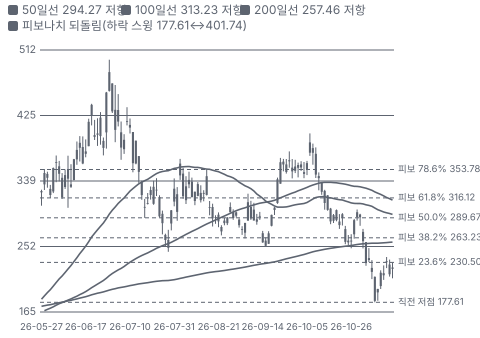

**주봉**

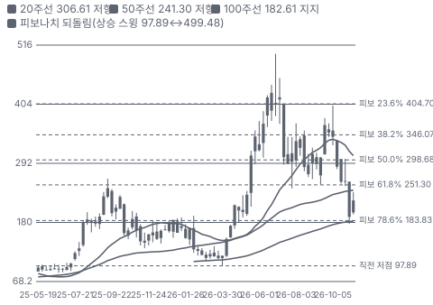

**월봉**

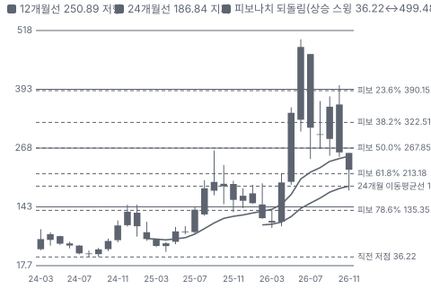

**분기 매출·EPS 실적과 컨센서스**

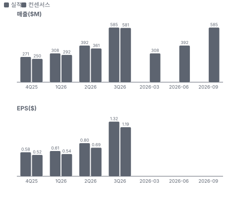

**4Q26 매출 — 지표 추세 vs 가이던스·컨센서스**

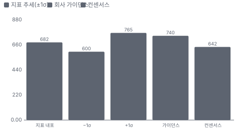

**최근 4개 분기 주가 변화 분석**

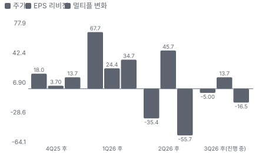

**EPS 리비전**

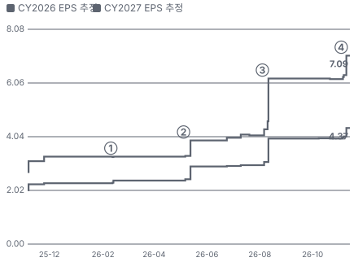

① 26-02-10 4Q25 실적·Amazon 워런트 — 다음 날 −21% · EPS 리비전 -0%
② 26-05-05 1Q26 실적 · EPS 리비전 +19%
③ 26-08-04 2Q26 — 3Q 가이던스 \$550M · EPS 리비전 +52%
④ 26-11-03 3Q26 — 4Q 가이던스 \$740M · EPS 리비전 +14%

**멀티플 프리미엄(Fwd 1Y P/E, 최근 4개 분기말)**

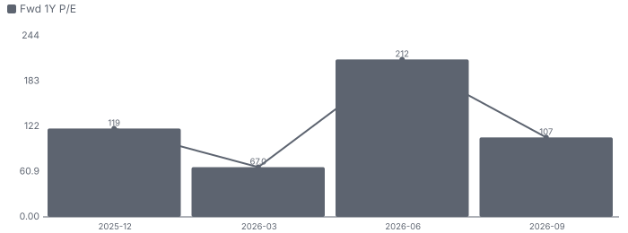

**합리적 멀티플**

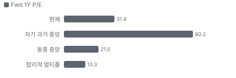

**밸류에이션 주가 시나리오**

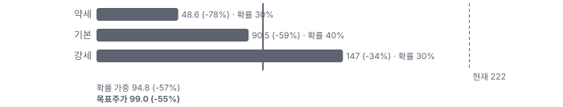

**주가별 업사이드**

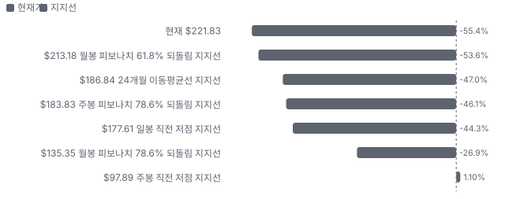
- 제품·서비스 포트폴리오

**고객 믹스(3Q26, 매출 대비)**

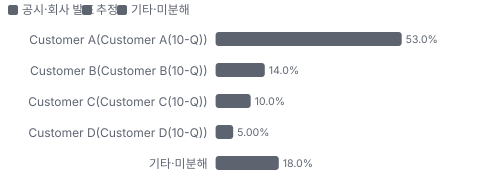

**공급 병목(10점, 낮을수록 병목)**

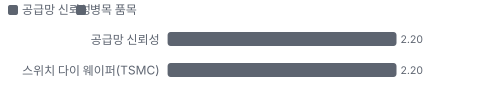

**어닝콜 변화별 주주가치 영향**

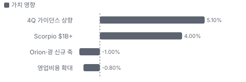

**수주·파이프라인 확실성 사다리**

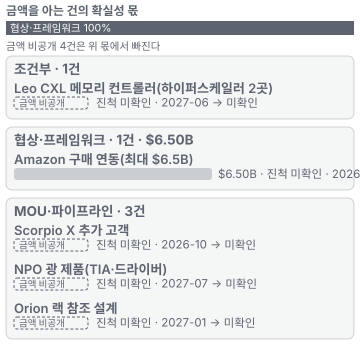

**매출 → 매출총이익 → 영업이익(매출 = 100, 최근 4분기)**

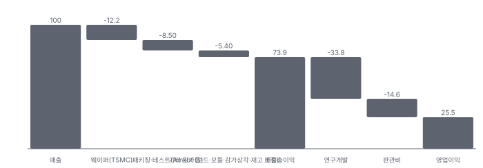

**분기 비용 비중 추이(매출 대비, 공시)**

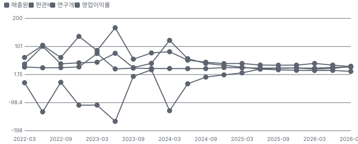

**비용 요인별 매출 대비 비중 1년 변화**

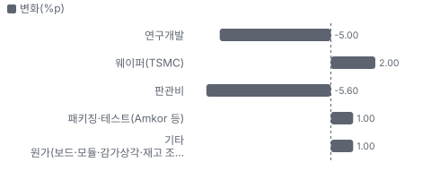

**Scorpio 스위치 BOM 원가 몫**

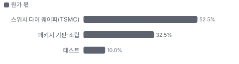

**Aries 리타이머 BOM 원가 몫**

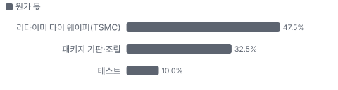

**BOM 항목 가격 +10% 시 OPM 변화**

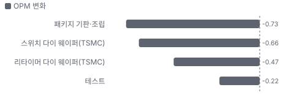

**원가 물가 vs 판매가 물가 — 1년 변화(원가가 판매가보다 더 오르면 단가를 올리지 못하는 만큼 마진이 줄어든다)**

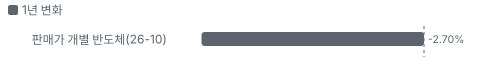

**자산 구성 — 3Q26 분기말 투하자본 \$658.3M**

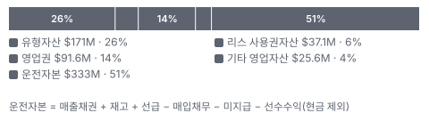

**자산별 변화율 — 최근 12개 분기(4Q23 = 0%) + 다음 4개 분기 추정**

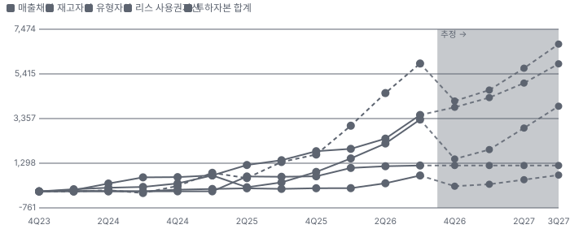

**ROIC 추이 — TTM, 최근 8개 분기 + 다음 4개 분기 추정(컨센서스 NOPAT)**

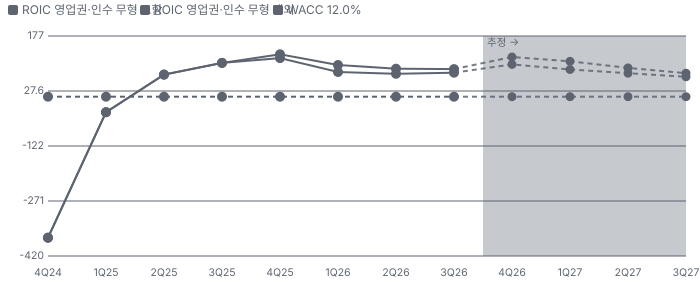

**분기 감가 비율 연율(유형자산 총액 대비)**

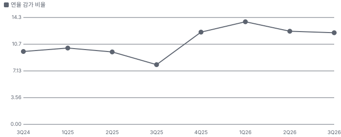

**매출·PPI·수출입 — 최근 16개 분기 + 다음 분기 추정(선마다 자기 y축: 왼쪽 매출, 오른쪽 지표) · 미국 반도체 PPI — 16개 분기 범위 28.8~31.9(+10.6%)**

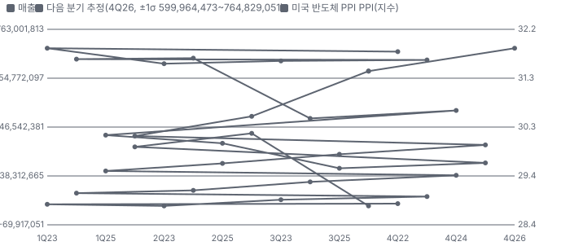

**매출 증가율의 가격·물량 분해와 8분기 전망(전년 대비)**

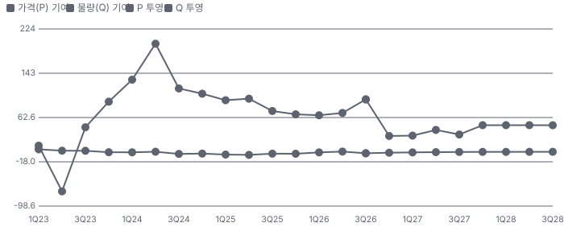

**분기별 매출 증가율 분해**

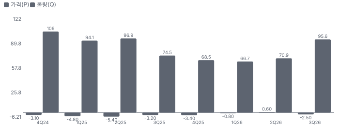

**목표주가 산정 — 기본과 강세 사이(강세 쪽 15%), 도달 확률 약 45%**

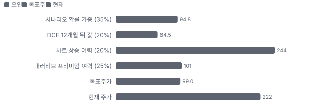

**일봉 지지·저항과 목표주가**

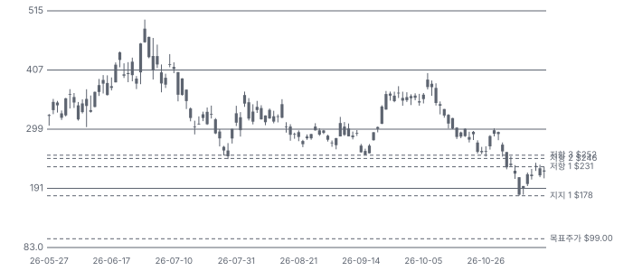

**커뮤니티 언급 수(최근 30일, 채널별)**

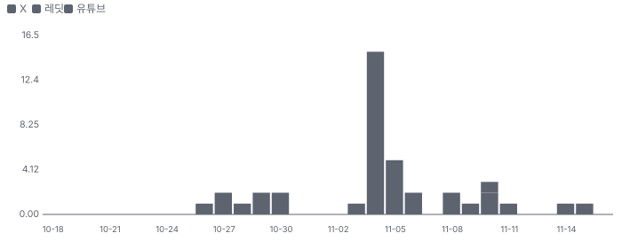

**커뮤니티 게시 수(월, 최근 7개월 — 이번 달은 진행 중)**

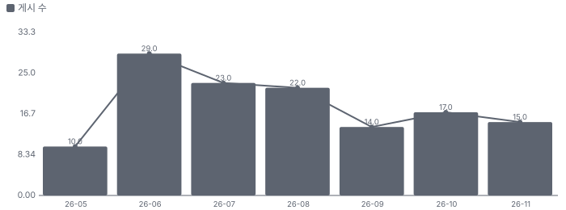

**재고 일수 — 분기별(수주 자료가 없어 수주/출하 비율 없음)**

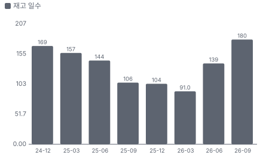

**일별 거래량 분해**

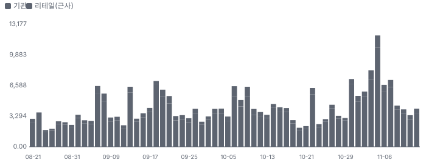

**기관 자금 흐름**

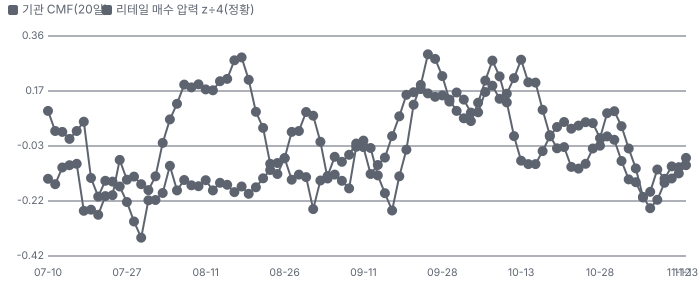

**몬테카를로**

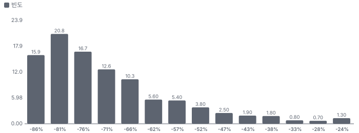

해석: 3,000번 중 6번(0%)에서 가치가 지금 주가 이상이었다. 가정을 흔들어도 지금 주가를 뒷받침하지 못하는 경우가 더 많다. 가운데 값은 0.25배이고, 열 번 중 여덟 번은 0.15~0.49배 사이에 든다.

## 내러티브

> **기업가치를 결정하는 이야기:** 이 회사는 칩을 직접 만들지 않는다. TSMC가 만든 연결 칩(스위치·리타이머·메모리 컨트롤러)을 하이퍼스케일러 AI 서버에 판다. 조정 매출총이익률은 72%로 높고, 성장 속도는 고객 플랫폼 양산 일정이 정한다. 배수는 한 고객(53%)에 쏠린 물량이 다른 고객으로 넓어지느냐가 정한다.

> **멀티플·EPS 프리미엄**
> **멀티플:** Fwd 1Y P/E 31.4배로 동종(Credo·Marvell·Broadcom·Rambus) 중앙값 21.5배보다 약 46% 높다. 2026년 6월 136배에서 4분의 1 아래로 내려왔다.
> **EPS:** 다음 4개 분기 EPS 컨센서스 \$7.06은 TTM 조정 EPS \$3.31의 2.1배다. FY27 EPS는 3Q 콜 뒤 \$6.29 → \$7.09로 13% 올랐다.

### 투자자들은 왜 열광했나

2026년 상반기 투자자들은 Scorpio X 양산과 Amazon 워런트(\$6.5B 구매 연동)에 열광했다 — 6월 나스닥 100 편입 뒤 6/30 종가 \$483.02까지 올랐다. 식은 이유는 세 가지다: 배수가 Fwd 1Y P/E 136배까지 갔고, 10월 S&P 500 편입이 불발됐으며(커뮤니티 요약 — 1차 미확인), 11/5 AI 업종 매도로 하루 −19.6%였다. 실적은 여덟 분기 연속 컨센서스를 넘었다.

### 무엇이 기업가치를 바꾸나

> **구조적 체질 변화**
> **변화:** 리타이머 회사에서 스위치 회사로 — Scorpio가 최대 제품군이 됐다
> **증거:** 3Q 콜
> **반증:** Scorpio 비중이 다시 리타이머 아래

> **고부가 믹스 확장**
> **변화:** 스위치·랙 설계로 칩당 콘텐츠가 커진다 — 조정 GPM 72%는 유지
> **증거:** 3Q 콜: GPM 72.4%, XPU당 \$1,000+
> **반증:** Orion 시스템 매출로 GPM 68% 아래

> **기술 혁신**
> **변화:** PCIe Gen7·광 TIA·드라이버·KV 캐시(AI 추론 중간 결과 저장 메모리)용 Leo X를 냈다
> **증거:** 3Q 콜·OCP(데이터센터 개방형 하드웨어 협의체) 발표
> **반증:** Gen7 플랫폼 경쟁사 단독 채택

> **실행 속도**
> **변화:** 해당 없음(주문→출하 리드타임을 회사·동종 모두 공시하지 않는다 — 대신 샘플→매출 기간을 본다: NPO 샘플 4Q26 → 인증 약 6개월 → 매출 2027 하반기)
> **증거:** 3Q 콜 Jefferies 답변
> **반증:** NPO 매출이 2027년 안에 없음

> **M&A**
> **변화:** 해당 없음(2026-02 소규모 자산 인수 \$69M만 — 시너지 미공시)
> **증거:** 10-Q
> **반증:** -

> **정책·입법 연관성**
> **재정정책:** 해당 없음(이 회사 매출에 직접 걸린 세출·세액공제 확인 안 됨) - 반증: - 의회 동의 2/10 — 하원 1/5(관련 세출 논의 확인 안 됨) · 상원 1/5(같음).
> **행정명령:** AI 칩 수출 통제 — 직접 고객 중 중국 청구 매출이 있다(10-Q 지역 표) 10-Q 청구지 중국 \$146.7M(3Q) — 최종 수요처와 다를 수 있다 반증: - 의회 동의 2/10 — 하원 1/5(행정부 규정 — 의회 절차 없음) · 상원 1/5(같음).
> **연관입법:** 해당 없음(관련 법안 확인 안 됨) - 반증: -

> **고객의 지출 예산**
> **변화:** 고객 돈은 하이퍼스케일러 AI 데이터센터 CAPEX에서 나온다
> **사업별 예산:** **매출의 95%**: AI 패브릭·신호 조정 — 고객 CAPEX(AI 서버·랙(가속기 연결)) · 동인: XPU 클러스터 증설·PCIe 세대 전환
**매출의 5%**: COSMOS(Astera Labs의 연결 관리 소프트웨어) 소프트웨어 — 고객 혼합(하드웨어에 묶여 판매) · 동인: 설치 기반
> **증거:** 10-Q·10-K 고객 구성
> **반증:** 하이퍼스케일러 2027 CAPEX 하향

### 내러티브 근거

> 'AI 스케일업 연결의 표준 공급자'라는 이야기는 매출 +154%로 증명됐지만, 주가는 6/30 종가 고점 \$483.02보다 54% 낮다. 지금 가격은 한 고객(53%)에 실린 Scorpio X 물량이 2027년에 다른 고객으로 넓어지느냐를 묻는다. 동종 대비 멀티플 차이 +46% 중 회사 고유 몫은 +137%다. 단계는 컨센서스, 쏠림은 보통(공매도 유통 주식의 6.0%·1.9일분, 기관 보유 73%, Quantral 11월 Weak)이다.

> **스케일업 스위치(Scorpio X)** · 강화
> **논리:** XPU 클러스터가 커질수록 스케일업 스위치가 늘고 Astera Labs가 머천트 공급자가 된다
> **숫자:** Scorpio 연환산 \$1B+, 4Q 가이던스 +27% QoQ
> **반증:** Scorpio 매출이 2개 분기 연속 감소
> **출처:** https://www.sec.gov/Archives/edgar/data/1736297/000173629726000044/alab-20261103.htm

> **XPU당 콘텐츠 2배** · 유지
> **논리:** 세대마다 XPU당 \$1,000 이상씩 콘텐츠가 늘어난다
> **숫자:** 지금 고부하 시스템 XPU당 \$1,000+(콜)
> **반증:** 차세대 플랫폼에서 스위치 채택 실패
> **출처:** https://www.sec.gov/Archives/edgar/data/1736297/000173629726000044/alab-20261103.htm

> **신규 4대 축(광·커스텀·메모리·랙)** · 유지
> **논리:** 연결 칩에서 랙 단위 플랫폼으로 시장이 넓어진다
> **숫자:** NPO 2027 하반기, Leo 2 2027 중반, Orion 랙당 \$100K+
> **반증:** 2027 하반기까지 광·메모리 매출 미발생
> **출처:** https://www.sec.gov/Archives/edgar/data/1736297/000173629726000044/alab-20261103.htm

> **반대 내러티브 — 고객 집중** · 강화
> **논리:** 3Q 매출의 53%가 한 고객이라 그 플랫폼 일정이 곧 실적이다
> **숫자:** Customer A 23% → 53%(1년)
> **반증:** Customer A 비중이 2개 분기 연속 35% 아래로 내려가며 매출 증가
> **출처:** https://www.sec.gov/Archives/edgar/data/1736297/000173629726000045/alab-20260930.htm

> **반대 내러티브 — 경쟁·내재화** · 유지
> **논리:** Broadcom·Marvell·NVIDIA가 스케일업 스위치를 직접 공급하거나 고객이 내재화한다
> **숫자:** 미확인(점유율 공시 없음)
> **반증:** UALink 첫 플랫폼에서 Scorpio 채택 공시
> **출처:** 3Q 콜 Raymond James 질문

### 투자 포인트

> **스케일업 스위치의 머천트 공급자**
> **명제:** AI 가속기 클러스터가 커질수록 스케일업 스위치 수요가 늘고, Scorpio X가 첫 대형 플랫폼에 들어갔다
> **숫자:** Scorpio 연환산 매출 \$1B 이상, X 시리즈가 P 시리즈를 넘음, 고객 10곳 이상 검증(3Q 콜)
> **시장과 다른 점:** 시장은 11월 매도에서 배수만 봤다 — FY27 EPS 컨센서스는 석 달 새 14% 올랐고 Fwd 1Y P/E는 6월 136배에서 31배다
> **증명:** 4Q 실적의 Scorpio X 두 번째 고객 양산 출하
> **출처:** https://www.sec.gov/Archives/edgar/data/1736297/000173629726000044/alab-20261103.htm

> **세대마다 칩당 콘텐츠가 늘어난다**
> **명제:** PCIe Gen6 → Gen7, 리타이머 → 스위치로 가며 XPU당 Astera Labs 콘텐츠가 커진다
> **숫자:** 고부하 시스템 XPU당 \$1,000 이상, 다음 세대 스위치만으로 \$1,000+ 추가 목표(3Q 콜), 조정 GPM 72.4%
> **시장과 다른 점:** 컨센서스 FY28 매출 성장은 +28%로 FY27 +67%의 절반 아래다 — 콘텐츠 증가가 2028년에도 이어지면 추정이 낮다
> **증명:** Gen7·UALink 첫 플랫폼 채택 발표
> **출처:** https://www.sec.gov/Archives/edgar/data/1736297/000173629726000044/alab-20261103.htm

> **집중이 풀리면 할인도 풀린다**
> **명제:** 지금 배수 할인의 핵심은 한 고객 53%다 — 고객이 넓어지면 동종 대비 프리미엄이 정당화된다
> **숫자:** Customer A 3Q 53%(1년 전 23%), 9개월 40%·B 18%·C 14%·D 11%(10-Q)
> **시장과 다른 점:** 시장은 집중을 영구 위험으로 보지만, 첫 양산 때 생긴 집중일 수 있다 — 9개월 기준 10% 고객은 4곳이다
> **증명:** FY26 10-K 고객 표, 1Q27 10-Q 고객 비중
> **출처:** https://www.sec.gov/Archives/edgar/data/1736297/000173629726000045/alab-20260930.htm

### 모멘텀 생성·소멸 타임라인

**카탈리스트 달력 — 지난 사건의 주가 반응과 앞으로 확인할 숫자**
| 날짜 | 상태 | 구분 | 사건 | 반응·확인 | 결과에 따라 |
|---|---|---|---|---|---|
| 2026-02-10 | 완료 | 생성 | 4Q25 실적·Amazon 워런트(\$6.5B 구매 연동) | 다음 날 −21% |  |
| 2026-06-22 | 완료 | 생성 | 나스닥 100 편입(커뮤니티 요약 — 1차 미확인), 6/30 종가 고점 \$483.02 | 6월 +41%(5/29 종가 \$342.85 → 6/30 \$483.02, 계산) |  |
| 2026-08-04 | 완료 | 확인 | 2Q26 실적 — 3Q 가이던스 \$540~560M | 다음 날 −12.0% |  |
| 2026-11-05 | 완료 | 소멸 | AI 기술주 매도 | 하루 −19.6% |  |
| 2027-02 초(예상) | 예정 | 확인 | 4Q26 실적·1Q27 가이던스 | 매출 \$750M 상회, 1Q27 가이던스 \$800M 이상, Scorpio X 두 번째 고객 | 넘으면 기본→강세, 못 미치면 약세 |
| 2027 상반기(예상) | 예정 | 확인 | UALink·PCIe Gen7 첫 플랫폼 스위치 공급사 | Scorpio 채택 발표 여부 | 채택이면 경쟁 할인 축소, 경쟁사 단독이면 약세 |
| 2027 하반기(예상) | 예정 | 확인 | NPO 광·Leo 2 양산 매출 | 신규 축 매출 첫 언급 | 붙으면 FY28 추정 상향 |

### 언제 사서 언제 팔아야 할까?

**가격·조건 틀 — 가격은 밸류에이션(약세·기본·강세·목표주가)과 차트 지지 구간에서, 조건은 이벤트에서**
| 구간 | 가격 | 목표주가까지 | 약세까지 | 조건·근거 |
|---|---|---|---|---|
| 관찰 구간 | \$213~\$213 | -54% | -77% | 차트 지지 구간이 약세 시나리오 가격과 겹치는 곳 — 11/5 종가 저점 \$179.47 부근 |
| 확인 뒤 | 지금 \$222 이상에서 조건 확인 | -55% | -78% | 4Q 매출 \$750M 상회와 Scorpio X 두 번째 고객 양산 확인(2027년 2월) |
| 무효화 | 약세 시나리오 \$49 | - | -78% | Scorpio 매출 감소 또는 차세대 플랫폼 경쟁사 단독 채택, 11/5 종가 저점 \$179.47 이탈 |

실적 전후 하루 ±20% 움직임이 반복됐다(11/5 −19.6%, 2/11 −21%) — 이벤트 직전 추격을 경계한다 가격·조건 틀이며 매매·비중 지시가 아니다(투자 권유 아님).

## 포트폴리오

| 제품·서비스 | 구분 | 무엇 | 쓰는 곳 | 돈 버는 방식 | Mix | Mix 변화(추정(3Q 콜 연환산 \$1B+)) |
|---|---|---|---|---|---|---|
| Scorpio 스위치 | 제품 | AI 가속기 사이(X)·서버 안(P)을 잇는 PCIe 패브릭 스위치 | GPU·XPU 스케일업 연결 | 칩 판매. 3Q 최대 제품군, 연환산 \$1B+ | 45% | 미확인 |
| Aries(Astera Labs의 PCIe·CXL 리타이머) 리타이머 | 제품 | PCIe·CXL 신호를 다시 만들어 먼 거리를 잇는 칩 | GPU·CPU·NIC(서버 네트워크 카드) 사이 연결 | 칩 판매. PCIe Gen6 전환으로 성장 | 35% | 미확인 |
| Taurus(Astera Labs의 이더넷 케이블 신호 모듈) 케이블 모듈 | 제품 | 이더넷 구리 케이블(AEC(신호 보정 칩이 든 구리 케이블)) 안에 들어가는 신호 모듈 | 스케일아웃 서버-스위치 연결 | 모듈 판매. 800G 양산 | 미확인 | 미확인 |
| Leo 메모리 컨트롤러 | 제품 | CXL로 메모리를 늘리고 나눠 쓰게 하는 칩 | 서버 메모리 확장·KV 캐시 | 칩 판매. 2027 중반 양산 | 미확인 | 미확인 |

## 고객

> **3Q26 최대 고객 Customer A(Customer A(10-Q)) 53%, 상위 3곳 77%, 집중도 집중.** 공시·회사 발표로 확인한 몫은 매출의 77%이고, 나머지 고객 몫은 추정이거나 미분해다. 3Q26 매출의 53%가 Customer A 한 곳이다(1년 전 23%). 9개월로는 A 40%·B 18%·C 14%·D 11%다. 회사는 일부가 최종 고객을 대신 사는 위탁 생산사라고 적었다 — 최종 수요처 집중은 숫자보다 클 수도 작을 수도 있다.

**고객별 매출 몫(3Q26)**
| 고객 | 몫 | 변화 | 근거 |
|---|---|---|---|
| Customer A(Customer A(10-Q)) | 53% | +30%p | 공시 |
| Customer B(Customer B(10-Q)) | 14% | -10%p | 공시 |
| Customer C(Customer C(10-Q)) | 10% | +0%p | 공시 |
| Customer D(Customer D(10-Q)) | 0~10% | -22%p | 추정 |
| Amazon(Parent(8-K 2026-02-10)) | 미확인 | 미확인 | 공시 |
| 기타·미분해 | 18% | - | - |

> **Customer A(Customer A(10-Q))** · 공시
> **사는 것:** Scorpio X 등(제품 미공시)
> **추정 근거:** 선두 하이퍼스케일러 플랫폼 양산과 같은 시기 급증 — 최종 고객 특정은 가설

> **Customer B(Customer B(10-Q))** · 공시
> **사는 것:** 미공시
> **추정 근거:** 비중 하락

> **Customer C(Customer C(10-Q))** · 공시
> **사는 것:** 미공시
> **추정 근거:** 유지

> **Customer D(Customer D(10-Q))** · 추정
> **사는 것:** 미공시
> **추정 근거:** 3Q 10% 미만으로 하락(9개월 11%)

> **Amazon(Parent(8-K 2026-02-10))** · 공시
> **사는 것:** 스위치·신호 조정·광 엔진(워런트 구매 대상)
> **추정 근거:** 고객이자 워런트 보유자 — Customer A와 같은지는 미확인

## 수주·파이프라인

> **2026-11-03 기준 5건.** 건별 확정 금액은 공개되지 않았다.

**수주 목록**
| 상태 | 계약 | 계약 총액 | 진척 | 기간 | 비고 |
|---|---|---|---|---|---|
| 조건부 | Leo CXL 메모리 컨트롤러(하이퍼스케일러 2곳) | 금액 비공개 | 비공개 | 2027-06 → 미확인 | - |
| 프레임워크 | Amazon 구매 연동(최대 \$6.5B) | \$6.50B | 비공개 | 2026-02 → 2033-02 | - |
| 파이프라인 | Scorpio X 추가 고객 | 금액 비공개 | 비공개 | 2026-10 → 미확인 | - |
| 파이프라인 | NPO 광 제품(TIA·드라이버) | 금액 비공개 | 비공개 | 2027-07 → 미확인 | - |
| 파이프라인 | Orion 랙 참조 설계 | 금액 비공개 | 비공개 | 2027-01 → 미확인 | - |

**실행 속도와 방해 요인**
| 항목 | 상태 | 실행 속도 | 방해 요인 |
|---|---|---|---|
| Leo CXL 메모리 컨트롤러(하이퍼스케일러 2곳) | 조건부 | 인증 완료, 양산 2027 중반(콜) | 메모리 수급 |
| Amazon 구매 연동(최대 \$6.5B) | 프레임워크 | 2033-02까지 행사 기간 | 실제 발주 금액 미공시 |
| Scorpio X 추가 고객 | 파이프라인 | 4Q 신규 고객에 양산 전 물량(콜) | 고객 플랫폼 일정 |
| NPO 광 제품(TIA·드라이버) | 파이프라인 | 이번 분기 샘플, 약 6개월 인증, 2027 하반기 매출(콜) | 고객 인증 |
| Orion 랙 참조 설계 | 파이프라인 | 2027 ODM·OEM 출시(콜) | 시스템 사업 마진 희석 가능성 |

## 마진 구조

> **GPM 72.3%, OPM 30.6%.** 3Q25 대비 GPM -4.0%p, OPM +6.6%p. 변동비는 매출의 36%이고, 매출이 10% 늘면 OPM은 +3.1%p 움직인다. 3Q26 GAAP 매출원가는 매출의 27.7%로 1년 전 23.8%보다 높다 — 스위치·고객 워런트 차감(매출 차감)과 믹스 때문이다(추정). 원가 대부분은 TSMC 웨이퍼와 Amkor 패키징·테스트다. 연구개발비가 매출의 29%로 가장 큰 비용이다.

> **매출 100 중 매출원가 26.1, 매출총이익 73.9(최근 4분기, 공시).** 매출원가 요인 중 웨이퍼(TSMC)이 매출의 13.0%로 가장 무겁고, 단가가 +10% 오르면 GPM이 -1.30%p 움직인다. 분기 회귀로 매출 1이 늘 때 매출원가는 0.27 늘고, 매출원가의 고정비 몫은 -4%다. 매출원가 요인 비중은 요인별 공시 기간 값이라 합이 최근 4분기 매출원가를 넘어, 그림에서는 0.94배로 비례 조정했다.

**비용 요인 강도 — 비중·추세·충격(+10%)·탄력**
| 비용 | 구분 | 매출 대비 | 1년 변화 | 마진 기여 | 충격 시 마진 | 매출 탄력 | 고정비 몫 |
|---|---|---|---|---|---|---|---|
| 웨이퍼(TSMC) | 매출원가 요인 | 13.0% | +2.0%p | -2.0%p | -1.30%p | 미확인 | 0% |
| 패키징·테스트(Amkor 등) | 매출원가 요인 | 9.0% | +1.0%p | -1.0%p | -0.90%p | 미확인 | 0% |
| 기타 원가(보드·모듈·감가상각·재고 조정) | 매출원가 요인 | 5.7% | +1.0%p | -1.0%p | -0.57%p | 미확인 | 30% |
| 연구개발 | 공시 항목 | 33.8% | -3.1%p | +3.1%p | 미확인 | 0.29 | 29% |
| 매출원가 | 공시 항목 | 26.1% | +1.5%p | -1.5%p | -2.61%p | 0.27 | -4% |
| 판관비 | 공시 항목 | 14.6% | -9.2%p | +9.2%p | 미확인 | 0.11 | 57% |

매출 탄력 = 분기 비용을 매출에 회귀한 기울기(매출 1당 변동비), 고정비 몫 = 절편 ÷ 평균 비용. 표본이 8분기 미만이면 미확인. 매출원가 요인 비중은 margin 재료의 추정이 섞여 있고, 공시 매출원가와의 차이는 '기타 매출원가'로 둔다.

**GPM에서 OPM까지(GAAP, 아래는 최근 4개 분기)**
| 기간 | GPM | 연구개발 | 판관비 | 기타 | OPM |
|---|---|---|---|---|---|
| 3Q25 | 76.2% | 34.2% | 18.0% | 0.0% | 24.0% |
| 3Q26 | 72.3% | 29.2% | 12.4% | 0.0% | 30.6% |
| 2025-12 | 75.6% | - | - | - | 24.7% |
| 2026-03 | 76.3% | - | - | - | 20.1% |
| 2026-06 | 73.3% | - | - | - | 22.7% |
| 2026-09 | 72.3% | - | - | - | 30.6% |

**비용을 움직이는 요인**
| 비용 | 요인 |
|---|---|
| 연구개발(연구개발) | 인력·테이프아웃·주식 보상 · 근거 공시 |
| 웨이퍼(TSMC, 매출원가) | TSMC 첨단 공정 웨이퍼 단가·다이 크기(스위치) · 근거 추정 |
| 판관비(판관비) | 인력·주식 보상 · 근거 공시 |
| 패키징·테스트(Amkor 등, 매출원가) | 기판·패키징 단가 · 근거 추정 |
| 기타 원가(보드·모듈·감가상각·재고 조정, 매출원가) | Taurus 모듈·Orion 보드 믹스 · 근거 추정 |

**Scorpio 스위치 BOM — 매출의 45%, GPM 72%(제품별 이익 미공시 — 전사 조정 GPM 대입(추정)), 항목 가격 +10% 시**
| 항목 | 원가 몫 | 전가 | 제품 GPM | OPM |
|---|---|---|---|---|
| 스위치 다이 웨이퍼(TSMC) | 45~60% | 미확인 | -1.5%p | -0.66%p |
| 패키지 기판·조립 | 25~40% | 미확인 | -0.9%p | -0.41%p |
| 테스트 | 5~15% | 미확인 | -0.3%p | -0.13%p |
| 미분해 | 5% | - | - | - |

**Aries 리타이머 BOM — 매출의 35%, GPM 72%(전사 조정 GPM 대입(추정)), 항목 가격 +10% 시**
| 항목 | 원가 몫 | 전가 | 제품 GPM | OPM |
|---|---|---|---|---|
| 리타이머 다이 웨이퍼(TSMC) | 40~55% | 미확인 | -1.3%p | -0.47%p |
| 패키지 기판·조립 | 25~40% | 미확인 | -0.9%p | -0.32%p |
| 테스트 | 5~15% | 미확인 | -0.3%p | -0.10%p |
| 미분해 | 10% | - | - | - |

패키지 기판·조립 가격이 +10% 오르면 영업이익은 -2.4% 움직인다. 판매가 전가를 모르는 항목은 전가 0%로 계산했다.

**BOM 항목 가격을 움직이는 것**
| 항목 | 요인 |
|---|---|
| 스위치 다이 웨이퍼(TSMC) | 대형 다이라 웨이퍼 몫이 크다 · 근거 추정 |
| 패키지 기판·조립 | 고핀수 패키지 · 근거 추정 |
| 테스트 | 고속 SerDes(고속 직렬 신호 송수신 회로) 검증 · 근거 추정 |
| 리타이머 다이 웨이퍼(TSMC) | 칩 원가 핵심 · 근거 추정 |
| 패키지 기판·조립 | 패키징 · 근거 추정 |
| 테스트 | PCIe Gen6 신호 검증 · 근거 추정 |

판매가 비교 물가(개별 반도체(MOSFET(전력 스위칭 트랜지스터)·트랜지스터·다이오드) PPI(생산자물가지수))는 1년 새 -2.7% — 회사 가격 변화는 미확인. 물가 지수를 붙이지 못한 매출원가 항목은 웨이퍼(TSMC), 패키징·테스트(Amkor 등)다(미연결).

## 자산 구성

> **3Q26 분기말 투하자본 \$658.3M** — 운전자본 51%, 유형자산 26%. 최근 12개 분기(4Q23 → 3Q26) 가장 크게 늘어난 자산은 유형자산(+3523%), 투하자본 합계 +5894%. 3Q27 추정 투하자본 \$756.4M(+15%, 컨센서스 매출과 회전 일수·CAPEX 강도 유지 가정). 연율 감가 비율(총액 기준)은 직전 4분기 9.16% → 최근 4분기 12.61%.

**자산·운전자본 항목별 분기말 잔액 — 최근 12개 분기와 다음 4개 분기 추정**
| 항목 | 4Q23 | 3Q25 | 3Q26(최근) | 3Q27 추정 | 12개 분기 변화 | 다음 4개 분기 변화 |
|---|---|---|---|---|---|---|
| 매출채권 | \$8.3M | \$42.9M | \$284.3M | \$335.6M | +3310% | +18% |
| 재고자산 | \$24.1M | \$51.7M | \$200.9M | \$205.6M | +734% | +2% |
| 선급·기타 유동자산 | \$4.1M | \$61.2M | \$91.8M | \$120.2M | +2160% | +31% |
| 매입채무 | \$6.3M | \$25.8M | \$96.8M | \$128.0M | +1428% | +32% |
| 미지급비용 | \$28.7M | \$75.1M | \$146.8M | \$212.9M | +411% | +45% |
| 유형자산 | \$4.7M | \$72.5M | \$170.7M | \$281.7M | +3523% | +65% |
| 리스 사용권자산 | \$2.9M | \$22.2M | \$37.1M | \$37.1M | +1192% | +0% |
| 영업권 | 미확인 | 미확인 | \$91.6M | \$91.6M | 비교 불가 | +0% |

**자산 추정 동인 — 최근 4개 분기 평균(재무상태표 동인 모형)**
| 동인 | 값 | 곱하는 기준 |
|---|---|---|
| 매출채권 | 39일 | 매출 |
| 재고자산 | 92일 | 매출원가 |
| 선급·기타 유동자산 | 14일 | 매출 |
| 매입채무 | 57일 | 매출원가 |
| 미지급비용 | 25일 | 매출 |
| 선수수익(계약부채) | 0일 | 매출 |
| CAPEX 강도 | 5.9% | 매출(최근 4개 분기 합) |
| 분기 감가율 | 4.08% | 기초 유형자산 순액(무형 상각 제외 감가상각) |
| 매출원가율 | 26.1% | 매출(최근 4개 분기) |
| 영업권·리스 사용권·기타 | 유지 | 인수·새 리스는 공시 전 모름 |
| 인수 무형자산 | 분기 \$0.0M 상각 | 최근 4개 분기 평균 상각 |

**추정 방법:** 증권사 3표 모델(손익·재무상태표·현금흐름)의 재무상태표 동인 방식이다. 운전자본은 항목별 회전 일수(매출채권·선급·미지급·선수는 매출, 재고·매입채무는 매출원가 기준)를 최근 4개 분기 평균으로 두고 컨센서스 매출에 곱한다. 유형자산은 기초 + CAPEX − 감가상각으로 굴린다(Koller·Goedhart·Wessels 『Valuation』 재무상태표 추정). 매출 경로는 ROIC 절의 컨센서스와 같다.

**유형·무형자산 항목별 가치(2024-12-31 vs 2023-12-31)**
| 구분 | 항목 | 총액 2024-12-31 | 누적상각 | 순액 | 총액 2023-12-31 | 총액 1년 변화 | 공시 내용연수 |
|---|---|---|---|---|---|---|---|
| 유형 | 유형자산 합계(항목 미분해) | \$41.5M | 총계만 공시 | 총계만 공시 | \$7.4M | +461.3% | 미확인 |
| 유형 합계 | 유형자산 | \$41.5M | \$5.8M | \$35.7M | \$7.4M | +461.3% | 경과율 14%(상각 대상 기준) |

**내용연수 산식(상각 대상 유형자산 = 총액 − 토지 − 건설중)**
| 기준일 | 연 감가상각 | 상각 대상 총액 | 평균 내용연수 | 경과 연수 | 잔여 연수 | 경과율 |
|---|---|---|---|---|---|---|
| 2024-12-31 | \$3.2M | \$41.5M | 13.2년 | 1.8년 | 11.3년 | 14% |
| 2023-12-31 | \$1.8M | \$7.4M | 4.1년 | 1.5년 | 2.6년 | 36% |

산식 평균 내용연수는 13.2년. 1년 전 4.1년 → 지금 13.2년.

**분기 감가 비율(감가상각 ÷ 평균 유형자산 총액)**
| 분기 | 감가상각 | 평균 유형자산(총액) | 분기 비율 | 연율 | 연율의 역수 |
|---|---|---|---|---|---|
| 3Q24 | \$0.8M | \$32.9M | 2.43% | 9.72% | 10.3년 |
| 1Q25 | \$1.1M | \$43.2M | 2.55% | 10.18% | 9.8년 |
| 2Q25 | \$1.4M | \$58.0M | 2.42% | 9.66% | 10.3년 |
| 3Q25 | \$1.5M | \$75.4M | 1.99% | 7.96% | 12.6년 |
| 4Q25 | \$2.8M | \$92.6M | 3.07% | 12.30% | 8.1년 |
| 1Q26 | \$3.7M | \$108.2M | 3.42% | 13.68% | 7.3년 |
| 2Q26 | \$3.9M | \$125.6M | 3.10% | 12.42% | 8.1년 |
| 3Q26 | \$5.1M | \$166.9M | 3.06% | 12.22% | 8.2년 |

감가상각 기준: 손익계산서 감가상각·상각비(SEC 공시 데이터, 4분기 = 연간 − 1~3분기).

최근 4분기 연율 감가 비율 12.61%, 직전 4분기 9.16%(+38%) — 경고 문턱(-10%) 안이다.

미공시·미분해: 무형자산 · 유형자산 항목별 총액·내용연수(10-K 주석에서 모델이 채움) · 무형자산 항목(10-K 주석에서 모델이 채움) — 이 칸은 비우고 나머지로 계산했다.

### 해석 — 자산이 어디에 쌓이고 있나

- 같은 기간 4개 분기 매출은 +409% — 매출보다 빨리 늘어난 자산: 매출채권 +3310%, 재고자산 +734%, 유형자산 +3523%, 리스 사용권자산 +1192%. 이 자산의 회전율이 떨어지면 ROIC를 희석한다.
- 다음 4개 분기 CAPEX \$122.2M vs 감가상각 \$32.9M(최근 4개 분기 CAPEX 강도·감가율 유지) — 유형자산 3Q26 \$170.7M → 3Q27 \$281.7M. 투자가 감가보다 커서 자산이 쌓이는 국면이다.
- 감가 비율이 올라갔다 — 이익을 보수적으로 잡는 쪽이다(내용연수 단축·짧은 수명 자산 증가).

## ROIC

> **TTM 3Q26 ROIC는 영업권·인수 무형 포함 77.2%, 제외 86.9%**(NOPAT 마진 20.3% × 투하자본 회전율 3.81회). 최근 8개 분기 4Q24 -370.1% → 3Q26 77.2%(고점 4Q25 116.8%). 컨센서스 NOPAT으로 굴리면 3Q27 66.1%(제외 75.9%) — WACC 12.0% 대비 +54.1%p. 1년 변화의 가장 큰 요인은 운전자본(-54.6%p).

**ROIC 추이(TTM)와 다음 4개 분기 추정 — NOPAT ÷ 평균 투하자본(이번 분기말·4개 분기 전)**
| 분기 | 구분 | TTM 매출 | TTM NOPAT | NOPAT 마진 | 평균 투하자본 | ROIC 포함 | ROIC 제외 |
|---|---|---|---|---|---|---|---|
| 4Q24 | 실적 | \$396.3M | −\$91.5M | -23.1% | \$24.7M | -370.1% | -370.1% |
| 1Q25 | 실적 | \$490.5M | −\$17.2M | -3.5% | \$57.5M | -29.9% | -29.9% |
| 2Q25 | 실적 | \$605.5M | \$34.3M | 5.7% | \$47.7M | 72.0% | 72.0% |
| 3Q25 | 실적 | \$723.0M | \$84.2M | 11.6% | \$81.2M | 103.8% | 103.8% |
| 4Q25 | 실적 | \$852.5M | \$137.9M | 16.2% | \$118.1M | 116.8% | 127.0% |
| 1Q26 | 실적 | \$1,001.4M | \$176.9M | 17.7% | \$224.1M | 79.0% | 98.2% |
| 2Q26 | 실적 | \$1,201.9M | \$218.1M | 18.1% | \$293.5M | 74.3% | 88.0% |
| 3Q26 | 실적 | \$1,556.2M | \$315.7M | 20.3% | \$408.9M | 77.2% | 86.9% |
| 4Q26 | 추정 | \$1,594.1M | \$332.3M | 20.8% | \$333.0M | 99.8% | 119.7% |
| 1Q27 | 추정 | \$1,678.1M | \$372.0M | 22.2% | \$433.6M | 85.8% | 108.2% |
| 2Q27 | 추정 | \$1,870.6M | \$433.3M | 23.2% | \$571.6M | 75.8% | 90.3% |
| 3Q27 | 추정 | \$2,065.7M | \$467.5M | 22.6% | \$707.3M | 66.1% | 75.9% |

**다음 4개 분기 NOPAT — 컨센서스(세율 21%, 리스 이자 별도)**
| 분기 | 매출 | EBITA 마진 | EBITA | NOPAT(분기) | 근거 |
|---|---|---|---|---|---|
| 4Q26 | \$308.4M | 28.5% | \$87.9M | \$69.4M | 컨센서스 매출 × EBIT 마진 FY2026(조정 − 주식보상 14.0%) |
| 1Q27 | \$392.4M | 28.5% | \$111.8M | \$88.3M | 컨센서스 매출 × EBIT 마진 FY2026(조정 − 주식보상 14.0%) |
| 2Q27 | \$584.9M | 28.5% | \$166.7M | \$131.7M | 컨센서스 매출 × EBIT 마진 FY2026(조정 − 주식보상 14.0%) |
| 3Q27 | \$780.0M | 28.5% | \$222.3M | \$175.6M | 컨센서스 매출 × EBIT 마진 FY2026(조정 − 주식보상 14.0%) |

**추정 방법:** NOPAT은 컨센서스(분기 매출 추정 × 회계연도 EBIT 마진 추정)로 잡고, 조정(비 GAAP) 마진이면 주식보상 몫을 빼서 과거 실적과 같은 기준(영업이익 + 인수 무형 상각)으로 맞췄다. 이미 발표했지만 분기 보고서(10-Q)가 아직 없는 분기는 발표 실적을 쓴다. 투하자본은 자산 구성 절의 재무상태표 동인으로 굴렸다. ROIC는 4개 분기 NOPAT을 이번 분기말과 4개 분기 전 투하자본의 평균으로 나눈다 — 추정 분기의 ROIC에는 이미 나온 실적 분기가 섞여 있다.

**투하자본 항목별 회전율과 ROIC 기여(TTM 3Q26, 평균 잔액)**
| 항목 | 투하자본 | 매출 1달러당 자본 | 회전율(매출 ÷ 항목) | 자본 몫 | 이 항목을 빼면 ROIC |
|---|---|---|---|---|---|
| 운전자본 | \$194.1M | 0.12 | 8.02회 | 47% | 147.0% |
| 유형자산 | \$121.6M | 0.08 | 12.80회 | 30% | 109.9% |
| 리스 사용권자산 | \$29.6M | 0.02 | 52.51회 | 7% | 83.2% |
| 영업권 | \$45.8M | 0.03 | 34.00회 | 11% | 86.9% |
| 기타 영업자산 | \$17.8M | 0.01 | 87.41회 | 4% | 80.7% |

**ROIC 세 가지 판**
| 판 | NOPAT | 투하자본 | ROIC | 무엇을 재나 |
|---|---|---|---|---|
| 영업권·인수 무형 포함 | \$315.7M | \$408.9M | 77.2% | 인수 웃돈까지 낸 돈에 대한 수익률 |
| 영업권·인수 무형 제외 | \$315.7M | \$363.1M | 86.9% | 본업 운영 수익률(동종 비교용) |
| 무형 자본화 조정(판관비 20%·5년, 연구개발 6년) | \$561.7M | \$966.1M | 58.1% | 비용으로 처리한 무형 투자를 자산으로 본 판 — 이력이 상각 기간보다 짧아 자산 과소 |
| 경제적 이익(포함판) | \$266.6M | \$408.9M | 자본비용 12.0% | (ROIC − 자본비용) × 투하자본 |

NOPAT = (영업이익 \$397.1M + 인수 무형 상각 + 리스 내재 이자 \$2.6M) × (1 − 세율 21%). 리스 사용권자산을 투하자본에 넣었으므로 임차료 속 이자 몫을 영업이익에 되더했다. 현금은 영업에 필요한 몫을 따로 알 수 없어 투하자본에서 뺐다. SEC 공시 데이터 자동 초안 — 운전자본 = 매출채권 + 재고 + 선급 − (매입채무 + 미지급비용 + 선수수익), 현금 제외. 손상 누계는 공시 데이터 수록분.

**ROIC 1년 변화 분해(포함판, TTM 3Q25 → TTM 3Q26)**
| 요인 | ROIC 기여 |
|---|---|
| NOPAT 마진 | +49.22%p |
| 운전자본 | -54.63%p |
| 유형자산 | -1.90%p |
| 리스 사용권자산 | -1.88%p |
| 영업권 | -15.01%p |
| 기타 영업자산 | -3.38%p |
| 합계 | -27.58%p |

**무형 자본화 가정별 ROIC(2025년 지출 기준, 포함판에 더함)**
| 투자로 보는 몫 | 상각 연수 | 무형 자산 | NOPAT 조정 | 조정 ROIC |
|---|---|---|---|---|
| 판관비 20% | 2년 | \$557.1M | \$246.0M | 58.1% |
| 판관비 20% | 5년 | \$557.1M | \$246.0M | 58.1% |
| 판관비 30% | 2년 | \$557.1M | \$246.0M | 58.1% |
| 판관비 30% | 5년 | \$557.1M | \$246.0M | 58.1% |

### 해석 — 무엇이 수익성을 끌어올리고 희석하나

- 운전자본: 투하자본의 47% — 빼면 ROIC 77.2% → 147.0%. 이 자산의 회전율(8.02회)이 수익성을 희석하는 주된 자리다.
- 유형자산: 투하자본의 30% — 빼면 ROIC 77.2% → 109.9%. 이 자산의 회전율(12.80회)이 수익성을 희석하는 주된 자리다.
- 영업권·인수 무형을 빼면 ROIC가 +9.7%p 오른다 — 과거 인수에 치른 웃돈이 주주 수익률을 그만큼 낮춘다(본업 수익률은 제외판, 인수까지 포함한 가치 창출은 포함판으로 본다).
- 1년 ROIC 개선의 최대 요인은 NOPAT 마진(+49.2%p). 반대로 깎은 최대 요인은 운전자본(-54.6%p).
- 비용으로 처리한 무형 투자를 자산으로 보면 ROIC가 -19.1%p 움직인다(무형 자산 \$557.1M). 투자를 늘리는 중이라 NOPAT이 더 커지는 쪽이다.
- 추정 경로 3Q26 77.2% → 3Q27 66.1%: NOPAT 마진 +2.3%p, 투하자본 회전율 -0.89회 — 컨센서스 매출·마진이 맞고 회전 일수·CAPEX 강도가 유지된다는 가정이다. 마진 추정이 내려가거나 재고 일수가 늘면 이 경로가 먼저 틀린다.
- ROIC(포함) − WACC = +65.2%p(3Q26) — 양수면 투하자본을 늘릴수록 가치가 쌓인다.

## 공급망 병목

> **공급망 신뢰성 2.2/10, 병목 심각.** 가장 약한 고리는 스위치 다이 웨이퍼(TSMC) 2.2점이고, 품목 평균은 2.2점이다. 근거가 부족한 2건(패키지 기판·조립 · 테스트)은 점수에서 뺐다. 병목은 TSMC 첨단 공정 웨이퍼와 기판·패키징이다. 회사는 전 제품을 TSMC 한 곳에서 만든다(10-K). 경영진은 웨이퍼·전력·메모리 공급이 빠듯하다고 말했다(3Q 콜).

**병목과 마진 — 품목 가격 +10% 시 OPM**
| 품목 | 점수 | 판정 | 구분 | OPM |
|---|---|---|---|---|
| 스위치 다이 웨이퍼(TSMC, 필수) | 2.2 | 병목 심각 | 핵심 통제 품목 | -0.66%p |

> **스위치 다이 웨이퍼(TSMC)** · 2.2/10
> **왜:** 단일 파운드리 — 대체 공정 이전에 수년
> **병목 요인:** 인증 공급사 1곳 · 캐파 빠듯 · 리드타임 미확인 · 재인증 미확인 · 1위 점유율 100% · 대만 집중 100% · 물량 확보 미확인
> **풀리는 조건:** 아직

**공급사**
| 품목 | 공급사 | 몫 | 근거 |
|---|---|---|---|
| 스위치 다이 웨이퍼(TSMC) | TSMC(파운드리) | 미확인 | 공시 |
| 패키지 기판·조립 | Amkor(조립·패키징·테스트) | 미확인 | 공시 |
| 테스트 | 미공시(테스트) | 미확인 | 추정 |

## 해자

> 해자는 '하이퍼스케일러 차세대 플랫폼에 먼저 설계돼 들어가는 것'이다. 리타이머·스위치는 XPU·랙 설계와 함께 인증되고, 한 번 들어가면 그 세대 동안 바꾸기 어렵다. 다만 세대가 바뀔 때마다 다시 경쟁한다.

> **설계 채택·인증 전환 비용** · 강함
> **해자:** 고객 XPU 플랫폼과 함께 설계·인증돼 그 세대 동안 교체가 어렵다
> **근거:** 3Q 콜: 선두 하이퍼스케일러 플랫폼 양산, Scorpio X 고객 10곳 이상 검증. 8-K 2026-02-10: Amazon이 \$6.5B 구매에 연동된 워런트
> **숫자:** Scorpio 연환산 매출 \$1B+, Amazon 구매 약정 연동 \$6.5B
> **깨지는 조건:** 차세대 플랫폼에서 선두 고객이 다른 스위치를 채택했다는 발표

> **가격 결정력(이익률)** · 강함
> **해자:** 조정 매출총이익률 72%대를 매출 2.5배 성장 중에도 유지했다
> **근거:** 3Q 콜: 조정 GPM 72.4%, 4Q 약 72%
> **숫자:** 조정 GPM 72.4%(3Q26)
> **깨지는 조건:** 조정 GPM이 2개 분기 연속 68% 아래

> **표준 세대 선점** · 보통
> **해자:** PCIe Gen6·Gen7 리타이머를 먼저 내 세대 전환마다 ASP가 오른다
> **근거:** 2Q 콜: PCIe 6가 매출의 50% 이상, 3Q 콜: 업계 첫 PCIe Gen7 Aries 7
> **숫자:** Gen6 비중 50%+(2Q26)
> **깨지는 조건:** Gen7 첫 양산 플랫폼에 경쟁사 리타이머 단독 채택

> **소프트웨어(COSMOS)** · 약함
> **해자:** 진단·관리 소프트웨어가 하드웨어 교체 비용을 높인다
> **근거:** 3Q 콜: COSMOS가 신규 설계 채택을 이끈다는 경영진 설명
> **숫자:** 미확인(소프트웨어 매출 미공시)
> **깨지는 조건:** -

## 경영진·네트워크

> 공동 창업자 Jitendra Mohan(CEO)과 Sanjay Gajendra(사장·COO)가 회사를 이끈다. 11/3 이사 1명이 사임했지만 회사는 운영과 무관하다고 공시했다.

> **Jitendra Mohan** · CEO·공동 창업자 · 2017
> **프로필:** 3Q 콜에서 제품·고객 설명 담당
> **비즈니스:** 미확인
> **정계:** 미확인
> **동문:** 미확인
> **사모임:** 미확인

> **Sanjay Gajendra** · 사장·COO·공동 창업자 · 2017
> **프로필:** 3Q 콜에서 신규 4대 축(광·커스텀·메모리·랙) 설명
> **비즈니스:** 미확인
> **정계:** 미확인
> **동문:** 미확인
> **사모임:** 미확인

> **Desmond Lynch** · CFO · 미확인
> **프로필:** 3Q 콜에서 가이던스·영업비용 설명
> **비즈니스:** 미확인
> **정계:** 미확인
> **동문:** 미확인
> **사모임:** 미확인

**네트워크 정량화**
| 연결 | 강도 | 닿는 매출 | 가중 노출 | 매출 대비 | 근거 |
|---|---|---|---|---|---|
| 비즈니스: Amazon 워런트 — 고객이 주주가 되는 구조(구매 \$6.5B 연동) | 3/5 | 미확인 | 미확인 | 미확인 | 계약은 공시 사실, 실제 구매 금액은 미공시 https://www.sec.gov/Archives/edgar/data/1736297/000110465926012606/tm265461d1_8k.htm |

가중 노출은 연결이 닿는 매출의 크기다. 연결이 그 매출을 만들었다는 뜻이 아니며, 인과는 공개 자료로 입증하지 못한다.

## 약세 논리 및 셀온 조건

| 약세 논리 | 근거 | 가를 자료 |
|---|---|---|
| 한 고객 집중 | 3Q 매출의 53%가 Customer A(1년 전 23%), 9개월 기준 40%다(10-Q). 회사는 일부 직접 고객이 최종 고객을 대신 사는 위탁 생산사라고 적었다 — 최종 수요처 이름은 미공시 | FY26 10-K 고객 표(2027-02)·4Q 실적의 고객·플랫폼 언급 |
| 스케일업 스위치는 GPU 회사의 자리 | NVIDIA는 자체 스위치를, Broadcom·Marvell은 스위치·커스텀 칩을 함께 판다. 머천트 스케일업 스위치 점유율은 공시되지 않는다(미확인) | UALink·PCIe Gen7 첫 플랫폼의 스위치 공급사 발표 |
| 영업비용이 먼저 나간다 | 4Q 영업비용 가이던스 \$194~200M은 3Q \$162M보다 약 22% 많다. 광·커스텀·메모리·랙 네 축 매출은 2027 하반기 이후다 | 4Q 조정 OPM 45% 달성 여부, 2027년 영업비용 가이던스 |
| 주식 보상·워런트가 GAAP 이익을 깎는다 | 9개월 SBC \$195.5M(매출의 15%), 워런트 매출 차감 \$30.4M(10-Q). 조정 EPS와 GAAP EPS의 차이가 크다 | 분기 SBC 비중이 12% 아래로 내려가는지 |
| 2027 성장 속도 미공개 | Barclays가 2027년 매출 흐름을 묻자 CFO는 고객 물량 일정은 말하지 않겠다고 답했다(3Q 콜) | 2월 4Q 실적의 2027년 첫 언급 |

**변이 관점.** 시장은 11월 AI 매도에서 Astera Labs를 '고배수 AI 연결주'로 묶어 팔았다. 그러나 Fwd 1Y P/E는 이미 6월 136배에서 31배로 내려왔고 FY27 EPS 추정은 같은 기간 올랐다. 문제는 배수가 아니라 집중이다 — 3Q 성장의 대부분이 한 고객 플랫폼에서 나왔다. 2월 실적에서 두 번째 고객 양산이 확인되면 집중 할인이 풀리고, 확인되지 않으면 지금 배수도 높다.

> **셀온 조건**
> **조건 1:** 4Q26 매출이 가이던스 하단 \$730M 아래이거나 1Q27 가이던스가 4Q보다 낮다(2027년 2월 실적).
> **조건 2:** Scorpio 매출이 전 분기보다 줄었다는 언급, 또는 차세대 플랫폼에서 경쟁사 스위치 단독 채택 발표.
> **조건 3:** 조정 GPM이 2개 분기 연속 68% 아래(Orion 시스템 매출 비중 증가).
> **조건 4:** Customer A 비중이 더 오르는데 전사 매출 증가가 멈춘다(10-K·10-Q 고객 주석).

## 어닝콜 변화

**직전 콜 대비 새로 나오거나 바뀐 내용 → 가치 영향**
| 항목 | 내용 | 직전 콜 | 최신 콜 | 모델 동인 이동 | 확신도 | 가치 영향 |
|---|---|---|---|---|---|---|
| 업데이트 | 분기 매출 가이던스 |  |  | 1년차 성장률 +6.0% | 0.0 | +5.1% |
| 업데이트 | Scorpio 위상 |  |  | 장기 성장 수렴값 +1.0% | 0.0 | +4.0% |
| 신규 | Orion 랙·광 제품 |  |  | 성장 지속(감속 계수) -1.0% | 0.0 | -1.0% |
| 부정 | 영업비용 |  |  | 목표 이익률 -1.0% | 0.0 | -0.8% |
| 반복 | 조정 GPM |  |  | 출발 이익률 — | 0.0 | +0.0% |
| **합계** | 단독 합 |  |  | 동시 적용 +7.5% |  | **+7.4%** |

**사건별 EPS 리비전**
| # | 날짜 | 구분 | 사건 | CY2026 EPS 전→후 | CY2027 EPS 전→후 | 리비전 | 주가 반응 |
|---|---|---|---|---|---|---|---|
| ① | 26-02-10 | 실적 | 4Q25 실적·Amazon 워런트 — 다음 날 −21% | \$2.29 → \$2.39 | \$3.29 → \$3.29 | -0.1% | -21.4% |
| ② | 26-05-05 | 실적 | 1Q26 실적 | \$2.39 → \$2.92 | \$3.29 → \$3.90 | +18.7% | -0.8% |
| ③ | 26-08-04 | 실적 | 2Q26 — 3Q 가이던스 \$550M | \$2.97 → \$3.97 | \$4.09 → \$6.23 | +52.2% | -12.0% |
| ④ | 26-11-03 | 실적 | 3Q26 — 4Q 가이던스 \$740M | \$3.97 → \$4.37 | \$6.21 → \$7.09 | +14.2% | -4.4% |

**추정치 수정 폭:** 최근 30일 EPS 추정은 상향 3건·하향 0건으로 **상향 우세**(순 비율 +1.00), 90일은 상향 3건·하향 0건으로 상향 우세(+1.00)이다. 평균이 몇 % 움직였나(리비전 크기)와 달리 몇 번 같은 방향으로 고쳤나를 본다 — 수정 1건은 애널리스트 수가 그대로인 채 컨센서스가 움직인 날(지표별 하루 1건)이라 같은 날 여러 명이 고치면 1건으로 합쳐지고, 상향 + 하향이 3건 미만이면 순 비율을 쓰지 않는다.

**추정치 수정 폭 — 열린 기간(다음 분기들·올해·내년) 컨센서스 수정 건수, 최근 30·90일**
| 지표 | 30일 상향/하향 | 30일 순 비율 | 90일 상향/하향 | 90일 순 비율 | 90일 커버리지 변화 |
|---|---|---|---|---|---|
| EPS | 3 / 0 | +1.00 | 3 / 0 | +1.00 | 2 |
| 매출 | 1 / 0 | - | 1 / 0 | - | 1 |
| EBIT | 1 / 0 | - | 1 / 0 | - | 1 |
| 전체 | 5 / 0 | +1.00 | 5 / 0 | +1.00 | 4 |

**실적 발표 예상 변동폭:** 지난 5번 실적 발표 때 주가는 하루에 평균 ±8.0%(최대 21.4%, 오른 날 1번) 움직였다.

**실적 발표 예상 변동폭 — 과거 실적 발표 다음 거래일 주가 변화**
| 분기 | 발표일 | 주가 변화 |
|---|---|---|
| 3Q25 | 2025-11-04 | +1.5% |
| 4Q25 | 2026-02-10 | -21.4% |
| 1Q26 | 2026-05-05 | -0.8% |
| 2Q26 | 2026-08-04 | -12.0% |
| 3Q26 | 2026-11-03 | -4.4% |

**해석:** 4개 구간(누적) 주가 +21% = EPS 리비전 +114% × 멀티플 -43%. 더 크게 움직인 쪽은 **EPS 리비전**이다.

## 거시 지표 싱크로율

> **미국 반도체 PPI와 전사 매출 싱크로율 22%(4분기 = 약 12개월 선행, 전년 대비, 표본 15개·t 0.8·유의 아님·신뢰 보통).** 이 지표가 내포하는 4Q26 전사 매출은 682M(±1σ 600M~765M, 확정)다. 표본 밖 검증(최근 6개 분기)에서 지표 모델 오차는 114.3%p, 기준선(직전 증가율 지속)은 20.9%p다 — **지표가 기준선을 이기지 못해(예측력 없음) 추정은 대부분 기준선이다(지표 가중 4%).** 기준선은 인수·환율 효과의 소멸을 모르므로 회사 가이던스와 차이가 크면 가이던스 쪽 설명을 먼저 본다. 가이던스는 이보다 +8.4%(범위 안), 컨센서스는 -5.9%(범위 안)다. 연결 칩 매출은 반도체 업황 가격과 같은 방향일 수 있다 — 미국 반도체 PPI 하나로 본다(상관은 인과가 아니다)

**지표별 싱크로율(상관계수 × 100) — 위 두 줄이 제품 연관성 × 싱크로율로 고른 PPI·수출입 세부 지표**
| 지표 | 비교 대상 | 증가율 기준 | 지표 선행 | 매출(t값) | 영업이익 | 방향 일치 | 표본·신뢰 | 표본 밖 오차(지표/기준선) | 4Q26 추정 매출 |
|---|---|---|---|---|---|---|---|---|---|
| 미국 반도체 PPI | 전사 매출 | 전년 대비 | 4분기(12개월) | 22%(t 0.8) | -37%(3분기) | 47% | 15·보통 | 114.3/20.9%p ✘ | +152.2% → 682M(확정) |

**지표 후보 7개 — 연관성(제품 품목 일치 × 대용 감점 × 매출 비중) × 싱크로율로 고른다. 후보가 많을수록 최대 상관은 우연히 부풀 수 있다**
| 후보 | 종류 | 연관성 | 매출 분기 일치 | 싱크로율(선행) | 점수 | 출처 |
|---|---|---|---|---|---|---|
| 미국 반도체 PPI ✔ | PPI | 1.00 | 100% | 22%(4분기) | 0.18 | 모델 지정 |
| EU(유럽연합) 개별 반도체(MOSFET·트랜지스터·다이오드) 수출(HS(국제 통일 상품 분류 코드) 854129) | 수출입 | 1.00 | 100% | -41%(2분기) | 0.00 | 자동 |
| EU 개별 반도체(MOSFET·트랜지스터·다이오드) 수입(HS 854129) | 수출입 | 1.00 | 100% | -61%(0분기) | 0.00 | 자동 |
| 미국 개별 반도체(MOSFET·트랜지스터·다이오드) 수출(HS 854129) | 수출입 | 1.00 | 100% | -35%(0분기) | 0.00 | 자동 |
| 미국 개별 반도체(MOSFET·트랜지스터·다이오드) 수입(HS 854129) | 수출입 | 1.00 | 100% | -28%(0분기) | 0.00 | 자동 |
| 일본 개별 반도체(MOSFET·트랜지스터·다이오드) PPI(업종 대용) | PPI | 0.60 | 100% | -31%(4분기) | 0.00 | 자동 |
| EU 개별 반도체(MOSFET·트랜지스터·다이오드) PPI(업종 대용) | PPI | 0.60 | 100% | -52%(3분기) | 0.00 | 자동 |

**선행 지표로 본 향후 분기 매출 전망(이미 나온 지표 값 기준, ±1σ)**
| 지표 | 대상 | 분기 | 지표 증가율 | 내포 매출 증가율 | 내포 매출 |
|---|---|---|---|---|---|
| 미국 반도체 PPI | 전사 매출 | 4Q26 | -3.3% | +117.8% | 589M(179M~1,000M) |
| 미국 반도체 PPI | 전사 매출 | 1Q27 | -0.8% | +145.5% | 757M(289M~1.22B) |
| 미국 반도체 PPI | 전사 매출 | 2Q27 | +0.6% | +160.5% | 1.02B(427M~1.62B) |
| 미국 반도체 PPI | 전사 매출 | 3Q27 | -2.5% | +126.9% | 1.33B(440M~2.22B) |
| EU 개별 반도체(MOSFET·트랜지스터·다이오드) 수출(HS 854129) | 전사 매출 | 4Q26 | +14.2% | +138.5% | 645M(261M~1.03B) |
| EU 개별 반도체(MOSFET·트랜지스터·다이오드) 수출(HS 854129) | 전사 매출 | 1Q27 | +18.7% | +121.4% | 683M(244M~1.12B) |
| 일본 개별 반도체(MOSFET·트랜지스터·다이오드) PPI(업종 대용) | 전사 매출 | 4Q26 | -0.9% | +197.3% | 804M(404M~1.20B) |
| 일본 개별 반도체(MOSFET·트랜지스터·다이오드) PPI(업종 대용) | 전사 매출 | 1Q27 | +1.0% | +176.8% | 853M(398M~1.31B) |
| 일본 개별 반도체(MOSFET·트랜지스터·다이오드) PPI(업종 대용) | 전사 매출 | 2Q27 | +2.5% | +160.1% | 1.02B(441M~1.60B) |
| 일본 개별 반도체(MOSFET·트랜지스터·다이오드) PPI(업종 대용) | 전사 매출 | 3Q27 | +1.9% | +166.5% | 1.56B(694M~2.42B) |
| EU 개별 반도체(MOSFET·트랜지스터·다이오드) PPI(업종 대용) | 전사 매출 | 4Q26 | -2.1% | +242.2% | 926M(566M~1.29B) |
| EU 개별 반도체(MOSFET·트랜지스터·다이오드) PPI(업종 대용) | 전사 매출 | 1Q27 | +2.2% | +150.9% | 774M(364M~1.18B) |
| EU 개별 반도체(MOSFET·트랜지스터·다이오드) PPI(업종 대용) | 전사 매출 | 2Q27 | +6.3% | +63.9% | 643M(121M~1.16B) |

지표가 k분기 앞서면 이미 발표된 지표로 k분기 뒤까지의 매출 증가율을 회귀식으로 읽는다. 표본이 작거나 t값이 2 미만이면 전망은 참고용이다.

**지표를 고른 이유**
| 지표 | 이유 |
|---|---|
| 미국 반도체 PPI | 연결 칩 전용 지표가 없어 업종 대용 |

다음 분기 추정 = 지표 회귀와 기준선(직전 증가율 지속)을 표본 밖 오차의 역제곱으로 가중 결합한 값이다(예측 결합). 지표가 회귀에 쓴 범위를 벗어나면 범위 끝으로 자르고(외삽 제한), 세그먼트 추정은 나머지 사업을 기준선으로 더해 전사로 바꾼다. 싱크로율은 증가율의 상관계수이며 인과가 아니다. 지표 단위·통화는 원자료 그대로이고 나라끼리 더하지 않는다(EU 수입만 상대국 합계). ±1σ는 회귀 잔차 표준편차이고, 지표를 예측한 분기는 지표 예측 오차까지 더해 넓혔다.

## P·Q 사이클

> **Q 사이클 — 최근 4분기 평균 가격 기여 -1.5%, 물량 기여 +75.4%(전년 대비 로그 증가율).** P 강도 4.8/10, Q 강도 4.9/10, 최근 8분기 중 100%가 같은 요인 우세(구조적). 전망으로는 8분기 안에 전환 신호가 없다(물량은 컨센서스를 섞었다).

**P·Q 사이클 정량**
| 항목 | 가격(P) | 물량(Q) |
|---|---|---|
| 최근 4분기 평균 기여 | -1.5% | +75.4% |
| 강도(0~10, 자기 이력 z) | 4.8 | 4.9 |
| 고유 주기(자기회귀모델 과거 2개 시점일 때) | 미확인 | 6.9분기 |
| 다음 4분기 투영 평균 | -0.7% | +32.6% |
| 4분기 뒤 투영(80% 범위) | -0.1% (-2.9%~+2.6%) | +31.7% (+6.0%~+57.4%) |
| 장기 평균(표본 → 기저율 수축) | -2.4% → +0.3% | +176.1% → +51.4% |
| 투영 모형 | 자기회귀모델(과거 1개 시점) | 자기회귀모델(과거 2개 시점) + 컨센서스(분기 컨센서스 4개 + 연간 컨센서스 성장률 FY2026→FY2027 +67%) |

가격 근거: 미국 PPI 반도체·관련 소자 대용 — 회사 판매가가 아니라 업종 가격. PPI를 쓰면 회사 판매가가 아니라 업종 가격 대용이다. 로그 증가율이라 가격·물량 기여의 합이 매출 증가율이다. 전망: 가격은 BIC(모형 차수를 고르는 정보 기준)로 차수를 고른 자기회귀모델에 이미 발표된 월간 가격을 먼저 넣고(나우캐스트), 물량은 자기회귀모델과 '컨센서스 매출 증가율 − 가격 전망'을 분산 역수로 섞는다. 장기 평균은 표본 평균을 장기 기저율(가격 연 2%·물량 연 4%) 쪽으로 줄인다 — 고성장 구간만 담긴 표본이 그 성장을 끝없이 잇지 않게. 범위는 4분기 겹친 표본의 자기상관을 반영한다. 모형 산출이며 가이던스가 아니다. 회사 판매가로 잴 수 없는 이유: 제품 ASP·출하량을 공시하지 않는다 — 업종 PPI 대용으로 잰다

10년 위치·프리미엄: 구조 단절(3Q23 전후 분기 매출 급변·되돌림(재작성·분리 자료가 섞인 것으로 보임) — 그 뒤만 쓴다) 뒤 TTM 표본이 9개로 20개에 못 미쳐 10년 비교를 하지 않는다 — 단절 전후 매출은 같은 회사 범위가 아니다.

## 밸류에이션

> **목표주가 \$99, 업사이드 -55%.** 자리는 기본과 강세 사이(강세 쪽 15%)이고 도달 확률은 약 45%다. 기본 \$90, 강세 \$147(-34%), 약세 \$49(-78%). DCF 기준 업사이드는 기본 -74%, 강세 -57%, 약세 -82%다(WACC 12.0%).

기준 멀티플이 Fwd 1Y라서 EPS도 12개월 뒤의 다음 4개 분기(4Q27~3Q28)를 쓴다. 이 기간 컨센서스는 \$5.2~11.3, 평균 \$8.1이다. 범위가 넓은 것은 2028년 분기 추정에 애널리스트가 3~4명뿐이기 때문이다 — 표본이 작다.

DCF와 다른 이유: DCF 기본 시나리오 업사이드는 −74%로 배수 경로(목표주가 \$99, −55%)보다 더 낮다. DCF는 장기 영업이익률(주식 보상 차감 뒤)을 25%로 낮춰 잡고 FY27 이후 성장이 빠르게 식는다고 본다. 배수 경로는 조정 EPS에 동종 2년 뒤 배수를 쓴다. 두 값 모두 지금 주가보다 낮은 것은 '고성장이 몇 년 가느냐'와 '주식 보상(매출의 약 14%)을 비용으로 보느냐'에서 시장보다 보수적이기 때문이다 — 고객이 넓어지면 두 가정 모두 틀린다.

시나리오 확률: 다음 해 매출 성장 분포로 계산 — 약세 +48.9% 아래·강세 +87.6% 위 확률. 내부 관점(컨센서스 +67.0%, σ 39.1%: 범위 77.5% ÷ d2(9) × 1.5) 100% — 외부 관점 꺼짐(SEC 전 상장사 표본 없음)

> **약세 \$49 (-78%)** · 확률 30%
> **가정:** 9.4배 × EPS \$5.80
> **근거:** 선두 고객 플랫폼 물량이 2027년 상반기에 쉬고 Scorpio X 추가 고객 양산이 밀린다. 영업비용은 계속 늘어 조정 OPM이 40% 아래로. 다음 4개 분기(4Q27~3Q28) EPS가 컨센서스 하단 \$5.2 근처인 \$5.8

> **기본 \$90 (-59%)** · 확률 40%
> **가정:** 12.5배 × EPS \$8.10
> **근거:** FY27 매출 \$3.45B(컨센서스), 조정 OPM 44% 안팎. 다음 4개 분기(4Q27~3Q28) EPS 컨센서스 \$8.1 수준

> **강세 \$147 (-34%)** · 확률 30%
> **가정:** 15.6배 × EPS \$10.50
> **근거:** Scorpio X가 고객 3곳 이상 양산, Leo·Taurus 800G·NPO가 동시에 붙는다. EPS가 컨센서스 상단 \$11.3 쪽으로 간다

**멀티플 선정 — Fwd 1Y P/E**
| 단계 | 조정 | 근거 |
|---|---|---|
| 동종 중앙값 | 21.5배 | 범위 17.8~26.8배, 4곳 · 지금 배수를 오늘 가격으로 다시 잼(ev_ebitda_fwd 32.5 → 26.5, ev_ebitda_fwd2 27.4 → 22.4, ev_ebitda_fwd3 20.6 → 16.9) |
| 펀더멘털 | -17% | 성장·이익률·ROIC로 본 합리적 멀티플 13.3배와의 차이의 일부만 인정(로그 차이 × 0.5, 상한 ±20%에 부드럽게 수렴) |
| 해자 | +2% | 설계 채택·인증 전환 비용 강함 · 가격 결정력(이익률) 강함 · 표준 세대 선점 보통 · 소프트웨어(COSMOS) 약함 — 점수 8.0%에서 동종 기준 5.5%를 뺌 |
| 반복 매출 | +0% | 재료 없음 |
| 수주 전환·가시성 | +0% | 가시성 재료 없음 |
| 내러티브 | +0% | 단계 컨센서스 |
| 사이클·실행 판단 | -5% | 3Q 매출의 53%가 한 고객이고 4대 신규 축 투자로 영업비용이 빠르게 는다 — 동종 대비 성장 프리미엄은 인정하되 집중 위험만큼 낮춘다 |
| **선정** | **17.8배** | 지금 31.4배 |

**동종 레인지**
| 회사 | Fwd 1Y P/E | Fwd 2Y P/E | Fwd 3Y P/E | 성장 | 영업이익률 | ROIC |
|---|---|---|---|---|---|---|
| CRDO | 17.8 | 12.7 | 9.4 | 90% | 48% | 30% |
| MRVL | 26.8 | 17.4 | 12.4 | 70% | 39% | 15% |
| AVGO | 19.9 | 12.5 | 8.1 | 77% | 66% | 34% |
| RMBS | 23.0 | 21.3 | 19.6 | 18% | 46% | 44% |
| **Astera Labs** | 31.4 | 27.4 | 21.2 |  |  |  |

지금 주가가 요구하는 5년 매출 CAGR 67%, 기본 시나리오 22%. 몬테카를로 중앙값 업사이드 -75%.

> 의사결정 보조(투자자문 아님): ① 매수 매력: 5년 보유 가정 연 기대수익 -13.5% — 주주가 요구하는 수익률(자기자본비용) 12.0%보다 -25.6%p · 요구수익률을 넘을 확률 0% · 안전마진 없음(비관적 경우(하위 10%) 가치가 시총의 15%) → 정량 신호 약함 / ② 위험 예산 지표(이론): 0% — 기대수익이 요구수익률에 못 미친다(켈리 기준 — 수익·손실 확률로 계산한 이론상 최대 노출 — 0%는 참고) · 5년 뒤 나쁜 경우(하위 10%) -76% · 30% 넘게 잃을 확률 83% / ③ 상방(5년): 평균 0.48배 · 2배 이상 확률 0% · 3배 이상 0% · 10배 이상 0% · 잘 풀린 경우(상위 10%) 0.82배 이상

## 매수 위치(일봉)

> **현재가 \$222는 '중간'(가장 가까운 일봉 지지 \$178에서 ATR 1.7배 위).** 이 자리에서 목표주가까지 -55.4%, 첫 일봉 저항까지 +3.9%, 다음 지지까지 하방 -19.9%, 손익비 -2.8배.

**가격대별 업사이드(일봉 기준)**
| 가격대 | 가격 | 목표주가까지 | 첫 저항까지 | 다음 지지까지 | 손익비 | 근거 기법(강도) |
|---|---|---|---|---|---|---|
| 현재가 | \$222 | -55.4% | +3.9% | -19.9% | -2.8 | - |
| 지지 1 | \$178 | -44.3% | +29.8% | 미확인 | 미확인 | 120일 지그재그 저점 · 스윙 저점(1.8) |

**일봉 저항**
| 저항 | 가격 | 현재가 대비 | 근거 기법(강도) |
|---|---|---|---|
| 저항 1 | \$231 | +3.9% | 피보 23.6%(1.0) |
| 저항 2 | \$246 | +10.8% | 120일 지그재그 저점 · 20일선(1.3) |
| 저항 3 | \$252 | +13.4% | 120일 지그재그 저점(0.8) |

일봉만 쓴다(주봉·월봉 제외). 손익비 = 목표주가까지 업사이드 ÷ 다음 지지까지 하방. 가격대별 기대값 참고표이며 매수·매도 시점 지시가 아니다.

## 애널리스트 토론

> **토론 결론 Sell(규칙 등급 Strong Sell).** 살아남은 반박은 둘이다 — 고객 집중(53%)과 영업비용 증가. 이익 추정이 오르는 가운데 배수만 4분의 1 아래로 내려온 점은 반박되지 않았다. 토론은 Buy를 냈지만 규칙 등급에서 1단계까지만 옮길 수 있어 Sell로 정했다.

**패널 — 등급별 자리**
| 자리 | 핵심 논리 | 틀리는 조건 | 최종 투표 |
|---|---|---|---|
| Strong Buy | 매출 +154%·추정 상향인데 Fwd P/E는 6월 136배에서 31배로 내려왔다 | 4Q 매출이 가이던스 하단 \$730M 미만 | Buy |
| Buy | Scorpio X 추가 고객과 Leo·NPO가 2027년 성장을 받친다 | 2027년 상반기까지 Scorpio X 추가 고객 양산 없음 | Buy |
| Neutral | 좋은 사업이지만 매출의 53%가 한 고객이다 — 배수는 그 고객 일정이 정한다 | Customer A 비중 35% 아래로 하락하며 매출 증가 | Neutral |
| Sell | 영업비용이 빠르게 늘고 워런트·SBC가 GAAP 이익을 깎는다 | 조정 OPM 45%가 2개 분기 유지 | Neutral |
| Strong Sell | Broadcom·NVIDIA가 스케일업을 직접 공급하면 머천트 스위치 자리가 좁아진다 | UALink 첫 플랫폼 Scorpio 채택 공시 | Neutral |

**투표**
| Strong Buy | Buy | Neutral | Sell | Strong Sell |
|---|---|---|---|---|
| 0 | 2 | 3 | 0 | 0 |

> **개회 · Strong Buy**
> **발언:** FY27 EPS 추정은 석 달 새 14% 올랐는데 주가는 6월 고점보다 54% 낮다. 전부 배수다.

> **개회 · Buy**
> **발언:** Scorpio X는 이제 막 첫 고객에서 양산됐다. 고객 10곳이 검증 중이다.

> **개회 · Neutral**
> **발언:** 그 첫 고객이 3Q 매출의 53%다. 1년 전에는 23%였다.

> **개회 · Sell**
> **발언:** 4Q 영업비용 가이던스는 3Q보다 약 22% 많다. 신규 축 네 개에 돈이 든다.

> **개회 · Strong Sell**
> **발언:** 스케일업 스위치는 GPU 회사가 가장 지키고 싶은 자리다. 머천트 몫은 보장되지 않는다.

> **반박1 · Strong Buy → Neutral**
> **발언:** 집중은 첫 양산 때 늘 생긴다. 9개월로 보면 A는 40%이고 B·C·D가 10% 이상이다.

> **반박1 · Neutral → Strong Buy**
> **발언:** 9개월 숫자는 3Q 이전을 섞은 것이다. 방향은 집중 쪽이다.

> **반박1 · Sell → Buy**
> **발언:** Leo와 NPO는 2027년 중반 이후다. 그 전 영업비용은 먼저 나간다.

> **반박1 · Buy → Sell**
> **발언:** 영업비용이 늘어도 3Q 조정 OPM은 39.1%에서 44.7%로 올랐다. 매출이 더 빨리 는다.

> **반박2 · Strong Sell → Strong Buy**
> **발언:** 배수가 내려온 것은 동종도 같다. Marvell도 6월 65배에서 27배다.

> **반박2 · Strong Buy → Strong Sell**
> **발언:** 그래도 동종 대비 46% 프리미엄은 남아 있다. 시장은 성장 속도를 인정한다.

> **반박2 · Neutral → Buy**
> **발언:** Barclays가 2027년 속도를 물었을 때 경영진은 답하지 않았다.

> **반박2 · Buy → Neutral**
> **발언:** 고객 물량 언급을 피한 것이지 성장 둔화를 말한 것은 아니다.

> **최종 · Strong Buy**
> **발언:** 4Q 가이던스를 넘고 2027 첫 언급이 강하면 배수가 되돌아온다.

> **최종 · Buy**
> **발언:** 2월 실적에서 Scorpio X 추가 고객 출하를 확인하면 된다.

> **최종 · Neutral**
> **발언:** 고객 집중이 풀리기 전에는 판단을 미룬다.

> **최종 · Sell**
> **발언:** SBC를 뺀 이익으로 보면 배수가 더 높다.

> **최종 · Strong Sell**
> **발언:** UALink 플랫폼 채택이 확인되기 전까지 경쟁 위험이 남는다.

남은 반대 의견: 머천트 스케일업 스위치 자리가 GPU 회사에 넘어간다는 약세 주장은 UALink 첫 플랫폼과 2027 고객 구성으로만 가려진다

패널은 등급별 논리를 대표하는 자리이고 실존 IB의 의견이 아니다.

## 커뮤니티 반응

통계: 관심 급증 0.0/10(결합 Z -0.9), 최근 7일 신뢰 가중 감성 +0.30, 최근 언급 2건.

> **Quantral 7일 83(Strong)이지만 11월 월간은 48(Weak)이다. 실적 상회에도 AI 업종 매도 뒤 X·유튜브는 '사이클 고점'을 말한다.**

**강세** — 3Q 매출 +154%와 4Q 가이던스가 컨센서스를 크게 넘었다는 실적 정리 근거로 드는 것: 실적 발표. (X, 2026-11-04)

**약세** — 반도체 사이클이 꼭대기라는 주장 근거로 드는 것: AI 업종 매도. (X, 2026-11-10) [사실관계 미확인]

**새 쟁점** — OCP에서 광 PCIe 시연 — NPO와 CPO(광학 일체형 패키징) 중 어디로 가나 근거로 드는 것: OCP 발표. (X, 2026-10-20)

**시장과 다른 점** — 2027 매출 30배는 과하다며 \$125~150까지 하락을 예상한 공매도 측 주장 근거로 드는 것: 배수. (X, 2026-07-15) [사실관계 미확인]

**기대가 바뀐 시점:** 6월 나스닥 100 편입(Moderate 61) → 7월 공매도 논쟁(Weak 42) → 8월 가이던스 서프라이즈(Strong 87) → 10월 S&P 500 편입 불발(Moderate 68) → 11월 AI 매도(Weak 48)

커뮤니티 의견은 시장 기대의 증거이지 사실이 아니며, 관심 급증은 주가·펀더멘털 변화가 아니다.

## 수주·출하·재고 사이클

> **수주 미공시 — 재고만 본다.** 재고 일수 180일(2024-12 169일에서) · 재고 전년 대비 +289% vs 매출(4개 분기) +115%.

**수주/출하 비율 × 재고 — 분기별**
| 분기 말 | B/B(분기) | B/B(4분기) | 재고 일수 | 재고 전년 대비 | 매출 전년 대비(4분기) |
|---|---|---|---|---|---|
| 2024-12 | - | - | 169 | +79% | +242% |
| 2025-03 | - | - | 157 | +73% | +200% |
| 2025-06 | - | - | 144 | +105% | +164% |
| 2025-09 | - | - | 106 | +112% | +137% |
| 2025-12 | - | - | 104 | +36% | +115% |
| 2026-03 | - | - | 91 | +18% | +104% |
| 2026-06 | - | - | 139 | +94% | +98% |
| 2026-09 | - | - | 180 | +289% | +115% |

B/B가 1을 넘으면 받은 주문이 내보낸 물건보다 많아 잔고가 쌓이고, 재고가 매출보다 빨리 늘면 수요보다 생산이 앞선다는 뜻이다. 둘을 함께 봐야 '주문이 많아 쌓이는 재고'와 '안 팔려 쌓이는 재고'를 가른다.

## 시장 평가

> **셀사이드(IB 애널리스트)**
> **한 줄:** 셀사이드는 3Q 뒤 추정을 올렸다. 주가 하락은 추정 하향이 아니라 배수 하락이다.
> **의견 분포:** Strong Buy 11·Buy 2·Hold 8(21명) — 매수 계열 62%
> **목표가 평균:** \$355(중앙 \$350, 범위 \$225~475, 19명) — 현재가 대비 +60%
> **FY27 EPS 컨센서스:** \$7.09~7.30 — 8/11 \$6.23에서 +14%
> **3Q 콜 질문 증권사:** 11곳 — Scorpio X 정체·영업비용·2027 속도

> **바이사이드(기관 투자자)**
> **한 줄:** 기관 보유가 높고 내부자 지분이 남아 있다. 펀드 레터는 이번 회차에 보지 않았다(미확인).
> **기관 보유:** 유통 주식의 72.9% — -
> **내부자 보유:** 10.6% — -
> **13F·펀드 레터:** 이번 회차 미조회 — -

> **언론·업계**
> **한 줄:** 언론은 회사 실적보다 AI 업종 자금 흐름을 말한다.
> **Seeking Alpha 제목(14일):** 상향 2·중립 1·약세 1 — -
> **업종 기사:** 11/5 AI 기술주 매도 — -

## 체크리스트

| 시점 | 무엇 | 의미 |
|---|---|---|
| 2026년 12월 | Scorpio X 추가 고객 양산 전 물량 출하(회사 언급·공급망 보도) | 선두 고객 집중이 풀리기 시작하는가 |
| 2027년 2월 초(추정) | 4Q26 실적 — 매출 \$730~750M 달성, 1Q27 가이던스, 2027년 첫 언급 | FY27 컨센서스 \$3.45B의 출발점 |
| 2027년 2월 말(예상) | FY2026 10-K — 고객 표, 구매 약정, Amazon 워런트 확정 단계 | 고객 집중과 Amazon 구매 진척 |
| 2027년 상반기 | UALink·PCIe Gen7 첫 플랫폼 스위치 공급사 | 머천트 스위치 자리가 유지되는가 |
| 2027년 하반기 | NPO 광 제품·Leo 2 양산 매출 | 신규 축이 성장을 이어받는가 |

## 출처
- 3Q26 10-Q(SEC, 2026-11-04 제출) https://www.sec.gov/Archives/edgar/data/1736297/000173629726000045/alab-20260930.htm
- 3Q26 실적 8-K(Item 2.02, 2026-11-03) https://www.sec.gov/Archives/edgar/data/1736297/000173629726000044/alab-20261103.htm
- FY2025 10-K(SEC, 2026-02-20 제출) https://www.sec.gov/Archives/edgar/data/1736297/000173629726000010/alab-20251231.htm
- Amazon 워런트 8-K(Item 1.01, 2026-02-10) https://www.sec.gov/Archives/edgar/data/1736297/000110465926012606/tm265461d1_8k.htm
- 이사 사임 8-K(Item 5.02, 2026-11-04) https://www.sec.gov/Archives/edgar/data/1736297/000162828026070258/alab-20261102.htm
- 3Q26 어닝콜(2026-11-03)·2Q26 어닝콜(2026-08-04)
- 마스터 노션 자료: 미확인 Americas_Utilities__US_Power_Pipeline__September_capacity_additions_accelerate_led_by_solar_and_storage.pdf (요지만, 외부 공유 금지)
- 마스터 노션 자료: 미확인 When_AI_cannibalises_hyperscalers.pdf (요지만, 외부 공유 금지)
- 마스터 노션 자료: 미확인 Bernstein_-_US_Networking_-_Connecting_the_dots..._A_primer_on_networking_equipment_in_the_age_of_AI_-_8_Oct_2026.pdf (요지만, 외부 공유 금지)
- 마스터 노션 자료: 미확인 Bernstein_-_U.S._Data_Center_Capacity_-_Your_seat_is_skewing_your_numbers._Five_ways_to_forecast_DC_capacity_(and_our_definitive_view)_-_2_Oct_2026.pdf (요지만, 외부 공유 금지)
- 마스터 노션 자료: 미확인 Bernstein_-_Decoding_Datacenter_Contracts_-_Key_takeaways_and_transcript_from_our_discussion_with_a_legal_expert_-_30_Oct_2026.pdf (요지만, 외부 공유 금지)
- 마스터 노션 자료: 미확인 Americas_Clean_Technology__Solar__A_quick_snapshot_of_potential_implications_of_2026_midterm_elections(1).pdf (요지만, 외부 공유 금지)
- 마스터 노션 자료: 미확인 AI_Adoption_Tracker__October_2026__Adoption_Rises_to_24.6_.pdf (요지만, 외부 공유 금지)
- 마스터 노션 자료: MS MS_-_Data_Center_Capacity_Model_20_CAGR_to_Over_300_GW_by_2030E.pdf (요지만, 외부 공유 금지)
- 마스터 노션 자료: MS MS_-_Following_AIs_1.6_trillion_Money_Trail_-_Mapping_the_Revenue_Generated_by_the_Capex_Boom(1).pdf (요지만, 외부 공유 금지)
- 마스터 노션 자료: 미확인 Americas_Technology__Semiconductors__SIA_data_shows_mostly_below-seasonal_trends_in_September_following_a_strong_August.pdf (요지만, 외부 공유 금지)
- 마스터 노션 자료: 미확인 Global_Technology__Global_Data_Center_Capacity_update__Increasing_capacity_.pdf (요지만, 외부 공유 금지)
- 마스터 노션 자료: 미확인 US_Data_Center_Bills_Tracker.xlsx (요지만, 외부 공유 금지)
- 마스터 노션 자료: UBS UBS_Memory_Semis_Monthly：October_'26_Edition：_Is_the_Wall_of_Worry.pdf (요지만, 외부 공유 금지)
- 마스터 노션 자료: 미확인 JP Morgan SemiconductorsSemi Cap Equipment 3Q26 Sector Preview.pdf (요지만, 외부 공유 금지)
- 마스터 노션 자료: 미확인 Bernstein - Global Memory & Storage - HBF Deep Dive - Could HBF be the solution to the Memory bottleneck - 27 Oct 2026.pdf (요지만, 외부 공유 금지)
- 마스터 노션 자료: 미확인 South Korea Tech_ Memory Pricing Tracker_ Oct. 2026_ 4Q26 DRAM ASP forecast for PC higher, server_mobile in-line, NAND lower ....pdf (요지만, 외부 공유 금지)
- 마스터 노션 자료: 미확인 South Korea Tech_ October 2026 export tracker_ Another record-high DRAM exports at US\$34bn (+595_ yoy).pdf (요지만, 외부 공유 금지)
- 마스터 노션 자료: JPM 2026-11-03 JPM_Memory_Market_Update_2026-11-03_5522344.pdf (요지만, 외부 공유 금지)
- 마스터 노션 자료: 미확인 Global_Semiconductors_2027E_Global_Memory_Supply_Demand_Projection.pdf (요지만, 외부 공유 금지)
- 마스터 노션 자료: 미확인 Barclays_Data_centers_US_midterm_results_demonstrate_growing_NIMBYism.pdf (요지만, 외부 공유 금지)
- 마스터 노션 자료: JPM 2026-11-09 JPM_Semiconductors_Septe_2026-11-09_5521351.pdf (요지만, 외부 공유 금지)
- 마스터 노션 자료: 미확인 DeskTalk - Mapping the US data center buildout.pdf (요지만, 외부 공유 금지)
- 마스터 노션 자료: 미확인 Barclays_Powering_AI_Data_Center_Participants_Signal_Execution_Risks.pdf (요지만, 외부 공유 금지)
- 마스터 노션 자료: 미확인 2026-11-10 MS - The State of AI Financing- Hyperscalers Are Back_20261110.pdf (요지만, 외부 공유 금지)
- 마스터 노션 자료: JPM JPM_Who_is_buying_all_the hyperscaler bonds.pdf (요지만, 외부 공유 금지)
- 마스터 노션 자료: BofA 2026-11-11 BofA_Taiwan Semiconductor Manufacturing Co. Capital budget toward advanced nodes_ investing into frontier labs and semis chain_20261111.pdf (요지만, 외부 공유 금지)
- 마스터 노션 자료: 미확인 Bernstein - Data Center Pipeline Probabilities - Gigawatts versus Bragawatts - what_s really getting built (Oct_26).pdf (요지만, 외부 공유 금지)
- 마스터 노션 자료: 미확인 US Semis BOA 11 9.pdf (요지만, 외부 공유 금지)
- 마스터 노션 자료: 미확인 US data center infrastructure BOA.pdf (요지만, 외부 공유 금지)
- 마스터 노션 자료: 미확인 261113 BOFA Memory.pdf (요지만, 외부 공유 금지)
- https://www.sec.gov/Archives/edgar/data/1736297/000110465926012606/tm265461d1_8k.htm
- https://www.sec.gov/Archives/edgar/data/1736297/000173629726000045/alab-20260930.htm
- https://www.sec.gov/Archives/edgar/data/1736297/000173629726000044/alab-20261103.htm
- 10-K — 몫 미공시
- 10-K(Amkor)
- 10-K(Amkor) — 몫 미공시
- 10-K(TSMC 생산) — 몫 미공시
- 10-K: Amkor가 조립·패키징·테스트 — 몫 미공시
- 10-K: 전 제품 TSMC 생산 — 몫은 미공시, 팹리스 일반 구조로 추정
- 10-Q 3Q26 연구개발비 \$171.0M
- 10-Q 3Q26 판관비 \$72.7M
- 매출원가 27.72% − 웨이퍼 13% − 패키징 9% = 나머지(계산)
- 업계 일반
- SEC 공시 데이터(10-K·10-Q) 자동 초안 — scripts/tenbagger/asset_pack.py
- https://www.sec.gov/Archives/edgar/data/1736297/000173629726000010/alab-20251231.htm

_구매 등급·목표주가 모두 규칙이 계산한 모델 값으로, 개인의 보유 종목·자금 사정을 반영하지 않는다 · 공개 자료 기반 분석이며 투자 권유가 아님 · 1차 판정, 미검증 · Chiip ten-bagger_