# 텐배거 리포트 2026-11-16 — 매출은 51% 늘었는데 주가는 고점의 절반 아래, Fabrinet은 '고객 집중 할인'을 받고 있다

> 2026-11-16 · Fabrinet(FN) · 기업: Cisco·NVIDIA·Nokia·Amazon 등 고객의 광 트랜시버·코히어런트 광 모듈·레이저·차량 센서를 태국 대형 캠퍼스에서 위탁 생산하는 회사(자기 제품 없음)

## Chiip View

실적은 증명됐고 배수는 고객이 정한다. 1Q FY27 매출 \$1.474B(+51%)·조정 EPS \$4.34로 네 분기 연속 컨센서스를 넘었고, 2Q 가이던스는 \$1.60~1.65B(+43%)다. FY27 EPS 컨센서스는 콜 뒤 \$18.63에서 \$19.73으로 올랐다. 그런데 주가는 5/14 종가 고점 \$746.47보다 56% 낮다 — 8월 10-K의 NVIDIA 비중 하락(27.6% → 16.3%), 11월 Marvell–Lumentum 합병, AI 업종 급락이 배수를 깎았다. 1월 캐파 \$10B는 공시된 일정이지만, 그 공장을 채울 물량의 47%가 고객 세 곳에서 온다. 영업현금흐름보다 CAPEX가 커 FCF는 마이너스다.

## 대시보드
| 항목 | 값 | 설명 |
|---|---|---|
| 주가 | \$327.98 | 고점 대비 -56% · 1년 -19% |
| 시가총액 | \$11.87B | 완전 희석 기준 · EV \$11.19B |
| 업사이드 | -34% | 목표주가 \$216 · 다운사이드 -63% · 손익비(강세÷약세) -0.2 |
| 구매등급 | Sell | 애널리스트 10명: Strong Buy 7 · Buy 1 · Neutral 2 · Sell 0 · Strong Sell 0 |
| 멀티플 | Fwd 1Y P/E 17.0배 | 동종 중앙값 14.4배 |
| 가이던스 2Q FY27(2026-12) | \$1,625M · \$4.84 | 컨센서스 \$1,594M · \$4.87 |
| 알파 | 5.8/10 | 텐배거 가능성 점수 |
| 이벤트 | 2Q FY27 실적(장 마감 후, 추정 일정) — 가이던스 \$1.60~1.65B 달성과 Building 10 가동, Marvell–Lumentum 합병 뒤 Lumentum 물량 언급이 첫 확인 사건 | 2027-02-01 |

## 한 장 요약
- **기업가치를 결정하는 내러티브** Fabrinet의 기업가치는 **AI 광 트랜시버 물량을 태국 공장이 얼마나 오래, 몇 개 고객에게서 받아 내느냐**로 정해진다. 매출은 1년 새 51% 늘었고 이익 추정도 올랐지만, 주가는 5월 종가 고점보다 56% 낮다 — 배수가 절반 아래로 내려왔다.
- **밸류에이션 모델로 본 주가 상방은 어디까지인가?** **목표주가 \$216(-34%), 기본과 강세 사이(강세 쪽 29%)다.** 강세 \$282(-14%)는 Fwd 1Y P/E 11.4배를 강세 EPS에 적용한 값이다. 기본 \$189, 약세 \$122. 손익비 의미 없음(강세가 지금 주가 아래거나 약세가 5% 안), DCF 기준 업사이드 -2%. 기본 이익이 2년 뒤 컨센서스와 맞아 2년 뒤 멀티플(동종 2년 뒤 중앙값 11.3배 ÷ 1년 뒤 14.4배)을 쓰고 1년을 자기자본비용으로 할인.
- **수주는 어디까지 왔나?** - 하이퍼스케일 직거래 트랜시버 — 확정 · 금액 비공개 · 진척 비공개 · 미확인 종료
- 머천트 트랜시버 프로그램 — 확정 · 금액 비공개 · 진척 비공개 · 미확인 종료
- OCS(광 회로 스위치 — 빛을 전기로 바꾸지 않고 경로를 바꾸는 스위치)·멀티레일 — 미확정
- NPO(근접 패키지 광학 — 광 엔진을 칩 가까이 두는 구조)·CPO(광학 일체형 패키징 — 광 엔진을 칩 패키지 안에 넣는 구조) 프로그램 — 미확정
회사는 잔고·건별 수주를 공시하지 않는다. 진행 중인 프로그램은 하이퍼스케일 직거래·머천트 트랜시버 램프, OCS·멀티레일, NPO(FY27 하반기 매출)·CPO다. 금액이 공시된 건은 없다.
- **누가 사 주나?** 최대 고객 Cisco(Cisco Systems) 20%, 상위 3곳 47%. 공시·회사 발표로 확인한 몫은 57%다.
- **마진과 공급망은 어디가 약한가?** GPM 11.8%, OPM 9.9%. OPM을 가장 흔드는 BOM(제품 원가를 이루는 부품·재료 명세) 항목은 DSP(디지털 신호 처리 칩)·드라이버·TIA(광 신호 증폭 칩) 칩이고 가격 +10%에 -1.28%p다. 공급망 신뢰성은 3.2/10(병목 심각)이고 가장 약한 고리는 태국 공장 면적·숙련 인력이다.
- **생산능력은 얼마나 늘어나나?** 현재 명목 캐파 6 \$B 연 매출 캐파, 착공 이상 증설 0 \$B 연 매출 캐파. FY2028 CAPEX는 매출의 7.7%다.
- **지금 가격은 무엇을 가정하나?** Fwd 1Y P/E 17.0배·2Y 14.5배·3Y 12.6배로 동종 중앙값(1Y 14.4배)보다 조금 높다. 지금 주가는 5년 매출 CAGR **13%**를 가정하고, 기본 시나리오도 12%다 — 컨센서스 FY27 +40%가 이어진 뒤 성장이 빠르게 식는다는 가정과 비슷하다. 시장은 캐파 증설 몫을 거의 값에 넣지 않았다.
- **왜 움직였나?** 1년 동안 19% 내렸고 5/14 종가 고점보다 56% 낮다. 하락은 세 번에 몰렸다 — 8/18 4Q 실적 다음 날 −19%(10-K에서 NVIDIA 비중 하락 확인), 10월 중순~11월 초 광 업종 급락, 11/5 AI 업종 급락 −14%. 같은 기간 FY27 EPS 컨센서스는 오히려 올랐다 — 하락은 이익 추정이 아니라 배수에서 나왔다.
- **1Q 콜에서 무엇이 바뀌었나?** 좋아진 것은 매출 가속(+51%)과 2Q 가이던스(+43%), 캐파 계획이다 — 1월 캐파 약 \$10B, Building 11(Chonburi 캠퍼스 다음 신축 공장, 약 150만 sq ft)은 \$2.1B에서 약 \$3B로 키워 1월 착공한다. 새로 나온 것은 NPO 매출이 FY27 하반기에 시작되고 OCS·NPO가 각각 수억 달러 기회라는 말, 그리고 같은 날 발표된 Marvell–Lumentum 합병이다. 경영진은 두 회사 모두 고객이며 과거 통합은 오히려 유리했다고 답했다. 사라진 것은 지난 콜의 중국 부품 제한 질문이다.
- **무엇이 바뀌면 판단이 달라지나?** 올라갈 조건: 2Q 매출이 가이던스 상단 \$1.65B를 넘고 Building 10(Chonburi 캠퍼스 신축 공장, 약 200만 sq ft) 매출이 붙는다, FCF가 흑자로 돈다, FY27 10-K에서 10% 고객 합계가 40% 아래로 내려간다. 내려갈 조건: 데이터센터 매출이 전 분기보다 줄거나, Marvell–Lumentum이 조립 물량을 내부·다른 위탁사로 옮긴다는 공시, 10% 고객 한 곳의 매출이 2개 분기 연속 30% 넘게 준다.

## 한눈에 보기

**일봉**

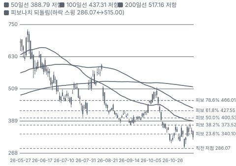

**주봉**

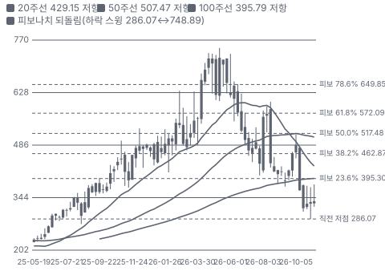

**월봉**

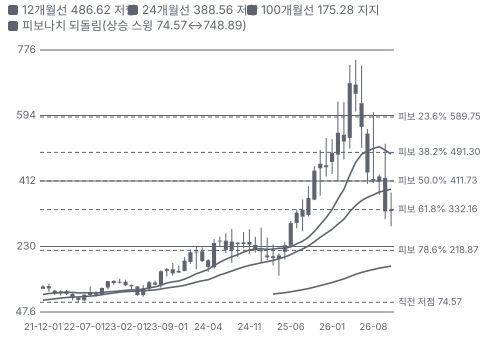

**분기 매출·EPS 실적과 컨센서스**

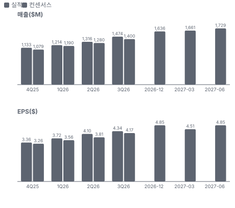

**4Q26 매출 — 지표 추세 vs 가이던스·컨센서스**

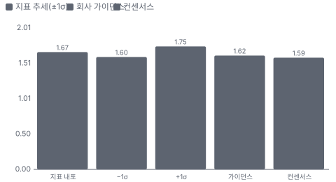

**최근 4개 분기 주가 변화 분석**

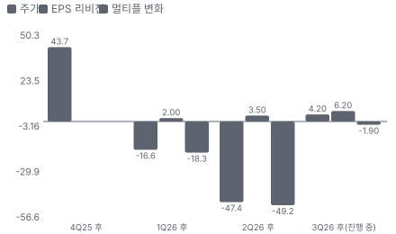

**EPS 리비전**

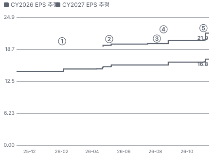

① 26-02-02 2Q FY26 — 다음 날 −10.2% · EPS 리비전 -
② 26-05-04 3Q FY26 — 다음 날 −8.0% · EPS 리비전 +1%
③ 26-08-04 중국 부품 제한 보도 · EPS 리비전 +0%
④ 26-08-17 4Q FY26 — 다음 날 −19.4% · EPS 리비전 +3%
⑤ 26-11-02 1Q FY27·Marvell–Lumentum 합병 · EPS 리비전 +7%

**멀티플 프리미엄(Fwd 1Y P/E, 최근 4개 분기말)**

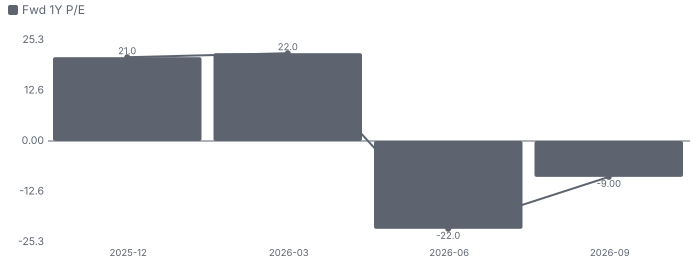

**합리적 멀티플**

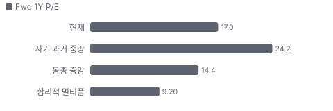

**밸류에이션 주가 시나리오**

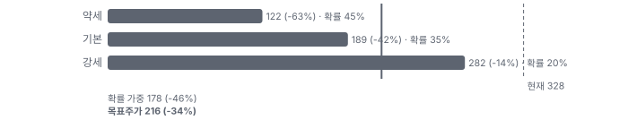

**주가별 업사이드**

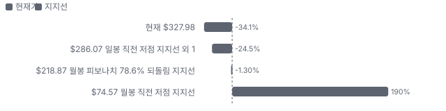
- 제품·서비스 포트폴리오

**고객 믹스(FY2026, 매출 대비)**

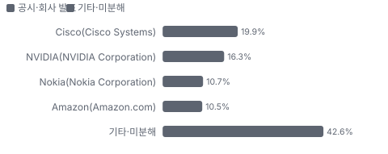

**공급 병목(10점, 낮을수록 병목)**

**생산능력 현재와 확충 계획(\$B 연 매출 캐파)**

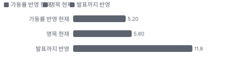

**CAPEX의 매출 대비 비중**

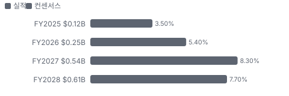

**어닝콜 변화별 주주가치 영향**

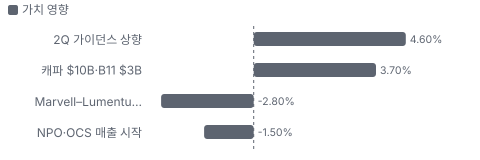

**수주·파이프라인 확실성 사다리**

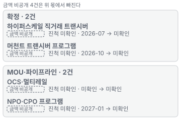

**매출 → 매출총이익 → 영업이익(매출 = 100, 최근 4분기)**

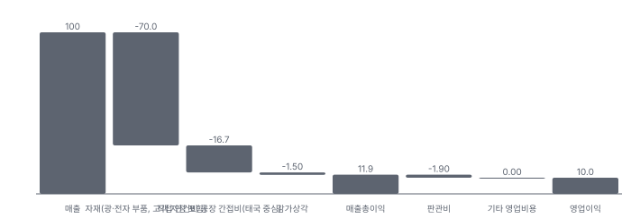

**분기 비용 비중 추이(매출 대비, 공시)**

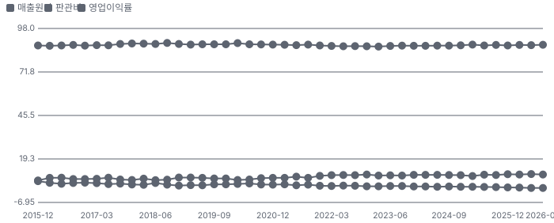

**비용 요인별 매출 대비 비중 1년 변화**

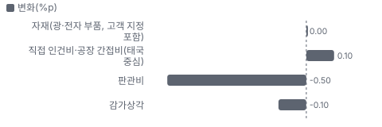

**데이터센터 BOM 원가 몫**

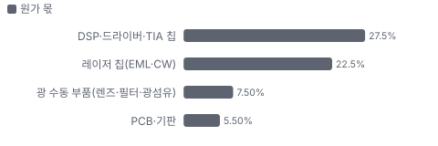

**통신 인프라 BOM 원가 몫**

**BOM 항목 가격 +10% 시 OPM 변화**

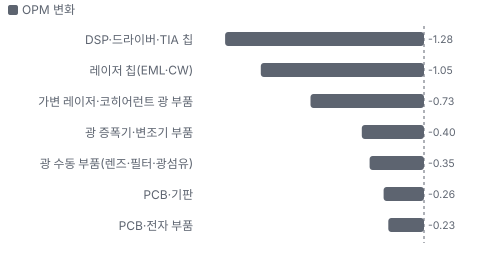

**원가 물가 vs 판매가 물가 — 1년 변화(원가가 판매가보다 더 오르면 단가를 올리지 못하는 만큼 마진이 줄어든다): 판매가 쪽 물가가 원가보다 0.0%p 더 올라 단가 전가 여지가 있다**

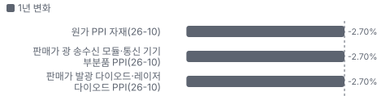

**자산 구성 — 3Q26 분기말 투하자본 \$3,147.0M**

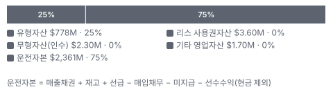

**자산별 변화율 — 최근 12개 분기(4Q23 = 0%) + 다음 4개 분기 추정**

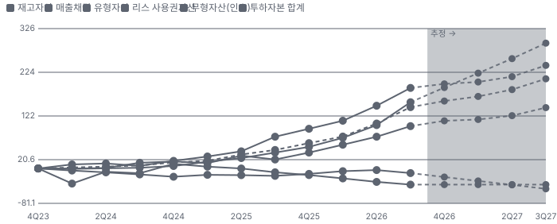

**ROIC 추이 — TTM, 최근 12개 분기 + 다음 4개 분기 추정(컨센서스 NOPAT)**

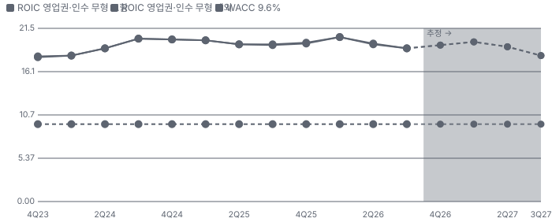

**분기 감가 비율 연율(유형자산 총액 대비)**

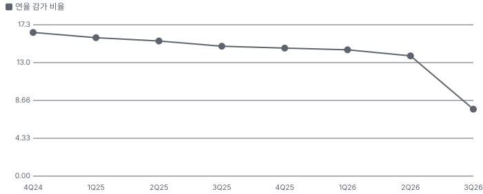

**생산시설별 면적(sq ft, 큰 순) — 생산능력 미공시라 면적을 대용으로**

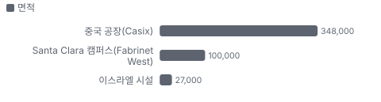

**매출 — 최근 16개 분기 + 다음 분기 추정(아래 지표들과 같은 분기)**

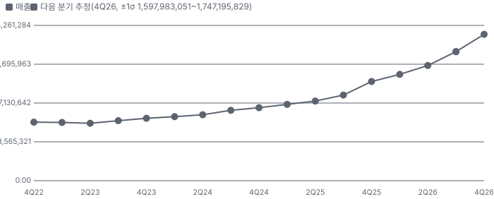

**미국 광 송수신 모듈·통신 기기 부분품 수입(HS 851762) 수출입(금액) — 16개 분기 범위 11,763,516,142.0~38,476,088,156.0(+227.1%)**

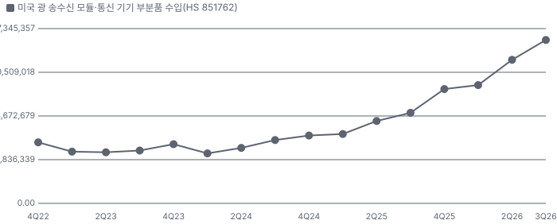

**10년 P·Q 사이클 — 추세(HP 필터) 대비 갭과 8분기 전망**

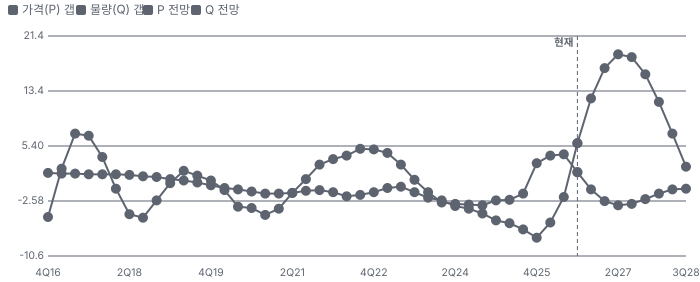

**매출 증가율의 가격·물량 분해와 8분기 전망(전년 대비)**

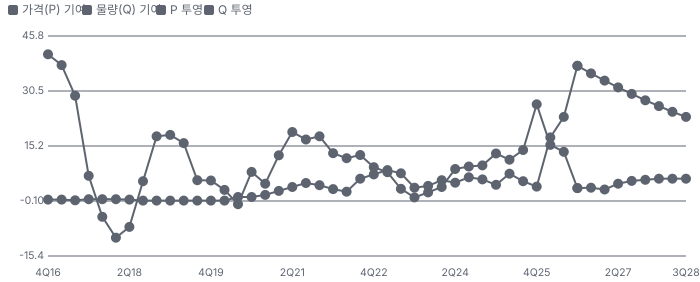

**분기별 매출 증가율 분해**

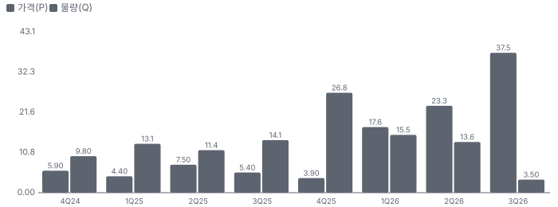

**목표주가 산정 — 기본과 강세 사이(강세 쪽 29%), 도달 확률 약 30%**

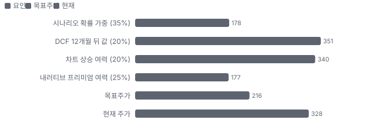

**PEG — 성장 대비 멀티플(낮을수록 성장 대비 쌈)**

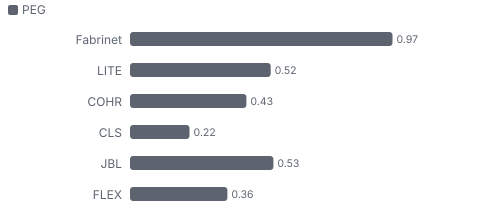

**일봉 지지·저항과 목표주가**

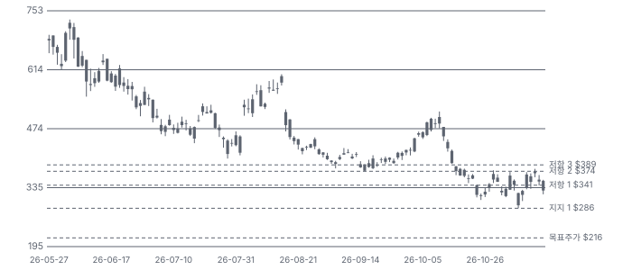

**커뮤니티 언급 수(최근 30일, 채널별)**

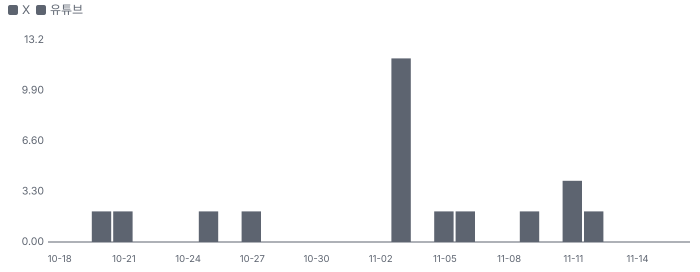

**커뮤니티 게시 수(월, 최근 7개월 — 이번 달은 진행 중)**

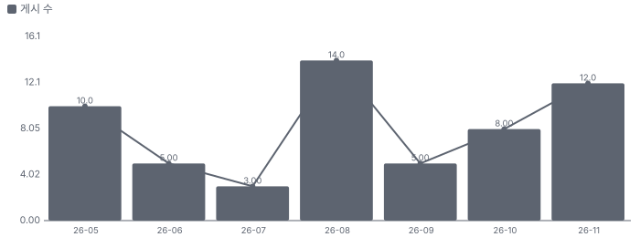

**재고 일수 — 분기별(수주 자료가 없어 수주/출하 비율 없음)**

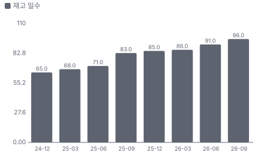

**일별 거래량 분해**

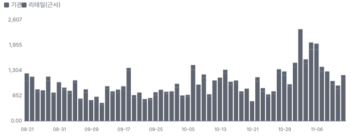

**기관 자금 흐름**

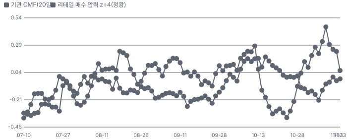

**몬테카를로**

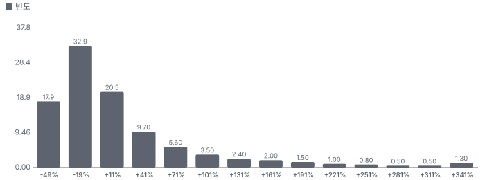

해석: 3,000번 중 1,354번(45%)에서 가치가 지금 주가 이상이었다. 지금 주가를 뒷받침하는 경우와 그렇지 않은 경우가 반반에 가깝다. 가운데 값은 0.95배이고, 열 번 중 여덟 번은 0.58~2.14배 사이에 든다.

## 내러티브

> **기업가치를 결정하는 이야기:** 이 회사는 자기 제품이 없다. Cisco·NVIDIA·Nokia·Amazon 같은 고객의 광 트랜시버·통신 광 부품·레이저를 대신 만든다. 마진은 11~12%로 얇지만 투하자본이 작아 ROIC가 높다. 성장 속도는 공장 면적(2027-01 캐파 \$10B)과 부품이 정하고, 배수는 고객이 물량을 나눠 가져가느냐가 정한다.

> **멀티플·EPS 프리미엄**
> **멀티플:** Fwd 1Y P/E 17.0배로 동종(Lumentum·Coherent·Celestica·Jabil·Flex) 중앙값 14.4배보다 약 18% 높다. 2026년 4월 41.8배에서 절반 아래로 내려왔다.
> **EPS:** 다음 4개 분기 EPS 컨센서스 \$19.27은 TTM \$15.52보다 24% 많다. FY27 EPS는 1Q 콜 뒤 \$18.63 → \$19.73으로 6% 올랐다.

### 투자자들은 왜 열광했나

2026년 상반기 투자자들은 AI 광 연결(800G(초당 800기가비트 광 트랜시버) → 1.6T(초당 1.6테라비트 광 트랜시버))과 하이퍼스케일러 직거래 프로그램에 열광했다 — Fwd 1Y P/E가 4월 41.8배까지 올랐다. 식은 이유는 세 가지다: 8월 10-K에서 NVIDIA 비중이 27.6% → 16.3%로 줄어든 것이 확인됐고, 11월 Marvell–Lumentum 합병 발표로 고객 통합 위험이 생겼으며, 11월 초 AI 업종 전체가 급락했다. 실적은 네 분기 연속 컨센서스를 넘었다.

### 무엇이 기업가치를 바꾸나

> **구조적 체질 변화**
> **변화:** 통신 장비 위탁사에서 AI 데이터센터 광 부품 위탁사로 — 데이터센터 매출 비중 44.7% → 52.7%(1년)
> **증거:** 10-Q 1Q FY27 매출 분류
> **반증:** 데이터센터 비중이 2개 분기 연속 50% 아래

> **고부가 믹스 확장**
> **변화:** HPC(고성능 컴퓨팅) 보드·NPO·CPO 등 더 복잡한 제품으로 범위가 넓어진다 — 마진 영향은 미공시
> **증거:** 1Q 콜: NPO FY27 하반기 매출, OCS·NPO 각각 수억 달러 기회
> **반증:** FY27 4분기까지 GPM이 12% 아래

> **기술 혁신**
> **변화:** CPO·NPO 전환은 위협이자 기회 — 광 엔진 조립 위치가 바뀐다
> **증거:** 1Q 콜: 플러거블과 NPO·CPO는 보완 관계라는 경영진 입장, Cisco·NVIDIA 고밀도 플러거블 로드맵 언급
> **반증:** 주요 고객이 CPO 광 엔진을 칩 패키징 업체(OSAT·파운드리)에 맡겼다는 공시

> **실행 속도**
> **변화:** 해당 없음(주문→출하 리드타임을 회사·동종 모두 수치로 공시하지 않는다 — 위탁 생산은 고객 생산 계획에 맞춘 출하라 속도는 캐파 해제 일정으로 본다: 캐파 \$5.8B → 2027-01 \$10B)
> **증거:** 1Q 콜
> **반증:** Building 10 가동 뒤 2개 분기 매출 증가가 \$100M 미만

> **M&A**
> **변화:** 해당 없음(최근 3년 인수 없음 — 시설 매입만). 고객 쪽 통합(Marvell–Lumentum)이 변수
> **증거:** 10-Q·1Q 콜
> **반증:** -

> **정책·입법 연관성**
> **재정정책:** 해당 없음(이 회사 매출에 직접 걸린 세출·세액공제 확인 안 됨) - 반증: - 의회 동의 2/10 — 하원 1/5(관련 세출 논의 확인 안 됨) · 상원 1/5(같음).
> **행정명령:** 중국산 데이터센터 부품(광 트랜시버 포함) 제한 검토 보도(2026-08) — 태국 생산은 대체 수혜 후보 보도(2026-08-04) — 규칙안·최종 규칙 확인 안 됨 반증: 규칙이 1년 안에 나오지 않거나 동남아 경유 우회까지 묶는다 의회 동의 2/10 — 하원 1/5(행정부 검토 단계 — 의회 절차 없음) · 상원 1/5(같음).
> **연관입법:** 해당 없음(관련 법안 확인 안 됨) - 반증: -

> **고객의 지출 예산**
> **변화:** 고객 돈은 대부분 하이퍼스케일러·통신사 CAPEX에서 나온다(데이터센터 광 연결·통신망 장비)
> **사업별 예산:** **매출의 53%**: 데이터센터 — 고객 CAPEX(AI 데이터센터 광 연결(트랜시버·DCI(데이터센터 사이 연결)·HPC)) · 동인: GPU 클러스터 증설·800G → 1.6T
**매출의 30%**: 통신 인프라 — 고객 CAPEX(통신사·장비사 광 전송망 투자) · 동인: 코히어런트 광·ROADM(파장을 원격으로 넣고 빼는 광 장치)
**매출의 17%**: 자동차·산업·기타 — 고객 혼합(차량 센서·산업용 레이저·의료기기) · 동인: 전장·산업 경기
> **증거:** 10-Q 매출 분류
> **반증:** 하이퍼스케일러 2027 CAPEX 하향

### 내러티브 근거

> 'AI 광 연결의 숨은 공장'이라는 이야기는 매출 +51%로 증명됐지만, 시장은 그 이야기에 붙였던 배수를 걷어 냈다(5/14 종가 고점 \$746.47 대비 −56%). 지금 가격은 고객이 물량을 나눠 가져가도 캐파 \$10B를 채울 수 있느냐를 묻는다. 동종 대비 멀티플 차이 +18% 중 회사 고유 몫은 +85%다. 단계는 소멸, 쏠림은 보통(공매도 유통 주식의 6.1%·1.7일분, 기관 보유 93%, X 언급은 이어지나 레딧 상위권 밖)이다.

> **AI 광 연결 물량(800G → 1.6T)** · 유지
> **논리:** GPU 클러스터가 커질수록 광 트랜시버가 늘고, Fabrinet이 그 조립을 맡는다
> **숫자:** 데이터센터 매출 1Q \$777M(+78%), 2Q 가이던스 전사 +43%
> **반증:** 데이터센터 매출이 전 분기 대비 2개 분기 연속 감소
> **출처:** 10-Q·1Q 콜

> **캐파 선점(\$5.8B → \$10B → \$13B)** · 강화
> **논리:** 경쟁사보다 먼저 공장을 지어 물량을 받는다
> **숫자:** Building 10 +\$3.5B(2027-01), Building 11 +\$3B(2028 중반)
> **반증:** Building 10 가동 뒤 2개 분기 가동률이 60% 아래(매출 ÷ 캐파)
> **출처:** 1Q 콜

> **고객 다변화(Amazon·머천트)** · 약화
> **논리:** NVIDIA 의존이 줄고 하이퍼스케일러 직거래가 늘어 집중 위험이 낮아진다
> **숫자:** Amazon FY26 10.5%(10% 고객 신규), 10% 고객 합계 1Q 46.7%(전년 51.5%) — 그러나 Marvell–Lumentum 합병으로 다변화 효과가 흔들린다
> **반증:** 10% 고객 합계가 다시 55%를 넘는다
> **출처:** 10-K·10-Q

> **NPO·CPO 다음 세대** · 유지
> **논리:** 광 엔진이 칩에 가까워져도 조립은 Fabrinet이 맡는다
> **숫자:** NPO 매출 FY27 하반기 시작(콜), 금액 미공시
> **반증:** CPO 광 엔진 조립을 패키징 업체가 가져갔다는 공시
> **출처:** 1Q 콜

> **반대 내러티브 — 고객 내재화·물량 분산** · 강화
> **논리:** NVIDIA 비중이 27.6% → 16.3%로 줄었고 Marvell–Lumentum이 합쳐지면 조립 물량이 내부나 다른 위탁사로 갈 수 있다
> **숫자:** NVIDIA 매출 FY25 약 \$944M → FY26 약 \$756M(계산, 10-K 비중 × 매출)
> **반증:** FY27 10-K에서 NVIDIA 비중이 다시 오르거나 Lumentum 물량 유지 발언
> **출처:** 10-K FY25·FY26

> **반대 내러티브 — 현금 소진** · 강화
> **논리:** 재고·공장 투자로 FCF가 마이너스다
> **숫자:** TTM 영업현금흐름 \$175M − CAPEX \$366M = FCF −\$191M(계산), 재고 1년 +65%
> **반증:** 2개 분기 연속 FCF 흑자
> **출처:** 현금흐름표

## 포트폴리오

| 제품·서비스 | 구분 | 무엇 | 쓰는 곳 | 돈 버는 방식 | Mix | Mix 변화(전 분기 대비) |
|---|---|---|---|---|---|---|
| 데이터센터 | 제품 | AI 데이터센터용 광 트랜시버(800G·1.6T)·DCI 모듈·HPC 보드 위탁 생산 | GPU 서버와 스위치 사이 광 연결 | 프로그램 위탁 생산. 1Q 매출 \$777M(전년 +78%) | 53% | +8.0%p |
| 통신 인프라 | 제품 | 코히어런트 광 모듈·ROADM·광 증폭기·가변 레이저 위탁 생산 | 통신사 장거리·메트로 광 전송망 | 1Q 매출 \$444M(전년 +35%) | 30% | -3.6%p |
| 자동차·산업·기타 | 제품 | 차량 센서·산업용 레이저·의료기기 부품, 광학 소재(렌즈·결정) | 전장·산업 장비 | 1Q 매출 \$253M(전년 +20%) | 17% | -4.4%p |

**Mix 변화가 가장 큰 쪽은 데이터센터(+8.0%p, 전 분기 대비).** 계절성 판정: 분기 매출 계절 지수 기준 없음 → 직전 분기와 비교.

## 고객

> **FY2026 최대 고객 Cisco(Cisco Systems) 20%, 상위 3곳 47%, 집중도 분산.** 공시·회사 발표로 확인한 몫은 매출의 57%이고, 나머지 고객 몫은 추정이거나 미분해다. FY26 10% 고객은 Cisco 19.9%·NVIDIA 16.3%·Nokia 10.7%·Amazon 10.5%다. NVIDIA 비중은 FY25 27.6%에서 크게 내려갔다 — 금액으로도 약 \$944M → \$756M(계산)로 줄었다. 1Q FY27에는 10% 고객 3곳이 매출의 46.7%다(이름 미공시).

**고객별 매출 몫(FY2026)**
| 고객 | 몫 | 변화 | 근거 |
|---|---|---|---|
| Cisco(Cisco Systems) | 20% | +2%p | 공시 |
| NVIDIA(NVIDIA Corporation) | 16% | -11%p | 공시 |
| Nokia(Nokia Corporation) | 11% | 미확인 | 공시 |
| Amazon(Amazon.com) | 10% | 미확인 | 공시 |
| Lumentum(Lumentum Holdings) | 미확인 | 미확인 | 회사 발표 |
| 기타·미분해 | 43% | - | - |

> **Cisco(Cisco Systems)** · 공시
> **사는 것:** 코히어런트 광 모듈·통신 장비 부품(Acacia 포함)
> **추정 근거:** FY26 최대 고객

> **NVIDIA(NVIDIA Corporation)** · 공시
> **사는 것:** 데이터센터 광 트랜시버·HPC 보드
> **추정 근거:** 비중·금액 모두 감소 — 공급처 다변화 여부 미확인

> **Nokia(Nokia Corporation)** · 공시
> **사는 것:** 통신 인프라 광 부품(Infinera 인수분 포함)
> **추정 근거:** FY25에는 10% 미만

> **Amazon(Amazon.com)** · 공시
> **사는 것:** 하이퍼스케일 직거래 트랜시버
> **추정 근거:** 워런트 381,922주가 결제액에 연동

> **Lumentum(Lumentum Holdings)** · 회사 발표
> **사는 것:** 레이저·광 모듈 위탁 생산
> **추정 근거:** Marvell 합병 예정(2028 상반기)

## 수주·파이프라인

> **2026-11-02 기준 4건.** 확정 \$0.00B.

**수주 목록**
| 상태 | 계약 | 계약 총액 | 진척 | 기간 | 비고 |
|---|---|---|---|---|---|
| 확정 | 하이퍼스케일 직거래 트랜시버 | 금액 비공개 | 비공개 | 2026-07 → 미확인 | - |
| 확정 | 머천트 트랜시버 프로그램 | 금액 비공개 | 비공개 | 2026-10 → 미확인 | - |
| 파이프라인 | OCS·멀티레일 | 금액 비공개 | 비공개 | 미확인 → 미확인 | - |
| 파이프라인 | NPO·CPO 프로그램 | 금액 비공개 | 비공개 | 2027-01 → 미확인 | - |

**실행 속도와 방해 요인**
| 항목 | 상태 | 실행 속도 | 방해 요인 |
|---|---|---|---|
| 하이퍼스케일 직거래 트랜시버 | 확정 | 4Q FY26부터 램프(콜) | 부품 수급 |
| 머천트 트랜시버 프로그램 | 확정 | 램프 초기(콜) | 부품 수급 |
| OCS·멀티레일 | 파이프라인 | 출하 시작 전 — '각각 수억 달러 기회'(콜) | 고객 수요 시점 |
| NPO·CPO 프로그램 | 파이프라인 | NPO FY27 하반기, CPO 더 뒤(콜) | 표준·고객 채택 · CPO 일정 |

## 마진 구조

> **GPM 11.8%, OPM 9.9%.** 1Q FY26 대비 GPM -0.1%p, OPM +0.3%p. 변동비는 매출의 81%이고, 매출이 10% 늘면 OPM은 +0.9%p 움직인다. 1Q FY27 매출원가는 매출의 88.2%로 1년 전 88.1%와 거의 같다. 원가 대부분은 자재다(고객 지정 부품 포함) — 자재 몫은 공시되지 않아 추정이다. 마진을 흔드는 가장 큰 변수는 바트 환율이라고 CFO가 말했다.

> **매출 100 중 매출원가 88.1, 매출총이익 11.9(최근 4분기, 공시).** 매출원가 요인 중 자재(광·전자 부품, 고객 지정 포함)이 매출의 70.0%로 가장 무겁고, 단가가 +10% 오르면 GPM이 -7.00%p 움직인다. 분기 회귀로 매출 1이 늘 때 매출원가는 0.88 늘고, 매출원가의 고정비 몫은 0%다.

**비용 요인 강도 — 비중·추세·충격(+10%)·탄력**
| 비용 | 구분 | 매출 대비 | 1년 변화 | 마진 기여 | 충격 시 마진 | 매출 탄력 | 고정비 몫 |
|---|---|---|---|---|---|---|---|
| 자재(광·전자 부품, 고객 지정 포함) | 매출원가 요인 | 70.0% | +0.0%p | -0.0%p | -7.00%p | 미확인 | 0% |
| 직접 인건비·공장 간접비(태국 중심) | 매출원가 요인 | 16.7% | +0.1%p | -0.1%p | -1.67%p | 미확인 | 40% |
| 감가상각 | 매출원가 요인 | 1.5% | -0.1%p | +0.1%p | -0.15%p | 미확인 | 100% |
| 매출원가 | 공시 항목 | 88.1% | +0.0%p | -0.0%p | -8.81%p | 0.88 | 0% |
| 판관비 | 공시 항목 | 1.9% | -0.5%p | +0.5%p | 미확인 | 0.01 | 64% |
| 기타 영업비용 | 공시 항목 | 0.0% | -0.0%p | +0.0%p | 미확인 | 0.00 | -20% |

매출 탄력 = 분기 비용을 매출에 회귀한 기울기(매출 1당 변동비), 고정비 몫 = 절편 ÷ 평균 비용. 표본이 8분기 미만이면 미확인. 매출원가 요인 비중은 margin 재료의 추정이 섞여 있고, 공시 매출원가와의 차이는 '기타 매출원가'로 둔다.

**GPM에서 OPM까지(GAAP, 아래는 최근 4개 분기)**
| 기간 | GPM | 연구개발 | 판관비 | 기타 | OPM |
|---|---|---|---|---|---|
| 1Q FY26 | 11.9% | 0.0% | 2.3% | 0.0% | 9.6% |
| 1Q FY27 | 11.8% | 0.0% | 1.8% | 0.1% | 9.9% |
| 2025-12 | 12.2% | - | - | - | 10.1% |
| 2026-03 | 11.9% | - | - | - | 9.9% |
| 2026-06 | 12.0% | - | - | - | 10.2% |
| 2026-09 | 11.8% | - | - | - | 9.9% |

**비용을 움직이는 요인**
| 비용 | 요인 |
|---|---|
| 자재(광·전자 부품, 고객 지정 포함, 매출원가) | 레이저·DSP·PCB 단가, 고객 지정 부품 가격 · 근거 추정 |
| 직접 인건비·공장 간접비(태국 중심, 매출원가) | 바트 환율·연례 임금 인상·램프 초기 비용 · 근거 추정 |
| 판관비(판관비) | 인력·주식 보상 · 근거 공시 |
| 감가상각(매출원가) | Building 10·Santa Clara 캠퍼스 가동 · 근거 공시 |

**데이터센터 BOM — 매출의 53%, GPM 12%(세그먼트 이익 미공시 — 전사 GAAP GPM 11.8% 대입(추정)), 항목 가격 +10% 시**
| 항목 | 원가 몫 | 전가 | 제품 GPM | OPM |
|---|---|---|---|---|
| DSP·드라이버·TIA 칩 | 20~35% | 미확인 | -2.4%p | -1.28%p |
| 레이저 칩(EML(전계 흡수 변조 레이저)·CW(연속파 레이저)) | 15~30% | 미확인 | -2.0%p | -1.05%p |
| 광 수동 부품(렌즈·필터·광섬유) | 5~10% | 미확인 | -0.7%p | -0.35%p |
| PCB·기판 | 3~8% | 미확인 | -0.5%p | -0.26%p |
| 미분해 | 37% | - | - | - |

**통신 인프라 BOM — 매출의 30%, GPM 12%(전사 GAAP GPM 대입(추정)), 항목 가격 +10% 시**
| 항목 | 원가 몫 | 전가 | 제품 GPM | OPM |
|---|---|---|---|---|
| 가변 레이저·코히어런트 광 부품 | 20~35% | 미확인 | -2.4%p | -0.73%p |
| 광 증폭기·변조기 부품 | 10~20% | 미확인 | -1.3%p | -0.40%p |
| PCB·전자 부품 | 5~12% | 미확인 | -0.7%p | -0.23%p |
| 미분해 | 49% | - | - | - |

DSP·드라이버·TIA 칩 가격이 +10% 오르면 영업이익은 -12.9% 움직인다. 판매가 전가를 모르는 항목은 전가 0%로 계산했다.

**BOM 항목 가격을 움직이는 것**
| 항목 | 요인 |
|---|---|
| 레이저 칩(EML·CW) | 광 트랜시버 원가의 핵심 · 근거 추정 |
| DSP·드라이버·TIA 칩 | 800G·1.6T 모듈의 전기 신호 처리 · 근거 추정 |
| PCB·기판 | 모듈·HPC 보드 기판 · 근거 추정 |
| 광 수동 부품(렌즈·필터·광섬유) | 광 결합·정렬 · 근거 추정 |
| 가변 레이저·코히어런트 광 부품 | 코히어런트 모듈·ROADM 핵심 · 근거 추정 |
| 광 증폭기·변조기 부품 | 장거리 전송 부품 · 근거 추정 |
| PCB·전자 부품 | 모듈 전자부 · 근거 추정 |

**투입 물가 — 미국 PPI 3·6·12개월(2026-10, 개정 반영)과 해외 전년비**
| 항목 | 미국 3개월 | 6개월 | 12개월 | 전가 못 할 때 OPM | 일본 | 한국 | 대만 |
|---|---|---|---|---|---|---|---|
| 가변 레이저·코히어런트 광 부품 | -0.7% | -5.7% | -2.7%* | - | 미확인 | 미확인 | 미확인 |
| 광 증폭기·변조기 부품 | -0.7% | -5.7% | -2.7%* | - | 미확인 | 미확인 | 미확인 |
| PCB·전자 부품 | +0.0% | +24.0% | +46.4% | - | +11.5% | +4.5% | +12.1% |
| 광 수동 부품(렌즈·필터·광섬유) | 미확인 | 미확인 | 미확인* | - | 미확인 | 미확인 | 미확인 |

별표는 품목보다 넓은 업종 지수다. 연결한 투입 원가의 미국 PPI(생산자물가지수)는 1년 새 가중 -2.7%이고, 판매가로 넘기지 못하면 GPM +1.9%p·OPM +1.9%p가 움직인다. 판매가 비교 물가(광 송수신 모듈·통신 기기 부분품 PPI)는 1년 새 -2.7% — 회사 가격 변화는 미확인. 물가 지수를 붙이지 못한 매출원가 항목은 직접 인건비·공장 간접비(태국 중심), 감가상각다(미연결).

## 자산 구성

> **3Q26 분기말 투하자본 \$3,147.0M** — 운전자본 75%, 유형자산 25%. 최근 12개 분기(4Q23 → 3Q26) 가장 크게 늘어난 자산은 재고자산(+188%), 투하자본 합계 +143%. 3Q27 추정 투하자본 \$4,003.3M(+27%, 컨센서스 매출과 회전 일수·CAPEX 강도 유지 가정). 연율 감가 비율(총액 기준)은 직전 4분기 15.60% → 최근 4분기 11.42%, 직전 비율이면 감가상각이 \$27.6M 더 컸다(영업이익의 5.4%).

**자산·운전자본 항목별 분기말 잔액 — 최근 12개 분기와 다음 4개 분기 추정**
| 항목 | 4Q23 | 3Q25 | 3Q26(최근) | 3Q27 추정 | 12개 분기 변화 | 다음 4개 분기 변화 |
|---|---|---|---|---|---|---|
| 매출채권 | \$584.6M | \$706.9M | \$1,161.4M | \$1,413.5M | +99% | +22% |
| 재고자산 | \$414.8M | \$722.2M | \$1,193.1M | \$1,411.2M | +188% | +18% |
| 선급·기타 유동자산 | \$6.0M | \$36.5M | \$48.9M | \$61.9M | +721% | +27% |
| 미지급비용 | \$16.1M | \$29.0M | \$36.7M | \$56.2M | +128% | +53% |
| 선수수익(계약부채) | \$6.3M | \$9.8M | \$5.5M | \$33.2M | -13% | +504% |
| 유형자산 | \$306.0M | \$419.5M | \$778.2M | \$1,199.4M | +154% | +54% |
| 리스 사용권자산 | \$5.8M | \$5.3M | \$3.6M | \$3.6M | -37% | +0% |
| 무형자산(인수) | \$2.5M | \$2.1M | \$2.3M | \$1.3M | -11% | -41% |

**자산 추정 동인 — 최근 4개 분기 평균(재무상태표 동인 모형)**
| 동인 | 값 | 곱하는 기준 |
|---|---|---|
| 매출채권 | 69일 | 매출 |
| 재고자산 | 78일 | 매출원가 |
| 선급·기타 유동자산 | 3일 | 매출 |
| 미지급비용 | 3일 | 매출 |
| 선수수익(계약부채) | 2일 | 매출 |
| CAPEX 강도 | 7.1% | 매출(최근 4개 분기 합) |
| 분기 감가율 | 3.68% | 기초 유형자산 순액(무형 상각 제외 감가상각) |
| 매출원가율 | 88.1% | 매출(최근 4개 분기) |
| 영업권·리스 사용권·기타 | 유지 | 인수·새 리스는 공시 전 모름 |
| 인수 무형자산 | 분기 \$0.2M 상각 | 최근 4개 분기 평균 상각 |

**추정 방법:** 증권사 3표 모델(손익·재무상태표·현금흐름)의 재무상태표 동인 방식이다. 운전자본은 항목별 회전 일수(매출채권·선급·미지급·선수는 매출, 재고·매입채무는 매출원가 기준)를 최근 4개 분기 평균으로 두고 컨센서스 매출에 곱한다. 유형자산은 기초 + CAPEX − 감가상각으로 굴린다(Koller·Goedhart·Wessels 『Valuation』 재무상태표 추정). 매출 경로는 ROIC 절의 컨센서스와 같다.

**유형·무형자산 항목별 가치(2026-06-26 vs 2025-06-27)**
| 구분 | 항목 | 총액 2026-06-26 | 누적상각 | 순액 | 총액 2025-06-27 | 총액 1년 변화 | 공시 내용연수 |
|---|---|---|---|---|---|---|---|
| 유형 | 유형자산 합계(항목 미분해) | \$1,042.2M | 총계만 공시 | 총계만 공시 | \$748.0M | +39.3% | 미확인 |
| 유형 합계 | 유형자산 | \$1,042.2M | \$427.2M | \$615.1M | \$748.0M | +39.3% | 경과율 41%(상각 대상 기준) |

**내용연수 산식(상각 대상 유형자산 = 총액 − 토지 − 건설중)**
| 기준일 | 연 감가상각 | 상각 대상 총액 | 평균 내용연수 | 경과 연수 | 잔여 연수 | 경과율 |
|---|---|---|---|---|---|---|
| 2026-06-26 | \$67.5M | \$1,042.2M | 15.4년 | 6.3년 | 9.1년 | 41% |
| 2025-06-27 | \$52.5M | \$748.0M | 14.2년 | 7.0년 | 7.3년 | 49% |

산식 평균 내용연수는 15.4년. 1년 전 14.2년 → 지금 15.4년.

**분기 감가 비율(감가상각 ÷ 평균 유형자산 총액)**
| 분기 | 감가상각 | 평균 유형자산(총액) | 분기 비율 | 연율 | 연율의 역수 |
|---|---|---|---|---|---|
| 4Q24 | \$13.0M | \$317.4M | 4.11% | 16.44% | 6.1년 |
| 1Q25 | \$13.4M | \$339.1M | 3.96% | 15.84% | 6.3년 |
| 2Q25 | \$14.2M | \$367.6M | 3.87% | 15.46% | 6.5년 |
| 3Q25 | \$14.9M | \$400.1M | 3.71% | 14.86% | 6.7년 |
| 4Q25 | \$16.1M | \$439.8M | 3.66% | 14.65% | 6.8년 |
| 1Q26 | \$17.8M | \$492.6M | 3.61% | 14.45% | 6.9년 |
| 2Q26 | \$19.6M | \$570.0M | 3.44% | 13.76% | 7.3년 |
| 3Q26 | \$21.7M | \$1,132.9M | 1.92% | 7.66% | 13.1년 |

감가상각 기준: 손익계산서 감가상각·상각비(SEC 공시 데이터, 4분기 = 연간 − 1~3분기).

**감가율 하락 경고: 연율 15.60% → 11.42%(-27%).** 직전 4분기 비율을 그대로 쓰면 최근 4분기 감가상각이 \$27.6M 더 컸다(영업이익의 5.4%). 내용연수 연장·상각 끝난 자산 증가·건설중 자산 증가(믹스) 중 무엇인지는 공시 주석으로 가린다(자체추론).

미공시·미분해: 영업권 · 유형자산 항목별 총액·내용연수(10-K 주석에서 모델이 채움) · 무형자산 항목(10-K 주석에서 모델이 채움) — 이 칸은 비우고 나머지로 계산했다.

### 해석 — 자산이 어디에 쌓이고 있나

- 같은 기간 4개 분기 매출은 +71% — 매출보다 빨리 늘어난 자산: 매출채권 +99%, 재고자산 +188%, 유형자산 +154%. 이 자산의 회전율이 떨어지면 ROIC를 희석한다.
- 다음 4개 분기 CAPEX \$491.5M vs 감가상각 \$137.4M(최근 4개 분기 CAPEX 강도·감가율 유지) — 유형자산 3Q26 \$778.2M → 3Q27 \$1,199.4M. 투자가 감가보다 커서 자산이 쌓이는 국면이다.
- 감가 비율 하락으로 최근 4분기 영업이익에 \$27.6M(5.4%)가 보태졌을 수 있다 — 내용연수 변경 공시가 없으면 건설중 자산·토지 같은 비상각 자산 몫이 커진 믹스 효과일 가능성이 크다(자체추론).

## ROIC

> **TTM 3Q26 ROIC는 영업권·인수 무형 포함 19.0%, 제외 19.0%**(NOPAT 마진 9.2% × 투하자본 회전율 2.05회). 최근 12개 분기 4Q23 17.9% → 3Q26 19.0%(고점 1Q26 20.4%). 컨센서스 NOPAT으로 굴리면 3Q27 18.1%(제외 18.1%) — WACC 9.6% 대비 +8.5%p. 1년 변화의 가장 큰 요인은 NOPAT 마진(+1.0%p).

**ROIC 추이(TTM)와 다음 4개 분기 추정 — NOPAT ÷ 평균 투하자본(이번 분기말·4개 분기 전)**
| 분기 | 구분 | TTM 매출 | TTM NOPAT | NOPAT 마진 | 평균 투하자본 | ROIC 포함 | ROIC 제외 |
|---|---|---|---|---|---|---|---|
| 4Q23 | 실적 | \$2,719.3M | \$236.9M | 8.7% | \$1,321.7M | 17.9% | 18.0% |
| 1Q24 | 실적 | \$2,785.6M | \$245.4M | 8.8% | \$1,359.2M | 18.1% | 18.1% |
| 2Q24 | 실적 | \$2,883.0M | \$256.4M | 8.9% | \$1,350.2M | 19.0% | 19.0% |
| 3Q24 | 실적 | \$3,001.7M | \$268.6M | 8.9% | \$1,329.6M | 20.2% | 20.2% |
| 4Q24 | 실적 | \$3,122.6M | \$278.3M | 8.9% | \$1,387.3M | 20.1% | 20.1% |
| 1Q25 | 실적 | \$3,262.9M | \$285.1M | 8.7% | \$1,427.6M | 20.0% | 20.0% |
| 2Q25 | 실적 | \$3,419.3M | \$299.7M | 8.8% | \$1,535.4M | 19.5% | 19.5% |
| 3Q25 | 실적 | \$3,593.2M | \$315.4M | 8.8% | \$1,622.8M | 19.4% | 19.5% |
| 4Q25 | 실적 | \$3,892.5M | \$347.5M | 8.9% | \$1,769.9M | 19.6% | 19.7% |
| 1Q26 | 실적 | \$4,235.0M | \$385.4M | 9.1% | \$1,893.8M | 20.4% | 20.4% |
| 2Q26 | 실적 | \$4,641.1M | \$427.0M | 9.2% | \$2,185.9M | 19.5% | 19.6% |
| 3Q26 | 실적 | \$5,137.4M | \$474.7M | 9.2% | \$2,501.6M | 19.0% | 19.0% |
| 4Q26 | 추정 | \$5,640.5M | \$522.9M | 9.3% | \$2,696.7M | 19.4% | 19.4% |
| 1Q27 | 추정 | \$6,087.2M | \$568.2M | 9.3% | \$2,866.0M | 19.8% | 19.8% |
| 2Q27 | 추정 | \$6,500.5M | \$606.9M | 9.3% | \$3,164.8M | 19.2% | 19.2% |
| 3Q27 | 추정 | \$6,900.0M | \$648.4M | 9.4% | \$3,575.2M | 18.1% | 18.1% |

**다음 4개 분기 NOPAT — 컨센서스(세율 8%, 리스 이자 별도)**
| 분기 | 매출 | EBITA 마진 | EBITA | NOPAT(분기) | 근거 |
|---|---|---|---|---|---|
| 4Q26 | \$1,636.0M | 10.2% | \$167.0M | \$153.7M | 컨센서스 매출 × EBIT 마진 FY2026(조정 − 주식보상 0.7%) |
| 1Q27 | \$1,661.0M | 10.2% | \$169.6M | \$156.0M | 컨센서스 매출 × EBIT 마진 FY2027(조정 − 주식보상 0.7%) |
| 2Q27 | \$1,729.0M | 10.2% | \$176.5M | \$162.4M | 컨센서스 매출 × EBIT 마진 FY2027(조정 − 주식보상 0.7%) |
| 3Q27 | \$1,874.0M | 10.2% | \$191.3M | \$176.0M | 컨센서스 매출 × EBIT 마진 FY2027(조정 − 주식보상 0.7%) |

**추정 방법:** NOPAT은 컨센서스(분기 매출 추정 × 회계연도 EBIT 마진 추정)로 잡고, 조정(비 GAAP) 마진이면 주식보상 몫을 빼서 과거 실적과 같은 기준(영업이익 + 인수 무형 상각)으로 맞췄다. 이미 발표했지만 분기 보고서(10-Q)가 아직 없는 분기는 발표 실적을 쓴다. 투하자본은 자산 구성 절의 재무상태표 동인으로 굴렸다. ROIC는 4개 분기 NOPAT을 이번 분기말과 4개 분기 전 투하자본의 평균으로 나눈다 — 추정 분기의 ROIC에는 이미 나온 실적 분기가 섞여 있다.

**투하자본 항목별 회전율과 ROIC 기여(TTM 3Q26, 평균 잔액)**
| 항목 | 투하자본 | 매출 1달러당 자본 | 회전율(매출 ÷ 항목) | 자본 몫 | 이 항목을 빼면 ROIC |
|---|---|---|---|---|---|
| 운전자본 | \$1,894.1M | 0.37 | 2.71회 | 76% | 78.1% |
| 유형자산 | \$598.9M | 0.12 | 8.58회 | 24% | 24.9% |
| 리스 사용권자산 | \$4.4M | 0.00 | 1157.60회 | 0% | 19.0% |
| 무형자산(인수) | \$2.2M | 0.00 | 2341.05회 | 0% | 19.0% |
| 기타 영업자산 | \$2.1M | 0.00 | 2478.86회 | 0% | 19.0% |

**ROIC 세 가지 판**
| 판 | NOPAT | 투하자본 | ROIC | 무엇을 재나 |
|---|---|---|---|---|
| 영업권·인수 무형 포함 | \$474.6M | \$2,501.6M | 19.0% | 인수 웃돈까지 낸 돈에 대한 수익률 |
| 영업권·인수 무형 제외 | \$474.6M | \$2,499.4M | 19.0% | 본업 운영 수익률(동종 비교용) |
| 무형 자본화 조정(판관비 20%·5년, 연구개발 6년) | \$477.8M | \$2,552.9M | 18.7% | 비용으로 처리한 무형 투자를 자산으로 본 판 |
| 경제적 이익(포함판) | \$234.6M | \$2,501.6M | 자본비용 9.6% | (ROIC − 자본비용) × 투하자본 |

NOPAT = (영업이익 \$514.7M + 인수 무형 상각 + 리스 내재 이자 \$0.3M) × (1 − 세율 8%). 리스 사용권자산을 투하자본에 넣었으므로 임차료 속 이자 몫을 영업이익에 되더했다. 현금은 영업에 필요한 몫을 따로 알 수 없어 투하자본에서 뺐다. SEC 공시 데이터 자동 초안 — 운전자본 = 매출채권 + 재고 + 선급 − (매입채무 + 미지급비용 + 선수수익), 현금 제외. 손상 누계는 공시 데이터 수록분.

**ROIC 1년 변화 분해(포함판, TTM 3Q25 → TTM 3Q26)**
| 요인 | ROIC 기여 |
|---|---|
| NOPAT 마진 | +0.98%p |
| 운전자본 | -0.85%p |
| 유형자산 | -0.61%p |
| 리스 사용권자산 | +0.02%p |
| 무형자산(인수) | +0.01%p |
| 기타 영업자산 | -0.02%p |
| 합계 | -0.47%p |

**무형 자본화 가정별 ROIC(2026년 지출 기준, 포함판에 더함)**
| 투자로 보는 몫 | 상각 연수 | 무형 자산 | NOPAT 조정 | 조정 ROIC |
|---|---|---|---|---|
| 판관비 20% | 2년 | \$27.4M | \$2.1M | 18.9% |
| 판관비 20% | 5년 | \$51.3M | \$3.2M | 18.7% |
| 판관비 30% | 2년 | \$41.2M | \$3.2M | 18.8% |
| 판관비 30% | 5년 | \$76.9M | \$4.8M | 18.6% |

### 해석 — 무엇이 수익성을 끌어올리고 희석하나

- 운전자본: 투하자본의 76% — 빼면 ROIC 19.0% → 78.1%. 이 자산의 회전율(2.71회)이 수익성을 희석하는 주된 자리다.
- 유형자산: 투하자본의 24% — 빼면 ROIC 19.0% → 24.9%. 이 자산의 회전율(8.58회)이 수익성을 희석하는 주된 자리다.
- 영업권·인수 무형을 빼면 ROIC가 +0.0%p 오른다 — 과거 인수에 치른 웃돈이 주주 수익률을 그만큼 낮춘다(본업 수익률은 제외판, 인수까지 포함한 가치 창출은 포함판으로 본다).
- 1년 ROIC 개선의 최대 요인은 NOPAT 마진(+1.0%p). 반대로 깎은 최대 요인은 운전자본(-0.9%p).
- 비용으로 처리한 무형 투자를 자산으로 보면 ROIC가 -0.3%p 움직인다(무형 자산 \$51.3M). 투자를 늘리는 중이라 NOPAT이 더 커지는 쪽이다.
- 추정 경로 3Q26 19.0% → 3Q27 18.1%: NOPAT 마진 +0.2%p, 투하자본 회전율 -0.12회 — 컨센서스 매출·마진이 맞고 회전 일수·CAPEX 강도가 유지된다는 가정이다. 마진 추정이 내려가거나 재고 일수가 늘면 이 경로가 먼저 틀린다.
- ROIC(포함) − WACC = +9.4%p(3Q26) — 양수면 투하자본을 늘릴수록 가치가 쌓인다.

## 공급망 병목

> **공급망 신뢰성 3.2/10, 병목 심각.** 가장 약한 고리는 태국 공장 면적·숙련 인력 3.2점이고, 품목 평균은 3.2점이다. 근거가 부족한 3건(레이저 칩(EML·CW) · DSP·드라이버·TIA 칩 · PCB·기판)은 점수에서 뺐다. 병목은 두 개다 — 태국 공장 면적·숙련 인력(회사가 짓고 있다)과 부품(경영진 '전반적으로 빠듯'). 부품 상당수는 고객이 지정하는 구조라 공급사 이름은 대부분 공시되지 않는다.

**병목과 마진 — 품목 가격 +10% 시 OPM**
| 품목 | 점수 | 판정 | 구분 | OPM |
|---|---|---|---|---|
| 태국 공장 면적·숙련 인력(필수) | 3.2 | 병목 심각 | 출하 차질 위험 | 미확인 |

> **태국 공장 면적·숙련 인력** · 3.2/10
> **왜:** 캐파가 매출 상한을 정한다
> **병목 요인:** 인증 공급사 1곳 · 캐파 빠듯 · 리드타임 미확인 · 재인증 미확인 · 1위 점유율 95% · 태국 집중 95% · 물량 확보 내재화
> **풀리는 조건:** 진행 중 — Building 10 일부 가동(1Q 콜), 완공 2027-01

**공급사**
| 품목 | 공급사 | 몫 | 근거 |
|---|---|---|---|
| 태국 공장 면적·숙련 인력 | 자체 캠퍼스(Chonburi·Pinehurst·Navanakorn, 제조) | 미확인 | 공시 |
| 레이저 칩(EML·CW) | 미공시(고객 지정, 광원) | 미확인 | 추정 |
| DSP·드라이버·TIA 칩 | 미공시(고객 지정, 신호 처리 칩) | 미확인 | 추정 |
| PCB·기판 | 미공시(기판) | 미확인 | 추정 |

**무역 통계로 본 공급 지역**
| 품목 | EU 수입처 | 일본 수입처 | EU 1위 전년비 |
|---|---|---|---|
| 레이저 칩(EML·CW) | CN(중국) 42% · MY(말레이시아) 24% · JP(일본) 18% | 中華人民共和国 32% · マレーシア 21% | +3.1% |
| DSP·드라이버·TIA 칩 | CN 35% · VN(베트남) 28% · TW(대만) 19% | 中華人民共和国 33% · ベトナム 18% | -6.1% |
| PCB·기판 | CN 85% · TW 4% · KR(한국) 4% | 中華人民共和国 62% · 台湾 11% | +32.0% |

## 생산능력

> **현재 명목 캐파 6 \$B 연 매출 캐파, 가동률 89%.** 착공 이상 증설은 0 \$B 연 매출 캐파, 발표까지 합치면 6 \$B 연 매출 캐파이다. 다 가동하면 지금보다 +103%, 착공 이상만이면 +0%다. FY2026 CAPEX는 \$0.25B로 매출의 5.4%다. 회사는 생산능력을 '연 매출 캐파'로 말한다. FY26 말 약 \$5.8B → 2027-01 약 \$10B(Building 10 +\$3.5B, Nava One(Fabrinet이 매입한 Navanakorn 캠퍼스) +\$0.4B) → Building 11 완공(2028 중반) 뒤 약 \$13B. TTM 매출 \$5.14B는 FY26 말 캐파의 약 89%(계산)다.

**생산시설 7곳**(10-K FY26 Item 2 국가별 표(태국 소유 3,875,000 sq ft(제곱피트)·중국 임차 348,000·미국 소유/임차 100,000·이스라엘 임차 27,000) + 콜·10-K의 캠퍼스 이름. 태국은 여러 캠퍼스로 구성), 소유 4곳 · 임차 2곳 · 소유·임차 1곳. 시설별 생산능력은 1곳만 공개됐다.

**생산시설 7곳 — 명칭·위치·생산능력**
| 시설 | 위치 | 용도 | 생산능력 | 소유·상태 |
|---|---|---|---|---|
| Chonburi 캠퍼스(Building 9·10) | 태국 Chonburi | 광·전자 제조 | 미확인 — 캠퍼스별 캐파 미공시 — Building 10 단독 +\$3.5B(콜) | 소유 · 증설 중 |
| Pinehurst 캠퍼스 | 태국 Pathum Thani | 광·전자 제조 | 미확인 — 캠퍼스별 캐파 미공시 | 소유 · 가동 |
| Navanakorn(Nava One) 캠퍼스 | 태국 Pathum Thani | 제조 | 0 \$B 연 매출 | 소유 · 가동 |
| 중국 공장(Casix) | 중국 Fuzhou | 광학 결정·렌즈·프리즘 제조 | 미확인 — 캐파 미공시 · 면적 348,000 sq ft | 임차 · 가동 |
| Santa Clara 캠퍼스(Fabrinet West) | 미국 캘리포니아 Santa Clara | 시제품·초기 생산 | 미확인 — 캐파 미공시 · 면적 100,000 sq ft | 소유·임차 · 가동 |
| Santa Clara 두 번째 캠퍼스 | 미국 캘리포니아 Santa Clara | 제조(용도 미공시) | 미확인 — 1Q FY27 매입 — 캐파 미공시 | 소유 · 계획 |
| 이스라엘 시설 | 이스라엘 | 제조 | 미확인 — 캐파 미공시 · 면적 27,000 sq ft | 임차 · 가동 |

**생산능력 확충 계획**
| 계획 | 단계 | 증설 | 가동 시점 | CAPEX |
|---|---|---|---|---|
| Chonburi Building 11(약 150만 sq ft) | 발표 | 3 \$B 연 매출 캐파 | 2028-07 | 미확인 |
| Santa Clara 두 번째 캠퍼스 | 발표 | 미확인 | 미확인 | \$0.08B |
| Building 12·새 부지 | 발표 | 3 \$B 연 매출 캐파 | 미확인 | 미확인 |

남은 계획의 CAPEX 합계는 \$0.08B(금액 미확인 2건 제외)다. 합계는 FY2028 매출의 1%다.

**증설 방해 요인**
| 계획 | 방해 요인 |
|---|---|
| Chonburi Building 11(약 150만 sq ft) | 착공 2027-01 예정, 건설 약 18개월 |
| Santa Clara 두 번째 캠퍼스 | 용도·캐파 미공시 |
| Building 12·새 부지 | 검토 단계 — 결정 전 |

**CAPEX와 매출 대비**
| 기간 | CAPEX | 매출 | 매출 대비 | 구분 |
|---|---|---|---|---|
| FY2025 | \$0.12B | \$3.42B | 3.5% | 실적 |
| FY2026 | \$0.25B | \$4.64B | 5.4% | 실적 |
| FY2027 | \$0.54B | \$6.50B | 8.3% | 컨센서스 |
| FY2028 | \$0.61B | \$7.95B | 7.7% | 컨센서스 |

## 해자

> 해자는 '고객 IP를 지키며 대량으로 어려운 광 제품을 만드는 공장 운영'이다. 특허가 아니라 긴 인증 기간·태국 대형 캠퍼스·고객 전용 구역이 진입을 막는다. 고객이 직접 만들기로 하면 이 장벽은 작동하지 않는다.

> **고객 인증·전환 비용** · 강함
> **해자:** 광 제품은 생산 라인 인증에 오래 걸려 고객이 위탁처를 쉽게 바꾸지 못한다
> **근거:** 10-K FY26: 광 장치 생산은 긴 인증 절차가 특징이라고 서술 — Lumentum은 창업 때부터의 고객(1Q 콜)
> **숫자:** 10% 고객 3~4곳이 매출의 47~57%를 수년째 유지(10-K·10-Q)
> **깨지는 조건:** 10% 고객 1곳이 2개 분기 연속 매출 30% 이상 감소

> **규모·캐파 선점** · 보통
> **해자:** 태국에 연 매출 \$10B 규모 캐파를 먼저 짓는 위탁사가 드물다
> **근거:** 1Q 콜: 2027-01 캐파 약 \$10B, Building 11 \$3B 추가, 10-K 태국 소유 387.5만 sq ft
> **숫자:** 캐파 \$5.8B → \$10B(+72%), TTM 매출 \$5.14B
> **깨지는 조건:** Building 10 가동 뒤 2개 분기 매출이 캐파의 60% 아래

> **비경쟁 순수 위탁 모델** · 보통
> **해자:** 자기 제품을 만들지 않아 고객과 경쟁하지 않는다 — 고객이 설계를 맡긴다
> **근거:** 10-K 사업 설명: ODM이 아닌 순수 위탁 생산, 고객 전용 구역 운영
> **숫자:** 미확인(고객별 계약 기간 미공시)
> **깨지는 조건:** 주요 고객이 자체 공장·다른 위탁사로 물량을 옮긴 사실이 공시

> **원가·마진 구조** · 약함
> **해자:** 매출원가 대부분이 자재라 가격 결정력은 작다 — 마진은 11~12%에 묶인다
> **근거:** 1Q FY27 GPM 12.1%·OPM 10.8%(콜), 5년 GPM 11~13%(분기 손익)
> **숫자:** GAAP 매출원가 88.2%(1Q FY27)
> **깨지는 조건:** NPO·CPO 믹스로 GPM이 13%를 2개 분기 넘으면 판정 상향

## 경영진·네트워크

> Seamus Grady CEO가 이사회 의장을 겸한다. 경영진 장내 매수는 없고 8월 RSU 세금 원천 처분과 영업 EVP(부사장)의 9월 매도(\$965K)만 있다.

> **Seamus Grady** · 회장·CEO · 미확인
> **프로필:** 1Q 콜에서 캐파·고객 통합 답변 담당
> **비즈니스:** 미확인
> **정계:** 미확인
> **동문:** 미확인
> **사모임:** 미확인

> **Csaba Sverha** · CFO · 미확인
> **프로필:** 1Q 콜에서 마진·환율·CAPEX 설명
> **비즈니스:** 미확인
> **정계:** 미확인
> **동문:** 미확인
> **사모임:** 미확인

> **Harpal Gill** · 사장·COO · 미확인
> **프로필:** 직함은 내부자 거래 공시 기준
> **비즈니스:** 미확인
> **정계:** 미확인
> **동문:** 미확인
> **사모임:** 미확인

**네트워크 정량화**
| 연결 | 강도 | 닿는 매출 | 가중 노출 | 매출 대비 | 근거 |
|---|---|---|---|---|---|
| 비즈니스: 태국 투자청 세제 혜택 — 캠퍼스별 법인세 면제 | 2/5 | 미확인 | 미확인 | 미확인 | 세제는 공시 사실, 연결이 매출을 만들었다는 근거 없음 10-K FY26 세제 혜택 서술 |

가중 노출은 연결이 닿는 매출의 크기다. 연결이 그 매출을 만들었다는 뜻이 아니며, 인과는 공개 자료로 입증하지 못한다.

## 약세 논리 및 셀온 조건

| 약세 논리 | 근거 | 반박 | 가를 자료 |
|---|---|---|---|
| 가장 큰 AI 고객이 물량을 나눴다 | NVIDIA 매출 비중 FY25 27.6% → FY26 16.3%(10-K). 금액으로 약 \$944M → \$756M(계산) | 같은 기간 데이터센터 매출은 \$1.58B → \$2.23B로 늘었고 Amazon이 10% 고객(10.5%)으로 새로 올라왔다 | FY27 10-K 고객표, 2Q 데이터센터 매출 |
| 고객 통합이 내재화로 | Marvell–Lumentum 합병(2028 상반기 종결 예정). 10-Q 위험 요인: 고객 통합이 자체 생산으로 이어진 사례가 있다 | 경영진: Lumentum은 창업 때부터의 고객이고 과거 통합은 Fabrinet에 유리했다 — 다만 이번 건은 조건을 모른다고 답했다 | 합병 위임장(S-4)의 생산 전략, 2Q·3Q 콜 |
| 현금을 태우는 성장 | TTM 영업현금흐름 \$175M, CAPEX \$366M → FCF −\$191M(계산). 재고 1년 +65% vs 매출 +51% | 현금·단기투자 \$756M에 차입 \$78M — 공장 투자는 자체 현금으로 감당한다. 일반 CAPEX는 매출의 약 5%(CFO) | 2Q·3Q 현금흐름표, 재고 일수 |
| 마진 천장 | 매출원가 88.2%(1Q GAAP), 5년 GPM 11~13% — 위탁 생산이라 가격 결정력이 작다 | 투하자본이 작아 ROIC는 높고(TTM 약 30%), CFO는 FY27 OPM 상승을 말했다 | 2Q GPM·OPM, NPO 매출 비중 |
| CPO가 트랜시버를 잠식 | 광 엔진이 칩 패키지로 들어가면 조립 위치가 패키징 업체로 옮겨갈 수 있다 | 경영진은 NPO·CPO 프로그램을 여러 고객과 진행 중이고 플러거블은 오래 간다고 본다 — 금액 공시는 없다 | NPO 첫 매출 시점(FY27 하반기), 고객 CPO 공급망 발표 |
| 세율 상승 | Chonburi 우대 세제가 2026-06 끝났다(10-K) — Building 9만 2031까지, 한도 \$52.2M | Navanakorn 캠퍼스 세제가 2027-08부터 8년 시작된다 | FY27 실효세율 |

데이터 검증 9.8/10 — 회사가 연간 가이던스를 내지 않아(분기 가이던스만) 그 항목은 '해당 없음'이다. 13F 2026년 3분기 보유 기관 자료는 원천에 아직 없어 바이사이드 흐름은 펀드 레터·기관 보유 비율로만 봤다.

> **셀온 조건**
> **조건 1:** 2Q 매출이 가이던스 하단 \$1.60B 아래로 나온다
> **조건 2:** 데이터센터 매출이 전 분기보다 줄어든다
> **조건 3:** Marvell–Lumentum이 Lumentum 위탁 물량을 내부나 다른 위탁사로 옮긴다는 공시
> **조건 4:** 10% 고객 한 곳의 매출이 2개 분기 연속 30% 넘게 준다
> **조건 5:** Building 10 가동 뒤 2개 분기 매출 ÷ 캐파가 60% 아래
> **조건 6:** GPM(조정)이 2개 분기 연속 11.5% 아래

## 어닝콜 변화

**직전 콜 대비 새로 나오거나 바뀐 내용 → 가치 영향**
| 항목 | 내용 | 직전 콜 | 최신 콜 | 모델 동인 이동 | 확신도 | 가치 영향 |
|---|---|---|---|---|---|---|
| 업데이트 | 매출 캐파 |  |  | 장기 성장 수렴값 +1.0% | 0.0 | +3.7% |
| 업데이트 | 분기 매출 가이던스 |  |  | 1년차 성장률 +3.0% | 0.0 | +4.6% |
| 신규 | NPO·OCS 매출 시점 |  |  | 성장 지속(감속 계수) -2.0% | 0.0 | -1.5% |
| 부정 | 고객 통합 |  |  | 할인율(WACC) +0.20% | 0.0 | -2.8% |
| 반복 | 영업이익률 |  |  | 목표 이익률 — | 0.0 | +0.0% |
| **합계** | 단독 합 |  |  | 동시 적용 +4.1% |  | **+4.0%** |

**사건별 EPS 리비전**
| # | 날짜 | 구분 | 사건 | CY2026 EPS 전→후 | CY2027 EPS 전→후 | 리비전 | 주가 반응 |
|---|---|---|---|---|---|---|---|
| ① | 26-02-02 | 실적 | 2Q FY26 — 다음 날 −10.2% | \$14.36 → \$14.88 | - → - | - | -10.2% |
| ② | 26-05-04 | 실적 | 3Q FY26 — 다음 날 −8.0% | \$15.32 → \$15.66 | \$19.49 → \$19.74 | +1.3% | -8.0% |
| ③ | 26-08-04 | 내러티브 | 중국 부품 제한 보도 | \$15.66 → \$15.66 | \$19.83 → \$19.83 | +0.0% | +16.5% |
| ④ | 26-08-17 | 실적 | 4Q FY26 — 다음 날 −19.4% | \$15.66 → \$16.21 | \$19.83 → \$20.42 | +3.0% | -19.4% |
| ⑤ | 26-11-02 | 실적 | 1Q FY27·Marvell–Lumentum 합병 | \$16.21 → \$16.80 | \$20.42 → \$21.87 | +7.1% | +15.5% |

**추정치 수정 폭:** 최근 30일 EPS 추정은 상향 3건·하향 0건으로 **상향 우세**(순 비율 +1.00), 90일은 상향 5건·하향 0건으로 상향 우세(+1.00)이다. 평균이 몇 % 움직였나(리비전 크기)와 달리 몇 번 같은 방향으로 고쳤나를 본다 — 수정 1건은 애널리스트 수가 그대로인 채 컨센서스가 움직인 날(지표별 하루 1건)이라 같은 날 여러 명이 고치면 1건으로 합쳐지고, 상향 + 하향이 3건 미만이면 순 비율을 쓰지 않는다.

**추정치 수정 폭 — 열린 기간(다음 분기들·올해·내년) 컨센서스 수정 건수, 최근 30·90일**
| 지표 | 30일 상향/하향 | 30일 순 비율 | 90일 상향/하향 | 90일 순 비율 | 90일 커버리지 변화 |
|---|---|---|---|---|---|
| EPS | 3 / 0 | +1.00 | 5 / 0 | +1.00 | 0 |
| 매출 | 1 / 0 | - | 3 / 0 | +1.00 | 0 |
| EBIT | 2 / 0 | - | 4 / 1 | +0.60 | 0 |
| 전체 | 6 / 0 | +1.00 | 12 / 1 | +0.85 | 0 |

**실적 발표 예상 변동폭:** 지난 5번 실적 발표 때 주가는 하루에 평균 ±11.4%(최대 19.4%, 오른 날 2번) 움직였다.

**실적 발표 예상 변동폭 — 과거 실적 발표 다음 거래일 주가 변화**
| 분기 | 발표일 | 주가 변화 |
|---|---|---|
| 3Q25 | 2025-11-03 | +3.7% |
| 4Q25 | 2026-02-02 | -10.2% |
| 1Q26 | 2026-05-04 | -8.0% |
| 2Q26 | 2026-08-17 | -19.4% |
| 3Q26 | 2026-11-02 | +15.5% |

**해석:** 3개 구간(분해 불가 4Q25 후 제외, 누적) 주가 -54% = EPS 리비전 +12% × 멀티플 -59%. 더 크게 움직인 쪽은 **멀티플**이다.

## 거시 지표 싱크로율

> **미국 광 송수신 모듈·통신 기기 부분품 수입(HS(국제 상품 분류 코드) 851762)와 전사 매출 싱크로율 85%(2분기 = 약 6개월 선행, 전년 대비, 표본 33개·t 9.0·유의·신뢰 보통).** 이 지표가 내포하는 4Q26 전사 매출은 1.67B(±1σ 1.60B~1.75B, 확정 · 지표 범위 밖 → 범위 끝으로 제한)다. 표본 밖 검증(최근 6개 분기)에서 지표 모델 오차는 6.5%p, 기준선(직전 증가율 지속)은 5.3%p다 — **지표가 기준선을 이기지 못해(예측력 없음) 추정은 대부분 기준선이다(지표 가중 48%).** 기준선은 인수·환율 효과의 소멸을 모르므로 회사 가이던스와 차이가 크면 가이던스 쪽 설명을 먼저 본다. 가이던스는 이보다 -2.8%(범위 안), 컨센서스는 -4.7%(범위 아래)다. Fabrinet 매출은 광 트랜시버·통신 장비 출하와 같은 방향이어야 한다 — 광 모듈 품목 수출과 반도체·광 부품 PPI를 본다

**지표별 싱크로율(상관계수 × 100) — 위 두 줄이 제품 연관성 × 싱크로율로 고른 PPI·수출입 세부 지표**
| 지표 | 비교 대상 | 증가율 기준 | 지표 선행 | 매출(t값) | 영업이익 | 방향 일치 | 표본·신뢰 | 표본 밖 오차(지표/기준선) | 4Q26 추정 매출 |
|---|---|---|---|---|---|---|---|---|---|
| 미국 광 송수신 모듈·통신 기기 부분품 수입(HS 851762) | 전사 매출 | 전년 대비 | 2분기(6개월) | 85%(t 9.0) | 54%(3분기) | 70% | 33·보통 | 6.5/5.3%p ✘ | +47.6% → 1.67B(확정 · 지표 범위 밖 → 범위 끝으로 제한) |
| 광 송수신 모듈 PPI(반도체 업종 대용) | 전사 매출 | 전년 대비 | 3분기(9개월) | -35%(t -2.3) | -36%(3분기) | 28% | 40·보통 | 17.5/5.3%p ✘ | +47.0% → 1.67B(확정) |
| 레이저 다이오드 수출입(HS 854141) | 전사 매출 | 전년 대비 | 3분기(9개월) | -28%(t -0.9) | -41%(3분기) | 33% | 12·보통 | 17.8/5.3%p ✘ | +48.2% → 1.68B(확정) |

**지표 후보 11개 — 연관성(제품 품목 일치 × 대용 감점 × 매출 비중) × 싱크로율로 고른다. 후보가 많을수록 최대 상관은 우연히 부풀 수 있다**
| 후보 | 종류 | 연관성 | 매출 분기 일치 | 싱크로율(선행) | 점수 | 출처 |
|---|---|---|---|---|---|---|
| 미국 광 송수신 모듈·통신 기기 부분품 수입(HS 851762) ✔ | 수출입 | 0.50 | 100% | 85%(2분기) | 0.43 | 자동 |
| EU(유럽연합) 발광 다이오드·레이저 다이오드 수입(HS 854141) | 수출입 | 0.50 | 100% | 80%(1분기) | 0.40 | 자동 |
| EU 발광 다이오드·레이저 다이오드 수출(HS 854141) | 수출입 | 0.50 | 100% | 67%(3분기) | 0.34 | 자동 |
| 미국 발광 다이오드·레이저 다이오드 수출(HS 854141) | 수출입 | 0.50 | 100% | 61%(0분기) | 0.30 | 자동 |
| 미국 광 송수신 모듈·통신 기기 부분품 수출(HS 851762) | 수출입 | 0.50 | 100% | 54%(0분기) | 0.27 | 자동 |
| EU 광 송수신 모듈·통신 기기 부분품 수출(HS 851762) | 수출입 | 0.50 | 100% | 43%(1분기) | 0.22 | 자동 |
| 광 송수신 모듈 PPI(반도체 업종 대용) | PPI | 1.00 | 100% | -35%(3분기) | 0.00 | 모델 지정 |
| 레이저 다이오드 수출입(HS 854141) | 수출입 | 1.00 | 100% | -28%(3분기) | 0.00 | 모델 지정 |
| EU 광 송수신 모듈·통신 기기 부분품 수입(HS 851762) | 수출입 | 0.50 | 100% | -51%(4분기) | 0.00 | 자동 |
| 미국 발광 다이오드·레이저 다이오드 수입(HS 854141) | 수출입 | 0.50 | 100% | -28%(3분기) | 0.00 | 자동 |
| 미국 발광 다이오드·레이저 다이오드 PPI(업종 대용) | PPI | 0.30 | 100% | -35%(3분기) | 0.00 | 자동 |

**선행 지표로 본 향후 분기 매출 전망(이미 나온 지표 값 기준, ±1σ)**
| 지표 | 대상 | 분기 | 지표 증가율 | 내포 매출 증가율 | 내포 매출 |
|---|---|---|---|---|---|
| 광 송수신 모듈 PPI(반도체 업종 대용) | 전사 매출 | 4Q26 | -0.8% | +14.6% | 1.30B(1.14B~1.46B) |
| 광 송수신 모듈 PPI(반도체 업종 대용) | 전사 매출 | 1Q27 | +0.6% | +11.8% | 1.36B(1.19B~1.53B) |
| 광 송수신 모듈 PPI(반도체 업종 대용) | 전사 매출 | 2Q27 | -2.5% | +18.0% | 1.55B(1.37B~1.74B) |
| 레이저 다이오드 수출입(HS 854141) | 전사 매출 | 4Q26 | -15.9% | +26.3% | 1.43B(1.27B~1.59B) |
| 레이저 다이오드 수출입(HS 854141) | 전사 매출 | 1Q27 | +6.9% | +21.4% | 1.47B(1.30B~1.65B) |
| 레이저 다이오드 수출입(HS 854141) | 전사 매출 | 2Q27 | +7.1% | +21.4% | 1.60B(1.41B~1.79B) |
| EU 광 송수신 모듈·통신 기기 부분품 수출(HS 851762) | 전사 매출 | 4Q26 | -1.7% | +13.7% | 1.29B(1.16B~1.42B) |
| EU 광 송수신 모듈·통신 기기 부분품 수입(HS 851762) | 전사 매출 | 4Q26 | +16.9% | +11.2% | 1.26B(1.14B~1.38B) |
| EU 광 송수신 모듈·통신 기기 부분품 수입(HS 851762) | 전사 매출 | 1Q27 | +12.9% | +13.7% | 1.38B(1.25B~1.51B) |
| EU 광 송수신 모듈·통신 기기 부분품 수입(HS 851762) | 전사 매출 | 2Q27 | +25.1% | +6.0% | 1.39B(1.26B~1.53B) |
| EU 광 송수신 모듈·통신 기기 부분품 수입(HS 851762) | 전사 매출 | 3Q27 | +14.1% | +12.9% | 1.66B(1.51B~1.82B) |
| 미국 광 송수신 모듈·통신 기기 부분품 수입(HS 851762) | 전사 매출 | 4Q26 | +74.3% | +47.0% | 1.67B(1.59B~1.74B) |
| 미국 광 송수신 모듈·통신 기기 부분품 수입(HS 851762) | 전사 매출 | 1Q27 | +80.4% | +49.8% | 1.82B(1.74B~1.90B) |
| EU 발광 다이오드·레이저 다이오드 수출(HS 854141) | 전사 매출 | 4Q26 | +14.1% | +30.1% | 1.47B(1.35B~1.60B) |
| EU 발광 다이오드·레이저 다이오드 수출(HS 854141) | 전사 매출 | 1Q27 | +9.5% | +27.5% | 1.55B(1.41B~1.68B) |
| EU 발광 다이오드·레이저 다이오드 수출(HS 854141) | 전사 매출 | 2Q27 | -0.4% | +22.1% | 1.61B(1.46B~1.75B) |
| EU 발광 다이오드·레이저 다이오드 수입(HS 854141) | 전사 매출 | 4Q26 | +6.2% | +42.0% | 1.61B(1.51B~1.71B) |
| 미국 발광 다이오드·레이저 다이오드 수입(HS 854141) | 전사 매출 | 4Q26 | -15.9% | +26.3% | 1.43B(1.27B~1.59B) |
| 미국 발광 다이오드·레이저 다이오드 수입(HS 854141) | 전사 매출 | 1Q27 | +6.9% | +21.4% | 1.47B(1.30B~1.65B) |
| 미국 발광 다이오드·레이저 다이오드 수입(HS 854141) | 전사 매출 | 2Q27 | +7.1% | +21.4% | 1.60B(1.41B~1.79B) |
| 미국 발광 다이오드·레이저 다이오드 PPI(업종 대용) | 전사 매출 | 4Q26 | -0.8% | +14.6% | 1.30B(1.14B~1.46B) |
| 미국 발광 다이오드·레이저 다이오드 PPI(업종 대용) | 전사 매출 | 1Q27 | +0.6% | +11.8% | 1.36B(1.19B~1.53B) |
| 미국 발광 다이오드·레이저 다이오드 PPI(업종 대용) | 전사 매출 | 2Q27 | -2.5% | +18.0% | 1.55B(1.37B~1.74B) |

지표가 k분기 앞서면 이미 발표된 지표로 k분기 뒤까지의 매출 증가율을 회귀식으로 읽는다. 표본이 작거나 t값이 2 미만이면 전망은 참고용이다.

**지표를 고른 이유**
| 지표 | 이유 |
|---|---|
| 미국 광 송수신 모듈·통신 기기 부분품 수입(HS 851762) | 광 송수신 모듈·통신 기기 부분품 품목 일치 |
| 광 송수신 모듈 PPI(반도체 업종 대용) | 광 모듈 전용 PPI가 없어 반도체 업종 대용 |
| 레이저 다이오드 수출입(HS 854141) | 광원 부품 흐름의 대용 |

다음 분기 추정 = 지표 회귀와 기준선(직전 증가율 지속)을 표본 밖 오차의 역제곱으로 가중 결합한 값이다(예측 결합). 지표가 회귀에 쓴 범위를 벗어나면 범위 끝으로 자르고(외삽 제한), 세그먼트 추정은 나머지 사업을 기준선으로 더해 전사로 바꾼다. 싱크로율은 증가율의 상관계수이며 인과가 아니다. 지표 단위·통화는 원자료 그대로이고 나라끼리 더하지 않는다(EU 수입만 상대국 합계). ±1σ는 회귀 잔차 표준편차이고, 지표를 예측한 분기는 지표 예측 오차까지 더해 넓혔다.

## P·Q 사이클

> **10년 위치: Q형 기업(매출 갭 분산의 39%가 가격) — 가격은 추세 대비 +5.8%(확장, 10년 분위 100%), 물량은 +1.6%(둔화, 분위 62%). P 프리미엄 +49%, Q 프리미엄 +2%(매출총이익이 정상(추세) 수준보다 요인별로 이만큼 높거나 낮다).** 전망으로 가격 갭은 4분기 뒤 +18.3%·8분기 뒤 +2.4%, 물량 갭은 -3.0%·-0.8%(물량은 컨센서스 몫 6%를 섞었다). 이익이 사이클 덕에 정상보다 높다 — 지금 이익에 높은 멀티플을 함께 주면 사이클을 두 번 세는 셈이다(IB는 정상 이익에 멀티플을 건다).

**10년 P·Q 사이클 위치·프리미엄**
| 항목 | 가격(P) | 물량(Q) |
|---|---|---|
| 추세 대비 갭(현재) | +5.8% | +1.6% |
| 사이클 시계 | 확장 | 둔화 |
| 10년 분위 | 100% | 62% |
| 프리미엄(현재) | +49% | +2% |
| 프리미엄 4분기 뒤 | +100% | -3% |
| 프리미엄 8분기 뒤 | +20% | -1% |
| 갭 반감기 | 8분기 | 1분기 |
| 갭 4분기 뒤(80% 범위) | +18.3% (+13.2%~+23.5%) | -3.0% (-6.3%~+0.4%) |
| 갭 8분기 뒤(80% 범위) | +2.4% (-4.0%~+9.2%) | -0.8% (-4.4%~+3.0%) |
| 전망 모형 | 자기회귀모델(과거 2개 시점) 정상성 보정 | 자기회귀모델(과거 2개 시점) + 컨센서스(분기 컨센서스 4개 + 연간 컨센서스 성장률 FY2027→FY2028 +22%, 4분기 뒤 몫 6%) |

방법: P = 가격 지수 4분기 평균(미국 PPI 인쇄회로기판 대용 — 회사 판매가가 아니라 업종 가격), Q = TTM 매출 ÷ P. 추세는 로그 레벨의 HP(추세와 순환을 나누는 통계 필터, Hodrick-Prescott) 필터(λ 1600)로 정상(mid-cycle) 수준을 잡는다. 프리미엄 = 요인별 매출총이익 증분 ÷ 정상 매출총이익(정상 GPM 12.0% = 10년 중앙값, 물량 증분 마진 12.0% = 전년 대비 ΔGP÷ΔRev 회귀, 가격은 전액 이익 반영). 표본 40개 TTM 분기. 전망: 가격 갭은 BIC(모형 차수를 고르는 정보 기준)로 차수를 고른 자기회귀모델(정상성 보정), 물량은 통계 갭 자기회귀모델과 컨센서스 매출 ÷ 가격 전망(매출 = P × Q)을 분산 역수로 섞는다(Bates·Granger 1969). 끝점 편향을 줄이려고 전망 경로를 이어 붙인 뒤 HP 필터를 다시 건다(Kaiser·Maravall 1999). 80% 범위는 예측 오차(TTM이 4분기씩 겹쳐 생기는 자기상관을 뉴이·웨스트 장기 분산으로 반영)와 애널리스트 범위에서 낸다. 모형 산출이며 가이던스가 아니다.

> **P 사이클 — 최근 4분기 평균 가격 기여 +20.6%, 물량 기여 +14.8%(전년 대비 로그 증가율).** P 강도 9.5/10, Q 강도 5.8/10, 최근 8분기 중 38%가 같은 요인 우세(순환적). 다만 GPM이 전년보다 -0.1%p로 오르지 않아 원가 전가형 가격 상승일 가능성이 있다. 전망으로는 8분기 안에 전환 신호가 없다(물량은 컨센서스를 섞었다).

**P·Q 사이클 정량**
| 항목 | 가격(P) | 물량(Q) |
|---|---|---|
| 최근 4분기 평균 기여 | +20.6% | +14.8% |
| 강도(0~10, 자기 이력 z) | 9.5 | 5.8 |
| 고유 주기(자기회귀모델 과거 2개 시점일 때) | 미확인 | 미확인 |
| 다음 4분기 투영 평균 | +32.5% | +4.2% |
| 4분기 뒤 투영(80% 범위) | +29.7% (+22.0%~+37.3%) | +5.5% (-0.8%~+11.9%) |
| 장기 평균(표본 → 기저율 수축) | -8.4% → -4.7% | +10.8% → +8.2% |
| 투영 모형 | 자기회귀모델(과거 1개 시점) | 자기회귀모델(과거 3개 시점) + 컨센서스(분기 컨센서스 4개 + 연간 컨센서스 성장률 FY2027→FY2028 +22%) |

가격 근거: 미국 PPI 인쇄회로기판 대용 — 회사 판매가가 아니라 업종 가격. PPI를 쓰면 회사 판매가가 아니라 업종 가격 대용이다. 로그 증가율이라 가격·물량 기여의 합이 매출 증가율이다. 전망: 가격은 BIC로 차수를 고른 자기회귀모델에 이미 발표된 월간 가격을 먼저 넣고(나우캐스트), 물량은 자기회귀모델과 '컨센서스 매출 증가율 − 가격 전망'을 분산 역수로 섞는다. 장기 평균은 표본 평균을 장기 기저율(가격 연 2%·물량 연 4%) 쪽으로 줄인다 — 고성장 구간만 담긴 표본이 그 성장을 끝없이 잇지 않게. 범위는 4분기 겹친 표본의 자기상관을 반영한다. 모형 산출이며 가이던스가 아니다. 회사 판매가로 잴 수 없는 이유: 단가·출하 대수를 공시하지 않는다 — 위탁 생산이라 회사 ASP가 없다. 업종 PPI 대용으로 잰다

## 밸류에이션

> **목표주가 \$216, 업사이드 -34%.** 자리는 기본과 강세 사이(강세 쪽 29%)이고 도달 확률은 약 30%다. 기본 \$189, 강세 \$282(-14%), 약세 \$122(-63%). DCF 기준 업사이드는 기본 -2%, 강세 +110%, 약세 -17%다(WACC 9.6%).

기준 멀티플이 Fwd 1Y라서 EPS도 12개월 뒤의 다음 4개 분기(2Q FY28~1Q FY29)를 쓴다. 이 기간 컨센서스는 \$20.4~32.0, 평균 \$22.7이다. 범위가 넓은 것은 애널리스트 수가 2~3명뿐인 먼 분기 추정이 섞였기 때문이다 — 표본이 작다.

DCF와 다른 이유: DCF 기본 시나리오는 업사이드 −2%로 지금 주가 근처다. 배수 기준 기본 \$189와 차이가 나는 것은 배수 쪽이 위탁 생산 동종(Fwd 1Y P/E 11.6~14.4배)과 얇은 마진(조정 OPM 10.8%)을 기준으로 삼기 때문이다. DCF는 ROIC 1년차 40% → 5년차 32%와 FY27 +40% 성장을 계속가치에 반영한다. 고객 집중이 풀리면 배수 쪽이, 성장이 빨리 식으면 DCF 쪽이 틀린다.

시나리오 확률: 다음 해 매출 성장 분포로 계산 — 약세 +21.1% 아래·강세 +38.8% 위 확률. 내부 관점(컨센서스 +22.2%, σ 17.8%: 범위 35.3% ÷ d2(9) × 1.5) 100% — 외부 관점 꺼짐(SEC 전 상장사 표본 없음)

> **약세 \$122 (-63%)** · 확률 45%
> **가정:** 6.9배 × EPS \$19.50
> **근거:** NVIDIA·Lumentum 물량이 줄고 부품이 빠듯해 Building 10이 늦게 찬다. 램프 초기 비용과 바트 강세로 OPM이 10% 아래로 내려온다. 다음 4개 분기 EPS가 컨센서스 하단 \$20.4보다 낮은 \$19.5

> **기본 \$189 (-42%)** · 확률 35%
> **가정:** 9.1배 × EPS \$22.70
> **근거:** Building 10이 FY27 하반기에 차며 매출이 FY28 \$7.9B 안팎(컨센서스), 조정 OPM 10.8% 유지. 다음 4개 분기(2Q FY28~1Q FY29) EPS 컨센서스 \$22.7 수준

> **강세 \$282 (-14%)** · 확률 20%
> **가정:** 11.4배 × EPS \$27.00
> **근거:** 하이퍼스케일 직거래·머천트·OCS·NPO가 동시에 붙고 Building 11 전에 캐파가 거의 찬다. 믹스 개선으로 GPM이 12.5% 위로. EPS가 컨센서스 상단 \$32.0 쪽으로 간다

**멀티플 선정 — Fwd 1Y P/E**
| 단계 | 조정 | 근거 |
|---|---|---|
| 동종 중앙값 | 14.4배 | 범위 11.6~18.9배, 5곳 |
| 펀더멘털 | -16% | 성장·이익률·ROIC로 본 합리적 멀티플 9.2배와의 차이의 일부만 인정(로그 차이 × 0.5, 상한 ±20%에 부드럽게 수렴) |
| 해자 | +0% | 고객 인증·전환 비용 강함 · 규모·캐파 선점 보통 · 비경쟁 순수 위탁 모델 보통 · 원가·마진 구조 약함 — 점수 5.5%에서 동종 기준 5.5%를 뺌 |
| 반복 매출 | +0% | 재료 없음 |
| 수주 전환·가시성 | +0% | 가시성 재료 없음 |
| 내러티브 | -10% | 단계 소멸 |
| 사이클·실행 판단 | -5% | 10% 고객 3곳이 매출의 47%이고 NVIDIA 비중이 1년 새 11%p 줄었다. 여기에 Marvell–Lumentum 합병 뒤 물량이 불확실해 배수를 조금 낮춘다 |
| **선정** | **11.6배** | 지금 17.0배 |

**동종 레인지**
| 회사 | Fwd 1Y P/E | Fwd 2Y P/E | Fwd 3Y P/E | 성장 | 영업이익률 | ROIC |
|---|---|---|---|---|---|---|
| LITE | 18.9 | 13.8 | 11.0 | 113% | 48% | 50% |
| COHR | 18.6 | 13.0 | 10.1 | 52% | 26% | 20% |
| CLS | 13.6 | 8.4 | 6.8 | 80% | 9% | 67% |
| JBL | 14.4 | 11.3 | 9.8 | 24% | 6% | - |
| FLEX | 11.6 | 8.8 | 6.5 | 33% | 8% | 82% |
| **Fabrinet** | 17.0 | 14.5 | 12.6 |  |  |  |

> **PEG 0.97** — Fwd 1Y P/E 17.0배를 다음 해 EPS 성장 18%로 나눈 값, 동종 중앙 0.43(성장 대비 비싸다). 성장률은 Fwd 1Y·2Y P/E에서 역산한 컨센서스라 다음 해 한 해 성장만 반영하고, 성장 지속 기간은 담지 않는다.

**PEG — Fwd 1Y P/E ÷ 다음 해 EPS 성장률**
| 회사 | Fwd 1Y P/E | 다음 해 EPS 성장 | PEG |
|---|---|---|---|
| **Fabrinet** | 17.0 | +18% | 0.97 |
| LITE | 18.9 | +37% | 0.52 |
| COHR | 18.6 | +43% | 0.43 |
| CLS | 13.6 | +62% | 0.22 |
| JBL | 14.4 | +27% | 0.53 |
| FLEX | 11.6 | +33% | 0.36 |

지금 주가가 요구하는 5년 매출 CAGR 13%, 기본 시나리오 12%. 몬테카를로 중앙값 업사이드 -5%.

> 의사결정 보조(투자자문 아님): ① 매수 매력: 5년 보유 가정 연 기대수익 +13.8% — 주주가 요구하는 수익률(자기자본비용) 9.6%보다 +4.2%p · 요구수익률을 넘을 확률 46% · 안전마진 없음(비관적 경우(하위 10%) 가치가 시총의 58%) → 정량 신호 약함 / ② 위험 예산 지표(이론): 켈리 기준(수익·손실 확률로 계산한 이론상 최대 노출)의 1/4만 반영 10.0% (상한 10%) · 5년 뒤 나쁜 경우(하위 10%) -7% · 30% 넘게 잃을 확률 2% / ③ 상방(5년): 평균 1.91배 · 2배 이상 확률 29% · 3배 이상 13% · 10배 이상 0% · 잘 풀린 경우(상위 10%) 3.44배 이상

투입 물가 점검: 지난 1년 PPI를 BOM에 넣으면 OPM +0.02%p다(매출원가의 45% 기준).

## 매수 위치(일봉)

> **현재가 \$328는 '중간'(가장 가까운 일봉 지지 \$286에서 ATR 1.2배 위).** 이 자리에서 목표주가까지 -34.1%, 첫 일봉 저항까지 +3.9%, 다음 지지까지 하방 -12.8%, 손익비 -2.7배.

**가격대별 업사이드(일봉 기준)**
| 가격대 | 가격 | 목표주가까지 | 첫 저항까지 | 다음 지지까지 | 손익비 | 근거 기법(강도) |
|---|---|---|---|---|---|---|
| 현재가 | \$328 | -34.1% | +3.9% | -12.8% | -2.7 | - |
| 지지 1 | \$286 | -24.5% | +19.1% | 미확인 | 미확인 | 120일 지그재그 저점 · 스윙 저점(1.8) |

**일봉 저항**
| 저항 | 가격 | 현재가 대비 | 근거 기법(강도) |
|---|---|---|---|
| 저항 1 | \$341 | +3.9% | 20일선 · 피보 23.6%(1.5) |
| 저항 2 | \$374 | +13.9% | 120일 지그재그 저점 · 피보 38.2%(1.8) |
| 저항 3 | \$389 | +18.5% | 50일선(1.0) |

일봉만 쓴다(주봉·월봉 제외). 손익비 = 목표주가까지 업사이드 ÷ 다음 지지까지 하방. 가격대별 기대값 참고표이며 매수·매도 시점 지시가 아니다.

## 애널리스트 토론

> **토론 결론 Sell(규칙 등급 Strong Sell).** 살아남은 반박은 둘이다 — 고객 집중(46.7%)과 FCF 적자. 그래도 이익 추정이 오르는 가운데 배수만 절반 아래가 된 점과 캐파 해제 일정은 반박되지 않았다. 토론은 Buy를 냈지만 규칙 등급에서 1단계까지만 옮길 수 있어 Sell로 정했다.

**패널 — 등급별 자리**
| 자리 | 핵심 논리 | 틀리는 조건 | 최종 투표 |
|---|---|---|---|
| Strong Buy | 매출 +51%·이익 추정 상향인데 Fwd P/E 17배다 — 배수만 절반이 됐다 | 2Q 매출이 가이던스 하단 \$1.60B 미만 | Buy |
| Buy | 캐파가 매출 상한이었는데 1월에 \$10B로 풀린다 — 업사이드는 FY27 하반기부터 | Building 10 가동 뒤 분기 매출 증가가 \$100M 미만 | Buy |
| Neutral | 좋은 공장이지만 배수는 고객이 정한다 — 고객 집중 할인이 바닥인지 모른다 | 10% 고객 합계가 40% 아래로 | Neutral |
| Sell | FCF가 마이너스이고 재고가 매출보다 빨리 는다 — 캐파 2배가 마진을 깎을 수 있다 | 2개 분기 연속 FCF 흑자 | Neutral |
| Strong Sell | NVIDIA 물량이 이미 줄고 있고 Marvell–Lumentum 합병이 다음 차례다 | FY27 10-K에서 NVIDIA 비중 상승 | Neutral |

**투표**
| Strong Buy | Buy | Neutral | Sell | Strong Sell |
|---|---|---|---|---|
| 0 | 2 | 3 | 0 | 0 |

> **개회 · Strong Buy**
> **발언:** 1Q 콜 뒤 FY27 EPS는 \$18.63에서 \$19.73으로 올랐다. 주가 하락분은 전부 배수다.

> **개회 · Buy**
> **발언:** FY26 말 캐파 \$5.8B에 TTM 매출 \$5.14B였다. 공장이 꽉 찼던 것이다. 1월에 \$10B가 된다.

> **개회 · Neutral**
> **발언:** 그 공장을 채울 물량의 47%가 고객 세 곳에서 온다. 배수는 그 셋이 정한다.

> **개회 · Sell**
> **발언:** TTM CAPEX \$366M에 영업현금흐름 \$175M이다. 성장이 현금을 먹고 있다.

> **개회 · Strong Sell**
> **발언:** NVIDIA 매출은 FY25 약 \$944M에서 FY26 약 \$756M으로 줄었다. 가장 큰 AI 고객이 물량을 나눴다.

> **반박1 · Strong Buy → Strong Sell**
> **발언:** NVIDIA가 줄었는데도 데이터센터 매출은 +78%다. Amazon·머천트가 빈자리를 넘게 채웠다.

> **반박1 · Strong Sell → Strong Buy**
> **발언:** 그 +78%는 고객이 늘어난 결과다. 같은 일이 Amazon에도 일어날 수 있다 — 워런트는 묶어 두는 장치일 뿐이다.

> **반박1 · Sell → Buy**
> **발언:** 캐파 \$10B를 채우려면 매출이 두 배가 돼야 한다. 그 전 몇 분기는 고정비가 먼저 든다.

> **반박1 · Buy → Sell**
> **발언:** Building 10 계약가는 \$132.5M이다. 시총의 1%다. 고정비 부담이 마진을 흔들 규모가 아니다.

> **반박2 · Neutral → Strong Buy**
> **발언:** 배수가 41.8배에서 17배로 내려온 건 동종도 같다. Lumentum도 52배에서 19배다. 회사 고유 문제만은 아니다.

> **반박2 · Strong Buy → Neutral**
> **발언:** 그래서 동종 대비 프리미엄 18%는 오히려 남아 있다. 시장은 이 회사의 실행을 더 믿는다.

> **반박2 · Sell → Neutral**
> **발언:** 재고 일수가 1년 새 76일에서 83일로 늘었다(계산). 부품을 쌓아 두는 것은 수요 확신이 아니라 부족 대응이다.

> **반박2 · Strong Sell → Buy**
> **발언:** 부품이 빠듯하면 캐파가 늘어도 매출은 부품만큼만 는다. 콜이 그렇게 말했다.

> **최종 · Strong Buy**
> **발언:** 추정 상향 + 배수 붕괴는 드문 조합이다. 2Q가 가이던스를 넘으면 되돌린다.

> **최종 · Buy**
> **발언:** 캐파 해제는 공시된 일정이다. 2월 실적에서 Building 10 매출을 확인하면 된다.

> **최종 · Neutral**
> **발언:** 고객 집중이 이 종목의 할인 이유다. 10-K 고객표가 바뀌기 전에는 판단을 미룬다.

> **최종 · Sell**
> **발언:** FCF가 흑자로 돌기 전에는 배수가 오를 근거가 약하다.

> **최종 · Strong Sell**
> **발언:** Marvell–Lumentum 합병 뒤 물량이 이 종목의 다음 시험이다.

남은 반대 의견: NVIDIA·Lumentum 물량이 다른 곳으로 간다는 약세 주장은 FY27 고객표와 2Q 데이터센터 매출로만 가려진다

패널은 등급별 논리를 대표하는 자리이고 실존 IB의 의견이 아니다.

## 커뮤니티 반응

통계: 관심 급증 0.0/10(결합 Z -3.5), 최근 7일 신뢰 가중 감성 +0.63.

> **X·유튜브에서 언급이 이어진다 — Quantral 7일 점수 76(Strong), 11월 게시 12건. 강세 쪽은 '51% 성장인데 Fwd P/E 17배'와 캐파 \$13B를 말하고, 약세 쪽은 NVIDIA 비중 하락과 CPO 잠식을 말한다.**

**강세** — 매출 성장이 51%로 빨라졌는데 배수는 낮고 순현금이 있으며 200주 이동평균에서 반등했다는 주장 (X, 2026-11-11)

**강세** — 증권사가 2027 하이퍼스케일 CAPEX 전망을 유지하며 AI 매도가 과도하다고 봤다는 전언 (X, 2026-11-09) [사실관계 미확인]

**새 쟁점** — Marvell–Lumentum 합병이 Fabrinet의 Lumentum 물량에 어떤 영향을 줄지 (X, 2026-11-02)

**약세** — 시장이 NVIDIA 관련 물량 감소에 집중한다는 해석 — 실적 다음 날 급락 배경 (X, 2026-08-20)

**시장과 다른 점** — 마진 천장(매출원가 대부분이 자재)이 배수 상한이라는 우려에 NPO·CPO 믹스로 반박하는 글 (X, 2026-08-19) [사실관계 미확인]

**기대가 바뀐 시점:** 6월 Negative(17) → 7~9월 Strong·Exceptional → 10월 Moderate(69) → 11월 Strong(82). 주가는 그 사이 계속 내렸다

커뮤니티 의견은 시장 기대의 증거이지 사실이 아니며, 관심 급증은 주가·펀더멘털 변화가 아니다.

## 수주·출하·재고 사이클

> **수주 미공시 — 재고만 본다.** 재고 일수 96일(2024-12 65일에서) · 재고 전년 대비 +65% vs 매출(4개 분기) +43%.

**수주/출하 비율 × 재고 — 분기별**
| 분기 말 | B/B(분기) | B/B(4분기) | 재고 일수 | 재고 전년 대비 | 매출 전년 대비(4분기) |
|---|---|---|---|---|---|
| 2024-12 | - | - | 65 | +18% | +15% |
| 2025-03 | - | - | 68 | +17% | +17% |
| 2025-06 | - | - | 71 | +25% | +19% |
| 2025-09 | - | - | 83 | +64% | +20% |
| 2025-12 | - | - | 85 | +63% | +25% |
| 2026-03 | - | - | 86 | +65% | +30% |
| 2026-06 | - | - | 91 | +76% | +36% |
| 2026-09 | - | - | 96 | +65% | +43% |

B/B가 1을 넘으면 받은 주문이 내보낸 물건보다 많아 잔고가 쌓이고, 재고가 매출보다 빨리 늘면 수요보다 생산이 앞선다는 뜻이다. 둘을 함께 봐야 '주문이 많아 쌓이는 재고'와 '안 팔려 쌓이는 재고'를 가른다.

## 시장 평가

> **셀사이드(IB 애널리스트)**
> **한 줄:** 셀사이드는 1Q 뒤 추정을 올렸다. 주가 하락은 추정 하향이 아니라 배수 하락이다 — 목표가와 주가 차이는 '고객 집중 할인'을 다시 걷을지의 차이다.
> **의견 분포:** Strong Buy 7·Buy 1·Hold 2(10명) — 매수 계열 80%
> **목표가 평균:** \$541(중앙 \$500, 범위 \$364~800, 9명) — 현재가 대비 +65%
> **FY27 EPS 컨센서스:** \$18.55~19.73 — 8/26 \$18.56에서 +6%
> **1Q 콜 질문 증권사:** 7곳 — 캐파·고객 통합·CPO

> **바이사이드(기관 투자자)**
> **한 줄:** 펀드 레터는 엇갈린다. 3분기에 두 소형 성장 펀드가 '기대가 너무 높다'며 전량 매도했고, 4분기에 한 혁신 펀드는 '구리의 물리 한계에 따른 구조적 성장'으로 늘렸다.
> **기관 보유:** 유통 주식의 93.5% — -
> **13F 3Q26:** 미수록 — -
> **펀드 레터(최근 3개 분기):** 강세 2·약세 2·혼재 2 — 증가 1곳·전량 매도 2곳
> **내부자:** 장내 매수 없음, 영업 EVP 9월 매도 \$965K — -

> **언론·업계**
> **한 줄:** 언론은 회사보다 광 업종의 자금 조달 걱정과 고객 통합을 말한다.
> **IB 의견 변경(60일):** 8건 제목 — -
> **업종 기사:** 11/2 Marvell–Lumentum 합병, 11월 초 AI 업종 급락 — -

## 체크리스트

| 시점 | 무엇 | 의미 |
|---|---|---|
| 2026-12 중순 | Building 10 완공·Building 11 착공 공지 | 캐파 \$10B 일정이 지켜지나 |
| 2027-02-01(추정, 장 마감 후) | 2Q FY27 실적·어닝콜 | 가이던스 \$1.60~1.65B, 데이터센터 매출, FCF, Lumentum 물량 언급 |
| 2027-02 | 10-Q 고객 집중 공시 | 10% 고객 수·합계 비중 |
| 2027 상반기 | Marvell–Lumentum 합병 위임장(S-4) | 합병 뒤 생산 전략 — 위탁 유지 여부 |
| 2027-05 초 | 3Q FY27 실적 | NPO 첫 매출, GPM 추이 |
| 2027-08 | FY27 10-K | NVIDIA·Amazon·Cisco 비중, Navanakorn 세제 시작 |

## 출처
- 1Q FY27 10-Q(SEC, 2026-11-03 제출) https://www.sec.gov/Archives/edgar/data/1408710/000140871026000041/fn-20260925.htm
- FY2026 10-K(SEC, 2026-08-18 제출) https://www.sec.gov/Archives/edgar/data/1408710/000140871026000028/fn-20260626.htm
- Fabrinet SEC 공시 목록 https://www.sec.gov/cgi-bin/browse-edgar?action=getcompany&CIK=0001408710&type=8-K
- Lumentum Form 425(Marvell 합병, SEC) https://www.sec.gov/Archives/edgar/data/0001633978/000119312526443871/d152890d425.htm
- 1Q FY27 어닝콜(2026-11-02)·4Q FY26 어닝콜(2026-08-17)
- 마스터 노션 자료: 미확인 Taiwan_CCL__Increasing_AI_customers_in_2027E_without_any_impact_on_market_share_for_existing_projects.pdf (요지만, 외부 공유 금지)
- 마스터 노션 자료: 미확인 When_AI_cannibalises_hyperscalers.pdf (요지만, 외부 공유 금지)
- 마스터 노션 자료: 미확인 Bernstein_-_U.S._Data_Center_Capacity_-_Your_seat_is_skewing_your_numbers._Five_ways_to_forecast_DC_capacity_(and_our_definitive_view)_-_2_Oct_2026.pdf (요지만, 외부 공유 금지)
- 마스터 노션 자료: 미확인 Bernstein_-_Decoding_Datacenter_Contracts_-_Key_takeaways_and_transcript_from_our_discussion_with_a_legal_expert_-_30_Oct_2026.pdf (요지만, 외부 공유 금지)
- 마스터 노션 자료: 미확인 AI_Adoption_Tracker__October_2026__Adoption_Rises_to_24.6_.pdf (요지만, 외부 공유 금지)
- 마스터 노션 자료: MS MS_-_Data_Center_Capacity_Model_20_CAGR_to_Over_300_GW_by_2030E.pdf (요지만, 외부 공유 금지)
- 마스터 노션 자료: 미확인 Global_Technology__Global_Data_Center_Capacity_update__Increasing_capacity_.pdf (요지만, 외부 공유 금지)
- 마스터 노션 자료: 미확인 US_Data_Center_Bills_Tracker.xlsx (요지만, 외부 공유 금지)
- 마스터 노션 자료: 미확인 Barclays_Data_centers_US_midterm_results_demonstrate_growing_NIMBYism.pdf (요지만, 외부 공유 금지)
- 마스터 노션 자료: 미확인 DeskTalk - Mapping the US data center buildout.pdf (요지만, 외부 공유 금지)
- 마스터 노션 자료: 미확인 Barclays_Powering_AI_Data_Center_Participants_Signal_Execution_Risks.pdf (요지만, 외부 공유 금지)
- 마스터 노션 자료: 미확인 2026-11-10 MS - The State of AI Financing- Hyperscalers Are Back_20261110.pdf (요지만, 외부 공유 금지)
- 마스터 노션 자료: JPM JPM_Who_is_buying_all_the hyperscaler bonds.pdf (요지만, 외부 공유 금지)
- 마스터 노션 자료: 미확인 Bernstein - Data Center Pipeline Probabilities - Gigawatts versus Bragawatts - what_s really getting built (Oct_26).pdf (요지만, 외부 공유 금지)
- 마스터 노션 자료: 미확인 US data center infrastructure BOA.pdf (요지만, 외부 공유 금지)
- 1Q FY27 콜 — 창업 때부터의 고객
- https://www.sec.gov/Archives/edgar/data/1408710/000140871026000028/fn-20260626.htm
- 1Q FY27 콜
- 10-K 제품 설명
- 10-K 제품 설명(가변 레이저·트랜스폰더)
- 10-K 제품 설명(렌즈·프리즘 자체 제작)
- 10-Q 1Q FY27 판관비 \$26.7M
- 매출원가 88.2% − 자재 추정 70% − 감가상각 1.47% = 나머지(계산)
- 업계 일반
- 업계 일반 — 고객 지정 부품, 몫 미공시
- 업계 일반 — 몫 미공시
- 자재 몫 미공시 — 재고 \$1.19B·구매 약정 \$3.19B(10-Q)로 자재 비중이 큼을 확인, 몫은 추정
- SEC 공시 데이터(10-K·10-Q) 자동 초안 — scripts/tenbagger/asset_pack.py
- 1Q FY27 콜·10-K
- 업계 일반 — Lumentum·Coherent가 주요 공급원
- 업계 일반 — Marvell·Broadcom이 주요 공급원
- 10-Q 2026-09-25(계약가 약 \$132.5M)·1Q 콜(캐파 +\$3.5B, 1월 완공)
- 1Q FY27 어닝콜(2026-11-02)
- 1Q 콜(\$77M 매입)
- 1Q 콜(Building 12가 \$3B 추가 가능)
- 1Q 콜(캐파 약 \$400M)·10-K(Pathum Thani 시설 매입, 개보수 중)

_구매 등급·목표주가 모두 규칙이 계산한 모델 값으로, 개인의 보유 종목·자금 사정을 반영하지 않는다 · 공개 자료 기반 분석이며 투자 권유가 아님 · 1차 판정, 미검증 · Chiip ten-bagger_