# 텐배거 리포트 2026-11-16 — 계약은 1GW를 넘었고 1호기가 돌기 시작했다 — Fervo Energy, 남은 질문은 우물이 얼마나 오래 뜨거운가와 2027년 자금이다

> 2026-11-16 · Fervo Energy(FRVO) · 기업: 증강 지열(EGS) 발전소를 짓고 전력을 하이퍼스케일러·전력회사에 장기 계약으로 파는 미국 발전 회사

## Chiip View

지금 주가 \$11.51은 목표주가 \$12.60(+9%) 바로 아래에 있고, 약세 \$7.11(−38%)·강세 \$16.38(+42%)라 손익비는 1.1이다. DCF 내재가치는 +124%로 훨씬 높지만 계속가치가 기업가치의 213%라 먼 미래 가정(10년 차 매출 약 \$3.2B)에 기대는 값이다. 구속력 있는 계약 1,054MW와 1호기 상업 운전으로 '수요'와 '지을 수 있나'는 답이 나왔고, 남은 두 질문 — 우물 출력이 유지되는가, 2027년 중반 프로젝트 금융을 증자 없이 하는가 — 의 답은 2027년에 나온다. 그 전까지는 계약 MW(메가와트)당 EV가 싸다는 논리와 실행·자금 위험이 맞서 규칙 등급은 Neutral이다.

## 대시보드
| 항목 | 값 | 설명 |
|---|---|---|
| 주가 | \$11.51 | 고점 대비 -73% · 상장 첫날 종가 대비 -69% |
| 시가총액 | \$3.78B | 완전 희석 기준 · EV \$2.29B |
| 업사이드 | +9% | 목표주가 \$13 · 다운사이드 -38% · 손익비(강세÷약세) 1.1 |
| 구매등급 | Neutral | 애널리스트 17명: Strong Buy 14 · Buy 2 · Neutral 1 · Sell 0 · Strong Sell 0 |
| 멀티플 | EV/매출 6147.1배 | 동종 중앙값 10.9배 |
| 가이던스 4Q26 |  | 컨센서스 \$5M · \$-0.06 |
| 알파 | 5.7/10 | 텐배거 가능성 점수 |
| 이벤트 | Cape Station 투자자 현장 공개(신규 공시 없음 명시) — 다음 실적은 4Q26(2027-02~03 예상, 날짜 미공지) | 2026-11-19 |

## 한 장 요약
- **기업가치를 결정하는 내러티브** Fervo의 값은 **MW를 얼마나 빨리, kW(킬로와트)당 얼마에, 얼마나 오래 뜨겁게 돌리나** 세 가지로 정해진다. 구속력 있는 계약 1,054MW·\$11.9B가 수요를 증명했고, 이제 남은 질문은 공급 쪽이다 — 1호기 33MW가 9/30 상업 운전에 들어갔지만 운전 기록은 몇 주뿐이다.
- **투자 포인트** **[계약 MW가 EV보다 크다]** 구속력 있는 계약 1,054MW·계약 매출 \$11.9B에 비해 EV 약 \$1.9B는 계약 MW당 약 \$1.8M이다 3Q26 8-K: PPA(장기 전력 구매 계약) 1,054MW·계약 매출 \$11.9B(2Q \$7.2B에서 +65%), Google 396MW 15년 확정 인수 계약. 1호기 설치비 MW당 약 \$7.0M
**[1호기가 첫 답을 냈다]** Cape 1호기 33MW가 9/30 상업 운전에 들어가 '지을 수 있나'의 첫 증거가 나왔고, 1 → 3호기 시운전 기간은 약 50% 줄었다 3Q 콜: 1호기 설계 유량·온도 도달, 착공 → 상업 운전 23개월, 회사 목표 18개월 이하
**[자금 경로가 주가를 정한다]** Cape Google 400(Google에 팔 Cape 4~11호기, 약 400MW) 투자 약 \$2.2B를 프로젝트 부채(담보 가치 대비 약 70%)와 세액공제 매각으로 대면 증자 없이 지을 수 있다 9/30 비제한 현금 \$1.916B, 하반기 CAPEX \$700~750M(종전 \$850~900M에서 시점 이연), Cape Phase I은 Granite 대주단 약 \$421M·Liberty Mutual 세액공제 매수로 조달(10-Q)
- **밸류에이션 모델로 본 주가 상방은 어디까지인가?** **목표주가 \$12.60(+9%), 기본과 강세 사이(강세 쪽 30%)다.** 강세 \$16.38(+42%)는 EV/매출 17.7배를 강세 매출에 적용한 값이다. 기본 \$10.99, 약세 \$7.11. 손익비 1.1, DCF 기준 업사이드 +124%.
- **모멘텀은 어떻게 만들어지고 사라지나?** 2026-11-09 3Q26 실적·1호기 상업 운전 확인 → +26.1%(하루)
2026-11-12 BofA 목표가 \$30→\$25(Buy 유지) → −10.0%(하루)
**2027-01-01** Cape Phase I 2·3호기 상업 운전 목표 — 확인: 두 호기 모두 상업 운전 공시 — 약 100MW 운전
**2027-02~03(예상)** 4Q26 실적·첫 10-K — 확인: 1호기 순출력이 설계 용량 33MW 부근 유지, 4Q CAPEX \$450~500M 안
**2027 중반(예상)** Cape Google 400 프로젝트 금융 — 확인: 담보 가치 대비 대출 약 70% 이상, 보통주 증자 없음
- **수주는 어디까지 왔나?** 계약 매출 \$11.90B(구속력 있는 PPA)
- Cape Phase I(1~3호기, 약 100MW) — 확정 · 금액 비공개 · 진척 33% · 2027-01 종료
- Cape Google 400(4~11호기, 396MW, Google 15년) — 확정 · 금액 비공개 · 진척 18% · 2028-12 종료
- 일정이 밀린 기존 PPA 약 400MW(유틸리티) — 확정 · 금액 비공개 · 진척 0% · 2032-12 종료
- Google 확장 옵션 약 600MW(계량기 뒤 직결) — 미확정
- Google 지열 프레임워크 최대 3GW(2033까지) — 미확정
구속력 있는 PPA 1,054MW·계약 매출 약 \$11.9B. 건설 중 466MW 중 상업 운전은 1호기 33MW뿐이다.
- **누가 사 주나?** 최대 고객 기타 유틸리티·부하 사업자 41%, 상위 3곳 79%. 공시·회사 발표로 확인한 몫은 38%다.
- **마진과 공급망은 어디가 약한가?** GPM -1181.0%, OPM -37712.1%. OPM을 가장 흔드는 BOM(제품 원가를 이루는 부품·재료 명세) 항목은 시추·완결(지하 우물)이고 가격 +10%에 -1.58%p다. 공급망 신뢰성은 4.9/10(병목 주의)이고 가장 약한 고리는 시추 리그·시추 용역이다.
- **생산능력은 얼마나 늘어나나?** 현재 명목 캐파 36 MW, 착공 이상 증설 466 MW. FY2026 CAPEX는 매출의 21022.7%다.
- **지금 가격은 무엇을 가정하나?** 시가총액 \$3.40B(기본 주식, 11/13 종가)에서 순현금 약 \$1.5B를 빼면 EV는 약 \$1.9B(기본 주식 기준 — 완전 희석 기준 시가총액 \$3.78B·EV \$2.29B)로, 구속력 있는 계약 MW당 약 \$1.8M이다. 1호기 설치비(MW당 약 \$7.0M)보다 한참 낮다. **지금 가격은 계약된 1,054MW가 일정대로 지어지되 그 너머 개발 물량(수 GW)에는 거의 값을 주지 않는 경로다.** 다만 매출 전 회사라 배수는 '계약을 다 지을 돈과 시간이 있느냐'에 대한 할인을 함께 담고 있다.
- **왜 움직였나?** 5/21 종가 고점 \$42.50에서 −72.9%다. 같은 기간 FY2028 매출 추정은 약 21% 내려갔지만 하락 대부분은 배수 붕괴다. 11/5 종가 저점 \$7.79에서 1호기 상업 운전 발표 뒤 11/9 하루 +26.1%, 11/11 +13.7%로 반등했고, 11/12 BofA 목표가 하향일에 −10.0%였다.
- **3Q에서 무엇이 바뀌었나?** 좋아진 것은 Google 396MW 확정 계약(2028년 중반 첫 전력), Cape 잠재 용량 4.3GW → 8.4GW(독립 평가), 1호기 → 3호기 시운전 기간 약 50% 단축이다. 바뀐 것은 하반기 CAPEX를 \$850~900M에서 \$700~750M로 미룬 것(총액 \$2.2B 불변)이다. 2027 매출 전망 \$60~80M과 2·3호기 2027-01-01 상업 운전 일정은 그대로다.
- **무엇이 바뀌면 판단이 바뀌나?** 2·3호기가 2027년 1월에 상업 운전하고 1호기의 몇 달치 운전 데이터에서 출력 감소가 보이지 않으면 '지을 수 있다'에서 '계속 돌릴 수 있다'로 근거가 넘어간다. 반대로 2·3호기 상업 운전이 밀리거나, 우물 출력 저하가 공시되거나, 2027년 중반 프로젝트 금융이 담보 가치 대비 대출 약 70%보다 나쁜 조건으로 나오면 증자 경로가 맞다.
- **언제 사서 언제 팔아야 할까?** **관찰 \$10.57~\$10.57**: 목표주가까지 +19%, 약세까지 -33% — 보호예수·변동성(하루 평균 변동 약 10%) 구간이라 차트 지지 구간과 계약 MW당 EV를 함께 본다
**확인**: 2·3호기 상업 운전 공시(2027-01) 그리고 4Q26 1호기 순출력이 설계 용량 부근
**무효화**: 2·3호기 상업 운전 지연 공시, 우물 출력 저하 공시, 또는 2027년 중반 프로젝트 금융 대신 보통주 증자(약세 \$7.11)
**차익 고민 1차 \$12.60(목표주가·기본 시나리오)**: 지금보다 +9%
**차익 고민 2차 \$16.38(강세 시나리오)**: 지금보다 +42%
실적·현장 공개일 전후 옵션 내재 변동폭이 ±13% 안팎이라 이벤트 직후 추격은 손익비가 나쁘다
가격·조건 틀이며 매매·비중 지시가 아니다.

## 한눈에 보기

**일봉**

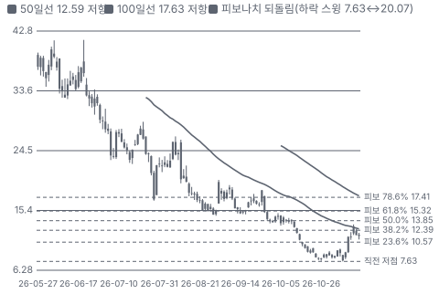

**주봉**

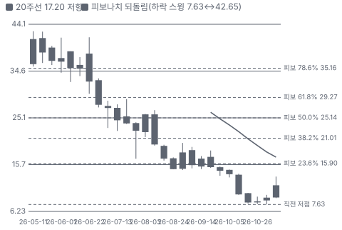

**월봉**

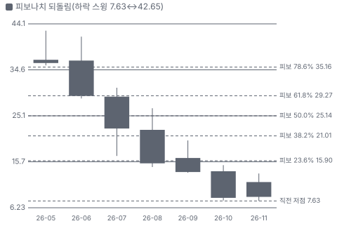

**분기 매출·EPS 실적과 컨센서스**

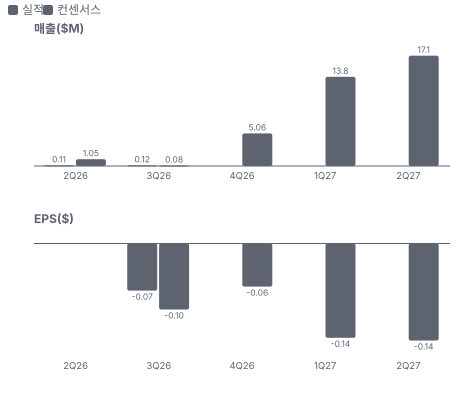

**밸류에이션 주가 시나리오**

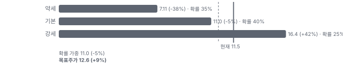

**주가별 업사이드**

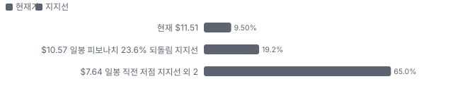
- 제품·서비스 포트폴리오

**고객 믹스(3Q26, 매출 대비)**

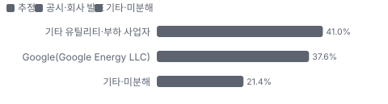

**공급 병목(10점, 낮을수록 병목)**

**생산능력 현재와 확충 계획(MW)**

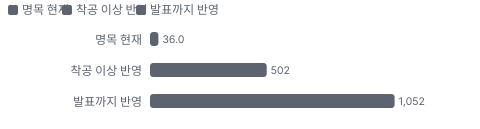

**CAPEX의 매출 대비 비중**

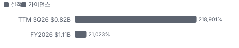

**어닝콜 변화별 주주가치 영향**

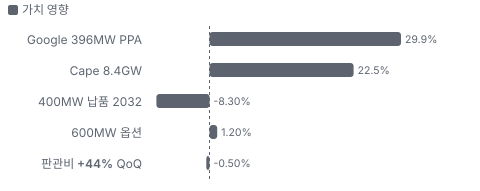

**수주·파이프라인 확실성 사다리**

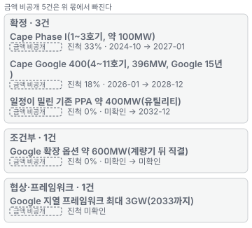

**비용 요인별 매출 대비 비중 1년 변화**

**지열 전력(PPA) BOM 원가 몫**

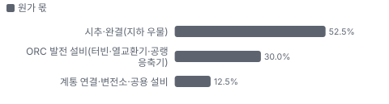

**BOM 항목 가격 +10% 시 OPM 변화**

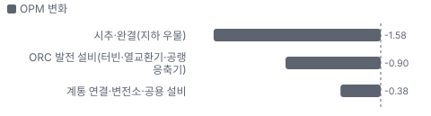

**자산 구성 — 3Q26 분기말 투하자본 \$1,640.1M**

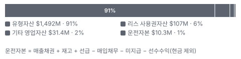

**목표주가 산정 — 기본과 강세 사이(강세 쪽 30%), 도달 확률 약 35%**

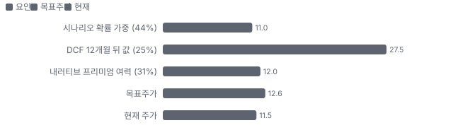

**커뮤니티 언급 수(최근 30일, 채널별)**

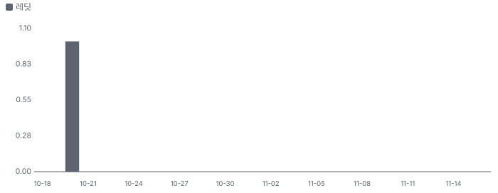

**일별 거래량 분해**

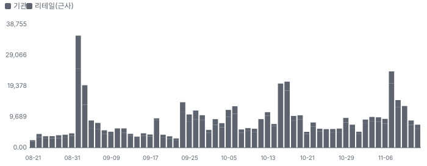

**기관 자금 흐름**

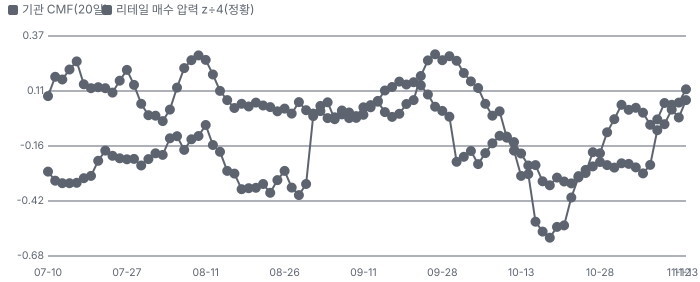

**몬테카를로**

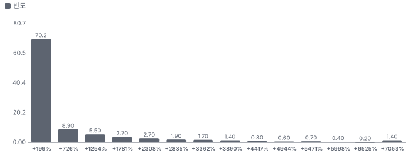

해석: 3,000번 중 1,766번(59%)에서 가치가 지금 주가 이상이었다. 지금 주가를 뒷받침하는 경우와 그렇지 않은 경우가 반반에 가깝다. 가운데 값은 1.78배이고, 열 번 중 여덟 번은 0.42~24.79배 사이에 든다.

## 내러티브

> **기업가치를 결정하는 이야기:** 매출 경로는 계약에 묶여 있다. 2·3호기가 2027-01-01 상업 운전하면 Cape Phase I 약 100MW로 2027 매출 \$60~80M(회사 전망), Cape Google 400(396MW)이 2028 하반기에 붙으면 컨센서스 FY2028 \$176M·FY2030 \$700M으로 간다. 가치를 가르는 숫자는 설치비(\$7,000 → \$5,500/kW 목표)와 우물 온도 유지다. 연료비가 없어 운전 뒤 현금 마진은 높지만, 짓는 동안은 CAPEX가 매출의 수천 배다.

> **멀티플·EPS 프리미엄**
> **멀티플:** 선행 이익이 적자라 EV/매출로만 잴 수 있고, 이 값은 매출이 거의 없어 의미가 약하다. 시가총액 \$3.4B·순현금 약 \$1.5B로 EV 약 \$1.9B — 구속력 있는 계약 MW당 약 \$1.8M, 건설 중 포함 MW당 약 \$3.7M이다(Phase I 설치비 \$7.0M/MW보다 낮다).
> **EPS:** EPS는 2029년까지 적자 추정이다(FY2030 +\$0.25, 1명). 추정은 오히려 내려갔다 — FY2027 매출 8/14 \$74.4M → 10/30 \$69.1M, FY2028 \$224M → \$176M. 주가 하락의 원인은 추정 하향보다 배수 붕괴다.

### 투자자들은 왜 열광했나

열광의 근거는 세 번 나왔다 — 5월 상장(공모가 \$27, 고점 \$42.65), 9월 Google 396MW 계약(+28% 하루), 11월 1호기 상업 운전 확인(+26% 하루). 식은 이유도 셋이다. 파일럿 성능을 문제 삼은 공매도 리서치, 매출 전 회사의 자금 소요, 그리고 보호예수 해제 물량 우려다. 상장 뒤 고점 대비 −73%다.

### 무엇이 기업가치를 바꾸나

> **구조적 체질 변화**
> **변화:** 개발 회사 → 운전 발전 회사. 1호기가 9/30 상업 운전, 4Q가 첫 매출 분기다
> **증거:** 8-K
> **반증:** 2·3호기 상업 운전이 2027-01-01을 넘긴다

> **고부가 믹스 확장**
> **변화:** 유틸리티 PPA 중심에서 하이퍼스케일러 take-or-pay(Google)와 계량기 뒤 직결(600MW 옵션)로 — 같은 MW를 더 좋은 조건에 판다
> **증거:** 8-K·10-Q
> **반증:** 600MW 옵션이 2027년 안에 행사되지 않는다

> **기술 혁신**
> **변화:** 3.0 우물 설계(측면 7,500ft·8 5/8인치 케이싱·430°F), 용해형 플러그·회전 조향 시추·단열 드릴 파이프 배치 완료, 터빈 출력 33 → 50MW
> **증거:** 3Q 콜(Guggenheim 질문 답변)
> **반증:** 3.0 우물의 우물당 출력이 2Q 콜 예시(약 15MW)에 못 미친다

> **실행 속도**
> **변화:** 착공에서 상업 운전까지 23개월(1호기), 회사는 18개월 이하가 목표. 1 → 3호기 시운전 약 50% 단축 **납품 리드타임 23개월.** 피어 비교 미확인. 이전 대비 미확인.
> **증거:** 3Q 콜
> **반증:** Cape Google 400 첫 전력이 2028 중반을 넘긴다

> **M&A**
> **변화:** 해당 없음(최근 3년 인수 없음, 10-Q)
> **증거:** 10-Q
> **반증:** 해당 없음

> **정책·입법 연관성**
> **재정정책:** IRA(미국 인플레이션감축법) 세액공제(지하 ITC(설비 투자 세액공제)·지상 PTC(발전량 세액공제))가 Phase I 경제성의 큰 몫 — 3Q 세금 혜택 \$29.9M. 향후 호기는 PTC가 기본(CFO). DOE(미국 에너지부) 탐사 보조금 후보 약 \$20M 8-K·3Q 콜 반증: 지열 세액공제 축소 입법 의회 동의 8/10 — 하원 4/5(지열 세액공제는 기존 법(시행 중) — 축소 논의 확인 못 함(미확인)) · 상원 4/5(같음).
> **행정명령:** 내무부가 BLM(미국 연방 토지관리국)에 초기 탐사 활동 신속 승인 지시 3Q 콜 반증: 탐사 인허가 기간이 다시 늘어난다 의회 동의 2/10 — 하원 1/5(행정 조치 — 의회 절차 아님) · 상원 1/5(같음).
> **연관입법:** BAAJA(초당적, Mike Lee 상원의원 공동 발의) — 지열 인허가에 석유·가스와 같은 대우, 송전 조항. 회사는 성장 계획이 이 법에 기대지 않는다고 밝힘 3Q 콜(William Blair 질문) 반증: 법안이 위원회를 통과하지 못한다

> **고객의 지출 예산**
> **변화:** 하이퍼스케일러 전력 CAPEX의 수혜 쪽 — 단 고객 투자 발표가 곧 Fervo 매출은 아니다(구속력 있는 PPA만 센다)
> **사업별 예산:** 사업별 CAPEX·OPEX 구분 미확인
> **증거:** 8-K PPA 1,054MW
> **반증:** 하이퍼스케일러 전력 계약이 가스·원전으로 몰린다

### 내러티브 근거

> '셰일 시추 기술로 지열을 어디서나'라는 이야기가 공모가 \$27에서 시작해 \$42까지 갔다가, 파일럿 성능을 문제 삼은 공매도 리서치와 보호예수 물량 우려 속에 \$7.6까지 무너졌다. 3Q는 1호기 상업 운전과 Google 396MW라는 1차 증거로 그 이야기를 일부 되살렸다(+26%). 동종 대비 멀티플 차이 +56399% 중 회사 고유 몫은 -69%다. 단계는 확산, 쏠림은 낮음이다.

> **셰일 기술로 지열 확장(학습 곡선)** · 유지
> **논리:** 수평 시추·다단 파쇄를 표준 모듈로 반복하면 kW당 비용이 셰일처럼 떨어져 지열이 어디서나 경쟁력을 얻는다
> **숫자:** 설치비 \$7,000/kW(Phase I) → \$5,500/kW(Cape Google 400 목표) → \$3,000/kW(장기 목표)
> **반증:** Cape Google 400 준공 설치비가 \$5,500/kW를 넘는다
> **출처:** https://www.sec.gov/Archives/edgar/data/1853868/000162828026071911/exhibit991earningsrelease1.htm

> **AI 데이터센터의 24시간 무탄소 전력** · 강화
> **논리:** 하이퍼스케일러가 기저 무탄소 전력에 웃돈을 낸다 — Google 396MW가 첫 증거
> **숫자:** PPA 658 → 1,054MW, 논의 중 수요의 50%가 데이터센터·하이퍼스케일러(3Q 콜)
> **반증:** 다음 4분기 안에 새 구속력 있는 PPA가 없다
> **출처:** https://www.sec.gov/Archives/edgar/data/1853868/000162828026071911/exhibit991earningsrelease1.htm

> **자원 재평가(Cape 4.3 → 8.4GW)** · 유지
> **논리:** 더 깊고 뜨겁게 시추할수록 같은 땅의 자원이 커진다 — 셰일의 매장량 재평가와 같은 경로
> **숫자:** Cape 잠재 8.4GW, 초기 개발 48.6 → 54.7GW
> **반증:** 평가 시추에서 온도·투수 조건이 기대에 못 미친다
> **출처:** https://www.sec.gov/Archives/edgar/data/1853868/000162828026071911/exhibit991earningsrelease1.htm

> **반대 — 저류층 열 감소·파일럿 성능 의문** · 유지
> **논리:** 파일럿(Project Red(Fervo의 네바다 3MW 파일럿 발전소)) 생산 온도가 떨어졌고, 상업 단지에서도 같은 일이 생기면 PPA 납품 부족·벌금이 난다
> **숫자:** Project Red 운전 약 3년 뒤 온도 하락(회사 인정, 하락 폭 미공시). Cape 운전 데이터는 몇 주
> **반증:** 2·3호기 포함 Cape Phase I이 2027년 내내 계약 용량을 낸다(분기 MWh(메가와트시 — 발전량 단위) 공시)
> **출처:** 3Q 콜, 펀드 레터(공매도 리서치 요지)

> **반대 — 자본 집약·희석** · 유지
> **논리:** kW당 \$5,500을 대는 데 프로젝트 금융·세액공제·유상증자가 계속 필요하다. 현금 \$1.9B는 Cape Google 400 \$2.2B보다 작다
> **숫자:** TTM CAPEX \$817M vs 매출 \$0.4M, 4Q CAPEX \$450~500M
> **반증:** 2027 중반 프로젝트 금융이 LTV(담보 가치 대비 대출 비율) 약 70%로 성사된다
> **출처:** https://www.sec.gov/Archives/edgar/data/1853868/000162828026071911/exhibit991earningsrelease1.htm

> **반대 — 보호예수 해제 물량** · 유지
> **논리:** 상장 180일 보호예수 해제(11/10 무렵으로 알려짐)로 유통 주식이 크게 는다
> **숫자:** Class A 287.1M주 중 유통 약 182.5M주(TradingView) — 해제 대상 규모·날짜는 1차 확인 못 함(미확인)
> **반증:** 해제 뒤 2주 거래량·주가가 해제 전 수준을 유지한다
> **출처:** Quantral 월간 요약(커뮤니티 논쟁), TradingView 유통 주식

### 투자 포인트

> **계약 MW가 EV보다 크다**
> **명제:** 구속력 있는 계약 1,054MW·계약 매출 \$11.9B에 비해 EV 약 \$1.9B는 계약 MW당 약 \$1.8M이다
> **숫자:** 3Q26 8-K: PPA 1,054MW·계약 매출 \$11.9B(2Q \$7.2B에서 +65%), Google 396MW 15년 확정 인수 계약. 1호기 설치비 MW당 약 \$7.0M
> **시장과 다른 점:** 시장은 매출 전 성장주로 배수를 낮췄지만, 이 숫자는 이미 체결된 계약을 지을 설치비의 약 4분의 1만 값으로 준다
> **증명:** 2·3호기 상업 운전(2027-01-01 목표)과 4Q26 실적의 계약 MW 변화
> **출처:** https://www.sec.gov/Archives/edgar/data/1853868/000162828026071911/exhibit991earningsrelease1.htm

> **1호기가 첫 답을 냈다**
> **명제:** Cape 1호기 33MW가 9/30 상업 운전에 들어가 '지을 수 있나'의 첫 증거가 나왔고, 1 → 3호기 시운전 기간은 약 50% 줄었다
> **숫자:** 3Q 콜: 1호기 설계 유량·온도 도달, 착공 → 상업 운전 23개월, 회사 목표 18개월 이하
> **시장과 다른 점:** 공매도 리서치가 파일럿 성능을 문제 삼은 뒤 시장은 상업 단지도 같다고 봤다. 상업 단지의 운전 기록은 아직 몇 주라 양쪽 다 확인 전이다
> **증명:** 4Q26·1Q27 1호기 순출력·가동률 공시
> **출처:** https://www.sec.gov/Archives/edgar/data/1853868/000162828026071911/exhibit991earningsrelease1.htm

> **자금 경로가 주가를 정한다**
> **명제:** Cape Google 400 투자 약 \$2.2B를 프로젝트 부채(담보 가치 대비 약 70%)와 세액공제 매각으로 대면 증자 없이 지을 수 있다
> **숫자:** 9/30 비제한 현금 \$1.916B, 하반기 CAPEX \$700~750M(종전 \$850~900M에서 시점 이연), Cape Phase I은 Granite 대주단 약 \$421M·Liberty Mutual 세액공제 매수로 조달(10-Q)
> **시장과 다른 점:** 시장은 희석을 기본값으로 둔다. 회사는 Phase I과 같은 구조를 반복하겠다고 했다 — 조건이 확인되면 희석 할인이 줄어든다
> **증명:** 2027년 중반 Cape Google 400 프로젝트 금융 조건
> **출처:** https://www.sec.gov/Archives/edgar/data/1853868/000162828026072482/frvo-20260930.htm

### 모멘텀 생성·소멸 타임라인

**카탈리스트 달력 — 지난 사건의 주가 반응과 앞으로 확인할 숫자**
| 날짜 | 상태 | 구분 | 사건 | 반응·확인 | 결과에 따라 |
|---|---|---|---|---|---|
| 2026-09-01 | 완료 | 생성 | Google 396MW 15년 확정 인수 계약 공시(계약일 8/26) | +28.4%(하루) |  |
| 2026-11-05 | 완료 | 소멸 | 상장 뒤 종가 저점 \$7.79 — 공매도 리서치·보호예수 해제 우려 | 5/21 종가 고점 대비 −81.7% |  |
| 2026-11-09 | 완료 | 생성 | 3Q26 실적·1호기 상업 운전 확인 | +26.1%(하루) |  |
| 2026-11-12 | 완료 | 확인 | BofA 목표가 \$30→\$25(Buy 유지) | −10.0%(하루) |  |
| 2027-01-01 | 예정 | 확인 | Cape Phase I 2·3호기 상업 운전 목표 | 두 호기 모두 상업 운전 공시 — 약 100MW 운전 | 되면 기본, 밀리면 약세 |
| 2027-02~03(예상) | 예정 | 확인 | 4Q26 실적·첫 10-K | 1호기 순출력이 설계 용량 33MW 부근 유지, 4Q CAPEX \$450~500M 안 | 출력 유지면 기본~강세, 저하면 약세 |
| 2027 중반(예상) | 예정 | 확인 | Cape Google 400 프로젝트 금융 | 담보 가치 대비 대출 약 70% 이상, 보통주 증자 없음 | 성사면 강세 쪽, 증자면 약세 쪽 |

### 언제 사서 언제 팔아야 할까?

**가격·조건 틀 — 가격은 밸류에이션(약세·기본·강세·목표주가)과 차트 지지 구간에서, 조건은 이벤트에서**
| 구간 | 가격 | 목표주가까지 | 약세까지 | 조건·근거 |
|---|---|---|---|---|
| 관찰 구간 | \$10.57~\$10.57 | +19% | -33% | 보호예수·변동성(하루 평균 변동 약 10%) 구간이라 차트 지지 구간과 계약 MW당 EV를 함께 본다 |
| 확인 뒤 | 지금 \$11.51 이상에서 조건 확인 | +9% | -38% | 2·3호기 상업 운전 공시(2027-01) 그리고 4Q26 1호기 순출력이 설계 용량 부근 |
| 무효화 | 약세 시나리오 \$7.11 | - | -38% | 2·3호기 상업 운전 지연 공시, 우물 출력 저하 공시, 또는 2027년 중반 프로젝트 금융 대신 보통주 증자 |
| 차익 고민 1차 | \$12.60(목표주가·기본 시나리오) | +9% | - | 목표주가 부근에서는 2028년 Google 전력 공급 전까지 남은 실행 위험을 다시 잰다 |
| 차익 고민 2차 | \$16.38(강세 시나리오) | +42% | - | 목표주가 부근에서는 2028년 Google 전력 공급 전까지 남은 실행 위험을 다시 잰다 |

실적·현장 공개일 전후 옵션 내재 변동폭이 ±13% 안팎이라 이벤트 직후 추격은 손익비가 나쁘다 가격·조건 틀이며 매매·비중 지시가 아니다(투자 권유 아님).

## 포트폴리오

| 제품·서비스 | 구분 | 무엇 | 쓰는 곳 | 돈 버는 방식 | Mix | Mix 변화(공시 — 매출은 PPA 전력 판매뿐) |
|---|---|---|---|---|---|---|
| 지열 전력(PPA) | 제품 | 암반에 수평 우물과 인공 균열을 만들어 뜨거운 물을 순환시키고, ORC(낮은 온도 열로 유기 유체를 끓여 터빈을 돌리는 발전 방식) 발전 모듈(GeoBlock(Fervo의 표준 발전 모듈, 33·50MW))로 24시간 전기를 만든다 | 유틸리티(SCE 등)·하이퍼스케일러(Google)·부하 사업자 | 15년 이상 고정가 PPA의 MWh당 요금 + 세액공제 매각 | 100% | 미확인 |

## 고객

> **3Q26 최대 고객 기타 유틸리티·부하 사업자 41%, 상위 3곳 79%, 집중도 집중.** 공시·회사 발표로 확인한 몫은 매출의 38%이고, 나머지 고객 몫은 추정이거나 미분해다. 매출은 아직 1호기 PPA 하나에서 나온다. 계약 잔고 기준으로는 Google(396MW, 38%)이 가장 크고, Southern California Edison 등 유틸리티 PPA가 나머지다. 상대방별 MW는 Google만 공시됐다.

**고객별 매출 몫(3Q26)**
| 고객 | 몫 | 변화 | 근거 |
|---|---|---|---|
| 기타 유틸리티·부하 사업자 | 20~62% | 미확인 | 추정 |
| Google(Google Energy LLC) | 38% | +38%p | 공시 |
| Southern California Edison | 미확인 | 미확인 | 공시 |
| Ava Community Energy | 미확인 | 미확인 | 회사 발표 |
| 기타·미분해 | 21% | - | - |

> **기타 유틸리티·부하 사업자** · 추정
> **사는 것:** Cape·Corsac(Fervo의 네바다 GeoCluster) 전력
> **추정 근거:** 1,054MW − Google 396MW의 나머지 658MW를 SCE·Ava 등이 나눈다(몫 미공시)

> **Google(Google Energy LLC)** · 공시
> **사는 것:** Cape 396MW 15년 확정 인수 + 600MW 옵션
> **추정 근거:** 계약 MW 기준 396 ÷ 1,054

> **Southern California Edison** · 공시
> **사는 것:** Cape 전력(PPA)
> **추정 근거:** 10-Q 위험 요인에 이름만 — MW 미공시

> **Ava Community Energy** · 회사 발표
> **사는 것:** Corsac 전력(PPA)
> **추정 근거:** 3Q 콜에서 Corsac PPA 상대방으로 언급

## 수주·파이프라인

> **2026-09-30 기준 5건.** 확정 \$0.00B. 공시 계약 매출(구속력 있는 PPA) \$11.90B. 서로 겹치는 항목은 합계에서 뺐다.

**수주 목록**
| 상태 | 계약 | 계약 총액 | 진척 | 기간 | 비고 |
|---|---|---|---|---|---|
| 확정 | Cape Phase I(1~3호기, 약 100MW) | 금액 비공개 | 33% | 2024-10 → 2027-01 | - |
| 확정 | Cape Google 400(4~11호기, 396MW, Google 15년) | 금액 비공개 | 18% | 2026-01 → 2028-12 | - |
| 확정 | 일정이 밀린 기존 PPA 약 400MW(유틸리티) | 금액 비공개 | 0% | 미확인 → 2032-12 | - |
| 조건부 | Google 확장 옵션 약 600MW(계량기 뒤 직결) | 금액 비공개 | 0% | 미확인 → 미확인 | (다른 항목과 겹칠 수 있어 합계에서 뺌) |
| 프레임워크 | Google 지열 프레임워크 최대 3GW(2033까지) | 금액 비공개 | 비공개 | - | (다른 항목과 겹칠 수 있어 합계에서 뺌) |

**실행 속도와 방해 요인**
| 항목 | 상태 | 실행 속도 | 방해 요인 |
|---|---|---|---|
| Cape Phase I(1~3호기, 약 100MW) | 확정 | 지연(계획 85%, -52%p), 이대로면 2030-08 완료, 43개월 지연 | 2027 초 변전소 일회성 정지(제3자 태양광 연결) · 2·3호기 시운전 |
| Cape Google 400(4~11호기, 396MW, Google 15년) | 확정 | 계획대로(계획 23%, -5%p), 이대로면 2029-09 완료, 9개월 지연 | \$2.2B 투자 중 프로젝트 금융은 2027 중반 예정 · 시추 속도·우물당 출력 · 열 감소 검증 |
| 일정이 밀린 기존 PPA 약 400MW(유틸리티) | 확정 | 미확인 | 캘리포니아로의 송전 용량 · 계약 수정 합의 |
| Google 확장 옵션 약 600MW(계량기 뒤 직결) | 조건부 | 미확인 | Google 데이터센터 인허가 · SB 132(대형 부하가 새 발전원에 직접 연결하도록 허용한 유타 주법) 규제 승인 |
| Google 지열 프레임워크 최대 3GW(2033까지) | 프레임워크 | 미확인 | 구속력 없음(10-Q) |

## 마진 구조

> **GPM -1181.0%, OPM -37712.1%.** 2Q26 대비 GPM -1010.2%p, OPM -12275.8%p. 변동비는 매출의 2552%이고, 매출이 10% 늘면 OPM은 +3205.4%p 움직인다. 아직 매출이 분기 \$0.1M뿐이라 마진 구조는 비용 구조로만 읽힌다. 3Q 영업비용 \$43.9M 중 판관비가 \$39.4M(SBC \$14.2M)이다. 매출이 본격화하면 원가는 감가상각·운영유지·리스가 되고, 연료비가 없다는 것이 구조적 특징이다.

**GPM에서 OPM까지(GAAP)**
| 기간 | GPM | 연구개발 | 판관비 | 기타 | OPM |
|---|---|---|---|---|---|
| 2Q26 | -170.8% | 0.0% | 24247.8% | 1017.7% | -25436.3% |
| 3Q26 | -1181.0% | 62.9% | 33922.4% | 2545.7% | -37712.1% |

**마진을 결정하는 비용 요인 — 비용 +10% 시 OPM**
| 비용 | 매출 대비 | 변화 | 고정비 | OPM |
|---|---|---|---|---|
| 판관비(현금) | 21681.0% | 미확인 | 90% | -2168.10%p |
| 주식 보상(SBC) | 12241.4% | 미확인 | 100% | -1224.14%p |
| 감가상각·운용리스(기타) | 2545.7% | +1528.0%p | 100% | -254.57%p |
| 운영·유지(O&M) | 1281.0% | +1010.2%p | 70% | -128.10%p |
| 연구개발 | 62.9% | +62.9%p | 100% | -6.29%p |

**비용을 움직이는 요인**
| 비용 | 요인 |
|---|---|
| 판관비(현금, 판관비) | 상장사 비용·인력(306명)·외부 용역 · 근거 공시 |
| 주식 보상(SBC, 판관비) | 상장 뒤 RSU·옵션 부여 · 근거 공시 |
| 감가상각·운용리스(기타, 기타) | 토지·리그 리스, 상업 운전 호기 감가상각 · 근거 공시 |
| 운영·유지(O&M, 매출원가) | 운전 호기 수 · 근거 공시 |
| 연구개발(연구개발) | 시추·저류층 기술 · 근거 공시 |

**지열 전력(PPA) BOM — 매출의 100%, GPM 70%(추정 — 정상 운전 때 연료비가 없어 현금 기준 매출총이익률 약 70%(동인 덮어쓰기의 EBITDA율 75~80% 가정에서 O&M 여유를 뺀 값). 3Q 실제는 매출이 미미해 음수 — 호기별 원가 미공시), 항목 가격 +10% 시**
| 항목 | 원가 몫 | 전가 | 제품 GPM | OPM |
|---|---|---|---|---|
| 시추·완결(지하 우물) | 45~60% | 0% | -1.6%p | -1.58%p |
| ORC 발전 설비(터빈·열교환기·공랭 응축기) | 25~35% | 0% | -0.9%p | -0.90%p |
| 계통 연결·변전소·공용 설비 | 10~15% | 0% | -0.4%p | -0.38%p |
| 미분해 | 5% | - | - | - |

**BOM 항목 가격을 움직이는 것**
| 항목 | 요인 |
|---|---|
| 시추·완결(지하 우물) | 설치비의 가장 큰 몫, 시추 일수·우물당 출력이 단가를 정한다 · 근거 추정 |
| ORC 발전 설비(터빈·열교환기·공랭 응축기) | 고정가 PPA라 기자재 가격 상승은 전가되지 않는다 · 근거 추정 |
| 계통 연결·변전소·공용 설비 | 단지 공용 — 호기가 늘수록 kW당 몫이 준다 · 근거 추정 |

**투입 물가 — 미국 PPI 3·6·12개월(2026-10, 개정 반영)**
| 항목 | 미국 3개월 | 6개월 | 12개월 | 전가 못 할 때 OPM |
|---|---|---|---|---|
| 시추·완결(지하 우물) | +2.5% | +2.9% | +2.8%* | - |

별표는 품목보다 넓은 업종 지수다. 지난 1년 투입 물가를 판매가 전가 뒤 원가에 넣으면 OPM은 -0.43%p 움직인다(매출원가의 1% 기준). 물가 지수를 붙이지 못한 매출원가 항목은 운영·유지(O&M)다(미연결).

## 자산 구성

> **3Q26 분기말 투하자본 \$1,640.1M** — 유형자산 91%, 리스 사용권자산 6%.

**자산·운전자본 항목별 분기말 잔액 — 최근 12개 분기와 다음 4개 분기 추정**
| 항목 | 3Q26 | 1년 전 | 3Q26(최근) | 추정 | 1개 분기 변화 | 다음 4개 분기 변화 |
|---|---|---|---|---|---|---|
| 선급·기타 유동자산 | \$21.4M | 미확인 | \$21.4M | — | +0% | — |
| 미지급비용 | \$11.1M | 미확인 | \$11.1M | — | +0% | — |
| 유형자산 | \$1,491.7M | 미확인 | \$1,491.7M | — | +0% | — |
| 리스 사용권자산 | \$106.6M | 미확인 | \$106.6M | — | +0% | — |

미공시·미분해: 분기 감가상각·유형자산(순액) 9분기 · 분기 매출·영업이익 8분기 · 유형자산 항목별 총액·내용연수(10-K 주석에서 모델이 채움) · 무형자산 항목(10-K 주석에서 모델이 채움) — 이 칸은 비우고 나머지로 계산했다.

## 공급망 병목

> **공급망 신뢰성 4.9/10, 병목 주의.** 가장 약한 고리는 시추 리그·시추 용역 4.9점이고, 품목 평균은 4.9점이다. 근거가 부족한 3건(ORC 발전 설비(터빈·열교환기·공랭 응축기) · 프로젝트 금융·세액공제 매각 · 송전·계통 연결)은 점수에서 뺐다. 공급망 병목은 ORC 터빈(Turboden·Baker Hughes 두 곳)과 시추 리그다. 회사는 단일 공급원이라고 쓰지 않았지만 'ORC 터빈은 주로 두 곳에서' 산다고 밝혔다. 리그는 H&P FlexRig3 4대로 늘었다.

**병목과 마진 — 품목 가격 +10% 시 OPM**
| 품목 | 점수 | 판정 | 구분 | OPM |
|---|---|---|---|---|
| 시추 리그·시추 용역(필수) | 4.9 | 병목 주의 | 출하 차질 위험 | 미확인 |

> **시추 리그·시추 용역** · 4.9/10
> **왜:** 우물 수 = 출력
> **병목 요인:** 인증 공급사 1곳 · 캐파 여유 · 리드타임 미확인 · 재인증 미확인 · 1위 점유율 100% · 미국 집중 100% · 물량 확보 장기계약
> **풀리는 조건:** 리그 2 → 4대(상장 뒤)

**공급사**
| 품목 | 공급사 | 몫 | 근거 |
|---|---|---|---|
| ORC 발전 설비(터빈·열교환기·공랭 응축기) | Turboden(Mitsubishi Heavy Industries 자회사, ORC 터빈·프레임워크 조달) | 미확인 | 공시 |
| ORC 발전 설비(터빈·열교환기·공랭 응축기) | Baker Hughes(ORC 터빈·관련 설비) | 미확인 | 공시 |
| 시추 리그·시추 용역 | Helmerich & Payne(FlexRig3 4대 운용) | 미확인 | 회사 발표 |
| 프로젝트 금융·세액공제 매각 | Granite 대주단(약 \$421M 신용 한도)(Cape Phase I 건설·세액공제 브리지·LC(신용장)) | 미확인 | 공시 |
| 프로젝트 금융·세액공제 매각 | Liberty Mutual(Cape Phase I 세액공제 매수) | 미확인 | 공시 |
| 송전·계통 연결 | 유타·캘리포니아 송전 사업자(미공시, 연계·송전) | 미확인 | 공시 |

**무역 통계로 본 공급 지역**
| 품목 | EU 수입처 | 일본 수입처 | EU 1위 전년비 |
|---|---|---|---|
| 시추 리그·시추 용역 | US 54% · JP 40% · KR(한국) 6% | 中華人民共和国 98% · アメリカ合衆国 2% | +118.8% |

## 생산능력

> **현재 명목 캐파 36 MW, 가동률 미확인.** 착공 이상 증설은 466 MW, 발표까지 합치면 1,016 MW이다. 다 가동하면 지금보다 +2822%, 착공 이상만이면 +1294%다. TTM 3Q26 CAPEX는 \$0.82B로 매출의 218900.8%다. 운전 36MW, 건설 중 466MW, 착공 준비 550MW. 2030 목표 1.1GW.

**생산시설 3곳**(8-K·10-Q — 발전 시설 3곳(Cape Station(Fervo의 유타 Beaver County 지열 발전 단지) Phase I·Phase II(2단계)는 같은 유타 단지, Project Red는 네바다 파일럿). 단지 기준으로는 2곳), 소유 3곳.

**생산시설 3곳 — 명칭·위치·생산능력**
| 시설 | 위치 | 용도 | 생산능력 | 소유·상태 |
|---|---|---|---|---|
| Cape Station Phase I | 미국 유타 Beaver County(Milford 인근) | 지열 발전 | 100 MW(3개 호기, 1호기 33MW 운전) | 소유 · 증설 중 |
| Cape Station Phase II(Cape Google 400) | 미국 유타 Beaver County | 지열 발전 | 400 MW(50MW × 8) | 소유 · 건설 중 |
| Project Red | 미국 네바다 | 파일럿 발전 | 3 MW | 소유 · 가동 |

**생산능력 확충 계획**
| 계획 | 단계 | 증설 | 가동 시점 | CAPEX |
|---|---|---|---|---|
| Cape Phase I 2·3호기 | 장비 반입 | 66 MW | 2027-01 | 미확인 |
| Cape Google 400(4~11호기) | 착공 | 400 MW | 2028-06 | \$2.20B |
| 착공 준비(Cape 확장·Corsac) | 인허가 | 550 MW | 미확인 | 미확인 |

남은 계획의 CAPEX 합계는 \$2.20B(금액 미확인 2건 제외)다. 금액을 아는 계획의 단위당 CAPEX는 \$0.01B/MW이다. 합계는 FY2026 매출의 41667%다.

**증설 방해 요인**
| 계획 | 방해 요인 |
|---|---|
| Cape Phase I 2·3호기 | 2호기 계통 연결 완료·시험 송전, 3호기 냉간 시운전 |
| Cape Google 400(4~11호기) | 시추 18%, 프로젝트 금융 2027 중반 |
| 착공 준비(Cape 확장·Corsac) | 초기 인허가 확보, PPA·금융 미정 |

**CAPEX와 매출 대비**
| 기간 | CAPEX | 매출 | 매출 대비 | 구분 |
|---|---|---|---|---|
| TTM 3Q26 | \$0.82B | \$0.00B | 218900.8% | 실적 |
| FY2026 | \$1.11B | \$0.01B | 21022.7% | 가이던스 |

## 해자

> 해자는 '데이터와 실행 이력'이다. 상업 규모 수평 EGS(암반에 인공 균열을 내 물을 돌려 열을 뽑는 증강 지열)를 운전한 회사는 Fervo뿐이고, 3년 넘은 파일럿 운전 데이터와 수십 개 우물의 측정 자료가 설계·대출 심사의 근거가 된다. 다만 기술 해자는 운전 수년 뒤에야 증명된다.

> **상업 규모 EGS 운전 이력·저류층 데이터** · 보통
> **해자:** 세계 첫 그린필드 EGS 상업 운전(1호기)과 3.5년 된 파일럿(Project Red) 운전 데이터로 유량·열 감소를 실측해 설계에 반영한다. 경쟁사는 첫 수평 EGS를 설계·인허가하는 단계다.
> **근거:** 3Q 콜(CEO): 파일럿 열 감소 원인 데이터는 독점 자료, 대주단과 공유. 1호기 설계 유량·온도 도달(8-K).
> **숫자:** 운전 36MW(Cape 33 + Red 3) vs 경쟁 EGS 상업 운전 0(콜 주장, 독립 확인 미확인)
> **깨지는 조건:** 2·3호기 또는 Cape Google 400 우물의 생산 온도가 모델보다 빨리 떨어진다(분기 MWh·용량 계수 공시로 확인)

> **셰일식 학습 곡선(시추 속도·설치비)** · 보통
> **해자:** 같은 저류층에 표준 모듈을 반복해 시추 일수·완결 시간·kW당 비용을 깎는다. Phase I \$7,000/kW → Cape Google 400 \$5,500/kW 목표.
> **근거:** 2Q 콜: 3.0 설계 우물 측정 깊이 약 19,500ft·460°F를 21일에 시추. 3Q 콜: 시운전 기간 약 50% 단축.
> **숫자:** 설치비 \$7,000/kW(실적 기대) → \$5,500/kW(목표) → \$3,000/kW(장기 목표)
> **깨지는 조건:** Cape Google 400 실제 설치비가 \$5,500/kW를 넘는다(2028 준공 뒤 확인)

> **확정 인수 장기 계약 잔고** · 강함
> **해자:** Google 396MW 15년 take-or-pay와 SCE 등 투자등급 상대방 PPA로 1,054MW·\$11.9B 계약 매출이 고정 가격으로 잡혀 있다. 프로젝트 금융을 받을 수 있는 형태다.
> **근거:** 8-K Ex.99.1, 10-Q(Google·Alphabet 모회사 보증 — 콜).
> **숫자:** 계약 매출 \$11.9B ÷ 1,054MW ≈ MW당 \$11.3M(15~20년, 추정)
> **깨지는 조건:** 납품 지연으로 PPA 해지·벌금이 발생한다(10-Q 위험 요인: 상업 운전 지연 시 상대방 해지 가능)

> **토지·자원 선점** · 보통
> **해자:** 지열 임차지 67만 에이커와 독립 평가 Cape 잠재 8.4GW가 개발 재고다.
> **근거:** 8-K·3Q 콜(D&M(독립 매장량 평가사 DeGolyer and MacNaughton) 평가).
> **숫자:** 초기 개발 54.7GW, 고급 개발 3.0GW, 착공 준비 550MW
> **깨지는 조건:** 평가 시추(네바다 Corsac 등)에서 온도·투수 조건이 기대에 못 미쳐 고급 개발 용량이 줄어든다

## 경영진·네트워크

> 공동 창업자 Tim Latimer(CEO)가 석유·가스 시추 현장 출신으로 '셰일 기술을 지열에'라는 회사 논리를 직접 만든 사람이다. 정계 연결은 회사 차원의 법안 지지(BAAJA)와 공개 행사 수준만 확인된다.

> **Tim Latimer** · 공동 창업자·CEO · 2017(창업)
> **프로필:** 시추 현장 감독 출신(2Q 콜 본인 발언). 3Q 콜에서 열 감소 데이터를 독점 자산으로 설명
> **비즈니스:** 기술·영업(Google 계약)
> **정계:** 미확인
> **동문:** 미확인
> **사모임:** 미확인

> **David Ulrey** · CFO · 미확인
> **프로필:** 3Q 콜에서 CAPEX 시점 이동·프로젝트 금융(2027 중반, LTV 약 70%)·ITC/PTC 구조 설명
> **비즈니스:** 재무·금융
> **정계:** 미확인
> **동문:** 미확인
> **사모임:** 미확인

**네트워크 정량화**
| 연결 | 강도 | 닿는 매출 | 가중 노출 | 매출 대비 | 근거 |
|---|---|---|---|---|---|
| 비즈니스: Google(Alphabet) — 396MW PPA·600MW 옵션·3GW 프레임워크 | 4/5 | 미확인 | 미확인 | 미확인 | PPA 1,054MW 중 396MW(38%) 10-Q·8-K |
| 정계: 회사가 BAAJA(Mike Lee 상원의원 공동 발의) 지지를 밝혔다. 내무장관이 Google 계약을 공개 축하 | 2/5 | 미확인 | 미확인 | 미확인 | 회사 성장 계획은 이 법안에 기대지 않는다고 밝힘(3Q 콜) 3Q 콜 |

가중 노출은 연결이 닿는 매출의 크기다. 연결이 그 매출을 만들었다는 뜻이 아니며, 인과는 공개 자료로 입증하지 못한다.

## 약세 논리 및 셀온 조건

| 약세 논리 | 근거 | 가를 자료 |
|---|---|---|
| 우물이 식을 수 있다 | 공매도 리서치가 파일럿(Project Red) 출력 감소를 문제 삼았고, 1호기 상업 운전 기록은 몇 주뿐이다. EGS 상업 단지의 수년 운전 기록은 공개된 것이 없다 | 분기별 1호기 순출력·가동률 공시(4Q26 실적, 2027년 2~3월) |
| 자금 소요가 매출보다 훨씬 크다 | 3Q CAPEX \$256.7M·영업손실 \$43.7M, 분기 매출 \$0.12M. Cape Google 400 투자 약 \$2.2B 중 프로젝트 금융은 2027년 중반 예정(담보 가치 대비 대출 약 70% 목표) | 프로젝트 금융 조건과 증자 여부(2027년 중반) |
| 계약은 매출이 아니다 | PPA 1,054MW 중 상업 운전은 33MW다(금지표 — 계약 → 매출 확정은 물량·시점 확인 필요). 기존 유틸리티 PPA 약 400MW는 송전 문제로 납품이 2032년 전후로 밀려 수정 협상 중이다 | 2·3호기 상업 운전(2027-01-01 목표), 기존 PPA 수정 합의 |
| 설치비 목표는 목표다 | 1호기 설치비는 kW당 약 \$7,000, Cape Google 400 목표 \$5,500, 장기 목표 \$3,000다. 목표가 빗나가면 MW당 수익성이 바로 깎인다 | Cape Google 400 우물당 출력·시추 일수(분기 콜) |
| 보호예수와 수급 | 5월 상장 뒤 첫 보호예수 해제 물량 우려가 하락 이유 중 하나였다. 상장 6개월 안팎 구간이라 물량 부담이 이어질 수 있다 | 보호예수 해제 일정·내부자 매도 공시(Form 4) |
| 자료 한계 | 상장 첫 해라 10-K가 없고 분기 이력이 3개뿐이다. 컨센서스이 없어 컨센서스는 증권사 집계만 쓴다. 자산 구성·ROIC 절은 분기 이력이 모자라 비어 있다 | FY2026 10-K(2027년 3월) |

**변이 관점.** 시장은 Fervo를 '매출 없는 성장주'로 묶어 배수를 낮췄다. 그러나 EV 약 \$1.9B는 이미 구속력 있는 계약 MW당 약 \$1.8M으로, 회사가 실제로 쓴 설치비의 4분의 1 수준이다. 계약이 일정대로 지어지기만 해도 지금 가격의 가정보다 자산 가치가 커지는 구조다. 반대로 이 계산은 우물이 15년 동안 뜨겁다는 가정 위에 서 있고, 그 가정을 확인할 운전 데이터는 2027년에야 쌓인다.

> **셀온 조건**
> **조건 1:** 2·3호기 상업 운전이 2027년 1월에서 밀린다는 회사 공시가 나온다(4Q26 실적, 2027년 2~3월 예상).
> **조건 2:** 1호기 출력·가동률이 계약 용량보다 의미 있게 낮다는 공시나 독립 검증 자료가 나온다.
> **조건 3:** 2027년 중반 Cape Google 400 프로젝트 금융이 늦어지고 대신 보통주 증자로 자금을 댄다.
> **조건 4:** 주가가 2026년 11월 종가 저점(\$7.79, 11/5)을 종가로 밑돈다.

## 어닝콜 변화

**직전 콜 대비 새로 나오거나 바뀐 내용 → 가치 영향**
| 항목 | 내용 | 직전 콜 | 최신 콜 | 모델 동인 이동 | 확신도 | 가치 영향 |
|---|---|---|---|---|---|---|
| 신규 | Google PPA | 구속력 있는 PPA 658MW·계약 매출 \$7.2B | 1,054MW·\$11.9B(Google 396MW 15년 확정 인수) | 1년차 성장률 +15.0% | 1.0 | +29.9% |
| 업데이트 | 1호기 상업 운전 | 4Q26 첫 전력 목표 | 9/30 상업 운전, 설계 유량·온도 도달 | 기준연도 매출 — | 1.0 | +0.0% |
| 업데이트 | CAPEX 시점 | 하반기 \$850~900M | \$700~750M(총액 불변) | 매출÷투하자본 — | 0.8 | +0.0% |
| 신규 | Cape 잠재 용량 | 4.3GW | 8.4GW(독립 평가) | 성장 지속(감속 계수) +2.0% | 0.5 | +22.5% |
| 신규 | Google 600MW 옵션 | 3GW 프레임워크(구속력 없음) | 약 600MW 확장 옵션 제공 약속, 데이터센터 일정에 달림 | 장기 성장 수렴값 +0.20% | 0.3 | +1.2% |
| 부정 | 밀린 PPA | 명시 없음 | Google 계약으로 일정이 밀린 약 400MW PPA는 2032 전후 납품, 계약 수정 중 | 1년차 성장률 -5.0% | 0.8 | -8.3% |
| 부정 | 판관비 | 2Q \$27.4M | 3Q \$39.4M(SBC \$14.2M) | 출발 이익률 -5.0% | 1.0 | -0.5% |
| 반복 | 설치비 목표 | \$5,500/kW·장기 \$3,000 | 같음, 신기술 배치 완료 | 매출÷투하자본 — | 0.5 | +0.0% |
| **합계** | 단독 합 |  |  | 동시 적용 +44.8% |  | **+44.9%** |

**실적 발표 예상 변동폭:** 지난 2번 실적 발표 때 주가는 하루에 평균 ±13.4%(최대 26.1%, 오른 날 2번) 움직였다. 지금 옵션 시장은 2026-11-20 만기 스트래들로 ±13.0%를 가격에 넣었다 — 과거 평균의 1.0배로, 평소 수준이다. ATM 내재 변동성 114%.

**실적 발표 예상 변동폭 — 과거 실적 발표 다음 거래일 주가 변화**
| 분기 | 발표일 | 주가 변화 |
|---|---|---|
| 2Q26 | 2026-08-12 | +0.8% |
| 3Q26 | 2026-11-09 | +26.1% |
| 옵션 내재(이번) | 2026-11-16 01:27 | ±13.0% |

**해석:** 이 기간 주가 -52.9% 중 EPS 추정 변화가 +26.1%, 멀티플 변화가 -62.7% — 주가를 움직인 것은 **멀티플(시장이 붙이는 배수) 변화**이다. 이익 추정은 오르는데 주가가 내렸다면 시장은 숫자가 아니라 지속성·위험(할인율)을 다시 매긴 것이다.

## 밸류에이션

> **목표주가 \$13, 업사이드 +9%.** 자리는 기본과 강세 사이(강세 쪽 30%)이고 도달 확률은 약 35%다. 기본 \$11, 강세 \$16(+42%), 약세 \$7(-38%). DCF 기준 업사이드는 기본 +124%, 강세 +2162%, 약세 -58%다(WACC 6.7%). DCF 주의: 계속가치가 기업가치의 213% — 1~10년 현금흐름 합이 크게 음수라 먼 미래 가정에 민감하다.

매출 전 회사라 이익 배수가 아니라 EV/매출로 잰다. 시나리오 매출은 12개월 뒤 시점의 다음 4개 분기이고, 계약 MW와 상업 운전 일정에서 나온다. DCF는 10년 차 매출 약 \$3.2B와 EBIT 이익률 45%(연료비 없는 장기 고정가 발전, 추정)를 담고, EV/매출 경로는 2028년 전후 한 시점만 본다. 두 값이 다르면 그 차이는 '계약 너머 수 GW 개발 물량에 값을 줄 것인가'에 대한 가정 차이다.

시나리오 확률: 다음 해 매출 성장 분포로 계산 — 약세 +110.6% 아래·강세 +187.3% 위 확률. 내부 관점(컨센서스 +152.0%, σ 90.8%: 범위 153.4% ÷ d2(6) × 1.5) 100% — 외부 관점 꺼짐(SEC 전 상장사 표본 없음) · 모델 조정: 콜 톤은 상향(Google 396MW 확정·1호기 상업 운전)이지만, 공매도 리서치가 제기한 저류층 열 감소 의문을 공개 자료로 아직 판정할 수 없고 1호기 운전 데이터가 몇 주뿐이라 약세 쪽에 무게를 더 둔다

> **약세 \$7 (-38%)** · 확률 35%
> **가정:** 10.6배 × 매출 \$80M
> **근거:** 2·3호기 상업 운전이 2027년 하반기로 밀리거나 우물 출력이 떨어져 Cape Phase I 매출이 연 \$60M 아래에 머물고, Cape Google 400 첫 전력이 2029년으로 밀린다

> **기본 \$11 (-5%)** · 확률 40%
> **가정:** 14.1배 × 매출 \$150M
> **근거:** Cape Phase I 약 100MW가 2027년 내내 돌고 Cape Google 400 첫 묶음이 2028년 중반에 붙는다. FY2027 컨센서스 \$69M과 FY2028 \$176M 사이

> **강세 \$16 (+42%)** · 확률 25%
> **가정:** 17.7배 × 매출 \$220M
> **근거:** Cape Google 400 네 묶음이 2028년 안에 순서대로 들어오고 보조 태양광으로 판매 전력이 늘어 FY2028 컨센서스 상단(\$226M)에 닿는다

**멀티플 선정 — EV/매출**
| 단계 | 조정 | 근거 |
|---|---|---|
| 동종 중앙값 | 10.9배 | 범위 7.1~14.7배, 2곳 · 이상치 제외 SMR ev_sales 462.9 |
| 펀더멘털 | +0% | 재료 없음 |
| 해자 | +3% | 상업 규모 EGS 운전 이력·저류층 데이터 보통 · 셰일식 학습 곡선(시추 속도·설치비) 보통 · 확정 인수 장기 계약 잔고 강함 · 토지·자원 선점 보통 — 점수 8.5%에서 동종 기준 5.5%를 뺌 |
| 반복 매출 | +15% | 반복 매출 100%(동종 20%) · 장기 전력 구매 계약(PPA) 전력 판매 · 반복 단계까지 1년(할인 ×0.79) · 기반 구속력 있는 PPA 1,054MW, 계약 매출 약 \$11.9B(8-K) |
| 수주 전환·가시성 | +8% | RPO(계약상 아직 인식하지 않은 매출)·ACV(연간 계약 가치) 성장 − 매출 성장 1.00 → 가시성 1.00 |
| 구조 상한 조정 | -1% | 해자+반복+수주 합 25% 상한 |
| 내러티브 | +5% | 단계 확산 |
| 사이클·실행 판단 | +0% | 매출 전 단계라 배수 판단 조정을 하지 않는다. 동종 레인지가 Ormat(EV/매출 7배)부터 NuScale(수백 배)까지 벌어져 판단 조정의 근거가 약하다 |
| **선정** | **14.1배** | 지금 6147.1배 |

**동종 레인지**
| 회사 | EV/매출 | 성장 | 영업이익률 | ROIC |
|---|---|---|---|---|
| ORA | 7.1 | 29% | 15% | 3% |
| BE | 14.7 | 111% | 15% | 23% |
| **Fervo Energy** | 6147.1 |  |  |  |

지금 주가가 요구하는 5년 매출 CAGR 55%, 기본 시나리오 82%. 몬테카를로 중앙값 업사이드 +78%.

> 의사결정 보조(투자자문 아님): ① 매수 매력: 5년 보유 가정 연 기대수익 +62.6% — 주주가 요구하는 수익률(자기자본비용) 6.7%보다 +55.9%p · 요구수익률을 넘을 확률 59% · 안전마진 없음(비관적 경우(하위 10%) 가치가 시총의 42%) → 정량 신호 중립 / ② 위험 예산 지표(이론): 켈리 기준(수익·손실 확률로 계산한 이론상 최대 노출)의 1/4만 반영 10.0% (상한 10%) · 5년 뒤 나쁜 경우(하위 10%) -44% · 30% 넘게 잃을 확률 25% / ③ 상방(5년): 평균 11.36배 · 2배 이상 확률 55% · 3배 이상 47% · 10배 이상 26% · 잘 풀린 경우(상위 10%) 34.44배 이상

투입 물가 점검: 지난 1년 PPI(생산자물가지수)를 BOM에 넣으면 OPM -0.43%p다(매출원가의 1% 기준).

## 애널리스트 토론

> **토론 결론 Neutral(규칙 등급 Neutral).** 수요(1,054MW 계약)와 첫 운전은 확인됐지만, 우물 열 유지와 Cape Google 400 자금 조달이 2027에야 증명된다

**패널 — 등급별 자리**
| 자리 | 핵심 논리 | 틀리는 조건 | 최종 투표 |
|---|---|---|---|
| Strong Buy | 확정 계약 \$11.9B를 가진 회사가 EV \$1.9B다 — 운전이 증명되는 만큼 재평가된다 | 2·3호기 상업 운전이 2027-01-01을 넘긴다 | Buy |
| Buy | 주가 하락은 추정 하향보다 배수 붕괴였다 — 기술 의문이 풀리면 배수가 돌아온다 | Cape 운전 데이터가 열 감소를 보인다 | Buy |
| Neutral | 수요는 증명됐고 공급(열 유지·비용)은 아직이다 — 증거가 나올 때까지 판단을 미룬다 | 2027 상반기 분기 MWh가 계약 용량에 맞는다 | Neutral |
| Sell | 자금 소요가 현금보다 크고 보호예수 해제 물량이 겹친다 | 2027 중반 프로젝트 금융이 LTV 약 70%로 성사된다 | Neutral |
| Strong Sell | 파일럿 열 감소가 상업 단지에서 반복되면 PPA 납품 부족·벌금이 난다 | Cape Phase I이 2027년 내내 계약 용량을 낸다 | Sell |

**투표**
| Strong Buy | Buy | Neutral | Sell | Strong Sell |
|---|---|---|---|---|
| 0 | 2 | 2 | 1 | 0 |

> **개회 · Strong Buy**
> **발언:** 계약 MW당 EV가 약 \$1.8M이다. 짓는 데 \$5.5~7M이 드는 자산을 그보다 싸게 사고 있다

> **개회 · Buy**
> **발언:** 컨센서스은 7% 내려갔는데 주가는 70% 넘게 빠졌다. 배수의 문제다

> **개회 · Neutral**
> **발언:** 수요 쪽 증거는 충분하다. 공급 쪽 증거 — 우물이 몇 년 동안 뜨거운가 — 는 아직 몇 주 치다

> **개회 · Sell**
> **발언:** 4Q에만 CAPEX \$450~500M이다. 현금으로 Cape Google 400을 끝까지 대지 못한다

> **개회 · Strong Sell**
> **발언:** 파일럿 온도가 떨어졌다는 건 회사도 인정했다. 남은 건 속도다

> **반박1 · Strong Buy → Strong Sell**
> **발언:** Cape는 파일럿과 다르다 — 측면 길이·케이싱·온도가 모두 크고, 1호기는 설계 유량·온도를 냈다

> **반박1 · Strong Sell → Strong Buy**
> **발언:** '설계대로'는 운전 몇 주의 말이다. 열 감소는 몇 년 뒤에 보인다

> **반박1 · Sell → Strong Buy**
> **발언:** MW당 EV 비교는 미래 CAPEX \$수 B를 빼지 않은 숫자다

> **반박1 · Buy → Sell**
> **발언:** 그 CAPEX의 약 70%를 프로젝트 부채로, 일부를 세액공제 매각으로 댄다 — Phase I에서 이미 그렇게 했다

> **반박1 · Neutral → Buy**
> **발언:** 두 쪽 다 가를 자료가 2027에 나온다 — Phase I 연간 MWh와 Cape Google 400 금융 조건

> **반박2 · Strong Buy → Neutral**
> **발언:** Google이 take-or-pay로 15년을 묶은 건 대주단 수준의 실사를 거쳤다는 뜻이다

> **반박2 · Strong Sell → Strong Buy**
> **발언:** 구매자의 실사가 저류층 위험을 없애지는 않는다. 위험은 납품 의무를 진 Fervo에 남는다

> **반박2 · Sell → Buy**
> **발언:** 보호예수 해제 물량은 펀더멘털과 무관하게 가격을 누른다

> **반박2 · Buy → Sell**
> **발언:** 해제 물량 규모는 1차 자료로 확인되지 않았고, 지금 가격엔 상당 부분 반영됐을 수 있다

> **반박2 · Neutral → Strong Buy**
> **발언:** DCF 기본 내재가치가 시가총액 아래라는 점도 무시할 수 없다 — 학습 곡선이 증명돼야 그 차이가 메워진다

> **최종 · Strong Buy**
> **발언:** 2·3호기 상업 운전이 1월에 확인되면 지금 가격은 기술 위험을 지나치게 할인한 것이다

> **최종 · Buy**
> **발언:** 계약된 수요와 실제 첫 운전 — 둘이 겹친 첫 분기다

> **최종 · Neutral**
> **발언:** 증거는 2027에 나온다. 그 전까지 변동성이 판단보다 크다

> **최종 · Sell**
> **발언:** 자금 조달 조건을 보기 전엔 희석 위험을 할인해야 한다

> **최종 · Strong Sell**
> **발언:** 열 감소 데이터를 독립적으로 볼 수 없는 한 위험이 남는다

남은 반대 의견: Strong Buy 자리는 계약 MW당 EV가 설치비보다 낮다는 점을 근거로 재평가를 끝까지 주장했다

패널은 등급별 논리를 대표하는 자리이고 실존 IB의 의견이 아니다.

## 커뮤니티 반응

통계: 관심 급증 0.0/10(결합 Z -0.5).

> **커뮤니티 대화는 얇다. 최근 24시간·7일 추적 언급이 없고, 10월 레딧(r/wallstreetbets) 23건이 보호예수 해제(11/10 무렵)를 놓고 갈렸다.**

언급 적음 — 풀이할 만한 논지가 모이지 않았다.

**기대가 바뀐 시점:** [{'month': '2026-10', 'what': '보호예수 해제 논쟁 시작(Quantral 월간 요약 Moderate 59, 23건)'}]

커뮤니티 의견은 시장 기대의 증거이지 사실이 아니며, 관심 급증은 주가·펀더멘털 변화가 아니다.

## 시장 평가

> **셀사이드(IB 애널리스트)**
> **한 줄:** 셀사이드는 거의 만장일치 강세인데 목표가가 주가의 약 3배다 — 주가가 추정 하향보다 훨씬 많이 빠졌다. 3Q 콜 질문은 열 감소·물 손실(RBC), 설치비 경로(Barclays), 프로젝트 금융(Jefferies)으로 '기술이 실제로 버티나'에 몰렸다.
> **애널리스트 의견(17명):** Strong Buy 14 · Buy 2 · Hold 1
> **목표가 평균:** \$32.2 (범위 \$11~51)
> **FY2027 매출 추정 8/14 → 10/30:** \$74.4M → \$69.1M (−7%)

> **바이사이드(기관 투자자)**
> **한 줄:** 기후 테마 펀드가 신규 편입했고, 한 공매도 리서치가 파일럿 성능을 문제 삼았다. 내부자는 상장 뒤 장내 매도 대신 옵션 행사가 주였다(Form 4 요약).
> **13F 보유 기관(3Q26):** 77곳
> **많이 늘린 기관:** Robeco Schweiz +1.31M주 · Geode +0.43M주 · Lingotto +0.36M주
> **펀드 레터(7건):** 강세 6 · 약세 1(공매도 리서치)

> **언론·업계**
> **한 줄:** 언론은 Google 계약과 지열판 셰일 혁명 비유를, 약세 쪽은 공매도 리서치를 다뤘다.
> **주요 제목:** '주가 붕괴 뒤 훨씬 매력적'(Seeking Alpha 상향), Morgan Stanley·Needham 신규 커버리지

## 체크리스트

| 시점 | 무엇 | 의미 |
|---|---|---|
| 2026-11-19 | Cape Station 투자자 현장 공개(신규 공시 없음 명시) | 설치·시추 진척을 눈으로 확인하는 자리 — 숫자는 바뀌지 않는다 |
| 2027-01-01 | Cape Phase I 2·3호기 상업 운전 목표 | 2027 매출 전망 \$60~80M의 전제 |
| 2027년 2~3월(예상) | 4Q26 실적·첫 10-K — 1호기 순출력, 4Q CAPEX \$450~500M 집행 | 우물 출력 유지와 자금 소요 |
| 2027년 중반 | Cape Google 400 프로젝트 금융 | 증자 없이 지을 수 있는가 |
| 2028년 중반 | Google 396MW 첫 묶음 전력 공급 | 계약 매출이 실제 매출로 바뀌기 시작 |

## 출처
- 마스터 노션 자료: 미확인 Americas_Utilities_Power_IPPs_Updating__into_3Q_pullback_presents_compelling_opportunity_f.pdf (요지만, 외부 공유 금지)
- 마스터 노션 자료: 미확인 Americas_Utilities__US_Power_Pipeline__September_capacity_additions_accelerate_led_by_solar_and_storage.pdf (요지만, 외부 공유 금지)
- 마스터 노션 자료: BofA 2026-10-30 BofA_-_US_Power__Utilities_-_Watts_On_Tap_Next_Week_-_2026-10-30.pdf (요지만, 외부 공유 금지)
- 마스터 노션 자료: 미확인 Bernstein_-_Americas_Power__Energy_Transition_-_How_much_power_will_the_US_need_-_our_power_demand_forecast_through_2030_-_6_Oct_2026.pdf (요지만, 외부 공유 금지)
- 마스터 노션 자료: 미확인 Americas_Clean_Technology__Solar__A_quick_snapshot_of_potential_implications_of_2026_midterm_elections(1).pdf (요지만, 외부 공유 금지)
- 마스터 노션 자료: 미확인 Energy_Utilities__Mining_Pulse__Investors_Asking__What_Has_Been_the_Strongest__Weakest_Mid_Large_Cap_Performer_Over_the_Pa.pdf (요지만, 외부 공유 금지)
- 마스터 노션 자료: GS GS_Utilities_Daily__Fortum_takes_full_ownership_of_Elmera_Group____Enel_9M26_operating_data__Output_up_c.5__driven_by_strong_(1).pdf (요지만, 외부 공유 금지)
- 마스터 노션 자료: 미확인 US_Electric_Utilities_New_Texas_Democrat_Governor_Reduces_Texas.pdf (요지만, 외부 공유 금지)
- 마스터 노션 자료: 미확인 APAC Conviction List - Directors_ Cut_ October Update_ Adding Panasonic, CATL, Zijin Mining, Weichai Power, Food & Life, Hanw...(1).pdf (요지만, 외부 공유 금지)
- 마스터 노션 자료: 미확인 The great electrification_ Can Europe_s grids..-압축됨.pdf (요지만, 외부 공유 금지)
- 마스터 노션 자료: 미확인 BOFA Blue Sweep, Gridlock Risks.pdf (요지만, 외부 공유 금지)
- 마스터 노션 자료: 미확인 MS - Midterm Implications for the Time to Power Stocks.pdf (요지만, 외부 공유 금지)
- 마스터 노션 자료: 미확인 Bernstein - Data Center Pipeline Probabilities - Gigawatts versus Bragawatts - what_s really getting built (Oct_26).pdf (요지만, 외부 공유 금지)
- Fervo 3Q26 어닝콜(2026-11-09)
- https://www.sec.gov/Archives/edgar/data/1853868/000162828026071911/exhibit991earningsrelease1.htm
- https://www.sec.gov/Archives/edgar/data/1853868/000162828026072482/frvo-20260930.htm
- 10-Q(Turboden·Baker Hughes 조달), 3Q 콜
- 3Q 콜(지하·지상 분리가 어렵다는 CEO 발언) — 업계 일반 구성비로 추정
- 8-K(1호기 대체액에 변전소·연계선 포함)
- SEC 공시 데이터(10-K·10-Q) 자동 초안 — scripts/tenbagger/asset_pack.py

_구매 등급·목표주가 모두 규칙이 계산한 모델 값으로, 개인의 보유 종목·자금 사정을 반영하지 않는다 · 공개 자료 기반 분석이며 투자 권유가 아님 · 1차 판정, 미검증 · Chiip ten-bagger_