# 텐배거 리포트 2026-11-16 — 계약 단가는 계약마다 올랐는데 주가는 반 토막 — Hallador Energy, 답은 Merom 가동률과 Turtle Creek 계약에 있다

> 2026-11-16 · Hallador Energy(HNRG) · 기업: 인디애나 Merom 석탄화력 발전소(1,080MW)와 Oaktown 탄광을 함께 운영하고 460MW 가스 피커(Turtle Creek)를 추진하는 독립 발전사

## Chiip View

지금 주가 \$10.69는 목표주가 \$14.00(+31%) 아래에 있고, 약세 \$5.97(−44%)·강세 \$29.67(+178%)라 손익비는 4.0, 규칙 등급은 Buy다. 다만 이 값은 순차입을 \$0.13B로 본 계산이다 — 브리지 대출 \$551.9M로 조달해 Turtle Creek(Merom 부지에 짓는 460MW 가스 피커 발전소 사업) 건설 계정에 묶어 둔 현금 \$294M를 차입에서 뺐고, 대신 Turtle Creek의 가치와 남은 공사비는 넣지 않았다. 이 현금을 빼지 않으면 목표주가는 약 \$9(같은 회차 계산), 등급은 Neutral로 내려간다. DCF 내재가치(기본)는 −12%로 배수 경로보다 낮다 — DCF는 장기 EBIT 이익률 12%에 머무는 노후 석탄 설비를 그리고, 배수 경로는 12개월 뒤 EBITDA \$120M(기본)가 오느냐에 건다. 계약 단가 계단(용량 수입 2027 \$75M → 2029 \$131M)은 확인됐고, 남은 질문은 Merom(인디애나 Sullivan County의 1,080MW 석탄화력 발전소)이 안 멈추는가와 연말 FID(최종 투자 결정)다.

## 대시보드
| 항목 | 값 | 설명 |
|---|---|---|
| 주가 | \$10.69 | 고점 대비 -53% · 1년 -49% |
| 시가총액 | \$0.51B | 완전 희석 기준 · EV \$0.94B |
| 업사이드 | +31% | 목표주가 \$14 · 다운사이드 -44% · 손익비(강세÷약세) 4.0 |
| 구매등급 | Buy | 애널리스트 5명: Strong Buy 4 · Buy 0 · Neutral 0 · Sell 0 · Strong Sell 1 |
| 멀티플 | Fwd 1Y EV/EBITDA 6.9배 | 동종 중앙값 9.7배 |
| 가이던스 4Q26 | 없음 | 회사 가이던스 없음 · 컨센서스 \$126M · −\$0.01 |
| 알파 | 5.4/10 | 텐배거 가능성 점수 |
| 이벤트 | Turtle Creek 최종 투자 결정(FID) 목표 시한(이사회 승인 조건) — 다음 실적은 4Q26(2027-03 예상, 날짜 미공지) | 2026-12-31 |

## 한 장 요약
- **기업가치를 결정하는 내러티브** Hallador의 값은 **Merom이 얼마나 안 멈추고, Turtle Creek을 얼마나 빨리 계약해 짓느냐**로 정해진다. 용량 계약 단가는 계약마다 올라 2029년 이후 합산 \$70~75/MWh가 묶였지만, 지금 주가는 노후 석탄 설비의 정지 비용과 고금리 브리지 대출을 더 크게 본다.
- **투자 포인트** **[계약 단가 계단]** 공인 용량 단가가 2026 \$244 → 2029 \$478/MW·일로 두 배가 되며, 용량 수입이 2027 \$75M → 2029 \$131M로 뛴다 3Q26 8-K 선도 판매 표(10/7 계약 포함): 용량 수입 총 \$1.47B, 2029 750MW·2030 725MW 계약
**[Turtle Creek은 값을 못 받는다]** 회사는 사업비 \$800M를 24개월에 \$1.6B 가치로 만들겠다고 하는데, 시가총액은 \$504M다 3Q 콜: 터빈 소유권 이전·연결 연구 완료, FID 연말 목표, 비교 거래 TransAlta 318MW 약 \$1B
**[가동률이 전부]** 계약 물량을 못 채우면 시장 전력을 사서 메워야 해 계약 단가 상승이 이익으로 오지 않는다 3Q 구매 전력비 \$11.1M(전년 \$2.1M), 9M \$34.6M(전년 \$11.1M)
- **밸류에이션 모델로 본 주가 상방은 어디까지인가?** **목표주가 \$14.00(+31%), 약세와 기본 사이(약세 쪽 26%)다.** 강세 \$29.67(+178%)는 Fwd 1Y EV/EBITDA 10.5배를 강세 EBITDA에 적용한 값이다. 기본 \$16.82, 약세 \$5.97. 손익비 4.0, DCF 기준 업사이드 -12%. 기본 이익이 2년 뒤 컨센서스와 맞아 2년 뒤 멀티플(동종 2년 뒤 중앙값 9.1배 ÷ 1년 뒤 9.7배)을 쓰고 1년을 자기자본비용으로 할인.
- **모멘텀은 어떻게 만들어지고 사라지나?** 2026-10-07 인디애나 유틸리티 6년 계약 약 \$700M → −7.8%(10/6 → 10/7), 다음 날 +6.2%
2026-11-09 3Q26 실적 — EPS −\$0.10(추정 +\$0.03), 52주 종가 저점 \$9.36(11/5) 부근 → −4.1%(11/9 → 11/10)
**2026-12 말(예상)** Turtle Creek FID(이사회 승인) — 확인: FID 공시·EPC(설계·조달·시공 일괄 계약) 계약
**2027-03 초(예상)** 4Q26 실적 — 확인: 구매 전력비 분기 \$3M 아래, 조정 EBITDA \$20M 이상
**2027 상반기(예상)** Turtle Creek 구매 계약·MISO(미국 중부 15개 주 전력망·도매 전력 시장 운영 기관) 연결 계약 — 확인: 계약 MW(메가와트, 발전 설비 용량 단위)·기간·tolling(구매자가 연료를 대고 발전사는 설비 사용료를 받는 계약) 여부
- **수주는 어디까지 왔나?** 선도 판매 장부 \$2.99B(부문 기준, 사내 석탄 포함)
- 공인 용량 판매(2026~2040) — 확정 · \$1.47B · 진척 1% · 2040-05 종료
- 에너지 판매(2026~2035) — 확정 · \$0.75B · 진척 비공개 · 2035-05 종료
- 제3자 석탄 판매 — 확정 · \$0.26B · 진척 비공개 · 2028-12 종료
- Turtle Creek 구매 계약 — 미확정
선도 판매 장부 부문 기준 \$2.99B(연결 \$2.48B) — 공인 용량 \$1.47B·에너지 \$0.75B·제3자 석탄 \$0.26B·사내 석탄 \$0.51B.
- **누가 사 주나?** 최대 고객 전력 Customer A(10-K) 23%, 상위 3곳 48%. 공시·회사 발표로 확인한 몫은 58%다.
- **마진과 공급망은 어디가 약한가?** GPM 11.4%, OPM 6.0%. OPM을 가장 흔드는 BOM(제품 원가를 이루는 부품·재료 명세) 항목은 연료(석탄)이고 가격 +10%에 -2.02%p다. 공급망 신뢰성은 1.5/10(병목 심각)이고 가장 약한 고리는 가스 터빈·발전기(Turtle Creek)다.
- **생산능력은 얼마나 늘어나나?** 현재 명목 캐파 1,080 MW, 착공 이상 증설 0 MW. FY2027 CAPEX는 매출의 106.1%다.
- **지금 가격은 무엇을 가정하나?** 시가총액 \$511M(완전 희석, 11/13 종가)에 순차입을 더한 EV는 제한 현금을 빼지 않으면 약 \$940M, Turtle Creek 건설 계정 현금 \$294M를 빼면 약 \$640M이다. 다음 4개 분기 EBITDA 추정 \$93M의 각각 약 10배·약 7배다. **지금 가격은 Merom 장기 계약의 현금흐름만 값으로 치고 Turtle Creek에는 거의 값을 주지 않는 경로다.** 배수가 동종(7.7~10.9배) 아래쪽에 있는 것은 노후 석탄 설비의 정지 위험과 실효 14.7% 브리지 대출 비용을 할인한 몫이다.
- **왜 움직였나?** 12/11 종가 고점 \$22.79에서 −53%다. 상반기 하락은 이익 추정이 오르는 가운데 배수가 줄어든 것이었고, 하반기에는 EBITDA 추정 하향이 하락을 이끌었다 — 정비 정지와 구매 전력비가 추정을 끌어내렸다. 10/7 사상 최고 단가 계약 발표일에도 −7.8%였고, 3Q 실적 다음 날은 −4.1%였다.
- **3Q에서 무엇이 바뀌었나?** 새로 나온 것은 인디애나 유틸리티와 맺은 6년 약 \$700M 계약(합산 \$80/MWh 초과)과 \$550M 건설 브리지 대출이다. Turtle Creek 사업비 \$800M 미만·2028 하반기 운전·연말 FID 목표는 그대로다. 석탄 부문 EBITDA는 전년 \$8.8M에서 −\$0.5M로 나빠졌다.
- **무엇이 바뀌면 판단이 바뀌나?** 연말 FID가 나오고 4Q26 구매 전력비가 분기 \$3M 아래로 내려오면 '계약 단가가 이익이 된다'는 근거가 생긴다. 반대로 FID가 2027 1Q를 넘기거나 4Q 조정 EBITDA가 \$10M 아래면 대출 비용이 지분 가치를 깎는 약세 경로가 맞다.
- **언제 사서 언제 팔아야 할까?** **관찰 \$8.85~\$8.85**: 목표주가까지 +58%, 약세까지 -33% — 52주 종가 저점 \$9.36(11/5) 부근은 순차입을 뺀 Merom 계약 가치만 남긴 구간이라 차트 지지와 밸류에이션 앵커가 겹친다
**확인**: Turtle Creek FID 공시(연말)와 4Q26 구매 전력비 분기 \$3M 아래
**무효화**: FID가 2027 1Q를 넘기거나 4Q26 조정 EBITDA가 \$10M 아래(약세 \$5.97)
**차익 고민 1차 \$16.82(목표주가·기본 시나리오)**: 지금보다 +57%
**차익 고민 2차 \$29.67(강세 시나리오)**: 지금보다 +178%
하루 6~12% 움직임이 잦은 소형주다(최근 120거래일 15회) — 실적·FID 공시 직후 추격을 경계한다
가격·조건 틀이며 매매·비중 지시가 아니다.

## 한눈에 보기

**일봉**

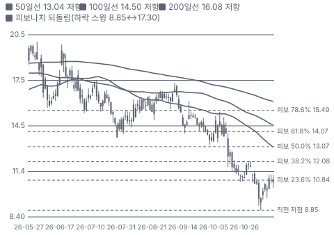

**주봉**

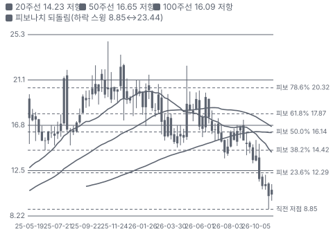

**월봉**

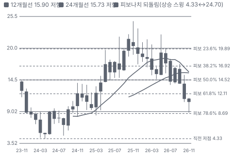

**분기 매출·EPS 실적과 컨센서스**

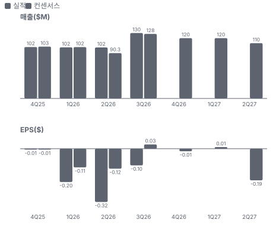

**4Q26 매출 — 지표 추세 vs 가이던스·컨센서스**

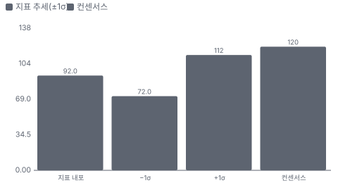

**최근 4개 분기 주가 변화 분석**

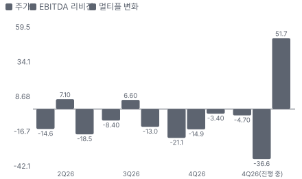

**EPS 리비전**

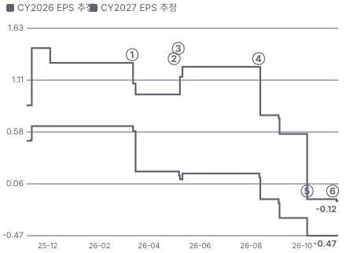

① 26-03-12 4Q25 실적 · EPS 리비전 -25%
② 26-05-01 12년 용량 계약 · EPS 리비전 +0%
③ 26-05-06 1Q26 실적 · EPS 리비전 +28%
④ 26-08-10 2Q26 실적 · EPS 리비전 -39%
⑤ 26-10-07 6년 유틸리티 계약 · EPS 리비전 -118%
⑥ 26-11-09 3Q26 실적 · EPS 리비전 +15%

**멀티플 프리미엄(Fwd 1Y EV/EBITDA, 최근 4개 분기말)**

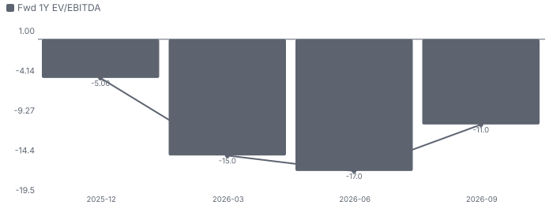

**합리적 멀티플**

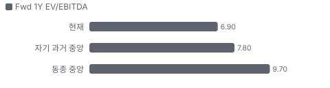

**밸류에이션 주가 시나리오**

**주가별 업사이드**

- 제품·서비스 포트폴리오

**고객 믹스(FY2025, 매출 대비)**

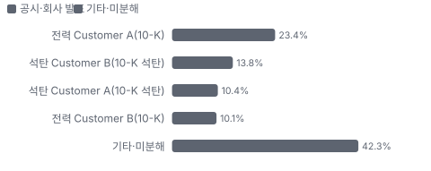

**공급 병목(10점, 낮을수록 병목)**

**생산능력 현재와 확충 계획(MW)**

**CAPEX의 매출 대비 비중**

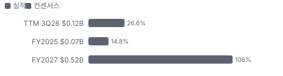

**어닝콜 변화별 주주가치 영향**

**수주·파이프라인 확실성 사다리**

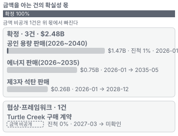

**매출 → 매출총이익 → 영업이익(매출 = 100, 최근 4분기)**

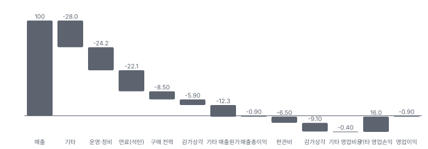

**분기 비용 비중 추이(매출 대비, 공시)**

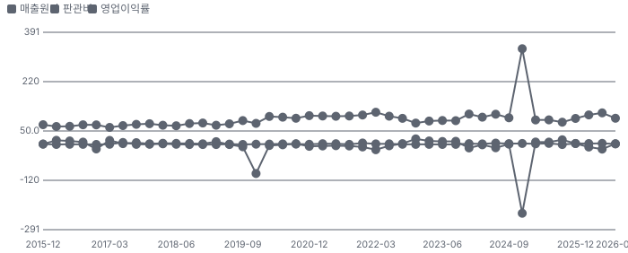

**비용 요인별 매출 대비 비중 1년 변화**

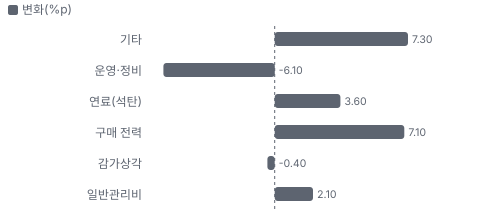

**전력(용량·에너지) BOM 원가 몫**

**석탄(제3자 판매) BOM 원가 몫**

**BOM 항목 가격 +10% 시 OPM 변화**

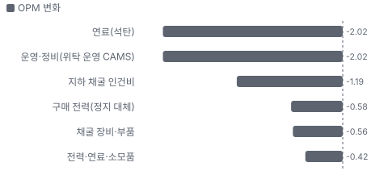

**원가 물가 vs 판매가 물가 — 1년 변화(원가가 판매가보다 더 오르면 단가를 올리지 못하는 만큼 마진이 줄어든다): 판매가 쪽 물가가 원가보다 5.8%p 더 올라 단가 전가 여지가 있다**

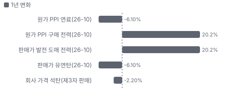

**자산 구성 — 3Q26 분기말 투하자본 \$252.2M**

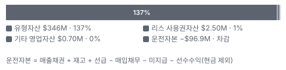

**자산별 변화율 — 최근 12개 분기(4Q23 = 0%) + 다음 4개 분기 추정**

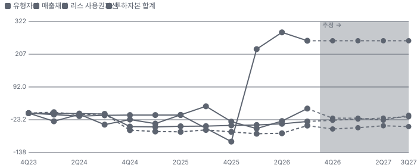

**ROIC 추이 — TTM, 최근 12개 분기 + 다음 4개 분기 추정(컨센서스 NOPAT)**

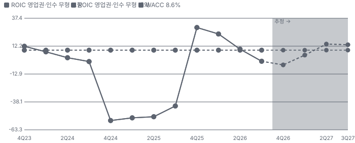

**분기 감가 비율 연율(유형자산 총액 대비)**

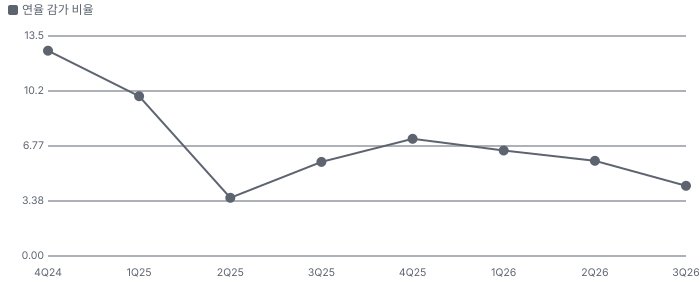

**생산시설별 면적(에이커, 큰 순) — 생산능력 미공시라 면적을 대용으로**

**매출·PPI·수출입 — 최근 16개 분기 + 다음 분기 추정(선마다 자기 y축: 왼쪽 매출, 오른쪽 지표) · 발전업 PPI(미국) — 16개 분기 범위 144.3~237.5(+64.6%) · 미국 유연탄(발전용 역청탄) 수출(HS 270112) — 16개 분기 범위 2,292,815,449.0~4,281,091,214.0(+86.7%)**

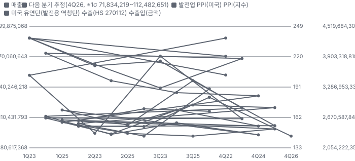

**목표주가 산정 — 약세와 기본 사이(약세 쪽 26%), 도달 확률 약 56%**

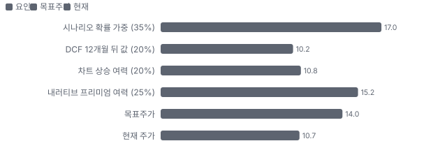

**일봉 지지·저항과 목표주가**

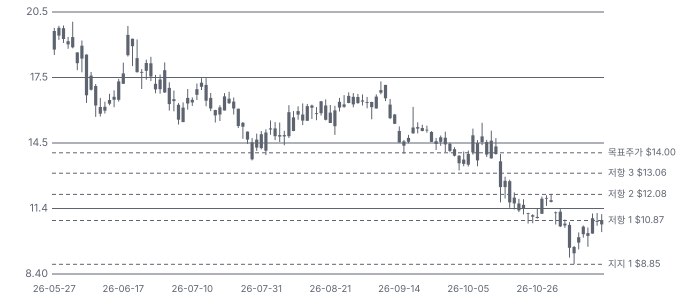

**일별 거래량 분해**

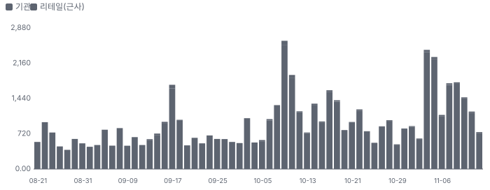

**기관 자금 흐름**

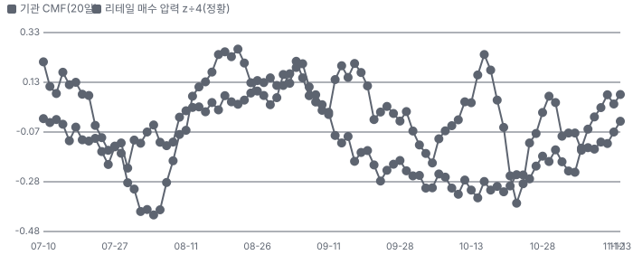

**몬테카를로**

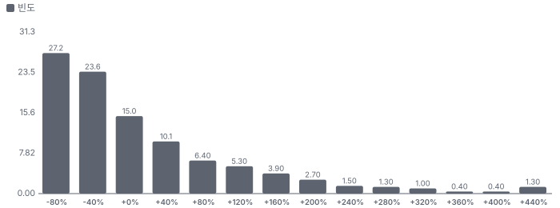

해석: 3,000번 중 1,226번(41%)에서 가치가 지금 주가 이상이었다. 지금 주가를 뒷받침하는 경우와 그렇지 않은 경우가 반반에 가깝다. 가운데 값은 0.79배이고, 열 번 중 여덟 번은 0.10~2.63배 사이에 든다.

## 내러티브

> **기업가치를 결정하는 이야기:** 기업가치는 세 덩어리다. ① Merom 장기 계약 현금흐름 — 2029년부터 용량 수입이 연 \$131M로 뛰는 계단식 구조 ② Turtle Creek 460MW — 회사는 사업비 \$800M를 24개월에 \$1.6B 가치로 만들겠다고 한다 ③ 석탄 사업 — 지금은 적자다. 순차입 \$426M을 빼면 시가총액 \$504M은 ①만으로도 설명될 여지가 있고, ②는 계약 전이라 거의 값을 받지 못한다.

> **멀티플·EPS 프리미엄**
> **멀티플:** Fwd 1Y EV/EBITDA 9.6배로 동종 중앙(약 9.7배)과 비슷하다. 그러나 다음 해 EBITDA 추정이 \$43M(FY2026) → \$87~95M(FY2027)로 두 배가 되는 회복을 전제로 한 배수다.
> **EPS:** EPS는 FY2027까지 적자 추정(−\$0.12)이고 FY2028 +\$0.63(2명)이 첫 흑자다.

### 투자자들은 왜 열광했나

열광은 2025년 말 '데이터센터용 디스패치 가능 전력'이라는 이야기로 정점(\$22.79)을 찍었다. 2026년 들어 Merom 정지(2Q 조정 EBITDA −\$2.9M)와 EPS 추정 붕괴로 식었고, 10월 사상 최고 용량 단가 계약도 주가를 되돌리지 못했다 — 시장은 단가보다 가동률과 자금 구조를 본다.

### 무엇이 기업가치를 바꾸나

> **구조적 체질 변화**
> **변화:** 석탄 광산 회사 → 장기 계약 발전사. 전력 매출 비중 64% → 71%(3Q, 전년 대비), 석탄 부문은 적자로 줄어드는 쪽
> **증거:** 10-Q
> **반증:** 전력 부문 EBITDA가 2개 분기 연속 줄어든다

> **고부가 믹스 확장**
> **변화:** 현물 판매에서 장기 공인 용량 계약으로 — 용량 단가 2026 \$244 → 2031~35 \$499/MW·일
> **증거:** 8-K 선도 판매 표
> **반증:** 새 계약 단가가 직전보다 낮아진다

> **기술 혁신**
> **변화:** 해당 없음(이유: 기존 석탄·가스 터빈 기술. 차별점은 기술이 아니라 부지·접속권)
> **증거:** 10-K
> **반증:** 해당 없음

> **실행 속도**
> **변화:** Turtle Creek: 터빈 확보 → 운전까지 약 24개월(2028 하반기) — 신규 가스 터빈 주문은 2030년 넘어 매진(3Q 콜) **납품 리드타임 24~30개월(FID → 상업 운전, 회사 목표).** 피어 비교 미확인. 이전 대비 미확인.
> **증거:** 3Q 콜
> **반증:** COD(상업 운전 개시일)가 2029-06-30을 넘기면 대출 기한이익 상실

> **M&A**
> **변화:** 해당 없음(이유: 최근 3년 인수 없음. 회사는 완공 뒤 일부·전부 매각도 선택지라고 밝혔다)
> **증거:** 3Q 콜
> **반증:** 해당 없음

> **정책·입법 연관성**
> **재정정책:** 해당 없음(이유: 석탄·가스 피커에 직접 세액공제 없음. DOE(미국 에너지부) 금융은 Merom 관련 검토만 언급) 2Q 콜 반증: 해당 없음 의회 동의 2/10 — 하원 1/5(관련 법안 논의 확인 못 함) · 상원 1/5(같음).
> **행정명령:** 석탄 발전소 폐쇄 지연·전력망 신뢰성 행정 조치 기조(행정부) — 석탄 설비 수명 연장에 우호적. Merom 내용연수 2040 연장의 배경 10-Q(내용연수 2032 → 2040) 반증: EPA(미국 환경보호청) 규제(CCR(석탄재 처리 규정)·ELG(발전소 폐수 배출 기준)·MATS(수은·대기 독성물질 기준)) 강화로 석탄 설비 투자 요구 의회 동의 2/10 — 하원 1/5(행정 조치 — 의회 절차 아님) · 상원 1/5(같음).
> **연관입법:** 해당 없음(이유: 회사 실적에 직접 닿는 계류 법안 확인 못 함) 미확인 반증: 해당 없음

> **고객의 지출 예산**
> **변화:** 고객(유틸리티)의 용량 확보 예산 — 데이터센터 부하 증가로 유틸리티가 장기 용량을 사들인다. 데이터센터 투자 발표가 곧 HNRG 매출은 아니다(계약만 센다)
> **사업별 예산:** **매출의 71%**: 전력(용량·에너지) — 고객 혼합(유틸리티 전력 구매비(요금 기저에 반영되는 구매 전력·용량 비용)) · 동인: 데이터센터·제조업 부하 증가
**매출의 28%**: 석탄(제3자 판매) — 고객 OPEX(유틸리티 연료비) · 동인: 석탄 발전 가동률
> **증거:** 3Q 콜·8-K
> **반증:** 인디애나 유틸리티 자원 계획(IRP(유틸리티 장기 전력 자원 계획))에서 외부 용량 구매가 줄어든다

### 내러티브 근거

> '데이터센터 전력 부족 시대에 이미 연결된 1GW 발전소'라는 이야기가 2025년 말 \$22.79(종가 고점)까지 끌어올렸다가, 2026년 내내 Merom 정지·석탄 적자·EPS 추정 붕괴로 \$10.69까지 −53% 빠졌다. 용량 계약 단가는 계약마다 올라갔지만 주가는 이를 Turtle Creek 실행 위험과 고금리 브리지 대출로 상쇄해 읽고 있다. 단계는 소멸, 쏠림은 낮음이다.

> **용량 부족 시대의 기존 접속권** · 강화
> **논리:** MISO 신규 연결이 수년 밀려 이미 연결된 1GW 부지의 값이 오른다
> **숫자:** 용량 단가 2026 \$244 → 2029 \$478/MW·일(+96%, 계약 기준)
> **반증:** MISO 용량 경매 가격이 2027/28 계획연도에 하락
> **출처:** https://www.sec.gov/Archives/edgar/data/788965/000162828026072319/hnrg-20261109xexx991.htm

> **Turtle Creek 가치 창출** · 약화
> **논리:** \$800M 사업을 24개월에 \$1.6B 가치로(회사 목표)
> **숫자:** 460MW × \$1,700/kW, 비교 거래 TransAlta 318MW 약 \$1B(MW당 약 \$3.1M)
> **반증:** FID가 2027 1Q를 넘기거나 구매 계약이 2027 상반기에 없다
> **출처:** Hallador 3Q26 어닝콜(2026-11-09)

> **장기 계약 장부** · 강화
> **논리:** 공인 용량 95%를 2035년까지 묶어 매출 가시성이 높다
> **숫자:** 선도 판매 \$3.0B(부문), 2029 이후 합산 \$70~75/MWh
> **반증:** 계약 상대방 축소(에너지 0으로 최대 90일)·unit contingent(발전소가 돌 때만 전력을 넘기는 조건부 판매) 손실
> **출처:** https://www.sec.gov/Archives/edgar/data/788965/000162828026072319/hnrg-20261109xexx991.htm

> **반대 내러티브: 노후 석탄 설비의 실행 위험** · 강화
> **논리:** 1982·1983년 설비가 멈출 때마다 비싼 시장 전력을 사서 메워야 해 계약 단가 상승이 이익으로 오지 않는다
> **숫자:** 구매 전력비 3Q \$11.1M(전년 \$2.1M), FY2027 EPS 추정 \$0.75 → −\$0.12
> **반증:** 4Q26·1Q27 구매 전력비가 분기 \$3M 아래로
> **출처:** https://www.sec.gov/Archives/edgar/data/788965/000162828026072347/hnrg-20260930.htm

> **반대 내러티브: 고금리 브리지 대출** · 유지
> **논리:** 실효 14.7%·최소 회수 1.35배 대출이 지연될수록 지분 가치를 깎는다
> **숫자:** 원금 \$551.9M, 9/30 금리 11.9%
> **반증:** 구매 계약 뒤 2027년 안 저금리 재융자
> **출처:** https://www.sec.gov/Archives/edgar/data/788965/000162828026072347/hnrg-20260930.htm

### 투자 포인트

> **계약 단가 계단**
> **명제:** 공인 용량 단가가 2026 \$244 → 2029 \$478/MW·일로 두 배가 되며, 용량 수입이 2027 \$75M → 2029 \$131M로 뛴다
> **숫자:** 3Q26 8-K 선도 판매 표(10/7 계약 포함): 용량 수입 총 \$1.47B, 2029 750MW·2030 725MW 계약
> **시장과 다른 점:** 컨센서스 EPS는 FY2027 적자(−\$0.12)에 머물러 2029 계단이 아직 숫자에 거의 없다(FY2028 추정 2명)
> **증명:** FY2029 컨센서스 등장과 4Q26 실적의 계약 표 갱신
> **출처:** https://www.sec.gov/Archives/edgar/data/788965/000162828026072319/hnrg-20261109xexx991.htm

> **Turtle Creek은 값을 못 받는다**
> **명제:** 회사는 사업비 \$800M를 24개월에 \$1.6B 가치로 만들겠다고 하는데, 시가총액은 \$504M다
> **숫자:** 3Q 콜: 터빈 소유권 이전·연결 연구 완료, FID 연말 목표, 비교 거래 TransAlta 318MW 약 \$1B
> **시장과 다른 점:** 시장은 계약 전 피커에 값을 주지 않는다 — FID·계약이 나오는 순간 그 할인이 풀릴 여지가 있다(조건부)
> **증명:** 연말 FID 공시, 2027 초 구매 계약
> **출처:** Hallador 3Q26 어닝콜(2026-11-09)

> **가동률이 전부**
> **명제:** 계약 물량을 못 채우면 시장 전력을 사서 메워야 해 계약 단가 상승이 이익으로 오지 않는다
> **숫자:** 3Q 구매 전력비 \$11.1M(전년 \$2.1M), 9M \$34.6M(전년 \$11.1M)
> **시장과 다른 점:** 추정 하향(FY2027 EPS \$0.75 → −\$0.12)은 이 비용을 반영한 것 — 정비 효과가 나오면 되돌릴 수 있다
> **증명:** 4Q26·1Q27 구매 전력비 분기 \$3M 아래
> **출처:** https://www.sec.gov/Archives/edgar/data/788965/000162828026072347/hnrg-20260930.htm

### 모멘텀 생성·소멸 타임라인

**카탈리스트 달력 — 지난 사건의 주가 반응과 앞으로 확인할 숫자**
| 날짜 | 상태 | 구분 | 사건 | 반응·확인 | 결과에 따라 |
|---|---|---|---|---|---|
| 2025-12-11 | 완료 | 생성 | 종가 고점 \$22.79 — 데이터센터 전력 기대 | 52주 고점 |  |
| 2026-05-06 | 완료 | 생성 | 1Q26 실적·12년 용량 계약(5/1) | +5.0%(5/5 → 5/6) |  |
| 2026-08-10 | 완료 | 확인 | 2Q26 실적(정비 손실) — Turtle Creek 사업비 \$800M 미만으로 | +7.6%(8/7 → 8/10) |  |
| 2026-10-07 | 완료 | 확인 | 인디애나 유틸리티 6년 계약 약 \$700M | −7.8%(10/6 → 10/7), 다음 날 +6.2% |  |
| 2026-11-09 | 완료 | 소멸 | 3Q26 실적 — EPS −\$0.10(추정 +\$0.03), 52주 종가 저점 \$9.36(11/5) 부근 | −4.1%(11/9 → 11/10) |  |
| 2026-12 말(예상) | 예정 | 확인 | Turtle Creek FID(이사회 승인) | FID 공시·EPC 계약 | 공시 → 기본에서 강세 쪽, 연기 → 약세 쪽 |
| 2027-03 초(예상) | 예정 | 확인 | 4Q26 실적 | 구매 전력비 분기 \$3M 아래, 조정 EBITDA \$20M 이상 | 충족 → 추정 상향 시작, 미달 → 약세 |
| 2027 상반기(예상) | 예정 | 확인 | Turtle Creek 구매 계약·MISO 연결 계약 | 계약 MW·기간·tolling 여부 | 체결 → 강세 시나리오 근거, 불발 → 대출 비용 부담 |

### 언제 사서 언제 팔아야 할까?

**가격·조건 틀 — 가격은 밸류에이션(약세·기본·강세·목표주가)과 차트 지지 구간에서, 조건은 이벤트에서**
| 구간 | 가격 | 목표주가까지 | 약세까지 | 조건·근거 |
|---|---|---|---|---|
| 관찰 구간 | \$8.85~\$8.85 | +58% | -33% | 52주 종가 저점 \$9.36(11/5) 부근은 순차입을 뺀 Merom 계약 가치만 남긴 구간이라 차트 지지와 밸류에이션 앵커가 겹친다 |
| 확인 뒤 | 지금 \$10.69 이상에서 조건 확인 | +31% | -44% | Turtle Creek FID 공시(연말)와 4Q26 구매 전력비 분기 \$3M 아래 |
| 무효화 | 약세 시나리오 \$5.97 | - | -44% | FID가 2027 1Q를 넘기거나 4Q26 조정 EBITDA가 \$10M 아래 |
| 차익 고민 1차 | \$16.82(목표주가·기본 시나리오) | +57% | - | 목표주가 부근에서는 Turtle Creek 구매 계약 전까지 남은 실행 위험을 다시 잰다 |
| 차익 고민 2차 | \$29.67(강세 시나리오) | +178% | - | 목표주가 부근에서는 Turtle Creek 구매 계약 전까지 남은 실행 위험을 다시 잰다 |

하루 6~12% 움직임이 잦은 소형주다(최근 120거래일 15회) — 실적·FID 공시 직후 추격을 경계한다 가격·조건 틀이며 매매·비중 지시가 아니다(투자 권유 아님).

## 포트폴리오

| 제품·서비스 | 구분 | 무엇 | 쓰는 곳 | 돈 버는 방식 | Mix | Mix 변화(공시 — 3Q 전력 매출 \$92.8M ÷ 총매출 \$130.3M(전년 \$93.2M ÷ \$146.6M)) |
|---|---|---|---|---|---|---|
| 전력(용량·에너지) | 제품 | Merom 1,080MW 석탄화력의 공인 용량(MW·일)과 전력량(MWh(메가와트시, 전력량 단위))을 판다 | 인디애나 투자 등급 유틸리티·협동조합·전력 거래사 | 용량 단가(\$/MW·일) × 공인 MW + 에너지 단가(\$/MWh) × 발전량 | 71% | +7.7%p |
| 석탄(제3자 판매) | 제품 | 인디애나 Oaktown(인디애나·일리노이에 걸친 지하 석탄 광산 단지) 지하 광산의 발전용 석탄을 외부 유틸리티에 판다 | CenterPoint(Vectren)·Duke Energy·Orlando Utility Commission 등(10-K 거명) | 톤당 판매가 × 출하량(\$55.9~59.5/톤 계약) | 28% | -7.3%p |
| Turtle Creek 가스 피커 | 프로젝트 | Merom 부지에 짓는 460MW 가스 첨두 발전소(미운전 Siemens 터빈 확보) | 용량이 필요한 유틸리티 — tolling 계약 검토 | 용량·tolling 요금(계약 전) | 0% | 미확인 |

**Mix 변화가 가장 큰 쪽은 전력(용량·에너지)(+7.7%p, 공시 — 3Q 전력 매출 \$92.8M ÷ 총매출 \$130.3M(전년 \$93.2M ÷ \$146.6M)).** 계절성 판정: 분기 매출 계절 지수 기준 없음 → 직전 분기와 비교.

## 고객

> **FY2025 최대 고객 전력 Customer A(10-K) 23%, 상위 3곳 48%, 집중도 분산.** 공시·회사 발표로 확인한 몫은 매출의 58%이고, 나머지 고객 몫은 추정이거나 미분해다. 고객 이름은 공시되지 않는다. FY2025 전력 매출의 23.4%가 Customer A, 10.1%가 Customer B다. 2026년 용량 계약 상대방은 '인디애나 유틸리티'로만 적혀 있고, 언론은 Duke Energy로 보도했다(가설).

**고객별 매출 몫(FY2025)**
| 고객 | 몫 | 변화 | 근거 |
|---|---|---|---|
| 전력 Customer A(10-K) | 23% | -7%p | 공시 |
| 석탄 Customer B(10-K 석탄) | 14% | +3%p | 공시 |
| 석탄 Customer A(10-K 석탄) | 10% | -3%p | 공시 |
| 전력 Customer B(10-K) | 10% | 미확인 | 공시 |
| 인디애나 유틸리티(언론: Duke Energy — 가설)(Indiana Utility(10-Q 주석 7)) | 미확인 | 미확인 | 추정 |
| 기타·미분해 | 42% | - | - |

> **전력 Customer A(10-K)** · 공시
> **사는 것:** 전력·용량
> **추정 근거:** FY2025 \$110.0M

> **석탄 Customer B(10-K 석탄)** · 공시
> **사는 것:** 발전용 석탄
> **추정 근거:** FY2025 \$64.8M

> **석탄 Customer A(10-K 석탄)** · 공시
> **사는 것:** 발전용 석탄
> **추정 근거:** FY2025 \$49.0M

> **전력 Customer B(10-K)** · 공시
> **사는 것:** 전력·용량
> **추정 근거:** FY2025 \$47.2M

> **인디애나 유틸리티(언론: Duke Energy — 가설)(Indiana Utility(10-Q 주석 7))** · 추정
> **사는 것:** 2029~2035 용량 225 ZRC/일·에너지 200MW
> **추정 근거:** 10-Q는 이름을 밝히지 않는다 — 계약 매출 약 \$700M(3Q 콜)

## 수주·파이프라인

> **2026-09-30 기준 4건.** 확정 \$2.48B. 공시 선도 판매 장부(부문 기준, 사내 석탄 포함) \$2.99B.

**수주 목록**
| 상태 | 계약 | 계약 총액 | 진척 | 기간 | 비고 |
|---|---|---|---|---|---|
| 확정 | 공인 용량 판매(2026~2040) | \$1.47B | 1% | 2026-01 → 2040-05 | - |
| 확정 | 에너지 판매(2026~2035) | \$0.75B | 비공개 | 2026-01 → 2035-05 | - |
| 확정 | 제3자 석탄 판매 | \$0.26B | 비공개 | 2026-01 → 2028-12 | - |
| 협상 | Turtle Creek 구매 계약 | 금액 비공개 | 0% | 2027-03 → 미확인 | - |

**실행 속도와 방해 요인**
| 항목 | 상태 | 실행 속도 | 방해 요인 |
|---|---|---|---|
| 공인 용량 판매(2026~2040) | 확정 | 계획대로(계획 5%, -4%p), 이대로면 2092-09 완료, 628개월 지연 | Merom 가동률 |
| 에너지 판매(2026~2035) | 확정 | 미확인 | unit contingent — 정지 때 대체 구매 |
| 제3자 석탄 판매 | 확정 | 미확인 | 석탄 수요·규제 |
| Turtle Creek 구매 계약 | 협상 | 미확인 | FID·연결 계약 선행 |

## 마진 구조

> **GPM 11.4%, OPM 6.0%.** 3Q25 대비 GPM -11.5%p, OPM -13.6%p. 변동비는 매출의 48%이고, 매출이 10% 늘면 OPM은 +4.2%p 움직인다. 매출원가의 핵심은 연료(석탄)·운영 정비·구매 전력이다. 3Q 매출 \$130.3M에 연료 \$28.8M(22%)·운영 정비 \$31.5M(24%)·구매 전력 \$11.1M(9%)·감가상각 \$7.6M(6%)이 들었고, 나머지 영업비용 \$36.4M(28%)은 광산 운영비 등이다(계산). 구매 전력은 Merom이 멈출 때 계약 물량을 시장에서 사서 메우는 비용이라 가동률이 마진을 가른다.

> **매출 100 중 매출원가 100.9, 매출총이익 -0.9(최근 4분기, 공시).** 매출원가 요인 중 기타이 매출의 28.0%로 가장 무겁고, 단가가 +10% 오르면 GPM이 -2.80%p 움직인다. 분기 회귀로 매출 1이 늘 때 매출원가는 0.91 늘고, 매출원가의 고정비 몫은 3%다.

**비용 요인 강도 — 비중·추세·충격(+10%)·탄력**
| 비용 | 구분 | 매출 대비 | 1년 변화 | 마진 기여 | 충격 시 마진 | 매출 탄력 | 고정비 몫 |
|---|---|---|---|---|---|---|---|
| 기타 | 매출원가 요인 | 28.0% | +7.3%p | -7.3%p | -2.80%p | 미확인 | 50% |
| 운영·정비 | 매출원가 요인 | 24.2% | -6.1%p | +6.1%p | -2.42%p | 미확인 | 70% |
| 연료(석탄) | 매출원가 요인 | 22.1% | +3.6%p | -3.6%p | -2.21%p | 미확인 | 20% |
| 구매 전력 | 매출원가 요인 | 8.5% | +7.1%p | -7.1%p | -0.85%p | 미확인 | 0% |
| 감가상각 | 매출원가 요인 | 5.9% | -0.4%p | +0.4%p | -0.59%p | 미확인 | 100% |
| 매출원가 | 공시 항목 | 100.9% | -34.7%p | +34.7%p | -10.09%p | 0.91 | 3% |
| 감가상각 | 공시 항목 | 9.1% | -2.3%p | +2.3%p | 미확인 | 0.05 | 60% |
| 판관비 | 공시 항목 | 6.5% | +1.0%p | -1.0%p | 미확인 | 0.04 | 26% |
| 기타 영업비용 | 공시 항목 | 0.4% | -0.4%p | +0.4%p | 미확인 | -0.02 | 100% |

매출 탄력 = 분기 비용을 매출에 회귀한 기울기(매출 1당 변동비), 고정비 몫 = 절편 ÷ 평균 비용. 표본이 8분기 미만이면 미확인. 매출원가 요인 비중은 margin 재료의 추정이 섞여 있고, 공시 매출원가와의 차이는 '기타 매출원가'로 둔다.

**GPM에서 OPM까지(GAAP, 아래는 최근 4개 분기)**
| 기간 | GPM | 연구개발 | 판관비 | 기타 | OPM |
|---|---|---|---|---|---|
| 3Q25 | 22.9% | 0.0% | 3.3% | 0.0% | 19.6% |
| 3Q26 | 11.4% | 0.0% | 5.4% | 0.0% | 6.0% |
| 2025-12 | 6.5% | - | - | - | 6.5% |
| 2026-03 | -5.6% | - | - | - | -5.6% |
| 2026-06 | -12.5% | - | - | - | -12.5% |
| 2026-09 | 6.0% | - | - | - | 6.0% |

**비용을 움직이는 요인**
| 비용 | 요인 |
|---|---|
| 기타(매출원가) | 광산 운영비 등 10-Q 별도 줄 밖의 영업비용 — 손익(영업이익)과 맞추는 나머지(계산) · 근거 추정 |
| 운영·정비(매출원가) | Merom 정비(CAMS 위탁 운영)·광산 운영비 · 근거 공시 |
| 연료(석탄, 매출원가) | Merom 발전량 × 석탄 단가(대부분 자회사 Oaktown 공급) · 근거 공시 |
| 구매 전력(매출원가) | 발전소 정지 때 계약 물량을 MISO 시장에서 산다 · 근거 공시 |
| 감가상각(매출원가) | Merom 내용연수 2032 → 2040 연장(6/1)로 분기 \$3.6M 감소 · 근거 공시 |
| 일반관리비(판관비) | Turtle Creek 개발·상장사 비용 · 근거 공시 |

**전력(용량·에너지) BOM — 매출의 71%, GPM 19%(매출총이익 미공시 — 3Q 전력 부문 EBITDA \$17.6M ÷ 부문 매출 \$93.0M = 19%로 대신(계산, 감가상각 전)), 항목 가격 +10% 시**
| 항목 | 원가 몫 | 전가 | 제품 GPM | OPM |
|---|---|---|---|---|
| 연료(석탄) | 30~40% | 0% | -2.8%p | -2.02%p |
| 운영·정비(위탁 운영 CAMS) | 30~40% | 0% | -2.8%p | -2.02%p |
| 구매 전력(정지 대체) | 5~15% | 0% | -0.8%p | -0.58%p |
| 미분해 | 20% | - | - | - |

**석탄(제3자 판매) BOM — 매출의 28%, GPM -1%(매출총이익 미공시 — 3Q 석탄 부문 EBITDA −\$0.5M ÷ 부문 매출 \$51.3M = −1%로 대신(계산)), 항목 가격 +10% 시**
| 항목 | 원가 몫 | 전가 | 제품 GPM | OPM |
|---|---|---|---|---|
| 지하 채굴 인건비 | 35~50% | 0% | -4.3%p | -1.19%p |
| 채굴 장비·부품 | 15~25% | 0% | -2.0%p | -0.56%p |
| 전력·연료·소모품 | 10~20% | 0% | -1.5%p | -0.42%p |
| 미분해 | 22% | - | - | - |

연료(석탄) 가격이 +10% 오르면 영업이익은 -33.6% 움직인다.

**BOM 항목 가격을 움직이는 것**
| 항목 | 요인 |
|---|---|
| 연료(석탄) | 고정가 계약이라 연료비 상승은 전가되지 않는다 · 근거 추정 |
| 운영·정비(위탁 운영 CAMS) | 노후 설비(1982·1983년 운전 시작) 정비비 · 근거 추정 |
| 구매 전력(정지 대체) | 정지와 고가 시간대가 겹치면 급증 · 근거 추정 |
| 지하 채굴 인건비 | 광산 인력 599명(10-K) · 근거 추정 |
| 채굴 장비·부품 | 주 공급사 한 곳 집중(10-K) · 근거 추정 |
| 전력·연료·소모품 | 광산 전력 의존(10-K) · 근거 추정 |

> **원가·판매가 물가 격차 +5.8%p** — 판매가 물가가 투입 원가 물가보다 빠르게 오른다.

**투입 물가 — 미국 PPI 3·6·12개월(2026-10, 개정 반영)**
| 항목 | 미국 3개월 | 6개월 | 12개월 | 전가 못 할 때 OPM |
|---|---|---|---|---|
| 연료(석탄) | -0.4% | -3.1% | -6.1%* | +1.3%p |
| 구매 전력(정지 대체) | +8.0% | +43.0% | +20.2%* | - |
| 전력·연료·소모품 | -6.1% | +1.8% | +0.6%* | - |

별표는 품목보다 넓은 업종 지수다. 연결한 투입 원가의 미국 PPI(생산자물가지수)는 1년 새 가중 +1.2%이고, 판매가로 넘기지 못하면 GPM -0.4%p·OPM -0.4%p가 움직인다. 석탄(제3자 판매) 가격은 -2.2%로 비교 물가(유연탄(발전용 역청탄) PPI, 2026-10) -6.1%보다 3.9%p 더 올랐다. 물가 지수를 붙이지 못한 매출원가 항목은 운영·정비, 감가상각다(미연결).

## 자산 구성

> **3Q26 분기말 투하자본 \$252.2M** — 유형자산 137%, 리스 사용권자산 1%. 최근 12개 분기(4Q23 → 3Q26) 가장 크게 늘어난 자산은 리스 사용권자산(+255%), 투하자본 합계 -44%. 3Q27 추정 투하자본 \$236.7M(-6%, 컨센서스 매출과 회전 일수·CAPEX 강도 유지 가정). 연율 감가 비율(총액 기준)은 직전 4분기 8.12% → 최근 4분기 5.93%, 직전 비율이면 감가상각이 \$14.6M 더 컸다(영업이익의 -377.8%).

**자산·운전자본 항목별 분기말 잔액 — 최근 12개 분기와 다음 4개 분기 추정**
| 항목 | 4Q23 | 3Q25 | 3Q26(최근) | 3Q27 추정 | 12개 분기 변화 | 다음 4개 분기 변화 |
|---|---|---|---|---|---|---|
| 매출채권 | \$19.9M | \$24.8M | \$23.2M | \$18.4M | +16% | -20% |
| 선급·기타 유동자산 | \$2.3M | \$4.3M | \$2.1M | \$3.4M | -5% | +60% |
| 매입채무 | 미확인 | 미확인 | \$18.4M | \$26.0M | 비교 불가 | +41% |
| 선수수익(계약부채) | \$66.3M | \$113.2M | \$103.7M | \$149.5M | +56% | +44% |
| 유형자산 | \$488.6M | \$266.0M | \$345.8M | \$425.9M | -29% | +23% |
| 리스 사용권자산 | \$0.7M | 미확인 | \$2.5M | \$2.5M | +255% | +0% |

**자산 추정 동인 — 최근 4개 분기 평균(재무상태표 동인 모형)**
| 동인 | 값 | 곱하는 기준 |
|---|---|---|
| 매출채권 | 12일 | 매출 |
| 선급·기타 유동자산 | 2일 | 매출 |
| 매입채무 | 18일 | 매출 |
| 미지급비용 | 26일 | 매출 |
| 선수수익(계약부채) | 101일 | 매출 |
| CAPEX 강도 | 26.6% | 매출(최근 4개 분기 합) |
| 분기 감가율 | 3.50% | 기초 유형자산 순액(무형 상각 제외 감가상각) |
| 영업권·리스 사용권·기타 | 유지 | 인수·새 리스는 공시 전 모름 |
| 인수 무형자산 | 분기 \$0.0M 상각 | 최근 4개 분기 평균 상각 |

**추정 방법:** 증권사 3표 모델(손익·재무상태표·현금흐름)의 재무상태표 동인 방식이다. 운전자본은 항목별 회전 일수(매출채권·선급·미지급·선수는 매출, 재고·매입채무는 매출원가 기준)를 최근 4개 분기 평균으로 두고 컨센서스 매출에 곱한다. 유형자산은 기초 + CAPEX − 감가상각으로 굴린다(Koller·Goedhart·Wessels 『Valuation』 재무상태표 추정). 매출 경로는 ROIC 절의 컨센서스와 같다.

**유형·무형자산 항목별 가치(2025-12-31 vs 2024-12-31)**
| 구분 | 항목 | 총액 2025-12-31 | 누적상각 | 순액 | 총액 2024-12-31 | 총액 1년 변화 | 공시 내용연수 |
|---|---|---|---|---|---|---|---|
| 유형 | 유형자산 합계(항목 미분해) | \$645.6M | 총계만 공시 | 총계만 공시 | \$605.7M | +6.6% | 미확인 |
| 유형 합계 | 유형자산 | \$645.6M | \$367.8M | \$277.8M | \$605.7M | +6.6% | 경과율 57%(상각 대상 기준) |

**내용연수 산식(상각 대상 유형자산 = 총액 − 토지 − 건설중)**
| 기준일 | 연 감가상각 | 상각 대상 총액 | 평균 내용연수 | 경과 연수 | 잔여 연수 | 경과율 |
|---|---|---|---|---|---|---|
| 2025-12-31 | \$41.2M | \$645.6M | 15.7년 | 8.9년 | 6.7년 | 57% |
| 2024-12-31 | \$65.6M | \$605.7M | 9.2년 | 5.3년 | 3.9년 | 57% |

산식 평균 내용연수는 15.7년. 1년 전 9.2년 → 지금 15.7년.

**분기 감가 비율(감가상각 ÷ 평균 유형자산 총액)**
| 분기 | 감가상각 | 평균 유형자산(총액) | 분기 비율 | 연율 | 연율의 역수 |
|---|---|---|---|---|---|
| 4Q24 | \$22.7M | \$719.0M | 3.16% | 12.63% | 7.9년 |
| 1Q25 | \$15.0M | \$609.5M | 2.46% | 9.83% | 10.2년 |
| 2Q25 | \$5.5M | \$619.9M | 0.89% | 3.58% | 28.0년 |
| 3Q25 | \$9.1M | \$631.6M | 1.45% | 5.79% | 17.3년 |
| 4Q25 | \$11.6M | \$641.2M | 1.80% | 7.21% | 13.9년 |
| 1Q26 | \$10.6M | \$653.4M | 1.62% | 6.49% | 15.4년 |
| 2Q26 | \$9.9M | \$675.6M | 1.47% | 5.86% | 17.1년 |
| 3Q26 | \$7.6M | \$705.1M | 1.08% | 4.32% | 23.1년 |

감가상각 기준: 손익계산서 감가상각·상각비(SEC 공시 데이터, 4분기 = 연간 − 1~3분기).

**감가율 하락 경고: 연율 8.12% → 5.93%(-27%).** 직전 4분기 비율을 그대로 쓰면 최근 4분기 감가상각이 \$14.6M 더 컸다(영업이익의 -377.8%). 내용연수 연장·상각 끝난 자산 증가·건설중 자산 증가(믹스) 중 무엇인지는 공시 주석으로 가린다(자체추론).

미공시·미분해: 영업권 · 무형자산 · 유형자산 항목별 총액·내용연수(10-K 주석에서 모델이 채움) · 무형자산 항목(10-K 주석에서 모델이 채움) — 이 칸은 비우고 나머지로 계산했다.

### 해석 — 자산이 어디에 쌓이고 있나

- 같은 기간 4개 분기 매출은 +1% — 매출보다 빨리 늘어난 자산: 매출채권 +16%, 리스 사용권자산 +255%. 이 자산의 회전율이 떨어지면 ROIC를 희석한다.
- 다음 4개 분기 CAPEX \$129.1M vs 감가상각 \$52.6M(최근 4개 분기 CAPEX 강도·감가율 유지) — 유형자산 3Q26 \$345.8M → 3Q27 \$425.9M. 투자가 감가보다 커서 자산이 쌓이는 국면이다.
- 감가 비율 하락으로 최근 4분기 영업이익에 \$14.6M(-377.8%)가 보태졌을 수 있다 — 내용연수 변경 공시가 없으면 건설중 자산·토지 같은 비상각 자산 몫이 커진 믹스 효과일 가능성이 크다(자체추론).

## ROIC

> **TTM 3Q26 ROIC는 영업권·인수 무형 포함 -1.4%, 제외 -1.4%**(NOPAT 마진 -0.7% × 투하자본 회전율 2.00회). 최근 12개 분기 4Q23 12.1% → 3Q26 -1.4%(고점 4Q25 29.0%). 컨센서스 NOPAT으로 굴리면 3Q27 13.5%(제외 13.5%) — WACC 8.6% 대비 +4.8%p.

**ROIC 추이(TTM)와 다음 4개 분기 추정 — NOPAT ÷ 평균 투하자본(이번 분기말·4개 분기 전)**
| 분기 | 구분 | TTM 매출 | TTM NOPAT | NOPAT 마진 | 평균 투하자본 | ROIC 포함 | ROIC 제외 |
|---|---|---|---|---|---|---|---|
| 4Q23 | 실적 | \$634.9M | \$51.4M | 8.1% | \$423.5M | 12.1% | 12.1% |
| 1Q24 | 실적 | \$558.1M | \$30.4M | 5.5% | \$429.5M | 7.1% | 7.1% |
| 2Q24 | 실적 | \$490.7M | \$7.1M | 1.4% | \$403.6M | 1.8% | 1.8% |
| 3Q24 | 실적 | \$430.1M | −\$8.0M | -1.9% | \$474.6M | -1.7% | -1.7% |
| 4Q24 | 실적 | \$403.9M | −\$172.5M | -42.7% | \$314.4M | -54.9% | -54.9% |
| 1Q25 | 실적 | \$410.1M | −\$163.7M | -39.9% | \$311.8M | -52.5% | -52.5% |
| 2Q25 | 실적 | \$419.1M | −\$148.6M | -35.5% | \$288.8M | -51.5% | -51.5% |
| 3Q25 | 실적 | \$460.5M | −\$129.6M | -28.2% | \$310.4M | -41.8% | -41.8% |
| 4Q25 | 실적 | \$469.5M | \$48.3M | 10.3% | \$166.6M | 29.0% | 29.0% |
| 1Q26 | 실적 | \$453.5M | \$32.8M | 7.2% | \$141.4M | 23.2% | 23.2% |
| 2Q26 | 실적 | \$452.2M | \$13.5M | 3.0% | \$142.3M | 9.5% | 9.5% |
| 3Q26 | 실적 | \$435.9M | −\$3.1M | -0.7% | \$218.0M | -1.4% | -1.4% |
| 4Q26 | 추정 | \$453.6M | −\$8.3M | -1.8% | \$176.0M | -4.7% | -4.7% |
| 1Q27 | 추정 | \$471.8M | \$7.0M | 1.5% | \$171.0M | 4.1% | 4.1% |
| 2Q27 | 추정 | \$480.3M | \$26.9M | 5.6% | \$190.3M | 14.1% | 14.1% |
| 3Q27 | 추정 | \$485.0M | \$32.9M | 6.8% | \$244.5M | 13.5% | 13.5% |

**다음 4개 분기 NOPAT — 컨센서스(세율 21%, 리스 이자 별도)**
| 분기 | 매출 | EBITA 마진 | EBITA | NOPAT(분기) | 근거 |
|---|---|---|---|---|---|
| 4Q26 | \$120.0M | -0.1% | −\$0.1M | −\$0.1M | 컨센서스 매출 × EBIT 마진 FY2026 |
| 1Q27 | \$120.0M | 11.4% | \$13.7M | \$10.8M | 컨센서스 매출 × EBIT 마진 FY2027 |
| 2Q27 | \$110.0M | 11.4% | \$12.6M | \$9.9M | 컨센서스 매출 × EBIT 마진 FY2027 |
| 3Q27 | \$135.0M | 11.4% | \$15.4M | \$12.2M | 컨센서스 매출 × EBIT 마진 FY2027 |

**추정 방법:** NOPAT은 컨센서스(분기 매출 추정 × 회계연도 EBIT 마진 추정)로 잡고, 조정(비 GAAP) 마진이면 주식보상 몫을 빼서 과거 실적과 같은 기준(영업이익 + 인수 무형 상각)으로 맞췄다. 이미 발표했지만 분기 보고서(10-Q)가 아직 없는 분기는 발표 실적을 쓴다. 투하자본은 자산 구성 절의 재무상태표 동인으로 굴렸다. ROIC는 4개 분기 NOPAT을 이번 분기말과 4개 분기 전 투하자본의 평균으로 나눈다 — 추정 분기의 ROIC에는 이미 나온 실적 분기가 섞여 있다.

**투하자본 항목별 회전율과 ROIC 기여(TTM 3Q26, 평균 잔액)**
| 항목 | 투하자본 | 매출 1달러당 자본 | 회전율(매출 ÷ 항목) | 자본 몫 | 이 항목을 빼면 ROIC |
|---|---|---|---|---|---|
| 운전자본 | −\$90.5M | -0.21 | 음수(자금 원천) | -42% | -1.0% |
| 유형자산 | \$305.9M | 0.70 | 1.42회 | 140% | 미확인 |
| 리스 사용권자산 | \$1.3M | 0.00 | 345.28회 | 1% | -1.4% |
| 기타 영업자산 | \$1.4M | 0.00 | 314.29회 | 1% | -1.4% |

**ROIC 세 가지 판**
| 판 | NOPAT | 투하자본 | ROIC | 무엇을 재나 |
|---|---|---|---|---|
| 영업권·인수 무형 포함 | −\$3.0M | \$218.0M | -1.4% | 인수 웃돈까지 낸 돈에 대한 수익률 |
| 영업권·인수 무형 제외 | −\$3.0M | \$218.0M | -1.4% | 본업 운영 수익률(동종 비교용) |
| 무형 자본화 조정(판관비 20%·5년, 연구개발 6년) | −\$1.6M | \$232.6M | -0.7% | 비용으로 처리한 무형 투자를 자산으로 본 판 |
| 경제적 이익(포함판) | −\$21.9M | \$218.0M | 자본비용 8.6% | (ROIC − 자본비용) × 투하자본 |

NOPAT = (영업이익 −\$3.9M + 인수 무형 상각 + 리스 내재 이자 \$0.0M) × (1 − 세율 21%). 리스 사용권자산을 투하자본에 넣었으므로 임차료 속 이자 몫을 영업이익에 되더했다. 현금은 영업에 필요한 몫을 따로 알 수 없어 투하자본에서 뺐다. SEC 공시 데이터 자동 초안 — 운전자본 = 매출채권 + 재고 + 선급 − (매입채무 + 미지급비용 + 선수수익), 현금 제외. 손상 누계는 공시 데이터 수록분.

투하자본 또는 NOPAT이 0 이하라 ROIC 분해는 비교 불가 — 경제적 이익으로 본다.

**무형 자본화 가정별 ROIC(2025년 지출 기준, 포함판에 더함)**
| 투자로 보는 몫 | 상각 연수 | 무형 자산 | NOPAT 조정 | 조정 ROIC |
|---|---|---|---|---|
| 판관비 20% | 2년 | \$7.9M | −\$0.0M | -1.4% |
| 판관비 20% | 5년 | \$14.5M | \$1.4M | -0.7% |
| 판관비 30% | 2년 | \$11.8M | −\$0.0M | -1.3% |
| 판관비 30% | 5년 | \$21.8M | \$2.1M | -0.4% |

### 해석 — 무엇이 수익성을 끌어올리고 희석하나

- 유형자산: 투하자본의 140% — 빼면 ROIC -1.4% → 미확인. 이 자산의 회전율(1.42회)이 수익성을 희석하는 주된 자리다.
- 기타 영업자산: 투하자본의 1% — 빼면 ROIC -1.4% → -1.4%. 이 자산의 회전율(314.29회)이 수익성을 희석하는 주된 자리다.
- 운전자본: −\$90.5M(음수), 고객 선수금·공급사 외상이 자본을 대신 댄다 — 빼면 ROIC -1.0%로 낮아진다. 수익성을 끌어올리는 쪽이다.
- 영업권·인수 무형을 빼면 ROIC가 +0.0%p 오른다 — 과거 인수에 치른 웃돈이 주주 수익률을 그만큼 낮춘다(본업 수익률은 제외판, 인수까지 포함한 가치 창출은 포함판으로 본다).
- 비용으로 처리한 무형 투자를 자산으로 보면 ROIC가 +0.7%p 움직인다(무형 자산 \$14.5M). 투자를 늘리는 중이라 NOPAT이 더 커지는 쪽이다.
- 추정 경로 3Q26 -1.4% → 3Q27 13.5%: NOPAT 마진 +7.5%p, 투하자본 회전율 -0.02회 — 컨센서스 매출·마진이 맞고 회전 일수·CAPEX 강도가 유지된다는 가정이다. 마진 추정이 내려가거나 재고 일수가 늘면 이 경로가 먼저 틀린다.
- ROIC(포함) − WACC = -10.0%p(3Q26) — 양수면 투하자본을 늘릴수록 가치가 쌓인다.

## 공급망 병목

> **공급망 신뢰성 1.5/10, 병목 심각.** 가장 약한 고리는 가스 터빈·발전기(Turtle Creek) 1.0점이고, 품목 평균은 2.2점이다. 근거가 부족한 2건(철도 운송 · 변압기·보일러 정비 부품)은 점수에서 뺐다. 공급 병목은 Turtle Creek 가스 터빈(이미 확보)과 계통 연결 계약, 그리고 Merom 정비 부품(변압기·보일러 설비)이다. 터빈은 신품 시장이 2030년 넘어 매진이라 2차 시장(필리핀 미운전 Siemens 설비)에서 샀다.

**병목과 마진 — 품목 가격 +10% 시 OPM**
| 품목 | 점수 | 판정 | 구분 | OPM |
|---|---|---|---|---|
| 가스 터빈·발전기(Turtle Creek, 필수) | 1.0 | 병목 심각 | 출하 차질 위험 | 미확인 |
| MISO 계통 연결(ERAS(MISO의 신규 발전원 신속 계통 연결 심사 제도))(필수) | 1.0 | 병목 심각 | 출하 차질 위험 | 미확인 |
| 석탄(Merom 연료, 필수) | 4.5 | 병목 주의 | 출하 차질 위험 | 미확인 |

> **가스 터빈·발전기(Turtle Creek)** · 1.0/10
> **왜:** 피커 출력의 심장 — 이미 소유권 이전
> **병목 요인:** 인증 공급사 1곳 · 캐파 부족 · 리드타임 미확인 · 재인증 미확인 · 1위 점유율 100% · 필리핀 → 미국 집중 100% · 물량 확보 미확인
> **풀리는 조건:** 소유권 이전, 연내 미국 도착 예정(3Q 콜) — 도착 전이라 '풀렸다'고 보지 않는다

> **MISO 계통 연결(ERAS)** · 1.0/10
> **왜:** 연결 계약 없이는 FID가 없다
> **병목 요인:** 인증 공급사 1곳 · 캐파 부족 · 리드타임 미확인 · 재인증 미확인 · 1위 점유율 100% · 미국 MISO 집중 100% · 물량 확보 미확인
> **풀리는 조건:** 연구 완료, 계약 마무리 중(3Q 콜)

> **석탄(Merom 연료)** · 4.5/10
> **왜:** 연료 자가 공급
> **병목 요인:** 인증 공급사 1곳 · 캐파 여유 · 리드타임 미확인 · 재인증 미확인 · 1위 점유율 100% · 미국 인디애나 집중 100% · 물량 확보 미확인
> **풀리는 조건:** 해당 없음

**공급사**
| 품목 | 공급사 | 몫 | 근거 |
|---|---|---|---|
| 가스 터빈·발전기(Turtle Creek) | Energy World(Turtle Creek 터빈을 판 필리핀 사업 매도인) Corporation(매도인, 미운전 Siemens 터빈·발전기 매각 약 \$350M) | 미확인 | 공시 |
| 가스 터빈·발전기(Turtle Creek) | Siemens(해체·포장 인력) | 미확인 | 회사 발표 |
| MISO 계통 연결(ERAS) | MISO(연결 심사·계약) | 미확인 | 공시 |
| 석탄(Merom 연료) | Sunrise Coal(자회사, Oaktown)(Merom향 7.8Mt 약정(2028까지)) | 미확인 | 공시 |
| 철도 운송 | CSX(Oaktown 철도) | 미확인 | 공시 |
| 철도 운송 | Indiana Railroad(Oaktown 철도) | 미확인 | 공시 |
| 철도 운송 | Norfolk Southern(Princeton 환적) | 미확인 | 공시 |
| 변압기·보일러 정비 부품 | 미확인(10-K 공급사 미공시, 변압기·보일러 설비·촉매) | 미확인 | 추정 |

**무역 통계로 본 공급 지역**
| 품목 | EU 수입처 | 일본 수입처 | EU 1위 전년비 |
|---|---|---|---|
| 가스 터빈·발전기(Turtle Creek) | US 94% · JP(일본) 4% · VN(베트남) 1% | アメリカ合衆国 100% | +54.6% |
| 석탄(Merom 연료) | US 97% · JP 3% · CN(중국) 0% | オーストラリア 71% · インドネシア 12% | +11.5% |
| 변압기·보일러 정비 부품 | CN 85% · KR(한국) 9% · VN 3% | 中華人民共和国 65% · 大韓民国 19% | +27.7% |

## 생산능력

> **현재 명목 캐파 1,080 MW, 가동률 56%.** 착공 이상 증설은 0 MW, 발표까지 합치면 460 MW이다. 다 가동하면 지금보다 +43%, 착공 이상만이면 +0%다. FY2025 CAPEX는 \$0.07B로 매출의 14.8%다. Merom 1,080MW(공인 용량 775MW, 2025) 운전 중. Turtle Creek 460MW 가스 피커는 FID 전(2028 하반기 목표).

**생산시설 3곳**(10-K Item 2 Properties — 발전소 1곳(Merom)·가동 광산 1곳(Oaktown 1)·휴지 광산 Oaktown 2. 그 밖의 소규모 휴지·폐광(Prosperity·Freelandville 등)은 세지 않았다), 소유 1곳 · 소유·임차 2곳. 시설별 생산능력은 2곳만 공개됐다.

**생산시설 3곳 — 명칭·위치·생산능력**
| 시설 | 위치 | 용도 | 생산능력 | 소유·상태 |
|---|---|---|---|---|
| Merom Generating Station | 미국 인디애나 Sullivan County | 석탄화력 발전(2기) | 1,080 MW(공인 775MW, 2025) · 면적 691 에이커 | 소유 · 가동 |
| Oaktown Fuels No. 1 | 미국 인디애나 Knox County | 지하 석탄 채굴 | 4 Mt/년(광산 단지 목표) | 소유·임차 · 가동 |
| Oaktown Fuels No. 2 | 미국 인디애나 Knox County | 지하 석탄 채굴 | 미확인 — 2024-02부터 휴지(10-K) | 소유·임차 · 가동 중단 |

**생산능력 확충 계획**
| 계획 | 단계 | 증설 | 가동 시점 | CAPEX |
|---|---|---|---|---|
| Turtle Creek 가스 피커 | 인허가 | 460 MW | 2028-09 | \$0.80B |

남은 계획의 CAPEX 합계는 \$0.80B다. 금액을 아는 계획의 단위당 CAPEX는 \$0.00B/MW이다. 합계는 FY2027 매출의 163%다.

**증설 방해 요인**
| 계획 | 방해 요인 |
|---|---|
| Turtle Creek 가스 피커 | FID(연말 목표)·연결 계약·구매 계약 미체결, 터빈 미국 도착 전 |

**CAPEX와 매출 대비**
| 기간 | CAPEX | 매출 | 매출 대비 | 구분 |
|---|---|---|---|---|
| TTM 3Q26 | \$0.12B | \$0.44B | 26.6% | 실적 |
| FY2025 | \$0.07B | \$0.47B | 14.8% | 실적 |
| FY2027 | \$0.52B | \$0.49B | 106.1% | 컨센서스 |

## 해자

> 해자는 '이미 연결된 1GW 계통 접속권과 부지'다. MISO 신규 연결 대기열이 수년 밀린 상황에서 Merom 부지·변전 설비·물·석탄 자가 공급을 가진 점이 Turtle Creek의 낮은 kW당 사업비와 빠른 일정을 만든다. 다만 석탄 설비는 규제와 노후화 위험을 안고 있다.

> **기존 계통 접속권·부지(Merom 1,080MW)** · 강함
> **해자:** MISO Zone 6에 이미 연결된 1GW 부지 위에 가스 피커를 더해 신규 대기열을 건너뛴다
> **근거:** 10-K: MISO ERAS 신청(2025-11-03, 최대 515MW) 12/22 수락. 3Q 콜: 연결 연구 완료, 연결 계약 마무리 중
> **숫자:** Turtle Creek 사업비 약 \$1,700/kW(2Q 콜, 경쟁 사업은 그 이상이라는 회사 주장)
> **깨지는 조건:** 연결 계약 체결이 2027 상반기를 넘기거나 계통 보강비가 크게 늘어난다

> **장기 용량 계약 장부** · 보통
> **해자:** 공인 용량 95%를 2035년까지, 약 2/3를 2040년까지 투자 등급 상대방에 묶었다
> **근거:** 3Q 콜·8-K 선도 판매 표: 공인 용량 수입 2027 \$75.3M → 2029 \$131.0M, 총 \$1.47B
> **숫자:** 용량 단가 2026 \$244/MW·일 → 2029 \$478 → 2031~35 \$499
> **깨지는 조건:** Merom 가동률 하락으로 계약 물량을 시장 구매로 메우는 비용이 분기 \$10M를 계속 넘는다

> **자가 석탄 공급(Oaktown)** · 약함
> **해자:** 연료를 자회사 광산에서 대 가격 변동을 일부 흡수한다
> **근거:** 10-K: Merom향 석탄 7.8Mt 약정(2028까지), Oaktown 확인 매장량 30.7Mt
> **숫자:** 3Q 석탄 부문 EBITDA −\$0.5M(전년 \$8.8M)
> **깨지는 조건:** 석탄 부문 적자가 2개 분기 더 이어진다

## 경영진·네트워크

> Brent Bilsland(회장·CEO)가 석탄 광산 회사를 발전사로 바꾼 전환(2022 Merom 인수 → 용량 계약 → 가스 피커)을 이끌었다. 정계 연결은 공개 자료로 확인되지 않는다.

> **Brent Bilsland** · 회장·CEO · 미확인
> **프로필:** 3Q 콜에서 '6년 전 지하 석탄 회사였다 — 1GW 접속권을 사고, 그 발전소를 사고, 장기 판매를 시작했다'고 전환 경로를 직접 설명
> **비즈니스:** 계약·자금 조달(KLIM)·Turtle Creek
> **정계:** 미확인
> **동문:** 미확인
> **사모임:** 미확인

> **Todd Telesz** · CFO · 미확인
> **프로필:** 3Q 콜에서 실적·자금 설명
> **비즈니스:** 재무
> **정계:** 미확인
> **동문:** 미확인
> **사모임:** 미확인

**네트워크 정량화**
| 연결 | 강도 | 닿는 매출 | 가중 노출 | 매출 대비 | 근거 |
|---|---|---|---|---|---|
| 비즈니스: 인디애나 투자 등급 유틸리티(이름 비공개) — 12년 용량 계약(5월)·6년 용량+에너지 계약(10월) | 4/5 | 미확인 | 미확인 | 미확인 | 10-Q 주석 1·7 10-Q |
| 정계: 미확인 — 로비 공시 원천(하원 LD(미국 의회 로비 공개 신고))에서 확인 못 함 | 1/5 | 미확인 | 미확인 | 미확인 | 공개 자료 없음 radar/usgov/lobby_watch.py(미확인) |

가중 노출은 연결이 닿는 매출의 크기다. 연결이 그 매출을 만들었다는 뜻이 아니며, 인과는 공개 자료로 입증하지 못한다.

## 약세 논리 및 셀온 조건

| 약세 논리 | 근거 | 가를 자료 |
|---|---|---|
| 노후 석탄 설비가 계약을 이익으로 못 바꾼다 | Merom은 1982·1983년 운전을 시작했다. 정지 때 계약 물량을 시장에서 사서 메운 구매 전력비가 3Q \$11.1M(전년 \$2.1M), 9M \$34.6M(전년 \$11.1M)다 | 4Q26·1Q27 구매 전력비(분기 \$3M 아래면 반박) |
| 브리지 대출 비용 | KLIM 대출 원금 \$551.9M, 9/30 금리 11.9%·실효 14.7%, 최소 회수 1.35배, COD가 2029-06-30을 넘기면 기한이익 상실(10-Q) | 구매 계약 뒤 재융자 조건(2027~2028) |
| Turtle Creek은 계약 전이다 | FID·연결 계약·구매 계약 모두 미체결(3Q 콜 서두 면책 문구). 회사 목표 \$1.6B 가치는 목표다(금지표 — 협력·MOU(양해각서) → 매출 확보는 계약·물량·시점 확인 필요) | 연말 FID 공시, 2027 상반기 구매 계약 |
| 석탄 사업 적자 | 3Q 석탄 부문 EBITDA −\$0.5M(전년 \$8.8M), 제3자 석탄 매출 \$51.3M → \$36.1M | 4Q26 석탄 부문 EBITDA |
| 석탄 규제 | EPA 석탄재(CCR)·폐수(ELG)·수은(MATS) 규정이 석탄 발전 투자를 요구할 수 있다(10-K 위험 요인) | EPA 규칙 최종안·시행일 |
| 자료 한계 | 애널리스트 2명(컨센서스)·목표가는 10/7 이후 갱신 없음. 회사는 숫자 가이던스를 내지 않고, 고객 이름을 공시하지 않는다(10-Q는 '인디애나 유틸리티' — 언론은 Duke Energy로 보도, 가설) | 4Q26 실적·FY2026 10-K(2027-03) |

**변이 관점.** 시장은 Hallador를 'EPS 추정이 무너진 석탄 회사'로 읽는다. 그러나 이익 추정을 끌어내린 것은 계약 단가가 아니라 정비 직후 정지와 구매 전력비였고, 계약 단가는 계약마다 올라 2029년부터 용량 수입이 연 \$131M로 뛴다. 가동률이 두 분기 정상으로 돌아오면 추정 하향의 원인이 사라진다. 반대로 이 논리는 40년 넘은 설비가 계약 기간(2040년까지) 내내 돈다는 가정 위에 서 있다.

> **셀온 조건**
> **조건 1:** Turtle Creek FID가 2027년 1분기를 넘겨 밀린다는 회사 공시가 나온다.
> **조건 2:** 4Q26 실적(2027-03 예상)에서 구매 전력비가 다시 분기 \$10M를 넘거나 조정 EBITDA가 \$10M 아래다.
> **조건 3:** KLIM 대출 재융자 대신 보통주 증자로 Turtle Creek 잔여 자금을 댄다.
> **조건 4:** 주가가 52주 종가 저점(\$9.36, 11/5)을 종가로 밑돈다.

## 어닝콜 변화

**직전 콜 대비 새로 나오거나 바뀐 내용 → 가치 영향**
| 항목 | 내용 | 직전 콜 | 최신 콜 | 모델 동인 이동 | 확신도 | 가치 영향 |
|---|---|---|---|---|---|---|
| 신규 | 10월 인디애나 유틸리티 계약 | 용량 계약: 3월(3년)·5월(12년) 두 건 | 2029~2035 용량 225 ZRC/일 + 에너지 평균 200MW, 합산 \$80/MWh 초과 | 목표 이익률 +1.0% | 1.0 | +2.5% |
| 업데이트 | Turtle Creek 자금 | 자금 구조 검토 중(장비 금융·구조화 부채) | \$600M 브리지(만기 2029-09), 11.9%·실효 14.7% | 순차입 — | 1.0 | +0.0% |
| 업데이트 | Merom 가동 | 2Q 정비 정지, 조정 EBITDA −\$2.9M | 3Q 1.4M MWh(+77% 전분기), 조정 EBITDA \$17.3M | 기준연도 매출 — | 1.0 | +0.0% |
| 부정 | 석탄 사업 | 3Q25 석탄 부문 EBITDA \$8.8M | 3Q26 −\$0.5M, 제3자 석탄 매출 \$51.3M → \$36.1M | 출발 이익률 -1.0% | 1.0 | -0.7% |
| 반복 | Turtle Creek 일정 | FID 연말·COD 2028 하반기 | 같음, 구매 계약 2027 초 목표 | 1년차 성장률 — | 0.5 | +0.0% |
| **합계** | 단독 합 |  |  | 동시 적용 +1.7% |  | **+1.8%** |

**사건별 EPS 리비전**
| # | 날짜 | 구분 | 사건 | CY2026 EPS 전→후 | CY2027 EPS 전→후 | 리비전 | 주가 반응 |
|---|---|---|---|---|---|---|---|
| ① | 26-03-12 | 실적 | 4Q25 실적 | \$0.64 → \$0.18 | \$1.28 → \$0.96 | -24.6% | -11.5% |
| ② | 26-05-01 | 내러티브 | 12년 용량 계약 | \$0.18 → \$0.18 | \$0.96 → \$0.96 | +0.0% | -0.4% |
| ③ | 26-05-06 | 실적 | 1Q26 실적 | \$0.18 → \$0.16 | \$0.96 → \$1.24 | +28.0% | +1.7% |
| ④ | 26-08-10 | 실적 | 2Q26 실적 | \$0.16 → −\$0.10 | \$1.24 → \$0.75 | -39.3% | -1.5% |
| ⑤ | 26-10-07 | 내러티브 | 6년 유틸리티 계약 | −\$0.29 → −\$0.47 | \$0.56 → −\$0.10 | -117.9% | +6.2% |
| ⑥ | 26-11-09 | 실적 | 3Q26 실적 | −\$0.47 → −\$0.47 | −\$0.10 → −\$0.12 | +15.0% | -4.1% |

**추정치 수정 폭:** 최근 30일 EPS 추정은 상향 0건·하향 1건으로 **표본 적음**(순 비율 -), 90일은 상향 1건·하향 3건으로 하향 우세(-0.50)이다. 평균이 몇 % 움직였나(리비전 크기)와 달리 몇 번 같은 방향으로 고쳤나를 본다 — 수정 1건은 애널리스트 수가 그대로인 채 컨센서스가 움직인 날(지표별 하루 1건)이라 같은 날 여러 명이 고치면 1건으로 합쳐지고, 상향 + 하향이 3건 미만이면 순 비율을 쓰지 않는다.

**추정치 수정 폭 — 열린 기간(다음 분기들·올해·내년) 컨센서스 수정 건수, 최근 30·90일**
| 지표 | 30일 상향/하향 | 30일 순 비율 | 90일 상향/하향 | 90일 순 비율 | 90일 커버리지 변화 |
|---|---|---|---|---|---|
| EPS | 0 / 1 | - | 1 / 3 | -0.50 | 0 |
| 매출 | 1 / 0 | - | 2 / 1 | +0.33 | 0 |
| EBITDA | 1 / 0 | - | 2 / 1 | +0.33 | 0 |
| 전체 | 2 / 1 | +0.33 | 5 / 5 | +0.00 | 0 |

**실적 발표 예상 변동폭:** 지난 4번 실적 발표 때 주가는 하루에 평균 ±4.7%(최대 11.5%, 오른 날 1번) 움직였다.

**실적 발표 예상 변동폭 — 과거 실적 발표 다음 거래일 주가 변화**
| 분기 | 발표일 | 주가 변화 |
|---|---|---|
| 4Q25 | 2026-03-12 | -11.5% |
| 1Q26 | 2026-05-06 | +1.7% |
| 2Q26 | 2026-08-10 | -1.5% |
| 3Q26 | 2026-11-09 | -4.1% |

**해석:** 4개 구간 누적 주가 -41%, EV -36% = 선행 EBITDA 리비전 -38% × Fwd EV/EBITDA +4%. 더 크게 움직인 쪽은 **EBITDA 리비전**이다. 순차입이 있어 주가는 EV보다 크게 움직인다.

## 거시 지표 싱크로율

> **발전업 PPI(미국)와 전사 매출 싱크로율 64%(2분기 = 약 6개월 선행, 전년 대비, 표본 40개·t 5.1·유의·신뢰 보통).** 이 지표가 내포하는 4Q26 전사 매출은 92M(±1σ 72M~112M, 확정)다. 표본 밖 검증(최근 6개 분기)에서 지표 모델 오차는 22.1%p, 기준선(직전 증가율 지속)은 18.1%p다 — **지표가 기준선을 이기지 못해(예측력 없음) 추정은 대부분 기준선이다(지표 가중 42%).** 기준선은 인수·환율 효과의 소멸을 모르므로 회사 가이던스와 차이가 크면 가이던스 쪽 설명을 먼저 본다. 컨센서스는 +30.3%(범위 위)다. HNRG 매출은 Merom 전력 판매가와 석탄 판매가에 따라간다 — 미국 발전업 PPI와 석탄 PPI가 판매가 흐름을 보여준다. 장기 계약 비중이 커지면서 연동은 약해진다. 상관을 인과로 쓰지 않는다

**지표별 싱크로율(상관계수 × 100) — 위 두 줄이 제품 연관성 × 싱크로율로 고른 PPI·수출입 세부 지표**
| 지표 | 비교 대상 | 증가율 기준 | 지표 선행 | 매출(t값) | 영업이익 | 방향 일치 | 표본·신뢰 | 표본 밖 오차(지표/기준선) | 4Q26 추정 매출 |
|---|---|---|---|---|---|---|---|---|---|
| 발전업 PPI(미국) | 전사 매출 | 전년 대비 | 2분기(6개월) | 64%(t 5.1) | -38%(4분기) | 68% | 40·보통 | 22.1/18.1%p ✘ | -10.0% → 92M(확정) |
| 미국 유연탄(발전용 역청탄) 수출(HS(국제 통일 상품 분류 코드) 270112) | 전사 매출 | 전년 대비 | 4분기(12개월) | 74%(t 5.9) | -40%(4분기) | 71% | 31·보통 | 22.9/18.1%p ✘ | -12.5% → 90M(확정) |
| 석탄 PPI(미국) | 전사 매출 | 전년 대비 | 2분기(6개월) | 58%(t 4.4) | -33%(4분기) | 70% | 40·보통 | 20.5/18.1%p ✘ | -6.3% → 96M(확정) |

**지표 후보 13개 — 연관성(제품 품목 일치 × 대용 감점 × 매출 비중) × 싱크로율로 고른다. 후보가 많을수록 최대 상관은 우연히 부풀 수 있다**
| 후보 | 종류 | 연관성 | 매출 분기 일치 | 싱크로율(선행) | 점수 | 출처 |
|---|---|---|---|---|---|---|
| 발전업 PPI(미국) ✔ | PPI | 1.00 | 100% | 64%(2분기) | 0.64 | 모델 지정 |
| 석탄 PPI(미국) | PPI | 1.00 | 100% | 58%(2분기) | 0.58 | 모델 지정 |
| 미국 유연탄(발전용 역청탄) 수출(HS 270112) ✔ | 수출입 | 0.50 | 100% | 74%(4분기) | 0.37 | 자동 |
| 미국 발전 도매 전력(발전업) 수입(HS 271600) | 수출입 | 0.50 | 100% | 67%(2분기) | 0.33 | 자동 |
| 미국 유연탄(발전용 역청탄) 수입(HS 270112) | 수출입 | 0.50 | 88% | 65%(4분기) | 0.26 | 자동 |
| 미국 HS 270111 수출(유연탄과 같은 4자리 품목군) | 수출입 | 0.35 | 100% | 73%(2분기) | 0.21 | 자동 |
| 미국 발전 도매 전력(발전업) 수출(HS 271600) | 수출입 | 0.50 | 100% | 40%(0분기) | 0.16 | 자동 |
| 미국 상업용 전력 요금 PPI(업종 대용) | PPI | 0.30 | 100% | 56%(1분기) | 0.13 | 자동 |
| 미국 HS 270120 수입(유연탄과 같은 4자리 품목군) | 수출입 | 0.35 | 44% | 37%(2분기) | 0.10 | 자동 |
| 미국 HS 270111 수입(유연탄과 같은 4자리 품목군) | 수출입 | 0.35 | 88% | 36%(1분기) | 0.10 | 자동 |
| 미국 HS 270119 수입(유연탄과 같은 4자리 품목군) | 수출입 | 0.35 | 100% | 32%(2분기) | 0.09 | 자동 |
| 미국 HS 270119 수출(유연탄과 같은 4자리 품목군) | 수출입 | 0.35 | 100% | -41%(1분기) | 0.00 | 자동 |

**선행 지표로 본 향후 분기 매출 전망(이미 나온 지표 값 기준, ±1σ)**
| 지표 | 대상 | 분기 | 지표 증가율 | 내포 매출 증가율 | 내포 매출 |
|---|---|---|---|---|---|
| 발전업 PPI(미국) | 전사 매출 | 4Q26 | -7.2% | -8.4% | 94M(52M~135M) |
| 발전업 PPI(미국) | 전사 매출 | 1Q27 | +8.8% | +25.2% | 127M(86M~169M) |
| 석탄 PPI(미국) | 전사 매출 | 4Q26 | -0.6% | +1.3% | 104M(60M~147M) |
| 석탄 PPI(미국) | 전사 매출 | 1Q27 | -3.9% | -28.1% | 73M(30M~117M) |
| 미국 발전 도매 전력(발전업) 수입(HS 271600) | 전사 매출 | 4Q26 | +26.9% | +52.6% | 156M(112M~200M) |
| 미국 발전 도매 전력(발전업) 수입(HS 271600) | 전사 매출 | 1Q27 | +33.1% | +61.3% | 164M(120M~208M) |
| 미국 유연탄(발전용 역청탄) 수출(HS 270112) | 전사 매출 | 4Q26 | -21.6% | -14.4% | 88M(46M~129M) |
| 미국 유연탄(발전용 역청탄) 수출(HS 270112) | 전사 매출 | 1Q27 | +1.3% | +9.8% | 112M(71M~153M) |
| 미국 유연탄(발전용 역청탄) 수출(HS 270112) | 전사 매출 | 2Q27 | +21.2% | +30.7% | 133M(92M~174M) |
| 미국 유연탄(발전용 역청탄) 수출(HS 270112) | 전사 매출 | 3Q27 | +21.9% | +31.5% | 171M(119M~224M) |
| 미국 유연탄(발전용 역청탄) 수입(HS 270112) | 전사 매출 | 4Q26 | +75.5% | +71.5% | 176M(129M~222M) |
| 미국 유연탄(발전용 역청탄) 수입(HS 270112) | 전사 매출 | 1Q27 | +39.5% | +46.6% | 149M(103M~195M) |
| 미국 HS 270111 수출(유연탄과 같은 4자리 품목군) | 전사 매출 | 4Q26 | -17.5% | -11.1% | 91M(51M~131M) |
| 미국 HS 270111 수출(유연탄과 같은 4자리 품목군) | 전사 매출 | 1Q27 | -12.9% | -8.3% | 93M(53M~133M) |
| 미국 HS 270119 수출(유연탄과 같은 4자리 품목군) | 전사 매출 | 4Q26 | +11.3% | +12.2% | 115M(62M~168M) |
| 미국 HS 270119 수입(유연탄과 같은 4자리 품목군) | 전사 매출 | 4Q26 | +22.2% | +19.0% | 122M(66M~178M) |
| 미국 HS 270119 수입(유연탄과 같은 4자리 품목군) | 전사 매출 | 1Q27 | -24.6% | -2.4% | 99M(44M~155M) |
| 미국 HS 270120 수입(유연탄과 같은 4자리 품목군) | 전사 매출 | 4Q26 | +0.6% | +1.9% | 133M(101M~165M) |
| 미국 상업용 전력 요금 PPI(업종 대용) | 전사 매출 | 4Q26 | +3.0% | +10.8% | 113M(69M~158M) |

지표가 k분기 앞서면 이미 발표된 지표로 k분기 뒤까지의 매출 증가율을 회귀식으로 읽는다. 표본이 작거나 t값이 2 미만이면 전망은 참고용이다.

**지표를 고른 이유**
| 지표 | 이유 |
|---|---|
| 발전업 PPI(미국) | 도매 전력 가격 흐름 |
| 미국 유연탄(발전용 역청탄) 수출(HS 270112) | 유연탄 품목 일치 |
| 석탄 PPI(미국) | 석탄 판매가 흐름 |

다음 분기 추정 = 지표 회귀와 기준선(직전 증가율 지속)을 표본 밖 오차의 역제곱으로 가중 결합한 값이다(예측 결합). 지표가 회귀에 쓴 범위를 벗어나면 범위 끝으로 자르고(외삽 제한), 세그먼트 추정은 나머지 사업을 기준선으로 더해 전사로 바꾼다. 싱크로율은 증가율의 상관계수이며 인과가 아니다. 지표 단위·통화는 원자료 그대로이고 나라끼리 더하지 않는다(EU(유럽연합) 수입만 상대국 합계). ±1σ는 회귀 잔차 표준편차이고, 지표를 예측한 분기는 지표 예측 오차까지 더해 넓혔다.

## 밸류에이션

> **목표주가 \$14, 업사이드 +31%.** 자리는 약세와 기본 사이(약세 쪽 26%)이고 도달 확률은 약 56%다. 기본 \$17, 강세 \$30(+178%), 약세 \$6(-44%). DCF 기준 업사이드는 기본 -12%, 강세 +105%, 약세 -70%다(WACC 8.6%).

주요 지표는 EBITDA다 — 선행 EPS가 적자이고 발전 자산은 감가상각·이자 비중이 크다. 시나리오 EBITDA는 12개월 뒤 시점의 다음 4개 분기이고, 계약 표의 용량 수입과 Merom 가동률 가정에서 나온다. DCF는 10년 동안의 용량 계약 단가와 장기 이익률 12%(손으로 만든 동인)를 담고, 배수 경로는 한 시점만 본다. 두 값이 다르면 그 차이는 '2029년 용량 계단과 Turtle Creek에 값을 줄 것인가'의 가정 차이다.

시나리오 확률: 다음 해 매출 성장 분포로 계산 — 약세 +0.5% 아래·강세 +14.0% 위 확률. 내부 관점(컨센서스 +8.0%, σ 38.1%: 범위 28.7% ÷ d2(2) × 1.5) 100% — 외부 관점 꺼짐(SEC 전 상장사 표본 없음) · 모델 조정: 규칙 계산(약세 0.40·기본 0.15·강세 0.45)은 애널리스트 2명의 넓은 범위(\$420~550M)에서 나와 기본 시나리오가 지나치게 얇다. 3Q 가동 회복과 계약 단가 계단이 기본 경로를 받치므로 기본 +10%p, 강세는 Turtle Creek가 계약 전이라 −10%p로 조정했다. 약세 0.40은 FY2027 EPS 추정 붕괴(\$0.75 → −\$0.12)와 석탄 적자를 반영해 그대로 둔다

> **약세 \$6 (-44%)** · 확률 40%
> **가정:** 6.3배 × EBITDA \$0.07B
> **근거:** Merom 정지가 이어져 구매 전력비가 분기 \$10M 안팎에 머물고 석탄 적자가 계속된다. Turtle Creek FID가 2027년으로 밀려 브리지 대출 PIK(이자를 현금 대신 원금에 더하는 방식) 이자만 쌓인다

> **기본 \$17 (+57%)** · 확률 25%
> **가정:** 8.4배 × EBITDA \$0.12B
> **근거:** Merom이 정상 가동하고 2027 계약 단가(\$59/MWh)가 이익으로 들어온다. FY2027 컨센서스 EBITDA \$87~95M과 FY2028 \$135M 사이

> **강세 \$30 (+178%)** · 확률 35%
> **가정:** 10.5배 × EBITDA \$0.16B
> **근거:** 4Q 가동 회복이 이어지고 Turtle Creek이 연말 FID·2027 초 tolling 계약을 마쳐 2029 용량 계단(\$131M)과 피커 수입이 추정에 들어온다

**멀티플 선정 — Fwd 1Y EV/EBITDA**
| 단계 | 조정 | 근거 |
|---|---|---|
| 동종 중앙값 | 9.7배 | 범위 7.7~10.9배, 4곳 · 지금 배수를 오늘 가격으로 다시 잼(ev_ebitda_fwd 9.6 → 6.9, ev_ebitda_fwd2 6.6 → 4.7, ev_ebitda_fwd3 4.9 → 3.5) |
| 펀더멘털 | +0% | 재료 없음 |
| 해자 | -2% | 기존 계통 접속권·부지(Merom 1,080MW) 강함 · 장기 용량 계약 장부 보통 · 자가 석탄 공급(Oaktown) 약함 — 점수 4.0%에서 동종 기준 5.5%를 뺌 |
| 반복 매출 | +15% | 반복 매출 70%(동종 20%) · 장기 용량·에너지 계약 전력 판매 · 이미 반복 단계 · 기반 Merom 공인 용량 95%가 2035년까지 계약(3Q 콜) |
| 수주 전환·가시성 | -1% | 잔고 커버리지 0.43 → 가시성 0.43 |
| 내러티브 | -10% | 단계 소멸 |
| 사이클·실행 판단 | -10% | Merom은 석탄 설비라 동종(가스·원전 IPP(독립 발전사))보다 규제·수명 위험이 크고, 3Q 석탄 부문 적자·구매 전력비 급증으로 이익 질이 낮다. 반대로 용량 계약 장부는 동종보다 길다 — 둘을 합쳐 −10% |
| **선정** | **9.0배** | 지금 6.9배 |

**동종 레인지**
| 회사 | Fwd 1Y EV/EBITDA | Fwd 2Y EV/EBITDA | Fwd 3Y EV/EBITDA | 성장 | 영업이익률 | ROIC |
|---|---|---|---|---|---|---|
| VST | 7.7 | 7.2 | 6.6 | 11% | 29% | - |
| NRG | 8.8 | 8.6 | 7.9 | 4% | 9% | - |
| TLN | 10.6 | 9.6 | 8.3 | 38% | 29% | - |
| CEG | 10.9 | 10.8 | 9.7 | 5% | 18% | - |
| **Hallador Energy** | 6.9 | 4.8 | 3.5 |  |  |  |

지금 주가가 요구하는 5년 매출 CAGR 33%, 기본 시나리오 6%. 몬테카를로 중앙값 업사이드 -21%.

> 의사결정 보조(투자자문 아님): ① 매수 매력: 5년 보유 가정 연 기대수익 +11.4% — 주주가 요구하는 수익률(자기자본비용) 9.5%보다 +1.9%p · 요구수익률을 넘을 확률 40% · 안전마진 없음(비관적 경우(하위 10%) 가치가 시총의 10%) → 정량 신호 약함 / ② 위험 예산 지표(이론): 켈리 기준(수익·손실 확률로 계산한 이론상 최대 노출)의 1/4만 반영 6.0% (상한 10%) · 5년 뒤 나쁜 경우(하위 10%) -81% · 30% 넘게 잃을 확률 31% / ③ 상방(5년): 평균 1.71배 · 2배 이상 확률 31% · 3배 이상 18% · 10배 이상 0% · 잘 풀린 경우(상위 10%) 3.95배 이상

투입 물가 점검: 지난 1년 PPI를 BOM에 넣으면 OPM +0.03%p다(매출원가의 34% 기준).

## 매수 위치(일봉)

> **현재가 \$10.69는 '중간'(가장 가까운 일봉 지지 \$8.85에서 ATR 2.2배 위).** 이 자리에서 목표주가까지 +31.0%, 첫 일봉 저항까지 +1.7%, 다음 지지까지 하방 -17.2%, 손익비 1.8배.

**가격대별 업사이드(일봉 기준)**
| 가격대 | 가격 | 목표주가까지 | 첫 저항까지 | 다음 지지까지 | 손익비 | 근거 기법(강도) |
|---|---|---|---|---|---|---|
| 현재가 | \$10.69 | +31.0% | +1.7% | -17.2% | 1.8 | - |
| 지지 1 | \$8.85 | +58.2% | +22.9% | 미확인 | 미확인 | 120일 지그재그 저점 · 스윙 저점(1.8) |

**일봉 저항**
| 저항 | 가격 | 현재가 대비 | 근거 기법(강도) |
|---|---|---|---|
| 저항 1 | \$10.87 | +1.7% | 20일선 · 피보 23.6%(1.5) |
| 저항 2 | \$12.08 | +13.0% | 피보 38.2%(1.0) |
| 저항 3 | \$13.06 | +22.2% | 50일선 · 피보 50.0%(2.0) |

일봉만 쓴다(주봉·월봉 제외). 손익비 = 목표주가까지 업사이드 ÷ 다음 지지까지 하방. 가격대별 기대값 참고표이며 매수·매도 시점 지시가 아니다.

## 애널리스트 토론

> **토론 결론 Buy(규칙 등급 Buy).** 계약 단가 계단과 3Q 가동 회복은 숫자로 확인됐고, 약세 쪽 반박 중 살아남은 것은 구매 전력비와 대출 비용 두 가지다 — 둘 다 2027 상반기에 가를 수 있다

**패널 — 등급별 자리**
| 자리 | 핵심 논리 | 틀리는 조건 | 최종 투표 |
|---|---|---|---|
| Strong Buy | 계약 단가 계단(2029 \$70/MWh)과 Turtle Creek을 합치면 EV \$930M는 싸다 | Turtle Creek FID가 2027 1Q를 넘긴다 | Buy |
| Buy | 3Q는 가동 회복을 보였다 — 정비가 끝난 설비가 계약 단가를 이익으로 바꾼다 | 4Q26 구매 전력비가 다시 분기 \$10M를 넘는다 | Buy |
| Neutral | 가치는 있지만 증거가 2027년에 몰려 있다 | 연말 FID와 2027 초 구매 계약이 일정대로 나온다 | Neutral |
| Sell | 브리지 대출 비용이 지분 가치를 갉아먹는다 | 2027년 안 저금리 재융자 | Neutral |
| Strong Sell | 노후 석탄 설비와 석탄 사업 적자가 계약 가치를 상쇄한다 | 석탄 부문이 2개 분기 안 흑자로 | Sell |

**투표**
| Strong Buy | Buy | Neutral | Sell | Strong Sell |
|---|---|---|---|---|
| 0 | 2 | 2 | 1 | 0 |

> **개회 · Strong Buy**
> **발언:** 2029년부터 용량 수입이 연 \$131M다. 지금 EBITDA \$40M대 회사에 그 계단이 묶여 있다

> **개회 · Buy**
> **발언:** 2분기 손실은 계획 정비 탓이었고 3분기에 EBITDA \$17M로 돌아왔다

> **개회 · Neutral**
> **발언:** Turtle Creek은 아직 FID 전이다. 계약 없는 피커에 값을 매기기 이르다

> **개회 · Sell**
> **발언:** 14.7% 대출로 짓는 공장은 늦어질수록 주주 몫이 준다

> **개회 · Strong Sell**
> **발언:** 1982년 설비다. 멈출 때마다 시장 전력을 사서 메운다

> **반박1 · Strong Buy → Strong Sell**
> **발언:** 구매 전력비는 정비 직후 일시적이었다 — 3분기 후반 두 기가 모두 잘 돌았다고 회사가 밝혔다

> **반박1 · Strong Sell → Strong Buy**
> **발언:** '잘 돌았다'는 회사 말이다. 구매 전력비 \$11M는 숫자다

> **반박1 · Sell → Buy**
> **발언:** EBITDA \$17M로는 연 이자 \$60M 이상을 감당하지 못한다 — 운전 전 이자는 PIK로 쌓인다

> **반박1 · Buy → Sell**
> **발언:** PIK는 현금 유출이 아니고 제한 현금 \$294M가 공사비를 받친다

> **반박1 · Neutral → Strong Buy**
> **발언:** 2029 계단은 2년 넘게 남았다 — 그 사이 EPS 추정은 계속 내려갔다

> **반박2 · Strong Buy → Neutral**
> **발언:** 추정 하향은 가동률 탓이지 계약 탓이 아니다. 계약 단가는 계약마다 올랐다

> **반박2 · Neutral → Buy**
> **발언:** 회복이 한 분기면 추세가 아니다. 4분기 구매 전력비가 답이다

> **반박2 · Sell → Strong Buy**
> **발언:** \$1.6B 가치는 회사 목표이고 비교 거래는 25년 tolling 계약 자산이었다

> **반박2 · Strong Sell → Buy**
> **발언:** 석탄 부문 적자는 정비와 무관하다 — 제3자 석탄 매출이 30% 줄었다

> **반박2 · Buy → Strong Sell**
> **발언:** 석탄 매출 감소는 Merom이 더 많이 쓰면서 생긴 몫도 있다 — 사내 판매는 \$14.5M다

> **최종 · Strong Buy**
> **발언:** FID와 구매 계약이 나오면 지금 가격은 Turtle Creek을 거의 0으로 본 값이다

> **최종 · Buy** · Buy
> **발언:** 가동률이 두 분기 이어지면 추정이 돌아선다

> **최종 · Neutral**
> **발언:** 증거는 2027 상반기에 나온다. 그 전까지는 조건부다

> **최종 · Sell** · Neutral
> **발언:** 재융자 조건을 보기 전엔 대출 비용을 할인해야 한다

> **최종 · Strong Sell** · Sell
> **발언:** 석탄 사업이 흑자로 돌아올 근거가 없다

남은 반대 의견: Strong Sell 자리는 석탄 부문 적자가 정비와 무관하다는 점을 끝까지 남겼다

패널은 등급별 논리를 대표하는 자리이고 실존 IB의 의견이 아니다.

## 커뮤니티 반응

통계: 관심 급증 0.0/10(결합 Z -0.4).

> **커뮤니티 대화는 얇다. 최근 24시간·7일 추적 언급이 없고, 4월 X에서 한 계정이 인접 데이터센터 단지를 Merom 전력 수요로 연결하는 글을 연달아 올린 것이 사실상 전부다. 6~7월에는 이사 3명의 장내 매수(약 \$0.67M)가 이어졌다.**

언급 적음 — 풀이할 만한 논지가 모이지 않았다.

**강세** — 인접 부지에 짓는 대형 데이터센터 단지가 Merom 전력을 쓰게 되면 주가가 크게 재평가된다는 주장 근거로 드는 것: 생성형 AI 답변으로 1.5GW 전량 판매 시 EPS \$4~5를 계산. (X(1개 계정, 4월 10여 건), 2026-04-17) [사실관계 미확인]

**시장과 다른 점** — Merom 자체는 적정 가치이고 가스 부지(Turtle Creek)가 투기 몫이라는 시각 근거로 드는 것: 제목만 확인 — 본문 미열람. (Seeking Alpha 제목, 2026-11-03) [사실관계 미확인]

**새 쟁점** — 회사는 3Q 콜에서 데이터센터가 아니라 투자 등급 유틸리티에 팔았다고 선을 그었다 — 커뮤니티의 데이터센터 직접 계약 기대와 어긋난다 근거로 드는 것: 3Q 콜 CEO 발언. (Hallador 3Q26 어닝콜, 2026-11-09)

**기대가 바뀐 시점:** [{'month': '2026-04', 'what': '인접 데이터센터 단지 소식으로 X 강세 글 집중'}, {'month': '2026-06', 'what': '이사 장내 매수 연속(Form 4)'}]

커뮤니티 의견은 시장 기대의 증거이지 사실이 아니며, 관심 급증은 주가·펀더멘털 변화가 아니다.

## 섹터 핵심 지표

> **에너지·소재 틀로 본 구조적 우위 5.5/10.** 기존 1GW 계통 접속 부지 위 가스 피커 \$1,700/kW·2028 운전은 신규 대기열 사업보다 빠르고 싸다(회사 주장, 경쟁 사업비 미대조). 석탄 설비 규제·노후화가 상쇄

**섹터 핵심 지표(3Q26, 판단 틀 질문 번호 순)**
| 판단 틀 질문 | 지표 | 이 회사 | 동종 | 기간 | 출처 |
|---|---|---|---|---|---|
| 단위 원가가 업계 원가 곡선의 어디인가 | 계약 합산 판매 단가(용량+에너지) | 59\$/MWh(2027) | — | 2027 계약 | Hallador 3Q26 어닝콜(2026-11-09) |
| 자원·허가의 수명과 희소성 | Oaktown 확인 매장량 | 30.7Mt | — | 2025-12-31 | https://www.sec.gov/Archives/edgar/data/788965/000110465926027174/hnrg-20251231x10k.htm |
| 물량 성장의 근거 | Turtle Creek 신규 용량 | 460MW(FID 전) | — | 2028 하반기 목표 | Hallador 3Q26 어닝콜(2026-11-09) |
| 가격 노출 | 공인 용량 계약 비율(2035년까지) | 95% | — | 3Q26 | Hallador 3Q26 어닝콜(2026-11-09) |
| 자본 규율 | CAPEX ÷ 영업현금(9M26) | 미확인 | — | 9M26 | https://www.sec.gov/Archives/edgar/data/788965/000162828026072347/hnrg-20260930.htm |
| 규제·정책 | MISO ERAS 신청 용량 | 515MW(수락 2025-12-22) | — | 2025 | https://www.sec.gov/Archives/edgar/data/788965/000110465926027174/hnrg-20251231x10k.htm |

반증: Turtle Creek FID가 2027 1Q를 넘기거나 MISO 연결 계약이 2027 상반기까지 체결되지 않는다 미확인 1칸은 빈칸을 채우지 않고 그대로 뒀다.

## 시장 평가

> **셀사이드(IB 애널리스트)**
> **한 줄:** 셀사이드는 의견이 강세 일색이지만 목표가는 10월 초 이후 갱신되지 않았고 EPS 추정은 90일 사이 흑자에서 적자로 돌아섰다 — 의견과 숫자가 어긋난다.
> **애널리스트 의견(5명):** Strong Buy 4 · Strong Sell 1
> **목표가 평균:** \$27.5 (범위 \$26~29, 4명, 10/7 기준)
> **FY2027 EPS 추정(90일):** \$0.75 → −\$0.12
> **어닝콜 질문 증권사:** Texas Capital·B. Riley·Alliance Global·Northland·Jefferies

> **바이사이드(기관 투자자)**
> **한 줄:** 기관 보유가 높고 내부자가 올여름 고점 부근에서 샀다. 공매도 비율 10%는 소형 IPP로서 높은 편이다.
> **기관 보유 비율:** 77.7%
> **내부자 보유:** 9.6%
> **이사 장내 매수(6~7월):** 3명 약 \$0.67M(\$16.6~17.3)
> **공매도 비율(유동주식 대비):** 10.3%(Easyconomics)

> **언론·업계**
> **한 줄:** 언론은 Turtle Creek을 가치의 핵심 변수로 본다.
> **주요 제목:** 'Merom은 적정, 주차장이 투기'(Seeking Alpha, 11/3)

## 체크리스트

| 시점 | 무엇 | 의미 |
|---|---|---|
| 2026-12 말 | Turtle Creek FID(이사회 승인)·EPC 계약 | 가치 1단계(장비)·2단계(인허가)에서 3단계로 넘어가는 문 |
| 2026-12 말 | 터빈·발전기 미국 도착(회사 예상) | 공급 병목 해소 확인 |
| 2027-03(예상) | 4Q26 실적·FY2026 10-K — 구매 전력비, 석탄 부문 EBITDA, 선도 판매 표 | 계약 단가가 이익이 되는지 |
| 2027 상반기 | Turtle Creek 구매 계약·MISO 연결 계약 | 강세 시나리오의 근거 |
| 2029-06 | 10월 계약(6년 \$700M) 개시, 용량 수입 계단 시작 | 계약 매출이 실제 매출로 바뀐다 |

## 정정 기록 — Chiip Proviser 23:40

| 무엇을(전 → 후) | 왜 | 근거 |
|---|---|---|
| 머리 타일 '가이던스 4Q26': 빈 칸 → '회사 가이던스 없음 · 컨센서스 \$126M · −\$0.01' | 회사는 숫자 가이던스를 내지 않는데(본문 '자료 한계' 행) 타일 값이 비어 있었다 | 3Q26 실적 보도자료(8-K EX-99.1, 2026-11-09)에 수치 가이던스 없음 |
| 'Customer A(Customer A(10-K))' 꼴 이름 겹침 → 'Customer A(10-K)'(고객 절·요약 전체) | 같은 이름이 두 번 찍힌 표기 오류(뜻 변화 없음) | FY2025 10-K 고객 집중 주석 — 23%·14%·10%·10% 값은 그대로 |
| 음수 달러 표기 '\$-0.10' → '−\$0.10'(EPS 추정 변화 표 등) | 금액 부호 표기 통일(뜻 변화 없음) | - |

목표주가·구매 등급·시나리오 값은 그대로다(정정은 표기·가이던스 인용값만, 밸류에이션 입력과 무관).

## 출처
- https://www.sec.gov/Archives/edgar/data/788965/000162828026072319/hnrg-20261109xexx991.htm
- https://www.sec.gov/Archives/edgar/data/788965/000162828026072347/hnrg-20260930.htm
- https://www.sec.gov/Archives/edgar/data/788965/000110465926027174/hnrg-20251231x10k.htm
- Hallador 3Q26 어닝콜(2026-11-09)·2Q26 어닝콜(2026-08-10)
- TradingView NASDAQ:HNRG 일봉(2026-11-13까지)
- 마스터 노션 자료: 미확인 Americas_Utilities_Power_IPPs_Updating__into_3Q_pullback_presents_compelling_opportunity_f.pdf (요지만, 외부 공유 금지)
- 마스터 노션 자료: 미확인 Americas_Utilities__US_Power_Pipeline__September_capacity_additions_accelerate_led_by_solar_and_storage.pdf (요지만, 외부 공유 금지)
- 마스터 노션 자료: BofA 2026-10-30 BofA_-_US_Power__Utilities_-_Watts_On_Tap_Next_Week_-_2026-10-30.pdf (요지만, 외부 공유 금지)
- 마스터 노션 자료: 미확인 Bernstein_-_Americas_Power__Energy_Transition_-_How_much_power_will_the_US_need_-_our_power_demand_forecast_through_2030_-_6_Oct_2026.pdf (요지만, 외부 공유 금지)
- 마스터 노션 자료: 미확인 Energy_Utilities__Mining_Pulse__Investors_Asking__What_Has_Been_the_Strongest__Weakest_Mid_Large_Cap_Performer_Over_the_Pa.pdf (요지만, 외부 공유 금지)
- 마스터 노션 자료: GS GS_Utilities_Daily__Fortum_takes_full_ownership_of_Elmera_Group____Enel_9M26_operating_data__Output_up_c.5__driven_by_strong_(1).pdf (요지만, 외부 공유 금지)
- 마스터 노션 자료: 미확인 US_Electric_Utilities_New_Texas_Democrat_Governor_Reduces_Texas.pdf (요지만, 외부 공유 금지)
- 마스터 노션 자료: 미확인 APAC Conviction List - Directors_ Cut_ October Update_ Adding Panasonic, CATL, Zijin Mining, Weichai Power, Food & Life, Hanw...(1).pdf (요지만, 외부 공유 금지)
- 마스터 노션 자료: 미확인 The great electrification_ Can Europe_s grids..-압축됨.pdf (요지만, 외부 공유 금지)
- 마스터 노션 자료: 미확인 BOFA Blue Sweep, Gridlock Risks.pdf (요지만, 외부 공유 금지)
- 마스터 노션 자료: 미확인 MS - Midterm Implications for the Time to Power Stocks.pdf (요지만, 외부 공유 금지)
- 마스터 노션 자료: 미확인 Bernstein - Data Center Pipeline Probabilities - Gigawatts versus Bragawatts - what_s really getting built (Oct_26).pdf (요지만, 외부 공유 금지)
- Hallador 3Q26 어닝콜(2026-11-09)
- SEC 공시 데이터(10-K·10-Q) 자동 초안 — scripts/tenbagger/asset_pack.py
- Hallador 2Q26 어닝콜(2026-08-10)

_구매 등급·목표주가 모두 규칙이 계산한 모델 값으로, 개인의 보유 종목·자금 사정을 반영하지 않는다 · 공개 자료 기반 분석이며 투자 권유가 아님 · 1차 판정, 미검증 · Chiip ten-bagger_