# 텐배거 리포트 2026-11-16 — 이익 추정은 올랐는데 주가는 고점의 절반, Teradyne — 값을 가르는 것은 2027년 하반기 램프다

> 2026-11-16 · Teradyne(TER) · 기업: 반도체 테스트 장비(SoC·메모리 테스터)와 협동 로봇을 만드는 미국 회사 — 칩 출하 전 최종 검사(후공정 테스트) 장비 2강

## Chiip View

실적은 좋아지고 값은 식었다. 3Q26 매출 \$1.306B(+70%)·비GAAP EPS \$2.29로 네 분기 연속 컨센서스를 넘었고, 콜 뒤 FY27 EPS 컨센서스는 \$11.70에서 \$12.08로 올랐다. 그런데 주가는 6/30 종가 고점 \$483.84보다 48% 낮다 — 4Q 보합 가이던스, 첫 하이퍼스케일러 램프의 2027 중반 지연, 11월 AI 설비투자 우려가 Fwd 1Y P/E를 67.5배에서 25.9배로 깎았다. 고객 4곳의 이중 공급 단계는 구체적이지만 돈이 되는 시점이 2027년 하반기에 몰려 있다.

## 대시보드
| 항목 | 값 | 설명 |
|---|---|---|
| 주가 | \$249.55 | 고점 대비 -48% · 1년 +47% |
| 시가총액 | \$39.28B | 완전 희석 기준 · EV \$38.95B |
| 업사이드 | -13% | 목표주가 \$216 · 다운사이드 -57% · 손익비(강세÷약세) 0.2 |
| 구매등급 | Neutral | 애널리스트 16명: Strong Buy 11 · Buy 1 · Neutral 4 · Sell 0 · Strong Sell 0 |
| 멀티플 | Fwd 1Y P/E 25.9배 | 동종 중앙값 20.9배 |
| 가이던스 4Q26(2026-12) | \$1,300M · \$2.10 | 컨센서스 \$1,306M · \$2.11 |
| 알파 | 5.4/10 | 텐배거 가능성 점수 |
| 이벤트 | 4Q26 실적·새 장기 목표 모델(장 마감 후, 추정 일정 — 회사 미확정) | 2027-01-28 |

## 한 장 요약
- **기업가치를 결정하는 내러티브** Teradyne의 기업가치는 **AI 칩 한 개를 시험하는 데 드는 시간**에 달려 있다. 칩이 커질수록 테스트 시간이 길어지고, 같은 물량에도 테스터가 더 필요하다. 3Q26 매출은 70% 늘었고 이익 추정도 계속 올랐다. 그런데 주가는 6월 고점 \$483.84에서 48% 내려왔다 — 떨어진 것은 이익이 아니라 배수다.
- **투자 포인트** **[이익은 오르고 배수만 빠졌다]** 6월 고점 이후 하락은 이익 추정이 아니라 배수에서 나왔다 FY27 EPS 컨센서스 90일 +7.4%(\$11.26 → \$12.08), 같은 기간 Fwd 1Y P/E 67.5배(6/30) → 25.9배
**[컴퓨트의 '두 번째 공급사']** 하이퍼스케일러·GPU 고객의 이중 공급 수요가 갈 곳은 사실상 TER뿐이다 고객 4곳 단계 공개 — 하이퍼스케일러 1 성숙, GPU 고객 2Q26부터 매출, 하이퍼스케일러 2 인증 통과(2027 하반기 캐파 구매), 하이퍼스케일러 3 초기 인증
**[HBM(고대역폭 메모리 — DRAM을 여러 층 쌓아 GPU 옆에 붙인 메모리)·광 연결로 넓어지는 시험 시장]** HBM 저단 적층·CPO(광학 일체형 패키징 — 광 엔진을 칩 패키지 안에 넣는 기술)가 시험해야 할 개수를 늘린다 메모리 매출 \$301M(+135% 전년 대비, 최대), CPO 테스트 시장 2026 \$100M → 2028 \$300~700M(회사 추정), 제품 테스트 B/B 1.4
- **밸류에이션 모델로 본 주가 상방은 어디까지인가?** **목표주가 \$216(-13%), 기본과 강세 사이(강세 쪽 34%)다.** 강세 \$275(+10%)는 Fwd 1Y P/E 20.1배를 강세 EPS에 적용한 값이다. 기본 \$185, 약세 \$107. 손익비 0.2, DCF 기준 업사이드 -31%. 기본 이익이 3년 뒤 컨센서스와 맞아 3년 뒤 멀티플(동종 3년 뒤 중앙값 15.1배 ÷ 1년 뒤 20.9배)을 쓰고 2년을 자기자본비용으로 할인.
- **모멘텀은 어떻게 만들어지고 사라지나?** 2026-11-05 AI 설비투자 우려로 반도체 업종 급락 → −15.2%
2026-11-11 Jefferies 'NVIDIA \$2B 기회' 보도 → +8.3%
**2027-01 하순~02 초(예상)** 하이퍼스케일러 4Q 실적 — 확인: 2027 설비투자 가이던스가 2026보다 높은가
**2027-01-28(예상)** 4Q26 실적·새 장기 목표 모델 — 확인: 1Q27 매출 가이던스 중간 > \$1.30B, 4Q 매출총이익률 ≥ 57.5%, 새 모델의 ATE(자동 테스트 장비 — 칩이 제대로 작동하는지 출하 전에 검사하는 장비) 시장 > \$14B
**2027-07 말(예상)** 2Q27 실적 — 확인: 하이퍼스케일러 1 램프 시작·하이퍼스케일러 2 캐파 주문 언급
- **수주는 어디까지 왔나?** - 하이퍼스케일러 1 다음 램프 — 미확정
- GPU 고객(빠른 추종) — 미확정
- 로보틱스 최대 고객 확대 배치 — 미확정
- 하이퍼스케일러 2(인증 통과) — 미확정
- 하이퍼스케일러 3(초기 인증) — 미확정
- CPO 광 테스트(FormFactor 협력 포함) — 미확정
회사는 전체 수주잔고를 공시하지 않는다. 콜에서 '강한 잔고'와 고객별 인증 단계만 밝혔다 — 금액이 있는 건은 없다.
- **누가 사 주나?** 최대 고객 직접 구매 고객(반도체 테스트, 10-K: 직접 구매 고객 1곳) 19%, 상위 3곳 41%. 공시·회사 발표로 확인한 몫은 41%다.
- **마진과 공급망은 어디가 약한가?** GPM 59.1%, OPM 30.8%. OPM을 가장 흔드는 BOM(제품 원가를 이루는 부품·재료 명세) 항목은 계측 보드용 FPGA(회로를 다시 짤 수 있는 반도체)·주문형 칩이고 가격 +10%에 -1.04%p다. 공급망 신뢰성은 6.1/10(관리 가능)이고 가장 약한 고리는 위탁 생산(Flex·Plexus·SAM Meerkat)이다.
- **생산능력은 얼마나 늘어나나?** 현재 명목 캐파 4 UltraFLEXplus(TER의 고성능 SoC 테스터 플랫폼) 생산능력(18개월 전 = 1), 착공 이상 증설 0 UltraFLEXplus 생산능력(18개월 전 = 1). FY2027 CAPEX는 매출의 6.3%다.
- **지금 가격은 무엇을 가정하나?** Fwd 1Y P/E 25.9배·2Y 20.4배·3Y 18.4배로 동종 6곳 중앙(1Y 20.9배)보다 높다. 지금 주가는 5년 매출 CAGR **27%**를 가정하고, 기본 시나리오는 17.6%다. 6월 말 67.5배에서 내려왔지만 컨센서스(2027 +21%·2028 +25%)가 그 뒤에도 오래 이어진다는 가정은 아직 값에 남아 있다.
- **왜 움직였나?** 1년 동안 47% 올랐지만 6/30 종가 고점보다 48% 낮다. 하락은 세 번에 몰렸다 — 7월 3Q 계단식 가이던스, 10/27 3Q 실적 뒤 4Q 보합 가이던스, 11/5 AI 설비투자 우려로 반도체 업종이 급락한 날(−15%). 같은 기간 FY27 EPS 컨센서스는 오히려 올랐다 — 하락은 이익 추정이 아니라 배수에서 나왔다.
- **3Q 콜에서 무엇이 바뀌었나?** 좋아진 것은 메모리 매출 최대(\$301M)·제품 테스트 B/B 1.4·로보틱스 첫 흑자와 '2027년 매 분기 전 분기 대비 성장' 발언이다. 새로 나온 것은 HBM 적층 단수가 낮아지면 성능 테스트 수요가 커진다는 논리, CPO 테스트 시장 2028 \$300~700M 추정, 고객 4곳의 인증 단계다. 나빠진 것은 첫 하이퍼스케일러 다음 램프가 2027 중반으로 밀렸고 4Q 매출총이익률 가이던스가 57.5~58.5%로 낮아진 점이다.
- **무엇이 바뀌면 판단이 달라지나?** 올라갈 조건: 1Q27 가이던스가 4Q26 가이던스 중간 \$1.30B를 넘는다, 새 목표 모델이 ATE 시장 \$12~14B 전제를 크게 올린다, 하이퍼스케일러 2의 캐파 주문이 일정대로 2027 하반기에 잡힌다. 내려갈 조건: 1Q27 매출이 4Q보다 낮게 가이던스되거나, 하이퍼스케일러 램프가 2028로 다시 밀리거나, 2027 하이퍼스케일러 설비투자 가이던스가 줄어든다.
- **언제 사서 언제 팔아야 할까?** **관찰 \$227~\$227**: 목표주가까지 -5%, 약세까지 -53% — 지금 가격 아래 일·주봉 지지 구간은 11/5 저점(\$212) 근처다 — 약세 시나리오와 겹치는 곳
**확인**: 1Q27 가이던스가 4Q26 중간 \$1.30B를 넘고 4Q 매출총이익률이 57.5% 이상
**무효화**: 1Q27 가이던스가 4Q보다 낮거나 하이퍼스케일러 램프가 2028로 밀린다는 발언(약세 \$107)
**차익 고민 2차 \$275(강세 시나리오)**: 지금보다 +10%
실적 발표일 전후 하루 변동이 ±10%를 넘곤 한다(11/5 −15%) — 이벤트 전 추격을 경계한다
가격·조건 틀이며 매매·비중 지시가 아니다.

## 한눈에 보기

**일봉**

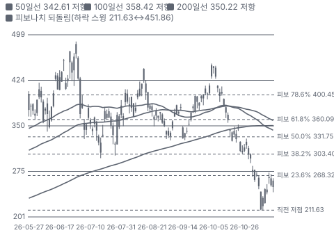

**주봉**

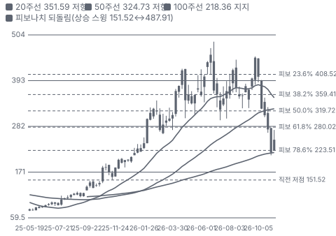

**월봉**

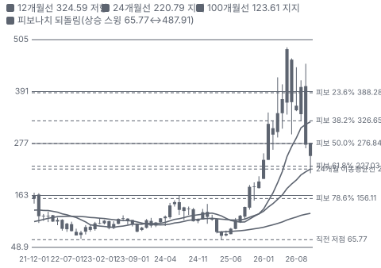

**분기 매출·EPS 실적과 컨센서스**

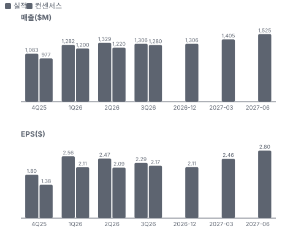

**4Q26 매출 — 지표 추세 vs 가이던스·컨센서스**

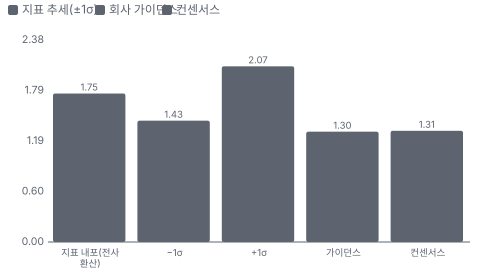

**최근 4개 분기 주가 변화 분석**

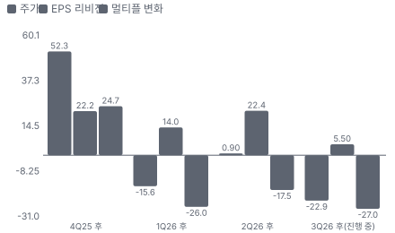

**EPS 리비전**

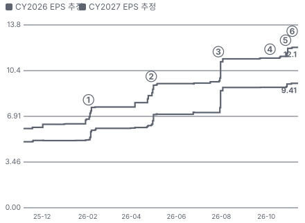

① 26-02-02 4Q25 실적 · EPS 리비전 +14%
② 26-04-28 1Q26 실적 · EPS 리비전 +11%
③ 26-07-28 2Q26 실적 · EPS 리비전 +18%
④ 26-10-06 FormFactor 지분·광 테스트 협력 발표 · EPS 리비전 +1%
⑤ 26-10-27 3Q26 실적 · EPS 리비전 +6%
⑥ 26-11-05 AI 설비투자 우려로 반도체 업종 급락 · 실적 창과 겹침

**멀티플 프리미엄(Fwd 1Y P/E, 최근 4개 분기말)**

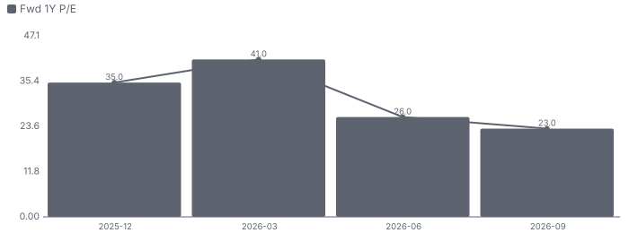

**합리적 멀티플**

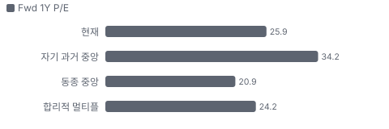

**밸류에이션 주가 시나리오**

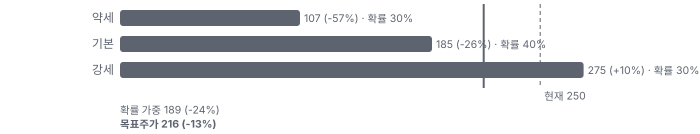

**주가별 업사이드**

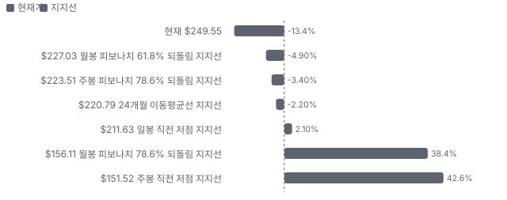
- 제품·서비스 포트폴리오

**고객 믹스(FY2025, 매출 대비)**

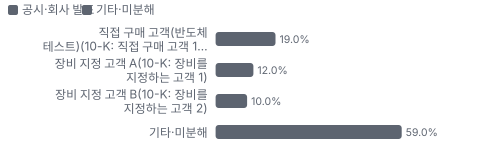

**공급 병목(10점, 낮을수록 병목)**

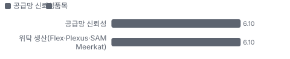

**생산능력 현재와 확충 계획(UltraFLEXplus 생산능력(18개월 전 = 1))**

**CAPEX의 매출 대비 비중**

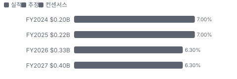

**어닝콜 변화별 주주가치 영향**

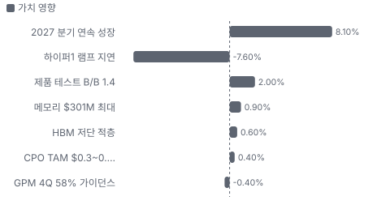

**수주·파이프라인 확실성 사다리**

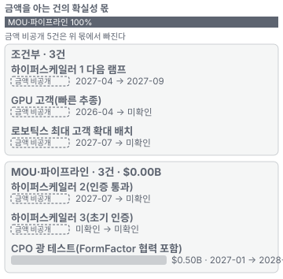

**매출 → 매출총이익 → 영업이익(매출 = 100, 최근 4분기)**

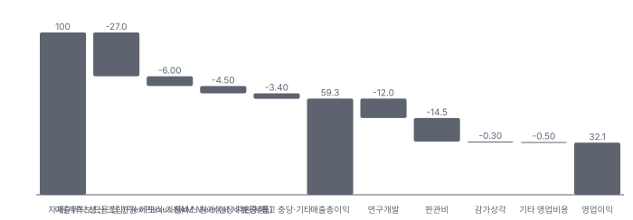

**분기 비용 비중 추이(매출 대비, 공시)**

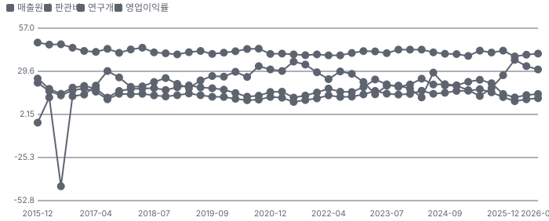

**비용 요인별 매출 대비 비중 1년 변화**

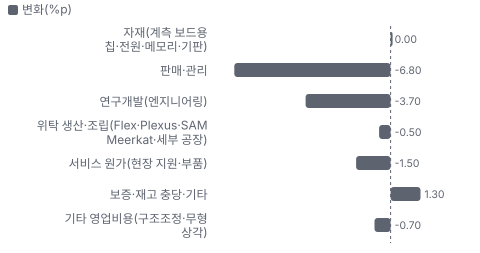

**반도체 테스트 BOM 원가 몫**

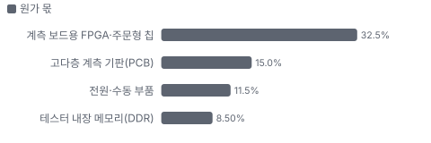

**제품 테스트 BOM 원가 몫**

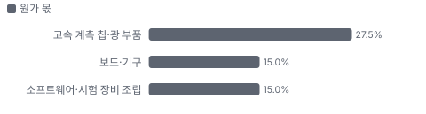

**로보틱스 BOM 원가 몫**

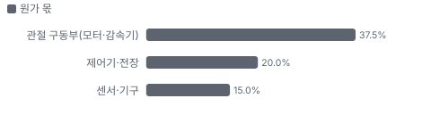

**BOM 항목 가격 +10% 시 OPM 변화**

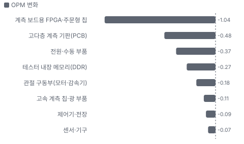

**원가 물가 vs 판매가 물가 — 1년 변화(원가가 판매가보다 더 오르면 단가를 올리지 못하는 만큼 마진이 줄어든다): 판매가 쪽 물가가 원가보다 5.0%p 더 올라 단가 전가 여지가 있다**

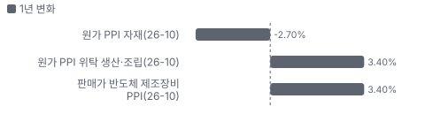

**사업별 매출 vs 물가 — 전년 대비(명목 매출 · 비교 물가 · 실질 = 물량·믹스)**

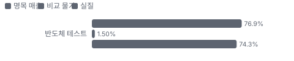

**자산 구성 — 3Q26 분기말 투하자본 \$3,441.3M**

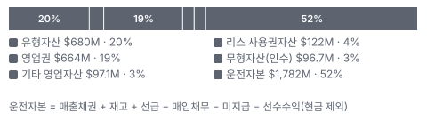

**자산별 변화율 — 최근 12개 분기(4Q23 = 0%) + 다음 4개 분기 추정**

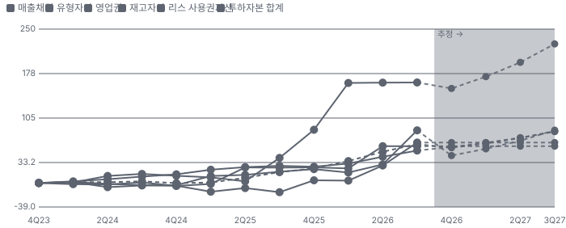

**ROIC 추이 — TTM, 최근 12개 분기 + 다음 4개 분기 추정(컨센서스 NOPAT)**

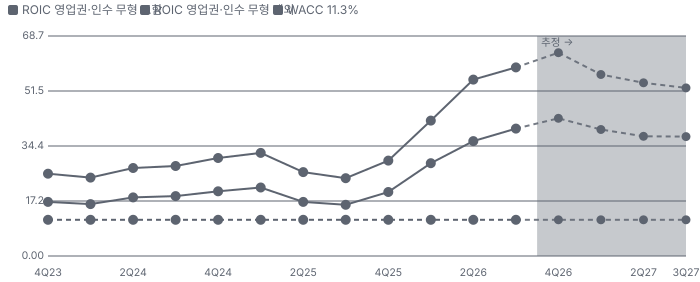

**분기 감가 비율 연율(유형자산 순액 대비)**

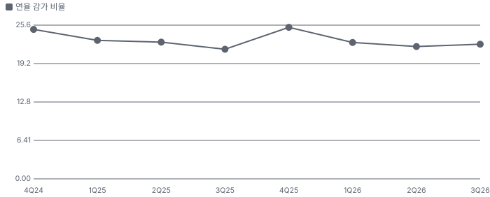

**생산시설별 면적(sq ft, 큰 순) — 생산능력 미공시라 면적을 대용으로**

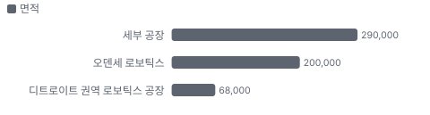

**매출·PPI·수출입 — 최근 16개 분기 + 다음 분기 추정(선마다 자기 y축: 왼쪽 매출, 오른쪽 지표) · 메모리 반도체 PPI(미국) — 16개 분기 범위 28.8~31.9(+10.6%) · EU 메모리 반도체 수출(HS 854232) — 16개 분기 범위 157,338,294.0~681,978,615.0(+333.4%)**

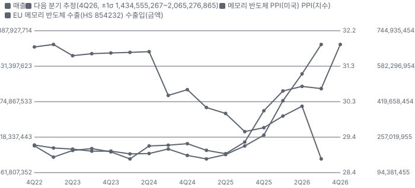

**10년 P·Q 사이클 — 추세(HP 필터) 대비 갭과 8분기 전망**

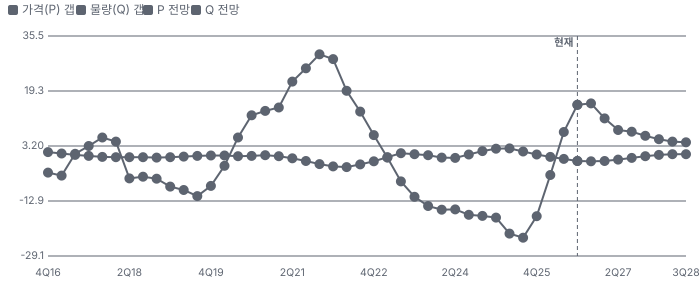

**매출 증가율의 가격·물량 분해와 8분기 전망(전년 대비)**

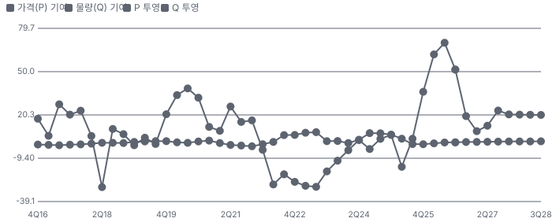

**분기별 매출 증가율 분해**

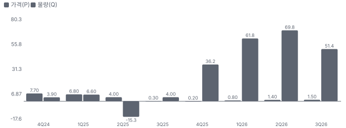

**목표주가 산정 — 기본과 강세 사이(강세 쪽 34%), 도달 확률 약 38%**

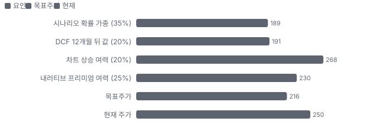

**PEG — 성장 대비 멀티플(낮을수록 성장 대비 쌈)**

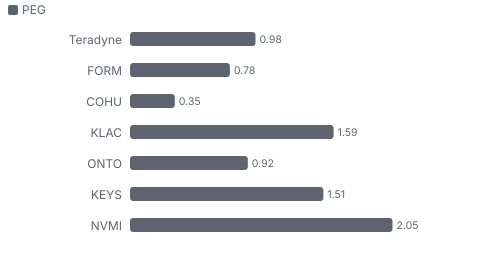

**일봉 지지·저항과 목표주가**

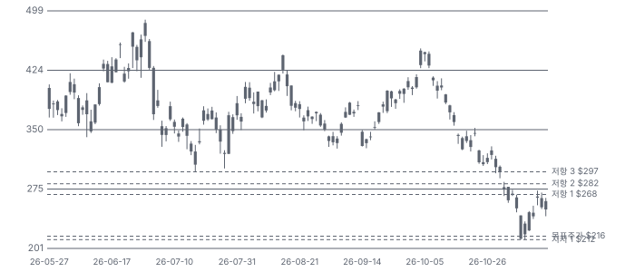

**커뮤니티 언급 수(최근 30일, 채널별)**

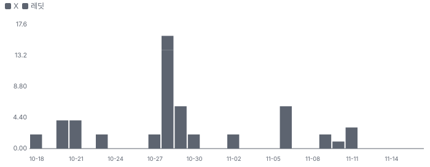

**커뮤니티 게시 수(월, 최근 7개월 — 이번 달은 진행 중)**

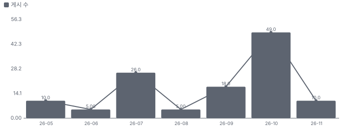

**재고 일수 — 분기별(수주 자료가 없어 수주/출하 비율 없음)**

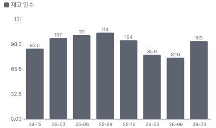

**일별 거래량 분해**

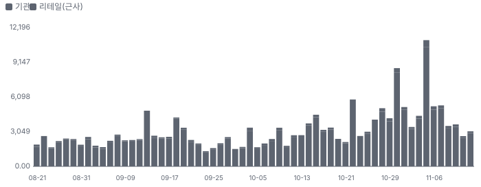

**기관 자금 흐름**

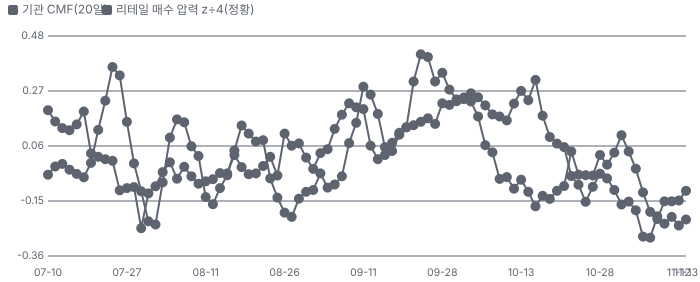

**몬테카를로**

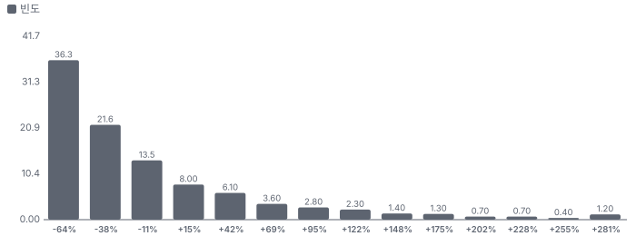

해석: 3,000번 중 879번(29%)에서 가치가 지금 주가 이상이었다. 가정을 흔들어도 지금 주가를 뒷받침하지 못하는 경우가 더 많다. 가운데 값은 0.64배이고, 열 번 중 여덟 번은 0.30~1.88배 사이에 든다.

## 내러티브

> **기업가치를 결정하는 이야기:** 이 회사는 칩을 만들지 않고, 칩이 제대로 도는지 출하 전에 시험하는 장비를 판다. 매출의 82%가 반도체 테스트이고, 그중 SoC(GPU·ASIC(특정 용도 주문형 칩 — 하이퍼스케일러 자체 AI 칩)·모바일)가 63%, 메모리가 28%다. 가치를 가르는 변수는 두 개다 — ① AI 칩·HBM 테스트 시간이 얼마나 길어지나(시장 크기) ② 컴퓨트 시장 1위 Advantest 옆에서 '두 번째 공급사' 몫을 얼마나 빨리 넓히나(점유율).

> **멀티플·EPS 프리미엄**
> **멀티플:** Fwd 1Y P/E 25.9배로 동종 6곳 중앙(약 21배)보다 높다. 6월 67.5배에서 내려온 것이라 프리미엄은 크게 줄었다.
> **EPS:** 다음 4개 분기 EPS 컨센서스 \$9.65~\$10.58 — 90일 동안 FY27 EPS가 7.4% 올랐다.

### 투자자들은 왜 열광했나

2026년 상반기 투자자들은 'GPU 테스트 시간이 두 배'라는 이야기와 1·2분기 연속 실적·가이던스 상회에 열광했다 — 배수는 6월 말 67.5배까지 갔다. 식은 이유는 세 가지다: 3Q 가이던스가 계단식 감소였고(7월), 4Q 가이던스가 보합이었으며(10월), 첫 하이퍼스케일러의 다음 램프가 2027 초에서 중반으로 밀렸다. 여기에 11월 AI 설비투자 우려로 반도체 업종이 함께 빠졌다.

### 무엇이 기업가치를 바꾸나

> **구조적 체질 변화**
> **변화:** 모바일(애플 주기) 중심 테스터 회사에서 AI 데이터센터 테스터 회사로 — AI 관련 매출이 60%를 넘었다
> **증거:** 3Q 콜: AI 매출 60% 이상, 모바일은 과거 정상 수준보다 낮다
> **반증:** AI 매출 비중이 50% 아래로 내려갈 때

> **고부가 믹스 확장**
> **변화:** 메모리(HBM)·저장장치·제품 테스트 몫 증가 — 매출총이익률 59.1%(1년 전 58.5%)
> **증거:** 10-Q 세그먼트: 메모리 23%(전년 17%), 제품 테스트는 전사 이익률을 올리는 사업(콜)
> **반증:** 4Q 매출총이익률이 가이던스 하단 57.5% 미만

> **기술 혁신**
> **변화:** Magnum E2(HBM)·UltraVS64-HP(15,000A 전원)·UltraPort-PCIe6(TER의 PCIe 6세대 자동 테스트 보드)·Titan HP(TER의 시스템 수준 테스트·번인 장비) 번인(칩을 높은 온도·전압에서 오래 돌려 초기 불량을 걸러내는 시험)·광 테스트 Photon·Omnyx Edge(TER의 엣지 AI 보드 인라인 테스트 장비) 등 신제품 7종 이상(9~11월)
> **증거:** Business Wire 제품 발표·3Q 콜
> **반증:** 신제품이 2027 하이퍼스케일러 인증에서 떨어질 때

> **실행 속도**
> **변화:** 주문에서 출하까지 12~16주를 지켰다고 1Q26 콜에서 말했다(복수 위탁 생산 덕분). 3Q 콜에서는 예측된 수요는 맞추지만 예측 없는 급주문의 리드타임은 1년 전보다 길어졌다고 했다 **납품 리드타임 12~16주.** 피어 비교 미확인. 이전 대비 미확인.
> **증거:** 1Q26 어닝콜(2026-04-28) 요지 보도(·Fool 전재) — 12~16주, 3Q26 콜 UBS 질문 답변
> **반증:** 고객이 납기 때문에 경쟁사로 주문을 돌렸다는 공시·콜 발언

> **M&A**
> **변화:** 소규모 볼트온 — MultiLane 75%(\$158M)·Quantifi(\$127M), 지분 투자 Technoprobe 10%·FormFactor 2.8%로 웨이퍼 테스트 인터페이스 업체와 묶었다
> **증거:** 10-Q·10-K 인수 주석
> **반증:** -

> **정책·입법 연관성**
> **재정정책:** 해당 없음(TER 매출에 직접 걸린 세출·보조금이 없다 — CHIPS(미국 반도체지원법) 수혜 없음) - 반증: - 의회 동의 2/10 — 하원 1/5(관련 세출 논의 확인 안 됨) · 상원 1/5(같음).
> **행정명령:** 반도체 장비 대중 수출통제·관세 — 고객 소재지 중국 21%(3Q26) 10-Q 3Q26 지역별 매출 반증: 중국 고객 대상 테스터 수출 허가 요건이 새로 붙을 때 의회 동의 4/10 — 하원 2/5(대중 장비 통제 강화 법안은 한쪽 당 지지 수준 — 의결 기록 미확인) · 상원 2/5(같음).
> **연관입법:** 해당 없음(TER를 직접 겨냥한 연관 입법 확인 안 됨) - 반증: -

> **고객의 지출 예산**
> **변화:** 고객이 TER에 쓰는 돈은 대부분 설비투자(CAPEX)다 — 칩 설계사·OSAT(반도체 후공정 외주 업체)·메모리 회사의 후공정 테스트 장비 예산
> **사업별 예산:** **매출의 82%**: 반도체 테스트 — 고객 CAPEX(칩 설계사·OSAT·메모리 회사의 후공정 테스트 장비 투자) · 동인: AI 칩 물량 × 칩당 테스트 시간
**매출의 11%**: 제품 테스트 — 고객 CAPEX(광 모듈·보드 제조사의 생산 시험 장비) · 동인: AI 데이터센터 광·고속 연결 물량
**매출의 11%**: 서비스 — 고객 OPEX(설치 장비 유지보수 계약) · 동인: 설치 기반
**매출의 7%**: 로보틱스 — 고객 CAPEX(제조·물류 자동화 설비 투자) · 동인: 공장 자동화·서버 조립
> **증거:** 10-K 매출 분류: 제품 89%·서비스 11%
> **반증:** -

### 내러티브 근거

> 'AI 칩 하나를 시험하는 시간이 길어진다'는 이야기는 살아 있다. 식은 것은 이야기가 아니라 값이다 — 같은 기간 이익 추정은 올랐는데 배수가 67배에서 26배로 내려왔다. 동종 대비 멀티플 차이 +23% 중 회사 고유 몫은 +7%다. 단계는 컨센서스, 쏠림은 보통(공매도 유통 주식의 5.9%·2.4일분, 기관 보유 13F 1,336곳)이다.

> **AI 칩 테스트 시간 증가** · 유지
> **논리:** 칩이 커지고 HBM을 쌓을수록 칩 하나당 테스트 시간이 늘어 테스터 대수가 늘어난다
> **숫자:** 컴퓨트 매출 +50%(3Q), Rubin 테스트 시간 Blackwell의 약 2배(회사 발언 보도)
> **반증:** SoC 매출이 2개 분기 연속 전년 대비 감소
> **출처:** 3Q26 어닝콜(2026-10-27)

> **하이퍼스케일러 이중 공급** · 유지
> **논리:** ASIC·GPU 고객이 공급 안정을 위해 두 번째 테스터 회사를 쓰고, 그 자리는 TER뿐이다
> **숫자:** 고객 4곳 단계 공개, GPU 테스터 점유율 로드맵 한 자릿수 → 30%(Citi 요지)
> **반증:** 하이퍼스케일러 2의 2027 하반기 캐파 구매가 2028로 밀릴 때
> **출처:** 3Q26 어닝콜(2026-10-27)

> **HBM·메모리 테스트** · 유지
> **논리:** HBM 적층과 저단 적층 전환이 성능 테스트 수요를 늘린다
> **숫자:** 메모리 매출 \$301M(최대, +135% 전년 대비)
> **반증:** 메모리 매출이 2개 분기 연속 \$200M 아래
> **출처:** 10-Q 3Q26

> **광 연결(CPO) 테스트** · 유지
> **논리:** 광 엔진을 패키지에 넣으면 모두 시험해야 하고, FormFactor와 함께 그 테스트를 맡는다
> **숫자:** 업계 TAM(전체 시장 규모) 2026 \$100M → 2028 \$300~700M(회사 추정)
> **반증:** 2027 말까지 CPO 양산 고객이 1곳 이하
> **출처:** 3Q26 어닝콜(2026-10-27)

> **로보틱스 흑자 전환** · 강화
> **논리:** 협동 로봇이 AI 서버 조립에 쓰이며 흑자로 돌아섰다
> **숫자:** 로보틱스 세전이익 +\$0.3M(3Q26, FY25 −\$99M)
> **반증:** 로보틱스가 다시 2개 분기 연속 적자
> **출처:** 10-Q 3Q26

> **반대 내러티브: AI 설비투자 정점** · 강화
> **논리:** 하이퍼스케일러가 2027 설비투자를 줄이면 테스터 주문이 가장 먼저 끊긴다 — 장비주는 고베타다
> **숫자:** BofA: 클라우드 설비투자가 지금 속도면 2027 컨센서스보다 약 23% 낮다 · Fwd 1Y P/E 67.5배(6/30) → 25.9배
> **반증:** 2027 하이퍼스케일러 설비투자 가이던스가 연초에 올라갈 때
> **출처:** 노션 BofA 11/6 요지

### 투자 포인트

> **이익은 오르고 배수만 빠졌다**
> **명제:** 6월 고점 이후 하락은 이익 추정이 아니라 배수에서 나왔다
> **숫자:** FY27 EPS 컨센서스 90일 +7.4%(\$11.26 → \$12.08), 같은 기간 Fwd 1Y P/E 67.5배(6/30) → 25.9배
> **시장과 다른 점:** 시장은 4Q 보합을 정점 신호로 읽었다. 다만 배수가 빠진 뒤에도 지금 가격은 5년 매출 연 27% 성장을 가정해 기본 시나리오(17.6%)보다 비싸다 — 싸진 것이 아니라 덜 비싸진 것이다
> **증명:** 1Q27 가이던스가 4Q26 중간 \$1.30B보다 높은가(1월 말)
> **출처:** 3Q26 어닝콜·EPS 추정 이력

> **컴퓨트의 '두 번째 공급사'**
> **명제:** 하이퍼스케일러·GPU 고객의 이중 공급 수요가 갈 곳은 사실상 TER뿐이다
> **숫자:** 고객 4곳 단계 공개 — 하이퍼스케일러 1 성숙, GPU 고객 2Q26부터 매출, 하이퍼스케일러 2 인증 통과(2027 하반기 캐파 구매), 하이퍼스케일러 3 초기 인증
> **시장과 다른 점:** 시장은 점유율 희석 발언에 무게를 두지만, 희석은 시장이 커서 생긴 것이고 TER 컴퓨트 매출은 +50%다
> **증명:** 4Q 콜의 컴퓨트 매출과 GPU 테스터 점유율 로드맵(한 자릿수 → 10%) 확인
> **출처:** 3Q26 어닝콜·Citi 요지(라이선스)

> **HBM·광 연결로 넓어지는 시험 시장**
> **명제:** HBM 저단 적층·CPO가 시험해야 할 개수를 늘린다
> **숫자:** 메모리 매출 \$301M(+135% 전년 대비, 최대), CPO 테스트 시장 2026 \$100M → 2028 \$300~700M(회사 추정), 제품 테스트 B/B 1.4
> **시장과 다른 점:** 시장은 메모리 3Q 고점 뒤 소화를 걱정하지만 회사는 2027 메모리 큰 폭 성장을 말했다
> **증명:** 메모리 매출이 4Q·1Q에 \$200M 위를 지키나
> **출처:** 10-Q 3Q26·3Q26 어닝콜

### 모멘텀 생성·소멸 타임라인

**카탈리스트 달력 — 지난 사건의 주가 반응과 앞으로 확인할 숫자**
| 날짜 | 상태 | 구분 | 사건 | 반응·확인 | 결과에 따라 |
|---|---|---|---|---|---|
| 2026-06-30 | 완료 | 생성 | 종가 고점 \$483.84 — GPU 테스트 시간 2배 이야기와 1·2분기 연속 상회 | Fwd 1Y P/E 67.5배 |  |
| 2026-10-27 | 완료 | 소멸 | 3Q26 실적 — 매출·EPS 상회, 4Q 보합 가이던스·하이퍼스케일러 1 램프 2027 중반으로 | −3.2%(다음 날 종가) |  |
| 2026-11-05 | 완료 | 매크로 | AI 설비투자 우려로 반도체 업종 급락 | −15.2% |  |
| 2026-11-11 | 완료 | 생성 | Jefferies 'NVIDIA \$2B 기회' 보도 | +8.3% |  |
| 2027-01 하순~02 초(예상) | 예정 | 매크로 | 하이퍼스케일러 4Q 실적 | 2027 설비투자 가이던스가 2026보다 높은가 | 높으면 기본~강세, 줄면 약세 |
| 2027-01-28(예상) | 예정 | 확인 | 4Q26 실적·새 장기 목표 모델 | 1Q27 매출 가이던스 중간 > \$1.30B, 4Q 매출총이익률 ≥ 57.5%, 새 모델의 ATE 시장 > \$14B | 셋 다 맞으면 강세 쪽, 1Q 가이던스가 4Q보다 낮으면 약세 |
| 2027-07 말(예상) | 예정 | 확인 | 2Q27 실적 | 하이퍼스케일러 1 램프 시작·하이퍼스케일러 2 캐파 주문 언급 | 확인되면 기본 유지, 2028로 밀리면 약세 |

### 언제 사서 언제 팔아야 할까?

**가격·조건 틀 — 가격은 밸류에이션(약세·기본·강세·목표주가)과 차트 지지 구간에서, 조건은 이벤트에서**
| 구간 | 가격 | 목표주가까지 | 약세까지 | 조건·근거 |
|---|---|---|---|---|
| 관찰 구간 | \$227~\$227 | -5% | -53% | 지금 가격 아래 일·주봉 지지 구간은 11/5 저점(\$212) 근처다 — 약세 시나리오와 겹치는 곳 |
| 확인 뒤 | 지금 \$250 이상에서 조건 확인 | -13% | -57% | 1Q27 가이던스가 4Q26 중간 \$1.30B를 넘고 4Q 매출총이익률이 57.5% 이상 |
| 무효화 | 약세 시나리오 \$107 | - | -57% | 1Q27 가이던스가 4Q보다 낮거나 하이퍼스케일러 램프가 2028로 밀린다는 발언 |
| 차익 고민 2차 | \$275(강세 시나리오) | +10% | - | 목표주가 근처에서는 2027 하반기 쏠림이 이미 값에 들어간다 — 하이퍼스케일러 2 주문 확인 전 추가 배수는 근거가 약하다 |

실적 발표일 전후 하루 변동이 ±10%를 넘곤 한다(11/5 −15%) — 이벤트 전 추격을 경계한다 가격·조건 틀이며 매매·비중 지시가 아니다(투자 권유 아님).

## 포트폴리오

| 제품·서비스 | 구분 | 무엇 | 쓰는 곳 | 돈 버는 방식 | Mix | Mix 변화(전년 대비) |
|---|---|---|---|---|---|---|
| 반도체 테스트 | 제품 | SoC(UltraFLEXplus·J750(TER의 저가 대량 칩 테스터)·Eagle(TER의 전력·아날로그 칩 테스터 플랫폼, ETS))·메모리(Magnum)·저장장치(IST(통합 시스템 테스트 — HDD 등 저장장치 시험 사업)) 자동 테스트 장비 | GPU·ASIC·HBM·전원 칩을 출하 전 웨이퍼·패키지 단계에서 시험 | 장비 판매 + 설치 기반 서비스 | 82% | +3.3%p |
| 제품 테스트 | 제품 | 광 모듈·고속 케이블·생산 보드·방산 전자 시험 장비(MultiLane·Quantifi 포함) | AI 데이터센터 광 트랜시버·인터커넥트 생산 시험 | 장비 판매 | 11% | -0.9%p |
| 로보틱스 | 제품 | Universal Robots 협동 로봇 팔·MiR 자율 이동 로봇 | 서버·전자 조립, 물류 자동화 | 로봇 판매(유통사·OEM 경유) | 7% | -2.4%p |

**Mix 변화가 가장 큰 쪽은 반도체 테스트(+3.3%p, 전년 대비).** 계절성 판정: 분기 매출 계절 지수 기준 있음 → 전년 같은 분기와 비교.

## 고객

> **FY2025 최대 고객 직접 구매 고객(반도체 테스트, 10-K: 직접 구매 고객 1곳) 19%, 상위 3곳 41%, 집중도 분산.** 공시·회사 발표로 확인한 몫은 매출의 41%이고, 나머지 고객 몫은 추정이거나 미분해다. FY25 10% 이상 고객은 3곳이다 — 장비를 지정하는 고객 2곳(12%·10%)과 직접 구매 고객 1곳(19%). 상위 5개 직접 고객이 44%(전년 36%)로 집중이 높아졌다. 회사는 이름을 밝히지 않는다. 3Q26 고객 소재지는 한국 32%(전년 12%)로 메모리 몫이 커졌다. 상위 5개 중 나머지 4곳 합계는 약 25%(44% − 19%, 계산)이고 이름·개별 몫은 미공시다.

**고객별 매출 몫(FY2025)**
| 고객 | 몫 | 변화 | 근거 |
|---|---|---|---|
| 직접 구매 고객(반도체 테스트, 10-K: 직접 구매 고객 1곳) | 19% | 미확인 | 공시 |
| 장비 지정 고객 A(10-K: 장비를 지정하는 고객 1) | 12% | -1%p | 공시 |
| 장비 지정 고객 B(10-K: 장비를 지정하는 고객 2) | 10% | 미확인 | 공시 |
| 기타·미분해 | 59% | - | - |

> **직접 구매 고객(반도체 테스트, 10-K: 직접 구매 고객 1곳)** · 공시
> **사는 것:** 반도체 테스트 장비 — 외주 테스트(OSAT)일 가능성(가설)
> **추정 근거:** FY25 최대 직접 고객, 지정 고객 매출 일부 포함

> **장비 지정 고객 A(10-K: 장비를 지정하는 고객 1)** · 공시
> **사는 것:** 반도체 테스트·제품 테스트 — 칩 설계사(가설, 이름 미공시)
> **추정 근거:** 고객이 OSAT에 TER 장비를 지정

> **장비 지정 고객 B(10-K: 장비를 지정하는 고객 2)** · 공시
> **사는 것:** 반도체 테스트·제품 테스트 — 이름 미공시
> **추정 근거:** FY25 새로 10%에 들어옴

## 수주·파이프라인

> **2026-10-27 기준 6건.** 건별 확정 금액은 공개되지 않았다. 서로 겹치는 항목은 합계에서 뺐다.

**수주 목록**
| 상태 | 계약 | 계약 총액 | 진척 | 기간 | 비고 |
|---|---|---|---|---|---|
| 조건부 | 하이퍼스케일러 1 다음 램프 | 금액 비공개 | 비공개 | 2027-04 → 2027-09 | - |
| 조건부 | GPU 고객(빠른 추종) | 금액 비공개 | 비공개 | 2026-04 → 미확인 | Jefferies는 NVIDIA 관련 기회를 \$2B로 봤다(보도, 2026-11-11) — 회사 숫자 아님 |
| 조건부 | 로보틱스 최대 고객 확대 배치 | 금액 비공개 | 비공개 | 2027-07 → 미확인 | - |
| 파이프라인 | 하이퍼스케일러 2(인증 통과) | 금액 비공개 | 비공개 | 2027-07 → 미확인 | - |
| 파이프라인 | 하이퍼스케일러 3(초기 인증) | 금액 비공개 | 비공개 | 미확인 → 미확인 | - |
| 파이프라인 | CPO 광 테스트(FormFactor 협력 포함) | \$0.50B | 비공개 | 2027-01 → 2028-12 | (다른 항목과 겹칠 수 있어 합계에서 뺌) |

**실행 속도와 방해 요인**
| 항목 | 상태 | 실행 속도 | 방해 요인 |
|---|---|---|---|
| 하이퍼스케일러 1 다음 램프 | 조건부 | 성숙 이중 공급 단계, 다음 대형 램프 2027 중반(콜) | 고객 데이터센터 구축 속도 · 2027 초 → 중반 지연 |
| GPU 고객(빠른 추종) | 조건부 | 2Q26부터 매출 인식, 2027 추가 매출(콜·Citi 요지) | Advantest 1위 점유율 |
| 로보틱스 최대 고객 확대 배치 | 조건부 | 2025 → 2026 매출 3배, 2027 넓은 배치는 하반기(콜) | 고객 배치 속도 |
| 하이퍼스케일러 2(인증 통과) | 파이프라인 | 캐파 구매 2027 하반기(콜) | ASIC 일정 |
| 하이퍼스케일러 3(초기 인증) | 파이프라인 | 초기 인증 단계(콜) | 인증 기간 |
| CPO 광 테스트(FormFactor 협력 포함) | 파이프라인 | 업계 TAM 2026 \$100M → 2028 \$300~700M(회사 추정, 중간값을 total로) — TER 몫 아님 | CPO 테스트 시간·조립 공정 경제성 |

## 마진 구조

> **GPM 59.1%, OPM 30.8%.** 2Q26 대비 GPM -0.7%p, OPM -2.1%p. 변동비는 매출의 44%이고, 매출이 10% 늘면 OPM은 +2.3%p 움직인다. 3Q26 매출원가는 매출의 40.9%로 1년 전(41.6%)과 비슷하다. 물량이 늘어 매출총이익률은 59.1%로 올랐지만 4Q 가이던스(57.5~58.5%)는 믹스·신제품 탓에 낮다. 연구개발이 매출의 12.5%, 판관비 15.2%다.

> **매출 100 중 매출원가 40.7, 매출총이익 59.3(최근 4분기, 공시).** 매출원가 요인 중 자재(계측 보드용 칩·전원·메모리·기판)이 매출의 27.0%로 가장 무겁고, 단가가 +10% 오르면 GPM이 -2.70%p 움직인다. 분기 회귀로 매출 1이 늘 때 매출원가는 0.39 늘고, 매출원가의 고정비 몫은 8%다.

**비용 요인 강도 — 비중·추세·충격(+10%)·탄력**
| 비용 | 구분 | 매출 대비 | 1년 변화 | 마진 기여 | 충격 시 마진 | 매출 탄력 | 고정비 몫 |
|---|---|---|---|---|---|---|---|
| 자재(계측 보드용 칩·전원·메모리·기판) | 매출원가 요인 | 27.0% | +0.0%p | -0.0%p | -2.70%p | 미확인 | 0% |
| 위탁 생산·조립(Flex·Plexus·SAM Meerkat·세부 공장) | 매출원가 요인 | 6.0% | -0.5%p | +0.5%p | -0.60%p | 미확인 | 30% |
| 서비스 원가(현장 지원·부품) | 매출원가 요인 | 4.5% | -1.5%p | +1.5%p | -0.45%p | 미확인 | 60% |
| 보증·재고 충당·기타 | 매출원가 요인 | 3.4% | +1.3%p | -1.3%p | -0.34%p | 미확인 | 0% |
| 매출원가 | 공시 항목 | 40.7% | -0.4%p | +0.4%p | -4.07%p | 0.39 | 8% |
| 판관비 | 공시 항목 | 14.5% | -7.9%p | +7.9%p | 미확인 | 0.11 | 39% |
| 연구개발 | 공시 항목 | 12.0% | -5.2%p | +5.2%p | 미확인 | 0.09 | 38% |
| 기타 영업비용 | 공시 항목 | 0.5% | -0.5%p | +0.5%p | 미확인 | -0.02 | 100% |
| 감가상각 | 공시 항목 | 0.3% | -0.3%p | +0.3%p | 미확인 | -0.01 | 100% |

매출 탄력 = 분기 비용을 매출에 회귀한 기울기(매출 1당 변동비), 고정비 몫 = 절편 ÷ 평균 비용. 표본이 8분기 미만이면 미확인. 매출원가 요인 비중은 margin 재료의 추정이 섞여 있고, 공시 매출원가와의 차이는 '기타 매출원가'로 둔다.

**GPM에서 OPM까지(GAAP, 아래는 최근 4개 분기)**
| 기간 | GPM | 연구개발 | 판관비 | 기타 | OPM |
|---|---|---|---|---|---|
| 3Q25 | 58.4% | 16.2% | 22.0% | 1.3% | 18.9% |
| 2Q26 | 59.8% | 11.8% | 14.5% | 0.6% | 32.9% |
| 3Q26 | 59.1% | 12.5% | 15.2% | 0.6% | 30.8% |
| 2025-12 | 57.2% | - | - | - | 27.1% |
| 2026-03 | 60.9% | - | - | - | 36.9% |
| 2026-06 | 59.8% | - | - | - | 32.9% |
| 2026-09 | 59.1% | - | - | - | 30.8% |

**비용을 움직이는 요인**
| 비용 | 요인 |
|---|---|
| 자재(계측 보드용 칩·전원·메모리·기판, 매출원가) | FPGA·ASIC·전원 부품·DDR(범용 D램 규격) 메모리·고다층 기판 단가 · 근거 추정 |
| 판매·관리(판관비) | 영업·시장 진출 인력, 성과급 · 근거 공시 |
| 연구개발(엔지니어링, 연구개발) | AI·메모리·광·번인 신제품 개발 인력 · 근거 공시 |
| 위탁 생산·조립(Flex·Plexus·SAM Meerkat·세부 공장, 매출원가) | 위탁 생산 단가·물량 · 근거 추정 |
| 서비스 원가(현장 지원·부품, 매출원가) | 설치 기반·인력 · 근거 추정 |
| 보증·재고 충당·기타(매출원가) | 재고 증가(\$575M)·신제품 출시 · 근거 추정 |
| 기타 영업비용(구조조정·무형 상각, 기타) | 인수 무형 상각 · 근거 공시 |

**반도체 테스트 BOM — 매출의 82%, GPM 61%(추정 — 세그먼트 매출총이익 미공시. 전사 59.1%를 세그먼트로 나눈 값(제품 테스트는 회사가 '전사 이익률을 올린다', 로보틱스는 업계 협동 로봇 수준 약 35%로 둠)), 항목 가격 +10% 시**
| 항목 | 원가 몫 | 전가 | 제품 GPM | OPM |
|---|---|---|---|---|
| 계측 보드용 FPGA·주문형 칩 | 25~40% | 미확인 | -1.3%p | -1.04%p |
| 고다층 계측 기판(PCB) | 10~20% | 미확인 | -0.6%p | -0.48%p |
| 전원·수동 부품 | 8~15% | 미확인 | -0.4%p | -0.37%p |
| 테스터 내장 메모리(DDR) | 5~12% | 미확인 | -0.3%p | -0.27%p |
| 미분해 | 32% | - | - | - |

**제품 테스트 BOM — 매출의 11%, GPM 62%(추정 — 회사: 전사 매출총이익률을 올리는 사업(3Q 콜), 수치 미공시), 항목 가격 +10% 시**
| 항목 | 원가 몫 | 전가 | 제품 GPM | OPM |
|---|---|---|---|---|
| 고속 계측 칩·광 부품 | 20~35% | 미확인 | -1.0%p | -0.11%p |
| 보드·기구 | 10~20% | 미확인 | -0.6%p | -0.06%p |
| 소프트웨어·시험 장비 조립 | 10~20% | 미확인 | -0.6%p | -0.06%p |
| 미분해 | 42% | - | - | - |

**로보틱스 BOM — 매출의 7%, GPM 35%(추정 — 세그먼트 세전이익 +\$0.3M(3Q26), 매출총이익률 미공시 — 협동 로봇 업계 수준), 항목 가격 +10% 시**
| 항목 | 원가 몫 | 전가 | 제품 GPM | OPM |
|---|---|---|---|---|
| 관절 구동부(모터·감속기) | 30~45% | 미확인 | -2.4%p | -0.18%p |
| 제어기·전장 | 15~25% | 미확인 | -1.3%p | -0.09%p |
| 센서·기구 | 10~20% | 미확인 | -1.0%p | -0.07%p |
| 미분해 | 27% | - | - | - |

계측 보드용 FPGA·주문형 칩 가격이 +10% 오르면 영업이익은 -3.3% 움직인다. 판매가 전가를 모르는 항목은 전가 0%로 계산했다.

**BOM 항목 가격을 움직이는 것**
| 항목 | 요인 |
|---|---|
| 계측 보드용 FPGA·주문형 칩 | 테스터 채널·전원 계측의 핵심 · 근거 추정 |
| 고다층 계측 기판(PCB) | 고속 신호·대전류 전원 · 근거 추정 |
| 테스터 내장 메모리(DDR) | 패턴 메모리·캡처 · 근거 추정 |
| 전원·수동 부품 | 대전류 전원 공급 · 근거 추정 |
| 고속 계측 칩·광 부품 | 광 트랜시버·고속 인터커넥트 시험 · 근거 추정 |
| 보드·기구 | 시험 장비 본체 회로·하우징 · 근거 추정 |
| 소프트웨어·시험 장비 조립 | 시험 프로그램·최종 조립 · 근거 추정 |
| 관절 구동부(모터·감속기) | 협동 로봇 원가에서 가장 큰 몫 · 근거 추정 |
| 제어기·전장 | 로봇 제어·안전 기능 · 근거 추정 |
| 센서·기구 | 힘·토크 센서와 팔 구조물 · 근거 추정 |

> **원가·판매가 물가 격차 +5.0%p** — 판매가 물가가 투입 원가 물가보다 빠르게 오른다.

**투입 물가 — 미국 PPI 3·6·12개월(2026-10, 개정 반영)과 해외 전년비**
| 항목 | 미국 3개월 | 6개월 | 12개월 | 전가 못 할 때 OPM | 일본 | 한국 | 대만 |
|---|---|---|---|---|---|---|---|
| 제어기·전장 | -0.7% | -5.7% | -2.7% | - | +1.6% | +2.3% | +22.9%* |
| 보드·기구 | +0.0% | +24.0% | +46.4% | - | +11.5% | +4.5% | +12.1% |
| 테스터 내장 메모리(DDR) | -0.7% | -5.7% | -2.7%* | - | +1.6%* | +418.1% | +22.9%* |
| 전원·수동 부품 | 미확인 | 미확인 | 미확인 | - | 미확인 | 미확인 | 미확인 |
| 고속 계측 칩·광 부품 | -0.7% | -5.7% | -2.7%* | - | 미확인 | 미확인 | 미확인 |
| 위탁 생산·조립(Flex·Plexus·SAM Meerkat·세부 공장) | +1.9% | +2.0% | +3.4% | -0.2%p | +2.2% | +0.0% | +3.0%* |

별표는 품목보다 넓은 업종 지수다. 연결한 투입 원가의 미국 PPI(생산자물가지수)는 1년 새 가중 -1.6%이고, 판매가로 넘기지 못하면 GPM +0.5%p·OPM +0.5%p가 움직인다. 판매가 비교 물가(반도체 제조장비 PPI)는 1년 새 +3.4% — 회사 가격 변화는 미확인. 물가 지수를 붙이지 못한 매출원가 항목은 서비스 원가(현장 지원·부품), 보증·재고 충당·기타다(미연결). 반도체 테스트 매출은 2026-09 전년 대비 +76.9%이고 비교 물가 ppi:semicap의 변화 +1.5%(2026-09)를 빼면 실질 +74.3% — 물량·믹스가 성장을 이끌었다.

## 자산 구성

> **3Q26 분기말 투하자본 \$3,441.3M** — 운전자본 52%, 유형자산 20%. 최근 12개 분기(4Q23 → 3Q26) 가장 크게 늘어난 자산은 무형자산(인수, +173%), 투하자본 합계 +63%. 3Q27 추정 투하자본 \$3,880.9M(+13%, 컨센서스 매출과 회전 일수·CAPEX 강도 유지 가정). 연율 감가 비율(순액 기준)은 직전 4분기 23.05% → 최근 4분기 23.08%.

**자산·운전자본 항목별 분기말 잔액 — 최근 12개 분기와 다음 4개 분기 추정**
| 항목 | 4Q23 | 3Q25 | 3Q26(최근) | 3Q27 추정 | 12개 분기 변화 | 다음 4개 분기 변화 |
|---|---|---|---|---|---|---|
| 매출채권 | \$422.1M | \$593.8M | \$1,110.8M | \$1,374.9M | +163% | +24% |
| 재고자산 | \$310.0M | \$366.8M | \$575.0M | \$575.8M | +85% | +0% |
| 선급·기타 유동자산 | \$549.0M | \$469.2M | \$613.7M | \$654.3M | +12% | +7% |
| 매입채무 | \$180.1M | \$227.8M | \$517.0M | \$504.1M | +187% | -2% |
| 유형자산 | \$445.5M | \$569.9M | \$679.6M | \$816.7M | +53% | +20% |
| 리스 사용권자산 | \$73.4M | \$62.4M | \$121.7M | \$121.7M | +66% | +0% |
| 영업권 | \$415.7M | \$519.5M | \$663.8M | \$663.8M | +60% | +0% |
| 무형자산(인수) | \$35.4M | \$54.7M | \$96.7M | \$80.8M | +173% | -16% |

**자산 추정 동인 — 최근 4개 분기 평균(재무상태표 동인 모형)**
| 동인 | 값 | 곱하는 기준 |
|---|---|---|
| 매출채권 | 75일 | 매출 |
| 재고자산 | 77일 | 매출원가 |
| 선급·기타 유동자산 | 36일 | 매출 |
| 매입채무 | 67일 | 매출원가 |
| CAPEX 강도 | 6.1% | 매출(최근 4개 분기 합) |
| 분기 감가율 | 5.23% | 기초 유형자산 순액(무형 상각 제외 감가상각) |
| 매출원가율 | 40.7% | 매출(최근 4개 분기) |
| 영업권·리스 사용권·기타 | 유지 | 인수·새 리스는 공시 전 모름 |
| 인수 무형자산 | 분기 \$4.0M 상각 | 최근 4개 분기 평균 상각 |

**추정 방법:** 증권사 3표 모델(손익·재무상태표·현금흐름)의 재무상태표 동인 방식이다. 운전자본은 항목별 회전 일수(매출채권·선급·미지급·선수는 매출, 재고·매입채무는 매출원가 기준)를 최근 4개 분기 평균으로 두고 컨센서스 매출에 곱한다. 유형자산은 기초 + CAPEX − 감가상각으로 굴린다(Koller·Goedhart·Wessels 『Valuation』 재무상태표 추정). 매출 경로는 ROIC 절의 컨센서스와 같다.

**유형·무형자산 항목별 가치(2025-12-31 vs 2024-12-31)**
| 구분 | 항목 | 총액 2025-12-31 | 누적상각 | 순액 | 총액 2024-12-31 | 총액 1년 변화 | 공시 내용연수 |
|---|---|---|---|---|---|---|---|
| 유형 | 유형자산 합계(항목 미분해) | \$1,612.0M | 총계만 공시 | 총계만 공시 | \$1,462.1M | +10.3% | 미확인 |
| 영업권 | 영업권 | \$521.0M | \$0.0M | \$521.0M | \$395.4M | +31.8% | 비상각 |
| 무형 | 무형자산 합계(항목 미분해) | \$347.0M | \$295.0M | \$52.0M | \$378.8M | -8.4% | 미확인 |
| 유형 합계 | 유형자산 | \$1,612.0M | \$1,049.0M | \$563.0M | \$1,462.1M | +10.3% | 경과율 65%(상각 대상 기준) |

**내용연수 산식(상각 대상 유형자산 = 총액 − 토지 − 건설중)**
| 기준일 | 연 감가상각 | 상각 대상 총액 | 평균 내용연수 | 경과 연수 | 잔여 연수 | 경과율 |
|---|---|---|---|---|---|---|
| 2025-12-31 | \$111.4M | \$1,612.0M | 14.5년 | 9.4년 | 5.1년 | 65% |
| 2024-12-31 | \$101.0M | \$1,462.1M | 14.5년 | 9.4년 | 5.0년 | 65% |

산식 평균 내용연수는 14.5년. 1년 전 14.5년 → 지금 14.5년.

**분기 감가 비율(감가상각 ÷ 평균 유형자산 순액)**
| 분기 | 감가상각 | 평균 유형자산(순액) | 분기 비율 | 연율 | 연율의 역수 |
|---|---|---|---|---|---|
| 4Q24 | \$31.1M | \$499.9M | 6.23% | 24.91% | 4.0년 |
| 1Q25 | \$30.3M | \$524.8M | 5.77% | 23.09% | 4.3년 |
| 2Q25 | \$31.4M | \$550.7M | 5.70% | 22.80% | 4.4년 |
| 3Q25 | \$30.5M | \$564.9M | 5.40% | 21.61% | 4.6년 |
| 4Q25 | \$35.8M | \$566.5M | 6.32% | 25.26% | 4.0년 |
| 1Q26 | \$32.7M | \$574.4M | 5.69% | 22.74% | 4.4년 |
| 2Q26 | \$33.6M | \$610.3M | 5.51% | 22.06% | 4.5년 |
| 3Q26 | \$36.9M | \$657.2M | 5.61% | 22.44% | 4.5년 |

감가상각 기준: 손익계산서 감가상각·상각비(SEC 공시 데이터, 4분기 = 연간 − 1~3분기).

최근 4분기 연율 감가 비율 23.08%, 직전 4분기 23.05%(+0%) — 경고 문턱(-10%) 안이다.

미공시·미분해: 유형자산 항목별 총액·내용연수(10-K 주석에서 모델이 채움) · 무형자산 항목(10-K 주석에서 모델이 채움) — 이 칸은 비우고 나머지로 계산했다.

### 해석 — 자산이 어디에 쌓이고 있나

- 같은 기간 4개 분기 매출은 +83% — 매출보다 빨리 늘어난 자산: 매출채권 +163%, 무형자산(인수) +173%. 이 자산의 회전율이 떨어지면 ROIC를 희석한다.
- 다음 4개 분기 CAPEX \$360.3M vs 감가상각 \$151.3M(최근 4개 분기 CAPEX 강도·감가율 유지) — 유형자산 3Q26 \$679.6M → 3Q27 \$816.7M. 투자가 감가보다 커서 자산이 쌓이는 국면이다.

## ROIC

> **TTM 3Q26 ROIC는 영업권·인수 무형 포함 39.8%, 제외 58.9%**(NOPAT 마진 27.0% × 투하자본 회전율 1.48회). 최근 12개 분기 4Q23 16.9% → 3Q26 39.8%(고점 3Q26 39.8%). 컨센서스 NOPAT으로 굴리면 3Q27 37.3%(제외 52.5%) — WACC 11.3% 대비 +26.0%p. 1년 변화의 가장 큰 요인은 NOPAT 마진(+14.6%p).

**ROIC 추이(TTM)와 다음 4개 분기 추정 — NOPAT ÷ 평균 투하자본(이번 분기말·4개 분기 전)**
| 분기 | 구분 | TTM 매출 | TTM NOPAT | NOPAT 마진 | 평균 투하자본 | ROIC 포함 | ROIC 제외 |
|---|---|---|---|---|---|---|---|
| 4Q23 | 실적 | \$2,676.3M | \$435.3M | 16.3% | \$2,577.0M | 16.9% | 25.7% |
| 1Q24 | 실적 | \$2,658.6M | \$422.7M | 15.9% | \$2,602.3M | 16.2% | 24.5% |
| 2Q24 | 실적 | \$2,704.0M | \$481.0M | 17.8% | \$2,622.5M | 18.3% | 27.5% |
| 3Q24 | 실적 | \$2,737.6M | \$487.8M | 17.8% | \$2,605.3M | 18.7% | 28.1% |
| 4Q24 | 실적 | \$2,819.9M | \$511.9M | 18.2% | \$2,535.1M | 20.2% | 30.6% |
| 1Q25 | 실적 | \$2,905.7M | \$547.4M | 18.8% | \$2,561.1M | 21.4% | 32.2% |
| 2Q25 | 실적 | \$2,827.7M | \$447.4M | 15.8% | \$2,639.8M | 16.9% | 26.2% |
| 3Q25 | 실적 | \$2,859.6M | \$440.6M | 15.4% | \$2,751.6M | 16.0% | 24.3% |
| 4Q25 | 실적 | \$3,190.0M | \$555.7M | 17.4% | \$2,784.5M | 20.0% | 29.8% |
| 1Q26 | 실적 | \$3,786.8M | \$845.9M | 22.3% | \$2,921.5M | 29.0% | 42.3% |
| 2Q26 | 실적 | \$4,464.0M | \$1,135.5M | 25.4% | \$3,160.2M | 35.9% | 55.1% |
| 3Q26 | 실적 | \$5,000.8M | \$1,350.7M | 27.0% | \$3,390.1M | 39.8% | 58.9% |
| 4Q26 | 추정 | \$5,223.4M | \$1,458.2M | 27.9% | \$3,390.3M | 43.0% | 63.5% |
| 1Q27 | 추정 | \$5,345.9M | \$1,419.4M | 26.6% | \$3,591.4M | 39.5% | 56.7% |
| 2Q27 | 추정 | \$5,541.9M | \$1,438.3M | 26.0% | \$3,841.9M | 37.4% | 54.1% |
| 3Q27 | 추정 | \$5,915.0M | \$1,526.2M | 25.8% | \$4,089.7M | 37.3% | 52.5% |

**다음 4개 분기 NOPAT — 컨센서스(세율 17%, 리스 이자 별도)**
| 분기 | 매출 | EBITA 마진 | EBITA | NOPAT(분기) | 근거 |
|---|---|---|---|---|---|
| 4Q26 | \$1,306.0M | 32.6% | \$425.8M | \$353.4M | 컨센서스 매출 × EBIT 마진 FY2026(조정 − 주식보상 0.0%) |
| 1Q27 | \$1,405.0M | 30.5% | \$428.5M | \$355.7M | 컨센서스 매출 × EBIT 마진 FY2027(조정 − 주식보상 0.0%) |
| 2Q27 | \$1,525.0M | 30.5% | \$465.1M | \$386.1M | 컨센서스 매출 × EBIT 마진 FY2027(조정 − 주식보상 0.0%) |
| 3Q27 | \$1,679.0M | 30.5% | \$512.1M | \$425.0M | 컨센서스 매출 × EBIT 마진 FY2027(조정 − 주식보상 0.0%) |

**추정 방법:** NOPAT은 컨센서스(분기 매출 추정 × 회계연도 EBIT 마진 추정)로 잡고, 조정(비 GAAP) 마진이면 주식보상 몫을 빼서 과거 실적과 같은 기준(영업이익 + 인수 무형 상각)으로 맞췄다. 이미 발표했지만 분기 보고서(10-Q)가 아직 없는 분기는 발표 실적을 쓴다. 투하자본은 자산 구성 절의 재무상태표 동인으로 굴렸다. ROIC는 4개 분기 NOPAT을 이번 분기말과 4개 분기 전 투하자본의 평균으로 나눈다 — 추정 분기의 ROIC에는 이미 나온 실적 분기가 섞여 있다.

**투하자본 항목별 회전율과 ROIC 기여(TTM 3Q26, 평균 잔액)**
| 항목 | 투하자본 | 매출 1달러당 자본 | 회전율(매출 ÷ 항목) | 자본 몫 | 이 항목을 빼면 ROIC |
|---|---|---|---|---|---|
| 운전자본 | \$1,492.2M | 0.30 | 3.35회 | 44% | 71.1% |
| 유형자산 | \$624.8M | 0.12 | 8.00회 | 18% | 48.8% |
| 리스 사용권자산 | \$92.0M | 0.02 | 54.33회 | 3% | 40.9% |
| 영업권 | \$1,020.2M | 0.20 | 4.90회 | 30% | 57.0% |
| 무형자산(인수) | \$75.7M | 0.02 | 66.07회 | 2% | 40.7% |
| 기타 영업자산 | \$85.1M | 0.02 | 58.75회 | 3% | 40.9% |

**ROIC 세 가지 판**
| 판 | NOPAT | 투하자본 | ROIC | 무엇을 재나 |
|---|---|---|---|---|
| 영업권·인수 무형 포함 | \$1,350.2M | \$3,390.1M | 39.8% | 인수 웃돈까지 낸 돈에 대한 수익률 |
| 영업권·인수 무형 제외 | \$1,350.2M | \$2,294.1M | 58.9% | 본업 운영 수익률(동종 비교용) |
| 무형 자본화 조정(판관비 20%·5년, 연구개발 6년) | \$1,369.3M | \$3,754.4M | 36.5% | 비용으로 처리한 무형 투자를 자산으로 본 판 |
| 경제적 이익(포함판) | \$966.6M | \$3,390.1M | 자본비용 11.3% | (ROIC − 자본비용) × 투하자본 |

NOPAT = (영업이익 \$1,606.0M + 인수 무형 상각 + 리스 내재 이자 \$5.5M) × (1 − 세율 17%). 리스 사용권자산을 투하자본에 넣었으므로 임차료 속 이자 몫을 영업이익에 되더했다. 현금은 영업에 필요한 몫을 따로 알 수 없어 투하자본에서 뺐다. SEC 공시 데이터 자동 초안 — 운전자본 = 매출채권 + 재고 + 선급 − (매입채무 + 미지급비용 + 선수수익), 현금 제외. 손상 누계는 공시 데이터 수록분.

**ROIC 1년 변화 분해(포함판, TTM 3Q25 → TTM 3Q26)**
| 요인 | ROIC 기여 |
|---|---|
| NOPAT 마진 | +14.57%p |
| 운전자본 | +3.43%p |
| 유형자산 | +1.96%p |
| 리스 사용권자산 | +0.16%p |
| 영업권 | +3.55%p |
| 무형자산(인수) | -0.06%p |
| 기타 영업자산 | +0.14%p |
| 합계 | +23.75%p |

**무형 자본화 가정별 ROIC(2025년 지출 기준, 포함판에 더함)**
| 투자로 보는 몫 | 상각 연수 | 무형 자산 | NOPAT 조정 | 조정 ROIC |
|---|---|---|---|---|
| 판관비 20% | 2년 | \$191.5M | \$10.3M | 38.0% |
| 판관비 20% | 5년 | \$364.3M | \$19.2M | 36.5% |
| 판관비 30% | 2년 | \$287.2M | \$15.5M | 37.1% |
| 판관비 30% | 5년 | \$546.5M | \$28.8M | 35.0% |

### 해석 — 무엇이 수익성을 끌어올리고 희석하나

- 운전자본: 투하자본의 44% — 빼면 ROIC 39.8% → 71.1%. 이 자산의 회전율(3.35회)이 수익성을 희석하는 주된 자리다.
- 영업권: 투하자본의 30% — 빼면 ROIC 39.8% → 57.0%. 이 자산의 회전율(4.90회)이 수익성을 희석하는 주된 자리다.
- 영업권·인수 무형을 빼면 ROIC가 +19.0%p 오른다 — 과거 인수에 치른 웃돈이 주주 수익률을 그만큼 낮춘다(본업 수익률은 제외판, 인수까지 포함한 가치 창출은 포함판으로 본다).
- 1년 ROIC 개선의 최대 요인은 NOPAT 마진(+14.6%p). 반대로 깎은 최대 요인은 무형자산(인수, -0.1%p).
- 비용으로 처리한 무형 투자를 자산으로 보면 ROIC가 -3.4%p 움직인다(무형 자산 \$364.3M). 투자를 늘리는 중이라 NOPAT이 더 커지는 쪽이다.
- 추정 경로 3Q26 39.8% → 3Q27 37.3%: NOPAT 마진 -1.2%p, 투하자본 회전율 -0.03회 — 컨센서스 매출·마진이 맞고 회전 일수·CAPEX 강도가 유지된다는 가정이다. 마진 추정이 내려가거나 재고 일수가 늘면 이 경로가 먼저 틀린다.
- ROIC(포함) − WACC = +28.5%p(3Q26) — 양수면 투하자본을 늘릴수록 가치가 쌓인다.

## 공급망 병목

> **공급망 신뢰성 6.1/10, 관리 가능.** 가장 약한 고리는 위탁 생산(Flex·Plexus·SAM Meerkat) 6.1점이고, 품목 평균은 6.1점이다. 근거가 부족한 3건(계측 보드용 FPGA·주문형 칩 · 테스터 내장 메모리(DDR) · 고다층 계측 기판(PCB))은 점수에서 뺐다. 병목은 두 개다 — 계측 보드에 들어가는 칩·메모리 부품의 리드타임, 그리고 위탁 생산 라인의 캐파. 회사는 UltraFLEXplus 캐파를 18개월 전의 약 4배로 늘리고 두 번째 위탁 생산사를 인증했으며, 구매 약정은 \$2.25B(2024년 말 \$0.42B의 5배)로 부품을 미리 묶었다.

**병목과 마진 — 품목 가격 +10% 시 OPM**
| 품목 | 점수 | 판정 | 구분 | OPM |
|---|---|---|---|---|
| 위탁 생산(Flex·Plexus·SAM Meerkat, 필수) | 6.1 | 관리 가능 | 일반 | 미확인 |

> **위탁 생산(Flex·Plexus·SAM Meerkat)** · 6.1/10
> **왜:** 장비 조립 캐파가 출하 상한을 정한다
> **병목 요인:** 인증 공급사 3곳 · 캐파 빠듯 · 리드타임 미확인 · 재인증 미확인 · 1위 점유율 미확인 · 말레이시아·태국 집중 90% · 물량 확보 선급금
> **풀리는 조건:** 진행 중 — 두 번째 위탁사 인증 완료, 가동 비중 미확인

**공급사**
| 품목 | 공급사 | 몫 | 근거 |
|---|---|---|---|
| 계측 보드용 FPGA·주문형 칩 | 미확인(일부 단일 공급원, 부품) | 미확인 | 공시 |
| 테스터 내장 메모리(DDR) | 메모리 3사(미확인, 부품) | 미확인 | 추정 |
| 위탁 생산(Flex·Plexus·SAM Meerkat) | Flex(위탁 생산(FLEX(TER의 SoC 테스터 제품군)·J750)) | 미확인 | 공시 |
| 위탁 생산(Flex·Plexus·SAM Meerkat) | Plexus(위탁 생산(FLEX·Magnum·ETS(TER의 아날로그·전력 칩 테스터 제품군))) | 미확인 | 공시 |
| 위탁 생산(Flex·Plexus·SAM Meerkat) | SAM Meerkat(위탁 생산(스토리지 테스트)) | 미확인 | 공시 |
| 고다층 계측 기판(PCB) | 미확인(부품) | 미확인 | 추정 |

**무역 통계로 본 공급 지역**
| 품목 | EU 수입처 | 일본 수입처 | EU 1위 전년비 |
|---|---|---|---|
| 계측 보드용 FPGA·주문형 칩 | TW(대만) 31% · MY(말레이시아) 19% · CN(중국) 15% | 台湾 60% · 中華人民共和国 8% | +120.6% |
| 테스터 내장 메모리(DDR) | TW 46% · KR(한국) 19% · CN 17% | 台湾 52% · 大韓民国 28% | +413.1% |
| 위탁 생산(Flex·Plexus·SAM Meerkat) | JP 48% · US 33% · TW 8% | 大韓民国 36% · シンガポール 25% | +892.4% |
| 고다층 계측 기판(PCB) | CN 85% · TW 4% · KR 4% | 中華人民共和国 62% · 台湾 11% | +32.0% |

## 생산능력

> **현재 명목 캐파 4 UltraFLEXplus 생산능력(18개월 전 = 1), 가동률 미확인.** 착공 이상 증설은 0 UltraFLEXplus 생산능력(18개월 전 = 1), 발표까지 합치면 0 UltraFLEXplus 생산능력(18개월 전 = 1)이다. 다 가동하면 지금보다 +0%, 착공 이상만이면 +0%다. FY2025 CAPEX는 \$0.22B로 매출의 7.0%다. 회사는 캐파를 대수로 공개하지 않고 'UltraFLEXplus 캐파가 18개월 전의 약 4배'라고만 말한다. 증설은 자체 공장이 아니라 위탁 생산사 추가로 한다 — CAPEX는 매출의 6%대로 가볍다.

**생산시설 4곳**(10-K FY25 Item 2 — 이름을 밝힌 주요 시설 4곳(소유 3·임차 1), 그 밖의 임차 사무·서비스 거점은 개수 미공시. 위탁 생산 3사는 별도), 소유 3곳 · 임차 1곳. 시설별 생산능력은 공개되지 않았다 — 회사 전체 캐파만 위에 적었다.

**생산시설 4곳 — 명칭·위치·생산능력**
| 시설 | 위치 | 용도 | 생산능력 | 소유·상태 |
|---|---|---|---|---|
| 노스레딩 본사 | 미국 매사추세츠 North Reading | 본사·개발 | 미확인 — 생산 시설 아님 · 면적 422,000 sq ft | 소유 · 가동 |
| 세부 공장 | 필리핀 Cebu | 반도체 테스트 장비 생산(FLEX 내부 생산) | 미확인 — 시설별 캐파 미공시(2025 매입) · 면적 290,000 sq ft | 소유 · 가동 |
| 오덴세 로보틱스 | 덴마크 Odense | 로보틱스 개발·생산 | 미확인 — 미공시 · 면적 200,000 sq ft | 소유 · 가동 |
| 디트로이트 권역 로보틱스 공장 | 미국 미시간 Metro Detroit | 로보틱스 미국 생산 | 미확인 — 2025 내부 공사 시작, 캐파 미공시 · 면적 68,000 sq ft | 임차 · 증설 중 |

**생산능력 확충 계획**
| 계획 | 단계 | 증설 | 가동 시점 | CAPEX |
|---|---|---|---|---|
| UltraFLEXplus 다음 증설 단계 | 발표 | 미확인 | 미확인 | 미확인 |
| 메모리 테스트 플랫폼 이중 위탁·Eagle 전원 테스트 라인 증설 | 발표 | 미확인 | 미확인 | 미확인 |

남은 계획의 CAPEX 합계는 \$0.00B(금액 미확인 2건 제외)다. 합계는 FY2027 매출의 0%다.

**증설 방해 요인**
| 계획 | 방해 요인 |
|---|---|
| UltraFLEXplus 다음 증설 단계 | 수요 예측·부품 확보 |
| 메모리 테스트 플랫폼 이중 위탁·Eagle 전원 테스트 라인 증설 | 부품 리드타임 |

**CAPEX와 매출 대비**
| 기간 | CAPEX | 매출 | 매출 대비 | 구분 |
|---|---|---|---|---|
| FY2024 | \$0.20B | \$2.82B | 7.0% | 실적 |
| FY2025 | \$0.22B | \$3.19B | 7.0% | 실적 |
| FY2026 | \$0.33B | \$5.26B | 6.3% | 추정 |
| FY2027 | \$0.40B | \$6.36B | 6.3% | 컨센서스 |

## 해자

> 해자는 '큰 칩일수록 바꾸기 어려운 테스트 프로그램'이다. 한 번 UltraFLEXplus로 짠 테스트 프로그램·보드는 고객 라인에서 수년 쓰이고, ATE는 2강 구조라 신규 진입이 없다. 약점은 컴퓨트(GPU·ASIC)에서 Advantest가 압도적 1위라 TER는 '2번째 공급사'로 들어가는 중이라는 점이다.

> **고객 전환 비용(테스트 프로그램·인터페이스 보드)** · 강함
> **해자:** 칩마다 테스트 프로그램과 인터페이스 보드를 장비 플랫폼에 맞춰 개발해 플랫폼을 바꾸면 재개발·재인증이 필요하다
> **근거:** 10-K FY25: 고객 장비 선택이 수년 지속, 하이퍼스케일러 인증 단계(초기 인증 → 빠른 추종 → 성숙 이중 공급)를 회사가 공개(3Q 콜)
> **숫자:** 첫 하이퍼스케일러가 성숙 단계까지 약 2년(2024 → 2026)
> **깨지는 조건:** 인증을 마친 고객 1곳이 다음 세대에서 TER를 빼는 것이 공시·콜로 확인될 때

> **과점 구조(ATE 2강)** · 강함
> **해자:** SoC·메모리 ATE는 Advantest와 TER 두 회사가 대부분을 나눈다 — 하이퍼스케일러가 이중 공급을 원하면 갈 곳이 TER뿐이다
> **근거:** 3Q 콜: 고객 이중 공급 전략이 점유율 기회를 만든다 · Citi 요지: GPU 테스터 점유율 로드맵(한 자릿수 → 10% → 20% → 30%)
> **숫자:** 영업이익률 TTM 32.1%(GAAP) — 동종 중앙 약 34.9%(선행)
> **깨지는 조건:** 제3의 컴퓨트 테스터(중국·한국 업체)가 하이퍼스케일러 인증을 받을 때

> **HBM 성능 테스트 점유율** · 보통
> **해자:** TER는 DRAM 웨이퍼 테스트보다 HBM 성능 테스트 점유율이 높다고 말한다
> **근거:** 3Q 콜(회사 발언) — 점유율 숫자 미공시, 메모리 매출 \$301M 최대
> **숫자:** 메모리 매출 4개 분기 연속 \$200M 이상
> **깨지는 조건:** 메모리 매출이 2개 분기 연속 \$200M 아래로 내려갈 때

> **로보틱스(협동 로봇 설치 기반)** · 약함
> **해자:** Universal Robots 설치 기반은 크지만 2025년 적자·구조조정, 3Q26에 겨우 흑자
> **근거:** 10-Q 3Q26 로보틱스 세전이익 +\$0.3M(FY25 −\$99.4M)
> **숫자:** 로보틱스 매출 TTM 약 \$376M, 매출의 7%
> **깨지는 조건:** -

## 경영진·네트워크

> Greg Smith CEO(2023-02~)는 반도체 테스트·로보틱스 사장을 모두 거친 내부 출신이고 Technoprobe 이사회에 앉아 있다. CFO Michelle Turner는 2025-11 L3Harris CFO 출신으로 합류했다. 정계 연결은 공개 자료로 확인되지 않는다.

> **Gregory S. Smith** · 사장·CEO · 2023-02-01
> **프로필:** 2006년 입사, 반도체 테스트 사장(2016~2020)·로보틱스 사장(2020~2023)
> **비즈니스:** Technoprobe 이사(2024-05~, TER 지분 10%)
> **정계:** 미확인
> **동문:** 미확인
> **사모임:** 미확인

> **Michelle Turner** · CFO·재무 담당 · 2025-11-03
> **프로필:** L3Harris SVP·CFO(2022~2023), J&J 공급망 CFO(2017~2021)
> **비즈니스:** 미확인
> **정계:** 미확인
> **동문:** 미확인
> **사모임:** 미확인

> **Paul J. Tufano** · 독립 이사회 의장 · 2021-05
> **프로필:** Benchmark Electronics 전 CEO, 2005년부터 이사
> **비즈니스:** 미확인
> **정계:** 미확인
> **동문:** 미확인
> **사모임:** 미확인

**네트워크 정량화**
| 연결 | 강도 | 닿는 매출 | 가중 노출 | 매출 대비 | 근거 |
|---|---|---|---|---|---|
| 비즈니스: CEO의 Technoprobe 이사 자리 — 프로브 카드 1위권 업체와 지분·이사로 묶였고, 10월 FormFactor 지분까지 더해 웨이퍼 테스트 인터페이스 양대 업체와 동시에 연결 | 3/5 | 미확인 | 미확인 | 미확인 | 지분·이사는 공시 사실, 연결이 매출을 만들었다는 근거는 없다 DEF 14A 2026 · 10-Q 3Q26 지분법 주석 |

가중 노출은 연결이 닿는 매출의 크기다. 연결이 그 매출을 만들었다는 뜻이 아니며, 인과는 공개 자료로 입증하지 못한다.

## 약세 논리 및 셀온 조건

| 약세 논리 | 근거 | 반박 | 가를 자료 |
|---|---|---|---|
| AI 설비투자 정점이면 장비가 먼저 깎인다 | BofA(11/6): 클라우드 설비투자가 지금 속도면 2027 컨센서스보다 약 23% 낮다. TER 베타 1.75, 6월 고점 뒤 반도체 업종 −38% | 회사는 2027년 분기 연속 성장을 말했고 구매 약정 \$2.25B(2025년 말 \$1.47B)로 부품을 먼저 묶었다. 테스트는 칩 출하 물량에 따라가 설비투자 감축 시 부지·건물보다 늦게 깎인다(BofA 감축 순서) | 1~2월 하이퍼스케일러 4Q 실적의 2027 설비투자 가이던스 |
| 컴퓨트 1위는 Advantest다 | 회사: 컴퓨트 시장이 너무 빨리 커져 전체 점유율이 희석됐다. 경쟁사 위탁 생산 캐파 증설(UBS 질문) | TER는 '두 번째 공급사' 자리를 노린다 — 하이퍼스케일러 1 성숙, GPU 고객 매출 시작, 하이퍼스케일러 2 인증 통과(콜). 컴퓨트 매출 +50% | 4Q 콜 컴퓨트 매출·GPU 테스터 점유율 로드맵(한 자릿수 → 10%) 확인 |
| 2027 상반기 공백 | 1Q27·2Q27 EPS 컨센서스는 콜 뒤 \$2.68 → \$2.46, \$2.98 → \$2.80으로 내렸다. ASIC·로보틱스 대형 고객 매출이 하반기에 몰린다 | CFO: 1Q27도 4Q26보다 성장, 2027 각 분기가 2026 같은 분기보다 크다. 가시성이 13주에서 몇 분기로 늘었다 | 1월 말 4Q 실적의 1Q27 가이던스 |
| 재고·구매 약정이 부담으로 | 재고 \$575M(2개 분기 +\$212M), 구매 약정 \$2.25B. 하반기 쏠림이 깨지면 상각 위험 | CFO: 재고 증가의 절반은 리드타임 대비, DIO(재고일수 — 재고가 매출원가 몇 일치인가) 189일은 동종 정상 200일보다 낮다 | 4Q 재고·DIO, 재고 충당금 |

가격에 넣지 않은 것: Technoprobe 10% 지분(공정가 \$2.24B, 장부 \$0.52B)과 FormFactor 2.8% 지분(매입가 \$300M, 11/13 시가 약 \$196M)은 비영업 자산이라 순현금에 넣지 않았다 — 두 지분 시가를 합하면 주당 약 \$15(계산, 시가총액의 6%)다. 목표주가는 이 몫만큼 보수적이다. 그 몫을 더해도 목표주가는 지금 가격 아래다.

데이터 검증 10/10. 거시 국면(FRED(미국 세인트루이스 연준 경제 통계)) 원천은 응답 시간 초과로 수집하지 못해 할인율 맥락은 노션 BofA 11/6 요지로 대신했다. 10% 고객 이름은 회사가 공시하지 않는다 — 고객 표의 '칩 설계사·OSAT' 표기는 가설이다.

> **셀온 조건**
> **조건 1:** 1Q27 매출 가이던스 중간값이 4Q26 가이던스 중간 \$1.30B보다 낮다
> **조건 2:** 하이퍼스케일러 1 또는 2의 램프 시점이 2028로 다시 밀린다는 콜 발언
> **조건 3:** 4Q26 매출총이익률이 가이던스 하단 57.5% 아래
> **조건 4:** 메모리 매출이 2개 분기 연속 \$200M 아래
> **조건 5:** 주요 하이퍼스케일러 2곳 이상이 2027 설비투자를 2026보다 낮게 가이던스한다
> **조건 6:** 재고 충당금·재고 상각이 분기 \$30M을 넘는다

## 어닝콜 변화

**직전 콜 대비 새로 나오거나 바뀐 내용 → 가치 영향**
| 항목 | 내용 | 직전 콜 | 최신 콜 | 모델 동인 이동 | 확신도 | 가치 영향 |
|---|---|---|---|---|---|---|
| 부정 | 첫 하이퍼스케일러 다음 램프 |  |  | 1년차 성장률 -2.0% | 0.0 | -7.6% |
| 신규 | 2027 분기 연속 성장 |  |  | 1년차 성장률 +2.0% | 0.0 | +8.1% |
| 업데이트 | 메모리 테스트 |  |  | 장기 성장 수렴값 +0.50% | 0.0 | +0.9% |
| 부정 | 매출총이익률 |  |  | 목표 이익률 -0.50% | 0.0 | -0.4% |
| 신규 | HBM 적층 단수 하락 |  |  | 장기 성장 수렴값 +0.30% | 0.0 | +0.6% |
| 업데이트 | 제품 테스트 수주 |  |  | 1년차 성장률 +0.50% | 0.0 | +2.0% |
| 신규 | CPO 테스트 TAM |  |  | 장기 성장 수렴값 +0.20% | 0.0 | +0.4% |
| **합계** | 단독 합 |  |  | 동시 적용 +3.5% |  | **+4.0%** |

**사건별 EPS 리비전**
| # | 날짜 | 구분 | 사건 | CY2026 EPS 전→후 | CY2027 EPS 전→후 | 리비전 | 주가 반응 |
|---|---|---|---|---|---|---|---|
| ① | 26-02-02 | 실적 | 4Q25 실적 | \$5.13 → \$6.01 | \$6.70 → \$7.62 | +13.7% | +13.4% |
| ② | 26-04-28 | 실적 | 1Q26 실적 | \$6.22 → \$7.07 | \$8.48 → \$9.39 | +10.7% | -19.4% |
| ③ | 26-07-28 | 실적 | 2Q26 실적 | \$7.20 → \$9.10 | \$9.53 → \$11.26 | +18.1% | -0.4% |
| ④ | 26-10-06 | 내러티브 | FormFactor 지분·광 테스트 협력 발표 | \$9.11 → \$9.11 | \$11.32 → \$11.45 | +1.1% | -3.2% |
| ⑤ | 26-10-27 | 실적 | 3Q26 실적 | \$9.11 → \$9.41 | \$11.45 → \$12.13 | +5.9% | -3.2% |
| ⑥ | 26-11-05 | 내러티브 | AI 설비투자 우려로 반도체 업종 급락 | \$9.41 → \$9.41 | \$12.08 → \$12.13 | 실적 창과 겹침 | -15.2% |

**추정치 수정 폭:** 최근 30일 EPS 추정은 상향 6건·하향 1건으로 **상향 우세**(순 비율 +0.71), 90일은 상향 6건·하향 1건으로 상향 우세(+0.71)이다. 평균이 몇 % 움직였나(리비전 크기)와 달리 몇 번 같은 방향으로 고쳤나를 본다 — 수정 1건은 애널리스트 수가 그대로인 채 컨센서스가 움직인 날(지표별 하루 1건)이라 같은 날 여러 명이 고치면 1건으로 합쳐지고, 상향 + 하향이 3건 미만이면 순 비율을 쓰지 않는다.

**추정치 수정 폭 — 열린 기간(다음 분기들·올해·내년) 컨센서스 수정 건수, 최근 30·90일**
| 지표 | 30일 상향/하향 | 30일 순 비율 | 90일 상향/하향 | 90일 순 비율 | 90일 커버리지 변화 |
|---|---|---|---|---|---|
| EPS | 6 / 1 | +0.71 | 6 / 1 | +0.71 | 2 |
| 매출 | 2 / 1 | +0.33 | 2 / 1 | +0.33 | 2 |
| EBITDA | 2 / 0 | - | 2 / 0 | - | 2 |
| EBIT | 2 / 0 | - | 2 / 0 | - | 1 |
| 전체 | 12 / 2 | +0.71 | 12 / 2 | +0.71 | 7 |

**실적 발표 예상 변동폭:** 지난 4번 실적 발표 때 주가는 하루에 평균 ±9.1%(최대 19.4%, 오른 날 1번) 움직였다.

**실적 발표 예상 변동폭 — 과거 실적 발표 다음 거래일 주가 변화**
| 분기 | 발표일 | 주가 변화 |
|---|---|---|
| 4Q25 | 2026-02-02 | +13.4% |
| 1Q26 | 2026-04-28 | -19.4% |
| 2Q26 | 2026-07-28 | -0.4% |
| 3Q26 | 2026-10-27 | -3.2% |

**해석:** 4개 구간(누적) 주가 +0% = EPS 리비전 +80% × 멀티플 -44%. 더 크게 움직인 쪽은 **EPS 리비전**이다.

## 거시 지표 싱크로율

> **메모리 반도체 PPI(미국)와 반도체 테스트 싱크로율 92%(0분기 = 약 0개월 선행, 전년 대비, 표본 8개·t 5.8·유의·신뢰 낮음).** 이 지표가 내포하는 4Q26 반도체 테스트은 1.46B(±1σ 1.15B~1.78B, 나우캐스트 1개월)다. 표본 밖 검증(최근 3개 분기)에서 지표 모델 오차는 30.6%p, 기준선(직전 증가율 지속)은 40.5%p다 — 지표가 기준선을 이겨 지표 50%·기준선 50%로 결합했다. 세그먼트 추정에 나머지 사업(직전 증가율 지속)을 더한 전사 매출은 1.75B(1.43B~2.07B)다. 가이던스는 이보다 -25.7%(범위 아래), 컨센서스는 -25.4%(범위 아래)다. TER 매출은 반도체 장비 투자에 따라간다 — 미국 반도체 장비 PPI와 한국·대만 반도체 장비 수입이 고객 쪽 지출을 보여준다. 상관을 인과로 쓰지 않는다

**지표별 싱크로율(상관계수 × 100) — 위 두 줄이 제품 연관성 × 싱크로율로 고른 PPI·수출입 세부 지표**
| 지표 | 비교 대상 | 증가율 기준 | 지표 선행 | 매출(t값) | 영업이익 | 방향 일치 | 표본·신뢰 | 표본 밖 오차(지표/기준선) | 4Q26 추정 매출 |
|---|---|---|---|---|---|---|---|---|---|
| 메모리 반도체 PPI(미국) | 반도체 테스트 | 전년 대비 | 0분기(0개월) | 92%(t 5.8) | -22%(4분기) | 25% | 8·낮음 | 30.6/40.5%p ✔ | +65.7% → 1.46B(나우캐스트 1개월) |
| EU(유럽연합) 메모리 반도체 수출(HS(국제 통일 상품 분류 코드) 854232) | 반도체 테스트 | 전년 대비 | 1분기(3개월) | 92%(t 5.7) | 58%(1분기) | 75% | 8·낮음 | 52.8/40.5%p ✘ | +85.7% → 1.64B(확정 · 지표 범위 밖 → 범위 끝으로 제한) |
| 반도체 제조장비 PPI(미국) | 반도체 테스트 | 전년 대비 | 2분기(6개월) | -92%(t -5.9) | 24%(4분기) | 88% | 8·낮음 | 26.2/40.5%p ✔ | +82.8% → 1.62B(확정) |

**지표 후보 25개 — 연관성(제품 품목 일치 × 대용 감점 × 매출 비중) × 싱크로율로 고른다. 후보가 많을수록 최대 상관은 우연히 부풀 수 있다**
| 후보 | 종류 | 연관성 | 매출 분기 일치 | 싱크로율(선행) | 점수 | 출처 |
|---|---|---|---|---|---|---|
| 메모리 반도체 PPI(미국) ✔ | PPI | 1.00 | 100% | 92%(0분기) | 0.92 | 모델 지정 |
| EU 메모리 반도체 수출(HS 854232) ✔ | 수출입 | 0.50 | 100% | 92%(1분기) | 0.46 | 자동 |
| 한국 메모리 반도체 PPI | PPI | 0.50 | 100% | 89%(0분기) | 0.44 | 자동 |
| EU 메모리 반도체 수입(HS 854232) | 수출입 | 0.50 | 100% | 88%(1분기) | 0.44 | 자동 |
| 미국 메모리 반도체 수입(HS 854232) | 수출입 | 0.50 | 100% | 86%(0분기) | 0.43 | 자동 |
| EU 반도체 제조장비 수입(HS 848620) | 수출입 | 0.50 | 100% | 78%(0분기) | 0.39 | 자동 |
| EU HS 848690 수출(반도체 제조장비과 같은 4자리 품목군) | 수출입 | 0.35 | 100% | 96%(2분기) | 0.34 | 자동 |
| EU HS 848690 수입(반도체 제조장비과 같은 4자리 품목군) | 수출입 | 0.35 | 100% | 84%(0분기) | 0.29 | 자동 |
| 미국 HS 848630 수출(반도체 제조장비과 같은 4자리 품목군) | 수출입 | 0.35 | 94% | 80%(0분기) | 0.28 | 자동 |
| 미국 메모리 반도체 수출(HS 854232) | 수출입 | 0.50 | 100% | 69%(2분기) | 0.28 | 자동 |
| 미국 반도체 제조장비 수출(HS 848620) | 수출입 | 0.50 | 100% | 52%(4분기) | 0.21 | 자동 |
| EU HS 848640 수입(반도체 제조장비과 같은 4자리 품목군) | 수출입 | 0.35 | 100% | 69%(0분기) | 0.19 | 자동 |

**선행 지표로 본 향후 분기 매출 전망(이미 나온 지표 값 기준, ±1σ)**
| 지표 | 대상 | 분기 | 지표 증가율 | 내포 매출 증가율 | 내포 매출 |
|---|---|---|---|---|---|
| 반도체 제조장비 PPI(미국) | 반도체 테스트 | 4Q26 | +1.5% | +85.1% | 1.64B(1.46B~1.81B) |
| 반도체 제조장비 PPI(미국) | 반도체 테스트 | 1Q27 | +1.5% | +84.3% | 2.05B(1.82B~2.27B) |
| EU 반도체 제조장비 수출(HS 848620) | 반도체 테스트 | 4Q26 | -17.8% | +117.1% | 1.92B(1.63B~2.21B) |
| EU 반도체 제조장비 수출(HS 848620) | 반도체 테스트 | 1Q27 | +46.6% | -17.2% | 919M(558M~1.28B) |
| 미국 반도체 제조장비 수출(HS 848620) | 반도체 테스트 | 4Q26 | +6.4% | +93.8% | 1.71B(1.32B~2.11B) |
| 미국 반도체 제조장비 수출(HS 848620) | 반도체 테스트 | 1Q27 | -2.6% | +66.3% | 1.85B(1.35B~2.34B) |
| 미국 반도체 제조장비 수출(HS 848620) | 반도체 테스트 | 2Q27 | +3.7% | +85.7% | 2.08B(1.58B~2.59B) |
| 미국 반도체 제조장비 수출(HS 848620) | 반도체 테스트 | 3Q27 | +11.1% | +108.5% | 2.23B(1.75B~2.71B) |
| 미국 반도체 제조장비 수입(HS 848620) | 반도체 테스트 | 4Q26 | +121.9% | -50.4% | 438M(186M~690M) |
| 일본 반도체 제조장비 PPI | 반도체 테스트 | 4Q26 | +4.5% | +40.1% | 1.24B(810M~1.67B) |
| EU 메모리 반도체 수출(HS 854232) | 반도체 테스트 | 4Q26 | +214.7% | +345.4% | 3.93B(3.75B~4.12B) |
| EU 메모리 반도체 수입(HS 854232) | 반도체 테스트 | 4Q26 | +315.6% | +414.2% | 4.54B(4.32B~4.76B) |
| 미국 메모리 반도체 수출(HS 854232) | 반도체 테스트 | 4Q26 | +22.0% | +55.0% | 1.37B(1.03B~1.71B) |
| 미국 메모리 반도체 수출(HS 854232) | 반도체 테스트 | 1Q27 | +76.9% | +158.8% | 2.88B(2.45B~3.30B) |
| EU HS 848610 수출(반도체 제조장비과 같은 4자리 품목군) | 반도체 테스트 | 4Q26 | -12.8% | +58.6% | 1.40B(1.06B~1.75B) |
| EU HS 848630 수출(반도체 제조장비과 같은 4자리 품목군) | 반도체 테스트 | 4Q26 | +71.1% | -16.6% | 737M(393M~1.08B) |
| EU HS 848630 수출(반도체 제조장비과 같은 4자리 품목군) | 반도체 테스트 | 1Q27 | +134.3% | -73.8% | 291M(-141M~723M) |
| EU HS 848640 수출(반도체 제조장비과 같은 4자리 품목군) | 반도체 테스트 | 4Q26 | -29.6% | +109.7% | 1.85B(1.61B~2.10B) |
| EU HS 848690 수출(반도체 제조장비과 같은 4자리 품목군) | 반도체 테스트 | 4Q26 | +2.5% | +38.3% | 1.22B(1.10B~1.34B) |
| EU HS 848690 수출(반도체 제조장비과 같은 4자리 품목군) | 반도체 테스트 | 1Q27 | +10.3% | +58.4% | 1.76B(1.61B~1.91B) |
| 일본 HS 8486 수출(반도체 제조장비과 같은 4자리 품목군) | 반도체 테스트 | 4Q26 | +26.1% | +28.2% | 1.37B(1.15B~1.60B) |
| 일본 HS 8486 수입(반도체 제조장비과 같은 4자리 품목군) | 반도체 테스트 | 4Q26 | +5.1% | +19.8% | 1.28B(1.06B~1.51B) |
| 미국 HS 848640 수출(반도체 제조장비과 같은 4자리 품목군) | 반도체 테스트 | 4Q26 | -7.6% | +49.9% | 1.32B(865M~1.78B) |
| 미국 HS 848640 수출(반도체 제조장비과 같은 4자리 품목군) | 반도체 테스트 | 1Q27 | +27.0% | +62.0% | 1.80B(1.22B~2.38B) |
| 미국 HS 848640 수출(반도체 제조장비과 같은 4자리 품목군) | 반도체 테스트 | 2Q27 | -7.1% | +50.1% | 1.68B(1.10B~2.27B) |
| 미국 HS 848640 수출(반도체 제조장비과 같은 4자리 품목군) | 반도체 테스트 | 3Q27 | +8.8% | +55.6% | 1.67B(1.11B~2.23B) |

지표가 k분기 앞서면 이미 발표된 지표로 k분기 뒤까지의 매출 증가율을 회귀식으로 읽는다. 표본이 작거나 t값이 2 미만이면 전망은 참고용이다.

**지표를 고른 이유**
| 지표 | 이유 |
|---|---|
| 메모리 반도체 PPI(미국) | 메모리 업황 — 메모리 테스트 매출 선행 후보 |
| EU 메모리 반도체 수출(HS 854232) | 메모리 반도체 품목 일치 |
| 반도체 제조장비 PPI(미국) | 장비 가격 흐름 |

다음 분기 추정 = 지표 회귀와 기준선(직전 증가율 지속)을 표본 밖 오차의 역제곱으로 가중 결합한 값이다(예측 결합). 지표가 회귀에 쓴 범위를 벗어나면 범위 끝으로 자르고(외삽 제한), 세그먼트 추정은 나머지 사업을 기준선으로 더해 전사로 바꾼다. 싱크로율은 증가율의 상관계수이며 인과가 아니다. 지표 단위·통화는 원자료 그대로이고 나라끼리 더하지 않는다(EU 수입만 상대국 합계). ±1σ는 회귀 잔차 표준편차이고, 지표를 예측한 분기는 지표 예측 오차까지 더해 넓혔다.

## P·Q 사이클

> **10년 위치: Q형 기업(매출 갭 분산의 0%가 가격) — 가격은 추세 대비 -1.2%(수축, 10년 분위 18%), 물량은 +15.3%(확장, 분위 88%). P 프리미엄 -2%, Q 프리미엄 +16%(매출총이익이 정상(추세) 수준보다 요인별로 이만큼 높거나 낮다).** 전망으로 가격 갭은 4분기 뒤 -0.3%·8분기 뒤 +0.8%, 물량 갭은 +7.4%·+4.3%(물량은 컨센서스 몫 88%를 섞었다).

**10년 P·Q 사이클 위치·프리미엄**
| 항목 | 가격(P) | 물량(Q) |
|---|---|---|
| 추세 대비 갭(현재) | -1.2% | +15.3% |
| 사이클 시계 | 수축 | 확장 |
| 10년 분위 | 18% | 88% |
| 프리미엄(현재) | -2% | +16% |
| 프리미엄 4분기 뒤 | 0% | +8% |
| 프리미엄 8분기 뒤 | +1% | +4% |
| 갭 반감기 | 4분기 | 5분기 |
| 갭 4분기 뒤(80% 범위) | -0.3% (-1.8%~+1.3%) | +7.4% (+1.0%~+14.3%) |
| 갭 8분기 뒤(80% 범위) | +0.8% (-0.9%~+2.5%) | +4.3% (-2.1%~+11.1%) |
| 전망 모형 | 자기회귀모델(과거 2개 시점) | 자기회귀모델(과거 2개 시점) + 컨센서스(분기 컨센서스 4개 + 연간 컨센서스 성장률 FY2027→FY2028 +25%, 4분기 뒤 몫 88%) |

방법: P = 가격 지수 4분기 평균(미국 PPI 반도체 제조 장비 대용 — 회사 판매가가 아니라 업종 가격), Q = TTM 매출 ÷ P. 추세는 로그 레벨의 HP 필터(λ 1600)로 정상(mid-cycle) 수준을 잡는다. 프리미엄 = 요인별 매출총이익 증분 ÷ 정상 매출총이익(정상 GPM 58.2% = 10년 중앙값, 물량 증분 마진 60.7% = 전년 대비 ΔGP÷ΔRev 회귀, 가격은 전액 이익 반영). 표본 40개 TTM 분기. 전망: 가격 갭은 BIC(모형 차수를 고르는 정보 기준)로 차수를 고른 자기회귀모델(정상성 보정), 물량은 통계 갭 자기회귀모델과 컨센서스 매출 ÷ 가격 전망(매출 = P × Q)을 분산 역수로 섞는다(Bates·Granger 1969). 끝점 편향을 줄이려고 전망 경로를 이어 붙인 뒤 HP 필터를 다시 건다(Kaiser·Maravall 1999). 80% 범위는 예측 오차(TTM이 4분기씩 겹쳐 생기는 자기상관을 뉴이·웨스트 장기 분산으로 반영)와 애널리스트 범위에서 낸다. 모형 산출이며 가이던스가 아니다.

> **Q 사이클 — 최근 4분기 평균 가격 기여 +1.0%, 물량 기여 +54.8%(전년 대비 로그 증가율).** P 강도 4.1/10, Q 강도 8.8/10, 최근 8분기 중 62%가 같은 요인 우세(순환적). 전망으로는 8분기 안에 전환 신호가 없다(물량은 컨센서스를 섞었다).

**P·Q 사이클 정량**
| 항목 | 가격(P) | 물량(Q) |
|---|---|---|
| 최근 4분기 평균 기여 | +1.0% | +54.8% |
| 강도(0~10, 자기 이력 z) | 4.1 | 8.8 |
| 고유 주기(자기회귀모델 과거 2개 시점일 때) | 미확인 | 미확인 |
| 다음 4분기 투영 평균 | +1.8% | +16.3% |
| 4분기 뒤 투영(80% 범위) | +2.0% (-1.8%~+5.8%) | +23.3% (+16.1%~+30.6%) |
| 장기 평균(표본 → 기저율 수축) | +2.4% → +2.3% | +13.0% → +9.5% |
| 투영 모형 | 자기회귀모델(과거 1개 시점) | 자기회귀모델(과거 1개 시점) + 컨센서스(분기 컨센서스 4개 + 연간 컨센서스 성장률 FY2027→FY2028 +25%) |

가격 근거: 미국 PPI 반도체 제조 장비 대용 — 회사 판매가가 아니라 업종 가격. PPI를 쓰면 회사 판매가가 아니라 업종 가격 대용이다. 로그 증가율이라 가격·물량 기여의 합이 매출 증가율이다. 전망: 가격은 BIC로 차수를 고른 자기회귀모델에 이미 발표된 월간 가격을 먼저 넣고(나우캐스트), 물량은 자기회귀모델과 '컨센서스 매출 증가율 − 가격 전망'을 분산 역수로 섞는다. 장기 평균은 표본 평균을 장기 기저율(가격 연 2%·물량 연 4%) 쪽으로 줄인다 — 고성장 구간만 담긴 표본이 그 성장을 끝없이 잇지 않게. 범위는 4분기 겹친 표본의 자기상관을 반영한다. 모형 산출이며 가이던스가 아니다. 회사 판매가로 잴 수 없는 이유: 장비 대수·단가를 공시하지 않는다 — 업종 PPI 대용으로 잰다

## 밸류에이션

> **목표주가 \$216, 업사이드 -13%.** 자리는 기본과 강세 사이(강세 쪽 34%)이고 도달 확률은 약 38%다. 기본 \$185, 강세 \$275(+10%), 약세 \$107(-57%). DCF 기준 업사이드는 기본 -31%, 강세 +34%, 약세 -64%다(WACC 11.3%).

기준 멀티플이 Fwd 1Y라서 EPS도 12개월 뒤의 다음 4개 분기(4Q27~3Q28)를 쓴다. 이 기간 컨센서스는 분기 합 \$14.3이다. 2028년 분기 추정은 애널리스트 1~2명뿐이라 표본이 작다 — 강세·약세 폭을 넓게 둔 이유다.

DCF와 다른 이유: DCF 기본 시나리오는 업사이드 −31%로 배수 기준 기본보다도 낮다. DCF는 2027 +21%·2028 +25% 뒤 성장이 식고 이익률이 장기 25%(2017~2025 평균 24.4%)로 돌아가는 경로를 계속가치에 넣기 때문이다. 배수 기준은 12개월 뒤 이익에 동종 배수를 곱해 사이클 정점 이익률(31%)을 더 오래 인정한다. 하이퍼스케일러 램프가 2028로 밀리면 배수 쪽이, 이익률이 30% 위를 지키면 DCF 쪽이 틀린다.

시나리오 확률: 다음 해 매출 성장 분포로 계산 — 약세 +12.6% 아래·강세 +27.7% 위 확률. 내부 관점(컨센서스 +20.7%, σ 15.3%: 범위 30.4% ÷ d2(9) × 1.5) 100% — 외부 관점 꺼짐(SEC 전 상장사 표본 없음)

> **약세 \$107 (-57%)** · 확률 30%
> **가정:** 12.0배 × EPS \$11.00
> **근거:** 2027 하이퍼스케일러 설비투자가 줄고 하이퍼스케일러 1·2 램프가 2028로 밀린다. 메모리는 3Q26 고점 뒤 소화가 길어지고 매출총이익률이 57% 근처로 내려온다. 다음 4개 분기(4Q27~3Q28) EPS가 지금 다음 4개 분기 수준(\$10.6)에 머무는 \$11.0

> **기본 \$185 (-26%)** · 확률 40%
> **가정:** 16.1배 × EPS \$14.30
> **근거:** 회사 말대로 2027년 분기마다 성장하고 하반기에 ASIC·GPU 고객 램프가 붙는다. 메모리는 HBM이 이끌어 2027 큰 폭 성장. 다음 4개 분기(4Q27~3Q28) EPS 컨센서스 \$14.3 수준

> **강세 \$275 (+10%)** · 확률 30%
> **가정:** 20.1배 × EPS \$17.00
> **근거:** 하이퍼스케일러 2·3이 함께 캐파 구매로 넘어가고 GPU 테스터 점유율이 10%대로 올라선다. CPO 테스트가 2027 말부터 붙고 제품 테스트 믹스로 매출총이익률이 59% 위를 지킨다. EPS가 컨센서스 상단 쪽 \$17

**멀티플 선정 — Fwd 1Y P/E**
| 단계 | 조정 | 근거 |
|---|---|---|
| 동종 중앙값 | 20.9배 | 범위 16.3~24.1배, 6곳 |
| 펀더멘털 | +7% | 성장·이익률·ROIC로 본 합리적 멀티플 24.2배와의 차이의 일부만 인정(로그 차이 × 0.5, 상한 ±20%에 부드럽게 수렴) |
| 해자 | +2% | 고객 전환 비용(테스트 프로그램·인터페이스 보드) 강함 · 과점 구조(ATE 2강) 강함 · HBM 성능 테스트 점유율 보통 · 로보틱스(협동 로봇 설치 기반) 약함 — 점수 8.0%에서 동종 기준 5.5%를 뺌 |
| 반복 매출 | -3% | 반복 매출 11%(동종 20%) · 서비스(설치 기반 유지보수·부품) · 이미 반복 단계 · 기반 설치 기반 대수 미공시 |
| 수주 전환·가시성 | +0% | 가시성 재료 없음 |
| 내러티브 | +0% | 단계 컨센서스 |
| 사이클·실행 판단 | +0% | 판단 조정 없음 — 컴퓨트 이중 공급 진입은 해자에, 2027 하반기 쏠림은 시나리오 확률에 이미 반영한다 |
| **선정** | **22.3배** | 지금 25.9배 |

**동종 레인지**
| 회사 | Fwd 1Y P/E | Fwd 2Y P/E | Fwd 3Y P/E | 성장 | 영업이익률 | ROIC |
|---|---|---|---|---|---|---|
| FORM | 21.0 | 16.6 | 14.1 | 29% | 31% | 31% |
| COHU | 18.7 | 12.2 | 10.6 | 39% | 19% | 15% |
| KLAC | 23.1 | 20.2 | 18.3 | 44% | 47% | 73% |
| ONTO | 16.3 | 13.8 | 11.7 | 52% | 35% | 17% |
| KEYS | 20.9 | 18.3 | 16.0 | 25% | 34% | 28% |
| NVMI | 24.1 | 21.6 | 18.7 | 31% | 36% | 24% |
| **Teradyne** | 25.9 | 20.4 | 18.4 |  |  |  |

> **PEG 0.98** — Fwd 1Y P/E 25.9배를 다음 해 EPS 성장 26%로 나눈 값, 동종 중앙 1.21(성장 대비 싸다). 성장률은 Fwd 1Y·2Y P/E에서 역산한 컨센서스라 다음 해 한 해 성장만 반영하고, 성장 지속 기간은 담지 않는다.

**PEG — Fwd 1Y P/E ÷ 다음 해 EPS 성장률**
| 회사 | Fwd 1Y P/E | 다음 해 EPS 성장 | PEG |
|---|---|---|---|
| **Teradyne** | 25.9 | +26% | 0.98 |
| FORM | 21.0 | +27% | 0.78 |
| COHU | 18.7 | +54% | 0.35 |
| KLAC | 23.1 | +14% | 1.59 |
| ONTO | 16.3 | +18% | 0.92 |
| KEYS | 20.9 | +14% | 1.51 |
| NVMI | 24.1 | +12% | 2.05 |

지금 주가가 요구하는 5년 매출 CAGR 27%, 기본 시나리오 18%. 몬테카를로 중앙값 업사이드 -36%.

> 의사결정 보조(투자자문 아님): ① 매수 매력: 5년 보유 가정 연 기대수익 +8.8% — 주주가 요구하는 수익률(자기자본비용) 11.3%보다 -2.5%p · 요구수익률을 넘을 확률 29% · 안전마진 없음(비관적 경우(하위 10%) 가치가 시총의 30%) → 정량 신호 약함 / ② 위험 예산 지표(이론): 0% — 기대수익이 요구수익률에 못 미친다(켈리 기준 — 수익·손실 확률로 계산한 이론상 최대 노출 — 26%는 참고) · 5년 뒤 나쁜 경우(하위 10%) -54% · 30% 넘게 잃을 확률 29% / ③ 상방(5년): 평균 1.53배 · 2배 이상 확률 23% · 3배 이상 11% · 10배 이상 0% · 잘 풀린 경우(상위 10%) 3.23배 이상

투입 물가 점검: 지난 1년 PPI를 BOM에 넣으면 OPM -12.65%p다(매출원가의 59% 기준).

## 매수 위치(일봉)

> **현재가 \$250는 '중간'(가장 가까운 일봉 지지 \$212에서 ATR 1.6배 위).** 이 자리에서 목표주가까지 -13.4%, 첫 일봉 저항까지 +7.5%, 다음 지지까지 하방 -15.2%, 손익비 -0.9배.

**가격대별 업사이드(일봉 기준)**
| 가격대 | 가격 | 목표주가까지 | 첫 저항까지 | 다음 지지까지 | 손익비 | 근거 기법(강도) |
|---|---|---|---|---|---|---|
| 현재가 | \$250 | -13.4% | +7.5% | -15.2% | -0.9 | - |
| 지지 1 | \$212 | +2.1% | +26.8% | 미확인 | 미확인 | 120일 지그재그 저점 · 스윙 저점(1.8) |

**일봉 저항**
| 저항 | 가격 | 현재가 대비 | 근거 기법(강도) |
|---|---|---|---|
| 저항 1 | \$268 | +7.5% | 피보 23.6%(1.0) |
| 저항 2 | \$282 | +12.9% | 20일선(0.5) |
| 저항 3 | \$297 | +18.9% | 120일 지그재그 저점(0.8) |

일봉만 쓴다(주봉·월봉 제외). 손익비 = 목표주가까지 업사이드 ÷ 다음 지지까지 하방. 가격대별 기대값 참고표이며 매수·매도 시점 지시가 아니다.

## 애널리스트 토론

> **토론 결론 Neutral(규칙 등급 Sell).** 살아남은 반박은 둘이다 — 2027 하반기 쏠림과 지금 가격이 가정한 5년 매출 연 27% 성장. 이익 추정 상향은 사실이지만 배수가 빠진 뒤에도 기본 시나리오보다 비싸다는 쪽이 다수였다. 규칙 등급 Sell에서 이중 공급 고객 4곳의 구체적 단계를 근거로 한 단계만 올린다.

**패널 — 등급별 자리**
| 자리 | 핵심 논리 | 틀리는 조건 | 최종 투표 |
|---|---|---|---|
| Strong Buy | 이익 추정은 오르는데 배수만 67배 → 26배로 빠졌다. 2027 분기 연속 성장 가이던스가 나왔다 | 1Q27 가이던스가 4Q26보다 낮을 때 | Buy |
| Buy | 이중 공급 고객 4곳이 단계대로 진행 중 — 2027 하반기가 크다 | 하이퍼스케일러 2 캐파 구매가 2028로 밀릴 때 | Neutral |
| Neutral | 좋은 회사지만 2027 상반기는 비어 있고, 새 목표 모델 전까지 값을 매기기 어렵다 | - | Neutral |
| Sell | AI 설비투자 정점이면 장비주가 가장 먼저 깎인다 — 베타 1.75 | 하이퍼스케일러 2027 설비투자 가이던스 상향 | Sell |
| Strong Sell | 컴퓨트 1위는 Advantest이고 TER 점유율은 오히려 희석 중이다 | GPU 테스터 점유율 10% 도달 확인 | Neutral |

**투표**
| Strong Buy | Buy | Neutral | Sell | Strong Sell |
|---|---|---|---|---|
| 0 | 1 | 3 | 1 | 0 |

> **개회 · Strong Buy**
> **발언:** 3Q 콜 뒤 FY27 EPS는 \$11.70에서 \$12.08로 올랐다. 주가는 같은 기간 \$324에서 \$250으로 빠졌다. 이익이 아니라 배수가 빠진 것이다.

> **개회 · Buy**
> **발언:** 고객 단계가 구체적이다 — GPU 고객은 이미 매출, 하이퍼스케일러 2는 인증 통과. 2027년은 분기마다 늘어난다고 회사가 말했다.

> **개회 · Neutral**
> **발언:** 그 성장이 하반기에 몰린다. 1Q27 EPS 추정은 \$2.68에서 \$2.46으로 내려갔다.

> **개회 · Sell**
> **발언:** 장비 주문은 고객 설비투자의 끝단이다. 2027 클라우드 설비투자가 컨센서스보다 낮으면 테스터 주문이 먼저 미뤄진다.

> **개회 · Strong Sell**
> **발언:** Advantest가 컴퓨트를 쥐고 있다. TER는 커지는 시장에서 점유율이 희석된다고 스스로 말했다.

> **반박1 · Strong Buy → Sell**
> **발언:** 희석은 시장이 커서 생긴다. TER 컴퓨트 매출은 +50%다. Sell 쪽 23% 계산은 지금 속도를 그대로 두는 가정이다.

> **반박1 · Buy → Neutral**
> **발언:** 구매 약정이 \$2.25B로 9개월 새 53% 늘었다. 회사가 주문 없이 부품을 이만큼 묶지는 않는다.

> **반박1 · Neutral → Buy**
> **발언:** 구매 약정의 절반은 리드타임 대비라고 CFO가 말했다. 수요만의 신호로 읽으면 과하다.

> **반박1 · Sell → Buy**
> **발언:** 재고가 2개 분기에 \$200M 늘었다. 하반기 쏠림이 깨지면 재고 상각이 따라온다.

> **반박1 · Strong Sell → Buy**
> **발언:** Advantest도 위탁 생산 캐파를 늘린다. 납기로 점유율을 뺏는 창은 좁아진다.

> **반박2 · Strong Buy → Sell**
> **발언:** DIO 189일은 동종 정상 수준 200일보다 낮다. 재고 증가는 정상화다.

> **반박2 · Buy → Neutral**
> **발언:** 하이퍼스케일러 1은 이미 성숙 이중 공급이다. 다음 램프가 6개월 밀린 것이지 빠진 것이 아니다.

> **반박2 · Neutral → Buy**
> **발언:** 그래도 2027 초 → 중반 지연은 실제로 일어난 일이다. 한 번 밀린 램프는 다시 밀릴 수 있다.

> **반박2 · Sell → Strong Buy**
> **발언:** 목표가 평균 \$417은 6월 배수 시절 숫자다. 배수가 정상화되면 목표가도 내려온다.

> **반박2 · Strong Sell → Buy**
> **발언:** 로보틱스는 아직 겨우 흑자다. 반도체가 꺾이면 받쳐 줄 사업이 없다.

> **최종 · Strong Buy**
> **발언:** 배수 26배는 6월의 절반 이하다. 2027 분기 연속 성장이 확인되면 되돌림 여지가 크다.

> **최종 · Buy**
> **발언:** 가를 사건은 1월 말 4Q 실적의 1Q27 가이던스와 새 목표 모델이다.

> **최종 · Neutral**
> **발언:** 상반기 공백이 보이면 Neutral로 내려야 한다.

> **최종 · Sell**
> **발언:** 설비투자 가이던스(1~2월 하이퍼스케일러 실적)가 먼저다.

> **최종 · Strong Sell**
> **발언:** 점유율 10% 확인 전까지 프리미엄은 근거가 약하다.

남은 반대 의견: Strong Buy: 2027 분기 연속 성장이 확인되면 배수 되돌림이 크다 · Sell: 하이퍼스케일러 설비투자 가이던스 확인 전에는 규칙 등급 그대로가 맞다

패널은 등급별 논리를 대표하는 자리이고 실존 IB의 의견이 아니다.

## 커뮤니티 반응

통계: 관심 급증 0.0/10(결합 Z -1.1), 최근 7일 신뢰 가중 감성 +0.33.

> **X에서 언급이 이어지지만 열기는 식었다 — Quantral 월 점수는 9월 80(Strong)에서 10월 67, 11월 68(Moderate)이다. 이야기는 'HBM·CPO 테스트 수혜'와 '4Q 보합·AI 매매 부정 신호'로 갈렸다.**

**강세** — TER·Advantest 두 회사 콜 모두 ATE 시장이 AI 컴퓨트로 커지고 2027까지 제약은 수요가 아니라 공급이라고 말한다 (X, 2026-11-05)

**약세** — 4Q 매출 보합·EPS 보합~하락 가이던스는 실망 (X, 2026-10-27)

**새 쟁점** — 메모리 공급 제약이 HBM 적층을 낮춘다는 경영진 발언을 AI 매매 부정 신호로 읽었다 (X, 2026-11-10)

**강세** — Rubin 테스트 시간이 Blackwell의 약 2배 (X, 2026-10-17) [사실관계 미확인]

**시장과 다른 점** — 첨단 반도체 테스트 가격이 10~30% 오른다 (X, 2026-10-12) [사실관계 미확인]

**기대가 바뀐 시점:** 7월 Strong(89) → 8월 Weak(38) → 9월 Strong(80) → 10월 Moderate(67) → 11월 Moderate(68, 진행 중)

커뮤니티 의견은 시장 기대의 증거이지 사실이 아니며, 관심 급증은 주가·펀더멘털 변화가 아니다.

## 수주·출하·재고 사이클

> **수주 미공시 — 재고만 본다.** 재고 일수 103일(2024-12 93일에서) · 재고 전년 대비 +57% vs 매출(4개 분기) +75%.

**수주/출하 비율 × 재고 — 분기별**
| 분기 말 | B/B(분기) | B/B(4분기) | 재고 일수 | 재고 전년 대비 | 매출 전년 대비(4분기) |
|---|---|---|---|---|---|
| 2024-12 | - | - | 93 | -4% | +5% |
| 2025-03 | - | - | 107 | +10% | +9% |
| 2025-06 | - | - | 111 | +21% | +5% |
| 2025-09 | - | - | 114 | +23% | +4% |
| 2025-12 | - | - | 104 | +27% | +13% |
| 2026-03 | - | - | 85 | +5% | +30% |
| 2026-06 | - | - | 81 | +15% | +58% |
| 2026-09 | - | - | 103 | +57% | +75% |

B/B가 1을 넘으면 받은 주문이 내보낸 물건보다 많아 잔고가 쌓이고, 재고가 매출보다 빨리 늘면 수요보다 생산이 앞선다는 뜻이다. 둘을 함께 봐야 '주문이 많아 쌓이는 재고'와 '안 팔려 쌓이는 재고'를 가른다.

## 시장 평가

> **셀사이드(IB 애널리스트)**
> **한 줄:** 셀사이드는 3Q 뒤에도 FY27 EPS를 \$11.70에서 \$12.08로 올렸다. 목표가 하단 \$316도 지금 가격보다 높다. 걱정은 2027년 상반기다 — 1·2분기 EPS 추정만 내렸다(램프가 하반기로).
> **의견 분포:** Strong Buy 11·Buy 1·Hold 4·Sell 0
> **목표가 평균:** \$417(범위 \$316~550, 14명)
> **FY27 EPS 90일 수정:** +7.4%
> **IB 의견 변경(60일):** 12건 제목(내러티브 원천)

> **바이사이드(기관 투자자)**
> **한 줄:** 기관은 2Q에 조금 늘렸고(순 +3.1M주), 3Q 펀드 레터는 '배수가 내려와서 다시 담았다'가 많다. 경영진 매도는 사전 계획(10b5-1)이라 신호로 쓰지 않는다.
> **13F 보유 기관:** 1,336곳(2Q26)
> **늘린 곳·줄인 곳:** 462·434
> **펀드 레터(3Q26):** 강세 5건 — 배수가 내려와 다시 샀다는 내용
> **내부자 장내:** 매수 3·매도 71(계획 매도 위주)

> **언론·업계**
> **한 줄:** 언론은 회사보다 업종을 본다 — AI 설비투자 우려로 반도체 전체가 빠진 구간에 TER가 고베타로 더 빠졌다는 해석이 많다.
> **주요 기사(30일):** Jefferies NVIDIA \$2B 기회(Barron's)
> **실적 기사 논조:** 'AI 폭은 넓지만 마진 축소·램프 지연'(Earnings Whispers)
> **업종 맥락:** SOX(필라델피아 반도체 지수) 6/22 고점 대비 −38%(BofA 11/6)

## 체크리스트

| 시점 | 무엇 | 의미 |
|---|---|---|
| 2026-12 | SEMICON(반도체 장비·소재 전시회) Japan·Advantest 자료 | 경쟁사 컴퓨트 캐파·점유율 발언 |
| 2027-01 하순~02 초 | 하이퍼스케일러 4Q 실적 | 2027 설비투자 가이던스 — 테스터 주문의 바탕 |
| 2027-01-28(추정, 장 마감 후) | 4Q26 실적·새 장기 목표 모델 | 1Q27 가이던스(4Q보다 높은가), 더 큰 ATE 시장 전제, 4Q 매출총이익률 |
| 2027-02 | 10-K FY26 | 10% 고객 수·비중, 구매 약정, 위탁 생산 캐파 |
| 2027-04 말 | 1Q27 실적 | 하이퍼스케일러 1 램프 준비, GPU 고객 매출, 메모리 소화 정도 |
| 2027-07 말 | 2Q27 실적 | 하이퍼스케일러 1 램프(2027 중반)와 하이퍼스케일러 2 캐파 주문 |

## 정정 기록 — Chiip Proviser 2026-11-22 10:31(주간 점검)

| 무엇을(전 → 후) | 왜 | 근거 |
|---|---|---|
| 'GPM 59.1%, OPM 31.2%' → 'GPM 59.1%, OPM 30.8%' 2곳 | 인수 무형자산 상각을 빼지 않은 영업이익률이었다 — 같은 표 아래 행(2026-09 30.8%)과도 어긋났다 | 3Q26 10-Q 영업이익 \$401.968M ÷ 매출 \$1,305.95M = 30.8% |
| 마진 구조 표 3Q25 행 OPM 칸: 19.3% → 18.9% | 위와 같음(3Q25) | 영업이익 \$145.3M ÷ 매출 \$769.2M |
| 마진 구조 표 2Q26 행 OPM 칸: 33.3% → 32.9% | 위와 같음(2Q26) | 같은 표 2026-06 행 32.9% |
| 마진 구조 표 3Q26 행 OPM 칸: 31.2% → 30.8% | 위와 같음(3Q26) | 3Q26 10-Q |
| 마진 구조 표 3Q25 행 기타 칸: 0.9% → 1.3% | 기타 칸 = GPM − 연구개발 − 판관비 − OPM | 계산 |
| 마진 구조 표 2Q26 행 기타 칸: 0.2% → 0.6% | 위와 같음 | 계산 |
| 마진 구조 표 3Q26 행 기타 칸: 0.2% → 0.6% | 위와 같음 | 계산 |
| 자산 구성 표 무형 행 누적상각 칸: −\$295.0M → \$295.0M | 누적상각 부호 | datapack assets.intangibles |
| 자산 구성 표 무형 행 순액 칸: \$641.9M → \$52.0M | 순액 = 총액 \$347.0M − 누적상각 \$295.0M인데 더해져 있었다(순액이 총액보다 클 수 없다) | 계산 |

목표주가·구매 등급·시나리오 값은 그대로다.

## 출처
- 3Q26 10-Q(SEC, 2026-09-27 분기) https://www.sec.gov/Archives/edgar/data/97210/000119312526441091/ter-20260927.htm
- 3Q26 실적 보도자료(8-K EX-99.1, 2026-10-27) https://www.sec.gov/Archives/edgar/data/97210/000119312526434981/ter-ex99_1.htm
- FY2025 10-K(SEC) https://www.sec.gov/Archives/edgar/data/97210/000119312526059002/ter-20251231.htm
- 2026 위임장(DEF 14A) https://www.sec.gov/Archives/edgar/data/97210/000119312526127504/ter-20260325.htm
- FormFactor 8-K(Teradyne 지분 계약, 2026-10-06) https://www.sec.gov/Archives/edgar/data/1039399/000103939926000037/form-20261006.htm
- Teradyne 보도자료 https://www.businesswire.com/news/home/20261027311442/en/ · https://www.businesswire.com/news/home/20261109219142/en/
- 3Q26 어닝콜(2026-10-27)·2Q26 어닝콜(2026-07-28)
- 마스터 노션 IB 자료: Citi 2026-10-28 Teradyne(요지만, 외부 공유 금지) · BofA 2026-11-06 US Semis(요지만, 외부 공유 금지) · Barclays 2026-02-17 Physical AI(요지만, 외부 공유 금지) — 라이선스 자료 요지 포함, 외부 공유 금지
- 마스터 노션 자료: 미확인 Teradyne_Inc_TERO_Share_Gains_Remain_on_Track_Maintain_Buy_Teradyne.pdf (요지만, 외부 공유 금지)
- 마스터 노션 자료: 미확인 Japan_Machinery__Automation__Trade_statistics__September_2026_robot_Robodrill_volume_trends.pdf (요지만, 외부 공유 금지)
- 마스터 노션 자료: 미확인 Japan_Machinery__Construction__September_2026_trade_statistics.pdf (요지만, 외부 공유 금지)
- 마스터 노션 자료: 미확인 Americas_Technology__Semiconductors__SIA_data_shows_mostly_below-seasonal_trends_in_September_following_a_strong_August.pdf (요지만, 외부 공유 금지)
- 마스터 노션 자료: UBS UBS_Memory_Semis_Monthly：October_'26_Edition：_Is_the_Wall_of_Worry.pdf (요지만, 외부 공유 금지)
- 마스터 노션 자료: 미확인 JP Morgan SemiconductorsSemi Cap Equipment 3Q26 Sector Preview.pdf (요지만, 외부 공유 금지)
- 마스터 노션 자료: 미확인 Bernstein - Global Memory & Storage - HBF Deep Dive - Could HBF be the solution to the Memory bottleneck - 27 Oct 2026.pdf (요지만, 외부 공유 금지)
- 마스터 노션 자료: 미확인 South Korea Tech_ Memory Pricing Tracker_ Oct. 2026_ 4Q26 DRAM ASP forecast for PC higher, server_mobile in-line, NAND lower ....pdf (요지만, 외부 공유 금지)
- 마스터 노션 자료: 미확인 South Korea Tech_ October 2026 export tracker_ Another record-high DRAM exports at US\$34bn (+595_ yoy).pdf (요지만, 외부 공유 금지)
- 마스터 노션 자료: JPM 2026-11-03 JPM_Memory_Market_Update_2026-11-03_5522344.pdf (요지만, 외부 공유 금지)
- 마스터 노션 자료: 미확인 Global_Semiconductors_2027E_Global_Memory_Supply_Demand_Projection.pdf (요지만, 외부 공유 금지)
- 마스터 노션 자료: JPM 2026-11-09 JPM_Semiconductors_Septe_2026-11-09_5521351.pdf (요지만, 외부 공유 금지)
- 마스터 노션 자료: BofA 2026-11-11 BofA_Taiwan Semiconductor Manufacturing Co. Capital budget toward advanced nodes_ investing into frontier labs and semis chain_20261111.pdf (요지만, 외부 공유 금지)
- 마스터 노션 자료: 미확인 US Semis BOA 11 9.pdf (요지만, 외부 공유 금지)
- 마스터 노션 자료: 미확인 Barclays_AI_gets_physical_The_decade_of_the_robot.pdf (요지만, 외부 공유 금지)
- https://www.sec.gov/Archives/edgar/data/97210/000119312526059002/ter-20251231.htm
- 3Q26 어닝콜(2026-10-27)
- 10-K FY25 위탁 생산사 공시, 몫 미공시
- 10-Q 3Q26
- 10-Q 3Q26 손익 — 엔지니어링·개발비 \$163.1M
- 10-Q 3Q26 손익 — 판관비 \$199.0M
- 3Q 콜 TD Cowen 질문 — 테스터에 DDR4 칩 사용
- 매출원가 40.9%에서 위 세 항목을 뺀 나머지
- 몫 미공시
- 서비스 매출 \$141.8M(매출의 10.9%) — 서비스 원가 미공시
- 업계 — TTM Technologies 3Q 계측 매출 +97%(콜 발언, 공급 관계 미확인)
- 업계 — UltraVS64-HP는 최대 15,000A 가속기 전원 시험
- 업계 — 협동 로봇 원가의 큰 몫
- 업계 일반 — 몫 미공시, 일부 단일 공급원(10-K)
- 자재 몫 미공시 — 구매 약정 \$2.25B·선급금 \$0.54B(10-Q), 콜: 메모리 부품 원가가 2027 역풍(Citi 요지)
- SEC 공시 데이터(10-K·10-Q) 자동 초안 — scripts/tenbagger/asset_pack.py
- 3Q 콜 TD Cowen 질문
- https://www.sec.gov/Archives/edgar/data/97210/000119312526441091/ter-20260927.htm
- 업계

_구매 등급·목표주가 모두 규칙이 계산한 모델 값으로, 개인의 보유 종목·자금 사정을 반영하지 않는다 · 공개 자료 기반 분석이며 투자 권유가 아님 · 1차 판정, 미검증 · Chiip ten-bagger_