# 텐배거 리포트 2026-11-16 — 주문은 두 배가 됐는데 배수는 절반이 됐다, Vertiv는 '선수금 \$4.1B'가 매출로 바뀌는 속도를 시험받고 있다

> 2026-11-16 · Vertiv(VRT) · 기업: 데이터센터 전력(UPS·배전·버스웨이)과 냉각(공랭·액체 냉각·칠러)을 설계·제작하고 설치 뒤 유지보수까지 맡는 회사

## Chiip View

수요는 증명됐고, 가격은 이미 그 수요의 기본 경로를 거의 다 반영했다. 3Q 매출 \$4.31B(+61%)·조정 EPS \$2.21로 가이던스를 크게 넘었고 주문은 전년 대비 100% 넘게 늘었다. Fwd 1Y P/E는 4월 말 48배에서 20.7배로 내려와 동종 중앙값 19.1배와 8% 차이뿐이다 — 하락은 이익 추정이 아니라 배수에서 나왔다. 그래도 목표주가 \$201은 지금 주가와 같다: 기본 이익(FY27 컨센서스)에 동종 2년 뒤 배수를 쓰면 더 오를 몫이 없고, 지금 주가는 5년 매출 CAGR 24%를 요구하는데 기본 시나리오는 16%다. 셀사이드 목표가 평균 \$322와의 차이는 '2027~28년에도 30%대 성장이 이어지느냐'에 대한 가정 차이다. 2월 4Q 실적의 2027 가이던스와 선수금 \$4.1B의 유지가 첫 시험이다.

## 대시보드
| 항목 | 값 | 설명 |
|---|---|---|
| 주가 | \$202.07 | 고점 대비 -46% · 1년 +23% |
| 시가총액 | \$79.35B | 완전 희석 기준 · EV \$78.90B |
| 업사이드 | -1% | 목표주가 \$201 · 다운사이드 -41% · 손익비(강세÷약세) 1.0 |
| 구매등급 | Neutral | 애널리스트 29명: Strong Buy 22 · Buy 2 · Neutral 4 · Sell 0 · Strong Sell 1 |
| 멀티플 | Fwd 1Y P/E 20.7배 | 동종 중앙값 19.1배 |
| 가이던스 4Q26(2026-12) | \$4,413M · \$2.25 | 컨센서스 \$4,475M · \$2.28 |
| 알파 | 5.68/10 | 텐배거 가능성 점수 |
| 이벤트 | 4Q26 실적(추정 일정 — 회사 미공지, 2026년은 2/11 장 전 발표) — 4Q 매출 약 \$4.41B·OPM 25.8% 달성과 2027 첫 숫자 가이던스가 첫 확인 사건 | 2027-02-10 |

## 한 장 요약
- **기업가치를 결정하는 내러티브** Vertiv의 기업가치는 **두 배로 늘어난 주문이 얼마나 빨리 25% 마진의 매출로 바뀌느냐**로 정해진다. 이익 추정은 3분기 실적 뒤 더 올랐는데 주가는 실적 발표일 종가보다 17% 낮다 — AI 전력 업종 배수가 깎인 몫이다.
- **투자 포인트** **[주문 두 배, 배수 절반]** 수요 지표는 1년 중 가장 강한데 Fwd P/E는 5월 고점 이후 절반 아래로 내려왔다 3Q 주문 전년 대비 100% 이상, FY26 가이던스 매출 \$14.65B·조정 EPS 약 \$7.15(+70%), FY27 EPS 컨센서스 8/1 \$8.88 → 11/12 \$9.70
**[선수금이 증설 자금을 댄다]** 고객이 생산 슬롯을 사려고 미리 낸 돈이 9개월 새 \$2.3B 늘었다 — 자본을 덜 쓰고 캐파를 늘린다 이연 매출 2025-12-31 \$1.81B → 2026-09-30 \$4.12B, 9개월 영업현금 \$2.66B·CAPEX \$0.43B(10-Q)
**[전력·냉각 묶음이 800V DC(랙에 800볼트 직류로 전력을 보내는 차세대 데이터센터 전원 구조)로 넘어간다]** 랙 전력이 800V 직류·중전압으로 바뀌는 다음 세대에서 UPS(무정전 전원 장치)·배전·CDU(냉각수 분배 장치, 액체 냉각 랙에 냉각수를 보내는 장비)를 묶어 파는 공급사가 유리하다 11/12 중전압 UPS 공개(출하 2027 중반), 11/4 Infineon 3년 Si·SiC(탄화규소 전력 반도체) 공급 계약, 서비스 매출 3Q +41%
- **밸류에이션 모델로 본 주가 상방은 어디까지인가?** **목표주가 \$201(-1%), 기본 시나리오다.** 강세 \$286(+42%)는 Fwd 1Y P/E 23.8배를 강세 EPS에 적용한 값이다. 기본 \$196, 약세 \$119. 손익비 1.0, DCF 기준 업사이드 -26%. 기본 이익이 2년 뒤 컨센서스와 맞아 2년 뒤 멀티플(동종 2년 뒤 중앙값 17.1배 ÷ 1년 뒤 19.1배)을 쓰고 1년을 자기자본비용으로 할인.
- **모멘텀은 어떻게 만들어지고 사라지나?** 2026-10-28 3Q26 주문 +100% 이상·연간 가이던스 상향 → 하루 +16.5%
2026-11-05 AI 트레이드 되돌림 — 전력 장비 업종 동반 급락 → 이틀 −25%(11/3 \$235.97 → 11/5 \$176.73, 계산)
**2027-02 중순(예상)** 4Q26 실적·2027 가이던스 — 확인: 4Q 매출 \$4.41B 이상·OPM 25.8%, 2027 유기 성장 가이던스 25% 이상, 이연 매출 \$4B 유지
**2027 상반기(예상)** 하이퍼스케일러 2027 CAPEX 가이던스(1월 말~2월 실적) — 확인: 상위 4사 합산 CAPEX 증가율
**2027 중반(예상)** 중전압 UPS 첫 출하·800V DC 대형 설치 — 확인: 첫 고객 출하 발표
- **수주는 어디까지 왔나?** 수주잔고 \$15.00B
- 고객 선수금(이연 매출) — 확정 · \$4.12B · 진척 비공개 · 2027-09 종료
건별 수주는 공개하지 않는다. 마지막 공시 잔고는 2025-12-31 \$15.0B(전년 \$7.2B)이고, 2026년에는 잔고·주문 금액을 밝히지 않는다 — 3Q 주문 증가율(+100% 이상)과 선수금 \$4.12B만 공개됐다.
- **누가 사 주나?** 최대 고객 하이퍼스케일러·코로케이션(이름 미공시, cloud/colocation) 60%, 상위 3곳 60%. 공시·회사 발표로 확인한 몫은 0%다.
- **마진과 공급망은 어디가 약한가?** GPM 38.1%, OPM 22.8%. OPM을 가장 흔드는 BOM(제품 원가를 이루는 부품·재료 명세) 항목은 서비스 엔지니어 인건비이고 가격 +10%에 -0.51%p다. 공급망 신뢰성은 3.5/10(병목 심각)이고 가장 약한 고리는 공장 조립·시험 캐파와 숙련 인력이다.
- **생산능력은 얼마나 늘어나나?** 현재 명목 캐파 미확인, 착공 이상 증설 0 시설 면적(sq ft(제곱피트)). FY2028 CAPEX는 매출의 4.0%다.
- **지금 가격은 무엇을 가정하나?** Fwd 1Y P/E 20.7배로 동종(Eaton·nVent·Hubbell·Modine·Powell) 중앙값 19.1배보다 8% 높다. 지금 주가는 5년 매출 CAGR **24%**를 가정하고, 기본 시나리오는 16%다 — FY27 컨센서스 +33%가 한 해로 끝나지 않고 2028년 이후에도 20%대 성장이 이어져야 맞는 가격이다.
- **왜 움직였나?** 5/14 종가 고점 \$376.23보다 46% 낮다. 하락은 세 번에 몰렸다 — 7월 2Q 공급 차질로 하루 −17%, 9~10월 AI 인프라 조정, 11/4~5 AI 트레이드 되돌림으로 이틀 −25%. 같은 기간 FY27 EPS 컨센서스는 9% 올랐다 — 하락은 이익 추정이 아니라 배수에서 나왔다.
- **3Q 콜에서 무엇이 바뀌었나?** 좋아진 것은 연간 가이던스 상향이다 — 매출 \$14.65B(7월보다 \$650M 많다), 조정 EPS 약 \$7.15(+70%), 조정 FCF \$2.7B. 처음 밝힌 '3Q 주문 전년 대비 100% 이상'도 새 숫자다. 새로 나온 것은 EMEA(유럽·중동·아프리카) 파이프라인 두 배와 2027년 '시장보다 훨씬 높은 유기 성장' 언급이다. 약해진 것은 4Q 매출 가이던스가 3Q와 거의 같다는 점과 주문 금액 비공시다.
- **무엇이 바뀌면 판단이 달라지나?** 올라갈 조건: 4Q 매출이 \$4.41B를 넘고 2027 유기 성장 가이던스가 25% 이상, 이연 매출(선수금)이 \$4B 이상 유지된다. 내려갈 조건: 2027 성장 가이던스 20% 미만, 이연 매출이 2개 분기 연속 감소, 조정 OPM이 23% 아래로 내려간다.
- **언제 사서 언제 팔아야 할까?** **관찰 \$197~\$197**: 목표주가까지 +2%, 약세까지 -40% — 차트 지지 구간이 약세 시나리오 가격과 겹치는 곳 — 11/5 종가 저점 \$176.73 부근
**확인**: 4Q 매출 \$4.41B 이상과 2027 유기 성장 가이던스 25% 이상(2027년 2월)
**무효화**: 이연 매출이 2개 분기 연속 감소하거나 11/5 종가 저점 \$176.73 이탈(약세 \$119)
**차익 고민 2차 \$286(강세 시나리오)**: 지금보다 +42%
실적 당일 ±17~25% 움직임이 반복됐다(2/11 +24.5%, 7/29 −17.3%, 10/28 +16.5%) — 이벤트 직전 추격을 경계한다
가격·조건 틀이며 매매·비중 지시가 아니다.

## 한눈에 보기

**일봉**

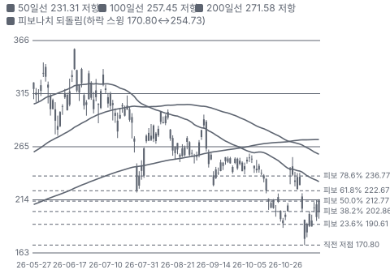

**주봉**

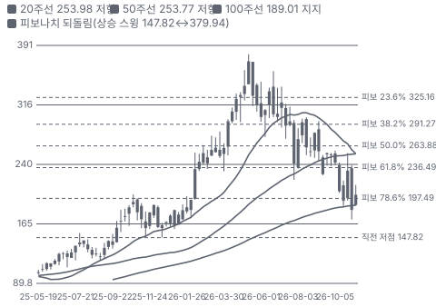

**월봉**

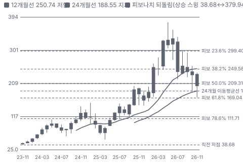

**분기 매출·EPS 실적과 컨센서스**

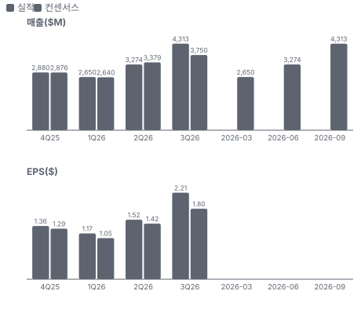

**4Q26 매출 — 지표 추세 vs 가이던스·컨센서스**

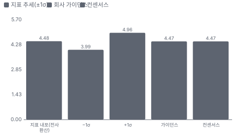

**최근 4개 분기 주가 변화 분석**

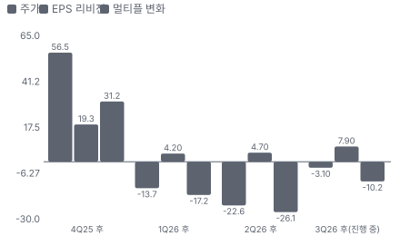

**EPS 리비전**

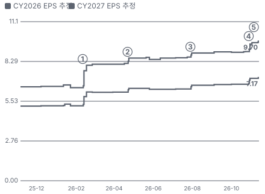

① 26-02-11 4Q25 실적·잔고 \$15.0B — 하루 +24.5% · EPS 리비전 +24%
② 26-04-22 1Q26 실적 — 하루 −2.3% · EPS 리비전 +4%
③ 26-07-29 2Q26 공급 차질로 매출 미달 — 하루 −17.3% · EPS 리비전 +3%
④ 26-10-28 3Q26 주문 +100%↑·가이던스 상향 — 하루 +16.5% · EPS 리비전 +7%
⑤ 26-11-05 AI 트레이드 되돌림 업종 급락 · 실적 창과 겹침

**멀티플 프리미엄(Fwd 1Y P/E, 최근 4개 분기말)**

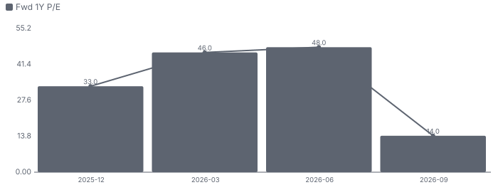

**합리적 멀티플**

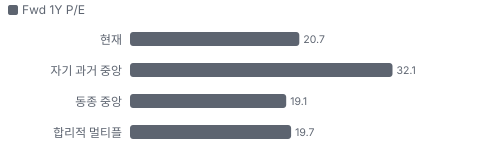

**밸류에이션 주가 시나리오**

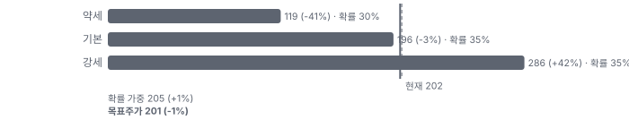

**주가별 업사이드**

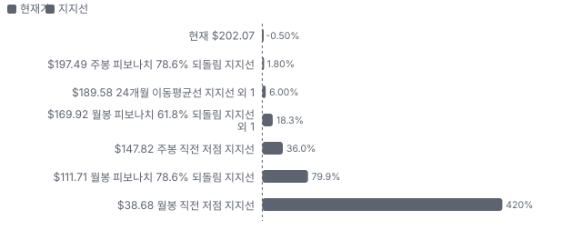
- 제품·서비스 포트폴리오

**고객 믹스(3Q26, 매출 대비)**

**공급 병목(10점, 낮을수록 병목)**

**CAPEX의 매출 대비 비중**

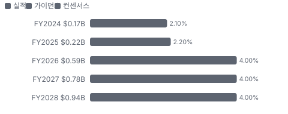

**어닝콜 변화별 주주가치 영향**

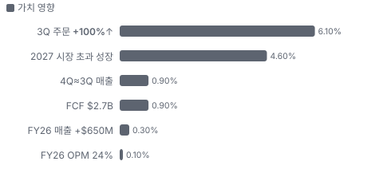

**수주·파이프라인 확실성 사다리**

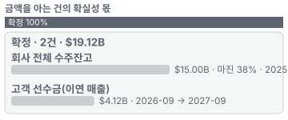

**매출 → 매출총이익 → 영업이익(매출 = 100, 최근 4분기)**

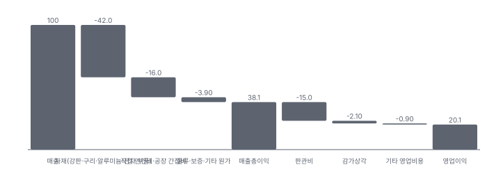

**분기 비용 비중 추이(매출 대비, 공시)**

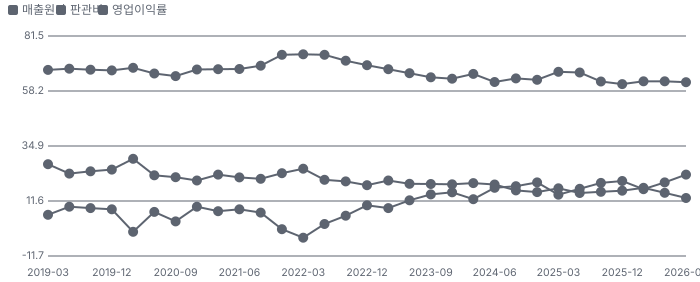

**비용 요인별 매출 대비 비중 1년 변화**

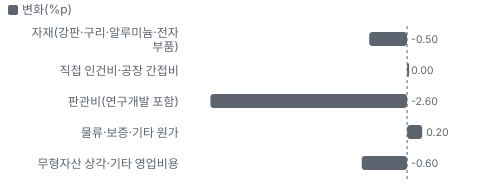

**제품(전력·열관리·IT 시스템) BOM 원가 몫**

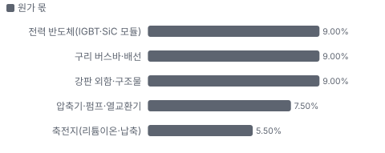

**서비스·예비 부품 BOM 원가 몫**

**BOM 항목 가격 +10% 시 OPM 변화**

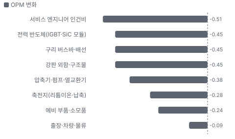

**원가 물가 vs 판매가 물가 — 1년 변화(원가가 판매가보다 더 오르면 단가를 올리지 못하는 만큼 마진이 줄어든다): 원가가 판매가 쪽 물가보다 14.1%p 더 올라 단가 인상이 따라가지 못하면 마진 압박**

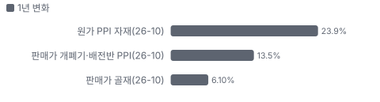

**사업별 매출 vs 물가 — 전년 대비(명목 매출 · 비교 물가 · 실질 = 물량·믹스)**

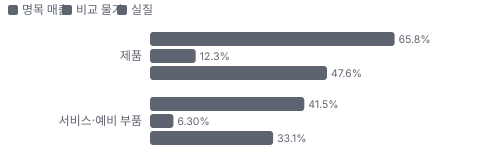

**자산 구성 — 3Q26 분기말 투하자본 \$5,280.9M**

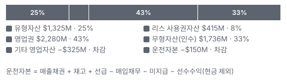

**자산별 변화율 — 최근 12개 분기(4Q23 = 0%) + 다음 4개 분기 추정**

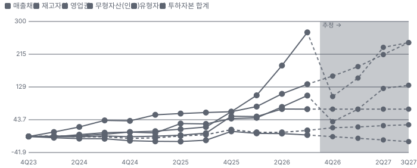

**ROIC 추이 — TTM, 최근 12개 분기 + 다음 4개 분기 추정(컨센서스 NOPAT)**

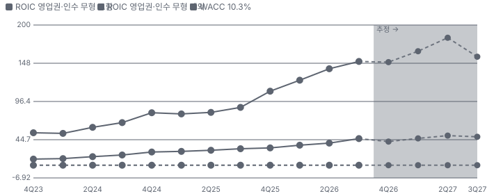

**분기 감가 비율 연율(유형자산 순액 대비)**

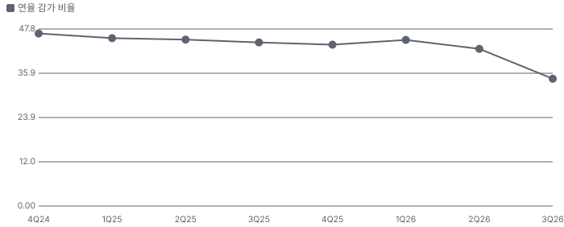

**생산시설별 면적(sq ft, 큰 순) — 생산능력 미공시라 면적을 대용으로**

**Great Lakes Data Racks & Cabinets 시너지 램프(종류별, 확률 가중)**

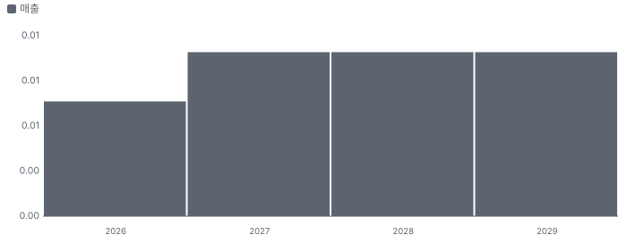

**시너지 가치 vs 웃돈**

**EPS 효과(인수 기업, 기존 대비)**

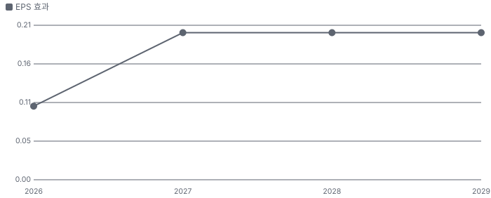

**매출·PPI·수출입 — 최근 16개 분기 + 다음 분기 추정(선마다 자기 y축: 왼쪽 매출, 오른쪽 지표) · 미국 변압기 PPI — 16개 분기 범위 408.6~477.1(+16.8%) · 미국 개폐기·배전반 수입(HS 853710) — 16개 분기 범위 4,039,196,197.0~6,257,032,382.0(+54.9%)**

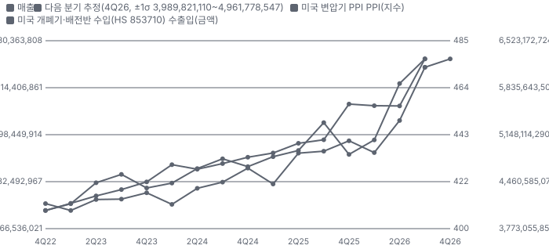

**10년 P·Q 사이클 — 추세(HP 필터) 대비 갭과 8분기 전망**

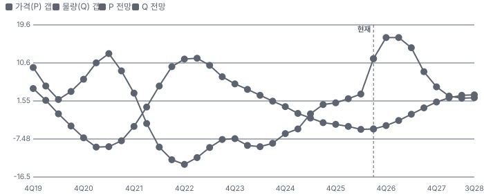

**매출 증가율의 가격·물량 분해와 8분기 전망(전년 대비)**

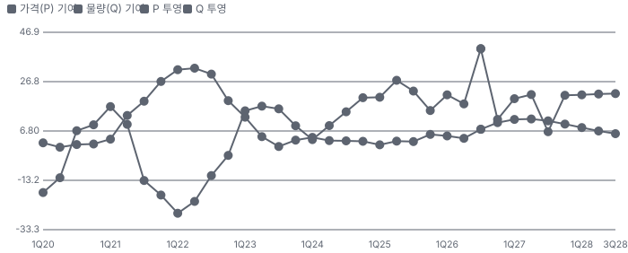

**분기별 매출 증가율 분해**

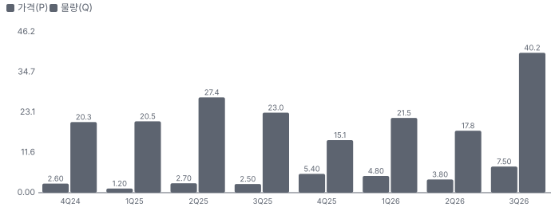

**목표주가 산정 — 기본 시나리오, 도달 확률 약 51%**

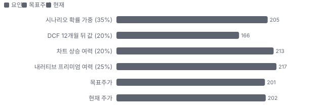

**PEG — 성장 대비 멀티플(낮을수록 성장 대비 쌈)**

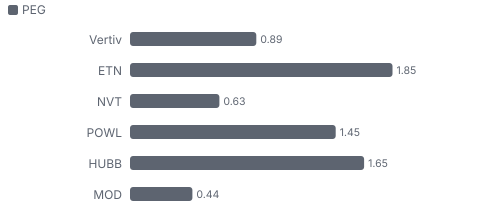

**일봉 지지·저항과 목표주가**

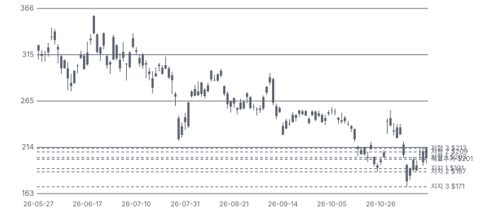

**커뮤니티 언급 수(최근 30일, 채널별)**

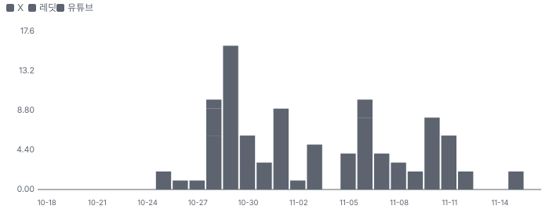

**커뮤니티 게시 수(월, 최근 12개월)**

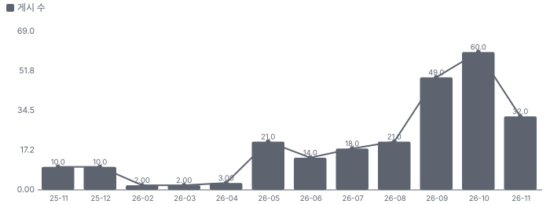

**재고 일수 — 분기별(수주 자료가 없어 수주/출하 비율 없음)**

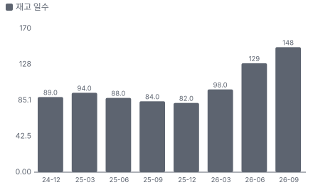

**일별 거래량 분해**

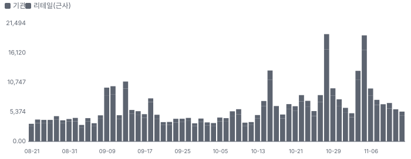

**기관 자금 흐름**

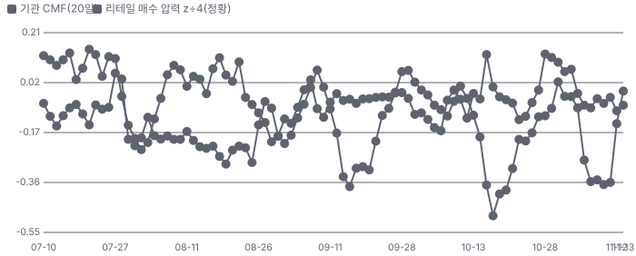

**몬테카를로**

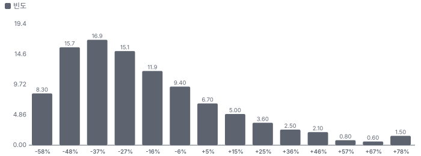

해석: 3,000번 중 659번(22%)에서 가치가 지금 주가 이상이었다. 가정을 흔들어도 지금 주가를 뒷받침하지 못하는 경우가 더 많다. 가운데 값은 0.74배이고, 열 번 중 여덟 번은 0.48~1.23배 사이에 든다.

## 내러티브

> **기업가치를 결정하는 이야기:** 이 회사는 데이터센터의 전력(UPS·배전·버스웨이)과 냉각(공랭·액체 냉각·칠러)을 설계·제작하고 설치 뒤 유지보수까지 맡는다. 매출의 69%가 미주이고 81%가 제품, 19%가 서비스다. 성장 속도는 공장 출하 캐파가, 배수는 AI CAPEX 사이클에 대한 믿음이 정한다.

> **멀티플·EPS 프리미엄**
> **멀티플:** Fwd 1Y P/E 20.7배로 동종 중앙값(Eaton·nVent·Hubbell·Modine·Powell) 19.1배보다 약 8% 높다. 4월 말 48배에서 절반 아래로 내려왔다.
> **EPS:** 다음 4개 분기 EPS 컨센서스 \$9.26은 TTM 조정 EPS \$6.26보다 48% 많다. FY27 EPS는 8/1 \$8.88 → 11/12 \$9.70으로 +9%.

### 투자자들은 왜 열광했나

2026년 초 투자자들은 잔고가 1년 새 두 배(\$15.0B)가 된 데 열광했다 — 2/11 하루 +24.5%, Fwd 1Y P/E는 4월 말 48배까지 올랐다. 식은 이유는 두 번이다: 7월 2Q 공급 차질로 매출이 컨센서스에 못 미쳐 하루 −17%, 11월 초 AI 트레이드 되돌림과 JPMorgan의 'AI CAPEX 후반부' 신중론으로 업종째 급락. 3분기 주문 +100%는 회사 숫자가 식은 것이 아님을 보여 줬지만, 주문 금액을 공시하지 않아 시장은 확인하지 못한다.

### 무엇이 기업가치를 바꾸나

> **구조적 체질 변화**
> **변화:** 통신·산업 중심에서 AI 데이터센터 중심으로 매출 구성이 바뀌었다
> **증거:** 미주 매출 비중 3Q23 55% → 3Q26 69%(세그먼트, 계산)
> **반증:** 미주 비중이 60% 아래로 되돌아간다

> **고부가 믹스 확장**
> **변화:** 액체 냉각·프리패브 모듈·고밀도 전력 비중이 올라 OPM이 높아졌다
> **증거:** 조정 OPM FY25 약 20.4% → FY26 24%(가이던스), 미주 OPM 29.4%
> **반증:** 조정 OPM 23% 아래 2개 분기

> **기술 혁신**
> **변화:** 800V DC·중전압 UPS·고밀도 원격 전력반으로 다음 세대 전원 구조에 들어간다
> **증거:** 11/12·11/13 제품 발표, 3Q 콜 800V 질의
> **반증:** 첫 대형 800V 설치를 경쟁사가 단독 수주

> **실행 속도**
> **변화:** 주문에서 매출까지 약 18개월 — 2Q 부품 지연 뒤 3Q에 회복 **납품 리드타임 17.6개월.** 피어 중앙값 25개월보다 30% 짧다(Powell 25개월 · Eaton 미확인 · nVent 미확인). 2024-12(잔고 \$7.18B ÷ FY24 월평균 매출 \$668M, 계산) 12개월보다 47% 길다.
> **증거:** 잔고 \$15.0B ÷ 월평균 매출 약 18개월(2025년 말, 계산), 3Q 매출 가이던스 대비 +\$563M
> **반증:** 4Q 매출이 가이던스 \$4.41B에 못 미친다

> **M&A**
> **변화:** 냉각·구조물·서비스 소형 인수 5건으로 수직 통합
> **증거:** Great Lakes(2025-08, 약 \$200M)·PurgeRite·BMarko(Vertiv가 2026년 4월 인수한 모듈 구조물 제조사)·Strategic Thermal Labs·ThermoKey(10-Q) — 3Q 성장 중 약 6%p가 인수 몫
> **반증:** 인수 무형자산 손상

> **정책·입법 연관성**
> **재정정책:** 해당 없음(이 회사 매출에 직접 걸린 세출·세액공제 확인 안 됨) - 반증: - 의회 동의 2/10 — 하원 1/5(관련 세출 논의 확인 안 됨) · 상원 1/5(같음).
> **행정명령:** IEEPA(미국 국제긴급경제권한법, 관세 근거 법) 관세 — 2026-02 대법원 무효 판결, CBP(미국 세관국경보호청) 환급 절차 진행(환급액 미확정) 10-Q 2026-09-30 우발 사항 주석 반증: 환급이 1년 안에 확정되지 않는다 의회 동의 2/10 — 하원 1/5(사법 판단 — 의회 입법 아님) · 상원 1/5(같음).
> **연관입법:** 데이터센터 인허가·전력망 연결 개혁은 양당 논의 중 — 선거 뒤 일부 지역 반발(보도) 중간선거 영향 계산(전력망 채널)·보도 반증: -

> **고객의 지출 예산**
> **변화:** 고객 돈은 거의 모두 CAPEX — 데이터센터 건설·전력·냉각 설비비에서 나온다. 서비스는 운영 예산
> **사업별 예산:** **매출의 81%**: 제품(전력·열관리·IT(정보기술) 시스템) — 고객 CAPEX(데이터센터 건설·전력·냉각 설비비) · 동인: AI 가속기 랙 밀도·GW 증설
**매출의 19%**: 서비스·예비 부품 — 고객 OPEX(데이터센터 운영·유지보수 예산) · 동인: 설치 기반 증가·액체 냉각 유체 관리
> **증거:** 10-K 사업 설명·3Q 콜
> **반증:** 하이퍼스케일러 2027 CAPEX 하향

### 내러티브 근거

> 'AI 데이터센터 전력·냉각 대표주'라는 이야기는 3분기 주문 +100%로 다시 증명됐지만, 시장은 그 이야기에 붙였던 배수를 걷어 냈다(5/14 종가 고점 \$376.23 대비 −46%). 지금 가격은 주문이 이익이 되는 속도와 AI CAPEX 사이클의 위치를 묻는다. 동종 대비 멀티플 차이 +8% 중 회사 고유 몫은 +5%다. 단계는 컨센서스, 쏠림은 보통(공매도 유통 주식의 2.9%, Quantral 7일 Strong 78, 기관 보유 82%)이다.

> **AI 데이터센터 전력·냉각 수요** · 강화
> **논리:** GPU 랙 전력 밀도가 올라 UPS·배전·액체 냉각 수요가 GW 성장보다 빠르게 는다
> **숫자:** 3Q 주문 +100% 이상, 매출 +61%(유기 55%), 미주 +75%
> **반증:** 2027 가이던스 유기 성장 20% 미만
> **출처:** 3Q 콜

> **마진 체질 변화** · 유지
> **논리:** 운영 개선과 규모로 조정 OPM이 20% 아래에서 25%대로 올라섰다
> **숫자:** 조정 OPM 3Q25 22.3% → 3Q26 25.2%, FY26 24%
> **반증:** 조정 OPM이 2개 분기 연속 23% 아래
> **출처:** 3Q 콜

> **선수금 기반 현금흐름** · 강화
> **논리:** 고객 선수금이 운전자본과 증설을 댄다
> **숫자:** 이연 매출 \$1.81B → \$4.12B(9개월), FY26 FCF \$2.7B 가이던스
> **반증:** 이연 매출 2개 분기 연속 감소
> **출처:** 10-Q

> **800V DC·중전압 차세대 전원** · 유지
> **논리:** 랙 전력 구조가 바뀌는 시점에 교체·신규 수요가 생긴다
> **숫자:** 중전압 UPS 출하 2027 중반(회사 발표)
> **반증:** 첫 대형 800V 설치를 경쟁사가 단독 수주
> **출처:** 11/12 보도자료

> **반대: AI CAPEX 후반부 배수 되돌림** · 강화
> **논리:** 금리·고객 자금 조달·선거 뒤 인허가 반발로 'AI 전력' 종목 배수가 업종째 깎인다
> **숫자:** Fwd 1Y P/E 4월 48배 → 11/16 20.7배, 11/4~5 이틀 −25%(업종 동반)
> **반증:** 4Q 실적 뒤 동종(Eaton·nVent) Fwd 1Y P/E가 다시 25배 위로
> **출처:** 배수 이력·보도

> **반대: 주문 비공시와 출하 병목** · 유지
> **논리:** 주문 금액을 밝히지 않고 4Q 매출이 3Q와 같아, 수요보다 출하가 막혔다는 의심이 남는다
> **숫자:** 4Q 가이던스 약 \$4.41B vs 3Q \$4.31B, 재고 9개월 +\$1.81B
> **반증:** 4Q 실적에서 잔고를 다시 공시하고 증가가 확인
> **출처:** 3Q 콜·10-Q

이미지 없음(아직 생성 전) — 제품(전력·열관리·IT 시스템)

### 투자 포인트

> **주문 두 배, 배수 절반**
> **명제:** 수요 지표는 1년 중 가장 강한데 Fwd P/E는 5월 고점 이후 절반 아래로 내려왔다
> **숫자:** 3Q 주문 전년 대비 100% 이상, FY26 가이던스 매출 \$14.65B·조정 EPS 약 \$7.15(+70%), FY27 EPS 컨센서스 8/1 \$8.88 → 11/12 \$9.70
> **시장과 다른 점:** 시장은 11월 업종 매도에서 배수만 봤다 — Fwd 1Y P/E 20.7배는 동종 중앙 19.1배와 8% 차이뿐이고, FY27 EPS 성장(+36%)은 동종보다 높다
> **증명:** 4Q26 실적에서 매출 약 \$4.41B·OPM 25.8% 달성과 2027 가이던스 성장률
> **출처:** https://www.sec.gov/Archives/edgar/data/1674101/000162828026067893/vrt-20260930.htm

> **선수금이 증설 자금을 댄다**
> **명제:** 고객이 생산 슬롯을 사려고 미리 낸 돈이 9개월 새 \$2.3B 늘었다 — 자본을 덜 쓰고 캐파를 늘린다
> **숫자:** 이연 매출 2025-12-31 \$1.81B → 2026-09-30 \$4.12B, 9개월 영업현금 \$2.66B·CAPEX \$0.43B(10-Q)
> **시장과 다른 점:** 시장 일부는 이 현금을 '빌린 현금'으로 깎아 본다 — 선수금은 취소되지 않는 한 매출이 되는 확약 수요다
> **증명:** 4Q 이연 매출이 \$4B 이상 유지되는지, FY26 조정 FCF \$2.7B 달성
> **출처:** https://www.sec.gov/Archives/edgar/data/1674101/000162828026067893/vrt-20260930.htm

> **전력·냉각 묶음이 800V DC로 넘어간다**
> **명제:** 랙 전력이 800V 직류·중전압으로 바뀌는 다음 세대에서 UPS·배전·CDU를 묶어 파는 공급사가 유리하다
> **숫자:** 11/12 중전압 UPS 공개(출하 2027 중반), 11/4 Infineon 3년 Si·SiC 공급 계약, 서비스 매출 3Q +41%
> **시장과 다른 점:** 컨센서스 FY28 매출 성장은 +20%로 FY27 +33%보다 낮다 — 800V 전환이 2028년에 교체 수요를 만들면 추정이 낮다
> **증명:** 2027년 800V DC 첫 대형 설치의 공급사 발표
> **출처:** https://www.tradingview.com/news/prnewswire:c678035a577b0:0-vertiv-introduces-medium-voltage-power-system-to-help-ai-data-centers-connect-to-the-grid-faster-and-free-indoor-space-for-compute/

### 모멘텀 생성·소멸 타임라인

**카탈리스트 달력 — 지난 사건의 주가 반응과 앞으로 확인할 숫자**
| 날짜 | 상태 | 구분 | 사건 | 반응·확인 | 결과에 따라 |
|---|---|---|---|---|---|
| 2026-02-11 | 완료 | 생성 | 4Q25 실적·잔고 \$15.0B(전년 2배) | 하루 +24.5% |  |
| 2026-05-14 | 완료 | 생성 | 종가 고점 \$376.23 — AI 인프라 대표주 프리미엄 정점 | Fwd 1Y P/E 4월 말 48배 |  |
| 2026-07-29 | 완료 | 소멸 | 2Q26 공급 차질로 매출 컨센서스 하회 | 하루 −17.3% |  |
| 2026-10-28 | 완료 | 확인 | 3Q26 주문 +100% 이상·연간 가이던스 상향 | 하루 +16.5% |  |
| 2026-11-05 | 완료 | 매크로 | AI 트레이드 되돌림 — 전력 장비 업종 동반 급락 | 이틀 −25%(11/3 \$235.97 → 11/5 \$176.73, 계산) |  |
| 2027-02 중순(예상) | 예정 | 확인 | 4Q26 실적·2027 가이던스 | 4Q 매출 \$4.41B 이상·OPM 25.8%, 2027 유기 성장 가이던스 25% 이상, 이연 매출 \$4B 유지 | 넘으면 기본→강세, 2027 성장 20% 미만이면 약세 |
| 2027 상반기(예상) | 예정 | 매크로 | 하이퍼스케일러 2027 CAPEX 가이던스(1월 말~2월 실적) | 상위 4사 합산 CAPEX 증가율 | 증가율이 20% 아래로 꺾이면 업종 배수 추가 하락 |
| 2027 중반(예상) | 예정 | 확인 | 중전압 UPS 첫 출하·800V DC 대형 설치 | 첫 고객 출하 발표 | 출하되면 FY28 추정 상향, 지연이면 기술 프리미엄 축소 |

### 언제 사서 언제 팔아야 할까?

**가격·조건 틀 — 가격은 밸류에이션(약세·기본·강세·목표주가)과 차트 지지 구간에서, 조건은 이벤트에서**
| 구간 | 가격 | 목표주가까지 | 약세까지 | 조건·근거 |
|---|---|---|---|---|
| 관찰 구간 | \$197~\$197 | +2% | -40% | 차트 지지 구간이 약세 시나리오 가격과 겹치는 곳 — 11/5 종가 저점 \$176.73 부근 |
| 확인 뒤 | 지금 \$202 이상에서 조건 확인 | -1% | -41% | 4Q 매출 \$4.41B 이상과 2027 유기 성장 가이던스 25% 이상(2027년 2월) |
| 무효화 | 약세 시나리오 \$119 | - | -41% | 이연 매출이 2개 분기 연속 감소하거나 11/5 종가 저점 \$176.73 이탈 |
| 차익 고민 2차 | \$286(강세 시나리오) | +42% | - | 목표주가 근처에서는 주문 공시 여부와 재고 증가 속도를 다시 본다 |

실적 당일 ±17~25% 움직임이 반복됐다(2/11 +24.5%, 7/29 −17.3%, 10/28 +16.5%) — 이벤트 직전 추격을 경계한다 가격·조건 틀이며 매매·비중 지시가 아니다(투자 권유 아님).

## 포트폴리오

| 제품·서비스 | 구분 | 무엇 | 쓰는 곳 | 돈 버는 방식 | Mix | Mix 변화(전년 대비) |
|---|---|---|---|---|---|---|
| 제품(전력·열관리·IT 시스템) | 제품 | UPS·배전·버스웨이·액체 냉각 CDU·칠러·랙·프리패브 모듈 | 데이터센터에 안정 전력을 공급하고 서버 열을 뺀다 | 프로젝트·장비 판매. 3Q 매출 \$3.59B(전년 +66%) | 83% | +2.3%p |
| 서비스·예비 부품 | 서비스 | 예방 정비·원격 감시·축전지 교체·냉각수 유체 관리·시운전 | 설치한 전력·냉각 설비를 멈추지 않게 유지 | 서비스 계약·부품 판매. 3Q 매출 \$719.0M(전년 +41%) | 17% | -2.3%p |

**Mix 변화가 가장 큰 쪽은 제품(전력·열관리·IT 시스템, +2.3%p, 전년 대비).** 계절성 판정: 분기 매출 계절 지수 기준 있음 → 전년 같은 분기와 비교.

## 고객

> **3Q26 최대 고객 하이퍼스케일러·코로케이션(이름 미공시, cloud/colocation) 60%, 상위 3곳 60%, 집중도 집중.** 공시·회사 발표로 확인한 몫은 매출의 0%이고, 나머지 고객 몫은 추정이거나 미분해다. 10% 넘는 단일 고객 공시를 확인하지 못했다(미확인). 고객은 하이퍼스케일러·코로케이션·네오클라우드·통신·산업이며, 3Q 주문은 '고객 유형 전반에서 고르게' 늘었다(콜). 선수금 \$4.12B가 고객 쪽 확약의 크기를 보여 준다.

**고객별 매출 몫(3Q26)**
| 고객 | 몫 | 변화 | 근거 |
|---|---|---|---|
| 하이퍼스케일러·코로케이션(이름 미공시, cloud/colocation) | 50~70% | 미확인 | 추정 |
| 네오클라우드·AI 전용 데이터센터(neocloud) | 미확인 | 미확인 | 추정 |
| 통신·산업·상업(comms/industrial) | 미확인 | 미확인 | 공시 |
| 기타·미분해 | 40% | - | - |

> **하이퍼스케일러·코로케이션(이름 미공시, cloud/colocation)** · 추정
> **사는 것:** UPS·배전·액체 냉각·프리패브 모듈
> **추정 근거:** 미주 매출 69%의 대부분이 데이터센터

> **네오클라우드·AI 전용 데이터센터(neocloud)** · 추정
> **사는 것:** 고밀도 랙 전력·CDU
> **추정 근거:** 고객의 자금 조달 속도가 발주 위험

> **통신·산업·상업(comms/industrial)** · 공시
> **사는 것:** DC(직류) 전원·UPS·서비스
> **추정 근거:** 10-K 사업 설명

## 수주·파이프라인

> **2025-12-31 기준 2건.** 확정 \$19.12B. 공시 수주잔고 \$15.00B.

**수주 목록**
| 상태 | 계약 | 계약 총액 | 진척 | 기간 | 비고 |
|---|---|---|---|---|---|
| 확정 | 회사 전체 수주잔고 | \$15.00B | 비공개 | 2025-12 → 2027-06 | - |
| 확정 | 고객 선수금(이연 매출) | \$4.12B | 비공개 | 2026-09 → 2027-09 | - |

**실행 속도와 방해 요인**
| 항목 | 상태 | 실행 속도 | 방해 요인 |
|---|---|---|---|
| 회사 전체 수주잔고 | 확정 | 잔고 ÷ 월평균 매출 약 18개월(2025년 말 기준, 계산) | 출하 캐파 · 부품 지연(2Q 사례) · 고객 데이터센터 전력 연결 지연 |
| 고객 선수금(이연 매출) | 확정 | 대부분 12개월 안 인식(유동 부채 분류) | 고객 일정 변경 |

## 마진 구조

> **GPM 38.1%, OPM 22.8%.** 3Q25 대비 GPM +0.3%p, OPM +3.5%p. 변동비는 매출의 58%이고, 매출이 10% 늘면 OPM은 +1.8%p 움직인다. 3Q26 매출원가는 매출의 61.9%로 1년 전 62.2%보다 0.3%p 낮다. 영업이익률 개선의 대부분은 판관비 비중 하락(15.5% → 12.9%)에서 왔다 — 매출이 61% 늘 때 판관비는 34% 늘었다. 원가의 가장 큰 몫은 자재(강판·구리·알루미늄·전자 부품)다.

> **매출 100 중 매출원가 61.9, 매출총이익 38.1(최근 4분기, 공시).** 매출원가 요인 중 자재(강판·구리·알루미늄·전자 부품)이 매출의 42.0%로 가장 무겁고, 단가가 +10% 오르면 GPM이 -4.20%p 움직인다. 분기 회귀로 매출 1이 늘 때 매출원가는 0.59 늘고, 매출원가의 고정비 몫은 10%다.

**비용 요인 강도 — 비중·추세·충격(+10%)·탄력**
| 비용 | 구분 | 매출 대비 | 1년 변화 | 마진 기여 | 충격 시 마진 | 매출 탄력 | 고정비 몫 |
|---|---|---|---|---|---|---|---|
| 자재(강판·구리·알루미늄·전자 부품) | 매출원가 요인 | 42.0% | -0.5%p | +0.5%p | -4.20%p | 미확인 | 0% |
| 직접 인건비·공장 간접비 | 매출원가 요인 | 16.0% | +0.0%p | -0.0%p | -1.60%p | 미확인 | 45% |
| 물류·보증·기타 원가 | 매출원가 요인 | 3.9% | +0.2%p | -0.2%p | -0.39%p | 미확인 | 20% |
| 매출원가 | 공시 항목 | 61.9% | -2.4%p | +2.4%p | -6.19%p | 0.59 | 10% |
| 판관비 | 공시 항목 | 15.0% | -0.6%p | +0.6%p | 미확인 | 0.10 | 48% |
| 감가상각 | 공시 항목 | 2.1% | +0.2%p | -0.2%p | 미확인 | 0.01 | 56% |
| 기타 영업비용 | 공시 항목 | 0.9% | +0.3%p | -0.3%p | 미확인 | 0.01 | -14% |

매출 탄력 = 분기 비용을 매출에 회귀한 기울기(매출 1당 변동비), 고정비 몫 = 절편 ÷ 평균 비용. 표본이 8분기 미만이면 미확인. 매출원가 요인 비중은 margin 재료의 추정이 섞여 있고, 공시 매출원가와의 차이는 '기타 매출원가'로 둔다.

**GPM에서 OPM까지(GAAP, 아래는 최근 4개 분기)**
| 기간 | GPM | 연구개발 | 판관비 | 기타 | OPM |
|---|---|---|---|---|---|
| 3Q25 | 37.8% | 0.0% | 15.5% | 3.0% | 19.3% |
| 3Q26 | 38.1% | 0.0% | 12.9% | 2.4% | 22.8% |
| 2025-12 | 38.9% | - | - | - | 20.1% |
| 2026-03 | 37.7% | - | - | - | 16.6% |
| 2026-06 | 37.7% | - | - | - | 19.5% |
| 2026-09 | 38.1% | - | - | - | 22.8% |

**비용을 움직이는 요인**
| 비용 | 요인 |
|---|---|
| 자재(강판·구리·알루미늄·전자 부품, 매출원가) | 구리·알루미늄 가격(헤지 일부), 전력 반도체·전자 부품 단가 · 근거 추정 |
| 직접 인건비·공장 간접비(매출원가) | 조립·시험 인력과 증설 공장 가동률 · 근거 추정 |
| 판관비(연구개발 포함, 판관비) | 영업·엔지니어링·연구개발 인력 — 연구개발은 2025년 \$441.7M(10-K, 판관비 안에 표시) · 근거 공시 |
| 물류·보증·기타 원가(매출원가) | 운임·관세·보증 충당 · 근거 추정 |
| 무형자산 상각·기타 영업비용(기타) | 인수 무형자산 상각 · 근거 공시 |

**제품(전력·열관리·IT 시스템) BOM — 매출의 81%, GPM 38%(제품별 이익 미공시 — 전사 3Q26 GPM 38.1%(10-Q)를 대입한 추정), 항목 가격 +10% 시**
| 항목 | 원가 몫 | 전가 | 제품 GPM | OPM |
|---|---|---|---|---|
| 전력 반도체(IGBT(고전압 전력 스위칭 반도체)·SiC 모듈) | 6~12% | 미확인 | -0.6%p | -0.45%p |
| 구리 버스바·배선 | 6~12% | 미확인 | -0.6%p | -0.45%p |
| 강판 외함·구조물 | 6~12% | 미확인 | -0.6%p | -0.45%p |
| 압축기·펌프·열교환기 | 5~10% | 미확인 | -0.5%p | -0.38%p |
| 축전지(리튬이온·납축) | 3~8% | 미확인 | -0.3%p | -0.28%p |
| 미분해 | 60% | - | - | - |

**서비스·예비 부품 BOM — 매출의 19%, GPM 38%(서비스 이익 미공시 — 전사 GPM 대입(추정)), 항목 가격 +10% 시**
| 항목 | 원가 몫 | 전가 | 제품 GPM | OPM |
|---|---|---|---|---|
| 서비스 엔지니어 인건비 | 35~50% | 미확인 | -2.6%p | -0.51%p |
| 예비 부품·소모품 | 15~25% | 미확인 | -1.2%p | -0.24%p |
| 출장·차량·물류 | 5~10% | 미확인 | -0.5%p | -0.09%p |
| 미분해 | 30% | - | - | - |

서비스 엔지니어 인건비 가격이 +10% 오르면 영업이익은 -2.2% 움직인다. 판매가 전가를 모르는 항목은 전가 0%로 계산했다.

**BOM 항목 가격을 움직이는 것**
| 항목 | 요인 |
|---|---|
| 전력 반도체(IGBT·SiC 모듈) | UPS·정류기·컨버터의 핵심 부품 · 근거 추정 |
| 구리 버스바·배선 | 배전·버스웨이·PDU(랙 전력 분배 장치) · 근거 추정 |
| 강판 외함·구조물 | 모듈형 전기실·랙·칠러 외함 · 근거 추정 |
| 압축기·펌프·열교환기 | 칠러·CDU의 핵심 부품 · 근거 추정 |
| 축전지(리튬이온·납축) | UPS 백업 전원 · 근거 추정 |
| 서비스 엔지니어 인건비 | 서비스 원가의 대부분 · 근거 추정 |
| 예비 부품·소모품 | 축전지 교체·필터·냉각수 · 근거 추정 |
| 출장·차량·물류 | 현장 출동 · 근거 추정 |

> **원가·판매가 물가 격차 -14.1%p** — 판매가 물가가 투입 원가 물가보다 느리게 오른다.

**투입 물가 — 미국 PPI 3·6·12개월(2026-10, 개정 반영)과 해외 전년비**
| 항목 | 미국 3개월 | 6개월 | 12개월 | 전가 못 할 때 OPM | 일본 | 한국 | 대만 |
|---|---|---|---|---|---|---|---|
| 전력 반도체(IGBT·SiC 모듈) | -0.7% | -5.7% | -2.7%* | - | +1.6%* | 미확인 | 미확인 |
| 구리 버스바·배선 | +3.4% | +7.2% | +23.9% | - | +42.6% | +25.8% | +40.1% |
| 강판 외함·구조물 | +6.7% | +17.0% | +32.9%* | - | 미확인 | 미확인 | 미확인 |
| 압축기·펌프·열교환기 | +0.4% | +0.3% | +6.4%* | - | 미확인 | 미확인 | 미확인 |

별표는 품목보다 넓은 업종 지수다. 연결한 투입 원가의 미국 PPI(생산자물가지수)는 1년 새 가중 +23.9%이고, 판매가로 넘기지 못하면 GPM -10.0%p·OPM -10.0%p가 움직인다. 판매가 비교 물가(개폐기·배전반 PPI)는 1년 새 +13.5% — 회사 가격 변화는 미확인. 물가 지수를 붙이지 못한 매출원가 항목은 직접 인건비·공장 간접비, 물류·보증·기타 원가다(미연결). 제품(전력·열관리·IT 시스템) 매출은 2026-09 전년 대비 +65.8%이고 비교 물가 ppi:switchgear의 변화 +12.3%(2026-09)를 빼면 실질 +47.6% — 물량·믹스가 성장을 이끌었다. 서비스·예비 부품 매출은 2026-09 전년 대비 +41.5%이고 비교 물가 ppi:aggregate의 변화 +6.3%(2026-09)를 빼면 실질 +33.1% — 물량·믹스가 성장을 이끌었다.

## 자산 구성

> **3Q26 분기말 투하자본 \$5,280.9M** — 영업권 43%, 무형자산(인수) 33%. 최근 12개 분기(4Q23 → 3Q26) 가장 크게 늘어난 자산은 재고자산(+272%), 투하자본 합계 +16%. 3Q27 추정 투하자본 \$5,954.7M(+13%, 컨센서스 매출과 회전 일수·CAPEX 강도 유지 가정). 연율 감가 비율(순액 기준)은 직전 4분기 45.26% → 최근 4분기 40.80%, 직전 비율이면 감가상각이 \$45.9M 더 컸다(영업이익의 1.7%).

**자산·운전자본 항목별 분기말 잔액 — 최근 12개 분기와 다음 4개 분기 추정**
| 항목 | 4Q23 | 3Q25 | 3Q26(최근) | 3Q27 추정 | 12개 분기 변화 | 다음 4개 분기 변화 |
|---|---|---|---|---|---|---|
| 매출채권 | \$2,118.1M | \$2,810.7M | \$4,379.7M | \$4,952.7M | +107% | +13% |
| 재고자산 | \$884.3M | \$1,437.1M | \$3,288.4M | \$3,051.4M | +272% | -7% |
| 선급·기타 유동자산 | \$218.7M | \$360.8M | \$743.5M | \$775.0M | +240% | +4% |
| 매입채무 | \$986.4M | \$1,718.9M | \$3,244.7M | \$3,190.3M | +229% | -2% |
| 미지급비용 | \$611.8M | \$681.4M | \$1,196.3M | \$1,333.7M | +96% | +11% |
| 선수수익(계약부채) | \$638.9M | \$1,131.9M | \$4,120.5M | \$4,053.2M | +545% | -2% |
| 유형자산 | \$560.1M | \$698.0M | \$1,324.6M | \$1,933.5M | +136% | +46% |
| 리스 사용권자산 | \$173.5M | \$283.7M | \$415.1M | \$415.1M | +139% | +0% |
| 영업권 | \$1,330.3M | \$1,444.2M | \$2,279.6M | \$2,279.6M | +71% | +0% |
| 무형자산(인수) | \$1,672.9M | \$1,507.8M | \$1,736.1M | \$1,449.3M | +4% | -17% |

**자산 추정 동인 — 최근 4개 분기 평균(재무상태표 동인 모형)**
| 동인 | 값 | 곱하는 기준 |
|---|---|---|
| 매출채권 | 101일 | 매출 |
| 재고자산 | 101일 | 매출원가 |
| 선급·기타 유동자산 | 16일 | 매출 |
| 매입채무 | 105일 | 매출원가 |
| 미지급비용 | 27일 | 매출 |
| 선수수익(계약부채) | 83일 | 매출 |
| CAPEX 강도 | 4.0% | 매출(최근 4개 분기 합) |
| 분기 감가율 | 3.50% | 기초 유형자산 순액(무형 상각 제외 감가상각) |
| 매출원가율 | 61.9% | 매출(최근 4개 분기) |
| 영업권·리스 사용권·기타 | 유지 | 인수·새 리스는 공시 전 모름 |
| 인수 무형자산 | 분기 \$71.7M 상각 | 최근 4개 분기 평균 상각 |

**추정 방법:** 증권사 3표 모델(손익·재무상태표·현금흐름)의 재무상태표 동인 방식이다. 운전자본은 항목별 회전 일수(매출채권·선급·미지급·선수는 매출, 재고·매입채무는 매출원가 기준)를 최근 4개 분기 평균으로 두고 컨센서스 매출에 곱한다. 유형자산은 기초 + CAPEX − 감가상각으로 굴린다(Koller·Goedhart·Wessels 『Valuation』 재무상태표 추정). 매출 경로는 ROIC 절의 컨센서스와 같다.

**유형·무형자산 항목별 가치(2025-12-31 vs 2024-12-31)**
| 구분 | 항목 | 총액 2025-12-31 | 누적상각 | 순액 | 총액 2024-12-31 | 총액 1년 변화 | 공시 내용연수 |
|---|---|---|---|---|---|---|---|
| 유형 | 유형자산 합계(항목 미분해) | \$1,448.2M | 총계만 공시 | 총계만 공시 | \$1,059.1M | +36.7% | 미확인 |
| 영업권 | 영업권 | \$2,033.7M | \$0.0M | \$2,033.7M | \$1,321.1M | +53.9% | 비상각 |
| 무형 | 무형자산 합계(항목 미분해) | \$3,434.1M | \$1,539.3M | \$1,894.8M | \$2,785.1M | +23.3% | 미확인 |
| 유형 합계 | 유형자산 | \$1,448.2M | \$526.3M | \$921.9M | \$1,059.1M | +36.7% | 경과율 36%(상각 대상 기준) |

**내용연수 산식(상각 대상 유형자산 = 총액 − 토지 − 건설중)**
| 기준일 | 연 감가상각 | 상각 대상 총액 | 평균 내용연수 | 경과 연수 | 잔여 연수 | 경과율 |
|---|---|---|---|---|---|---|
| 2025-12-31 | \$97.1M | \$1,448.2M | 14.9년 | 5.4년 | 9.5년 | 36% |
| 2024-12-31 | \$81.6M | \$1,059.1M | 13.0년 | 5.3년 | 7.7년 | 41% |

산식 평균 내용연수는 14.9년. 1년 전 13.0년 → 지금 14.9년.

**분기 감가 비율(감가상각 ÷ 평균 유형자산 순액)**
| 분기 | 감가상각 | 평균 유형자산(순액) | 분기 비율 | 연율 | 연율의 역수 |
|---|---|---|---|---|---|
| 4Q24 | \$71.0M | \$609.2M | 11.66% | 46.62% | 2.1년 |
| 1Q25 | \$71.6M | \$631.2M | 11.34% | 45.37% | 2.2년 |
| 2Q25 | \$73.3M | \$651.9M | 11.24% | 44.98% | 2.2년 |
| 3Q25 | \$75.4M | \$682.2M | 11.05% | 44.21% | 2.3년 |
| 4Q25 | \$88.3M | \$809.9M | 10.90% | 43.61% | 2.3년 |
| 1Q26 | \$107.7M | \$959.6M | 11.22% | 44.89% | 2.2년 |
| 2Q26 | \$115.8M | \$1,090.8M | 10.62% | 42.46% | 2.4년 |
| 3Q26 | \$107.9M | \$1,254.4M | 8.60% | 34.41% | 2.9년 |

감가상각 기준: 손익계산서 감가상각·상각비(SEC 공시 데이터, 4분기 = 연간 − 1~3분기).

최근 4분기 연율 감가 비율 40.80%, 직전 4분기 45.26%(-10%) — 경고 문턱(-10%) 안이다.

미공시·미분해: 유형자산 항목별 총액·내용연수(10-K 주석에서 모델이 채움) · 무형자산 항목(10-K 주석에서 모델이 채움) — 이 칸은 비우고 나머지로 계산했다.

### 해석 — 자산이 어디에 쌓이고 있나

- 같은 기간 4개 분기 매출은 +74% — 매출보다 빨리 늘어난 자산: 매출채권 +107%, 재고자산 +272%, 유형자산 +136%, 리스 사용권자산 +139%. 이 자산의 회전율이 떨어지면 ROIC를 희석한다.
- 다음 4개 분기 CAPEX \$581.3M vs 감가상각 \$213.5M(최근 4개 분기 CAPEX 강도·감가율 유지) — 유형자산 3Q26 \$1,324.6M → 3Q27 \$1,933.5M. 투자가 감가보다 커서 자산이 쌓이는 국면이다.

## ROIC

> **TTM 3Q26 ROIC는 영업권·인수 무형 포함 46.2%, 제외 150.5%**(NOPAT 마진 17.7% × 투하자본 회전율 2.61회). 최근 12개 분기 4Q23 18.5% → 3Q26 46.2%(고점 3Q26 46.2%). 컨센서스 NOPAT으로 굴리면 3Q27 48.7%(제외 156.9%) — WACC 10.3% 대비 +38.4%p. 1년 변화의 가장 큰 요인은 운전자본(+6.5%p).

**ROIC 추이(TTM)와 다음 4개 분기 추정 — NOPAT ÷ 평균 투하자본(이번 분기말·4개 분기 전)**
| 분기 | 구분 | TTM 매출 | TTM NOPAT | NOPAT 마진 | 평균 투하자본 | ROIC 포함 | ROIC 제외 |
|---|---|---|---|---|---|---|---|
| 4Q23 | 실적 | \$6,863.2M | \$857.4M | 12.5% | \$4,635.9M | 18.5% | 54.1% |
| 1Q24 | 실적 | \$6,981.2M | \$904.8M | 13.0% | \$4,709.5M | 19.2% | 53.3% |
| 2Q24 | 실적 | \$7,199.9M | \$1,006.7M | 14.0% | \$4,610.2M | 21.8% | 61.5% |
| 3Q24 | 실적 | \$7,530.8M | \$1,101.0M | 14.6% | \$4,564.0M | 24.1% | 67.8% |
| 4Q24 | 실적 | \$8,011.8M | \$1,248.9M | 15.6% | \$4,443.1M | 28.1% | 81.2% |
| 1Q25 | 실적 | \$8,408.7M | \$1,307.3M | 15.5% | \$4,511.9M | 29.0% | 79.6% |
| 2Q25 | 실적 | \$9,094.0M | \$1,392.9M | 15.3% | \$4,568.1M | 30.5% | 81.7% |
| 3Q25 | 실적 | \$9,696.3M | \$1,509.9M | 15.6% | \$4,645.4M | 32.5% | 88.4% |
| 4Q25 | 실적 | \$10,229.9M | \$1,631.5M | 15.9% | \$4,847.6M | 33.7% | 110.3% |
| 1Q26 | 실적 | \$10,843.4M | \$1,759.7M | 16.2% | \$4,723.1M | 37.3% | 125.1% |
| 2Q26 | 실적 | \$11,479.6M | \$1,935.9M | 16.9% | \$4,833.4M | 40.1% | 140.6% |
| 3Q26 | 실적 | \$13,116.6M | \$2,319.0M | 17.7% | \$5,024.6M | 46.2% | 150.5% |
| 4Q26 | 추정 | \$12,886.1M | \$2,312.9M | 17.9% | \$5,482.8M | 42.2% | 149.6% |
| 1Q27 | 추정 | \$13,510.9M | \$2,501.3M | 18.5% | \$5,373.5M | 46.5% | 164.3% |
| 2Q27 | 추정 | \$14,549.4M | \$2,738.4M | 18.8% | \$5,442.8M | 50.3% | 182.5% |
| 3Q27 | 추정 | \$14,709.8M | \$2,738.4M | 18.6% | \$5,617.8M | 48.7% | 156.9% |

**다음 4개 분기 NOPAT — 컨센서스(세율 21%, 리스 이자 별도)**
| 분기 | 매출 | EBITA 마진 | EBITA | NOPAT(분기) | 근거 |
|---|---|---|---|---|---|
| 4Q26 | \$2,649.5M | 23.5% | \$622.9M | \$492.1M | 컨센서스 매출 × EBIT 마진 FY2026(조정 − 주식보상 0.5%) |
| 1Q27 | \$3,274.3M | 23.5% | \$769.8M | \$608.1M | 컨센서스 매출 × EBIT 마진 FY2026(조정 − 주식보상 0.5%) |
| 2Q27 | \$4,312.8M | 23.5% | \$1,013.9M | \$801.0M | 컨센서스 매출 × EBIT 마진 FY2026(조정 − 주식보상 0.5%) |
| 3Q27 | \$4,473.2M | 23.5% | \$1,051.6M | \$830.8M | 컨센서스 매출 × EBIT 마진 FY2026(조정 − 주식보상 0.5%) |

**추정 방법:** NOPAT은 컨센서스(분기 매출 추정 × 회계연도 EBIT 마진 추정)로 잡고, 조정(비 GAAP) 마진이면 주식보상 몫을 빼서 과거 실적과 같은 기준(영업이익 + 인수 무형 상각)으로 맞췄다. 이미 발표했지만 분기 보고서(10-Q)가 아직 없는 분기는 발표 실적을 쓴다. 투하자본은 자산 구성 절의 재무상태표 동인으로 굴렸다. ROIC는 4개 분기 NOPAT을 이번 분기말과 4개 분기 전 투하자본의 평균으로 나눈다 — 추정 분기의 ROIC에는 이미 나온 실적 분기가 섞여 있다.

**투하자본 항목별 회전율과 ROIC 기여(TTM 3Q26, 평균 잔액)**
| 항목 | 투하자본 | 매출 1달러당 자본 | 회전율(매출 ÷ 항목) | 자본 몫 | 이 항목을 빼면 ROIC |
|---|---|---|---|---|---|
| 운전자본 | \$463.2M | 0.04 | 28.31회 | 9% | 49.5% |
| 유형자산 | \$1,011.3M | 0.08 | 12.97회 | 20% | 56.3% |
| 리스 사용권자산 | \$349.4M | 0.03 | 37.54회 | 7% | 48.3% |
| 영업권 | \$1,861.9M | 0.14 | 7.04회 | 37% | 71.4% |
| 무형자산(인수) | \$1,621.9M | 0.12 | 8.09회 | 32% | 66.4% |
| 기타 영업자산 | −\$283.2M | -0.02 | 음수(자금 원천) | -6% | 42.6% |

**ROIC 세 가지 판**
| 판 | NOPAT | 투하자본 | ROIC | 무엇을 재나 |
|---|---|---|---|---|
| 영업권·인수 무형 포함 | \$2,259.5M | \$5,024.6M | 45.0% | 인수 웃돈까지 낸 돈에 대한 수익률 |
| 영업권·인수 무형 제외 | \$2,259.5M | \$1,540.7M | 146.7% | 본업 운영 수익률(동종 비교용) |
| 무형 자본화 조정(판관비 20%·5년, 연구개발 6년) | \$2,505.9M | \$7,082.4M | 35.4% | 비용으로 처리한 무형 투자를 자산으로 본 판 |
| 경제적 이익(포함판) | \$1,740.6M | \$5,024.6M | 자본비용 10.3% | (ROIC − 자본비용) × 투하자본 |

NOPAT = (영업이익 \$2,641.7M + 인수 무형 상각 + 리스 내재 이자 \$6.9M) × (1 − 세율 21%). 리스 사용권자산을 투하자본에 넣었으므로 임차료 속 이자 몫을 영업이익에 되더했다. 현금은 영업에 필요한 몫을 따로 알 수 없어 투하자본에서 뺐다. SEC 공시 데이터 자동 초안 — 운전자본 = 매출채권 + 재고 + 선급 − (매입채무 + 미지급비용 + 선수수익), 현금 제외. 손상 누계는 공시 데이터 수록분.

**ROIC 1년 변화 분해(포함판, TTM 3Q25 → TTM 3Q26)**
| 요인 | ROIC 기여 |
|---|---|
| NOPAT 마진 | +3.96%p |
| 운전자본 | +6.49%p |
| 유형자산 | -0.94%p |
| 리스 사용권자산 | -0.21%p |
| 영업권 | +0.19%p |
| 무형자산(인수) | +3.15%p |
| 기타 영업자산 | -0.08%p |
| 합계 | +12.54%p |

**무형 자본화 가정별 ROIC(2025년 지출 기준, 포함판에 더함)**
| 투자로 보는 몫 | 상각 연수 | 무형 자산 | NOPAT 조정 | 조정 ROIC |
|---|---|---|---|---|
| 판관비 20% | 2년 | \$1,679.2M | \$217.0M | 36.9% |
| 판관비 20% | 5년 | \$2,057.8M | \$246.4M | 35.4% |
| 판관비 30% | 2년 | \$1,909.7M | \$244.5M | 36.1% |
| 판관비 30% | 5년 | \$2,477.5M | \$288.5M | 34.0% |

### 해석 — 무엇이 수익성을 끌어올리고 희석하나

- 영업권: 투하자본의 37% — 빼면 ROIC 45.0% → 71.4%. 이 자산의 회전율(7.04회)이 수익성을 희석하는 주된 자리다.
- 무형자산(인수): 투하자본의 32% — 빼면 ROIC 45.0% → 66.4%. 이 자산의 회전율(8.09회)이 수익성을 희석하는 주된 자리다.
- 기타 영업자산: −\$283.2M(음수), 고객 선수금·공급사 외상이 자본을 대신 댄다 — 빼면 ROIC 42.6%로 낮아진다. 수익성을 끌어올리는 쪽이다.
- 영업권·인수 무형을 빼면 ROIC가 +101.7%p 오른다 — 과거 인수에 치른 웃돈이 주주 수익률을 그만큼 낮춘다(본업 수익률은 제외판, 인수까지 포함한 가치 창출은 포함판으로 본다).
- 1년 ROIC 개선의 최대 요인은 운전자본(+6.5%p). 반대로 깎은 최대 요인은 유형자산(-0.9%p).
- 비용으로 처리한 무형 투자를 자산으로 보면 ROIC가 -9.6%p 움직인다(무형 자산 \$2,057.8M). 투자를 늘리는 중이라 NOPAT이 더 커지는 쪽이다.
- 추정 경로 3Q26 46.2% → 3Q27 48.7%: NOPAT 마진 +0.9%p, 투하자본 회전율 +0.01회 — 컨센서스 매출·마진이 맞고 회전 일수·CAPEX 강도가 유지된다는 가정이다. 마진 추정이 내려가거나 재고 일수가 늘면 이 경로가 먼저 틀린다.
- ROIC(포함) − WACC = +35.8%p(3Q26) — 양수면 투하자본을 늘릴수록 가치가 쌓인다.

## 공급망 병목

이미지 없음(아직 생성 전) — 제품(전력·열관리·IT 시스템)

> **공급망 신뢰성 3.5/10, 병목 심각.** 가장 약한 고리는 공장 조립·시험 캐파와 숙련 인력 3.5점이고, 품목 평균은 3.5점이다. 근거가 부족한 3건(전력 반도체(IGBT·SiC 모듈) · 구리 버스바·배선 · 강판 외함·구조물)은 점수에서 뺐다. 병목은 부품보다 공장 조립 캐파와 숙련 인력이다. 2Q에 부품 지연으로 매출이 밀렸고(콜), 전력 반도체는 11/4 Infineon 3년 계약으로 물량을 묶었다. 원자재는 대체로 복수 공급처(10-K).

**병목과 마진 — 품목 가격 +10% 시 OPM**
| 품목 | 점수 | 판정 | 구분 | OPM |
|---|---|---|---|---|
| 공장 조립·시험 캐파와 숙련 인력(필수) | 3.5 | 병목 심각 | 출하 차질 위험 | 미확인 |

> **공장 조립·시험 캐파와 숙련 인력** · 3.5/10
> **왜:** 주문 +100%를 매출로 바꾸는 속도를 정한다
> **병목 요인:** 인증 공급사 1곳 · 캐파 빠듯 · 리드타임 미확인 · 재인증 미확인 · 1위 점유율 100% · 미주 집중 69% · 물량 확보 내재화
> **풀리는 조건:** 진행 중 — BMarko(구조물)·ThermoKey(열교환기) 인수와 증설, 완전 해소 근거 없음

**공급사**
| 품목 | 공급사 | 몫 | 근거 |
|---|---|---|---|
| 공장 조립·시험 캐파와 숙련 인력 | 자체 공장(약 300곳 사무·제조 시설 중 제조 시설, 수 미공시, 조립·시험) | 미확인 | 공시 |
| 전력 반도체(IGBT·SiC 모듈) | Infineon(Si·SiC 전력 반도체 3년 공급) | 미확인 | 회사 발표 |
| 구리 버스바·배선 | 미공시(복수 공급처, 구리 원자재·가공품) | 미확인 | 공시 |
| 강판 외함·구조물 | BMarko Structures(2026-04 인수, 모듈 구조물 제작) | 미확인 | 공시 |

**무역 통계로 본 공급 지역**
| 품목 | EU 수입처 | 일본 수입처 | EU 1위 전년비 |
|---|---|---|---|
| 전력 반도체(IGBT·SiC 모듈) | CN(중국) 33% · MY(말레이시아) 30% · JP(일본) 21% | マレーシア 25% · 中華人民共和国 19% | -0.5% |
| 구리 버스바·배선 | MY 77% · KR(한국) 11% · VN(베트남) 7% | マレーシア 58% · タイ 36% | 미확인 |
| 강판 외함·구조물 | KR 39% · TW(대만) 26% · MY 15% | 大韓民国 49% · 中華人民共和国 14% | -25.9% |

## 생산능력

> **현재 명목 캐파 미확인, 가동률 미확인.** FY2025 CAPEX는 \$0.22B로 매출의 2.2%다. 사무·제조 시설 약 300곳·40여 개국(10-K). 생산능력(MW(메가와트)·대)과 가동률은 공시하지 않는다. 확인된 증설은 Pelzer 21.5만 sq ft(2024), BMarko 구조물 공장(보도 56만 sq ft), 인수한 Great Lakes(Vertiv가 2025년 8월 인수한 랙·캐비닛 제조사)·ThermoKey 공장이다.

**생산시설 300곳**(10-K FY2025 Item 2 — 사무·제조 시설 약 300곳·40여 개국(제조 시설만의 수는 미공시)) — 이름·위치를 밝힌 곳 5곳, 미확인 5곳. 시설별 생산능력은 공개되지 않았다 — 회사 전체 캐파만 위에 적었다.

**생산시설 300곳 — 명칭·위치·생산능력**
| 시설 | 위치 | 용도 | 생산능력 | 소유·상태 |
|---|---|---|---|---|
| 본사(웨스터빌) | 미국 오하이오 웨스터빌 | 본사 | 미확인 — 본사 — 생산 시설 아님 | 미확인 · 가동 |
| Pelzer 모듈 공장 | 미국 사우스캐롤라이나 Pelzer | 모듈·통합 전력 시스템 제조 | 미확인 — 면적 215,000 sq ft — 생산능력 미공시 · 면적 215,000 sq ft | 미확인 · 가동 |
| BMarko 구조물 공장 | 미국 사우스캐롤라이나 | 모듈 구조물 제작 | 미확인 — 보도 면적 56만 sq ft — 회사 공시 아님 · 면적 560,000 sq ft | 미확인 · 가동 |
| Great Lakes 랙·캐비닛 공장 | 미국·유럽(세부 미공시) | 랙·캐비닛 제조 | 미확인 — 미공시 | 미확인 · 가동 |
| ThermoKey 열교환기 공장 | 이탈리아(세부 미공시) | 열교환기·건식 냉각기 | 미확인 — 미공시 | 미확인 · 가동 |

공개된 증설 계획은 확인되지 않았다.

**CAPEX와 매출 대비**
| 기간 | CAPEX | 매출 | 매출 대비 | 구분 |
|---|---|---|---|---|
| FY2024 | \$0.17B | \$8.01B | 2.1% | 실적 |
| FY2025 | \$0.22B | \$10.23B | 2.2% | 실적 |
| FY2026 | \$0.59B | \$14.71B | 4.0% | 가이던스 |
| FY2027 | \$0.78B | \$19.60B | 4.0% | 컨센서스 |
| FY2028 | \$0.94B | \$23.50B | 4.0% | 컨센서스 |

## M&A 시너지

> **Great Lakes Data Racks & Cabinets 인수(2025-08-01, \$0.20B): 시너지가 다 나면 연 \$0.01B(확률 가중 이익 기여).** 세후 시너지 가치는 통합 비용을 빼고 \$0.08B. EPS 효과는 2026년 +0.1%에서 2029년 +0.2%.

**Great Lakes Data Racks & Cabinets 시너지가 생기는 길**
| 종류 | 시너지 | 연 규모 | 완성 | 확률 | 어떻게 생기나 | 근거 |
|---|---|---|---|---|---|---|
| 매출 | 랙·캐비닛 교차 판매 | \$0.10B(이익률 20%) | 2027 | 50% | 전력·냉각 모듈 주문에 랙·화이트스페이스 구조물을 묶어 판다 | 추정 — 회사는 시너지 규모를 밝히지 않음(10-K: 실행 캐파·프리패브 공급 확대) |

시너지 가치 = 세후 이익 기여 5년 + 말기 가치(할인율 9%, 성장 0) − 통합 비용. 매출 시너지는 그 매출의 이익률만 반영하고, 모든 시너지에 실현 확률을 곱했다.

## 해자

> 해자는 '전력(UPS·배전)과 열관리(공랭·액체 냉각)를 한 회사가 설계·제작·설치·유지보수까지 묶어 파는 범위'다. 단품 기술은 Schneider·Eaton도 갖고 있어, 묶음 납품 속도와 서비스망이 흔들리면 프리미엄도 줄어든다.

> **전력+열관리 통합 공급 범위** · 강함
> **해자:** UPS·배전·버스웨이·CDU·칠러·랙을 한 번에 설계해 공장 조립 모듈(OneCore(Vertiv의 공장 조립형 데이터센터 전력·냉각 모듈 설계)·SmartRun(Vertiv의 공장 조립형 화이트스페이스 배전·배관 모듈))로 넘긴다
> **근거:** 10-K: 전력·열관리·IT 인프라 전 범위 제품군, 3Q 콜: 주문이 고객군 전반에서 100% 이상
> **숫자:** 조정 OPM 2023 약 17% → 3Q26 25.2%(·3Q 콜)
> **깨지는 조건:** 하이퍼스케일러가 전력과 냉각을 다른 공급사로 나눠 발주한다는 발표가 이어지고 OPM이 2개 분기 연속 23% 아래

> **설치 기반 서비스망** · 강함
> **해자:** 서비스 센터 300곳 이상·엔지니어 약 5,000명이 설치 기반을 유지보수하며 반복 매출을 만든다
> **근거:** 10-K FY2025, 서비스·예비 부품 3Q26 \$719.0M(전년 +41%)
> **숫자:** 서비스·예비 부품 TTM \$2.52B = 매출의 19%(계산)
> **깨지는 조건:** 서비스 매출 성장률이 제품 성장률을 2년 연속 크게 밑돌고 매출 비중이 15% 아래

> **고객 선수금이 대는 운전자본** · 보통
> **해자:** 고객이 생산 슬롯을 잡으려 미리 돈을 낸다 — 경쟁사보다 자본을 덜 쓰고 증설한다
> **근거:** 10-Q: 이연 매출 2025-12-31 \$1.81B → 2026-09-30 \$4.12B, 9개월 영업현금 \$2.66B
> **숫자:** 투하자본 \$5.06B 대비 TTM GAAP 영업이익 \$2.64B(계산)
> **깨지는 조건:** 이연 매출이 2개 분기 연속 줄고 재고만 남는다

> **차세대 전원 구조(800V DC) 기술 선점** · 보통
> **해자:** NVIDIA 800V DC 구조와 중전압 UPS로 다음 세대 전력 체인에 먼저 들어간다
> **근거:** 11/12 중전압 UPS 공개(출하 2027 중반), 3Q 콜 Goldman 질문에 800V 진행 언급
> **숫자:** 미확인(800V 관련 매출 미공시)
> **깨지는 조건:** 800V DC 첫 대형 설치에서 경쟁사(Eaton·Schneider·Delta) 단독 채택이 확인

## 경영진·네트워크

> CEO Giordano Albertazzi(2023년 1월 취임)가 운영 개선으로 OPM을 끌어올렸고, Honeywell 전 CEO Dave Cote가 집행 회장으로 자본 배분을 지휘한다. CFO는 Craig Chamberlin이다.

> **Giordano Albertazzi** · CEO · 2023
> **프로필:** Emerson Network Power 시절부터 유럽 사업을 이끈 내부 출신, 2023년 1월 CEO
> **비즈니스:** 회사 내부 경력(EMEA 사장·최고운영책임자 계열)
> **정계:** 미확인
> **동문:** 미확인
> **사모임:** 미확인

> **Dave Cote** · 집행 회장 · 2020
> **프로필:** Honeywell 전 회장·CEO, 2020년 GS Acquisition Holdings와의 합병으로 Vertiv 상장을 주도
> **비즈니스:** Honeywell 경영 경력, SPAC(GS Acquisition Holdings) 공동 설립
> **정계:** 미확인
> **동문:** 미확인
> **사모임:** 미확인

> **Craig Chamberlin** · CFO · 미확인
> **프로필:** 3Q26 콜에서 가이던스·현금흐름 설명 담당
> **비즈니스:** 미확인
> **정계:** 미확인
> **동문:** 미확인
> **사모임:** 미확인

**네트워크 정량화**
| 연결 | 강도 | 닿는 매출 | 가중 노출 | 매출 대비 | 근거 |
|---|---|---|---|---|---|
| 비즈니스: 집행 회장의 Honeywell 운영 체계(Honeywell Operating System식 원가·자본 규율) 이식 | 2/5 | 미확인 | 미확인 | 미확인 | 연결이 매출을 만들었다는 근거 없음 — 경영 방식의 정황 회사 IR·공개 인터뷰 |

가중 노출은 연결이 닿는 매출의 크기다. 연결이 그 매출을 만들었다는 뜻이 아니며, 인과는 공개 자료로 입증하지 못한다.

## 약세 논리 및 셀온 조건

| 약세 논리 | 근거 | 가를 자료 |
|---|---|---|
| AI CAPEX 사이클 후반부 | JPMorgan이 11/11 중립·목표가 \$240으로 재개시하며 AI CAPEX가 후반부에 들어섰고 금리가 전환을 앞당길 수 있다고 봤다(보도). 11/4~5 업종 동반 이틀 −25% | 하이퍼스케일러 2027 CAPEX 가이던스(2027년 1~2월 실적) |
| 주문·잔고 비공시 | 2025년 말 잔고 \$15.0B 이후 금액을 밝히지 않는다. CEO는 앞으로도 주문 금액을 공시하지 않겠다고 했다(3Q 콜) | 4Q 실적에서 잔고 공시 재개 여부, 이연 매출 추이 |
| 4Q 계절성 실종 | 4Q 매출 가이던스 약 \$4.41B는 3Q \$4.31B와 거의 같다 — 보통 4Q가 크다. 출하 캐파가 막혔다는 해석이 가능하다(UBS 질문) | 4Q 실제 매출과 1Q27 가이던스 |
| 현금흐름의 선수금 의존 | 9개월 영업현금 \$2.66B 중 이연 매출 증가가 \$2.31B다(10-Q). 재고도 \$1.81B 늘었다 | 4Q·1Q27 이연 매출과 재고의 방향 |
| 대형 경쟁사의 같은 묶음 | Schneider Electric·Eaton이 같은 전력·냉각 체인을 갖고 있다(10-K 경쟁사). 800V DC 표준이 자리 잡으면 단품 경쟁이 세진다 | 800V DC 첫 대형 설치 공급사 발표(2027) |

**변이 관점.** 시장은 11월 AI 매도에서 Vertiv를 'AI CAPEX 후반부의 고배수 장비주'로 묶어 팔았다. 그러나 Fwd 1Y P/E는 이미 4월 말 48배에서 20.7배로 내려와 동종 중앙값 19.1배와 8% 차이뿐이고, 같은 기간 FY27 EPS 추정은 올랐다. 문제는 배수가 아니라 가시성이다 — 주문 금액을 공시하지 않아 시장은 선수금·재고로 수요를 추정한다. 2월 실적에서 2027 성장 가이던스와 선수금이 유지되면 '후반부' 할인이 풀리고, 꺾이면 지금 배수도 낮지 않다.

> **셀온 조건**
> **조건 1:** 4Q26 매출이 가이던스 약 \$4.41B에 못 미치거나 2027 유기 성장 가이던스가 20% 미만(2027년 2월 실적).
> **조건 2:** 이연 매출(고객 선수금)이 2개 분기 연속 줄어든다(10-Q·10-K 재무상태표).
> **조건 3:** 조정 OPM이 2개 분기 연속 23% 아래.
> **조건 4:** 하이퍼스케일러 상위 4사의 2027 CAPEX 가이던스 합계 증가율이 10% 아래로 꺾인다.

## 어닝콜 변화

**직전 콜 대비 새로 나오거나 바뀐 내용 → 가치 영향**
| 항목 | 내용 | 직전 콜 | 최신 콜 | 모델 동인 이동 | 확신도 | 가치 영향 |
|---|---|---|---|---|---|---|
| 업데이트 | 연간 매출 가이던스 | \$14.0B(7월) | \$14.65B(유기 약 38%) | 기준연도 매출 +\$0.04B | 0.8 | +0.3% |
| 신규 | 주문 증가율 | 1H 매우 강한 유기 주문(금액 비공시) | 3Q 주문 전년 대비 100% 이상, 고객군 고르게 | 1년차 성장률 +4.0% | 0.8 | +6.1% |
| 업데이트 | 조정 영업이익률 | 23.8%(7월) | 24.0%, 3Q 25.2%·4Q 25.8% | 출발 이익률 +0.20% | 0.8 | +0.1% |
| 신규 | 2027 방향 | 언급 없음(7월) | 견조한 잔고·파이프라인으로 2027 시장보다 크게 높은 유기 성장 | 장기 성장 수렴값 +1.0% | 0.5 | +4.6% |
| 부정 | 4Q 계절성 | 보통 4Q가 3Q보다 크다 | 4Q 가이던스 약 \$4.41B — 3Q \$4.31B와 거의 같다(UBS 질문) | 성장 지속(감속 계수) +1.0% | 1.0 | +0.9% |
| 업데이트 | 현금흐름 | 7월 가이던스(미확인) | 조정 FCF \$2.7B, 선수금 9개월 +\$2.31B | 매출÷투하자본 +20.0% | 0.8 | +0.9% |
| **합계** | 단독 합 |  |  | 동시 적용 +13.2% |  | **+12.9%** |

**사건별 EPS 리비전**
| # | 날짜 | 구분 | 사건 | CY2026 EPS 전→후 | CY2027 EPS 전→후 | 리비전 | 주가 반응 |
|---|---|---|---|---|---|---|---|
| ① | 26-02-11 | 실적 | 4Q25 실적·잔고 \$15.0B — 하루 +24.5% | \$5.21 → \$6.17 | \$6.47 → \$8.03 | +24.2% | +24.5% |
| ② | 26-04-22 | 실적 | 1Q26 실적 — 하루 −2.3% | \$6.16 → \$6.42 | \$8.16 → \$8.53 | +4.5% | -2.3% |
| ③ | 26-07-29 | 실적 | 2Q26 공급 차질로 매출 미달 — 하루 −17.3% | \$6.38 → \$6.64 | \$8.60 → \$8.88 | +3.3% | -17.3% |
| ④ | 26-10-28 | 실적 | 3Q26 주문 +100%↑·가이던스 상향 — 하루 +16.5% | \$6.71 → \$7.12 | \$8.98 → \$9.62 | +7.2% | +16.5% |
| ⑤ | 26-11-05 | 내러티브 | AI 트레이드 되돌림 업종 급락 | \$7.12 → \$7.17 | \$9.60 → \$9.70 | 실적 창과 겹침 | -14.0% |

**추정치 수정 폭:** 최근 30일 EPS 추정은 상향 7건·하향 1건으로 **상향 우세**(순 비율 +0.75), 90일은 상향 8건·하향 2건으로 상향 우세(+0.60)이다. 평균이 몇 % 움직였나(리비전 크기)와 달리 몇 번 같은 방향으로 고쳤나를 본다 — 수정 1건은 애널리스트 수가 그대로인 채 컨센서스가 움직인 날(지표별 하루 1건)이라 같은 날 여러 명이 고치면 1건으로 합쳐지고, 상향 + 하향이 3건 미만이면 순 비율을 쓰지 않는다.

**추정치 수정 폭 — 열린 기간(다음 분기들·올해·내년) 컨센서스 수정 건수, 최근 30·90일**
| 지표 | 30일 상향/하향 | 30일 순 비율 | 90일 상향/하향 | 90일 순 비율 | 90일 커버리지 변화 |
|---|---|---|---|---|---|
| EPS | 7 / 1 | +0.75 | 8 / 2 | +0.60 | 4 |
| 매출 | 3 / 0 | +1.00 | 3 / 0 | +1.00 | 0 |
| 전체 | 10 / 1 | +0.82 | 11 / 2 | +0.69 | 4 |

**실적 발표 예상 변동폭:** 지난 5번 실적 발표 때 주가는 하루에 평균 ±12.5%(최대 24.5%, 오른 날 2번) 움직였다.

**실적 발표 예상 변동폭 — 과거 실적 발표 다음 거래일 주가 변화**
| 분기 | 발표일 | 주가 변화 |
|---|---|---|
| 3Q25 | 2025-10-22 | -1.8% |
| 4Q25 | 2026-02-11 | +24.5% |
| 1Q26 | 2026-04-22 | -2.3% |
| 2Q26 | 2026-07-29 | -17.3% |
| 3Q26 | 2026-10-28 | +16.5% |

**해석:** 4개 구간(누적) 주가 +1% = EPS 리비전 +40% × 멀티플 -28%. 더 크게 움직인 쪽은 **EPS 리비전**이다.

## 거시 지표 싱크로율

> **미국 변압기 PPI와 제품(전력·열관리·IT 시스템) 싱크로율 80%(3분기 = 약 9개월 선행, 전년 대비, 표본 10개·t 3.7·유의·신뢰 낮음).** 이 지표가 내포하는 4Q26 제품(전력·열관리·IT 시스템)은 3.67B(±1σ 3.18B~4.15B, 확정)다. 표본 밖 검증(최근 5개 분기)에서 지표 모델 오차는 19.5%p, 기준선(직전 증가율 지속)은 14.5%p다 — **지표가 기준선을 이기지 못해(예측력 없음) 추정은 대부분 기준선이다(지표 가중 41%).** 기준선은 인수·환율 효과의 소멸을 모르므로 회사 가이던스와 차이가 크면 가이던스 쪽 설명을 먼저 본다. 세그먼트 추정에 나머지 사업(직전 증가율 지속)을 더한 전사 매출은 4.48B(3.99B~4.96B)다. 가이던스는 이보다 -0.1%(범위 안), 컨센서스는 -0.0%(범위 안)다. Vertiv 제품 매출은 배전·변압·전력 반도체 같은 데이터센터 전력 장비 수요와 같은 방향이어야 한다 — 미국 배전반 PPI·변압기 PPI·개별 반도체 PPI를 본다

**지표별 싱크로율(상관계수 × 100) — 위 두 줄이 제품 연관성 × 싱크로율로 고른 PPI·수출입 세부 지표**
| 지표 | 비교 대상 | 증가율 기준 | 지표 선행 | 매출(t값) | 영업이익 | 방향 일치 | 표본·신뢰 | 표본 밖 오차(지표/기준선) | 4Q26 추정 매출 |
|---|---|---|---|---|---|---|---|---|---|
| 미국 변압기 PPI | 제품(전력·열관리·IT 시스템) | 전년 대비 | 3분기(9개월) | 80%(t 3.7) | -41%(1분기) | 100% | 10·낮음 | 19.5/14.5%p ✘ | +58.9% → 3.67B(확정) |
| 미국 개폐기·배전반 수입(HS(국제 통일 상품 분류 코드) 853710) | 제품(전력·열관리·IT 시스템) | 전년 대비 | 1분기(3개월) | 77%(t 3.4) | 34%(4분기) | 100% | 10·낮음 | 10.5/14.5%p ✔ | +57.5% → 3.64B(확정) |
| 미국 배전반 PPI | 제품(전력·열관리·IT 시스템) | 전년 대비 | 3분기(9개월) | 58%(t 2.0) | -24%(0분기) | 100% | 10·낮음 | 17.7/14.5%p ✘ | +61.3% → 3.72B(확정) |
| 미국 개별 반도체 PPI | 제품(전력·열관리·IT 시스템) | 전년 대비 | 3분기(9개월) | -39%(t -1.2) | -21%(2분기) | 20% | 10·낮음 | 13.3/14.5%p ✔ | +49.0% → 3.44B(확정) |

**지표 후보 27개 — 연관성(제품 품목 일치 × 대용 감점 × 매출 비중) × 싱크로율로 고른다. 후보가 많을수록 최대 상관은 우연히 부풀 수 있다**
| 후보 | 종류 | 연관성 | 매출 분기 일치 | 싱크로율(선행) | 점수 | 출처 |
|---|---|---|---|---|---|---|
| 미국 변압기 PPI ✔ | PPI | 1.00 | 100% | 80%(3분기) | 0.80 | 모델 지정 |
| 미국 배전반 PPI | PPI | 1.00 | 100% | 58%(3분기) | 0.46 | 모델 지정 |
| 미국 변압기 수출(HS 850423) | 수출입 | 0.33 | 69% | 89%(0분기) | 0.30 | 자동 |
| 미국 개폐기·배전반 수입(HS 853710) ✔ | 수출입 | 0.33 | 100% | 77%(1분기) | 0.26 | 자동 |
| EU(유럽연합) 개폐기·배전반 수입(HS 853710) | 수출입 | 0.33 | 100% | 75%(1분기) | 0.25 | 자동 |
| 한국 변압기 PPI | PPI | 0.33 | 100% | 71%(0분기) | 0.24 | 자동 |
| 미국 개별 반도체(MOSFET(전력 스위칭용 트랜지스터)·트랜지스터·다이오드) 수입(HS 854129) | 수출입 | 0.33 | 100% | 67%(1분기) | 0.18 | 자동 |
| EU HS 853720 수입(개폐기·배전반과 같은 4자리 품목군) | 수출입 | 0.23 | 100% | 68%(3분기) | 0.16 | 자동 |
| 미국 개별 반도체(MOSFET·트랜지스터·다이오드) 수출(HS 854129) | 수출입 | 0.33 | 100% | 56%(3분기) | 0.15 | 자동 |
| EU 개별 반도체(MOSFET·트랜지스터·다이오드) 수입(HS 854129) | 수출입 | 0.33 | 100% | 55%(1분기) | 0.15 | 자동 |
| 일본 HS 8537 수출(개폐기·배전반과 같은 4자리 품목군) | 수출입 | 0.23 | 44% | 65%(0분기) | 0.12 | 자동 |
| 일본 HS 8537 수입(개폐기·배전반과 같은 4자리 품목군) | 수출입 | 0.23 | 44% | 60%(0분기) | 0.11 | 자동 |

**선행 지표로 본 향후 분기 매출 전망(이미 나온 지표 값 기준, ±1σ)**
| 지표 | 대상 | 분기 | 지표 증가율 | 내포 매출 증가율 | 내포 매출 |
|---|---|---|---|---|---|
| 미국 배전반 PPI | 제품(전력·열관리·IT 시스템) | 4Q26 | +14.9% | +56.0% | 3.60B(3.32B~3.89B) |
| 미국 배전반 PPI | 제품(전력·열관리·IT 시스템) | 1Q27 | +12.1% | +45.4% | 3.04B(2.78B~3.30B) |
| 미국 배전반 PPI | 제품(전력·열관리·IT 시스템) | 2Q27 | +11.5% | +43.3% | 3.74B(3.41B~4.06B) |
| 미국 변압기 PPI | 제품(전력·열관리·IT 시스템) | 4Q26 | +4.9% | +48.9% | 3.44B(3.23B~3.65B) |
| 미국 변압기 PPI | 제품(전력·열관리·IT 시스템) | 1Q27 | +3.9% | +39.4% | 2.92B(2.72B~3.11B) |
| 미국 변압기 PPI | 제품(전력·열관리·IT 시스템) | 2Q27 | +8.3% | +79.0% | 4.67B(4.43B~4.90B) |
| 미국 개별 반도체 PPI | 제품(전력·열관리·IT 시스템) | 4Q26 | -0.8% | +27.6% | 2.95B(2.62B~3.27B) |
| 미국 개별 반도체 PPI | 제품(전력·열관리·IT 시스템) | 1Q27 | +0.6% | +24.3% | 2.60B(2.31B~2.89B) |
| 미국 개별 반도체 PPI | 제품(전력·열관리·IT 시스템) | 2Q27 | -2.5% | +31.7% | 3.43B(3.07B~3.80B) |
| EU 개폐기·배전반 수출(HS 853710) | 제품(전력·열관리·IT 시스템) | 4Q26 | +5.8% | +28.6% | 2.97B(2.65B~3.29B) |
| EU 개폐기·배전반 수입(HS 853710) | 제품(전력·열관리·IT 시스템) | 4Q26 | +18.5% | +61.4% | 3.73B(3.49B~3.96B) |
| 미국 개폐기·배전반 수출(HS 853710) | 제품(전력·열관리·IT 시스템) | 4Q26 | -1.6% | +48.7% | 3.43B(3.20B~3.67B) |
| 미국 개폐기·배전반 수출(HS 853710) | 제품(전력·열관리·IT 시스템) | 1Q27 | +9.9% | +28.2% | 2.68B(2.47B~2.89B) |
| 미국 개폐기·배전반 수출(HS 853710) | 제품(전력·열관리·IT 시스템) | 2Q27 | +14.9% | +19.5% | 3.11B(2.85B~3.38B) |
| 미국 개폐기·배전반 수입(HS 853710) | 제품(전력·열관리·IT 시스템) | 4Q26 | +17.5% | +53.3% | 3.54B(3.32B~3.76B) |
| 일본 개폐기·배전반 PPI | 제품(전력·열관리·IT 시스템) | 4Q26 | +18.4% | +40.2% | 3.24B(2.91B~3.57B) |
| 한국 개폐기·배전반 PPI | 제품(전력·열관리·IT 시스템) | 4Q26 | -1.8% | +46.3% | 3.38B(3.06B~3.70B) |
| 한국 개폐기·배전반 PPI | 제품(전력·열관리·IT 시스템) | 1Q27 | +1.0% | +32.7% | 2.77B(2.48B~3.07B) |
| 한국 개폐기·배전반 PPI | 제품(전력·열관리·IT 시스템) | 2Q27 | +1.7% | +28.8% | 3.36B(2.99B~3.72B) |
| 한국 개폐기·배전반 PPI | 제품(전력·열관리·IT 시스템) | 3Q27 | +2.1% | +26.9% | 4.56B(4.06B~5.06B) |
| EU 변압기 수출(HS 850423) | 제품(전력·열관리·IT 시스템) | 4Q26 | +15.6% | +27.9% | 2.95B(2.66B~3.25B) |
| EU 변압기 수출(HS 850423) | 제품(전력·열관리·IT 시스템) | 1Q27 | +106.5% | +0.0% | 2.09B(1.83B~2.36B) |
| EU 변압기 수출(HS 850423) | 제품(전력·열관리·IT 시스템) | 2Q27 | -6.0% | +34.6% | 3.51B(3.18B~3.84B) |
| 미국 변압기 수입(HS 850423) | 제품(전력·열관리·IT 시스템) | 4Q26 | +41.4% | +31.3% | 3.03B(2.81B~3.26B) |
| 미국 변압기 수입(HS 850423) | 제품(전력·열관리·IT 시스템) | 1Q27 | +30.1% | +36.2% | 2.85B(2.64B~3.05B) |
| EU 개별 반도체(MOSFET·트랜지스터·다이오드) 수입(HS 854129) | 제품(전력·열관리·IT 시스템) | 4Q26 | +6.2% | +36.7% | 3.16B(2.86B~3.45B) |
| 미국 개별 반도체(MOSFET·트랜지스터·다이오드) 수출(HS 854129) | 제품(전력·열관리·IT 시스템) | 4Q26 | -0.9% | +38.5% | 3.20B(2.91B~3.49B) |
| 미국 개별 반도체(MOSFET·트랜지스터·다이오드) 수출(HS 854129) | 제품(전력·열관리·IT 시스템) | 1Q27 | +16.0% | +50.9% | 3.16B(2.89B~3.42B) |
| 미국 개별 반도체(MOSFET·트랜지스터·다이오드) 수출(HS 854129) | 제품(전력·열관리·IT 시스템) | 2Q27 | +6.1% | +43.7% | 3.74B(3.42B~4.07B) |
| 미국 개별 반도체(MOSFET·트랜지스터·다이오드) 수입(HS 854129) | 제품(전력·열관리·IT 시스템) | 4Q26 | +23.8% | +68.0% | 3.88B(3.62B~4.14B) |
| EU HS 853720 수입(개폐기·배전반과 같은 4자리 품목군) | 제품(전력·열관리·IT 시스템) | 4Q26 | +18.0% | +26.7% | 2.93B(2.67B~3.18B) |
| EU HS 853720 수입(개폐기·배전반과 같은 4자리 품목군) | 제품(전력·열관리·IT 시스템) | 1Q27 | +30.9% | +34.7% | 2.82B(2.58B~3.05B) |
| EU HS 853720 수입(개폐기·배전반과 같은 4자리 품목군) | 제품(전력·열관리·IT 시스템) | 2Q27 | +49.6% | +46.3% | 3.81B(3.52B~4.10B) |
| 미국 HS 853720 수출(개폐기·배전반과 같은 4자리 품목군) | 제품(전력·열관리·IT 시스템) | 4Q26 | +39.2% | +38.2% | 3.19B(2.88B~3.50B) |
| 미국 HS 853720 수출(개폐기·배전반과 같은 4자리 품목군) | 제품(전력·열관리·IT 시스템) | 1Q27 | +119.4% | +57.0% | 3.28B(3.01B~3.56B) |
| 미국 HS 853720 수출(개폐기·배전반과 같은 4자리 품목군) | 제품(전력·열관리·IT 시스템) | 2Q27 | -19.1% | +24.5% | 3.24B(2.90B~3.59B) |
| 미국 HS 853720 수출(개폐기·배전반과 같은 4자리 품목군) | 제품(전력·열관리·IT 시스템) | 3Q27 | -6.2% | +27.5% | 4.58B(4.11B~5.06B) |
| EU HS 850421 수출(변압기과 같은 4자리 품목군) | 제품(전력·열관리·IT 시스템) | 4Q26 | -44.9% | +74.8% | 4.04B(3.88B~4.19B) |
| EU HS 850421 수출(변압기과 같은 4자리 품목군) | 제품(전력·열관리·IT 시스템) | 1Q27 | -41.9% | +72.5% | 3.61B(3.47B~3.75B) |
| EU HS 850421 수출(변압기과 같은 4자리 품목군) | 제품(전력·열관리·IT 시스템) | 2Q27 | +9.7% | +32.8% | 3.46B(3.29B~3.63B) |

지표가 k분기 앞서면 이미 발표된 지표로 k분기 뒤까지의 매출 증가율을 회귀식으로 읽는다. 표본이 작거나 t값이 2 미만이면 전망은 참고용이다.

**지표를 고른 이유**
| 지표 | 이유 |
|---|---|
| 미국 변압기 PPI | 데이터센터 전력 체인 투자 대용 |
| 미국 개폐기·배전반 수입(HS 853710) | 개폐기·배전반 품목 일치 |
| 미국 배전반 PPI | UPS·배전 장비와 같은 품목군 가격 |
| 미국 개별 반도체 PPI | 핵심 원가 품목(전력 반도체) |

다음 분기 추정 = 지표 회귀와 기준선(직전 증가율 지속)을 표본 밖 오차의 역제곱으로 가중 결합한 값이다(예측 결합). 지표가 회귀에 쓴 범위를 벗어나면 범위 끝으로 자르고(외삽 제한), 세그먼트 추정은 나머지 사업을 기준선으로 더해 전사로 바꾼다. 싱크로율은 증가율의 상관계수이며 인과가 아니다. 지표 단위·통화는 원자료 그대로이고 나라끼리 더하지 않는다(EU 수입만 상대국 합계). ±1σ는 회귀 잔차 표준편차이고, 지표를 예측한 분기는 지표 예측 오차까지 더해 넓혔다.

## P·Q 사이클

> **10년 위치: Q형 기업(매출 갭 분산의 0%가 가격) — 가격은 추세 대비 -5.1%(수축, 10년 분위 21%), 물량은 +11.6%(확장, 분위 96%). P 프리미엄 -17%, Q 프리미엄 +14%(매출총이익이 정상(추세) 수준보다 요인별로 이만큼 높거나 낮다).** 전망으로 가격 갭은 4분기 뒤 -0.1%·8분기 뒤 +3.0%, 물량 갭은 +8.5%·+2.3%(물량은 컨센서스 몫 42%를 섞었다).

**10년 P·Q 사이클 위치·프리미엄**
| 항목 | 가격(P) | 물량(Q) |
|---|---|---|
| 추세 대비 갭(현재) | -5.1% | +11.6% |
| 사이클 시계 | 수축 | 확장 |
| 10년 분위 | 21% | 96% |
| 프리미엄(현재) | -17% | +14% |
| 프리미엄 4분기 뒤 | 0% | +11% |
| 프리미엄 8분기 뒤 | +9% | +3% |
| 갭 반감기 | 3분기 | 5분기 |
| 갭 4분기 뒤(80% 범위) | -0.1% (-4.3%~+4.3%) | +8.5% (-2.7%~+21.0%) |
| 갭 8분기 뒤(80% 범위) | +3.0% (-2.4%~+8.7%) | +2.3% (-10.3%~+16.8%) |
| 전망 모형 | 자기회귀모델(과거 2개 시점) 정상성 보정 | 자기회귀모델(과거 2개 시점) + 컨센서스(분기 컨센서스 4개 + 연간 컨센서스 성장률 FY2026→FY2027 +33%, 4분기 뒤 몫 42%) |

방법: P = 가격 지수 4분기 평균(미국 PPI 변압기·배전 기기 대용 — 회사 판매가가 아니라 업종 가격), Q = TTM 매출 ÷ P. 추세는 로그 레벨의 HP(추세와 순환을 나누는 통계 필터, Hodrick-Prescott) 필터(λ 1600)로 정상(mid-cycle) 수준을 잡는다. 프리미엄 = 요인별 매출총이익 증분 ÷ 정상 매출총이익(정상 GPM 33.8% = 10년 중앙값, 물량 증분 마진 41.8% = 전년 대비 ΔGP÷ΔRev 회귀, 가격은 전액 이익 반영). 표본 28개 TTM 분기. 전망: 가격 갭은 BIC(모형 차수를 고르는 정보 기준)로 차수를 고른 자기회귀모델(정상성 보정), 물량은 통계 갭 자기회귀모델과 컨센서스 매출 ÷ 가격 전망(매출 = P × Q)을 분산 역수로 섞는다(Bates·Granger 1969). 끝점 편향을 줄이려고 전망 경로를 이어 붙인 뒤 HP 필터를 다시 건다(Kaiser·Maravall 1999). 80% 범위는 예측 오차(TTM이 4분기씩 겹쳐 생기는 자기상관을 뉴이·웨스트 장기 분산으로 반영)와 애널리스트 범위에서 낸다. 모형 산출이며 가이던스가 아니다.

> **Q 사이클 — 최근 4분기 평균 가격 기여 +5.4%, 물량 기여 +23.7%(전년 대비 로그 증가율).** P 강도 4.3/10, Q 강도 7.0/10, 최근 8분기 중 100%가 같은 요인 우세(구조적). 전망으로는 4분기 뒤(3Q27) P 사이클로 전환(물량은 컨센서스를 섞었다).

**P·Q 사이클 정량**
| 항목 | 가격(P) | 물량(Q) |
|---|---|---|
| 최근 4분기 평균 기여 | +5.4% | +23.7% |
| 강도(0~10, 자기 이력 z) | 4.3 | 7.0 |
| 고유 주기(자기회귀모델 과거 2개 시점일 때) | 14.9분기 | 미확인 |
| 다음 4분기 투영 평균 | +11.1% | +14.9% |
| 4분기 뒤 투영(80% 범위) | +10.9% (-0.9%~+22.7%) | +6.5% (-9.1%~+22.0%) |
| 장기 평균(표본 → 기저율 수축) | +11.3% → +6.8% | +22.9% → +13.6% |
| 투영 모형 | 자기회귀모델(과거 2개 시점) | 자기회귀모델(과거 1개 시점) + 컨센서스(분기 컨센서스 4개 + 연간 컨센서스 성장률 FY2026→FY2027 +33%) |

가격 근거: 미국 PPI 변압기·배전 기기 대용 — 회사 판매가가 아니라 업종 가격. PPI를 쓰면 회사 판매가가 아니라 업종 가격 대용이다. 로그 증가율이라 가격·물량 기여의 합이 매출 증가율이다. 전망: 가격은 BIC로 차수를 고른 자기회귀모델에 이미 발표된 월간 가격을 먼저 넣고(나우캐스트), 물량은 자기회귀모델과 '컨센서스 매출 증가율 − 가격 전망'을 분산 역수로 섞는다. 장기 평균은 표본 평균을 장기 기저율(가격 연 2%·물량 연 4%) 쪽으로 줄인다 — 고성장 구간만 담긴 표본이 그 성장을 끝없이 잇지 않게. 범위는 4분기 겹친 표본의 자기상관을 반영한다. 모형 산출이며 가이던스가 아니다. 회사 판매가로 잴 수 없는 이유: 단가·출하 대수를 공시하지 않는다 — 주문 설계·묶음 납품이라 같은 단위의 ASP가 없다. 업종 PPI 대용으로 잰다

## 밸류에이션

> **목표주가 \$201, 업사이드 -1%.** 자리는 기본 시나리오이고 도달 확률은 약 51%다. 기본 \$196, 강세 \$286(+42%), 약세 \$119(-41%). DCF 기준 업사이드는 기본 -26%, 강세 +3%, 약세 -45%다(WACC 10.3%).

기준 멀티플이 Fwd 1Y라서 EPS도 12개월 뒤의 다음 4개 분기(4Q27~3Q28)를 쓴다. 이 기간 컨센서스는 \$8.9~13.9, 평균 \$11.4다(계산). 2028년 분기 추정은 애널리스트가 1~2명뿐이라 범위가 넓다 — 표본이 작다.

DCF와 다른 이유: DCF 기본 업사이드는 −26%로 배수 경로(목표주가 \$201, −1%)보다 낮다. DCF는 FY27 이후 성장이 빠르게 식어 장기 영업이익률(GAAP 근사) 22%로 수렴한다고 보고, 몬테카를로 중앙값도 −26%다. 배수 경로는 조정 EPS에 동종 2년 뒤 배수(17.1배)를 쓴다. 두 값 모두 셀사이드 목표가(\$322)보다 낮은 것은 '30%대 성장이 몇 년 가느냐'에서 시장보다 보수적이기 때문이다 — 2027 가이던스가 25% 이상이고 2028년에도 주문이 이어지면 두 가정 모두 틀린다.

시나리오 확률: 다음 해 매출 성장 분포로 계산 — 약세 +27.0% 아래·강세 +39.9% 위 확률. 내부 관점(컨센서스 +33.8%, σ 13.7%: 범위 25.9% ÷ d2(8) × 1.5) 100% — 외부 관점 꺼짐(SEC 전 상장사 표본 없음)

> **약세 \$119 (-41%)** · 확률 30%
> **가정:** 14.3배 × EPS \$9.20
> **근거:** 고객 데이터센터 전력 연결이 밀려 2027년 출하가 2026년 하반기 속도에 머문다. 선수금이 줄고 조정 OPM이 23%로 내려간다. 다음 4개 분기(4Q27~3Q28) EPS가 컨센서스 하단 \$8.9 근처인 \$9.2

> **기본 \$196 (-3%)** · 확률 35%
> **가정:** 19.0배 × EPS \$11.40
> **근거:** FY27 매출 \$19.6B(컨센서스, +33%), 조정 OPM 25% 안팎. 다음 4개 분기(4Q27~3Q28) EPS 컨센서스 \$11.4 수준

> **강세 \$286 (+42%)** · 확률 35%
> **가정:** 23.8배 × EPS \$13.30
> **근거:** 주문 +100%가 2027년 출하로 이어지고 800V DC·중전압 UPS가 2027 하반기에 붙는다. EPS가 컨센서스 상단 \$13.9 쪽으로 간다

**멀티플 선정 — Fwd 1Y P/E**
| 단계 | 조정 | 근거 |
|---|---|---|
| 동종 중앙값 | 19.1배 | 범위 15.5~21.3배, 5곳 |
| 펀더멘털 | +2% | 성장·이익률·ROIC로 본 합리적 멀티플 19.7배와의 차이의 일부만 인정(로그 차이 × 0.5, 상한 ±20%에 부드럽게 수렴) |
| 해자 | +6% | 전력+열관리 통합 공급 범위 강함 · 설치 기반 서비스망 강함 · 고객 선수금이 대는 운전자본 보통 · 차세대 전원 구조(800V DC) 기술 선점 보통 — 점수 11.0%에서 동종 기준 5.5%를 뺌 |
| 반복 매출 | 0% | 반복 매출 19%(동종 20%) · 서비스·예비 부품(예방 정비·원격 감시·축전지 교체·유체 관리) · 이미 반복 단계 · 기반 설치 기반 대수 미공시 — 서비스 센터 300곳 이상·엔지니어 약 5,000명(10-K FY2025) |
| 수주 전환·가시성 | +4% | book-to-bill 1.00 · RPO(잔여 이행 의무, 계약 잔고 중 아직 매출로 잡지 않은 몫)·ACV(연간 계약 가치) 성장 − 매출 성장 1.00 → 가시성 1.00 · 전환 17.6개월(동종 12) |
| 내러티브 | +0% | 단계 컨센서스 |
| 사이클·실행 판단 | +0% | 동종보다 성장(FY27 매출 +33%)과 마진이 높지만, 주문·잔고 금액 비공시와 4Q 계절성 실종이 가시성을 깎는다 — 조정 없이 규칙 배수를 쓴다 |
| **선정** | **21.2배** | 지금 20.7배 |

**동종 레인지**
| 회사 | Fwd 1Y P/E | Fwd 2Y P/E | Fwd 3Y P/E | 성장 | 영업이익률 | ROIC |
|---|---|---|---|---|---|---|
| ETN | 20.7 | 18.6 | 16.3 | 18% | 21% | 13% |
| NVT | 17.2 | 13.5 | 11.6 | 32% | 22% | 17% |
| POWL | 21.3 | 18.6 | 16.4 | 20% | 21% | 155% |
| HUBB | 19.1 | 17.1 | 15.8 | 15% | 23% | 14% |
| MOD | 15.5 | 11.5 | 8.4 | -4% | 16% | 25% |
| **Vertiv** | 20.7 | 16.8 | 13.3 |  |  |  |

> **PEG 0.89** — Fwd 1Y P/E 20.7배를 다음 해 EPS 성장 23%로 나눈 값, 동종 중앙 1.45(성장 대비 싸다). 성장률은 Fwd 1Y·2Y P/E에서 역산한 컨센서스라 다음 해 한 해 성장만 반영하고, 성장 지속 기간은 담지 않는다.

**PEG — Fwd 1Y P/E ÷ 다음 해 EPS 성장률**
| 회사 | Fwd 1Y P/E | 다음 해 EPS 성장 | PEG |
|---|---|---|---|
| **Vertiv** | 20.7 | +23% | 0.89 |
| ETN | 20.7 | +11% | 1.85 |
| NVT | 17.2 | +27% | 0.63 |
| POWL | 21.3 | +15% | 1.45 |
| HUBB | 19.1 | +12% | 1.65 |
| MOD | 15.5 | +35% | 0.44 |

지금 주가가 요구하는 5년 매출 CAGR 24%, 기본 시나리오 16%. 몬테카를로 중앙값 업사이드 -26%.

> 의사결정 보조(투자자문 아님): ① 매수 매력: 5년 보유 가정 연 기대수익 +5.1% — 주주가 요구하는 수익률(자기자본비용) 10.3%보다 -5.3%p · 요구수익률을 넘을 확률 20% · 안전마진 없음(비관적 경우(하위 10%) 가치가 시총의 48%) → 정량 신호 약함 / ② 위험 예산 지표(이론): 0% — 기대수익이 요구수익률에 못 미친다(켈리 기준 — 수익·손실 확률로 계산한 이론상 최대 노출 — 0%는 참고) · 5년 뒤 나쁜 경우(하위 10%) -24% · 30% 넘게 잃을 확률 7% / ③ 상방(5년): 평균 1.28배 · 2배 이상 확률 9% · 3배 이상 1% · 10배 이상 0% · 잘 풀린 경우(상위 10%) 1.96배 이상

투입 물가 점검: 지난 1년 PPI를 BOM에 넣으면 OPM -3.33%p다(매출원가의 28% 기준).

## 매수 위치(일봉)

> **현재가 \$202는 '지지 근접'(가장 가까운 일봉 지지 \$191에서 ATR 0.6배 위).** 이 자리에서 목표주가까지 -0.5%, 첫 일봉 저항까지 +3.4%, 다음 지지까지 하방 -5.7%, 손익비 -0.1배. 손익비는 지지 1 \$191에서 3.1배로 가장 높다(목표주가까지 +5.5%).

**가격대별 업사이드(일봉 기준)**
| 가격대 | 가격 | 목표주가까지 | 첫 저항까지 | 다음 지지까지 | 손익비 | 근거 기법(강도) |
|---|---|---|---|---|---|---|
| 현재가 | \$202 | -0.5% | +3.4% | -5.7% | -0.1 | - |
| 지지 1 | \$191 | +5.5% | +6.4% | -1.8% | 3.1 | 피보 23.6%(1.0) |
| 지지 2 | \$187 | +7.3% | +1.8% | -8.8% | 0.8 | 120일 지그재그 저점(0.8) |
| 지지 3 | \$171 | +17.7% | +9.6% | 미확인 | 미확인 | 120일 지그재그 저점 · 스윙 저점(1.8) |

**일봉 저항**
| 저항 | 가격 | 현재가 대비 | 근거 기법(강도) |
|---|---|---|---|
| 저항 1 | \$203 | +0.4% | 피보 38.2%(1.0) |
| 저항 2 | \$209 | +3.4% | 20일선(0.5) |
| 저항 3 | \$213 | +5.3% | 피보 50.0%(1.0) |

일봉만 쓴다(주봉·월봉 제외). 손익비 = 목표주가까지 업사이드 ÷ 다음 지지까지 하방. 가격대별 기대값 참고표이며 매수·매도 시점 지시가 아니다.

## 애널리스트 토론

> **토론 결론 Neutral(규칙 등급 Neutral).** 이익 추정이 오르는 동안 배수가 절반 아래로 내려온 점은 반박되지 않았다. 그러나 기본 이익에 동종 2년 뒤 배수를 쓰면 목표주가가 지금 주가와 같고, 주문 비공시와 선수금 의존이라는 두 반박이 살아남아 프리미엄을 다시 줄 근거가 아직 없다.

**패널 — 등급별 자리**
| 자리 | 핵심 논리 | 틀리는 조건 | 최종 투표 |
|---|---|---|---|
| Strong Buy | 주문 +100%·가이던스 상향인데 Fwd P/E는 21배로 동종(19배)과 거의 같다 — 성장 프리미엄이 사라졌다 | 4Q 매출 \$4.3B 미만과 2027 가이던스 성장률 20% 미만이 겹친다 | Buy |
| Buy | 수요는 확실하고 선수금이 증설 자금을 댄다 — 다만 출하 캐파가 속도를 정한다 | 이연 매출이 2개 분기 연속 감소 | Buy |
| Neutral | 회사는 좋지만 배수는 업종이 정한다 — AI CAPEX 사이클 위치를 아무도 모른다 | 동종 Fwd P/E가 25배 위로 회복 | Neutral |
| Sell | 주문 금액을 숨긴다 — 4Q 매출이 3Q와 같은 것은 수요가 아니라 출하가 막혔다는 뜻일 수 있다 | 4Q 실적에서 잔고·주문 금액을 다시 공시하고 증가가 확인 | Neutral |
| Strong Sell | 현금흐름의 큰 몫이 선수금이다 — 고객 자금 조달이 막히면 현금과 주문이 함께 꺾인다 | 선수금이 유지된 채 2027 상반기 FCF가 순이익을 넘는다 | Neutral |

**투표**
| Strong Buy | Buy | Neutral | Sell | Strong Sell |
|---|---|---|---|---|
| 0 | 2 | 3 | 0 | 0 |

> **개회 · Strong Buy**
> **발언:** FY27 EPS는 석 달 새 9% 올랐다. 주가 하락분은 전부 배수다.

> **개회 · Buy**
> **발언:** 선수금 \$4.12B는 고객이 슬롯을 사려고 낸 돈이다. 이만큼 확약된 수요는 드물다.

> **개회 · Neutral**
> **발언:** 그 수요는 맞다. 하지만 주가를 정하는 것은 20배냐 35배냐이고, 그건 AI CAPEX 사이클이 정한다.

> **개회 · Sell**
> **발언:** 4Q 매출이 3Q와 거의 같다. 주문이 두 배면 매출도 따라와야 한다.

> **개회 · Strong Sell**
> **발언:** 9개월 영업현금 \$2.66B 중 \$2.31B가 선수금 증가다. 사업 현금은 생각보다 작다.

> **반박1 · Sell → Strong Buy**
> **발언:** EPS 상향 9%는 4Q 가이던스를 그대로 믿을 때다. 출하가 밀리면 2Q처럼 −17%가 나온다.

> **반박1 · Strong Buy → Sell**
> **발언:** 2Q 차질은 3Q에 회복됐다 — 3Q 매출은 가이던스보다 \$563M 많았다.

> **반박1 · Buy → Strong Sell**
> **발언:** 선수금은 빚이 아니다. 고객이 취소하지 않는 한 매출이 된다.

> **반박1 · Strong Sell → Buy**
> **발언:** 취소가 아니라 지연이 위험이다. 고객 데이터센터 전력 연결이 늦으면 선수금이 줄어든다.

> **반박1 · Neutral → Buy**
> **발언:** 주문 금액을 공시하지 않으니 시장은 선수금과 재고로 추정할 수밖에 없다.

> **반박2 · Buy → Neutral**
> **발언:** 그래서 FCF \$2.7B 가이던스가 중요하다. 현금으로 확인된다.

> **반박2 · Neutral → Strong Buy**
> **발언:** 동종 5사 Fwd P/E 중앙 19.1배다. 20.7배는 아직 소폭 프리미엄이다.

> **반박2 · Strong Buy → Neutral**
> **발언:** 그 프리미엄은 FY27 EPS 성장 36%와 OPM 24%가 설명한다. 동종은 둘 다 낮다.

> **반박2 · Sell → Buy**
> **발언:** 증설은 재고와 고정비를 먼저 데려온다. 재고가 9개월 새 두 배가 넘었다.

> **반박2 · Strong Sell → Strong Buy**
> **발언:** 배수가 15배까지 가면 EPS 상향으로는 부족하다. 2024년에도 그 바닥을 봤다.

> **최종 · Strong Buy**
> **발언:** 추정 상향과 배수 붕괴가 겹친 드문 구간이다. 4Q가 확인하면 되돌린다.

> **최종 · Buy**
> **발언:** 수요는 선수금으로 확인됐다. 속도만 확인하면 된다 — 4Q 출하와 2027 가이던스.

> **최종 · Neutral**
> **발언:** 업종 배수가 바닥인지 모른다. 확인 뒤 판단해도 늦지 않다.

> **최종 · Sell**
> **발언:** 주문 비공시가 풀리기 전에는 프리미엄을 다시 줄 근거가 약하다.

> **최종 · Strong Sell**
> **발언:** 선수금이 꺾이는 날이 이 종목의 진짜 시험대다.

남은 반대 의견: 강세 측은 FY27 EPS 성장 36%가 동종보다 높아 지금 배수가 싸다고 본다 — 2027 가이던스가 이를 가릴 것이다

패널은 등급별 논리를 대표하는 자리이고 실존 IB의 의견이 아니다.

## 커뮤니티 반응

통계: 관심 급증 0.0/10(결합 Z -1.9), 최근 7일 신뢰 가중 감성 +0.33, 최근 언급 2건.

> **커뮤니티는 강세 쪽이지만 근거는 회사보다 '고객사 실적의 파급'이다 — X에서는 CoreWeave·Eaton·Generac 콜을 Vertiv 수요의 증거로 읽고, 약세 쪽은 AI CAPEX 후반부와 금리를 말한다.**

**강세** — 고객사(CoreWeave·Alphabet·Amazon)의 CAPEX 상향이 전력·냉각 공급사로 흘러간다 근거로 드는 것: 11월 고객사 실적 발표의 CAPEX·잔고 숫자. (X, 2026-11-11)

**약세** — JPMorgan은 AI CAPEX가 후반부에 들어섰고 금리가 그 전환을 앞당길 수 있다며 전기 장비에 신중 근거로 드는 것: IB 재개시 보고서(중립·목표가 \$240). (X, 2026-11-11)

**새 쟁점** — 현금흐름 중 얼마가 사업 자체이고 얼마가 고객 선수금인가 근거로 드는 것: 9개월 FCF와 이연 매출 증가 비교. (X, 2026-11-01)

**시장과 다른 점** — 커뮤니티는 '수요'를 말하지만 주가는 '배수'가 움직였다 — 이익 추정은 오르는데 Fwd P/E는 6월 46배에서 21배 근거로 드는 것: 배수 이력·EPS 이력. (Seeking Alpha, 2026-11-12)

**기대가 바뀐 시점:** 7월 2Q 실적 급락(−17%) 뒤에도 커뮤니티 점수는 Strong을 유지했다. 11월 들어 JPMorgan 신중론과 업종 급락이 약세 논지를 처음 키웠다

커뮤니티 의견은 시장 기대의 증거이지 사실이 아니며, 관심 급증은 주가·펀더멘털 변화가 아니다.

## 수주·출하·재고 사이클

> **수주 미공시 — 재고만 본다.** 재고 일수 148일(2024-12 89일에서) · 재고 전년 대비 +129% vs 매출(4개 분기) +35%.

**수주/출하 비율 × 재고 — 분기별**
| 분기 말 | B/B(분기) | B/B(4분기) | 재고 일수 | 재고 전년 대비 | 매출 전년 대비(4분기) |
|---|---|---|---|---|---|
| 2024-12 | - | - | 89 | +41% | +17% |
| 2025-03 | - | - | 94 | +40% | +20% |
| 2025-06 | - | - | 88 | +28% | +26% |
| 2025-09 | - | - | 84 | +14% | +29% |
| 2025-12 | - | - | 82 | +17% | +28% |
| 2026-03 | - | - | 98 | +33% | +29% |
| 2026-06 | - | - | 129 | +78% | +26% |
| 2026-09 | - | - | 148 | +129% | +35% |

B/B(수주 ÷ 매출)가 1을 넘으면 받은 주문이 내보낸 물건보다 많아 잔고가 쌓이고, 재고가 매출보다 빨리 늘면 수요보다 생산이 앞선다는 뜻이다. 둘을 함께 봐야 '주문이 많아 쌓이는 재고'와 '안 팔려 쌓이는 재고'를 가른다.

## 시장 평가

> **셀사이드(IB 애널리스트)**
> **한 줄:** 셀사이드는 이익 추정을 올렸고 다수가 매수다. 다만 11월 JPMorgan 재개시가 'AI CAPEX 후반부'를 말하며 배수 논쟁을 열었다.
> **의견 분포:** 강력 매수 22·매수 2·보유 4·강력 매도 1(29명) — 매수 계열 83%
> **목표가 평균:** \$322(중앙 \$328, 범위 \$187~376, 26명) — 현재가 대비 +59%
> **FY27 EPS 컨센서스:** \$9.70~9.75 — 8/1 \$8.88에서 +9%
> **11월 의견 변경:** JPMorgan 중립 재개시 \$240·GLJ 매도 \$187 — 신중론 2건

> **바이사이드(기관 투자자)**
> **한 줄:** 기관 비중이 높아 업종 리밸런싱에 크게 흔들린다. 회사는 자사주 대신 증설·인수에 현금을 쓰다가 11월에 배당을 올렸다.
> **기관 보유:** 82% — -
> **내부자 보유:** 0.7% — -
> **자사주 매입:** 2026년 없음(한도 \$2.4B 남음) — -
> **배당:** 연 \$0.25 → \$0.40(+60%) — 11/13

> **언론·업계**
> **한 줄:** 언론은 회사보다 업종(AI 트레이드 되돌림·선거 뒤 데이터센터 반발)을 말한다.
> **업종 기사:** 11/5 'AI 트레이드 되돌림' 동반 급락 — -
> **회사 발표:** Infineon 계약·중전압 UPS·배당 인상 — 11/4~11/13

## 체크리스트

| 시점 | 무엇 | 의미 |
|---|---|---|
| 2026년 12월 | 1Q 주문·출하 관련 회사 언급, 증설 공장 가동 소식 | 4Q 출하 병목이 풀리는가 |
| 2027년 1~2월 | 하이퍼스케일러 2027 CAPEX 가이던스 | 업종 배수의 방향 |
| 2027년 2월 중순(추정) | 4Q26 실적 — 매출 약 \$4.41B·OPM 25.8%, 2027 가이던스, 이연 매출 | FY27 컨센서스 \$19.6B의 출발점 |
| 2027년 2월 말(예상) | FY2026 10-K — 잔고·고객 집중·구매 약정 | 비공시 수요 지표의 확인 |
| 2027년 중반 | 중전압 UPS 첫 출하·800V DC 대형 설치 | 차세대 전원 구조에서 자리를 지키는가 |

## 정정 기록 — Chiip Proviser 23:40

| 무엇을(전 → 후) | 왜 | 근거 |
|---|---|---|
| 머리 타일 '가이던스 4Q26': '\$4,473M · \$2.29' → '\$4,413M · \$2.25' | 회사 4Q26 가이던스 중간값은 매출 \$4,413M(범위 \$4,313~4,513M)·조정 EPS \$2.25(범위 \$2.22~2.28)다. \$2.29는 범위 밖 숫자다 | 3Q26 실적 보도자료(8-K EX-99.1, 2026-10-28) 'Fourth Quarter 2026 Guidance'. 11/13 8-K는 배당 공시로 가이던스 변경 없음 |
| Chiip View·모멘텀·판단 조건의 '4Q 매출 \$4.47B' → '\$4.41B'(4곳) | 확인 사건 문턱을 가이던스 중간값에 맞춘다 — OPM 25.8%(범위 25.3~26.3% 중간)는 원문과 일치 | 같은 8-K EX-99.1 |

목표주가·구매 등급·시나리오 값은 그대로다(정정은 표기·가이던스 인용값만, 밸류에이션 입력과 무관).

## 출처
- 3Q26 10-Q(SEC, 2026-10-28 제출) https://www.sec.gov/Archives/edgar/data/1674101/000162828026067893/vrt-20260930.htm
- FY2025 10-K(SEC, 2026-02-13 제출) https://www.sec.gov/Archives/edgar/data/1674101/000167410126000008/vrt-20251231.htm
- IR 자료 8-K(2026-11-13) https://www.sec.gov/Archives/edgar/data/1674101/000162828026073564/vrt-20261113.htm
- Infineon 공급 계약 보도자료(2026-11-04) https://www.prnewswire.com/news-releases/vertiv-and-infineon-deepen-strategic-partnership-for-critical-power-infrastructure
- 중전압 전력 시스템 보도자료(2026-11-12) https://investors.vertiv.com/news/default.aspx
- 3Q26 어닝콜(2026-10-28)·2Q26 어닝콜(2026-07-29)
- 마스터 노션 자료: JPM 2026-10-29 JPM_GE_Vernova_Power_SRA_2026-10-29_5510883.pdf (요지만, 외부 공유 금지)
- 마스터 노션 자료: 미확인 Americas_Utilities_Power_IPPs_Updating__into_3Q_pullback_presents_compelling_opportunity_f.pdf (요지만, 외부 공유 금지)
- 마스터 노션 자료: 미확인 Americas_Utilities__US_Power_Pipeline__September_capacity_additions_accelerate_led_by_solar_and_storage.pdf (요지만, 외부 공유 금지)
- 마스터 노션 자료: BofA 2026-10-30 BofA_-_US_Power__Utilities_-_Watts_On_Tap_Next_Week_-_2026-10-30.pdf (요지만, 외부 공유 금지)
- 마스터 노션 자료: 미확인 When_AI_cannibalises_hyperscalers.pdf (요지만, 외부 공유 금지)
- 마스터 노션 자료: 미확인 Bernstein_-_U.S._Data_Center_Capacity_-_Your_seat_is_skewing_your_numbers._Five_ways_to_forecast_DC_capacity_(and_our_definitive_view)_-_2_Oct_2026.pdf (요지만, 외부 공유 금지)
- 마스터 노션 자료: 미확인 Bernstein_-_Americas_Power__Energy_Transition_-_How_much_power_will_the_US_need_-_our_power_demand_forecast_through_2030_-_6_Oct_2026.pdf (요지만, 외부 공유 금지)
- 마스터 노션 자료: 미확인 Bernstein_-_Decoding_Datacenter_Contracts_-_Key_takeaways_and_transcript_from_our_discussion_with_a_legal_expert_-_30_Oct_2026.pdf (요지만, 외부 공유 금지)
- 마스터 노션 자료: 미확인 Americas_Clean_Technology__Solar__A_quick_snapshot_of_potential_implications_of_2026_midterm_elections(1).pdf (요지만, 외부 공유 금지)
- 마스터 노션 자료: 미확인 AI_Adoption_Tracker__October_2026__Adoption_Rises_to_24.6_.pdf (요지만, 외부 공유 금지)
- 마스터 노션 자료: 미확인 Energy_Utilities__Mining_Pulse__Investors_Asking__What_Has_Been_the_Strongest__Weakest_Mid_Large_Cap_Performer_Over_the_Pa.pdf (요지만, 외부 공유 금지)
- 마스터 노션 자료: MS MS_-_Data_Center_Capacity_Model_20_CAGR_to_Over_300_GW_by_2030E.pdf (요지만, 외부 공유 금지)
- 마스터 노션 자료: MS MS_-_Following_AIs_1.6_trillion_Money_Trail_-_Mapping_the_Revenue_Generated_by_the_Capex_Boom(1).pdf (요지만, 외부 공유 금지)
- 마스터 노션 자료: 미확인 Global_Technology__Global_Data_Center_Capacity_update__Increasing_capacity_.pdf (요지만, 외부 공유 금지)
- 마스터 노션 자료: GS GS_Utilities_Daily__Fortum_takes_full_ownership_of_Elmera_Group____Enel_9M26_operating_data__Output_up_c.5__driven_by_strong_(1).pdf (요지만, 외부 공유 금지)
- 마스터 노션 자료: 미확인 US_Data_Center_Bills_Tracker.xlsx (요지만, 외부 공유 금지)
- 마스터 노션 자료: 미확인 US_Electric_Utilities_New_Texas_Democrat_Governor_Reduces_Texas.pdf (요지만, 외부 공유 금지)
- 마스터 노션 자료: 미확인 APAC Conviction List - Directors_ Cut_ October Update_ Adding Panasonic, CATL, Zijin Mining, Weichai Power, Food & Life, Hanw...(1).pdf (요지만, 외부 공유 금지)
- 마스터 노션 자료: 미확인 The great electrification_ Can Europe_s grids..-압축됨.pdf (요지만, 외부 공유 금지)
- 마스터 노션 자료: 미확인 Barclays_Data_centers_US_midterm_results_demonstrate_growing_NIMBYism.pdf (요지만, 외부 공유 금지)
- 마스터 노션 자료: 미확인 BOFA Blue Sweep, Gridlock Risks.pdf (요지만, 외부 공유 금지)
- 마스터 노션 자료: 미확인 DeskTalk - Mapping the US data center buildout.pdf (요지만, 외부 공유 금지)
- 마스터 노션 자료: 미확인 Barclays_Powering_AI_Data_Center_Participants_Signal_Execution_Risks.pdf (요지만, 외부 공유 금지)
- 마스터 노션 자료: 미확인 MS - Midterm Implications for the Time to Power Stocks.pdf (요지만, 외부 공유 금지)
- 마스터 노션 자료: 미확인 2026-11-10 MS - The State of AI Financing- Hyperscalers Are Back_20261110.pdf (요지만, 외부 공유 금지)
- 마스터 노션 자료: JPM JPM_Who_is_buying_all_the hyperscaler bonds.pdf (요지만, 외부 공유 금지)
- 마스터 노션 자료: 미확인 Bernstein - Data Center Pipeline Probabilities - Gigawatts versus Bragawatts - what_s really getting built (Oct_26).pdf (요지만, 외부 공유 금지)
- 마스터 노션 자료: JPM 2026-11-15 JPM_Asia_Electrical_Equi_2026-11-15_5538967.pdf (요지만, 외부 공유 금지)
- 마스터 노션 자료: 미확인 US data center infrastructure BOA.pdf (요지만, 외부 공유 금지)
- 3Q 콜(고객 유형) — 비중은 데이터센터 매출 비중으로 어림
- 3Q 콜·커뮤니티(CoreWeave 등 고객사 실적 언급)
- https://www.sec.gov/Archives/edgar/data/1674101/000167410126000008/vrt-20251231.htm
- https://www.sec.gov/Archives/edgar/data/1674101/000162828026067893/vrt-20260930.htm
- 10-K 서비스 엔지니어 약 5,000명
- 10-K 서비스·예비 부품
- 10-K 원재료 목록 — 금액 비중 미공시, 매출원가 61.9%를 업계 구성으로 나눈 추정
- 10-K 원재료(강판), BMarko(구조물) 인수로 내재화
- 10-K 원재료(구리)·구리 헤지 공시
- 11/4 Infineon 3년 공급 계약(Si·SiC) — 품목별 몫 미공시
- 매출원가 − 자재 − 물류·보증(항목별 분해 미공시)
- 매출원가 나머지
- 업계 일반
- 업계 일반 — UPS 구성
- 업계 일반 — 열관리 제품 구성(공급사 미공시)
- SEC 공시 데이터(10-K·10-Q) 자동 초안 — scripts/tenbagger/asset_pack.py
- 10-K
- 10-Q·보도
- 11/4 보도자료
- 3Q 콜·10-Q
- https://www.tradingview.com/news/prnewswire:ed388a989bf0d:0-vertiv-and-infineon-deepen-strategic-partnership-for-critical-power-infrastructure/
- 10-K FY2025 — 모듈·통합 전력 시스템 생산
- 3Q 콜 — 증설분이 3·4분기 매출에 기여, FY26 CAPEX 가이던스 \$575~600M
- 인수 보도(2026-04) — 56만 sq ft 확장 시설, 10-Q 인수 확인

_구매 등급·목표주가 모두 규칙이 계산한 모델 값으로, 개인의 보유 종목·자금 사정을 반영하지 않는다 · 공개 자료 기반 분석이며 투자 권유가 아님 · 1차 판정, 미검증 · Chiip ten-bagger_