# 텐배거 리포트 2026-11-17 — 매출은 두 배, EBITDA 이익률은 30% — BlackSky는 변곡을 증명했지만 2027년 잔고는 아직 3분의 1뿐이다

> 2026-11-17 · BlackSky Technology(BKSY) · 기업: 저궤도 소형 위성으로 같은 장소를 하루 여러 번 고해상도로 찍고 AI로 분석해 미국·동맹 정부와 기업에 구독으로 팔며, 외국 정부에 정찰 위성도 만들어 파는 미국 회사

## Chiip View

변곡은 숫자로 확인됐지만 가격도 이미 그만큼을 넣었다. 3Q 매출 \$42.8M(+118%)·조정 EBITDA \$12.8M(이익률 29.9%)이고 서비스 매출 증분이 원가 없이 이익이 됐다. 주가 \$23.15는 5월 종가 고점 \$51.63보다 55% 낮지만 11/2 종가 저점 \$16.64보다는 39% 높다. Fwd 1Y EV/EBITDA 27.9배는 동종 4곳 중앙값 26.7배보다 약간 높고 자기 과거 중앙값 20.9배보다 높다. 목표주가 \$23(−1%)은 지금 주가와 같고 DCF 기본은 −37%다 — 지금 주가는 5년 매출 CAGR 33%를 요구하는데 기본 시나리오는 22%다. 남은 의심은 두 가지다: 잔고 \$355M 중 2027년 인식분이 \$64.3M뿐이라 FY27 매출 컨센서스 \$190M의 3분의 2를 아직 따야 하고, 매출의 절반이 미국 정부 예산에 걸려 있다. 강세 \$43(+88%)와 약세 \$9(−59%)가 넓게 벌어져 있어 4Q26 실적과 첫 2027 가이던스(2027-02 추정)가 방향을 가른다.

## 대시보드
| 항목 | 값 | 설명 |
|---|---|---|
| 주가 | \$23.15 | 고점 대비 -55% · 1년 +76% |
| 시가총액 | \$1.02B | 완전 희석 기준 · EV \$1.04B |
| 업사이드 | -1% | 목표주가 \$23 · 다운사이드 -59% · 손익비(강세÷약세) 1.5 |
| 구매등급 | Neutral | 애널리스트 8명: Strong Buy 6 · Buy 0 · Neutral 2 · Sell 0 · Strong Sell 0 |
| 멀티플 | Fwd 1Y EV/EBITDA 27.9배 | 동종 중앙값 26.7배 |
| 가이던스 FY26 | \$145M · EBITDA \$21M | 컨센서스 \$145M · EBITDA \$23M |
| 알파 | 5.3/10 | 텐배거 가능성 점수 |
| 이벤트 | 4Q26 실적(추정 일정 — 회사 미공지, 4Q25는 2026-02-26 발표) — FY26 가이던스 \$140~150M 달성·2027 가이던스 첫 제시·Gen-3 소버린 위성 인도 | 2027-02-26 |

## 한 장 요약
- **기업가치를 결정하는 내러티브** BlackSky의 기업가치는 **Gen-3(BlackSky 3세대 소형 광학 영상 위성, 해상도 35cm급) 위성군이 만든 서비스 매출이 원가 없이 쌓이는 속도**와 **그 매출의 절반을 내는 미국 정부 예산**이 정한다. 3Q 매출 \$42.8M(+118%)·조정 EBITDA 이익률 29.9%로 변곡은 숫자로 확인됐다. 주가는 5월 종가 고점 \$51.63보다 55% 낮은 \$23.15다.
- **투자 포인트** **[변곡은 숫자로 확인됐다]** 3Q 서비스 매출 증분이 원가 없이 이익이 됐다 서비스 매출 \$15.8M → \$32.7M, 매출원가 \$6.8M → \$9.1M, 조정 EBITDA −\$4.5M → \$12.8M(10-Q·보도자료)
**[정부 예산이 해자보다 먼저 가격을 정한다]** 3Q 매출의 50%가 미국 연방정부 미국 연방 매출 3Q \$21.3M(50%)·9M \$41.9M(43%), 10-Q
**[약한 고리 — 2027 잔고]** 2027 인식 잔고는 \$64.3M, FY27 컨센서스의 34% 10-Q 잔고 인식 일정
- **밸류에이션 모델로 본 주가 상방은 어디까지인가?** **목표주가 \$23(-1%), 기본과 강세 사이(강세 쪽 6%)다.** 강세 \$43(+88%)는 Fwd 1Y EV/EBITDA 26.4배를 강세 EBITDA에 적용한 값이다. 기본 \$22, 약세 \$9. 손익비 1.5, DCF 기준 업사이드 -37%. 기본 이익이 2년 뒤 컨센서스와 맞아 2년 뒤 멀티플(동종 2년 뒤 중앙값 20.7배 ÷ 1년 뒤 26.7배)을 쓰고 1년을 자기자본비용으로 할인.
- **모멘텀은 어떻게 만들어지고 사라지나?** 2026-10-20 CEO·CFO·법무책임자 장내 매도(Form 4) → 원인 연결 미확인
2026-11-05 3Q26 실적 — 매출 +118%·EBITDA 이익률 30%·가이던스 상향·\$1B 컨소시엄 선정 → +14.0%(1일), 11/9까지 +43%
**4Q26(회사 예상)** Gen-3 6·7번째 발사와 첫 소버린 위성(외국 정부가 자기 소유로 사 가는 정찰 위성) 인도 — 확인: 발사 성공·인도 공시
**2027-02 하순(추정)** 4Q26 실적과 첫 2027 가이던스 — 확인: 2027 매출 가이던스 \$190M 이상, 서비스 매출 \$33M 이상
**'수개월 안에'(회사)** \$1B 우주 AI 컨소시엄 본계약 범위·금액 — 확인: BlackSky 몫 금액·인도 일정
- **수주는 어디까지 왔나?** 잔고 \$0.35B(체결 계약 거래가격 − 인식 매출)
- AROS(Gen-3 보강) 정부 자금 개발 — 확정 · 금액 비공개 · 진척 비공개 · 2028-12 종료 (다른 항목과 겹칠 수 있어 합계에서 뺌)
- \$1B 국제 우주 AI 인프라 컨소시엄 — 광학 위성 단독 공급 — 미확정
- 수십억 달러 영업 파이프라인(서비스·소버린) — 미확정
10-Q 잔고 \$355.0M 중 \$45.0M이 4Q26, \$64.3M이 2027년, \$245.7M이 그 뒤에 인식된다. 회사가 말한 '수십억 달러 파이프라인'은 잔고가 아니다(회사 스스로 구분). \$1B 국제 우주 AI 컨소시엄은 단독 공급사 선정과 초기 개발 계약까지이고 금액·일정은 미공시다.
- **누가 사 주나?** 최대 고객 미국 연방정부·기관(합) 50%, 상위 3곳 77%. 공시·회사 발표로 확인한 몫은 77%다.
- **마진과 공급망은 어디가 약한가?** GPM 78.8%, OPM 0.9%. OPM을 가장 흔드는 BOM(제품 원가를 이루는 부품·재료 명세) 항목은 위성 감가상각이고 가격 +10%에 -0.81%p다. 공급망 신뢰성은 5.4/10(병목 주의)이고 가장 약한 고리는 발사 서비스다.
- **생산능력은 얼마나 늘어나나?** 현재 명목 캐파 5 Gen-3 위성(기), 착공 이상 증설 0 Gen-3 위성(기). FY2027 CAPEX는 매출의 23.7%다.
- **지금 가격은 무엇을 가정하나?** Fwd 1Y EV/EBITDA 27.9배(기본 주식 기준 EV \$981M ÷ 다음 4개 분기 EBITDA 컨센서스 \$35.1M)로 동종 4곳(Kratos·AeroVironment·Mercury·Iridium, Planet Labs는 이상치로 제외) 중앙값 26.7배보다 약간 높고, 상장 뒤 자기 중앙값 20.9배보다 높다. 시장은 3Q 변곡을 이미 배수에 넣었다 — DCF로 보면 지금 주가가 요구하는 5년 매출 CAGR은 **33%**이고 기본 시나리오는 22%다.
- **왜 움직였나?** 1년 동안 76% 올랐지만 5월 종가 고점보다 55% 낮다. 5/7 1Q 매출이 컨센서스보다 27% 낮자 하루 −20.4%였고 11/2까지 고점 대비 68% 빠졌다. 3Q 기록 실적 날 +14.0%, 그 뒤 이틀을 합쳐 사흘 +43%였다. 공매도가 유통 주식의 16.8%라 반등에 숏 커버가 섞였을 수 있지만 원인은 확인하지 못했다.
- **3Q 콜에서 무엇이 바뀌었나?** 좋아진 것: 조정 EBITDA 이익률 약 14% → 29.9%, 연간 가이던스 두 번째 상향(\$140~150M·EBITDA \$18~24M), 2026년 들어 첫 분기 영업현금흐름 흑자, \$1B 국제 우주 AI 컨소시엄의 광학 위성 단독 공급사 선정(초기 개발 계약만, 금액 미공시). 약해진 것: 잔고 숫자가 보도자료에서 빠졌고 10-Q로 보면 69%가 2028년 이후 인식이다.
- **무엇이 바뀌면 판단이 달라지나?** 올라갈 조건: 4Q 서비스 매출 \$33M 이상, 2027 매출 가이던스 \$190M 이상, 컨소시엄 본계약 금액 공개, 2027년 신규 주식 발행 없음. 내려갈 조건: 4Q 소버린 위성 인도가 2027년으로 밀림, 조정 EBITDA 이익률이 20% 아래로 복귀, 2027 회계연도 정보 세출에서 상업 영상 삭감.
- **언제 사서 언제 팔아야 할까?** **관찰 \$23~\$23**: 목표주가까지 +2%, 약세까지 -58% — 주가가 11/2 저점(\$16.64 종가) 대비 +39% 반등했고 5월 고점보다 55% 낮다
**확인**: 4Q 서비스 매출 \$33M 이상이고 2027 매출 가이던스 \$190M 이상
**무효화**: 소버린 인도 지연·조정 EBITDA 이익률 20% 미만 복귀·2027 상업 영상 세출 삭감(약세 \$9)
**차익 고민 2차 \$43(강세 시나리오)**: 지금보다 +88%
베타 2.8·공매도 16.8%라 실적 전후 변동이 크다 — 이벤트 직전 추격을 경계한다
가격·조건 틀이며 매매·비중 지시가 아니다.

## 한눈에 보기

**일봉**

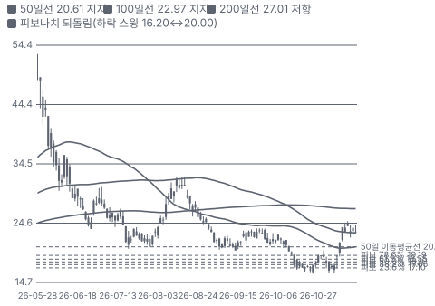

**주봉**

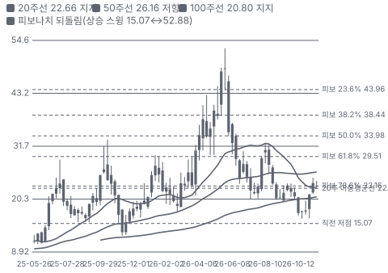

**월봉**

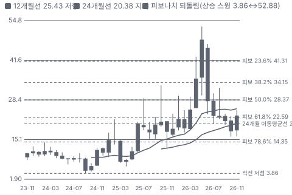

**분기 매출·EPS 실적과 컨센서스**

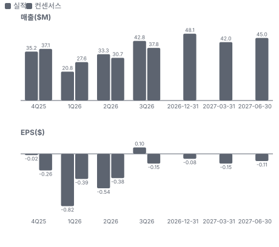

**최근 4개 분기 주가 변화 분석**

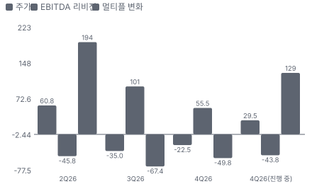

**EPS 리비전**

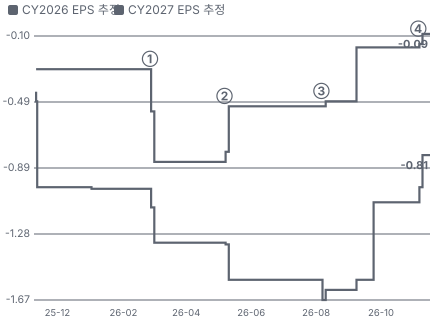

① 26-02-26 4Q25 실적 — 매출 컨센서스 하회, 하루 −1.0% · EPS 리비전 +185%
② 26-05-07 1Q26 실적 — 매출 \$20.8M 컨센서스 −27%, 하루 −20.4% · EPS 리비전 -40%
③ 26-08-06 2Q26 실적 — Gen-3 변곡, 하루 +10.4% · EPS 리비전 -6%
④ 26-11-05 3Q26 실적 — 매출 +118%·EBITDA 30%, 하루 +14.0% · EPS 리비전 -49%

**멀티플 프리미엄(Fwd 1Y EV/EBITDA, 최근 4개 분기말)**

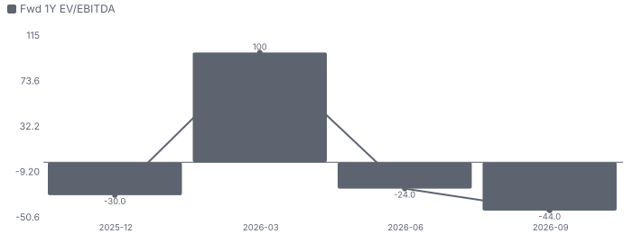

**합리적 멀티플**

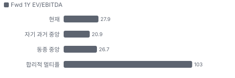

**밸류에이션 주가 시나리오**

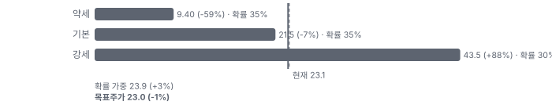

**주가별 업사이드**

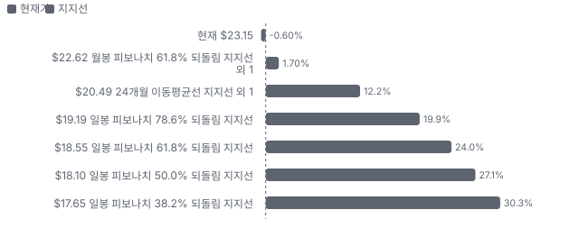
- 제품·서비스 포트폴리오

**고객 믹스(3Q26, 매출 대비)**

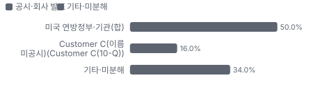

**공급 병목(10점, 낮을수록 병목)**

**생산능력 현재와 확충 계획(Gen-3 위성(기))**

**CAPEX의 매출 대비 비중**

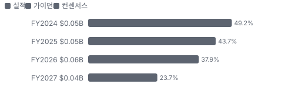

**어닝콜 변화별 주주가치 영향**

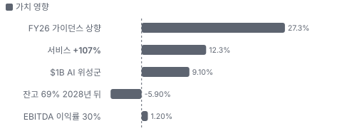

**수주·파이프라인 확실성 사다리**

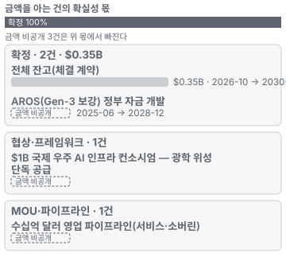

**매출 → 매출총이익 → 영업이익(매출 = 100, 최근 4분기)**

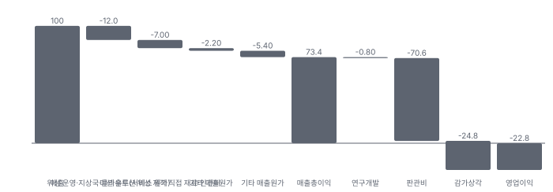

**분기 비용 비중 추이(매출 대비, 공시)**

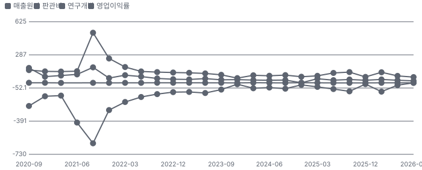

**비용 요인별 매출 대비 비중 1년 변화**

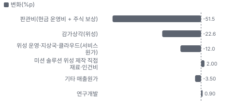

**우주 기반 정보·AI 서비스 BOM 원가 몫**

**BOM 항목 가격 +10% 시 OPM 변화**

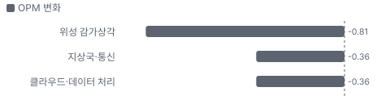

**자산 구성 — 3Q26 분기말 투하자본 \$163.8M**

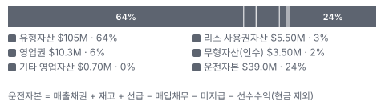

**자산별 변화율 — 최근 12개 분기(4Q23 = 0%) + 다음 4개 분기 추정**

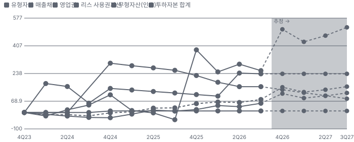

**ROIC 추이 — TTM, 최근 12개 분기 + 다음 4개 분기 추정(컨센서스 NOPAT)**

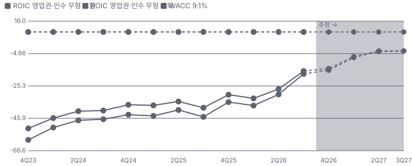

**분기 감가 비율 연율(유형자산 총액 대비)**

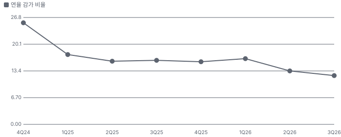

**생산시설별 면적(sq ft, 큰 순) — 생산능력 미공시라 면적을 대용으로**

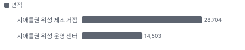

**목표주가 산정 — 기본과 강세 사이(강세 쪽 6%), 도달 확률 약 45%**

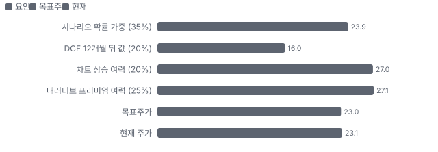

**일봉 지지·저항과 목표주가**

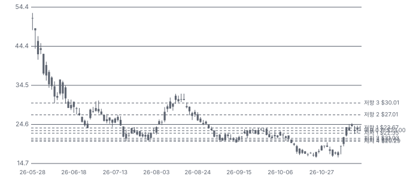

**재고 일수 — 분기별(수주 자료가 없어 수주/출하 비율 없음)**

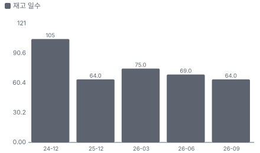

**일별 거래량 분해**

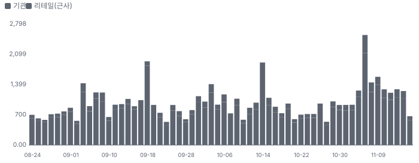

**기관 자금 흐름**

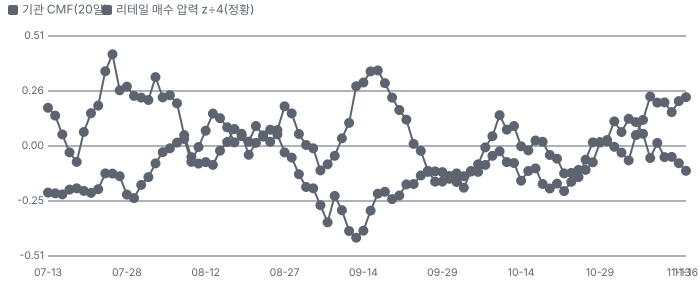

**몬테카를로**

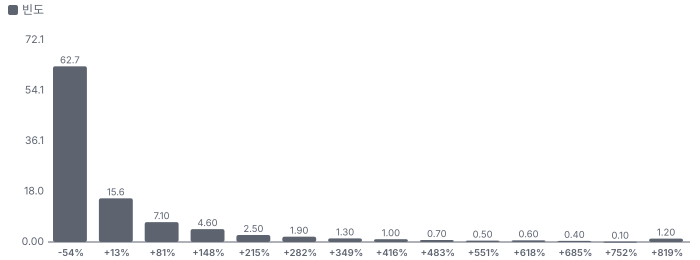

해석: 3,000번 중 940번(31%)에서 가치가 지금 주가 이상이었다. 가정을 흔들어도 지금 주가를 뒷받침하지 못하는 경우가 더 많다. 가운데 값은 0.55배이고, 열 번 중 여덟 번은 0.19~2.82배 사이에 든다.

## 내러티브

> **기업가치를 결정하는 이야기:** BlackSky는 저궤도 소형 위성으로 같은 장소를 하루 여러 번 찍고, 그 영상을 Spectra(위성 영상과 외부 센서 자료를 AI로 자동 분석하는 BlackSky 소프트웨어 플랫폼) AI로 바로 분석해 정부·국방·상업 고객에게 구독으로 판다. 위성을 띄우는 데 돈이 들지만, 한번 띄운 뒤 추가 구독은 원가가 거의 붙지 않는다. 그래서 가치는 위성 수 × 가동률 × 구독 단가와, 위성을 사 가는 외국 정부(소버린)의 수로 정해진다.

> **멀티플·EPS 프리미엄**
> **멀티플:** Fwd 1Y EV/EBITDA 27.9배(기본 주식 기준 EV \$981M ÷ 다음 4개 분기 EBITDA \$35.1M, 계산)로 동종 4곳(Kratos·AeroVironment·Mercury·Iridium, Planet Labs 이상치 제외) 중앙값 26.7배보다 약간 높고 자기 과거 중앙값 20.9배보다 높다.
> **EPS:** EPS는 FY27까지 적자 추정이라 프리미엄을 잴 수 없다. 다음 4개 분기 EBITDA 컨센서스는 \$35.1M(TTM \$21.2M의 1.7배)이다.

### 투자자들은 왜 열광했나

상반기 투자자들은 Gen-3 첫 위성들의 영상 품질과 '우주 정찰 = 방위비 증액 수혜' 이야기로 주가를 5월 \$51.63까지 올렸다. 5/7 1Q 매출이 컨센서스보다 27% 낮자 하루 −20.4%가 났고, 이후 11/2 \$16.64까지 68% 빠졌다. 3Q 기록 실적 뒤 사흘 +43%로 일부 회복했다.

### 무엇이 기업가치를 바꾸나

> **구조적 체질 변화**
> **변화:** 개발·시범 매출 회사에서 구독 매출이 원가 없이 쌓이는 회사로
> **증거:** 3Q 서비스 매출 +\$17M에 해당 원가 거의 그대로(CFO). 조정 EBITDA 이익률 30%
> **반증:** 조정 EBITDA 이익률이 2개 분기 연속 20% 미만

> **고부가 믹스 확장**
> **변화:** 단발 영상 판매에서 Assured(고객에게 위성 촬영 용량을 미리 떼어 보장해 주는 구독 상품) 용량 보장 구독과 소버린 위성 + 구독 묶음으로
> **증거:** 3Q 콜: 미국 정부 7자리 2개월 시범, 국제 방위 고객 6개월 안 7자리 확대
> **반증:** 시범이 본계약으로 넘어가지 않는다

> **기술 혁신**
> **변화:** Gen-3 35cm 해상도, 발사 24시간 안 매출 발생
> **증거:** 3Q 콜: 5번째 Gen-3 발사 20시간 안 첫 영상
> **반증:** 경쟁사가 같은 해상도·재방문을 더 싸게

> **실행 속도**
> **변화:** 소버린 위성을 계약 뒤 1년 안에 출하 준비 — 업계 대형 정찰 위성보다 짧다고 회사가 말한다 **납품 리드타임 12개월.** 피어 비교 미확인. 이전 대비 미확인.
> **증거:** 3Q 콜(계약 뒤 1년 안 출하 준비)
> **반증:** 4Q 인도가 2027년으로 밀린다

> **M&A**
> **변화:** 해당 없음(최근 3년 인수 없음 — 지분법 투자만)
> **증거:** 10-Q
> **반증:** -

> **정책·입법 연관성**
> **재정정책:** 미국 정보·국방 세출의 상업 위성 영상 구매 — 2027 회계연도 세출 확정 전 3Q 콜 Canaccord 질문(새 의회 조달 의지) 반증: 상업 영상 항목 삭감 의회 동의 2/10 — 하원 1/5(2027 회계연도 정보 세출의 상업 영상 항목 표결 기록 미확인) · 상원 1/5(같음).
> **행정명령:** 해당 없음(회사 매출에 직접 걸린 행정명령 확인 안 됨) - 반증: - 의회 동의 2/10 — 하원 1/5(해당 없음) · 상원 1/5(해당 없음).
> **연관입법:** 해당 없음(회사 매출에 직접 걸린 법안 확인 안 됨) - 반증: -

> **고객의 지출 예산**
> **변화:** 정부 고객의 돈은 대부분 OPEX(정보·국방 운영 예산의 영상 구매)이고, 소버린 위성은 외국 정부 CAPEX(국방 조달)다
> **사업별 예산:** **매출의 76%**: 우주 기반 정보·AI 서비스 — 고객 OPEX(정보기관·국방 운영 예산의 상업 영상·분석 구매) · 동인: EOCL(미국 국가정찰국의 상업 광학 영상 구매 계약 틀, Electro-Optical Commercial Layer)·Luno(NGA의 상업 위성 영상 분석 구매 계약 프로그램)·국제 구독
**매출의 13%**: 첨단 기술 프로그램 — 고객 혼합(정부 연구개발 예산) · 동인: AROS 등
**매출의 11%**: 미션 솔루션 — 고객 CAPEX(외국 정부 국방 조달(위성 체계)) · 동인: 소버린 위성 수요
> **증거:** 10-Q 매출 구분·3Q 콜
> **반증:** 미국 정보 세출 상업 영상 삭감

### 내러티브 근거

> 'Gen-3 위성이 정부·동맹의 실시간 정찰 수요를 이익으로 바꾸기 시작했다'는 이야기. 동종 대비 멀티플 차이 +5% 중 회사 고유 몫은 -73%다. 단계는 확산, 쏠림은 중간(공매도 유통 주식의 16.8%, Quantral 7일 언급 없음)이다.

> **Gen-3 변곡 — 서비스 매출 급증** · 강화
> **논리:** 35cm Gen-3가 정부·동맹의 Assured 구독을 끌어 서비스 매출이 원가 없이 늘어난다
> **숫자:** 서비스 매출 3Q \$32.7M(+107%), 조정 EBITDA 이익률 29.9%
> **반증:** 4Q 서비스 매출이 전분기보다 줄고 FY27 가이던스가 +25% 미만
> **출처:** https://www.sec.gov/Archives/edgar/data/1753539/000175353926000154/exhibit991-blackskyq32026e.htm

> **소버린 위성 수출** · 강화
> **논리:** 외국 정부가 Gen-3를 자기 위성으로 사 간다 — 위성 판매 + 구독 묶음
> **숫자:** 진행 중 위성 20기 이상, 미션 솔루션 3Q \$4.7M(5배)
> **반증:** 4Q 소버린 인도가 2027년으로 밀린다
> **출처:** 3Q26 어닝콜

> **우주 AI 인프라 \$1B 컨소시엄** · 강화
> **논리:** 궤도 위 AI 연산 위성군의 광학 단독 공급사로 새 매출 축이 열린다
> **숫자:** 총사업 \$1B(컨소시엄 전체) — BlackSky 몫 미공시
> **반증:** 본계약 금액이 2027년 상반기까지 나오지 않는다
> **출처:** 3Q26 어닝콜

> **미국 상업 정찰 예산** · 약화
> **논리:** 새 의회가 상업 위성 영상 구매(EOCL)를 늘린다
> **숫자:** 미국 연방 매출 비중 50%
> **반증:** 2027 회계연도 정보 세출에서 상업 영상 항목 삭감
> **출처:** https://www.sec.gov/Archives/edgar/data/1753539/000175353926000161/bksy-20260930.htm

> **반대 내러티브 — 희석과 경쟁** · 유지
> **논리:** ATM·전환사채로 주식이 계속 늘고, Planet Pelican·Vantor가 같은 해상도로 가격을 누른다
> **숫자:** 9M ATM 4.2M주(\$165M), 전환사채 \$185M(전환가 \$36.78)
> **반증:** 2027년 신규 주식 발행 없이 FCF 흑자 전환
> **출처:** https://www.sec.gov/Archives/edgar/data/1753539/000175353926000161/bksy-20260930.htm

### 투자 포인트

> **변곡은 숫자로 확인됐다**
> **명제:** 3Q 서비스 매출 증분이 원가 없이 이익이 됐다
> **숫자:** 서비스 매출 \$15.8M → \$32.7M, 매출원가 \$6.8M → \$9.1M, 조정 EBITDA −\$4.5M → \$12.8M(10-Q·보도자료)
> **시장과 다른 점:** 시장은 1Q 쇼크(−20.4%) 기억으로 분기 변동을 할인하지만, Gen-3 위성 수가 2기 → 5기로 늘어 분기 비교 기준이 바뀌었다
> **증명:** 4Q26 서비스 매출 \$33M 이상
> **출처:** https://www.sec.gov/Archives/edgar/data/1753539/000175353926000154/exhibit991-blackskyq32026e.htm

> **정부 예산이 해자보다 먼저 가격을 정한다**
> **명제:** 3Q 매출의 50%가 미국 연방정부
> **숫자:** 미국 연방 매출 3Q \$21.3M(50%)·9M \$41.9M(43%), 10-Q
> **시장과 다른 점:** 시장은 '방위비 증액 = 수혜'로 묶지만 BlackSky 매출은 국방 조달이 아니라 정보기관 운영 예산의 상업 영상 구매다 — 세출 항목이 다르다
> **증명:** 2027 회계연도 정보 세출의 상업 영상 항목 유지·증액
> **출처:** https://www.sec.gov/Archives/edgar/data/1753539/000175353926000161/bksy-20260930.htm

> **약한 고리 — 2027 잔고**
> **명제:** 2027 인식 잔고는 \$64.3M, FY27 컨센서스의 34%
> **숫자:** 10-Q 잔고 인식 일정
> **시장과 다른 점:** 구독 갱신분이 잔고에 다 잡히지 않는다는 반론이 있다 — 확인 자료는 2027 가이던스
> **증명:** 2027 매출 가이던스 \$190M 이상
> **출처:** https://www.sec.gov/Archives/edgar/data/1753539/000175353926000161/bksy-20260930.htm

### 모멘텀 생성·소멸 타임라인

**카탈리스트 달력 — 지난 사건의 주가 반응과 앞으로 확인할 숫자**
| 날짜 | 상태 | 구분 | 사건 | 반응·확인 | 결과에 따라 |
|---|---|---|---|---|---|
| 2026-05-07 | 완료 | 소멸 | 1Q26 실적 — 매출 \$20.8M, 컨센서스 −27% | −20.4%(1일) |  |
| 2026-08-06 | 완료 | 생성 | 2Q26 실적 — Gen-3 변곡, 서비스 매출 전분기 +50% | +10.4%(1일) |  |
| 2026-10-20 | 완료 | 소멸 | CEO·CFO·법무책임자 장내 매도(Form 4) | 원인 연결 미확인 |  |
| 2026-11-05 | 완료 | 확인 | 3Q26 실적 — 매출 +118%·EBITDA 이익률 30%·가이던스 상향·\$1B 컨소시엄 선정 | +14.0%(1일), 11/9까지 +43% |  |
| 4Q26(회사 예상) | 예정 | 확인 | Gen-3 6·7번째 발사와 첫 소버린 위성 인도 | 발사 성공·인도 공시 | 늦으면 약세 확률 상승 |
| 2027-02 하순(추정) | 예정 | 확인 | 4Q26 실적과 첫 2027 가이던스 | 2027 매출 가이던스 \$190M 이상, 서비스 매출 \$33M 이상 | 충족이면 기본~강세, \$170M 미만이면 약세 |
| '수개월 안에'(회사) | 예정 | 생성 | \$1B 우주 AI 컨소시엄 본계약 범위·금액 | BlackSky 몫 금액·인도 일정 | 금액이 나오면 잔고·강세 경로에 넣는다 |

### 언제 사서 언제 팔아야 할까?

**가격·조건 틀 — 가격은 밸류에이션(약세·기본·강세·목표주가)과 차트 지지 구간에서, 조건은 이벤트에서**
| 구간 | 가격 | 목표주가까지 | 약세까지 | 조건·근거 |
|---|---|---|---|---|
| 관찰 구간 | \$23~\$23 | +2% | -58% | 주가가 11/2 저점(\$16.64 종가) 대비 +39% 반등했고 5월 고점보다 55% 낮다 |
| 확인 뒤 | 지금 \$23 이상에서 조건 확인 | -1% | -59% | 4Q 서비스 매출 \$33M 이상이고 2027 매출 가이던스 \$190M 이상 |
| 무효화 | 약세 시나리오 \$9 | - | -59% | 소버린 인도 지연·조정 EBITDA 이익률 20% 미만 복귀·2027 상업 영상 세출 삭감 |
| 차익 고민 2차 | \$43(강세 시나리오) | +88% | - | 목표주가 근처에서는 컨소시엄 본계약 확인 전 배수 회복이 먼저 왔는지 본다 |

베타 2.8·공매도 16.8%라 실적 전후 변동이 크다 — 이벤트 직전 추격을 경계한다 가격·조건 틀이며 매매·비중 지시가 아니다(투자 권유 아님).

## 포트폴리오

| 제품·서비스 | 구분 | 무엇 | 쓰는 곳 | 돈 버는 방식 | Mix | Mix 변화(전년 대비) |
|---|---|---|---|---|---|---|
| 우주 기반 정보·AI 서비스 | 서비스 | Gen-2(BlackSky 2세대 소형 광학 영상 위성, 해상도 약 1m)·Gen-3 위성 영상 구독(Assured 용량 보장 포함)과 Spectra AI 분석 | 정찰·감시, 공급망·시설 활동 모니터링 | 3Q 매출 \$32.7M(+107%), 매출의 76% | 76% | 미확인 |
| 미션 솔루션 | 제품 | 외국 정부에 파는 Gen-3 소버린 위성과 지상 체계 | 외국 정부의 자체 정찰 위성 보유 | 3Q 매출 \$4.7M(5배), 매출의 11% | 11% | 미확인 |
| 첨단 기술 프로그램 | 서비스 | 정부 자금 개발(AROS·위성 간 광통신·차세대 탑재체) | 차세대 위성 기술 | 3Q 매출 \$5.4M(+80%), 매출의 13% | 13% | 미확인 |

## 고객

> **3Q26 최대 고객 미국 연방정부·기관(합) 50%, 상위 3곳 77%, 집중도 집중.** 공시·회사 발표로 확인한 몫은 매출의 77%이고, 나머지 고객 몫은 추정이거나 미분해다. 3Q 매출의 50%가 미국 연방정부·기관이다(9M 43%). 10%를 넘는 고객은 Customer B 11%(1년 전 23%)·Customer C 16%이고 이름은 공시하지 않는다. 매출채권의 54%가 Customer C에 몰려 있고 미국 연방 몫은 매출채권의 10% 미만이라 Customer C는 연방 밖 고객이다(추론). Customer B는 연방 기관일 수 있어 중복을 피하려 표에서 뺐다.

**고객별 매출 몫(3Q26)**
| 고객 | 몫 | 변화 | 근거 |
|---|---|---|---|
| 미국 연방정부·기관(합) | 50% | -1%p | 공시 |
| Customer C(이름 미공시)(Customer C(10-Q)) | 16% | 미확인 | 공시 |
| 국제 방위 고객군 | 미확인 | 미확인 | 회사 발표 |
| 기타·미분해 | 34% | - | - |

> **미국 연방정부·기관(합)** · 공시
> **사는 것:** 영상 구독·분석(EOCL·Luno 등)·개발 계약
> **추정 근거:** 3Q \$21.3M

> **Customer C(이름 미공시)(Customer C(10-Q))** · 공시
> **사는 것:** 미확인
> **추정 근거:** 매출채권의 54%

> **국제 방위 고객군** · 회사 발표
> **사는 것:** Gen-3 Assured 구독·소버린 위성
> **추정 근거:** 2Q 시범에서 6개월 안에 7자리 계약으로 확대한 사례

## 수주·파이프라인

> **2026-09-30 기준 4건.** 확정 \$0.35B. 공시 잔고(체결 계약 거래가격 − 인식 매출) \$0.35B. 서로 겹치는 항목은 합계에서 뺐다.

**수주 목록**
| 상태 | 계약 | 계약 총액 | 진척 | 기간 | 비고 |
|---|---|---|---|---|---|
| 확정 | 전체 잔고(체결 계약) | \$0.35B | 비공개 | 2026-10 → 2030-12 | - |
| 확정 | AROS(Gen-3 보강) 정부 자금 개발 | 금액 비공개 | 비공개 | 2025-06 → 2028-12 | (다른 항목과 겹칠 수 있어 합계에서 뺌) |
| 협상 | \$1B 국제 우주 AI 인프라 컨소시엄 — 광학 위성 단독 공급 | 금액 비공개 | 비공개 | - | (다른 항목과 겹칠 수 있어 합계에서 뺌) |
| 파이프라인 | 수십억 달러 영업 파이프라인(서비스·소버린) | 금액 비공개 | 비공개 | - | (다른 항목과 겹칠 수 있어 합계에서 뺌) |

**실행 속도와 방해 요인**
| 항목 | 상태 | 실행 속도 | 방해 요인 |
|---|---|---|---|
| 전체 잔고(체결 계약) | 확정 | 4Q26 \$45.0M·2027 \$64.3M·이후 \$245.7M | 소버린 위성 인도·발사 · 정부 세출 |
| AROS(Gen-3 보강) 정부 자금 개발 | 확정 | 2028년 발사 목표 | 정부 예산 |
| \$1B 국제 우주 AI 인프라 컨소시엄 — 광학 위성 단독 공급 | 협상 | 범위·일정 '수개월 안에' 공개(회사) | 컨소시엄 자금 조달 · 본계약 체결 |
| 수십억 달러 영업 파이프라인(서비스·소버린) | 파이프라인 | 영업 주기 제각각 | 수주 전환 |

## 마진 구조

> **GPM 78.8%, OPM 0.9%.** 3Q25 대비 GPM +13.6%p, OPM +86.7%p. 변동비는 매출의 18%이고, 매출이 10% 늘면 OPM은 +7.3%p 움직인다. 3Q 매출원가는 매출의 21.2%로 1년 전 34.7%보다 13.5%p 낮다. 서비스 매출이 원가 증가 없이 늘었기 때문이다. 영업비용(판관비 \$25.4M)이 매출의 59%라 영업이익은 이제 겨우 흑자(\$0.4M)다. 위성 감가상각(\$7.5M)이 판관비 밖 원가·비용에 섞여 있다.

> **매출 100 중 매출원가 26.6, 매출총이익 73.4(최근 4분기, 공시).** 매출원가 요인 중 위성 운영·지상국·클라우드(서비스 원가)이 매출의 12.0%로 가장 무겁고, 단가가 +10% 오르면 GPM이 -1.20%p 움직인다. 분기 회귀로 매출 1이 늘 때 매출원가는 0.05 늘고, 매출원가의 고정비 몫은 87%다.

**비용 요인 강도 — 비중·추세·충격(+10%)·탄력**
| 비용 | 구분 | 매출 대비 | 1년 변화 | 마진 기여 | 충격 시 마진 | 매출 탄력 | 고정비 몫 |
|---|---|---|---|---|---|---|---|
| 위성 운영·지상국·클라우드(서비스 원가) | 매출원가 요인 | 12.0% | -12.0%p | +12.0%p | -1.20%p | 미확인 | 80% |
| 미션 솔루션 위성 제작 직접 재료·인건비 | 매출원가 요인 | 7.0% | +2.0%p | -2.0%p | -0.70%p | 미확인 | 20% |
| 기타 매출원가 | 매출원가 요인 | 2.2% | -3.5%p | +3.5%p | -0.22%p | 미확인 | 50% |
| 판관비 | 공시 항목 | 70.6% | -12.9%p | +12.9%p | 미확인 | 0.20 | 79% |
| 매출원가 | 공시 항목 | 26.6% | +1.0%p | -1.0%p | -2.66%p | 0.05 | 87% |
| 감가상각 | 공시 항목 | 24.8% | -6.9%p | +6.9%p | 미확인 | 0.17 | 55% |
| 연구개발 | 공시 항목 | 0.8% | -0.0%p | +0.0%p | 미확인 | 0.01 | -2% |

매출 탄력 = 분기 비용을 매출에 회귀한 기울기(매출 1당 변동비), 고정비 몫 = 절편 ÷ 평균 비용. 표본이 8분기 미만이면 미확인. 매출원가 요인 비중은 margin 재료의 추정이 섞여 있고, 공시 매출원가와의 차이는 '기타 매출원가'로 둔다.

**GPM에서 OPM까지(GAAP, 아래는 최근 4개 분기)**
| 기간 | GPM | 연구개발 | 판관비 | 기타 | OPM |
|---|---|---|---|---|---|
| 3Q25 | 65.3% | 0.2% | 110.8% | 40.1% | -85.8% |
| 3Q26 | 78.8% | 1.1% | 59.3% | 17.5% | 0.9% |
| 2025-12 | 72.6% | - | - | - | -11.8% |
| 2026-03 | 64.7% | - | - | - | -89.2% |
| 2026-06 | 72.8% | - | - | - | -23.4% |
| 2026-09 | 78.8% | - | - | - | 0.9% |

**비용을 움직이는 요인**
| 비용 | 요인 |
|---|---|
| 판관비(현금 운영비 + 주식 보상, 판관비) | 인력 · 근거 공시 |
| 감가상각(위성, 기타) | 위성 수·내용연수 · 근거 공시 |
| 위성 운영·지상국·클라우드(서비스 원가, 매출원가) | 위성 수·지상국 이용량 · 근거 추정 |
| 미션 솔루션 위성 제작 직접 재료·인건비(매출원가) | 소버린 위성 제작 진척 · 근거 추정 |
| 기타 매출원가(매출원가) | - · 근거 추정 |
| 연구개발(연구개발) | 개발 인력 · 근거 공시 |

**우주 기반 정보·AI 서비스 BOM — 매출의 76%, GPM 79%(제품별 매출총이익 미공시 — 회사 전체 3Q 매출총이익률 78.8%(손익, 계산)로 대신), 항목 가격 +10% 시**
| 항목 | 원가 몫 | 전가 | 제품 GPM | OPM |
|---|---|---|---|---|
| 위성 감가상각 | 40~60% | 미확인 | -1.1%p | -0.81%p |
| 지상국·통신 | 15~30% | 미확인 | -0.5%p | -0.36%p |
| 클라우드·데이터 처리 | 15~30% | 미확인 | -0.5%p | -0.36%p |
| 미분해 | 5% | - | - | - |

위성 감가상각 가격이 +10% 오르면 영업이익은 -85.7% 움직인다. 판매가 전가를 모르는 항목은 전가 0%로 계산했다.

**BOM 항목 가격을 움직이는 것**
| 항목 | 요인 |
|---|---|
| 위성 감가상각 | 위성군 고정비 — 매출이 늘면 몫이 준다 · 근거 추정 |
| 지상국·통신 | 영상 내려받기 용량 · 근거 추정 |
| 클라우드·데이터 처리 | Spectra AI 처리량에 비례 · 근거 추정 |

**투입 물가 — 미국 PPI 3·6·12개월(2026-11-16, 개정 반영)**
| 항목 | 미국 3개월 | 6개월 | 12개월 | 전가 못 할 때 OPM |
|---|---|---|---|---|
| 위성 운영·지상국·클라우드(서비스 원가) | 미확인 | 미확인 | 미확인* | - |

별표는 품목보다 넓은 업종 지수다. 판매가 비교 물가(광학 렌즈·프리즘(장착 전) PPI(생산자물가지수))는 1년 새 미확인 — 회사 가격 변화는 미확인. 물가 지수를 붙이지 못한 매출원가 항목은 위성 운영·지상국·클라우드(서비스 원가), 미션 솔루션 위성 제작 직접 재료·인건비다(미연결).

## 자산 구성

> **3Q26 분기말 투하자본 \$163.8M** — 유형자산 64%, 운전자본 24%. 최근 12개 분기(4Q23 → 3Q26) 가장 크게 늘어난 자산은 매출채권(+256%), 투하자본 합계 +79%. 3Q27 추정 투하자본 \$236.0M(+44%, 컨센서스 매출과 회전 일수·CAPEX 강도 유지 가정). 연율 감가 비율(총액 기준)은 직전 4분기 18.45% → 최근 4분기 14.36%, 직전 비율이면 감가상각이 \$9.3M 더 컸다(영업이익의 -31.0%).

**자산·운전자본 항목별 분기말 잔액 — 최근 12개 분기와 다음 4개 분기 추정**
| 항목 | 4Q23 | 3Q25 | 3Q26(최근) | 3Q27 추정 | 12개 분기 변화 | 다음 4개 분기 변화 |
|---|---|---|---|---|---|---|
| 매출채권 | \$7.1M | \$4.0M | \$25.1M | \$43.9M | +256% | +74% |
| 재고자산 | \$0.0M | \$0.0M | \$6.2M | \$9.8M | 비교 불가 | +59% |
| 선급·기타 유동자산 | \$3.9M | \$13.4M | \$7.7M | \$16.0M | +97% | +108% |
| 유형자산 | \$67.1M | \$72.9M | \$104.8M | \$147.3M | +56% | +41% |
| 리스 사용권자산 | \$1.6M | \$3.6M | \$5.5M | \$5.5M | +237% | +0% |
| 영업권 | \$9.4M | \$10.3M | \$10.3M | \$10.3M | +9% | +0% |
| 무형자산(인수) | \$1.4M | \$4.9M | \$3.5M | \$2.5M | +158% | -29% |

**자산 추정 동인 — 최근 4개 분기 평균(재무상태표 동인 모형)**
| 동인 | 값 | 곱하는 기준 |
|---|---|---|
| 매출채권 | 82일 | 매출 |
| 재고자산 | 18일 | 매출 |
| 선급·기타 유동자산 | 30일 | 매출 |
| 유형자산 ÷ 분기 매출 | 3.01배 | CAPEX·감가 재료 없음 — 비율 유지 |
| 영업권·리스 사용권·기타 | 유지 | 인수·새 리스는 공시 전 모름 |
| 인수 무형자산 | 분기 \$0.2M 상각 | 최근 4개 분기 평균 상각 |

**추정 방법:** 증권사 3표 모델(손익·재무상태표·현금흐름)의 재무상태표 동인 방식이다. 운전자본은 항목별 회전 일수(매출채권·선급·미지급·선수는 매출, 재고·매입채무는 매출원가 기준)를 최근 4개 분기 평균으로 두고 컨센서스 매출에 곱한다. 유형자산은 기초 + CAPEX − 감가상각으로 굴린다(Koller·Goedhart·Wessels 『Valuation』 재무상태표 추정). 매출 경로는 ROIC 절의 컨센서스와 같다.

**유형·무형자산 항목별 가치(2025-12-31 vs 2024-12-31)**
| 구분 | 항목 | 총액 2025-12-31 | 누적상각 | 순액 | 총액 2024-12-31 | 총액 1년 변화 | 공시 내용연수 |
|---|---|---|---|---|---|---|---|
| 유형 | 유형자산 합계(항목 미분해) | \$211.5M | 총계만 공시 | 총계만 공시 | \$160.3M | +31.9% | 미확인 |
| 영업권 | 영업권 | \$10.3M | \$0.0M | \$10.3M | \$10.3M | +0.2% | 비상각 |
| 무형 | 무형자산 합계(항목 미분해) | \$10.3M | \$5.9M | \$4.4M | \$10.3M | +0.0% | 미확인 |
| 유형 합계 | 유형자산 | \$211.5M | \$132.5M | \$79.0M | \$160.3M | +31.9% | 경과율 63%(상각 대상 기준) |

**내용연수 산식(상각 대상 유형자산 = 총액 − 토지 − 건설중)**
| 기준일 | 연 감가상각 | 상각 대상 총액 | 평균 내용연수 | 경과 연수 | 잔여 연수 | 경과율 |
|---|---|---|---|---|---|---|
| 2025-12-31 | \$30.3M | \$211.5M | 7.0년 | 4.4년 | 2.6년 | 63% |
| 2024-12-31 | \$43.5M | \$160.3M | 3.7년 | 2.6년 | 1.0년 | 72% |

산식 평균 내용연수는 7.0년. 1년 전 3.7년 → 지금 7.0년.

**분기 감가 비율(감가상각 ÷ 평균 유형자산 총액)**
| 분기 | 감가상각 | 평균 유형자산(총액) | 분기 비율 | 연율 | 연율의 역수 |
|---|---|---|---|---|---|
| 4Q24 | \$9.9M | \$156.2M | 6.37% | 25.48% | 3.9년 |
| 1Q25 | \$7.2M | \$165.3M | 4.38% | 17.51% | 5.7년 |
| 2Q25 | \$7.2M | \$182.0M | 3.96% | 15.84% | 6.3년 |
| 3Q25 | \$7.9M | \$195.9M | 4.02% | 16.06% | 6.2년 |
| 4Q25 | \$8.0M | \$204.7M | 3.93% | 15.70% | 6.4년 |
| 1Q26 | \$9.2M | \$224.3M | 4.12% | 16.49% | 6.1년 |
| 2Q26 | \$8.0M | \$238.6M | 3.35% | 13.40% | 7.5년 |
| 3Q26 | \$7.5M | \$245.6M | 3.06% | 12.23% | 8.2년 |

감가상각 기준: 손익계산서 감가상각·상각비(SEC 공시 데이터, 4분기 = 연간 − 1~3분기).

**감가율 하락 경고: 연율 18.45% → 14.36%(-22%).** 직전 4분기 비율을 그대로 쓰면 최근 4분기 감가상각이 \$9.3M 더 컸다(영업이익의 -31.0%). 내용연수 연장·상각 끝난 자산 증가·건설중 자산 증가(믹스) 중 무엇인지는 공시 주석으로 가린다(자체추론).

미공시·미분해: 유형자산 항목별 총액·내용연수(10-K 주석에서 모델이 채움) · 무형자산 항목(10-K 주석에서 모델이 채움) — 이 칸은 비우고 나머지로 계산했다.

### 해석 — 자산이 어디에 쌓이고 있나

- 같은 기간 4개 분기 매출은 +23% — 매출보다 빨리 늘어난 자산: 매출채권 +256%, 유형자산 +56%, 리스 사용권자산 +237%, 무형자산(인수) +158%. 이 자산의 회전율이 떨어지면 ROIC를 희석한다.
- 감가 비율 하락으로 최근 4분기 영업이익에 \$9.3M(-31.0%)가 보태졌을 수 있다 — 내용연수 변경 공시가 없으면 건설중 자산·토지 같은 비상각 자산 몫이 커진 믹스 효과일 가능성이 크다(자체추론).

## ROIC

> **TTM 3Q26 ROIC는 영업권·인수 무형 포함 -15.8%, 제외 -17.6%**(NOPAT 마진 -16.8% × 투하자본 회전율 0.94회). 최근 12개 분기 4Q23 -52.4% → 3Q26 -15.8%(고점 3Q26 -15.8%). 컨센서스 NOPAT으로 굴리면 3Q27 -2.9%(제외 -3.1%) — WACC 9.1% 대비 -12.0%p.

**ROIC 추이(TTM)와 다음 4개 분기 추정 — NOPAT ÷ 평균 투하자본(이번 분기말·4개 분기 전)**
| 분기 | 구분 | TTM 매출 | TTM NOPAT | NOPAT 마진 | 평균 투하자본 | ROIC 포함 | ROIC 제외 |
|---|---|---|---|---|---|---|---|
| 4Q23 | 실적 | \$94.5M | −\$43.1M | -45.7% | \$82.3M | -52.4% | -59.7% |
| 1Q24 | 실적 | \$100.3M | −\$40.1M | -40.0% | \$87.6M | -45.8% | -51.8% |
| 2Q24 | 실적 | \$105.9M | −\$33.7M | -31.8% | \$81.4M | -41.4% | -47.2% |
| 3Q24 | 실적 | \$107.2M | −\$32.6M | -30.4% | \$79.6M | -41.0% | -46.5% |
| 4Q24 | 실적 | \$102.1M | −\$33.7M | -33.0% | \$90.5M | -37.3% | -43.6% |
| 1Q25 | 실적 | \$107.4M | −\$32.6M | -30.3% | \$86.5M | -37.7% | -44.4% |
| 2Q25 | 실적 | \$104.7M | −\$34.4M | -32.8% | \$97.7M | -35.2% | -40.6% |
| 3Q25 | 실적 | \$101.7M | −\$37.2M | -36.5% | \$94.9M | -39.2% | -45.0% |
| 4Q25 | 실적 | \$106.6M | −\$35.6M | -33.4% | \$115.2M | -30.9% | -35.6% |
| 1Q26 | 실적 | \$97.8M | −\$40.8M | -41.7% | \$122.7M | -33.2% | -37.8% |
| 2Q26 | 실적 | \$108.9M | −\$35.9M | -32.9% | \$131.5M | -27.3% | -30.7% |
| 3Q26 | 실적 | \$132.1M | −\$22.2M | -16.8% | \$140.6M | -15.8% | -17.6% |
| 4Q26 | 추정 | \$145.0M | −\$26.5M | -18.3% | \$186.8M | -14.2% | -15.3% |
| 1Q27 | 추정 | \$166.2M | −\$11.8M | -7.1% | \$177.8M | -6.6% | -7.2% |
| 2Q27 | 추정 | \$177.9M | −\$5.6M | -3.1% | \$182.9M | -3.0% | -3.3% |
| 3Q27 | 추정 | \$184.1M | −\$5.9M | -3.2% | \$199.9M | -2.9% | -3.1% |

**다음 4개 분기 NOPAT — 컨센서스(세율 21%, 리스 이자 별도)**
| 분기 | 매출 | EBITA 마진 | EBITA | NOPAT(분기) | 근거 |
|---|---|---|---|---|---|
| 4Q26 | \$48.1M | -19.3% | −\$9.3M | −\$7.3M | 컨센서스 매출 × EBIT 마진 FY2026 |
| 1Q27 | \$42.0M | 0.6% | \$0.3M | \$0.2M | 컨센서스 매출 × EBIT 마진 FY2027 |
| 2Q27 | \$45.0M | 0.6% | \$0.3M | \$0.2M | 컨센서스 매출 × EBIT 마진 FY2027 |
| 3Q27 | \$49.0M | 0.5% | \$0.3M | \$0.2M | 컨센서스 매출 × EBIT 마진 FY2027 |

**추정 방법:** NOPAT은 컨센서스(분기 매출 추정 × 회계연도 EBIT 마진 추정)로 잡고, 조정(비 GAAP) 마진이면 주식보상 몫을 빼서 과거 실적과 같은 기준(영업이익 + 인수 무형 상각)으로 맞췄다. 이미 발표했지만 분기 보고서(10-Q)가 아직 없는 분기는 발표 실적을 쓴다. 투하자본은 자산 구성 절의 재무상태표 동인으로 굴렸다. ROIC는 4개 분기 NOPAT을 이번 분기말과 4개 분기 전 투하자본의 평균으로 나눈다 — 추정 분기의 ROIC에는 이미 나온 실적 분기가 섞여 있다.

**투하자본 항목별 회전율과 ROIC 기여(TTM 3Q26, 평균 잔액)**
| 항목 | 투하자본 | 매출 1달러당 자본 | 회전율(매출 ÷ 항목) | 자본 몫 | 이 항목을 빼면 ROIC |
|---|---|---|---|---|---|
| 운전자본 | \$28.2M | 0.21 | 4.68회 | 20% | -19.8% |
| 유형자산 | \$88.8M | 0.67 | 1.49회 | 63% | -43.0% |
| 리스 사용권자산 | \$4.5M | 0.03 | 29.18회 | 3% | -16.3% |
| 영업권 | \$10.3M | 0.08 | 12.86회 | 7% | -17.1% |
| 무형자산(인수) | \$4.2M | 0.03 | 31.62회 | 3% | -16.3% |
| 기타 영업자산 | \$4.5M | 0.03 | 29.27회 | 3% | -16.3% |

**ROIC 세 가지 판**
| 판 | NOPAT | 투하자본 | ROIC | 무엇을 재나 |
|---|---|---|---|---|
| 영업권·인수 무형 포함 | −\$22.2M | \$140.6M | -15.8% | 인수 웃돈까지 낸 돈에 대한 수익률 |
| 영업권·인수 무형 제외 | −\$22.2M | \$126.1M | -17.6% | 본업 운영 수익률(동종 비교용) |
| 무형 자본화 조정(판관비 20%·5년, 연구개발 6년) | −\$18.5M | \$190.9M | -9.7% | 비용으로 처리한 무형 투자를 자산으로 본 판 — 이력이 상각 기간보다 짧아 자산 과소 |
| 경제적 이익(포함판) | −\$35.0M | \$140.6M | 자본비용 9.1% | (ROIC − 자본비용) × 투하자본 |

NOPAT = (영업이익 −\$30.1M + 인수 무형 상각 + 리스 내재 이자 \$1.0M) × (1 − 세율 21%). 리스 사용권자산을 투하자본에 넣었으므로 임차료 속 이자 몫을 영업이익에 되더했다. 현금은 영업에 필요한 몫을 따로 알 수 없어 투하자본에서 뺐다. SEC 공시 데이터 자동 초안 — 운전자본 = 매출채권 + 재고 + 선급 − (매입채무 + 미지급비용 + 선수수익), 현금 제외. 손상 누계는 공시 데이터 수록분.

투하자본 또는 NOPAT이 0 이하라 ROIC 분해는 비교 불가 — 경제적 이익으로 본다.

**무형 자본화 가정별 ROIC(2025년 지출 기준, 포함판에 더함)**
| 투자로 보는 몫 | 상각 연수 | 무형 자산 | NOPAT 조정 | 조정 ROIC |
|---|---|---|---|---|
| 판관비 20% | 2년 | \$27.3M | \$2.7M | -11.6% |
| 판관비 20% | 5년 | \$50.3M | \$3.7M | -9.7% |
| 판관비 30% | 2년 | \$39.8M | \$4.1M | -10.0% |
| 판관비 30% | 5년 | \$74.3M | \$5.6M | -7.7% |

### 해석 — 무엇이 수익성을 끌어올리고 희석하나

- 유형자산: 투하자본의 63% — 빼면 ROIC -15.8% → -43.0%. 이 자산의 회전율(1.49회)이 수익성을 희석하는 주된 자리다.
- 운전자본: 투하자본의 20% — 빼면 ROIC -15.8% → -19.8%. 이 자산의 회전율(4.68회)이 수익성을 희석하는 주된 자리다.
- 영업권·인수 무형을 빼면 ROIC가 -1.8%p 오른다 — 과거 인수에 치른 웃돈이 주주 수익률을 그만큼 낮춘다(본업 수익률은 제외판, 인수까지 포함한 가치 창출은 포함판으로 본다).
- 비용으로 처리한 무형 투자를 자산으로 보면 ROIC가 +6.1%p 움직인다(무형 자산 \$50.3M). 투자를 늘리는 중이라 NOPAT이 더 커지는 쪽이다.
- 추정 경로 3Q26 -15.8% → 3Q27 -2.9%: NOPAT 마진 +13.6%p, 투하자본 회전율 -0.02회 — 컨센서스 매출·마진이 맞고 회전 일수·CAPEX 강도가 유지된다는 가정이다. 마진 추정이 내려가거나 재고 일수가 늘면 이 경로가 먼저 틀린다.
- ROIC(포함) − WACC = -24.9%p(3Q26) — 양수면 투하자본을 늘릴수록 가치가 쌓인다.

## 공급망 병목

> **공급망 신뢰성 5.4/10, 병목 주의.** 가장 약한 고리는 발사 서비스 5.4점이고, 품목 평균은 5.4점이다. 근거가 부족한 2건(광학 탑재체(망원경·센서) · 지상국 접속)은 점수에서 뺐다. BlackSky는 Gen-3를 시애틀권 공장에서 직접 조립하지만 광학·센서·전자 부품과 발사는 외부에서 산다. 가장 큰 외부 병목은 발사다 — 발사 공급사 금융 잔액 \$40.95M이 남아 있고 발사 일정이 위성 수와 매출 시점을 정한다. 발사는 보도로 Rocket Lab·SpaceX가 확인되고, 광학·센서 공급사 이름과 단일 공급원 문구는 읽은 공시 범위에서 확인하지 못했다.

**병목과 마진 — 품목 가격 +10% 시 OPM**
| 품목 | 점수 | 판정 | 구분 | OPM |
|---|---|---|---|---|
| 발사 서비스(필수) | 5.4 | 병목 주의 | 출하 차질 위험 | 미확인 |

> **발사 서비스** · 5.4/10
> **왜:** 위성이 궤도에 올라야 매출이 생긴다
> **병목 요인:** 인증 공급사 2곳 · 캐파 빠듯 · 리드타임 미확인 · 재인증 미확인 · 1위 점유율 50% · 지역 집중 미확인 · 물량 확보 장기계약
> **풀리는 조건:** 미확인

**공급사**
| 품목 | 공급사 | 몫 | 근거 |
|---|---|---|---|
| 발사 서비스 | Rocket Lab(전용 발사(Gen-3 포함)) | 미확인 | 보도 |
| 발사 서비스 | SpaceX(승합 발사(Gen-2)) | 미확인 | 보도 |
| 발사 서비스 | 발사 공급사 금융 상대방(이름 미공시, 발사 대금 금융) | 미확인 | 공시 |
| 광학 탑재체(망원경·센서) | 미공시(광학) | 미확인 | 추정 |
| 지상국 접속 | 미공시(세계 각지 지상국, 지상국) | 미확인 | 공시 |

**무역 통계로 본 공급 지역**
| 품목 | EU 수입처 | 일본 수입처 | EU 1위 전년비 |
|---|---|---|---|
| 광학 탑재체(망원경·센서) | CN(중국) 53% · US 30% · JP(일본) 10% | 中華人民共和国 46% · アメリカ合衆国 14% | +16.4% |

## 생산능력

> **현재 명목 캐파 5 Gen-3 위성(기), 가동률 미확인.** FY2025 CAPEX는 \$0.05B로 매출의 43.7%다. 생산 캐파는 공시하지 않는다. 회사는 'Gen-3 20기 이상 제작 중'이라고 말하고, 상업 위성군은 3Q 말 Gen-3 5기, 4Q 2기 추가, 2027년 초 8번째 발사 예정이다. 위성 건설중 자산은 \$103.3M(10-Q).

**생산시설 3곳**(10-K FY2025 Item 2 — 헌던 본사·시애틀권 제조 거점·시애틀권 위성 운영 센터(지상국은 위치 미공시라 세지 않는다)), 임차 3곳. 시설별 생산능력은 공개되지 않았다 — 회사 전체 캐파만 위에 적었다.

**생산시설 3곳 — 명칭·위치·생산능력**
| 시설 | 위치 | 용도 | 생산능력 | 소유·상태 |
|---|---|---|---|---|
| 헌던 본사 | 미국 버지니아 헌던 | 본사·관리(임차 2036-08 만료) | 미확인 — 사무 시설 — 생산능력 개념 없음 · 면적 17,119 sq ft | 임차 · 가동 |
| 시애틀권 위성 제조 거점 | 미국 워싱턴주 시애틀권(10-K 본문 Tukwila 표기 — 대조 필요) | Gen-3 위성 설계·제조(임차 2027-05 만료) | 미확인 — 연간 생산 기수 미공시 — '20기 이상 제작 중'(3Q 콜) · 면적 28,704 sq ft | 임차 · 가동 |
| 시애틀권 위성 운영 센터 | 미국 워싱턴주 시애틀권 | 위성 관제·운영(임차 2033-11 만료) | 미확인 — 관제 시설 — 생산능력 개념 없음 · 면적 14,503 sq ft | 임차 · 가동 |

공개된 증설 계획은 확인되지 않았다.

**CAPEX와 매출 대비**
| 기간 | CAPEX | 매출 | 매출 대비 | 구분 |
|---|---|---|---|---|
| FY2024 | \$0.05B | \$0.10B | 49.2% | 실적 |
| FY2025 | \$0.05B | \$0.11B | 43.7% | 실적 |
| FY2026 | \$0.06B | \$0.14B | 37.9% | 가이던스 |
| FY2027 | \$0.04B | \$0.19B | 23.7% | 컨센서스 |

## 해자

> 해자는 '자기 위성군으로 같은 곳을 하루에도 여러 번 35cm급으로 찍고, 촬영 즉시 AI 분석까지 내는 수직 계열화'다. 다만 고해상도 광학은 Maxar(현 Vantor)·Airbus·Planet의 Pelican이 같은 시장에 있고, 매출의 절반이 미국 정부라 예산 결정이 해자보다 먼저 가격을 정한다.

> **재방문 빈도 × 고해상도 조합** · 보통
> **해자:** Gen-3 35cm 영상을 하루 여러 번 같은 장소에 찍을 수 있는 소형 위성군
> **근거:** 3Q 콜: 다섯 번째 Gen-3 발사 24시간 안에 매출 발생, 4Q에 2기 추가·2027년 초 8기. 우주 기반 정보 매출 \$32.7M(+107%)
> **숫자:** Gen-3 궤도 5기(3Q), 해상도 35cm — 경쟁사 위성 수·재방문 수치는 공시 기준이 달라 비교하지 않는다
> **깨지는 조건:** Planet Pelican·Vantor가 같은 해상도 재방문을 더 많은 위성으로 내놓고 BlackSky 서비스 매출 성장이 2개 분기 연속 둔화

> **증분 매출의 높은 이익 전환(운영 레버리지)** · 강함
> **해자:** 위성군을 띄운 뒤에는 추가 매출에 원가가 거의 붙지 않는다
> **근거:** 3Q 콜 CFO: 서비스 매출이 1년 새 \$17M 늘었는데 해당 원가는 거의 그대로 — 증분 매출의 90% 이상이 이익. 조정 EBITDA 이익률 2Q 약 14% → 3Q 29.9%(보도자료)
> **숫자:** 매출총이익률 3Q 78.8%(손익, 계산)
> **깨지는 조건:** 위성 교체·발사 비용이 늘어 조정 EBITDA 이익률이 20% 아래로 돌아간다

> **정부 정보기관 인증·조달 관계** · 보통
> **해자:** NRO(미국 국가정찰국) EOCL 주요 공급사·NGA(미국 국가지리정보국) Luno 공급사로 미국 정보기관 조달 경로 안에 있다
> **근거:** 10-K Item 1: NRO EOCL 핵심 공급사, NGA Luno A·B. 3Q 미국 연방정부 매출 비중 50%(10-Q)
> **숫자:** 미국 연방 매출 3Q \$21.3M·9M \$41.9M
> **깨지는 조건:** EOCL 갱신에서 몫이 줄거나 상업 영상 세출이 깎인다

> **소버린 위성 + 구독 묶음 판매** · 약함
> **해자:** 외국 정부에 Gen-3 위성을 팔면서 BlackSky 위성군 구독을 함께 묶어 장기 관계를 만든다
> **근거:** 2Q 콜: 소버린 솔루션과 구독 묶음 전략. 3Q: 진행 중 위성 20기 이상, 첫 소버린 위성 출하 준비
> **숫자:** 미션 솔루션 3Q 매출 \$4.7M — 아직 작다
> **깨지는 조건:** 2027년 소버린 인도분이 일정보다 늦거나 후속 수주가 없다

## 경영진·네트워크

> CEO Brian O'Toole와 CFO Henry Dubois가 콜을 이끈다. 공개 자료로 확인한 정계·동문 연결은 없다. 최근 3개월 장내 거래는 매도만 있었다(내부자 거래 34건 매도·0건 매수, 10/20 CEO 2만 주 \$0.34M).

> **Brian O'Toole** · CEO·사장 · 미확인
> **프로필:** 미확인(위임장 미대조)
> **비즈니스:** 미확인
> **정계:** 미확인
> **동문:** 미확인
> **사모임:** 미확인

> **Henry Dubois** · CFO · 미확인
> **프로필:** 미확인(위임장 미대조)
> **비즈니스:** 미확인
> **정계:** 미확인
> **동문:** 미확인
> **사모임:** 미확인

> **Susan M. Gordon** · 이사 · 미확인
> **프로필:** 미확인
> **비즈니스:** 미확인
> **정계:** 전 ODNI 수석부국장(공개 이력 — 위임장 대조 전)
> **동문:** 미확인
> **사모임:** 미확인

**네트워크 정량화**
| 연결 | 강도 | 닿는 매출 | 가중 노출 | 매출 대비 | 근거 |
|---|---|---|---|---|---|
| 정계: 이사 Susan M. Gordon — 전 ODNI 수석부국장, 정보기관 고객(NRO·NGA)과 같은 정보 공동체 출신 | 3/5 | \$0.06B | \$0.03B | 25% | 미국 연방 매출 9M \$41.9M × 4/3 연환산(계산) — 연결이 닿는 매출 크기이지 연결이 만든 매출이 아니다 Form 4(2026-09-30 이사 보상 주식)·공개 이력 보도 |

가중 노출은 연결이 닿는 매출의 크기다. 연결이 그 매출을 만들었다는 뜻이 아니며, 인과는 공개 자료로 입증하지 못한다.

## 약세 논리 및 셀온 조건

| 약세 논리 | 근거 | 가를 자료 |
|---|---|---|
| 2027 잔고 공백 | 잔고 \$355M 중 2027년 인식분 \$64.3M(10-Q) — FY27 매출 컨센서스 \$190M의 34% | 2027 매출 가이던스(4Q 실적, 2027-02 추정) |
| 미국 정부 집중 | 3Q 매출의 50%가 미국 연방정부(10-Q). Canaccord가 새 의회의 상업 정찰 영상 조달 의지를 물었다 | 2027 회계연도 정보 세출의 상업 영상 항목, EOCL 갱신 |
| 희석·현금 소진 | 9M ATM 4.2M주(\$165M), 전환사채 \$185M(8.25%, 전환가 약 \$36.78), FY26 FCF 추정 −\$54M | 2027년 신규 발행 여부, 4Q 영업현금흐름 |
| 3Q 이익의 질 | 순이익 \$18.5M은 파생 평가이익 \$19.7M 덕분, 영업이익은 \$0.4M. 1Q에는 조정 EBITDA −\$5.1M | 4Q 조정 EBITDA 이익률 25% 이상 유지 |
| 경쟁 | Planet Labs Pelican·Vantor(옛 Maxar)·Airbus가 같은 고해상도 시장에 있다 | 서비스 매출 성장률과 경쟁사 고해상도 매출 비교(분기) |

**변이 관점.** 시장은 BlackSky를 '1Q처럼 분기마다 흔들리는 정부 계약주'로 할인한다. 그러나 1Q와 3Q는 같은 회사가 아니다 — Gen-3 위성이 2기에서 5기로 늘었고, 서비스 매출은 원가가 거의 그대로인 채 \$15.8M에서 \$32.7M이 됐다. 변동의 원인이 계약 시점이 아니라 위성 수라면, 4Q 7기 체제에서 분기 변동은 줄어야 한다. 이 반론은 4Q 서비스 매출 하나로 확인된다. 다만 회사 답변에서 2027 잔고 공백에 대한 숫자는 없었다(12개월 잔고 질문에 회사 답변 미확인).

> **셀온 조건**
> **조건 1:** 4Q26 서비스 매출이 3Q \$32.7M보다 줄거나 2027 매출 가이던스가 \$170M 미만이다
> **조건 2:** 소버린 Gen-3 위성 인도가 2027년 하반기로 밀린다
> **조건 3:** 조정 EBITDA 이익률이 2개 분기 연속 20% 아래로 돌아간다
> **조건 4:** 2027 회계연도 정보 세출에서 상업 위성 영상 구매가 삭감된다
> **조건 5:** 2027년에 ATM·유상증자를 다시 크게 한다

## 어닝콜 변화

**직전 콜 대비 새로 나오거나 바뀐 내용 → 가치 영향**
| 항목 | 내용 | 직전 콜 | 최신 콜 | 모델 동인 이동 | 확신도 | 가치 영향 |
|---|---|---|---|---|---|---|
| 업데이트 | FY26 매출·EBITDA 가이던스 | 2Q 콜 범위(보도자료 미기재) | \$140~150M·EBITDA \$18~24M | 기준연도 매출 +\$0.03B | 0.8 | +27.3% |
| 신규 | 조정 EBITDA 이익률 | 2Q 약 14% | 3Q 29.9% | 출발 이익률 +5.0% | 1.0 | +1.2% |
| 신규 | \$1B 국제 우주 AI 컨소시엄 단독 공급 | 8월 '판도를 바꿀 새 위성군' 예고 | 단독 공급사 선정·초기 개발 계약 | 1년차 성장률 +3.0% | 0.3 | +9.1% |
| 업데이트 | 우주 기반 정보·AI 서비스 매출 | 2Q 전분기 대비 +50% | 3Q \$32.7M(+107%, 전분기 +34%) | 1년차 성장률 +4.0% | 1.0 | +12.3% |
| 부정 | 잔고 인식 시점 | 미공시 | \$355M 중 \$245.7M이 2028년 이후 | 성장 지속(감속 계수) -2.0% | 1.0 | -5.9% |
| 반복 | CAPEX 가이던스 | \$50~60M | \$50~60M 유지 | 매출÷투하자본 — | 0.8 | +0.0% |
| **합계** | 단독 합 |  |  | 동시 적용 +51.4% |  | **+44.1%** |

**사건별 EPS 리비전**
| # | 날짜 | 구분 | 사건 | CY2026 EPS 전→후 | CY2027 EPS 전→후 | 리비전 | 주가 반응 |
|---|---|---|---|---|---|---|---|
| ① | 26-02-26 | 실적 | 4Q25 실적 — 매출 컨센서스 하회, 하루 −1.0% | \$-1.01 → \$-1.33 | \$-0.30 → \$-0.85 | +185.0% | -5.7% |
| ② | 26-05-07 | 실적 | 1Q26 실적 — 매출 \$20.8M 컨센서스 −27%, 하루 −20.4% | \$-1.33 → \$-1.55 | \$-0.85 → \$-0.52 | -39.6% | -20.4% |
| ③ | 26-08-06 | 실적 | 2Q26 실적 — Gen-3 변곡, 하루 +10.4% | \$-1.55 → \$-1.61 | \$-0.52 → \$-0.49 | -5.8% | +10.4% |
| ④ | 26-11-05 | 실적 | 3Q26 실적 — 매출 +118%·EBITDA 30%, 하루 +14.0% | \$-1.09 → \$-0.81 | \$-0.17 → \$-0.09 | -48.6% | +14.0% |

**추정치 수정 폭:** 최근 30일 EPS 추정은 상향 2건·하향 0건으로 **표본 적음**(순 비율 -), 90일은 상향 3건·하향 0건으로 상향 우세(+1.00)이다. 평균이 몇 % 움직였나(리비전 크기)와 달리 몇 번 같은 방향으로 고쳤나를 본다 — 수정 1건은 애널리스트 수가 그대로인 채 컨센서스가 움직인 날(지표별 하루 1건)이라 같은 날 여러 명이 고치면 1건으로 합쳐지고, 상향 + 하향이 3건 미만이면 순 비율을 쓰지 않는다.

**추정치 수정 폭 — 열린 기간(다음 분기들·올해·내년) 컨센서스 수정 건수, 최근 30·90일**
| 지표 | 30일 상향/하향 | 30일 순 비율 | 90일 상향/하향 | 90일 순 비율 | 90일 커버리지 변화 |
|---|---|---|---|---|---|
| EPS | 2 / 0 | - | 3 / 0 | +1.00 | 1 |
| 매출 | 1 / 1 | - | 1 / 1 | - | 2 |
| EBITDA | 2 / 0 | - | 2 / 0 | - | 2 |
| 전체 | 5 / 1 | +0.67 | 6 / 1 | +0.71 | 5 |

**실적 발표 예상 변동폭:** 지난 4번 실적 발표 때 주가는 하루에 평균 ±12.6%(최대 20.4%, 오른 날 2번) 움직였다.

**실적 발표 예상 변동폭 — 과거 실적 발표 다음 거래일 주가 변화**
| 분기 | 발표일 | 주가 변화 |
|---|---|---|
| 4Q25 | 2026-02-26 | -5.7% |
| 1Q26 | 2026-05-07 | -20.4% |
| 2Q26 | 2026-08-06 | +10.4% |
| 3Q26 | 2026-11-05 | +14.0% |

**해석:** 4개 구간 누적 주가 +5%, EV +5% = 선행 EBITDA 리비전 -5% × Fwd EV/EBITDA +10%. 더 크게 움직인 쪽은 **멀티플**이다. 순차입이 있어 주가는 EV보다 크게 움직인다.

## 밸류에이션

> **목표주가 \$23, 업사이드 -1%.** 자리는 기본과 강세 사이(강세 쪽 6%)이고 도달 확률은 약 45%다. 기본 \$22, 강세 \$43(+88%), 약세 \$9(-59%). DCF 기준 업사이드는 기본 -37%, 강세 +96%, 약세 -69%다(WACC 9.1%).

기준 멀티플이 Fwd 1Y EV/EBITDA라서 12개월 뒤의 다음 4개 분기(4Q27~3Q28) EBITDA를 쓴다. 이 기간 추정은 애널리스트 1~2명뿐이고 FY28 EBITDA 컨센서스 범위가 \$25~100M으로 4배 벌어져 있다. 확률은 다음 해 매출 성장 분포에서 계산됐고 조정하지 않았다 — 컨센서스 범위가 넓어(+9%~+55%) 약세·강세가 함께 두껍다. **DCF와 다른 이유:** 배수 경로 기본 \$22에 비해 DCF 기본은 −37%다. DCF는 주식 보상(매출의 11%)을 비용으로 보고, 장기 영업이익률을 25%로 수렴시키며, 위성 교체 투자(매출 대비 자본 0.9배)가 계속된다고 가정한다. 배수 경로는 2년 뒤 EBITDA에 동종 2년 뒤 배수(20.7배)를 쓴다 — EBITDA는 주식 보상·위성 감가상각을 빼기 전 이익이라, 두 값의 차이는 '위성 재투자와 주식 보상을 뺀 뒤에도 이익이 남느냐'의 차이다.

시나리오 확률: 다음 해 매출 성장 분포로 계산 — 약세 +20.0% 아래·강세 +43.1% 위 확률. 내부 관점(컨센서스 +31.0%, σ 24.3%: 범위 46.2% ÷ d2(8) × 1.5) 100% — 외부 관점 꺼짐(SEC 전 상장사 표본 없음)

> **약세 \$9 (-59%)** · 확률 35%
> **가정:** 15.8배 × EBITDA \$0.03B
> **근거:** 소버린 인도가 늦고 2027 세출에서 상업 영상 구매가 늘지 않는다. 서비스 매출 성장이 +15%대로 둔화하고 위성 추가 비용으로 이익률이 20% 아래. 다음 4개 분기 EBITDA \$30M

> **기본 \$22 (-7%)** · 확률 35%
> **가정:** 21.1배 × EBITDA \$0.05B
> **근거:** FY27 매출 \$190M(컨센서스, +31%), 조정 EBITDA 이익률 25% 안팎. 소버린 위성 2~3기 인도, 컨소시엄은 개발 단계. 다음 4개 분기 EBITDA \$50M

> **강세 \$43 (+88%)** · 확률 30%
> **가정:** 26.4배 × EBITDA \$0.08B
> **근거:** Gen-3 8기 체제로 Assured 구독이 늘고 컨소시엄 본계약이 2027년 상반기에 체결된다. 이익률 35%. 다음 4개 분기 EBITDA \$80M(FY28 컨센서스 상단 쪽)

**멀티플 선정 — Fwd 1Y EV/EBITDA**
| 단계 | 조정 | 근거 |
|---|---|---|
| 동종 중앙값 | 26.7배 | 범위 14.6~36.2배, 4곳 · 이상치 제외 PL ev_ebitda_fwd 91.6, PL ev_sales 18.5, PL pe_fwd 481.8 |
| 펀더멘털 | +0% | 합리적 멀티플 103.0배는 쓰지 않음 — 심리 배율 표본 2곳·동종 중앙값의 3.9배 |
| 해자 | +0% | 재방문 빈도 × 고해상도 조합 보통 · 증분 매출의 높은 이익 전환(운영 레버리지) 강함 · 정부 정보기관 인증·조달 관계 보통 · 소버린 위성 + 구독 묶음 판매 약함 — 점수 5.5%에서 동종 기준 5.5%를 뺌 |
| 반복 매출 | +15% | 반복 매출 76%(동종 20%) · 영상·분석 구독(Assured 포함) · 이미 반복 단계 · 기반 구독 고객 수 미공시 |
| 수주 전환·가시성 | -13% | 잔고 커버리지 0.06 → 가시성 0.00(감점 0.25) · 전환 32.2개월(동종 12) |
| 내러티브 | +5% | 단계 확산 |
| 사이클·실행 판단 | -5% | Gen-3 변곡과 운영 레버리지는 동종보다 낫지만, 매출 절반이 미국 정부 예산에 걸려 있고 잔고의 69%가 2028년 뒤 인식이라 이익 가시성이 짧다. 전환사채·ATM 희석과 내부자 순매도(장내 매수 0)도 할인 요인 |
| **선정** | **27.2배** | 지금 27.9배 |

**동종 레인지**
| 회사 | Fwd 1Y EV/EBITDA | Fwd 2Y EV/EBITDA | Fwd 3Y EV/EBITDA | 성장 | 영업이익률 | ROIC |
|---|---|---|---|---|---|---|
| KTOS | 31.4 | 25.0 | 18.7 | 29% | 1% | 1% |
| AVAV | 21.9 | 16.4 | 13.9 | 13% | 1% | 0% |
| MRCY | 36.2 | 29.7 | 25.1 | 12% | 6% | 3% |
| IRDM | 14.6 | 13.6 | 13.1 | 11% | 23% | 6% |
| **BlackSky Technology** | 27.9 | 27.5 | 13.2 |  |  |  |

지금 주가가 요구하는 5년 매출 CAGR 33%, 기본 시나리오 22%. 몬테카를로 중앙값 업사이드 -45%.

> 의사결정 보조(투자자문 아님): ① 매수 매력: 5년 보유 가정 연 기대수익 +13.6% — 주주가 요구하는 수익률(자기자본비용) 9.2%보다 +4.4%p · 요구수익률을 넘을 확률 32% · 안전마진 없음(비관적 경우(하위 10%) 가치가 시총의 19%) → 정량 신호 약함 / ② 위험 예산 지표(이론): 켈리 기준(수익·손실 확률로 계산한 이론상 최대 노출)의 1/4만 반영 6.0% (상한 10%) · 5년 뒤 나쁜 경우(하위 10%) -69% · 30% 넘게 잃을 확률 41% / ③ 상방(5년): 평균 1.89배 · 2배 이상 확률 24% · 3배 이상 16% · 10배 이상 2% · 잘 풀린 경우(상위 10%) 4.42배 이상

## 매수 위치(일봉)

> **현재가 \$23.15는 '지지 근접'(가장 가까운 일봉 지지 \$22.35에서 ATR 0.5배 위).** 이 자리에서 목표주가까지 -0.6%, 첫 일봉 저항까지 +2.3%, 다음 지지까지 하방 -3.5%, 손익비 -0.2배. 손익비는 지지 3 \$20.61에서 7.5배로 가장 높다(목표주가까지 +11.6%).

**가격대별 업사이드(일봉 기준)**
| 가격대 | 가격 | 목표주가까지 | 첫 저항까지 | 다음 지지까지 | 손익비 | 근거 기법(강도) |
|---|---|---|---|---|---|---|
| 현재가 | \$23.15 | -0.6% | +2.3% | -3.5% | -0.2 | - |
| 지지 1 | \$22.35 | +2.9% | +5.9% | -5.9% | 0.5 | 피보 확장 161.8%(0.8) |
| 지지 2 | \$21.03 | +9.3% | +6.3% | -2.0% | 4.6 | 피보 확장 127.2%(0.8) |
| 지지 3 | \$20.61 | +11.6% | +2.1% | -1.6% | 7.5 | 50일선(1.0) |
| 지지 4 | \$20.29 | +13.4% | +1.6% | 미확인 | 미확인 | 120일 지그재그 저점(0.8) |

**일봉 저항**
| 저항 | 가격 | 현재가 대비 | 근거 기법(강도) |
|---|---|---|---|
| 저항 1 | \$23.67 | +2.3% | 120일 지그재그 고점 · 120일 지그재그 저점(0.8) |
| 저항 2 | \$27.01 | +16.7% | 200일선(1.0) |
| 저항 3 | \$30.01 | +29.6% | 120일 지그재그 저점(0.8) |

일봉만 쓴다(주봉·월봉 제외). 손익비 = 목표주가까지 업사이드 ÷ 다음 지지까지 하방. 가격대별 기대값 참고표이며 매수·매도 시점 지시가 아니다.

## 애널리스트 토론

> **토론 결론 Neutral(규칙 등급 Neutral).** 3Q 이익률 30%와 서비스 매출 +107%는 반박되지 않았다. 그러나 배수 27.9배가 동종 중앙 26.7배보다 이미 높고, 2027 인식 잔고 \$64.3M과 정부 매출 50%가 반대 측 논거로 남아 규칙 등급(Neutral)을 옮길 근거가 없다.

**패널 — 등급별 자리**
| 자리 | 핵심 논리 | 틀리는 조건 | 최종 투표 |
|---|---|---|---|
| Strong Buy | Gen-3가 이익으로 바뀌었다 — 3Q EBITDA 이익률 30%, 주가는 고점의 45% | 4Q 서비스 매출 전분기 대비 감소 | Buy |
| Buy | 잔고 \$355M과 소버린 파이프라인이 2027 성장을 받친다 | 4Q 소버린 인도 지연 | Buy |
| Neutral | 2027 인식 잔고가 \$64.3M뿐이라 FY27 \$190M의 3분의 2는 아직 수주 전이다 | 2027 가이던스가 \$200M 이상 | Neutral |
| Sell | FCF는 FY26 −\$54M 추정이고 ATM·전환사채로 주식이 계속 는다 | 2027년 FCF 흑자·신규 발행 없음 | Neutral |
| Strong Sell | 매출 절반이 미국 정부 — 세출 하나로 성장이 꺾인다. 경영진은 사지 않고 판다 | 2027 회계연도 세출에서 상업 영상 증액 | Neutral |

**투표**
| Strong Buy | Buy | Neutral | Sell | Strong Sell |
|---|---|---|---|---|
| 0 | 2 | 3 | 0 | 0 |

> **개회 · Strong Buy**
> **발언:** 매출이 1년 새 두 배를 넘었고 EBITDA 이익률이 30%다. 운영 레버리지가 숫자로 나온 첫 분기다.

> **개회 · Buy**
> **발언:** 잔고 \$355M은 TTM 매출의 2.7배다. 위성 20기 이상이 이미 공장에 있다.

> **개회 · Neutral**
> **발언:** 잔고 중 2027년 인식은 \$64.3M이다. FY27 컨센서스 \$190M을 채우려면 \$125M을 새로 따야 한다.

> **개회 · Sell**
> **발언:** FY26 CAPEX \$50~60M에 FCF는 −\$54M 추정이다. 9개월 동안 ATM으로 \$165M을 찍었다.

> **개회 · Strong Sell**
> **발언:** 3Q 순이익 \$18.5M은 파생 평가이익 \$19.7M 덕분이다. 영업이익은 \$0.4M뿐이다.

> **반박1 · Strong Buy → Neutral**
> **발언:** Neutral이 말한 \$125M 공백은 구독 갱신분이 잔고에 다 들어가지 않기 때문이다. 서비스 매출은 이미 연환산 \$100M을 넘었다.

> **반박1 · Buy → Sell**
> **발언:** Sell의 FCF 걱정은 위성군 구축기 숫자다. 회사는 현금 \$231M으로 2027년 기본 위성군 완성이 가능하다고 했다.

> **반박1 · Neutral → Strong Buy**
> **발언:** 연환산 \$100M에는 시범 계약이 섞여 있다. 시범이 본계약이 되는지는 아직 분기 하나로 봤다.

> **반박1 · Sell → Buy**
> **발언:** 현금이 충분하다면서 왜 고점 근처에서 ATM을 했나. 주당 가치로 보면 희석이 이익 증가를 먹는다.

> **반박1 · Strong Sell → Strong Buy**
> **발언:** Strong Buy의 30%는 한 분기다. 1Q에는 EBITDA가 −\$5.1M이었다 — 분기 변동이 크다.

> **반박2 · Strong Buy → Strong Sell**
> **발언:** 1Q는 Gen-3가 2기뿐이었다. 지금은 5기이고 4Q에 7기가 된다 — 같은 비교가 아니다.

> **반박2 · Buy → Neutral**
> **발언:** 컨소시엄 \$1B는 아직 잔고가 아니지만, 단독 공급사 선정은 Gen-3 성능의 외부 검증이다.

> **반박2 · Neutral → Buy**
> **발언:** 그래서 지금 배수 27.9배는 동종 중앙 26.7배보다 이미 높다 — 시장은 변곡을 넣었다.

> **반박2 · Sell → Buy**
> **발언:** 컨소시엄은 금지표대로 '선정 → 매출 확보'가 아니다. 금액·일정이 나오기 전엔 0으로 본다.

> **반박2 · Strong Sell → Strong Buy**
> **발언:** 새 의회가 정보 세출을 줄이면 50%가 흔들린다. 이 위험은 배수에 덜 들어가 있다.

> **최종 · Strong Buy**
> **발언:** 4Q 서비스 매출이 3Q 이상이면 변곡은 추세다.

> **최종 · Buy**
> **발언:** 2027 가이던스가 컨센서스 \$190M 이상이면 잔고 공백 걱정은 사라진다.

> **최종 · Neutral**
> **발언:** 확인 자료는 4Q 실적 하나다. 그 전엔 가운데에 선다.

> **최종 · Sell**
> **발언:** 2027년 신규 발행이 없으면 내 논지는 약해진다.

> **최종 · Strong Sell**
> **발언:** 세출 확정 전까지 정부 집중 할인은 정당하다.

남은 반대 의견: 약세 측은 희석·FCF 적자·정부 세출 위험이 배수에 덜 들어갔다고 본다

패널은 등급별 논리를 대표하는 자리이고 실존 IB의 의견이 아니다.

## 커뮤니티 반응

언급 적음 — Quantral 미수록 수준 — 최근 7일·월간 요약 언급 없음(2026-11-17 조회)

## 수주·출하·재고 사이클

> **수주 미공시 — 재고만 본다.** 재고 일수 64일(2024-12 105일에서).

**수주/출하 비율 × 재고 — 분기별**
| 분기 말 | B/B(분기) | B/B(4분기) | 재고 일수 | 재고 전년 대비 | 매출 전년 대비(4분기) |
|---|---|---|---|---|---|
| 2024-12 | - | - | 105 | - | +8% |
| 2025-12 | - | - | 64 | +2% | +4% |
| 2026-03 | - | - | 75 | - | -9% |
| 2026-06 | - | - | 69 | - | +4% |
| 2026-09 | - | - | 64 | - | +30% |

B/B가 1을 넘으면 받은 주문이 내보낸 물건보다 많아 잔고가 쌓이고, 재고가 매출보다 빨리 늘면 수요보다 생산이 앞선다는 뜻이다. 둘을 함께 봐야 '주문이 많아 쌓이는 재고'와 '안 팔려 쌓이는 재고'를 가른다.

## 시장 평가

> **셀사이드(IB 애널리스트)**
> **한 줄:** 셀사이드는 3Q 뒤 매출·EBITDA 추정을 소폭 올렸다. 목표가 평균 \$36.94는 지금 주가보다 60% 높지만 표본이 8명뿐이고 FY28 이후 추정은 1~2명이다.
> **의견 분포:** 강력 매수 6·보유 2(8명) — 2026-11-16
> **목표가 평균:** \$36.94(범위 \$27~50, 8명) — 2026-11-16
> **FY27 매출 컨센서스:** \$197.2M → \$206.3M(+4.6%) — 8/10 → 11/11
> **FY27 EBITDA 컨센서스:** \$57.5M → \$59.9M(+4.1%) — 8/07 → 11/10

> **바이사이드(기관 투자자)**
> **한 줄:** 기관은 3Q에 소폭 순매수(늘린 곳 54 > 줄인 곳 44)했고, 경영진은 10월에 장내 매도했다. 기관 보유 비중은 약 75%(yfinance)다.
> **13F 보유 기관:** 168곳(3Q26) — 2026-09-30
> **늘림·줄임:** 54곳·44곳 — 3Q26
> **최대 매수:** JPMorgan +449K주·Vanguard +294K주 — 3Q26
> **내부자 장내:** 매도 34건·매수 0건 — 최근 공시

> **언론·업계**
> **한 줄:** 언론은 3Q 기록 실적과 \$1B 우주 AI 컨소시엄을 다뤘다.
> **IB 의견 변경(30일):** 2건(제목) — 2026-11
> **업종 제목:** 17건 — 2026-11

## 체크리스트

| 시점 | 무엇 | 의미 |
|---|---|---|
| 4Q26(회사 예상) | Gen-3 6·7번째 발사와 첫 소버린 위성 인도 | 위성 수가 서비스 매출 상한을 정한다 |
| 2027-02 하순(추정) | 4Q26 실적과 첫 2027 가이던스 | \$190M 이상이면 잔고 공백 걱정이 줄어든다 |
| '수개월 안에'(회사) | \$1B 우주 AI 컨소시엄 본계약 범위·금액 | 금액이 나와야 잔고·매출 경로에 넣을 수 있다 |
| 2027 상반기 | 2027 회계연도 정보·국방 세출 | 발의·위원회·본회의·시행 단계를 나눠 본다 |
| 수시 | ATM·전환사채·내부자 거래 공시 | 희석 속도와 경영진 신호 |

## 정정 기록 — Chiip Proviser 2026-11-22 10:31(주간 점검)

| 무엇을(전 → 후) | 왜 | 근거 |
|---|---|---|
| '상위 3곳 66%. 공시·회사 발표로 확인한 몫은 66%다' → '상위 3곳 77%. 공시·회사 발표로 확인한 몫은 77%다' | Customer B(11%)를 연방 기관과 겹칠 수 있다며 뺐지만 10-Q는 Customer B를 미국 밖 고객으로 적었다 | 3Q26 10-Q 고객 집중 표: 미국 연방 50% · Customer C 16% · Customer B 11%(Rest of world) |
| '상위 3곳 66%, 집중도 집중.** 공시·회사 발표로 확인한 몫은 매출의 66%이고' → '상위 3곳 77%, 집중도 집중.** 공시·회사 발표로 확인한 몫은 매출의 77%이고' | 위와 같음 | 위와 같음 |
| '첫 분기 영업현금흐름 흑자' → '2026년 들어 첫 분기 영업현금흐름 흑자' | 영업현금흐름은 1Q25 등 이전 분기에도 흑자였다 | datapack ops.q |
| '10월 말 종가 저점 \$16.64' → '11/2 종가 저점 \$16.64' | \$16.64 종가는 11/2이다(10월 최저 종가는 10/22 \$16.69) | 일봉 |
| '10월 말까지 고점 대비 68% 빠졌다' → '11/2까지 고점 대비 68% 빠졌다' | 위와 같음 | 일봉 |
| '10월 말 저점(\$16.64 종가)' → '11/2 저점(\$16.64 종가)' 2곳 | 위와 같음 | 일봉 |
| '이후 10월 말 \$16.64까지' → '이후 11/2 \$16.64까지' | 위와 같음 | 일봉 |

목표주가·구매 등급·시나리오 값은 그대로다.

## 출처
- 3Q26 어닝콜
- https://www.sec.gov/Archives/edgar/data/1753539/000175353926000161/bksy-20260930.htm
- 10-K 사업 설명(직접 재료·내부 인력)
- 10-K 지상국 설명 — 비중 미공시
- 10-K 클라우드 호스팅 언급 — 비중 미공시
- 3Q 콜(서비스 원가 거의 그대로) — 항목별 비중 미공시
- https://www.sec.gov/Archives/edgar/data/1753539/000175353926000154/exhibit991-blackskyq32026e.htm
- 공시 매출원가와 맞춘 나머지
- 손익 감가상각 \$7.5M ÷ 서비스 원가+감가상각(계산)
- SEC 공시 데이터(10-K·10-Q) 자동 초안 — scripts/tenbagger/asset_pack.py
- Rocket Lab 발사 보도(2024~2026)
- SpaceX 승합 발사 보도
- https://www.sec.gov/Archives/edgar/data/1753539/000175353926000032/bksy-20251231.htm

_구매 등급·목표주가 모두 규칙이 계산한 모델 값으로, 개인의 보유 종목·자금 사정을 반영하지 않는다 · 공개 자료 기반 분석이며 투자 권유가 아님 · 1차 판정, 미검증 · Chiip ten-bagger_