# 텐배거 리포트 2026-11-17 — 이익은 그대로인데 배수가 3분의 1이 됐다, Dycom은 통신 이익률이 어디서 멈추는지를 시험받고 있다

> 2026-11-17 · Dycom Industries(DY) · 기업: 통신사의 광섬유망을 설계·포설·접속하고 유지보수하며, 2025년 말부터 데이터센터 전기·구내 배선까지 시공하는 회사

## Chiip View

가격은 이미 사이클 꺾임을 상당 부분 담았지만, 지금 숫자로는 더 오를 몫이 보이지 않는다. 2Q FY27 매출 \$2.01B(+45.6%, 유기 +16.7%)·조정 EPS \$5.29로 가이던스 상단을 넘었고 잔고는 \$12.24B(+53%)다. 그런데 주가는 5월 종가 고점보다 60% 낮다 — 같은 기간 FY27 EPS 추정은 올랐고, 하락은 배수(Fwd 1Y P/E 5월 말 35.6배 → 12.1배)에서 나왔다. 동종 중앙값 16.2배보다 25% 싸지만 목표주가 \$211은 지금 주가와 거의 같다: 2년 뒤 이익에 동종 2년 뒤 배수를 쓰면 할인이 상당 부분 정당화되고, 통신 이익률 전망이 '하락'으로 바뀐 데다 GAAP 기준 DCF는 인수 상각과 투하자본 부담으로 더 낮다(기본 −36%). 셀사이드 목표가 평균 \$503과의 차이는 '배수가 동종 수준으로 돌아오느냐'의 가정 차이다. 11월 하순(추정) 3Q 실적의 통신 이익률과 FY28 첫 언급이 첫 시험이다.

## 대시보드
| 항목 | 값 | 설명 |
|---|---|---|
| 주가 | \$215.39 | 고점 대비 -60% · 1년 -26% |
| 시가총액 | \$6.56B | 완전 희석 기준 · EV \$9.27B |
| 업사이드 | -2% | 목표주가 \$211 · 다운사이드 -36% · 손익비(강세÷약세) 1.4 |
| 구매등급 | Neutral | 애널리스트 12명: Strong Buy 10 · Buy 0 · Neutral 2 · Sell 0 · Strong Sell 0 |
| 멀티플 | Fwd 1Y P/E 12.1배 | 동종 중앙값 16.2배 |
| 가이던스 3Q FY27(2026-10-31 분기) | \$1.94B · \$4.56 | 컨센서스 \$1.925B · \$4.56 |
| 알파 | 5.35/10 | 텐배거 가능성 점수 |
| 이벤트 | 3Q FY27 실적(추정 일정 — 회사 미공지, 추정 11/25 장 전, 전년 같은 분기는 2025-11-19) — 매출 \$1.90~1.98B·조정 EPS \$4.33~4.79 가이던스, 4Q·FY28 첫 언급 | 2026-11-25 |

## 한 장 요약
- **기업가치를 결정하는 내러티브** Dycom의 기업가치는 **잔고 \$12.24B를 이익률을 지키며 매출로 바꾸는 속도**가 정한다. 이익 추정은 8월 이후 거의 그대로인데 주가는 5월 종가 고점 대비 −60%다 — 하락은 이익이 아니라 배수(Fwd 1Y P/E 35.6배 → 12.1배)에서 나왔다. 지금 가격은 FTTH(가정까지 광섬유를 직접 까는 망, fiber-to-the-home)·데이터센터 사이클이 FY28에 꺾이는 경로를 상당 부분 담고 있다.
- **투자 포인트** **[이익은 그대로, 배수만 3분의 1]** 5월 이후 주가 −60%의 거의 전부가 배수 하락이다 Fwd 1Y P/E 5월 말 35.6배 → 11/16 12.1배. FY27 EPS 컨센서스는 6/1 \$14.18 → 11/10 \$17.02(+20%)
**[빌딩 시스템이 이익률을 끌어올린다]** 매출 20%가 조정 EBITDA 이익률 24.5%를 낸다 2Q 빌딩 시스템 매출 \$397.5M, 세그먼트 세전이익 \$48.2M(10-Q)
**[약한 고리 — 통신 이익률]** 통신 이익률 전망이 '소폭 상승'에서 '소폭 하락'으로 바뀌었다 2Q 통신 조정 EBITDA 이익률 13.6%(−134bp), 연료 −35bp
- **밸류에이션 모델로 본 주가 상방은 어디까지인가?** **목표주가 \$211(-2%), 약세와 기본 사이(약세 쪽 19%)다.** 강세 \$326(+52%)는 Fwd 1Y P/E 14.6배를 강세 EPS에 적용한 값이다. 기본 \$228, 약세 \$137. 손익비 1.4, DCF 기준 업사이드 -36%. 기본 이익이 2년 뒤 컨센서스와 맞아 2년 뒤 멀티플(동종 2년 뒤 중앙값 14.1배 ÷ 1년 뒤 16.2배)을 쓰고 1년을 자기자본비용으로 할인.
- **모멘텀은 어떻게 만들어지고 사라지나?** 2026-08-26 2Q FY27 — 무선 \$150M 이연·통신 이익률 하락 전망 → 하루 −11.6%
2026-11-04 업종 동반 약세(원인 미확인) → 이틀 −15.5%, 11/5 종가 \$192.79
**2026-11-25(추정)** 3Q FY27 실적(회사 미공지) — 확인: 매출 \$1.94B(가이던스 중간값) 이상·통신 조정 EBITDA 이익률 13.6% 이상·조정 EPS \$4.56 이상
**2027-01(예상)** AT&T·Verizon·하이퍼스케일러 2027 CAPEX 가이던스 — 확인: 통신사 FTTH 연결 목표 유지, 하이퍼스케일러 CAPEX 합계 증가
**2027-03 초(예상)** 4Q FY27 실적·FY28 가이던스 — 확인: FY28 매출 가이던스 \$8.4B(컨센서스) 이상, 무선 \$150M 회수 포함 여부
- **수주는 어디까지 왔나?** 수주잔고 \$12.24B
- 빌딩 시스템 잔고(고정가·수정 고정가) — 확정 · \$1.26B · 진척 비공개 · 2027-12 종료
- 장거리·중거리·데이터센터 구내 광섬유(데이터센터 부지 안 건물 사이 광케이블 공사, inside-the-fence) 계약 — 확정 · \$1.00B · 진척 비공개 · 2029-12 종료
- 무선 장비 교체 프로그램 이연분 — 미확정
- 통신 잔고(MSA(고객과 맺는 다년 기본 서비스 계약, 물량은 작업 지시서로 정함)·장기 계약) — 미확정
- BEAD(미국 연방 광대역 보급 보조금 프로그램) 광대역 보조금 공사 — 미확정
총 잔고 \$12.242B(통신 \$10.983B·빌딩 시스템 \$1.259B), 12개월 안 \$6.472B. 대부분 MSA 기반이라 고객이 물량을 약정하지 않는다 — 잔고는 '추정'이지 확정 주문이 아니다(10-Q).
- **누가 사 주나?** 최대 고객 AT&T(AT&T Inc.) 20%, 상위 3곳 36%. 공시·회사 발표로 확인한 몫은 36%다.
- **마진과 공급망은 어디가 약한가?** GPM 22.0%, OPM 9.6%. OPM을 가장 흔드는 BOM(제품 원가를 이루는 부품·재료 명세) 항목은 현장 인력(광섬유 포설·융착 접속(광섬유 두 가닥을 녹여 잇는 작업, splicing)·인입선(전봇대·지하 관로에서 집까지 들어가는 마지막 선, drop))이고 가격 +10%에 -4.23%p다. 공급망 신뢰성은 5.7/10(병목 주의)이고 가장 약한 고리는 데이터센터 전기 기술자(DMV(워싱턴 D.C.·메릴랜드·버지니아 지역))다.
- **생산능력은 얼마나 늘어나나?** 현재 명목 캐파 21,000 현장 인력(명), 착공 이상 증설 0 현장 인력(명). FY2028 CAPEX는 매출의 3.1%다.
- **지금 가격은 무엇을 가정하나?** Fwd 1Y P/E 12.1배로 동종 6곳(MasTec·Quanta·MYR Group·Primoris·EMCOR·Comfort Systems) 중앙값 16.2배보다 25% 낮고, 3년 자기 범위(13~36배)의 바닥 아래다. 시장은 다음 4개 분기 EPS \$17.74가 나와도 그 뒤 성장이 꺾일 것으로 본다. 다만 GAAP 기준 DCF로 보면 지금 주가도 5년 매출 CAGR **26%**를 요구하고 기본 시나리오는 7%다 — 인수 상각과 투하자본 부담을 넣으면 '싸다'는 결론이 약해진다.
- **왜 움직였나?** 5월 종가 고점 \$535.20보다 60% 낮고, 1년 동안 26% 내렸다. 하락은 세 번에 몰렸다 — 7월 초 업종 동반 약세, 8/26 2Q 실적(무선 \$150M 이연·통신 이익률 하락 전망) 하루 −11.6%, 10월 하순과 11/4~5 업종 매도. 같은 기간 이익 추정은 올랐다 — 주가 하락은 이익 추정 상향(+34%)이 아니라 배수 축소(−60%)에서 나왔다. 7월·10월·11월 하락의 회사 고유 원인은 확인하지 못했다(원인 미확인).
- **2Q 콜에서 무엇이 바뀌었나?** 좋아진 것은 빌딩 시스템이다 — 이익률 전망이 '10%대 후반~20%대 초반'으로 올랐고 2Q 24.5%였다. 처음 밝힌 숫자는 장거리·중거리·데이터센터 구내 광섬유 계약 잔고 \$1B 이상이다. 약해진 것은 통신 이익률 전망('소폭 상승' → '소폭 하락')과 무선 매출 약 \$150M의 FY28 이연, 연료비 약 35bp다. 연간 매출 가이던스는 \$7.48~7.66B로 NTI 인수분이 이연을 덮었다.
- **무엇이 바뀌면 판단이 달라지나?** 올라갈 조건: 3Q 매출이 가이던스 중간값 \$1.94B를 넘고 통신 이익률이 13.6%에서 멈추며, FY28 첫 언급에 무선 \$150M 회수와 BEAD 착공이 들어간다. 내려갈 조건: 3Q 매출이 하단 \$1.90B 미만, 통신 이익률이 2개 분기 연속 13% 아래, 총 잔고가 2개 분기 연속 감소한다.
- **언제 사서 언제 팔아야 할까?** **관찰 \$186~\$186**: 목표주가까지 +13%, 약세까지 -26% — 차트 지지 구간이 약세 시나리오 가격과 겹치는 곳 — 11/5 종가 저점 \$192.79 부근
**확인**: 3Q 매출 \$1.94B 이상과 통신 이익률이 13.6%에서 멈추고, 4Q·FY28 첫 언급에서 무선 \$150M 회수가 재확인된다
**무효화**: 3Q 매출이 가이던스 하단 \$1.90B 미만이거나 11/5 종가 저점 \$192.79 이탈(약세 \$137)
**차익 고민 1차 \$228(기본 시나리오)**: 지금보다 +6%
**차익 고민 2차 \$326(강세 시나리오)**: 지금보다 +52%
실적 당일 ±10~26% 움직임이 반복됐다(5/27 +25.8%, 8/26 −11.6%) — 옵션 시장도 과거 평균보다 큰 움직임을 가격에 넣었다. 이벤트 직전 추격을 경계한다
가격·조건 틀이며 매매·비중 지시가 아니다.

## 한눈에 보기

**일봉**

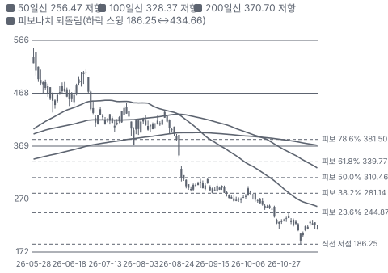

**주봉**

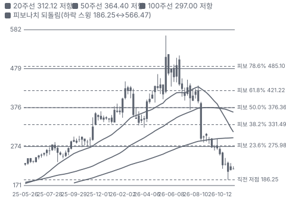

**월봉**

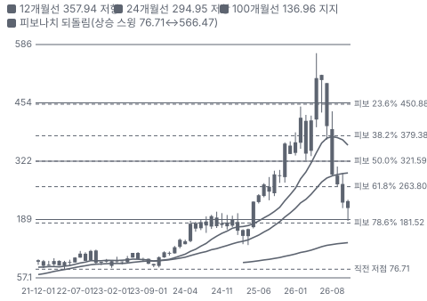

**분기 매출·EPS 실적과 컨센서스**

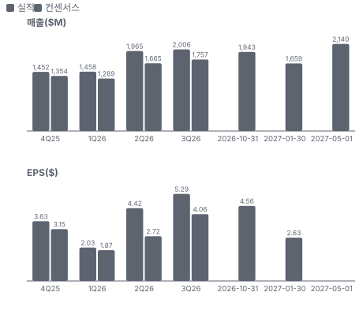

**4Q26 매출 — 지표 추세 vs 가이던스·컨센서스**

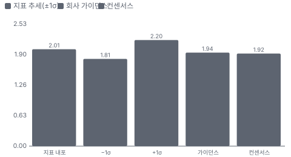

**최근 4개 분기 주가 변화 분석**

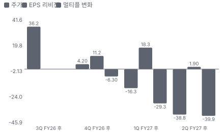

**EPS 리비전**

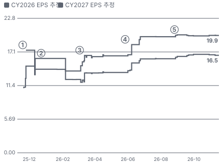

① 25-11-19 3Q FY26 실적 — 하루 +9.8% · EPS 리비전 -
② 25-12-23 Power Solutions 인수 완료(\$1.95B, 데이터센터 전기) · EPS 리비전 +0%
③ 26-03-04 4Q FY26 실적·FY27 가이던스 \$6.85~7.15B — 하루 −4.1% · EPS 리비전 +19%
④ 26-05-27 1Q FY27 실적·가이던스 상향·NTI 인수 — 하루 +25.8% · EPS 리비전 +12%
⑤ 26-08-26 2Q FY27 실적·무선 \$150M 이연 — 하루 −11.6% · EPS 리비전 +2%

**멀티플 프리미엄(Fwd 1Y P/E, 최근 4개 분기말)**

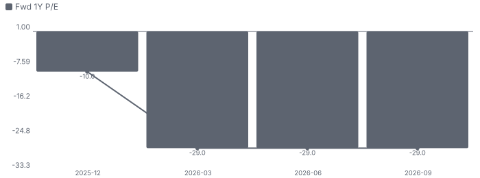

**합리적 멀티플**

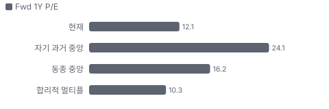

**밸류에이션 주가 시나리오**

**주가별 업사이드**

- 제품·서비스 포트폴리오

**고객 믹스(2Q FY27, 매출 대비)**

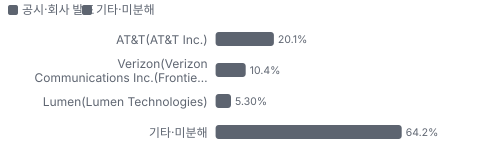

**공급 병목(10점, 낮을수록 병목)**

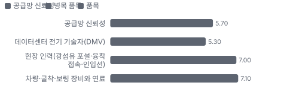

**생산능력 현재와 확충 계획(현장 인력(명))**

**CAPEX의 매출 대비 비중**

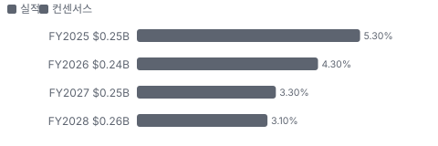

**어닝콜 변화별 주주가치 영향**

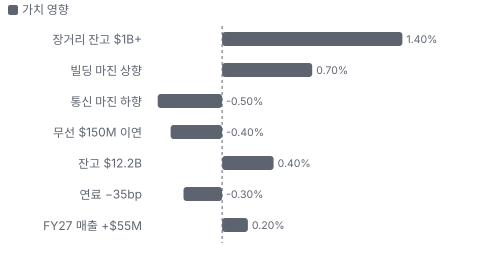

**수주·파이프라인 확실성 사다리**

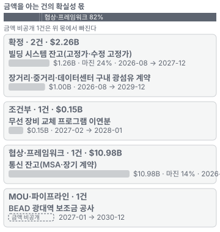

**수주/출하 비율 × 재고 일수 — 분기별(B/B 100 = 수주와 출하가 같다)**

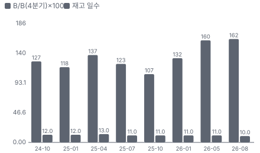

**매출 → 매출총이익 → 영업이익(매출 = 100, 최근 4분기)**

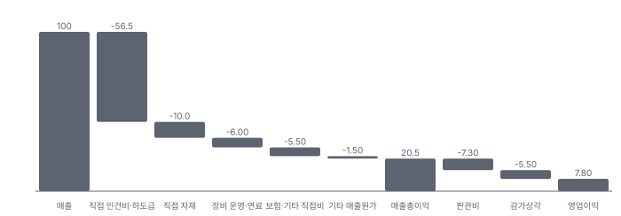

**분기 비용 비중 추이(매출 대비, 공시)**

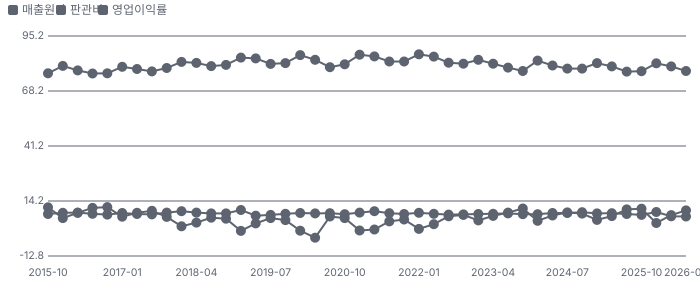

**비용 요인별 매출 대비 비중 1년 변화**

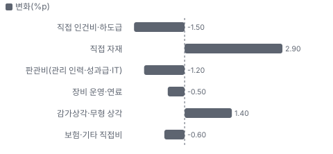

**통신 BOM 원가 몫**

**빌딩 시스템 BOM 원가 몫**

**BOM 항목 가격 +10% 시 OPM 변화**

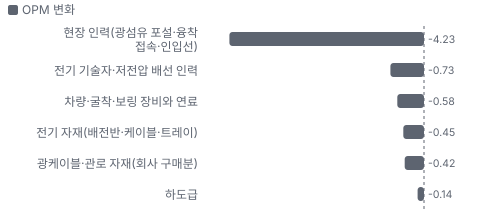

**원가 물가 vs 판매가 물가 — 1년 변화(원가가 판매가보다 더 오르면 단가를 올리지 못하는 만큼 마진이 줄어든다): 원가가 판매가 쪽 물가보다 101.7%p 더 올라 단가 인상이 따라가지 못하면 마진 압박**

**분기 감가 비율 연율(유형자산 순액 대비)**

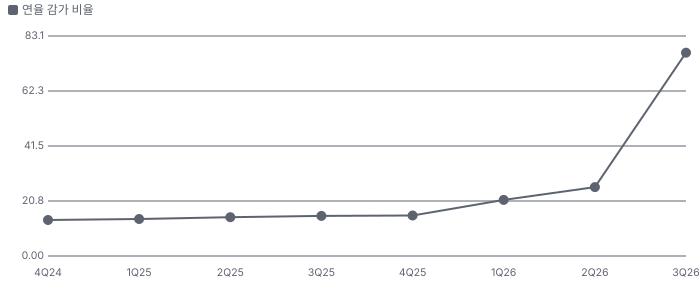

**Power Solutions 시너지 램프(종류별, 확률 가중)**

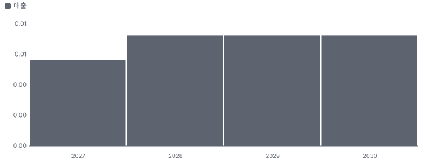

**시너지 가치 vs 웃돈**

**EPS 효과(인수 기업, 기존 대비)**

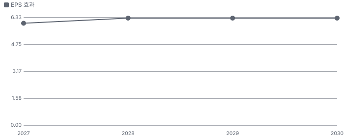

**National Technology Integrators 시너지 램프(종류별, 확률 가중)**

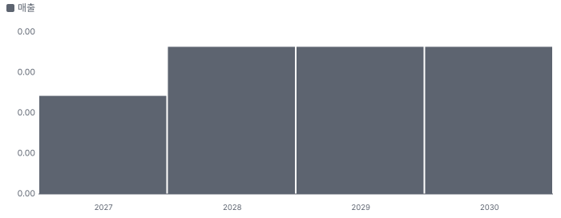

**매출·PPI·수출입 — 최근 16개 분기 + 다음 분기 추정(선마다 자기 y축: 왼쪽 매출, 오른쪽 지표) · 미국 배전반 PPI — 16개 분기 범위 287.3~395.6(+37.7%) · 미국 광섬유 케이블(개별 피복 광섬유) 수출(HS 854470) — 16개 분기 범위 335,231,519.0~618,490,878.0(+84.5%)**

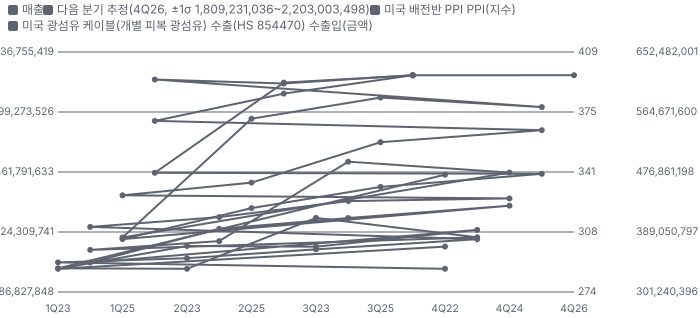

**10년 P·Q 사이클 — 추세(HP 필터) 대비 갭과 8분기 전망**

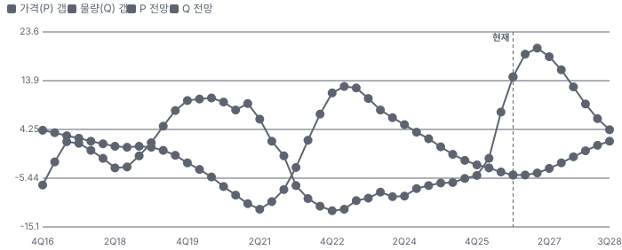

**매출 증가율의 가격·물량 분해와 8분기 전망(전년 대비)**

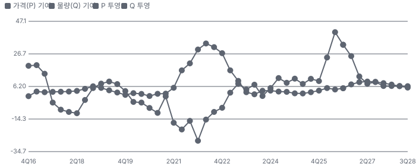

**분기별 매출 증가율 분해**

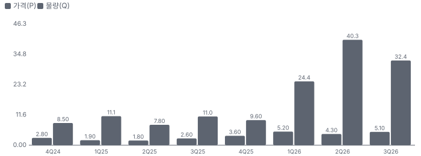

**목표주가 산정 — 약세와 기본 사이(약세 쪽 19%), 도달 확률 약 52%**

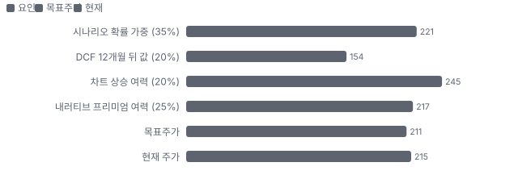

**PEG — 성장 대비 멀티플(낮을수록 성장 대비 쌈)**

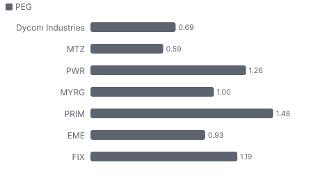

**일봉 지지·저항과 목표주가**

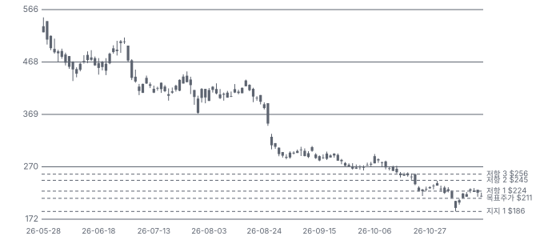

**일별 거래량 분해**

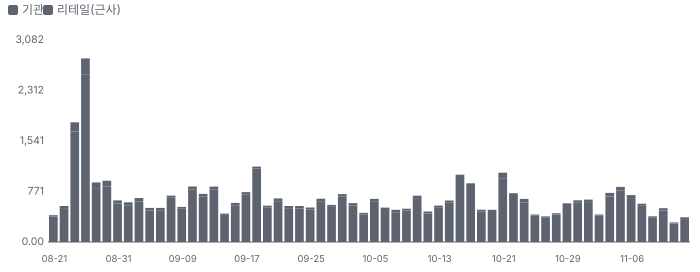

**기관 자금 흐름**

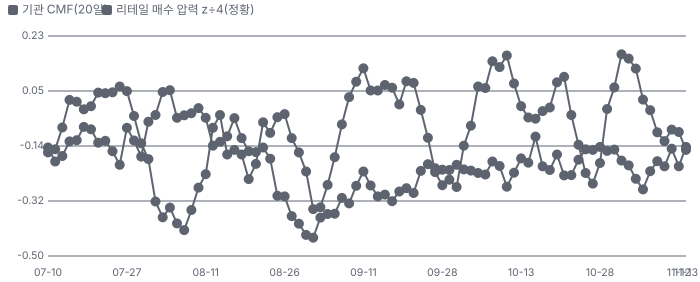

**몬테카를로**

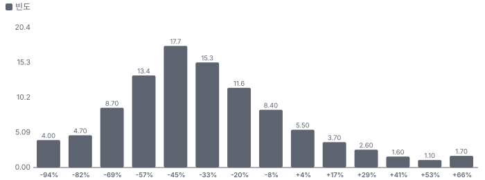

해석: 3,000번 중 461번(15%)에서 가치가 지금 주가 이상이었다. 가정을 흔들어도 지금 주가를 뒷받침하지 못하는 경우가 더 많다. 가운데 값은 0.63배이고, 열 번 중 여덟 번은 0.27~1.12배 사이에 든다.

## 내러티브

> **기업가치를 결정하는 이야기:** 이 회사는 통신사(AT&T·Verizon·Lumen 등)의 광섬유망을 설계·포설·접속하고 유지보수하는 미국 최대 통신 시공사다. 2025년 12월 Power Solutions, 2026년 NTI 인수로 데이터센터 전기·구내 배선(빌딩 시스템, 매출의 20%)을 더했다. 매출의 대부분이 고객 CAPEX에서 나오고 원가의 대부분이 사람이라, 가치는 '물량 × 인력 생산성'이다.

> **멀티플·EPS 프리미엄**
> **멀티플:** Fwd 1Y P/E 12.1배로 동종 6곳 중앙값 16.2배보다 25% 낮다 — 3년 자기 범위(13~36배)의 바닥 아래다. 시장은 통신 이익률 하락과 무선 이연, AI 인프라 배수 되돌림을 함께 반영했다.
> **EPS:** 다음 4개 분기 EPS 컨센서스 \$17.74는 TTM 조정 EPS \$15.37보다 15% 높다. FY28 EPS 컨센서스 \$19.5~20.1(+15~18%)로 이익 성장은 동종 중간 수준이다.

### 투자자들은 왜 열광했나

2026년 상반기 투자자들은 FTTH +60%와 데이터센터 전기 인수가 겹쳐 '광섬유+AI' 복합 수혜주로 봤다 — 1Q 실적 날 하루 +25.8%. 8월 2Q에서 무선 \$150M 이연과 통신 이익률 −134bp가 나오자 열기가 식었고, 9~11월 업종 전체의 배수 되돌림이 하락을 키웠다.

### 무엇이 기업가치를 바꾸나

> **구조적 체질 변화**
> **변화:** 통신 단일 시공사에서 통신 + 데이터센터 전기 2개 부문으로
> **증거:** 빌딩 시스템 매출 비중 2Q FY27 19.8%(10-Q), 상위 3 고객 비중 52.6% → 35.8%
> **반증:** 빌딩 시스템 비중이 15% 아래로 줄어든다

> **고부가 믹스 확장**
> **변화:** 데이터센터 전기·장거리망이 통신 유지보수보다 이익률이 높다
> **증거:** 빌딩 시스템 조정 EBITDA 이익률 24.5% vs 통신 13.6%(2Q)
> **반증:** 빌딩 시스템 이익률 2개 분기 연속 15% 아래

> **기술 혁신**
> **변화:** 해당 없음 — 시공 서비스로 자체 기술 제품이 없다. 고밀도 광케이블(노선당 수천 가닥)이 작업 난도를 높일 뿐
> **증거:** 1Q 콜: 노선당 7,000~10,000가닥 논의
> **반증:** -

> **실행 속도**
> **변화:** 잔고 ÷ 월평균 매출이 1년 새 약 19개월 → 21개월로 길어졌다 — 다년 계약이 늘었다 **납품 리드타임 21.4개월.** 피어 비교 미확인. 2025-07(잔고 \$7.99B ÷ TTM 월평균 \$416M, 계산) 19.2개월보다 11% 길다.
> **증거:** 잔고 \$12.24B ÷ TTM 월평균 \$573M(계산), 1Q 콜: 고객이 인력 확보를 위해 계약 기간을 늘린다
> **반증:** 12개월 안 잔고 비중이 50% 아래로 내려간다

> **M&A**
> **변화:** \$1.95B Power Solutions(2025-12)·\$271M NTI(2026)로 데이터센터 전기·구내 배선 진입
> **증거:** 10-K·10-Q 인수 주석
> **반증:** 인수 무형자산·영업권 손상

> **정책·입법 연관성**
> **재정정책:** BEAD(연방 광대역 보조금, \$42.45B 프로그램) — 회사는 설계 매출만 인식, 건설은 2027년 2Q 콜 반증: 하위 수급자 선정 지연·위성 몫 확대 의회 동의 10/10 — 하원 5/5(2021년 인프라 투자법(IIJA(2021년 미국 인프라 투자·일자리법))으로 이미 세출 반영) · 상원 5/5(같음).
> **행정명령:** 해당 없음(이 회사 매출에 직접 걸린 행정명령 확인 안 됨) - 반증: - 의회 동의 2/10 — 하원 1/5(-) · 상원 1/5(-).
> **연관입법:** 데이터센터 인허가·지역 반발(모라토리엄) 논의 — 지방 단위 2Q 콜 Wells Fargo 질문·보도 반증: DMV 지역 신규 데이터센터 인허가 중단

> **고객의 지출 예산**
> **변화:** 고객 돈은 대부분 CAPEX — 통신사 망 구축 예산과 데이터센터 건설비
> **사업별 예산:** **매출의 80%**: 통신 — 고객 혼합(통신사 망 구축 CAPEX(FTTH·장거리) + 유지보수·지하 시설 탐지(굴착 전에 지하 통신·전력·가스관 위치를 찾아 표시하는 서비스) OPEX) · 동인: 가정 광섬유 연결 목표·하이퍼스케일러 노선
**매출의 20%**: 빌딩 시스템 — 고객 CAPEX(데이터센터 건설 전기·저전압 배선(통신·보안·영상 같은 약전 배선과 구조화 케이블링)) · 동인: DMV 데이터센터 증설
> **증거:** 10-K 사업 설명·10-Q 고객 분해
> **반증:** AT&T·Verizon 2027 CAPEX 가이던스 하향

### 내러티브 근거

> '광섬유와 데이터센터를 함께 까는 AI 인프라 시공주'라는 이야기는 5월 1Q 실적(하루 +25.8%)에서 정점을 찍고 8월 무선 이연과 통신 이익률 하락으로 꺾였다. 업종 전체가 6월 이후 배수를 절반 넘게 잃었고, DY의 Fwd 1Y P/E는 12.1배로 3년 중 가장 낮다. 이익 추정은 그 사이 거의 그대로다. 동종 대비 멀티플 차이 -25% 중 회사 고유 몫은 +18%다. 단계는 소멸, 쏠림은 낮음(공매도 유통 주식의 6.7%, Quantral 7일 언급 없음, ApeWisdom 422위)이다.

> **FTTH 구축 슈퍼사이클** · 유지
> **논리:** AT&T·Verizon(Frontier)·기타 통신사가 가정용 광섬유를 대량으로 깔고 Dycom이 가장 큰 시공사다
> **숫자:** 1H FY27 FTTH 매출 +약 60%(콜), 통신 유기 성장 2Q +16.7%
> **반증:** AT&T·Verizon 매출 2개 분기 연속 감소
> **출처:** 2Q 콜

> **AI 데이터센터 광섬유·전기** · 약화
> **논리:** 하이퍼스케일러 데이터센터 사이 장거리망과 구내 배선, 데이터센터 전기를 한 회사가 맡는다
> **숫자:** 장거리·구내 계약 잔고 \$1B+, 빌딩 시스템 매출 \$397.5M·조정 EBITDA 이익률 24.5%
> **반증:** 빌딩 시스템 잔고 감소·이익률 15% 아래
> **출처:** 2Q 콜·10-Q

> **BEAD 보조금 공사** · 유지
> **논리:** 연방 광대역 보조금이 2027년부터 농촌 광섬유 공사로 들어온다
> **숫자:** 현재는 설계 매출만, 금액 미공시
> **반증:** 주별 하위 수급자 선정이 2027년 중반까지 지연
> **출처:** 2Q 콜

> **AI 인프라 배수 되돌림** · 강화
> **논리:** AI CAPEX 피크 우려로 시공·전력 업종 전체가 배수를 잃었다
> **숫자:** 동종 Fwd P/E 6월 말 → 지금: MasTec 43→15배, Comfort 44→17배, DY 31→12배
> **반증:** 하이퍼스케일러 2027 CAPEX 가이던스 상향
> **출처:** 배수 이력

> **반대 내러티브 — 위성·무선이 광섬유를 대신한다** · 강화
> **논리:** Starlink 같은 위성 인터넷이 농촌 광섬유(BEAD) 몫을 가져가고, 무선 프로그램은 이연됐다
> **숫자:** 무선 \$150M 이연(콜), Voya 펀드 레터의 '점유율 하락 인식' 언급
> **반증:** BEAD 하위 수급자 중 광섬유 몫이 계획대로 유지
> **출처:** Voya 3Q26 펀드 레터·2Q 콜

> **대형 인수의 규율 이탈 우려** · 유지
> **논리:** \$1.95B Power Solutions 인수로 순차입이 늘고 사업 성격이 바뀌었다
> **숫자:** 순차입 약 \$2.7B(차입·리스 \$3.05B − 현금 \$0.34B), 영업권+무형 \$2.53B
> **반증:** 빌딩 시스템 조정 EBITDA가 인수 가정을 2분기 연속 넘는다
> **출처:** 10-Q·SouthernSun 펀드 레터

### 투자 포인트

> **이익은 그대로, 배수만 3분의 1**
> **명제:** 5월 이후 주가 −60%의 거의 전부가 배수 하락이다
> **숫자:** Fwd 1Y P/E 5월 말 35.6배 → 11/16 12.1배. FY27 EPS 컨센서스는 6/1 \$14.18 → 11/10 \$17.02(+20%)
> **시장과 다른 점:** 시장은 AI 인프라 시공주를 묶어 팔았지만 DY 매출의 80%는 통신 광섬유다 — 데이터센터 CAPEX보다 통신사 FTTH 일정에 더 묶여 있다
> **증명:** 3Q FY27 매출이 가이던스 중간값 \$1.94B 이상, 통신 이익률이 13.6%에서 멈춘다
> **출처:** https://www.sec.gov/Archives/edgar/data/67215/000006721526000043/dy-20260801.htm

> **빌딩 시스템이 이익률을 끌어올린다**
> **명제:** 매출 20%가 조정 EBITDA 이익률 24.5%를 낸다
> **숫자:** 2Q 빌딩 시스템 매출 \$397.5M, 세그먼트 세전이익 \$48.2M(10-Q)
> **시장과 다른 점:** 시장은 인수를 '규율 이탈'로 보지만 1년 차 이익률은 인수 때 말한 10%대 중반을 크게 넘었다
> **증명:** 3Q·4Q 빌딩 시스템 이익률이 20% 안팎을 유지
> **출처:** https://www.sec.gov/Archives/edgar/data/67215/000006721526000043/dy-20260801.htm

> **약한 고리 — 통신 이익률**
> **명제:** 통신 이익률 전망이 '소폭 상승'에서 '소폭 하락'으로 바뀌었다
> **숫자:** 2Q 통신 조정 EBITDA 이익률 13.6%(−134bp), 연료 −35bp
> **시장과 다른 점:** -
> **증명:** 3Q 통신 이익률이 전년 3Q(약 15%대, 미확인)보다 낮으면 FY28 추정이 내려간다
> **출처:** 2Q 보도자료

### 모멘텀 생성·소멸 타임라인

**카탈리스트 달력 — 지난 사건의 주가 반응과 앞으로 확인할 숫자**
| 날짜 | 상태 | 구분 | 사건 | 반응·확인 | 결과에 따라 |
|---|---|---|---|---|---|
| 2025-11-19 | 완료 | 생성 | 3Q FY26 실적 — FTTH 가속 | 하루 +9.8% |  |
| 2025-12-23 | 완료 | 생성 | Power Solutions 인수 완료(데이터센터 전기) | AI 인프라 내러티브 편입 |  |
| 2026-05-27 | 완료 | 생성 | 1Q FY27 실적·가이던스 상향·NTI 인수 | 하루 +25.8%, 5/28 종가 고점 \$535.20 |  |
| 2026-07-01 | 완료 | 매크로 | 업종 동반 약세 시작(원인 미확인) | 4거래일 −18% |  |
| 2026-08-26 | 완료 | 소멸 | 2Q FY27 — 무선 \$150M 이연·통신 이익률 하락 전망 | 하루 −11.6% |  |
| 2026-11-04 | 완료 | 매크로 | 업종 동반 약세(원인 미확인) | 이틀 −15.5%, 11/5 종가 \$192.79 |  |
| 2026-11-25(추정) | 예정 | 확인 | 3Q FY27 실적(회사 미공지) | 매출 \$1.94B(가이던스 중간값) 이상·통신 조정 EBITDA 이익률 13.6% 이상·조정 EPS \$4.56 이상 | 넘으면 기본~강세, 매출 \$1.90B 미만이거나 통신 이익률 13% 아래면 약세 |
| 2027-01(예상) | 예정 | 매크로 | AT&T·Verizon·하이퍼스케일러 2027 CAPEX 가이던스 | 통신사 FTTH 연결 목표 유지, 하이퍼스케일러 CAPEX 합계 증가 | 유지면 기본, 하향이면 약세 |
| 2027-03 초(예상) | 예정 | 확인 | 4Q FY27 실적·FY28 가이던스 | FY28 매출 가이던스 \$8.4B(컨센서스) 이상, 무선 \$150M 회수 포함 여부 | \$8.4B 이상이면 기본~강세, 미만이면 약세 |

### 언제 사서 언제 팔아야 할까?

**가격·조건 틀 — 가격은 밸류에이션(약세·기본·강세·목표주가)과 차트 지지 구간에서, 조건은 이벤트에서**
| 구간 | 가격 | 목표주가까지 | 약세까지 | 조건·근거 |
|---|---|---|---|---|
| 관찰 구간 | \$186~\$186 | +13% | -26% | 차트 지지 구간이 약세 시나리오 가격과 겹치는 곳 — 11/5 종가 저점 \$192.79 부근 |
| 확인 뒤 | 지금 \$215 이상에서 조건 확인 | -2% | -36% | 3Q 매출 \$1.94B 이상과 통신 이익률이 13.6%에서 멈추고, 4Q·FY28 첫 언급에서 무선 \$150M 회수가 재확인된다 |
| 무효화 | 약세 시나리오 \$137 | - | -36% | 3Q 매출이 가이던스 하단 \$1.90B 미만이거나 11/5 종가 저점 \$192.79 이탈 |
| 차익 고민 1차 | \$228(기본 시나리오) | +6% | - | 목표주가 근처에서는 통신 이익률 방향과 잔고 증가 속도를 다시 본다 |
| 차익 고민 2차 | \$326(강세 시나리오) | +52% | - | 목표주가 근처에서는 통신 이익률 방향과 잔고 증가 속도를 다시 본다 |

실적 당일 ±10~26% 움직임이 반복됐다(5/27 +25.8%, 8/26 −11.6%) — 옵션 시장도 과거 평균보다 큰 움직임을 가격에 넣었다. 이벤트 직전 추격을 경계한다 가격·조건 틀이며 매매·비중 지시가 아니다(투자 권유 아님).

## 포트폴리오

| 제품·서비스 | 구분 | 무엇 | 쓰는 곳 | 돈 버는 방식 | Mix | Mix 변화(전년 대비) |
|---|---|---|---|---|---|---|
| 통신 | 서비스 | 광섬유 설계·포설·접속·인입선, 무선 기지국 공사, 유지보수, 지하 시설 탐지 | 통신사 가정용·장거리 광섬유(도시와 도시, 데이터센터 사이를 잇는 장거리 광케이블망, long-haul)망 구축과 유지 | MSA 작업 단가. 2Q 매출 \$1.61B(유기 +16.7%), 조정 EBITDA 이익률 13.6% | 80% | -19.8%p |
| 빌딩 시스템 | 서비스 | 데이터센터 전기·에너지 관리·보안·소방, 구내 저전압 배선(NTI) | DMV·텍사스·중서부 데이터센터 건설 | 프로젝트 계약가. 2Q 매출 \$397.5M, 조정 EBITDA 이익률 24.5% | 20% | 미확인 |

**Mix 변화가 가장 큰 쪽은 통신(-19.8%p, 전년 대비).** 계절성 판정: 분기 매출 계절 지수 기준 있음 → 전년 같은 분기와 비교.

## 고객

> **2Q FY27 최대 고객 AT&T(AT&T Inc.) 20%, 상위 3곳 36%, 집중도 분산.** 공시·회사 발표로 확인한 몫은 매출의 36%이고, 나머지 고객 몫은 추정이거나 미분해다. 2Q FY27 기준 AT&T 20.1%·Verizon 10.4%·Lumen 5.3%, 나머지 64.2%(1년 전 47.5%). 상위 3곳 비중은 1년 새 52.6% → 35.8%로 내려갔다 — 빌딩 시스템 인수와 다른 통신사 FTTH 확대로 분산됐다. AT&T는 2026-02-02 Lumen의 가정용 광섬유 사업을 인수해 그 매출을 함께 잡는다. 나머지 64.2%는 개별 공시 없는 고객 합계라 표에 고객으로 넣지 않는다.

**고객별 매출 몫(2Q FY27)**
| 고객 | 몫 | 변화 | 근거 |
|---|---|---|---|
| AT&T(AT&T Inc.) | 20% | -7%p | 공시 |
| Verizon(Verizon Communications Inc.(Frontier 포함)) | 10% | -4%p | 공시 |
| Lumen(Lumen Technologies) | 5% | -6%p | 공시 |
| 기타·미분해 | 64% | - | - |

> **AT&T(AT&T Inc.)** · 공시
> **사는 것:** FTTH 구축·유지보수
> **추정 근거:** 최대 고객 — Lumen 가정용 광섬유 사업 포함

> **Verizon(Verizon Communications Inc.(Frontier 포함))** · 공시
> **사는 것:** FTTH·무선
> **추정 근거:** 무선 장비 교체 프로그램 고객일 가능성(이연 고객은 미공시 — 가설)

> **Lumen(Lumen Technologies)** · 공시
> **사는 것:** 장거리·중거리 광섬유(지역 간 광케이블망, middle-mile)
> **추정 근거:** 하이퍼스케일러용 장거리망

## 수주·파이프라인

> **2026-08-01 기준 5건.** 확정 \$2.26B, 미확정 \$11.13B. 공시 수주잔고 \$12.24B.

**수주 목록**
| 상태 | 계약 | 계약 총액 | 진척 | 기간 | 비고 |
|---|---|---|---|---|---|
| 확정 | 빌딩 시스템 잔고(고정가·수정 고정가) | \$1.26B | 비공개 | 2026-08 → 2027-12 | - |
| 확정 | 장거리·중거리·데이터센터 구내 광섬유 계약 | \$1.00B | 비공개 | 2026-08 → 2029-12 | - |
| 조건부 | 무선 장비 교체 프로그램 이연분 | \$0.15B | 비공개 | 2027-02 → 2028-01 | - |
| 프레임워크 | 통신 잔고(MSA·장기 계약) | \$10.98B | 비공개 | 2026-08 → 2030-12 | - |
| 파이프라인 | BEAD 광대역 보조금 공사 | 금액 비공개 | 비공개 | 2027-01 → 2030-12 | - |

**실행 속도와 방해 요인**
| 항목 | 상태 | 실행 속도 | 방해 요인 |
|---|---|---|---|
| 빌딩 시스템 잔고(고정가·수정 고정가) | 확정 | 12개월 안 \$1.110B(88%) | DMV 인력 · 데이터센터 인허가 반발 |
| 장거리·중거리·데이터센터 구내 광섬유 계약 | 확정 | 건설 본격화는 2027년(달력) | 하이퍼스케일러 노선 확정 |
| 무선 장비 교체 프로그램 이연분 | 조건부 | FY28로 이연, 프로그램은 FY28 완료 예정 | 한 고객의 배치 일정 |
| 통신 잔고(MSA·장기 계약) | 프레임워크 | 12개월 안 \$5.362B(49%) | 고객 일정 변경(무선 이연 사례) · 인력 확충 속도 · 편의 해지 조항 |
| BEAD 광대역 보조금 공사 | 파이프라인 | 하반기 설계만, 건설은 2027년 | 주·하위 수급자 선정 · 보조금 지급 단계 |

## 마진 구조

> **GPM 22.0%, OPM 9.6%.** 2Q FY26 대비 GPM -0.3%p, OPM -0.6%p. 변동비는 매출의 64%이고, 매출이 10% 늘면 OPM은 +2.4%p 움직인다. 2Q FY27 매출원가(감가상각 제외)는 매출의 78.0%로 1년 전 77.7%보다 0.3%p 높다. 자재 비중이 2.9%p 올랐고(자재를 회사가 사는 일의 비중 증가), 인건비·하도급은 1.5%p 내려갔다. 판관비는 6.6%로 1.2%p 낮아졌지만 감가상각·상각(인수 무형 상각 \$60.5M)이 늘어 영업이익률은 9.6%(1년 전 10.1%)다.

> **매출 100 중 매출원가 79.5, 매출총이익 20.5(최근 4분기, 공시).** 매출원가 요인 중 직접 인건비·하도급이 매출의 56.5%로 가장 무겁고, 단가가 +10% 오르면 GPM이 -5.65%p 움직인다. 분기 회귀로 매출 1이 늘 때 매출원가는 0.77 늘고, 매출원가의 고정비 몫은 4%다.

**비용 요인 강도 — 비중·추세·충격(+10%)·탄력**
| 비용 | 구분 | 매출 대비 | 1년 변화 | 마진 기여 | 충격 시 마진 | 매출 탄력 | 고정비 몫 |
|---|---|---|---|---|---|---|---|
| 직접 인건비·하도급 | 매출원가 요인 | 56.5% | -1.5%p | +1.5%p | -5.65%p | 미확인 | 20% |
| 직접 자재 | 매출원가 요인 | 10.0% | +2.9%p | -2.9%p | -1.00%p | 미확인 | 0% |
| 장비 운영·연료 | 매출원가 요인 | 6.0% | -0.5%p | +0.5%p | -0.60%p | 미확인 | 30% |
| 보험·기타 직접비 | 매출원가 요인 | 5.5% | -0.6%p | +0.6%p | -0.55%p | 미확인 | 50% |
| 매출원가 | 공시 항목 | 79.5% | -0.2%p | +0.2%p | -7.95%p | 0.77 | 4% |
| 판관비 | 공시 항목 | 7.3% | -0.9%p | +0.9%p | 미확인 | 0.07 | 17% |
| 감가상각 | 공시 항목 | 5.5% | +1.0%p | -1.0%p | 미확인 | 0.05 | -3% |

매출 탄력 = 분기 비용을 매출에 회귀한 기울기(매출 1당 변동비), 고정비 몫 = 절편 ÷ 평균 비용. 표본이 8분기 미만이면 미확인. 매출원가 요인 비중은 margin 재료의 추정이 섞여 있고, 공시 매출원가와의 차이는 '기타 매출원가'로 둔다.

**GPM에서 OPM까지(GAAP, 아래는 최근 4개 분기)**
| 기간 | GPM | 연구개발 | 판관비 | 기타 | OPM |
|---|---|---|---|---|---|
| 2Q FY26 | 22.3% | 0.0% | 7.8% | 4.4% | 10.1% |
| 2Q FY27 | 22.0% | 0.0% | 6.6% | 5.8% | 9.6% |
| 2025-10 | 22.1% | - | - | - | 10.4% |
| 2026-01 | 18.2% | - | - | - | 3.4% |
| 2026-05 | 19.7% | - | - | - | 7.3% |
| 2026-08 | 22.0% | - | - | - | 9.6% |

**비용을 움직이는 요인**
| 비용 | 요인 |
|---|---|
| 직접 인건비·하도급(매출원가) | 현장 인력 임금·하도급 단가, 확장 초기 훈련 비용 · 근거 추정 |
| 직접 자재(매출원가) | 회사가 자재를 사는 공사 비중(데이터센터 전기·일부 광케이블) · 근거 추정 |
| 판관비(관리 인력·성과급·IT(정보기술))(판관비) | 관리 인건비·인수 회사 판관비 · 근거 공시 |
| 장비 운영·연료(매출원가) | 경유 가격·차량 정비 · 근거 추정 |
| 감가상각·무형 상각(기타) | 차량 교체·인수 무형 상각(\$60.5M/분기) · 근거 공시 |
| 보험·기타 직접비(매출원가) | 자가 보험(자동차·산재)·기타 · 근거 추정 |

**통신 BOM — 매출의 80%, GPM 20%(통신 세그먼트: 매출 \$1.61B − 매출원가 \$1.29B = 20.0%(10-Q, 감가상각 제외)), 항목 가격 +10% 시**
| 항목 | 원가 몫 | 전가 | 제품 GPM | OPM |
|---|---|---|---|---|
| 현장 인력(광섬유 포설·융착 접속·인입선) | 60~72% | 미확인 | -5.3%p | -4.23%p |
| 차량·굴착·보링 장비와 연료 | 7~11% | 미확인 | -0.7%p | -0.58%p |
| 광케이블·관로 자재(회사 구매분) | 3~10% | 미확인 | -0.5%p | -0.42%p |
| 미분해 | 19% | - | - | - |

**빌딩 시스템 BOM — 매출의 20%, GPM 30%(빌딩 시스템 세그먼트: 매출 \$397.5M − 매출원가 \$278.0M = 30.1%(10-Q, 감가상각 제외)), 항목 가격 +10% 시**
| 항목 | 원가 몫 | 전가 | 제품 GPM | OPM |
|---|---|---|---|---|
| 전기 기술자·저전압 배선 인력 | 45~60% | 미확인 | -3.7%p | -0.73%p |
| 전기 자재(배전반·케이블·트레이) | 25~40% | 미확인 | -2.3%p | -0.45%p |
| 하도급 | 5~15% | 미확인 | -0.7%p | -0.14%p |
| 미분해 | 5% | - | - | - |

현장 인력(광섬유 포설·융착 접속·인입선) 가격이 +10% 오르면 영업이익은 -44.2% 움직인다. 판매가 전가를 모르는 항목은 전가 0%로 계산했다.

**BOM 항목 가격을 움직이는 것**
| 항목 | 요인 |
|---|---|
| 현장 인력(광섬유 포설·융착 접속·인입선) | 원가 대부분이 사람 · 근거 추정 |
| 차량·굴착·보링 장비와 연료 | 지하 관로·가공 작업 장비 · 근거 추정 |
| 광케이블·관로 자재(회사 구매분) | 대부분 고객 지급 · 근거 추정 |
| 전기 기술자·저전압 배선 인력 | DMV 숙련 인력이 병목 · 근거 추정 |
| 전기 자재(배전반·케이블·트레이) | 회사가 자재를 사는 공사 · 근거 추정 |
| 하도급 | - · 근거 추정 |

> **원가·판매가 물가 격차 -101.7%p** — 판매가 물가가 투입 원가 물가보다 느리게 오른다.

**투입 물가 — 미국 PPI 3·6·12개월(2026-10, 개정 반영)과 해외 전년비**
| 항목 | 미국 3개월 | 6개월 | 12개월 | 전가 못 할 때 OPM | 일본 | 한국 | 대만 |
|---|---|---|---|---|---|---|---|
| 차량·굴착·보링 장비와 연료 | +38.6% | +30.2% | +115.2% | - | 미확인 | 미확인 | 미확인 |
| 광케이블·관로 자재(회사 구매분) | 미확인 | 미확인 | 미확인* | - | 미확인 | 미확인 | 미확인 |
| 전기 자재(배전반·케이블·트레이) | +4.1% | +4.9% | +13.5% | - | +23.2% | +1.6% | +10.6%* |

별표는 품목보다 넓은 업종 지수다. 연결한 투입 원가의 미국 PPI(생산자물가지수)는 1년 새 가중 +115.2%이고, 판매가로 넘기지 못하면 GPM -6.9%p·OPM -6.9%p가 움직인다. 판매가 비교 물가(광섬유 케이블(개별 피복 광섬유) PPI)는 1년 새 미확인 — 회사 가격 변화는 미확인. 물가 지수를 붙이지 못한 매출원가 항목은 직접 인건비·하도급, 직접 자재, 보험·기타 직접비다(미연결).

## 자산 구성

> 연율 감가 비율(순액 기준)은 직전 4분기 14.35% → 최근 4분기 26.94%.

**유형·무형자산 항목별 가치(2026-01-31 vs 2025-01-25)**
| 구분 | 항목 | 총액 2026-01-31 | 누적상각 | 순액 | 총액 2025-01-25 | 총액 1년 변화 | 공시 내용연수 |
|---|---|---|---|---|---|---|---|
| 유형 | 유형자산 합계(항목 미분해) | \$1,687.9M | 총계만 공시 | 총계만 공시 | \$1,585.0M | +6.5% | 미확인 |
| 영업권 | 영업권 | \$1,443.4M | \$0.0M | \$1,443.4M | \$330.3M | +337.0% | 비상각 |
| 무형 | 무형자산 합계(항목 미분해) | \$1,284.2M | \$358.2M | \$925.9M | \$509.2M | +152.2% | 미확인 |
| 유형 합계 | 유형자산 | \$1,687.9M | \$1,112.5M | \$575.4M | \$1,585.0M | +6.5% | 경과율 66%(상각 대상 기준) |

**내용연수 산식(상각 대상 유형자산 = 총액 − 토지 − 건설중)**
| 기준일 | 연 감가상각 | 상각 대상 총액 | 평균 내용연수 | 경과 연수 | 잔여 연수 | 경과율 |
|---|---|---|---|---|---|---|
| 2026-01-31 | \$200.8M | \$1,687.9M | 8.4년 | 5.5년 | 2.9년 | 66% |
| 2025-01-25 | \$167.2M | \$1,585.0M | 9.5년 | 6.2년 | 3.2년 | 66% |

산식 평균 내용연수는 8.4년. 1년 전 9.5년 → 지금 8.4년.

**분기 감가 비율(감가상각 ÷ 평균 유형자산 순액)**
| 분기 | 감가상각 | 평균 유형자산(순액) | 분기 비율 | 연율 | 연율의 역수 |
|---|---|---|---|---|---|
| 4Q24 | \$52.0M | \$1,530.7M | 3.40% | 13.59% | 7.4년 |
| 1Q25 | \$54.8M | \$1,567.5M | 3.50% | 13.98% | 7.2년 |
| 2Q25 | \$58.4M | \$1,595.6M | 3.66% | 14.64% | 6.8년 |
| 3Q25 | \$60.9M | \$1,608.1M | 3.78% | 15.14% | 6.6년 |
| 4Q25 | \$62.2M | \$1,624.7M | 3.83% | 15.30% | 6.5년 |
| 1Q26 | \$88.2M | \$1,663.7M | 5.30% | 21.20% | 4.7년 |
| 2Q26 | \$111.6M | \$1,716.2M | 6.51% | 26.02% | 3.8년 |
| 3Q26 | \$115.6M | \$602.6M | 19.19% | 76.75% | 1.3년 |

감가상각 기준: 손익계산서 감가상각·상각비(SEC 공시 데이터, 4분기 = 연간 − 1~3분기).

최근 4분기 연율 감가 비율 26.94%, 직전 4분기 14.35%(+88%) — 경고 문턱(-10%) 안이다.

미공시·미분해: 분기 매출·영업이익 8분기 · 유형자산 항목별 총액·내용연수(10-K 주석에서 모델이 채움) · 무형자산 항목(10-K 주석에서 모델이 채움) — 이 칸은 비우고 나머지로 계산했다.

### 해석 — 자산이 어디에 쌓이고 있나

- 감가 비율이 올라갔다 — 이익을 보수적으로 잡는 쪽이다(내용연수 단축·짧은 수명 자산 증가).

## 공급망 병목

> **공급망 신뢰성 5.7/10, 병목 주의.** 가장 약한 고리는 데이터센터 전기 기술자(DMV) 5.3점이고, 품목 평균은 6.4점이다. 근거가 부족한 1건(광케이블·관로 자재(회사 구매분))은 점수에서 뺐다. 병목은 부품이 아니라 숙련 현장 인력이다. 회사는 인력을 '성장 엔진'이라 부르고, 2Q 통신 이익률 하락의 한 이유로 확장 인력 투자를 꼽았다. 광케이블·장비는 대부분 고객이 지급한다 — 광섬유 공급(예: Corning 증설)은 고객 프로그램 속도를 통해 간접적으로만 닿는다.

**병목과 마진 — 품목 가격 +10% 시 OPM**
| 품목 | 점수 | 판정 | 구분 | OPM |
|---|---|---|---|---|
| 데이터센터 전기 기술자(DMV, 필수) | 5.3 | 병목 주의 | 출하 차질 위험 | 미확인 |
| 현장 인력(광섬유 포설·융착 접속·인입선, 필수) | 7.0 | 관리 가능 | 가격 위험 | -4.23%p |
| 차량·굴착·보링 장비와 연료 | 7.1 | 관리 가능 | 가격 위험 | -0.58%p |

> **데이터센터 전기 기술자(DMV)** · 5.3/10
> **왜:** 빌딩 시스템 고마진의 원천
> **병목 요인:** 인증 공급사 2곳 · 캐파 빠듯 · 리드타임 미확인 · 재인증 미확인 · 1위 점유율 미확인 · DMV·텍사스·중서부 집중 80% · 물량 확보 내재화
> **풀리는 조건:** 미확인 — DMV 대형 공사 인력 확충 진행 중(2Q 콜)

> **현장 인력(광섬유 포설·융착 접속·인입선)** · 7.0/10
> **왜:** 잔고를 매출로 바꾸는 속도를 정한다
> **병목 요인:** 인증 공급사 4곳 · 캐파 빠듯 · 리드타임 미확인 · 재인증 미확인 · 1위 점유율 미확인 · 미국 집중 100% · 물량 확보 내재화
> **풀리는 조건:** 미확인 — 회사는 확장 인력 투자 중(2Q 콜), 풀리는 시점 언급 없음

> **차량·굴착·보링 장비와 연료** · 7.1/10
> **왜:** 연료비가 분기 이익률을 35bp 흔든다
> **병목 요인:** 인증 공급사 4곳 · 캐파 균형 · 리드타임 미확인 · 재인증 미확인 · 1위 점유율 미확인 · 미국 집중 100% · 물량 확보 현물
> **풀리는 조건:** 미확인 — 경유 PPI 전년 대비 +115%(2026-10), 가격 하락 시점 미확인

**공급사**
| 품목 | 공급사 | 몫 | 근거 |
|---|---|---|---|
| 현장 인력(광섬유 포설·융착 접속·인입선) | 자체 인력 약 21,000명 + 하도급(시공) | 미확인 | 공시 |
| 데이터센터 전기 기술자(DMV) | Power Solutions·NTI 자체 인력(전기·저전압 배선) | 미확인 | 공시 |
| 차량·굴착·보링 장비와 연료 | 미공시(장비 구매·리스, 장비) | 미확인 | 공시 |
| 광케이블·관로 자재(회사 구매분) | 미공시(자재) | 미확인 | 추정 |

**무역 통계로 본 공급 지역**
| 품목 | EU 수입처 | 일본 수입처 | EU 1위 전년비 |
|---|---|---|---|
| 차량·굴착·보링 장비와 연료 | US 73% · CN(중국) 14% · KR(한국) 9% | 大韓民国 74% · シンガポール 7% | +145.7% |
| 광케이블·관로 자재(회사 구매분) | CN 53% · US 35% · VN(베트남) 5% | 中華人民共和国 46% · ベトナム 20% | -7.1% |

## 생산능력

> **현재 명목 캐파 21,000 현장 인력(명), 가동률 미확인.** 착공 이상 증설은 0 현장 인력(명), 발표까지 합치면 0 현장 인력(명)이다. 다 가동하면 지금보다 +0%, 착공 이상만이면 +0%다. FY2026 CAPEX는 \$0.24B로 매출의 4.3%다. 시공 회사라 생산능력은 인력이다. 인력은 2026-01-31 약 19,556명(10-K), 2Q 콜 기준 약 21,000명이다(인수 포함). 가동률은 공시하지 않는다. 시설은 사무소·현장 사무소·장비 야드·창고로 대부분 임차이고 개별 시설 수·면적은 공시하지 않는다.

**생산시설 1곳**(10-K FY2026 Item 2: 본사(웨스트팜비치) 임차 외 자회사 사무소·현장 사무소·장비 야드·창고가 미국 전역에 있다고만 쓰고 시설 수를 공시하지 않는다 — 이름을 밝힌 본사 1곳만 센다(나머지 수는 미확인)), 임차 1곳. 시설별 생산능력은 공개되지 않았다 — 회사 전체 캐파만 위에 적었다.

**생산시설 1곳 — 명칭·위치·생산능력**
| 시설 | 위치 | 용도 | 생산능력 | 소유·상태 |
|---|---|---|---|---|
| 본사 | 미국 플로리다 웨스트팜비치 | 본사 | 미확인 — 본사 — 생산 시설 아님 | 임차 · 가동 |

**생산능력 확충 계획**
| 계획 | 단계 | 증설 | 가동 시점 | CAPEX |
|---|---|---|---|---|
| 현장 인력 확충(통신·DMV 데이터센터) | 발표 | 미확인 | FY2027~28 | 미확인 |

남은 계획의 CAPEX 합계는 \$0.00B(금액 미확인 1건 제외)다. 합계는 FY2028 매출의 0%다.

**증설 방해 요인**
| 계획 | 방해 요인 |
|---|---|
| 현장 인력 확충(통신·DMV 데이터센터) | 숙련 인력 채용·훈련 |

**CAPEX와 매출 대비**
| 기간 | CAPEX | 매출 | 매출 대비 | 구분 |
|---|---|---|---|---|
| FY2025 | \$0.25B | \$4.70B | 5.3% | 실적 |
| FY2026 | \$0.24B | \$5.55B | 4.3% | 실적 |
| FY2027 | \$0.25B | \$7.57B | 3.3% | 컨센서스 |
| FY2028 | \$0.26B | \$8.40B | 3.1% | 컨센서스 |

## M&A 시너지

> **Power Solutions 인수(2025-12-23, \$2.00B): 시너지가 다 나면 연 \$0.01B(확률 가중 이익 기여).** 세후 시너지 가치는 통합 비용을 빼고 \$0.05B. EPS 효과는 2027년 +6.0%에서 2030년 +6.3%.

**Power Solutions 시너지가 생기는 길**
| 종류 | 시너지 | 연 규모 | 완성 | 확률 | 어떻게 생기나 | 근거 |
|---|---|---|---|---|---|---|
| 매출 | 데이터센터 구내·장거리 광섬유 교차 판매 | \$0.15B(이익률 15%) | 2028 | 40% | Power Solutions 데이터센터 고객에게 통신 부문의 구내 광섬유·상호 연결 공사를 묶어 판다 | 추정 — 회사는 교차 판매만 언급하고 규모를 밝히지 않음(2Q 콜) |

> **National Technology Integrators 인수(2026-06, \$0.27B): 시너지가 다 나면 연 \$0.00B(확률 가중 이익 기여).** 세후 시너지 가치는 통합 비용을 빼고 \$0.02B. EPS 효과는 2027년 +2.8%에서 2030년 +2.9%.

**National Technology Integrators 시너지가 생기는 길**
| 종류 | 시너지 | 연 규모 | 완성 | 확률 | 어떻게 생기나 | 근거 |
|---|---|---|---|---|---|---|
| 매출 | 랙 배선부터 데이터센터 간 연결까지 묶음 | \$0.05B(이익률 15%) | 2028 | 40% | NTI 구내 배선과 Power Solutions 전기, 통신 부문 장거리망을 한 고객에 묶는다 | 추정 — 1Q 콜 정성 발언 |

시너지 가치 = 세후 이익 기여 5년 + 말기 가치(할인율 9%, 성장 0) − 통합 비용. 매출 시너지는 그 매출의 이익률만 반영하고, 모든 시너지에 실현 확률을 곱했다.

## 해자

> 해자는 '전국 단위 숙련 인력과 통신사 다년 MSA'다. 다만 10-K 스스로 진입 장벽이 낮다고 쓰고, 상위 고객이 자체 인력과 경쟁사로 물량을 돌릴 수 있다 — 강한 해자가 아니라 규모·관계의 우위다. 빌딩 시스템(DMV 데이터센터 전기)은 이익률이 동종보다 높지만 인수 1년 차라 지속성은 검증 중이다.

> **전국 숙련 인력·통신사 MSA** · 보통
> **해자:** 약 2만 1천 명 인력과 다수 통신사의 다년 MSA로 FTTH·유지보수 물량을 먼저 받는다
> **근거:** 10-Q: 상위 고객과 복수 MSA, 다만 고객이 다른 업체·자체 인력에 발주 가능·편의 해지 가능. 2Q 콜: 인력 약 21,000명, FTTH 1H +60%
> **숫자:** 잔고 \$12.24B = TTM 매출의 21개월(계산)
> **깨지는 조건:** AT&T·Verizon 매출이 2개 분기 연속 전년 대비 감소하고 잔고 증가가 멈춘다

> **데이터센터 전기·구내 배선 입지(DMV)** · 보통
> **해자:** Power Solutions·NTI로 데이터센터 랙 배선부터 건물 간 광섬유, 도시 간 장거리망까지 한 회사가 맡는다
> **근거:** 10-Q 2Q FY27 빌딩 시스템 매출 \$397.5M, 보도자료 조정 EBITDA 이익률 24.5%. 1Q 콜: 랙부터 데이터센터 사이까지 '완전한 광섬유 인프라' 제공
> **숫자:** 빌딩 시스템 세그먼트 세전이익 2Q \$48.2M(매출의 12.1%, 10-Q)
> **깨지는 조건:** 빌딩 시스템 조정 EBITDA 이익률이 2개 분기 연속 15% 아래

> **가격 결정력** · 약함
> **해자:** 단가는 MSA 작업 단가로 정해지고 연료·인건비 상승을 즉시 넘기지 못한다
> **근거:** 2Q 콜: 연료 영향 약 35bp, 통신 이익률 −134bp(보도자료)
> **숫자:** TTM GAAP 영업이익률 7.8% — 동종 중앙 6.5%보다 조금 높다
> **깨지는 조건:** -

## 경영진·네트워크

> CEO Dan Peyovich가 2025년 말 \$1.95B 인수(Power Solutions)로 통신 시공사에서 데이터센터 전기까지 넓혔다. 펀드 레터 일부는 이 인수를 '역사적 규율에서의 이탈'로 보고 팔았다. 9월 주가 \$280~297 구간에서 CEO와 이사 2명이 장내 매수했다.

> **Dan Peyovich** · 대표이사(President & CEO) · 미확인
> **프로필:** Power Solutions·NTI 인수를 이끈 현 CEO. 2Q 콜에서 인력 개발·빌딩 시스템 확장·이익률을 세 우선순위로 제시
> **비즈니스:** 미확인
> **정계:** 미확인
> **동문:** 미확인
> **사모임:** 미확인

> **Drew DeFerrari** · CFO · 미확인
> **프로필:** 실적 가이던스·자본 배분 담당
> **비즈니스:** 미확인
> **정계:** 미확인
> **동문:** 미확인
> **사모임:** 미확인

**네트워크 정량화**
| 연결 | 강도 | 닿는 매출 | 가중 노출 | 매출 대비 | 근거 |
|---|---|---|---|---|---|
| 비즈니스: 통신사 상위 3곳(AT&T·Verizon·Lumen)과의 다년 관계 — 경영진 개인 연결이 매출을 만들었다는 근거는 없다 | 2/5 | \$0.36B | \$0.14B | 2% | 상위 3 고객 매출 비중(2Q FY27, 10-Q) 10-Q 고객 집중 주석 |

가중 노출은 연결이 닿는 매출의 크기다. 연결이 그 매출을 만들었다는 뜻이 아니며, 인과는 공개 자료로 입증하지 못한다.

## 약세 논리 및 셀온 조건

| 약세 논리 | 근거 | 가를 자료 |
|---|---|---|
| 통신 이익률 하락이 구조적이다 | 통신 조정 EBITDA 이익률 2Q 13.6%(−134bp). 전망이 '소폭 상승'에서 '소폭 하락'으로 바뀌었고 연료 영향 약 35bp(보도자료·콜). 경유 PPI 전년 대비 +115%(2026-10) | 3Q 통신 이익률, 4Q 전망 문구 |
| 고객 집중과 MSA 구조 | AT&T 20.1%·Verizon 10.4%·Lumen 5.3%(10-Q). MSA는 물량 약정이 없고 편의 해지가 가능하다 | AT&T·Verizon 2027 CAPEX 가이던스(2027년 1월) |
| 위성·무선의 광섬유 대체 | 무선 프로그램 \$150M 이연(한 고객). 펀드 레터에 'Starlink에 점유율을 잃는다는 인식'이 약세 요인으로 등장(Voya 3Q26) | BEAD 하위 수급자 중 광섬유 몫 |
| AI 인프라 배수 되돌림 | 동종 Fwd P/E 6월 말 → 지금: MasTec 43→15배, Comfort Systems 44→17배, Quanta 49→28배. 13F 보유 기관 576 → 451곳 | 하이퍼스케일러 2027 CAPEX 가이던스 |
| 인수 뒤 레버리지 | 차입·리스 \$3.05B − 현금 \$0.34B, 영업권·무형 \$2.53B(10-Q). Power Solutions \$1.95B는 업종 배수 고점 근처 가격 | 빌딩 시스템 이익률과 무형 손상 여부 |

**변이 관점.** 시장은 DY를 'AI 데이터센터 시공주'로 묶어 업종과 함께 팔았다. 그러나 매출의 80%는 통신사 광섬유이고, 그 일정은 하이퍼스케일러 CAPEX보다 AT&T·Verizon의 FTTH 연결 목표에 묶여 있다. 그래서 진짜 질문은 AI 사이클이 아니라 통신 이익률이다 — 단가가 MSA로 묶여 연료(경유 PPI 전년 대비 +115%)와 확장 인력 비용을 바로 넘기지 못한다. 3Q에 통신 이익률이 멈추면 12.1배는 지나친 할인이고, 더 내려가면 지금 배수도 낮지 않다. 경영진과 이사는 9월 \$280~297에서 장내 매수했지만 금액(합계 약 \$551K)이 작아 신호로는 약하다.

> **셀온 조건**
> **조건 1:** 3Q FY27 매출이 가이던스 하단 \$1.90B에 못 미치거나 조정 EPS가 \$4.33 아래(11월 하순 추정 실적).
> **조건 2:** 통신 조정 EBITDA 이익률이 2개 분기 연속 13% 아래로 내려간다.
> **조건 3:** 총 잔고가 2개 분기 연속 줄거나 12개월 안 잔고가 \$6.0B 아래로 내려간다(10-Q).
> **조건 4:** 빌딩 시스템 조정 EBITDA 이익률이 2개 분기 연속 15% 아래.

## 어닝콜 변화

**직전 콜 대비 새로 나오거나 바뀐 내용 → 가치 영향**
| 항목 | 내용 | 직전 콜 | 최신 콜 | 모델 동인 이동 | 확신도 | 가치 영향 |
|---|---|---|---|---|---|---|
| 업데이트 | FY27 매출 가이던스 | \$7.38~7.65B(5월) | \$7.48~7.66B(8월) | 기준연도 매출 +\$0.01B | 0.8 | +0.2% |
| 신규 | 무선 매출 이연 | FY28 완료 예정, 이연 언급 없음 | 약 \$150M을 FY27 하반기 → FY28로 | 기준연도 매출 -\$0.02B | 0.8 | -0.4% |
| 부정 | 통신 이익률 전망 | 소폭 상승(3월·5월) | 소폭 하락(8월), 2Q 13.6%(−134bp) | 출발 이익률 -0.30% | 0.8 | -0.5% |
| 업데이트 | 빌딩 시스템 이익률 | 1Q 수준(17.7%) 유지 | 10%대 후반~20%대 초반, 2Q 24.5% | 출발 이익률 +0.40% | 0.8 | +0.7% |
| 신규 | 장거리·데이터센터 광섬유 잔고 | 기회 \$20B(정성) | 계약 잔고 \$1B 이상 | 장기 성장 수렴값 +0.50% | 1.0 | +1.4% |
| 업데이트 | 총 잔고 | \$11.906B(1Q, B/B 2.2) | \$12.242B(B/B 1.2) | 1년차 성장률 +0.50% | 1.0 | +0.4% |
| 신규 | 연료비 | 언급 없음 | 분기 이익률 약 35bp 부담 | 출발 이익률 -0.20% | 1.0 | -0.3% |
| 반복 | BEAD 건설 시점 | 2027년(달력) 본격화 | 하반기 설계만, 내년 건설 본격 | 1년차 성장률 — | 0.5 | +0.0% |
| **합계** | 단독 합 |  |  | 동시 적용 +1.3% |  | **+1.4%** |

**사건별 EPS 리비전**
| # | 날짜 | 구분 | 사건 | CY2026 EPS 전→후 | CY2027 EPS 전→후 | 리비전 | 주가 반응 |
|---|---|---|---|---|---|---|---|
| ① | 25-11-19 | 실적 | 3Q FY26 실적 — 하루 +9.8% | - → \$14.67 | - → \$17.36 | - | +9.8% |
| ② | 25-12-23 | 내러티브 | Power Solutions 인수 완료(\$1.95B, 데이터센터 전기) | \$14.14 → \$14.14 | \$15.96 → \$15.96 | +0.0% | +0.5% |
| ③ | 26-03-04 | 실적 | 4Q FY26 실적·FY27 가이던스 \$6.85~7.15B — 하루 −4.1% | \$12.41 → \$13.51 | \$13.84 → \$16.47 | +19.0% | -4.1% |
| ④ | 26-05-27 | 실적 | 1Q FY27 실적·가이던스 상향·NTI 인수 — 하루 +25.8% | \$13.59 → \$15.20 | \$16.41 → \$18.31 | +11.6% | +25.8% |
| ⑤ | 26-08-26 | 실적 | 2Q FY27 실적·무선 \$150M 이연 — 하루 −11.6% | \$15.92 → \$16.31 | \$19.64 → \$19.96 | +1.6% | -11.6% |

**추정치 수정 폭:** 최근 30일 EPS 추정은 상향 0건·하향 1건으로 **표본 적음**(순 비율 -), 90일은 상향 3건·하향 2건으로 엇갈림(+0.20)이다. 평균이 몇 % 움직였나(리비전 크기)와 달리 몇 번 같은 방향으로 고쳤나를 본다 — 수정 1건은 애널리스트 수가 그대로인 채 컨센서스가 움직인 날(지표별 하루 1건)이라 같은 날 여러 명이 고치면 1건으로 합쳐지고, 상향 + 하향이 3건 미만이면 순 비율을 쓰지 않는다.

**추정치 수정 폭 — 열린 기간(다음 분기들·올해·내년) 컨센서스 수정 건수, 최근 30·90일**
| 지표 | 30일 상향/하향 | 30일 순 비율 | 90일 상향/하향 | 90일 순 비율 | 90일 커버리지 변화 |
|---|---|---|---|---|---|
| EPS | 0 / 1 | - | 3 / 2 | +0.20 | 3 |
| 매출 | 1 / 1 | - | 3 / 6 | -0.33 | 2 |
| EBITDA | 0 / 0 | - | 2 / 0 | - | 1 |
| 전체 | 1 / 2 | -0.33 | 8 / 8 | +0.00 | 6 |

**실적 발표 예상 변동폭:** 지난 4번 실적 발표 때 주가는 하루에 평균 ±12.8%(최대 25.8%, 오른 날 2번) 움직였다. 지금 옵션 시장은 2026-12-18 만기 스트래들로 ±17.8%를 가격에 넣었다 — 과거 평균의 1.4배로, 평소보다 큰 움직임(불확실성 프리미엄)을 예상한다. ATM 내재 변동성 74%. 다만 가장 가까운 만기가 실적일 23일 뒤라 실적 밖 기간의 변동이 섞여 실제 실적 몫보다 크다.

**실적 발표 예상 변동폭 — 과거 실적 발표 다음 거래일 주가 변화**
| 분기 | 발표일 | 주가 변화 |
|---|---|---|
| 3Q FY26 | 2025-11-19 | +9.8% |
| 4Q FY26 | 2026-03-04 | -4.1% |
| 1Q FY27 | 2026-05-27 | +25.8% |
| 2Q FY27 | 2026-08-26 | -11.6% |
| 옵션 내재(이번) | 2026-11-16 21:16 | ±17.8% |

**해석:** 3개 구간(분해 불가 3Q FY26 후 제외, 누적) 주가 -47% = EPS 리비전 +34% × 멀티플 -60%. 더 크게 움직인 쪽은 **멀티플**이다.

## 거시 지표 싱크로율

> **미국 배전반 PPI와 전사 매출 싱크로율 59%(1분기 = 약 3개월 선행, 전년 대비, 표본 40개·t 4.5·유의·신뢰 보통).** 이 지표가 내포하는 4Q26 전사 매출은 2.01B(±1σ 1.81B~2.20B, 확정)다. 표본 밖 검증(최근 6개 분기)에서 지표 모델 오차는 14.8%p, 기준선(직전 증가율 지속)은 10.2%p다 — **지표가 기준선을 이기지 못해(예측력 없음) 추정은 대부분 기준선이다(지표 가중 28%).** 기준선은 인수·환율 효과의 소멸을 모르므로 회사 가이던스와 차이가 크면 가이던스 쪽 설명을 먼저 본다. 가이던스는 이보다 -3.3%(범위 안), 컨센서스는 -4.0%(범위 안)다. Dycom 매출은 고객의 광섬유 구축량을 따라간다. 광섬유 케이블 PPI는 고객 쪽 수요·가격 압력의 대용, 경유 PPI는 원가, 배전반 PPI는 빌딩 시스템(데이터센터 전기)의 대용이다. 상관은 인과가 아니다.

**지표별 싱크로율(상관계수 × 100) — 위 두 줄이 제품 연관성 × 싱크로율로 고른 PPI·수출입 세부 지표**
| 지표 | 비교 대상 | 증가율 기준 | 지표 선행 | 매출(t값) | 영업이익 | 방향 일치 | 표본·신뢰 | 표본 밖 오차(지표/기준선) | 4Q26 추정 매출 |
|---|---|---|---|---|---|---|---|---|---|
| 미국 배전반 PPI | 전사 매출 | 전년 대비 | 1분기(3개월) | 59%(t 4.5) | 42%(0분기) | 72% | 40·보통 | 14.8/10.2%p ✘ | +38.2% → 2.01B(확정) |
| 미국 광섬유 케이블(개별 피복 광섬유) 수출(HS(국제 통일 상품 분류 코드) 854470) | 통신 | 전년 대비 | 3분기(9개월) | 61%(t 3.5) | 38%(3분기) | 78% | 23·보통 | 5.5/4.8%p ✘ | +17.4% → 1.70B(확정 · 지표 범위 밖 → 범위 끝으로 제한) |
| 미국 경유 PPI | 통신 | 전년 대비 | 4분기(12개월) | 35%(t 1.7) | 41%(4분기) | 43% | 23·보통 | 10.4/4.8%p ✘ | +15.5% → 1.68B(확정) |

**지표 후보 26개 — 연관성(제품 품목 일치 × 대용 감점 × 매출 비중) × 싱크로율로 고른다. 후보가 많을수록 최대 상관은 우연히 부풀 수 있다**
| 후보 | 종류 | 연관성 | 매출 분기 일치 | 싱크로율(선행) | 점수 | 출처 |
|---|---|---|---|---|---|---|
| 미국 배전반 PPI ✔ | PPI | 1.00 | 100% | 59%(1분기) | 0.59 | 모델 지정 |
| 미국 경유 PPI | PPI | 1.00 | 100% | 35%(4분기) | 0.28 | 모델 지정 |
| 미국 광섬유 케이블(개별 피복 광섬유) 수출(HS 854470) ✔ | 수출입 | 0.33 | 100% | 61%(3분기) | 0.20 | 자동 |
| 일본 개폐기·배전반 PPI | PPI | 0.33 | 100% | 55%(0분기) | 0.18 | 자동 |
| 미국 경유 수출(HS 271019) | 수출입 | 0.33 | 100% | 50%(3분기) | 0.17 | 자동 |
| EU(유럽연합) 광섬유 케이블(개별 피복 광섬유) 수출(HS 854470) | 수출입 | 0.33 | 100% | 49%(2분기) | 0.16 | 자동 |
| 미국 개폐기·배전반 수출(HS 853710) | 수출입 | 0.33 | 100% | 45%(4분기) | 0.15 | 자동 |
| EU HS 854460 수출(광섬유 케이블과 같은 4자리 품목군) | 수출입 | 0.23 | 100% | 63%(4분기) | 0.15 | 자동 |
| EU HS 854449 수출(광섬유 케이블과 같은 4자리 품목군) | 수출입 | 0.23 | 100% | 59%(4분기) | 0.14 | 자동 |
| EU 광섬유 케이블(개별 피복 광섬유) 수입(HS 854470) | 수출입 | 0.33 | 100% | 48%(4분기) | 0.13 | 자동 |
| 미국 경유 수입(HS 271019) | 수출입 | 0.33 | 100% | 48%(3분기) | 0.13 | 자동 |
| 미국 광섬유 케이블(개별 피복 광섬유) 수입(HS 854470) | 수출입 | 0.33 | 100% | 47%(4분기) | 0.13 | 자동 |

**선행 지표로 본 향후 분기 매출 전망(이미 나온 지표 값 기준, ±1σ)**
| 지표 | 대상 | 분기 | 지표 증가율 | 내포 매출 증가율 | 내포 매출 |
|---|---|---|---|---|---|
| 미국 경유 PPI | 통신 | 4Q26 | -2.4% | +11.0% | 1.61B(1.48B~1.74B) |
| 미국 경유 PPI | 통신 | 1Q27 | -4.5% | +10.8% | 1.51B(1.39B~1.63B) |
| 미국 경유 PPI | 통신 | 2Q27 | +40.0% | +14.4% | 1.79B(1.65B~1.94B) |
| 미국 경유 PPI | 통신 | 3Q27 | +70.4% | +16.8% | 1.88B(1.73B~2.02B) |
| 미국 배전반 PPI | 전사 매출 | 4Q26 | +10.5% | +19.4% | 1.73B(1.56B~1.90B) |
| EU 광섬유 케이블(개별 피복 광섬유) 수출(HS 854470) | 통신 | 4Q26 | +8.8% | +12.2% | 1.63B(1.51B~1.75B) |
| EU 광섬유 케이블(개별 피복 광섬유) 수출(HS 854470) | 통신 | 1Q27 | +20.6% | +14.4% | 1.56B(1.44B~1.67B) |
| EU 광섬유 케이블(개별 피복 광섬유) 수입(HS 854470) | 통신 | 4Q26 | +20.2% | +16.8% | 1.70B(1.57B~1.82B) |
| EU 광섬유 케이블(개별 피복 광섬유) 수입(HS 854470) | 통신 | 1Q27 | +11.4% | +14.5% | 1.56B(1.44B~1.68B) |
| EU 광섬유 케이블(개별 피복 광섬유) 수입(HS 854470) | 통신 | 2Q27 | -2.6% | +10.8% | 1.74B(1.61B~1.87B) |
| EU 광섬유 케이블(개별 피복 광섬유) 수입(HS 854470) | 통신 | 3Q27 | +20.0% | +16.7% | 1.88B(1.74B~2.01B) |
| 미국 광섬유 케이블(개별 피복 광섬유) 수출(HS 854470) | 통신 | 4Q26 | +60.7% | +26.2% | 1.83B(1.72B~1.94B) |
| 미국 광섬유 케이블(개별 피복 광섬유) 수출(HS 854470) | 통신 | 1Q27 | +9.3% | +11.1% | 1.51B(1.41B~1.62B) |
| 미국 광섬유 케이블(개별 피복 광섬유) 수출(HS 854470) | 통신 | 2Q27 | +5.6% | +10.1% | 1.73B(1.61B~1.85B) |
| 미국 광섬유 케이블(개별 피복 광섬유) 수입(HS 854470) | 통신 | 4Q26 | +37.5% | +12.7% | 1.64B(1.51B~1.76B) |
| 미국 광섬유 케이블(개별 피복 광섬유) 수입(HS 854470) | 통신 | 1Q27 | +24.6% | +11.4% | 1.52B(1.40B~1.63B) |
| 미국 광섬유 케이블(개별 피복 광섬유) 수입(HS 854470) | 통신 | 2Q27 | +26.2% | +11.5% | 1.75B(1.62B~1.88B) |
| 미국 광섬유 케이블(개별 피복 광섬유) 수입(HS 854470) | 통신 | 3Q27 | +37.2% | +12.6% | 1.81B(1.67B~1.95B) |
| 미국 경유 수출(HS 271019) | 통신 | 4Q26 | -1.2% | +10.6% | 1.61B(1.48B~1.73B) |
| 미국 경유 수출(HS 271019) | 통신 | 1Q27 | +50.0% | +16.8% | 1.59B(1.48B~1.70B) |
| 미국 경유 수출(HS 271019) | 통신 | 2Q27 | +60.9% | +18.1% | 1.85B(1.72B~1.99B) |
| 미국 경유 수입(HS 271019) | 통신 | 4Q26 | +1.0% | +12.2% | 1.63B(1.50B~1.75B) |
| 미국 경유 수입(HS 271019) | 통신 | 1Q27 | +21.0% | +14.8% | 1.56B(1.45B~1.68B) |
| 미국 경유 수입(HS 271019) | 통신 | 2Q27 | +25.3% | +15.4% | 1.81B(1.68B~1.94B) |
| EU 개폐기·배전반 수출(HS 853710) | 전사 매출 | 4Q26 | +2.6% | +9.8% | 1.59B(1.38B~1.80B) |
| EU 개폐기·배전반 수입(HS 853710) | 전사 매출 | 4Q26 | +10.0% | +11.5% | 1.62B(1.41B~1.82B) |
| 미국 개폐기·배전반 수출(HS 853710) | 전사 매출 | 4Q26 | +1.4% | +8.3% | 1.57B(1.38B~1.77B) |
| 미국 개폐기·배전반 수출(HS 853710) | 전사 매출 | 1Q27 | -4.9% | +4.4% | 1.52B(1.33B~1.71B) |
| 미국 개폐기·배전반 수출(HS 853710) | 전사 매출 | 2Q27 | +4.8% | +10.5% | 2.17B(1.91B~2.43B) |
| 미국 개폐기·배전반 수출(HS 853710) | 전사 매출 | 3Q27 | +8.9% | +13.0% | 2.27B(2.00B~2.53B) |
| EU HS 854411 수출(광섬유 케이블과 같은 4자리 품목군) | 통신 | 4Q26 | -9.8% | +8.2% | 1.57B(1.44B~1.70B) |
| EU HS 854411 수출(광섬유 케이블과 같은 4자리 품목군) | 통신 | 1Q27 | -7.9% | +8.7% | 1.48B(1.36B~1.60B) |
| EU HS 854411 수출(광섬유 케이블과 같은 4자리 품목군) | 통신 | 2Q27 | +19.0% | +15.8% | 1.82B(1.68B~1.96B) |
| EU HS 854411 수출(광섬유 케이블과 같은 4자리 품목군) | 통신 | 3Q27 | +7.3% | +12.7% | 1.81B(1.67B~1.96B) |
| EU HS 854420 수출(광섬유 케이블과 같은 4자리 품목군) | 통신 | 4Q26 | +11.1% | +14.5% | 1.66B(1.53B~1.79B) |
| EU HS 854420 수출(광섬유 케이블과 같은 4자리 품목군) | 통신 | 1Q27 | +10.0% | +14.1% | 1.55B(1.43B~1.68B) |
| EU HS 854420 수출(광섬유 케이블과 같은 4자리 품목군) | 통신 | 2Q27 | +10.0% | +14.1% | 1.79B(1.65B~1.93B) |
| EU HS 854420 수출(광섬유 케이블과 같은 4자리 품목군) | 통신 | 3Q27 | +4.5% | +12.3% | 1.81B(1.66B~1.95B) |
| EU HS 854430 수출(광섬유 케이블과 같은 4자리 품목군) | 통신 | 4Q26 | -3.6% | +11.2% | 1.61B(1.48B~1.75B) |
| EU HS 854430 수출(광섬유 케이블과 같은 4자리 품목군) | 통신 | 1Q27 | -0.7% | +11.7% | 1.52B(1.39B~1.65B) |
| EU HS 854430 수출(광섬유 케이블과 같은 4자리 품목군) | 통신 | 2Q27 | +11.0% | +13.7% | 1.78B(1.63B~1.93B) |
| EU HS 854430 수출(광섬유 케이블과 같은 4자리 품목군) | 통신 | 3Q27 | +11.2% | +13.7% | 1.83B(1.68B~1.98B) |
| EU HS 854442 수출(광섬유 케이블과 같은 4자리 품목군) | 통신 | 4Q26 | +9.3% | +13.8% | 1.65B(1.52B~1.78B) |
| EU HS 854442 수출(광섬유 케이블과 같은 4자리 품목군) | 통신 | 1Q27 | +7.2% | +12.8% | 1.54B(1.42B~1.66B) |
| EU HS 854442 수출(광섬유 케이블과 같은 4자리 품목군) | 통신 | 2Q27 | +8.7% | +13.5% | 1.78B(1.64B~1.92B) |
| EU HS 854449 수출(광섬유 케이블과 같은 4자리 품목군) | 통신 | 4Q26 | -1.3% | +8.7% | 1.58B(1.46B~1.69B) |
| EU HS 854449 수출(광섬유 케이블과 같은 4자리 품목군) | 통신 | 1Q27 | -0.0% | +9.3% | 1.49B(1.38B~1.60B) |
| EU HS 854449 수출(광섬유 케이블과 같은 4자리 품목군) | 통신 | 2Q27 | +9.1% | +13.1% | 1.78B(1.65B~1.90B) |
| EU HS 854449 수출(광섬유 케이블과 같은 4자리 품목군) | 통신 | 3Q27 | +12.2% | +14.4% | 1.84B(1.71B~1.97B) |
| EU HS 854460 수출(광섬유 케이블과 같은 4자리 품목군) | 통신 | 4Q26 | -40.1% | +0.6% | 1.46B(1.35B~1.57B) |
| EU HS 854460 수출(광섬유 케이블과 같은 4자리 품목군) | 통신 | 1Q27 | -10.6% | +6.5% | 1.45B(1.35B~1.55B) |
| EU HS 854460 수출(광섬유 케이블과 같은 4자리 품목군) | 통신 | 2Q27 | +11.5% | +11.0% | 1.74B(1.62B~1.86B) |
| EU HS 854460 수출(광섬유 케이블과 같은 4자리 품목군) | 통신 | 3Q27 | -13.0% | +6.1% | 1.71B(1.58B~1.83B) |
| EU HS 854411 수입(광섬유 케이블과 같은 4자리 품목군) | 통신 | 4Q26 | +30.7% | +17.0% | 1.70B(1.57B~1.82B) |
| EU HS 854411 수입(광섬유 케이블과 같은 4자리 품목군) | 통신 | 1Q27 | +29.2% | +16.7% | 1.59B(1.47B~1.71B) |
| EU HS 854411 수입(광섬유 케이블과 같은 4자리 품목군) | 통신 | 2Q27 | +33.9% | +17.7% | 1.85B(1.71B~1.98B) |
| EU HS 854411 수입(광섬유 케이블과 같은 4자리 품목군) | 통신 | 3Q27 | +57.8% | +23.1% | 1.98B(1.84B~2.12B) |
| EU HS 854420 수입(광섬유 케이블과 같은 4자리 품목군) | 통신 | 4Q26 | +5.2% | +12.8% | 1.64B(1.51B~1.77B) |
| EU HS 854420 수입(광섬유 케이블과 같은 4자리 품목군) | 통신 | 1Q27 | +7.1% | +13.5% | 1.55B(1.42B~1.67B) |
| EU HS 854420 수입(광섬유 케이블과 같은 4자리 품목군) | 통신 | 2Q27 | +9.0% | +14.3% | 1.79B(1.65B~1.93B) |
| EU HS 854420 수입(광섬유 케이블과 같은 4자리 품목군) | 통신 | 3Q27 | +8.8% | +14.2% | 1.84B(1.69B~1.98B) |
| EU HS 854430 수입(광섬유 케이블과 같은 4자리 품목군) | 통신 | 4Q26 | +7.9% | +11.9% | 1.62B(1.48B~1.76B) |
| EU HS 854430 수입(광섬유 케이블과 같은 4자리 품목군) | 통신 | 1Q27 | +9.0% | +12.0% | 1.52B(1.39B~1.66B) |
| EU HS 854430 수입(광섬유 케이블과 같은 4자리 품목군) | 통신 | 2Q27 | +12.5% | +12.3% | 1.76B(1.61B~1.91B) |
| EU HS 854430 수입(광섬유 케이블과 같은 4자리 품목군) | 통신 | 3Q27 | +9.6% | +12.0% | 1.80B(1.65B~1.96B) |
| EU HS 854442 수입(광섬유 케이블과 같은 4자리 품목군) | 통신 | 4Q26 | +4.8% | +11.1% | 1.61B(1.48B~1.74B) |
| EU HS 854442 수입(광섬유 케이블과 같은 4자리 품목군) | 통신 | 1Q27 | +5.0% | +11.2% | 1.51B(1.39B~1.63B) |
| EU HS 854442 수입(광섬유 케이블과 같은 4자리 품목군) | 통신 | 2Q27 | +9.1% | +12.6% | 1.77B(1.63B~1.91B) |
| EU HS 854442 수입(광섬유 케이블과 같은 4자리 품목군) | 통신 | 3Q27 | +12.1% | +13.6% | 1.83B(1.68B~1.97B) |

지표가 k분기 앞서면 이미 발표된 지표로 k분기 뒤까지의 매출 증가율을 회귀식으로 읽는다. 표본이 작거나 t값이 2 미만이면 전망은 참고용이다.

**지표를 고른 이유**
| 지표 | 이유 |
|---|---|
| 미국 배전반 PPI | 데이터센터 전기 설비 가격 |
| 미국 광섬유 케이블(개별 피복 광섬유) 수출(HS 854470) | 광섬유 케이블 품목 일치 |
| 미국 경유 PPI | 장비·연료 원가 |

다음 분기 추정 = 지표 회귀와 기준선(직전 증가율 지속)을 표본 밖 오차의 역제곱으로 가중 결합한 값이다(예측 결합). 지표가 회귀에 쓴 범위를 벗어나면 범위 끝으로 자르고(외삽 제한), 세그먼트 추정은 나머지 사업을 기준선으로 더해 전사로 바꾼다. 싱크로율은 증가율의 상관계수이며 인과가 아니다. 지표 단위·통화는 원자료 그대로이고 나라끼리 더하지 않는다(EU 수입만 상대국 합계). ±1σ는 회귀 잔차 표준편차이고, 지표를 예측한 분기는 지표 예측 오차까지 더해 넓혔다.

## P·Q 사이클

> **10년 위치: Q형 기업(매출 갭 분산의 13%가 가격) — 가격은 추세 대비 -4.8%(수축, 10년 분위 20%), 물량은 +14.7%(확장, 분위 100%). P 프리미엄 -29%, Q 프리미엄 +18%(매출총이익이 정상(추세) 수준보다 요인별로 이만큼 높거나 낮다).** 전망으로 가격 갭은 4분기 뒤 -2.4%·8분기 뒤 +1.9%, 물량 갭은 +16.1%·+4.2%(물량은 컨센서스 몫 43%를 섞었다).

**10년 P·Q 사이클 위치·프리미엄**
| 항목 | 가격(P) | 물량(Q) |
|---|---|---|
| 추세 대비 갭(현재) | -4.8% | +14.7% |
| 사이클 시계 | 수축 | 확장 |
| 10년 분위 | 20% | 100% |
| 프리미엄(현재) | -29% | +18% |
| 프리미엄 4분기 뒤 | -15% | +20% |
| 프리미엄 8분기 뒤 | +10% | +5% |
| 갭 반감기 | 5분기 | 7분기 |
| 갭 4분기 뒤(80% 범위) | -2.4% (-6.9%~+2.3%) | +16.1% (+7.4%~+25.6%) |
| 갭 8분기 뒤(80% 범위) | +1.9% (-4.7%~+9.0%) | +4.2% (-5.7%~+15.1%) |
| 전망 모형 | 자기회귀모델(과거 2개 시점) 정상성 보정 | 자기회귀모델(과거 2개 시점) + 컨센서스(분기 컨센서스 4개 + 연간 컨센서스 성장률 FY2028→FY2029 +8%, 4분기 뒤 몫 43%) |

방법: P = 가격 지수 4분기 평균(미국 PPI 변압기·배전 기기 대용 — 회사 판매가가 아니라 업종 가격), Q = TTM 매출 ÷ P. 추세는 로그 레벨의 HP(호드릭-프레스콧 필터, 추세와 순환을 나누는 통계 기법) 필터(λ 1600)로 정상(mid-cycle) 수준을 잡는다. 프리미엄 = 요인별 매출총이익 증분 ÷ 정상 매출총이익(정상 GPM 18.8% = 10년 중앙값, 물량 증분 마진 22.9% = 전년 대비 ΔGP÷ΔRev 회귀, 가격은 전액 이익 반영). 표본 40개 TTM 분기. 전망: 가격 갭은 BIC(모형 차수를 고르는 정보 기준)로 차수를 고른 자기회귀모델(정상성 보정), 물량은 통계 갭 자기회귀모델과 컨센서스 매출 ÷ 가격 전망(매출 = P × Q)을 분산 역수로 섞는다(Bates·Granger 1969). 끝점 편향을 줄이려고 전망 경로를 이어 붙인 뒤 HP 필터를 다시 건다(Kaiser·Maravall 1999). 80% 범위는 예측 오차(TTM이 4분기씩 겹쳐 생기는 자기상관을 뉴이·웨스트 장기 분산으로 반영)와 애널리스트 범위에서 낸다. 모형 산출이며 가이던스가 아니다.

> **Q 사이클 — 최근 4분기 평균 가격 기여 +4.5%, 물량 기여 +26.7%(전년 대비 로그 증가율).** P 강도 4.5/10, Q 강도 8.5/10, 최근 8분기 중 100%가 같은 요인 우세(구조적). 전망으로는 3분기 뒤(2Q27) P 사이클로 전환(물량은 컨센서스를 섞었다).

**P·Q 사이클 정량**
| 항목 | 가격(P) | 물량(Q) |
|---|---|---|
| 최근 4분기 평균 기여 | +4.5% | +26.7% |
| 강도(0~10, 자기 이력 z) | 4.5 | 8.5 |
| 고유 주기(자기회귀모델 과거 2개 시점일 때) | 17.1분기 | 미확인 |
| 다음 4분기 투영 평균 | +8.7% | +13.7% |
| 4분기 뒤 투영(80% 범위) | +9.1% (+0.0%~+18.1%) | +9.0% (-2.4%~+20.3%) |
| 장기 평균(표본 → 기저율 수축) | +7.3% → +5.3% | +4.6% → +4.4% |
| 투영 모형 | 자기회귀모델(과거 2개 시점) · 4Q26 월간 가격 2개월 반영 | 자기회귀모델(과거 1개 시점) + 컨센서스(분기 컨센서스 4개 + 연간 컨센서스 성장률 FY2028→FY2029 +8%) |

가격 근거: 미국 PPI 변압기·배전 기기 대용 — 회사 판매가가 아니라 업종 가격. PPI를 쓰면 회사 판매가가 아니라 업종 가격 대용이다. 로그 증가율이라 가격·물량 기여의 합이 매출 증가율이다. 전망: 가격은 BIC로 차수를 고른 자기회귀모델에 이미 발표된 월간 가격을 먼저 넣고(나우캐스트), 물량은 자기회귀모델과 '컨센서스 매출 증가율 − 가격 전망'을 분산 역수로 섞는다. 장기 평균은 표본 평균을 장기 기저율(가격 연 2%·물량 연 4%) 쪽으로 줄인다 — 고성장 구간만 담긴 표본이 그 성장을 끝없이 잇지 않게. 범위는 4분기 겹친 표본의 자기상관을 반영한다. 모형 산출이며 가이던스가 아니다. 회사 판매가로 잴 수 없는 이유: 시공 서비스라 단가·물량(ASP·출하량)을 공시하지 않는다 — MSA 작업 단가와 작업 지시서 단위라 같은 단위의 가격 지표가 없다.

## 밸류에이션

> **목표주가 \$211, 업사이드 -2%.** 자리는 약세와 기본 사이(약세 쪽 19%)이고 도달 확률은 약 52%다. 기본 \$228, 강세 \$326(+52%), 약세 \$137(-36%). DCF 기준 업사이드는 기본 -36%, 강세 -14%, 약세 -46%다(WACC 10.0%).

기준 멀티플이 Fwd 1Y라서 EPS도 12개월 뒤의 다음 4개 분기(4Q FY28~3Q FY29)를 쓴다. 이 기간 컨센서스는 약 \$21.8이다(계산, 분기 추정 합). FY29 분기 추정은 애널리스트가 1~2명뿐이라 표본이 작다. DCF와 다른 이유: DCF 기본 업사이드는 −36%로 배수 경로(목표주가 \$211, −2%)보다 낮다. DCF는 GAAP 영업이익(인수 무형 상각 포함)을 쓰고 장기 이익률을 10.5%로 수렴시키며, 인수로 커진 투하자본(영업권·무형 \$2.53B) 때문에 성장에 드는 재투자가 크게 잡힌다. 배수 경로는 무형 상각을 뺀 조정 EPS를 쓴다. 두 값의 차이는 '인수 무형 상각을 비용으로 볼 것인가'와 '인수 대가가 이익으로 회수되는가'의 차이다 — 빌딩 시스템이 20%대 이익률을 2년 이어 가면 DCF가 틀린다.

시나리오 확률: 다음 해 매출 성장 분포로 계산 — 약세 +6.7% 아래·강세 +15.3% 위 확률. 내부 관점(컨센서스 +11.0%, σ 9.5%: 범위 17.2% ÷ d2(7) × 1.5) 100% — 외부 관점 꺼짐(SEC 전 상장사 표본 없음) · 모델 조정: 3Q 실적(11월 하순 추정)을 앞두고 통신 이익률 하락 전망과 무선 \$150M 이연이 남아, 규칙 값에서 강세를 10%p 덜어 기본에 둔다

> **약세 \$137 (-36%)** · 확률 35%
> **가정:** 8.8배 × EPS \$17.50
> **근거:** 통신 이익률이 13%대 초반에 머물고 FTTH 성장이 FY28에 한 자릿수로 식는다. 무선 \$150M 회수가 다시 밀린다. 다음 4개 분기(4Q FY28~3Q FY29) EPS가 컨센서스 하단 근처 \$17.5

> **기본 \$228 (+6%)** · 확률 40%
> **가정:** 11.7배 × EPS \$21.80
> **근거:** FY28 매출 \$8.4B(컨센서스, +11%), 빌딩 시스템 이익률 20% 안팎, 통신 이익률 소폭 회복. 다음 4개 분기 EPS 컨센서스 \$21.8 수준

> **강세 \$326 (+52%)** · 확률 25%
> **가정:** 14.6배 × EPS \$25.00
> **근거:** BEAD 건설과 장거리망이 2027년에 겹치고 빌딩 시스템이 20%대 이익률로 커진다. EPS가 컨센서스 상단 쪽 \$25

**멀티플 선정 — Fwd 1Y P/E**
| 단계 | 조정 | 근거 |
|---|---|---|
| 동종 중앙값 | 16.2배 | 범위 13.5~27.5배, 6곳 |
| 펀더멘털 | -16% | 성장·이익률·ROIC로 본 합리적 멀티플 10.3배와의 차이의 일부만 인정(로그 차이 × 0.5, 상한 ±20%에 부드럽게 수렴) |
| 해자 | -4% | 전국 숙련 인력·통신사 MSA 보통 · 데이터센터 전기·구내 배선 입지(DMV) 보통 · 가격 결정력 약함 — 점수 1.5%에서 동종 기준 5.5%를 뺌 |
| 반복 매출 | +0% | 재료 없음 |
| 수주 전환·가시성 | -1% | 잔고 커버리지 0.67 · book-to-bill 0.80 → 가시성 0.74 · 전환 21.4개월(동종 12) |
| 내러티브 | -10% | 단계 소멸 |
| 사이클·실행 판단 | -5% | 동종보다 성장은 비슷하고 빌딩 시스템 이익률은 높지만, 통신 이익률 전망이 '하락'으로 바뀌었고 순차입이 EBITDA의 약 2.5배(계산)라 동종 중앙보다 조금 낮게 둔다 |
| **선정** | **13.5배** | 지금 12.1배 |

**동종 레인지**
| 회사 | Fwd 1Y P/E | Fwd 2Y P/E | Fwd 3Y P/E | 성장 | 영업이익률 | ROIC |
|---|---|---|---|---|---|---|
| MTZ | 15.2 | 12.1 | 9.9 | 22% | 5% | 8% |
| PWR | 27.5 | 22.6 | 19.5 | 33% | 7% | 13% |
| MYRG | 17.3 | 14.7 | 12.9 | 22% | 7% | 20% |
| PRIM | 13.5 | 12.4 | 10.8 | 10% | 4% | 8% |
| EME | 15.9 | 13.6 | 11.9 | 20% | 10% | 37% |
| FIX | 16.6 | 14.6 | 13.1 | 37% | 17% | 100% |
| **Dycom Industries** | 12.1 | 10.3 | 8.8 |  |  |  |

> **PEG 0.69** — Fwd 1Y P/E 12.1배를 다음 해 EPS 성장 18%로 나눈 값, 동종 중앙 1.09(성장 대비 싸다). 성장률은 Fwd 1Y·2Y P/E에서 역산한 컨센서스라 다음 해 한 해 성장만 반영하고, 성장 지속 기간은 담지 않는다.

**PEG — Fwd 1Y P/E ÷ 다음 해 EPS 성장률**
| 회사 | Fwd 1Y P/E | 다음 해 EPS 성장 | PEG |
|---|---|---|---|
| **Dycom Industries** | 12.1 | +18% | 0.69 |
| MTZ | 15.2 | +26% | 0.59 |
| PWR | 27.5 | +22% | 1.26 |
| MYRG | 17.3 | +17% | 1.00 |
| PRIM | 13.5 | +9% | 1.48 |
| EME | 15.9 | +17% | 0.93 |
| FIX | 16.6 | +14% | 1.19 |

지금 주가가 요구하는 5년 매출 CAGR 26%, 기본 시나리오 7%. 몬테카를로 중앙값 업사이드 -37%.

> 의사결정 보조(투자자문 아님): ① 매수 매력: 5년 보유 가정 연 기대수익 +3.6% — 주주가 요구하는 수익률(자기자본비용) 12.0%보다 -8.4%p · 요구수익률을 넘을 확률 14% · 안전마진 없음(비관적 경우(하위 10%) 가치가 시총의 27%) → 정량 신호 약함 / ② 위험 예산 지표(이론): 0% — 기대수익이 요구수익률에 못 미친다(켈리 기준 — 수익·손실 확률로 계산한 이론상 최대 노출 — 0%는 참고) · 5년 뒤 나쁜 경우(하위 10%) -44% · 30% 넘게 잃을 확률 16% / ③ 상방(5년): 평균 1.19배 · 2배 이상 확률 9% · 3배 이상 1% · 10배 이상 0% · 잘 풀린 경우(상위 10%) 1.93배 이상

투입 물가 점검: 지난 1년 PPI를 BOM에 넣으면 OPM -7.23%p다(매출원가의 13% 기준).

## 매수 위치(일봉)

> **현재가 \$215는 '중간'(가장 가까운 일봉 지지 \$186에서 ATR 2.2배 위).** 이 자리에서 목표주가까지 -2.0%, 첫 일봉 저항까지 +4.2%, 다음 지지까지 하방 -13.5%, 손익비 -0.2배.

**가격대별 업사이드(일봉 기준)**
| 가격대 | 가격 | 목표주가까지 | 첫 저항까지 | 다음 지지까지 | 손익비 | 근거 기법(강도) |
|---|---|---|---|---|---|---|
| 현재가 | \$215 | -2.0% | +4.2% | -13.5% | -0.2 | - |
| 지지 1 | \$186 | +13.3% | +20.5% | 미확인 | 미확인 | 120일 지그재그 저점 · 스윙 저점(1.8) |

**일봉 저항**
| 저항 | 가격 | 현재가 대비 | 근거 기법(강도) |
|---|---|---|---|
| 저항 1 | \$224 | +4.2% | 20일선(0.5) |
| 저항 2 | \$245 | +13.7% | 피보 23.6%(1.0) |
| 저항 3 | \$256 | +19.1% | 50일선(1.0) |

일봉만 쓴다(주봉·월봉 제외). 손익비 = 목표주가까지 업사이드 ÷ 다음 지지까지 하방. 가격대별 기대값 참고표이며 매수·매도 시점 지시가 아니다.

## 애널리스트 토론

> **토론 결론 Neutral(규칙 등급 Neutral).** 이익 추정이 유지되는 동안 배수가 동종보다 25% 낮아진 점은 반박되지 않았다. 그러나 기본 이익에 선정 배수를 쓴 목표주가가 지금 주가와 거의 같고, 통신 이익률 하락 전망과 고객 집중이라는 두 반박이 살아남아 3Q 실적 전에는 등급을 올릴 근거가 없다.

**패널 — 등급별 자리**
| 자리 | 핵심 논리 | 틀리는 조건 | 최종 투표 |
|---|---|---|---|
| Strong Buy | 이익 추정은 그대로인데 배수만 35.6배에서 12.1배로 내려왔다 — 동종보다 25% 싸다 | 3Q 매출이 가이던스 하단 \$1.90B 미만 | Buy |
| Buy | 빌딩 시스템 이익률 24.5%와 장거리 잔고 \$1B+가 통신 이익률 하락을 덮는다 | 빌딩 시스템 이익률 15% 아래 | Neutral |
| Neutral | 싸지만 다음 실적까지 통신 이익률이 어디서 멈출지 모른다 | - | Neutral |
| Sell | 통신 단가는 MSA로 묶여 비용 상승을 넘기지 못하고, 고객이 상위 3곳에 몰려 있다 | 통신 이익률이 3Q에 전년 수준 회복 | Neutral |
| Strong Sell | AI 인프라 사이클 꺾임 + \$2.7B 순차입 — 배수가 더 낮아질 수 있다 | 하이퍼스케일러 2027 CAPEX 상향 | Sell |

**투표**
| Strong Buy | Buy | Neutral | Sell | Strong Sell |
|---|---|---|---|---|
| 0 | 1 | 3 | 1 | 0 |

> **개회 · Strong Buy**
> **발언:** 주가는 5월 대비 −60%인데 FY27 EPS 추정은 오히려 2% 올랐다.

> **개회 · Buy**
> **발언:** 빌딩 시스템이 매출의 20%인데 이익률은 통신의 거의 두 배다.

> **개회 · Neutral**
> **발언:** 3Q 가이던스 EBITDA가 시장 기대보다 낮았다 — 실적 전까지 확인할 것이 없다.

> **개회 · Sell**
> **발언:** 통신 이익률 전망이 상승에서 하락으로 바뀐 것은 일회성이 아니다.

> **개회 · Strong Sell**
> **발언:** 업종 전체가 배수를 잃었다. 사이클 후반부 시공주는 12배도 비싸질 수 있다.

> **반박1 · Sell → Strong Buy**
> **발언:** EPS 추정이 유지된 건 4Q가 계절적으로 약하고 FY28을 아직 보지 않았기 때문이다.

> **반박1 · Strong Buy → Sell**
> **발언:** FY28 EPS 컨센서스 \$20.1은 석 달 동안 거의 변하지 않았다.

> **반박1 · Buy → Strong Sell**
> **발언:** 순차입 \$2.7B는 EBITDA 약 \$1.1B의 2.5배다. 감당할 수준이다.

> **반박1 · Strong Sell → Buy**
> **발언:** 레버리지가 문제가 아니라 인수 가격 \$1.95B가 피크 배수였을 수 있다.

> **반박1 · Neutral → Buy**
> **발언:** 빌딩 시스템 24.5%는 인수 1년 차 숫자다. 회사도 '10%대 후반~20%대 초반'이라고 했다.

> **반박2 · Strong Buy → Strong Sell**
> **발언:** 동종 MasTec 15배, Primoris 13.5배다 — DY 12.1배는 업종 바닥 아래다.

> **반박2 · Strong Sell → Strong Buy**
> **발언:** Primoris는 성장이 −5%다. 성장 대비로 보면 DY가 특별히 싸지 않다.

> **반박2 · Sell → Buy**
> **발언:** 무선 이연은 한 고객이다. 같은 고객이 FTTH도 줄이면 두 부문이 같이 흔들린다.

> **반박2 · Buy → Sell**
> **발언:** 회사는 프로그램 범위와 잔고가 그대로라고 했다 — 취소가 아니라 이연이다.

> **반박2 · Neutral → Strong Sell**
> **발언:** 기관 수가 줄었지만 CEO와 이사가 \$280~297에서 샀다. 정보는 엇갈린다.

> **최종 · Strong Buy**
> **발언:** 배수 바닥에서 이익은 성장 중이다.

> **최종 · Buy**
> **발언:** 3Q에서 빌딩 시스템이 20% 이상이면 매수 논리가 산다.

> **최종 · Neutral**
> **발언:** 3Q 통신 이익률이 판단을 가른다.

> **최종 · Sell**
> **발언:** MSA 단가 구조는 바뀌지 않았다.

> **최종 · Strong Sell**
> **발언:** 사이클 신호가 먼저다.

남은 반대 의견: 강세 측은 Fwd 1Y P/E 12.1배가 3년 범위 바닥 아래라 이익만 지키면 배수가 돌아온다고 본다 — 3Q 통신 이익률이 이를 가린다

패널은 등급별 논리를 대표하는 자리이고 실존 IB의 의견이 아니다.

## 커뮤니티 반응

통계: 관심 급증 0.0/10(결합 Z -4.0).

> **언급 적음 — 최근 7일 추적 언급이 없다. 남은 신호는 내부자 거래 공시와 실적 날 X 요약글이 대부분이다.**

언급 적음 — 풀이할 만한 논지가 모이지 않았다.

**강세** — FTTH·장거리망·데이터센터 전기가 한 회사에서 동시에 커진다 근거로 드는 것: 1Q 콜 요약. (X, 2026-05-28)

**약세** — 3분기 조정 EBITDA 가이던스가 기대보다 낮아 실적 날 장전 −3.9% 근거로 드는 것: Bloomberg 인용 글. (X, 2026-08-26)

**새 쟁점** — 경영진·이사가 9월 \$280~297에서 장내 매수 — 지금 주가는 그보다 25% 낮다 근거로 드는 것: Form 4 공시. (Quantral(내부자 공시), 2026-09-24)

**기대가 바뀐 시점:** 5월 1Q 실적 날 강세 글이 몰렸고 8/26 2Q 뒤로는 실적 요약 외 대화가 거의 끊겼다

커뮤니티 의견은 시장 기대의 증거이지 사실이 아니며, 관심 급증은 주가·펀더멘털 변화가 아니다.

## 수주·출하·재고 사이클

> **수요가 공급을 앞서고 재고는 건전하다(상향 국면).** 최근 4개 분기 수주/출하 비율(Book-to-Bill, 매출 + 잔고 증가로 계산) 1.62, 이번 분기 1.17 · 재고 일수 10일(2024-10 12일에서) · 재고 전년 대비 +19% vs 매출(4개 분기) +38%.

**수주/출하 비율 × 재고 — 분기별**
| 분기 말 | B/B(분기) | B/B(4분기) | 재고 일수 | 재고 전년 대비 | 매출 전년 대비(4분기) |
|---|---|---|---|---|---|
| 2024-10 | 1.80 | 1.27 | 12 | +2% | +10% |
| 2025-01 | 0.91 | 1.18 | 12 | +17% | +13% |
| 2025-04 | 1.29 | 1.37 | 13 | +28% | +13% |
| 2025-07 | 0.90 | 1.23 | 11 | +21% | +13% |
| 2025-10 | 1.16 | 1.07 | 11 | +4% | +13% |
| 2026-01 | 1.91 | 1.32 | 11 | +1% | +18% |
| 2026-05 | 2.20 | 1.60 | 11 | +8% | +30% |
| 2026-08 | 1.17 | 1.62 | 10 | +19% | +38% |

B/B가 1을 넘으면 받은 주문이 내보낸 물건보다 많아 잔고가 쌓이고, 재고가 매출보다 빨리 늘면 수요보다 생산이 앞선다는 뜻이다. 둘을 함께 봐야 '주문이 많아 쌓이는 재고'와 '안 팔려 쌓이는 재고'를 가른다.

## 섹터 핵심 지표

> **산업재 틀로 본 구조적 우위 5.5/10.** 잔고 성장(+53%)과 빌딩 시스템 이익률이 동종보다 낫지만, 통신 이익률이 하락 중이고 진입 장벽이 낮다(10-K) — 우위는 규모와 관계

**섹터 핵심 지표(2Q FY27, 판단 틀 질문 번호 순)**
| 판단 틀 질문 | 지표 | 이 회사 | 동종 | 기간 | 출처 |
|---|---|---|---|---|---|
| 수주잔고는 얼마이고 매출 몇 개월치인가 | 수주잔고 | 12.2\$B | — | 2Q FY27 | https://www.sec.gov/Archives/edgar/data/67215/000006721526000043/dy-20260801.htm |
| 수주잔고는 얼마이고 매출 몇 개월치인가 | 잔고 ÷ TTM 월평균 매출 | 21.4개월 | — | 2Q FY27 | 계산 |
| 수주잔고는 얼마이고 매출 몇 개월치인가 | B/B(분기) | 1.2배 | — | 2Q FY27 | 2Q 콜(유기 1.1배) |
| 잔고의 질 | 최대 고객 비중(AT&T) | 20.1% | — | 2Q FY27 | https://www.sec.gov/Archives/edgar/data/67215/000006721526000043/dy-20260801.htm |
| 잔고의 질 | 상위 3 고객 비중 | 35.8% | — | 2Q FY27 | 10-Q(1년 전 52.6%) |
| 가격 전가 | 매출원가 비중(감가상각 제외) | 78.0% | — | 2Q FY27 | 10-Q(1년 전 77.7%) |
| 반복 매출 비중 | 반복 매출 비중 | 미확인 | — | - | 미공시 |
| 동종보다 나은 숫자 1~2개 | TTM GAAP 영업이익률 | 7.8% | 6.5% | TTM 2Q FY27 | (동종 6곳 중앙값 6.5%) |

반증: 3Q·4Q FY27에 잔고가 2개 분기 연속 줄거나 통신 조정 EBITDA 이익률이 13% 아래로 내려간다 미확인 1칸은 빈칸을 채우지 않고 그대로 뒀다.

## 시장 평가

> **셀사이드(IB 애널리스트)**
> **한 줄:** 셀사이드는 이익 추정을 거의 그대로 두고 목표가만 내렸다(UBS \$611→\$525, BofA \$650→\$550). 목표가 평균 \$503은 지금 주가의 2.3배다 — 시장과 셀사이드가 '배수'에서 크게 갈렸다.
> **의견 분포:** 강력 매수 10·보유 2(12명) — 2026-10-27
> **목표가 평균:** \$503(범위 \$308~625, 11명) — 2026-11-06
> **FY27 EPS 컨센서스:** \$16.65 → \$17.02(+2.3%) — 8/28 → 11/10
> **새 커버리지:** Oppenheimer 시장 수익률(10/27) — 2026-10-27

> **바이사이드(기관 투자자)**
> **한 줄:** 기관 수가 한 분기에 22% 줄었다 — 업종 리밸런싱에서 빠져나간 돈이 하락을 만들었다. 9월 \$280~297에서 경영진이 샀지만 금액은 작다(합계 약 \$551K).
> **13F 보유 기관:** 576곳 → 451곳 — 2Q → 3Q 2026
> **기관 보유 주식 합:** 22.25M → 18.28M(−18%) — 2Q → 3Q 2026
> **내부자 장내 매수:** CEO \$252K·이사 2명 \$299K — 2026-09
> **펀드 레터:** Voya 비중 축소(강세 유지)·SouthernSun 청산(약세) — 3Q26·4Q25

> **언론·업계**
> **한 줄:** 언론은 실적보다 비용 압박과 무선 이연을 다뤘다. 하락 구간(7/1, 10/21, 11/4) 원인을 특정한 1차 보도는 찾지 못했다(원인 미확인).
> **IB 의견 변경(90일):** 7건(목표가 하향 2·유지 3·개시 1) — 8/27~11/11
> **주요 헤드라인:** '연료·인력 비용 압박' (11/5) — 2026-11-05

## 체크리스트

| 시점 | 무엇 | 의미 |
|---|---|---|
| 2026년 11월 하순(추정) | 3Q FY27 실적 — 매출 \$1.90~1.98B·조정 EPS \$4.33~4.79 가이던스, 통신 이익률, 4Q 가이던스 | 통신 이익률이 13.6%에서 멈추는가 |
| 같은 날 | FY28 첫 언급 — 무선 \$150M 회수, BEAD 착공 시점 | FY28 EPS 컨센서스 \$19.5~20.1의 출발점 |
| 2027년 1월 | AT&T·Verizon 2027 CAPEX 가이던스 | 통신 부문 물량의 방향 |
| 2027년 1~2월 | 하이퍼스케일러 2027 CAPEX 가이던스 | 업종 배수와 장거리망·빌딩 시스템 수요 |
| 2027년 3월 초(추정) | 4Q FY27 실적·FY28 가이던스·10-K(고객 집중·잔고) | 연간 성장률과 이익률 전망 확인 |

## 정정 기록 — Chiip Proviser 23:20

| 무엇을(전 → 후) | 왜 | 근거 |
|---|---|---|
| 머리 타일 '가이던스 3Q FY27': '\$1,940M · \$4.56' / 컨센서스 '\$1,925M' → '\$1.94B · \$4.56' / '\$1.925B' | \$1,000M 이상 금액은 \$B로 쓴다(마스터 금액 단위 규칙, D-20261114-01). 값은 그대로 — 중간값 \$1.94B·\$4.56은 회사 범위 \$1.90~1.98B·\$4.33~4.79의 중간이다 | 2Q FY27 실적 보도자료 3Q 전망(dycomind.gcs-web.com), 재계산 (1.90+1.98)/2·(4.33+4.79)/2 |
| 통신 BOM 표 제목 '매출 \$1,608.4M − 매출원가 \$1,287.3M' → '\$1.61B − \$1.29B' | 같은 금액 단위 규칙. GPM 20.0%는 그대로 | 2Q FY27 10-Q 세그먼트 표 |

목표주가·구매 등급·시나리오 값은 그대로다(정정은 금액 표기만, 밸류에이션 입력과 무관). 표 안의 (\$M) 열 숫자는 열 단위를 맞추려고 그대로 뒀다.

## 정정 기록 — Chiip Proviser 2026-11-22 10:31(주간 점검)

| 무엇을(전 → 후) | 왜 | 근거 |
|---|---|---|
| '\$228(목표주가·기본 시나리오)' → '\$228(기본 시나리오)' 2곳 | 이 값은 기본 시나리오 값이고 목표주가는 따로다 — 이름표가 둘을 같은 값처럼 적었다 | 목표주가 \$211(타일·규칙 엔진), 기본 시나리오 \$228 |

목표주가·구매 등급·시나리오 값은 그대로다.

## 출처
- 2Q FY27 10-Q(SEC, 2026-08-27 제출) https://www.sec.gov/Archives/edgar/data/67215/000006721526000043/dy-20260801.htm
- 2Q FY27 실적 보도자료(8-K EX-99.1, 2026-08-26) https://www.sec.gov/Archives/edgar/data/67215/000006721526000039/dyfy2027q2earningsreleasee.htm
- 1Q FY27 실적 보도자료(8-K EX-99.1, 2026-05-27) https://www.sec.gov/Archives/edgar/data/67215/000006721526000023/dyfy2027q1earningsreleasee.htm
- 4Q FY26 실적 보도자료(8-K EX-99.1, 2026-03-04) https://www.sec.gov/Archives/edgar/data/67215/000006721526000004/dyfy2026q4earningsreleasee.htm
- FY2026 10-K(SEC, 2026-03-09 제출) https://www.sec.gov/Archives/edgar/data/67215/000006721526000008/dy-20260131.htm
- 자사주 매입 한도 보도자료(2026-08-26) https://www.globenewswire.com/news-release/2026/08/26/3351221/0/en/dycom-announces-authorization-of-a-new-150-million-stock-repurchase-program.html
- 2Q FY27 어닝콜(2026-08-26)·1Q FY27 어닝콜(2026-05-27)
- 마스터 노션 자료: 미확인 Americas_Utilities_Power_IPPs_Updating__into_3Q_pullback_presents_compelling_opportunity_f.pdf (요지만, 외부 공유 금지)
- 마스터 노션 자료: 미확인 Americas_Utilities__US_Power_Pipeline__September_capacity_additions_accelerate_led_by_solar_and_storage.pdf (요지만, 외부 공유 금지)
- 마스터 노션 자료: BofA 2026-10-30 BofA_-_US_Power__Utilities_-_Watts_On_Tap_Next_Week_-_2026-10-30.pdf (요지만, 외부 공유 금지)
- 마스터 노션 자료: 미확인 When_AI_cannibalises_hyperscalers.pdf (요지만, 외부 공유 금지)
- 마스터 노션 자료: 미확인 Bernstein_-_U.S._Data_Center_Capacity_-_Your_seat_is_skewing_your_numbers._Five_ways_to_forecast_DC_capacity_(and_our_definitive_view)_-_2_Oct_2026.pdf (요지만, 외부 공유 금지)
- 마스터 노션 자료: 미확인 Bernstein_-_Americas_Power__Energy_Transition_-_How_much_power_will_the_US_need_-_our_power_demand_forecast_through_2030_-_6_Oct_2026.pdf (요지만, 외부 공유 금지)
- 마스터 노션 자료: 미확인 Bernstein_-_Decoding_Datacenter_Contracts_-_Key_takeaways_and_transcript_from_our_discussion_with_a_legal_expert_-_30_Oct_2026.pdf (요지만, 외부 공유 금지)
- 마스터 노션 자료: 미확인 AI_Adoption_Tracker__October_2026__Adoption_Rises_to_24.6_.pdf (요지만, 외부 공유 금지)
- 마스터 노션 자료: 미확인 Energy_Utilities__Mining_Pulse__Investors_Asking__What_Has_Been_the_Strongest__Weakest_Mid_Large_Cap_Performer_Over_the_Pa.pdf (요지만, 외부 공유 금지)
- 마스터 노션 자료: MS MS_-_Data_Center_Capacity_Model_20_CAGR_to_Over_300_GW_by_2030E.pdf (요지만, 외부 공유 금지)
- 마스터 노션 자료: 미확인 Global_Technology__Global_Data_Center_Capacity_update__Increasing_capacity_.pdf (요지만, 외부 공유 금지)
- 마스터 노션 자료: GS GS_Utilities_Daily__Fortum_takes_full_ownership_of_Elmera_Group____Enel_9M26_operating_data__Output_up_c.5__driven_by_strong_(1).pdf (요지만, 외부 공유 금지)
- 마스터 노션 자료: 미확인 US_Data_Center_Bills_Tracker.xlsx (요지만, 외부 공유 금지)
- 마스터 노션 자료: 미확인 US_Electric_Utilities_New_Texas_Democrat_Governor_Reduces_Texas.pdf (요지만, 외부 공유 금지)
- 마스터 노션 자료: 미확인 APAC Conviction List - Directors_ Cut_ October Update_ Adding Panasonic, CATL, Zijin Mining, Weichai Power, Food & Life, Hanw...(1).pdf (요지만, 외부 공유 금지)
- 마스터 노션 자료: 미확인 The great electrification_ Can Europe_s grids..-압축됨.pdf (요지만, 외부 공유 금지)
- 마스터 노션 자료: 미확인 Barclays_Data_centers_US_midterm_results_demonstrate_growing_NIMBYism.pdf (요지만, 외부 공유 금지)
- 마스터 노션 자료: 미확인 BOFA Blue Sweep, Gridlock Risks.pdf (요지만, 외부 공유 금지)
- 마스터 노션 자료: JPM 2026-11-09 JPM_IREN_Positive_Pricin_2026-11-09_5523522.pdf (요지만, 외부 공유 금지)
- 마스터 노션 자료: 미확인 DeskTalk - Mapping the US data center buildout.pdf (요지만, 외부 공유 금지)
- 마스터 노션 자료: 미확인 Barclays_Powering_AI_Data_Center_Participants_Signal_Execution_Risks.pdf (요지만, 외부 공유 금지)
- 마스터 노션 자료: 미확인 MS - Midterm Implications for the Time to Power Stocks.pdf (요지만, 외부 공유 금지)
- 마스터 노션 자료: 미확인 2026-11-10 MS - The State of AI Financing- Hyperscalers Are Back_20261110.pdf (요지만, 외부 공유 금지)
- 마스터 노션 자료: JPM JPM_Who_is_buying_all_the hyperscaler bonds.pdf (요지만, 외부 공유 금지)
- 마스터 노션 자료: 미확인 Bernstein - Data Center Pipeline Probabilities - Gigawatts versus Bragawatts - what_s really getting built (Oct_26).pdf (요지만, 외부 공유 금지)
- 마스터 노션 자료: 미확인 US data center infrastructure BOA.pdf (요지만, 외부 공유 금지)
- https://www.sec.gov/Archives/edgar/data/67215/000006721526000043/dy-20260801.htm
- 2Q 콜
- 2Q 콜('\$1B 이상', 통신 잔고에 포함)
- -
- 10-K 사업 설명
- 10-K 서비스 설명 — 비중 미공시
- 10-Q 2Q FY27 감가상각 \$55.2M + 상각 \$60.5M
- 10-Q 2Q FY27 판관비 \$132.9M(6.6%)
- 10-Q 자재 비중 상승 설명
- 10-Q 장비·연료 비용
- 10-Q: 기타 직접비 +\$19.7M
- 10-Q: 인건비·하도급 비중 −1.5%p(항목별 비중 미공시) — 매출원가 78.0%를 업계 구성으로 나눈 추정
- 10-Q: 자재 비중 +2.9%p — 절대 비중 미공시
- 10-Q: 자재는 일부 공사에서만 회사가 산다
- 10-Q: 장비·연료 비용 +\$19.9M, 2Q 콜: 연료 영향 약 35bp
- SEC 공시 데이터(10-K·10-Q) 자동 초안 — scripts/tenbagger/asset_pack.py
- 10-Q 자재 설명(공급사 미공시)
- https://www.sec.gov/Archives/edgar/data/67215/000006721526000008/dy-20260131.htm

_구매 등급·목표주가 모두 규칙이 계산한 모델 값으로, 개인의 보유 종목·자금 사정을 반영하지 않는다 · 공개 자료 기반 분석이며 투자 권유가 아님 · 1차 판정, 미검증 · Chiip ten-bagger_