# 텐배거 리포트 2026-11-17 — 이익 추정은 25% 올랐는데 주가는 고점의 3분의 1, Forgent는 '2028년 주문 공백'을 먼저 가격에 넣었다

> 2026-11-17 · Forgent Power Solutions(FPS) · 기업: 데이터센터·전력망·에너지 다소비 산업 시설용 배전 설비(스위치기어·변압기 등 주문 설계형)를 설계·제조하는 미국 회사

## Chiip View

가격이 사업보다 훨씬 먼저 비관했다. 1Q FY27 매출 \$479M(+69%)·조정 EPS \$0.24로 가이던스 상단을 넘었고 연간 가이던스 세 지표(매출 \$2,450~2,650M·조정 EBITDA \$587~637M·조정 EPS \$1.30~1.44)를 모두 올렸다. 그런데 주가는 6월 종가 고점보다 68% 낮다 — 9월 콜 뒤 FY27 EPS 컨센서스가 +25% 오르는 동안 주가는 −28%였다. 하락은 이익이 아니라 배수에서 나왔고, 원인은 세 가지가 겹친 것이다: 10/22 CFO 교체와 함께 분기 수주 공시를 멈췄고, 스폰서 Neos가 올해 네 차례 지분을 팔았으며, 11월 선거 뒤 데이터센터 규제 우려가 업종을 눌렀다. 목표주가 \$27(+31%)는 기본 시나리오 근처지만 DCF 기본은 +1%에 그친다 — FY27은 확정 주문 잔고가 받치지만 FY28 이후는 확인할 숫자가 없기 때문이다. 2Q FY27 실적(2027-02 추정)의 매출 \$560~590M 달성과 이익률 22% 이상, 하이퍼스케일러 첫 직접 주문이 첫 시험이다.

## 대시보드
| 항목 | 값 | 설명 |
|---|---|---|
| 주가 | \$20.57 | 고점 대비 -68% · 상장 첫날 종가 대비 -29% |
| 시가총액 | \$6.26B | 완전 희석 기준 · EV \$6.77B |
| 업사이드 | +31% | 목표주가 \$27 · 다운사이드 -25% · 손익비(강세÷약세) 4.2 |
| 구매등급 | Buy | 애널리스트 15명: Strong Buy 13 · Buy 0 · Neutral 2 · Sell 0 · Strong Sell 0 |
| 멀티플 | Fwd 1Y P/E 14.8배 | 동종 중앙값 20.4배 |
| 가이던스 2Q FY27(2026-12-31 분기) | \$575M | 컨센서스 \$570M |
| 알파 | 5.7/10 | 텐배거 가능성 점수 |
| 이벤트 | 2Q FY27 실적(추정 일정 — 회사 미공지, 1Q는 11/12·4Q는 9/15 발표) — 매출 가이던스 \$560~590M, 하이퍼스케일러 직접 주문 여부 | 2027-02-11 |

## 한 장 요약
- **기업가치를 결정하는 내러티브** Forgent의 기업가치는 **잔고 \$3.0B를 증설 공장에서 이익률을 올리며 매출로 바꾸는 속도**가 정한다. 매출은 +69%, 연간 가이던스는 세 지표 모두 올랐는데 주가는 6월 종가 고점보다 68% 낮다 — 하락은 이익이 아니라 배수에서 나왔다. 시장은 수주 공시 중단·CFO 교체·스폰서 매각·데이터센터 규제를 '2028년 주문 공백'의 신호로 읽고 있다.
- **투자 포인트** **[이익은 올랐고 배수만 무너졌다]** 9월 콜 이후 주가 −28%는 이익이 아니라 배수에서 나왔다 FY27 EPS 컨센서스 9/14 \$1.07 → 11/10 \$1.35(+25%), FY28 \$1.64 → \$2.01(+22%). 같은 기간 주가 \$28.64 → \$20.57(TradingView)
**[FY27은 확정 주문이 받친다]** 잔고가 FY27 매출 가이던스 \$2.45~2.65B를 100% 덮는다 6월 잔고 \$3.0B(확정 구매 주문만, LOI(구매 의향서)·MOU(양해각서) 제외), 1Q 매출 \$479M으로 가이던스 상단 초과(1Q 콜·보도자료)
**[약한 고리 — FY28 가시성과 구조 할인]** FY28을 확인할 숫자가 사라졌고, 스폰서·TRA(Up-C 교환으로 생긴 세금 절감액의 85%를 기존 주주에게 나눠 주는 약정, Tax Receivable Agreement) 구조가 배수를 누른다 1Q부터 분기 수주·B/B 미공시, CFO 교체(10/22), Class B(의결권만 있고 경제적 권리는 Opco 단위에 있는 주식 — Class A와 1:1 교환 가능) 29.9M주·TRA 미지급금 \$483M(10-Q)
- **밸류에이션 모델로 본 주가 상방은 어디까지인가?** **목표주가 \$27(+31%), 약세와 기본 사이(약세 쪽 6%)다.** 강세 \$42(+104%)는 Fwd 1Y P/E 17.8배를 강세 EPS에 적용한 값이다. 기본 \$27, 약세 \$15. 손익비 4.2, DCF 기준 업사이드 +1%. 기본 이익이 2년 뒤 컨센서스와 맞아 2년 뒤 멀티플(동종 2년 뒤 중앙값 17.0배 ÷ 1년 뒤 20.4배)을 쓰고 1년을 자기자본비용으로 할인.
- **모멘텀은 어떻게 만들어지고 사라지나?** 2026-11-12 1Q FY27 실적·연간 가이던스 상향, 수주 공시 중단 → −9.8%(1일)
2026-11-16 CEO·CFO 등 4명 장내 매수 \$1.08M(Form 4) → −7.0%(당일)
**2027-02 중순(예상)** 2Q FY27 실적 — 확인: 매출 \$560~590M, 조정 EBITDA 이익률 22% 이상, 이연매출 \$400M 이상
**2027-06까지(회사 예상)** 하이퍼스케일러 첫 직접 주문 — 확인: 제품 계약 2곳 중 1곳 이상 구매 주문
**2027-01~02(예상)** 하이퍼스케일러 2027 CAPEX 가이던스(4Q 실적) — 확인: 2027 CAPEX 증가율 유지·상향
- **수주는 어디까지 왔나?** 수주잔고 \$3.00B
- AI 연구소 대량 주문 — 확정 · 금액 비공개 · 진척 비공개 (다른 항목과 겹칠 수 있어 합계에서 뺌)
- 하이퍼스케일러 2곳 제품 계약 — 미확정
- 세 번째 하이퍼스케일러 자격 심사 — 미확정
마지막 공시 잔고는 2026-06-30 \$3.0B(+256%)이고 1Q부터 분기 잔고를 공시하지 않는다. 잔고는 확정 구매 주문만 넣고(LOI·MOU 제외) 상당 부분이 환불 불가 선수금으로 받쳐진다고 회사는 말한다(1Q 콜).
- **누가 사 주나?** 최대 고객 네오클라우드(GPU 임대 전문 신생 클라우드 회사) 고객군(잔고 기준) 15%, 상위 3곳 26%. 공시·회사 발표로 확인한 몫은 26%다.
- **마진과 공급망은 어디가 약한가?** GPM 33.1%, OPM 16.5%. OPM을 가장 흔드는 BOM(제품 원가를 이루는 부품·재료 명세) 항목은 구리·알루미늄 도체(버스바·권선)이고 가격 +10%에 -0.99%p다. 공급망 신뢰성은 3.4/10(병목 심각)이고 가장 약한 고리는 신규 캠퍼스 숙련 인력이다.
- **생산능력은 얼마나 늘어나나?** 현재 명목 캐파 2,300,000 제조 면적(sq ft), 착공 이상 증설 0 제조 면적(sq ft). FY2028 CAPEX는 매출의 3.3%다.
- **지금 가격은 무엇을 가정하나?** Fwd 1Y P/E 14.8배로 동종 5곳(Eaton·nVent·Powell·Hubbell·Vertiv) 중앙값 20.4배보다 27% 낮고, 상장 뒤 자기 범위(월말 17.6~69.4배)의 바닥 아래다. 동종 가운데 성장이 가장 빠른데도 가장 싸다. 시장은 FY27 이익은 받아들이되 그 뒤 주문이 끊길 것으로 본다 — DCF로 보면 지금 주가가 요구하는 5년 매출 CAGR은 **15%**, 기본 시나리오는 16%로 거의 같다.
- **왜 움직였나?** 6월 종가 고점 \$64.59보다 68% 낮고 공모가 \$27보다도 24% 낮다. 3월 첫 실적 이후로 보면 주가는 34% 내렸는데 이익 추정은 33% 올랐다 — 하락은 배수가 절반으로 줄어든 데서 나왔다. 큰 하락은 세 번이다: 스폰서 매각이 이어진 6~7월, 10/22 CFO 교체와 수주 공시 중단(하루 −21.5%), 선거 뒤 11/4~5(이틀 −33%). 실적 날(11/12)에도 가이던스 상향에 −9.8%였다.
- **1Q 콜에서 무엇이 바뀌었나?** 좋아진 것: 연간 가이던스 세 지표 상향, AI 연구소 1곳의 후속 대량 주문과 두 번째 AI 연구소의 첫 직접 주문, 하이퍼스케일러 2곳의 제품 계약 서명(첫 주문 직전 단계). 약해진 것: 분기 수주·B/B·잔고 공시 중단, CFO 교체, 전력망 수주 둔화(재생에너지 안전항(착공·발주를 앞당겨 세액공제 자격을 확보하는 제도, safe harbor) 앞당김·배터리 저장 보류), 조정 EBITDA 이익률 21.9%(4Q 24.4%). 이연매출은 한 분기에 60% 늘어 \$423M이 됐다.
- **무엇이 바뀌면 판단이 달라지나?** 올라갈 조건: 2Q 매출이 가이던스 중간값 \$575M 이상, 조정 EBITDA 이익률 22% 이상, 이연매출 \$400M 이상 유지, 하이퍼스케일러 첫 직접 주문. 내려갈 조건: 2Q 매출이 하단 \$560M 미만, 이연매출 2개 분기 연속 감소, 연간 가이던스 하향, 주요 데이터센터 주의 신규 인허가 중단 입법.
- **언제 사서 언제 팔아야 할까?** **관찰 \$18~\$18**: 목표주가까지 +53%, 약세까지 -13% — 주가가 상장 뒤 저점(\$17.67, 11/6 장중) 근처이고 차트 지지 구간과 겹친다
**확인**: 2Q FY27 매출이 가이던스 중간값 \$575M 이상이고 조정 EBITDA 이익률 22% 이상
**무효화**: 2Q 매출이 하단 \$560M 미만이거나 이연매출이 2개 분기 연속 감소, 또는 연간 가이던스 하향(약세 \$15)
**차익 고민 1차 \$27(목표주가·기본 시나리오)**: 지금보다 +33%
**차익 고민 2차 \$42(강세 시나리오)**: 지금보다 +104%
하루 평균 변동이 약 11%(Quantral)라 이벤트 직전 추격을 경계한다
가격·조건 틀이며 매매·비중 지시가 아니다.

## 한눈에 보기

**일봉**

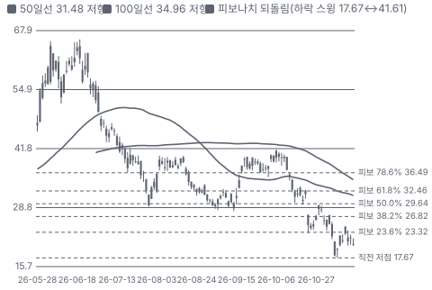

**주봉**

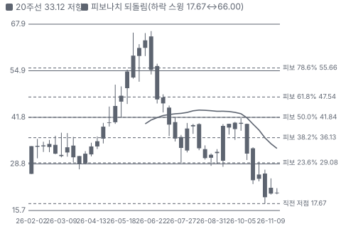

**월봉**

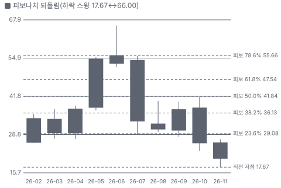

**분기 매출·EPS 실적과 컨센서스**

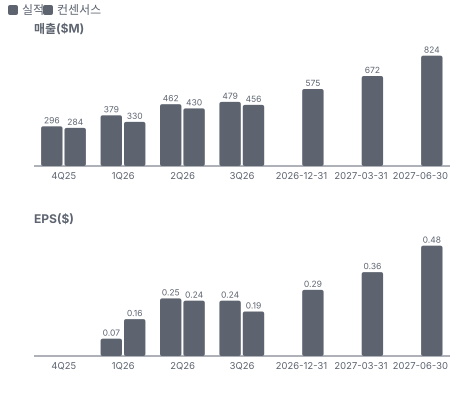

**4Q26 매출 — 지표 추세 vs 가이던스·컨센서스**

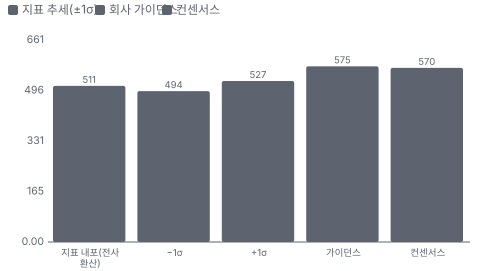

**최근 4개 분기 주가 변화 분석**

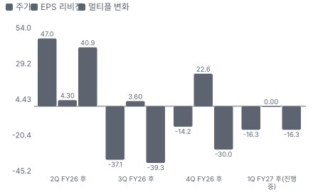

**EPS 리비전**

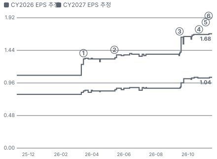

① 26-03-16 2Q FY26 첫 실적 — 하루 +11.6% · EPS 리비전 +6%
② 26-05-14 3Q FY26 실적·가이던스 상향 — 하루 +10.3% · EPS 리비전 +4%
③ 26-09-15 4Q FY26 실적·FY27 가이던스 — 하루 +9.5% · EPS 리비전 +21%
④ 26-10-22 CFO 교체·1Q 예고 — 하루 −21.5% · EPS 리비전 +0%
⑤ 26-11-04 선거 뒤 데이터센터 규제 우려 · EPS 리비전 +0%
⑥ 26-11-12 1Q FY27 실적·가이던스 상향 — 하루 −9.8% · EPS 리비전 +0%

**멀티플 프리미엄(Fwd 1Y P/E, 최근 4개 분기말)**

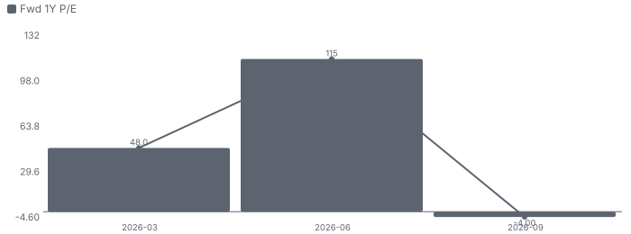

**합리적 멀티플**

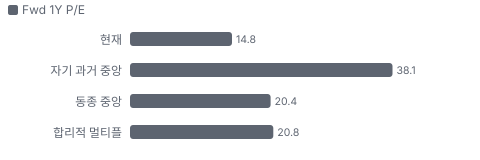

**밸류에이션 주가 시나리오**

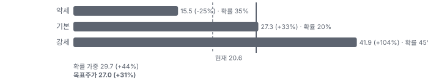

**주가별 업사이드**

- 제품·서비스 포트폴리오

**고객 믹스(1Q FY27, 매출 대비)**

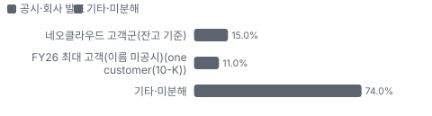

**공급 병목(10점, 낮을수록 병목)**

**생산능력 현재와 확충 계획(제조 면적(sq ft))**

**CAPEX의 매출 대비 비중**

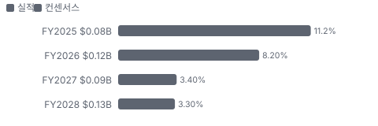

**어닝콜 변화별 주주가치 영향**

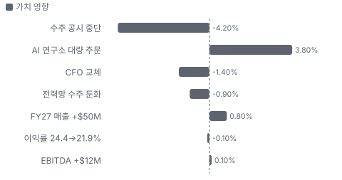

**수주·파이프라인 확실성 사다리**

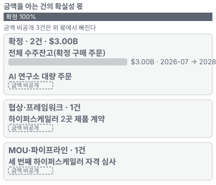

**수주/출하 비율 × 재고 일수 — 분기별(B/B 100 = 수주와 출하가 같다)**

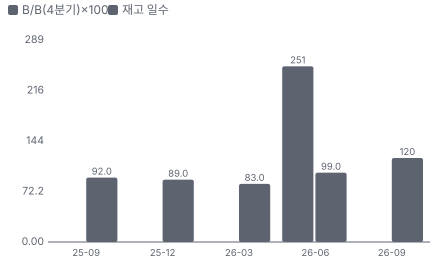

**매출 → 매출총이익 → 영업이익(매출 = 100, 최근 4분기)**

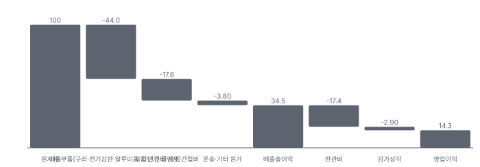

**분기 비용 비중 추이(매출 대비, 공시)**

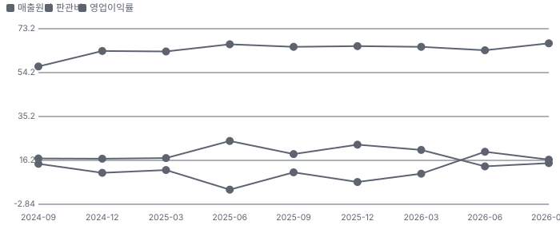

**비용 요인별 매출 대비 비중 1년 변화**

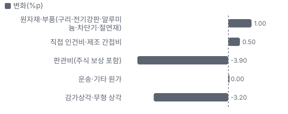

**맞춤 제품 BOM 원가 몫**

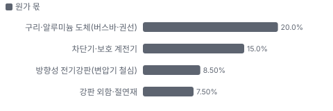

**파워트레인 솔루션 BOM 원가 몫**

**BOM 항목 가격 +10% 시 OPM 변화**

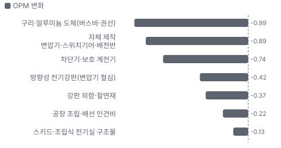

**원가 물가 vs 판매가 물가 — 1년 변화(원가가 판매가보다 더 오르면 단가를 올리지 못하는 만큼 마진이 줄어든다): 원가가 판매가 쪽 물가보다 14.3%p 더 올라 단가 인상이 따라가지 못하면 마진 압박**

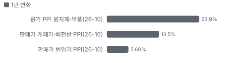

**사업별 매출 vs 물가 — 전년 대비(명목 매출 · 비교 물가 · 실질 = 물량·믹스)**

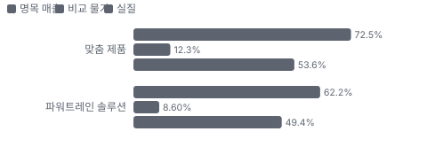

**자산 구성 — 3Q26 분기말 투하자본 \$1.30B**

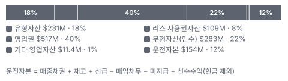

**자산별 변화율 — 최근 5개 분기(2Q25 = 0%) + 다음 4개 분기 추정**

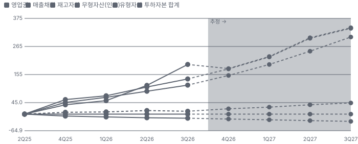

**ROIC 추이 — TTM, 최근 1개 분기 + 다음 4개 분기 추정(컨센서스 NOPAT)**

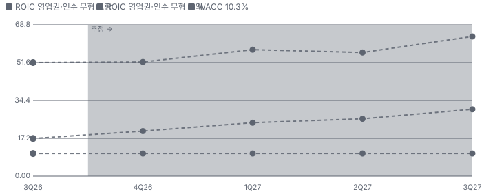

**분기 감가 비율 연율(유형자산 총액 대비)**

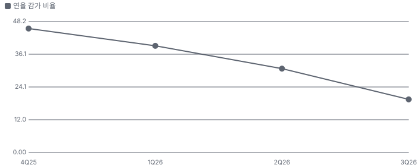

**생산시설별 면적(sq ft, 큰 순) — 생산능력 미공시라 면적을 대용으로**

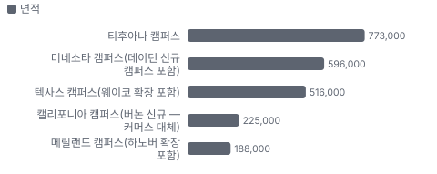

**매출 vs PPI·수출입 — 3Q24 = 100(변화율, 로그 눈금)**

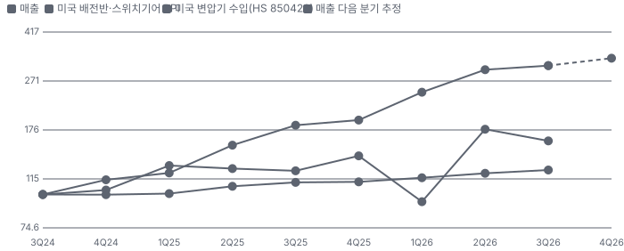

**매출 증가율의 가격·물량 분해와 8분기 전망(전년 대비)**

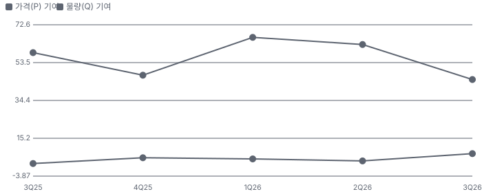

**분기별 매출 증가율 분해**

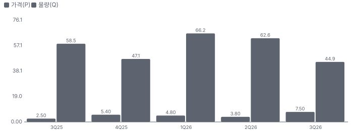

**목표주가 산정 — 약세와 기본 사이(약세 쪽 6%), 도달 확률 약 56%**

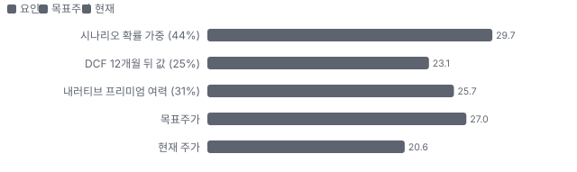

**PEG — 성장 대비 멀티플(낮을수록 성장 대비 쌈)**

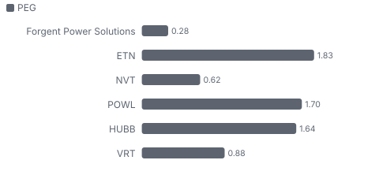

**커뮤니티 언급 수(최근 30일, 채널별)**

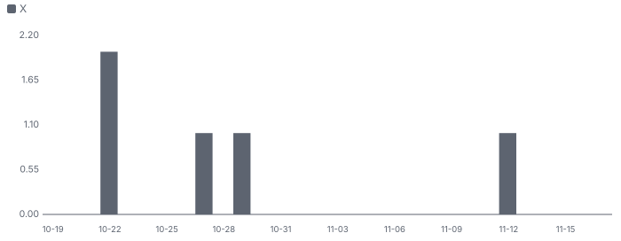

**커뮤니티 게시 수(월, 최근 7개월 — 이번 달은 진행 중)**

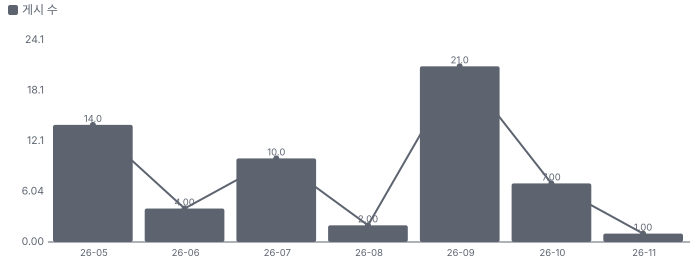

**일별 거래량 분해**

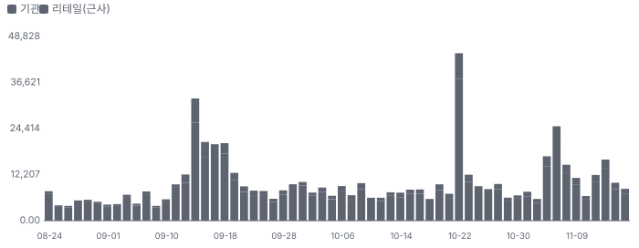

**기관 자금 흐름**

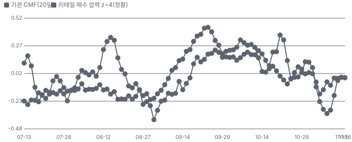

**몬테카를로**

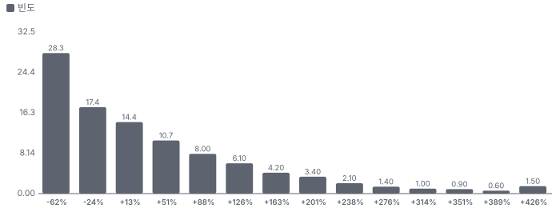

해석: 3,000번 중 1,557번(52%)에서 가치가 지금 주가 이상이었다. 지금 주가를 뒷받침하는 경우와 그렇지 않은 경우가 반반에 가깝다. 가운데 값은 1.05배이고, 열 번 중 여덟 번은 0.37~2.93배 사이에 든다.

## 내러티브

> **기업가치를 결정하는 이야기:** 이 회사는 데이터센터·전력망·대형 산업 시설에 들어가는 중·저전압 배전 설비(스위치기어·변압기·배전반·PDU(데이터센터 서버 랙으로 전기를 나눠 주는 배전 장치))를 주문 설계로 만드는 미국 회사다. 2023년 사모펀드 Neos가 여러 제조사를 묶어 만들었고 2026년 2월 상장했다. 매출의 74%가 맞춤 제품(고객 사양에 맞춰 설계·제작하는 배전 장비, engineered-to-order), 22%가 공장에서 묶어 내는 파워트레인 모듈이다. 가치는 '공급 부족 기간 동안 늘린 공장을 얼마나 빨리 채우고, 부족이 풀린 뒤에도 납기 우위가 남느냐'다.

> **멀티플·EPS 프리미엄**
> **멀티플:** Fwd 1Y P/E 14.8배로 동종 5곳(Eaton·nVent·Powell·Hubbell·Vertiv) 중앙값 20.4배보다 27% 낮다. 상장 뒤 자기 범위(17.6~69.4배, 월말)의 바닥 아래다. 시장은 동종 중 가장 빠른 성장에 할인을 준다.
> **EPS:** 다음 4개 분기 EPS 컨센서스 \$1.39는 TTM 조정 EPS \$0.79의 약 1.8배(계산)이고, FY28 EPS 컨센서스 \$2.01(+47%)은 동종보다 훨씬 빠르다.

### 투자자들은 왜 열광했나

상반기 투자자들은 '미국이 변압기의 4분의 3을 수입하는데 이 회사는 미국에서 짧은 납기로 만든다'는 이야기로 몰렸다 — 공모가 \$27에서 6월 \$64.59. 열기는 스폰서 세 차례 매각, 10/22 CFO 교체와 수주 공시 중단(하루 −21.5%), 11월 선거 뒤 데이터센터 규제 우려(이틀 −33%)로 식었다.

### 무엇이 기업가치를 바꾸나

> **구조적 체질 변화**
> **변화:** 중개사 경유 단품 판매에서 최종 고객 직접 통합 솔루션으로
> **증거:** 1Q 콜: AI 연구소 2곳 직접 주문·하이퍼스케일러 2곳 제품 계약
> **반증:** FY27 하반기 하이퍼스케일러 직접 주문 없음

> **고부가 믹스 확장**
> **변화:** 파워트레인 모듈 비중 확대 — 현장 작업을 공장으로 가져와 고객당 매출이 커진다
> **증거:** FY26 매출 비중 25%, 잔고의 약 40%(4Q 콜)
> **반증:** 파워트레인 비중 2개 분기 연속 20% 아래

> **기술 혁신**
> **변화:** 해당 없음 — 배전 설비 자체는 성숙 기술. 차별점은 맞춤 설계 속도와 모듈화
> **증거:** 10-K 사업 설명
> **반증:** -

> **실행 속도**
> **변화:** 납기 주수는 공시하지 않는다. 잔고 ÷ 월평균 매출로 보면 1년 새 약 13.5개월 → 25.4개월로 길어졌다 — 다년 주문이 늘었다 **납품 리드타임 25.4개월.** 피어 비교 미확인. 2025-06(잔고 \$0.85B ÷ TTM 월평균 \$62.8M, 계산) 13.5개월보다 88% 길다.
> **증거:** 잔고 2025-06 \$0.85B ÷ TTM 월평균 \$62.8M, 2026-06 \$3.0B ÷ \$118.3M(계산, 10-K). 10-K는 '업계 최단 납기'라고만 쓴다
> **반증:** 동종 증설 뒤 성장률이 동종 수준으로 수렴

> **M&A**
> **변화:** 해당 없음 — 상장 뒤 인수 없음(설립 단계 통합만)
> **증거:** 10-K
> **반증:** -

> **정책·입법 연관성**
> **재정정책:** 해당 없음(회사 매출에 직접 걸린 세출 확인 안 됨) — 재생에너지 세액공제 축소가 전력망 수주에 간접 영향 1Q 콜(안전항 앞당김) 반증: - 의회 동의 10/10 — 하원 5/5(2025년 세법 개정으로 청정에너지 세액공제 단계적 축소가 이미 반영(법안 번호 미확인)) · 상원 5/5(같음).
> **행정명령:** 외국산 전력망 장비 제한(12월 행정명령 — Jefferies 질문, 회사는 국내 생산자에 유리하다고 답변) 1Q 콜 반증: 제한 완화 의회 동의 2/10 — 하원 1/5(행정명령 — 의회 표결 기록 미확인) · 상원 1/5(같음).
> **연관입법:** 데이터센터 인허가·모라토리엄(신규 인허가 일시 중단) 논의 — 주·지방 단위(선거 뒤 공약 주지사 당선, IB 자료 요지) 1Q 콜 첫머리·IB 자료 요지 반증: 주요 주의 신규 인허가 중단 입법

> **고객의 지출 예산**
> **변화:** 고객 돈은 거의 전부 CAPEX — 데이터센터 건설비·전력망 투자·공장 건설비
> **사업별 예산:** **매출의 74%**: 맞춤 제품 — 고객 CAPEX(데이터센터·변전소·공장 건설 전기 설비) · 동인: 데이터센터 착공·전력망 증설
**매출의 22%**: 파워트레인 솔루션(변압기·스위치기어·배전반 등을 공장에서 묶어 짠 통합 모듈 전력 설비, Powertrain Solutions) — 고객 CAPEX(데이터센터 전력 경로 설비(현장 시공비 대체)) · 동인: 모듈 채택
**매출의 2%**: 서비스 — 고객 OPEX(설비 유지보수·시험) · 동인: 설치 기반
> **증거:** 10-K 최종 시장(데이터센터·전력망·산업)
> **반증:** 하이퍼스케일러 2027 CAPEX 가이던스 하향

### 내러티브 근거

> '미국산 데이터센터 변압기·스위치기어를 가장 빨리 내는 회사'라는 이야기는 6월 종가 \$64.59에서 정점이었다. 스폰서 매각 세 번, CFO 교체·수주 공시 중단, 선거 뒤 데이터센터 규제 우려가 이어지며 주가는 고점보다 68% 낮다. 같은 기간 FY27 EPS 추정은 올랐다. 동종 대비 멀티플 차이 -27% 중 회사 고유 몫은 -29%다. 단계는 소멸, 쏠림은 낮음(공매도 유통 주식의 7.2%, Quantral 7일 77 Strong·24시간 63 Moderate, ApeWisdom 771위)이다.

> **미국산 배전 설비 공급 부족** · 유지
> **논리:** 데이터센터·전력망 수요가 업계 생산능력을 넘고, 짧은 납기의 미국 공장이 점유율을 가져간다
> **숫자:** FY26 매출 +89%, FY27 가이던스 +80%(중간값), 6월 잔고 \$3.0B
> **반증:** 2개 분기 연속 가이던스 하향
> **출처:** 10-K·1Q 보도자료

> **하이퍼스케일러·AI 연구소 직접 판매** · 강화
> **논리:** 중개사 경유 단품에서 최종 고객 직접 통합 솔루션으로 올라가면 고객당 매출이 커진다
> **숫자:** AI 연구소 2곳 주문, 하이퍼스케일러 2곳 제품 계약(1Q 콜)
> **반증:** FY27 하반기에 하이퍼스케일러 직접 주문이 없다
> **출처:** 1Q 콜

> **이익률 확장** · 약화
> **논리:** 증설 램프가 끝나면 흡수율·판관비 레버리지로 조정 EBITDA 이익률이 오른다
> **숫자:** FY27 가이던스 24%, 1Q 21.9%
> **반증:** 2Q 조정 EBITDA 이익률이 22% 아래
> **출처:** 1Q 보도자료·콜

> **스폰서 오버행·지배구조** · 유지
> **논리:** Neos 잔여 지분과 Up-C·TRA 구조가 주가를 누른다
> **숫자:** 2026년 Neos 매각 약 135M주(Form 4 합, 계산), Class B 잔여 29.9M주, TRA \$483M
> **반증:** Class B 잔여분 소진과 매각 공백 2개 분기
> **출처:** Form 4·10-Q

> **AI 데이터센터 사이클 정점·규제 (반대 내러티브)** · 강화
> **논리:** 하이퍼스케일러 CAPEX 증가율 둔화와 선거 뒤 주 단위 모라토리엄이 2028년 주문을 줄인다
> **숫자:** 11/4~5 이틀 −33%, 업계 자료상 감액 대상 주 6곳 → 8곳(IB 자료 요지)
> **반증:** 2Q 콜에서 수주 증가 정성 확인과 하이퍼스케일러 직접 주문
> **출처:** 1Q 콜·IB 자료 요지

### 투자 포인트

> **이익은 올랐고 배수만 무너졌다**
> **명제:** 9월 콜 이후 주가 −28%는 이익이 아니라 배수에서 나왔다
> **숫자:** FY27 EPS 컨센서스 9/14 \$1.07 → 11/10 \$1.35(+25%), FY28 \$1.64 → \$2.01(+22%). 같은 기간 주가 \$28.64 → \$20.57(TradingView)
> **시장과 다른 점:** 시장은 수주 공시 중단을 FY28 주문 공백의 신호로 읽지만, 1Q 이연매출이 \$159M(+60%) 늘었다 — 선수금은 주문 없이 들어오지 않는다
> **증명:** 2Q FY27 이연매출이 \$400M 이상을 유지하고 매출이 가이던스 중간값 \$575M 이상
> **출처:** https://www.sec.gov/Archives/edgar/data/2080126/000208012626000046/fps-20260930.htm

> **FY27은 확정 주문이 받친다**
> **명제:** 잔고가 FY27 매출 가이던스 \$2.45~2.65B를 100% 덮는다
> **숫자:** 6월 잔고 \$3.0B(확정 구매 주문만, LOI·MOU 제외), 1Q 매출 \$479M으로 가이던스 상단 초과(1Q 콜·보도자료)
> **시장과 다른 점:** 시장은 '2027이 오지 않을 것처럼' 가격을 매긴다 — Fwd 1Y P/E 14.8배는 동종 중앙 20.4배보다 27% 낮다
> **증명:** 2Q·3Q 매출이 가이던스 경로(2Q \$560~590M) 위
> **출처:** https://www.sec.gov/Archives/edgar/data/2080126/000208012626000045/exhibit991earningsrelease_.htm

> **약한 고리 — FY28 가시성과 구조 할인**
> **명제:** FY28을 확인할 숫자가 사라졌고, 스폰서·TRA 구조가 배수를 누른다
> **숫자:** 1Q부터 분기 수주·B/B 미공시, CFO 교체(10/22), Class B 29.9M주·TRA 미지급금 \$483M(10-Q)
> **시장과 다른 점:** -
> **증명:** 하이퍼스케일러 첫 직접 주문(회사 예상 FY27 하반기)과 FY28 잔고 커버리지 정성 발언
> **출처:** https://www.sec.gov/Archives/edgar/data/2080126/000208012626000046/fps-20260930.htm

### 모멘텀 생성·소멸 타임라인

**카탈리스트 달력 — 지난 사건의 주가 반응과 앞으로 확인할 숫자**
| 날짜 | 상태 | 구분 | 사건 | 반응·확인 | 결과에 따라 |
|---|---|---|---|---|---|
| 2026-09-15 | 완료 | 생성 | 4Q FY26 실적 — 수주 \$1.5B·B/B 3.3배·FY27 가이던스 +76% | +9.5%(1일), 10/2까지 +41% |  |
| 2026-10-22 | 완료 | 소멸 | CFO 교체 8-K + 1Q 상단 초과 예고 | −21.5%(1일) |  |
| 2026-11-04 | 완료 | 매크로 | 중간선거 뒤 데이터센터 규제 우려 | −32.9%(11/3 → 11/5 종가) |  |
| 2026-11-12 | 완료 | 확인 | 1Q FY27 실적·연간 가이던스 상향, 수주 공시 중단 | −9.8%(1일) |  |
| 2026-11-16 | 완료 | 생성 | CEO·CFO 등 4명 장내 매수 \$1.08M(Form 4) | −7.0%(당일) |  |
| 2027-02 중순(예상) | 예정 | 확인 | 2Q FY27 실적 | 매출 \$560~590M, 조정 EBITDA 이익률 22% 이상, 이연매출 \$400M 이상 | 모두 충족이면 기본~강세, 매출 하단 미달이면 약세 |
| 2027-06까지(회사 예상) | 예정 | 확인 | 하이퍼스케일러 첫 직접 주문 | 제품 계약 2곳 중 1곳 이상 구매 주문 | 있으면 FY28 성장 경로(강세), 없으면 기본 유지·배수 회복 지연 |
| 2027-01~02(예상) | 예정 | 매크로 | 하이퍼스케일러 2027 CAPEX 가이던스(4Q 실적) | 2027 CAPEX 증가율 유지·상향 | 하향이면 약세 시나리오 확률 상승 |

### 언제 사서 언제 팔아야 할까?

**가격·조건 틀 — 가격은 밸류에이션(약세·기본·강세·목표주가)과 차트 지지 구간에서, 조건은 이벤트에서**
| 구간 | 가격 | 목표주가까지 | 약세까지 | 조건·근거 |
|---|---|---|---|---|
| 관찰 구간 | \$18~\$18 | +53% | -13% | 주가가 상장 뒤 저점(\$17.67, 11/6 장중) 근처이고 차트 지지 구간과 겹친다 |
| 확인 뒤 | 지금 \$21 이상에서 조건 확인 | +31% | -25% | 2Q FY27 매출이 가이던스 중간값 \$575M 이상이고 조정 EBITDA 이익률 22% 이상 |
| 무효화 | 약세 시나리오 \$15 | - | -25% | 2Q 매출이 하단 \$560M 미만이거나 이연매출이 2개 분기 연속 감소, 또는 연간 가이던스 하향 |
| 차익 고민 1차 | \$27(목표주가·기본 시나리오) | +33% | - | 목표주가 근처에서는 하이퍼스케일러 주문 확인 전 배수 회복이 먼저 왔는지 본다 |
| 차익 고민 2차 | \$42(강세 시나리오) | +104% | - | 목표주가 근처에서는 하이퍼스케일러 주문 확인 전 배수 회복이 먼저 왔는지 본다 |

하루 평균 변동이 약 11%(Quantral)라 이벤트 직전 추격을 경계한다 가격·조건 틀이며 매매·비중 지시가 아니다(투자 권유 아님).

## 포트폴리오

| 제품·서비스 | 구분 | 무엇 | 쓰는 곳 | 돈 버는 방식 | Mix | Mix 변화(전 분기 대비) |
|---|---|---|---|---|---|---|
| 맞춤 제품 | 제품 | 주문 설계형 중전압 스위치기어(1~38kV 전기를 켜고 끊고 보호하는 차단 설비)·건식/유입 변압기·배전반·패널보드·PDU | 데이터센터·전력망·산업 시설 배전 | 1Q 매출 \$353.9M(+73%), 매출의 74% | 74% | +10.8%p |
| 파워트레인 솔루션 | 제품 | 변압기·스위치기어·배전반을 공장에서 묶은 통합 전력 모듈(전력 스키드·eHouse(전기 설비를 미리 넣어 출하하는 조립식 전기실)) | 데이터센터 전력 경로를 현장 시공 없이 설치 | 1Q 매출 \$106.1M(+62%), 매출의 22%, 잔고의 약 40%(4Q 콜) | 22% | -9.6%p |
| 표준 제품 | 제품 | 자동 절체 스위치·탭 박스·발전기 연결함 등 | 재고형 소형 배전 품목 | 1Q \$10.7M(2%) | 2% | -0.2%p |
| 서비스 | 서비스 | 시운전·시험·유지보수·개조 | 설치 뒤 운영 지원 | 1Q \$7.9M(2%) | 2% | -1.0%p |

**Mix 변화가 가장 큰 쪽은 맞춤 제품(+10.8%p, 전 분기 대비).** 계절성 판정: 분기 매출 계절 지수 기준 없음 → 직전 분기와 비교.

## 고객

> **1Q FY27 최대 고객 네오클라우드 고객군(잔고 기준) 15%, 상위 3곳 26%, 집중도 분산.** 공시·회사 발표로 확인한 몫은 매출의 26%이고, 나머지 고객 몫은 추정이거나 미분해다. 1Q FY27에는 매출 10%를 넘는 고객이 없다(1년 전 2곳 13%·11%). FY26에는 1곳이 11%였다(이름 미공시). 잔고의 약 15%가 네오클라우드, 나머지 85%는 코로케이션·EPC(설계·조달·시공 일괄 업체)·전력망·OEM·중개사와 하이퍼스케일러·AI 연구소다(1Q 콜). 고객 이름을 공시하지 않아 유형별로만 쓴다.

**고객별 매출 몫(1Q FY27)**
| 고객 | 몫 | 변화 | 근거 |
|---|---|---|---|
| 네오클라우드 고객군(잔고 기준) | 15% | 미확인 | 회사 발표 |
| FY26 최대 고객(이름 미공시)(one customer(10-K)) | 11% | 미확인 | 공시 |
| AI 연구소 직접 고객 2곳 | 미확인 | 미확인 | 회사 발표 |
| 기타·미분해 | 74% | - | - |

> **네오클라우드 고객군(잔고 기준)** · 회사 발표
> **사는 것:** 데이터센터 배전 설비
> **추정 근거:** 매출이 아니라 잔고 비중 — 매출 몫의 대용

> **FY26 최대 고객(이름 미공시)(one customer(10-K))** · 공시
> **사는 것:** 미확인
> **추정 근거:** FY26 매출의 11%, 매출채권의 15%

> **AI 연구소 직접 고객 2곳** · 회사 발표
> **사는 것:** 대량 주문 1건·첫 주문 1건
> **추정 근거:** 회사는 이름을 밝히지 않았다

## 수주·파이프라인

> **2026-06-30 기준 4건.** 확정 \$3.00B. 공시 수주잔고 \$3.00B. 서로 겹치는 항목은 합계에서 뺐다.

**수주 목록**
| 상태 | 계약 | 계약 총액 | 진척 | 기간 | 비고 |
|---|---|---|---|---|---|
| 확정 | 전체 수주잔고(확정 구매 주문) | \$3.00B | 비공개 | 2026-07 → 2028-06 | - |
| 확정 | AI 연구소 대량 주문 | 금액 비공개 | 비공개 | - | (다른 항목과 겹칠 수 있어 합계에서 뺌) |
| 프레임워크 | 하이퍼스케일러 2곳 제품 계약 | 금액 비공개 | 비공개 | - | (다른 항목과 겹칠 수 있어 합계에서 뺌) |
| 파이프라인 | 세 번째 하이퍼스케일러 자격 심사 | 금액 비공개 | 비공개 | - | (다른 항목과 겹칠 수 있어 합계에서 뺌) |

**실행 속도와 방해 요인**
| 항목 | 상태 | 실행 속도 | 방해 요인 |
|---|---|---|---|
| 전체 수주잔고(확정 구매 주문) | 확정 | FY27 매출 가이던스를 100% 덮고 FY28까지 이어진다(1Q 콜) | 증설 캠퍼스 램프 · 고객 프로젝트 일정 변경 · 데이터센터 인허가 규제 |
| AI 연구소 대량 주문 | 확정 | 첫 주문 이행 뒤 후속 대량 주문 | 고객 데이터센터 착공 일정 |
| 하이퍼스케일러 2곳 제품 계약 | 프레임워크 | 첫 직접 주문은 FY27 하반기 예상(회사) | 구매 주문 전 단계 · 고객 내부 승인 |
| 세 번째 하이퍼스케일러 자격 심사 | 파이프라인 | 심사 진행 | 공장 감사·기술 검증 |

## 마진 구조

> **GPM 33.1%, OPM 16.5%.** 1Q FY26 대비 GPM -1.5%p, OPM +5.5%p. 변동비는 매출의 61%이고, 매출이 10% 늘면 OPM은 +2.0%p 움직인다. 1Q FY27 매출원가는 매출의 66.9%로 1년 전 65.4%보다 1.5%p 높다 — 증설 캠퍼스 램프의 저흡수 인건비 때문이다(콜). 판관비는 15.0%로 1년 전 18.9%에서 3.9%p 내려갔고(스폰서 수수료·상장 준비비 소멸), 무형 상각이 줄어 영업이익률은 16.5%(1년 전 11.0%)다.

> **매출 100 중 매출원가 65.5, 매출총이익 34.5(최근 4분기, 공시).** 매출원가 요인 중 원자재·부품(구리·전기강판·알루미늄·차단기·절연재)이 매출의 45.0%로 가장 무겁고, 단가가 +10% 오르면 GPM이 -4.50%p 움직인다. 분기 회귀로 매출 1이 늘 때 매출원가는 0.68 늘고, 매출원가의 고정비 몫은 -4%다. 매출원가 요인 비중은 요인별 공시 기간 값이라 합이 최근 4분기 매출원가를 넘어, 그림에서는 0.98배로 비례 조정했다.

**비용 요인 강도 — 비중·추세·충격(+10%)·탄력**
| 비용 | 구분 | 매출 대비 | 1년 변화 | 마진 기여 | 충격 시 마진 | 매출 탄력 | 고정비 몫 |
|---|---|---|---|---|---|---|---|
| 원자재·부품(구리·전기강판·알루미늄·차단기·절연재) | 매출원가 요인 | 45.0% | +1.0%p | -1.0%p | -4.50%p | 미확인 | 0% |
| 직접 인건비·제조 간접비 | 매출원가 요인 | 18.0% | +0.5%p | -0.5%p | -1.80%p | 미확인 | 50% |
| 운송·기타 원가 | 매출원가 요인 | 3.9% | +0.0%p | -0.0%p | -0.39%p | 미확인 | 30% |
| 매출원가 | 공시 항목 | 65.5% | +0.5%p | -0.5%p | -6.55%p | 0.68 | -4% |
| 판관비 | 공시 항목 | 17.4% | -2.3%p | +2.3%p | 미확인 | 0.13 | 26% |
| 감가상각 | 공시 항목 | 2.9% | -3.4%p | +3.4%p | 미확인 | -0.02 | 100% |

매출 탄력 = 분기 비용을 매출에 회귀한 기울기(매출 1당 변동비), 고정비 몫 = 절편 ÷ 평균 비용. 표본이 8분기 미만이면 미확인. 매출원가 요인 비중은 margin 재료의 추정이 섞여 있고, 공시 매출원가와의 차이는 '기타 매출원가'로 둔다.

**GPM에서 OPM까지(GAAP, 아래는 최근 4개 분기)**
| 기간 | GPM | 연구개발 | 판관비 | 기타 | OPM |
|---|---|---|---|---|---|
| 1Q FY26 | 34.6% | 0.0% | 18.9% | 4.7% | 11.0% |
| 1Q FY27 | 33.1% | 0.0% | 15.0% | 1.5% | 16.5% |
| 2025-12 | 34.3% | - | - | - | 6.8% |
| 2026-03 | 34.6% | - | - | - | 10.4% |
| 2026-06 | 36.1% | - | - | - | 19.9% |
| 2026-09 | 33.1% | - | - | - | 16.5% |

**비용을 움직이는 요인**
| 비용 | 요인 |
|---|---|
| 원자재·부품(구리·전기강판·알루미늄·차단기·절연재, 매출원가) | 구리·강판 시세, 차단기 구매가 · 근거 추정 |
| 직접 인건비·제조 간접비(매출원가) | 신규 캠퍼스 채용·훈련(저흡수 인건비) · 근거 추정 |
| 판관비(주식 보상 포함, 판관비) | 엔지니어링·영업 인력, 주식 보상 1Q \$13.9M · 근거 공시 |
| 운송·기타 원가(매출원가) | 대형 설비 운송 · 근거 추정 |
| 감가상각·무형 상각(기타) | 인수 무형 상각 감소(\$12.8M → \$6.3M) · 근거 공시 |

**맞춤 제품 BOM — 매출의 74%, GPM 33%(제품별 매출총이익 미공시 — 회사 전체 1Q GPM 33.1%), 항목 가격 +10% 시**
| 항목 | 원가 몫 | 전가 | 제품 GPM | OPM |
|---|---|---|---|---|
| 구리·알루미늄 도체(버스바·권선) | 15~25% | 미확인 | -1.3%p | -0.99%p |
| 차단기·보호 계전기 | 10~20% | 미확인 | -1.0%p | -0.74%p |
| 방향성 전기강판(변압기 철심) | 5~12% | 미확인 | -0.6%p | -0.42%p |
| 강판 외함·절연재 | 5~10% | 미확인 | -0.5%p | -0.37%p |
| 미분해 | 49% | - | - | - |

**파워트레인 솔루션 BOM — 매출의 22%, GPM 33%(제품별 매출총이익 미공시 — 회사 전체 1Q GPM 33.1%를 대용), 항목 가격 +10% 시**
| 항목 | 원가 몫 | 전가 | 제품 GPM | OPM |
|---|---|---|---|---|
| 자체 제작 변압기·스위치기어·배전반 | 50~70% | 미확인 | -4.0%p | -0.89%p |
| 공장 조립·배선 인건비 | 10~20% | 미확인 | -1.0%p | -0.22%p |
| 스키드·조립식 전기실 구조물 | 5~12% | 미확인 | -0.6%p | -0.13%p |
| 미분해 | 17% | - | - | - |

구리·알루미늄 도체(버스바·권선) 가격이 +10% 오르면 영업이익은 -6.0% 움직인다. 판매가 전가를 모르는 항목은 전가 0%로 계산했다.

**BOM 항목 가격을 움직이는 것**
| 항목 | 요인 |
|---|---|
| 구리·알루미늄 도체(버스바·권선) | 변압기·스위치기어 원가의 가장 큰 원자재 — 10-K는 견적에 현재 시세를 반영한다고 쓰지만 고정가 잔고의 전가 몫은 공시하지 않는다 · 근거 추정 |
| 차단기·보호 계전기 | 스위치기어 핵심 부품 · 근거 추정 |
| 방향성 전기강판(변압기 철심) | 변압기 손실을 정하는 소재 · 근거 추정 |
| 강판 외함·절연재 | 외함·절연 · 근거 추정 |
| 자체 제작 변압기·스위치기어·배전반 | 모듈 안 주요 설비 · 근거 추정 |
| 스키드·조립식 전기실 구조물 | 모듈 외피 · 근거 추정 |
| 공장 조립·배선 인건비 | 현장 인력 대체분 · 근거 추정 |

> **원가·판매가 물가 격차 -14.3%p** — 판매가 물가가 투입 원가 물가보다 느리게 오른다.

**투입 물가 — 미국 PPI 3·6·12개월(2026-10, 개정 반영)과 해외 전년비**
| 항목 | 미국 3개월 | 6개월 | 12개월 | 전가 못 할 때 OPM | 일본 | 한국 | 대만 |
|---|---|---|---|---|---|---|---|
| 구리·알루미늄 도체(버스바·권선) | +3.4% | +7.2% | +23.9% | - | +42.6% | +25.8% | +40.1% |
| 차단기·보호 계전기 | +4.1% | +4.9% | +13.5% | - | +23.2% | +1.6% | +10.6%* |
| 자체 제작 변압기·스위치기어·배전반 | +1.9% | +6.5% | +5.6% | - | -1.5% | +16.6% | +10.6%* |

별표는 품목보다 넓은 업종 지수다. 연결한 투입 원가의 미국 PPI(생산자물가지수)는 1년 새 가중 +23.9%이고, 판매가로 넘기지 못하면 GPM -10.7%p·OPM -10.7%p가 움직인다. 판매가 비교 물가(개폐기·배전반 PPI)는 1년 새 +13.5% — 회사 가격 변화는 미확인. 물가 지수를 붙이지 못한 매출원가 항목은 직접 인건비·제조 간접비, 운송·기타 원가다(미연결). 맞춤 제품 매출은 2026-09 전년 대비 +72.5%이고 비교 물가 ppi:switchgear의 변화 +12.3%(2026-09)를 빼면 실질 +53.6% — 물량·믹스가 성장을 이끌었다. 파워트레인 솔루션 매출은 2026-09 전년 대비 +62.2%이고 비교 물가 ppi:transformer의 변화 +8.6%(2026-09)를 빼면 실질 +49.4% — 물량·믹스가 성장을 이끌었다.

## 자산 구성

> **3Q26 분기말 투하자본 \$1.30B** — 영업권 40%, 무형자산(인수) 22%. 최근 5개 분기(2Q25 → 3Q26) 가장 크게 늘어난 자산은 재고자산(+194%), 투하자본 합계 +11%. 3Q27 추정 투하자본 \$1.69B(+29%, 컨센서스 매출과 회전 일수·CAPEX 강도 유지 가정).

**자산·운전자본 항목별 분기말 잔액 — 최근 12개 분기와 다음 4개 분기 추정**
| 항목 | 2Q25 | 2Q25 | 3Q26(최근) | 3Q27 추정 | 5개 분기 변화 | 다음 4개 분기 변화 |
|---|---|---|---|---|---|---|
| 매출채권 | \$160.0M | \$160.0M | \$380.2M | \$696.9M | +138% | +83% |
| 재고자산 | \$117.6M | \$117.6M | \$346.2M | \$515.0M | +194% | +49% |
| 선급·기타 유동자산 | \$56.3M | \$56.3M | \$143.6M | \$218.4M | +155% | +52% |
| 매입채무 | \$61.9M | \$61.9M | \$166.2M | \$260.2M | +168% | +57% |
| 미지급비용 | \$79.5M | \$79.5M | \$126.7M | \$270.5M | +59% | +114% |
| 선수수익(계약부채) | \$110.9M | \$110.9M | \$423.3M | \$527.4M | +282% | +25% |
| 유형자산 | \$108.2M | \$108.2M | \$230.9M | \$434.6M | +113% | +88% |
| 리스 사용권자산 | \$117.8M | \$117.8M | \$108.7M | \$108.7M | -8% | +0% |
| 영업권 | \$516.6M | \$516.6M | \$516.6M | \$516.6M | +0% | +0% |
| 무형자산(인수) | \$337.3M | \$337.3M | \$283.1M | \$241.7M | -16% | -15% |

**자산 추정 동인 — 최근 4개 분기 평균(재무상태표 동인 모형)**
| 동인 | 값 | 곱하는 기준 |
|---|---|---|
| 매출채권 | 70일 | 매출 |
| 재고자산 | 79일 | 매출원가 |
| 선급·기타 유동자산 | 22일 | 매출 |
| 매입채무 | 40일 | 매출원가 |
| 미지급비용 | 27일 | 매출 |
| 선수수익(계약부채) | 53일 | 매출 |
| CAPEX 강도 | 7.3% | 매출(최근 4개 분기 합) |
| 분기 감가율 | 3.32% | 기초 유형자산 순액(무형 상각 제외 감가상각) |
| 매출원가율 | 65.5% | 매출(최근 4개 분기) |
| 영업권·리스 사용권·기타 | 유지 | 인수·새 리스는 공시 전 모름 |
| 인수 무형자산 | 분기 \$10.3M 상각 | 최근 4개 분기 평균 상각 |

**추정 방법:** 증권사 3표 모델(손익·재무상태표·현금흐름)의 재무상태표 동인 방식이다. 운전자본은 항목별 회전 일수(매출채권·선급·미지급·선수는 매출, 재고·매입채무는 매출원가 기준)를 최근 4개 분기 평균으로 두고 컨센서스 매출에 곱한다. 유형자산은 기초 + CAPEX − 감가상각으로 굴린다(Koller·Goedhart·Wessels 『Valuation』 재무상태표 추정). 매출 경로는 ROIC 절의 컨센서스와 같다.

**유형·무형자산 항목별 가치(2026-06-30 vs 2025-06-30)**
| 구분 | 항목 | 총액 2026-06-30 | 누적상각 | 순액 | 총액 2025-06-30 | 총액 1년 변화 | 공시 내용연수 |
|---|---|---|---|---|---|---|---|
| 유형 | 유형자산 합계(항목 미분해) | \$229.3M | 총계만 공시 | 총계만 공시 | \$115.5M | +98.5% | 미확인 |
| 영업권 | 영업권 | \$516.6M | \$0.0M | \$516.6M | \$516.6M | +0.0% | 비상각 |
| 무형 | 무형자산 합계(항목 미분해) | \$416.2M | \$126.7M | \$289.5M | \$416.1M | +0.0% | 미확인 |
| 유형 합계 | 유형자산 | \$229.3M | \$24.4M | \$205.0M | \$115.5M | +98.5% | 경과율 11%(상각 대상 기준) |

**내용연수 산식(상각 대상 유형자산 = 총액 − 토지 − 건설중)**
| 기준일 | 연 감가상각 | 상각 대상 총액 | 평균 내용연수 | 경과 연수 | 잔여 연수 | 경과율 |
|---|---|---|---|---|---|---|
| 2026-06-30 | \$19.0M | \$229.3M | 12.1년 | 1.3년 | 10.8년 | 11% |
| 2025-06-30 | \$6.2M | \$115.5M | 18.6년 | 1.2년 | 17.4년 | 6% |

산식 평균 내용연수는 12.1년. 1년 전 18.6년 → 지금 12.1년.

**분기 감가 비율(감가상각 ÷ 평균 유형자산 총액)**
| 분기 | 감가상각 | 평균 유형자산(총액) | 분기 비율 | 연율 | 연율의 역수 |
|---|---|---|---|---|---|
| 4Q25 | \$16.4M | \$143.6M | 11.40% | 45.59% | 2.2년 |
| 1Q26 | \$18.2M | \$185.0M | 9.81% | 39.24% | 2.5년 |
| 2Q26 | \$16.5M | \$213.9M | 7.71% | 30.84% | 3.2년 |
| 3Q26 | \$12.0M | \$245.0M | 4.89% | 19.55% | 5.1년 |

감가상각 기준: 손익계산서 감가상각·상각비(SEC 공시 데이터, 4분기 = 연간 − 1~3분기).

미공시·미분해: 유형자산 항목별 총액·내용연수(10-K 주석에서 모델이 채움) · 무형자산 항목(10-K 주석에서 모델이 채움) — 이 칸은 비우고 나머지로 계산했다.

### 해석 — 자산이 어디에 쌓이고 있나

- 다음 4개 분기 CAPEX \$216.9M vs 감가상각 \$39.7M(최근 4개 분기 CAPEX 강도·감가율 유지) — 유형자산 3Q26 \$230.9M → 3Q27 \$434.6M. 투자가 감가보다 커서 자산이 쌓이는 국면이다.

## ROIC

> **TTM 3Q26 ROIC는 영업권·인수 무형 포함 17.1%, 제외 51.6%**(NOPAT 마진 13.1% × 투하자본 회전율 1.30회). 컨센서스 NOPAT으로 굴리면 3Q27 30.4%(제외 63.5%) — WACC 10.3% 대비 +20.1%p.

**ROIC 추이(TTM)와 다음 4개 분기 추정 — NOPAT ÷ 평균 투하자본(이번 분기말·4개 분기 전)**
| 분기 | 구분 | TTM 매출 | TTM NOPAT | NOPAT 마진 | 평균 투하자본 | ROIC 포함 | ROIC 제외 |
|---|---|---|---|---|---|---|---|
| 3Q26 | 실적 | \$1,615.4M | \$212.4M | 13.1% | \$1,238.8M | 17.1% | 51.6% |
| 4Q26 | 추정 | \$1,893.9M | \$274.1M | 14.5% | \$1,337.6M | 20.5% | 51.9% |
| 1Q27 | 추정 | \$2,187.4M | \$336.6M | 15.4% | \$1,383.5M | 24.3% | 57.5% |
| 2Q27 | 추정 | \$2,550.0M | \$383.1M | 15.0% | \$1,469.0M | 26.1% | 56.2% |
| 3Q27 | 추정 | \$2,976.4M | \$454.7M | 15.3% | \$1,495.0M | 30.4% | 63.5% |

**다음 4개 분기 NOPAT — 컨센서스(세율 25%, 리스 이자 별도)**
| 분기 | 매출 | EBITA 마진 | EBITA | NOPAT(분기) | 근거 |
|---|---|---|---|---|---|
| 4Q26 | \$575.0M | 20.0% | \$115.0M | \$86.2M | 컨센서스 매출 × EBIT 마진 FY2026(조정 − 주식보상 2.5%) |
| 1Q27 | \$672.2M | 20.0% | \$134.4M | \$100.8M | 컨센서스 매출 × EBIT 마진 FY2027(조정 − 주식보상 2.5%) |
| 2Q27 | \$824.2M | 20.0% | \$164.8M | \$123.6M | 컨센서스 매출 × EBIT 마진 FY2027(조정 − 주식보상 2.5%) |
| 3Q27 | \$905.0M | 20.0% | \$181.0M | \$135.8M | 컨센서스 매출 × EBIT 마진 FY2027(조정 − 주식보상 2.5%) |

**추정 방법:** NOPAT은 컨센서스(분기 매출 추정 × 회계연도 EBIT 마진 추정)로 잡고, 조정(비 GAAP) 마진이면 주식보상 몫을 빼서 과거 실적과 같은 기준(영업이익 + 인수 무형 상각)으로 맞췄다. 이미 발표했지만 분기 보고서(10-Q)가 아직 없는 분기는 발표 실적을 쓴다. 투하자본은 자산 구성 절의 재무상태표 동인으로 굴렸다. ROIC는 4개 분기 NOPAT을 이번 분기말과 4개 분기 전 투하자본의 평균으로 나눈다 — 추정 분기의 ROIC에는 이미 나온 실적 분기가 섞여 있다.

**투하자본 항목별 회전율과 ROIC 기여(TTM 3Q26, 기말 잔액)**
| 항목 | 투하자본 | 매출 1달러당 자본 | 회전율(매출 ÷ 항목) | 자본 몫 | 이 항목을 빼면 ROIC |
|---|---|---|---|---|---|
| 운전자본 | \$153.9M | 0.10 | 10.50회 | 12% | 18.9% |
| 유형자산 | \$230.9M | 0.14 | 7.00회 | 18% | 20.2% |
| 리스 사용권자산 | \$108.7M | 0.07 | 14.86회 | 8% | 18.2% |
| 영업권 | \$516.6M | 0.32 | 3.13회 | 40% | 27.5% |
| 무형자산(인수) | \$283.1M | 0.18 | 5.71회 | 22% | 21.2% |
| 기타 영업자산 | \$11.4M | 0.01 | 141.52회 | 1% | 16.8% |

**ROIC 세 가지 판**
| 판 | NOPAT | 투하자본 | ROIC | 무엇을 재나 |
|---|---|---|---|---|
| 영업권·인수 무형 포함 | \$217.1M | \$1,304.7M | 16.6% | 인수 웃돈까지 낸 돈에 대한 수익률 |
| 영업권·인수 무형 제외 | \$217.1M | \$504.9M | 43.0% | 본업 운영 수익률(동종 비교용) |
| 무형 자본화 조정(판관비 20%·5년, 연구개발 6년) | \$263.8M | \$1,380.7M | 19.1% | 비용으로 처리한 무형 투자를 자산으로 본 판 — 이력이 상각 기간보다 짧아 자산 과소 |
| 경제적 이익(포함판) | \$82.1M | \$1,304.7M | 자본비용 10.3% | (ROIC − 자본비용) × 투하자본 |

NOPAT = (영업이익 \$230.5M + 인수 무형 상각 + 리스 내재 이자 \$11.0M) × (1 − 세율 25%). 리스 사용권자산을 투하자본에 넣었으므로 임차료 속 이자 몫을 영업이익에 되더했다. 현금은 영업에 필요한 몫을 따로 알 수 없어 투하자본에서 뺐다. SEC 공시 데이터 자동 초안 — 운전자본 = 매출채권 + 재고 + 선급 − (매입채무 + 미지급비용 + 선수수익), 현금 제외. 손상 누계는 공시 데이터 수록분.

투하자본 또는 NOPAT이 0 이하라 ROIC 분해는 비교 불가 — 경제적 이익으로 본다.

**무형 자본화 가정별 ROIC(2026년 지출 기준, 포함판에 더함)**
| 투자로 보는 몫 | 상각 연수 | 무형 자산 | NOPAT 조정 | 조정 ROIC |
|---|---|---|---|---|
| 판관비 20% | 2년 | \$67.2M | \$38.0M | 18.6% |
| 판관비 20% | 5년 | \$76.0M | \$46.7M | 19.1% |
| 판관비 30% | 2년 | \$100.8M | \$56.9M | 19.5% |
| 판관비 30% | 5년 | \$114.0M | \$70.1M | 20.2% |

### 해석 — 무엇이 수익성을 끌어올리고 희석하나

- 영업권: 투하자본의 40% — 빼면 ROIC 16.6% → 27.5%. 이 자산의 회전율(3.13회)이 수익성을 희석하는 주된 자리다.
- 무형자산(인수): 투하자본의 22% — 빼면 ROIC 16.6% → 21.2%. 이 자산의 회전율(5.71회)이 수익성을 희석하는 주된 자리다.
- 영업권·인수 무형을 빼면 ROIC가 +26.4%p 오른다 — 과거 인수에 치른 웃돈이 주주 수익률을 그만큼 낮춘다(본업 수익률은 제외판, 인수까지 포함한 가치 창출은 포함판으로 본다).
- 비용으로 처리한 무형 투자를 자산으로 보면 ROIC가 +2.5%p 움직인다(무형 자산 \$76.0M). 투자를 늘리는 중이라 NOPAT이 더 커지는 쪽이다.
- 추정 경로 3Q26 17.1% → 3Q27 30.4%: NOPAT 마진 +2.1%p, 투하자본 회전율 +0.69회 — 컨센서스 매출·마진이 맞고 회전 일수·CAPEX 강도가 유지된다는 가정이다. 마진 추정이 내려가거나 재고 일수가 늘면 이 경로가 먼저 틀린다.
- ROIC(포함) − WACC = +6.8%p(3Q26) — 양수면 투하자본을 늘릴수록 가치가 쌓인다.

## 공급망 병목

> **공급망 신뢰성 3.4/10, 병목 심각.** 가장 약한 고리는 신규 캠퍼스 숙련 인력 3.4점이고, 품목 평균은 3.4점이다. 근거가 부족한 3건(차단기·보호 계전기 · 방향성 전기강판(변압기 철심) · 구리·알루미늄 도체)은 점수에서 뺐다. 회사는 구리·강판·알루미늄 같은 원자재와 차단기만 사서 나머지를 직접 만든다(10-K). 외부 병목은 차단기와 방향성 전기강판이고, 안쪽 병목은 신규 캠퍼스의 숙련 인력이다. 장기 구매 계약 없이 주문 단위로 산다.

**병목과 마진 — 품목 가격 +10% 시 OPM**
| 품목 | 점수 | 판정 | 구분 | OPM |
|---|---|---|---|---|
| 신규 캠퍼스 숙련 인력(필수) | 3.4 | 병목 심각 | 출하 차질 위험 | 미확인 |

> **신규 캠퍼스 숙련 인력** · 3.4/10
> **왜:** 잔고를 매출로 바꾸는 속도
> **병목 요인:** 인증 공급사 1곳 · 캐파 빠듯 · 리드타임 미확인 · 재인증 미확인 · 1위 점유율 100% · 지역 집중 미확인 · 물량 확보 내재화
> **풀리는 조건:** 미확인 — 램프 진행 중(1Q 가이던스 상단 초과)

**공급사**
| 품목 | 공급사 | 몫 | 근거 |
|---|---|---|---|
| 차단기·보호 계전기 | 미공시(차단기) | 미확인 | 추정 |
| 방향성 전기강판(변압기 철심) | 미공시(전기강판) | 미확인 | 추정 |
| 구리·알루미늄 도체 | 다수(미공시, 원자재) | 미확인 | 공시 |
| 신규 캠퍼스 숙련 인력 | 자체 인력 약 3,000명 + 임시직 450명(제조) | 미확인 | 공시 |

**무역 통계로 본 공급 지역**
| 품목 | EU 수입처 | 일본 수입처 | EU 1위 전년비 |
|---|---|---|---|
| 차단기·보호 계전기 | CN(중국) 55% · US 25% · JP(일본) 6% | 中華人民共和国 47% · アメリカ合衆国 10% | +33.5% |
| 구리·알루미늄 도체 | MY(말레이시아) 77% · KR(한국) 11% · VN(베트남) 7% | マレーシア 58% · タイ 36% | 미확인 |

## 생산능력

> **현재 명목 캐파 2,300,000 제조 면적(sq ft), 가동률 미확인.** 착공 이상 증설은 0 제조 면적(sq ft), 발표까지 합치면 0 제조 면적(sq ft)이다. 다 가동하면 지금보다 +0%, 착공 이상만이면 +0%다. FY2026 CAPEX는 \$0.12B로 매출의 8.2%다. 5개 지역 12개 임차 시설, 약 2.3M sq ft(10-K). 2025~26년 1.8M sq ft를 더해 증설은 끝났고 지금은 램프 단계다. 시설별 생산능력·가동률은 공시하지 않는다. 다음 투자는 티후아나 파워트레인 증설이다.

**생산시설 12곳**(10-K FY2026 Item 2 — 미네소타 2·텍사스 2·캘리포니아 2·메릴랜드 2·멕시코 4개 시설(모두 사무·제조·창고·출하)) — 이름·위치를 밝힌 곳 5곳, 임차 5곳. 시설별 생산능력은 공개되지 않았다 — 회사 전체 캐파만 위에 적었다.

**생산시설 12곳 — 명칭·위치·생산능력**
| 시설 | 위치 | 용도 | 생산능력 | 소유·상태 |
|---|---|---|---|---|
| 미네소타 캠퍼스(데이턴 신규 캠퍼스 포함) | 미국 미네소타 | 제조·본사 | 미확인 — 시설별 캐파 미공시 · 면적 596,000 sq ft | 임차 · 가동 |
| 텍사스 캠퍼스(웨이코 확장 포함) | 미국 텍사스 | 제조 | 미확인 — 시설별 캐파 미공시 · 면적 516,000 sq ft | 임차 · 가동 |
| 캘리포니아 캠퍼스(버논 신규 — 커머스 대체) | 미국 캘리포니아 | 제조 | 미확인 — 시설별 캐파 미공시 · 면적 225,000 sq ft | 임차 · 가동 |
| 메릴랜드 캠퍼스(하노버 확장 포함) | 미국 메릴랜드 | 제조 | 미확인 — 시설별 캐파 미공시 · 면적 188,000 sq ft | 임차 · 가동 |
| 티후아나 캠퍼스 | 멕시코 티후아나 | 제조 | 미확인 — 시설별 캐파 미공시 — 파워트레인 추가 투자 발표 · 면적 773,000 sq ft | 임차 · 증설 중 |

**생산능력 확충 계획**
| 계획 | 단계 | 증설 | 가동 시점 | CAPEX |
|---|---|---|---|---|
| 티후아나 캠퍼스 파워트레인 추가 투자 | 발표 | 미확인 | 미확인 | 미확인 |

남은 계획의 CAPEX 합계는 \$0.00B(금액 미확인 1건 제외)다. 합계는 FY2028 매출의 0%다.

**증설 방해 요인**
| 계획 | 방해 요인 |
|---|---|
| 티후아나 캠퍼스 파워트레인 추가 투자 | 미확인 |

**CAPEX와 매출 대비**
| 기간 | CAPEX | 매출 | 매출 대비 | 구분 |
|---|---|---|---|---|
| FY2025 | \$0.08B | \$0.75B | 11.2% | 실적 |
| FY2026 | \$0.12B | \$1.42B | 8.2% | 실적 |
| FY2027 | \$0.09B | \$2.55B | 3.4% | 컨센서스 |
| FY2028 | \$0.13B | \$3.90B | 3.3% | 컨센서스 |

## 해자

> 해자는 '짧은 납기로 맞춤 배전 설비를 대량으로 내는 수직 계열화 공장'이다. 다만 납기 숫자를 공시하지 않고, 대형 경쟁사(Eaton·Schneider·Siemens)도 증설 중이라 공급 부족이 풀리면 약해지는 시간 한정 우위다.

> **짧은 납기·주문 설계 맞춤** · 보통
> **해자:** 주문 설계형 배전 설비를 업계에서 가장 짧은 납기로 낸다고 회사가 말하고, 그것이 점유율을 끌어온다
> **근거:** 10-K: 중전압 스위치기어·건식 변압기(기름 대신 공기·수지로 절연하는 변압기) 자체 생산으로 '경쟁사보다 상당히 짧은 납기'. 4Q 콜: 수주 \$1.5B(+375%), B/B 3.3배. 펀드 레터(Baron)도 '업계 최단 납기'로 점유율 확대를 적는다
> **숫자:** 납기 주수 미공시 — 매출 +69% vs 동종(Eaton 매출 성장 약 20%, )
> **깨지는 조건:** 대형 경쟁사 증설 가동 뒤 2개 분기 연속 매출 성장이 동종 수준(20%대)으로 내려온다

> **수직 계열화 다거점 생산** · 보통
> **해자:** 원자재(구리·강판)와 차단기만 사서 나머지를 직접 만들고, 모든 제품을 최소 2개 캠퍼스에서 만들 수 있다
> **근거:** 10-K: 5개 지역 12개 시설 약 2.3M sq ft, 2025~26년 1.8M sq ft 증설 완료, 모든 제품 최소 2곳 생산 가능
> **숫자:** 제조 면적 2년 새 약 5배(4Q 콜 '제조 능력 5배')
> **깨지는 조건:** 증설 캠퍼스 램프가 늦어 2개 분기 연속 가이던스 하단 미달

> **통합 파워트레인(모듈) 역량** · 보통
> **해자:** 데이터센터 한 곳의 전력 경로 장비를 묶어 공장에서 모듈로 내 고객 현장 인력을 줄인다
> **근거:** 4Q 콜: 잔고의 약 40%가 파워트레인 솔루션. 10-Q: 1Q 파워트레인 매출 \$106.1M(22%), 4Q \$146.7M
> **숫자:** FY26 매출 비중 25%(10-K)
> **깨지는 조건:** 파워트레인 매출 비중이 2개 분기 연속 20% 아래

> **가격 결정력** · 약함
> **해자:** 공급 부족 덕에 가격을 지키지만 대형 고객이 유리한 조건을 요구한다
> **근거:** 10-K 위험 요인: 대형 고객이 더 유리한 계약 조건·가격 인하 압력. 1Q 조정 EBITDA 이익률 21.9%(4Q 24.4%)
> **숫자:** TTM GAAP 영업이익률 14.3% — 동종 5곳 중앙 19.7%보다 낮다
> **깨지는 조건:** -

## 경영진·네트워크

> CEO Gary Niederpruem(2025-05 취임)은 Vertiv에서 2016~2022년 마케팅·전략 임원으로 Emerson 분사·상장을 함께한 사람이다. 스폰서 Neos Partners 창업자 Peter Jonna가 이사회 의장이다. CFO는 10월 Ryan Fiedler에서 Amy Ard로 바뀌었고, 실적 뒤 CEO·CFO 등 4명이 \$1.08M을 장내 매수했다.

> **Gary J. Niederpruem** · CEO·이사 · 2025-05
> **프로필:** Vertiv(2016~2022) 마케팅·개발 총괄·전략 최고책임자, Cenergistic CEO, Sasser Family Companies COO
> **비즈니스:** Vertiv 출신 — 데이터센터 전력·냉각 고객망 경험
> **정계:** 미확인
> **동문:** 미확인
> **사모임:** 미확인

> **Amy E. Ard** · CFO · 2026-10
> **프로필:** PwrQ(통합 전 계열사) CFO, Forgent 재무 부사장, 25년 이상 제조업 재무
> **비즈니스:** 미확인
> **정계:** 미확인
> **동문:** 미확인
> **사모임:** 미확인

> **Peter Jonna** · 이사회 의장 · 2026-02
> **프로필:** Neos Partners 창업자·대표 파트너
> **비즈니스:** 스폰서 — Forgent를 2023년 여러 제조사를 묶어 만들었다
> **정계:** 미확인
> **동문:** 미확인
> **사모임:** 미확인

**네트워크 정량화**
| 연결 | 강도 | 닿는 매출 | 가중 노출 | 매출 대비 | 근거 |
|---|---|---|---|---|---|
| 비즈니스: CEO의 Vertiv 경력이 데이터센터 고객 접근에 도움이 될 수 있다 — 연결이 매출을 만들었다는 근거는 없다 | 2/5 | 미확인 | 미확인 | 미확인 | 공개 경력 10-K 임원 소개 |
| 비즈니스: Neos 포트폴리오 회사와의 거래 — 1Q 매출 \$0.2M(관계자 매출) | 1/5 | \$0.00B | \$0.00B | 0% | 공시 10-Q 관계자 거래 주석 |

가중 노출은 연결이 닿는 매출의 크기다. 연결이 그 매출을 만들었다는 뜻이 아니며, 인과는 공개 자료로 입증하지 못한다.

## 약세 논리 및 셀온 조건

| 약세 논리 | 근거 | 가를 자료 |
|---|---|---|
| 수주 공시 중단은 FY28 공백의 신호다 | 4Q까지 수주 \$1.5B·B/B 3.3배를 내다가 1Q부터 멈췄다. 같은 달 CFO가 바뀌었다(8-K 10/22). 회사는 '수주가 크게 늘었다'는 정성 발언만 했다 | 2Q 이연매출(\$423M 유지 여부), FY28 잔고 커버리지 정성 발언 |
| 선거 뒤 데이터센터 규제 | 11/4~5 이틀 −33%. IB 자료 요지로는 선거 뒤 모라토리엄 공약 주가 6곳 → 8곳으로 늘었다(취소보다 지연으로 봄) | 주요 데이터센터 주의 입법 단계, 고객 착공 일정 |
| 대형사 증설과 납기 우위 소멸 | Eaton·Schneider·Siemens·Hitachi Energy가 증설 중(펀드 레터·보도). 회사는 납기 주수를 공시하지 않는다 | 동종 매출 성장과 FPS 성장의 격차, 배전반 PPI(전년비 +13.5%) 추세 |
| 이익률 하락과 원가 | 조정 EBITDA 이익률 4Q 24.4% → 1Q 21.9%(증설 저흡수 인건비). 구리 PPI 전년비 +23.9%(2026-10) | 2Q 이익률 22% 이상, 고정가 잔고의 원가 전가 발언 |
| 스폰서·구조 할인 | Neos가 2026년 약 135M주 매각(Form 4 합, 계산), Class B 29.9M주 잔여, TRA 미지급금 \$483M(10-Q) | 추가 매각 공시(424B4), Class B 교환 추이 |

**변이 관점.** 시장은 FPS를 'AI 데이터센터 사이클 후반의 소형 전력주'로 묶어 팔았다. 그러나 FPS는 데이터센터 공정에서 가장 늦게 주문을 받는 쪽이다 — 회사는 인허가·부지·자금이 끝난 뒤, 대개 착공 뒤에야 구매 주문을 받는다고 말한다. 그래서 규제가 바꾸는 것은 FY27이 아니라 FY28 이후 주문의 '시점'이고, 지금 가격은 그 시점 이동을 '수요 소멸'처럼 반영했다. 다만 이 반론은 회사 말에 기대고 있다 — 수주 숫자를 다시 내거나 하이퍼스케일러 첫 주문이 나오기 전까지는 확인할 수 없다. 실적 뒤 CEO·CFO 등 4명이 \$1.08M을 장내 매수했지만 시총 \$6.26B에 비하면 작은 금액이다.

> **셀온 조건**
> **조건 1:** 2Q FY27 매출이 가이던스 하단 \$560M 미만이거나 연간 가이던스를 내린다
> **조건 2:** 이연매출이 2개 분기 연속 줄고 회사가 수주 정성 발언을 '안정'으로 낮춘다
> **조건 3:** 조정 EBITDA 이익률이 2개 분기 연속 22% 아래 — 증설 램프가 아니라 가격 하락이 원인으로 확인된다
> **조건 4:** 주요 데이터센터 주가 신규 인허가 중단을 입법하고 고객이 프로젝트 지연을 공식화한다
> **조건 5:** Neos가 Class B 잔여분을 다시 대량 매각한다

## 어닝콜 변화

**직전 콜 대비 새로 나오거나 바뀐 내용 → 가치 영향**
| 항목 | 내용 | 직전 콜 | 최신 콜 | 모델 동인 이동 | 확신도 | 가치 영향 |
|---|---|---|---|---|---|---|
| 업데이트 | FY27 매출 가이던스 | \$2,400~2,600M(9월) | \$2,450~2,650M(11월) | 기준연도 매출 +\$0.02B | 0.8 | +0.8% |
| 업데이트 | FY27 조정 EBITDA 가이던스 | \$575~625M | \$587~637M(이익률 24% 함의) | 출발 이익률 +0.20% | 0.8 | +0.1% |
| 부정 | 분기 수주·잔고 공시 | 4Q 수주 \$1.5B·B/B 3.3배·잔고 \$3.0B 공시 | 공시 중단, '잔고가 FY27 가이던스를 100% 덮는다'만 | 할인율(WACC) +0.30% | 1.0 | -4.2% |
| 부정 | CFO 교체 | Ryan Fiedler | Amy Ard(전 재무 부사장) 선임 | 할인율(WACC) +0.10% | 1.0 | -1.4% |
| 신규 | 하이퍼스케일러·AI 연구소 직접 판매 | AI 연구소 첫 직접 주문·하이퍼스케일러 MSA(고객과 맺는 기본 공급 계약, 물량은 개별 주문서로 정함) 1곳 | AI 연구소 2곳(1곳 대량)·하이퍼스케일러 2곳 제품 계약 | 장기 성장 수렴값 +1.0% | 0.5 | +3.8% |
| 부정 | 전력망 수주 | FY26 전력망 수주 '기록적' | 1Q 둔화(안전항 앞당김·배터리 저장 보류) | 1년차 성장률 -0.50% | 0.8 | -0.9% |
| 부정 | 분기 조정 EBITDA 이익률 | 4Q FY26 24.4% | 1Q FY27 21.9%(가이던스 20.9% 상회) | 출발 이익률 -0.40% | 1.0 | -0.1% |
| **합계** | 단독 합 |  |  | 동시 적용 -2.1% |  | **-2.0%** |

**사건별 EPS 리비전**
| # | 날짜 | 구분 | 사건 | CY2026 EPS 전→후 | CY2027 EPS 전→후 | 리비전 | 주가 반응 |
|---|---|---|---|---|---|---|---|
| ① | 26-03-16 | 실적 | 2Q FY26 첫 실적 — 하루 +11.6% | \$0.82 → \$0.82 | \$1.23 → \$1.31 | +6.4% | +11.6% |
| ② | 26-05-14 | 실적 | 3Q FY26 실적·가이던스 상향 — 하루 +10.3% | \$0.84 → \$0.86 | \$1.31 → \$1.36 | +4.1% | +10.3% |
| ③ | 26-09-15 | 실적 | 4Q FY26 실적·FY27 가이던스 — 하루 +9.5% | \$0.88 → \$1.02 | \$1.36 → \$1.64 | +21.0% | +9.5% |
| ④ | 26-10-22 | 내러티브 | CFO 교체·1Q 예고 — 하루 −21.5% | \$1.03 → \$1.03 | \$1.67 → \$1.67 | +0.0% | -21.5% |
| ⑤ | 26-11-04 | 내러티브 | 선거 뒤 데이터센터 규제 우려 | \$1.03 → \$1.04 | \$1.67 → \$1.68 | +0.4% | -17.3% |
| ⑥ | 26-11-12 | 실적 | 1Q FY27 실적·가이던스 상향 — 하루 −9.8% | \$1.04 → \$1.04 | \$1.68 → \$1.68 | +0.0% | -9.8% |

**추정치 수정 폭:** 최근 30일 EPS 추정은 상향 0건·하향 0건으로 **표본 적음**(순 비율 -), 90일은 상향 4건·하향 2건으로 엇갈림(+0.33)이다. 평균이 몇 % 움직였나(리비전 크기)와 달리 몇 번 같은 방향으로 고쳤나를 본다 — 수정 1건은 애널리스트 수가 그대로인 채 컨센서스가 움직인 날(지표별 하루 1건)이라 같은 날 여러 명이 고치면 1건으로 합쳐지고, 상향 + 하향이 3건 미만이면 순 비율을 쓰지 않는다.

**추정치 수정 폭 — 열린 기간(다음 분기들·올해·내년) 컨센서스 수정 건수, 최근 30·90일**
| 지표 | 30일 상향/하향 | 30일 순 비율 | 90일 상향/하향 | 90일 순 비율 | 90일 커버리지 변화 |
|---|---|---|---|---|---|
| EPS | 0 / 0 | - | 4 / 2 | +0.33 | 8 |
| 매출 | 0 / 1 | - | 5 / 2 | +0.43 | 5 |
| EBITDA | 1 / 2 | -0.33 | 5 / 2 | +0.43 | 2 |
| EBIT | 0 / 2 | - | 2 / 2 | +0.00 | 3 |
| 전체 | 1 / 5 | -0.67 | 16 / 8 | +0.33 | 18 |

**실적 발표 예상 변동폭:** 지난 4번 실적 발표 때 주가는 하루에 평균 ±10.3%(최대 11.6%, 오른 날 3번) 움직였다.

**실적 발표 예상 변동폭 — 과거 실적 발표 다음 거래일 주가 변화**
| 분기 | 발표일 | 주가 변화 |
|---|---|---|
| 2Q FY26 | 2026-03-16 | +11.6% |
| 3Q FY26 | 2026-05-14 | +10.3% |
| 4Q FY26 | 2026-09-15 | +9.5% |
| 1Q FY27 | 2026-11-12 | -9.8% |

**해석:** 4개 구간(누적) 주가 -34% = EPS 리비전 +33% × 멀티플 -50%. 더 크게 움직인 쪽은 **멀티플**이다.

## 거시 지표 싱크로율

> **미국 배전반·스위치기어 PPI와 맞춤 제품 싱크로율 85%(2분기 = 약 6개월 선행, 전년 대비, 표본 5개·t 2.7·유의·신뢰 참고용).** 이 지표가 내포하는 4Q26 맞춤 제품은 412M(±1σ 396M~428M, 확정)다. 세그먼트 추정에 나머지 사업(직전 증가율 지속)을 더한 전사 매출은 511M(494M~527M)다. 가이던스는 이보다 +12.6%(범위 위), 컨센서스는 +11.6%(범위 위)다. Forgent 매출은 데이터센터·전력망 배전 설비 수요를 따라간다. 미국 배전반·변압기 PPI는 판매가 쪽, 구리 PPI는 원가 쪽 지표다. 분기 이력이 9개라 통계 신뢰가 낮다. 상관은 인과가 아니다.

**지표별 싱크로율(상관계수 × 100) — 위 두 줄이 제품 연관성 × 싱크로율로 고른 PPI·수출입 세부 지표**
| 지표 | 비교 대상 | 증가율 기준 | 지표 선행 | 매출(t값) | 영업이익 | 방향 일치 | 표본·신뢰 | 표본 밖 오차(지표/기준선) | 4Q26 추정 매출 |
|---|---|---|---|---|---|---|---|---|---|
| 미국 배전반·스위치기어 PPI | 맞춤 제품 | 전년 대비 | 2분기(6개월) | 85%(t 2.7) | 58%(3분기) | 100% | 5·참고용 | 미확인 | +75.7% → 412M(확정) |
| 미국 변압기 수입(HS(국제 통일 상품 분류 코드) 850423) | 파워트레인 솔루션 | 전년 대비 | 2분기(6개월) | 93%(t 4.5) | 75%(0분기) | 100% | 5·참고용 | 미확인 | +466.7% → 263M(확정) |
| 미국 변압기 PPI | 파워트레인 솔루션 | 전년 대비 | 0분기(0개월) | -86%(t -2.9) | 74%(2분기) | 100% | 5·참고용 | 미확인 | +79.2% → 83M(나우캐스트 1개월 · 지표 범위 밖 → 범위 끝으로 제한) |
| 미국 구리 PPI | 맞춤 제품 | 전년 대비 | 3분기(9개월) | -97%(t -6.5) | -89%(4분기) | 100% | 5·참고용 | 미확인 | +45.4% → 341M(확정) |

**지표 후보 27개 — 연관성(제품 품목 일치 × 대용 감점 × 매출 비중) × 싱크로율로 고른다. 후보가 많을수록 최대 상관은 우연히 부풀 수 있다**
| 후보 | 종류 | 연관성 | 매출 분기 일치 | 싱크로율(선행) | 점수 | 출처 |
|---|---|---|---|---|---|---|
| 미국 배전반·스위치기어 PPI ✔ | PPI | 1.00 | 100% | 85%(2분기) | 0.85 | 모델 지정 |
| 일본 변압기 PPI | PPI | 0.33 | 100% | 94%(3분기) | 0.31 | 자동 |
| 미국 변압기 수입(HS 850423) ✔ | 수출입 | 0.33 | 100% | 93%(2분기) | 0.31 | 자동 |
| EU(유럽연합) 구리 수출(HS 740811) | 수출입 | 0.33 | 100% | 93%(0분기) | 0.31 | 자동 |
| EU 구리 수입(HS 740811) | 수출입 | 0.33 | 100% | 92%(1분기) | 0.31 | 자동 |
| EU 변압기 수입(HS 850423) | 수출입 | 0.33 | 100% | 87%(4분기) | 0.29 | 자동 |
| EU 변압기 수출(HS 850423) | 수출입 | 0.33 | 100% | 86%(3분기) | 0.29 | 자동 |
| 한국 구리 PPI | PPI | 0.33 | 100% | 85%(0분기) | 0.28 | 자동 |
| 대만 구리 PPI | PPI | 0.33 | 100% | 85%(0분기) | 0.28 | 자동 |
| 영국 구리 PPI | PPI | 0.33 | 100% | 84%(0분기) | 0.28 | 자동 |
| 일본 구리 PPI | PPI | 0.33 | 100% | 83%(0분기) | 0.22 | 자동 |
| 한국 개폐기·배전반 PPI | PPI | 0.33 | 100% | 81%(0분기) | 0.22 | 자동 |

**선행 지표로 본 향후 분기 매출 전망(이미 나온 지표 값 기준, ±1σ)**
| 지표 | 대상 | 분기 | 지표 증가율 | 내포 매출 증가율 | 내포 매출 |
|---|---|---|---|---|---|
| 미국 배전반·스위치기어 PPI | 맞춤 제품 | 4Q26 | +12.1% | +75.7% | 412M(396M~428M) |
| 미국 배전반·스위치기어 PPI | 맞춤 제품 | 1Q27 | +11.5% | +73.5% | 450M(432M~468M) |
| 미국 구리 PPI | 맞춤 제품 | 4Q26 | +18.0% | +45.4% | 341M(333M~349M) |
| 미국 구리 PPI | 맞춤 제품 | 1Q27 | +25.6% | +28.8% | 334M(325M~343M) |
| 미국 구리 PPI | 맞춤 제품 | 2Q27 | +24.4% | +31.4% | 383M(373M~393M) |
| EU 개폐기·배전반 수출(HS 853710) | 맞춤 제품 | 4Q26 | +5.8% | +69.4% | 397M(378M~417M) |
| 미국 개폐기·배전반 수출(HS 853710) | 맞춤 제품 | 4Q26 | +9.9% | +59.9% | 375M(353M~397M) |
| 미국 개폐기·배전반 수출(HS 853710) | 맞춤 제품 | 1Q27 | +14.9% | +53.0% | 397M(373M~420M) |
| 미국 개폐기·배전반 수입(HS 853710) | 맞춤 제품 | 4Q26 | +3.8% | +58.7% | 372M(347M~398M) |
| 미국 개폐기·배전반 수입(HS 853710) | 맞춤 제품 | 1Q27 | +5.1% | +62.0% | 420M(392M~448M) |
| 미국 개폐기·배전반 수입(HS 853710) | 맞춤 제품 | 2Q27 | +19.9% | +100.7% | 585M(553M~617M) |
| 미국 개폐기·배전반 수입(HS 853710) | 맞춤 제품 | 3Q27 | +17.5% | +94.4% | 688M(649M~727M) |
| 일본 개폐기·배전반 PPI | 맞춤 제품 | 4Q26 | +5.6% | +72.3% | 404M(394M~414M) |
| 일본 개폐기·배전반 PPI | 맞춤 제품 | 1Q27 | +5.3% | +73.1% | 449M(438M~460M) |
| 일본 개폐기·배전반 PPI | 맞춤 제품 | 2Q27 | +20.6% | +36.0% | 396M(384M~409M) |
| 일본 개폐기·배전반 PPI | 맞춤 제품 | 3Q27 | +18.4% | +41.3% | 500M(485M~515M) |
| EU 변압기 수출(HS 850423) | 파워트레인 솔루션 | 4Q26 | +15.6% | +889.1% | 459M(353M~565M) |
| EU 변압기 수출(HS 850423) | 파워트레인 솔루션 | 1Q27 | +106.5% | +2776.4% | 2.85B(2.62B~3.07B) |
| EU 변압기 수출(HS 850423) | 파워트레인 솔루션 | 2Q27 | -6.0% | +440.4% | 793M(457M~1.13B) |
| EU 변압기 수입(HS 850423) | 파워트레인 솔루션 | 4Q26 | +106.3% | +552.4% | 303M(201M~404M) |
| EU 변압기 수입(HS 850423) | 파워트레인 솔루션 | 1Q27 | +24.9% | +87.0% | 185M(-32M~402M) |
| EU 변압기 수입(HS 850423) | 파워트레인 솔루션 | 2Q27 | +35.6% | +148.2% | 364M(43M~686M) |
| EU 변압기 수입(HS 850423) | 파워트레인 솔루션 | 3Q27 | +38.8% | +166.5% | 283M(50M~515M) |
| 미국 변압기 수입(HS 850423) | 파워트레인 솔루션 | 4Q26 | +41.4% | +466.7% | 263M(190M~336M) |
| 미국 변압기 수입(HS 850423) | 파워트레인 솔루션 | 1Q27 | +30.1% | +216.4% | 313M(157M~469M) |
| 일본 변압기 PPI | 파워트레인 솔루션 | 4Q26 | +1.9% | +4.9% | 49M(-24M~121M) |
| 일본 변압기 PPI | 파워트레인 솔루션 | 1Q27 | +0.9% | -131.9% | -32M(-185M~122M) |
| 일본 변압기 PPI | 파워트레인 솔루션 | 2Q27 | +0.5% | -183.4% | -122M(-351M~106M) |
| 한국 변압기 PPI | 파워트레인 솔루션 | 4Q26 | +12.9% | +687.5% | 365M(236M~495M) |
| 한국 변압기 PPI | 파워트레인 솔루션 | 1Q27 | +15.8% | +1149.1% | 1.24B(960M~1.51B) |
| EU 구리 수입(HS 740811) | 맞춤 제품 | 4Q26 | +69.5% | +76.4% | 414M(402M~426M) |
| 미국 구리 수입(HS 740811) | 맞춤 제품 | 4Q26 | -70.5% | +69.6% | 398M(387M~409M) |
| EU HS 853720 수출(개폐기·배전반과 같은 4자리 품목군) | 맞춤 제품 | 4Q26 | +22.2% | +70.8% | 400M(385M~416M) |
| EU HS 853720 수출(개폐기·배전반과 같은 4자리 품목군) | 맞춤 제품 | 1Q27 | +10.1% | +60.5% | 416M(399M~433M) |
| EU HS 853720 수입(개폐기·배전반과 같은 4자리 품목군) | 맞춤 제품 | 4Q26 | +49.6% | +85.4% | 435M(418M~451M) |

지표가 k분기 앞서면 이미 발표된 지표로 k분기 뒤까지의 매출 증가율을 회귀식으로 읽는다. 표본이 작거나 t값이 2 미만이면 전망은 참고용이다.

**지표를 고른 이유**
| 지표 | 이유 |
|---|---|
| 미국 배전반·스위치기어 PPI | 판매가 환경 |
| 미국 변압기 수입(HS 850423) | 변압기 품목 일치 |
| 미국 변압기 PPI | 판매가 환경 |
| 미국 구리 PPI | 주요 원자재 원가 |

다음 분기 추정 = 지표 회귀와 기준선(직전 증가율 지속)을 표본 밖 오차의 역제곱으로 가중 결합한 값이다(예측 결합). 지표가 회귀에 쓴 범위를 벗어나면 범위 끝으로 자르고(외삽 제한), 세그먼트 추정은 나머지 사업을 기준선으로 더해 전사로 바꾼다. 싱크로율은 증가율의 상관계수이며 인과가 아니다. 지표 단위·통화는 원자료 그대로이고 나라끼리 더하지 않는다(EU 수입만 상대국 합계). ±1σ는 회귀 잔차 표준편차이고, 지표를 예측한 분기는 지표 예측 오차까지 더해 넓혔다.

## P·Q 사이클

> **Q 사이클 — 최근 4분기 평균 가격 기여 +5.4%, 물량 기여 +55.2%(전년 대비 로그 증가율).** P 강도 5.6/10, Q 강도 4.9/10, 최근 8분기 중 100%가 같은 요인 우세(구조적).

**P·Q 사이클 정량**
| 항목 | 가격(P) | 물량(Q) |
|---|---|---|
| 최근 4분기 평균 기여 | +5.4% | +55.2% |
| 강도(0~10, 자기 이력 z) | 5.6 | 4.9 |
| 고유 주기(자기회귀모델 과거 2개 시점일 때) | 미확인 | 미확인 |
| 다음 4분기 투영 평균 | 미확인 | 미확인 |

가격 근거: 미국 PPI 변압기·배전 기기 대용 — 회사 판매가가 아니라 업종 가격. PPI를 쓰면 회사 판매가가 아니라 업종 가격 대용이다. 로그 증가율이라 가격·물량 기여의 합이 매출 증가율이다. 전망: 가격은 BIC(모형 차수를 고르는 정보 기준)로 차수를 고른 자기회귀모델에 이미 발표된 월간 가격을 먼저 넣고(나우캐스트), 물량은 자기회귀모델과 '컨센서스 매출 증가율 − 가격 전망'을 분산 역수로 섞는다. 장기 평균은 표본 평균을 장기 기저율(가격 연 2%·물량 연 4%) 쪽으로 줄인다 — 고성장 구간만 담긴 표본이 그 성장을 끝없이 잇지 않게. 범위는 4분기 겹친 표본의 자기상관을 반영한다. 모형 산출이며 가이던스가 아니다. 회사 판매가로 잴 수 없는 이유: 단가·출하량을 공시하지 않는다(주문 설계형 프로젝트) — 회사 ASP·물량 지표가 없다

10년 위치·프리미엄: TTM 표본 6개로 20개에 못 미친다 — quarters.js로 분기 44개를 다시 받으면 나온다.

## 밸류에이션

> **목표주가 \$27, 업사이드 +31%.** 자리는 약세와 기본 사이(약세 쪽 6%)이고 도달 확률은 약 56%다. 기본 \$27, 강세 \$42(+104%), 약세 \$15(-25%). DCF 기준 업사이드는 기본 +1%, 강세 +104%, 약세 -54%다(WACC 10.3%).

기준 멀티플이 Fwd 1Y라서 EPS도 12개월 뒤의 다음 4개 분기(2Q FY28~1Q FY29)를 쓴다. 이 기간 컨센서스는 약 \$2.12다(분기 추정 합, 계산). FY28 이후 분기 추정은 애널리스트가 1~2명뿐이고 FY28 매출 컨센서스도 \$3.51B~\$3.9B로 갈려 표본이 얇다. 확률은 다음 해 매출 성장 분포에서 계산됐고 조정하지 않았다 — 컨센서스 범위가 넓어(+25%~+77%) 약세·강세가 함께 두껍다. **DCF와 다른 이유:** 배수 경로 목표주가 \$27(+31%)에 비해 DCF 기본은 +1%다. DCF는 주식 보상을 비용으로 보고(매출의 2.5%), 장기 영업이익률을 동종 하단 18%로 수렴시키며, 지금의 공급 부족 마진이 10년 동안 이어지지 않는다고 가정한다. 배수 경로는 2년 뒤 이익에 동종 2년 뒤 배수(17.0배)를 쓴다. 두 값의 차이는 '공급 부족이 끝난 뒤에도 납기 우위가 이익률을 지키느냐'의 차이다.

시나리오 확률: 다음 해 매출 성장 분포로 계산 — 약세 +18.0% 아래·강세 +32.0% 위 확률. 내부 관점(컨센서스 +28.0%, σ 30.2%: 범위 51.0% ÷ d2(6) × 1.5) 100% — 외부 관점 꺼짐(SEC 전 상장사 표본 없음)

> **약세 \$15 (-25%)** · 확률 35%
> **가정:** 10.7배 × EPS \$1.60
> **근거:** 선거 뒤 주 단위 규제로 2027년 데이터센터 착공이 밀리고 하이퍼스케일러 직접 주문이 오지 않는다. 대형사 증설로 가격이 내려 이익률이 22%대에 머문다. 다음 4개 분기(2Q FY28~1Q FY29) EPS가 FY28 컨센서스 하단 아래 \$1.6

> **기본 \$27 (+33%)** · 확률 20%
> **가정:** 14.3배 × EPS \$2.12
> **근거:** FY28 매출 \$3.9B(컨센서스, +53%), 조정 EBITDA 이익률 25% 안팎. 하이퍼스케일러 직접 주문은 작은 첫 주문 수준. 다음 4개 분기 EPS 컨센서스 \$2.12 수준

> **강세 \$42 (+104%)** · 확률 45%
> **가정:** 17.8배 × EPS \$2.60
> **근거:** 하이퍼스케일러 2곳이 FY27 하반기에 주문을 내고 파워트레인 모듈 비중이 30%를 넘는다. 공급 부족이 2028년까지 이어져 이익률 26% 이상. EPS가 컨센서스 상단 위 \$2.6

**멀티플 선정 — Fwd 1Y P/E**
| 단계 | 조정 | 근거 |
|---|---|---|
| 동종 중앙값 | 20.4배 | 범위 17.1~22.6배, 5곳 |
| 펀더멘털 | +1% | 성장·이익률·ROIC로 본 합리적 멀티플 20.8배와의 차이의 일부만 인정(로그 차이 × 0.5, 상한 ±20%에 부드럽게 수렴) |
| 해자 | -2% | 짧은 납기·주문 설계 맞춤 보통 · 수직 계열화 다거점 생산 보통 · 통합 파워트레인(모듈) 역량 보통 · 가격 결정력 약함 — 점수 3.0%에서 동종 기준 5.5%를 뺌 |
| 반복 매출 | -6% | 반복 매출 2%(동종 20%) · 시운전·유지보수·개조 서비스 · 이미 반복 단계 · 기반 설치 기반 대수 미공시 |
| 수주 전환·가시성 | +3% | 잔고 커버리지 1.00 · book-to-bill 1.00 → 가시성 1.00 · 전환 25.4개월(동종 12) |
| 내러티브 | -10% | 단계 소멸 |
| 사이클·실행 판단 | -10% | 성장은 동종 최고지만 분기 수주 공시 중단·CFO 교체·스폰서 잔여 지분·TRA \$483M이 겹쳐 지배구조·가시성 할인을 준다 |
| **선정** | **17.1배** | 지금 14.8배 |

**동종 레인지**
| 회사 | Fwd 1Y P/E | Fwd 2Y P/E | Fwd 3Y P/E | 성장 | 영업이익률 | ROIC |
|---|---|---|---|---|---|---|
| ETN | 20.4 | 18.4 | 16.2 | 18% | 21% | 12% |
| NVT | 17.1 | 13.4 | 11.6 | 32% | 22% | 17% |
| POWL | 22.6 | 20.0 | 18.6 | 15% | 21% | 148% |
| HUBB | 19.0 | 17.0 | 15.7 | 15% | 23% | 13% |
| VRT | 20.4 | 16.6 | 13.1 | 43% | 25% | 156% |
| **Forgent Power Solutions** | 14.8 | 9.7 | 7.2 |  |  |  |

> **PEG 0.28** — Fwd 1Y P/E 14.8배를 다음 해 EPS 성장 53%로 나눈 값, 동종 중앙 1.64(성장 대비 싸다). 성장률은 Fwd 1Y·2Y P/E에서 역산한 컨센서스라 다음 해 한 해 성장만 반영하고, 성장 지속 기간은 담지 않는다.

**PEG — Fwd 1Y P/E ÷ 다음 해 EPS 성장률**
| 회사 | Fwd 1Y P/E | 다음 해 EPS 성장 | PEG |
|---|---|---|---|
| **Forgent Power Solutions** | 14.8 | +53% | 0.28 |
| ETN | 20.4 | +11% | 1.83 |
| NVT | 17.1 | +27% | 0.62 |
| POWL | 22.6 | +13% | 1.70 |
| HUBB | 19.0 | +12% | 1.64 |
| VRT | 20.4 | +23% | 0.88 |

지금 주가가 요구하는 5년 매출 CAGR 15%, 기본 시나리오 16%. 몬테카를로 중앙값 업사이드 +5%.

> 의사결정 보조(투자자문 아님): ① 매수 매력: 5년 보유 가정 연 기대수익 +17.5% — 주주가 요구하는 수익률(자기자본비용) 10.7%보다 +6.8%p · 요구수익률을 넘을 확률 51% · 안전마진 없음(비관적 경우(하위 10%) 가치가 시총의 37%) → 정량 신호 중립 / ② 위험 예산 지표(이론): 켈리 기준(수익·손실 확률로 계산한 이론상 최대 노출)의 1/4만 반영 10.0% (상한 10%) · 5년 뒤 나쁜 경우(하위 10%) -39% · 30% 넘게 잃을 확률 16% / ③ 상방(5년): 평균 2.24배 · 2배 이상 확률 43% · 3배 이상 26% · 10배 이상 1% · 잘 풀린 경우(상위 10%) 4.69배 이상

투입 물가 점검: 지난 1년 PPI를 BOM에 넣으면 OPM -4.91%p다(매출원가의 39% 기준).

## 애널리스트 토론

> **토론 결론 Buy(규칙 등급 Buy).** FY27 이익 추정 상향과 배수 하락이 반대로 움직였다는 점은 반박되지 않았다. 확정 주문 잔고·이연매출이 FY27을 받친다. 다만 수주 공시 중단으로 FY28 가시성이 사라졌고 스폰서·TRA 구조 할인이 남아, 2Q 실적 전에는 규칙 등급보다 높일 근거가 없다.

**패널 — 등급별 자리**
| 자리 | 핵심 논리 | 틀리는 조건 | 최종 투표 |
|---|---|---|---|
| Strong Buy | FY27 EPS 추정이 9월 이후 +25% 올랐는데 주가는 −28% — Fwd 1Y P/E 14.8배는 동종 중앙 20.4배보다 27% 싸다 | 2Q 매출이 가이던스 하단 \$560M 미만 | Strong Buy |
| Buy | 잔고가 FY27 가이던스를 100% 덮고 확정 구매 주문만 넣는다 — FY27 이익은 이미 상당 부분 보인다 | 이연매출이 2개 분기 연속 감소 | Buy |
| Neutral | 싸지만 수주 공시를 멈춰 FY28 가시성을 확인할 방법이 없다 | - | Buy |
| Sell | 증설 램프로 이익률이 내려왔고, 대형사 증설이 끝나면 납기 우위가 줄어든다 | 2Q 조정 EBITDA 이익률 23% 이상 | Neutral |
| Strong Sell | AI 데이터센터 사이클 후반 + 선거 뒤 규제 + 스폰서 잔여 지분 — 배수가 더 내려갈 수 있다 | 하이퍼스케일러 첫 직접 주문(FY27 하반기) | Neutral |

**투표**
| Strong Buy | Buy | Neutral | Sell | Strong Sell |
|---|---|---|---|---|
| 1 | 2 | 2 | 0 | 0 |

> **개회 · Strong Buy**
> **발언:** 가이던스 세 지표를 모두 올린 회사가 실적 날 −9.8%다. 이익이 아니라 배수가 무너졌다.

> **개회 · Buy**
> **발언:** 잔고는 확정 구매 주문이고 상당 부분이 환불 불가 선수금이다. FY27은 거의 보인다.

> **개회 · Neutral**
> **발언:** 문제는 FY28이다. 4Q까지 내던 수주·B/B를 1Q에 멈췄다 — 확인할 숫자가 사라졌다.

> **개회 · Sell**
> **발언:** 1Q 이익률 21.9%는 가이던스(20.9%)보다 높지만 4Q보다 2.5%p 낮다. 램프 비용이 이익을 먹는다.

> **개회 · Strong Sell**
> **발언:** CFO 교체와 수주 공시 중단이 같은 달에 나왔다. 시장이 이를 경고로 읽는 것은 합리적이다.

> **반박1 · Neutral → Buy**
> **발언:** 잔고 \$3.0B는 6월 숫자다. 그 뒤 수주가 줄었는지 늘었는지 회사는 '크게 늘었다'는 말만 했다.

> **반박1 · Buy → Neutral**
> **발언:** 이연매출이 한 분기에 \$159M 늘었다. 선수금은 주문 없이는 들어오지 않는다.

> **반박1 · Strong Sell → Strong Buy**
> **발언:** 동종보다 싼 것은 Up-C·TRA·스폰서 지분 때문이다. 구조가 바뀌기 전에는 할인이 정당하다.

> **반박1 · Strong Buy → Strong Sell**
> **발언:** 스폰서는 이미 2026년에 약 135M주를 팔았다. 남은 Class B는 29.9M주로 유통 주식의 10%대다.

> **반박1 · Sell → Buy**
> **발언:** 선수금은 timing이라고 CFO가 직접 말했다 — 다음 분기 줄어도 이상하지 않다.

> **반박2 · Buy → Sell**
> **발언:** 구리 PPI +23.9%인데 배전반 PPI도 +13.5%다. 견적에 시세를 반영하는 구조라 전가가 된다.

> **반박2 · Sell → Buy**
> **발언:** 회사가 '견적 반영'이라고 했지 고정가 잔고 \$3B의 원가가 묶였는지는 공시하지 않았다.

> **반박2 · Strong Buy → Neutral**
> **발언:** CEO·CFO 등 4명이 실적 뒤 \$1.08M을 샀다. 공시를 멈춘 경영진이 자기 돈을 넣었다.

> **반박2 · Neutral → Strong Buy**
> **발언:** \$1.08M은 시총 \$6.26B에 비해 작다. 신호이지 증거는 아니다.

> **반박2 · Strong Sell → Buy**
> **발언:** IB 자료 요지로는 선거 뒤 모라토리엄 공약 주가 늘었다. 2028년 착공이 밀리면 FY28 매출 \$3.9B는 높다.

> **최종 · Strong Buy**
> **발언:** 이익 상향과 배수 하락이 반대로 갔다 — 둘 중 하나는 틀렸다.

> **최종 · Buy**
> **발언:** 2Q에서 이익률 22% 이상이면 FY27은 확정에 가깝다.

> **최종 · Neutral**
> **발언:** 하이퍼스케일러 첫 직접 주문이 FY28을 가린다.

> **최종 · Sell**
> **발언:** 대형사 증설 뒤 납기 우위가 남는지 아직 증거가 없다.

> **최종 · Strong Sell**
> **발언:** 규제와 사이클이 먼저다.

남은 반대 의견: 약세 측은 선거 뒤 규제와 대형사 증설이 2028년 주문을 줄여 지금 배수도 낮지 않다고 본다 — 2Q 수주 정성 발언과 하이퍼스케일러 직접 주문이 이를 가린다

패널은 등급별 논리를 대표하는 자리이고 실존 IB의 의견이 아니다.

## 커뮤니티 반응

통계: 관심 급증 0.0/10(결합 Z -0.8), 최근 7일 신뢰 가중 감성 +0.75.

> **언급은 X에 몰려 있다(Quantral 7일 77·Strong). 강세 쪽은 '실적은 기록인데 주가는 공모가 아래', 약세·신중 쪽은 스폰서 지분 오버행과 데이터센터 반대 여론이다.**

**강세** — 4Q 모든 지표가 가이던스 상단을 넘었고 FY27 성장 76%를 제시했는데 주가는 반납했다 근거로 드는 것: X 글 요약. (X, 2026-10-21)

**약세** — 좋은 사업이지만 사모펀드 지분 구조 때문에 주식은 어렵다 근거로 드는 것: X·Seeking Alpha 기고 요약. (X, 2026-07-10)

**약세** — 데이터센터 반대가 커지며 AI 인프라주가 무겁다 근거로 드는 것: X 글 요약. (X, 2026-08-25) [사실관계 미확인]

**새 쟁점** — 실적 뒤 CEO·CFO 등 4명이 \$1.08M 장내 매수 근거로 드는 것: Form 4. (Quantral(내부자 공시), 2026-11-16)

**기대가 바뀐 시점:** 9월 4Q 실적 때 강세 글이 몰렸고(월 21건), 8월에는 데이터센터 반대 여론으로 부정 우세였다. 11월은 내부자 매수 외 글이 적다

커뮤니티 의견은 시장 기대의 증거이지 사실이 아니며, 관심 급증은 주가·펀더멘털 변화가 아니다.

## 수주·출하·재고 사이클

> **수주 미공시 — 재고만 본다.** 재고 일수 120일(2025-09 92일에서) · 재고 전년 대비 +141% vs 매출(4개 분기) +83%.

**수주/출하 비율 × 재고 — 분기별**
| 분기 말 | B/B(분기) | B/B(4분기) | 재고 일수 | 재고 전년 대비 | 매출 전년 대비(4분기) |
|---|---|---|---|---|---|
| 2025-09 | 1.63 | - | 92 | - | - |
| 2025-12 | 2.60 | - | 89 | - | - |
| 2026-03 | 2.27 | - | 83 | +53% | - |
| 2026-06 | 3.21 | 2.51 | 99 | +112% | +89% |
| 2026-09 | - | - | 120 | +141% | +83% |

B/B가 1을 넘으면 받은 주문이 내보낸 물건보다 많아 잔고가 쌓이고, 재고가 매출보다 빨리 늘면 수요보다 생산이 앞선다는 뜻이다. 둘을 함께 봐야 '주문이 많아 쌓이는 재고'와 '안 팔려 쌓이는 재고'를 가른다.

## 시장 평가

> **셀사이드(IB 애널리스트)**
> **한 줄:** 셀사이드는 이익 추정을 올리면서 목표가를 내렸다 — 배수를 깎았다. 목표가 평균 \$44.43은 지금 주가의 2.2배다.
> **의견 분포:** 강력 매수 13·보유 2(15명) — 2026-11-06
> **목표가 평균:** \$44.43(범위 \$33~58, 14명) — 2026-11-16
> **FY27 EPS 컨센서스:** \$1.07 → \$1.35(+25%) — 9/14 → 11/10
> **목표가 하향:** Oppenheimer \$60→\$40·KeyBanc \$60→\$46 — 2026-11-13

> **바이사이드(기관 투자자)**
> **한 줄:** 스폰서 물량을 기관이 받았다 — 3Q에 기관 보유가 43M주 늘었다(First Trust +10.9M, Marshall Wace +4.6M). Voya는 '증설 램프의 이익률 압박과 선거 전 인허가 위험'으로 팔았다.
> **13F 보유 기관:** 355곳(증가 141·감소 56) — 3Q 2026
> **기관 보유 주식 합:** 157.7M주(분기 +43.0M) — 3Q 2026
> **내부자 장내 매수:** CEO \$334K·CFO \$300K 등 4명 \$1.08M — 2026-11-16
> **스폰서 매각:** Neos 2·3·6·7월 네 차례 — 2026
> **펀드 레터:** Baron 4개 펀드 유지·Sandhill 신규, Voya 매도 — 3Q26

> **언론·업계**
> **한 줄:** 언론은 실적보다 CFO 교체와 데이터센터 규제를 다뤘다.
> **IB 의견 변경(30일):** 목표가 하향 다수·의견 유지 — 10/22~11/14
> **주요 헤드라인:** '시장은 2027년이 오지 않을 것처럼 가격을 매긴다'(Seeking Alpha 11/16) — 2026-11-16

## 체크리스트

| 시점 | 무엇 | 의미 |
|---|---|---|
| 2027-01~02(예상) | 하이퍼스케일러 2027 CAPEX 가이던스(4Q 실적) | 증가율이 유지되면 FY28 수요 걱정이 줄어든다 |
| 2027-02 중순(추정) | 2Q FY27 실적 — 매출 \$560~590M, 조정 EBITDA 이익률, 이연매출 | 가이던스 경로 확인, 이익률 22% 이상이면 램프 비용 정점 통과 |
| FY27 하반기(회사 예상) | 하이퍼스케일러 첫 직접 구매 주문 | 제품 계약 2곳이 주문으로 바뀌면 FY28 성장 경로가 열린다 |
| 수시 | Neos 추가 매각(424B4·Form 4) | 오버행 해소 속도 |
| 2027 상반기 | 주 의회 데이터센터 규제 법안 | 발의·위원회·본회의·시행 단계를 나눠 본다 |

## 정정 기록 — Chiip Proviser 23:20

| 무엇을(전 → 후) | 왜 | 근거 |
|---|---|---|
| 자산 구성 요약 '투하자본 \$1,304.7M'·'3Q27 추정 투하자본 \$1,685.4M' → '\$1.30B'·'\$1.69B'(2곳) | \$1,000M 이상 금액은 \$B로 쓴다(D-20261114-01). 증감률 +29%는 그대로 | datapack 투하자본 원자료 |

목표주가·구매 등급·시나리오 값은 그대로다(정정은 금액 표기만, 밸류에이션 입력과 무관). 표 안의 (\$M) 열 숫자는 열 단위를 맞추려고 그대로 뒀다.

## 출처
- 마스터 노션 자료: JPM 2026-10-29 JPM_GE_Vernova_Power_SRA_2026-10-29_5510883.pdf (요지만, 외부 공유 금지)
- 마스터 노션 자료: 미확인 Bernstein_-_Construction__Rental_Equipment_-_September_Dodge_Construction_Starts_and_the_latest_mega_project_starts_-_26_Oct_2026.pdf (요지만, 외부 공유 금지)
- 마스터 노션 자료: MS MS_-_Following_AIs_1.6_trillion_Money_Trail_-_Mapping_the_Revenue_Generated_by_the_Capex_Boom(1).pdf (요지만, 외부 공유 금지)
- 마스터 노션 자료: 미확인 Bernstein - Data Center Pipeline Probabilities - Gigawatts versus Bragawatts - what_s really getting built (Oct_26).pdf (요지만, 외부 공유 금지)
- 마스터 노션 자료: JPM 2026-11-15 JPM_Asia_Electrical_Equi_2026-11-15_5538967.pdf (요지만, 외부 공유 금지)
- 1Q FY27 콜
- https://www.sec.gov/Archives/edgar/data/2080126/000208012626000035/fps-20260630.htm
- 10-K 공급사 항목(원자재·차단기 구매) — 항목별 비중 미공시, 업계 배전 설비 원가 구성으로 나눈 추정
- 10-K 물류 언급 — 비중 미공시
- 10-K 원자재 목록
- 10-K 원자재 목록 — 비중 미공시
- 10-K 원자재 목록(electrical steel)
- 10-K 제품 설명 — 비중 미공시
- 10-K(eHouse·전력 스키드)
- 10-K: 차단기는 외부 구매
- 10-Q 1Q FY27 판관비 \$72.0M
- 1Q 보도자료 조정 EBITDA 대조표
- 1Q 콜: 증설 램프의 저흡수 인건비를 조정하지 않았다 — 비중 미공시
- 4Q 콜: 현장 작업을 공장으로 옮긴다
- SEC 공시 데이터(10-K·10-Q) 자동 초안 — scripts/tenbagger/asset_pack.py
- 4Q FY26 콜(2026-09-15)

_구매 등급·목표주가 모두 규칙이 계산한 모델 값으로, 개인의 보유 종목·자금 사정을 반영하지 않는다 · 공개 자료 기반 분석이며 투자 권유가 아님 · 1차 판정, 미검증 · Chiip ten-bagger_