# 텐배거 리포트 2026-11-18 — 이익 추정은 올랐는데 주가는 고점의 41% — Allegro는 데이터센터 지연이 '시점 문제'였는지를 3Q 실적에서 시험받는다

> 2026-11-18 · Allegro MicroSystems(ALGM) · 기업: 자동차·산업용 자기 센서 IC(위치·속도·전류)와 모터 드라이버·전력 IC를 설계하는 팹리스 회사 — AI 서버 전원용 전류 센서·냉각 팬 드라이버와 로봇 관절 센서로 확장 중

## Chiip View

이익은 좋아지는데 주가는 6/30 종가 고점 \$69.62보다 59% 낮다. 2Q 매출 \$276.9M(+29%)·조정 영업이익률 20.6%·수주 +45%로 실적과 추정은 올랐고, 하락은 배수에서 나왔다 — 최근 4개 분기 주가 −18%는 EPS 리비전 +5%와 멀티플 −22%로 나뉜다. 그래도 지금 Fwd 1Y P/E 21.7배는 동종 중앙값 14.9배보다 높고, 주가는 5년 매출 CAGR 31%를 요구한다(기본 시나리오 14%). 목표주가 \$21(−26%)는 기본 \$19(EPS \$1.81 × 적용 배수 11.7배 — 선정 1년 뒤 14.0배 × 동종 2년 뒤 ÷ 1년 뒤 중앙값 12.5/14.9, 1년 할인)와 강세 \$29 사이에 놓이고, DCF(기본)도 −43%다(WACC 11.7%). 셀사이드 목표가 평균 \$47과 갈리는 지점은 하나다 — 매출의 62%가 자동차인 회사에 AI 데이터센터 성장 배수를 계속 줄 수 있느냐. 데이터센터는 800V(AI 데이터센터 랙에 고전압 직류로 전력을 보내는 차세대 배전 구조) 지연으로 QoQ +4%에 그쳤고, 테스트 병목·웨이퍼 단가 인상이 다음 두 분기 상단을 정한다. 3Q 실적(2027-01 말 추정)에서 데이터센터 재가속과 총이익률 52% 이상이 함께 나와야 프리미엄이 정당화된다.

## 대시보드
| 항목 | 값 | 설명 |
|---|---|---|
| 주가 | \$28.23 | 고점 대비 -59% · 1년 +20% |
| 시가총액 | \$5.38B | 완전 희석 기준 · EV \$5.49B |
| 업사이드 | -26% | 목표주가 \$21 · 다운사이드 -64% · 손익비(강세÷약세) 0.0 |
| 구매등급 | Neutral | 애널리스트 15명: Strong Buy 11 · Buy 2 · Neutral 2 · Sell 0 · Strong Sell 0 |
| 멀티플 | Fwd 1Y P/E 21.7배 | 동종 중앙값 14.9배 |
| 가이던스 3Q FY27(2026-12 분기) | \$283M · \$0.27 | 컨센서스 \$284M · \$0.27 |
| 알파 | 5.7/10 | 텐배거 가능성 점수 |
| 이벤트 | 3Q FY27 실적(추정 일정, 회사 미공지) — 12월 분기 매출 \$278~288M 가이던스·데이터센터 재가속·1월 자동차 가격 인상 반영. 그 전 UBS 기술·AI 콘퍼런스와 Nasdaq 투자자 콘퍼런스(12월 초) 발표 | 2027-01-28 |

## 한 장 요약
- **기업가치를 결정하는 내러티브** Allegro의 기업가치는 **자동차 자기 센서에서 번 신뢰를 AI 데이터센터 전원과 로봇 관절로 옮겨 다음 해 EPS +39% 성장을 실제로 만드느냐**에 달려 있다. 2Q에 매출 +29%·조정 영업이익률 20.6%로 실적은 좋아졌지만, 데이터센터가 800V 지연으로 1~2분기 밀리자 주가는 6월 고점보다 59% 낮아졌다.
- **투자 포인트** **[이익 추정은 오르고 배수만 줄었다]** 1Q 콜 이후 주가 −33%인데 같은 분기 매출 추정은 +1~3% 올랐다 컨센서스 이력(같은 분기끼리)
**[자동차 수주가 데이터센터 공백을 메운다]** 자동차 수주 YoY +50%, 일부 주문은 FY28까지 2Q FY27 어닝콜(2026-10-29)
**[테스트 병목이 성장 상단을 정한다]** 웨이퍼는 충분하고 테스트가 막혔다 2Q FY27 어닝콜(2026-10-29)
- **밸류에이션 모델로 본 주가 상방은 어디까지인가?** **목표주가 \$21(-26%), 기본과 강세 사이(강세 쪽 17%)다.** 강세 \$29(+2%)는 Fwd 1Y P/E 14.6배를 강세 EPS에 적용한 값이다. 기본 \$19, 약세 \$10. 손익비 0.0, DCF 기준 업사이드 -43%. 기본 이익이 2년 뒤 컨센서스와 맞아 2년 뒤 멀티플(동종 2년 뒤 중앙값 12.5배 ÷ 1년 뒤 14.9배)을 쓰고 1년을 자기자본비용으로 할인.
- **모멘텀은 어떻게 만들어지고 사라지나?** 2026-07-30 1Q FY27 실적 — 데이터센터 감속 시사 → 하루 −1.8%
2026-10-29 2Q FY27 실적 — 800V 지연 → 하루 −6.6%
**2026-12 초(회사 공지, 날짜 미확인)** UBS 기술·AI 콘퍼런스·Nasdaq 투자자 콘퍼런스 발표 — 확인: 800V 프로그램 재개 시점, 테스트 장비 추가 가동
**2027-01-28(추정)** 3Q FY27 실적·4Q 가이던스 — 확인: 매출 \$283M 이상, 조정 총이익률 52% 이상, 데이터센터 QoQ 두 자릿수
- **누가 사 주나?** 최대 고객 자동차 OEM·Tier1(집계, Automotive) 62%, 상위 3곳 100%. 공시·회사 발표로 확인한 몫은 79%다.
- **마진과 공급망은 어디가 약한가?** GPM 49.2%, OPM 12.8%. OPM을 가장 흔드는 BOM(제품 원가를 이루는 부품·재료 명세) 항목은 파운드리 웨이퍼이고 가격 +10%에 -2.39%p다. 공급망 신뢰성은 6.4/10(관리 가능)이고 가장 약한 고리는 후공정 테스트다.
- **생산능력은 얼마나 늘어나나?** 현재 명목 캐파 미확인, 착공 이상 증설 0 미확인(회사가 캐파를 공시하지 않는다). FY2027 CAPEX는 매출의 2.6%다.
- **지금 가격은 무엇을 가정하나?** Fwd 1Y P/E 21.7배로 동종 5곳 중앙값 14.9배보다 높고, 지금 주가는 5년 매출 CAGR **31%**를 요구한다 — 기본 시나리오는 14%, 회사 중기 목표는 mid-teens다. 다음 4개 분기 EPS \$1.30, 그다음 4개 분기 \$1.81(+39%)이 맞아도 동종 배수로 돌아가면 지금 가격이 높다. 시장은 데이터센터·로봇의 성장 배수를 아직 상당 부분 넣고 있다.
- **왜 움직였나?** 6/30 종가 고점보다 59% 낮고, 1Q 콜 전날 이후로는 −33%다. 같은 기간 같은 분기 매출 추정은 1~3% 올랐다 — 하락은 이익 추정이 아니라 배수 축소에서 나왔다. 최근 4개 분기로 보면 주가 −18%는 EPS 리비전 +5%와 멀티플 −22%다. 계기는 1Q 콜의 데이터센터 감속 시사, 2Q 콜의 800V 프로그램 1~2분기 지연(실적 당일 −6.6%), 11월 금리 상승과 나스닥 100 하락(20거래일 −7.9%)이다. 11/5 하루 −14.2%의 회사 고유 원인은 확인하지 못했다.
- **2Q 콜에서 무엇이 바뀌었나?** 좋아진 것은 물량이다 — 수주 YoY +45%(8분기 연속), 자동차 수주 +50%, 디자인윈 +40%로 IPO 뒤 최대였고, 3Q 매출 가이던스 \$278~288M은 12월 분기 계절성을 웃돈다. 가격 인상이 2027-01-01 자동차 계약까지 넓어졌고 총이익률 가이던스는 51.5~52.5%로 올라갔다. 약해진 것은 데이터센터다 — 하이퍼스케일러 800V 프로그램이 1~2분기 밀려 QoQ +4%에 그쳤다(1Q +32%). 새로 나온 위험은 후공정 테스트 캐파 제약과 웨이퍼 계약 단가 인상이다.
- **무엇이 바뀌면 판단이 달라지나?** 올라갈 조건: 3Q 실적에서 데이터센터 매출이 QoQ 두 자릿수로 재가속하고, 조정 총이익률이 52% 이상이며, 4Q 가이던스가 계절성을 다시 웃돈다 — 그러면 이익 추정 상향이 배수 축소를 앞지른다. 내려갈 조건: 3Q 매출이 가이던스 중간 \$283M 미만, 데이터센터 FY27 2배 목표 하향, 총이익률 51.5% 미만, 유통 재고 12주 초과.
- **언제 사서 언제 팔아야 할까?** **관찰 \$26~\$26**: 목표주가까지 -19%, 약세까지 -61% — 지지 구간이 약세 시나리오 가격과 겹치는 곳 — 11/5 종가 저점 \$26.80
**확인**: 3Q 데이터센터 QoQ 재가속과 총이익률 52% 이상, 4Q 가이던스 계절성 상회
**무효화**: 11/5 종가 저점 \$26.80 이탈과 함께 3Q 매출이 가이던스 중간 미만(약세 \$10)
**차익 고민 2차 \$29(강세 시나리오)**: 지금보다 +2%
실적 당일 ±7~10% 움직임이 반복됐다(1/29 +9.9%, 5/7 −6.7%, 10/29 −6.6%)
가격·조건 틀이며 매매·비중 지시가 아니다.

## 한눈에 보기

**일봉**

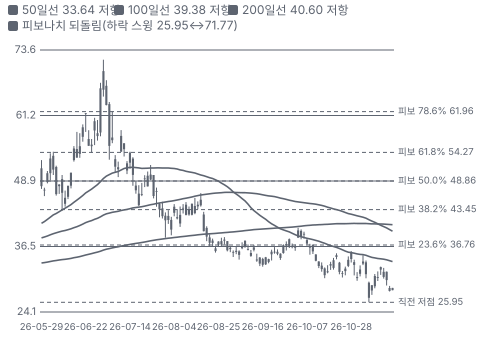

**주봉**

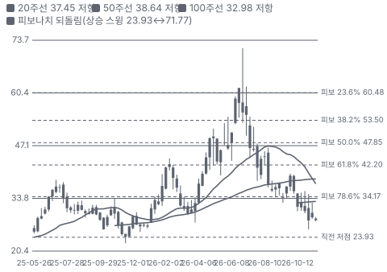

**월봉**

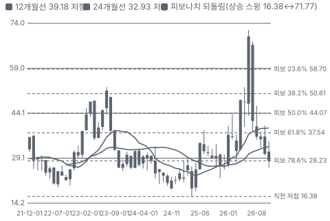

**분기 매출·EPS 실적과 컨센서스**

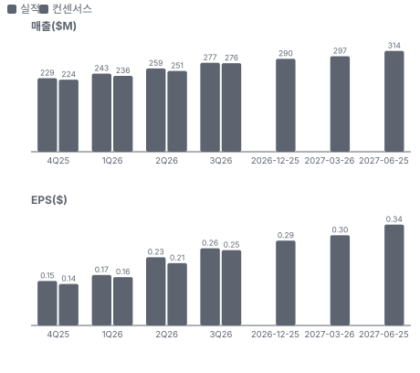

**최근 4개 분기 주가 변화 분석**

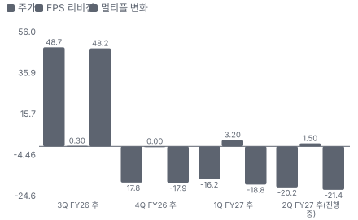

**EPS 리비전**

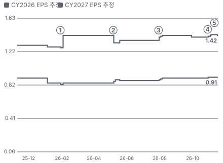

① 26-01-29 3Q FY26 실적 — 하루 +9.9% · EPS 리비전 +11%
② 26-05-07 4Q FY26 실적 — 하루 −6.7% · EPS 리비전 -4%
③ 26-07-30 1Q FY27 실적 — 데이터센터 매출 17% · EPS 리비전 +4%
④ 26-10-29 2Q FY27 실적 — 800V 지연·수주 +45% · EPS 리비전 +2%
⑤ 26-11-13 Roth 매수 개시(데이터센터 성장 저평가 논리) · EPS 리비전 -1%

**멀티플 프리미엄(Fwd 1Y P/E, 최근 4개 분기말)**

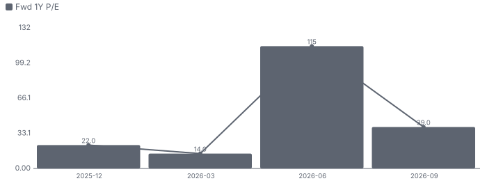

**합리적 멀티플**

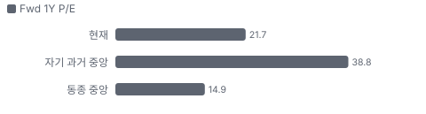

**밸류에이션 주가 시나리오**

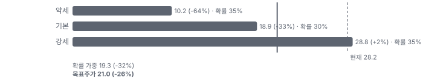

**주가별 업사이드**

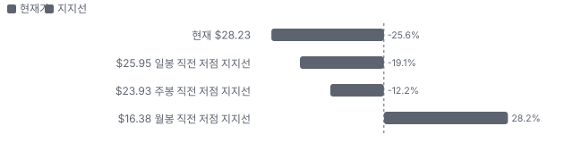
- 제품·서비스 포트폴리오

**고객 믹스(2Q FY27, 매출 대비)**

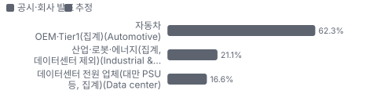

**공급 병목(10점, 낮을수록 병목)**

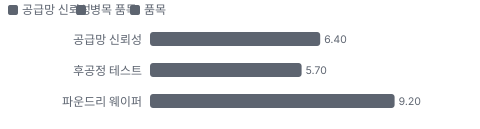

**CAPEX의 매출 대비 비중**

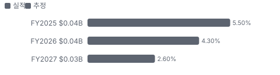

**어닝콜 변화별 주주가치 영향**

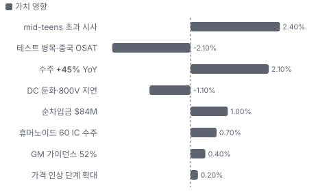

**매출 → 매출총이익 → 영업이익(매출 = 100, 최근 4분기)**

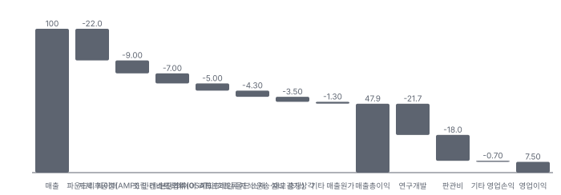

**분기 비용 비중 추이(매출 대비, 공시)**

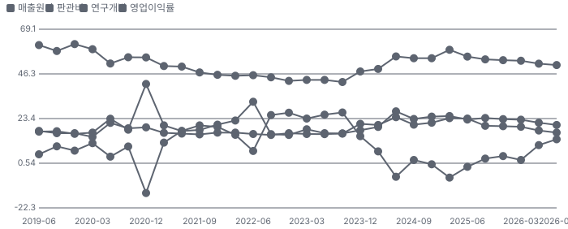

**비용 요인별 매출 대비 비중 1년 변화**

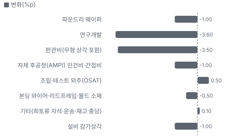

**자기 센서 BOM 원가 몫**

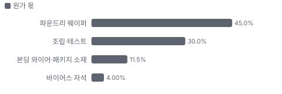

**전력 IC BOM 원가 몫**

**BOM 항목 가격 +10% 시 OPM 변화**

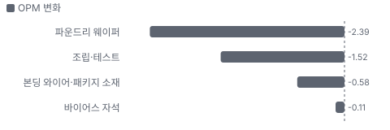

**원가 물가 vs 판매가 물가 — 1년 변화(원가가 판매가보다 더 오르면 단가를 올리지 못하는 만큼 마진이 줄어든다): 원가가 판매가 쪽 물가보다 5.6%p 더 올라 단가 인상이 따라가지 못하면 마진 압박**

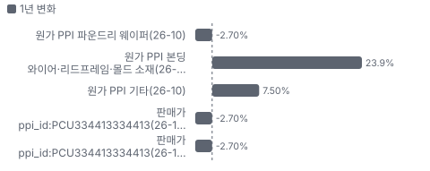

**사업별 매출 vs 물가 — 전년 대비(명목 매출 · 비교 물가 · 실질 = 물량·믹스)**

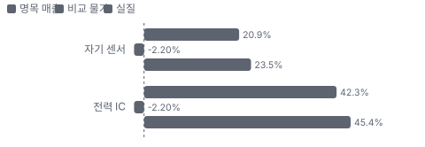

**자산 구성 — 3Q26 분기말 투하자본 \$1,091.5M**

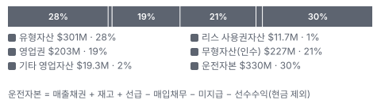

**자산별 변화율 — 최근 12개 분기(4Q23 = 0%) + 다음 4개 분기 추정**

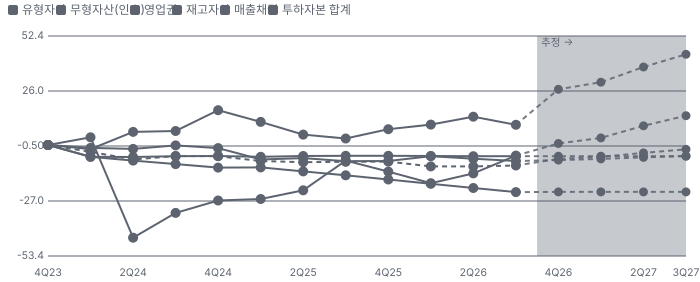

**ROIC 추이 — TTM, 최근 12개 분기 + 다음 4개 분기 추정(컨센서스 NOPAT)**

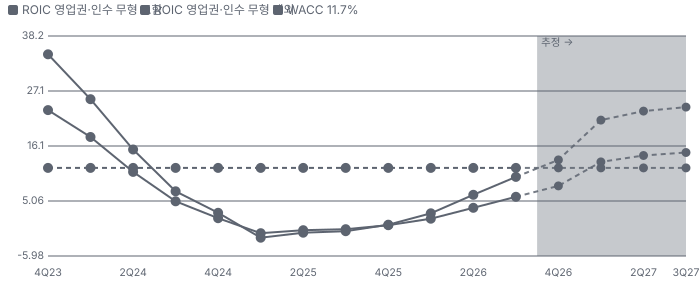

**분기 감가 비율 연율(유형자산 총액 대비)**

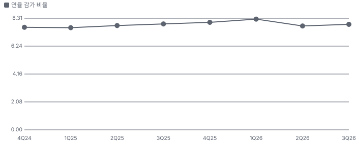

**생산시설별 면적(sq ft, 큰 순) — 생산능력 미공시라 면적을 대용으로**

**10년 P·Q 사이클 — 추세(HP 필터) 대비 갭과 8분기 전망**

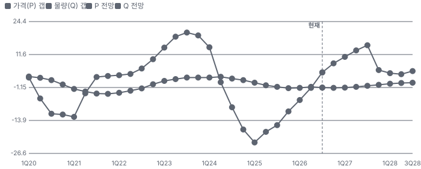

**매출 증가율의 가격·물량 분해와 8분기 전망(전년 대비)**

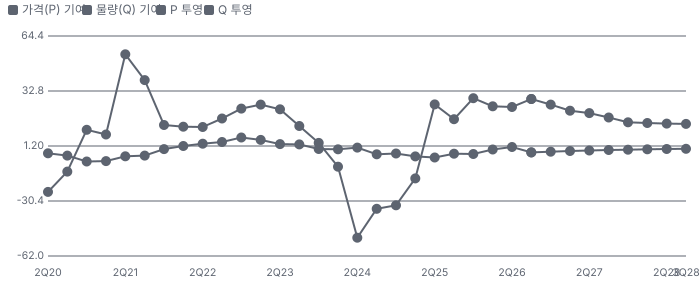

**분기별 매출 증가율 분해**

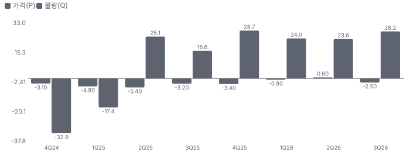

**목표주가 산정 — 기본과 강세 사이(강세 쪽 17%), 도달 확률 약 43%**

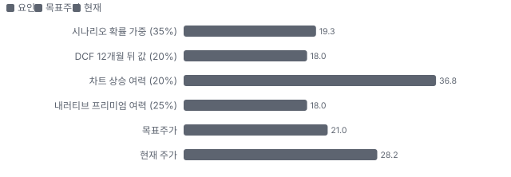

**PEG — 성장 대비 멀티플(낮을수록 성장 대비 쌈)**

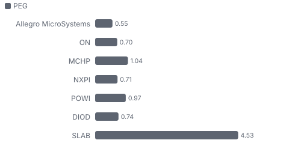

**일봉 지지·저항과 목표주가**

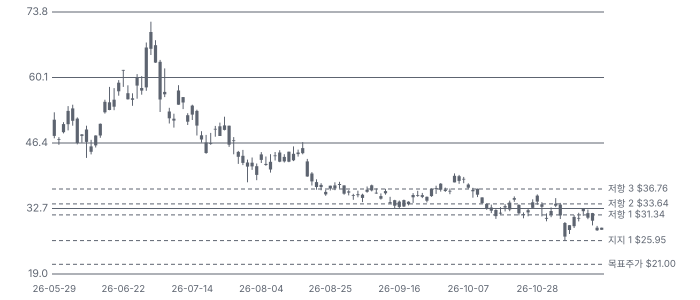

**커뮤니티 언급 수(최근 30일, 채널별)**

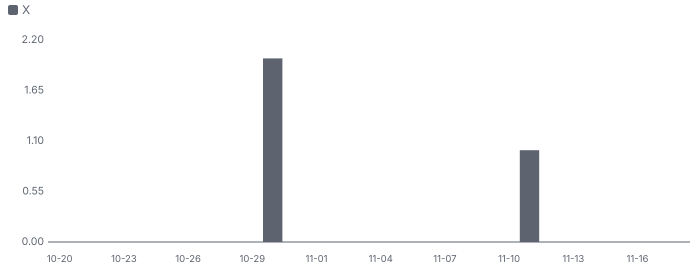

**재고 일수 — 분기별(수주 자료가 없어 수주/출하 비율 없음)**

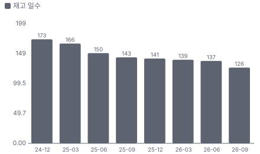

**일별 거래량 분해**

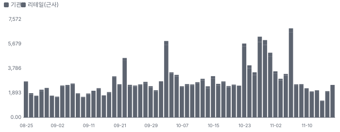

**기관 자금 흐름**

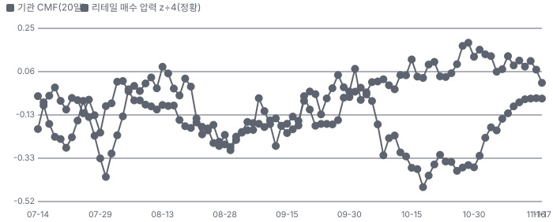

**몬테카를로**

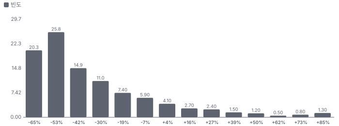

해석: 3,000번 중 417번(14%)에서 가치가 지금 주가 이상이었다. 가정을 흔들어도 지금 주가를 뒷받침하지 못하는 경우가 더 많다. 가운데 값은 0.55배이고, 열 번 중 여덟 번은 0.36~1.11배 사이에 든다.

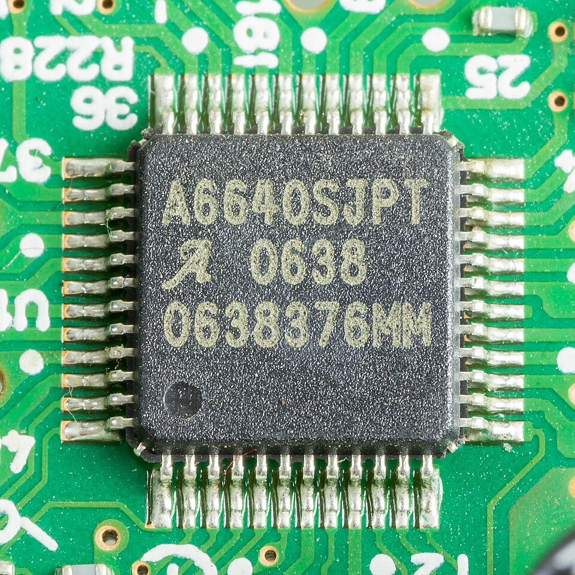
**전력 IC** — 프린터 제어 보드에 실장된 Allegro 모터 드라이버 칩(A6640) — 실제 제품
_사진: Raimond Spekking · CC BY-SA 4.0 · Wikimedia Commons_

## 내러티브

> **기업가치를 결정하는 이야기:** 매출의 62%가 자동차다. 차 한 대에 들어가는 위치·전류 센서와 모터 드라이버가 전동화·ADAS(첨단 운전자 보조 시스템)로 늘고, 한 번 채택되면 차종 수명 내내 반복 출하된다. 여기에 AI 서버 전원의 전류 센서와 냉각 팬 드라이버(데이터센터 매출의 17%), 로봇 관절(3~4%)이 붙었다. 팹이 없어 웨이퍼를 UMC·Polar·Tower·TSMC에서 사고 후공정은 필리핀 자체 공장과 외주를 쓴다. 이익은 매출 증가에 비해 빠르게 는다(2Q 증분 이익 전환율이 높다).

> **멀티플·EPS 프리미엄**
> **멀티플:** Fwd 1Y P/E 21.7배로 동종 5곳(onsemi·Microchip·NXP·Power Integrations·Diodes) 중앙값 14.9배보다 45% 높다. 다음 해 EPS 성장 +39%를 감안하면 PEG는 동종보다 낮다.
> **EPS:** 다음 4개 분기 EPS 컨센서스 \$1.30, 그다음 4개 분기 \$1.81 — 1Q 콜 이후 같은 분기 매출 추정은 1~3% 올랐다.

### 투자자들은 왜 열광했나

2026년 상반기 투자자들은 '자동차 센서 회사가 AI 데이터센터 전원 부품주로 바뀐다'에 열광했다. 데이터센터 매출이 6분기 만에 매출의 2% → 17%가 됐고 주가는 6/30 종가 \$69.62까지 올랐다. 식은 이유는 세 가지다 — 1Q 콜에서 데이터센터 감속을 시사했고, 2Q 콜에서 800V 프로그램이 1~2분기 밀렸으며, 11월 들어 금리 상승·나스닥 하락으로 AI 하드웨어 전반이 빠졌다.

### 무엇이 기업가치를 바꾸나

> **구조적 체질 변화**
> **변화:** 자동차 의존(70%) → 자동차 62% + 산업·데이터센터·로봇 38%
> **증거:** 산업·기타 매출 2Q \$104.4M(YoY +79%, 처음으로 \$100M 돌파 — 10-Q)
> **반증:** 산업·기타 매출이 2분기 연속 QoQ 감소

> **고부가 믹스 확장**
> **변화:** 전류 센서·TMR(터널 자기저항 — 자기장 변화를 저항 변화로 읽는 고감도 센서 소자)·절연 게이트 드라이버(고전압 쪽과 제어 쪽을 전기적으로 분리한 게이트 드라이버) 비중 확대
> **증거:** 데이터센터 전류 센서 총이익률 평균 이상(1Q 콜), 디자인윈 YoY +40%(2Q 콜)
> **반증:** 총이익률이 3Q 가이던스 하단 51.5% 미만

> **기술 혁신**
> **변화:** 고속(5MHz) TMR 전류 센서 — SiC(실리콘 카바이드 — 고전압 전력 반도체 소재)·GaN(질화갈륨 — 고속 스위칭 전력 반도체 소재) 고속 스위칭 전원에 맞춘 비접촉 전류 측정
> **증거:** USPTO(미국 특허상표청) 전류 센서 특허 다수(2026-08~11), 대만 PSU 수주 10건 이상(2Q 콜)
> **반증:** TI·Infineon 동급 제품의 하이퍼스케일러 채택

> **실행 속도**
> **변화:** 해당 없음(주문→출하 리드타임 주 수를 회사·경쟁사 모두 공시하지 않는다) — 대신 리드타임이 길어지는 중이고(1Q·2Q 콜) 디자인윈→매출 시차는 데이터센터·로봇 6~12개월, 자동차 18개월 안팎
> **증거:** 2Q 콜
> **반증:** 후공정 테스트 제약으로 리드타임이 더 길어짐

> **M&A**
> **변화:** 해당 없음(최근 3년 안 인수 없음 — 2023-10 Crocus 인수 TMR 기술이 지금 제품에 반영)
> **증거:** 10-K 인수 주석
> **반증:** 해당 없음

> **정책·입법 연관성**
> **재정정책:** 해당 없음(CHIPS(미국 반도체지원법) 보조금·세액공제를 받지 않는다 — 10-K·10-Q에 정부 지원 기재 없음) 10-K FY2026 반증: 해당 없음 의회 동의 2/10 — 하원 1/5(회사 관련 세출 논의 없음) · 상원 1/5(같음).
> **행정명령:** 중국 희토류(사마륨(희토류 원소 — 자석 소재)) 수출 제한·미·중 관세 — 조달·판매 제약(행정 조치) 10-K 위험 요인 반증: 희토류 수출 허가 정상화 의회 동의 2/10 — 하원 1/5(의회 의결 대상 아님 — 관련 입법 논의 미확인) · 상원 1/5(같음).
> **연관입법:** 해당 없음(회사 매출과 직접 연결되는 법안 미확인) 10-K 반증: 해당 없음

> **고객의 지출 예산**
> **변화:** 자동차 OEM·Tier1의 부품 구매비와 하이퍼스케일러 CAPEX
> **사업별 예산:** **매출의 62%**: 자동차 — 고객 OPEX(자동차 OEM·Tier1 부품 원가(차 한 대 BOM)) · 동인: 자동차 생산·전동화 콘텐츠
**매출의 21%**: 산업·로봇 — 고객 CAPEX(공장 자동화·태양광·에너지 저장 설비 투자) · 동인: 자동화·에너지 인프라 투자
**매출의 17%**: 데이터센터 — 고객 CAPEX(하이퍼스케일러 서버·전원 설비 투자(PSU 업체 경유)) · 동인: AI 랙 배치·800V 전환
> **증거:** 10-Q 시장별 매출
> **반증:** 하이퍼스케일러 2027 CAPEX 하향

### 내러티브 근거

> 자동차 자기 센서 회사가 AI 데이터센터 전원·로봇 관절로 쓰임새를 넓힌다는 이야기다. 6월 말 고점 뒤 −59%로 이야기는 꺾였지만 이익 추정은 올랐다. 단계는 소멸, 쏠림은 낮음(공매도 유통 주식의 10.8%, 리테일 언급 적음) — 기관 보유 76%이다.

> **AI 데이터센터 전원 콘텐츠** · 약화
> **논리:** AI 랙의 전원·냉각에 전류 센서·팬 드라이버가 들어가 랙당 콘텐츠가 \$150 → \$425 이상
> **숫자:** 데이터센터 매출 2Q \$46M(매출의 17%), FY27 2배 이상 목표
> **반증:** 3Q 데이터센터 매출이 2분기 연속 QoQ 한 자릿수 이하
> **출처:** 2Q FY27 어닝콜(2026-10-29)

> **자동차 전동화·ADAS 콘텐츠** · 강화
> **논리:** xEV(하이브리드·전기차 전체)·ADAS·EMB(전기기계식 브레이크, 유압 대신 모터로 제동)·스티어바이와이어로 차 한 대당 센서·드라이버 콘텐츠가 ICE(내연기관차) \$40 → BEV(배터리 전기차) \$100
> **숫자:** 자동차 수주 YoY +50%, 자동차 매출 \$172.5M(+11%)
> **반증:** 자동차 수주 증가율 한 자릿수로 둔화
> **출처:** 2Q FY27 어닝콜(2026-10-29)

> **휴머노이드·로봇 관절** · 강화
> **논리:** 관절마다 위치·전류 센서와 모터 드라이버 — 로봇당 \$150 초과(2030 회사 목표)
> **숫자:** 로봇·자동화 FY27 매출의 3~4%, 중국 휴머노이드 로봇당 약 60 IC(집적회로, 칩) 수주
> **반증:** FY28에도 로봇 비중 5% 미만
> **출처:** 2Q FY27 어닝콜(2026-10-29)

> **가격 인상·총이익률 55%** · 유지
> **논리:** 아날로그 업황 회복과 가격 인상으로 총이익률이 51.5% → 55% 초과
> **숫자:** 3Q 총이익률 가이던스 51.5~52.5%, 자동차 계약 가격 인상 2027-01-01
> **반증:** 웨이퍼 단가 인상이 판매가 인상을 앞질러 4Q 총이익률 하락
> **출처:** 2Q FY27 어닝콜(2026-10-29)

> **반대 내러티브 — AI 흔들림·자동차 경기** · 강화
> **논리:** 데이터센터 프리미엄이 빠지면 자동차 62%의 아날로그 회사로 돌아가 동종 배수(15배)로 수렴
> **숫자:** 고점 대비 −59%, Fwd 1Y P/E 동종 중앙값 14.9배
> **반증:** 데이터센터 재가속과 800V 램프 확인
> **출처:** Quantral 신호·펀드 서한

### 투자 포인트

> **이익 추정은 오르고 배수만 줄었다**
> **명제:** 1Q 콜 이후 주가 −33%인데 같은 분기 매출 추정은 +1~3% 올랐다
> **숫자:** 컨센서스 이력(같은 분기끼리)
> **시장과 다른 점:** 시장은 데이터센터 지연을 이익 문제로 읽지만 숫자는 배수 문제다
> **증명:** 3Q 실적 매출 \$283M 이상·4Q 가이던스
> **출처:** https://www.sec.gov/Archives/edgar/data/866291/000119312526436963/algm-ex99_1.htm

> **자동차 수주가 데이터센터 공백을 메운다**
> **명제:** 자동차 수주 YoY +50%, 일부 주문은 FY28까지
> **숫자:** 2Q FY27 어닝콜(2026-10-29)
> **시장과 다른 점:** AI 종목으로 팔렸지만 이익의 다수는 자동차에서 나온다
> **증명:** 3Q 자동차 매출 QoQ 성장
> **출처:** https://www.sec.gov/Archives/edgar/data/866291/000119312526436963/algm-ex99_1.htm

> **테스트 병목이 성장 상단을 정한다**
> **명제:** 웨이퍼는 충분하고 테스트가 막혔다
> **숫자:** 2Q FY27 어닝콜(2026-10-29)
> **시장과 다른 점:** 수요보다 공급(테스트) 쪽이 3Q 매출을 정할 수 있다
> **증명:** 3Q 재고일수·리드타임 발언
> **출처:** https://www.sec.gov/Archives/edgar/data/866291/000119312526439990/algm-20260925.htm

### 모멘텀 생성·소멸 타임라인

**카탈리스트 달력 — 지난 사건의 주가 반응과 앞으로 확인할 숫자**
| 날짜 | 상태 | 구분 | 사건 | 반응·확인 | 결과에 따라 |
|---|---|---|---|---|---|
| 2026-01-29 | 완료 | 생성 | 3Q FY26 실적 — 데이터센터 매출 10% | 하루 +9.9% |  |
| 2026-06-30 | 완료 | 소멸 | 종가 고점 \$69.62 — AI 전력·로봇 테마 정점 | 이후 −59% |  |
| 2026-07-30 | 완료 | 소멸 | 1Q FY27 실적 — 데이터센터 감속 시사 | 하루 −1.8% |  |
| 2026-10-29 | 완료 | 소멸 | 2Q FY27 실적 — 800V 지연 | 하루 −6.6% |  |
| 2026-12 초(회사 공지, 날짜 미확인) | 예정 | 확인 | UBS 기술·AI 콘퍼런스·Nasdaq 투자자 콘퍼런스 발표 | 800V 프로그램 재개 시점, 테스트 장비 추가 가동 | 재개 시점이 1Q FY28 안이면 데이터센터 프리미엄 일부 회복, 더 밀리면 동종 배수 쪽으로 |
| 2027-01-28(추정) | 예정 | 확인 | 3Q FY27 실적·4Q 가이던스 | 매출 \$283M 이상, 조정 총이익률 52% 이상, 데이터센터 QoQ 두 자릿수 | 세 가지가 맞으면 이익 추정 상향 경로, 하나라도 빠지면 배수 정체 |

### 언제 사서 언제 팔아야 할까?

**가격·조건 틀 — 가격은 밸류에이션(약세·기본·강세·목표주가)과 차트 지지 구간에서, 조건은 이벤트에서**
| 구간 | 가격 | 목표주가까지 | 약세까지 | 조건·근거 |
|---|---|---|---|---|
| 관찰 구간 | \$26~\$26 | -19% | -61% | 지지 구간이 약세 시나리오 가격과 겹치는 곳 — 11/5 종가 저점 \$26.80 |
| 확인 뒤 | 지금 \$28 이상에서 조건 확인 | -26% | -64% | 3Q 데이터센터 QoQ 재가속과 총이익률 52% 이상, 4Q 가이던스 계절성 상회 |
| 무효화 | 약세 시나리오 \$10 | - | -64% | 11/5 종가 저점 \$26.80 이탈과 함께 3Q 매출이 가이던스 중간 미만 |
| 차익 고민 2차 | \$29(강세 시나리오) | +2% | - | 목표주가 근처에서는 Fwd 1Y P/E가 동종 대비 프리미엄을 얼마나 다시 붙였는지 본다 |

실적 당일 ±7~10% 움직임이 반복됐다(1/29 +9.9%, 5/7 −6.7%, 10/29 −6.6%) 가격·조건 틀이며 매매·비중 지시가 아니다(투자 권유 아님).

## 포트폴리오

| 제품·서비스 | 구분 | 무엇 | 쓰는 곳 | 돈 버는 방식 | Mix | Mix 변화(전 분기 대비) |
|---|---|---|---|---|---|---|
| 자기 센서 | 제품 | 홀·TMR·유도형 방식으로 위치·속도·각도·전류를 재는 IC | 자동차 조향·제동·파워트레인, 서버 전원 전류 측정, 로봇 관절 | 2Q 매출 \$158.0M(57%), YoY +21%. 차 한 대에 수십 개가 들어가고 한 번 채택되면 차종 수명 동안 반복 출하 | 57% | -0.7%p |
| 전력 IC | 제품 | BLDC(브러시 없는 직류 모터) 모터·팬 드라이버, 게이트 드라이버(전력 반도체 스위치를 켜고 끄는 구동 IC), 전원 관리 IC | 서버 냉각 팬, 차량 펌프·브레이크·조향 모터, 태양광 인버터 | 2Q 매출 \$118.9M(43%), YoY +42% — 데이터센터 팬 드라이버가 성장 견인 | 43% | +0.7%p |

**Mix 변화가 가장 큰 쪽은 전력 IC(+0.7%p, 전 분기 대비).** 계절성 판정: 분기 매출 계절 지수 기준 없음 → 직전 분기와 비교.

## 고객

> **2Q FY27 최대 고객 자동차 OEM·Tier1(집계, Automotive) 62%, 상위 3곳 100%, 집중도 집중.** 공시·회사 발표로 확인한 몫은 매출의 79%이고, 나머지 고객 몫은 추정이거나 미분해다. 최종 고객은 자동차 OEM·Tier1(62%), 데이터센터 전원 업체(17%), 산업·로봇·에너지(21%)다. 10% 넘는 최종 고객은 없다. 판매 경로로는 이름 없는 유통사 1곳이 2Q 매출의 12.9%(전년 11.4%, 10-Q)이고 유통 비중은 약 55~60%다. 출하지 기준 대만 15.4%·중국 25.0%.

**고객별 매출 몫(2Q FY27)**
| 고객 | 몫 | 변화 | 근거 |
|---|---|---|---|
| 자동차 OEM·Tier1(집계, Automotive) | 62% | -10%p | 공시 |
| 산업·로봇·에너지(집계, 데이터센터 제외, Industrial & Other) | 21% | 미확인 | 추정 |
| 데이터센터 전원 업체(대만 PSU 등, 집계, Data center) | 17% | 미확인 | 회사 발표 |

> **자동차 OEM·Tier1(집계, Automotive)** · 공시
> **사는 것:** 위치·전류 센서, 모터 드라이버, PMIC(전원 관리 칩)
> **추정 근거:** 10-Q: 자동차 \$172.5M ÷ 매출 \$276.9M(전년 \$155.8M ÷ \$214.3M)

> **산업·로봇·에너지(집계, 데이터센터 제외, Industrial & Other)** · 추정
> **사는 것:** 게이트 드라이버·센서
> **추정 근거:** 산업·기타 \$104.4M − 데이터센터 \$46M(계산)

> **데이터센터 전원 업체(대만 PSU 등, 집계, Data center)** · 회사 발표
> **사는 것:** 전류 센서·팬 드라이버
> **추정 근거:** 2Q 콜 데이터센터 \$46M ÷ \$276.9M(계산)

## 마진 구조

> **GPM 49.2%, OPM 12.8%.** 1Q FY27 대비 GPM +0.7%p, OPM +3.0%p. 변동비는 매출의 43%이고, 매출이 10% 늘면 OPM은 +4.0%p 움직인다. 2Q 매출원가는 매출의 50.8%(GAAP)로 1년 전 53.7%보다 2.9%p 낮다. 원가의 가장 큰 몫은 외부 파운드리 웨이퍼다(추정). 조정 총이익률 51.5%, 회사 목표 55% 초과.

> **매출 100 중 매출원가 52.1, 매출총이익 47.9(최근 4분기, 공시).** 매출원가 요인 중 파운드리 웨이퍼이 매출의 22.0%로 가장 무겁고, 단가가 +10% 오르면 GPM이 -2.20%p 움직인다. 분기 회귀로 매출 1이 늘 때 매출원가는 0.34 늘고, 매출원가의 고정비 몫은 33%다.

**비용 요인 강도 — 비중·추세·충격(+10%)·탄력**
| 비용 | 구분 | 매출 대비 | 1년 변화 | 마진 기여 | 충격 시 마진 | 매출 탄력 | 고정비 몫 |
|---|---|---|---|---|---|---|---|
| 파운드리 웨이퍼 | 매출원가 요인 | 22.0% | -1.0%p | +1.0%p | -2.20%p | 미확인 | 20% |
| 자체 후공정(AMPI(Allegro 필리핀 마닐라 후공정 공장)) 인건비·간접비 | 매출원가 요인 | 9.0% | -1.0%p | +1.0%p | -0.90%p | 미확인 | 70% |
| 조립·테스트 외주(OSAT) | 매출원가 요인 | 7.0% | +0.5%p | -0.5%p | -0.70%p | 미확인 | 10% |
| 본딩 와이어·리드프레임·몰드 소재 | 매출원가 요인 | 5.0% | -0.5%p | +0.5%p | -0.50%p | 미확인 | 0% |
| 기타(희토류 자석·운송·재고 충당) | 매출원가 요인 | 4.3% | +0.1%p | -0.1%p | -0.43%p | 미확인 | 30% |
| 설비 감가상각 | 매출원가 요인 | 3.5% | -1.0%p | +1.0%p | -0.35%p | 미확인 | 100% |
| 매출원가 | 공시 항목 | 52.1% | -3.3%p | +3.3%p | -5.21%p | 0.34 | 33% |
| 연구개발 | 공시 항목 | 21.7% | -2.1%p | +2.1%p | 미확인 | 0.16 | 13% |
| 판관비 | 공시 항목 | 18.0% | -4.0%p | +4.0%p | 미확인 | 0.12 | 39% |

매출 탄력 = 분기 비용을 매출에 회귀한 기울기(매출 1당 변동비), 고정비 몫 = 절편 ÷ 평균 비용. 표본이 8분기 미만이면 미확인. 매출원가 요인 비중은 margin 재료의 추정이 섞여 있고, 공시 매출원가와의 차이는 '기타 매출원가'로 둔다.

**GPM에서 OPM까지(GAAP, 아래는 최근 4개 분기)**
| 기간 | GPM | 연구개발 | 판관비 | 기타 | OPM |
|---|---|---|---|---|---|
| 2Q FY26 | 46.3% | 23.7% | 19.7% | 0.0% | 2.9% |
| 1Q FY27 | 48.5% | 21.3% | 17.3% | 0.0% | 9.8% |
| 2Q FY27 | 49.2% | 20.1% | 16.2% | 0.0% | 12.8% |
| 2025-12 | 46.7% | - | - | - | 4.2% |
| 2026-03 | 47.0% | - | - | - | 2.2% |
| 2026-06 | 48.5% | - | - | - | 9.8% |
| 2026-09 | 49.2% | - | - | - | 12.8% |

**비용을 움직이는 요인**
| 비용 | 요인 |
|---|---|
| 파운드리 웨이퍼(매출원가) | 파운드리 계약 단가(1월 인상)·take-or-pay(최소 구매량을 못 채우면 위약금을 내는 계약) 물량 · 근거 추정 |
| 연구개발(연구개발) | 설계 인력·TMR·게이트 드라이버 신제품 · 근거 공시 |
| 판관비(무형 상각 포함, 판관비) | 영업·관리 인력, 주식 보상 · 근거 공시 |
| 자체 후공정(AMPI) 인건비·간접비(매출원가) | 필리핀 공장 가동률·인건비 · 근거 추정 |
| 조립·테스트 외주(OSAT, 매출원가) | 외주 비중(FY26 조립 약 51%) — 중국 OSAT 추가 · 근거 추정 |
| 본딩 와이어·리드프레임·몰드 소재(매출원가) | 금·구리 가격 — 금 → 구리 전환(3Q 출하 시작) · 근거 추정 |
| 기타(희토류 자석·운송·재고 충당, 매출원가) | 사마륨 조달·재고 평가 · 근거 추정 |
| 설비 감가상각(매출원가) | 설비 내용연수 10년 연장(2024)·CAPEX 축소 · 근거 공시 |

**자기 센서 BOM — 매출의 57%, GPM 52%(추정 — 제품군별 총이익 미공시. 콜에서 데이터센터 전류 센서는 평균 이상, 모터 드라이버는 약간 낮다고 했다. 두 제품 가중 평균이 2Q GAAP 총이익률 49.2%와 맞게 둔 값), 항목 가격 +10% 시**
| 항목 | 원가 몫 | 전가 | 제품 GPM | OPM |
|---|---|---|---|---|
| 파운드리 웨이퍼 | 40~50% | 미확인 | -2.2%p | -1.23%p |
| 조립·테스트 | 25~35% | 미확인 | -1.4%p | -0.82%p |
| 본딩 와이어·패키지 소재 | 8~15% | 미확인 | -0.6%p | -0.32%p |
| 바이어스 자석 | 2~6% | 미확인 | -0.2%p | -0.11%p |
| 미분해 | 9% | - | - | - |

**전력 IC BOM — 매출의 43%, GPM 46%(추정 — 제품군별 총이익 미공시. 콜에서 데이터센터 전류 센서는 평균 이상, 모터 드라이버는 약간 낮다고 했다. 두 제품 가중 평균이 2Q GAAP 총이익률 49.2%와 맞게 둔 값), 항목 가격 +10% 시**
| 항목 | 원가 몫 | 전가 | 제품 GPM | OPM |
|---|---|---|---|---|
| 파운드리 웨이퍼 | 45~55% | 미확인 | -2.7%p | -1.16%p |
| 조립·테스트 | 25~35% | 미확인 | -1.6%p | -0.69%p |
| 본딩 와이어·패키지 소재 | 8~15% | 미확인 | -0.6%p | -0.27%p |
| 미분해 | 8% | - | - | - |

파운드리 웨이퍼 가격이 +10% 오르면 영업이익은 -18.7% 움직인다. 판매가 전가를 모르는 항목은 전가 0%로 계산했다.

**BOM 항목 가격을 움직이는 것**
| 항목 | 요인 |
|---|---|
| 파운드리 웨이퍼 | 센서 다이와 신호 처리 회로를 한 웨이퍼로 만든다 · 근거 추정 |
| 조립·테스트 | 자동차 등급 테스트가 원가와 리드타임을 정한다 · 근거 추정 |
| 본딩 와이어·패키지 소재 | 금 가격이 원가를 흔들었다 · 근거 추정 |
| 바이어스 자석 | 일부 속도 센서만 · 근거 추정 |
| 파운드리 웨이퍼 | 고전압 BCD(아날로그·전력 칩을 한 웨이퍼에 만드는 복합 반도체 공정) 공정 웨이퍼 · 근거 추정 |
| 조립·테스트 | 전력 패키지 열 특성 테스트 · 근거 추정 |
| 본딩 와이어·패키지 소재 | 전류가 큰 패키지라 와이어 소재 비중이 크다 · 근거 추정 |

> **원가·판매가 물가 격차 -5.6%p** — 판매가 물가가 투입 원가 물가보다 느리게 오른다.

**투입 물가 — 미국 PPI 3·6·12개월(2026-10, 개정 반영)과 해외 전년비**
| 항목 | 미국 3개월 | 6개월 | 12개월 | 전가 못 할 때 OPM | 일본 | 한국 | 대만 |
|---|---|---|---|---|---|---|---|
| 파운드리 웨이퍼 | -0.7% | -5.7% | -2.7%* | +0.6%p | +1.6%* | 미확인 | 미확인 |
| 본딩 와이어·패키지 소재 | +3.4% | +7.2% | +23.9% | - | +42.6% | +25.8% | +40.1% |
| 바이어스 자석 | -0.2% | +3.0% | +7.5%* | - | 미확인 | 미확인 | 미확인 |

별표는 품목보다 넓은 업종 지수다. 연결한 투입 원가의 미국 PPI(생산자물가지수)는 1년 새 가중 +3.0%이고, 판매가로 넘기지 못하면 GPM -0.9%p·OPM -0.9%p가 움직인다. 판매가 비교 물가(ppi_id:PCU334413334413)는 1년 새 -2.7% — 회사 가격 변화는 미확인. 물가 지수를 붙이지 못한 매출원가 항목은 조립·테스트 외주(OSAT), 자체 후공정(AMPI) 인건비·간접비, 설비 감가상각다(미연결). 자기 센서 매출은 2026-09 전년 대비 +20.9%이고 비교 물가 ppi_id:PCU334413334413의 변화 -2.2%(2026-09)를 빼면 실질 +23.5% — 물량·믹스가 성장을 이끌었다. 전력 IC 매출은 2026-09 전년 대비 +42.3%이고 비교 물가 ppi_id:PCU334413334413의 변화 -2.2%(2026-09)를 빼면 실질 +45.4% — 물량·믹스가 성장을 이끌었다.

## 자산 구성

> **3Q26 분기말 투하자본 \$1,091.5M** — 운전자본 30%, 유형자산 28%. 최근 12개 분기(4Q23 → 3Q26) 가장 크게 늘어난 자산은 재고자산(+10%), 투하자본 합계 -10%. 3Q27 추정 투하자본 \$1,186.3M(+9%, 컨센서스 매출과 회전 일수·CAPEX 강도 유지 가정). 연율 감가 비율(총액 기준)은 직전 4분기 7.73% → 최근 4분기 7.96%.

**자산·운전자본 항목별 분기말 잔액 — 최근 12개 분기와 다음 4개 분기 추정**
| 항목 | 4Q23 | 3Q25 | 3Q26(최근) | 3Q27 추정 | 12개 분기 변화 | 다음 4개 분기 변화 |
|---|---|---|---|---|---|---|
| 매출채권 | \$114.3M | \$105.8M | \$108.5M | \$130.4M | -5% | +20% |
| 재고자산 | \$165.6M | \$170.7M | \$181.6M | \$237.8M | +10% | +31% |
| 선급·기타 유동자산 | \$42.0M | \$40.3M | \$39.5M | \$47.8M | -6% | +21% |
| 유형자산 | \$325.8M | \$300.4M | \$300.7M | \$308.7M | -8% | +3% |
| 리스 사용권자산 | \$21.6M | \$18.0M | \$11.7M | \$11.7M | -46% | +0% |
| 영업권 | \$214.7M | \$203.5M | \$203.1M | \$203.1M | -5% | +0% |
| 무형자산(인수) | \$293.7M | \$250.9M | \$227.1M | \$227.4M | -23% | +0% |

**자산 추정 동인 — 최근 4개 분기 평균(재무상태표 동인 모형)**
| 동인 | 값 | 곱하는 기준 |
|---|---|---|
| 매출채권 | 36일 | 매출 |
| 재고자산 | 127일 | 매출원가 |
| 선급·기타 유동자산 | 13일 | 매출 |
| CAPEX 강도 | 3.5% | 매출(최근 4개 분기 합) |
| 분기 감가율 | 5.70% | 기초 유형자산 순액(무형 상각 제외 감가상각) |
| 매출원가율 | 52.1% | 매출(최근 4개 분기) |
| 영업권·리스 사용권·기타 | 유지 | 인수·새 리스는 공시 전 모름 |
| 인수 무형자산 | 분기 −\$0.1M 상각 | 최근 4개 분기 평균 상각 |

**추정 방법:** 증권사 3표 모델(손익·재무상태표·현금흐름)의 재무상태표 동인 방식이다. 운전자본은 항목별 회전 일수(매출채권·선급·미지급·선수는 매출, 재고·매입채무는 매출원가 기준)를 최근 4개 분기 평균으로 두고 컨센서스 매출에 곱한다. 유형자산은 기초 + CAPEX − 감가상각으로 굴린다(Koller·Goedhart·Wessels 『Valuation』 재무상태표 추정). 매출 경로는 ROIC 절의 컨센서스와 같다.

**유형·무형자산 항목별 가치(2026-03-27 vs 2025-03-28)**
| 구분 | 항목 | 총액 2026-03-27 | 누적상각 | 순액 | 총액 2025-03-28 | 총액 1년 변화 | 공시 내용연수 |
|---|---|---|---|---|---|---|---|
| 유형 | 토지 | \$26.5M | \$0.0M | \$26.5M | \$25.2M | +5.5% | 비상각 |
| 유형 | 건물·개량·임차 개량 | \$63.9M | 총계만 공시 | 총계만 공시 | \$66.3M | -3.5% | 31~31년 |
| 유형 | 기계장치 | \$710.7M | 총계만 공시 | 총계만 공시 | \$670.9M | +5.9% | 3~10년 |
| 유형 | 사무기기 | \$7.2M | 총계만 공시 | 총계만 공시 | \$6.7M | +8.5% | 3~7년 |
| 유형 | 사용권 자산 | \$8.8M | 총계만 공시 | 총계만 공시 | \$8.2M | +7.5% | 미확인 |
| 유형 | 건설 중 | \$51.9M | \$0.0M | \$51.9M | \$51.6M | +0.6% | 비상각 |
| 영업권 | 영업권 | \$203.3M | \$0.0M | \$203.3M | \$202.5M | +0.4% | 비상각 |
| 무형 | 완성 기술 | \$255.6M | \$52.4M | \$203.2M | \$255.6M | +0.0% | 3~15년 |
| 무형 | 특허 | \$53.1M | \$30.0M | \$23.1M | \$49.7M | +6.8% | 3~15년 |
| 무형 | 고객 관계 | \$15.2M | \$5.1M | \$10.1M | \$15.0M | +1.5% | 3~15년 |
| 무형 | 비한정 공정 기술·상표 | \$2.3M | \$0.0M | \$2.3M | \$2.3M | -0.2% | 비상각 |
| 유형 합계 | 유형자산 | \$869.1M | \$560.8M | \$308.3M | \$828.8M | +4.9% | 경과율 71%(상각 대상 기준) |

**내용연수 산식(상각 대상 유형자산 = 총액 − 토지 − 건설중)**
| 기준일 | 연 감가상각 | 상각 대상 총액 | 평균 내용연수 | 경과 연수 | 잔여 연수 | 경과율 |
|---|---|---|---|---|---|---|
| 2026-03-27 | \$39.3M | \$790.6M | 20.1년 | 14.3년 | 5.8년 | 71% |
| 2025-03-28 | \$37.4M | \$752.0M | 20.1년 | 14.0년 | 6.0년 | 70% |

산식 평균 내용연수는 20.1년이며, 공시 범위의 총액 가중 중간값 8.5년(가중 범위 5.3~11.7년)과 +137% 어긋난다 — 범위가 넓거나 상각을 끝낸 자산이 많으면 생기는 차이라 회사별로 원인을 본다. 1년 전 20.1년 → 지금 20.1년.

**분기 감가 비율(감가상각 ÷ 평균 유형자산 총액)**
| 분기 | 감가상각 | 평균 유형자산(총액) | 분기 비율 | 연율 | 연율의 역수 |
|---|---|---|---|---|---|
| 4Q24 | \$16.1M | \$843.9M | 1.91% | 7.64% | 13.1년 |
| 1Q25 | \$15.9M | \$837.0M | 1.90% | 7.61% | 13.1년 |
| 2Q25 | \$16.2M | \$835.3M | 1.94% | 7.77% | 12.9년 |
| 3Q25 | \$16.6M | \$842.6M | 1.97% | 7.89% | 12.7년 |
| 4Q25 | \$17.0M | \$848.8M | 2.00% | 8.01% | 12.5년 |
| 1Q26 | \$17.8M | \$861.7M | 2.06% | 8.25% | 12.1년 |
| 2Q26 | \$16.9M | \$871.6M | 1.94% | 7.74% | 12.9년 |
| 3Q26 | \$17.2M | \$877.3M | 1.97% | 7.86% | 12.7년 |

감가상각 기준: 손익계산서 감가상각·상각비(SEC 공시 데이터, 4분기 = 연간 − 1~3분기).

최근 4분기 연율 감가 비율 7.96%, 직전 4분기 7.73%(+3%) — 경고 문턱(-10%) 안이다.

**내용연수 변경과 이익 효과**
| 시점 | 자산 | 변경 | 연 감가상각 감소(세전) | 영업이익 대비 | 근거 |
|---|---|---|---|---|---|
| 2024-03-30 | 기계장치 | 7년 → 10년 | \$14.9M | 19.7% | https://www.sec.gov/Archives/edgar/data/866291/000119312526233537/algm-20260327.htm |

### 해석 — 자산이 어디에 쌓이고 있나

- 같은 기간 4개 분기 매출은 +19%. 자산이 매출보다 빨리 쌓이지 않았다 — 회전율이 유지된다.
- 다음 4개 분기 CAPEX \$43.2M vs 감가상각 \$69.1M(최근 4개 분기 CAPEX 강도·감가율 유지) — 유형자산 3Q26 \$300.7M → 3Q27 \$308.7M. 투자가 감가보다 작아 자산이 줄어드는 국면이다.
- 산식 평균 내용연수가 공시 가중 범위 위쪽보다 길다 — 감가상각이 적게 잡히는 쪽이라 이익의 질을 낮춰 본다.

## ROIC

> **TTM 3Q26 ROIC는 영업권·인수 무형 포함 5.9%, 제외 9.9%**(NOPAT 마진 6.5% × 투하자본 회전율 0.91회). 최근 12개 분기 4Q23 23.3% → 3Q26 5.9%(고점 4Q23 23.3%). 컨센서스 NOPAT으로 굴리면 3Q27 14.8%(제외 23.9%) — WACC 11.7% 대비 +3.1%p.

**ROIC 추이(TTM)와 다음 4개 분기 추정 — NOPAT ÷ 평균 투하자본(이번 분기말·4개 분기 전)**
| 분기 | 구분 | TTM 매출 | TTM NOPAT | NOPAT 마진 | 평균 투하자본 | ROIC 포함 | ROIC 제외 |
|---|---|---|---|---|---|---|---|
| 4Q23 | 실적 | \$1,078.2M | \$211.8M | 19.6% | \$909.7M | 23.3% | 34.5% |
| 1Q24 | 실적 | \$1,049.4M | \$168.0M | 16.0% | \$938.0M | 17.9% | 25.5% |
| 2Q24 | 실적 | \$938.0M | \$103.0M | 11.0% | \$945.2M | 10.9% | 15.4% |
| 3Q24 | 실적 | \$849.9M | \$48.7M | 5.7% | \$968.5M | 5.0% | 7.0% |
| 4Q24 | 실적 | \$772.8M | \$18.6M | 2.4% | \$1,179.1M | 1.6% | 2.7% |
| 1Q25 | 실적 | \$725.0M | −\$15.5M | -2.1% | \$1,144.9M | -1.4% | -2.3% |
| 2Q25 | 실적 | \$761.5M | −\$8.5M | -1.1% | \$1,119.1M | -0.8% | -1.3% |
| 3Q25 | 실적 | \$788.4M | −\$6.4M | -0.8% | \$1,130.2M | -0.6% | -1.0% |
| 4Q25 | 실적 | \$839.7M | \$2.0M | 0.2% | \$1,130.7M | 0.2% | 0.3% |
| 1Q26 | 실적 | \$890.1M | \$16.9M | 1.9% | \$1,102.2M | 1.5% | 2.6% |
| 2Q26 | 실적 | \$945.9M | \$40.7M | 4.3% | \$1,098.7M | 3.7% | 6.3% |
| 3Q26 | 실적 | \$1,008.5M | \$65.4M | 6.5% | \$1,102.6M | 5.9% | 9.9% |
| 4Q26 | 추정 | \$1,068.8M | \$91.1M | 8.5% | \$1,122.7M | 8.1% | 13.3% |
| 1Q27 | 추정 | \$1,123.0M | \$144.2M | 12.8% | \$1,114.5M | 12.9% | 21.3% |
| 2Q27 | 추정 | \$1,177.8M | \$159.9M | 13.6% | \$1,126.1M | 14.2% | 23.1% |
| 3Q27 | 추정 | \$1,228.9M | \$169.0M | 13.8% | \$1,138.9M | 14.8% | 23.9% |

**다음 4개 분기 NOPAT — 컨센서스(세율 15%, 리스 이자 별도)**
| 분기 | 매출 | EBITA 마진 | EBITA | NOPAT(분기) | 근거 |
|---|---|---|---|---|---|
| 4Q26 | \$289.5M | 16.1% | \$46.6M | \$39.6M | 컨센서스 매출 × EBIT 마진 FY2026(조정 − 주식보상 5.1%) |
| 1Q27 | \$297.4M | 16.1% | \$47.9M | \$40.7M | 컨센서스 매출 × EBIT 마진 FY2027(조정 − 주식보상 5.1%) |
| 2Q27 | \$314.0M | 16.1% | \$50.5M | \$42.9M | 컨센서스 매출 × EBIT 마진 FY2027(조정 − 주식보상 5.1%) |
| 3Q27 | \$328.0M | 16.1% | \$52.8M | \$44.9M | 컨센서스 매출 × EBIT 마진 FY2027(조정 − 주식보상 5.1%) |

**추정 방법:** NOPAT은 컨센서스(분기 매출 추정 × 회계연도 EBIT 마진 추정)로 잡고, 조정(비 GAAP) 마진이면 주식보상 몫을 빼서 과거 실적과 같은 기준(영업이익 + 인수 무형 상각)으로 맞췄다. 이미 발표했지만 분기 보고서(10-Q)가 아직 없는 분기는 발표 실적을 쓴다. 투하자본은 자산 구성 절의 재무상태표 동인으로 굴렸다. ROIC는 4개 분기 NOPAT을 이번 분기말과 4개 분기 전 투하자본의 평균으로 나눈다 — 추정 분기의 ROIC에는 이미 나온 실적 분기가 섞여 있다.

**투하자본 항목별 회전율과 ROIC 기여(TTM 3Q26, 평균 잔액)**
| 항목 | 투하자본 | 매출 1달러당 자본 | 회전율(매출 ÷ 항목) | 자본 몫 | 이 항목을 빼면 ROIC |
|---|---|---|---|---|---|
| 운전자본 | \$323.2M | 0.32 | 3.12회 | 29% | 8.4% |
| 유형자산 | \$300.5M | 0.30 | 3.36회 | 27% | 8.2% |
| 리스 사용권자산 | \$14.9M | 0.01 | 67.79회 | 1% | 6.0% |
| 영업권 | \$203.3M | 0.20 | 4.96회 | 18% | 7.3% |
| 무형자산(인수) | \$239.0M | 0.24 | 4.22회 | 22% | 7.6% |
| 기타 영업자산 | \$21.7M | 0.02 | 46.52회 | 2% | 6.1% |

**ROIC 세 가지 판**
| 판 | NOPAT | 투하자본 | ROIC | 무엇을 재나 |
|---|---|---|---|---|
| 영업권·인수 무형 포함 | \$65.7M | \$1,102.6M | 6.0% | 인수 웃돈까지 낸 돈에 대한 수익률 |
| 영업권·인수 무형 제외 | \$65.7M | \$660.3M | 9.9% | 본업 운영 수익률(동종 비교용) |
| 무형 자본화 조정(판관비 20%·5년, 연구개발 6년) | \$133.9M | \$1,816.0M | 7.4% | 비용으로 처리한 무형 투자를 자산으로 본 판 |
| 경제적 이익(포함판) | −\$63.6M | \$1,102.6M | 자본비용 11.7% | (ROIC − 자본비용) × 투하자본 |

NOPAT = (영업이익 \$75.9M + 인수 무형 상각 + 리스 내재 이자 \$1.3M) × (1 − 세율 15%). 리스 사용권자산을 투하자본에 넣었으므로 임차료 속 이자 몫을 영업이익에 되더했다. 현금은 영업에 필요한 몫을 따로 알 수 없어 투하자본에서 뺐다. SEC 공시 데이터 자동 초안 — 운전자본 = 매출채권 + 재고 + 선급 − (매입채무 + 미지급비용 + 선수수익), 현금 제외. 손상 누계는 공시 데이터 수록분.

투하자본 또는 NOPAT이 0 이하라 ROIC 분해는 비교 불가 — 경제적 이익으로 본다.

**무형 자본화 가정별 ROIC(2026년 지출 기준, 포함판에 더함)**
| 투자로 보는 몫 | 상각 연수 | 무형 자산 | NOPAT 조정 | 조정 ROIC |
|---|---|---|---|---|
| 판관비 20% | 2년 | \$659.8M | \$67.1M | 7.5% |
| 판관비 20% | 5년 | \$713.4M | \$68.3M | 7.4% |
| 판관비 30% | 2년 | \$686.0M | \$67.7M | 7.5% |
| 판관비 30% | 5년 | \$766.4M | \$69.5M | 7.2% |

### 해석 — 무엇이 수익성을 끌어올리고 희석하나

- 운전자본: 투하자본의 29% — 빼면 ROIC 6.0% → 8.4%. 이 자산의 회전율(3.12회)이 수익성을 희석하는 주된 자리다.
- 유형자산: 투하자본의 27% — 빼면 ROIC 6.0% → 8.2%. 이 자산의 회전율(3.36회)이 수익성을 희석하는 주된 자리다.
- 영업권·인수 무형을 빼면 ROIC가 +4.0%p 오른다 — 과거 인수에 치른 웃돈이 주주 수익률을 그만큼 낮춘다(본업 수익률은 제외판, 인수까지 포함한 가치 창출은 포함판으로 본다).
- 비용으로 처리한 무형 투자를 자산으로 보면 ROIC가 +1.4%p 움직인다(무형 자산 \$713.4M). 투자를 늘리는 중이라 NOPAT이 더 커지는 쪽이다.
- 추정 경로 3Q26 5.9% → 3Q27 14.8%: NOPAT 마진 +7.3%p, 투하자본 회전율 +0.16회 — 컨센서스 매출·마진이 맞고 회전 일수·CAPEX 강도가 유지된다는 가정이다. 마진 추정이 내려가거나 재고 일수가 늘면 이 경로가 먼저 틀린다.
- ROIC(포함) − WACC = -5.8%p(3Q26) — 양수면 투하자본을 늘릴수록 가치가 쌓인다.

## 공급망 병목

> **공급망 신뢰성 6.4/10, 관리 가능.** 가장 약한 고리는 후공정 테스트 5.7점이고, 품목 평균은 7.4점이다. 근거가 부족한 2건(본딩 와이어·패키지 소재 · 희토류 자석(사마륨))은 점수에서 뺐다. 웨이퍼는 문제가 없고(2Q 콜) 병목은 후공정 테스트다. 웨이퍼 공급은 파운드리 4곳으로 나뉘지만 그중 2곳이 대만이고 take-or-pay 계약이 있다. 희토류(사마륨)는 중국 수출 제한으로 이미 교란됐다(10-K).

**병목과 마진 — 품목 가격 +10% 시 OPM**
| 품목 | 점수 | 판정 | 구분 | OPM |
|---|---|---|---|---|
| 후공정 테스트(필수) | 5.7 | 병목 주의 | 출하 차질 위험 | 미확인 |
| 파운드리 웨이퍼(필수) | 9.2 | 병목 낮음 | 가격 위험 | -2.39%p |

> **후공정 테스트** · 5.7/10
> **왜:** 출하 속도를 정하는 지금의 병목
> **병목 요인:** 인증 공급사 2곳 · 캐파 빠듯 · 리드타임 미확인 · 재인증 9개월 · 1위 점유율 미확인 · 지역 집중 미확인 · 물량 확보 내재화
> **풀리는 조건:** 미확인 — 3Q·4Q 테스트 장비 추가(콜), 가동 확인 전

> **파운드리 웨이퍼** · 9.2/10
> **왜:** 모든 제품의 다이
> **병목 요인:** 인증 공급사 4곳 · 캐파 여유 · 리드타임 미확인 · 재인증 12개월 · 1위 점유율 미확인 · 지역 집중 미확인 · 물량 확보 장기계약
> **풀리는 조건:** 해당 없음(제약 없음)

**공급사**
| 품목 | 공급사 | 몫 | 근거 |
|---|---|---|---|
| 파운드리 웨이퍼 | UMC(웨이퍼 파운드리) | 미확인 | 공시 |
| 파운드리 웨이퍼 | Polar Semiconductor(웨이퍼 파운드리(관계사, 지분 약 10.2%)) | 미확인 | 공시 |
| 파운드리 웨이퍼 | Tower Semiconductor(웨이퍼 파운드리) | 미확인 | 공시 |
| 파운드리 웨이퍼 | TSMC(웨이퍼 파운드리) | 미확인 | 공시 |
| 후공정 테스트 | AMPI(자체, 필리핀 마닐라, 조립·테스트·마감) | 미확인 | 공시 |
| 후공정 테스트 | 중국 OSAT(이름 미공시, 프로브·조립·테스트) | 미확인 | 회사 발표 |
| 본딩 와이어·패키지 소재 | 미확인(금·구리 와이어) | 미확인 | 추정 |
| 희토류 자석(사마륨) | 미확인(중국 원산, 바이어스 자석 소재) | 미확인 | 공시 |

**무역 통계로 본 공급 지역**
| 품목 | EU 수입처 | 일본 수입처 | EU 1위 전년비 |
|---|---|---|---|
| 파운드리 웨이퍼 | JP(일본) 38% · CN(중국) 20% · US 19% | 中華人民共和国 31% · 台湾 18% | +8.1% |
| 본딩 와이어·패키지 소재 | MY(말레이시아) 77% · KR(한국) 11% · VN(베트남) 7% | マレーシア 58% · タイ 36% | 미확인 |
| 희토류 자석(사마륨) | CN 69% · JP 13% · MY 9% | 中華人民共和国 82% · アメリカ合衆国 5% | +53.5% |

## 생산능력

> **현재 명목 캐파 미확인, 가동률 미확인.** 착공 이상 증설은 0 미확인(회사가 캐파를 공시하지 않는다), 발표까지 합치면 0 미확인(회사가 캐파를 공시하지 않는다)이다. FY2026 CAPEX는 \$0.04B로 매출의 4.3%다. 팹이 없는 회사다. 자체 설비는 필리핀 마닐라 후공정 공장(AMPI, 440,000 sq ft)이고 조립의 약 51%를 외주한다(FY26). 지금의 병목은 테스트 캐파이며 3·4Q에 장비를 더한다(콜).

**생산시설 27곳**(10-K Item 2: 4개 대륙 27곳(주요 3곳만 표로 공시)) — 이름·위치를 밝힌 곳 3곳, 소유 2곳 · 임차 1곳. 시설별 생산능력은 공개되지 않았다 — 회사 전체 캐파만 위에 적었다.

**생산시설 27곳 — 명칭·위치·생산능력**
| 시설 | 위치 | 용도 | 생산능력 | 소유·상태 |
|---|---|---|---|---|
| AMPI | 필리핀 마닐라 | 조립·테스트·마감(주력 후공정) | 미확인 — 10-K 캐파 수치 없음 · 면적 440,000 sq ft | 소유 · 가동 |
| 본사 | 미국 뉴햄프셔 맨체스터 | 본사·연구개발·보조 테스트 | 미확인 — 10-K 캐파 수치 없음 · 면적 125,000 sq ft | 소유 · 가동 |
| 문틴루파 사무소 | 필리핀 문틴루파 | 연구개발·관리 | 미확인 — 생산 시설 아님 · 면적 40,000 sq ft | 임차 · 가동 |

**생산능력 확충 계획**
| 계획 | 단계 | 증설 | 가동 시점 | CAPEX |
|---|---|---|---|---|
| 후공정 테스트 장비 증설(AMPI·OSAT) | 발표 | 미확인 | FY27 3Q~4Q | 미확인 |

남은 계획의 CAPEX 합계는 \$0.00B(금액 미확인 1건 제외)다. 합계는 FY2027 매출의 0%다.

**증설 방해 요인**
| 계획 | 방해 요인 |
|---|---|
| 후공정 테스트 장비 증설(AMPI·OSAT) | 제품 믹스별 테스트 장비 조달 |

**CAPEX와 매출 대비**
| 기간 | CAPEX | 매출 | 매출 대비 | 구분 |
|---|---|---|---|---|
| FY2025 | \$0.04B | \$0.73B | 5.5% | 실적 |
| FY2026 | \$0.04B | \$0.89B | 4.3% | 실적 |
| FY2027 | \$0.03B | \$1.12B | 2.6% | 추정 |

## 해자

> 해자는 '자동차 기능 안전 인증을 통과한 자기 센서 설계 이력과 차종 수명 동안의 교체 비용'이다. 데이터센터·로봇은 아직 해자보다 선점 단계다.

> **자동차 인증·교체 비용** · 강함
> **해자:** 자동차 센서는 차종 개발 단계에서 채택되고 수명(5~7년) 동안 바꾸기 어렵다
> **근거:** 자동차 매출 FY26 \$628.6M(70.6%, 10-K), 자동차 디자인윈 분기 최대·75% 이상 xEV·ADAS(2Q 콜)
> **숫자:** 자동차 수주 YoY +50%(2Q 콜)
> **깨지는 조건:** 주요 차종 재설계에서 경쟁사로 교체 공시

> **자기 센서 기술·특허(TMR·홀)** · 보통
> **해자:** 홀과 TMR을 함께 가진 소수 업체 — 고속 전류 센서로 서버 전원에 진입
> **근거:** Crocus TMR 인수(2023, 완성기술 \$234M), 2026년 8~11월 USPTO 등록 특허 14건 이상(Quantral 특허 신호)
> **숫자:** 데이터센터 전류 센서 디자인윈 QoQ 2배 이상(2Q 콜)
> **깨지는 조건:** TI·Infineon TMR 전류 센서가 대만 PSU 업체에 채택

> **유통 채널 폭** · 보통
> **해자:** 매출의 약 55~60%가 유통 — 롱테일 산업 고객에 닿는다
> **근거:** 유통 매출 비중 약 55%(10-K 위험 요인), 최대 유통사 2Q 매출의 12.9%(10-Q)
> **숫자:** 유통 재고 10~12주 목표 중간(2Q 콜)
> **깨지는 조건:** 유통 재고가 12주를 넘어 감산

> **제조 자산(팹 없음)** · 약함
> **해자:** 웨이퍼를 외부 파운드리 4곳에 맡겨 캐파·원가를 통제하지 못한다
> **근거:** 10-K: UMC·Polar·Tower·TSMC, take-or-pay 계약
> **숫자:** 웨이퍼 단가 1월 인상(2Q 콜)
> **깨지는 조건:** 해당 없음

## 경영진·네트워크

> CEO Mike Doogue(2025-02 취임)는 회사 엔지니어 출신으로 데이터센터·로봇 확장을 이끈다. 최대 주주 Sanken Electric과의 주주 계약으로 이사회 구성이 정해진다. 정계 연결은 공개 기록상 미확인이다.

> **Michael C. Doogue** · 대표이사(President & CEO) · 2025-02
> **프로필:** 2026-05 주식 \$1.4M 장내 매도(Form 4)
> **비즈니스:** 미확인
> **정계:** 미확인
> **동문:** 미확인
> **사모임:** 미확인

> **Derek P. D'Antilio** · CFO · 2022-01
> **프로필:** 정기 대출 자발 상환(\$25M) 등 차입 축소
> **비즈니스:** 미확인
> **정계:** 미확인
> **동문:** 미확인
> **사모임:** 미확인

> **Joseph R. Martin** · 이사회 의장 · 2025-08
> **프로필:** 2017년부터 이사
> **비즈니스:** 미확인
> **정계:** 미확인
> **동문:** 미확인
> **사모임:** 미확인

**네트워크 정량화**
| 연결 | 강도 | 닿는 매출 | 가중 노출 | 매출 대비 | 근거 |
|---|---|---|---|---|---|
| 비즈니스: Polar Semiconductor 지분 약 10.2% — 관계사 파운드리에서 웨이퍼 구매 | 3/5 | \$0.06B | \$0.04B | 4% | Polar 매입 FY26 \$62.5M(10-Q 관계사 주석) — 연결이 매출을 만든 것이 아니라 공급을 확보한 것 https://www.sec.gov/Archives/edgar/data/866291/000119312526439990/algm-20260925.htm |
| 비즈니스: Sanken Electric 주주 계약 — 이사 지명권(2026-06 이사 선임) | 2/5 | \$0.00B | \$0.00B | 0% | 매출 연결 미확인 — 지배구조 연결 https://www.sec.gov/Archives/edgar/data/866291/000119312526275011/algm-20260617.htm |

가중 노출은 연결이 닿는 매출의 크기다. 연결이 그 매출을 만들었다는 뜻이 아니며, 인과는 공개 자료로 입증하지 못한다.

## 약세 논리 및 셀온 조건

| 약세 논리 | 근거 | 가를 자료 |
|---|---|---|
| 데이터센터 프리미엄이 빠진다 | 2Q 데이터센터 매출 \$46M, QoQ +4%(1Q +32%) — 하이퍼스케일러 800V 프로그램 1~2분기 지연(2Q 콜) | 3Q 데이터센터 QoQ 성장률 |
| AI 배수를 준 자동차 회사 | 자동차 매출 비중 62%(2Q, 10-Q), FY26 70.6%(10-K) — Fwd 1Y P/E 21.7배 vs 동종 중앙값 14.9배 | 자동차 수주·SAAR(미국 자동차 연율 판매 대수) |
| 원가 인플레이션이 가격 인상을 앞지른다 | 웨이퍼 공급 계약 단가 1월 인상, 금 가격으로 2년간 총이익률 약 200bp 역풍(1Q·2Q 콜), 구리 PPI 전년비 +24%(미국 10월) | 4Q 총이익률 가이던스 |
| 테스트 병목이 매출 상단을 막는다 | 3Q부터 후공정 테스트 제약, 재고일수 128 → 117일(2Q 콜) | 3Q 매출이 가이던스 상단(\$288M)에 닿는지 |
| 중국·유통 의존 | 중국 출하 25%, 최대 유통사 1곳 매출의 12.9%(10-Q), 2024년 6월 분기 중국 재고 조정 전례 | 유통 재고 주 수(10~12주 목표) |

**변이 관점.** 셀사이드(15명 중 13명 매수, 목표가 평균 \$47)는 Allegro를 'AI 전원·로봇 센서로 체질이 바뀌는 성장주'로 본다. 숫자로 보면 아직은 **자동차 62%의 아날로그 회사에 데이터센터 17%가 붙은 구조**다. 데이터센터가 2분기 연속 둔화하면 배수의 근거가 동종 아날로그(14.9배) 쪽으로 옮겨 가고, 그때는 이익이 +39% 늘어도 주가가 오르기 어렵다. 반대로 이익 추정은 1Q 콜 이후 올랐고 하락의 대부분이 배수였다는 점은 강세 측 근거다. 이 다툼을 가를 숫자는 3Q 데이터센터 매출과 총이익률이다. 경영진은 2026년 장내 매도만 했고(CEO 5월 \$1.4M), 13F에서는 Fidelity 계열이 15.7M주를 줄였다. 회사는 연간 매출 가이던스를 내지 않고, 미가득 RSU·PSU는 분기말 기준으로만 공시해 주식 수 날짜가 표지 주식과 4주 다르다(미확인 항목).

> **셀온 조건**
> **조건 1:** 3Q FY27 매출이 가이던스 중간 \$283M에 못 미치거나 4Q 가이던스가 QoQ 감소로 나온다.
> **조건 2:** 3Q 데이터센터 매출이 2분기 연속 QoQ 한 자릿수 이하이고 FY27 '2배 이상' 목표를 낮춘다.
> **조건 3:** 조정 총이익률이 3Q 가이던스 하단 51.5% 아래로 나와 55% 경로가 꺾인다.
> **조건 4:** 유통 재고가 12주 목표 상단을 넘거나 중국 출하가 QoQ 두 자릿수 감소한다.

## 어닝콜 변화

**직전 콜 대비 새로 나오거나 바뀐 내용 → 가치 영향**
| 항목 | 내용 | 직전 콜 | 최신 콜 | 모델 동인 이동 | 확신도 | 가치 영향 |
|---|---|---|---|---|---|---|
| 부정 | 데이터센터 성장 둔화 | 1Q 데이터센터 QoQ +32%, 매출의 17% | 2Q \$46M, QoQ +4%(YoY +150% 이상) | 1년차 성장률 -0.50% | 1.0 | -1.1% |
| 업데이트 | 수주 가속 | 자동차 수주 YoY +30%, 7분기 연속 증가 | 전사 수주 YoY +45%(8분기 연속), 자동차 QoQ +33%·YoY +50% | 1년차 성장률 +1.0% | 1.0 | +2.1% |
| 신규 | 중기 성장 목표 초과 가능 | mid-teens 목표 달성 자신감 | 목표를 넘어설 수 있다는 첫 언급 | 장기 성장 수렴값 +1.0% | 0.5 | +2.4% |
| 업데이트 | 가격 인상 범위 확대 | 유통 채널 선별 인상 | 카탈로그 → 대형 산업(3Q) → 자동차 계약(2027-01-01) | 출발 이익률 +0.50% | 0.8 | +0.2% |
| 업데이트 | 총이익률 가이던스 상향 | 2Q 가이던스 중간 51.25% | 2Q 실적 51.5%, 3Q 가이던스 중간 52% | 출발 이익률 +0.75% | 0.8 | +0.4% |
| 신규 | 후공정 테스트 병목 | 장비 매 분기 증설, 재고일수 128일 | 3Q부터 테스트 제약, 중국 OSAT 출하 시작, 재고일수 117일 | 매출÷투하자본 -5.0% | 0.3 | -2.1% |
| 업데이트 | 순차입금 감소 | 순차입금 \$115M | 순차입금 \$84M, 9/30 \$25M 자발 상환 | 순차입 -\$0.03B | 1.0 | +1.0% |
| 신규 | 휴머노이드 대형 수주 | 휴머노이드 OEM 전류·위치 센서 수주 | 중국 휴머노이드 대형 관절 수주(로봇당 약 60 IC), 손용 통합 IC 3Q 샘플 | 장기 성장 수렴값 +0.30% | 0.3 | +0.7% |
| **합계** | 단독 합 |  |  | 동시 적용 +3.8% |  | **+3.7%** |

**사건별 EPS 리비전**
| # | 날짜 | 구분 | 사건 | CY2026 EPS 전→후 | CY2027 EPS 전→후 | 리비전 | 주가 반응 |
|---|---|---|---|---|---|---|---|
| ① | 26-01-29 | 실적 | 3Q FY26 실적 — 하루 +9.9% | \$0.84 → \$0.84 | \$1.28 → \$1.42 | +10.9% | +9.9% |
| ② | 26-05-07 | 실적 | 4Q FY26 실적 — 하루 −6.7% | \$0.84 → \$0.87 | \$1.42 → \$1.36 | -4.3% | -6.7% |
| ③ | 26-07-30 | 실적 | 1Q FY27 실적 — 데이터센터 매출 17% | \$0.87 → \$0.90 | \$1.36 → \$1.42 | +4.4% | -1.8% |
| ④ | 26-10-29 | 실적 | 2Q FY27 실적 — 800V 지연·수주 +45% | \$0.90 → \$0.91 | \$1.40 → \$1.43 | +2.0% | -6.6% |
| ⑤ | 26-11-13 | 내러티브 | Roth 매수 개시(데이터센터 성장 저평가 논리) | \$0.91 → \$0.91 | \$1.43 → \$1.42 | -0.5% | -5.0% |

**추정치 수정 폭:** 최근 30일 EPS 추정은 상향 3건·하향 0건으로 **상향 우세**(순 비율 +1.00), 90일은 상향 3건·하향 0건으로 상향 우세(+1.00)이다. 평균이 몇 % 움직였나(리비전 크기)와 달리 몇 번 같은 방향으로 고쳤나를 본다 — 수정 1건은 애널리스트 수가 그대로인 채 컨센서스가 움직인 날(지표별 하루 1건)이라 같은 날 여러 명이 고치면 1건으로 합쳐지고, 상향 + 하향이 3건 미만이면 순 비율을 쓰지 않는다.

**추정치 수정 폭 — 열린 기간(다음 분기들·올해·내년) 컨센서스 수정 건수, 최근 30·90일**
| 지표 | 30일 상향/하향 | 30일 순 비율 | 90일 상향/하향 | 90일 순 비율 | 90일 커버리지 변화 |
|---|---|---|---|---|---|
| EPS | 3 / 0 | +1.00 | 3 / 0 | +1.00 | 4 |
| 매출 | 2 / 0 | - | 2 / 0 | - | 3 |
| EBITDA | 0 / 0 | - | 0 / 0 | - | 3 |
| EBIT | 2 / 0 | - | 2 / 0 | - | 2 |
| 전체 | 7 / 0 | +1.00 | 7 / 0 | +1.00 | 12 |

**실적 발표 예상 변동폭:** 지난 4번 실적 발표 때 주가는 하루에 평균 ±6.3%(최대 9.9%, 오른 날 1번) 움직였다.

**실적 발표 예상 변동폭 — 과거 실적 발표 다음 거래일 주가 변화**
| 분기 | 발표일 | 주가 변화 |
|---|---|---|
| 3Q FY26 | 2026-01-29 | +9.9% |
| 4Q FY26 | 2026-05-07 | -6.7% |
| 1Q FY27 | 2026-07-30 | -1.8% |
| 2Q FY27 | 2026-10-29 | -6.6% |

**해석:** 4개 구간(누적) 주가 -18% = EPS 리비전 +5% × 멀티플 -22%. 더 크게 움직인 쪽은 **멀티플**이다.

## P·Q 사이클

> **10년 위치: Q형 기업(매출 갭 분산의 6%가 가격) — 가격은 추세 대비 -1.2%(회복, 10년 분위 37%), 물량은 +4.7%(확장, 분위 74%). P 프리미엄 -3%, Q 프리미엄 +7%(매출총이익이 정상(추세) 수준보다 요인별로 이만큼 높거나 낮다).** 전망으로 가격 갭은 4분기 뒤 -0.5%·8분기 뒤 +0.7%, 물량 갭은 +15.2%·+5.2%(물량은 컨센서스 몫 64%를 섞었다).

**10년 P·Q 사이클 위치·프리미엄**
| 항목 | 가격(P) | 물량(Q) |
|---|---|---|
| 추세 대비 갭(현재) | -1.2% | +4.7% |
| 사이클 시계 | 회복 | 확장 |
| 10년 분위 | 37% | 74% |
| 프리미엄(현재) | -3% | +7% |
| 프리미엄 4분기 뒤 | -1% | +23% |
| 프리미엄 8분기 뒤 | +2% | +8% |
| 갭 반감기 | 4분기 | 미확인 |
| 갭 4분기 뒤(80% 범위) | -0.5% (-2.3%~+1.3%) | +15.2% (+6.4%~+24.8%) |
| 갭 8분기 뒤(80% 범위) | +0.7% (-1.4%~+3.0%) | +5.2% (-6.7%~+18.5%) |
| 전망 모형 | 자기회귀모델(과거 2개 시점) | 자기회귀모델(과거 2개 시점) + 컨센서스(분기 컨센서스 4개 + 연간 컨센서스 성장률 FY2028→FY2029 +16%, 4분기 뒤 몫 64%) |

방법: P = 가격 지수 4분기 평균(미국 PPI 반도체·관련 소자 대용 — 회사 판매가가 아니라 업종 가격), Q = TTM 매출 ÷ P. 추세는 로그 레벨의 HP(추세를 뽑는 통계 필터, Hodrick-Prescott) 필터(λ 1600)로 정상(mid-cycle) 수준을 잡는다. 프리미엄 = 요인별 매출총이익 증분 ÷ 정상 매출총이익(정상 GPM 47.9% = 10년 중앙값, 물량 증분 마진 72.2% = 전년 대비 ΔGP÷ΔRev 회귀, 가격은 전액 이익 반영). 표본 27개 TTM 분기. 전망: 가격 갭은 BIC(모형 차수를 고르는 정보 기준)로 차수를 고른 자기회귀모델(정상성 보정), 물량은 통계 갭 자기회귀모델과 컨센서스 매출 ÷ 가격 전망(매출 = P × Q)을 분산 역수로 섞는다(Bates·Granger 1969). 끝점 편향을 줄이려고 전망 경로를 이어 붙인 뒤 HP 필터를 다시 건다(Kaiser·Maravall 1999). 80% 범위는 예측 오차(TTM이 4분기씩 겹쳐 생기는 자기상관을 뉴이·웨스트 장기 분산으로 반영)와 애널리스트 범위에서 낸다. 모형 산출이며 가이던스가 아니다.

> **Q 사이클 — 최근 4분기 평균 가격 기여 -1.5%, 물량 기여 +26.1%(전년 대비 로그 증가율).** P 강도 4.9/10, Q 강도 6.5/10, 최근 8분기 중 75%가 같은 요인 우세(구조적). 전망으로는 8분기 안에 전환 신호가 없다(물량은 컨센서스를 섞었다).

**P·Q 사이클 정량**
| 항목 | 가격(P) | 물량(Q) |
|---|---|---|
| 최근 4분기 평균 기여 | -1.5% | +26.1% |
| 강도(0~10, 자기 이력 z) | 4.9 | 6.5 |
| 고유 주기(자기회귀모델 과거 2개 시점일 때) | 미확인 | 미확인 |
| 다음 4분기 투영 평균 | -1.6% | +21.1% |
| 4분기 뒤 투영(80% 범위) | -1.1% (-6.1%~+4.0%) | +17.6% (+7.1%~+28.2%) |
| 장기 평균(표본 → 기저율 수축) | -1.2% → +0.3% | +15.4% → +9.8% |
| 투영 모형 | 자기회귀모델(과거 1개 시점) | 자기회귀모델(과거 1개 시점) + 컨센서스(분기 컨센서스 4개 + 연간 컨센서스 성장률 FY2028→FY2029 +16%) |

가격 근거: 미국 PPI 반도체·관련 소자 대용 — 회사 판매가가 아니라 업종 가격. PPI를 쓰면 회사 판매가가 아니라 업종 가격 대용이다. 로그 증가율이라 가격·물량 기여의 합이 매출 증가율이다. 전망: 가격은 BIC로 차수를 고른 자기회귀모델에 이미 발표된 월간 가격을 먼저 넣고(나우캐스트), 물량은 자기회귀모델과 '컨센서스 매출 증가율 − 가격 전망'을 분산 역수로 섞는다. 장기 평균은 표본 평균을 장기 기저율(가격 연 2%·물량 연 4%) 쪽으로 줄인다 — 고성장 구간만 담긴 표본이 그 성장을 끝없이 잇지 않게. 범위는 4분기 겹친 표본의 자기상관을 반영한다. 모형 산출이며 가이던스가 아니다. 회사 판매가로 잴 수 없는 이유: ASP·출하량을 공시하지 않는다 — 업종 PPI 대용

## 밸류에이션

> **목표주가 \$21, 업사이드 -26%.** 자리는 기본과 강세 사이(강세 쪽 17%)이고 도달 확률은 약 43%다. 기본 \$19, 강세 \$29(+2%), 약세 \$10(-64%). DCF 기준 업사이드는 기본 -43%, 강세 -9%, 약세 -58%다(WACC 11.7%).

기준 멀티플이 Fwd 1Y라서 EPS도 12개월 뒤의 다음 4개 분기(3Q FY28~2Q FY29, 2027-12~2028-09 분기)를 쓴다. 기본 \$1.81은 이 기간 분기 컨센서스 합(\$0.417+0.423+0.46+0.513, 계산)이다. 약세 \$1.30은 지금의 다음 4개 분기 추정이 1년 동안 그대로 머무는 경우이고, 강세 \$2.20은 FY29 추정 상단(\$2.65)의 중간쯤이다. FY29는 애널리스트 3명뿐이라 표본이 작다. DCF와 다른 이유: DCF 기본 업사이드는 −43%로 목표주가 경로(−26%)보다 낮다. 베타 2.0으로 WACC가 11.7%이고, 장기 이익률을 주식 보상(매출의 5.1%)을 뺀 GAAP 기준 24%로 두기 때문이다. 배수 경로는 조정 EPS를 쓴다. 두 값의 차이는 주식 보상을 비용으로 보느냐와 할인율의 차이다.

시나리오 확률: 다음 해 매출 성장 분포로 계산 — 약세 +13.5% 아래·강세 +24.2% 위 확률. 내부 관점(컨센서스 +19.3%, σ 13.8%: 범위 21.4% ÷ d2(5) × 1.5) 100% — 외부 관점 꺼짐(SEC 전 상장사 표본 없음)

> **약세 \$10 (-64%)** · 확률 35%
> **가정:** 8.8배 × EPS \$1.30
> **근거:** 800V 데이터센터 램프가 2027년 하반기로 더 밀리고 자동차 재고 조정이 겹친다. 12개월 뒤 다음 4개 분기(3Q FY28~2Q FY29) EPS가 지금의 다음 4개 분기 추정(\$1.30) 근처에 머문다

> **기본 \$19 (-33%)** · 확률 30%
> **가정:** 11.7배 × EPS \$1.81
> **근거:** 컨센서스 경로 — FY28 매출 \$1.34B(+19%), 조정 영업이익률 25%. 3Q FY28~2Q FY29 분기 추정 합 \$1.81

> **강세 \$29 (+2%)** · 확률 35%
> **가정:** 14.6배 × EPS \$2.20
> **근거:** 데이터센터 재가속·자동차 가격 인상·총이익률 55% 도달이 함께 온다. EPS가 FY29 추정 상단(\$2.65) 쪽으로 간다

**멀티플 선정 — Fwd 1Y P/E**
| 단계 | 조정 | 근거 |
|---|---|---|
| 동종 중앙값 | 14.9배 | 범위 14.0~25.0배, 5곳 · 이상치 제외 SLAB ev_ebitda_fwd 87.3, SLAB ev_ebitda_fwd2 78.0, SLAB ev_ebitda_fwd3 58.2, SLAB pe_fwd 47.7 · 지금 배수를 오늘 가격으로 다시 잼(ev_ebitda_fwd 20.8 → 16.3, ev_ebitda_fwd2 17.8 → 13.9, ev_ebitda_fwd3 13.8 → 10.8) |
| 펀더멘털 | +0% | 재료 없음 |
| 해자 | +0% | 자동차 인증·교체 비용 강함 · 자기 센서 기술·특허(TMR·홀) 보통 · 유통 채널 폭 보통 · 제조 자산(팹 없음) 약함 — 점수 5.5%에서 동종 기준 5.5%를 뺌 |
| 반복 매출 | +0% | 재료 없음 |
| 수주 전환·가시성 | +0% | 재료 없음 |
| 내러티브 | -10% | 단계 소멸 |
| 사이클·실행 판단 | -5% | Fwd 1Y P/E 21.7배는 동종 5곳 중앙값 14.9배보다 높다. 다음 해 EPS 성장(+39%)과 데이터센터·로봇 노출이 프리미엄의 근거지만, 데이터센터가 1~2분기 밀렸고 자동차 비중이 62%라 동종 성장주(TI·Power Integrations 25배)만큼 주기는 이르다 |
| **선정** | **14.0배** | 지금 21.7배 |

**동종 레인지**
| 회사 | Fwd 1Y P/E | Fwd 2Y P/E | Fwd 3Y P/E | 성장 | 영업이익률 | ROIC |
|---|---|---|---|---|---|---|
| ON | 15.2 | 12.5 | 9.8 | 13% | 12% | - |
| MCHP | 14.9 | 13.1 | 12.3 | 14% | 21% | - |
| NXPI | 14.5 | 12.0 | 10.2 | 12% | 33% | - |
| POWI | 25.0 | 19.9 | 18.2 | 9% | 8% | - |
| DIOD | 14.0 | 11.8 | 10.5 | 19% | 7% | - |
| **Allegro MicroSystems** | 21.7 | 15.6 | 12.6 |  |  |  |

> **PEG 0.55** — Fwd 1Y P/E 21.7배를 다음 해 EPS 성장 39%로 나눈 값, 동종 중앙 0.86(성장 대비 싸다). 성장률은 Fwd 1Y·2Y P/E에서 역산한 컨센서스라 다음 해 한 해 성장만 반영하고, 성장 지속 기간은 담지 않는다.

**PEG — Fwd 1Y P/E ÷ 다음 해 EPS 성장률**
| 회사 | Fwd 1Y P/E | 다음 해 EPS 성장 | PEG |
|---|---|---|---|
| **Allegro MicroSystems** | 21.7 | +39% | 0.55 |
| ON | 15.2 | +22% | 0.70 |
| MCHP | 14.9 | +14% | 1.04 |
| NXPI | 14.5 | +20% | 0.71 |
| POWI | 25.0 | +26% | 0.97 |
| DIOD | 14.0 | +19% | 0.74 |
| SLAB | 47.7 | +11% | 4.53 |

지금 주가가 요구하는 5년 매출 CAGR 31%, 기본 시나리오 14%. 몬테카를로 중앙값 업사이드 -45%.

> 의사결정 보조(투자자문 아님): ① 매수 매력: 5년 보유 가정 연 기대수익 +3.1% — 주주가 요구하는 수익률(자기자본비용) 11.8%보다 -8.8%p · 요구수익률을 넘을 확률 14% · 안전마진 없음(비관적 경우(하위 10%) 가치가 시총의 36%) → 정량 신호 약함 / ② 위험 예산 지표(이론): 0% — 기대수익이 요구수익률에 못 미친다(켈리 기준 — 수익·손실 확률로 계산한 이론상 최대 노출 — 0%는 참고) · 5년 뒤 나쁜 경우(하위 10%) -37% · 30% 넘게 잃을 확률 20% / ③ 상방(5년): 평균 1.16배 · 2배 이상 확률 9% · 3배 이상 2% · 10배 이상 0% · 잘 풀린 경우(상위 10%) 1.96배 이상

투입 물가 점검: 지난 1년 PPI를 BOM에 넣으면 OPM -2.50%p다(매출원가의 61% 기준).

## 매수 위치(일봉)

> **현재가 \$28.23는 '지지 근접'(가장 가까운 일봉 지지 \$25.95에서 ATR 0.8배 위).** 이 자리에서 목표주가까지 -25.6%, 첫 일봉 저항까지 +11.0%, 다음 지지까지 하방 -8.1%, 손익비 -3.2배.

**가격대별 업사이드(일봉 기준)**
| 가격대 | 가격 | 목표주가까지 | 첫 저항까지 | 다음 지지까지 | 손익비 | 근거 기법(강도) |
|---|---|---|---|---|---|---|
| 현재가 | \$28.23 | -25.6% | +11.0% | -8.1% | -3.2 | - |
| 지지 1 | \$25.95 | -19.1% | +20.8% | 미확인 | 미확인 | 120일 지그재그 저점 · 스윙 저점(1.8) |

**일봉 저항**
| 저항 | 가격 | 현재가 대비 | 근거 기법(강도) |
|---|---|---|---|
| 저항 1 | \$31.34 | +11.0% | 20일선(0.5) |
| 저항 2 | \$33.64 | +19.2% | 50일선(1.0) |
| 저항 3 | \$36.76 | +30.2% | 피보 23.6%(1.0) |

일봉만 쓴다(주봉·월봉 제외). 손익비 = 목표주가까지 업사이드 ÷ 다음 지지까지 하방. 가격대별 기대값 참고표이며 매수·매도 시점 지시가 아니다.

## 애널리스트 토론

> **토론 결론 Neutral(규칙 등급 Sell).** 수주·디자인윈·가이던스 상회는 반박되지 않았다. 남은 다툼은 데이터센터 재가속 시점과 원가 전가율 — 둘 다 3Q 실적에서 처음 확인된다 토론은 Buy를 냈지만 규칙 등급에서 1단계까지만 옮길 수 있어 Neutral로 정했다.

**패널 — 등급별 자리**
| 자리 | 핵심 논리 | 틀리는 조건 | 최종 투표 |
|---|---|---|---|
| Strong Buy | 다음 해 EPS +39%에 Fwd 2Y P/E 15.6배 — 동종 중앙값 수준에서 두 배 빠른 이익 성장을 산다 | 3Q 매출이 가이던스 중간 \$283M 미만 | Buy |
| Buy | 데이터센터 지연은 시점 문제이고 자동차 수주 +50%가 FY28을 받친다 | 자동차 수주 증가율 둔화 | Buy |
| Neutral | 이익은 좋아지지만 배수 21.7배는 이미 동종보다 45% 높다 — 데이터센터 재가속 확인 전까지 배수 확장 근거가 없다 | 3Q 데이터센터 QoQ +15% 이상 | Neutral |
| Sell | 웨이퍼 단가·금·테스트 병목이 총이익률 55% 경로를 늦춘다 | 4Q 총이익률 53% 이상 | Neutral |
| Strong Sell | 자동차 62%·중국 25% 회사에 AI 배수를 줬다 — 경기 둔화 시 동종 15배로 수렴하면 주가 \$20 | FY28 컨센서스 EPS \$1.55 유지·상향 | Sell |

**투표**
| Strong Buy | Buy | Neutral | Sell | Strong Sell |
|---|---|---|---|---|
| 0 | 2 | 2 | 1 | 0 |

> **개회 · Strong Buy**
> **발언:** Fwd 2Y P/E 15.6배다. 이익이 두 배 빠른데 동종 수준 가격이다.

> **개회 · Buy**
> **발언:** 자동차 수주가 +50%다. 데이터센터 공백을 자동차가 메운다.

> **개회 · Neutral**
> **발언:** Fwd 1Y로는 동종보다 45% 비싸다. 재가속 확인이 먼저다.

> **개회 · Sell**
> **발언:** 원가가 1~2분기 시차로 올라온다. 55%는 멀다.

> **개회 · Strong Sell**
> **발언:** AI 프리미엄이 빠지면 15배다.

> **반박1 · Strong Buy → Strong Sell**
> **발언:** 15배를 쓰면 FY28 EPS \$1.55 기준 \$23인데 컨센서스는 계속 올랐다.

> **반박1 · Buy → Sell**
> **발언:** 가격 인상이 자동차까지 간다 — 원가는 전가된다.

> **반박1 · Neutral → Buy**
> **발언:** 전가율이 공시되지 않았다. 확인할 수 없다.

> **반박1 · Sell → Buy**
> **발언:** 테스트 병목은 매출 상단을 막는다.

> **반박1 · Strong Sell → Strong Buy**
> **발언:** 내부자는 사지 않고 판다.

> **반박2 · Strong Buy → Strong Sell**
> **발언:** 내부자 매도는 계획 매매가 대부분이다.

> **반박2 · Buy → Neutral**
> **발언:** 테스트 장비를 3·4Q에 넣는다고 했다.

> **반박2 · Neutral → Buy**
> **발언:** 장비 반입은 확인 전이다.

> **반박2 · Sell → Strong Buy**
> **발언:** 총이익률 가이던스 52%가 상단이 아니라 중간이다.

> **반박2 · Strong Sell → Buy**
> **발언:** 중국 비중 25%는 여전히 꼬리 위험이다.

> **최종 · Strong Buy**
> **발언:** 이익 성장 대비 가격이 낮다는 판단 유지.

> **최종 · Buy**
> **발언:** 수주가 FY28을 받친다. 매수 유지.

> **최종 · Neutral**
> **발언:** 3Q 데이터센터와 총이익률이 확인될 때까지 중립.

> **최종 · Sell**
> **발언:** 원가 시차가 이익 추정을 깎을 수 있다.

> **최종 · Strong Sell**
> **발언:** 배수 수렴 위험을 무시할 수 없다.

남은 반대 의견: 약세 측은 AI 프리미엄이 빠지면 동종 15배로 수렴한다고 본다

패널은 등급별 논리를 대표하는 자리이고 실존 IB의 의견이 아니다.

## 커뮤니티 반응

통계: 관심 급증 0.0/10(결합 Z -3.7), 최근 7일 신뢰 가중 감성 -0.50.

> **언급 적음 — Quantral 24시간·7일 모두 언급 없음. 최근 3개월 신호는 X 소수 계정과 팟캐스트 1건, 특허·내부자 공시다.**

언급 적음 — 풀이할 만한 논지가 모이지 않았다.

**강세** — 데이터센터와 로봇이 곧 매출의 25~30%가 될 것 근거로 드는 것: X 개인 투자자 글 요약(2026-07-31). (X, 2026-07-31) [사실관계 미확인]

**약세** — 대형 프로그램이 1~2분기 밀린 것은 AI 매출의 부정 신호 근거로 드는 것: X 계정이 콜 발언을 인용해 부정 신호로 분류(10/29·11/10). (X, 2026-11-10)

**새 쟁점** — 물리 AI(로봇)의 전력·모터 제어 수혜주로 묶임 근거로 드는 것: X 계정의 물리 AI 종목 묶음 글(10/4~5). (X, 2026-10-05)

**시장과 다른 점** — 펀드 서한은 'AI 흔들림에 같이 맞은 것'으로 보고 추가 매수 — 리테일은 관심이 식음 근거로 드는 것: Amati 펀드 서한 요약(3Q26·Q4). (펀드 서한, 2026-10-15)

**기대가 바뀐 시점:** 2026년 1~6월 X에서 '데이터센터 전환' 낙관 글이 많았고, 7월 이후 고점 하락·800V 지연으로 부정 신호 글이 늘었다

커뮤니티 의견은 시장 기대의 증거이지 사실이 아니며, 관심 급증은 주가·펀더멘털 변화가 아니다.

## 수주·출하·재고 사이클

> **수주 미공시 — 재고만 본다.** 재고 일수 126일(2024-12 173일에서) · 재고 전년 대비 +6% vs 매출(4개 분기) +28%.

**수주/출하 비율 × 재고 — 분기별**
| 분기 말 | B/B(분기) | B/B(4분기) | 재고 일수 | 재고 전년 대비 | 매출 전년 대비(4분기) |
|---|---|---|---|---|---|
| 2024-12 | - | - | 173 | +17% | -28% |
| 2025-03 | - | - | 166 | +13% | -31% |
| 2025-06 | - | - | 150 | -1% | -19% |
| 2025-09 | - | - | 143 | -3% | -7% |
| 2025-12 | - | - | 141 | -8% | +9% |
| 2026-03 | - | - | 139 | -1% | +23% |
| 2026-06 | - | - | 137 | +8% | +24% |
| 2026-09 | - | - | 126 | +6% | +28% |

B/B가 1을 넘으면 받은 주문이 내보낸 물건보다 많아 잔고가 쌓이고, 재고가 매출보다 빨리 늘면 수요보다 생산이 앞선다는 뜻이다. 둘을 함께 봐야 '주문이 많아 쌓이는 재고'와 '안 팔려 쌓이는 재고'를 가른다.

## 시장 평가

> **셀사이드(IB 애널리스트)**
> **한 줄:** 셀사이드는 거의 모두 매수 쪽이고 목표가 하단 \$34도 지금 주가보다 높다. 콜 뒤 질문은 데이터센터 재가속 시점과 총이익률 55% 경로에 몰렸다.
> **의견 분포:** 강력 매수 11·매수 2·보유 2(15명)
> **목표가 평균:** \$47(범위 \$34~62, 15명)
> **11월 의견 변경:** Roth 매수 개시(11/13)
> **다음 해 EPS 추정 90일:** +3.2%

> **바이사이드(기관 투자자)**
> **한 줄:** Fidelity 계열이 3분기에 크게 줄였고 T. Rowe Price·BlackRock이 늘렸다. 펀드 서한(Amati·Conestoga)은 'AI 흔들림에 같이 맞았다'며 추가 매수 논지를 낸다. 경영진은 장내 매도만 했다.
> **13F 보유 기관:** 322곳(3Q26)
> **증가·감소:** 106곳 증가 · 78곳 감소
> **순변화:** −13.5M주(FMR −15.7M주)
> **내부자 장내:** 매수 1 · 매도 16(최근 1년)

> **언론·업계**
> **한 줄:** 언론은 Roth 개시와 신제품을 다뤘지만 주가는 반도체 업종 하락과 금리 상승을 더 크게 반영했다.
> **IB 의견 변경(30일):** Roth 개시 1건
> **제품 발표:** 48V ADAS 전력·센싱(11/5)

## 체크리스트

| 시점 | 무엇 | 의미 |
|---|---|---|
| 2026년 12월 초 | UBS 기술·AI 콘퍼런스·Nasdaq 투자자 콘퍼런스 발표(회사 공지, 날짜 미확인) | 800V 프로그램 일정과 테스트 증설 진척을 처음 다시 듣는다 |
| 2027-01-01 | 자동차 계약 가격 인상·웨이퍼 계약 단가 갱신 | 가격 전가율 — 총이익률 55% 경로 |
| 2027-01-28(추정, 회사 미공지) | 3Q FY27 실적·4Q 가이던스 | 데이터센터 재가속·총이익률 52% 이상·수주 9분기 연속 증가 |
| FY27 4Q | 후공정 테스트 장비 추가 가동 | 출하 상단 제약 해소 |
| 2027년 상반기 | 중국 휴머노이드 관절 센서 양산(6개월 안, 2Q 콜) | 로봇 매출이 3~4%에서 커지는지 |

## 정정 기록 — Chiip Proviser 23:55

| 무엇을(전 → 후) | 왜 | 근거 |
|---|---|---|
| 판단 문장 '기본 \$19(EPS \$1.81 × 동종 2년 뒤 배수 12.5배, 1년 할인)' → '기본 \$19(EPS \$1.81 × 적용 배수 11.7배 — 선정 1년 뒤 14.0배 × 동종 2년 뒤 ÷ 1년 뒤 중앙값 12.5/14.9, 1년 할인)' | 기본에 실제로 쓴 배수는 11.7배다. 12.5배를 쓰면 22.6 ÷ 1.118 = \$20.2로 \$19가 나오지 않는다. 11.7배 × \$1.81 = \$21.2 ÷ 1.118 = \$18.9 → \$19. 목표주가·등급·시나리오 값은 그대로 | 리포트 판단 시나리오 카드(기본 11.7배 × EPS \$1.81)·멀티플 선정 표(선정 14.0배)·밸류에이션 절(2년 뒤 중앙값 12.5배 ÷ 1년 뒤 14.9배), 자기자본비용 11.8% |

목표주가·구매 등급·시나리오 값은 그대로다(판단 문장의 산식 설명만 고쳤다).

## 정정 기록 — Chiip Proviser 2026-11-22 10:31(주간 점검)

| 무엇을(전 → 후) | 왜 | 근거 |
|---|---|---|
| '동종 5곳(onsemi·Microchip·NXP·Power Integrations·TI) 중앙값 15.2배보다 43% 높다' → '동종 5곳(onsemi·Microchip·NXP·Power Integrations·Diodes) 중앙값 14.9배보다 45% 높다' | 동종 중앙값이 한 리포트에 14.9·15.2·15.1배로 섞였다 — 타일·멀티플 선정이 쓰는 값은 14.9배이고 동종은 TI가 아니라 Diodes다 | datapack peers Fwd 1Y P/E: ON 15.20 · MCHP 14.93 · NXPI 14.48 · POWI 25.03 · DIOD 13.99(SLAB 제외) → 중앙값 14.93, 21.72 ÷ 14.93 = +45% |
| 'Fwd 1Y P/E 동종 중앙값 15.2배' → 'Fwd 1Y P/E 동종 중앙값 14.9배' | 위와 같음 | 위와 같음 |
| '동종 5곳 중앙값 15.2배보다 높다' → '동종 5곳 중앙값 14.9배보다 높다' | 위와 같음 | 위와 같음 |
| '동종 중앙값 15.1배' → '동종 중앙값 14.9배' | 위와 같음 | 위와 같음 |
| '동종 6곳 중앙값 14.9배' → '동종 5곳 중앙값 14.9배' | 이상치(SLAB)를 뺀 5곳의 중앙값이다 | 위와 같음 |
| '이미 동종보다 43% 높다' → '이미 동종보다 45% 높다' | 위와 같음 | 위와 같음 |
| '동종보다 43% 비싸다' → '동종보다 45% 비싸다' | 위와 같음 | 위와 같음 |
| '주가 −19%는 EPS 리비전 +5%와 멀티플 −23%' → '주가 −18%는 EPS 리비전 +5%와 멀티플 −22%' 2곳 | 11/16 종가 기준 값이 남아 있었다 — 리포트 가격(\$28.23)과 어닝콜 절은 −18%·−22%다 | 일봉 1/28 \$34.55 → \$28.23 = −18.3% |

목표주가·구매 등급·시나리오 값은 그대로다.

## 출처
- FY2026 10-K(SEC, 2026-05-21 제출) https://www.sec.gov/Archives/edgar/data/866291/000119312526233537/algm-20260327.htm
- 2Q FY27 10-Q(SEC, 2026-10-30 제출) https://www.sec.gov/Archives/edgar/data/866291/000119312526439990/algm-20260925.htm
- 2Q FY27 실적 8-K(Item 2.02, 2026-10-29) EX-99.1 https://www.sec.gov/Archives/edgar/data/866291/000119312526436963/algm-ex99_1.htm
- 이사 선임 8-K(2026-06-17) https://www.sec.gov/Archives/edgar/data/866291/000119312526275011/algm-20260617.htm
- 회사 투자자 콘퍼런스 공지(2026-11-17) https://www.globenewswire.com/
- 48V ADAS 전력·센싱 신제품 발표(2026-11-05) https://www.globenewswire.com/news-release/2026/11/05/3396495/0/en/allegro-microsystems-delivers-48v-power-and-precision-sensing-solutions-for-next-generation-advanced-driver-assistance-systems.html
- 마스터 노션 자료: 미확인 Americas_Utilities__US_Power_Pipeline__September_capacity_additions_accelerate_led_by_solar_and_storage.pdf (요지만, 외부 공유 금지)
- 마스터 노션 자료: 미확인 When_AI_cannibalises_hyperscalers.pdf (요지만, 외부 공유 금지)
- 마스터 노션 자료: 미확인 Bernstein_-_US_Networking_-_Connecting_the_dots..._A_primer_on_networking_equipment_in_the_age_of_AI_-_8_Oct_2026.pdf (요지만, 외부 공유 금지)
- 마스터 노션 자료: 미확인 Bernstein_-_U.S._Data_Center_Capacity_-_Your_seat_is_skewing_your_numbers._Five_ways_to_forecast_DC_capacity_(and_our_definitive_view)_-_2_Oct_2026.pdf (요지만, 외부 공유 금지)
- 마스터 노션 자료: 미확인 Bernstein_-_Decoding_Datacenter_Contracts_-_Key_takeaways_and_transcript_from_our_discussion_with_a_legal_expert_-_30_Oct_2026.pdf (요지만, 외부 공유 금지)
- 마스터 노션 자료: 미확인 Americas_Clean_Technology__Solar__A_quick_snapshot_of_potential_implications_of_2026_midterm_elections(1).pdf (요지만, 외부 공유 금지)
- 마스터 노션 자료: 미확인 AI_Adoption_Tracker__October_2026__Adoption_Rises_to_24.6_.pdf (요지만, 외부 공유 금지)
- 마스터 노션 자료: MS MS_-_Data_Center_Capacity_Model_20_CAGR_to_Over_300_GW_by_2030E.pdf (요지만, 외부 공유 금지)
- 마스터 노션 자료: MS MS_-_Following_AIs_1.6_trillion_Money_Trail_-_Mapping_the_Revenue_Generated_by_the_Capex_Boom(1).pdf (요지만, 외부 공유 금지)
- 마스터 노션 자료: 미확인 Americas_Technology__Semiconductors__SIA_data_shows_mostly_below-seasonal_trends_in_September_following_a_strong_August.pdf (요지만, 외부 공유 금지)
- 마스터 노션 자료: 미확인 Global_Technology__Global_Data_Center_Capacity_update__Increasing_capacity_.pdf (요지만, 외부 공유 금지)
- 마스터 노션 자료: 미확인 US_Data_Center_Bills_Tracker.xlsx (요지만, 외부 공유 금지)
- 마스터 노션 자료: JPM 2026-11-03 JPM_Memory_Market_Update_2026-11-03_5522344.pdf (요지만, 외부 공유 금지)
- 마스터 노션 자료: 미확인 Global_Semiconductors_2027E_Global_Memory_Supply_Demand_Projection.pdf (요지만, 외부 공유 금지)
- 마스터 노션 자료: 미확인 Barclays_Intel_Corp_Large_Expectations_Checked_by_Near_Term_Setbacks.pdf (요지만, 외부 공유 금지)
- 마스터 노션 자료: 미확인 amd buy boa.pdf (요지만, 외부 공유 금지)
- 마스터 노션 자료: 미확인 Barclays_Data_centers_US_midterm_results_demonstrate_growing_NIMBYism.pdf (요지만, 외부 공유 금지)
- 마스터 노션 자료: JPM 2026-11-09 JPM_Semiconductors_Septe_2026-11-09_5521351.pdf (요지만, 외부 공유 금지)
- 마스터 노션 자료: 미확인 DeskTalk - Mapping the US data center buildout.pdf (요지만, 외부 공유 금지)
- 마스터 노션 자료: 미확인 Barclays_Powering_AI_Data_Center_Participants_Signal_Execution_Risks.pdf (요지만, 외부 공유 금지)
- 마스터 노션 자료: 미확인 2026-11-10 MS - The State of AI Financing- Hyperscalers Are Back_20261110.pdf (요지만, 외부 공유 금지)
- 마스터 노션 자료: JPM JPM_Who_is_buying_all_the hyperscaler bonds.pdf (요지만, 외부 공유 금지)
- 마스터 노션 자료: BofA 2026-11-11 BofA_Taiwan Semiconductor Manufacturing Co. Capital budget toward advanced nodes_ investing into frontier labs and semis chain_20261111.pdf (요지만, 외부 공유 금지)
- 마스터 노션 자료: 미확인 Bernstein - Data Center Pipeline Probabilities - Gigawatts versus Bragawatts - what_s really getting built (Oct_26).pdf (요지만, 외부 공유 금지)
- 마스터 노션 자료: 미확인 2026-11-12 NVIDIA Corporation (NVDA) - Evercore - 2026-11-12.pdf (요지만, 외부 공유 금지)
- 마스터 노션 자료: 미확인 US Semis BOA 11 9.pdf (요지만, 외부 공유 금지)
- 마스터 노션 자료: 미확인 Barclays_Physical_AI_Mapping_the_Humanoid_Value_Chain.pdf (요지만, 외부 공유 금지)
- 마스터 노션 자료: 미확인 us semis amd boa.pdf (요지만, 외부 공유 금지)
- 마스터 노션 자료: 미확인 Barclays_NVIDIA_Corp_Quick_Take_Jensen_Steps_Down_Key_Man_Risk_Exemplified.pdf (요지만, 외부 공유 금지)
- 마스터 노션 자료: 미확인 US data center infrastructure BOA.pdf (요지만, 외부 공유 금지)
- 마스터 노션 자료: 미확인 261113 BOFA Memory.pdf (요지만, 외부 공유 금지)
- 마스터 노션 자료: 미확인 2026-11-13 2026_11_13_Morgan_Stanley_Investor_Presentation_Semiconductors_Consumer_compressed.pdf (요지만, 외부 공유 금지)
- 마스터 노션 자료: 미확인 Citi - China Telecom Infrastructure - Citi China Conference 2026 - Optical Interconnect and Optical Computing Panel.pdf (요지만, 외부 공유 금지)
- 마스터 노션 자료: 미확인 Citi - AI - The Inference Era Is Coming - Hyperscalers Still Dominate.pdf (요지만, 외부 공유 금지)
- 마스터 노션 자료: 미확인 MS - GC Semis - Pushback on Cloud Semis and Legacy Memory Downgrades.pdf (요지만, 외부 공유 금지)
- 마스터 노션 자료: 미확인 MS - Semis Weekly - Earnings Week 5.pdf (요지만, 외부 공유 금지)
- 마스터 노션 자료: 미확인 Bernstein - China Semicap - HBM Shortage Drives More DRAM Capex.pdf (요지만, 외부 공유 금지)
- 마스터 노션 자료: 미확인 MS - NVIDIA (NVDA.US) - Earnings Preview - Strong Business but Focus on CEO Transition - Overweight.pdf (요지만, 외부 공유 금지)
- 마스터 노션 자료: MS 2026-11-10 MS_The State of AI Financing- Hyperscalers Are Back_20261110.pdf (요지만, 외부 공유 금지)
- 마스터 노션 자료: 미확인 JPM - Malaysia Data Centers - Déjà vu of potential US chip controls.pdf (요지만, 외부 공유 금지)
- 2Q FY27 어닝콜(2026-10-29)
- https://www.sec.gov/Archives/edgar/data/866291/000119312526439990/algm-20260925.htm
- 10-K Item 2
- 10-K Item 2(AMPI 440,000 sq ft 소유)
- 10-K Item 2(조립 외주 비중), 2Q 콜
- 10-K 위험 요인
- 10-K 위험 요인(사마륨), 계산(매출원가 − 위 항목)
- 10-K 제조 절
- 10-K 제조 절 — 비중 미공시
- 10-K 제조 절(외부 파운드리 4곳) — 항목별 비중 미공시, Polar 매입 FY26 \$62.5M(10-Q 관계사 주석)
- 10-Q 손익(2Q R&D \$55.8M)
- 10-Q 손익(2Q 판관비 \$45.0M)
- 10-Q: 분기 감가상각 \$10.4M(전사)
- 1Q·2Q 콜
- 1Q·2Q 콜(금 가격 2년간 약 200bp 역풍)
- SEC 공시 데이터(10-K·10-Q) 자동 초안 — scripts/tenbagger/asset_pack.py
- https://www.sec.gov/Archives/edgar/data/866291/000119312526233537/algm-20260327.htm

_구매 등급·목표주가 모두 규칙이 계산한 모델 값으로, 개인의 보유 종목·자금 사정을 반영하지 않는다 · 공개 자료 기반 분석이며 투자 권유가 아님 · 1차 판정, 미검증 · Chiip ten-bagger_