# 텐배거 리포트 2026-11-18 — 순현금이 시총의 절반인데도 싸지 않다, Centrus는 2029년 자국 농축을 제때 돌릴 수 있는지를 시험받고 있다

> 2026-11-18 · Centrus Energy(LEU) · 기업: 원전 연료용 농축 우라늄(SWU)을 전력회사에 공급하고, 미국 오하이오 Piketon에서 차세대로 연료(HALEU)를 생산하며 자국 농축 공장을 짓는 회사

## Chiip View

주가는 2025-10-15 종가 고점 \$436.00보다 78% 낮지만, 지금 숫자로는 더 오를 몫이 보이지 않는다. 시장이 보는 매력은 순현금이다 — 현금 \$2.24B에서 전환사채(주식으로 바꿀 수 있는 사채) 장부가 \$1.18B를 빼면 \$1.06B로 기본 주식 시총 \$1.94B의 55%다. 그런데 완전 희석 기준(선행 매수권(행사가 \$0.10짜리 사실상 주식인 워런트, pre-funded warrant)·전환사채 내가 부분 포함) 시총은 \$2.30B, EV는 \$1.24B이고, 다음 4개 분기 EPS \$2.97에는 현금 이자 수익(3Q \$16.9M)이 크게 들어 있다. 사업 자체는 2029년 새 캐파 전까지 러시아·프랑스 SWU(분리 작업 단위 — 우라늄 농축에 드는 일의 양, 농축 서비스 가격 단위)를 되파는 중개라 3Q 매출총손실(−\$10.6M)처럼 원가(+28%)가 판매가(+10%)를 앞지를 수 있다. 목표주가 \$80은 기본 시나리오 EPS \$3.5에 동종 2년 뒤 배수를 쓴 값이고, DCF(기본)도 −22%다. 가치의 대부분은 확정 농축 잔고 \$5.1B를 2029년부터 자기 SWU로 채우는 데 있는데, 새 캐파의 원가·증설 총비용·러시아 추가 면제·Piketon(오하이오주 피케턴 — Centrus 농축 공장, American Centrifuge Plant 소재지) 임차 연장 네 가지가 모두 미공개다. 12/7 설명회가 그 빈칸을 처음 채운다.

## 대시보드
| 항목 | 값 | 설명 |
|---|---|---|
| 주가 | \$94.19 | 고점 대비 -72% · 1년 -62% |
| 시가총액 | \$2.30B | 완전 희석 기준 · EV \$1.24B |
| 업사이드 | -15% | 목표주가 \$80 · 다운사이드 -73% · 손익비(강세÷약세) 0.4 |
| 구매등급 | Neutral | 애널리스트 22명: Strong Buy 13 · Buy 1 · Neutral 8 · Sell 0 · Strong Sell 0 |
| 멀티플 | Fwd 1Y P/E 31.7배 | 동종 중앙값 27.1배 |
| 가이던스 4Q26(2026-12-31 분기) | \$167M | 컨센서스 \$169M · \$1.14 |
| 알파 | 5.8/10 | 텐배거 가능성 점수 |
| 이벤트 | Piketon 투자자 설명회(회사 공지) — 증설 일정·원심분리기 생산 속도·HALEU 상업 판매 조건. 4Q26 실적은 2027년 2월 초 추정(전년 2/10) | 2026-12-07 |

## 한 장 요약
- **기업가치를 결정하는 내러티브** Centrus의 기업가치는 **2029년 Piketon 새 농축 캐파를 제때·제값에 돌려 확정 잔고 \$5.1B를 자기 SWU로 채우는가**로 정해진다. 지금 주가는 2025-10-15 종가 고점 \$436.00보다 78% 낮고, 순현금(장부가)이 기본 주식 시총 \$1.94B의 55%다.
- **투자 포인트** **[시총의 절반이 순현금]** 현금 \$2.24B − 전환사채 장부가 \$1.18B = 순현금 \$1.06B(기본 주식 시총 \$1.94B의 55%) 10-Q 재무상태표(2026-09-30)
**[잔고는 조건부]** 농축 잔고 \$5.4B 중 \$5.1B가 확정 계약이지만 새 캐파 가동이 조건 10-Q·3Q 콜
**[단기 병목은 러시아]** 새 캐파 전까지 판매 SWU의 공급선이 TENEX·Orano 10-Q 주석 13
- **밸류에이션 모델로 본 주가 상방은 어디까지인가?** **목표주가 \$80(-15%), 기본과 강세 사이(강세 쪽 25%)다.** 강세 \$119(+26%)는 Fwd 1Y P/E 26.2배를 강세 EPS에 적용한 값이다. 기본 \$67, 약세 \$26. 손익비 0.4, DCF 기준 업사이드 -22%. 기본 이익이 2년 뒤 컨센서스와 맞아 2년 뒤 멀티플(동종 2년 뒤 중앙값 24.5배 ÷ 1년 뒤 27.1배)을 쓰고 1년을 자기자본비용으로 할인.
- **모멘텀은 어떻게 만들어지고 사라지나?** 2026-09-09 \$500M 증자·워런트 → 다음 날 −8.6%
2026-11-12 Oklo HALEU(고순도 저농축 우라늄, 5~20%, 차세대 소형로 연료) 다년 확정 계약(선급금) → 당일 종가 \$103.92
**2026-12-07** Piketon 투자자 설명회 — 확인: 2029년 첫 캐스케이드(원심분리기를 직렬·병렬로 묶은 농축 설비 한 줄) 가동 일정·증설 CAPEX 총액·자금 계획
**2026-12 말(예상)** DOE(미국 에너지부) Piketon 임차 연장(회사 10-Q: 2026년 말까지 노력) — 확인: 2027-10-01 만료 임차의 장기 연장 발표
**2027-02 초(예상)** 4Q26 실적·2027 가이던스 — 확인: 매출 \$167M 이상(연간 가이던스 중간값), 2027 CAPEX 가이던스
- **수주는 어디까지 왔나?** 총 잔고 \$7.00B
- DOE \$900M HALEU 과업 지시(IDIQ 계약 아래 정부가 금액·물량을 확정해 내는 개별 발주) — 확정 · \$0.90B · 진척 비공개 · 2032-07 종료
- 잔여 이행 의무(LEU 계약) — 확정 · \$0.80B · 진척 비공개 · 2034-12 종료
- Oklo HALEU 다년 공급 — 확정 · 금액 비공개 · 진척 비공개 · 미확인 종료
- LEU·HALEU 농축 조건부 계약 — 미확정
총 잔고 \$7.0B(2040년까지) 중 농축 조건부 \$5.4B는 새 캐파 가동이 조건이다. 지금 매출로 이어지는 잔여 이행 의무는 \$0.8B(2034년까지)뿐이다.
- **누가 사 주나?** 최대 고객 미국 DOE(U.S. Department of Energy) 36%, 상위 3곳 94%. 공시·회사 발표로 확인한 몫은 0%다.
- **마진과 공급망은 어디가 약한가?** GPM -19.1%, OPM -53.5%. OPM을 가장 흔드는 BOM(제품 원가를 이루는 부품·재료 명세) 항목은 구매 SWU이고 가격 +10%에 -4.36%p다. 공급망 신뢰성은 3.2/10(병목 심각)이고 가장 약한 고리는 원심분리기다.
- **생산능력은 얼마나 늘어나나?** 현재 명목 캐파 16 원심분리기 캐스케이드(대), 착공 이상 증설 0 원심분리기 캐스케이드(대). FY2028 CAPEX는 매출의 136.4%다.
- **지금 가격은 무엇을 가정하나?** Fwd 1Y P/E 31.7배로 동종 흑자 3곳(BWXT·Curtiss-Wright·Cameco) 중앙값 27.1배보다 높고, 지금 주가는 5년 매출 CAGR **42%**를 요구한다 — 기본 시나리오는 10%다. 시장은 2029년 이후 자국 SWU 매출을 이미 상당 부분 넣고 있다. 순현금이 커 보이지만 완전 희석 EV는 \$1.24B다.
- **왜 움직였나?** 1년 동안 62% 내렸고, 2025-10-15 종가 고점보다 78% 낮다. 2Q 콜 전날(8/5) 이후로는 −50%인데, 같은 기간 다음 4개 분기 EPS 추정은 오히려 올랐다 — 하락은 이익 추정이 아니라 배수 축소에서 나왔다 — Fwd 1Y P/E가 8월 말의 절반 아래로 내려왔다. 계기는 9/9 \$500M 증자·워런트(다음 날 −8.6%)와 증설 비용이 수십억 달러로 커진다는 인식이다.
- **3Q 콜에서 무엇이 바뀌었나?** 좋아진 것은 실행이다 — 첫 원심분리기를 연말 목표보다 일찍 완성했고, 농축 잔고가 \$3.0B에서 \$5.4B(확정 \$5.1B)로 늘었으며, 16기 캐스케이드로 상업 HALEU 농축을 시작했다. 약해진 것은 마진이다 — SWU 판매가 +10%에 원가 +28%로 LEU 부문이 매출총손실을 냈다. 연간 가이던스(매출 \$450~500M·CAPEX \$350~500M)는 그대로다. 증설 자금을 물은 UBS·Evercore 질문에 회사는 총액을 답하지 않았다(회사 답변 없음).
- **무엇이 바뀌면 판단이 달라지나?** 올라갈 조건: 12/7 설명회에서 2029년 첫 가동 일정이 유지되고 증설 CAPEX 총액과 고객 선급금·DOE 지급으로 메우는 자금 계획이 나오며, DOE가 러시아 추가 면제와 Piketon 임차 장기 연장을 발표한다. 내려갈 조건: 가동 일정 후퇴, 주가 \$227 아래에서의 추가 증자, 4Q 매출이 연간 가이던스 하단을 맞추지 못하는 \$142M 미만.
- **언제 사서 언제 팔아야 할까?** **관찰 \$85~\$85**: 목표주가까지 -6%, 약세까지 -70% — 지지 구간이 약세 시나리오 가격과 겹치는 곳 — 11/5 종가 저점 \$89.03
**확인**: 12/7 설명회에서 2029년 가동 일정과 CAPEX 총액·자금 계획 공개, DOE 러시아 추가 면제 또는 Piketon 임차 연장
**무효화**: 11/5 종가 저점 \$89.03 이탈과 함께 증설 일정 후퇴 또는 추가 증자(약세 \$26)
**차익 고민 2차 \$119(강세 시나리오)**: 지금보다 +26%
실적 다음 날 ±12~21% 움직임이 반복됐다(2/11 −20.7%, 5/6 +12.3%)
가격·조건 틀이며 매매·비중 지시가 아니다.

## 한눈에 보기

**일봉**

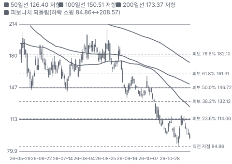

**주봉**

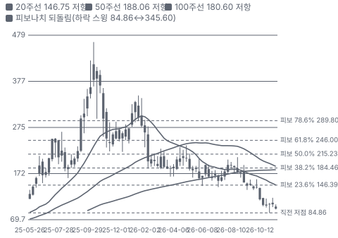

**월봉**

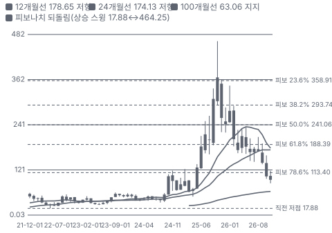

**분기 매출·EPS 실적과 컨센서스**

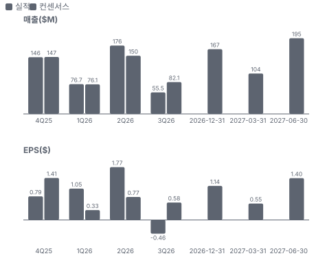

**최근 4개 분기 주가 변화 분석**

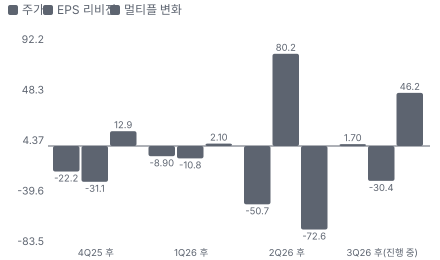

**EPS 리비전**

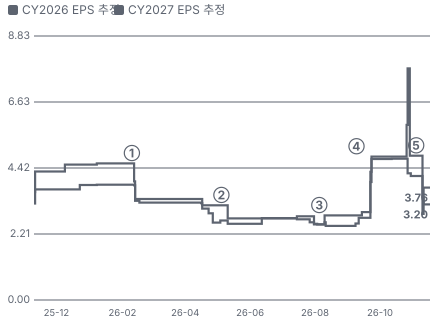

① 26-02-10 4Q25 실적 — 하루 −20.7% · EPS 리비전 -26%
② 26-05-05 1Q26 실적 — 하루 +12.3% · EPS 리비전 -14%
③ 26-08-05 2Q26 실적 — 하루 −5.1% · EPS 리비전 +12%
④ 26-09-09 \$500M 증자·워런트 · EPS 리비전 +70%
⑤ 26-11-04 3Q26 실적 — 하루 −3.8% · EPS 리비전 -34%

**멀티플 프리미엄(Fwd 1Y P/E, 최근 4개 분기말)**

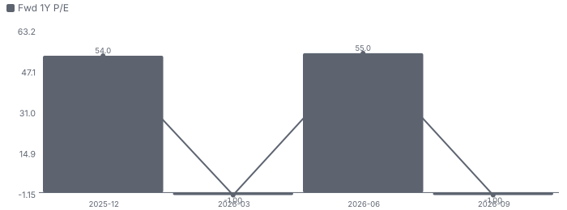

**합리적 멀티플**

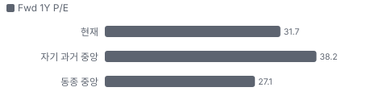

**밸류에이션 주가 시나리오**

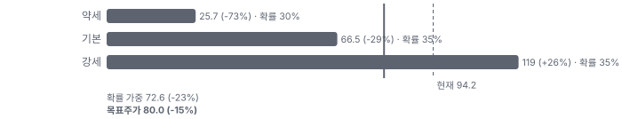

**주가별 업사이드**

- 제품·서비스 포트폴리오

**고객 믹스(3Q26, 매출 대비)**

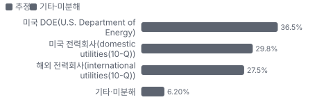

**공급 병목(10점, 낮을수록 병목)**

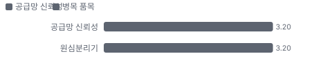

**생산능력 현재와 확충 계획(원심분리기 캐스케이드(대))**

**CAPEX의 매출 대비 비중**

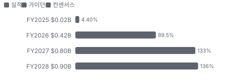

**어닝콜 변화별 주주가치 영향**

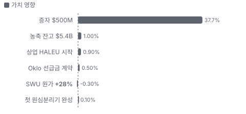

**수주·파이프라인 확실성 사다리**

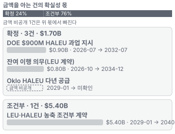

**수주/출하 비율 × 재고 일수 — 분기별(B/B 100 = 수주와 출하가 같다)**

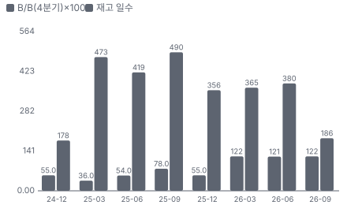

**매출 → 매출총이익 → 영업이익(매출 = 100, 최근 4분기)**

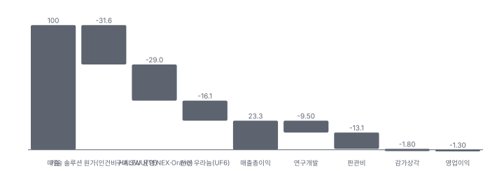

**분기 비용 비중 추이(매출 대비, 공시)**

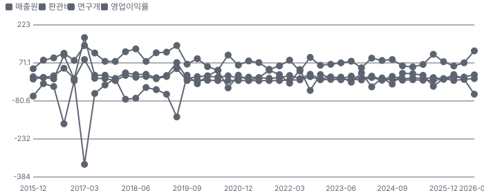

**비용 요인별 매출 대비 비중 1년 변화**

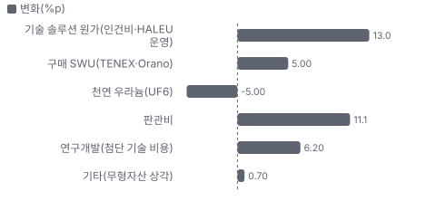

**LEU BOM 원가 몫**

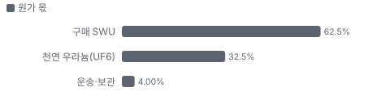

**기술 솔루션 BOM 원가 몫**

**BOM 항목 가격 +10% 시 OPM 변화**

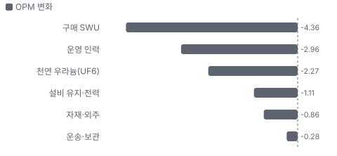

**원가 물가 vs 판매가 물가 — 1년 변화(원가가 판매가보다 더 오르면 단가를 올리지 못하는 만큼 마진이 줄어든다)**

**사업별 매출 vs 물가 — 전년 대비(명목 매출 · 비교 물가 · 실질 = 물량·믹스)**

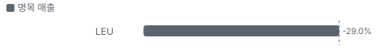

**자산 구성 — 3Q26 분기말 투하자본 \$459.3M**

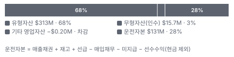

**자산별 변화율 — 최근 12개 분기(4Q23 = 0%) + 다음 4개 분기 추정**

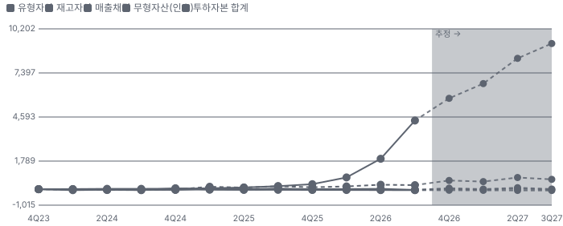

**ROIC 추이 — TTM, 최근 12개 분기 + 다음 4개 분기 추정(컨센서스 NOPAT)**

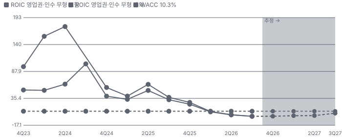

**분기 감가 비율 연율(유형자산 순액 대비)**

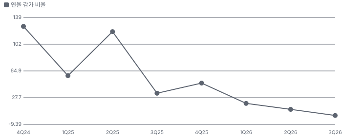

**생산시설별 면적(sq ft, 큰 순) — 생산능력 미공시라 면적을 대용으로**

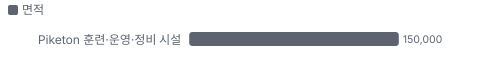

**Westerman 시너지 램프(종류별, 확률 가중)**

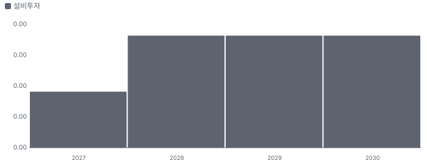

**시너지 가치 vs 웃돈**

**EPS 효과(인수 기업, 기존 대비)**

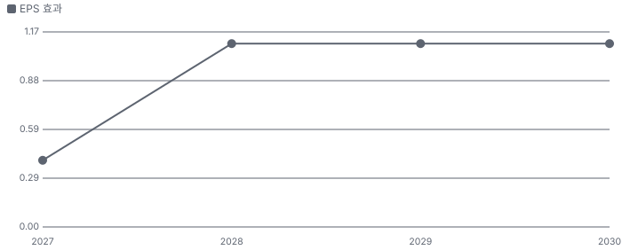

**매출 증가율의 가격·물량 분해와 8분기 전망(전년 대비)**

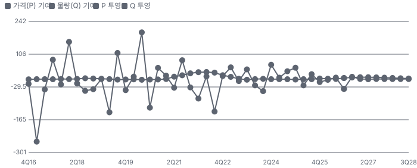

**분기별 매출 증가율 분해**

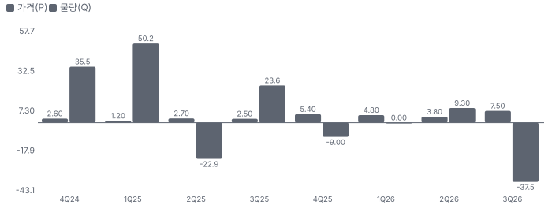

**목표주가 산정 — 기본과 강세 사이(강세 쪽 25%), 도달 확률 약 43%**

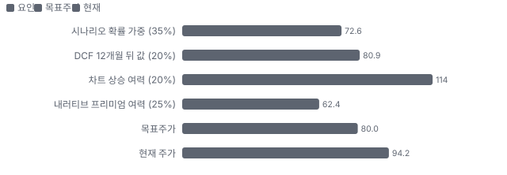

**PEG — 성장 대비 멀티플(낮을수록 성장 대비 쌈)**

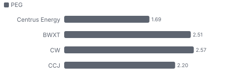

**일봉 지지·저항과 목표주가**

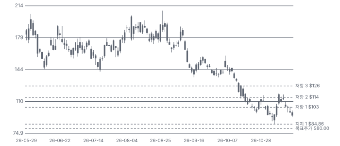

**커뮤니티 언급 수(최근 30일, 채널별)**

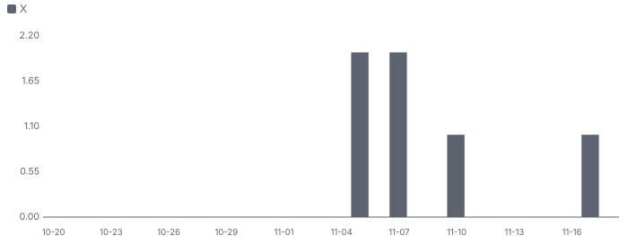

**일별 거래량 분해**

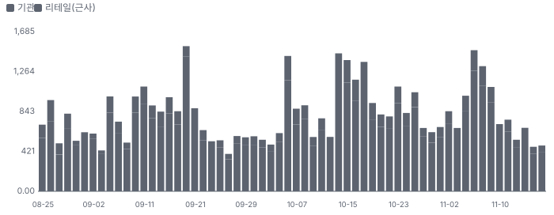

**기관 자금 흐름**

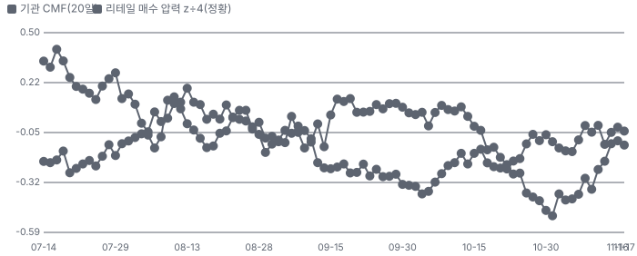

**몬테카를로**

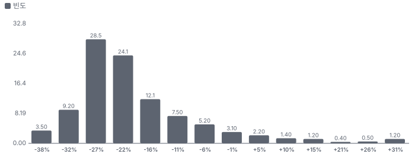

해석: 3,000번 중 233번(8%)에서 가치가 지금 주가 이상이었다. 가정을 흔들어도 지금 주가를 뒷받침하지 못하는 경우가 더 많다. 가운데 값은 0.77배이고, 열 번 중 여덟 번은 0.69~0.97배 사이에 든다.

## 내러티브

> **기업가치를 결정하는 이야기:** 이 회사는 지금 러시아·프랑스에서 산 농축 우라늄을 전력회사에 되파는 중개 사업(LEU)과 DOE HALEU 생산(기술 솔루션)으로 매출 \$450~500M을 낸다. 가치의 대부분은 2029년부터 가동할 자국 농축 공장의 미래 SWU 판매에 있다 — 그 전까지는 중개 마진이 얇고 분기 실적이 들쭉날쭉하다.

> **멀티플·EPS 프리미엄**
> **멀티플:** Fwd 1Y P/E 31.7배로 동종 이익 흑자 3곳(BWXT·CW·CCJ) 중앙값 27.1배보다 높다. 다만 다음 4개 분기 EPS의 상당 부분이 현금 이자 수익이다.
> **EPS:** 다음 4개 분기 EPS 컨센서스 \$2.97 — 2027년 3분기에는 다시 적자가 예상된다. 이익 추정은 3분기 콜 뒤 2026년 \$2.88 → \$3.76으로 올랐지만 표본이 4~7명이다.

### 투자자들은 왜 열광했나

2025년 하반기 투자자들은 AI 데이터센터 전력 → 원전 → 연료 병목 → 미국 유일 농축사로 이어지는 사슬에 열광했다. 2026년에는 증설 비용이 수십억 달러로 커지고 9월 증자·워런트가 나오면서 '병목 해결사'가 '자금 조달자'로 다시 읽혔다.

### 무엇이 기업가치를 바꾸나

> **구조적 체질 변화**
> **변화:** 남의 SWU를 되파는 중개사 → 자국 농축 생산자
> **증거:** Piketon LEU·HALEU 증설, Fluor EPC(설계·조달·시공 일괄 계약) 계약(2026-02), 첫 새 캐파 2029년(2Q 콜)
> **반증:** 2029년 첫 캐파 일정 연기 공시

> **고부가 믹스 확장**
> **변화:** HALEU는 LEU보다 SWU당 가격이 높다
> **증거:** DOE 옵션 HALEU MTU(우라늄 1톤)당 \$17.0M 고정가(10-Q)
> **반증:** 상업 HALEU 계약 가격이 DOE 옵션 가격보다 크게 낮다는 공시

> **기술 혁신**
> **변화:** 미국 기술 원심분리기(American Centrifuge(Centrus가 DOE 기술로 개발한 미국 원심분리기)) 상업 양산 시작
> **증거:** Oak Ridge(테네시주 오크리지 — Centrus 원심분리기 제조 공장 소재지) 첫 원심분리기 완성(3Q 콜)
> **반증:** 원심분리기 생산 속도 공개 지연·결함

> **실행 속도**
> **변화:** 해당 없음(주문→인도 리드타임을 회사·경쟁사 모두 공시하지 않는다) — 대신 원심분리기 첫 완성을 연말 목표보다 앞당겼다
> **증거:** 연말 목표 → 3Q에 완성(3Q 콜)
> **반증:** 12/7 설명회에서 2029년 가동 목표 후퇴

> **M&A**
> **변화:** Westerman 인수로 장비 제조 내재화
> **증거:** \$116M(현금 \$95M·주식 \$21M, 10-Q 후속 사건)
> **반증:** 인수 뒤 증설 비용 증가 공시

> **정책·입법 연관성**
> **재정정책:** DOE HALEU 가용성 프로그램·\$900M 과업 지시(2024 HALEU 생산 IDIQ(물량 미정 장기 계약, 정부가 개별 과업으로 발주)) 10-Q 주석 15 반증: 세출 삭감·옵션 미행사 의회 동의 10/10 — 하원 5/5(HALEU 예산은 인플레이션 감축법·에너지 세출로 이미 반영(10-Q 기재)) · 상원 5/5(같음).
> **행정명령:** 2025년 원자력 행정명령(국내 연료 공급망 확대) — 회사 매출 연결은 DOE 과업 지시로만 확인 Quantral 요약·DOE 발표(2026-01-28 공급망 계획 보도) 반증: 후속 예산 없음 의회 동의 6/10 — 하원 3/5(원자력 지원은 초당적 공개 지지 — 행정명령 자체는 의회 의결 대상 아님) · 상원 3/5(같음).
> **연관입법:** 러시아 우라늄 수입 금지법(2024-05 시행) — 2028년 이후 면제 없음 10-Q 용어·위험 요인 반증: 면제 연장 입법

> **고객의 지출 예산**
> **변화:** 전력회사 연료 구매 예산(운영비)과 정부 세출
> **사업별 예산:** **매출의 57%**: LEU — 고객 OPEX(전력회사 핵연료 구매비(연료비)) · 동인: 원전 가동·재장전 주기
**매출의 43%**: 기술 솔루션 — 고객 혼합(DOE 세출(HALEU 프로그램)·소형로 개발사 연료 선급금) · 동인: 의회 세출·소형로 일정
> **증거:** 중·장기 고정 물량 계약(10-Q)
> **반증:** 전력회사 계약 취소

### 내러티브 근거

> '미국 유일의 자국 농축사가 러시아 연료를 대체한다'는 이야기는 2025년 10월 정점 뒤 증설 비용·희석·실적 공백으로 식었다. 단계는 소멸, 쏠림은 높음(공매도 유통 주식의 29.6%, 기관 보유 92%) — 리테일 언급은 적다이다.

> **러시아 농축 대체(국산화)** · 유지
> **논리:** 러시아 LEU 수입 금지(2028년 면제 종료)로 미국 농축 캐파가 전략 자산이 된다
> **숫자:** 농축 잔고 \$5.4B(그중 확정 \$5.1B), DOE \$900M 과업 지시
> **반증:** DOE가 러시아 면제를 2028년 이후로 연장하거나 Urenco·Orano 미국 증설이 먼저 가동
> **출처:** 10-Q·3Q 콜

> **HALEU 차세대로 연료 독점** · 약화
> **논리:** 소형로 상당수가 HALEU를 쓰고 미국에서 HALEU를 상업 생산하는 곳은 Centrus뿐
> **숫자:** 16기 캐스케이드 누적 약 2톤 생산(2Q 콜), Oklo·X-energy·Radiant·Antares 선급금 계약
> **반증:** 소형로 첫 상업 가동이 2030년 이후로 밀리거나 경쟁사 HALEU 시설 인허가
> **출처:** 2Q·3Q 콜, 10-Q

> **순현금 쿠션** · 유지
> **논리:** 현금 \$2.24B가 전환사채 \$1.21B를 넘어 시총의 절반이 순현금
> **숫자:** 순현금 \$1.06B(장부가 기준) = 시총 \$1.94B의 55%
> **반증:** CAPEX가 연 \$500M 이상으로 커지며 2년 안에 순현금 소진
> **출처:** 10-Q 재무상태표

> **증설 자금·희석(반대 내러티브)** · 강화
> **논리:** 수십억 달러 증설을 워런트·ATM으로 메우면 주당 가치가 깎인다
> **숫자:** 9월 \$500M 증자 + 워런트 7.0M주(현 주식의 34%), CAPEX 가이던스 \$350~500M
> **반증:** 고객 선급금·DOE 지급으로 2027년 CAPEX의 절반 이상을 메운다는 회사 공시
> **출처:** 10-Q 주석 11

> **이익 공백(반대 내러티브)** · 강화
> **논리:** 새 캐파 전까지는 남의 SWU를 사다 파는 중개 마진뿐이고 원가가 더 빨리 오른다
> **숫자:** 3Q SWU 판매가 +10% vs 원가 +28%, 정상화 영업손실 −\$25.1M
> **반증:** 4Q 매출 \$167M 이상과 LEU 부문 매출총이익률 30% 회복
> **출처:** 3Q 콜

### 투자 포인트

> **시총의 절반이 순현금**
> **명제:** 현금 \$2.24B − 전환사채 장부가 \$1.18B = 순현금 \$1.06B(기본 주식 시총 \$1.94B의 55%)
> **숫자:** 10-Q 재무상태표(2026-09-30)
> **시장과 다른 점:** 시장은 증설 비용을 걱정하지만 순현금이 2~3년 CAPEX를 덮는다
> **증명:** 2027년 CAPEX 가이던스와 자금 조달 계획(12/7 설명회)
> **출처:** https://www.sec.gov/Archives/edgar/data/1065059/000162828026070557/leu-20260930.htm

> **잔고는 조건부**
> **명제:** 농축 잔고 \$5.4B 중 \$5.1B가 확정 계약이지만 새 캐파 가동이 조건
> **숫자:** 10-Q·3Q 콜
> **시장과 다른 점:** 잔고를 매출로 바로 읽으면 안 된다 — 지금 인식 가능한 잔여 이행 의무는 \$0.8B
> **증명:** Piketon 첫 캐스케이드 가동 일정(2029)
> **출처:** https://www.sec.gov/Archives/edgar/data/1065059/000162828026070557/leu-20260930.htm

> **단기 병목은 러시아**
> **명제:** 새 캐파 전까지 판매 SWU의 공급선이 TENEX·Orano
> **숫자:** 10-Q 주석 13
> **시장과 다른 점:** 시장이 원심분리기만 보지만 2026~27년 이익을 정하는 것은 러시아 면제
> **증명:** DOE 추가 면제 결정 공시
> **출처:** https://www.sec.gov/Archives/edgar/data/1065059/000162828026070557/leu-20260930.htm

### 모멘텀 생성·소멸 타임라인

**카탈리스트 달력 — 지난 사건의 주가 반응과 앞으로 확인할 숫자**
| 날짜 | 상태 | 구분 | 사건 | 반응·확인 | 결과에 따라 |
|---|---|---|---|---|---|
| 2025-10-15 | 완료 | 생성 | 종가 고점 \$436.00 — AI 전력 → 원전 연료 내러티브 정점 | 이후 −78% |  |
| 2026-02-10 | 완료 | 소멸 | 4Q25 실적 | 다음 날 −20.7% |  |
| 2026-09-09 | 완료 | 소멸 | \$500M 증자·워런트 | 다음 날 −8.6% |  |
| 2026-11-12 | 완료 | 생성 | Oklo HALEU 다년 확정 계약(선급금) | 당일 종가 \$103.92 |  |
| 2026-12-07 | 예정 | 확인 | Piketon 투자자 설명회 | 2029년 첫 캐스케이드 가동 일정·증설 CAPEX 총액·자금 계획 | 일정 유지와 자금 계획 공개 → 희석 할인 축소 / 일정 후퇴 → 약세 시나리오 |
| 2026-12 말(예상) | 예정 | 확인 | DOE Piketon 임차 연장(회사 10-Q: 2026년 말까지 노력) | 2027-10-01 만료 임차의 장기 연장 발표 | 연장 → 조건부 잔고의 전제 확보 / 미결 → 2027년 약세 꼬리 확대 |
| 2027-02 초(예상) | 예정 | 확인 | 4Q26 실적·2027 가이던스 | 매출 \$167M 이상(연간 가이던스 중간값), 2027 CAPEX 가이던스 | 2027년 매출 추정 \$488M vs \$600M 차이가 정리된다 |

### 언제 사서 언제 팔아야 할까?

**가격·조건 틀 — 가격은 밸류에이션(약세·기본·강세·목표주가)과 차트 지지 구간에서, 조건은 이벤트에서**
| 구간 | 가격 | 목표주가까지 | 약세까지 | 조건·근거 |
|---|---|---|---|---|
| 관찰 구간 | \$85~\$85 | -6% | -70% | 지지 구간이 약세 시나리오 가격과 겹치는 곳 — 11/5 종가 저점 \$89.03 |
| 확인 뒤 | 지금 \$94 이상에서 조건 확인 | -15% | -73% | 12/7 설명회에서 2029년 가동 일정과 CAPEX 총액·자금 계획 공개, DOE 러시아 추가 면제 또는 Piketon 임차 연장 |
| 무효화 | 약세 시나리오 \$26 | - | -73% | 11/5 종가 저점 \$89.03 이탈과 함께 증설 일정 후퇴 또는 추가 증자 |
| 차익 고민 2차 | \$119(강세 시나리오) | +26% | - | 목표주가 근처에서는 희석(워런트 행사가 \$227)과 순현금 소진 속도를 다시 본다 |

실적 다음 날 ±12~21% 움직임이 반복됐다(2/11 −20.7%, 5/6 +12.3%) 가격·조건 틀이며 매매·비중 지시가 아니다(투자 권유 아님).

## 포트폴리오

| 제품·서비스 | 구분 | 무엇 | 쓰는 곳 | 돈 버는 방식 | Mix | Mix 변화(전년 대비) |
|---|---|---|---|---|---|---|
| LEU | 제품 | 원전용 저농축 우라늄의 농축 서비스(SWU)와 천연 우라늄 판매 | 미국·해외 전력회사 원전 연료 | 중·장기 고정 물량 계약. 지금은 러시아 TENEX·Orano에서 사 온 SWU를 되판다 — 3Q 매출 \$31.8M, 9개월 \$229.8M | 57% | -2.5%p |
| 기술 솔루션 | 서비스 | DOE HALEU 생산 계약, 엔지니어링·제조 서비스(Westerman 포함) | 미국 정부 HALEU 비축·차세대로 연료 | 정부 계약 원가+보수·고정가 마일스톤. 3Q 매출 \$23.7M, \$900M 과업 지시는 2032년까지 마일스톤 지급 | 43% | +2.5%p |

**Mix 변화가 가장 큰 쪽은 기술 솔루션(+2.5%p, 전년 대비).** 계절성 판정: 분기 매출 계절 지수 기준 있음 → 전년 같은 분기와 비교.

## 고객

> **3Q26 최대 고객 미국 DOE(U.S. Department of Energy) 36%, 상위 3곳 94%, 집중도 집중.** 공시·회사 발표로 확인한 몫은 매출의 0%이고, 나머지 고객 몫은 추정이거나 미분해다. 고객은 미국·해외 전력회사(LEU)와 미국 DOE(기술 솔루션)다. 10-Q는 10% 초과 고객 이름을 적지 않는다 — LEU 부문 매출의 약 48%가 해외다.

**고객별 매출 몫(3Q26)**
| 고객 | 몫 | 변화 | 근거 |
|---|---|---|---|
| 미국 DOE(U.S. Department of Energy) | 30~43% | 미확인 | 추정 |
| 미국 전력회사(domestic utilities(10-Q)) | 30% | 미확인 | 추정 |
| 해외 전력회사(international utilities(10-Q)) | 28% | 미확인 | 추정 |
| Oklo(Oklo Inc.) | 미확인 | 미확인 | 공시 |
| 기타·미분해 | 6% | - | - |

> **미국 DOE(U.S. Department of Energy)** · 추정
> **사는 것:** HALEU 생산·운영
> **추정 근거:** 기술 솔루션 매출 대부분 — 3Q 기술 솔루션 \$23.7M(매출의 43%)이 상한

> **미국 전력회사(domestic utilities(10-Q))** · 추정
> **사는 것:** SWU·우라늄
> **추정 근거:** LEU 매출의 약 52% × 57%(계산)

> **해외 전력회사(international utilities(10-Q))** · 추정
> **사는 것:** SWU·우라늄
> **추정 근거:** LEU 매출의 약 48% × LEU 비중 57%(계산)

> **Oklo(Oklo Inc.)** · 공시
> **사는 것:** HALEU(2029년부터, 선급금)
> **추정 근거:** 확정 계약 — 매출 인식 전

## 수주·파이프라인

> **2026-09-30 기준 4건.** 확정 \$1.70B, 미확정 \$5.40B. 공시 총 잔고 \$7.00B.

**수주 목록**
| 상태 | 계약 | 계약 총액 | 진척 | 기간 | 비고 |
|---|---|---|---|---|---|
| 확정 | DOE \$900M HALEU 과업 지시 | \$0.90B | 비공개 | 2026-07 → 2032-07 | - |
| 확정 | 잔여 이행 의무(LEU 계약) | \$0.80B | 비공개 | 2026-10 → 2034-12 | - |
| 확정 | Oklo HALEU 다년 공급 | 금액 비공개 | 비공개 | 2029-01 → 미확인 | - |
| 조건부 | LEU·HALEU 농축 조건부 계약 | \$5.40B | 비공개 | 2029-01 → 2040-12 | - |

**실행 속도와 방해 요인**
| 항목 | 상태 | 실행 속도 | 방해 요인 |
|---|---|---|---|
| DOE \$900M HALEU 과업 지시 | 확정 | 2032년 7월까지 HALEU 1 MTU | 캐파 배치 일정 |
| 잔여 이행 의무(LEU 계약) | 확정 | 2034년까지 | 러시아 면제 |
| Oklo HALEU 다년 공급 | 확정 | 2029년부터 | Oklo 원자로 인허가·가동 |
| LEU·HALEU 농축 조건부 계약 | 조건부 | 2029년 이후 인식 | Piketon 가동 일정 · 증설 자금 · 임차 연장 |

## 마진 구조

> **GPM -19.1%, OPM -53.5%.** 3Q25 대비 GPM -13.4%p, OPM -31.4%p. 변동비는 매출의 94%이고, 매출이 10% 늘면 OPM은 +5.4%p 움직인다. 3Q 매출원가는 매출의 119%로 매출총손실 −\$10.6M. SWU 단가가 +28% 올라 판매가(+10%)를 앞질렀고, 기술 솔루션도 원가 증가로 적자였다. 9개월 기준 매출원가율은 77%다.

> **매출 100 중 매출원가 76.7, 매출총이익 23.3(최근 4분기, 공시).** 매출원가 요인 중 기술 솔루션 원가(인건비·HALEU 운영)이 매출의 49.0%로 가장 무겁고, 단가가 +10% 오르면 GPM이 -4.90%p 움직인다. 분기 회귀로 매출 1이 늘 때 매출원가는 0.60 늘고, 매출원가의 고정비 몫은 19%다. 매출원가 요인 비중은 요인별 공시 기간 값이라 합이 최근 4분기 매출원가를 넘어, 그림에서는 0.64배로 비례 조정했다.

**비용 요인 강도 — 비중·추세·충격(+10%)·탄력**
| 비용 | 구분 | 매출 대비 | 1년 변화 | 마진 기여 | 충격 시 마진 | 매출 탄력 | 고정비 몫 |
|---|---|---|---|---|---|---|---|
| 기술 솔루션 원가(인건비·HALEU 운영) | 매출원가 요인 | 49.0% | +13.0%p | -13.0%p | -4.90%p | 미확인 | 60% |
| 구매 SWU(TENEX·Orano) | 매출원가 요인 | 45.0% | +5.0%p | -5.0%p | -4.50%p | 미확인 | 0% |
| 천연 우라늄(UF6(육불화우라늄 — 농축 공정에 넣는 기체 상태 우라늄)) | 매출원가 요인 | 25.0% | -5.0%p | +5.0%p | -2.50%p | 미확인 | 0% |
| 매출원가 | 공시 항목 | 76.7% | +8.5%p | -8.5%p | -7.67%p | 0.60 | 19% |
| 판관비 | 공시 항목 | 13.1% | +3.9%p | -3.9%p | 미확인 | 0.02 | 81% |
| 연구개발 | 공시 항목 | 9.5% | +7.0%p | -7.0%p | 미확인 | 0.02 | 74% |
| 감가상각 | 공시 항목 | 1.8% | -0.1%p | +0.1%p | 미확인 | 0.02 | 35% |

매출 탄력 = 분기 비용을 매출에 회귀한 기울기(매출 1당 변동비), 고정비 몫 = 절편 ÷ 평균 비용. 표본이 8분기 미만이면 미확인. 매출원가 요인 비중은 margin 재료의 추정이 섞여 있고, 공시 매출원가와의 차이는 '기타 매출원가'로 둔다.

**GPM에서 OPM까지(GAAP, 아래는 최근 4개 분기)**
| 기간 | GPM | 연구개발 | 판관비 | 기타 | OPM |
|---|---|---|---|---|---|
| 3Q25 | -5.7% | 2.3% | 12.7% | 1.5% | -22.2% |
| 3Q26 | -19.1% | 8.5% | 23.8% | 2.2% | -53.5% |
| 2025-12 | 23.9% | - | - | - | 8.8% |
| 2026-03 | 41.1% | - | - | - | 1.0% |
| 2026-06 | 28.3% | - | - | - | 5.9% |
| 2026-09 | -19.1% | - | - | - | -53.5% |

**비용을 움직이는 요인**
| 비용 | 요인 |
|---|---|
| 기술 솔루션 원가(인건비·HALEU 운영, 매출원가) | DOE 계약 인력·설비 운영 · 근거 공시 |
| 구매 SWU(TENEX·Orano, 매출원가) | 구매 계약 단가(시장 연동) — 3Q 단가 +28% · 근거 추정 |
| 천연 우라늄(UF6, 매출원가) | 우라늄 판매 물량 · 근거 추정 |
| 판관비(판관비) | 증설 준비 인력·성장 비용 · 근거 공시 |
| 연구개발(첨단 기술 비용, 연구개발) | 계약 밖 원심분리기 개발 · 근거 공시 |
| 기타(무형자산 상각, 판관비) | 2014년 회생 때 잡은 고객관계·잔고 무형 상각 · 근거 공시 |

**LEU BOM — 매출의 57%, GPM -22%(LEU 부문: 매출 \$31.8M, 매출총손실 −\$6.9M(10-Q 세그먼트, 3Q26)), 항목 가격 +10% 시**
| 항목 | 원가 몫 | 전가 | 제품 GPM | OPM |
|---|---|---|---|---|
| 구매 SWU | 55~70% | 미확인 | -7.6%p | -4.36%p |
| 천연 우라늄(UF6) | 25~40% | 미확인 | -4.0%p | -2.27%p |
| 운송·보관 | 2~6% | 미확인 | -0.5%p | -0.28%p |

**기술 솔루션 BOM — 매출의 43%, GPM -16%(기술 솔루션 부문: 매출 \$23.7M, 매출총손실 −\$3.7M(10-Q 세그먼트, 3Q26)), 항목 가격 +10% 시**
| 항목 | 원가 몫 | 전가 | 제품 GPM | OPM |
|---|---|---|---|---|
| 운영 인력 | 50~70% | 미확인 | -6.9%p | -2.96%p |
| 설비 유지·전력 | 15~30% | 미확인 | -2.6%p | -1.11%p |
| 자재·외주 | 10~25% | 미확인 | -2.0%p | -0.86%p |

판매가 전가를 모르는 항목은 전가 0%로 계산했다.

**BOM 항목 가격을 움직이는 것**
| 항목 | 요인 |
|---|---|
| 구매 SWU | 계약 판매가와 구매 단가의 시차가 마진을 정한다 · 근거 추정 |
| 천연 우라늄(UF6) | 우라늄 판매분 원가 · 근거 추정 |
| 운송·보관 | 실린더 운송 · 근거 추정 |
| 운영 인력 | HALEU 캐스케이드 운영 · 근거 추정 |
| 설비 유지·전력 | 원심분리기 구동 전력 · 근거 추정 |
| 자재·외주 | 엔지니어링 서비스 · 근거 추정 |

판매가 비교 물가(none)는 1년 새 미확인 — 회사 가격 변화는 미확인. 물가 지수를 붙이지 못한 매출원가 항목은 구매 SWU(TENEX·Orano), 천연 우라늄(UF6), 기술 솔루션 원가(인건비·HALEU 운영)다(미연결). LEU 매출은 2026-09 전년 대비 -29.0%(비교 물가 미확인).

## 자산 구성

> **3Q26 분기말 투하자본 \$459.3M** — 유형자산 68%, 운전자본 28%. 최근 12개 분기(4Q23 → 3Q26) 가장 크게 늘어난 자산은 유형자산(+4370%), 투하자본 합계 +259%. 3Q27 추정 투하자본 \$925.5M(+102%, 컨센서스 매출과 회전 일수·CAPEX 강도 유지 가정). 연율 감가 비율(순액 기준)은 직전 4분기 78.09% → 최근 4분기 9.84%, 직전 비율이면 감가상각이 \$67.9M 더 컸다(영업이익의 -1191.9%).

**자산·운전자본 항목별 분기말 잔액 — 최근 12개 분기와 다음 4개 분기 추정**
| 항목 | 4Q23 | 3Q25 | 3Q26(최근) | 3Q27 추정 | 12개 분기 변화 | 다음 4개 분기 변화 |
|---|---|---|---|---|---|---|
| 매출채권 | \$49.4M | \$60.7M | \$26.8M | \$37.0M | -46% | +38% |
| 재고자산 | \$306.4M | \$416.3M | \$177.7M | \$328.7M | -42% | +85% |
| 선급·기타 유동자산 | \$10.8M | \$8.1M | \$11.7M | \$14.1M | +8% | +20% |
| 선수수익(계약부채) | \$282.6M | \$154.8M | \$85.3M | \$117.4M | -70% | +38% |
| 유형자산 | \$7.0M | \$20.5M | \$312.9M | \$655.7M | +4370% | +110% |
| 무형자산(인수) | \$39.4M | \$23.7M | \$15.7M | \$7.7M | -60% | -51% |

**자산 추정 동인 — 최근 4개 분기 평균(재무상태표 동인 모형)**
| 동인 | 값 | 곱하는 기준 |
|---|---|---|
| 매출채권 | 32일 | 매출 |
| 재고자산 | 365일 | 매출원가 |
| 선급·기타 유동자산 | 12일 | 매출 |
| 선수수익(계약부채) | 100일 | 매출 |
| CAPEX 강도 | 51.9% | 매출(최근 4개 분기 합) |
| 분기 감가율 | 0.71% | 기초 유형자산 순액(무형 상각 제외 감가상각) |
| 매출원가율 | 76.7% | 매출(최근 4개 분기) |
| 영업권·리스 사용권·기타 | 유지 | 인수·새 리스는 공시 전 모름 |
| 인수 무형자산 | 분기 \$2.0M 상각 | 최근 4개 분기 평균 상각 |

**추정 방법:** 증권사 3표 모델(손익·재무상태표·현금흐름)의 재무상태표 동인 방식이다. 운전자본은 항목별 회전 일수(매출채권·선급·미지급·선수는 매출, 재고·매입채무는 매출원가 기준)를 최근 4개 분기 평균으로 두고 컨센서스 매출에 곱한다. 유형자산은 기초 + CAPEX − 감가상각으로 굴린다(Koller·Goedhart·Wessels 『Valuation』 재무상태표 추정). 매출 경로는 ROIC 절의 컨센서스와 같다.

**유형·무형자산 항목별 가치(2025-12-31 vs 2024-12-31)**
| 구분 | 항목 | 총액 2025-12-31 | 누적상각 | 순액 | 총액 2024-12-31 | 총액 1년 변화 | 공시 내용연수 |
|---|---|---|---|---|---|---|---|
| 유형 | 유형자산 합계(항목 미분해) | \$36.2M | 총계만 공시 | 총계만 공시 | \$14.7M | +146.3% | 미확인 |
| 무형 | 무형자산 합계(항목 미분해) | \$123.5M | \$102.3M | \$21.2M | \$123.5M | +0.0% | 미확인 |
| 유형 합계 | 유형자산 | \$36.2M | \$6.7M | \$29.5M | \$14.7M | +146.3% | 경과율 19%(상각 대상 기준) |

**내용연수 산식(상각 대상 유형자산 = 총액 − 토지 − 건설중)**
| 기준일 | 연 감가상각 | 상각 대상 총액 | 평균 내용연수 | 경과 연수 | 잔여 연수 | 경과율 |
|---|---|---|---|---|---|---|
| 2025-12-31 | \$1.4M | \$36.2M | 25.9년 | 4.8년 | 21.1년 | 19% |
| 2024-12-31 | \$1.0M | \$14.7M | 14.7년 | 5.3년 | 9.4년 | 36% |

산식 평균 내용연수는 25.9년. 1년 전 14.7년 → 지금 25.9년.

**분기 감가 비율(감가상각 ÷ 평균 유형자산 순액)**
| 분기 | 감가상각 | 평균 유형자산(순액) | 분기 비율 | 연율 | 연율의 역수 |
|---|---|---|---|---|---|
| 4Q24 | \$2.9M | \$9.2M | 31.69% | 126.78% | 0.8년 |
| 1Q25 | \$1.5M | \$10.3M | 14.56% | 58.25% | 1.7년 |
| 2Q25 | \$3.9M | \$13.1M | 29.89% | 119.54% | 0.8년 |
| 3Q25 | \$1.5M | \$17.7M | 8.47% | 33.90% | 2.9년 |
| 4Q25 | \$3.0M | \$25.0M | 12.00% | 48.00% | 2.1년 |
| 1Q26 | \$2.2M | \$44.5M | 4.94% | 19.78% | 5.1년 |
| 2Q26 | \$2.9M | \$101.0M | 2.87% | 11.49% | 8.7년 |
| 3Q26 | \$1.7M | \$227.7M | 0.75% | 2.99% | 33.5년 |

감가상각 기준: 손익계산서 감가상각·상각비(SEC 공시 데이터, 4분기 = 연간 − 1~3분기).

**감가율 하락 경고: 연율 78.09% → 9.84%(-87%).** 직전 4분기 비율을 그대로 쓰면 최근 4분기 감가상각이 \$67.9M 더 컸다(영업이익의 -1191.9%). 내용연수 연장·상각 끝난 자산 증가·건설중 자산 증가(믹스) 중 무엇인지는 공시 주석으로 가린다(자체추론).

미공시·미분해: 리스 사용권자산 · 영업권 · 유형자산 항목별 총액·내용연수(10-K 주석에서 모델이 채움) · 무형자산 항목(10-K 주석에서 모델이 채움) — 이 칸은 비우고 나머지로 계산했다.

### 해석 — 자산이 어디에 쌓이고 있나

- 같은 기간 4개 분기 매출은 +15% — 매출보다 빨리 늘어난 자산: 유형자산 +4370%. 이 자산의 회전율이 떨어지면 ROIC를 희석한다.
- 다음 4개 분기 CAPEX \$297.4M vs 감가상각 \$12.8M(최근 4개 분기 CAPEX 강도·감가율 유지) — 유형자산 3Q26 \$312.9M → 3Q27 \$655.7M. 투자가 감가보다 커서 자산이 쌓이는 국면이다.
- 감가 비율 하락으로 최근 4분기 영업이익에 \$67.9M(-1191.9%)가 보태졌을 수 있다 — 내용연수 변경 공시가 없으면 건설중 자산·토지 같은 비상각 자산 몫이 커진 믹스 효과일 가능성이 크다(자체추론).

## ROIC

> **TTM 3Q26 ROIC는 영업권·인수 무형 포함 0.4%, 제외 0.5%**(NOPAT 마진 0.4% × 투하자본 회전율 1.09회). 최근 12개 분기 4Q23 51.7% → 3Q26 0.4%(고점 3Q24 102.7%). 컨센서스 NOPAT으로 굴리면 3Q27 6.4%(제외 6.5%) — WACC 10.3% 대비 -3.9%p. 1년 변화의 가장 큰 요인은 NOPAT 마진(-27.6%p).

**ROIC 추이(TTM)와 다음 4개 분기 추정 — NOPAT ÷ 평균 투하자본(이번 분기말·4개 분기 전)**
| 분기 | 구분 | TTM 매출 | TTM NOPAT | NOPAT 마진 | 평균 투하자본 | ROIC 포함 | ROIC 제외 |
|---|---|---|---|---|---|---|---|
| 4Q23 | 실적 | \$320.2M | \$47.0M | 14.7% | \$90.8M | 51.7% | 97.3% |
| 1Q24 | 실적 | \$297.0M | \$31.4M | 10.6% | \$61.5M | 51.1% | 156.4% |
| 2Q24 | 실적 | \$387.6M | \$38.3M | 9.9% | \$60.6M | 63.2% | 175.4% |
| 3Q24 | 실적 | \$394.0M | \$35.4M | 9.0% | \$34.5M | 102.7% | 미확인 |
| 4Q24 | 실적 | \$442.0M | \$45.9M | 10.4% | \$115.6M | 39.7% | 56.6% |
| 1Q25 | 실적 | \$471.4M | \$70.2M | 14.9% | \$209.9M | 33.5% | 39.8% |
| 2Q25 | 실적 | \$436.9M | \$80.0M | 18.3% | \$157.3M | 50.9% | 62.7% |
| 3Q25 | 실적 | \$454.1M | \$71.9M | 15.8% | \$220.0M | 32.7% | 37.4% |
| 4Q25 | 실적 | \$448.7M | \$46.5M | 10.4% | \$194.7M | 23.9% | 27.5% |
| 1Q26 | 실적 | \$452.3M | \$31.3M | 6.9% | \$343.5M | 9.1% | 9.8% |
| 2Q26 | 실적 | \$473.9M | \$12.1M | 2.6% | \$373.4M | 3.2% | 3.4% |
| 3Q26 | 실적 | \$454.5M | \$1.8M | 0.4% | \$416.6M | 0.4% | 0.5% |
| 4Q26 | 추정 | \$475.0M | \$2.9M | 0.6% | \$560.0M | 0.5% | 0.5% |
| 1Q27 | 추정 | \$502.3M | \$8.8M | 1.7% | \$550.7M | 1.6% | 1.6% |
| 2Q27 | 추정 | \$521.2M | \$13.5M | 2.6% | \$784.2M | 1.7% | 1.8% |
| 3Q27 | 추정 | \$572.7M | \$44.2M | 7.7% | \$692.4M | 6.4% | 6.5% |

**다음 4개 분기 NOPAT — 컨센서스(세율 21%, 리스 이자 별도)**
| 분기 | 매출 | EBITA 마진 | EBITA | NOPAT(분기) | 근거 |
|---|---|---|---|---|---|
| 4Q26 | \$166.7M | 10.0% | \$16.7M | \$13.2M | 컨센서스 매출 × EBIT 마진 FY2026(조정 − 주식보상 2.0%) |
| 1Q27 | \$104.0M | 9.7% | \$10.1M | \$7.9M | 컨센서스 매출 × EBIT 마진 FY2027(조정 − 주식보상 2.0%) |
| 2Q27 | \$195.0M | 9.7% | \$18.9M | \$14.9M | 컨센서스 매출 × EBIT 마진 FY2027(조정 − 주식보상 2.0%) |
| 3Q27 | \$107.0M | 9.7% | \$10.3M | \$8.2M | 컨센서스 매출 × EBIT 마진 FY2027(조정 − 주식보상 2.0%) |

**추정 방법:** NOPAT은 컨센서스(분기 매출 추정 × 회계연도 EBIT 마진 추정)로 잡고, 조정(비 GAAP) 마진이면 주식보상 몫을 빼서 과거 실적과 같은 기준(영업이익 + 인수 무형 상각)으로 맞췄다. 이미 발표했지만 분기 보고서(10-Q)가 아직 없는 분기는 발표 실적을 쓴다. 투하자본은 자산 구성 절의 재무상태표 동인으로 굴렸다. ROIC는 4개 분기 NOPAT을 이번 분기말과 4개 분기 전 투하자본의 평균으로 나눈다 — 추정 분기의 ROIC에는 이미 나온 실적 분기가 섞여 있다.

**투하자본 항목별 회전율과 ROIC 기여(TTM 3Q26, 평균 잔액)**
| 항목 | 투하자본 | 매출 1달러당 자본 | 회전율(매출 ÷ 항목) | 자본 몫 | 이 항목을 빼면 ROIC |
|---|---|---|---|---|---|
| 운전자본 | \$230.6M | 0.51 | 1.97회 | 55% | 1.1% |
| 유형자산 | \$166.7M | 0.37 | 2.73회 | 40% | 0.9% |
| 무형자산(인수) | \$19.7M | 0.04 | 23.07회 | 5% | 0.5% |
| 기타 영업자산 | −\$0.4M | -0.00 | 음수(자금 원천) | 0% | 0.5% |

**ROIC 세 가지 판**
| 판 | NOPAT | 투하자본 | ROIC | 무엇을 재나 |
|---|---|---|---|---|
| 영업권·인수 무형 포함 | \$2.1M | \$416.6M | 0.5% | 인수 웃돈까지 낸 돈에 대한 수익률 |
| 영업권·인수 무형 제외 | \$2.1M | \$396.9M | 0.5% | 본업 운영 수익률(동종 비교용) |
| 무형 자본화 조정(판관비 20%·5년, 연구개발 6년) | \$8.2M | \$487.3M | 1.7% | 비용으로 처리한 무형 투자를 자산으로 본 판 |
| 경제적 이익(포함판) | −\$40.8M | \$416.6M | 자본비용 10.3% | (ROIC − 자본비용) × 투하자본 |

NOPAT = (영업이익 −\$5.7M + 인수 무형 상각) × (1 − 세율 21%). 리스 사용권자산을 투하자본에 넣었으므로 임차료 속 이자 몫을 영업이익에 되더했다. 현금은 영업에 필요한 몫을 따로 알 수 없어 투하자본에서 뺐다. SEC 공시 데이터 자동 초안 — 운전자본 = 매출채권 + 재고 + 선급 − (매입채무 + 미지급비용 + 선수수익), 현금 제외. 손상 누계는 공시 데이터 수록분.

**ROIC 1년 변화 분해(포함판, TTM 3Q25 → TTM 3Q26)**
| 요인 | ROIC 기여 |
|---|---|
| NOPAT 마진 | -27.64%p |
| 운전자본 | -1.34%p |
| 유형자산 | -3.86%p |
| 무형자산(인수) | +0.21%p |
| 기타 영업자산 | +0.00%p |
| 합계 | -32.62%p |

**무형 자본화 가정별 ROIC(2025년 지출 기준, 포함판에 더함)**
| 투자로 보는 몫 | 상각 연수 | 무형 자산 | NOPAT 조정 | 조정 ROIC |
|---|---|---|---|---|
| 판관비 20% | 2년 | \$60.0M | \$6.0M | 1.7% |
| 판관비 20% | 5년 | \$70.7M | \$6.1M | 1.7% |
| 판관비 30% | 2년 | \$65.4M | \$6.0M | 1.7% |
| 판관비 30% | 5년 | \$81.4M | \$6.1M | 1.7% |

### 해석 — 무엇이 수익성을 끌어올리고 희석하나

- 운전자본: 투하자본의 55% — 빼면 ROIC 0.5% → 1.1%. 이 자산의 회전율(1.97회)이 수익성을 희석하는 주된 자리다.
- 유형자산: 투하자본의 40% — 빼면 ROIC 0.5% → 0.9%. 이 자산의 회전율(2.73회)이 수익성을 희석하는 주된 자리다.
- 기타 영업자산: −\$0.4M(음수), 고객 선수금·공급사 외상이 자본을 대신 댄다 — 빼면 ROIC 0.5%로 낮아진다. 수익성을 끌어올리는 쪽이다.
- 영업권·인수 무형을 빼면 ROIC가 +0.0%p 오른다 — 과거 인수에 치른 웃돈이 주주 수익률을 그만큼 낮춘다(본업 수익률은 제외판, 인수까지 포함한 가치 창출은 포함판으로 본다).
- 1년 ROIC 개선의 최대 요인은 무형자산(인수, +0.2%p). 반대로 깎은 최대 요인은 NOPAT 마진(-27.6%p).
- 비용으로 처리한 무형 투자를 자산으로 보면 ROIC가 +1.2%p 움직인다(무형 자산 \$70.7M). 투자를 늘리는 중이라 NOPAT이 더 커지는 쪽이다.
- 추정 경로 3Q26 0.4% → 3Q27 6.4%: NOPAT 마진 +7.3%p, 투하자본 회전율 -0.26회 — 컨센서스 매출·마진이 맞고 회전 일수·CAPEX 강도가 유지된다는 가정이다. 마진 추정이 내려가거나 재고 일수가 늘면 이 경로가 먼저 틀린다.
- ROIC(포함) − WACC = -9.9%p(3Q26) — 양수면 투하자본을 늘릴수록 가치가 쌓인다.

## 공급망 병목

> **공급망 신뢰성 3.2/10, 병목 심각.** 가장 약한 고리는 원심분리기 3.2점이고, 품목 평균은 3.2점이다. 근거가 부족한 2건(구매 SWU · Piketon 건설(EPC))은 점수에서 뺐다. 지금 파는 SWU의 공급은 러시아 TENEX와 프랑스 Orano에 걸려 있다 — 러시아 면제가 막히면 2026~27년 물량이 위험하다. 새 캐파의 병목은 원심분리기 생산 속도와 Piketon 건설이다.

**병목과 마진 — 품목 가격 +10% 시 OPM**
| 품목 | 점수 | 판정 | 구분 | OPM |
|---|---|---|---|---|
| 원심분리기(필수) | 3.2 | 병목 심각 | 출하 차질 위험 | 미확인 |

> **원심분리기** · 3.2/10
> **왜:** 새 캐파 가동 속도를 정한다
> **병목 요인:** 인증 공급사 1곳 · 캐파 빠듯 · 리드타임 미확인 · 재인증 미확인 · 1위 점유율 100% · 미국 테네시 집중 100% · 물량 확보 내재화
> **풀리는 조건:** 미확인 — Oak Ridge 확장 \$60M 투자(2024-11 발표) 진행 중

**공급사**
| 품목 | 공급사 | 몫 | 근거 |
|---|---|---|---|
| 구매 SWU | TENEX(러시아)(SWU 공급(2028년까지 최소 구매 의무)) | 미확인 | 공시 |
| 구매 SWU | Orano(프랑스)(SWU 공급(2030년까지)) | 미확인 | 공시 |
| 원심분리기 | Centrus Oak Ridge 공장(원심분리기 제조) | 미확인 | 회사 발표 |
| 원심분리기 | 협력 공급망(이름 미공시, 부품) | 미확인 | 회사 발표 |
| Piketon 건설(EPC) | Fluor(설계·조달·시공(실비 정산)) | 미확인 | 공시 |

## 생산능력

> **현재 명목 캐파 16 원심분리기 캐스케이드(대), 가동률 미확인.** 착공 이상 증설은 0 원심분리기 캐스케이드(대), 발표까지 합치면 0 원심분리기 캐스케이드(대)이다. 다 가동하면 지금보다 +0%, 착공 이상만이면 +0%다. FY2025 CAPEX는 \$0.02B로 매출의 4.4%다. 지금 상업 농축 캐파는 Piketon의 HALEU 시연 캐스케이드 16기뿐이다(연 약 0.9톤 HALEU 수준 — 2년 남짓에 약 2톤). LEU 대규모 캐파는 2029년 첫 가동을 목표로 짓는 중이다.

**생산시설 3곳**(10-Q: Piketon(오하이오) 농축 공장, Oak Ridge(테네시) 원심분리기 제조 공장, Westerman 제조 시설(인수, 위치 미기재). 본사(메릴랜드 베데스다)는 생산 시설 아님), 임차 1곳 · 미확인 2곳. 시설별 생산능력은 1곳만 공개됐다.

**생산시설 3곳 — 명칭·위치·생산능력**
| 시설 | 위치 | 용도 | 생산능력 | 소유·상태 |
|---|---|---|---|---|
| American Centrifuge Plant | 미국 오하이오 피케턴 | LEU·HALEU 농축 | 16 원심분리기(HALEU 캐스케이드) | 임차 · 증설 중 |
| Oak Ridge 원심분리기 제조 공장 | 미국 테네시 오크리지 | 원심분리기 제조 | 미확인 — 생산 속도 미공개(3Q 콜) | 미확인 · 가동 |
| Piketon 훈련·운영·정비 시설 | 미국 오하이오 피케턴 | 증설 지원 시설(15만 평방피트 개보수) | 미확인 — 생산 시설 아님 · 면적 150,000 sq ft | 미확인 · 계획 |

**생산능력 확충 계획**
| 계획 | 단계 | 증설 | 가동 시점 | CAPEX |
|---|---|---|---|---|
| Piketon LEU·HALEU 상업 증설 | 착공 | 미확인 | 2029 | 미확인 |

남은 계획의 CAPEX 합계는 \$0.00B(금액 미확인 1건 제외)다. 합계는 FY2028 매출의 0%다.

**증설 방해 요인**
| 계획 | 방해 요인 |
|---|---|
| Piketon LEU·HALEU 상업 증설 | 원심분리기 생산 속도·자금·Piketon 임차 연장 |

**CAPEX와 매출 대비**
| 기간 | CAPEX | 매출 | 매출 대비 | 구분 |
|---|---|---|---|---|
| FY2025 | \$0.02B | \$0.45B | 4.4% | 실적 |
| FY2026 | \$0.42B | \$0.47B | 89.5% | 가이던스 |
| FY2027 | \$0.80B | \$0.60B | 133.3% | 컨센서스 |
| FY2028 | \$0.90B | \$0.66B | 136.4% | 컨센서스 |

## M&A 시너지

> **Westerman 인수(2026-10-16, \$0.12B): 시너지가 다 나면 연 \$0.00B(확률 가중 이익 기여).** 세후 시너지 가치는 통합 비용을 빼고 \$0.01B. EPS 효과는 2027년 +0.4%에서 2030년 +1.1%.

**Westerman 시너지가 생기는 길**
| 종류 | 시너지 | 연 규모 | 완성 | 확률 | 어떻게 생기나 | 근거 |
|---|---|---|---|---|---|---|
| 설비투자 | 증설 장비 제조 내재화 | \$0.01B | 2028 | 30% | Piketon 증설에 쓰는 장비·용기를 자회사가 만들어 외주 마진과 납기 위험을 줄인다 | 추정 — 회사는 '공급망·증설 위험 축소'만 밝히고 규모를 밝히지 않음(3Q 콜). 연 \$5M은 증설 CAPEX 연 \$425M(가이던스 중간값)의 약 1% 외주 마진 절감 가정 |

시너지 가치 = 세후 이익 기여 5년 + 말기 가치(할인율 9%, 성장 0) − 통합 비용. 매출 시너지는 그 매출의 이익률만 반영하고, 모든 시너지에 실현 확률을 곱했다.

## 해자

> 해자는 '미국 정부가 인정한 유일한 미국 기술 농축 원심분리기와 Piketon 인허가 부지'다. 다만 생산 캐파가 아직 없어 해자는 미래형이다.

> **미국 기술·국가 안보 독점(NRC(미국 원자력규제위원회) 인허가 원심분리기)** · 보통
> **해자:** 미국 국방용(비동맹 의무 없는) 농축은 미국 기술로만 가능하고 그 기술을 가진 상장사는 Centrus뿐
> **근거:** 3Q 콜: NNSA(미국 국가핵안보청)가 2025년 11월 국방용 LEU 수의계약 의향 공고, 10-Q: HALEU 상업 생산 유일
> **숫자:** DOE \$900M 과업 지시 + 옵션 \$170M(10-Q)
> **깨지는 조건:** NNSA가 다른 사업자(예: 레이저 농축)와 계약

> **장기 고정 물량 계약 잔고** · 보통
> **해자:** 전력회사와 2040년까지 고정 물량 계약을 쌓아 새 캐파의 판로를 먼저 확보했다
> **근거:** 10-Q: 잔고 \$7.0B, 농축 조건부 \$5.4B 중 \$5.1B 확정
> **숫자:** 잔고 ÷ TTM 매출 = 15.4배(계산)
> **깨지는 조건:** 조건부 계약의 자금 조달·가동 조건 미충족으로 취소

> **Piketon 부지·인허가** · 약함
> **해자:** 기존 NRC 인허가 부지를 써 새 부지보다 빠르다
> **근거:** 10-Q: Piketon 임차 2027-10-01 만료, 연장 미확정
> **숫자:** 미확인
> **깨지는 조건:** DOE 임차 연장 불발

## 경영진·네트워크

> CEO Amir Vexler가 증설·원심분리기 일정을 직접 이끈다. 정계 연결은 공개 기록상 DOE 계약과 로비 회사 지출(분기 \$30~50K 건별)뿐이다.

> **Amir Vexler** · 대표이사(President & CEO) · 미확인
> **프로필:** 3Q 콜에서 '일정을 앞당길 유인'을 강조 — 원심분리기 조기 완성
> **비즈니스:** 미확인
> **정계:** 미확인
> **동문:** 미확인
> **사모임:** 미확인

> **Todd Tinelli** · CFO · 미확인
> **프로필:** 9월 증자·워런트 구조 설계, 2026-05 주식 \$62.3K 매도(Form 4)
> **비즈니스:** 미확인
> **정계:** 미확인
> **동문:** 미확인
> **사모임:** 미확인

**네트워크 정량화**
| 연결 | 강도 | 닿는 매출 | 가중 노출 | 매출 대비 | 근거 |
|---|---|---|---|---|---|
| 비즈니스: DOE HALEU·LEU 생산 IDIQ — 정부 계약이 기술 솔루션 매출의 대부분 | 3/5 | \$0.10B | \$0.06B | 13% | 기술 솔루션 TTM 매출 \$100.3M(DOE 계약 중심, 10-Q 세그먼트 4개 분기 합) — 연결이 매출을 만들었다는 뜻이 아니다 10-Q 주석 15 |
| 정계: 외부 로비 회사 다수가 2026년 3분기 에너지·원자력 쟁점으로 건별 \$30~50K 신고 | 1/5 | 미확인 | 미확인 | 미확인 | 하원 LD(미국 하원 로비 공개 보고서) 공시(Quantral 수집) LDA(미국 로비 공개법 신고 시스템) 공시 4건(2026-10~11) |

가중 노출은 연결이 닿는 매출의 크기다. 연결이 그 매출을 만들었다는 뜻이 아니며, 인과는 공개 자료로 입증하지 못한다.

## 약세 논리 및 셀온 조건

| 약세 논리 | 근거 | 가를 자료 |
|---|---|---|
| 증설 자금이 희석으로 메워진다 | 9월 \$500M 증자 + 워런트 7.0M주(표지 주식 20.62M의 34%), CAPEX 가이던스 \$350~500M/년, 자체 추정 2027년 \$800M(10-Q·자체 추정) | 12/7 설명회 CAPEX 총액·자금 계획 |
| 러시아 공급 공백 | 판매 SWU의 공급선이 TENEX·Orano, 2026~27년 미국 고객용 추가 면제 신청(2024-12-11) 결과 미공시(10-Q) | DOE 면제 결정 공시 |
| Piketon 임차 만료 | 임차 2027-10-01 만료, DOE는 2026년 말까지 연장 노력 — 의무 아님(10-Q) | DOE 임차 연장 발표 |
| 중개 마진 압박 | 3Q SWU 판매가 +10% vs 원가 +28%, LEU 부문 매출총손실 −\$6.9M(10-Q·콜) | 4Q LEU 부문 매출총이익률 |
| 조건부 잔고 | 농축 잔고 \$5.4B는 새 캐파 가동이 조건, 지금 인식 가능한 잔여 이행 의무는 \$0.8B(10-Q) | 첫 캐스케이드 가동(2029 목표) |

**변이 관점.** 시장은 Centrus를 '순현금이 시총의 절반인 원전 연료 옵션'으로 본다. 그러나 완전 희석 기준으로 보면 EV \$1.24B에 사업을 사는 것이고, 그 사업은 2029년까지 남의 SWU를 되파는 얇은 마진이다. 진짜 질문은 원심분리기가 아니라 **새 캐파의 SWU 원가**다 — 이 숫자가 나오기 전에는 확정 잔고 \$5.1B의 가치를 잴 수 없다. 원가가 중개 단가보다 충분히 낮다는 것이 12/7에 확인되면 지금 배수는 낮고, 확인되지 않으면 순현금 쿠션은 증설로 줄어드는 자산이다. 경영진은 2026년 들어 장내 매수가 없고 CFO는 5월 \$203.55에 소량 매도했다(Form 4).

> **셀온 조건**
> **조건 1:** 12/7 설명회에서 Piketon 첫 캐스케이드 가동 목표가 2029년 뒤로 밀린다.
> **조건 2:** 주가가 워런트 행사가(\$227) 아래인 상태에서 추가 증자나 ATM 발행이 나온다.
> **조건 3:** DOE가 2026~27년 러시아 추가 면제를 거부하거나 Piketon 임차 연장이 2027년 상반기까지 확정되지 않는다.
> **조건 4:** 4Q26 매출이 연간 가이던스 하단을 맞추지 못하는 \$142M 미만으로 나온다(2027년 2월 초 추정).

## 어닝콜 변화

**직전 콜 대비 새로 나오거나 바뀐 내용 → 가치 영향**
| 항목 | 내용 | 직전 콜 | 최신 콜 | 모델 동인 이동 | 확신도 | 가치 영향 |
|---|---|---|---|---|---|---|
| 업데이트 | 농축 잔고 | \$3.0B(2Q) | \$5.4B, 확정 \$5.1B | 장기 성장 수렴값 +1.0% | 1.0 | +1.0% |
| 신규 | 첫 원심분리기 | 2026년 중 완성 목표 | 연말 목표보다 일찍 완성·출하 | 1년차 성장률 +1.0% | 1.0 | +0.1% |
| 신규 | 상업 HALEU | DOE와 상업 운영 협의 중 | 16기 캐스케이드로 상업용 농축 | 기준연도 매출 +\$0.01B | 0.8 | +0.9% |
| 부정 | SWU 원가 | SWU 판매가 +3%(2Q) | 판매가 +10% vs 원가 +28% | 출발 이익률 -1.0% | 1.0 | -0.3% |
| 신규 | 9월 증자 | 현금 \$1.96B(연초) | 현금 \$2.24B, 워런트 최대 \$2B | 순차입 -\$0.49B | 1.0 | +37.7% |
| 신규 | Oklo 확정 계약 | 의향서(6월) | 다년 확정 계약·선급금(11/12) | 장기 성장 수렴값 +0.50% | 0.8 | +0.5% |
| 반복 | 연간 가이던스 | \$450~500M | \$450~500M | 기준연도 매출 — | 0.8 | +0.0% |
| **합계** | 단독 합 |  |  | 동시 적용 +41.7% |  | **+39.9%** |

**사건별 EPS 리비전**
| # | 날짜 | 구분 | 사건 | CY2026 EPS 전→후 | CY2027 EPS 전→후 | 리비전 | 주가 반응 |
|---|---|---|---|---|---|---|---|
| ① | 26-02-10 | 실적 | 4Q25 실적 — 하루 −20.7% | \$3.86 → \$3.26 | \$4.57 → \$3.38 | -26.0% | -20.7% |
| ② | 26-05-05 | 실적 | 1Q26 실적 — 하루 +12.3% | \$2.66 → \$2.55 | \$3.17 → \$2.73 | -13.9% | +12.3% |
| ③ | 26-08-05 | 실적 | 2Q26 실적 — 하루 −5.1% | \$2.53 → \$2.48 | \$2.53 → \$2.83 | +12.0% | -5.1% |
| ④ | 26-09-09 | 내러티브 | \$500M 증자·워런트 | \$2.56 → \$4.72 | \$2.83 → \$4.80 | +69.6% | -8.6% |
| ⑤ | 26-11-04 | 실적 | 3Q26 실적 — 하루 −3.8% | \$4.15 → \$3.76 | \$4.83 → \$3.20 | -33.8% | -3.8% |

**추정치 수정 폭:** 최근 30일 EPS 추정은 상향 2건·하향 1건으로 **엇갈림**(순 비율 +0.33), 90일은 상향 4건·하향 1건으로 상향 우세(+0.60)이다. 평균이 몇 % 움직였나(리비전 크기)와 달리 몇 번 같은 방향으로 고쳤나를 본다 — 수정 1건은 애널리스트 수가 그대로인 채 컨센서스가 움직인 날(지표별 하루 1건)이라 같은 날 여러 명이 고치면 1건으로 합쳐지고, 상향 + 하향이 3건 미만이면 순 비율을 쓰지 않는다.

**추정치 수정 폭 — 열린 기간(다음 분기들·올해·내년) 컨센서스 수정 건수, 최근 30·90일**
| 지표 | 30일 상향/하향 | 30일 순 비율 | 90일 상향/하향 | 90일 순 비율 | 90일 커버리지 변화 |
|---|---|---|---|---|---|
| EPS | 2 / 1 | +0.33 | 4 / 1 | +0.60 | 5 |
| 매출 | 2 / 0 | - | 2 / 0 | - | 1 |
| 전체 | 4 / 1 | +0.60 | 6 / 1 | +0.71 | 6 |

**실적 발표 예상 변동폭:** 지난 5번 실적 발표 때 주가는 하루에 평균 ±11.3%(최대 20.7%, 오른 날 1번) 움직였다.

**실적 발표 예상 변동폭 — 과거 실적 발표 다음 거래일 주가 변화**
| 분기 | 발표일 | 주가 변화 |
|---|---|---|
| 3Q25 | 2025-11-05 | -14.7% |
| 4Q25 | 2026-02-10 | -20.7% |
| 1Q26 | 2026-05-05 | +12.3% |
| 2Q26 | 2026-08-05 | -5.1% |
| 3Q26 | 2026-11-04 | -3.8% |

**해석:** 4개 구간(누적) 주가 -64% = EPS 리비전 -23% × 멀티플 -54%. 더 크게 움직인 쪽은 **멀티플**이다.

## P·Q 사이클

> **P 사이클 — 최근 4분기 평균 가격 기여 +5.4%, 물량 기여 -9.3%(전년 대비 로그 증가율).** P 강도 4.6/10, Q 강도 4.8/10, 최근 8분기 중 50%가 같은 요인 우세(순환적). 다만 GPM이 전년보다 -13.4%p로 오르지 않아 원가 전가형 가격 상승일 가능성이 있다. 전망으로는 1분기 뒤(4Q26) Q 사이클로 전환(통계 전망만).

**P·Q 사이클 정량**
| 항목 | 가격(P) | 물량(Q) |
|---|---|---|
| 최근 4분기 평균 기여 | +5.4% | -9.3% |
| 강도(0~10, 자기 이력 z) | 4.6 | 4.8 |
| 고유 주기(자기회귀모델 과거 2개 시점일 때) | 16.5분기 | 3.0분기 |
| 다음 4분기 투영 평균 | +10.5% | +5.6% |
| 4분기 뒤 투영(80% 범위) | +10.2% (-0.2%~+20.6%) | +3.4% (-85.8%~+92.6%) |
| 장기 평균(표본 → 기저율 수축) | +8.2% → +5.8% | +3.0% → +3.3% |
| 투영 모형 | 자기회귀모델(과거 2개 시점) | 자기회귀모델(과거 2개 시점) (컨센서스 없음) |

가격 근거: 미국 PPI(생산자물가지수) 변압기·배전 기기 대용 — 회사 판매가가 아니라 업종 가격. PPI를 쓰면 회사 판매가가 아니라 업종 가격 대용이다. 로그 증가율이라 가격·물량 기여의 합이 매출 증가율이다. 전망: 가격은 BIC(모형 차수를 고르는 정보 기준)로 차수를 고른 자기회귀모델에 이미 발표된 월간 가격을 먼저 넣고(나우캐스트), 물량은 자기회귀모델과 '컨센서스 매출 증가율 − 가격 전망'을 분산 역수로 섞는다. 장기 평균은 표본 평균을 장기 기저율(가격 연 2%·물량 연 4%) 쪽으로 줄인다 — 고성장 구간만 담긴 표본이 그 성장을 끝없이 잇지 않게. 범위는 4분기 겹친 표본의 자기상관을 반영한다. 모형 산출이며 가이던스가 아니다. 회사 판매가로 잴 수 없는 이유: 분기별 ASP·물량 증감률은 3Q 하나만 공시 — 10년 사이클 측정 불가

10년 위치·프리미엄: 구조 단절(3Q26 전후 분기 매출 급변·되돌림(재작성·분리 자료가 섞인 것으로 보임) — 그 뒤만 쓴다) 뒤 TTM 표본이 0개로 20개에 못 미쳐 10년 비교를 하지 않는다 — 단절 전후 매출은 같은 회사 범위가 아니다.

## 밸류에이션

> **목표주가 \$80, 업사이드 -15%.** 자리는 기본과 강세 사이(강세 쪽 25%)이고 도달 확률은 약 43%다. 기본 \$67, 강세 \$119(+26%), 약세 \$26(-73%). DCF 기준 업사이드는 기본 -22%, 강세 -14%, 약세 -24%다(WACC 10.3%).

기준 멀티플이 Fwd 1Y라서 EPS도 12개월 뒤의 다음 4개 분기(4Q27~3Q28)를 쓴다. 이 기간 분기 추정 합은 약 \$3.5다(계산). 2027년 매출 추정은 컨센서스 \$488M(7명)과 자체 추정 \$600M이 23% 다르고, 2028년 이후는 애널리스트가 1~4명뿐이라 표본이 작다. DCF와 다른 이유: DCF 기본 업사이드는 −22%로 목표주가 경로(−15%)보다 낮다. DCF는 장기 영업이익률 20%와 증설 기간 매출/자본 0.8(추정)로 재투자를 크게 잡는다 — 새 캐파 원가가 공개되지 않아 이 두 가정이 가치를 정한다. 배수 경로는 이자 수익이 들어간 조정 EPS를 쓴다. 두 값의 차이는 '2029년 이후 자기 SWU의 마진이 중개 마진보다 얼마나 높은가'의 차이다.

시나리오 확률: 다음 해 매출 성장 분포로 계산 — 약세 +9.4% 아래·강세 +42.1% 위 확률. 내부 관점(컨센서스 +26.3%, σ 36.3%: 범위 65.4% ÷ d2(7) × 1.5) 100% — 외부 관점 꺼짐(SEC 전 상장사 표본 없음)

> **약세 \$26 (-73%)** · 확률 30%
> **가정:** 15.7배 × EPS \$1.80
> **근거:** 러시아 추가 면제가 늦어 2027년 판매 물량이 줄고 SWU 원가가 판매가보다 빨리 오른다. 다음 4개 분기(4Q27~3Q28) EPS가 2027년 추정 하단 근처 \$1.8

> **기본 \$67 (-29%)** · 확률 35%
> **가정:** 21.0배 × EPS \$3.50
> **근거:** 2027년 매출 \$600M(자체 추정)과 중개 마진 유지, 현금 이자 수익. 4Q27~3Q28 분기 추정 합 \$3.5 수준

> **강세 \$119 (+26%)** · 확률 35%
> **가정:** 26.2배 × EPS \$5.00
> **근거:** 상업 HALEU 판매와 SWU 가격 상승이 겹치고 증설이 일정대로 간다. EPS가 2027년 추정 상단(\$5.3~5.6) 쪽 \$5.0

**멀티플 선정 — Fwd 1Y P/E**
| 단계 | 조정 | 근거 |
|---|---|---|
| 동종 중앙값 | 27.1배 | 범위 23.2~68.1배, 3곳 |
| 펀더멘털 | +0% | 재료 없음 |
| 해자 | -4% | 미국 기술·국가 안보 독점(NRC 인허가 원심분리기) 보통 · 장기 고정 물량 계약 잔고 보통 · Piketon 부지·인허가 약함 — 점수 1.5%에서 동종 기준 5.5%를 뺌 |
| 반복 매출 | +11% | 반복 매출 57%(동종 20%) · 전력회사 중·장기 고정 물량 연료 계약(재장전 주기마다 반복 구매) · 이미 반복 단계 · 기반 미확인 — 고객 수 미공시 |
| 수주 전환·가시성 | -5% | 가시성 재료 없음 |
| 내러티브 | -10% | 단계 소멸 |
| 사이클·실행 판단 | -10% | 배수 재료가 순현금 \$1.06B(시총의 55%)로 부풀려진 EPS(이자 수익 분기 \$16.9M)에 기대고, 2027년 3분기 적자·컨센서스 간 매출 추정 차이 23%로 이익의 질이 동종보다 낮다 |
| **선정** | **23.2배** | 지금 31.7배 |

**동종 레인지**
| 회사 | Fwd 1Y P/E | Fwd 2Y P/E | Fwd 3Y P/E | 성장 | 영업이익률 | ROIC |
|---|---|---|---|---|---|---|
| BWXT | 23.2 | 21.2 | 19.1 | 18% | 12% | - |
| CW | 27.1 | 24.5 | 21.7 | 11% | 19% | - |
| CCJ | 68.1 | 52.0 | 46.1 | 0% | 14% | - |
| **Centrus Energy** | 31.7 | 26.7 | 36.0 |  |  |  |

> **PEG 1.69** — Fwd 1Y P/E 31.7배를 다음 해 EPS 성장 19%로 나눈 값, 동종 중앙 2.51(성장 대비 싸다). 성장률은 Fwd 1Y·2Y P/E에서 역산한 컨센서스라 다음 해 한 해 성장만 반영하고, 성장 지속 기간은 담지 않는다.

**PEG — Fwd 1Y P/E ÷ 다음 해 EPS 성장률**
| 회사 | Fwd 1Y P/E | 다음 해 EPS 성장 | PEG |
|---|---|---|---|
| **Centrus Energy** | 31.7 | +19% | 1.69 |
| BWXT | 23.2 | +9% | 2.51 |
| CW | 27.1 | +11% | 2.57 |
| CCJ | 68.1 | +31% | 2.20 |
| OKLO | - | - | - |
| SMR | - | - | - |
| NNE | - | - | - |

지금 주가가 요구하는 5년 매출 CAGR 42%, 기본 시나리오 10%. 몬테카를로 중앙값 업사이드 -23%.

> 의사결정 보조(투자자문 아님): ① 매수 매력: 5년 보유 가정 연 기대수익 +2.8% — 주주가 요구하는 수익률(자기자본비용) 10.3%보다 -7.5%p · 요구수익률을 넘을 확률 4% · 안전마진 없음(비관적 경우(하위 10%) 가치가 시총의 69%) → 정량 신호 약함 / ② 위험 예산 지표(이론): 0% — 기대수익이 요구수익률에 못 미친다(켈리 기준 — 수익·손실 확률로 계산한 이론상 최대 노출 — 0%는 참고) · 5년 뒤 나쁜 경우(하위 10%) -4% · 30% 넘게 잃을 확률 0% / ③ 상방(5년): 평균 1.15배 · 2배 이상 확률 1% · 3배 이상 0% · 10배 이상 0% · 잘 풀린 경우(상위 10%) 1.44배 이상

## 매수 위치(일봉)

> **현재가 \$94.19는 '중간'(가장 가까운 일봉 지지 \$84.86에서 ATR 1.0배 위).** 이 자리에서 목표주가까지 -15.1%, 첫 일봉 저항까지 +9.6%, 다음 지지까지 하방 -9.9%, 손익비 -1.5배.

**가격대별 업사이드(일봉 기준)**
| 가격대 | 가격 | 목표주가까지 | 첫 저항까지 | 다음 지지까지 | 손익비 | 근거 기법(강도) |
|---|---|---|---|---|---|---|
| 현재가 | \$94.19 | -15.1% | +9.6% | -9.9% | -1.5 | - |
| 지지 1 | \$84.86 | -5.7% | +21.7% | 미확인 | 미확인 | 120일 지그재그 저점 · 스윙 저점(1.8) |

**일봉 저항**
| 저항 | 가격 | 현재가 대비 | 근거 기법(강도) |
|---|---|---|---|
| 저항 1 | \$103 | +9.6% | 20일선(0.5) |
| 저항 2 | \$114 | +21.1% | 피보 23.6%(1.0) |
| 저항 3 | \$126 | +34.2% | 50일선(1.0) |

일봉만 쓴다(주봉·월봉 제외). 손익비 = 목표주가까지 업사이드 ÷ 다음 지지까지 하방. 가격대별 기대값 참고표이며 매수·매도 시점 지시가 아니다.

## 애널리스트 토론

> **토론 결론 Neutral(규칙 등급 Sell).** 순현금과 확정 잔고는 반박되지 않았지만, 새 캐파 원가·증설 총비용·러시아 면제·임차 연장 네 가지가 모두 미공개라 판단 근거가 아직 비어 있다

**패널 — 등급별 자리**
| 자리 | 핵심 논리 | 틀리는 조건 | 최종 투표 |
|---|---|---|---|
| Strong Buy | 순현금이 시총의 55%이고 확정 농축 잔고 \$5.1B가 있다 — 기본 주식 기준 EV \$0.9B(완전 희석 \$1.24B)로 사업을 사는 셈 | 12/7 설명회에서 2029년 가동 목표 후퇴 | Buy |
| Buy | 첫 원심분리기 조기 완성으로 실행 위험 하나가 줄었다 | 원심분리기 생산 속도 미공개가 2027년까지 이어짐 | Buy |
| Neutral | 2029년 전까지 이익은 중개 마진과 이자 수익뿐이라 숫자로 가를 자료가 없다 | 새 캐파 SWU 원가 공개 | Neutral |
| Sell | 증설 비용이 커질수록 워런트·ATM 희석이 이어진다 | 선급금·DOE 지급으로 2027년 CAPEX 절반 이상 충당 공시 | Neutral |
| Strong Sell | 러시아 면제가 막히면 2026~27년 판매 물량이 비고 임차 만료가 겹친다 | DOE 면제 승인·임차 장기 연장 발표 | Sell |

**투표**
| Strong Buy | Buy | Neutral | Sell | Strong Sell |
|---|---|---|---|---|
| 0 | 2 | 2 | 1 | 0 |

> **개회 · Strong Buy**
> **발언:** EV가 기본 주식 기준 \$0.9B, 완전 희석 기준 \$1.24B다. 확정 잔고 \$5.1B의 4분의 1이 안 된다.

> **개회 · Buy**
> **발언:** 원심분리기를 일찍 만들었다. 이 회사가 처음으로 일정을 앞당겼다.

> **개회 · Neutral**
> **발언:** 2029년까지 분기 실적은 계약 인도 시점에 따라 \$55M~\$176M을 오간다. 판단 재료가 아니다.

> **개회 · Sell**
> **발언:** 9월에 \$500M을 찍었고 워런트가 남았다. 증설은 이제 시작이다.

> **개회 · Strong Sell**
> **발언:** 지금 파는 SWU의 공급선이 러시아다. 면제 결과가 아직 없다.

> **반박1 · Sell → Strong Buy**
> **발언:** 순현금은 CAPEX 2~3년이면 쓴다. 증설 총비용은 회사가 아직 밝히지 않았다.

> **반박1 · Strong Buy → Sell**
> **발언:** DOE \$900M은 고정가 마일스톤 지급이고 고객 선급금도 있다. 전액을 주주가 대지 않는다.

> **반박1 · Strong Sell → Buy**
> **발언:** 원심분리기 1대는 시작일 뿐이다. 생산 속도는 질문을 받고도 답하지 않았다.

> **반박1 · Buy → Strong Sell**
> **발언:** 기존 계약분 러시아 물량은 2027년까지 면제를 이미 받았다(10-Q).

> **반박1 · Neutral → Strong Buy**
> **발언:** 다음 4개 분기 EPS에는 현금 이자 수익이 크다. 그걸로 배수를 정하면 사업가치를 이중으로 센다.

> **반박2 · Strong Buy → Neutral**
> **발언:** 그래서 사업가치로 보자는 거다. 완전 희석 EV \$1.24B면 잔고 할인이 지나치다.

> **반박2 · Sell → Buy**
> **발언:** SWU 원가가 +28% 올랐다. 새 캐파 전까지 마진은 더 얇아진다.

> **반박2 · Strong Sell → Strong Buy**
> **발언:** 임차가 연장되지 않으면 잔고의 조건이 깨진다. 확률이 낮아도 꼬리가 크다.

> **반박2 · Neutral → Sell**
> **발언:** 워런트는 주가 \$227 위에서만 행사된다 — 희석은 주가가 두 배 넘게 오른 뒤의 일이다.

> **반박2 · Buy → Neutral**
> **발언:** 12/7 설명회가 가를 자료를 준다. 그 전까지 중립은 합리적이다.

> **최종 · Strong Buy**
> **발언:** 가치 대비 가격이 낮다는 판단은 그대로다.

> **최종 · Buy**
> **발언:** 실행 신호가 처음 나왔다. 매수 의견 유지.

> **최종 · Neutral**
> **발언:** 설명회와 면제·임차 결과 전까지 중립.

> **최종 · Sell**
> **발언:** 자금 계획이 나오기 전엔 희석 위험이 크다.

> **최종 · Strong Sell**
> **발언:** 정책 꼬리 위험을 무시할 수 없다.

남은 반대 의견: 강세 측은 완전 희석 EV \$1.24B가 확정 잔고 \$5.1B에 비해 지나치게 낮다고 본다

패널은 등급별 논리를 대표하는 자리이고 실존 IB의 의견이 아니다.

## 커뮤니티 반응

통계: 관심 급증 0.0/10(결합 Z -0.1), 최근 7일 신뢰 가중 감성 +0.60, 최근 언급 1건.

> **언급 적음 — 7일 61점(Moderate), 24시간 언급 없음. 소수 X 계정의 장기 매수 논지와 레딧의 '연료 병목' 글이 대부분이다.**

언급 적음 — 풀이할 만한 논지가 모이지 않았다.

**강세** — 원전 신규 수요가 늘수록 연료(농축) 공급이 병목이 되고 미국 업체는 Centrus뿐 근거로 드는 것: r/wallstreetbets 글 요약. (Reddit r/wallstreetbets, 2026-10-17)

**강세** — \$88에서 추가 매수, 장기로 이전 고점 회복 근거로 드는 것: X 계정 글 요약. (X, 2026-11-05) [사실관계 미확인]

**약세** — AI 병목 테마주를 묶어 피하라 — 테마 매도 근거로 드는 것: X 계정 글 요약. (X, 2026-11-09) [사실관계 미확인]

**새 쟁점** — 달러 강세가 오면 위험 자산과 함께 원자력주도 내려간다(헤지) 근거로 드는 것: X 계정 글 요약. (X, 2026-11-06) [사실관계 미확인]

**기대가 바뀐 시점:** 2026년 3월(Palantir 협력·Evercore \$390 목표)까지 낙관 글이 많았고, 9월 증자 뒤로는 '장기 저가 매수' 글만 남았다

커뮤니티 의견은 시장 기대의 증거이지 사실이 아니며, 관심 급증은 주가·펀더멘털 변화가 아니다.

## 수주·출하·재고 사이클

> **수요가 공급을 앞서고 재고는 건전하다(상향 국면).** 최근 4개 분기 수주/출하 비율(Book-to-Bill, 매출 + 잔고 증가로 계산) 1.22, 이번 분기 1.00 · 재고 일수 186일(2024-12 178일에서) · 재고 전년 대비 -57% vs 매출(4개 분기) +0%.

**수주/출하 비율 × 재고 — 분기별**
| 분기 말 | B/B(분기) | B/B(4분기) | 재고 일수 | 재고 전년 대비 | 매출 전년 대비(4분기) |
|---|---|---|---|---|---|
| 2024-12 | 1.00 | 0.55 | 178 | -47% | +38% |
| 2025-03 | -0.37 | 0.36 | 473 | +54% | +59% |
| 2025-06 | 1.00 | 0.54 | 419 | +64% | +13% |
| 2025-09 | 1.00 | 0.78 | 490 | +118% | +15% |
| 2025-12 | 0.32 | 0.55 | 356 | +100% | +2% |
| 2026-03 | 3.61 | 1.22 | 365 | -22% | -4% |
| 2026-06 | 1.00 | 1.21 | 380 | +18% | +8% |
| 2026-09 | 1.00 | 1.22 | 186 | -57% | +0% |

B/B가 1을 넘으면 받은 주문이 내보낸 물건보다 많아 잔고가 쌓이고, 재고가 매출보다 빨리 늘면 수요보다 생산이 앞선다는 뜻이다. 둘을 함께 봐야 '주문이 많아 쌓이는 재고'와 '안 팔려 쌓이는 재고'를 가른다.

## 시장 평가

> **셀사이드(IB 애널리스트)**
> **한 줄:** 11월에 Roth·Canaccord가 매수로 올리고 Cantor가 \$130으로 개시했다. 목표가 평균은 주가의 1.9배지만 하단 \$94가 지금 주가다 — 추정 편차가 커서 셀사이드 안에서도 증설 수익 시점에 대한 합의가 없다.
> **의견 분포:** 강력 매수 13·매수 1·보유 8(22명)
> **목표가 평균:** \$179(범위 \$94~340, 21명)
> **11월 의견 변경:** 상향 2·개시 1·목표가 하향 1
> **2027년 매출 추정 편차:** 컨센서스 \$488M vs 자체 추정 \$600M

> **바이사이드(기관 투자자)**
> **한 줄:** 기관 수는 줄었지만 보유 주식은 늘었다 — 9월 증자 물량을 대형 기관이 받았다. 테마 ETF(Van Eck)가 줄이고 지수형이 늘린 구조라 '테마 이탈'에 가깝다.
> **13F 보유 기관:** 354곳 → 347곳
> **기관 보유 주식 합:** 14.64M → 15.62M(+6.7%)
> **3Q 최대 순매수:** BlackRock +1.05M주
> **3Q 최대 순매도:** Van Eck −0.34M주(우라늄 ETF)

> **언론·업계**
> **한 줄:** 언론은 Oklo 계약·첫 원심분리기를 다뤘지만 주가는 증설 자금과 희석 쪽을 더 무겁게 반영했다.
> **IB 의견 변경(30일):** 4건(상향 2·개시 1·하향 1)
> **주요 헤드라인:** 'Oklo와 HALEU 다년 계약'(11/12)

## 체크리스트

| 시점 | 무엇 | 의미 |
|---|---|---|
| 2026-12-07 | Piketon 투자자 설명회 — 가동 일정, 원심분리기 생산 속도, 증설 CAPEX 총액, 자금 계획, 상업 HALEU 가격 | 새 캐파 원가와 희석 규모를 처음 잴 수 있다 |
| 2026년 12월 말(회사 목표) | DOE Piketon 임차 장기 연장 | 조건부 잔고의 전제 |
| 미정 | DOE 러시아 LEU 추가 면제(2026~27년 미국 고객용) 결정 | 2027년 판매 물량·마진 |
| 미정 | NNSA 국방용 LEU 수의계약(2025-11 의향 공고) | 미국 기술 독점의 첫 매출 확인 |
| 2027년 2월 초(추정) | 4Q26 실적·2027 가이던스 | 2027년 매출 \$488M(컨센서스) vs \$600M(자체 추정) 정리 |

## 출처
- 3Q26 10-Q(SEC, 2026-11-05 제출) https://www.sec.gov/Archives/edgar/data/1065059/000162828026070557/leu-20260930.htm
- 3Q26 실적 8-K(Item 2.02, 2026-11-04) https://www.sec.gov/Archives/edgar/data/1065059/000162828026070229/leu-20261104.htm
- Oklo HALEU 공급 계약 8-K(Item 8.01, 2026-11-12) https://www.sec.gov/Archives/edgar/data/1065059/000162828026073175/leu-20261112.htm
- 이사 선임 8-K(2026-11-10) https://www.sec.gov/Archives/edgar/data/1065059/000162828026072824/leu-20261104.htm
- https://www.sec.gov/Archives/edgar/data/1065059/000162828026070557/leu-20260930.htm
- https://www.sec.gov/Archives/edgar/data/1065059/000162828026073175/leu-20261112.htm
- 10-K 공정 설명
- 10-K 사업 설명
- 10-Q
- 10-Q 우라늄 판매
- 10-Q 원가 설명 — 비중 미공시
- 10-Q: \$13.2M
- 10-Q: \$4.7M
- 10-Q: SWU·우라늄 원가 \$38.7M(항목별 비중 미공시) — 3Q 콜 단가 설명
- 10-Q: 고객 계약 원가 증가
- 10-Q: 기술 솔루션 원가 \$27.4M
- 10-Q: 무형 상각 \$1.2M
- 10-Q: 우라늄 판매 감소로 LEU 원가 −26%
- SEC 공시 데이터(10-K·10-Q) 자동 초안 — scripts/tenbagger/asset_pack.py
- 3Q 콜
- 3Q 콜(핵심 협력사 100% 계약)
- 10-Q(\$60M, 18개월)
- 2Q·3Q 콜, 10-Q

_구매 등급·목표주가 모두 규칙이 계산한 모델 값으로, 개인의 보유 종목·자금 사정을 반영하지 않는다 · 공개 자료 기반 분석이며 투자 권유가 아님 · 1차 판정, 미검증 · Chiip ten-bagger_