# 텐배거 리포트 2026-11-19 — 이익 추정은 50% 올랐는데 배수는 36% 줄었다 — ASML은 '캐파가 모자란다'가 성장 상한인지 가격 결정력인지를 1월 FY27 가이던스에서 시험받는다

> 2026-11-19 · ASML Holding(ASML) · 기업: EUV·DUV 노광 장비와 설치 기반 업그레이드·서비스를 파는 반도체 장비 회사 — 최첨단 EUV 노광 장비는 단독 공급

## Chiip View

실적은 좋아졌고 하락은 배수에서 나왔다. 3Q 매출 €11.66B·총이익률 57.5%로 가이던스를 넘겼고 FY26 가이던스는 €44~45B(+약 36%), 총이익률 약 56%로 올라갔다. 최근 4개 분기 주가 −4%는 EPS 리비전 +50%와 멀티플 −36%로 나뉜다 — Fwd 1Y P/E는 9월 말 36.7배에서 22.7배가 됐다. 그래도 지금 가격은 싸지 않다. 동종 4곳 중앙값 20.9배보다 높고, 5년 매출 CAGR 25%를 요구한다(기본 시나리오 20%). 목표주가 \$1,284(−7%)는 기본 \$1,144와 강세 \$1,667 사이이고, DCF(기본)도 −18%다(WACC 11.6%). 셀사이드 목표가 평균 \$2,299와 갈리는 지점은 하나다 — 2027·28년 '캐파 부족'이 출하 대수의 상한인가, 가치 기반 가격(장비가 고객 생산성에 주는 가치에 맞춰 값을 매기는 가격 체계)으로 이익률을 올리는 힘인가. 회사는 2027년 +30% 증설로도 수요를 못 채운다고 했고, 가치 기반 가격은 2028년부터 전면 반영된다고 했다. 2027-01-27 첫 FY27 가이던스가 두 질문에 처음 숫자로 답한다.

## 대시보드
| 항목 | 값 | 설명 |
|---|---|---|
| 주가 | \$1,383.11 | 고점 대비 -30% · 1년 +38% |
| 시가총액 | \$531.25B | 완전 희석 기준 · EV \$519.00B |
| 업사이드 | -7% | 목표주가 \$1,284 · 다운사이드 -48% · 손익비(강세÷약세) 0.4 |
| 구매등급 | Neutral | 애널리스트 27명: Strong Buy 22 · Buy 2 · Neutral 3 · Sell 0 · Strong Sell 0 |
| 멀티플 | Fwd 1Y P/E 22.7배 | 동종 중앙값 20.9배 |
| 가이던스 4Q26(2026-12 분기) | \$16,161M | 컨센서스 \$16,466M · \$16.38 |
| 알파 | 6.0/10 | 텐배거 가능성 점수 |
| 이벤트 | 4Q26·FY26 실적(회사 확정, 장 전) — 첫 FY27 가이던스, 2028년 추가 증설 규모, 가치 기반 가격 반영 시점 | 2027-01-27 |

## 한 장 요약
- **기업가치를 결정하는 내러티브** ASML의 기업가치는 **EUV(극자외선, 13.5nm 노광 — 최첨단 로직·D램 미세 회로를 찍는 장비)를 혼자 파는 지위를 AI 증설 국면에서 출하 대수와 가격으로 동시에 바꾸느냐**에 달려 있다. 3Q에 매출 €11.66B·총이익률 57.5%로 가이던스를 넘겼고 FY26 €44~45B(+36%)를 제시했지만, 2027·28년 캐파가 수요를 못 따라간다는 말과 AI 하드웨어 급락이 겹쳐 주가는 6월 고점보다 30% 낮다.
- **투자 포인트** **[주가는 빠졌는데 이익 추정은 올랐다]** 6월 고점 뒤 주가 −30%, 같은 기간 FY26 EPS 추정은 \$44.8 → \$46.8 컨센서스 이력·Fwd 1Y P/E 36.7배(9월 말) → 22.7배
**[설치 기반 업그레이드가 이익률을 끌어올린다]** 3Q 설치 기반 관리 €3.29B(가이던스 +€0.4B), 4Q €3.7B ASML 3Q26 실적 발표·어닝콜(2026-10-14)
**[가치 기반 가격은 2028년의 이익률 이야기]** 핵심 고객과 협상 완료, 2026 효과 없음·2027 일부·2028 전면 ASML 3Q26 실적 발표·어닝콜(2026-10-14)
- **밸류에이션 모델로 본 주가 상방은 어디까지인가?** **목표주가 \$1,284(-7%), 기본과 강세 사이(강세 쪽 27%)다.** 강세 \$1,668(+21%)는 Fwd 1Y P/E 23.2배를 강세 EPS에 적용한 값이다. 기본 \$1,144, 약세 \$725. 손익비 0.4, DCF 기준 업사이드 -18%. 기본 이익이 2년 뒤 컨센서스와 맞아 2년 뒤 멀티플(동종 2년 뒤 중앙값 17.2배 ÷ 1년 뒤 20.9배)을 쓰고 1년을 자기자본비용으로 할인.
- **모멘텀은 어떻게 만들어지고 사라지나?** 2026-10-14 3Q26 실적 — 캐파 부족 발언 → 하루 −3.9%
2026-11-05 중간선거 뒤 AI 하드웨어 급락(매크로·섹터) → 하루 −9.3%
**2027-01-27** 4Q26·FY26 실적과 첫 FY27 가이던스 — 확인: 4Q 매출 €14.2~15.2B 중간 이상, FY27 매출 €55B 이상, 총이익률 57% 이상, 2028 추가 증설 규모
**2027-04-28** 1Q27 실적 — 확인: 가치 기반 가격 첫 반영, 설치 기반 관리 €3.5B 이상
- **수주는 어디까지 왔나?** - 2029·2030년 장비 주문 의사 — 미확정
- High-NA(개구수 0.55 EUV — 더 미세한 회로를 한 번에 찍는 차세대 EUV) EXE(ASML High-NA EUV 장비 제품군) 양산 도입(삼성 2028·TSMC 2030년경) — 미확정
ASML은 2026년부터 분기 수주·잔고를 공시하지 않는다. 마지막 공시 수주는 4Q25 €13.2B(FY25 €28.0B)이고 고객은 2028년 주문을 늘리고 있으며 일부는 2029·2030년 주문 의사를 밝혔다(3Q 콜). 잔고 금액은 진척 비공개.
- **누가 사 주나?** 최대 고객 중국 고객(집계, China) 29%, 상위 3곳 80%. 공시·회사 발표로 확인한 몫은 50%다.
- **마진과 공급망은 어디가 약한가?** GPM 57.4%, OPM 44.4%. OPM을 가장 흔드는 BOM(제품 원가를 이루는 부품·재료 명세) 항목은 투영·조명 광학계이고 가격 +10%에 -0.80%p다. 공급망 신뢰성은 2.2/10(병목 심각)이고 가장 약한 고리는 투영·조명 광학계다.
- **생산능력은 얼마나 늘어나나?** 현재 명목 캐파 65 EUV 장비 대/년(출하), 착공 이상 증설 0 EUV 장비 대/년(출하). FY2026 CAPEX는 매출의 3.7%다.
- **지금 가격은 무엇을 가정하나?** Fwd 1Y P/E 22.7배로 동종 4곳 중앙값 20.9배보다 높고, 지금 주가는 5년 매출 CAGR **25%**를 요구한다 — 기본 시나리오는 20%다. FY27 EPS 컨센서스 \$60.1(+28%)과 FY28 \$78.0이 맞아도 2년 뒤 동종 배수(17.2배)로 수렴하면 기본 가치는 지금보다 낮다. 시장은 2028년 이후 성장과 가격 효과를 일부 넣고 있다.
- **왜 움직였나?** 6/30 종가 고점보다 30% 낮지만 1년 전보다는 38% 높다. 최근 4개 분기로 보면 주가 −4%는 EPS 리비전 **+50%**와 멀티플 **−36%**다 — 이익 추정은 크게 올랐고 배수가 그보다 더 줄었다. 계기는 7월 말 중국 DUV(심자외선 노광 — ArF·KrF 광원을 쓰는 기존 세대 장비) 양산 보도(이틀 −9.9%), 10월 실적의 '2027·28 캐파 부족' 발언(실적일 −3.9%), 11/5 중간선거 뒤 AI 하드웨어 전반 급락(하루 −9.3%)이다. 10/22(−6.9%)·11/16(−5.9%)의 회사 고유 원인은 확인하지 못했다.
- **3Q 콜에서 무엇이 바뀌었나?** 좋아진 것은 이익률과 수요의 길이다 — 총이익률 57.5%(2Q 54.0%), 설치 기반 관리 €3.29B(가이던스 +€0.4B), FY26 가이던스 하단 €43B → €44B. 일부 고객은 2029·2030년 주문 의사를 밝혔고, 삼성(2028)·TSMC(2030년경)의 High-NA 양산 일정이 나왔다. 새로 생긴 쟁점은 공급이다 — 2Q에 밝힌 2027년 +30% 증설로도 2027·28 수요를 못 채워 2028년 +30%를 넘는 증설을 검토한다. 가치 기반 가격은 핵심 고객과 논의를 끝냈고 2027년 일부, 2028년 전면 반영이다. 3Q 순이익에는 Mistral 지분 재평가 이익 약 €0.5B가 들어 있다.
- **무엇이 바뀌면 판단이 달라지나?** 올라갈 조건: 2027-01-27 FY27 매출 가이던스가 €55B 이상이고 총이익률 57% 이상이며, 2028년 증설 폭이 +30%를 넘는 숫자로 나온다 — 그러면 2028년 이익 추정이 컨센서스 위로 가고 배수 축소가 멈춘다. 내려갈 조건: FY27 가이던스가 컨센서스(약 \$60B) 미만, 설치 기반 관리 매출 2분기 연속 감소, 국방수권법 최종 문구에 중국 DUV 서비스 금지 조항이 남는다.
- **언제 사서 언제 팔아야 할까?** **관찰 \$1,381~\$1,381**: 목표주가까지 -7%, 약세까지 -47% — 지지 구간이 약세 시나리오 가격과 겹치는 곳 — 11/5 종가 저점 \$1,357 근처
**확인**: FY27 가이던스 매출 €55B 이상과 총이익률 57% 이상, 2028 추가 증설 수치
**무효화**: 11/5 종가 저점 \$1,357 이탈과 함께 FY27 가이던스가 컨센서스 미만(약세 \$725)
**차익 고민 2차 \$1,668(강세 시나리오)**: 지금보다 +21%
실적 당일 ±2~4%, 업종 사건 날 −6~10% 움직임이 반복됐다(7/27 −5.8%, 11/5 −9.3%)
가격·조건 틀이며 매매·비중 지시가 아니다.

## 한눈에 보기

**일봉**

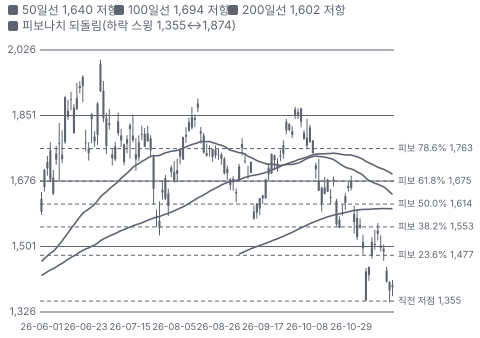

**주봉**

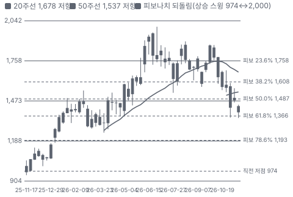

**월봉**

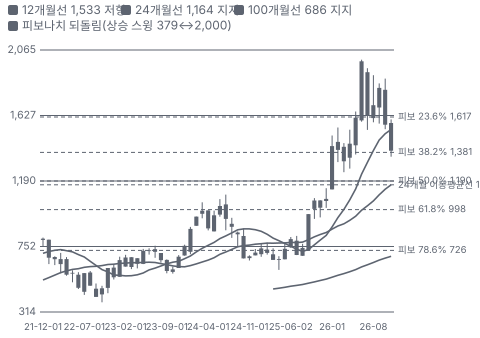

**분기 매출·EPS 실적과 컨센서스**

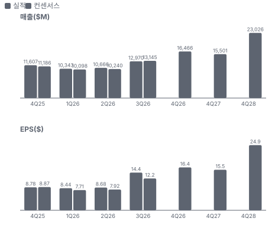

**4Q26 매출 — 지표 추세 vs 가이던스·컨센서스**

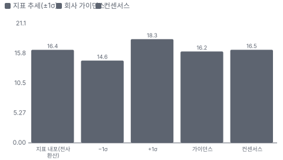

**최근 4개 분기 주가 변화 분석**

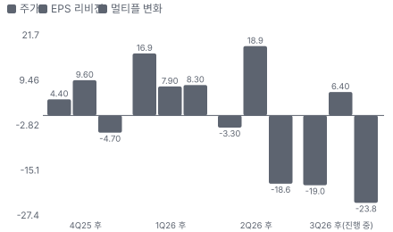

**EPS 리비전**

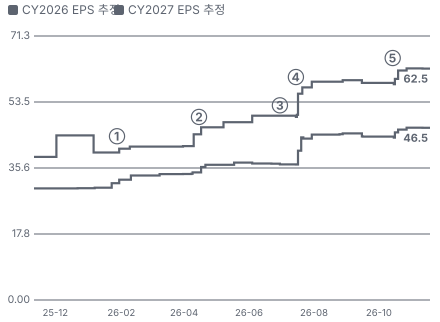

① 26-01-28 4Q25 실적 — 수주 €13.2B · EPS 리비전 +4%
② 26-04-15 1Q26 실적 — 가이던스 상단 초과 · EPS 리비전 +4%
③ 26-06-30 삼성 High-NA 1.4나노 도입 보도(한국 언론) · EPS 리비전 +0%
④ 26-07-15 2Q26 실적 — FY26 €43~45B 상향 · EPS 리비전 +15%
⑤ 26-10-14 3Q26 실적 — 캐파 부족·가치 가격 · EPS 리비전 +7%

**멀티플 프리미엄(Fwd 1Y P/E, 최근 4개 분기말 절대값 — 대상 vs 동종 중앙값)**

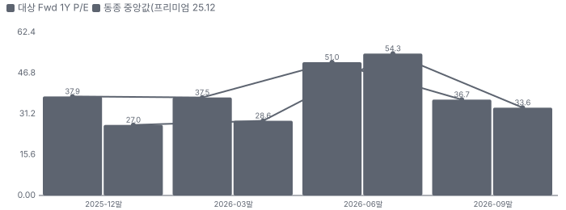

**합리적 멀티플**

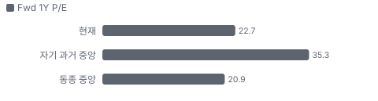

**밸류에이션 주가 시나리오**

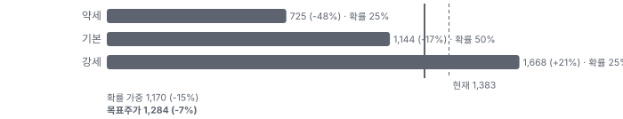

**주가별 업사이드**

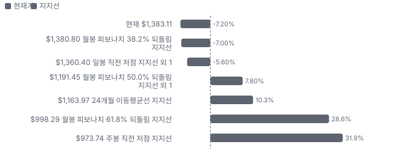
- 제품·서비스 포트폴리오

**고객 믹스(FY25, 매출 대비)**

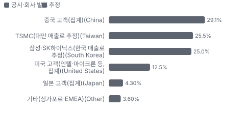

**공급 병목(10점, 낮을수록 병목)**

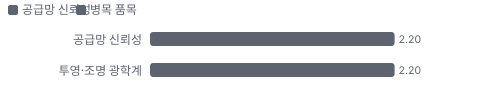

**생산능력 현재와 확충 계획(EUV 장비 대/년(출하))**

**CAPEX의 매출 대비 비중**

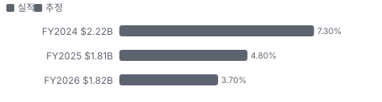

**어닝콜 변화별 주주가치 영향**

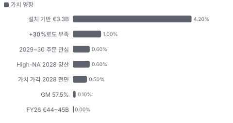

**수주·파이프라인 확실성 사다리**

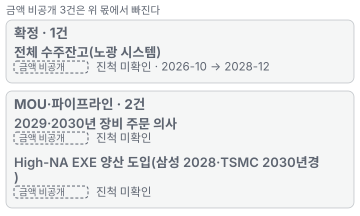

**매출 → 매출총이익 → 영업이익(매출 = 100, 최근 4분기)**

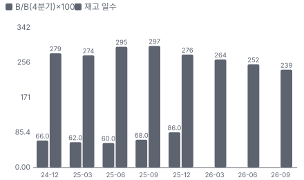

**분기 비용 비중 추이(매출 대비, 공시)**

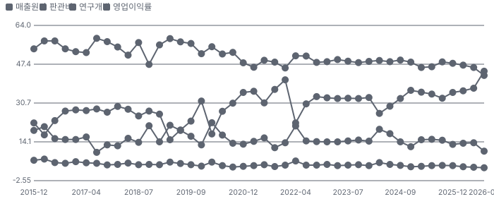

**비용 요인별 매출 대비 비중 1년 변화**

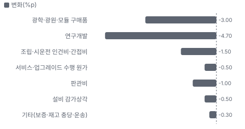

**노광 시스템 BOM 원가 몫**

**설치 기반 관리 BOM 원가 몫**

**BOM 항목 가격 +10% 시 OPM 변화**

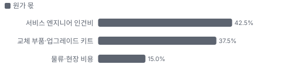

**사업별 매출 vs 물가 — 전년 대비(명목 매출 · 비교 물가 · 실질 = 물량·믹스)**

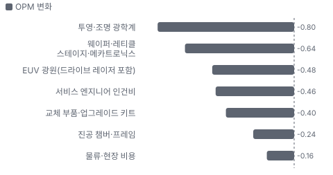

**매출 vs PPI·수출입 — 4Q22 = 100(변화율, 로그 눈금)**

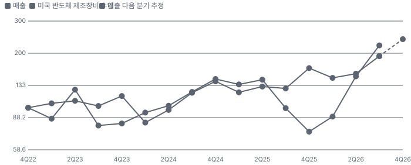

**매출 증가율의 가격·물량 분해와 8분기 전망(전년 대비)**

**분기별 매출 증가율 분해**

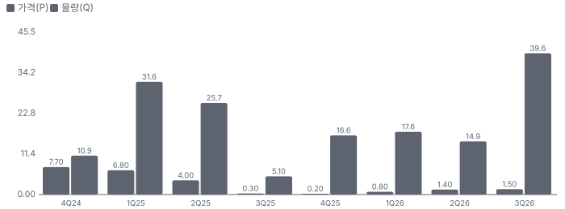

**목표주가 산정 — 기본과 강세 사이(강세 쪽 27%), 도달 확률 약 40%**

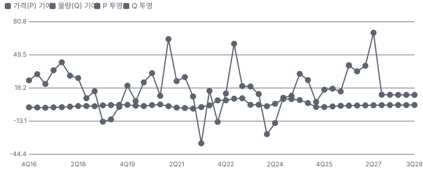

**일봉 지지·저항과 목표주가**

**커뮤니티 언급 수(최근 30일, 채널별)**

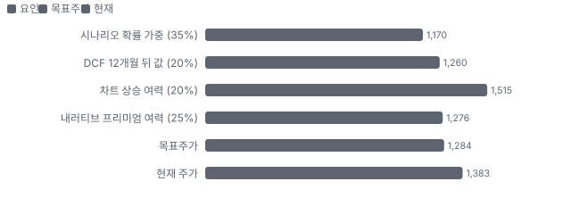

**커뮤니티 게시 수(월, 최근 12개월 — 이번 달은 진행 중)**

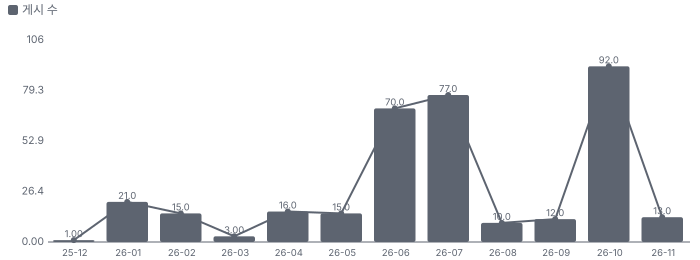

**수주/출하 비율(B/B) × 재고 일수 — 분기별 · 25-12 뒤 B/B 없음(ASML은 2026년부터 분기 수주(Net Bookings) 공시를 중단하고 연간 수주잔고만 공개한다(2025-01 4Q24 실적 발표))**

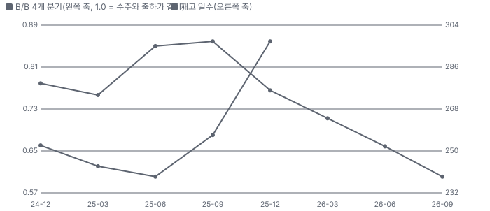

**일별 거래량 분해**

**기관 자금 흐름**

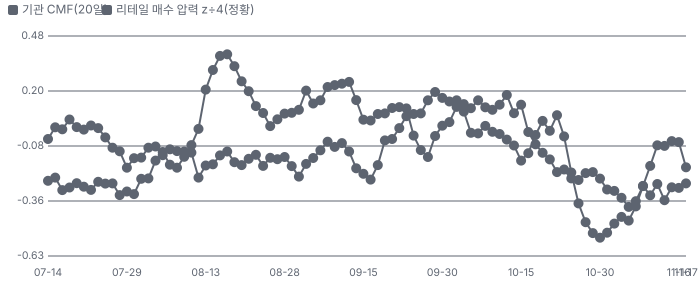

**몬테카를로**

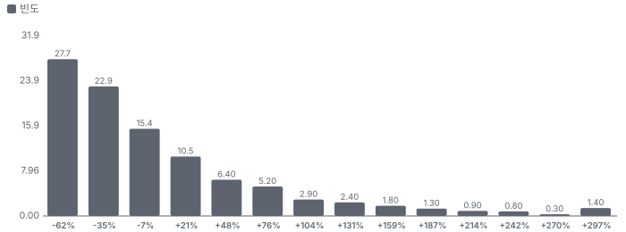

해석: 3,000번 중 1,118번(37%)에서 가치가 지금 주가 이상이었다. 가정을 흔들어도 지금 주가를 뒷받침하지 못하는 경우가 더 많다. 가운데 값은 0.78배이고, 열 번 중 여덟 번은 0.34~2.08배 사이에 든다.

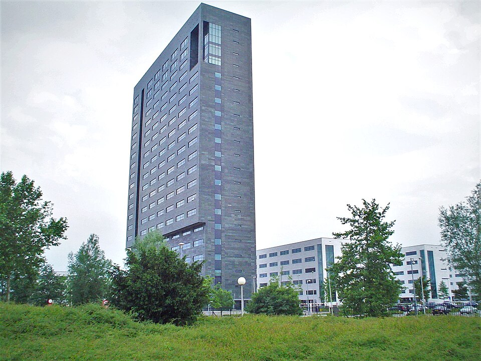
**Veldhoven 본사·캠퍼스** — 네덜란드 Veldhoven ASML 본사 — 실제 시설
_사진: A ansems · Public domain · Wikimedia Commons_

## 내러티브

> **기업가치를 결정하는 이야기:** 매출의 72%가 노광 장비, 28%가 깔린 장비의 서비스·업그레이드다. EUV는 ASML만 팔고, 고객이 첨단 팹을 늘릴수록 EUV 층과 대수가 늘어난다. 장비 한 대가 수억 유로라 출하 대수와 판매가가 이익을 정한다. 공급은 광학(Zeiss)이 묶고 있어 2027·28년은 수요보다 캐파가 매출 상단을 정한다. 그 대신 가치 기반 가격이 2027년부터 반영된다.

> **멀티플·EPS 프리미엄**
> **멀티플:** Fwd 1Y P/E 22.7배로 동종 4곳(Applied Materials·Lam Research·KLA·ASM International) 중앙값 21.0배보다 8% 높다. 9월 말 36.7배에서 한 달 만에 25.8배로 내려왔다.
> **EPS:** FY26 EPS 컨센서스 \$46.8, FY27 \$60.1(+28%), FY28 \$78.0 — 8월 이후 FY26 추정은 \$44.8에서 올랐다.

### 투자자들은 왜 열광했나

2026년 투자자들은 'AI 반도체 증설의 최종 병목은 EUV이고 ASML만 판다'에 열광했다. 1월 수주 €13.2B, 4·7월 가이던스 상향, 6월 삼성 High-NA 도입 보도로 6/30 종가 \$1,989까지 올랐다. 식은 이유는 세 가지다 — 7월 말 중국 DUV 양산 보도, 10월 실적에서 '캐파가 모자란다'는 말이 성장 상단으로 읽힌 것, 11월 중간선거 뒤 AI 하드웨어 전반 급락이다.

### 무엇이 기업가치를 바꾸나

> **구조적 체질 변화**
> **변화:** 장비를 한 번 파는 회사 → 장비 + 설치 기반 업그레이드(매출 28%)와 가치 기반 가격
> **증거:** 설치 기반 관리 FY25 25.1% → 3Q26 28.2%(계산), 가치 기반 가격 2027~28(3Q 콜)
> **반증:** 설치 기반 비중이 25% 아래로

> **고부가 믹스 확장**
> **변화:** DUV 비중 → EUV·High-NA 비중 확대
> **증거:** FY26 EUV +45% 초과 vs 비EUV +20%(3Q 콜)
> **반증:** 4Q 총이익률이 가이던스 57% 미만

> **기술 혁신**
> **변화:** High-NA 양산 전환·NXE:3800F(처리량 260wph를 목표로 한 다음 NXE 모델) 260wph·12인치 레티클(지금 6인치보다 큰 차세대 회로 원판)
> **증거:** 삼성 2028·TSMC 2030년경 High-NA 양산(3Q 콜)
> **반증:** High-NA 양산 일정 연기

> **실행 속도**
> **변화:** 해당 없음(주문→출하 리드타임 수치를 회사·경쟁사 모두 공시하지 않는다) — 대신 2026년 EUV 출하 +50% 이상으로 램프를 해냈고, 2027·28은 캐파가 납기를 정한다
> **증거:** 3Q 콜
> **반증:** 2027 출하 증가가 +30% 계획에 못 미침

> **M&A**
> **변화:** 해당 없음(최근 3년 안 인수 없음 — Mistral AI는 지분 투자)
> **증거:** 3Q 실적 발표
> **반증:** 해당 없음

> **정책·입법 연관성**
> **재정정책:** 해당 없음(ASML은 미국 CHIPS(미국 반도체지원법) 보조금을 직접 받지 않는다 — 고객 팹 보조금이 수요로 간접 연결) 20-F 반증: 해당 없음 의회 동의 2/10 — 하원 1/5(ASML 관련 세출 논의 없음) · 상원 1/5(같음).
> **행정명령:** 네덜란드·미국 수출통제 — 중국에 EUV 금지, 일부 이머전(렌즈와 웨이퍼 사이에 물을 채워 해상도를 높인 ArF 노광, ArFi) 허가 필요(행정 조치) 20-F 위험 요인 반증: 추가 통제로 중국 DUV 서비스까지 막힘 의회 동의 2/10 — 하원 1/5(의회 의결 대상 아님 — 행정 규칙) · 상원 1/5(같음).
> **연관입법:** MATCH(동맹국 장비 수출통제 정렬 법안) Act(동맹국 장비 수출통제 정렬 법안) — 이머전 DUV 전 기종 신규 판매와 중국 설비 서비스까지 막는 조항, 국방수권법 편입 시도 법안 발의 단계(IB 노트 2026-11-16 요지) — 의결·시행 전 반증: 국방수권법 최종 문구에서 DUV·서비스 조항 삭제

> **고객의 지출 예산**
> **변화:** 반도체 회사의 팹 장비 투자(CAPEX)
> **사업별 예산:** **매출의 72%**: 노광 시스템 — 고객 CAPEX(파운드리·메모리 회사의 팹 장비 투자) · 동인: 첨단 로직·HBM(고대역폭 메모리) 증설, 신규 팹 발표
**매출의 28%**: 설치 기반 관리 — 고객 혼합(업그레이드는 고객 CAPEX, 유지보수는 팹 운영비(OPEX)) · 동인: 기존 라인 캐파 확대·가동률
> **증거:** 지역 매출·3Q 콜
> **반증:** TSMC·삼성·SK하이닉스 2027 CAPEX 하향

### 내러티브 근거

> AI 반도체 증설의 병목인 EUV를 혼자 파는 회사가, 고객이 2028년 이후까지 장비를 줄 서서 사는 국면에 들어섰다는 이야기다. 6월 고점 뒤 −30%로 배수는 1년 전 수준으로 돌아왔다. 단계는 컨센서스, 쏠림은 중간(Quantral Strong, 셀사이드 27명 중 24명 매수 쪽) — 13F 보유 기관 2,187곳이다.

> **AI 증설의 EUV 병목** · 강화
> **논리:** 첨단 로직·HBM용 D램 증설은 EUV 층 수와 장비 대수를 늘린다 — 2026년 EUV +45% 초과
> **숫자:** 2026 EUV 약 65대(+50% 이상), FY26 매출 €44~45B(+36%)
> **반증:** 2027-01 FY27 가이던스가 EUV 출하 증가 20% 미만
> **출처:** ASML 3Q26 실적 발표·어닝콜(2026-10-14)

> **설치 기반 업그레이드** · 강화
> **논리:** 새 팹 없이 캐파를 늘리는 업그레이드가 높은 이익률로 반복된다
> **숫자:** 3Q €3.29B(가이던스 +€0.4B), 4Q €3.7B
> **반증:** 설치 기반 관리 매출 2분기 연속 감소
> **출처:** ASML 3Q26 실적 발표·어닝콜(2026-10-14)

> **가치 기반 가격** · 유지
> **논리:** 공급이 모자란 동안 장비값을 고객 생산성 가치에 맞춰 올린다 — 2028년 전면 반영
> **숫자:** 2026 효과 없음, 2027 일부, 2028 전면(3Q 콜)
> **반증:** FY27 총이익률 가이던스가 56% 미만
> **출처:** ASML 3Q26 실적 발표·어닝콜(2026-10-14)

> **High-NA 양산 전환** · 강화
> **논리:** High-NA가 삼성 2028·TSMC 2030년경 양산에 들어가면 대당 가격이 오른다
> **숫자:** FY25 EXE 4대·€1.16B
> **반증:** 고객 High-NA 도입 연기 발표
> **출처:** ASML 3Q26 실적 발표·어닝콜(2026-10-14)

> **반대 내러티브 — 캐파 제약·중국·AI 사이클** · 강화
> **논리:** 수요가 있어도 광학 공급이 출하를 막고, 중국 DUV 국산화와 AI 투자 둔화가 겹치면 배수가 동종 이하로 간다
> **숫자:** 6월 고점 대비 −30%, 중국 매출 29% → 약 20%
> **반증:** 2028년 추가 증설 수치 발표와 FY27 가이던스 상향
> **출처:** Quantral 신호·3Q 콜

### 투자 포인트

> **주가는 빠졌는데 이익 추정은 올랐다**
> **명제:** 6월 고점 뒤 주가 −30%, 같은 기간 FY26 EPS 추정은 \$44.8 → \$46.8
> **숫자:** 컨센서스 이력·Fwd 1Y P/E 36.7배(9월 말) → 22.7배
> **시장과 다른 점:** 시장은 캐파 부족을 성장 상단으로 읽지만, 숫자는 배수만 줄었다
> **증명:** 2027-01-27 FY27 가이던스 매출 €55B 이상
> **출처:** https://www.sec.gov/Archives/edgar/data/937966/000162828026065813/pressreleasefinancialresul.htm

> **설치 기반 업그레이드가 이익률을 끌어올린다**
> **명제:** 3Q 설치 기반 관리 €3.29B(가이던스 +€0.4B), 4Q €3.7B
> **숫자:** ASML 3Q26 실적 발표·어닝콜(2026-10-14)
> **시장과 다른 점:** 업그레이드는 고객 캐파를 가장 빨리 늘리는 수단이라 장비 캐파 제약을 일부 우회한다
> **증명:** 4Q 설치 기반 관리 €3.7B 달성
> **출처:** https://www.sec.gov/Archives/edgar/data/937966/000162828026065813/pressreleasefinancialresul.htm

> **가치 기반 가격은 2028년의 이익률 이야기**
> **명제:** 핵심 고객과 협상 완료, 2026 효과 없음·2027 일부·2028 전면
> **숫자:** ASML 3Q26 실적 발표·어닝콜(2026-10-14)
> **시장과 다른 점:** 컨센서스 FY28 EBIT 이익률 47%가 가격 효과를 얼마나 넣었는지 확인되지 않았다
> **증명:** FY27 총이익률 가이던스 57% 이상
> **출처:** https://www.sec.gov/Archives/edgar/data/937966/000162828026065813/pressreleasefinancialresul.htm

### 모멘텀 생성·소멸 타임라인

**카탈리스트 달력 — 지난 사건의 주가 반응과 앞으로 확인할 숫자**
| 날짜 | 상태 | 구분 | 사건 | 반응·확인 | 결과에 따라 |
|---|---|---|---|---|---|
| 2026-06-30 | 완료 | 생성 | 삼성 High-NA 1.4나노 도입 보도 — 종가 고점 \$1,989 | 이후 −30% |  |
| 2026-07-27 | 완료 | 소멸 | 중국 DUV 양산 보도 | 이틀 −9.9% |  |
| 2026-10-14 | 완료 | 소멸 | 3Q26 실적 — 캐파 부족 발언 | 하루 −3.9% |  |
| 2026-11-05 | 완료 | 소멸 | 중간선거 뒤 AI 하드웨어 급락(매크로·섹터) | 하루 −9.3% |  |
| 2027-01-27 | 예정 | 확인 | 4Q26·FY26 실적과 첫 FY27 가이던스 | 4Q 매출 €14.2~15.2B 중간 이상, FY27 매출 €55B 이상, 총이익률 57% 이상, 2028 추가 증설 규모 | 셋이 맞으면 이익 추정 상향 경로, FY27 가이던스가 €55B 미만이면 배수 정체 |
| 2027-04-28 | 예정 | 확인 | 1Q27 실적 | 가치 기반 가격 첫 반영, 설치 기반 관리 €3.5B 이상 | 가격 효과가 숫자로 보이면 FY28 이익률 추정 상향 |

### 언제 사서 언제 팔아야 할까?

**가격·조건 틀 — 가격은 밸류에이션(약세·기본·강세·목표주가)과 차트 지지 구간에서, 조건은 이벤트에서**
| 구간 | 가격 | 목표주가까지 | 약세까지 | 조건·근거 |
|---|---|---|---|---|
| 관찰 구간 | \$1,381~\$1,381 | -7% | -47% | 지지 구간이 약세 시나리오 가격과 겹치는 곳 — 11/5 종가 저점 \$1,357 근처 |
| 확인 뒤 | 지금 \$1,383 이상에서 조건 확인 | -7% | -48% | FY27 가이던스 매출 €55B 이상과 총이익률 57% 이상, 2028 추가 증설 수치 |
| 무효화 | 약세 시나리오 \$725 | - | -48% | 11/5 종가 저점 \$1,357 이탈과 함께 FY27 가이던스가 컨센서스 미만 |
| 차익 고민 2차 | \$1,668(강세 시나리오) | +21% | - | 목표주가 근처에서는 Fwd 1Y P/E가 동종 대비 프리미엄을 얼마나 다시 붙였는지 본다 |

실적 당일 ±2~4%, 업종 사건 날 −6~10% 움직임이 반복됐다(7/27 −5.8%, 11/5 −9.3%) 가격·조건 틀이며 매매·비중 지시가 아니다(투자 권유 아님).

## 포트폴리오

| 제품·서비스 | 구분 | 무엇 | 쓰는 곳 | 돈 버는 방식 | Mix | Mix 변화(전년 대비) |
|---|---|---|---|---|---|---|
| 노광 시스템 | 제품 | 빛으로 웨이퍼에 회로를 찍는 장비 — EUV·High-NA EUV·DUV 이머전·드라이·계측 | TSMC·삼성·SK하이닉스·인텔·마이크론의 첨단 로직·D램 팹 | 3Q 매출의 72%. FY25 EUV €11.6B(48대)·DUV €12.0B(279대)·계측 €0.8B | 72% | -2.1%p |
| 설치 기반 관리 | 서비스 | 깔린 장비의 유지보수와 처리량·정확도 업그레이드 | 고객이 새 팹 없이 기존 라인 캐파를 늘릴 때 | 3Q 매출의 28%(€3.29B), FY26 약 +50% — 이익률이 평균 이상 | 28% | +2.1%p |

**Mix 변화가 가장 큰 쪽은 노광 시스템(-2.1%p, 전년 대비).** 계절성 판정: 분기 매출 계절 지수 기준 있음 → 전년 같은 분기와 비교.

## 고객

> **FY25 최대 고객 중국 고객(집계, China) 29%, 상위 3곳 80%, 집중도 보통.** 공시·회사 발표로 확인한 몫은 매출의 50%이고, 나머지 고객 몫은 추정이거나 미분해다. 20-F: 최대 고객 1곳이 FY25 매출의 23.9%(€7.80B, FY24 16.6%), 상위 2곳이 38.0%다 — 이름은 공시하지 않는다. 지역(출하지) 기준 FY25는 중국 29%·대만 26%·한국 25%·미국 13%·일본 4%이고, 2026년 중국은 약 20%로 줄어든다(3Q 콜). 대만 매출 26%와 최대 고객 24%가 비슷해 최대 고객을 TSMC로 읽는 것은 가설이다.

**고객별 매출 몫(FY25)**
| 고객 | 몫 | 변화 | 근거 |
|---|---|---|---|
| 중국 고객(집계, China) | 29% | -7%p | 공시 |
| TSMC(대만 매출로 추정, Taiwan) | 26% | +10%p | 추정 |
| 삼성·SK하이닉스(한국 매출로 추정, South Korea) | 25% | +2%p | 추정 |
| 미국 고객(인텔·마이크론 등, 집계, United States) | 12% | -4%p | 공시 |
| 일본 고객(집계, Japan) | 4% | +0%p | 공시 |
| 기타(싱가포르·EMEA(유럽·중동·아프리카))(Other) | 4% | -2%p | 공시 |

> **중국 고객(집계, China)** · 공시
> **사는 것:** DUV 이머전·드라이(EUV 수출 금지)
> **추정 근거:** 지역 매출 FY25 €9.52B ÷ €32.67B(FY24 €10.20B ÷ €28.26B) — FY26 약 20%(3Q 콜)

> **TSMC(대만 매출로 추정, Taiwan)** · 추정
> **사는 것:** NXE(ASML 저개구수, 0.33 EUV 장비 제품군) EUV·이머전·계측
> **추정 근거:** 대만 매출 FY25 €8.34B ÷ €32.67B — 대만 노광 수요 대부분을 TSMC로 본 가설

> **삼성·SK하이닉스(한국 매출로 추정, South Korea)** · 추정
> **사는 것:** EUV(D램)·이머전, High-NA(삼성 2028)
> **추정 근거:** 한국 매출 FY25 €8.16B ÷ €32.67B — 두 회사 몫 구분 미공시

> **미국 고객(인텔·마이크론 등, 집계, United States)** · 공시
> **사는 것:** High-NA(인텔)·EUV·DUV
> **추정 근거:** 미국 매출 FY25 €4.09B ÷ €32.67B

> **일본 고객(집계, Japan)** · 공시
> **사는 것:** DUV·EUV
> **추정 근거:** 일본 매출 FY25 €1.42B

> **기타(싱가포르·EMEA, Other)** · 공시
> **사는 것:** DUV
> **추정 근거:** 싱가포르 €0.61B + EMEA €0.52B

## 수주·파이프라인

> **2026-09-27 기준 3건.** 확정 \$0.00B. 서로 겹치는 항목은 합계에서 뺐다.

**수주 목록**
| 상태 | 계약 | 계약 총액 | 진척 | 기간 | 비고 |
|---|---|---|---|---|---|
| 확정 | 전체 수주잔고(노광 시스템) | 금액 비공개 | 비공개 | 2026-10 → 2028-12 | 2026년부터 잔고 미공시 — 금액은 진척 비공개 |
| 파이프라인 | 2029·2030년 장비 주문 의사 | 금액 비공개 | 비공개 | - | (다른 항목과 겹칠 수 있어 합계에서 뺌) |
| 파이프라인 | High-NA EXE 양산 도입(삼성 2028·TSMC 2030년경) | 금액 비공개 | 비공개 | - | (다른 항목과 겹칠 수 있어 합계에서 뺌) |

**실행 속도와 방해 요인**
| 항목 | 상태 | 실행 속도 | 방해 요인 |
|---|---|---|---|
| 전체 수주잔고(노광 시스템) | 확정 | 2026년 약 65대 EUV 출하, 2027·2028년 각 +30% 증설로도 부족(3Q 콜) | 광학 공급 캐파 · 고객 팹 완공 일정 · 수출 허가(중국) |
| 2029·2030년 장비 주문 의사 | 파이프라인 | 고객 주문 의사 단계 | 주문 확정 전 · AI 투자 지속성 |
| High-NA EXE 양산 도입(삼성 2028·TSMC 2030년경) | 파이프라인 | 고객 양산 도입 일정 발표 단계 | 양산 수율·생산성 검증 · 고객별 적용 레이어 |

## 마진 구조

> **GPM 57.4%, OPM 44.4%.** 2Q26 대비 GPM +3.5%p, OPM +7.3%p. 변동비는 매출의 33%이고, 매출이 10% 늘면 OPM은 +2.1%p 움직인다. 3Q 매출원가는 매출의 42.5%로 1년 전 48.4%보다 5.9%p 낮다. 물량 증가로 고정비가 흡수됐고 EUV·이머전 믹스와 설치 기반 업그레이드가 총이익률을 57.5%로 올렸다(3Q 콜). 원가 항목별 몫은 공시되지 않아 추정이다.

> **매출 100 중 매출원가 45.7, 매출총이익 54.3(최근 4분기, 공시).** 매출원가 요인 중 광학·광원·모듈 구매품이 매출의 27.0%로 가장 무겁고, 단가가 +10% 오르면 GPM이 -2.70%p 움직인다. 분기 회귀로 매출 1이 늘 때 매출원가는 0.44 늘고, 매출원가의 고정비 몫은 11%다.

**비용 요인 강도 — 비중·추세·충격(+10%)·탄력**
| 비용 | 구분 | 매출 대비 | 1년 변화 | 마진 기여 | 충격 시 마진 | 매출 탄력 | 고정비 몫 |
|---|---|---|---|---|---|---|---|
| 광학·광원·모듈 구매품 | 매출원가 요인 | 27.0% | -3.0%p | +3.0%p | -2.70%p | 미확인 | 10% |
| 조립·시운전 인건비·간접비 | 매출원가 요인 | 7.5% | -1.5%p | +1.5%p | -0.75%p | 미확인 | 70% |
| 서비스·업그레이드 수행 원가 | 매출원가 요인 | 5.0% | -0.5%p | +0.5%p | -0.50%p | 미확인 | 50% |
| 설비 감가상각 | 매출원가 요인 | 2.0% | -0.5%p | +0.5%p | -0.20%p | 미확인 | 100% |
| 기타(보증·재고 충당·운송) | 매출원가 요인 | 1.1% | -0.3%p | +0.3%p | -0.11%p | 미확인 | 30% |
| 매출원가 | 공시 항목 | 45.7% | -1.6%p | +1.6%p | -4.57%p | 0.44 | 11% |
| 연구개발 | 공시 항목 | 12.4% | -1.8%p | +1.8%p | 미확인 | 0.12 | 18% |
| 판관비 | 공시 항목 | 3.4% | -0.4%p | +0.4%p | 미확인 | 0.03 | 23% |

매출 탄력 = 분기 비용을 매출에 회귀한 기울기(매출 1당 변동비), 고정비 몫 = 절편 ÷ 평균 비용. 표본이 8분기 미만이면 미확인. 매출원가 요인 비중은 margin 재료의 추정이 섞여 있고, 공시 매출원가와의 차이는 '기타 매출원가'로 둔다.

**GPM에서 OPM까지(GAAP, 아래는 최근 4개 분기)**
| 기간 | GPM | 연구개발 | 판관비 | 기타 | OPM |
|---|---|---|---|---|---|
| 3Q25 | 51.6% | 14.8% | 4.0% | 0.0% | 32.8% |
| 2Q26 | 54.0% | 13.7% | 3.2% | 0.0% | 37.1% |
| 3Q26 | 57.4% | 10.1% | 3.0% | 0.0% | 44.4% |
| 2025-12 | 52.2% | - | - | - | 35.3% |
| 2026-03 | 53.0% | - | - | - | 36.0% |
| 2026-06 | 54.0% | - | - | - | 37.1% |
| 2026-09 | 57.5% | - | - | - | 44.4% |

**비용을 움직이는 요인**
| 비용 | 요인 |
|---|---|
| 광학·광원·모듈 구매품(매출원가) | Zeiss 광학·광원·메카트로닉스 모듈 구매 단가와 물량 · 근거 추정 |
| 연구개발(연구개발) | High-NA·NXE:3800F·계측 개발 · 근거 공시 |
| 조립·시운전 인건비·간접비(매출원가) | Veldhoven(ASML 본사·조립 거점, 네덜란드) 클린룸 조립·고객 현장 설치 인력 · 근거 추정 |
| 서비스·업그레이드 수행 원가(매출원가) | 현장 엔지니어·부품 · 근거 추정 |
| 판관비(판관비) | 영업·관리 인력 · 근거 공시 |
| 설비 감가상각(매출원가) | 공장·장비 감가상각(TTM D&A \$1.17B 중 매출원가 몫 추정) · 근거 추정 |
| 기타(보증·재고 충당·운송, 매출원가) | 신모델 보증·재고 평가 · 근거 추정 |

**노광 시스템 BOM — 매출의 72%, GPM 56%(추정 — 제품군별 총이익 미공시. 설치 기반 업그레이드가 평균 이상이라는 콜 발언을 넣어 3Q 총이익률 57.5%와 맞춘 값), 항목 가격 +10% 시**
| 항목 | 원가 몫 | 전가 | 제품 GPM | OPM |
|---|---|---|---|---|
| 투영·조명 광학계 | 20~30% | 미확인 | -1.1%p | -0.80%p |
| 웨이퍼·레티클(회로 원판, 포토마스크) 스테이지·메카트로닉스 | 15~25% | 미확인 | -0.9%p | -0.64%p |
| EUV 광원(드라이브 레이저 포함) | 10~20% | 미확인 | -0.7%p | -0.48%p |
| 진공 챔버·프레임 | 5~10% | 미확인 | -0.3%p | -0.24%p |
| 미분해 | 32% | - | - | - |

**설치 기반 관리 BOM — 매출의 28%, GPM 62%(추정 — 업그레이드 비중이 높아 평균 이상(3Q 콜). 회사 미공시), 항목 가격 +10% 시**
| 항목 | 원가 몫 | 전가 | 제품 GPM | OPM |
|---|---|---|---|---|
| 서비스 엔지니어 인건비 | 35~50% | 미확인 | -1.6%p | -0.46%p |
| 교체 부품·업그레이드 키트 | 30~45% | 미확인 | -1.4%p | -0.40%p |
| 물류·현장 비용 | 10~20% | 미확인 | -0.6%p | -0.16%p |
| 미분해 | 5% | - | - | - |

투영·조명 광학계 가격이 +10% 오르면 영업이익은 -1.8% 움직인다. 판매가 전가를 모르는 항목은 전가 0%로 계산했다.

**BOM 항목 가격을 움직이는 것**
| 항목 | 요인 |
|---|---|
| 투영·조명 광학계 | EUV 반사 거울 광학이 장비 원가에서 가장 크다(업계 통설) · 근거 추정 |
| EUV 광원(드라이브 레이저 포함) | 주석 플라즈마 광원과 CO2(이산화탄소 — 고출력 레이저의 발진 매질) 레이저 · 근거 추정 |
| 웨이퍼·레티클 스테이지·메카트로닉스 | 나노미터급 위치 제어 모듈 · 근거 추정 |
| 진공 챔버·프레임 | EUV는 진공 안에서 빛을 쓴다 · 근거 추정 |
| 서비스 엔지니어 인건비 | 현장 서비스 · 근거 추정 |
| 교체 부품·업그레이드 키트 | 처리량 업그레이드 모듈 · 근거 추정 |
| 물류·현장 비용 | 부품 재고·운송 · 근거 추정 |

**투입 물가 — 미국 PPI 3·6·12개월(2026-11-18, 개정 반영)**
| 항목 | 미국 3개월 | 6개월 | 12개월 | 전가 못 할 때 OPM |
|---|---|---|---|---|
| 교체 부품·업그레이드 키트 | 미확인 | 미확인 | 미확인* | - |

별표는 품목보다 넓은 업종 지수다. 노광 시스템 가격은 +27.0%로 비교 물가(반도체 제조장비 PPI(생산자물가지수), 2026-10) +3.4%보다 23.6%p 더 올랐다. 물가 지수를 붙이지 못한 매출원가 항목은 광학·광원·모듈 구매품, 조립·시운전 인건비·간접비, 서비스·업그레이드 수행 원가, 설비 감가상각다(미연결). 노광 시스템 매출은 2026-09 전년 대비 +46.5%이고 비교 물가 ppi_id:PCU333242333242의 변화 +1.5%(2026-09)를 빼면 실질 +44.4% — 물량·믹스가 성장을 이끌었다. 설치 기반 관리 매출은 2026-09 전년 대비 +62.9%이고 비교 물가 ppi_id:PCU333242333242의 변화 +1.5%(2026-09)를 빼면 실질 +60.5% — 물량·믹스가 성장을 이끌었다.

## 공급망 병목

> **공급망 신뢰성 2.2/10, 병목 심각.** 가장 약한 고리는 투영·조명 광학계 2.2점이고, 품목 평균은 2.2점이다. 근거가 부족한 3건(EUV 광원(드라이브 레이저 포함) · 웨이퍼·레티클 스테이지·메카트로닉스 · 진공 챔버·프레임)은 점수에서 뺐다. 병목은 광학이다. EUV 광학은 Carl Zeiss SMT 한 곳이 만들고 ASML은 그 회사 지분 24.9%를 가진다. 광원은 자회사 Cymer, CO2 드라이브 레이저(주석 방울을 때려 EUV 빛을 만드는 고출력 레이저)는 TRUMPF다. 2027·28 증설 +30%씩으로도 수요를 못 채운다는 회사 발언이 공급 제약의 근거다.

**병목과 마진 — 품목 가격 +10% 시 OPM**
| 품목 | 점수 | 판정 | 구분 | OPM |
|---|---|---|---|---|
| 투영·조명 광학계(필수) | 2.2 | 병목 심각 | 핵심 통제 품목 | -0.80%p |

> **투영·조명 광학계** · 2.2/10
> **왜:** 모든 노광 장비의 핵심 부품
> **병목 요인:** 인증 공급사 1곳 · 캐파 빠듯 · 리드타임 미확인 · 재인증 미확인 · 1위 점유율 100% · 독일 집중 100% · 물량 확보 미확인
> **풀리는 조건:** 미확인 — 추가 증설 검토 단계(3Q 콜)

**공급사**
| 품목 | 공급사 | 몫 | 근거 |
|---|---|---|---|
| 투영·조명 광학계 | Carl Zeiss SMT(EUV·DUV 광학(ASML 지분 24.9%)) | 미확인 | 공시 |
| EUV 광원(드라이브 레이저 포함) | Cymer(ASML 자회사, EUV·DUV 광원) | 미확인 | 공시 |
| EUV 광원(드라이브 레이저 포함) | TRUMPF(CO2 드라이브 레이저) | 미확인 | 회사 발표 |
| 웨이퍼·레티클 스테이지·메카트로닉스 | ASML 자체(Veldhoven·Wilton, 스테이지 설계·조립) | 미확인 | 공시 |
| 웨이퍼·레티클 스테이지·메카트로닉스 | VDL(모듈 제조(외주)) | 미확인 | 보도 |
| 진공 챔버·프레임 | 미확인(정밀 가공 협력사) | 미확인 | 추정 |

**무역 통계로 본 공급 지역**
| 품목 | EU 수입처 | 일본 수입처 | EU 1위 전년비 |
|---|---|---|---|
| 투영·조명 광학계 | CN(중국) 53% · US 30% · JP(일본) 10% | 中華人民共和国 46% · アメリカ合衆国 14% | +16.4% |

## 생산능력

> **현재 명목 캐파 65 EUV 장비 대/년(출하), 가동률 미확인.** 착공 이상 증설은 0 EUV 장비 대/년(출하), 발표까지 합치면 45 EUV 장비 대/년(출하)이다. 다 가동하면 지금보다 +69%, 착공 이상만이면 +0%다. FY2025 CAPEX는 \$1.81B로 매출의 4.8%다. 2026년 EUV 약 65대를 출하한다(전년 48대보다 +50% 이상). DUV 이머전은 전년 수준(FY25 131대)이다. 2Q 실적 때 2027년 +30% 증설을 계획하고 2028년 +30% 추가를 검토한다고 했는데, 3Q에는 그것으로도 2027·28년 수요를 다 못 채운다며 2028년 +30%를 넘는 증설을 검토한다(3Q 6-K).

**생산시설 6곳**(20-F 주요 생산·연구 거점(Veldhoven·Wilton·샌디에이고·베를린·대만·한국) — 사무소·서비스 거점 전체 수는 미확인), 소유 1곳 · 미확인 5곳. 시설별 생산능력은 공개되지 않았다 — 회사 전체 캐파만 위에 적었다.

**생산시설 6곳 — 명칭·위치·생산능력**
| 시설 | 위치 | 용도 | 생산능력 | 소유·상태 |
|---|---|---|---|---|
| Veldhoven 본사·캠퍼스 | 네덜란드 Veldhoven | EUV·DUV 최종 조립·연구개발 | 미확인 — 거점별 캐파 미공시 | 소유 · 가동 |
| Wilton | 미국 코네티컷 Wilton | 레티클 스테이지·DUV 부품 | 미확인 — 거점별 캐파 미공시 | 미확인 · 가동 |
| Cymer 샌디에이고 | 미국 캘리포니아 샌디에이고 | EUV·DUV 광원 | 미확인 — 거점별 캐파 미공시 | 미확인 · 가동 |
| Berliner Glas | 독일 베를린 | 정밀 광학 부품·웨이퍼 테이블 | 미확인 — 거점별 캐파 미공시 | 미확인 · 가동 |
| HMI 대만 | 대만 신주·린커우 | 전자빔 검사 장비·부품 세정·수리 | 미확인 — 거점별 캐파 미공시 | 미확인 · 가동 |
| 화성 캠퍼스 | 한국 경기 화성 | 재제조·교육·고객 지원 | 미확인 — 거점별 캐파 미공시 | 미확인 · 가동 |

**생산능력 확충 계획**
| 계획 | 단계 | 증설 | 가동 시점 | CAPEX |
|---|---|---|---|---|
| 저개구수 EUV·DUV 이머전 캐파 +30%(2027) | 발표 | 20 EUV 장비 대/년(출하) | 2027 | 미확인 |
| 추가 캐파 +30% 검토(2028) | 발표 | 25 EUV 장비 대/년(출하) | 2028 | 미확인 |
| 2028년 이후 추가 증설 | 발표 | 미확인 | 2028 이후 | 미확인 |

남은 계획의 CAPEX 합계는 \$0.00B(금액 미확인 3건 제외)다. 합계는 FY2026 매출의 0%다.

**증설 방해 요인**
| 계획 | 방해 요인 |
|---|---|
| 저개구수 EUV·DUV 이머전 캐파 +30%(2027) | 광학 공급(Zeiss) 증설 |
| 추가 캐파 +30% 검토(2028) | 광학 공급·조립 인력 |
| 2028년 이후 추가 증설 | 계획 미확정 |

**CAPEX와 매출 대비**
| 기간 | CAPEX | 매출 | 매출 대비 | 구분 |
|---|---|---|---|---|
| FY2024 | \$2.22B | \$30.39B | 7.3% | 실적 |
| FY2025 | \$1.81B | \$37.60B | 4.8% | 실적 |
| FY2026 | \$1.82B | \$49.18B | 3.7% | 추정 |

## 해자

> 해자는 'EUV 노광을 파는 유일한 회사이고, 깔린 장비의 업그레이드·서비스가 매출의 28%로 반복된다'는 것이다. 약한 곳은 광학을 Zeiss 한 곳에 의존해 공급이 수요를 못 따라간다는 점이다.

> **EUV 단독 공급** · 강함
> **해자:** 최첨단 로직·D램의 핵심 층은 EUV 없이 만들 수 없고, EUV 노광 장비를 파는 회사는 ASML뿐이다
> **근거:** FY25 EUV 매출 €11.6B·48대(세그먼트), 2026년 약 65대 출하·EUV +45% 초과(3Q 콜)
> **숫자:** FY26 EUV 성장 +45% 초과
> **깨지는 조건:** 다른 회사의 EUV급 장비가 양산 라인에 채택

> **설치 기반 업그레이드·서비스** · 강함
> **해자:** 이미 깔린 장비의 처리량 업그레이드는 고객이 새 팹 없이 캐파를 늘리는 가장 빠른 길이라 높은 이익률로 반복된다
> **근거:** 3Q 설치 기반 관리 €3.29B(가이던스 +€0.4B), FY26 약 +50%, 총이익률 개선 요인으로 경영진이 직접 언급(3Q 콜)
> **숫자:** 매출의 28%(3Q)
> **깨지는 조건:** 설치 기반 관리 매출이 2분기 연속 QoQ 감소

> **High-NA·차세대 로드맵 선점** · 보통
> **해자:** High-NA를 양산에 쓰려는 고객이 늘고 12인치 레티클 표준을 ASML이 TSMC와 이끈다
> **근거:** 삼성 2028년·TSMC 2030년경 양산 도입, 인텔 양산 운용(3Q 콜)
> **숫자:** FY25 EXE 4대·€1.16B
> **깨지는 조건:** 고객이 High-NA 대신 저개구수 EUV 다중 패터닝을 고수

> **광학 공급(Zeiss 단일 원천)** · 약함
> **해자:** 광학을 Carl Zeiss SMT 한 곳에서만 받아 증설 속도가 공급사에 묶인다
> **근거:** 20-F 위험 요인(Zeiss 단일 공급원), 2027·28 캐파 부족(3Q 콜)
> **숫자:** 2027·2028 각 +30% 증설로도 수요 미충족(3Q 콜)
> **깨지는 조건:** 해당 없음

## 경영진·네트워크

> CEO Christophe Fouquet(2024-04 취임)는 EUV 사업부장 출신이고, CFO Roger Dassen(2018~)이 가치 기반 가격 협상을 설명한다. 정계 연결은 공개 기록상 미확인이다.

> **Christophe Fouquet** · 대표이사(President & CEO) · 2024-04
> **프로필:** EUV 사업부장 출신 — 3Q 콜에서 '더 많은 캐파'를 최우선 과제로
> **비즈니스:** 미확인
> **정계:** 미확인
> **동문:** 미확인
> **사모임:** 미확인

> **Roger Dassen** · CFO · 2018-07
> **프로필:** 가치 기반 가격 협상 완료 발표(3Q 콜)
> **비즈니스:** 미확인
> **정계:** 미확인
> **동문:** 미확인
> **사모임:** 미확인

**네트워크 정량화**
| 연결 | 강도 | 닿는 매출 | 가중 노출 | 매출 대비 | 근거 |
|---|---|---|---|---|---|
| 비즈니스: Carl Zeiss SMT 지분 24.9% — 광학 공급 확보 | 4/5 | \$1.00B | \$0.80B | 2% | 모든 노광 장비가 Zeiss 광학을 쓴다 — 연결이 매출을 만든 것이 아니라 공급을 확보한 것 https://www.sec.gov/Archives/edgar/data/937966/000162828026011378/asml-20251231.htm |
| 비즈니스: Mistral AI 지분 투자(2025-09) | 1/5 | \$0.00B | \$0.00B | 0% | 매출 연결 미확인 — 3Q 순이익에 재평가 €0.5B ASML 3Q26 실적 발표·어닝콜(2026-10-14) |

가중 노출은 연결이 닿는 매출의 크기다. 연결이 그 매출을 만들었다는 뜻이 아니며, 인과는 공개 자료로 입증하지 못한다.

## 약세 논리 및 셀온 조건

| 약세 논리 | 근거 | 가를 자료 |
|---|---|---|
| 캐파가 성장 상한이다 | 2027 +30% 증설로도 수요 미충족, 2028 추가 증설은 검토 단계(3Q 6-K). 광학은 Carl Zeiss SMT 단일 공급원(20-F) | FY27 출하 계획·2028 증설 수치(1월) |
| 중국 매출이 줄고 규제가 커진다 | 중국 FY25 29% → FY26 약 20%(3Q 콜), MATCH Act는 이머전 DUV 신규 판매·중국 서비스 금지 조항을 담은 발의 단계(IB 노트) | 국방수권법 최종 문구, 4Q 중국 비중 |
| 3Q 이익에 일회성이 섞였다 | 3Q 순이익 €4.96B에 Mistral 지분 재평가 약 €0.5B 포함(3Q 콜) — 주당 약 \$1.5 | 4Q 순이익률이 3Q보다 낮은지 |
| 수주가 안 보인다 | 2026년부터 분기 수주·잔고를 공시하지 않는다 — 마지막 4Q25 수주 €13.2B | 회사의 '분기마다 늘어나는 수주 모멘텀' 정량 근거 |
| AI 장비 사이클 꼬리 | 11/5 AI 하드웨어 급락 하루 −9.3%, 동종 4곳 Fwd 1Y P/E 18.5~21.9배 | TSMC·삼성·SK하이닉스 2027 CAPEX 가이던스 |

**변이 관점.** 셀사이드(27명 중 24명 매수 쪽, 목표가 평균 \$2,299)는 ASML을 'AI 증설의 최종 병목을 독점한 회사'로 본다. 숫자로 보면 독점은 맞지만 **2027·28 매출 상단은 수요가 아니라 Zeiss 광학이 묶은 캐파가 정한다** — 회사 계획대로면 2027 출하는 +30% 근처다. 그래서 FY27 성장(컨센서스 +23%)은 대수보다 가격·믹스·업그레이드에 기대야 하고, 그 가격 효과는 2028년에야 전면 반영된다. 강세 측 근거는 이익 추정이 1년 동안 50% 올랐고 배수가 36% 줄었다는 점이다. 이 다툼은 1월 FY27 가이던스의 매출·총이익률·증설 수치가 처음 가른다. 20-F 기준 최대 고객 1곳이 매출의 23.9%, 상위 2곳이 38.0%이고 구매 약정은 €12.7B(1년 안 €9.6B)다. 내부자 장내 거래는 미국 공시 대상이 아니라 미확인이다.

> **셀온 조건**
> **조건 1:** 2027-01-27 FY27 매출 가이던스가 컨센서스(약 \$60B, €55B 안팎) 미만이거나 총이익률 가이던스가 56% 아래로 나온다.
> **조건 2:** 설치 기반 관리 매출이 4Q 가이던스 €3.7B에 못 미치고 다음 분기에도 줄어든다.
> **조건 3:** 국방수권법 최종 문구에 중국 이머전 DUV 판매·서비스 금지 조항이 남는다(지금은 발의 단계).
> **조건 4:** TSMC·삼성·SK하이닉스 중 두 곳 이상이 2027 CAPEX를 낮추거나 High-NA 양산 일정을 미룬다.

## 어닝콜 변화

**직전 콜 대비 새로 나오거나 바뀐 내용 → 가치 영향**
| 항목 | 내용 | 직전 콜 | 최신 콜 | 모델 동인 이동 | 확신도 | 가치 영향 |
|---|---|---|---|---|---|---|
| 업데이트 | FY26 매출 가이던스 | €43~45B(2Q 콜) | €44~45B(하단 +€1B) | 기준연도 매출 +\$0.01B | 0.8 | +0.0% |
| 업데이트 | 설치 기반 관리 매출 | 2Q €2.76B | 3Q €3.29B(가이던스 +€0.4B), 4Q €3.7B 전망 | 1년차 성장률 +1.0% | 1.0 | +4.2% |
| 업데이트 | 매출총이익률 | 2Q 54.0%, 연초 연간 51~53% | 3Q 57.5%, 4Q 약 57%, 연간 약 56% | 출발 이익률 +1.0% | 1.0 | +0.1% |
| 신규 | 추가 증설 필요 | 2027 +30% 증설, 2028 +30% 추가 검토(2Q 6-K) | 그 계획으로도 2027·28 수요 미충족 — 2028년 +30% 넘는 증설 검토(3Q 6-K) | 장기 성장 수렴값 +0.50% | 0.5 | +1.0% |
| 업데이트 | 가치 기반 가격 | 고객과 논의 중(2Q 콜) | 핵심 고객과 논의 완료, 2027년 일부·2028년 전면 | 목표 이익률 +1.0% | 0.5 | +0.5% |
| 신규 | 2029·2030년 주문 의사 | 2027·2028년 주문 유입 | 일부 고객이 2029·2030년 장비 주문 의사 | 장기 성장 수렴값 +0.30% | 0.3 | +0.6% |
| 신규 | High-NA 양산 일정 | 인텔만 양산 라인 운용 | 삼성 2028년부터·TSMC 2030년경 양산 도입 확인 | 장기 성장 수렴값 +0.30% | 0.5 | +0.6% |
| **합계** | 단독 합 |  |  | 동시 적용 +7.1% |  | **+7.0%** |

**사건별 EPS 리비전**
| # | 날짜 | 구분 | 사건 | CY2026 EPS 전→후 | CY2027 EPS 전→후 | 리비전 | 주가 반응 |
|---|---|---|---|---|---|---|---|
| ① | 26-01-28 | 실적 | 4Q25 실적 — 수주 €13.2B | \$31.54 → \$33.63 | \$39.83 → \$41.42 | +4.0% | -2.2% |
| ② | 26-04-15 | 실적 | 1Q26 실적 — 가이던스 상단 초과 | \$34.46 → \$36.51 | \$44.76 → \$46.65 | +4.2% | -2.4% |
| ③ | 26-06-30 | 내러티브 | 삼성 High-NA 1.4나노 도입 보도(한국 언론) | \$36.80 → \$36.62 | \$49.77 → \$49.77 | +0.0% | +5.6% |
| ④ | 26-07-15 | 실적 | 2Q26 실적 — FY26 €43~45B 상향 | \$36.62 → \$43.60 | \$49.77 → \$57.42 | +15.4% | +2.2% |
| ⑤ | 26-10-14 | 실적 | 3Q26 실적 — 캐파 부족·가치 가격 | \$44.13 → \$46.54 | \$58.63 → \$62.54 | +6.7% | -3.9% |

**추정치 수정 폭:** 최근 30일 EPS 추정은 상향 1건·하향 0건으로 **표본 적음**(순 비율 -), 90일은 상향 4건·하향 3건으로 엇갈림(+0.14)이다. 평균이 몇 % 움직였나(리비전 크기)와 달리 몇 번 같은 방향으로 고쳤나를 본다 — 수정 1건은 애널리스트 수가 그대로인 채 컨센서스가 움직인 날(지표별 하루 1건)이라 같은 날 여러 명이 고치면 1건으로 합쳐지고, 상향 + 하향이 3건 미만이면 순 비율을 쓰지 않는다.

**추정치 수정 폭 — 열린 기간(다음 분기들·올해·내년) 컨센서스 수정 건수, 최근 30·90일**
| 지표 | 30일 상향/하향 | 30일 순 비율 | 90일 상향/하향 | 90일 순 비율 | 90일 커버리지 변화 |
|---|---|---|---|---|---|
| EPS | 1 / 0 | - | 4 / 3 | +0.14 | 0 |
| 매출 | 1 / 2 | -0.33 | 5 / 4 | +0.11 | 1 |
| EBITDA | 1 / 0 | - | 1 / 1 | - | 0 |
| EBIT | 1 / 1 | - | 3 / 2 | +0.20 | 0 |
| 전체 | 4 / 3 | +0.14 | 13 / 10 | +0.13 | 1 |

**실적 발표 예상 변동폭:** 지난 4번 실적 발표 때 주가는 하루에 평균 ±2.7%(최대 3.9%, 오른 날 1번) 움직였다.

**실적 발표 예상 변동폭 — 과거 실적 발표 다음 거래일 주가 변화**
| 분기 | 발표일 | 주가 변화 |
|---|---|---|
| 4Q25 | 2026-01-28 | -2.2% |
| 1Q26 | 2026-04-15 | -2.4% |
| 2Q26 | 2026-07-15 | +2.2% |
| 3Q26 | 2026-10-14 | -3.9% |

**해석:** 4개 구간(누적) 주가 -4% = EPS 리비전 +50% × 멀티플 -36%. 더 크게 움직인 쪽은 **EPS 리비전**이다.

## 거시 지표 싱크로율

> **미국 반도체 제조장비 수입과 노광 시스템 싱크로율 66%(0분기 = 약 0개월 선행, 전년 대비, 표본 10개·t 2.5·유의 아님·신뢰 낮음).** 이 지표가 내포하는 4Q26 노광 시스템은 12.37B(±1σ 10.48B~14.26B, 지표 자기회귀 추정)다. 표본 밖 검증(최근 5개 분기)에서 지표 모델 오차는 18.7%p, 기준선(직전 증가율 지속)은 18.2%p다 — **지표가 기준선을 이기지 못해(예측력 없음) 추정은 대부분 기준선이다(지표 가중 53%).** 기준선은 인수·환율 효과의 소멸을 모르므로 회사 가이던스와 차이가 크면 가이던스 쪽 설명을 먼저 본다. 세그먼트 추정에 나머지 사업(직전 증가율 지속)을 더한 전사 매출은 16.45B(14.56B~18.34B)다. 가이던스는 이보다 -1.8%(범위 안), 컨센서스는 +0.1%(범위 안)다. ASML 매출은 고객의 노광 장비 반입을 따라간다 — 반도체 제조장비(HS(국제 통일 상품 분류 코드) 848620) 무역과 장비 PPI를 본다

**지표별 싱크로율(상관계수 × 100) — 위 두 줄이 제품 연관성 × 싱크로율로 고른 PPI·수출입 세부 지표**
| 지표 | 비교 대상 | 증가율 기준 | 지표 선행 | 매출(t값) | 영업이익 | 방향 일치 | 표본·신뢰 | 표본 밖 오차(지표/기준선) | 4Q26 추정 매출 |
|---|---|---|---|---|---|---|---|---|---|
| 미국 반도체 제조장비 수입 | 노광 시스템 | 전년 대비 | 0분기(0개월) | 66%(t 2.5) | -33%(0분기) | 80% | 10·낮음 | 18.7/18.2%p ✘ | +39.0% → 12.37B(지표 자기회귀 추정) |
| 미국 반도체 제조장비 PPI | 노광 시스템 | 전년 대비 | 4분기(12개월) | -78%(t -3.6) | -22%(4분기) | 80% | 10·낮음 | 14.4/18.2%p ✔ | +43.1% → 12.73B(확정) |

**지표 후보 25개 — 연관성(제품 품목 일치 × 대용 감점 × 매출 비중) × 싱크로율로 고른다. 후보가 많을수록 최대 상관은 우연히 부풀 수 있다**
| 후보 | 종류 | 연관성 | 매출 분기 일치 | 싱크로율(선행) | 점수 | 출처 |
|---|---|---|---|---|---|---|
| 미국 반도체 제조장비 수입 ✔ | 수출입 | 1.00 | 100% | 66%(0분기) | 0.52 | 모델 지정 |
| 미국 HS 848690 수입(노광 시스템과 같은 4자리 품목군) | 수출입 | 0.50 | 100% | 85%(2분기) | 0.43 | 자동 |
| 미국 HS 848610 수출(노광 시스템과 같은 4자리 품목군) | 수출입 | 0.50 | 100% | 79%(3분기) | 0.40 | 자동 |
| 미국 반도체 제조장비 수출(HS 848620) | 수출입 | 0.72 | 100% | 66%(0분기) | 0.38 | 자동 |
| EU(유럽연합) HS 848640 수입(노광 시스템과 같은 4자리 품목군) | 수출입 | 0.50 | 100% | 69%(1분기) | 0.35 | 자동 |
| EU 반도체 제조장비 수입(HS 848620) | 수출입 | 0.72 | 100% | 57%(1분기) | 0.33 | 자동 |
| EU 반도체 제조장비 수출(HS 848620) | 수출입 | 0.72 | 100% | 55%(0분기) | 0.32 | 자동 |
| 일본 HS 8486 수출(노광 시스템과 같은 4자리 품목군) | 수출입 | 0.50 | 44% | 77%(0분기) | 0.31 | 자동 |
| 일본 HS 8486 수입(노광 시스템과 같은 4자리 품목군) | 수출입 | 0.50 | 44% | 74%(0분기) | 0.30 | 자동 |
| 미국 HS 848690 수출(노광 시스템과 같은 4자리 품목군) | 수출입 | 0.50 | 100% | 67%(2분기) | 0.27 | 자동 |
| EU HS 848630 수출(노광 시스템과 같은 4자리 품목군) | 수출입 | 0.50 | 100% | 61%(1분기) | 0.25 | 자동 |
| 미국 HS 848610 수입(노광 시스템과 같은 4자리 품목군) | 수출입 | 0.50 | 100% | 61%(0분기) | 0.25 | 자동 |

**선행 지표로 본 향후 분기 매출 전망(이미 나온 지표 값 기준, ±1σ)**
| 지표 | 대상 | 분기 | 지표 증가율 | 내포 매출 증가율 | 내포 매출 |
|---|---|---|---|---|---|
| 미국 반도체 제조장비 PPI | 노광 시스템 | 4Q26 | +0.2% | +41.2% | 12.56B(11.45B~13.68B) |
| 미국 반도체 제조장비 PPI | 노광 시스템 | 1Q27 | +0.8% | +37.8% | 9.94B(9.03B~10.84B) |
| 미국 반도체 제조장비 PPI | 노광 시스템 | 2Q27 | +1.5% | +33.8% | 10.00B(9.07B~10.94B) |
| 미국 반도체 제조장비 PPI | 노광 시스템 | 3Q27 | +1.5% | +33.6% | 12.72B(11.53B~13.92B) |
| EU 반도체 제조장비 수입(HS 848620) | 노광 시스템 | 4Q26 | +378.9% | +74.7% | 15.54B(14.07B~17.02B) |
| 일본 반도체 제조장비 PPI | 노광 시스템 | 4Q26 | +0.6% | +24.7% | 11.09B(9.43B~12.76B) |
| 일본 반도체 제조장비 PPI | 노광 시스템 | 1Q27 | +4.5% | +16.4% | 8.39B(7.04B~9.75B) |
| EU HS 848610 수출(노광 시스템과 같은 4자리 품목군) | 노광 시스템 | 4Q26 | -12.8% | +23.0% | 10.95B(9.48B~12.41B) |
| EU HS 848630 수출(노광 시스템과 같은 4자리 품목군) | 노광 시스템 | 4Q26 | +134.3% | +56.9% | 13.96B(12.54B~15.38B) |
| EU HS 848640 수출(노광 시스템과 같은 4자리 품목군) | 노광 시스템 | 4Q26 | -19.3% | +28.8% | 11.46B(9.89B~13.04B) |
| EU HS 848640 수출(노광 시스템과 같은 4자리 품목군) | 노광 시스템 | 1Q27 | -29.6% | +31.2% | 9.47B(8.19B~10.74B) |
| EU HS 848690 수출(노광 시스템과 같은 4자리 품목군) | 노광 시스템 | 4Q26 | +24.2% | +26.9% | 11.29B(9.60B~12.99B) |
| EU HS 848690 수출(노광 시스템과 같은 4자리 품목군) | 노광 시스템 | 1Q27 | +2.5% | +18.5% | 8.55B(7.17B~9.92B) |
| EU HS 848690 수출(노광 시스템과 같은 4자리 품목군) | 노광 시스템 | 2Q27 | +10.3% | +21.5% | 9.08B(7.65B~10.51B) |
| EU HS 848610 수입(노광 시스템과 같은 4자리 품목군) | 노광 시스템 | 4Q26 | -52.3% | +28.8% | 11.46B(9.94B~12.98B) |
| EU HS 848610 수입(노광 시스템과 같은 4자리 품목군) | 노광 시스템 | 1Q27 | -37.2% | +26.0% | 9.09B(7.86B~10.32B) |
| EU HS 848610 수입(노광 시스템과 같은 4자리 품목군) | 노광 시스템 | 2Q27 | -40.4% | +26.6% | 9.46B(8.19B~10.74B) |
| EU HS 848630 수입(노광 시스템과 같은 4자리 품목군) | 노광 시스템 | 4Q26 | -35.1% | +25.0% | 11.12B(9.61B~12.63B) |
| EU HS 848630 수입(노광 시스템과 같은 4자리 품목군) | 노광 시스템 | 1Q27 | +107.3% | +18.3% | 8.53B(7.31B~9.75B) |
| EU HS 848630 수입(노광 시스템과 같은 4자리 품목군) | 노광 시스템 | 2Q27 | +40.4% | +21.4% | 9.07B(7.81B~10.34B) |
| EU HS 848630 수입(노광 시스템과 같은 4자리 품목군) | 노광 시스템 | 3Q27 | +36.0% | +21.6% | 11.59B(9.97B~13.20B) |
| EU HS 848640 수입(노광 시스템과 같은 4자리 품목군) | 노광 시스템 | 4Q26 | +62.8% | +50.4% | 13.39B(12.09B~14.68B) |
| EU HS 848690 수입(노광 시스템과 같은 4자리 품목군) | 노광 시스템 | 4Q26 | +32.6% | +52.8% | 13.59B(12.13B~15.06B) |
| EU HS 848690 수입(노광 시스템과 같은 4자리 품목군) | 노광 시스템 | 1Q27 | +31.6% | +51.6% | 10.93B(9.75B~12.12B) |
| 미국 HS 848610 수출(노광 시스템과 같은 4자리 품목군) | 노광 시스템 | 4Q26 | -9.3% | +2.1% | 9.08B(7.98B~10.18B) |
| 미국 HS 848610 수출(노광 시스템과 같은 4자리 품목군) | 노광 시스템 | 1Q27 | -49.1% | -20.0% | 5.77B(4.88B~6.66B) |
| 미국 HS 848610 수출(노광 시스템과 같은 4자리 품목군) | 노광 시스템 | 2Q27 | -23.1% | -5.6% | 7.06B(6.14B~7.98B) |
| 미국 HS 848630 수출(노광 시스템과 같은 4자리 품목군) | 노광 시스템 | 4Q26 | -53.2% | +25.3% | 11.15B(10.05B~12.24B) |
| 미국 HS 848630 수출(노광 시스템과 같은 4자리 품목군) | 노광 시스템 | 1Q27 | -31.5% | +22.3% | 8.82B(7.94B~9.71B) |
| 미국 HS 848630 수출(노광 시스템과 같은 4자리 품목군) | 노광 시스템 | 2Q27 | -8.1% | +19.1% | 8.90B(7.98B~9.82B) |
| 미국 HS 848630 수출(노광 시스템과 같은 4자리 품목군) | 노광 시스템 | 3Q27 | +0.5% | +17.9% | 11.23B(10.06B~12.40B) |
| 미국 HS 848640 수출(노광 시스템과 같은 4자리 품목군) | 노광 시스템 | 4Q26 | -7.6% | +21.8% | 10.84B(9.45B~12.23B) |
| 미국 HS 848640 수출(노광 시스템과 같은 4자리 품목군) | 노광 시스템 | 1Q27 | +27.0% | +1.5% | 7.33B(6.20B~8.45B) |
| 미국 HS 848640 수출(노광 시스템과 같은 4자리 품목군) | 노광 시스템 | 2Q27 | -7.1% | +21.5% | 9.08B(7.92B~10.25B) |
| 미국 HS 848640 수출(노광 시스템과 같은 4자리 품목군) | 노광 시스템 | 3Q27 | +8.8% | +12.2% | 10.69B(9.21B~12.18B) |
| 미국 HS 848690 수출(노광 시스템과 같은 4자리 품목군) | 노광 시스템 | 4Q26 | +21.4% | +38.1% | 12.29B(10.95B~13.63B) |
| 미국 HS 848690 수출(노광 시스템과 같은 4자리 품목군) | 노광 시스템 | 1Q27 | +24.3% | +41.0% | 10.18B(9.09B~11.26B) |
| 미국 HS 848630 수입(노광 시스템과 같은 4자리 품목군) | 노광 시스템 | 4Q26 | -76.6% | +34.6% | 11.98B(10.35B~13.60B) |
| 미국 HS 848630 수입(노광 시스템과 같은 4자리 품목군) | 노광 시스템 | 1Q27 | -81.9% | +35.2% | 9.75B(8.43B~11.07B) |
| 미국 HS 848630 수입(노광 시스템과 같은 4자리 품목군) | 노광 시스템 | 2Q27 | -51.9% | +31.9% | 9.85B(8.49B~11.22B) |
| 미국 HS 848640 수입(노광 시스템과 같은 4자리 품목군) | 노광 시스템 | 4Q26 | +131.7% | +0.4% | 8.93B(7.17B~10.70B) |
| 미국 HS 848690 수입(노광 시스템과 같은 4자리 품목군) | 노광 시스템 | 4Q26 | +30.4% | +41.5% | 12.59B(11.65B~13.53B) |
| 미국 HS 848690 수입(노광 시스템과 같은 4자리 품목군) | 노광 시스템 | 1Q27 | +47.3% | +56.9% | 11.32B(10.56B~12.08B) |
| EU 반도체 제조장비 PPI(업종 대용) | 노광 시스템 | 4Q26 | +0.9% | +28.2% | 11.41B(9.93B~12.90B) |
| EU 반도체 제조장비 PPI(업종 대용) | 노광 시스템 | 1Q27 | +1.7% | +22.5% | 8.84B(7.63B~10.04B) |
| EU 반도체 제조장비 PPI(업종 대용) | 노광 시스템 | 2Q27 | +2.2% | +18.5% | 8.86B(7.61B~10.11B) |

지표가 k분기 앞서면 이미 발표된 지표로 k분기 뒤까지의 매출 증가율을 회귀식으로 읽는다. 표본이 작거나 t값이 2 미만이면 전망은 참고용이다.

**지표를 고른 이유**
| 지표 | 이유 |
|---|---|
| 미국 반도체 제조장비 수입 | 미국 팹(인텔·TSMC 애리조나·삼성 테일러) 장비 반입 |
| 미국 반도체 제조장비 PPI | 장비 가격 추세 |

다음 분기 추정 = 지표 회귀와 기준선(직전 증가율 지속)을 표본 밖 오차의 역제곱으로 가중 결합한 값이다(예측 결합). 지표가 회귀에 쓴 범위를 벗어나면 범위 끝으로 자르고(외삽 제한), 세그먼트 추정은 나머지 사업을 기준선으로 더해 전사로 바꾼다. 싱크로율은 증가율의 상관계수이며 인과가 아니다. 지표 단위·통화는 원자료 그대로이고 나라끼리 더하지 않는다(EU 수입만 상대국 합계). ±1σ는 회귀 잔차 표준편차이고, 지표를 예측한 분기는 지표 예측 오차까지 더해 넓혔다.

## P·Q 사이클

> **Q 사이클 — 최근 4분기 평균 가격 기여 +1.0%, 물량 기여 +22.2%(전년 대비 로그 증가율).** P 강도 4.1/10, Q 강도 5.6/10, 최근 8분기 중 100%가 같은 요인 우세(구조적). 전망으로는 8분기 안에 전환 신호가 없다(물량은 컨센서스를 섞었다).

**P·Q 사이클 정량**
| 항목 | 가격(P) | 물량(Q) |
|---|---|---|
| 최근 4분기 평균 기여 | +1.0% | +22.2% |
| 강도(0~10, 자기 이력 z) | 4.1 | 5.6 |
| 고유 주기(자기회귀모델 과거 2개 시점일 때) | 미확인 | 미확인 |
| 다음 4분기 투영 평균 | +1.8% | +38.9% |
| 4분기 뒤 투영(80% 범위) | +2.0% (-1.8%~+5.8%) | +11.9% (-16.0%~+39.9%) |
| 장기 평균(표본 → 기저율 수축) | +2.4% → +2.3% | +17.8% → +12.4% |
| 투영 모형 | 자기회귀모델(과거 1개 시점) | 자기회귀모델(과거 1개 시점) + 컨센서스(분기 컨센서스 3개) |

가격 근거: 미국 PPI 반도체 제조 장비 대용 — 회사 판매가가 아니라 업종 가격. PPI를 쓰면 회사 판매가가 아니라 업종 가격 대용이다. 로그 증가율이라 가격·물량 기여의 합이 매출 증가율이다. 전망: 가격은 BIC(모형 차수를 고르는 정보 기준)로 차수를 고른 자기회귀모델에 이미 발표된 월간 가격을 먼저 넣고(나우캐스트), 물량은 자기회귀모델과 '컨센서스 매출 증가율 − 가격 전망'을 분산 역수로 섞는다. 장기 평균은 표본 평균을 장기 기저율(가격 연 2%·물량 연 4%) 쪽으로 줄인다 — 고성장 구간만 담긴 표본이 그 성장을 끝없이 잇지 않게. 범위는 4분기 겹친 표본의 자기상관을 반영한다. 모형 산출이며 가이던스가 아니다. 회사 판매가로 잴 수 없는 이유: 제품군별 분기 매출을 공시하지 않아(연간만) 분기 가격·물량 분해가 안 된다 — 업종 PPI 대용

10년 위치·프리미엄: 구조 단절(2Q22 전후 분기 매출 급변·되돌림(재작성·분리 자료가 섞인 것으로 보임) — 그 뒤만 쓴다) 뒤 TTM 표본이 14개로 20개에 못 미쳐 10년 비교를 하지 않는다 — 단절 전후 매출은 같은 회사 범위가 아니다.

## 밸류에이션

> **목표주가 \$1,284, 업사이드 -7%.** 자리는 기본과 강세 사이(강세 쪽 27%)이고 도달 확률은 약 40%다. 기본 \$1,144, 강세 \$1,668(+21%), 약세 \$725(-48%). DCF 기준 업사이드는 기본 -18%, 강세 +56%, 약세 -60%다(WACC 11.5%).

기준 멀티플이 Fwd 1Y라서 EPS도 12개월 뒤의 다음 4개 분기(4Q27~3Q28)를 쓴다. 기본 \$68.6은 FY28 EPS 컨센서스 \$78.0에서 4Q28 추정 \$24.9를 빼고 4Q27 추정 \$15.5를 더한 값(계산)이다. 2027년은 분기 추정이 4Q만 있어 이 방식으로 맞췄다. 약세 \$58은 FY28 추정 하단, 강세 \$80은 FY28 평균을 조금 넘는 값이다. **DCF와 다른 이유:** DCF 기본 업사이드는 −18%로 목표주가 경로(−7%)보다 낮다. 베타가 높아 WACC가 11.6%이고, 장기 수렴 영업이익률을 32%로 두어(FY19~25 GAAP 23.6~36.3%의 위쪽) 2028년 이후 현금흐름을 컨센서스보다 낮게 보기 때문이다. 배수 경로는 2028년 이익에 동종 2년 뒤 배수를 곱한다. 둘 다 지금 가격 아래라는 점은 같다.

시나리오 확률: 다음 해 매출 성장 분포로 계산 — 약세 +16.3% 아래·강세 +30.3% 위 확률. 내부 관점(컨센서스 +23.6%, σ 10.7%: 범위 28.1% ÷ d2(27) × 1.5) 100% — 외부 관점 꺼짐(SEC 전 상장사 표본 없음)

> **약세 \$725 (-48%)** · 확률 25%
> **가정:** 13.9배 × EPS \$58.00
> **근거:** AI 투자 속도가 꺾여 고객이 2028년 주문을 미루고, 중국 매출이 금액으로도 줄며 가치 기반 가격 반영이 늦어진다. 12개월 뒤 다음 4개 분기 EPS가 FY28 추정 하단(\$58.4) 경로에 머문다

> **기본 \$1,144 (-17%)** · 확률 50%
> **가정:** 18.6배 × EPS \$68.60
> **근거:** 컨센서스 경로 — 2027 출하 +30%, FY27 매출 약 \$60B, EBIT 이익률 45%. 4Q27~3Q28 분기 추정 합 약 \$68.6(계산)

> **강세 \$1,668 (+21%)** · 확률 25%
> **가정:** 23.2배 × EPS \$80.00
> **근거:** 2028년 증설이 +30%를 넘고 가치 기반 가격·High-NA 램프가 겹친다. EPS가 FY28 추정 평균(\$78.0)을 넘어 상단(\$96.4) 쪽으로 간다

**멀티플 선정 — Fwd 1Y P/E**
| 단계 | 조정 | 근거 |
|---|---|---|
| 동종 중앙값 | 20.9배 | 범위 18.5~21.9배, 4곳 |
| 펀더멘털 | +0% | 재료 없음 |
| 해자 | +2% | EUV 단독 공급 강함 · 설치 기반 업그레이드·서비스 강함 · High-NA·차세대 로드맵 선점 보통 · 광학 공급(Zeiss 단일 원천) 약함 — 점수 8.0%에서 동종 기준 5.5%를 뺌 |
| 반복 매출 | +2% | 반복 매출 28%(동종 20%) · 설치 기반 서비스·필드 옵션(업그레이드) · 이미 반복 단계 · 기반 설치 대수 미공시 — 3Q 신규 113대·중고 8대 출하 |
| 수주 전환·가시성 | +3% | book-to-bill 0.70 → 가시성 0.70 |
| 내러티브 | +0% | 단계 컨센서스 |
| 사이클·실행 판단 | +0% | Fwd 1Y P/E 22.7배는 동종 4곳(Applied Materials·Lam Research·KLA·ASM International) 중앙값 21.0배보다 8% 높다. EUV 단독 공급과 설치 기반 관리(매출의 28%)는 프리미엄 근거지만, 3Q EPS에 Mistral 재평가 이익이 섞였고 캐파 제약이 2027 성장 상단을 막아 판단 조정을 더하지 않는다 |
| **선정** | **22.6배** | 지금 22.7배 |

**동종 레인지**
| 회사 | Fwd 1Y P/E | Fwd 2Y P/E | Fwd 3Y P/E | 성장 | 영업이익률 | ROIC |
|---|---|---|---|---|---|---|
| AMAT | 18.5 | 14.9 | 13.0 | 18% | 32% | - |
| LRCX | 20.7 | 17.8 | 17.3 | 14% | 37% | - |
| KLAC | 21.9 | 19.1 | 17.4 | 19% | 43% | - |
| ASM | 21.2 | 16.6 | 15.0 | 37% | 31% | - |
| **ASML Holding** | 22.7 | 20.2 | 14.7 |  |  |  |

지금 주가가 요구하는 5년 매출 CAGR 25%, 기본 시나리오 20%. 몬테카를로 중앙값 업사이드 -22%.

> 의사결정 보조(투자자문 아님): ① 매수 매력: 5년 보유 가정 연 기대수익 +11.6% — 주주가 요구하는 수익률(자기자본비용) 11.5%보다 +0.1%p · 요구수익률을 넘을 확률 35% · 안전마진 없음(비관적 경우(하위 10%) 가치가 시총의 34%) → 정량 신호 약함 / ② 위험 예산 지표(이론): 켈리 기준(수익·손실 확률로 계산한 이론상 최대 노출)의 1/4만 반영 10.0% (상한 10%) · 5년 뒤 나쁜 경우(하위 10%) -46% · 30% 넘게 잃을 확률 20% / ③ 상방(5년): 평균 1.73배 · 2배 이상 확률 29% · 3배 이상 14% · 10배 이상 0% · 잘 풀린 경우(상위 10%) 3.52배 이상

## 매수 위치(일봉)

> **현재가 \$1,392는 '지지 근접'(가장 가까운 일봉 지지 \$1,355에서 ATR 0.5배 위).** 이 자리에서 목표주가까지 -7.8%, 첫 일봉 저항까지 +6.1%, 다음 지지까지 하방 -2.7%, 손익비 -2.9배.

**가격대별 업사이드(일봉 기준)**
| 가격대 | 가격 | 목표주가까지 | 첫 저항까지 | 다음 지지까지 | 손익비 | 근거 기법(강도) |
|---|---|---|---|---|---|---|
| 현재가 | \$1,392 | -7.8% | +6.1% | -2.7% | -2.9 | - |
| 지지 1 | \$1,355 | -5.2% | +9.0% | 미확인 | 미확인 | 120일 지그재그 저점 · 스윙 저점(1.8) |

**일봉 저항**
| 저항 | 가격 | 현재가 대비 | 근거 기법(강도) |
|---|---|---|---|
| 저항 1 | \$1,477 | +6.1% | 피보 23.6%(1.0) |
| 저항 2 | \$1,524 | +9.5% | 120일 지그재그 저점 · 20일선(1.3) |
| 저항 3 | \$1,553 | +11.6% | 피보 38.2%(1.0) |

일봉만 쓴다(주봉·월봉 제외). 손익비 = 목표주가까지 업사이드 ÷ 다음 지지까지 하방. 가격대별 기대값 참고표이며 매수·매도 시점 지시가 아니다.

## 애널리스트 토론

> **토론 결론 Neutral(규칙 등급 Neutral).** 단독 공급·설치 기반·가이던스 상회는 반박되지 않았지만, 목표주가까지 여유가 작고 DCF·몬테카를로가 지금 가격 아래다. 2027 성장 상단(캐파)과 가치 기반 가격의 숫자는 2027-01-27 FY27 가이던스에서 처음 나온다 — 그 전에는 규칙 등급(Neutral)을 옮길 근거가 부족하다

**패널 — 등급별 자리**
| 자리 | 핵심 논리 | 틀리는 조건 | 최종 투표 |
|---|---|---|---|
| Strong Buy | FY27 EPS +28%에 Fwd 2Y P/E 20배 — 단독 공급사를 동종 수준 배수에 산다 | FY27 가이던스 매출 성장 20% 미만 | Buy |
| Buy | 캐파 제약은 매출 상단이 아니라 가격 결정력이다 — 가치 기반 가격이 2028년 이익률을 올린다 | FY27 총이익률 가이던스 56% 미만 | Buy |
| Neutral | 이익은 좋지만 3Q EPS에 일회성이 있고 2027 출하는 +30%로 묶인다 — 배수 22.7배는 동종 +8%로 이미 적정 | 2028년 추가 증설 수치가 +30%를 크게 넘음 | Neutral |
| Sell | 중국이 29%에서 20%로 줄고 중국 DUV 국산화가 진행된다 — DUV 성장이 꺾인다 | FY27 중국 매출 금액 유지 | Neutral |
| Strong Sell | AI 투자 사이클이 꺾이면 장비 주문이 가장 먼저 줄고 배수는 2023년 하단으로 간다 | 하이퍼스케일러·파운드리 2027 CAPEX 상향 유지 | Sell |

**투표**
| Strong Buy | Buy | Neutral | Sell | Strong Sell |
|---|---|---|---|---|
| 0 | 2 | 2 | 1 | 0 |

> **개회 · Strong Buy**
> **발언:** Fwd 2Y P/E 20배다. 유일한 EUV 공급사인데 동종과 같은 값이다.

> **개회 · Buy**
> **발언:** 공급이 모자라면 가격이 오른다. 2028년이 이익률의 해다.

> **개회 · Neutral**
> **발언:** 3Q EPS \$14.71에 일회성이 섞였다. 배수는 이미 동종보다 높다.

> **개회 · Sell**
> **발언:** 중국이 줄어든다. DUV는 성장이 끝난다.

> **개회 · Strong Sell**
> **발언:** 장비는 사이클의 맨 끝이다. 꺾이면 가장 크게 빠진다.

> **반박1 · Strong Buy → Strong Sell**
> **발언:** 고객은 2029·2030년 주문을 말한다. 사이클 끝이 아니다.

> **반박1 · Buy → Sell**
> **발언:** DUV 이머전 출하는 전년 수준으로 오히려 늘려 잡았다.

> **반박1 · Neutral → Strong Buy**
> **발언:** 주문 '의사'는 확정 주문이 아니고 수주 공시도 끊겼다.

> **반박1 · Sell → Buy**
> **발언:** 가치 기반 가격은 고객이 받아들여야 한다.

> **반박1 · Strong Sell → Buy**
> **발언:** 11월 하루 −9%가 시장의 답이다.

> **반박2 · Strong Buy → Neutral**
> **발언:** 일회성을 빼도 TTM EPS \$38.7, FY27 \$60이다.

> **반박2 · Buy → Sell**
> **발언:** 핵심 고객과 논의를 끝냈다고 했다.

> **반박2 · Neutral → Buy**
> **발언:** 그 결과는 FY27 가이던스에서 처음 숫자로 나온다.

> **반박2 · Sell → Strong Buy**
> **발언:** 중국 금액이 줄면 전체 성장도 깎인다.

> **반박2 · Strong Sell → Neutral**
> **발언:** 수주를 안 보여 주면 꺾임을 늦게 안다.

> **최종 · Strong Buy**
> **발언:** 단독 공급 + 성장 대비 배수가 낮다는 판단 유지.

> **최종 · Buy**
> **발언:** 2028 가격·캐파가 이익을 받친다. 매수 유지.

> **최종 · Neutral**
> **발언:** 1월 FY27 가이던스와 2028 증설 수치 확인까지 중립.

> **최종 · Sell**
> **발언:** 중국 감소가 DUV를 누른다.

> **최종 · Strong Sell**
> **발언:** 사이클 꼬리 위험을 무시할 수 없다.

남은 반대 의견: 강세 측은 2029·2030 주문 의사와 가치 기반 가격이 FY28 이익을 컨센서스보다 올린다고 본다

패널은 등급별 논리를 대표하는 자리이고 실존 IB의 의견이 아니다.

## 커뮤니티 반응

통계: 관심 급증 0.0/10(결합 Z -0.2), 최근 7일 신뢰 가중 감성 +0.64, 최근 언급 7건.

> **Quantral 7일 점수 80(Strong), 24시간 78. 10월 92건으로 가장 많았고 11월 13건. X가 대부분이고 레딧 r/wallstreetbets·Substack·유튜브가 뒤따른다.**

**강세** — 고객이 2029·2030년 장비까지 주문하려는데 주가는 사이클이 끝난 것처럼 움직인다 근거로 드는 것: X 개인 투자자 글 요약(11/4·11/5). (X, 2026-11-05)

**약세** — 첨단 로직·메모리 공급 부족이 커진다는 경영진 발언은 AI 거래에 부정 신호 근거로 드는 것: X 계정이 콜 발언을 부정 신호로 분류(11/10). (X, 2026-11-10)

**새 쟁점** — ASML이 다이-웨이퍼 하이브리드 본딩 장비를 개발 중 근거로 드는 것: SemiAnalysis가 특허 27건을 분석했다는 글 요약(10/15~16). (X, 2026-10-16) [사실관계 미확인]

**새 쟁점** — Terafab(머스크) 장비 조기 출하 — 2027년 중 첫 EUV 근거로 드는 것: 보도 인용 글 요약(10/15·10/21). (X, 2026-10-21) [사실관계 미확인]

**시장과 다른 점** — IB 노트는 '중간선거 뒤 급락은 과잉 반응, AI 장비 매수' — 13F 기관은 3Q에 소폭 순매도 근거로 드는 것: Morgan Stanley 노트 인용 글 요약(11/9). (X, 2026-11-09)

**기대가 바뀐 시점:** 10월 실적 뒤 '2030년까지 주문' 낙관이 우세했고, 11월 주가 급락 뒤에는 '배수가 1년 전 수준으로 돌아왔다'는 저가 매수 논지가 늘었다

커뮤니티 의견은 시장 기대의 증거이지 사실이 아니며, 관심 급증은 주가·펀더멘털 변화가 아니다.

## 수주·출하·재고 사이클

> **수주 미공시 — 재고만 본다.** 재고 일수 239일(2024-12 279일에서) · 재고 전년 대비 -2% vs 매출(4개 분기) +27%. 2025-12 뒤 분기는 B/B를 계산할 수 없다 — ASML은 2026년부터 분기 수주(Net Bookings) 공시를 중단하고 연간 수주잔고만 공개한다(2025-01 4Q24 실적 발표).

**수주/출하 비율 × 재고 — 분기별**
| 분기 말 | B/B(분기) | B/B(4분기) | 재고 일수 | 재고 전년 대비 | 매출 전년 대비(4분기) |
|---|---|---|---|---|---|
| 2024-12 | 0.77 | 0.66 | 279 | +16% | +2% |
| 2025-03 | 0.51 | 0.62 | 274 | +12% | +17% |
| 2025-06 | 0.72 | 0.60 | 295 | +15% | +29% |
| 2025-09 | 0.72 | 0.68 | 297 | +8% | +25% |
| 2025-12 | 1.35 | 0.86 | 276 | +18% | +24% |
| 2026-03 | - | - | 264 | +13% | +19% |
| 2026-06 | - | - | 252 | -2% | +16% |
| 2026-09 | - | - | 239 | -2% | +27% |

B/B가 1을 넘으면 받은 주문이 내보낸 물건보다 많아 잔고가 쌓이고, 재고가 매출보다 빨리 늘면 수요보다 생산이 앞선다는 뜻이다. 둘을 함께 봐야 '주문이 많아 쌓이는 재고'와 '안 팔려 쌓이는 재고'를 가른다.

## 시장 평가

> **셀사이드(IB 애널리스트)**
> **한 줄:** 셀사이드는 거의 모두 매수 쪽이고 목표가 하단 \$1,621도 지금 주가보다 높다. 질문은 수요가 아니라 공급(캐파)과 가격 결정력에 몰렸다.
> **의견 분포:** 강력 매수 22·매수 2·보유 3(27명)
> **목표가 평균:** \$2,299(범위 \$1,621~2,859, 8명)
> **FY26 EPS 추정:** 8/7 \$44.79 → 지금 \$46.79
> **콜 질문 초점:** 2028 추가 증설·가치 기반 가격·4Q 총이익률

> **바이사이드(기관 투자자)**
> **한 줄:** 기관 전체는 3분기에 소폭 줄였다. GQG·Fidelity·T. Rowe Price가 늘리고 Capital World·JPMorgan이 줄였다. 내부자 거래는 미국 공시 대상이 아니라 미확인이다.
> **13F 보유 기관:** 2,187곳(3Q26)
> **증가·감소:** 832곳 증가 · 702곳 감소
> **순변화:** −1.25M주
> **큰 증가:** GQG +0.73M주 · FMR +0.51M주

> **언론·업계**
> **한 줄:** 언론과 커뮤니티는 실적보다 AI 투자 지속성·중국 DUV 국산화·중간선거 뒤 금리에 주가가 더 크게 반응했다고 본다.
> **실적 반응:** 3Q 실적일 −3.9%
> **업종 사건:** 11/5 AI 하드웨어 급락 −9.3%

## 체크리스트

| 시점 | 무엇 | 의미 |
|---|---|---|
| 2026년 12월 | 국방수권법 최종 문구(MATCH Act 편입 여부) | 중국 DUV 판매·서비스 제한이 법이 되는지 — 발의 단계에서 의결 단계로 |
| 2027-01-27 | 4Q26·FY26 실적과 첫 FY27 가이던스 | FY27 매출 €55B 이상·총이익률 57% 이상·2028 증설 폭 |
| 2027-01-27 | 4Q 설치 기반 관리 매출 | 가이던스 €3.7B 달성 — 업그레이드가 캐파 제약을 우회하는지 |
| 2027-04-28 | 1Q27 실적 | 가치 기반 가격의 첫 반영 숫자 |
| 2027년 중 | NXE:3800F 첫 출하(소량) | 대당 처리량 260wph — 같은 대수로 고객 캐파를 늘리는 경로 |

## 재발행 기록

2026-11-19 수정 — 수주/출하 비율(B/B)을 ×100 하지 않고 비율 그대로(1.0 = 수주와 출하가 같다) 왼쪽 축에, 재고 일수를 오른쪽 축에 그렸다. 2026년 1분기부터 B/B가 빈 것은 ASML이 2026년부터 분기 수주(Net Bookings) 공시를 중단했기 때문이며, 그림 제목과 설명에 이 사실을 적었다. 구매 등급·목표주가는 그대로다.

## 출처
- FY2025 20-F(SEC, 2026-02-25 제출) https://www.sec.gov/Archives/edgar/data/937966/000162828026011378/asml-20251231.htm
- 3Q26 실적 6-K(2026-10-14) EX-99.1 https://www.sec.gov/Archives/edgar/data/937966/000162828026065813/pressreleasefinancialresul.htm
- 2Q26 실적 6-K(2026-07-15) https://www.sec.gov/Archives/edgar/data/937966/000162828026048235/form6-kquarterlyfilings.htm
- ASML 투자자 정보 https://www.asml.com/en/investors
- 라이선스 자료 요지 포함 — 외부 공유 금지
- 마스터 노션 자료: 미확인 Japan_Machinery__Automation__Trade_statistics__September_2026_robot_Robodrill_volume_trends.pdf (요지만, 외부 공유 금지)
- 마스터 노션 자료: 미확인 Japan_Machinery__Construction__September_2026_trade_statistics.pdf (요지만, 외부 공유 금지)
- 마스터 노션 자료: 미확인 Bernstein_-_U.S._Data_Center_Capacity_-_Your_seat_is_skewing_your_numbers._Five_ways_to_forecast_DC_capacity_(and_our_definitive_view)_-_2_Oct_2026.pdf (요지만, 외부 공유 금지)
- 마스터 노션 자료: MS MS_-_Following_AIs_1.6_trillion_Money_Trail_-_Mapping_the_Revenue_Generated_by_the_Capex_Boom(1).pdf (요지만, 외부 공유 금지)
- 마스터 노션 자료: 미확인 Americas_Technology__Semiconductors__SIA_data_shows_mostly_below-seasonal_trends_in_September_following_a_strong_August.pdf (요지만, 외부 공유 금지)
- 마스터 노션 자료: 미확인 European_Conviction_List_-_Directors__Cut__November_2026_Update.pdf (요지만, 외부 공유 금지)
- 마스터 노션 자료: JPM 2026-11-03 JPM_Memory_Market_Update_2026-11-03_5522344.pdf (요지만, 외부 공유 금지)
- 마스터 노션 자료: 미확인 Global_Semiconductors_2027E_Global_Memory_Supply_Demand_Projection.pdf (요지만, 외부 공유 금지)
- 마스터 노션 자료: JPM 2026-11-09 JPM_Semiconductors_Septe_2026-11-09_5521351.pdf (요지만, 외부 공유 금지)
- 마스터 노션 자료: UBS UBS_European Equity Strategy 2027 Outlook- Europe gets to work_compressed.pdf (요지만, 외부 공유 금지)
- 마스터 노션 자료: BofA 2026-11-11 BofA_Taiwan Semiconductor Manufacturing Co. Capital budget toward advanced nodes_ investing into frontier labs and semis chain_20261111.pdf (요지만, 외부 공유 금지)
- 마스터 노션 자료: 미확인 US Semis BOA 11 9.pdf (요지만, 외부 공유 금지)
- 마스터 노션 자료: 미확인 Barclays_AI_gets_physical_The_decade_of_the_robot.pdf (요지만, 외부 공유 금지)
- 마스터 노션 자료: 미확인 261113 BOFA Memory.pdf (요지만, 외부 공유 금지)
- 마스터 노션 자료: 미확인 2026-11-13 2026_11_13_Morgan_Stanley_Investor_Presentation_Semiconductors_Consumer_compressed.pdf (요지만, 외부 공유 금지)
- 마스터 노션 자료: 미확인 Citi - Hesai (HSAI.US) - Citi China Conference 2026 Update - Humanoid Robot Actuators and 2027 Outlook - Buy.pdf (요지만, 외부 공유 금지)
- 마스터 노션 자료: 미확인 Bernstein - Japan Video Games - AI Robots Takeaways - Tracking GTA VI_compressed.pdf (요지만, 외부 공유 금지)
- 마스터 노션 자료: 미확인 MS - GC Semis - Pushback on Cloud Semis and Legacy Memory Downgrades.pdf (요지만, 외부 공유 금지)
- 마스터 노션 자료: 미확인 MS - Semis Weekly - Earnings Week 5.pdf (요지만, 외부 공유 금지)
- 마스터 노션 자료: 미확인 MS - 2027 European Equity Outlook - The Great Diversifier.pdf (요지만, 외부 공유 금지)
- 마스터 노션 자료: 미확인 Bernstein - China Semicap - HBM Shortage Drives More DRAM Capex.pdf (요지만, 외부 공유 금지)
- 마스터 노션 자료: 미확인 Bernstein - Global Semicap - No Cuts Yet.pdf (요지만, 외부 공유 금지)
- 마스터 노션 자료: 미확인 MS - ASML (ASML.AS) - China Caution May Persist into 2027 - Overweight.pdf (요지만, 외부 공유 금지)
- 마스터 노션 자료: MS 2026-11-08 MS_Global Thematics_Buy the Drop- AI Investment Opportunities Post the US Midterms_20261108.pdf (요지만, 외부 공유 금지)
- https://www.sec.gov/Archives/edgar/data/937966/000162828026011378/asml-20251231.htm
- ASML 3Q26 실적 발표·어닝콜(2026-10-14)
- https://www.sec.gov/Archives/edgar/data/937966/000162828026065813/pressreleasefinancialresul.htm
- 20-F 공급망 절(구매품 비중 미공시)
- 20-F 위험 요인(Zeiss 단일 공급원) — 비중 미공시
- 20-F 제조 절
- 20-F(인력 45,500명 이상, 3Q 자료)
- 3Q 콜
- 3Q 콜(설치 기반 매출 비중)
- Cymer(ASML 자회사)·TRUMPF 공개 자료
- 계산(매출원가 − 위 항목)
- 업계 공개 자료
- https://www.trumpf.com/en_INT/solutions/applications/euv-lithography/
- https://www.vdlgroep.com/en

_구매 등급·목표주가 모두 규칙이 계산한 모델 값으로, 개인의 보유 종목·자금 사정을 반영하지 않는다 · 공개 자료 기반 분석이며 투자 권유가 아님 · 1차 판정, 미검증 · Chiip ten-bagger_