# 텐배거 리포트 2026-11-19 — 주문은 1년 매출만큼 쌓였는데 주가는 고점 −32% — Bel Fuse는 배수가 동종 중앙값까지 내려와 이제 잔고가 매출로 바뀌는 속도를 시험받는다

> 2026-11-19 · Bel Fuse(BELFB) · 기업: 데이터센터·산업용 전원과 자성 부품, 방산·항공용 고신뢰 커넥터와 군용 전원을 만드는 회사

## Chiip View

숫자는 좋아졌고 배수는 평범해졌다. Bel Fuse는 AI 데이터센터 전원과 방산이라는 두 축으로 1년 반 만에 4배가 됐다가 6/30 종가 고점 \$333.04에서 32% 내렸다. 그사이 3Q 매출은 \$220.5M(+23%), 조정 EPS는 \$3.07이 됐고 수주잔고는 10월 말 \$742.4M으로 1년 매출(TTM \$785.6M)에 가깝다. 2Q 실적 뒤 주가 하락은 이익이 아니라 배수에서 나왔다. 다만 지금 Fwd 1Y P/E 18.3배는 동종 5곳 중앙값 18.0배와 같아 싸다고 보기 어렵다. 선정 배수 15.7배(동종 중앙값에서 ROIC·장기 이익률을 반영해 낮춤)에 12개월 뒤 다음 4개 분기 EPS \$13.4를 곱한 기본 \$211, 약세 \$130, 강세 \$305 사이에서 목표주가는 \$204(−10%), 구매 등급은 Neutral이다. DCF(기본)는 −37%(WACC 9.3%)다. 셀사이드 목표가 평균 \$323과 갈리는 지점은 FY27 이익에 몇 배를 줄지다 — 2027년 2월 4Q 실적의 잔고와 1Q 가이던스가 처음 가른다.

## 대시보드
| 항목 | 값 | 설명 |
|---|---|---|
| 주가 | \$225.64 | 고점 대비 -32% · 1년 +57% |
| 시가총액 | \$3.25B | 완전 희석 기준 · EV \$3.06B |
| 업사이드 | -10% | 목표주가 \$204 · 다운사이드 -43% · 손익비(강세÷약세) 0.8 |
| 구매등급 | Neutral | 애널리스트 9명: Strong Buy 0 · Buy 9 · Neutral 0 · Sell 0 · Strong Sell 0 |
| 멀티플 | Fwd 1Y P/E 18.3배 | 동종 중앙값 18.0배 |
| 가이던스 4Q26(2026-12-31 종료) | \$230M | 컨센서스 \$230M |
| 알파 | 5.4/10 | 텐배거 가능성 점수 |
| 이벤트 | 4Q26 실적 — 4Q 가이던스 \$220~240M 달성·1Q27 가이던스·수주잔고(회사 일정 미공지, 작년 2/17 기준 추정) | 2027-02-17(추정) |

## 한 장 요약
- **기업가치를 결정하는 내러티브** Bel은 데이터센터·산업용 전원과 자성 부품(ITDS(Bel의 산업·데이터 솔루션 사업부, 전원·자성 부품·회로 보호)), 방산·항공용 고신뢰 커넥터와 군용 전원(ADRS(Bel의 항공·방산·고신뢰 사업부, 커넥터·군용 전원))을 만든다. 3Q 매출 \$220.5M(+23%), 조정 EPS \$3.07이고 수주잔고는 10월 말 \$742M로 1년 매출에 가깝다. 주가는 6월 고점보다 32% 낮지만 이익 추정은 그사이 올랐다.
- **투자 포인트** **[이익은 오르고 배수만 내렸다]** FY27 EPS 30일 +15%, 주가 고점 대비 −32% Alpha Vantage 추정 이력·일봉
**[잔고 \$742M이 2027을 덮는다]** 10/31 잔고 \$742.4M, 1~3Q B/B 1.40(계산) 10-Q MD&A
**[내부자 매도와 증자]** 최근 1년 장내 매수 0, 5월 \$266 증자 Form 4·10-Q
- **밸류에이션 모델로 본 주가 상방은 어디까지인가?** **목표주가 \$204(-10%), 약세와 기본 사이(약세 쪽 9%)다.** 강세 \$305(+35%)는 Fwd 1Y P/E 19.7배를 강세 EPS에 적용한 값이다. 기본 \$211, 약세 \$130. 손익비 0.8, DCF 기준 업사이드 -37%.
- **모멘텀은 어떻게 만들어지고 사라지나?** 2026-07-02 원인 미확인 급락 → 하루 −16.1%
2026-11-05 중간선거 뒤 AI 하드웨어 급락 → 이틀 −18%
**2027-02(추정)** 4Q26 실적·1Q27 가이던스 — 확인: 4Q 매출 \$230M 이상, 잔고 \$742M 유지, 1Q 가이던스 \$215M 이상
**2027 초** Enercon 잔여 20% 매입(\$114.0M) — 확인: 지급 완료·추가 조건
- **수주는 어디까지 왔나?** 수주잔고 \$0.68B(9/30, 10-Q)
- 데이터 솔루션 2027 출하 주문(10월 증가분) — 확정 · \$0.06B · 진척 0% · 착수 전 (다른 항목과 겹칠 수 있어 합계에서 뺌)
- 유럽 방산 설계 채택(슬로바키아·영국) — 미확정
개별 수주 금액 공시는 없다. 회사 전체 수주잔고는 9/30 \$680.3M(연초 대비 +54.9%), 10/31 \$742.4M이다. 늘어난 몫은 데이터 솔루션 고객의 2027 출하분이다(10-Q). 잔고는 취소·연기될 수 있다.
- **누가 사 주나?** 최대 고객 데이터 솔루션·네트워킹·산업 전원(ITDS, 집계, ITDS) 48%, 상위 3곳 100%. 공시·회사 발표로 확인한 몫은 79%다.
- **마진과 공급망은 어디가 약한가?** GPM 40.9%, OPM 17.9%. OPM을 가장 흔드는 BOM(제품 원가를 이루는 부품·재료 명세) 항목은 커넥터 금속 접점·하우징(구리 합금·도금)이고 가격 +10%에 -0.95%p다. 공급망 신뢰성은 5.6/10(병목 주의)이고 가장 약한 고리는 전력 반도체(MOSFET(전력 스위칭 트랜지스터)·GaN(질화갈륨 전력 반도체)·컨트롤러 IC(집적회로))다.
- **생산능력은 얼마나 늘어나나?** 추정 캐파 970 \$M 매출/년(범위 960~1,122), 가동률 약 81%(공시 없음, 여러 방법 결합). FY2027 CAPEX는 매출의 2.4%다.
- **피터 린치라면 어느 분류인가?** **경기순환주(Cyclical) · 중형** — 기대 10배, 하방 -80~100%, 위험 고. TTM 매출이 과거 고점 대비 24% 빠진 적이 있다 · 영업이익이 적자였다가 흑자로 돌아온 순환 이력. 10배 경로가 있는 분류다. 팔 때: 재고가 쌓이고 증설이 시작되고 가격이 꺾일 때 — 정점의 낮은 P/E는 싸다는 뜻이 아니다.
- **지금 가격은 무엇을 가정하나?** Fwd 1Y P/E 18.3배로 동종 5곳(Vicor·Advanced Energy·Littelfuse·Amphenol·TE Connectivity) 중앙값 18.0배와 같다. 컨센서스는 FY26 조정 EPS \$10.90(+54%), FY27 \$12.34(+13%), 매출 FY27 \$949~985M을 본다. 지금 가격은 수주잔고가 2027 매출로 순조롭게 바뀌되, FY27 뒤 성장이 동종 평균 수준으로 내려간다는 쪽을 넣고 있다.
- **왜 움직였나?** 1년 동안 57% 올랐지만 6/30 종가 고점보다 32% 낮다. 5월 \$266 증자, 7/2 하루 −16%, 11/4~5 중간선거 뒤 AI 하드웨어 급락 이틀 −18%가 컸다. 2Q 실적 뒤 주가는 7% 내렸는데 FY27 EPS 추정은 16% 올랐다 — 하락은 모두 배수(약 −20%)에서 나왔다. 3Q 실적 다음 날 반응은 +3.5%였다.
- **3Q 실적에서 무엇이 바뀌었나?** 좋아진 것은 가시성과 이익률이다 — ITDS 매출 +37.8%·총이익률 42.7%(+470bp), 4Q 가이던스 \$220~240M으로 통상 4Q 감소가 없고, 수주잔고는 6월 말 \$594.7M에서 10월 말 \$742.4M으로 늘었다(데이터 솔루션 고객의 2027 출하분). 부담은 ADRS 총이익률 39.6%(−150bp)로 멕시코 페소·이스라엘 셰켈 강세와 원자재 상승 때문이다. 회사는 원가를 대부분 고객에게 넘기고 있고 캐파는 문제가 아니라고 답했다. 재고는 연초 \$167.3M에서 \$224.7M으로 늘었다.
- **무엇이 바뀌면 판단이 달라지나?** 올라갈 조건: 4Q 매출이 \$240M 상단에 가깝고 잔고가 \$750M을 넘으며 1Q 가이던스가 4Q 수준을 지켜 FY27 EPS가 \$13.5 이상으로 오를 때, 또는 경영진 장내 매수·자사주 매입이 나올 때. 내려갈 조건: 잔고가 2분기 연속 줄거나, 총이익률이 40% 아래로 내려가거나(구리 PPI(생산자물가지수) 전년비 +24%), 중국 생산분에 대체 관세가 붙을 때.
- **언제 사서 언제 팔아야 할까?** **관찰 \$221~\$221**: 목표주가까지 -8%, 약세까지 -41% — 지지 구간이 약세 시나리오 가격과 겹치는 곳 — 11/5 종가 저점 \$195.94 근처
**확인**: 4Q 실적 잔고 유지·1Q 가이던스 계절 감소 없음
**무효화**: 11/5 종가 저점 \$195.94 이탈과 함께 잔고 감소(약세 \$130)
**차익 고민 2차 \$305(강세 시나리오)**: 지금보다 +35%
업종 사건 날 −8~16% 하루 움직임이 반복됐다(7/2, 10/22, 11/4~5, 11/16)
가격·조건 틀이며 매매·비중 지시가 아니다.

## 한눈에 보기

**일봉**

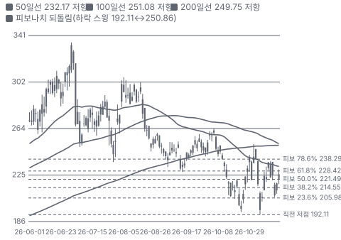

**주봉**

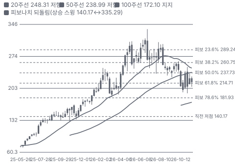

**월봉**

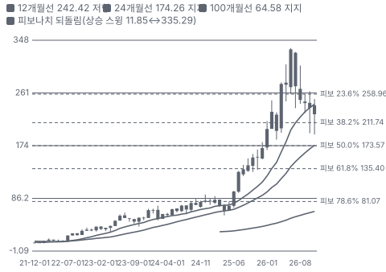

**분기 매출·EPS 실적과 컨센서스**

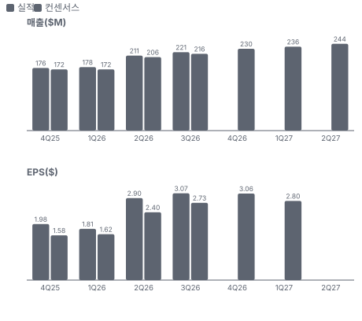

**4Q26 매출 — 지표 추세 vs 가이던스·컨센서스**

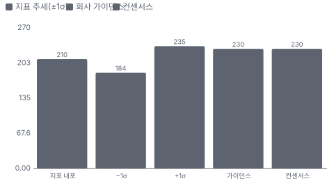

**멀티플 프리미엄(분기말 후행 P/E(대상 선행 추정 이력 없음), 최근 4개 분기말 절대값 — 대상 vs 동종 중앙값)**

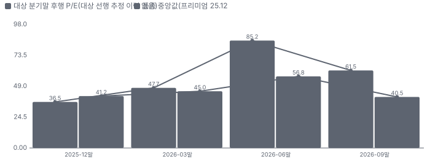

**합리적 멀티플**

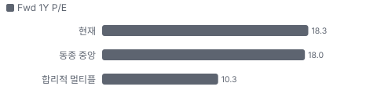

**밸류에이션 주가 시나리오**

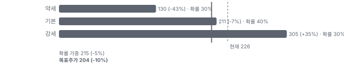

**주가별 업사이드**

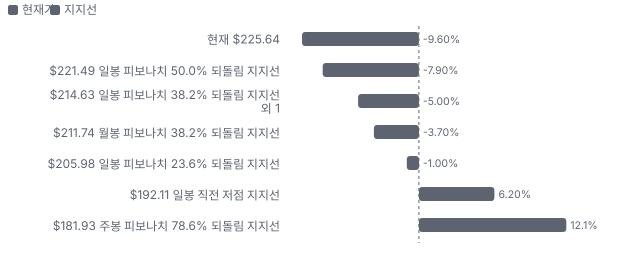
- 제품·서비스 포트폴리오

**고객 믹스(2Q26(콜 공시 금액 기준), 매출 대비)**

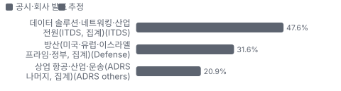

**공급 병목(10점, 낮을수록 병목)**

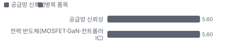

**추정 캐파(\$M 매출/년) — 결합 970(범위 960~1,122) · 가동률 약 81%**

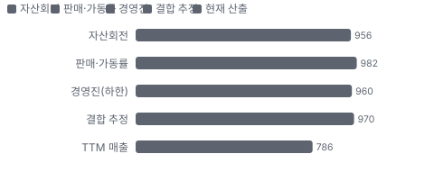

**CAPEX의 매출 대비 비중**

**어닝콜 변화별 주주가치 영향**

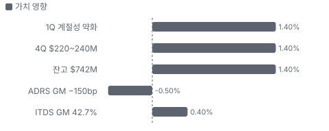

**수주·파이프라인 확실성 사다리**

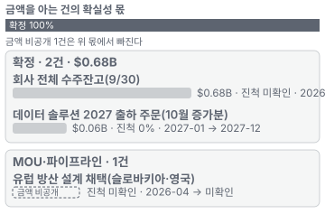

**매출 → 매출총이익 → 영업이익(매출 = 100, 최근 4분기)**

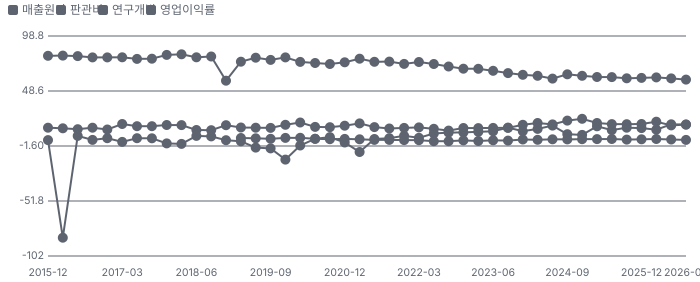

**분기 비용 비중 추이(매출 대비, 공시)**

**비용 요인별 매출 대비 비중 1년 변화**

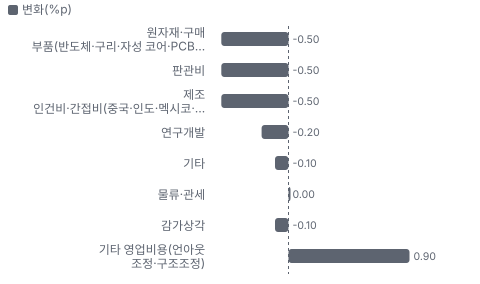

**ITDS(산업·데이터 솔루션) BOM 원가 몫**

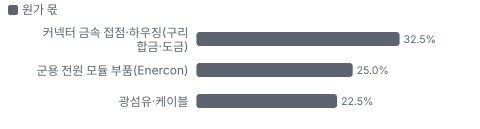

**ADRS(항공·방산·고신뢰) BOM 원가 몫**

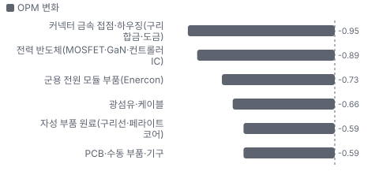

**BOM 항목 가격 +10% 시 OPM 변화**

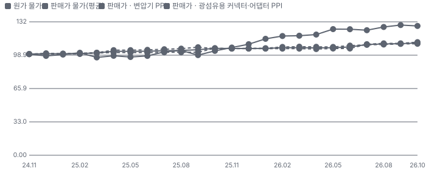

**원가 물가 vs 판매가 물가 — 최근 24개월(24.11 = 100): 원가가 판매가보다 16.8%p 더 올라 단가를 못 올리면 마진 압박**

**사업별 매출 vs 물가 — 전년 대비(명목 매출 · 비교 물가 · 실질 = 물량·믹스)**

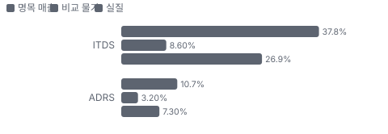

**자산 구성 — 3Q26 분기말 투하자본 \$790.3M**

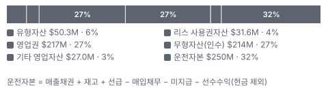

**자산별 변화율 — 최근 12개 분기(4Q23 = 0%) + 다음 4개 분기 추정**

**ROIC 추이 — TTM, 최근 12개 분기 + 다음 4개 분기 추정(컨센서스 NOPAT)**

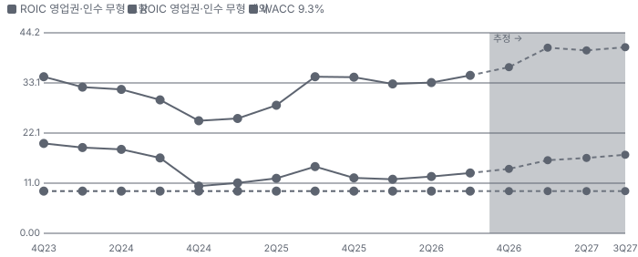

**생산시설별 추정 캐파(\$M 매출/년, 큰 순) — 결합 추정을 면적 × 제조 사용 비율로 배분**

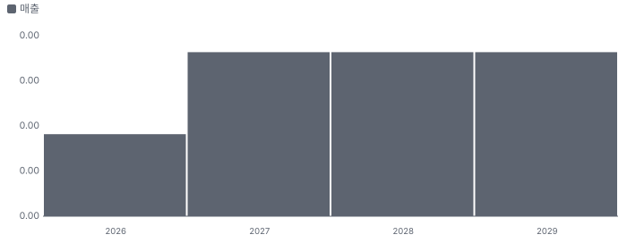

**Enercon Technologies(80%) 시너지 램프(종류별, 확률 가중) · 시너지 가치 \$0.02B**

**dataMate 시너지 램프(종류별, 확률 가중) · 시너지 가치 \$0.01B**

**매출 vs PPI·수출입 — 4Q22 = 100(변화율, 로그 눈금)**

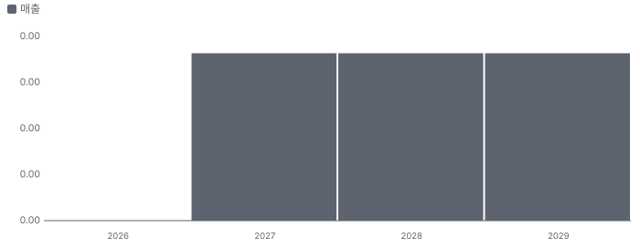

**10년 P·Q 사이클 — 추세(HP 필터) 대비 갭과 8분기 전망**

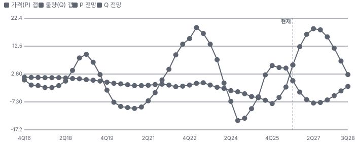

**매출 증가율의 가격·물량 분해와 8분기 전망(전년 대비)**

**분기별 매출 증가율 분해**

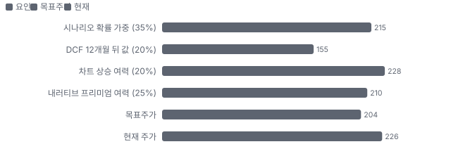

**목표주가 산정 — 약세와 기본 사이(약세 쪽 9%), 도달 확률 약 53%**

**재고 일수 — 분기별(수주 자료가 없어 수주/출하 비율 없음)**

**일별 거래량 분해**

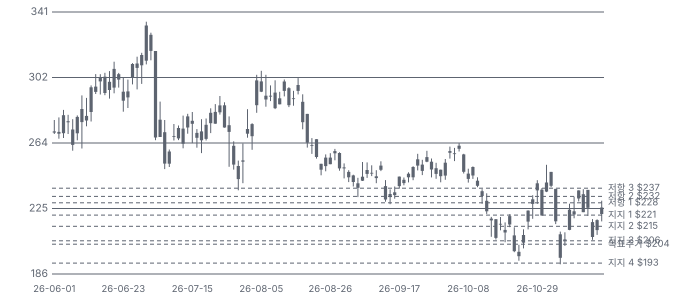

**기관 자금 흐름**

**몬테카를로**

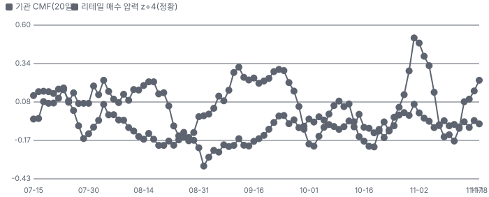

해석: 3,000번 중 127번(4%)에서 가치가 지금 주가 이상이었다. 가정을 흔들어도 지금 주가를 뒷받침하지 못하는 경우가 더 많다. 가운데 값은 0.62배이고, 열 번 중 여덟 번은 0.47~0.88배 사이에 든다.

## 내러티브

> **기업가치를 결정하는 이야기:** 기업가치는 ① ITDS의 AI·데이터 전원 주문이 2027 출하분까지 매출로 바뀌는 속도 ② 방산 주문의 지속 ③ 총이익률 40%대 유지에 달려 있다. 수주잔고 \$742M과 B/B 1.4(계산)가 2027 매출 가시성을 주고, 순현금이 인수 여력을 준다. 반대로 Class A·B 이중 구조와 내부자 매도가 배수를 누른다.

> **멀티플·EPS 프리미엄**
> **멀티플:** Fwd 1Y P/E 18.3배로 동종 5곳(Vicor·Advanced Energy·Littelfuse·Amphenol·TE Connectivity) 중앙값 18.0배와 같다. 6월 고점 때는 약 30배였다(추정 — \$333 ÷ 당시 다음 4개 분기 EPS 약 \$11).
> **EPS:** FY26 조정 EPS 컨센서스 \$10.90(+54%), FY27 \$12.34(+13%) — 3Q 뒤 30일 동안 FY27이 15% 올랐다.

### 투자자들은 왜 열광했나

2025년 하반기부터 AI 데이터센터 전원 주문과 방산 매출이 함께 늘고 Enercon 인수 효과가 더해져 분기 EPS가 \$1.35(1Q25)에서 \$3.07(3Q26)로 커졌다. 식은 이유는 세 가지다 — 5월 \$266 증자(1.725M주), 7월 초 AI 하드웨어 조정(하루 −16%), 경영진 매도. 3Q ADRS 총이익률이 150bp 내린 것도 실망 요인이었다.

### 무엇이 기업가치를 바꾸나

> **구조적 체질 변화**
> **변화:** 2026-03 사업부를 세 제품군에서 두 최종시장 사업부(ITDS·ADRS)로 재편, Enercon 인수로 매출의 약 절반이 항공·방산
> **증거:** 10-Q 주석 16·3Q 콜
> **반증:** 재편 뒤 영업비용률 상승

> **고부가 믹스 확장**
> **변화:** 저마진 제품 단종과 AI 데이터 전원 비중 확대
> **증거:** ITDS 총이익률 38.0% → 42.7%(EX-99.1), 저마진 물량 정리(3Q 콜)
> **반증:** ITDS 총이익률 40% 아래

> **기술 혁신**
> **변화:** 고밀도 서버 전원·확장 빔 광 커넥터(렌즈로 빛을 넓혀 먼지·진동에 강한 광 커넥터) — 제품 사양 우위는 이 회차에 수치로 확인하지 못함
> **증거:** 10-K 제품 절
> **반증:** 해당 없음

> **실행 속도**
> **변화:** 해당 없음(주문→출하 리드타임 미공시라 피어 비교 불가) — 상위 공급사 리드타임이 길어져 재고를 쌓아 납기를 지킨다(3Q 콜)
> **증거:** 3Q26 어닝콜(2026-10-29)
> **반증:** 재고 증가에도 매출 둔화

> **M&A**
> **변화:** Enercon 80%(2024-11), dataMate(2026-03, 약 \$16M), Enercon 잔여 20% \$114.0M 매입 예정
> **증거:** https://www.sec.gov/Archives/edgar/data/729580/000143774926034634/belfa20260930_10q.htm
> **반증:** Enercon 매입 지연·추가 인수 없음

> **정책·입법 연관성**
> **재정정책:** 해당 없음(이 회차에 국방 세출 의결 기록을 확인하지 못함 — 회사는 미국이 계속결의로 운영 중이고 탄약 보충 자금 집행이 수요에 못 미친다고 했다) 3Q26 어닝콜(2026-10-29) 반증: 해당 없음
> **행정명령:** 해당 없음(IEEPA(미국 국제비상경제권한법) 관세는 2026-02-20 대법원 판결로 무효 — 대체 법률 관세 가능성을 회사가 감시 중, 10-Q) https://www.sec.gov/Archives/edgar/data/729580/000143774926034634/belfa20260930_10q.htm 반증: 해당 없음
> **연관입법:** 해당 없음(회사가 밝힌 직접 수혜 법안 없음) https://www.sec.gov/Archives/edgar/data/729580/000143774926005354/belfb20251231d_10k.htm 반증: 해당 없음

> **고객의 지출 예산**
> **변화:** ITDS는 데이터센터·네트워크 CAPEX, ADRS는 국방 조달 예산과 항공기 생산 CAPEX
> **사업별 예산:** **매출의 52%**: ITDS(산업·데이터 솔루션) — 고객 CAPEX(데이터센터·AI 서버·네트워크 장비 투자) · 동인: AI 인프라 투자
**매출의 48%**: ADRS(항공·방산·고신뢰) — 고객 혼합(국방 조달 예산(정부 OPEX·조달)·항공기 생산) · 동인: 탄약 보충·유럽 재무장·항공기 생산률
> **증거:** 10-Q 세그먼트·2Q 콜
> **반증:** 하이퍼스케일러 2027 CAPEX 축소

### 내러티브 근거

> AI 데이터센터 전원과 방산이라는 두 성장 축으로 1년 반 만에 4배가 됐다(2025-06 \$74 → 2026-06 \$333). 6월 고점 뒤 5월 증자 물량·AI 하드웨어 조정·내부자 매도로 32% 내렸지만, 실적과 수주잔고는 그사이 계속 늘었다. 동종 대비 멀티플 차이 +2% 중 회사 고유 몫은 +78%다. 단계는 컨센서스, 쏠림은 중간 — 셀사이드 9명 전원 매수, 13F 256곳(3Q 증가 77·감소 86), 공매도 유통주식의 7.4%, Quantral 7일 언급 0건이다.

> **AI 데이터센터 전원·자성 부품 램프** · 강화
> **논리:** AI 서버·네트워크 고객의 전원·자성 부품 주문이 2027 출하분까지 쌓여 ITDS가 30%대 성장을 잇는다
> **숫자:** ITDS 3Q \$113.9M(+37.8%)·총이익률 42.7%, ITDS 잔고 연초 대비 +92.8%, 10/31 전사 잔고 \$742.4M
> **반증:** 4Q ITDS 매출 YoY +20% 미만 또는 4Q 말 잔고 \$680M 아래
> **출처:** https://www.sec.gov/Archives/edgar/data/729580/000143774926034634/belfa20260930_10q.htm

> **방산 수요(미국·유럽·이스라엘)** · 유지
> **논리:** 탄약 보충·유럽 재무장으로 군용 전원·커넥터 주문이 수년간 늘어난다
> **숫자:** 2Q 방산 \$66.5M(+28.4%), A&D(항공·방산) 잔고 사상 최대(3Q 콜), 유럽 설계 채택 8건(2Q 콜)
> **반증:** ADRS 매출 2분기 연속 YoY 감소
> **출처:** 3Q26 어닝콜(2026-10-29)

> **가격 전가·믹스 개선** · 강화
> **논리:** 새 주문 가격 인상과 저마진 제품 단종으로 총이익률이 40%대 초반에 자리 잡는다
> **숫자:** 3Q 총이익률 40.9%(+120bp), 4Q 가이던스 40~42%
> **반증:** 4Q 총이익률 40% 미만
> **출처:** https://www.sec.gov/Archives/edgar/data/729580/000143774926033795/ex_1007041.htm

> **순현금 M&A 옵션** · 유지
> **논리:** 순현금 \$333M(Enercon 20% 지급 \$114M 전)으로 인수를 더한다
> **숫자:** 현금 \$333.1M·차입 0, 리볼버 한도 \$400M(10-Q)
> **반증:** 1년 안 인수 없음·자사주도 없음
> **출처:** https://www.sec.gov/Archives/edgar/data/729580/000143774926034634/belfa20260930_10q.htm

> **반대 내러티브 — 희석·내부자 매도·업종 베타** · 강화
> **논리:** 5월 증자 희석, 경영진의 꾸준한 매도, AI 하드웨어 업종 급락 때 −10% 안팎 하루 움직임이 배수를 누른다
> **숫자:** Class B 주식 +16.9%(10.54M → 12.32M), 내부자 장내 매수 0, 고점 대비 −32%
> **반증:** 경영진 장내 매수 또는 자사주 매입 재개
> **출처:** https://www.sec.gov/Archives/edgar/data/729580/000143774926034634/belfa20260930_10q.htm

### 투자 포인트

> **이익은 오르고 배수만 내렸다**
> **명제:** FY27 EPS 30일 +15%, 주가 고점 대비 −32%
> **숫자:** Alpha Vantage 추정 이력·일봉
> **시장과 다른 점:** 시장은 AI 하드웨어 업종으로 묶어 팔았지만 회사 숫자는 잔고·리비전 모두 올랐다
> **증명:** 4Q 실적의 잔고·1Q 가이던스
> **출처:** https://www.sec.gov/Archives/edgar/data/729580/000143774926033795/ex_1007041.htm

> **잔고 \$742M이 2027을 덮는다**
> **명제:** 10/31 잔고 \$742.4M, 1~3Q B/B 1.40(계산)
> **숫자:** 10-Q MD&A
> **시장과 다른 점:** FY27 매출 컨센서스 \$949~985M의 약 60%를 이미 주문으로 가졌다(추정)
> **증명:** 4Q 말 잔고와 B/B 1 이상 유지
> **출처:** https://www.sec.gov/Archives/edgar/data/729580/000143774926034634/belfa20260930_10q.htm

> **내부자 매도와 증자**
> **명제:** 최근 1년 장내 매수 0, 5월 \$266 증자
> **숫자:** Form 4·10-Q
> **시장과 다른 점:** 경영진 매도는 보상 주식 현금화일 수 있다 — 매수 0은 사실이지만 이유는 미확인
> **증명:** 경영진 장내 매수·자사주 재개
> **출처:** https://www.sec.gov/Archives/edgar/data/729580/000143774926037485/0001437749-26-037485-index.htm

### 모멘텀 생성·소멸 타임라인

**카탈리스트 달력 — 지난 사건의 주가 반응과 앞으로 확인할 숫자**
| 날짜 | 상태 | 구분 | 사건 | 반응·확인 | 결과에 따라 |
|---|---|---|---|---|---|
| 2026-06-30 | 완료 | 생성 | AI 전원·방산 기대 — 종가 고점 \$333.04 | 이후 −32% |  |
| 2026-07-02 | 완료 | 소멸 | 원인 미확인 급락 | 하루 −16.1% |  |
| 2026-11-05 | 완료 | 소멸 | 중간선거 뒤 AI 하드웨어 급락 | 이틀 −18% |  |
| 2027-02(추정) | 예정 | 확인 | 4Q26 실적·1Q27 가이던스 | 4Q 매출 \$230M 이상, 잔고 \$742M 유지, 1Q 가이던스 \$215M 이상 | 셋이 맞으면 FY27 추정 상향, 잔고 감소면 배수 정체 |
| 2027 초 | 예정 | 확인 | Enercon 잔여 20% 매입(\$114.0M) | 지급 완료·추가 조건 | ADRS 이익 100% 귀속 |

### 언제 사서 언제 팔아야 할까?

**가격·조건 틀 — 가격은 밸류에이션(약세·기본·강세·목표주가)과 차트 지지 구간에서, 조건은 이벤트에서**
| 구간 | 가격 | 목표주가까지 | 약세까지 | 조건·근거 |
|---|---|---|---|---|
| 관찰 구간 | \$221~\$221 | -8% | -41% | 지지 구간이 약세 시나리오 가격과 겹치는 곳 — 11/5 종가 저점 \$195.94 근처 |
| 확인 뒤 | 지금 \$226 이상에서 조건 확인 | -10% | -43% | 4Q 실적 잔고 유지·1Q 가이던스 계절 감소 없음 |
| 무효화 | 약세 시나리오 \$130 | - | -43% | 11/5 종가 저점 \$195.94 이탈과 함께 잔고 감소 |
| 차익 고민 2차 | \$305(강세 시나리오) | +35% | - | 목표주가 근처에서는 Fwd 1Y P/E가 6월 고점 배수에 얼마나 다가섰는지 본다 |

업종 사건 날 −8~16% 하루 움직임이 반복됐다(7/2, 10/22, 11/4~5, 11/16) 가격·조건 틀이며 매매·비중 지시가 아니다(투자 권유 아님).

## 포트폴리오

| 제품·서비스 | 구분 | 무엇 | 쓰는 곳 | 돈 버는 방식 | Mix | Mix 변화(전 분기 대비) |
|---|---|---|---|---|---|---|
| ITDS(산업·데이터 솔루션) | 제품 | 데이터센터·AI 서버 전원, 변압기·인덕터 같은 자성 부품, 퓨즈·회로 보호, 이더넷 연결 | AI 서버·네트워크 장비·산업 설비·유통 채널 | 3Q 매출 \$113.9M(52%), 총이익률 42.7% | 52% | +4.1%p |
| ADRS(항공·방산·고신뢰) | 제품 | 군용·항공 고신뢰 커넥터(Cinch), 확장 빔 광 커넥터, 군용 전원(Enercon), RF(무선 주파수) 부품 | 미사일·전투 차량·함정·항공기·산업 장비 | 3Q 매출 \$106.6M(48%), 총이익률 39.6% | 48% | -4.1%p |

**Mix 변화가 가장 큰 쪽은 ADRS(항공·방산·고신뢰, -4.1%p, 전 분기 대비).** 계절성 판정: 분기 매출 계절 지수 기준 없음 → 직전 분기와 비교.

## 고객

> **2Q26(콜 공시 금액 기준) 최대 고객 데이터 솔루션·네트워킹·산업 전원(ITDS, 집계, ITDS) 48%, 상위 3곳 100%, 집중도 집중.** 공시·회사 발표로 확인한 몫은 매출의 79%이고, 나머지 고객 몫은 추정이거나 미분해다. 10% 넘는 단일 고객은 없다(10-K 2025). 2Q 매출 \$210.7M 중 방산이 \$66.5M(32%)로 가장 크고, ITDS(데이터 솔루션·산업·네트워킹)가 48%다. 3Q 콜은 AI 고객 노출이 커졌지만 일반 데이터 고객 안에서는 최종 용도 가시성이 떨어진다고 했다.

**고객별 매출 몫(2Q26(콜 공시 금액 기준))**
| 고객 | 몫 | 변화 | 근거 |
|---|---|---|---|
| 데이터 솔루션·네트워킹·산업 전원(ITDS, 집계, ITDS) | 48% | +2%p | 공시 |
| 방산(미국·유럽·이스라엘 프라임·정부, 집계, Defense) | 32% | +1%p | 공시 |
| 상업 항공·산업·운송(ADRS 나머지, 집계, ADRS others) | 21% | 미확인 | 추정 |

> **데이터 솔루션·네트워킹·산업 전원(ITDS, 집계, ITDS)** · 공시
> **사는 것:** 데이터센터·AI 서버 전원, 자성 부품, 회로 보호, 이더넷 연결
> **추정 근거:** ITDS 2Q \$100.2M ÷ \$210.7M(세그먼트, 계산)

> **방산(미국·유럽·이스라엘 프라임·정부, 집계, Defense)** · 공시
> **사는 것:** 군용 전원(Enercon)·커넥터(Cinch)·광 연결
> **추정 근거:** 콜 공시 금액

> **상업 항공·산업·운송(ADRS 나머지, 집계, ADRS others)** · 추정
> **사는 것:** 고신뢰 커넥터·케이블 조립품
> **추정 근거:** ADRS 2Q \$110.5M − 방산 \$66.5M = \$44.0M ÷ \$210.7M(계산)

## 수주·파이프라인

> **2026-11-19 기준 3건.** 확정 \$0.68B. 공시 수주잔고(9/30, 10-Q) \$0.68B. 서로 겹치는 항목은 합계에서 뺐다.

**수주 목록**
| 상태 | 계약 | 계약 총액 | 진척 | 기간 | 비고 |
|---|---|---|---|---|---|
| 확정 | 회사 전체 수주잔고(9/30) | \$0.68B | 비공개 | 2026-10 → 2027-12 | 10/31 \$742.4M |
| 확정 | 데이터 솔루션 2027 출하 주문(10월 증가분) | \$0.06B | 0% | 2027-01 → 2027-12 | 10/31 \$742.4M − 9/30 \$680.3M(계산) — 회사는 증가 원인을 데이터 솔루션 주문으로 밝혔다 (다른 항목과 겹칠 수 있어 합계에서 뺌) |
| 파이프라인 | 유럽 방산 설계 채택(슬로바키아·영국) | 금액 비공개 | 비공개 | 2026-04 → 미확인 | 2Q 콜 유럽 방산 설계 채택 8건 |

**실행 속도와 방해 요인**
| 항목 | 상태 | 실행 속도 | 방해 요인 |
|---|---|---|---|
| 회사 전체 수주잔고(9/30) | 확정 | 1월 잔고의 80~85%가 그해 출하(10-K) | 고객 일정 변경·취소 가능(10-Q) · 부품 조달·리드타임 |
| 데이터 솔루션 2027 출하 주문(10월 증가분) | 확정 | 2027 출하 요청일 | AI 고객 프로그램 일정 |
| 유럽 방산 설계 채택(슬로바키아·영국) | 파이프라인 | 작게 시작해 커진다(3Q 콜) | 유럽 국방 예산 집행 · 플랫폼 양산 일정 |

## 마진 구조

> **GPM 40.9%, OPM 17.9%.** 2Q26 대비 GPM +1.1%p, OPM -0.3%p. 변동비는 매출의 56%이고, 매출이 10% 늘면 OPM은 +2.4%p 움직인다. 3Q GAAP 매출원가는 매출의 59.1%로 1년 전 60.2%보다 낮다 — 2~3월 가격 인상과 ITDS 믹스 덕이다. 원가 항목별 몫은 공시되지 않아 추정이다. 10-K 원자재 구매 약정은 \$81.5M(2025 말)이고 3Q 콜은 원자재 전반의 물가 상승을 말했다.

> **매출 100 중 매출원가 60.1, 매출총이익 39.9(최근 4분기, 공시).** 매출원가 요인 중 원자재·구매 부품(반도체·구리·자성 코어·PCB·금속 접점)이 매출의 38.0%로 가장 무겁고, 단가가 +10% 오르면 GPM이 -3.80%p 움직인다. 분기 회귀로 매출 1이 늘 때 매출원가는 0.39 늘고, 매출원가의 고정비 몫은 44%다.

**비용 요인 강도 — 비중·추세·충격(+10%)·탄력**
| 비용 | 구분 | 매출 대비 | 1년 변화 | 마진 기여 | 충격 시 마진 | 매출 탄력 | 고정비 몫 |
|---|---|---|---|---|---|---|---|
| 원자재·구매 부품(반도체·구리·자성 코어·PCB·금속 접점) | 매출원가 요인 | 38.0% | -0.5%p | +0.5%p | -3.80%p | 미확인 | 5% |
| 제조 인건비·간접비(중국·인도·멕시코·슬로바키아) | 매출원가 요인 | 13.0% | -0.5%p | +0.5%p | -1.30%p | 미확인 | 60% |
| 기타 | 매출원가 요인 | 3.6% | -0.1%p | +0.1%p | -0.36%p | 미확인 | 30% |
| 물류·관세 | 매출원가 요인 | 3.0% | +0.0%p | -0.0%p | -0.30%p | 미확인 | 10% |
| 감가상각 | 매출원가 요인 | 1.5% | -0.1%p | +0.1%p | -0.15%p | 미확인 | 100% |
| 매출원가 | 공시 항목 | 60.1% | -1.2%p | +1.2%p | -6.01%p | 0.39 | 44% |
| 판관비 | 공시 항목 | 18.5% | -1.3%p | +1.3%p | 미확인 | 0.17 | -2% |
| 연구개발 | 공시 항목 | 4.4% | -0.2%p | +0.2%p | 미확인 | 0.02 | 49% |
| 기타 영업비용 | 공시 항목 | 0.8% | -0.2%p | +0.2%p | 미확인 | -0.08 | 100% |

매출 탄력 = 분기 비용을 매출에 회귀한 기울기(매출 1당 변동비), 고정비 몫 = 절편 ÷ 평균 비용. 표본이 8분기 미만이면 미확인. 매출원가 요인 비중은 margin 재료의 추정이 섞여 있고, 공시 매출원가와의 차이는 '기타 매출원가'로 둔다.

**GPM에서 OPM까지(GAAP, 아래는 최근 4개 분기)**
| 기간 | GPM | 연구개발 | 판관비 | 기타 | OPM |
|---|---|---|---|---|---|
| 3Q25 | 39.7% | 4.2% | 18.3% | 0.3% | 16.9% |
| 2Q26 | 39.9% | 4.3% | 17.2% | 0.1% | 18.2% |
| 3Q26 | 40.9% | 4.0% | 17.9% | 1.1% | 17.9% |
| 2025-12 | 39.5% | - | - | - | 14.7% |
| 2026-03 | 39.0% | - | - | - | 13.3% |
| 2026-06 | 39.9% | - | - | - | 18.2% |
| 2026-09 | 41.0% | - | - | - | 18.0% |

**비용을 움직이는 요인**
| 비용 | 요인 |
|---|---|
| 원자재·구매 부품(반도체·구리·자성 코어·PCB·금속 접점, 매출원가) | 부품 단가·물량 · 근거 추정 |
| 판관비(판관비) | 영업 인력·SBC·무형 상각 · 근거 공시 |
| 제조 인건비·간접비(중국·인도·멕시코·슬로바키아, 매출원가) | 현지 임금·환율(페소·셰켈) · 근거 추정 |
| 연구개발(연구개발) | 전원·커넥터 설계 · 근거 공시 |
| 기타(매출원가) | 매출원가 − 위 항목 · 근거 추정 |
| 물류·관세(매출원가) | 관세(IEEPA 판결 뒤 대체 관세)·운임 · 근거 추정 |
| 감가상각(매출원가) | 분기 D&A \$7.3M 중 유형자산분 · 근거 추정 |
| 기타 영업비용(언아웃 조정·구조조정, 기타) | Enercon 언아웃 조정 \$2.4M(3Q) · 근거 공시 |

**ITDS(산업·데이터 솔루션) BOM — 매출의 52%, GPM 43%(공시 — 3Q 세그먼트 총이익률(EX-99.1)), 항목 가격 +10% 시**
| 항목 | 원가 몫 | 전가 | 제품 GPM | OPM |
|---|---|---|---|---|
| 전력 반도체(MOSFET·GaN·컨트롤러 IC) | 25~35% | 미확인 | -1.7%p | -0.89%p |
| 자성 부품 원료(구리선·페라이트 코어(자성 부품에 쓰는 산화철 계열 자심)) | 15~25% | 미확인 | -1.1%p | -0.59%p |
| PCB·수동 부품·기구 | 15~25% | 미확인 | -1.1%p | -0.59%p |
| 미분해 | 30% | - | - | - |

**ADRS(항공·방산·고신뢰) BOM — 매출의 48%, GPM 40%(공시 — 3Q 세그먼트 총이익률(EX-99.1)), 항목 가격 +10% 시**
| 항목 | 원가 몫 | 전가 | 제품 GPM | OPM |
|---|---|---|---|---|
| 커넥터 금속 접점·하우징(구리 합금·도금) | 25~40% | 미확인 | -2.0%p | -0.95%p |
| 군용 전원 모듈 부품(Enercon) | 20~30% | 미확인 | -1.5%p | -0.73%p |
| 광섬유·케이블 | 15~30% | 미확인 | -1.4%p | -0.66%p |
| 미분해 | 20% | - | - | - |

커넥터 금속 접점·하우징(구리 합금·도금) 가격이 +10% 오르면 영업이익은 -5.3% 움직인다. 판매가 전가를 모르는 항목은 전가 0%로 계산했다.

**BOM 항목 가격을 움직이는 것**
| 항목 | 요인 |
|---|---|
| 전력 반도체(MOSFET·GaN·컨트롤러 IC) | 전원 효율·전력 밀도를 정하는 부품 · 근거 추정 |
| 자성 부품 원료(구리선·페라이트 코어) | 변압기·인덕터 원가 — 새 주문 가격 인상으로 일부 전가(3Q 콜), 비율 미공시 · 근거 추정 |
| PCB·수동 부품·기구 | 전원 보드·하우징 · 근거 추정 |
| 커넥터 금속 접점·하우징(구리 합금·도금) | 고신뢰 커넥터 원가 — 새 주문 가격 인상으로 일부 전가(3Q 콜), 비율 미공시 · 근거 추정 |
| 광섬유·케이블 | 광 연결 제품 · 근거 추정 |
| 군용 전원 모듈 부품(Enercon) | 방산 전원 · 근거 추정 |

> **원가·판매가 물가 격차 -18.9%p** — 판매가 물가가 투입 원가 물가보다 느리게 오른다.

**투입 물가 — 미국 PPI 3·6·12개월(2026-10, 개정 반영)과 해외 전년비**
| 항목 | 미국 3개월 | 6개월 | 12개월 | 전가 못 할 때 OPM | 일본 | 한국 | 대만 |
|---|---|---|---|---|---|---|---|
| 군용 전원 모듈 부품(Enercon) | -0.7% | -5.7% | -2.7%* | - | +1.6%* | 미확인 | 미확인 |
| 커넥터 금속 접점·하우징(구리 합금·도금) | +3.4% | +7.2% | +23.9% | - | +42.6% | +25.8% | +40.1% |
| PCB·수동 부품·기구 | +0.0% | +24.0% | +46.4% | - | +11.5% | +4.5% | +12.1% |
| 광섬유·케이블 | +0.9% | +2.8% | +4.4%* | - | 미확인 | 미확인 | 미확인 |

별표는 품목보다 넓은 업종 지수다. 연결한 투입 원가의 미국 PPI는 1년 새 가중 +23.9%이고, 판매가로 넘기지 못하면 GPM -9.1%p·OPM -9.1%p가 움직인다. 판매가 비교 물가(변압기 PPI)는 1년 새 +5.6% — 회사 가격 변화는 미확인. 물가 지수를 붙이지 못한 매출원가 항목은 제조 인건비·간접비(중국·인도·멕시코·슬로바키아), 물류·관세, 감가상각다(미연결). ITDS(산업·데이터 솔루션) 매출은 2026-09 전년 대비 +37.8%이고 비교 물가 ppi:transformer의 변화 +8.6%(2026-09)를 빼면 실질 +26.9% — 물량·믹스가 성장을 이끌었다. ADRS(항공·방산·고신뢰) 매출은 2026-09 전년 대비 +10.7%이고 비교 물가 ppi:fiber_connector의 변화 +3.2%(2026-09)를 빼면 실질 +7.3% — 물량·믹스가 성장을 이끌었다.

## 자산 구성

> **3Q26 분기말 투하자본 \$790.3M** — 운전자본 32%, 영업권 27%. 최근 12개 분기(4Q23 → 3Q26) 가장 크게 늘어난 자산은 영업권(+714%), 투하자본 합계 +160%. 3Q27 추정 투하자본 \$820.1M(+4%, 컨센서스 매출과 회전 일수·CAPEX 강도 유지 가정). 연율 감가 비율(총액 기준)은 직전 4분기 20.85% → 최근 4분기 21.22%.

**자산·운전자본 항목별 분기말 잔액 — 최근 12개 분기와 다음 4개 분기 추정**
| 항목 | 4Q23 | 3Q25 | 3Q26(최근) | 3Q27 추정 | 12개 분기 변화 | 다음 4개 분기 변화 |
|---|---|---|---|---|---|---|
| 매출채권 | \$84.1M | \$126.0M | \$156.2M | \$176.4M | +86% | +13% |
| 재고자산 | \$136.5M | \$166.1M | \$224.7M | \$246.8M | +65% | +10% |
| 선급·기타 유동자산 | \$19.8M | \$28.7M | \$23.1M | \$33.8M | +17% | +46% |
| 매입채무 | \$40.4M | \$54.2M | \$92.5M | \$93.8M | +129% | +1% |
| 미지급비용 | \$54.7M | \$46.0M | \$50.8M | \$60.6M | -7% | +19% |
| 선수수익(계약부채) | \$3.0M | \$12.1M | \$10.5M | \$12.6M | +245% | +20% |
| 유형자산 | \$36.5M | \$47.6M | \$50.3M | \$55.2M | +38% | +10% |
| 리스 사용권자산 | \$20.5M | \$22.0M | \$31.6M | \$31.6M | +54% | +0% |
| 영업권 | \$26.6M | \$214.6M | \$216.9M | \$216.9M | +714% | +0% |
| 무형자산(인수) | \$49.4M | \$221.2M | \$214.3M | \$199.5M | +334% | -7% |

**자산 추정 동인 — 최근 4개 분기 평균(재무상태표 동인 모형)**
| 동인 | 값 | 곱하는 기준 |
|---|---|---|
| 매출채권 | 64일 | 매출 |
| 재고자산 | 149일 | 매출원가 |
| 선급·기타 유동자산 | 12일 | 매출 |
| 매입채무 | 57일 | 매출원가 |
| 미지급비용 | 22일 | 매출 |
| 선수수익(계약부채) | 5일 | 매출 |
| CAPEX 강도 | 1.8% | 매출(최근 4개 분기 합) |
| 분기 감가율 | 6.61% | 기초 유형자산 순액(무형 상각 제외 감가상각) |
| 매출원가율 | 60.1% | 매출(최근 4개 분기) |
| 영업권·리스 사용권·기타 | 유지 | 인수·새 리스는 공시 전 모름 |
| 인수 무형자산 | 분기 \$3.7M 상각 | 최근 4개 분기 평균 상각 |

**추정 방법:** 증권사 3표 모델(손익·재무상태표·현금흐름)의 재무상태표 동인 방식이다. 운전자본은 항목별 회전 일수(매출채권·선급·미지급·선수는 매출, 재고·매입채무는 매출원가 기준)를 최근 4개 분기 평균으로 두고 컨센서스 매출에 곱한다. 유형자산은 기초 + CAPEX − 감가상각으로 굴린다(Koller·Goedhart·Wessels 『Valuation』 재무상태표 추정). 매출 경로는 ROIC 절의 컨센서스와 같다.

**유형·무형자산 항목별 가치(2025-12-31 vs 2024-12-31)**
| 구분 | 항목 | 총액 2025-12-31 | 누적상각 | 순액 | 총액 2024-12-31 | 총액 1년 변화 | 공시 내용연수 |
|---|---|---|---|---|---|---|---|
| 유형 | 토지 | \$0.1M | \$0.0M | \$0.1M | \$0.1M | +13.0% | 비상각 |
| 유형 | 건물·개량 | \$16.4M | 총계만 공시 | 총계만 공시 | \$19.4M | -15.4% | 미확인 |
| 유형 | 기계·장비 | \$103.4M | 총계만 공시 | 총계만 공시 | \$99.7M | +3.7% | 미확인 |
| 유형 | 건설 중 | \$7.1M | \$0.0M | \$7.1M | \$5.2M | +35.7% | 비상각 |
| 영업권 | 영업권 | \$214.8M | \$0.0M | \$214.8M | \$208.0M | +3.3% | 비상각 |
| 무형 | 특허·라이선스·기술 | \$56.4M | \$15.6M | \$40.8M | \$56.6M | -0.4% | 미확인 |
| 무형 | 고객관계 | \$187.7M | \$48.9M | \$138.8M | \$186.7M | +0.6% | 17~17년 |
| 무형 | 상표 | \$38.6M | \$0.2M | \$38.4M | \$38.3M | +0.6% | 비상각 |
| 유형 합계 | 유형자산 | \$127.1M | \$78.7M | \$48.4M | \$124.5M | +2.1% | 경과율 66%(상각 대상 기준) |

**내용연수 산식(상각 대상 유형자산 = 총액 − 토지 − 건설중)**
| 기준일 | 연 감가상각 | 상각 대상 총액 | 평균 내용연수 | 경과 연수 | 잔여 연수 | 경과율 |
|---|---|---|---|---|---|---|
| 2025-12-31 | \$11.8M | \$119.9M | 10.2년 | 6.7년 | 3.5년 | 66% |
| 2024-12-31 | \$9.9M | \$119.1M | 12.0년 | 7.7년 | 4.3년 | 64% |

산식 평균 내용연수는 10.2년. 1년 전 12.0년 → 지금 10.2년.

**분기 감가 비율(감가상각 ÷ 평균 유형자산 총액)**
| 분기 | 감가상각 | 평균 유형자산(총액) | 분기 비율 | 연율 | 연율의 역수 |
|---|---|---|---|---|---|
| 4Q24 | \$5.7M | \$121.1M | 4.71% | 18.82% | 5.3년 |
| 1Q25 | \$6.7M | \$122.9M | 5.44% | 21.76% | 4.6년 |
| 2Q25 | \$6.6M | \$123.0M | 5.37% | 21.46% | 4.7년 |
| 3Q25 | \$6.7M | \$124.8M | 5.33% | 21.31% | 4.7년 |
| 4Q25 | \$6.7M | \$126.0M | 5.28% | 21.13% | 4.7년 |
| 1Q26 | \$6.6M | \$128.9M | 5.14% | 20.56% | 4.9년 |
| 2Q26 | \$6.9M | \$130.3M | 5.30% | 21.22% | 4.7년 |
| 3Q26 | \$7.3M | \$132.6M | 5.48% | 21.94% | 4.6년 |

감가상각 기준: 손익계산서 감가상각·상각비(SEC 공시 데이터, 4분기 = 연간 − 1~3분기).

최근 4분기 연율 감가 비율 21.22%, 직전 4분기 20.85%(+2%) — 경고 문턱(-10%) 안이다.

미공시·미분해: 유형자산 항목별 누적상각·내용연수(10-K 주석에 합계 누적상각 \$78.7M만 공시) — 이 칸은 비우고 나머지로 계산했다.

### 해석 — 자산이 어디에 쌓이고 있나

- 같은 기간 4개 분기 매출은 +50% — 매출보다 빨리 늘어난 자산: 매출채권 +86%, 재고자산 +65%, 영업권 +714%, 무형자산(인수) +334%. 이 자산의 회전율이 떨어지면 ROIC를 희석한다.
- 다음 4개 분기 CAPEX \$17.7M vs 감가상각 \$13.8M(최근 4개 분기 CAPEX 강도·감가율 유지) — 유형자산 3Q26 \$50.3M → 3Q27 \$55.2M. 투자가 감가보다 커서 자산이 쌓이는 국면이다.

## ROIC

> **TTM 3Q26 ROIC는 영업권·인수 무형 포함 13.3%, 제외 34.8%**(NOPAT 마진 14.7% × 투하자본 회전율 0.91회). 최근 12개 분기 4Q23 19.8% → 3Q26 13.3%(고점 4Q23 19.8%). 컨센서스 NOPAT으로 굴리면 3Q27 17.3%(제외 41.0%) — WACC 9.3% 대비 +8.0%p. 1년 변화의 가장 큰 요인은 NOPAT 마진(+1.6%p).

**ROIC 추이(TTM)와 다음 4개 분기 추정 — NOPAT ÷ 평균 투하자본(이번 분기말·4개 분기 전)**
| 분기 | 구분 | TTM 매출 | TTM NOPAT | NOPAT 마진 | 평균 투하자본 | ROIC 포함 | ROIC 제외 |
|---|---|---|---|---|---|---|---|
| 4Q23 | 실적 | \$639.8M | \$83.2M | 13.0% | \$420.3M | 19.8% | 34.5% |
| 1Q24 | 실적 | \$595.6M | \$81.8M | 13.7% | \$431.7M | 18.9% | 32.2% |
| 2Q24 | 실적 | \$560.0M | \$78.1M | 13.9% | \$422.7M | 18.5% | 31.7% |
| 3Q24 | 실적 | \$524.9M | \$67.6M | 12.9% | \$406.4M | 16.6% | 29.4% |
| 4Q24 | 실적 | \$534.8M | \$64.4M | 12.0% | \$619.2M | 10.4% | 24.8% |
| 1Q25 | 실적 | \$558.9M | \$70.1M | 12.6% | \$633.3M | 11.1% | 25.3% |
| 2Q25 | 실적 | \$594.0M | \$75.9M | 12.8% | \$625.5M | 12.1% | 28.2% |
| 3Q25 | 실적 | \$649.4M | \$91.0M | 14.0% | \$619.7M | 14.7% | 34.5% |
| 4Q25 | 실적 | \$675.5M | \$101.8M | 15.1% | \$834.1M | 12.2% | 34.4% |
| 1Q26 | 실적 | \$701.7M | \$100.7M | 14.3% | \$845.7M | 11.9% | 32.9% |
| 2Q26 | 실적 | \$744.1M | \$107.8M | 14.5% | \$862.3M | 12.5% | 33.2% |
| 3Q26 | 실적 | \$785.6M | \$115.1M | 14.7% | \$865.7M | 13.3% | 34.8% |
| 4Q26 | 추정 | \$839.7M | \$123.7M | 14.7% | \$869.8M | 14.2% | 36.6% |
| 1Q27 | 추정 | \$897.2M | \$141.4M | 15.8% | \$878.7M | 16.1% | 40.9% |
| 2Q27 | 추정 | \$930.5M | \$149.0M | 16.0% | \$899.4M | 16.6% | 40.3% |
| 3Q27 | 추정 | \$961.0M | \$156.6M | 16.3% | \$906.8M | 17.3% | 41.0% |

**다음 4개 분기 NOPAT — 컨센서스(세율 20%, 리스 이자 별도)**
| 분기 | 매출 | EBITA 마진 | EBITA | NOPAT(분기) | 근거 |
|---|---|---|---|---|---|
| 4Q26 | \$230.0M | 17.5% | \$40.2M | \$32.2M | 컨센서스 매출 × EBIT 마진 FY2026(조정 − 주식보상 1.3%) |
| 1Q27 | \$236.0M | 21.0% | \$49.6M | \$39.6M | 컨센서스 매출 × EBIT 마진 FY2027(조정 − 주식보상 1.3%) |
| 2Q27 | \$244.0M | 21.0% | \$51.2M | \$41.0M | 컨센서스 매출 × EBIT 마진 FY2027(조정 − 주식보상 1.3%) |
| 3Q27 | \$251.0M | 21.0% | \$52.7M | \$42.2M | 컨센서스 매출 × EBIT 마진 FY2027(조정 − 주식보상 1.3%) |

**추정 방법:** NOPAT은 컨센서스(분기 매출 추정 × 회계연도 EBIT 마진 추정)로 잡고, 조정(비 GAAP) 마진이면 주식보상 몫을 빼서 과거 실적과 같은 기준(영업이익 + 인수 무형 상각)으로 맞췄다. 이미 발표했지만 분기 보고서(10-Q)가 아직 없는 분기는 발표 실적을 쓴다. 투하자본은 자산 구성 절의 재무상태표 동인으로 굴렸다. ROIC는 4개 분기 NOPAT을 이번 분기말과 4개 분기 전 투하자본의 평균으로 나눈다 — 추정 분기의 ROIC에는 이미 나온 실적 분기가 섞여 있다.

**투하자본 항목별 회전율과 ROIC 기여(TTM 3Q26, 평균 잔액)**
| 항목 | 투하자본 | 매출 1달러당 자본 | 회전율(매출 ÷ 항목) | 자본 몫 | 이 항목을 빼면 ROIC |
|---|---|---|---|---|---|
| 운전자본 | \$229.4M | 0.29 | 3.43회 | 26% | 18.1% |
| 유형자산 | \$48.9M | 0.06 | 16.05회 | 6% | 14.1% |
| 리스 사용권자산 | \$26.8M | 0.03 | 29.34회 | 3% | 13.7% |
| 영업권 | \$317.4M | 0.40 | 2.48회 | 37% | 21.0% |
| 무형자산(인수) | \$217.8M | 0.28 | 3.61회 | 25% | 17.8% |
| 기타 영업자산 | \$25.5M | 0.03 | 30.83회 | 3% | 13.7% |

**ROIC 세 가지 판**
| 판 | NOPAT | 투하자본 | ROIC | 무엇을 재나 |
|---|---|---|---|---|
| 영업권·인수 무형 포함 | \$115.1M | \$865.7M | 13.3% | 인수 웃돈까지 낸 돈에 대한 수익률 |
| 영업권·인수 무형 제외 | \$115.1M | \$330.6M | 34.8% | 본업 운영 수익률(동종 비교용) |
| 무형 자본화 조정(판관비 20%·5년, 연구개발 6년) | \$129.3M | \$1,018.2M | 12.7% | 비용으로 처리한 무형 투자를 자산으로 본 판 |
| 경제적 이익(포함판) | \$34.9M | \$865.7M | 자본비용 9.3% | (ROIC − 자본비용) × 투하자본 |

NOPAT = (영업이익 \$127.4M + 인수 무형 상각 + 리스 내재 이자 \$1.7M) × (1 − 세율 20%). 리스 사용권자산을 투하자본에 넣었으므로 임차료 속 이자 몫을 영업이익에 되더했다. 현금은 영업에 필요한 몫을 따로 알 수 없어 투하자본에서 뺐다. SEC 공시 데이터 자동 초안 — 운전자본 = 매출채권 + 재고 + 선급 − (매입채무 + 미지급비용 + 선수수익), 현금 제외. 손상 누계는 공시 데이터 수록분.

**ROIC 1년 변화 분해(포함판, TTM 3Q25 → TTM 3Q26)**
| 요인 | ROIC 기여 |
|---|---|
| NOPAT 마진 | +1.61%p |
| 운전자본 | -0.36%p |
| 유형자산 | +0.03%p |
| 리스 사용권자산 | +0.01%p |
| 영업권 | -0.81%p |
| 무형자산(인수) | -0.94%p |
| 기타 영업자산 | +0.13%p |
| 합계 | -0.32%p |

**무형 자본화 가정별 ROIC(2025년 지출 기준, 포함판에 더함)**
| 투자로 보는 몫 | 상각 연수 | 무형 자산 | NOPAT 조정 | 조정 ROIC |
|---|---|---|---|---|
| 판관비 20% | 2년 | \$123.1M | \$11.9M | 12.8% |
| 판관비 20% | 5년 | \$152.5M | \$14.2M | 12.7% |
| 판관비 30% | 2년 | \$141.2M | \$14.0M | 12.8% |
| 판관비 30% | 5년 | \$185.3M | \$17.5M | 12.6% |

### 해석 — 무엇이 수익성을 끌어올리고 희석하나

- 영업권: 투하자본의 37% — 빼면 ROIC 13.3% → 21.0%. 이 자산의 회전율(2.48회)이 수익성을 희석하는 주된 자리다.
- 운전자본: 투하자본의 26% — 빼면 ROIC 13.3% → 18.1%. 이 자산의 회전율(3.43회)이 수익성을 희석하는 주된 자리다.
- 영업권·인수 무형을 빼면 ROIC가 +21.5%p 오른다 — 과거 인수에 치른 웃돈이 주주 수익률을 그만큼 낮춘다(본업 수익률은 제외판, 인수까지 포함한 가치 창출은 포함판으로 본다).
- 1년 ROIC 개선의 최대 요인은 NOPAT 마진(+1.6%p). 반대로 깎은 최대 요인은 무형자산(인수, -0.9%p).
- 비용으로 처리한 무형 투자를 자산으로 보면 ROIC가 -0.6%p 움직인다(무형 자산 \$152.5M). 투자를 늘리는 중이라 NOPAT이 더 커지는 쪽이다.
- 추정 경로 3Q26 13.3% → 3Q27 17.3%: NOPAT 마진 +1.6%p, 투하자본 회전율 +0.15회 — 컨센서스 매출·마진이 맞고 회전 일수·CAPEX 강도가 유지된다는 가정이다. 마진 추정이 내려가거나 재고 일수가 늘면 이 경로가 먼저 틀린다.
- ROIC(포함) − WACC = +4.0%p(3Q26) — 양수면 투하자본을 늘릴수록 가치가 쌓인다.

## 공급망 병목

> **공급망 신뢰성 5.6/10, 병목 주의.** 가장 약한 고리는 전력 반도체(MOSFET·GaN·컨트롤러 IC) 5.6점이고, 품목 평균은 5.6점이다. 근거가 부족한 3건(구리·자성 소재 · PCB · 광섬유·케이블)은 점수에서 뺐다. 단일 공급원 부품이 있지만 대체품을 구할 수 있다고 회사는 본다(10-K). 3Q 콜은 상위 공급사들의 리드타임이 길어졌고 재고를 쌓아 출하를 지킨다고 했다 — 재고는 연초 \$167.3M에서 \$224.7M으로 늘었다.

**병목과 마진 — 품목 가격 +10% 시 OPM**
| 품목 | 점수 | 판정 | 구분 | OPM |
|---|---|---|---|---|
| 전력 반도체(MOSFET·GaN·컨트롤러 IC, 필수) | 5.6 | 병목 주의 | 핵심 통제 품목 | -0.89%p |

> **전력 반도체(MOSFET·GaN·컨트롤러 IC)** · 5.6/10
> **왜:** 데이터센터 전원 출하 상한
> **병목 요인:** 인증 공급사 2곳 · 캐파 빠듯 · 리드타임 미확인 · 재인증 6개월 · 1위 점유율 미확인 · 지역 집중 미확인 · 물량 확보 장기계약
> **풀리는 조건:** 미확인

**공급사**
| 품목 | 공급사 | 몫 | 근거 |
|---|---|---|---|
| 전력 반도체(MOSFET·GaN·컨트롤러 IC) | 미확인(단일 공급원 포함, 전원 핵심 부품) | 미확인 | 공시 |
| 구리·자성 소재 | 미확인(구리선·페라이트 코어) | 미확인 | 공시 |
| PCB | 미확인(전원 보드) | 미확인 | 공시 |
| 광섬유·케이블 | 미확인(광 커넥터·케이블 조립품 소재) | 미확인 | 공시 |

**무역 통계로 본 공급 지역**
| 품목 | EU 수입처 | 일본 수입처 | EU 1위 전년비 |
|---|---|---|---|
| 전력 반도체(MOSFET·GaN·컨트롤러 IC) | CN(중국) 33% · MY(말레이시아) 30% · JP(일본) 21% | マレーシア 25% · 中華人民共和国 19% | -0.5% |
| 구리·자성 소재 | MY 77% · KR(한국) 11% · VN(베트남) 7% | マレーシア 58% · タイ 36% | 미확인 |
| PCB | CN 85% · TW(대만) 4% · KR 4% | 中華人民共和国 62% · 台湾 11% | +32.0% |
| 광섬유·케이블 | CN 65% · US 20% · TW 7% | 中華人民共和国 36% · アメリカ合衆国 21% | +13.9% |

## 생산능력

> **추정 캐파 970 \$M 매출/년(범위 960~1,122)** — TTM 매출 기준 가동률 약 81%(70%~82%). 회사가 캐파를 공시하지 않아 여러 방법을 합친 추정이다. FY2025 CAPEX는 \$0.01B로 매출의 1.8%다. 8개국 18곳에서 만든다(10-K, 1.875M sq ft, 98% 임차). 중국 3곳이 생산 면적의 56%다. 3Q 콜에서 '지금 시설로 캐파는 문제가 아니다'라고 했고, CAPEX는 9개월 \$11.0M(매출의 1.8%)로 낮다. 증설보다 자동화·공장 간 물량 배분으로 늘린다.

**캐파 추정 — 방법별(\$M 매출/년, 결합 = 점 추정 가중 평균, 경영진 하한·상한으로 자름)**
| 방법 | 추정 | 계산 | 근거 | 출처 |
|---|---|---|---|---|
| 자산회전 | 956 (917~1,024) | 순유형자산 \$M(3Q26) 81.9 × 과거 최고 매출 ÷ 순유형자산(배) 11.7 | FY2014~25 연간 매출 ÷ 순유형자산 최고 3개 해(FY2018 12.5배·FY2017 11.3배·FY2022 11.2배)를 지금 설비에 적용 — 그 해들의 설비 가동 수준을 지금도 낼 수 있다는 가정 | 표준 재무제표(연간·3Q26 분기 대차대조표) |
| 판매·가동률 | 982 (873~1,122) | TTM 매출 \$M 786 × 1 ÷ 가동률(70~90%, 중앙 80%) 1.2 | 가동률 공시 없음. 2Q·3Q 콜의 '캐파는 걱정이 아니다·지금 시설로 문제 없다'를 가동률 70~90%로 읽은 자체추론 | 2Q26 어닝콜(2026-07-30)·3Q26 어닝콜(2026-10-29) |
| 경영진(하한) | 960 | 하한 | 4Q 매출 가이던스 상단 \$240M을 내면서 캐파 문제가 없다고 했다 → 연 환산 \$960M은 지금 설비로 낼 수 있다 | 3Q26 어닝콜(2026-10-29) |
| 면적 | 미확인 | 직접 값 | 제조 면적은 알지만(10-K, 시설별 제조 사용 비율) 면적당 최대 산출의 기준값이 없어 총량 추정에는 쓰지 않고 시설별 배분에만 쓴다 | https://www.sec.gov/Archives/edgar/data/729580/000143774926005354/belfb20251231d_10k.htm |
| IB | 미확인 | 직접 값 | 노션 IB 자료·커버리지에서 Bel의 캐파 추정치를 찾지 못했다 | 노션 자료실·애널리스트 자료(2026-11-19 확인) |

단위: Bel은 품목이 수천 개인 부품사라 제품 대수 캐파를 내지 않는다. 부품·전자제품 위탁생산 업계는 캐파를 '지원 가능한 연 매출'로 말하므로 연 매출 환산액을 쓴다.

**생산시설 18곳**(10-K 2025 Item 2 주요 제조 시설 표 18곳(본사·비제조 공간 294,000 sq ft 제외)), 임차 17곳 · 소유 1곳. 시설별 생산능력은 공개되지 않았다 — 회사 전체 캐파만 위에 적었다.

**생산시설 18곳 — 명칭·위치·생산능력**
| 시설 | 위치 | 용도 | 생산능력 | 소유·상태 |
|---|---|---|---|---|
| Dongguan | 중국 둥관 | 자성 부품 | 미확인 — 캐파 미공시 — 제조 사용 비율 36%(10-K) · 면적 661,000 sq ft | 임차 · 가동 |
| Shenzhen | 중국 선전 | 전원·보호 | 미확인 — 캐파 미공시 — 제조 사용 비율 100%(10-K) · 면적 227,000 sq ft | 임차 · 가동 |
| Guangxi | 중국 광시 | 자성 부품 | 미확인 — 캐파 미공시 — 제조 사용 비율 90%(10-K) · 면적 243,000 sq ft | 임차 · 가동 |
| Mumbai | 인도 뭄바이 | 전원·보호 | 미확인 — 캐파 미공시 — 제조 사용 비율 66%(10-K) · 면적 53,000 sq ft | 임차 · 가동 |
| Haryana | 인도 하리아나 | 전원·보호 | 미확인 — 캐파 미공시 — 제조 사용 비율 90%(10-K) · 면적 36,000 sq ft | 임차 · 가동 |
| Netanya | 이스라엘 네타냐 | 전원·보호(Enercon) | 미확인 — 캐파 미공시 — 제조 사용 비율 70%(10-K) · 면적 60,000 sq ft | 임차 · 가동 |
| Dubnica nad Vahom(소유) | 슬로바키아 | 전원·보호 | 미확인 — 캐파 미공시 — 제조 사용 비율 50%(10-K) · 면적 35,000 sq ft | 소유 · 가동 |
| Dubnica nad Vahom(임차) | 슬로바키아 | 전원·보호 | 미확인 — 캐파 미공시 — 제조 사용 비율 100%(10-K) · 면적 70,000 sq ft | 임차 · 가동 |
| Worksop | 영국 | 커넥터 | 미확인 — 캐파 미공시 — 제조 사용 비율 83%(10-K) · 면적 51,000 sq ft | 임차 · 가동 |
| Chelmsford | 영국 | 커넥터 | 미확인 — 캐파 미공시 — 제조 사용 비율 80%(10-K) · 면적 17,000 sq ft | 임차 · 가동 |
| Dominican Republic | 도미니카공화국 | 자성 부품 | 미확인 — 캐파 미공시 — 제조 사용 비율 85%(10-K) · 면적 33,000 sq ft | 임차 · 가동 |
| Cananea | 멕시코 카나네아 | 커넥터 | 미확인 — 캐파 미공시 — 제조 사용 비율 60%(10-K) · 면적 30,000 sq ft | 임차 · 가동 |
| Reynosa | 멕시코 레이노사 | 커넥터 | 미확인 — 캐파 미공시 — 제조 사용 비율 56%(10-K) · 면적 88,000 sq ft | 임차 · 가동 |
| Glen Rock | 미국 펜실베이니아 | 커넥터 | 미확인 — 캐파 미공시 — 제조 사용 비율 60%(10-K) · 면적 74,000 sq ft | 임차 · 가동 |
| Waseca | 미국 미네소타 | 커넥터 | 미확인 — 캐파 미공시 — 제조 사용 비율 83%(10-K) · 면적 128,000 sq ft | 임차 · 가동 |
| McAllen | 미국 텍사스 | 커넥터 | 미확인 — 캐파 미공시 — 제조 사용 비율 56%(10-K) · 면적 40,000 sq ft | 임차 · 가동 |
| Melbourne | 미국 플로리다 | 커넥터 | 미확인 — 캐파 미공시 — 제조 사용 비율 64%(10-K) · 면적 13,000 sq ft | 임차 · 가동 |
| Belmont | 미국 뉴햄프셔 | 전원·보호 | 미확인 — 캐파 미공시 — 제조 사용 비율 90%(10-K) · 면적 16,000 sq ft | 임차 · 가동 |

공개된 증설 계획은 확인되지 않았다.

**CAPEX와 매출 대비**
| 기간 | CAPEX | 매출 | 매출 대비 | 구분 |
|---|---|---|---|---|
| FY2024 | \$0.01B | \$0.53B | 2.6% | 실적 |
| FY2025 | \$0.01B | \$0.68B | 1.8% | 실적 |
| FY2026 | \$0.01B | \$0.84B | 1.8% | 컨센서스 |
| FY2027 | \$0.02B | \$0.98B | 2.4% | 컨센서스 |

## M&A 시너지

> **Enercon Technologies(80%) 인수(2024-11-14, \$0.33B): 시너지가 다 나면 연 \$0.00B(확률 가중 이익 기여).** 세후 시너지 가치는 통합 비용을 빼고 \$0.02B.

**Enercon Technologies(80%) 시너지가 생기는 길**
| 종류 | 시너지 | 연 규모 | 완성 | 확률 | 어떻게 생기나 | 근거 |
|---|---|---|---|---|---|---|
| 매출 | Enercon 전원 × Cinch 커넥터 교차 판매(유럽 방산) | \$0.02B(이익률 25%) | 2028 | 40% | Enercon 군용 전원과 Cinch 커넥터를 같은 방산 플랫폼에 함께 넣는다 — 유럽 설계 채택 8건(2Q 콜). 금액은 회사 미공시라 추정 | 2Q26 어닝콜(2026-07-30) — 규모 추정 |

> **dataMate 인수(2026-03-05, \$0.02B): 시너지가 다 나면 연 \$0.00B(확률 가중 이익 기여).** 세후 시너지 가치는 통합 비용을 빼고 \$0.01B.

**dataMate 시너지가 생기는 길**
| 종류 | 시너지 | 연 규모 | 완성 | 확률 | 어떻게 생기나 | 근거 |
|---|---|---|---|---|---|---|
| 매출 | 이더넷·브로드밴드 연결 교차 판매 | \$0.01B(이익률 30%) | 2027 | 50% | ITDS 데이터 고객에 dataMate 제품을 함께 판다 — 금액 미공시라 추정 | 10-Q(9개월 매출 \$10.7M) |

그림의 구성 요소(대상 순이익·시너지·인수 차입 이자·신주 희석)를 더하면 EPS 효과 합계다. 시너지는 세후·확률 가중이다. 시너지 가치 = 세후 이익 기여 5년 + 말기 가치(할인율 9%, 성장 0) − 통합 비용. 매출 시너지는 그 매출의 이익률만 반영하고, 모든 시너지에 실현 확률을 곱했다.

## 피터 린치 분류

> **경기순환주(Cyclical), 중형.** 린치 표의 기대 수익 10배, 하방 -80~100%, 위험 고. 10배 경로가 있는 분류다(고성장주·회생주·경기순환주).

**분류 근거 — 크기 먼저, 다음은 이야기 유형**
| 항목 | 값 |
|---|---|
| 크기 | 중형(시가총액 \$3.2B) |
| 장기 성장 | 13.2%(컨센서스 EPS 1년 CAGR) |
| 린치 비율((성장% + 배당%) ÷ P/E) | 0.72 — 2 이상 매력, 1 미만 비싸다 |
| PEG(P/E ÷ 성장%) | 1.39 — 1 적정, 0.5 매우 매력, 2 매우 불리 |
| 근거 | TTM 매출이 과거 고점 대비 24% 빠진 적이 있다 · 영업이익이 적자였다가 흑자로 돌아온 순환 이력 |
| 반대 근거 | 없음 |

- 점검: 재고·공급과 수요(가격)의 방향
- 점검: 경쟁사의 증설
- 점검: 이익 정점에서 P/E가 낮아 보이는 함정
- 점검: 부채가 바닥을 견딜 수 있나
- 팔 때(점검 조건, 매매 지시 아님): 재고가 쌓이고 증설이 시작되고 가격이 꺾일 때 — 정점의 낮은 P/E는 싸다는 뜻이 아니다

분류 = 피터 린치·존 로스차일드 『One Up On Wall Street』(1989)·『Beating the Street』(1993)의 6분류와 위험·보상 표를 숫자 규칙으로 옮긴 자체추론이다(config/lynch.yaml).

## 해자

> 해자는 '방산·항공 고신뢰 인증과 설계 채택'과 '다지역 생산 기반'이다. AI 전원은 성장 동력이지만 대형 전원 회사와 경쟁해 해자는 아직 보통이다.

> **방산·항공 고신뢰 인증·설계 채택(Cinch·Stewart·Enercon)** · 보통
> **해자:** 군용 커넥터·전원은 플랫폼 설계에 들어가면 수년간 교체되지 않고, 공장 인증·고객 감사가 진입 장벽이다
> **근거:** 2Q 방산 매출 \$66.5M(+28.4%), 3Q A&D 수주잔고 사상 최대·슬로바키아 공장 유럽 방산 인증(2Q·3Q 콜), ADRS 9개월 총이익률 40.7%(EX-99.1)
> **숫자:** ADRS 총이익률 39.6~41.1%(분기)
> **깨지는 조건:** ADRS 총이익률 37% 아래 2분기 연속

> **데이터센터·네트워킹 전원·자성 부품 설계 채택** · 보통
> **해자:** AI·데이터 고객의 전원·자성 부품에 설계로 들어가 2027 출하분까지 주문을 받았다
> **근거:** ITDS 3Q 매출 \$113.9M(+37.8%)·총이익률 42.7%, ITDS 수주잔고 연초 대비 +92.8%, 10/31 잔고 \$742.4M(10-Q)
> **숫자:** ITDS 총이익률 38.0% → 42.7%(YoY)
> **깨지는 조건:** ITDS 수주잔고 2분기 연속 감소

> **다지역 생산 기반(8개국 18곳)** · 보통
> **해자:** 중국·인도·슬로바키아·이스라엘·멕시코·미국에 공장이 있어 고객이 원하는 지역에서 만든다
> **근거:** 10-K Item 2 — 8개국 1.875M sq ft, 3Q 콜 '특정 고객은 생산 지역에 강한 의견'
> **숫자:** 중국 생산 면적 56%(10-K)
> **깨지는 조건:** 관세·수출 통제로 중국 생산분 이전 비용이 총이익률을 200bp 이상 낮춤

> **가격 전가력** · 보통
> **해자:** 2~3월 가격 인상을 새 주문에 반영해 원자재 상승을 넘겼다
> **근거:** 3Q 총이익률 40.9%(+120bp YoY), 콜 '대부분 전가'(3Q 콜)
> **숫자:** 9개월 총이익률 40.0%(+100bp)
> **깨지는 조건:** 4Q 총이익률 40% 미만(가이던스 하단 이탈)

## 경영진·네트워크

> CEO Farouq Tuweiq는 CFO 출신으로 2025년 CEO가 됐다. 창업 가문(Bernstein)의 Daniel Bernstein은 이사·10% 이상 주주다. 경영진·이사 장내 매수는 최근 1년 0건이고 매도가 이어졌다(CEO \$7.9M 2026-02, Bernstein \$634K 2026-11). 정계 연결은 공개 기록상 미확인이다.

> **Farouq Tuweiq** · President & CEO · 2025(정확한 날짜 미확인)
> **프로필:** Bel CFO를 거쳐 CEO(위임장·Form 4)
> **비즈니스:** 2024 Enercon 인수·2026 세그먼트 재편 주도(콜)
> **정계:** 미확인
> **동문:** 미확인
> **사모임:** 미확인

> **Lynn Hutkin** · CFO · 미확인
> **프로필:** 3Q·2Q 콜 재무 설명
> **비즈니스:** 미확인
> **정계:** 미확인
> **동문:** 미확인
> **사모임:** 미확인

> **Daniel Bernstein** · Director, 10% 이상 주주 · 미확인
> **프로필:** 전 President & CEO(2025-05 Form 4 표기)
> **비즈니스:** 창업 가문
> **정계:** 미확인
> **동문:** 미확인
> **사모임:** 미확인

**네트워크 정량화**
| 연결 | 강도 | 닿는 매출 | 가중 노출 | 매출 대비 | 근거 |
|---|---|---|---|---|---|
| 비즈니스: 창업 가문 지배(Class A 의결권) — 경영 연속성(가설) | 2/5 | \$0.00B | \$0.00B | 0% | 연결이 매출을 만든다는 근거 없음 https://www.sec.gov/Archives/edgar/data/729580/000143774926011998/belfa20260303_def14a.htm |

가중 노출은 연결이 닿는 매출의 크기다. 연결이 그 매출을 만들었다는 뜻이 아니며, 인과는 공개 자료로 입증하지 못한다.

## 약세 논리 및 셀온 조건

| 논리 | 근거 | 가를 자료 |
|---|---|---|
| 강세: 하락은 배수뿐 | 2Q 실적 뒤 주가 −7%, FY27 EPS 추정 +16%, 30일 상향 7건·하향 0건 | 4Q26 실적의 FY27 컨센서스 변화(2027-02) |
| 강세: 잔고가 2027을 덮는다 | 10/31 잔고 \$742.4M, 1월 잔고의 80~85%가 그해 출하(10-K) | 4Q 말 잔고·B/B(2027-02) |
| 약세: 배수는 이미 평균 | Fwd 1Y P/E 18.3배 = 동종 중앙 18.0배, 선정 15.7배 | FY27 EPS가 \$13.5 이상으로 오르는지 |
| 약세: 내부자는 판다 | 최근 1년 장내 매수 0, CEO \$7.9M(2026-02), 11/18 이사 \$634K·ITDS 사장 \$317K | 다음 Form 4·자사주 매입 공시 |
| 약세: 원가 압력 | 구리 PPI 전년비 +24%·PCB +46%(미국, 10월), ADRS 총이익률 −150bp | 4Q 총이익률(가이던스 40~42%) |
| 약세: 생산 지역 | 중국 생산 면적 56%, 이스라엘 공장(10-K), IEEPA 관세 무효 뒤 대체 관세 가능성(10-Q) | 2026 10-K 설비 표(2027-02 말 추정) |

**변이 관점.** 시장은 Bel을 AI 하드웨어 업종으로 묶어 팔았다 — 업종 급락 날마다 하루 −8~16%였다. 회사 숫자는 반대로 움직였다. 잔고·리비전·총이익률이 모두 올랐다. 그래서 **하락이 펀더멘털 변화가 아니라는 점은 맞지만, 그 결과 배수는 '싸다'가 아니라 '동종 평균'에 왔다.** 경쟁 가설 셋: ① 업종 베타 할인 — 가를 자료: AI 하드웨어 반등 때 동종 대비 상대 수익(상시) ② 지배 구조 할인(Class A 의결권·내부자 매도) — 가를 자료: 2027 위임장의 이사회·보상 구조(2027-04 추정) ③ 장기 이익률 회의(DCF 15% 수렴) — 가를 자료: FY27 실적의 조정 EBIT 이익률 22% 달성(2028-02). 회사의 연간 가이던스는 없다 — 3Q 콜의 '1Q27도 보통의 계절 감소가 아닐 수 있다'가 가장 먼 기간 발언이다.

> **셀온 조건**
> **조건 1:** 4Q 말 수주잔고가 9월 말 \$680.3M 아래로 내려가거나 2분기 연속 줄어든다.
> **조건 2:** 총이익률이 가이던스 하단 40% 아래로 내려가고 회사가 원가 전가 지연을 이유로 든다.
> **조건 3:** ITDS 매출 성장률이 YoY +20% 아래로 떨어진다(3Q +37.8%).
> **조건 4:** 중국 생산분에 대체 법률 관세가 붙거나 회사가 추가 증자를 한다.

## 어닝콜 변화

**직전 콜 대비 새로 나오거나 바뀐 내용 → 가치 영향**
| 항목 | 내용 | 직전 콜 | 최신 콜 | 모델 동인 이동 | 확신도 | 가치 영향 |
|---|---|---|---|---|---|---|
| 업데이트 | 4Q 가이던스 계절성 역행 | 3Q 가이던스 중간 \$215M(2Q 콜) | 4Q \$220~240M — 통상 4Q는 감소 | 1년차 성장률 +2.0% | 0.8 | +1.4% |
| 업데이트 | 수주잔고 급증 | 6/30 수주잔고 \$594.7M(2Q 10-Q) | 9/30 \$680.3M, 10/31 \$742.4M(ITDS 연초 대비 +92.8%) | 1년차 성장률 +2.0% | 1.0 | +1.4% |
| 신규 | 1Q27 계절 감소 약화 | 1Q는 춘절로 감소(과거) | 1Q27도 보통의 감소가 아닐 수 있다(3Q 콜) | 장기 성장 수렴값 +0.50% | 0.5 | +1.4% |
| 업데이트 | 가격 인상 반영 | 가격 인상은 3Q부터 반영(2Q 콜), 2Q ITDS 총이익률 38.8% | 3Q ITDS 총이익률 42.7%(+470bp YoY) | 출발 이익률 +1.0% | 1.0 | +0.4% |
| 부정 | 원자재·환율 압력 | 2Q ADRS 총이익률 41.1% | 3Q ADRS 39.6% — 페소·셰켈 강세, 원자재 상승 | 목표 이익률 -0.50% | 0.8 | -0.5% |
| 반복 | 캐파 여유 | 캐파는 주된 걱정이 아니다(2Q 콜) | 현재 시설로 캐파 문제 없음, CAPEX 낮게 유지(3Q 콜) | 매출÷투하자본 — | 0.8 | +0.0% |
| 신규 | Enercon 20% 금액 고정 | 잔여 20% 풋·콜 — 가격 조정 조항 | Letter Agreement(Enercon 잔여 지분 정산 조건을 고친 서면 합의)로 상환액 \$114.0M 고정·부채 재분류, 2026 언아웃 \$5.0M(10-Q) | 순차입 — | 1.0 | +0.0% |
| **합계** | 단독 합 |  |  | 동시 적용 +4.1% |  | **+4.0%** |

**실적 발표 예상 변동폭:** 지난 4번 실적 발표 때 주가는 하루에 평균 ±5.2%(최대 6.8%, 오른 날 3번) 움직였다.

**실적 발표 예상 변동폭 — 과거 실적 발표 다음 거래일 주가 변화**
| 분기 | 발표일 | 주가 변화 |
|---|---|---|
| 4Q25 | 2026-02-17 | -6.0% |
| 1Q26 | 2026-04-29 | +6.8% |
| 2Q26 | 2026-07-29 | +4.5% |
| 3Q26 | 2026-10-28 | +3.5% |

**해석:** 이 기간 주가 -6.9% 중 EPS 추정 변화가 +16.3%, 멀티플 변화가 -19.9% — 주가를 움직인 것은 **멀티플(시장이 붙이는 배수) 변화**이다. 이익 추정은 오르는데 주가가 내렸다면 시장은 숫자가 아니라 지속성·위험(할인율)을 다시 매긴 것이다.

## 거시 지표 싱크로율

> **미국 PPI 변압기(자성 부품 대용)와 전사 매출 싱크로율 52%(0분기 = 약 0개월 선행, 전년 대비, 표본 40개·t 3.7·유의·신뢰 보통).** 이 지표가 내포하는 4Q26 전사 매출은 210M(±1σ 184M~235M, 나우캐스트 1개월)다. 표본 밖 검증(최근 6개 분기)에서 지표 모델 오차는 24.5%p, 기준선(직전 증가율 지속)은 10.6%p다 — **지표가 기준선을 이기지 못해(예측력 없음) 추정은 대부분 기준선이다(지표 가중 21%).** 기준선은 인수·환율 효과의 소멸을 모르므로 회사 가이던스와 차이가 크면 가이던스 쪽 설명을 먼저 본다. 가이던스는 이보다 +9.7%(범위 안), 컨센서스는 +9.8%(범위 안)다. ITDS 매출은 자성 부품·전원(변압기·인덕터) 교역과 물가를, ADRS는 커넥터 물가를 따라가야 한다

**지표별 싱크로율(상관계수 × 100) — 위 두 줄이 제품 연관성 × 싱크로율로 고른 PPI·수출입 세부 지표**
| 지표 | 비교 대상 | 증가율 기준 | 지표 선행 | 매출(t값) | 영업이익 | 방향 일치 | 표본·신뢰 | 표본 밖 오차(지표/기준선) | 4Q26 추정 매출 |
|---|---|---|---|---|---|---|---|---|---|
| 미국 PPI 변압기(자성 부품 대용) | 전사 매출 | 전년 대비 | 0분기(0개월) | 52%(t 3.7) | 25%(1분기) | 65% | 40·보통 | 24.5/10.6%p ✘ | +19.2% → 210M(나우캐스트 1개월) |
| 미국 광섬유용 커넥터·어댑터 수입(HS(국제 상품 분류 코드) 853670) | 전사 매출 | 전년 대비 | 2분기(6개월) | 66%(t 4.9) | 21%(0분기) | 64% | 33·보통 | 10.6/10.6%p ✘ | +18.5% → 208M(확정) |
| 미국 PPI 배선 기구(커넥터 대용) | 전사 매출 | 전년 대비 | 0분기(0개월) | 34%(t 2.3) | 20%(0분기) | 65% | 40·보통 | 20.5/10.6%p ✘ | +18.8% → 209M(나우캐스트 1개월) |
| EU(유럽연합) 변압기 수입(HS 8504.23) | 전사 매출 | 전년 대비 | 3분기(9개월) | -21%(t -1.2) | 21%(0분기) | 53% | 32·보통 | 20.9/10.6%p ✘ | +19.1% → 210M(확정) |

**지표 후보 27개 — 연관성(제품 품목 일치 × 대용 감점 × 매출 비중) × 싱크로율로 고른다. 후보가 많을수록 최대 상관은 우연히 부풀 수 있다**
| 후보 | 종류 | 연관성 | 매출 분기 일치 | 싱크로율(선행) | 점수 | 출처 |
|---|---|---|---|---|---|---|
| 미국 PPI 변압기(자성 부품 대용) ✔ | PPI | 1.00 | 100% | 52%(0분기) | 0.52 | 모델 지정 |
| 미국 광섬유용 커넥터·어댑터 수입(HS 853670) ✔ | 수출입 | 0.48 | 100% | 66%(2분기) | 0.32 | 자동 |
| 한국 변압기 PPI | PPI | 0.52 | 100% | 59%(0분기) | 0.31 | 자동 |
| EU 광섬유용 커넥터·어댑터 수입(HS 853670) | 수출입 | 0.48 | 100% | 63%(1분기) | 0.30 | 자동 |
| EU HS 850431 수입(ITDS(산업·데이터 솔루션)과 같은 4자리 품목군) | 수출입 | 0.36 | 100% | 78%(0분기) | 0.28 | 자동 |
| 미국 PPI 배선 기구(커넥터 대용) | PPI | 1.00 | 100% | 34%(0분기) | 0.27 | 모델 지정 |
| 미국 광섬유용 커넥터·어댑터 수출(HS 853670) | 수출입 | 0.48 | 100% | 50%(3분기) | 0.24 | 자동 |
| 일본 변압기 PPI | PPI | 0.52 | 100% | 39%(4분기) | 0.16 | 자동 |
| 미국 변압기 수출(HS 850423) | 수출입 | 0.52 | 69% | 35%(4분기) | 0.15 | 자동 |
| EU HS 850450 수출(ITDS(산업·데이터 솔루션)과 같은 4자리 품목군) | 수출입 | 0.36 | 100% | 43%(3분기) | 0.12 | 자동 |
| EU HS 850410 수입(ITDS(산업·데이터 솔루션)과 같은 4자리 품목군) | 수출입 | 0.36 | 100% | 33%(2분기) | 0.10 | 자동 |
| EU 광섬유용 커넥터·어댑터 수출(HS 853670) | 수출입 | 0.48 | 100% | 18%(3분기) | 0.07 | 자동 |

**선행 지표로 본 향후 분기 매출 전망(이미 나온 지표 값 기준, ±1σ)**
| 지표 | 대상 | 분기 | 지표 증가율 | 내포 매출 증가율 | 내포 매출 |
|---|---|---|---|---|---|
| EU 변압기 수입(HS 8504.23) | 전사 매출 | 4Q26 | +15.2% | +8.7% | 191M(159M~223M) |
| EU 변압기 수입(HS 8504.23) | 전사 매출 | 1Q27 | +14.2% | +8.7% | 194M(161M~227M) |
| EU 변압기 수입(HS 8504.23) | 전사 매출 | 2Q27 | +23.0% | +8.5% | 229M(190M~267M) |
| EU 변압기 수출(HS 850423) | 전사 매출 | 4Q26 | +15.6% | +3.0% | 181M(151M~211M) |
| EU 변압기 수출(HS 850423) | 전사 매출 | 1Q27 | +106.5% | -24.7% | 134M(104M~165M) |
| EU 변압기 수출(HS 850423) | 전사 매출 | 2Q27 | -6.0% | +9.6% | 231M(195M~267M) |
| 미국 변압기 수출(HS 850423) | 전사 매출 | 4Q26 | +49.3% | +4.1% | 183M(157M~209M) |
| 미국 변압기 수출(HS 850423) | 전사 매출 | 2Q27 | +33.7% | +3.2% | 217M(186M~248M) |
| 일본 변압기 PPI | 전사 매출 | 4Q26 | +3.3% | +9.2% | 192M(162M~223M) |
| 일본 변압기 PPI | 전사 매출 | 1Q27 | +1.9% | +5.7% | 189M(158M~220M) |
| 일본 변압기 PPI | 전사 매출 | 2Q27 | +0.9% | +3.2% | 217M(181M~254M) |
| 일본 변압기 PPI | 전사 매출 | 3Q27 | +0.5% | +2.3% | 226M(187M~264M) |
| EU 광섬유용 커넥터·어댑터 수출(HS 853670) | 전사 매출 | 4Q26 | -18.0% | +1.5% | 179M(146M~211M) |
| EU 광섬유용 커넥터·어댑터 수출(HS 853670) | 전사 매출 | 1Q27 | +3.6% | +5.8% | 189M(156M~222M) |
| EU 광섬유용 커넥터·어댑터 수출(HS 853670) | 전사 매출 | 2Q27 | +24.4% | +9.9% | 232M(193M~270M) |
| EU 광섬유용 커넥터·어댑터 수입(HS 853670) | 전사 매출 | 4Q26 | +12.1% | +14.8% | 202M(177M~227M) |
| 미국 광섬유용 커넥터·어댑터 수출(HS 853670) | 전사 매출 | 4Q26 | +47.3% | +20.5% | 212M(183M~240M) |
| 미국 광섬유용 커넥터·어댑터 수출(HS 853670) | 전사 매출 | 1Q27 | +60.0% | +25.6% | 224M(195M~253M) |
| 미국 광섬유용 커넥터·어댑터 수출(HS 853670) | 전사 매출 | 2Q27 | +102.3% | +42.9% | 301M(267M~335M) |
| 미국 광섬유용 커넥터·어댑터 수입(HS 853670) | 전사 매출 | 4Q26 | +36.3% | +13.7% | 200M(176M~224M) |
| 미국 광섬유용 커넥터·어댑터 수입(HS 853670) | 전사 매출 | 1Q27 | +50.0% | +19.6% | 214M(189M~238M) |
| EU HS 850410 수출(ITDS(산업·데이터 솔루션)과 같은 4자리 품목군) | 전사 매출 | 4Q26 | -9.2% | +7.3% | 189M(158M~220M) |
| EU HS 850410 수출(ITDS(산업·데이터 솔루션)과 같은 4자리 품목군) | 전사 매출 | 1Q27 | -8.8% | +7.1% | 191M(160M~223M) |
| EU HS 850410 수출(ITDS(산업·데이터 솔루션)과 같은 4자리 품목군) | 전사 매출 | 2Q27 | -10.5% | +8.0% | 228M(190M~265M) |
| EU HS 850410 수출(ITDS(산업·데이터 솔루션)과 같은 4자리 품목군) | 전사 매출 | 3Q27 | -7.0% | +6.2% | 234M(195M~273M) |
| EU HS 850421 수출(ITDS(산업·데이터 솔루션)과 같은 4자리 품목군) | 전사 매출 | 4Q26 | -41.9% | +17.3% | 206M(175M~238M) |
| EU HS 850421 수출(ITDS(산업·데이터 솔루션)과 같은 4자리 품목군) | 전사 매출 | 1Q27 | +9.7% | +5.0% | 187M(156M~219M) |
| EU HS 850431 수출(ITDS(산업·데이터 솔루션)과 같은 4자리 품목군) | 전사 매출 | 4Q26 | -0.0% | +9.0% | 192M(160M~223M) |
| EU HS 850431 수출(ITDS(산업·데이터 솔루션)과 같은 4자리 품목군) | 전사 매출 | 1Q27 | +1.5% | +7.9% | 193M(161M~224M) |
| EU HS 850431 수출(ITDS(산업·데이터 솔루션)과 같은 4자리 품목군) | 전사 매출 | 2Q27 | +14.8% | -1.5% | 208M(170M~245M) |
| EU HS 850431 수출(ITDS(산업·데이터 솔루션)과 같은 4자리 품목군) | 전사 매출 | 3Q27 | +20.5% | -5.4% | 208M(169M~248M) |
| EU HS 850432 수출(ITDS(산업·데이터 솔루션)과 같은 4자리 품목군) | 전사 매출 | 4Q26 | -24.4% | +0.8% | 177M(146M~209M) |
| EU HS 850432 수출(ITDS(산업·데이터 솔루션)과 같은 4자리 품목군) | 전사 매출 | 1Q27 | +4.7% | +5.6% | 189M(156M~221M) |
| EU HS 850434 수출(ITDS(산업·데이터 솔루션)과 같은 4자리 품목군) | 전사 매출 | 4Q26 | +226.5% | -28.2% | 126M(94M~158M) |
| EU HS 850434 수출(ITDS(산업·데이터 솔루션)과 같은 4자리 품목군) | 전사 매출 | 1Q27 | +16.1% | +5.1% | 188M(155M~220M) |
| EU HS 850434 수출(ITDS(산업·데이터 솔루션)과 같은 4자리 품목군) | 전사 매출 | 2Q27 | -5.1% | +8.5% | 229M(190M~267M) |
| EU HS 850434 수출(ITDS(산업·데이터 솔루션)과 같은 4자리 품목군) | 전사 매출 | 3Q27 | +24.7% | +3.7% | 229M(189M~269M) |
| EU HS 850440 수출(ITDS(산업·데이터 솔루션)과 같은 4자리 품목군) | 전사 매출 | 4Q26 | +0.4% | +16.2% | 204M(179M~229M) |
| EU HS 850440 수출(ITDS(산업·데이터 솔루션)과 같은 4자리 품목군) | 전사 매출 | 1Q27 | -5.3% | +22.4% | 218M(193M~244M) |
| EU HS 850440 수출(ITDS(산업·데이터 솔루션)과 같은 4자리 품목군) | 전사 매출 | 2Q27 | +4.4% | +11.7% | 235M(205M~265M) |
| EU HS 850440 수출(ITDS(산업·데이터 솔루션)과 같은 4자리 품목군) | 전사 매출 | 3Q27 | +10.0% | +5.6% | 233M(201M~264M) |
| EU HS 850450 수출(ITDS(산업·데이터 솔루션)과 같은 4자리 품목군) | 전사 매출 | 4Q26 | -11.3% | -4.9% | 167M(137M~197M) |
| EU HS 850450 수출(ITDS(산업·데이터 솔루션)과 같은 4자리 품목군) | 전사 매출 | 1Q27 | +23.5% | +21.8% | 217M(187M~248M) |
| EU HS 850450 수출(ITDS(산업·데이터 솔루션)과 같은 4자리 품목군) | 전사 매출 | 2Q27 | +24.2% | +22.3% | 258M(222M~293M) |
| EU HS 850490 수출(ITDS(산업·데이터 솔루션)과 같은 4자리 품목군) | 전사 매출 | 4Q26 | +3.7% | +5.0% | 185M(153M~216M) |
| EU HS 850490 수출(ITDS(산업·데이터 솔루션)과 같은 4자리 품목군) | 전사 매출 | 1Q27 | -14.0% | +14.6% | 205M(173M~236M) |
| EU HS 850490 수출(ITDS(산업·데이터 솔루션)과 같은 4자리 품목군) | 전사 매출 | 2Q27 | +17.6% | -2.5% | 205M(168M~243M) |
| EU HS 850490 수출(ITDS(산업·데이터 솔루션)과 같은 4자리 품목군) | 전사 매출 | 3Q27 | +6.1% | +3.7% | 229M(189M~268M) |
| EU HS 850410 수입(ITDS(산업·데이터 솔루션)과 같은 4자리 품목군) | 전사 매출 | 4Q26 | +17.0% | +20.2% | 211M(181M~242M) |
| EU HS 850410 수입(ITDS(산업·데이터 솔루션)과 같은 4자리 품목군) | 전사 매출 | 1Q27 | +10.8% | +17.3% | 209M(178M~241M) |
| EU HS 850421 수입(ITDS(산업·데이터 솔루션)과 같은 4자리 품목군) | 전사 매출 | 4Q26 | +0.6% | +12.9% | 199M(170M~227M) |
| EU HS 850421 수입(ITDS(산업·데이터 솔루션)과 같은 4자리 품목군) | 전사 매출 | 1Q27 | -5.6% | +14.5% | 204M(175M~234M) |
| EU HS 850421 수입(ITDS(산업·데이터 솔루션)과 같은 4자리 품목군) | 전사 매출 | 2Q27 | +2.7% | +12.4% | 237M(202M~271M) |
| EU HS 850421 수입(ITDS(산업·데이터 솔루션)과 같은 4자리 품목군) | 전사 매출 | 3Q27 | -33.0% | +21.4% | 268M(232M~304M) |
| EU HS 850422 수입(ITDS(산업·데이터 솔루션)과 같은 4자리 품목군) | 전사 매출 | 4Q26 | +30.4% | +6.8% | 188M(159M~217M) |
| EU HS 850422 수입(ITDS(산업·데이터 솔루션)과 같은 4자리 품목군) | 전사 매출 | 1Q27 | +34.0% | +5.4% | 188M(159M~217M) |
| EU HS 850422 수입(ITDS(산업·데이터 솔루션)과 같은 4자리 품목군) | 전사 매출 | 2Q27 | +24.1% | +9.3% | 230M(196M~265M) |
| EU HS 850422 수입(ITDS(산업·데이터 솔루션)과 같은 4자리 품목군) | 전사 매출 | 3Q27 | -9.4% | +22.5% | 270M(234M~306M) |

지표가 k분기 앞서면 이미 발표된 지표로 k분기 뒤까지의 매출 증가율을 회귀식으로 읽는다. 표본이 작거나 t값이 2 미만이면 전망은 참고용이다.

**지표를 고른 이유**
| 지표 | 이유 |
|---|---|
| 미국 PPI 변압기(자성 부품 대용) | 업종 대용 PPI |
| 미국 광섬유용 커넥터·어댑터 수입(HS 853670) | ADRS(항공·방산·고신뢰) 품목 일치 |
| 미국 PPI 배선 기구(커넥터 대용) | 업종 대용 PPI |
| EU 변압기 수입(HS 8504.23) | 교역 대용 |

다음 분기 추정 = 지표 회귀와 기준선(직전 증가율 지속)을 표본 밖 오차의 역제곱으로 가중 결합한 값이다(예측 결합). 지표가 회귀에 쓴 범위를 벗어나면 범위 끝으로 자르고(외삽 제한), 세그먼트 추정은 나머지 사업을 기준선으로 더해 전사로 바꾼다. 싱크로율은 증가율의 상관계수이며 인과가 아니다. 지표 단위·통화는 원자료 그대로이고 나라끼리 더하지 않는다(EU 수입만 상대국 합계). ±1σ는 회귀 잔차 표준편차이고, 지표를 예측한 분기는 지표 예측 오차까지 더해 넓혔다.

## P·Q 사이클

> **10년 위치: Q형 기업(매출 갭 분산의 13%가 가격) — 가격은 추세 대비 +5.8%(확장, 10년 분위 100%), 물량은 +0.2%(둔화, 분위 52%). P 프리미엄 +22%, Q 프리미엄 +0%(매출총이익이 정상(추세) 수준보다 요인별로 이만큼 높거나 낮다).** 전망으로 가격 갭은 4분기 뒤 +18.3%·8분기 뒤 +2.4%, 물량 갭은 -7.5%·-1.8%(물량은 컨센서스 몫 17%를 섞었다). 이익이 사이클 덕에 정상보다 높다 — 지금 이익에 높은 멀티플을 함께 주면 사이클을 두 번 세는 셈이다(IB는 정상 이익에 멀티플을 건다).

**10년 P·Q 사이클 위치·프리미엄**
| 항목 | 가격(P) | 물량(Q) |
|---|---|---|
| 추세 대비 갭(현재) | +5.8% | +0.2% |
| 사이클 시계 | 확장 | 둔화 |
| 10년 분위 | 100% | 52% |
| 프리미엄(현재) | +22% | +0% |
| 프리미엄 4분기 뒤 | +64% | -10% |
| 프리미엄 8분기 뒤 | +9% | -2% |
| 갭 반감기 | 8분기 | 1분기 |
| 갭 4분기 뒤(80% 범위) | +18.3% (+13.2%~+23.5%) | -7.5% (-14.2%~-0.4%) |
| 갭 8분기 뒤(80% 범위) | +2.4% (-4.0%~+9.2%) | -1.8% (-9.5%~+6.6%) |
| 전망 모형 | 자기회귀모델(과거 2개 시점) 정상성 보정 | 자기회귀모델(과거 2개 시점) + 컨센서스(분기 컨센서스 4개 + 연간 컨센서스 성장률 FY2027→FY2028 +9%, 4분기 뒤 몫 17%) |

방법: P = 가격 지수 4분기 평균(미국 PPI 인쇄회로기판 대용 — 회사 판매가가 아니라 업종 가격), Q = TTM 매출 ÷ P. 추세는 로그 레벨의 HP(추세를 뽑는 통계 필터, Hodrick-Prescott) 필터(λ 1600)로 정상(mid-cycle) 수준을 잡는다. 프리미엄 = 요인별 매출총이익 증분 ÷ 정상 매출총이익(정상 GPM 26.3% = 10년 중앙값, 물량 증분 마진 36.1% = 전년 대비 ΔGP÷ΔRev 회귀, 가격은 전액 이익 반영). 표본 40개 TTM 분기. 전망: 가격 갭은 BIC(모형 차수를 고르는 정보 기준)로 차수를 고른 자기회귀모델(정상성 보정), 물량은 통계 갭 자기회귀모델과 컨센서스 매출 ÷ 가격 전망(매출 = P × Q)을 분산 역수로 섞는다(Bates·Granger 1969). 끝점 편향을 줄이려고 전망 경로를 이어 붙인 뒤 HP 필터를 다시 건다(Kaiser·Maravall 1999). 80% 범위는 예측 오차(TTM이 4분기씩 겹쳐 생기는 자기상관을 뉴이·웨스트 장기 분산으로 반영)와 애널리스트 범위에서 낸다. 모형 산출이며 가이던스가 아니다.

> **P 사이클 — 최근 4분기 평균 가격 기여 +20.6%, 물량 기여 -1.8%(전년 대비 로그 증가율).** P 강도 9.5/10, Q 강도 4.8/10, 최근 8분기 중 50%가 같은 요인 우세(순환적). 전망으로는 8분기 안에 전환 신호가 없다(물량은 컨센서스를 섞었다).

**P·Q 사이클 정량**
| 항목 | 가격(P) | 물량(Q) |
|---|---|---|
| 최근 4분기 평균 기여 | +20.6% | -1.8% |
| 강도(0~10, 자기 이력 z) | 9.5 | 4.8 |
| 고유 주기(자기회귀모델 과거 2개 시점일 때) | 미확인 | 미확인 |
| 다음 4분기 투영 평균 | +32.5% | -10.9% |
| 4분기 뒤 투영(80% 범위) | +29.7% (+22.0%~+37.3%) | -12.4% (-27.5%~+2.8%) |
| 장기 평균(표본 → 기저율 수축) | -8.4% → -4.7% | -0.5% → +1.2% |
| 투영 모형 | 자기회귀모델(과거 1개 시점) | 자기회귀모델(과거 1개 시점) + 컨센서스(분기 컨센서스 4개 + 연간 컨센서스 성장률 FY2027→FY2028 +9%) |

가격 근거: 미국 PPI 인쇄회로기판 대용 — 회사 판매가가 아니라 업종 가격. PPI를 쓰면 회사 판매가가 아니라 업종 가격 대용이다. 로그 증가율이라 가격·물량 기여의 합이 매출 증가율이다. 전망: 가격은 BIC로 차수를 고른 자기회귀모델에 이미 발표된 월간 가격을 먼저 넣고(나우캐스트), 물량은 자기회귀모델과 '컨센서스 매출 증가율 − 가격 전망'을 분산 역수로 섞는다. 장기 평균은 표본 평균을 장기 기저율(가격 연 2%·물량 연 4%) 쪽으로 줄인다 — 고성장 구간만 담긴 표본이 그 성장을 끝없이 잇지 않게. 범위는 4분기 겹친 표본의 자기상관을 반영한다. 모형 산출이며 가이던스가 아니다. 회사 판매가로 잴 수 없는 이유: ASP·출하 대수를 공시하지 않는다 — 업종 PPI 대용

## 밸류에이션

> **목표주가 \$204, 업사이드 -10%.** 자리는 약세와 기본 사이(약세 쪽 9%)이고 도달 확률은 약 53%다. 기본 \$211, 강세 \$305(+35%), 약세 \$130(-43%). DCF 기준 업사이드는 기본 -37%, 강세 -21%, 약세 -46%다(WACC 9.3%).

기준 멀티플이 Fwd 1Y라서 EPS도 12개월 뒤의 다음 4개 분기(4Q27~3Q28)를 쓴다. 기본 \$13.4는 FY27 컨센서스 \$12.34에 FY28 성장 +9%(추정 — Street FY28 EPS는 없고 매출 추정 성장률로 연장)를 더한 값이다. 확률은 다음 해 매출 성장 분포(컨센서스 +17%, 8명 범위)에서 계산했다. **DCF와 다른 이유:** DCF 기본 업사이드는 −37%로 목표주가 경로(−10%)보다 낮다. DCF는 영업이익률이 3년차 22% 뒤 장기 15%로 내려가고, 매출 대비 투하자본(1.05배 — 인수 영업권·무형자산 \$431M 포함)이 커서 성장에 드는 재투자가 많다고 본다. 배수 경로는 다음 4개 분기 이익에 15.7배를 곱해 장기 이익률 하락을 반영하지 않는다. 두 숫자 모두 지금 가격이 컨센서스 이상을 넣고 있다는 쪽을 가리킨다.

시나리오 확률: 다음 해 매출 성장 분포로 계산 — 약세 +11.0% 아래·강세 +23.6% 위 확률. 내부 관점(컨센서스 +17.3%, σ 13.2%: 범위 25.0% ÷ d2(8) × 1.5) 100% — 외부 관점 꺼짐(SEC 전 상장사 표본 없음)

> **약세 \$130 (-43%)** · 확률 30%
> **가정:** 11.8배 × EPS \$11.00
> **근거:** AI 데이터 고객이 2027 주문 일부를 미루고 방산 세출이 늦어진다. 원자재(구리 PPI 전년비 +24%) 부담이 가격 전가를 앞질러 총이익률이 39% 안팎으로 내려간다. 12개월 뒤 다음 4개 분기 조정 EPS가 FY27 컨센서스 하단(\$10.75) 근처

> **기본 \$211 (-7%)** · 확률 40%
> **가정:** 15.7배 × EPS \$13.40
> **근거:** 컨센서스 경로 — FY27 매출 \$985M(+17%)·조정 EBIT 이익률 22%, FY27 EPS \$12.34에 FY28 +9%(추정). 12개월 뒤 다음 4개 분기 = 4Q27 \$3.31 + FY28의 3/4

> **강세 \$305 (+35%)** · 확률 30%
> **가정:** 19.7배 × EPS \$15.50
> **근거:** 10월 말 잔고 \$742M이 계획대로 2027 매출로 바뀌고 ITDS가 30% 넘게 큰다. 총이익률 42% 유지. EPS가 FY27 컨센서스 상단(\$13.61)을 넘어 FY28에 15% 더 큰다

**멀티플 선정 — Fwd 1Y P/E**
| 단계 | 조정 | 근거 |
|---|---|---|
| 동종 중앙값 | 18.0배 | 범위 12.0~27.8배, 5곳 |
| 펀더멘털 | -18% | 성장·이익률·ROIC로 본 합리적 멀티플 10.3배와의 차이의 일부만 인정(로그 차이 × 0.5, 상한 ±20%에 부드럽게 수렴) |
| 해자 | +0% | 방산·항공 고신뢰 인증·설계 채택(Cinch·Stewart·Enercon) 보통 · 데이터센터·네트워킹 전원·자성 부품 설계 채택 보통 · 다지역 생산 기반(8개국 18곳) 보통 · 가격 전가력 보통 — 점수 6.0%에서 동종 기준 5.5%를 뺌 |
| 반복 매출 | +0% | 재료 없음 |
| 수주 전환·가시성 | +4% | 잔고 커버리지 0.43 · book-to-bill 1.00 → 가시성 0.71 · 전환 10.4개월(동종 12) |
| 내러티브 | +0% | 단계 컨센서스 |
| 사이클·실행 판단 | +0% | Fwd 1Y P/E 18.3배는 동종 5곳(Vicor·Advanced Energy·Littelfuse·Amphenol·TE Connectivity) 중앙값 18.0배와 같다. FY27 EPS 성장 +13%에 수주잔고 \$742M(TTM 매출의 0.94배)가 가시성을 준다. 반면 Class A 할인·내부자 매도·중국 생산 면적 56%가 할인 요인이라 판단 조정 0 |
| **선정** | **15.7배** | 지금 18.3배 |

**동종 레인지**
| 회사 | Fwd 1Y P/E | Fwd 2Y P/E | Fwd 3Y P/E | 성장 | 영업이익률 | ROIC |
|---|---|---|---|---|---|---|
| VICR | 27.8 | 20.9 | 16.5 | 46% | 35% | 41% |
| AEIS | 12.0 | 9.6 | 8.1 | 39% | 27% | 35% |
| LFUS | 18.0 | 16.1 | 14.7 | 16% | 24% | 21% |
| APH | 21.2 | 18.8 | 16.3 | 36% | 30% | 28% |
| TEL | 15.5 | 13.7 | 12.4 | 12% | 23% | 22% |
| **Bel Fuse** | 18.3 | 17.1 | 15.8 |  |  |  |

지금 주가가 요구하는 5년 매출 CAGR 26%, 기본 시나리오 8%. 몬테카를로 중앙값 업사이드 -38%.

> 의사결정 보조(투자자문 아님): ① 매수 매력: 5년 보유 가정 연 기대수익 -0.4% — 주주가 요구하는 수익률(자기자본비용) 9.3%보다 -9.7%p · 요구수익률을 넘을 확률 3% · 안전마진 없음(비관적 경우(하위 10%) 가치가 시총의 47%) → 정량 신호 약함 / ② 위험 예산 지표(이론): 0% — 기대수익이 요구수익률에 못 미친다(켈리 기준 — 수익·손실 확률로 계산한 이론상 최대 노출 — 0%는 참고) · 5년 뒤 나쁜 경우(하위 10%) -30% · 30% 넘게 잃을 확률 10% / ③ 상방(5년): 평균 0.98배 · 2배 이상 확률 0% · 3배 이상 0% · 10배 이상 0% · 잘 풀린 경우(상위 10%) 1.33배 이상

투입 물가 점검: 지난 1년 PPI를 BOM에 넣으면 OPM -6.96%p다(매출원가의 75% 기준).

## 매수 위치(일봉)

> **현재가 \$226는 '지지 근접'(가장 가까운 일봉 지지 \$221에서 ATR 0.3배 위).** 이 자리에서 목표주가까지 -9.6%, 첫 일봉 저항까지 +1.2%, 다음 지지까지 하방 -2.0%, 손익비 -4.8배. 손익비는 지지 3 \$206에서 -0.2배로 가장 높다(목표주가까지 -1.0%).

**가격대별 업사이드(일봉 기준)**
| 가격대 | 가격 | 목표주가까지 | 첫 저항까지 | 다음 지지까지 | 손익비 | 근거 기법(강도) |
|---|---|---|---|---|---|---|
| 현재가 | \$226 | -9.6% | +1.2% | -2.0% | -4.8 | - |
| 지지 1 | \$221 | -7.7% | +3.3% | -3.0% | -2.6 | 20일선 · 피보 50.0%(1.5) |
| 지지 2 | \$215 | -4.9% | +3.1% | -4.0% | -1.2 | 피보 38.2%(1.0) |
| 지지 3 | \$206 | -1.0% | +4.2% | -6.4% | -0.2 | 피보 23.6%(1.0) |
| 지지 4 | \$193 | +5.8% | +6.8% | 미확인 | 미확인 | 120일 지그재그 저점 · 스윙 저점(1.8) |

**일봉 저항**
| 저항 | 가격 | 현재가 대비 | 근거 기법(강도) |
|---|---|---|---|
| 저항 1 | \$228 | +1.2% | 피보 61.8%(1.0) |
| 저항 2 | \$232 | +2.9% | 50일선(1.0) |
| 저항 3 | \$237 | +5.0% | 120일 지그재그 저점 · 피보 78.6%(1.8) |

일봉만 쓴다(주봉·월봉 제외). 손익비 = 목표주가까지 업사이드 ÷ 다음 지지까지 하방. 가격대별 기대값 참고표이며 매수·매도 시점 지시가 아니다.

## 애널리스트 토론

> **토론 결론 Neutral(규칙 등급 Neutral).** 이익 추정은 오르고 수주잔고는 1년 매출에 가깝지만, 배수가 이미 동종 중앙값(18.0배)에 있고 ROIC·장기 이익률로 본 합리적 배수는 그보다 낮다. 내부자 매도·증자는 할인 이유를 보탠다. 4Q 잔고와 1Q 가이던스(2027-02)가 가시성을 확인하기 전까지 중립

**패널 — 등급별 자리**
| 자리 | 핵심 논리 | 틀리는 조건 | 최종 투표 |
|---|---|---|---|
| Strong Buy | 수주잔고가 1년 매출에 가깝고 EPS가 15% 올랐는데 주가는 고점 −32% — 배수만 내려갔다 | 4Q 말 잔고 \$680M 아래 | Buy |
| Buy | 방산과 AI 전원 두 축이라 한쪽이 꺾여도 버틴다 | 두 사업부 모두 YoY 성장 10% 미만 | Buy |
| Neutral | 동종 중앙값과 같은 배수 — 성장은 가격에 들어 있다 | FY27 EPS 컨센서스 \$13.5 이상으로 상향 | Neutral |
| Sell | 경영진이 1년 내내 팔고 5월에 \$266로 증자했다 — 회사 스스로 비싸다고 본 가격이다 | 경영진 장내 매수 | Neutral |
| Strong Sell | 중국 생산 56%·이스라엘 공장에 관세·지정학 위험이 크고, AI 하드웨어 조정 때 하루 −10~16%다 | 중국 생산 비중 축소 계획·4Q 총이익률 41% 이상 | Neutral |

**투표**
| Strong Buy | Buy | Neutral | Sell | Strong Sell |
|---|---|---|---|---|
| 0 | 2 | 3 | 0 | 0 |

> **개회 · Strong Buy**
> **발언:** 이익은 오르는데 배수만 내려갔다.

> **개회 · Buy**
> **발언:** 두 성장 축이 서로를 받친다.

> **개회 · Neutral**
> **발언:** 배수는 동종과 같다 — 공짜가 아니다.

> **개회 · Sell**
> **발언:** 내부자와 회사가 팔고 있다.

> **개회 · Strong Sell**
> **발언:** 생산 지역과 업종 베타가 위험이다.

> **반박1 · Strong Buy → Sell**
> **발언:** 증자 대금으로 차입 \$197.5M을 갚았다 — 희석은 이자 절감으로 일부 돌아왔다.

> **반박1 · Buy → Neutral**
> **발언:** 동종 배수가 같아도 B/B 1.4는 동종 대부분보다 높다(계산).

> **반박1 · Neutral → Buy**
> **발언:** B/B는 잔고 변화로 계산한 값이고 인수 잔고가 섞였을 수 있다.

> **반박1 · Sell → Strong Buy**
> **발언:** 잔고는 취소될 수 있다고 10-Q가 적었다.

> **반박1 · Strong Sell → Strong Buy**
> **발언:** 재고 \$57M 증가는 수요가 꺾이면 손실이 된다.

> **반박2 · Strong Buy → Strong Sell**
> **발언:** 4Q 가이던스가 계절 감소를 지웠다 — 수요가 꺾인 신호는 없다.

> **반박2 · Buy → Strong Sell**
> **발언:** 슬로바키아 인증으로 유럽 방산은 중국과 무관하게 큰다.

> **반박2 · Neutral → Buy**
> **발언:** 유럽 설계 채택은 작게 시작한다고 회사가 말했다.

> **반박2 · Sell → Buy**
> **발언:** 11/18에도 이사·ITDS 사장이 팔았다.

> **반박2 · Strong Sell → Neutral**
> **발언:** IEEPA 무효 뒤 대체 관세가 나오면 원가가 다시 오른다.

> **최종 · Strong Buy**
> **발언:** 리비전에 비해 배수 하락이 과하다 — Buy로 한 단계 내려 동의.

> **최종 · Buy**
> **발언:** 두 축 성장 유지.

> **최종 · Neutral**
> **발언:** 4Q 잔고와 1Q 가이던스까지 지켜본다.

> **최종 · Sell**
> **발언:** 내부자 매도가 신호다.

> **최종 · Strong Sell**
> **발언:** 지정학·베타 위험.

남은 반대 의견: 강세 측은 2Q 실적 뒤 주가 하락이 모두 배수에서 나왔고 EPS 추정은 16% 올랐다는 점을 근거로 Buy를 지킨다

패널은 등급별 논리를 대표하는 자리이고 실존 IB의 의견이 아니다.

## 커뮤니티 반응

통계: 집계 없음.

> **언급 적음 — Quantral 24시간·7일 언급 0건, 월간 요약 없음. 잡힌 신호는 내부자 매도 공시(11/18 이사·10% 주주 \$634K, ITDS 사장 \$317K)뿐이다.**

언급 적음 — 풀이할 만한 논지가 모이지 않았다.

**기대가 바뀐 시점:** 미확인

커뮤니티 의견은 시장 기대의 증거이지 사실이 아니며, 관심 급증은 주가·펀더멘털 변화가 아니다.

## 수주·출하·재고 사이클

> **수주 미공시 — 재고만 본다.** 재고 일수 174일(2024-12 177일에서) · 재고 전년 대비 +35% vs 매출(4개 분기) +21%.

**수주/출하 비율 × 재고 — 분기별**
| 분기 말 | B/B(분기) | B/B(4분기) | 재고 일수 | 재고 전년 대비 | 매출 전년 대비(4분기) |
|---|---|---|---|---|---|
| 2024-12 | - | - | 177 | +18% | -16% |
| 2025-03 | - | - | 174 | +26% | -6% |
| 2025-06 | - | - | 163 | +29% | +6% |
| 2025-09 | - | - | 152 | +33% | +24% |
| 2025-12 | - | - | 149 | +4% | +26% |
| 2026-03 | 1.52 | - | 155 | +10% | +26% |
| 2026-06 | 1.30 | - | 162 | +22% | +25% |
| 2026-09 | 1.39 | - | 174 | +35% | +21% |

B/B가 1을 넘으면 받은 주문이 내보낸 물건보다 많아 잔고가 쌓이고, 재고가 매출보다 빨리 늘면 수요보다 생산이 앞선다는 뜻이다. 둘을 함께 봐야 '주문이 많아 쌓이는 재고'와 '안 팔려 쌓이는 재고'를 가른다.

## 시장 평가

> **셀사이드(IB 애널리스트)**
> **한 줄:** 커버리지 전원이 매수다. 3Q 실적 뒤 30일 동안 FY27 EPS가 15% 올랐고 하향은 0건이다. 10/30 JPMorgan 목표가 \$330 → \$360, Needham \$300 유지.
> **의견 분포:** 매수 9·보유 0·매도 0(9명)
> **목표가 평균:** \$323(범위 \$300~360)
> **FY27 EPS 컨센서스:** \$12.34(8명, 30일 전 \$10.71)
> **FY26 EPS 컨센서스:** \$10.90(+54% YoY)

> **바이사이드(기관 투자자)**
> **한 줄:** 기관 수는 줄인 곳이 조금 많다. 5월 증자 때 새 주식 1.725M주가 들어갔다. 경영진·이사는 1년 내내 팔기만 했다(CEO \$7.9M 2026-02).
> **13F 보유 기관:** 256곳(3Q26)
> **증가·감소:** 77곳 증가 · 86곳 감소
> **상위 매수:** Boston Partners·Lord Abbett·Fisher(각 +3만~6만 주)
> **내부자 장내:** 매수 0 · 매도 다수(최근 1년)

> **언론·업계**
> **한 줄:** 주가는 회사 발표보다 AI 하드웨어 업종 흐름에 더 크게 움직였다.
> **업종 사건:** 11/4~5 AI 하드웨어 급락 이틀 −18%
> **7/2:** 원인 미확인 하루 −16%

## 체크리스트

| 시점 | 무엇 | 의미 |
|---|---|---|
| 2027-02 중순(추정) | 4Q26 실적·1Q27 가이던스 | 4Q 매출 \$230M 이상, 잔고 \$742M 유지, 1Q 계절 감소 여부 |
| 2027-02 말(추정) | 2026 10-K | 구매 약정·10% 고객·설비 표·세그먼트 잔고 |
| 2027 초 | Enercon 잔여 20% 매입(\$114.0M) | 지급 완료 — ADRS 이익 100% 귀속 |
| 상시 | 경영진·이사 Form 4 | 장내 매수가 나오면 지배 구조 할인 가설 약화 |
| 매월 | 미국 구리·PCB PPI | 원가 압력 — 4Q 총이익률 40~42% 가이던스 대조 |

## 재발행 기록

2026-11-19 수정 — 멀티플 프리미엄을 최근 4개 분기말 추이로 바꿨다. 에 BELFB의 컨센서스가 없어 과거 시점의 Fwd 1Y P/E를 만들 수 없으므로, 대상과 동종 모두 분기말 후행 P/E(분기말 가격 ÷ 최근 4개 분기 GAAP EPS)로 같은 잣대를 맞췄다. 현재 Fwd 1Y P/E 비교(18.3배 vs 동종 18.0배)는 그대로다. 구매 등급·목표주가는 그대로다.

2026-11-19 수정 — 한눈에 보기에서 분기 감가 비율 그림을 뺐다(값은 본문 자산 절 표에 있다).

2026-11-19 수정 — 회사가 캐파를 공시하지 않아 자산회전(과거 최고 매출 ÷ 순유형자산)·판매와 가동률·경영진 발언(하한)을 합쳐 캐파를 \$M 매출/년 단위로 추정했다(결합 약 \$970M, 범위 \$960~1,122M, 가동률 약 81%). 시설별 그림은 면적 대신 이 추정을 면적 × 제조 사용 비율로 나눈 값이다. 구매 등급·목표주가는 그대로다.

2026-11-19 수정 — 본문의 일봉 지지·저항과 목표주가 그림을 빼고, 목표주가 선을 한눈에 보기 첫 일봉 그림에 넣었다.

2026-11-19 수정 — 피터 린치 6분류를 넣었다(한 장 요약 + 본문 절): 경기순환주·중형, 기대 10배·하방 −80~100%. 근거는 과거 TTM 매출 24% 하락과 적자→흑자 이력이다.

## 출처
- 마스터 노션 자료: 미확인 Taiwan_CCL__Increasing_AI_customers_in_2027E_without_any_impact_on_market_share_for_existing_projects.pdf (요지만, 외부 공유 금지)
- 마스터 노션 자료: 미확인 Bernstein_-_US_Networking_-_Connecting_the_dots..._A_primer_on_networking_equipment_in_the_age_of_AI_-_8_Oct_2026.pdf (요지만, 외부 공유 금지)
- 마스터 노션 자료: 미확인 aapl F4Q26 boa.pdf (요지만, 외부 공유 금지)
- 마스터 노션 자료: JPM 2026-11-12 JPM_Agility_Robotics_Dig_2026-11-12_5480076.pdf (요지만, 외부 공유 금지)
- 마스터 노션 자료: JPM 2026-11-12 JPM_U_S__Humanoids_I_ll__2026-11-12_5443047_compressed.pdf (요지만, 외부 공유 금지)
- 마스터 노션 자료: 미확인 IT Hardware boa 11 6.pdf (요지만, 외부 공유 금지)
- 마스터 노션 자료: 미확인 Citi - China Telecom Infrastructure - Citi China Conference 2026 - Optical Interconnect and Optical Computing Panel.pdf (요지만, 외부 공유 금지)
- 마스터 노션 자료: 미확인 JPM - US Humanoids - I_ll Be Back with a Humanoid - Bottlenecks, Payback, and Where the Value Goes.pdf (요지만, 외부 공유 금지)
- 2Q26 어닝콜(2026-07-30) — 방산 \$66.5M ÷ \$210.7M(계산), 1년 전 \$51.8M ÷ \$168.3M(+28.4% 역산)
- https://www.sec.gov/Archives/edgar/data/729580/000143774926025619/belfa20260630_10q.htm
- 2Q26 어닝콜(2026-07-30)
- https://www.sec.gov/Archives/edgar/data/729580/000143774926034634/belfa20260930_10q.htm
- 10-K
- 10-K 설비 절·3Q 콜
- 10-K 원자재 구매 약정 \$81.5M·공급 절 — 비중 미공시
- 10-K 인수 절
- 10-K 제품 절
- 10-K 제품 절(Cinch·Stewart)
- 10-K 제품 절(변압기·인덕터 자체 생산)
- 10-K(확장 빔 광 커넥터·케이블 조립품)
- https://www.sec.gov/Archives/edgar/data/729580/000143774926033795/ex_1007041.htm
- 계산
- SEC 공시 데이터(10-K·10-Q) 자동 초안 — scripts/tenbagger/asset_pack.py
- https://www.sec.gov/Archives/edgar/data/729580/000143774926005354/belfb20251231d_10k.htm
- 3Q26 어닝콜(2026-10-29)

_구매 등급·목표주가 모두 규칙이 계산한 모델 값으로, 개인의 보유 종목·자금 사정을 반영하지 않는다 · 공개 자료 기반 분석이며 투자 권유가 아님 · 1차 판정, 미검증 · Chiip ten-bagger_