# 텐배거 리포트 2026-11-19 — 데이터센터 잔고는 90일 만에 세 배, 주가는 고점의 3분의 2 — Generac은 2027년에 실제로 만들어 낼 수 있느냐가 값이다

> 2026-11-19 · Generac(GNRC) · 기업: 가정용 자동 대기 발전기 1위 회사이자 데이터센터용 메가와트급 디젤 백업 발전기에 새로 진입한 미국 전력 장비 회사

## Chiip View

데이터센터 수주잔고가 90일 만에 \$1.6B에서 약 \$4.5B로 늘었고, 회사는 2027년 데이터센터 매출 '\$2B 크게 상회'와 C&I(상업·산업용 세그먼트) 두 배 경로를 처음 숫자로 말했다. 그런데 주가는 6/22 종가 고점 \$295.54보다 −33%인 \$197.03이다. 시장은 수요가 아니라 **2027년에 만들어 낼 수 있느냐**(캐파 3배가 2027년 3분기)와 **데이터센터 믹스가 이익률을 얼마나 깎느냐**(C&I 조정 EBITDA 12.5% vs 주거용 27.0%)를 의심한다. **목표주가 \$250(업사이드 +27%), 구매 등급 Neutral**이다 — 규칙 등급 Buy를 토론이 1단계 내렸다. 기본 시나리오 \$274, 약세 \$163, 강세 \$397이다. 2027 EPS 컨센서스가 \$13.66~16.30으로 크게 갈리고, DCF 기준으로는 −31%라 2027년 이후 이익이 길게 이어진다는 확신이 아직 값에 다 들어가지 않는다. 2월 중순(예상) 4Q26 실적의 데이터센터 매출(연 \$500M 경로)과 2027 가이던스가 가른다.

## 대시보드
| 항목 | 값 | 설명 |
|---|---|---|
| 주가 | \$197.03 | 고점 대비 -33% · 1년 +34% |
| 시가총액 | \$12.10B | 완전 희석 기준 · EV \$13.21B |
| 업사이드 | +27% | 목표주가 \$250 · 다운사이드 -17% · 손익비(강세÷약세) 5.9 |
| 구매등급 | Neutral | 애널리스트 22명: Strong Buy 15 · Buy 1 · Neutral 6 · Sell 0 · Strong Sell 0 |
| 멀티플 | Fwd 1Y P/E 15.2배 | 동종 중앙값 17.6배 |
| 가이던스 4Q26 | \$1,376M | 컨센서스 \$1,376M · \$2.70 |
| 알파 | 5.5/10 | 텐배거 가능성 점수 |
| 이벤트 | 4Q26·FY26 실적과 2027 가이던스(예상 — 지난해 2월 중순 패턴, 회사 미공지) | 2027-02-18 |

## 한 장 요약
- **기업가치를 결정하는 내러티브** **잔고는 세 배가 됐는데 주가는 고점의 3분의 2다.** 데이터센터 수주잔고가 90일 만에 \$1.6B에서 \$4.5B로 늘었고, 회사는 2027년 데이터센터 매출이 \$2B를 크게 넘고 C&I 세그먼트가 두 배가 될 경로를 말했다. 그런데 주가는 6/22 종가 고점 \$295.54에서 11/18 \$197.03으로 −33%다. 시장이 묻는 것은 수요가 아니라 **2027년에 실제로 만들어 낼 수 있느냐**와 **데이터센터 믹스가 이익률을 얼마나 깎느냐**다.
- **투자 포인트** **[잔고가 2027년을 덮었다]** 데이터센터 잔고 \$4.5B 중 절반 이상이 2027년 인도분이다 3Q 보도자료 잔고 약 \$4.5B, 콜 '절반 이상 2027년', 아마존 2027~28 \$2.4B(8-K)
**[믹스는 이익률을 깎는다]** 매출이 두 배여도 이익은 그만큼 늘지 않는다 C&I 조정 EBITDA 12.5% vs 주거용 27.0%, 4Q 매출총이익률 37~38% 가이던스
**[캐파가 2027년 상한]** 2027년 매출은 수요가 아니라 캐파 3배 램프 속도가 정한다 캐파 연 \$1.25B → \$3.75~4B(2027년 3분기), 리드타임 45~50주, 2027 데이터센터 매출의 3분의 2가 하반기(콜)
- **밸류에이션 모델로 본 주가 상방은 어디까지인가?** **목표주가 \$250(+27%), 약세와 기본 사이(약세 쪽 22%)다.** 강세 \$397(+102%)는 Fwd 1Y P/E 23.7배를 강세 EPS에 적용한 값이다. 기본 \$274, 약세 \$163. 손익비 5.9, DCF 기준 업사이드 -31%.
- **모멘텀은 어떻게 만들어지고 사라지나?** 2026-10-28 3Q26 실적 — 데이터센터 잔고 \$4.5B, EBITDA 이익률 가이던스 하단 상향 → 하루 +3.9%
2026-11-04 선거 다음 날 에너지·데이터센터 관련주 하락(원인 미확인) → 이틀 −17.7%
**2027-02 중순(예상)** 4Q26 실적·2027 가이던스 — 확인: 4Q 데이터센터 매출(연 \$500M 경로), 2027 C&I 두 배 가이던스, 매출총이익률 37% 이상
**2027-03(예상)** Belvidere(일리노이주 도시, 발전기 패키징 공장) 패키징 공장 가동 — 확인: 가동 공시·1Q27 출하
**2027-01~02** 하이퍼스케일러 4Q 실적·2027 CAPEX 가이던스 — 확인: 2027 CAPEX 증가율
- **수주는 어디까지 왔나?** 데이터센터 수주잔고 \$4.50B
- 아마존 \$2.4B — 확정 · \$2.40B · 진척 0% · 착수 전 (잔고 \$4.5B에 포함)
- Hyperscaler 1 \$0.7B — 확정 · \$0.70B · 진척 0% · 착수 전 (잔고 \$4.5B에 포함)
- 기타 데이터센터 — 확정 · \$1.40B · 진척 비공개 · 2028-12 종료
- 세 번째 하이퍼스케일러 — 미확정
데이터센터 잔고 약 \$4.5B 가운데 절반 넘게 2027년 인도분이다. 2028년분에는 Hyperscaler 1 물량이 아직 없다(회사).
- **누가 사 주나?** 최대 고객 주거용 딜러·소매·도매 채널 57%, 상위 3곳 99%. 공시·회사 발표로 확인한 몫은 66%다.
- **마진과 공급망은 어디가 약한가?** GPM 39.9%, OPM 10.4%. OPM을 가장 흔드는 BOM(제품 원가를 이루는 부품·재료 명세) 항목은 대형 디젤 엔진이고 가격 +10%에 -1.27%p다. 공급망 신뢰성은 7.9/10(관리 가능)이고 가장 약한 고리는 강판·구리·알루미늄이다.
- **생산능력은 얼마나 늘어나나?** 현재 명목 캐파 1 대형 발전기 연 매출 캐파(\$B), 착공 이상 증설 0 대형 발전기 연 매출 캐파(\$B). FY2027 CAPEX는 매출의 4.1%다.
- **지금 가격은 무엇을 가정하나?** 지금 가격 \$197.03은 2027 EPS 컨센서스 \$13.66 기준 14.4배, \$16.30 기준 12.1배다. DCF로 거꾸로 풀면 앞으로 5년 매출이 연 26% 늘어야 하는 값이다 — 같은 규모 상장사 가운데 상위 16%에 드는 성장이다. **시장은 2027년 데이터센터 램프는 상당 부분 믿지만, 2028년 이후에도 이 속도가 이어진다는 데는 값을 덜 준다.** Hyperscaler 1의 2028 물량이 아직 잔고에 없다는 회사 발언과 맞는다.
- **왜 움직였나?** 1년 동안 +34%지만 6/22 종가 고점 \$295.54보다 −33%다. 9/17 아마존 계약 다음 날 +18%가 마지막 큰 상승이었다. 10/28 3Q 실적 날은 +3.9%였고, 11/4~5 이틀에 −18%가 났다 — 회사 공시는 없었고 선거 다음 날 에너지·데이터센터 관련주 하락 보도와 겹친다(원인 미확인). 11/18 +5.4%도 원인 미확인이다.
- **3Q에서 무엇이 바뀌었나?** 좋아진 것은 데이터센터 잔고 \$1.6B → 약 \$4.5B, 2026 데이터센터 매출 전망 약 \$450M → 약 \$500M, 조정 EBITDA 이익률 가이던스 하단 20.0% → 20.5%, 그리고 '2027 데이터센터 매출 \$2B 크게 상회'라는 첫 숫자다. 나빠진 것은 4Q 매출총이익률 가이던스 37~38%(3Q 39.9%)다. 회사는 2027 데이터센터 매출의 약 3분의 2가 하반기라고 했다 — 캐파 3배가 2027년 3분기에 끝나기 때문이다.
- **무엇이 바뀌면 판단이 바뀌나?** 4Q26 데이터센터 매출이 연 \$500M 경로에 못 미치거나 2027 가이던스 매출이 컨센서스 하단 \$6.4B 아래면 실행 의심이 맞다. 반대로 2027 가이던스가 C&I 두 배를 확인하고 4Q C&I 조정 EBITDA 이익률이 13%를 넘으면, 2027 EPS 컨센서스가 \$13.66이 아니라 \$16 쪽으로 모인다.
- **언제 사서 언제 팔아야 할까?** **관찰 \$196~\$197**: 목표주가까지 +27%, 약세까지 -17% — 지금 가격 아래 차트 지지 구간은 11/5 저점 근처다 — 실행 확인 전 가격이 내려오는 구간
**확인**: 4Q26 실적에서 데이터센터 매출이 연 \$500M 경로를 맞추고 2027 가이던스가 C&I 두 배를 확인한다
**무효화**: 2027 가이던스 매출이 \$6.4B(컨센서스 하단) 아래이거나 Hyperscaler 1·아마존 인도 일정이 늦춰진다(약세 \$163)
**차익 고민 1차 \$274(목표주가·기본 시나리오)**: 지금보다 +39%
**차익 고민 2차 \$397(강세 시나리오)**: 지금보다 +102%
실적 발표일 전후 하루 ±10% 안팎 움직임이 잦다(9/17 +18%, 11/4 −9.5%) — 추격 경계
가격·조건 틀이며 매매·비중 지시가 아니다.

## 한눈에 보기

**일봉**

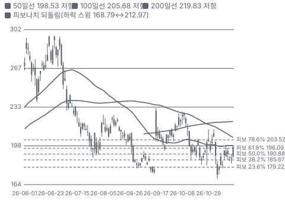

**주봉**

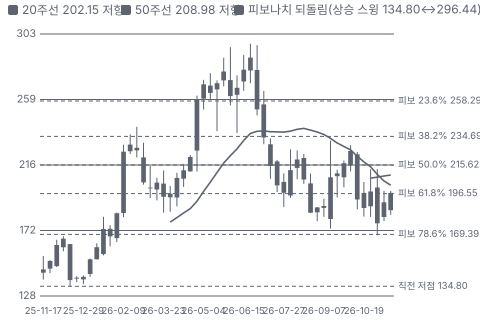

**월봉**

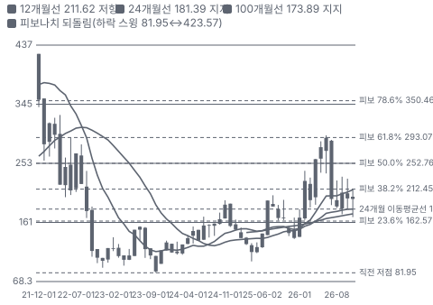

**분기 매출·EPS 실적과 컨센서스**

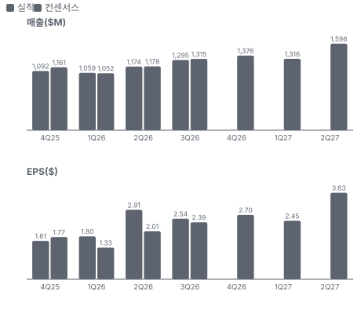

**4Q26 매출 — 지표 추세 vs 가이던스·컨센서스**

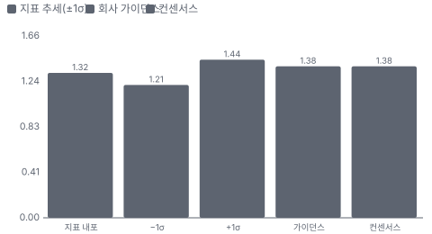

**최근 4개 분기 주가 변화 분석**

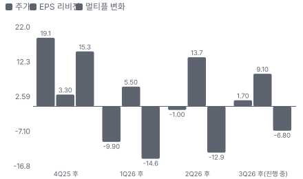

**EPS 리비전**

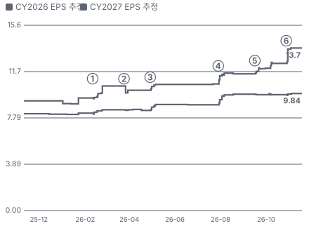

① 26-02-11 4Q25 실적·2026 가이던스 · EPS 리비전 +11%
② 26-03-25 투자자의 날 — 하이퍼스케일러 계약 발표 없음, 세그먼트 개편 · EPS 리비전 -3%
③ 26-04-29 1Q26 실적 · EPS 리비전 +5%
④ 26-07-29 2Q26 실적·첫 하이퍼스케일러 · EPS 리비전 +8%
⑤ 26-09-16 아마존 장기 공급 계약 · EPS 리비전 +4%
⑥ 26-10-28 3Q26 실적·데이터센터 잔고 \$4.5B · EPS 리비전 +10%

**멀티플 프리미엄(Fwd 1Y P/E, 최근 4개 분기말 절대값 — 대상 vs 동종 중앙값)**

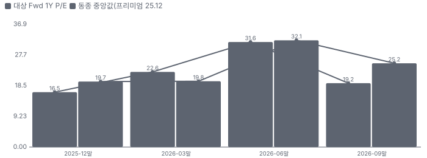

**합리적 멀티플**

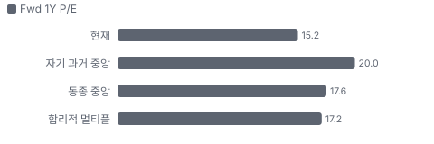

**밸류에이션 주가 시나리오**

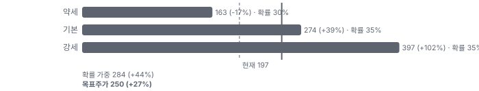

**주가별 업사이드**

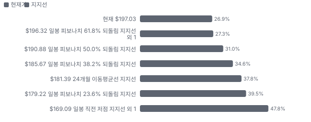
- 제품·서비스 포트폴리오

**고객 믹스(FY2025·3Q26, 매출 대비)**

**공급 병목(10점, 낮을수록 병목)**

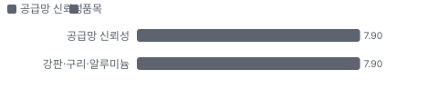

**생산능력 현재와 확충 계획(대형 발전기 연 매출 캐파(\$B))**

**CAPEX의 매출 대비 비중**

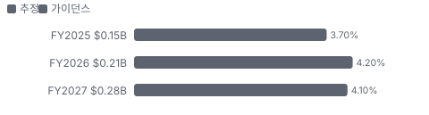

**어닝콜 변화별 주주가치 영향**

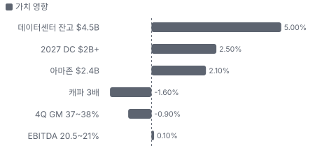

**수주·파이프라인 확실성 사다리**

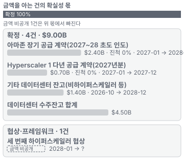

**매출 → 매출총이익 → 영업이익(매출 = 100, 최근 4분기)**

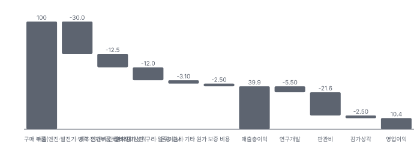

**분기 비용 비중 추이(매출 대비, 공시)**

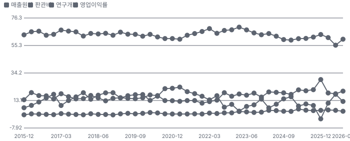

**비용 요인별 매출 대비 비중 1년 변화**

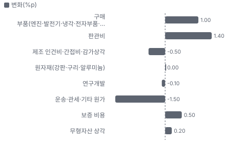

**주거용 BOM 원가 몫**

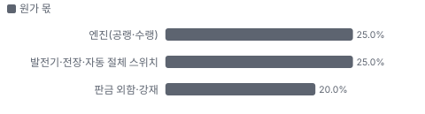

**상업·산업용(C&I) BOM 원가 몫**

**BOM 항목 가격 +10% 시 OPM 변화**

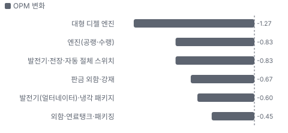

**원가 물가 vs 판매가 물가 — 최근 24개월(24.11 = 100): 판매가가 원가보다 4.6%p 더 올라 마진 여유**

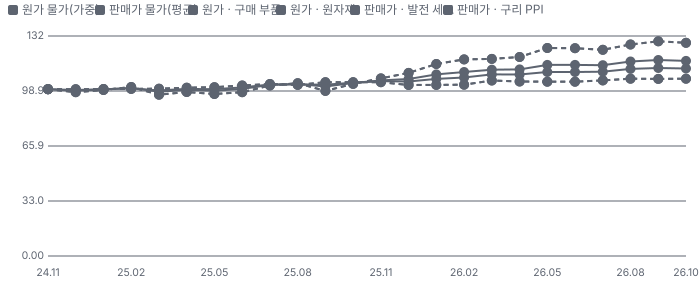

**자산 구성 — 3Q26 분기말 투하자본 \$4,296.1M**

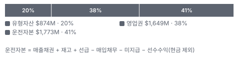

**자산별 변화율 — 최근 12개 분기(4Q23 = 0%) + 다음 4개 분기 추정**

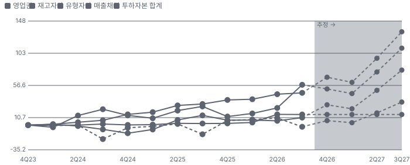

**분기 감가 비율 연율(유형자산 총액 대비)**

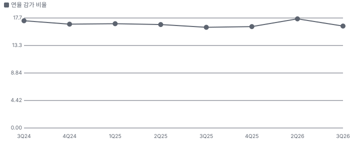

**ROIC 추이 — TTM, 최근 12개 분기 + 다음 4개 분기 추정(컨센서스 NOPAT)**

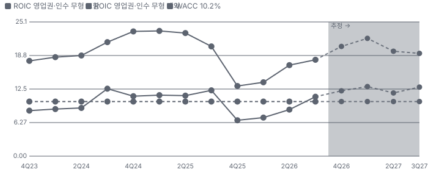

**매출 vs PPI·수출입 — 4Q22 = 100(변화율, 로그 눈금)**

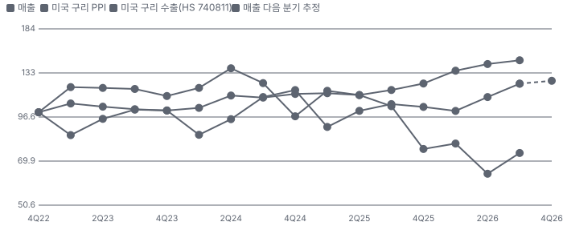

**10년 P·Q 사이클 — 추세(HP 필터) 대비 갭과 8분기 전망**

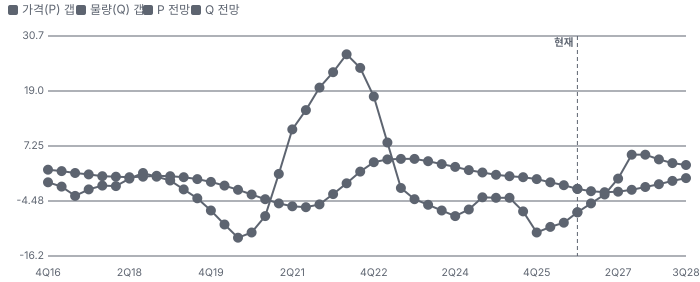

**매출 증가율의 가격·물량 분해와 8분기 전망(전년 대비)**

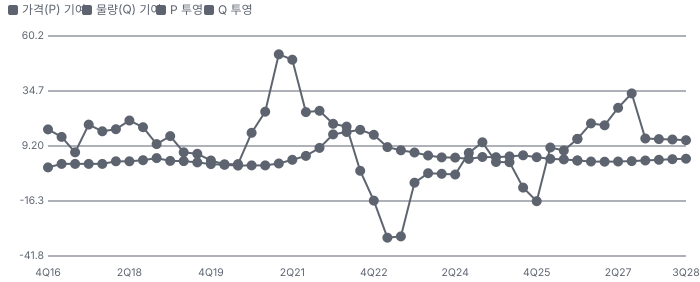

**분기별 매출 증가율 분해**

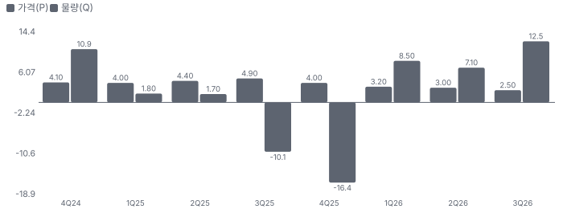

**목표주가 산정 — 약세와 기본 사이(약세 쪽 22%), 도달 확률 약 60%**

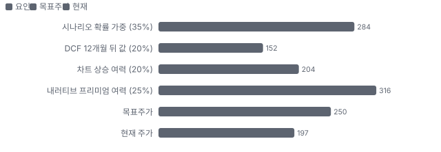

**PEG — 성장 대비 멀티플(낮을수록 성장 대비 쌈)**

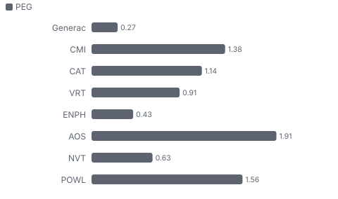

**일봉 지지·저항과 목표주가**

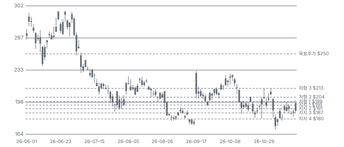

**커뮤니티 언급 수(최근 30일, 채널별)**

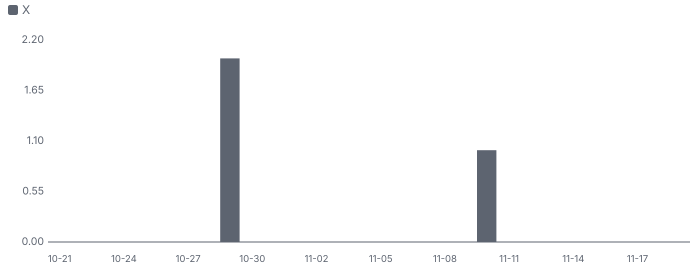

**재고 일수 — 분기별(수주 자료가 없어 수주/출하 비율 없음)**

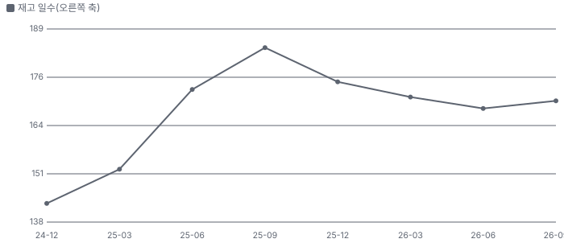

**일별 거래량 분해**

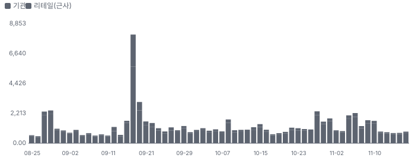

**기관 자금 흐름**

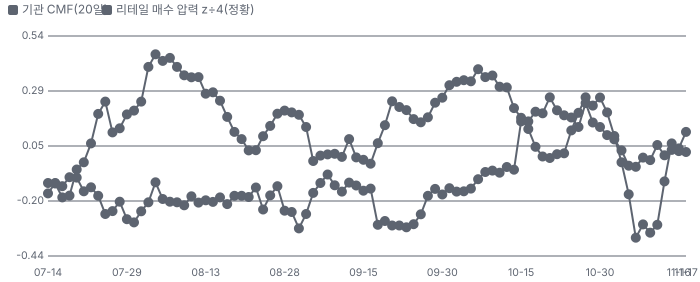

**몬테카를로**

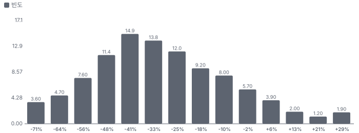

해석: 3,000번 중 301번(10%)에서 가치가 지금 주가 이상이었다. 가정을 흔들어도 지금 주가를 뒷받침하지 못하는 경우가 더 많다. 가운데 값은 0.68배이고, 열 번 중 여덟 번은 0.42~1.00배 사이에 든다.

## 내러티브

> **기업가치를 결정하는 이야기:** Generac의 값은 두 사업의 합이다. 주거용은 정전 수요에 따라 오르내리지만 조정 EBITDA 이익률 27%의 현금 창출원이다. C&I는 데이터센터 대형 발전기로 2027년 매출이 두 배가 되지만 이익률은 12.5%로 절반이다. 2027 EPS 컨센서스가 \$13.66과 \$16.30으로 갈리는 것은 이 믹스와 캐파 램프 속도를 다르게 보기 때문이다.

> **멀티플·EPS 프리미엄**
> **멀티플:** Fwd 1Y P/E 15.2배로 동종 중앙값(Cummins·Vertiv·nVent·Powell 등)보다 낮다. Fwd 2Y P/E는 9.7배로 2027년 이익이 실현되면 싸다.
> **EPS:** FY2026 조정 EPS 컨센서스 \$9.84~9.95, FY2027 \$13.66~16.30(+39~64%), FY2028 \$17.39~20.90. 지난 90일 상향이 우세했다.

### 투자자들은 왜 열광했나

투자자들이 열광한 이유는 가정용 발전기 회사가 AI 데이터센터 전력 병목의 한 조각을 쥐었다는 것이다. 6월 Hyperscaler 1 약 \$700M, 9월 아마존 \$2.4B 계약으로 숫자가 붙었다. 9/17 하루 +18%(장중 +32%)였다. 식은 이유는 세 가지다. 7월 고점 뒤 데이터센터 관련주 전반의 조정, 4Q 이익률 하락 가이던스(37~38%), 그리고 11/4~5 이틀 −18%(공시 없음, 선거 뒤 에너지주 하락 보도와 겹침)다.

### 무엇이 기업가치를 바꾸나

> **구조적 체질 변화**
> **변화:** 주택 경기·정전에 기대던 회사에서 하이퍼스케일러 다년 계약을 가진 데이터센터 전력 장비 회사로 옮겨 간다.
> **증거:** C&I 매출 비중 38.7% → 42.6%(3Q 전년 대비), 2027년 C&I 두 배 경로(콜)
> **반증:** 2027년 데이터센터 매출이 \$1.5B 아래에서 끝난다

> **고부가 믹스 확장**
> **변화:** 해당 없음(데이터센터는 매출을 키우지만 이익률은 주거용보다 낮다 — 믹스는 이익률을 깎는 방향)
> **증거:** C&I 조정 EBITDA 12.5% vs 주거용 27.0%(3Q 보도자료)
> **반증:** C&I 이익률이 15%를 넘는다

> **기술 혁신**
> **변화:** 메가와트급 디젤 발전기와 외함·제어기(Deep Sea) 통합 패키지로 신규 진입
> **증거:** 10-Q: 대형 메가와트 디젤 발전기는 '최근 출시', 시장은 공급 제약
> **반증:** 고객 인증 실패·현장 불량 공시

> **실행 속도**
> **변화:** 대형 발전기 견적 리드타임 45~50주. 산업용 리드타임은 Beaver Dam(위스콘신주 도시, 산업용 발전기 공장) 램프로 2027년 1분기 정상화 예정(회사) **납품 리드타임 45~50개월.** 피어 비교 미확인. 이전 대비 미확인.
> **증거:** 3Q26 어닝콜(2026-10-28)
> **반증:** 리드타임이 1Q27에도 50주를 넘는다

> **M&A**
> **변화:** Enercon(외함·특수 패키지)·Wolter 등 인수로 패키징을 내재화
> **증거:** 인수 합계 \$346.3M(10-Q 주석 1) — 회사는 시너지 숫자를 밝히지 않았다
> **반증:** Belvidere 패키징 공장 가동이 2027년 상반기를 넘긴다

> **정책·입법 연관성**
> **재정정책:** 해당 없음(Generac 매출에 직접 닿는 미국 재정 지출 사업을 찾지 못했다 — 10-Q에 정부 보조금 공시 없음)
> **행정명령:** 외국산 전력망(벌크 전력 시스템) 부품 겨냥 행정 조치 — 엔진·부품 조달에 영향 가능(콜 Canaccord 질문) 3Q26 어닝콜(2026-10-28) 반증: 최종 규칙에 발전기 엔진이 빠진다 의회 동의 2/10 — 하원 1/5(관련 법안·의결 기록 없음) · 상원 1/5(관련 법안·의결 기록 없음).
> **연관입법:** OBBBA(2025)가 주거용 태양광·저장 세액공제를 앞당겨 줄였다 — 에너지 기술 매출 감소 https://www.sec.gov/Archives/edgar/data/1474735/000143774926034665/gnrc20260930_10q.htm 반증: 해당 없음 — 이미 시행

> **고객의 지출 예산**
> **변화:** C&I의 데이터센터 매출은 하이퍼스케일러 CAPEX, 주거용은 가계 내구재 지출이다.
> **사업별 예산:** **매출의 57%**: 주거용 — 고객 해당 없음(가계 내구재·주택 개선 지출) · 동인: 정전 빈도·주택 경기·전기요금
**매출의 43%**: 상업·산업용(C&I) — 고객 CAPEX(하이퍼스케일러·코로케이션 데이터센터 건설, 산업·통신 설비 투자) · 동인: 데이터센터 착공·전력 확보
> **증거:** 10-Q 사업 동인 — 주거 투자 주기와 기업 설비투자 주기
> **반증:** 하이퍼스케일러 2027 CAPEX 가이던스 삭감

### 내러티브 근거

> 가정용 비상 발전기 회사가 데이터센터 대형 백업 발전기 회사로 바뀐다는 이야기다. 데이터센터 잔고가 90일 만에 \$1.6B에서 \$4.5B가 됐고 2027년 데이터센터 매출 '\$2B 크게 상회'를 회사가 말했다. 그런데 주가는 6/22 종가 고점 \$295.54의 67% 수준이다. 동종 대비 멀티플 차이 -14% 중 회사 고유 몫은 -12%다. 단계는 확산, 쏠림은 중간이다.

> **데이터센터 대형 발전기 램프** · 강화
> **논리:** 하이퍼스케일러 두 곳 다년 계약으로 2027년 데이터센터 매출이 \$2B를 크게 넘는다
> **숫자:** 데이터센터 잔고 \$4.5B(절반 이상 2027년), 2026 데이터센터 매출 약 \$500M → 2027 '\$2B 크게 상회'
> **반증:** 4Q26 데이터센터 매출이 연간 \$500M 경로에 못 미친다
> **출처:** https://www.sec.gov/Archives/edgar/data/1474735/000143774926033685/ex_1032565.htm

> **아마존 워런트 동맹** · 유지
> **논리:** 워런트가 아마존을 7년·최대 \$8B 구매로 묶는다
> **숫자:** 워런트 1,693,745주, 행사가 \$200.93 — 현재가 \$197과 거의 같다
> **반증:** 2028년 이후 아마존 추가 발주 공시가 없다
> **출처:** https://www.sec.gov/Archives/edgar/data/1474735/000143774926030550/gnrc20260915_8k.htm

> **주거용 회복** · 유지
> **논리:** 정전 증가·전력 품질 악화로 가정용 대기 발전기 수요가 돌아온다
> **숫자:** 3Q 주거용 +9%, 조정 EBITDA 이익률 27.0%(+3.6%p)
> **반증:** 정전이 적은 해에 주거용이 다시 역성장한다
> **출처:** https://www.sec.gov/Archives/edgar/data/1474735/000143774926033685/ex_1032565.htm

> **반대: 실행 병목** · 강화
> **논리:** 캐파 3배와 외부 엔진 조달이 제때 안 되면 잔고가 2028년으로 밀린다
> **숫자:** 리드타임 45~50주, 캐파 연 \$1.25B → \$3.75~4B(2027년 3분기)
> **반증:** 1Q27 데이터센터 매출이 4Q26 수준을 넘는다
> **출처:** 3Q26 어닝콜(2026-10-28)

> **반대: 믹스가 이익률을 깎는다** · 강화
> **논리:** 데이터센터 비중이 커질수록 회사 이익률은 내려간다
> **숫자:** C&I 조정 EBITDA 12.5% vs 주거용 27.0%, 4Q 매출총이익률 37~38% 가이던스
> **반증:** C&I 이익률이 매출 두 배 구간에서 15%를 넘는다
> **출처:** https://www.sec.gov/Archives/edgar/data/1474735/000143774926033685/ex_1032565.htm

> **반대: 데이터센터 착공 지연** · 유지
> **논리:** 선거 뒤 인허가 강화·자금 조달 심사로 고객 착공이 밀리면 인도도 밀린다
> **숫자:** 북미 계획 물량 중 신뢰 가능 34%(IB 추정), 텍사스·오하이오·조지아 규제 강화 주지사 당선
> **반증:** 2027 인도 일정 변경 없이 1Q27 출하가 이어진다
> **출처:** 노션 IB 요지(라이선스 자료)

### 투자 포인트

> **잔고가 2027년을 덮었다**
> **명제:** 데이터센터 잔고 \$4.5B 중 절반 이상이 2027년 인도분이다
> **숫자:** 3Q 보도자료 잔고 약 \$4.5B, 콜 '절반 이상 2027년', 아마존 2027~28 \$2.4B(8-K)
> **시장과 다른 점:** 시장은 수요보다 실행을 의심한다 — Fwd 2Y P/E 9.7배는 2027 이익이 반쯤만 반영됐다는 뜻이다
> **증명:** 4Q26 데이터센터 매출 연 \$500M 경로 달성, 2027 가이던스
> **출처:** https://www.sec.gov/Archives/edgar/data/1474735/000143774926033685/ex_1032565.htm

> **믹스는 이익률을 깎는다**
> **명제:** 매출이 두 배여도 이익은 그만큼 늘지 않는다
> **숫자:** C&I 조정 EBITDA 12.5% vs 주거용 27.0%, 4Q 매출총이익률 37~38% 가이던스
> **시장과 다른 점:** 컨센서스 2027 EBIT 이익률 15.4%는 C&I 이익률이 오른다는 가정 — 아직 숫자로 없다
> **증명:** 4Q26 C&I 조정 EBITDA 이익률 13% 이상
> **출처:** https://www.sec.gov/Archives/edgar/data/1474735/000143774926033685/ex_1032565.htm

> **캐파가 2027년 상한**
> **명제:** 2027년 매출은 수요가 아니라 캐파 3배 램프 속도가 정한다
> **숫자:** 캐파 연 \$1.25B → \$3.75~4B(2027년 3분기), 리드타임 45~50주, 2027 데이터센터 매출의 3분의 2가 하반기(콜)
> **시장과 다른 점:** 시장은 램프 지연을 걱정하지만 회사는 기존 4개 시설 안에서 늘린다고 했다
> **증명:** Belvidere 2027년 초 가동, 1Q27 데이터센터 매출
> **출처:** 3Q26 어닝콜(2026-10-28)

### 모멘텀 생성·소멸 타임라인

**카탈리스트 달력 — 지난 사건의 주가 반응과 앞으로 확인할 숫자**
| 날짜 | 상태 | 구분 | 사건 | 반응·확인 | 결과에 따라 |
|---|---|---|---|---|---|
| 2026-07-29 | 완료 | 생성 | 2Q26 실적 — Hyperscaler 1 2027 약 \$700M, 데이터센터 잔고 \$1.6B | 하루 −0.2% |  |
| 2026-09-16 | 완료 | 생성 | 아마존 장기 공급 계약·워런트 | 다음 날 +18.3% |  |
| 2026-10-28 | 완료 | 확인 | 3Q26 실적 — 데이터센터 잔고 \$4.5B, EBITDA 이익률 가이던스 하단 상향 | 하루 +3.9% |  |
| 2026-11-04 | 완료 | 소멸 | 선거 다음 날 에너지·데이터센터 관련주 하락(원인 미확인) | 이틀 −17.7% |  |
| 2027-02 중순(예상) | 예정 | 확인 | 4Q26 실적·2027 가이던스 | 4Q 데이터센터 매출(연 \$500M 경로), 2027 C&I 두 배 가이던스, 매출총이익률 37% 이상 | 충족이면 기본~강세, 2027 가이던스가 컨센서스 \$6.8B 아래면 약세 |
| 2027-03(예상) | 예정 | 확인 | Belvidere 패키징 공장 가동 | 가동 공시·1Q27 출하 | 지연이면 2027 하반기 쏠림이 커져 약세 |
| 2027-01~02 | 예정 | 매크로 | 하이퍼스케일러 4Q 실적·2027 CAPEX 가이던스 | 2027 CAPEX 증가율 | 삭감이면 2028 물량 가정이 흔들린다 |

### 언제 사서 언제 팔아야 할까?

**가격·조건 틀 — 가격은 밸류에이션(약세·기본·강세·목표주가)과 차트 지지 구간에서, 조건은 이벤트에서**
| 구간 | 가격 | 목표주가까지 | 약세까지 | 조건·근거 |
|---|---|---|---|---|
| 관찰 구간 | \$196~\$197 | +27% | -17% | 지금 가격 아래 차트 지지 구간은 11/5 저점 근처다 — 실행 확인 전 가격이 내려오는 구간 |
| 확인 뒤 | 지금 \$197 이상에서 조건 확인 | +27% | -17% | 4Q26 실적에서 데이터센터 매출이 연 \$500M 경로를 맞추고 2027 가이던스가 C&I 두 배를 확인한다 |
| 무효화 | 약세 시나리오 \$163 | - | -17% | 2027 가이던스 매출이 \$6.4B(컨센서스 하단) 아래이거나 Hyperscaler 1·아마존 인도 일정이 늦춰진다 |
| 차익 고민 1차 | \$274(목표주가·기본 시나리오) | +39% | - | 기본~강세 시나리오 — 2027 EPS가 \$16 쪽으로 확인될 때 |
| 차익 고민 2차 | \$397(강세 시나리오) | +102% | - | 기본~강세 시나리오 — 2027 EPS가 \$16 쪽으로 확인될 때 |

실적 발표일 전후 하루 ±10% 안팎 움직임이 잦다(9/17 +18%, 11/4 −9.5%) — 추격 경계 가격·조건 틀이며 매매·비중 지시가 아니다(투자 권유 아님).

## 포트폴리오

| 제품·서비스 | 구분 | 무엇 | 쓰는 곳 | 돈 버는 방식 | Mix | Mix 변화(전년 대비) |
|---|---|---|---|---|---|---|
| 주거용 | 제품 | 가정용 자동 대기 발전기·휴대용 발전기·ESS(에너지 저장 장치) | 정전 대비 가정 백업 전력 | 3Q \$744M(+9%), 조정 EBITDA 27.0% | 미확인 | 미확인 |
| 상업·산업용(C&I) | 제품 | 데이터센터 메가와트급 디젤 발전기, 산업용 대기 발전기, 이동식 장비 | 데이터센터·통신·산업 백업 전력 | 3Q \$553M(+28%), 조정 EBITDA 12.5% | 미확인 | 미확인 |

## 고객

> **FY2025·3Q26 최대 고객 주거용 딜러·소매·도매 채널 57%, 상위 3곳 99%, 집중도 집중.** 공시·회사 발표로 확인한 몫은 매출의 66%이고, 나머지 고객 몫은 추정이거나 미분해다. 2025년 단일 고객 4% 넘는 곳이 없고 상위 10곳이 18%다(10-K). 데이터센터 잔고가 커지면서 아마존과 이름을 밝히지 않은 Hyperscaler 1이 2027년 매출의 큰 몫이 된다 — 집중도가 올라간다.

**고객별 매출 몫(FY2025·3Q26)**
| 고객 | 몫 | 변화 | 근거 |
|---|---|---|---|
| 주거용 딜러·소매·도매 채널 | 57% | -4%p | 공시 |
| 산업 유통·렌털·통신 채널(C&I 비데이터센터) | 32~34% | -5%p | 추정 |
| 데이터센터 고객(아마존·Hyperscaler 1·기타) | 8~10% | 미확인 | 회사 발표 |
| 아마존(아마존 데이터센터) | 미확인 | 미확인 | 공시 |
| Hyperscaler 1(이름 미공개, Hyperscaler 1) | 미확인 | 미확인 | 회사 발표 |

> **주거용 딜러·소매·도매 채널** · 공시
> **사는 것:** 가정용 대기·휴대용 발전기, ESS
> **추정 근거:** 3Q 세그먼트 매출 비중

> **산업 유통·렌털·통신 채널(C&I 비데이터센터)** · 추정
> **사는 것:** 산업용 대기 발전기·이동식 장비
> **추정 근거:** C&I 42.6%에서 데이터센터 몫을 뺐다

> **데이터센터 고객(아마존·Hyperscaler 1·기타)** · 회사 발표
> **사는 것:** 메가와트급 디젤 대기 발전기
> **추정 근거:** 3Q 데이터센터 매출 \$100M 이상(콜) ÷ 매출 \$1,294.8M. 2027년에는 \$2B 이상(회사) — 컨센서스 매출 기준 약 30% · 1년 전 몫은 데이터센터 매출 미공시라 미확인(신규 고객)

> **아마존(아마존 데이터센터)** · 공시
> **사는 것:** 백업 발전기 — 2027~28 초도 인도 \$2.4B
> **추정 근거:** 2027년 매출 몫은 인도 일정 미공시라 미확인 · 1년 전 몫은 데이터센터 매출 미공시라 미확인(신규 고객)

> **Hyperscaler 1(이름 미공개, Hyperscaler 1)** · 회사 발표
> **사는 것:** 2027년 인도 약 \$700M
> **추정 근거:** 회사가 이름을 밝히지 않았다 — 특정 회사로 옮기지 않는다 · 1년 전 몫은 데이터센터 매출 미공시라 미확인(신규 고객)

## 수주·파이프라인

> **2026-10-28 기준 5건.** 확정 \$9.00B. 공시 데이터센터 수주잔고 \$4.50B.

**수주 목록**
| 상태 | 계약 | 계약 총액 | 진척 | 기간 | 비고 |
|---|---|---|---|---|---|
| 확정 | 아마존 장기 공급 계약(2027~28 초도 인도) | \$2.40B | 0% | 2027-01 → 2028-12 | (잔고 \$4.5B에 포함) |
| 확정 | Hyperscaler 1 다년 공급 계약(2027년분) | \$0.70B | 0% | 2027-01 → 2027-12 | (잔고 \$4.5B에 포함) |
| 확정 | 기타 데이터센터 잔고(비하이퍼스케일러 등) | \$1.40B | 비공개 | 2026-10 → 2028-12 | 잔고 \$4.5B − 아마존 \$2.4B − Hyperscaler 1 \$0.7B(계산, 일부 2026년 4Q 인도분 포함) |
| 확정 | 데이터센터 수주잔고 합계 | \$4.50B | 비공개 | - | - |
| 협상 | 세 번째 하이퍼스케일러 협상 | 금액 비공개 | 비공개 | 2028-01 → ? | - |

**실행 속도와 방해 요인**
| 항목 | 상태 | 실행 속도 | 방해 요인 |
|---|---|---|---|
| 아마존 장기 공급 계약(2027~28 초도 인도) | 확정 | 미확인 | 대형 엔진 조달 · Sussex(위스콘신주 도시, 대형 발전기 신공장) 램프 · 워런트 공정가치 \$112.5M이 매출 차감 |
| Hyperscaler 1 다년 공급 계약(2027년분) | 확정 | 미확인 | 2028년 물량은 2027년 실행 확인 뒤(회사) |
| 기타 데이터센터 잔고(비하이퍼스케일러 등) | 확정 | 미확인 | 리드타임 45~50주 |
| 데이터센터 수주잔고 합계 | 확정 | 미확인 | 캐파 3배 램프 · 대형 엔진 조달 |
| 세 번째 하이퍼스케일러 협상 | 협상 | 미확인 | 1분기 안 타결 어렵다(회사) · 2028년 이전 영향 없음 |

## 마진 구조

> **GPM 39.9%, OPM 10.4%.** TTM 3Q25 대비 GPM +0.5%p, OPM -1.0%p. 변동비는 매출의 62%이고, 매출이 10% 늘면 OPM은 +2.5%p 움직인다. TTM 매출총이익률 39.9%(1년 전 39.5%), 영업이익률 10.4%(11.4%). 3Q 매출총이익률은 가격·원가와 관세 감소로 39.9%였지만, 회사는 4Q에 데이터센터 믹스로 37~38%를 말했다. 4Q25 판관비 \$319M(보증·법률 비용 포함)이 TTM 영업이익률을 누른다.

> **매출 100 중 매출원가 60.1, 매출총이익 39.9(최근 4분기, 공시).** 매출원가 요인 중 구매 부품(엔진·발전기·냉각·전자부품·배터리)이 매출의 30.0%로 가장 무겁고, 단가가 +10% 오르면 GPM이 -3.00%p 움직인다. 분기 회귀로 매출 1이 늘 때 매출원가는 0.62 늘고, 매출원가의 고정비 몫은 2%다.

**비용 요인 강도 — 비중·추세·충격(+10%)·탄력**
| 비용 | 구분 | 매출 대비 | 1년 변화 | 마진 기여 | 충격 시 마진 | 매출 탄력 | 고정비 몫 |
|---|---|---|---|---|---|---|---|
| 구매 부품(엔진·발전기·냉각·전자부품·배터리) | 매출원가 요인 | 30.0% | +1.0%p | -1.0%p | -3.00%p | 미확인 | 0% |
| 제조 인건비·간접비·감가상각 | 매출원가 요인 | 12.5% | -0.5%p | +0.5%p | -1.25%p | 미확인 | 60% |
| 원자재(강판·구리·알루미늄) | 매출원가 요인 | 12.0% | +0.0%p | -0.0%p | -1.20%p | 미확인 | 0% |
| 운송·관세·기타 원가 | 매출원가 요인 | 3.1% | -1.5%p | +1.5%p | -0.31%p | 미확인 | 0% |
| 보증 비용 | 매출원가 요인 | 2.5% | +0.5%p | -0.5%p | -0.25%p | 미확인 | 0% |
| 매출원가 | 공시 항목 | 60.1% | -0.5%p | +0.5%p | -6.01%p | 0.62 | 2% |
| 판관비 | 공시 항목 | 21.6% | +1.4%p | -1.4%p | 미확인 | 0.19 | -14% |
| 연구개발 | 공시 항목 | 5.5% | -0.1%p | +0.1%p | 미확인 | 0.06 | -42% |
| 감가상각 | 공시 항목 | 2.5% | +0.2%p | -0.2%p | 미확인 | 0.03 | -32% |

매출 탄력 = 분기 비용을 매출에 회귀한 기울기(매출 1당 변동비), 고정비 몫 = 절편 ÷ 평균 비용. 표본이 8분기 미만이면 미확인. 매출원가 요인 비중은 margin 재료의 추정이 섞여 있고, 공시 매출원가와의 차이는 '기타 매출원가'로 둔다.

**GPM에서 OPM까지(GAAP, 아래는 최근 4개 분기)**
| 기간 | GPM | 연구개발 | 판관비 | 기타 | OPM |
|---|---|---|---|---|---|
| TTM 3Q25 | 39.5% | 5.6% | 20.2% | 2.3% | 11.4% |
| TTM 3Q26 | 39.9% | 5.5% | 21.6% | 2.5% | 10.4% |
| 2025-12 | 36.3% | - | - | - | -0.9% |
| 2026-03 | 38.7% | - | - | - | 11.1% |
| 2026-06 | 44.5% | - | - | - | 17.9% |
| 2026-09 | 39.9% | - | - | - | 12.4% |

**비용을 움직이는 요인**
| 비용 | 요인 |
|---|---|
| 구매 부품(엔진·발전기·냉각·전자부품·배터리, 매출원가) | 대형 C&I 디젤 엔진·냉각·발전기는 외부 조달(10-K), 데이터센터 믹스가 오르면 몫이 커진다 · 근거 추정 |
| 판관비(판관비) | C&I 성장 투자·마케팅·성과급, 4Q25 법률·보증 관련 비용 · 근거 공시 |
| 제조 인건비·간접비·감가상각(매출원가) | Sussex·Beaver Dam 램프 — 가동 초기 고정비 · 근거 추정 |
| 원자재(강판·구리·알루미늄, 매출원가) | 주 원자재는 강·구리·알루미늄(10-K) — 데이터센터 수요로 변동성 확대(10-Q) · 근거 추정 |
| 연구개발(연구개발) | 대형 발전기·제어기·에너지 기술 · 근거 공시 |
| 운송·관세·기타 원가(매출원가) | IEEPA(국제비상경제권한법) 관세 환급 9개월 \$80.6M이 매출원가를 낮췄다(10-Q) · 근거 추정 |
| 보증 비용(매출원가) | 보증 충당 9개월 \$62.1M + 추정 변경 \$24.0M(청정에너지 \$14.3M 포함, 10-Q 주석 10) · 근거 공시 |
| 무형자산 상각(기타) | Enercon·Wolter 인수 · 근거 공시 |

**주거용 BOM — 매출의 57%, GPM 42%(추정 — 세그먼트 매출총이익 미공시. 3Q 조정 EBITDA 이익률 27.0%에 판관비 몫을 더했다), 항목 가격 +10% 시**
| 항목 | 원가 몫 | 전가 | 제품 GPM | OPM |
|---|---|---|---|---|
| 엔진(공랭·수랭) | 20~30% | 미확인 | -1.5%p | -0.83%p |
| 발전기·전장·자동 절체 스위치 | 20~30% | 미확인 | -1.5%p | -0.83%p |
| 판금 외함·강재 | 15~25% | 미확인 | -1.2%p | -0.67%p |
| 미분해 | 30% | - | - | - |

**상업·산업용(C&I) BOM — 매출의 43%, GPM 30%(추정 — 세그먼트 매출총이익 미공시. 3Q C&I 조정 EBITDA 이익률 12.5%, 회사는 데이터센터 믹스가 회사 매출총이익률을 낮춘다고 했다), 항목 가격 +10% 시**
| 항목 | 원가 몫 | 전가 | 제품 GPM | OPM |
|---|---|---|---|---|
| 대형 디젤 엔진 | 35~50% | 미확인 | -3.0%p | -1.27%p |
| 발전기(얼터네이터)·냉각 패키지 | 15~25% | 미확인 | -1.4%p | -0.60%p |
| 외함·연료탱크·패키징 | 10~20% | 미확인 | -1.1%p | -0.45%p |
| 미분해 | 22% | - | - | - |

대형 디젤 엔진 가격이 +10% 오르면 영업이익은 -12.2% 움직인다. 판매가 전가를 모르는 항목은 전가 0%로 계산했다.

**BOM 항목 가격을 움직이는 것**
| 항목 | 요인 |
|---|---|
| 엔진(공랭·수랭) | 가정용은 자체 엔진 조립 비중이 높다(10-K 수직 계열화) · 근거 추정 |
| 발전기·전장·자동 절체 스위치 | 구리·전자부품 가격 · 근거 추정 |
| 판금 외함·강재 | 강판 가격 · 근거 추정 |
| 대형 디젤 엔진 | 대형 C&I 엔진은 외부 조달(10-K) — 공급사 이름 미공시 · 근거 추정 |
| 발전기(얼터네이터)·냉각 패키지 | 외부 조달 병행(10-K) · 근거 추정 |
| 외함·연료탱크·패키징 | 외함 내재화로 몫을 회사가 가져온다 · 근거 추정 |

> **원가·판매가 물가 격차 +4.7%p** — 판매가 물가가 투입 원가 물가보다 빠르게 오른다.

**투입 물가 — 미국 PPI 3·6·12개월(2026-10, 개정 반영)과 해외 전년비**
| 항목 | 미국 3개월 | 6개월 | 12개월 | 전가 못 할 때 OPM | 일본 | 한국 | 대만 |
|---|---|---|---|---|---|---|---|
| 발전기(얼터네이터)·냉각 패키지 | +3.4% | +7.2% | +23.9% | - | +42.6% | +25.8% | +40.1% |
| 외함·연료탱크·패키징 | +6.7% | +17.0% | +32.9%* | - | 미확인 | 미확인 | 미확인 |
| 대형 디젤 엔진 | +0.9% | +1.6% | +2.0%* | - | 미확인 | 미확인 | 미확인 |

별표는 품목보다 넓은 업종 지수다. 연결한 투입 원가의 미국 PPI(생산자물가지수)는 1년 새 가중 +8.3%이고, 판매가로 넘기지 못하면 GPM -3.5%p·OPM -3.5%p가 움직인다. 판매가 비교 물가(발전 세트(불꽃 점화 엔진, 가스 왕복동) PPI)는 1년 새 +2.0% — 회사 가격 변화는 미확인. 물가 지수를 붙이지 못한 매출원가 항목은 제조 인건비·간접비·감가상각, 보증 비용, 운송·관세·기타 원가다(미연결).

## 자산 구성

> **3Q26 분기말 투하자본 \$4,296.1M** — 운전자본 41%, 영업권 38%. 최근 12개 분기(4Q23 → 3Q26) 가장 크게 늘어난 자산은 매출채권(+57%), 투하자본 합계 -2%. 3Q27 추정 투하자본 \$5,854.2M(+36%, 컨센서스 매출과 회전 일수·CAPEX 강도 유지 가정). 연율 감가 비율(총액 기준)은 직전 4분기 16.83% → 최근 4분기 16.62%, 직전 비율이면 감가상각이 \$2.7M 더 컸다(영업이익의 0.6%).

**자산·운전자본 항목별 분기말 잔액 — 최근 12개 분기와 다음 4개 분기 추정**
| 항목 | 4Q23 | 3Q25 | 3Q26(최근) | 3Q27 추정 | 12개 분기 변화 | 다음 4개 분기 변화 |
|---|---|---|---|---|---|---|
| 매출채권 | \$537.3M | \$680.1M | \$846.0M | \$1,127.5M | +57% | +33% |
| 재고자산 | \$1,167.5M | \$1,329.7M | \$1,292.7M | \$2,084.4M | +11% | +61% |
| 선급·기타 유동자산 | \$91.9M | \$192.3M | \$263.7M | \$457.4M | +187% | +73% |
| 매입채무 | \$340.7M | \$620.7M | \$629.4M | \$859.0M | +85% | +36% |
| 유형자산 | \$598.6M | \$778.6M | \$874.2M | \$1,395.1M | +46% | +60% |
| 영업권 | \$1,432.4M | \$1,465.1M | \$1,649.0M | \$1,649.0M | +15% | +0% |

**자산 추정 동인 — 최근 4개 분기 평균(재무상태표 동인 모형)**
| 동인 | 값 | 곱하는 기준 |
|---|---|---|
| 매출채권 | 54일 | 매출 |
| 재고자산 | 166일 | 매출원가 |
| 선급·기타 유동자산 | 22일 | 매출 |
| 매입채무 | 68일 | 매출원가 |
| 유형자산 ÷ 분기 매출 | 0.73배 | CAPEX·감가 재료 없음 — 비율 유지 |
| 매출원가율 | 60.1% | 매출(최근 4개 분기) |
| 영업권·리스 사용권·기타 | 유지 | 인수·새 리스는 공시 전 모름 |
| 인수 무형자산 | 분기 \$28.8M 상각 | 최근 4개 분기 평균 상각 |

**추정 방법:** 증권사 3표 모델(손익·재무상태표·현금흐름)의 재무상태표 동인 방식이다. 운전자본은 항목별 회전 일수(매출채권·선급·미지급·선수는 매출, 재고·매입채무는 매출원가 기준)를 최근 4개 분기 평균으로 두고 컨센서스 매출에 곱한다. 유형자산은 기초 + CAPEX − 감가상각으로 굴린다(Koller·Goedhart·Wessels 『Valuation』 재무상태표 추정). 매출 경로는 ROIC 절의 컨센서스와 같다.

**유형·무형자산 항목별 가치(2025-12-31 vs 2024-12-31)**
| 구분 | 항목 | 총액 2025-12-31 | 누적상각 | 순액 | 총액 2024-12-31 | 총액 1년 변화 | 공시 내용연수 |
|---|---|---|---|---|---|---|---|
| 유형 | 유형자산 합계(항목 미분해) | \$1,283.5M | 총계만 공시 | 총계만 공시 | \$1,080.7M | +18.8% | 미확인 |
| 영업권 | 영업권 | \$1,467.1M | \$0.0M | \$1,467.1M | \$1,436.3M | +2.1% | 비상각 |
| 무형 | 무형자산 합계(항목 미분해) | \$1,648.5M | \$973.2M | \$675.3M | \$1,630.2M | +1.1% | 미확인 |
| 유형 합계 | 유형자산 | \$1,283.5M | \$469.9M | \$813.6M | \$1,080.7M | +18.8% | 경과율 37%(상각 대상 기준) |

**내용연수 산식(상각 대상 유형자산 = 총액 − 토지 − 건설중)**
| 기준일 | 연 감가상각 | 상각 대상 총액 | 평균 내용연수 | 경과 연수 | 잔여 연수 | 경과율 |
|---|---|---|---|---|---|---|
| 2025-12-31 | \$93.3M | \$1,283.5M | 13.8년 | 5.0년 | 8.7년 | 37% |
| 2024-12-31 | \$74.0M | \$1,080.7M | 14.6년 | 5.3년 | 9.3년 | 36% |

산식 평균 내용연수는 13.8년. 1년 전 14.6년 → 지금 13.8년.

**분기 감가 비율(감가상각 ÷ 평균 유형자산 총액)**
| 분기 | 감가상각 | 평균 유형자산(총액) | 분기 비율 | 연율 | 연율의 역수 |
|---|---|---|---|---|---|
| 3Q24 | \$43.2M | \$1,001.1M | 4.31% | 17.24% | 5.8년 |
| 4Q24 | \$43.8M | \$1,049.7M | 4.18% | 16.70% | 6.0년 |
| 1Q25 | \$46.1M | \$1,100.2M | 4.19% | 16.77% | 6.0년 |
| 2Q25 | \$48.3M | \$1,162.0M | 4.16% | 16.63% | 6.0년 |
| 3Q25 | \$49.2M | \$1,215.6M | 4.05% | 16.19% | 6.2년 |
| 4Q25 | \$51.2M | \$1,255.2M | 4.08% | 16.30% | 6.1년 |
| 2Q26 | \$58.4M | \$1,331.4M | 4.39% | 17.55% | 5.7년 |
| 3Q26 | \$57.3M | \$1,398.2M | 4.10% | 16.39% | 6.1년 |

감가상각 기준: 손익계산서 감가상각·상각비(SEC 공시 데이터, 4분기 = 연간 − 1~3분기).

최근 4분기 연율 감가 비율 16.62%, 직전 4분기 16.83%(-1%) — 경고 문턱(-10%) 안이다.

미공시·미분해: 리스 사용권자산 · 무형자산 · 기타 영업자산·부채 · 유형자산 항목별 총액·내용연수(10-K 주석에서 모델이 채움) · 무형자산 항목(10-K 주석에서 모델이 채움) — 이 칸은 비우고 나머지로 계산했다.

### 해석 — 자산이 어디에 쌓이고 있나

- 같은 기간 4개 분기 매출은 +12% — 매출보다 빨리 늘어난 자산: 매출채권 +57%, 유형자산 +46%. 이 자산의 회전율이 떨어지면 ROIC를 희석한다.

## ROIC

> **TTM 3Q26 ROIC는 영업권·인수 무형 포함 11.1%, 제외 18.0%**(NOPAT 마진 9.8% × 투하자본 회전율 1.14회). 최근 12개 분기 4Q23 8.5% → 3Q26 11.1%(고점 3Q24 12.6%). 컨센서스 NOPAT으로 굴리면 3Q27 12.9%(제외 19.2%) — WACC 10.2% 대비 +2.7%p. 1년 변화의 가장 큰 요인은 NOPAT 마진(-1.0%p).

**ROIC 추이(TTM)와 다음 4개 분기 추정 — NOPAT ÷ 평균 투하자본(이번 분기말·4개 분기 전)**
| 분기 | 구분 | TTM 매출 | TTM NOPAT | NOPAT 마진 | 평균 투하자본 | ROIC 포함 | ROIC 제외 |
|---|---|---|---|---|---|---|---|
| 4Q23 | 실적 | \$4,022.7M | \$372.7M | 9.3% | \$4,408.0M | 8.5% | 17.8% |
| 1Q24 | 실적 | \$4,024.0M | \$388.9M | 9.7% | \$4,426.9M | 8.8% | 18.5% |
| 2Q24 | 실적 | \$4,021.8M | \$400.8M | 10.0% | \$4,452.4M | 9.0% | 18.8% |
| 3Q24 | 실적 | \$4,124.7M | \$447.4M | 10.8% | \$3,539.2M | 12.6% | 21.3% |
| 4Q24 | 실적 | \$4,295.8M | \$485.3M | 11.3% | \$4,324.1M | 11.2% | 23.3% |
| 1Q25 | 실적 | \$4,348.7M | \$495.5M | 11.4% | \$4,357.2M | 11.4% | 23.4% |
| 2Q25 | 실적 | \$4,411.7M | \$502.7M | 11.4% | \$4,445.6M | 11.3% | 23.0% |
| 3Q25 | 실적 | \$4,352.4M | \$453.5M | 10.4% | \$3,681.3M | 12.3% | 20.5% |
| 4Q25 | 실적 | \$4,209.1M | \$299.5M | 7.1% | \$4,468.0M | 6.7% | 13.1% |
| 1Q26 | 실적 | \$4,326.4M | \$326.2M | 7.5% | \$4,546.4M | 7.2% | 13.8% |
| 2Q26 | 실적 | \$4,438.7M | \$405.1M | 9.1% | \$4,670.2M | 8.7% | 17.0% |
| 3Q26 | 실적 | \$4,619.2M | \$451.6M | 9.8% | \$4,065.2M | 11.1% | 18.0% |
| 4Q26 | 추정 | \$4,903.7M | \$573.9M | 11.7% | \$4,693.7M | 12.2% | 20.5% |
| 1Q27 | 추정 | \$5,160.3M | \$604.2M | 11.7% | \$4,658.4M | 13.0% | 22.0% |
| 2Q27 | 추정 | \$5,582.8M | \$593.9M | 10.6% | \$5,017.3M | 11.8% | 19.6% |
| 3Q27 | 추정 | \$6,193.0M | \$656.5M | 10.6% | \$5,079.8M | 12.9% | 19.2% |

**다음 4개 분기 NOPAT — 컨센서스(세율 24%, 리스 이자 별도)**
| 분기 | 매출 | EBITA 마진 | EBITA | NOPAT(분기) | 근거 |
|---|---|---|---|---|---|
| 4Q26 | \$1,376.0M | 12.9% | \$177.0M | \$134.5M | 컨센서스 매출 × EBIT 마진 FY2026(조정 − 주식보상 1.1%) |
| 1Q27 | \$1,316.0M | 14.3% | \$187.7M | \$142.6M | 컨센서스 매출 × EBIT 마진 FY2027(조정 − 주식보상 1.1%) |
| 2Q27 | \$1,596.0M | 14.3% | \$227.6M | \$173.0M | 컨센서스 매출 × EBIT 마진 FY2027(조정 − 주식보상 1.1%) |
| 3Q27 | \$1,905.0M | 14.3% | \$271.7M | \$206.5M | 컨센서스 매출 × EBIT 마진 FY2027(조정 − 주식보상 1.1%) |

**추정 방법:** NOPAT은 컨센서스(분기 매출 추정 × 회계연도 EBIT 마진 추정)로 잡고, 조정(비 GAAP) 마진이면 주식보상 몫을 빼서 과거 실적과 같은 기준(영업이익 + 인수 무형 상각)으로 맞췄다. 이미 발표했지만 분기 보고서(10-Q)가 아직 없는 분기는 발표 실적을 쓴다. 투하자본은 자산 구성 절의 재무상태표 동인으로 굴렸다. ROIC는 4개 분기 NOPAT을 이번 분기말과 4개 분기 전 투하자본의 평균으로 나눈다 — 추정 분기의 ROIC에는 이미 나온 실적 분기가 섞여 있다.

**투하자본 항목별 회전율과 ROIC 기여(TTM 3Q26, 평균 잔액)**
| 항목 | 투하자본 | 매출 1달러당 자본 | 회전율(매출 ÷ 항목) | 자본 몫 | 이 항목을 빼면 ROIC |
|---|---|---|---|---|---|
| 운전자본 | \$1,677.2M | 0.36 | 2.75회 | 41% | 18.5% |
| 유형자산 | \$826.4M | 0.18 | 5.59회 | 20% | 13.6% |
| 영업권 | \$1,561.6M | 0.34 | 2.96회 | 38% | 17.6% |

**ROIC 세 가지 판**
| 판 | NOPAT | 투하자본 | ROIC | 무엇을 재나 |
|---|---|---|---|---|
| 영업권·인수 무형 포함 | \$441.2M | \$4,065.2M | 10.9% | 인수 웃돈까지 낸 돈에 대한 수익률 |
| 영업권·인수 무형 제외 | \$441.2M | \$2,503.6M | 17.6% | 본업 운영 수익률(동종 비교용) |
| 무형 자본화 조정(판관비 20%·5년, 연구개발 6년) | \$550.4M | \$4,735.3M | 11.6% | 비용으로 처리한 무형 투자를 자산으로 본 판 |
| 경제적 이익(포함판) | \$24.9M | \$4,065.2M | 자본비용 10.2% | (ROIC − 자본비용) × 투하자본 |

NOPAT = (영업이익 \$479.0M + 인수 무형 상각) × (1 − 세율 24%). 리스 사용권자산을 투하자본에 넣었으므로 임차료 속 이자 몫을 영업이익에 되더했다. 현금은 영업에 필요한 몫을 따로 알 수 없어 투하자본에서 뺐다. SEC 공시 데이터 자동 초안 — 운전자본 = 매출채권 + 재고 + 선급 − (매입채무 + 미지급비용 + 선수수익), 현금 제외. 손상 누계는 공시 데이터 수록분.

**ROIC 1년 변화 분해(포함판, TTM 3Q25 → TTM 3Q26)**
| 요인 | ROIC 기여 |
|---|---|
| NOPAT 마진 | -0.96%p |
| 운전자본 | -0.22%p |
| 유형자산 | -0.21%p |
| 영업권 | -0.02%p |
| 합계 | -1.42%p |

**무형 자본화 가정별 ROIC(2025년 지출 기준, 포함판에 더함)**
| 투자로 보는 몫 | 상각 연수 | 무형 자산 | NOPAT 조정 | 조정 ROIC |
|---|---|---|---|---|
| 판관비 20% | 2년 | \$670.1M | \$109.2M | 11.6% |
| 판관비 20% | 5년 | \$670.1M | \$109.2M | 11.6% |
| 판관비 30% | 2년 | \$670.1M | \$109.2M | 11.6% |
| 판관비 30% | 5년 | \$670.1M | \$109.2M | 11.6% |

### 해석 — 무엇이 수익성을 끌어올리고 희석하나

- 운전자본: 투하자본의 41% — 빼면 ROIC 10.9% → 18.5%. 이 자산의 회전율(2.75회)이 수익성을 희석하는 주된 자리다.
- 영업권: 투하자본의 38% — 빼면 ROIC 10.9% → 17.6%. 이 자산의 회전율(2.96회)이 수익성을 희석하는 주된 자리다.
- 영업권·인수 무형을 빼면 ROIC가 +6.8%p 오른다 — 과거 인수에 치른 웃돈이 주주 수익률을 그만큼 낮춘다(본업 수익률은 제외판, 인수까지 포함한 가치 창출은 포함판으로 본다).
- 비용으로 처리한 무형 투자를 자산으로 보면 ROIC가 +0.8%p 움직인다(무형 자산 \$670.1M). 투자를 늘리는 중이라 NOPAT이 더 커지는 쪽이다.
- 추정 경로 3Q26 11.1% → 3Q27 12.9%: NOPAT 마진 +0.8%p, 투하자본 회전율 +0.08회 — 컨센서스 매출·마진이 맞고 회전 일수·CAPEX 강도가 유지된다는 가정이다. 마진 추정이 내려가거나 재고 일수가 늘면 이 경로가 먼저 틀린다.
- ROIC(포함) − WACC = +0.9%p(3Q26) — 양수면 투하자본을 늘릴수록 가치가 쌓인다.

## 공급망 병목

> **공급망 신뢰성 7.9/10, 관리 가능.** 가장 약한 고리는 강판·구리·알루미늄 7.9점이고, 품목 평균은 7.9점이다. 근거가 부족한 4건(대형 디젤 엔진 · 대형 발전기 조립·시험 캐파(자기) · 발전기(얼터네이터)·냉각 패키지 · 배터리 셀·전자부품(ESS·제어))은 점수에서 뺐다. 병목은 대형 디젤 엔진과 자기 생산 캐파다. 대형 C&I 엔진·냉각·발전기는 외부 조달이고 공급사 이름은 공시되지 않는다. 하이퍼스케일러가 공급망 이중화·캐파를 실사했다(회사).

**병목과 마진 — 품목 가격 +10% 시 OPM**
| 품목 | 점수 | 판정 | 구분 | OPM |
|---|---|---|---|---|
| 강판·구리·알루미늄 | 7.9 | 관리 가능 | 일반 | 미확인 |

> **강판·구리·알루미늄** · 7.9/10
> **왜:** 가격 위험이지 물량 병목은 아니다
> **병목 요인:** 인증 공급사 4곳 · 캐파 균형 · 리드타임 미확인 · 재인증 3개월 · 1위 점유율 미확인 · 지역 집중 미확인 · 물량 확보 현물
> **풀리는 조건:** 해당 없음

**공급사**
| 품목 | 공급사 | 몫 | 근거 |
|---|---|---|---|
| 대형 디젤 엔진 | 미공개(메가와트급 발전기용 디젤 엔진) | 미확인 | 공시 |
| 대형 발전기 조립·시험 캐파(자기) | Generac(Oshkosh(위스콘신주 도시, 산업용 발전기 공장)·Sussex·Beaver Dam·Belvidere)(자가 생산·패키징) | 미확인 | 회사 발표 |
| 발전기(얼터네이터)·냉각 패키지 | 미공개(다수, 대형 C&I용) | 미확인 | 공시 |
| 강판·구리·알루미늄 | 미공개(다수, 원자재) | 미확인 | 공시 |
| 배터리 셀·전자부품(ESS·제어) | 미공개(위탁 생산사 소수, 에너지 기술 제품) | 미확인 | 공시 |

**무역 통계로 본 공급 지역**
| 품목 | EU 수입처 | 일본 수입처 | EU 1위 전년비 |
|---|---|---|---|
| 대형 디젤 엔진 | CN(중국) 96% · US 2% · JP(일본) 1% | 中華人民共和国 65% · タイ 27% | +96.2% |
| 발전기(얼터네이터)·냉각 패키지 | MY(말레이시아) 77% · KR(한국) 11% · VN(베트남) 7% | マレーシア 58% · タイ 36% | 미확인 |
| 강판·구리·알루미늄 | MY 77% · KR 11% · VN 7% | マレーシア 58% · タイ 36% | 미확인 |

## 생산능력

> **현재 명목 캐파 1 대형 발전기 연 매출 캐파(\$B), 가동률 미확인.** 착공 이상 증설은 0 대형 발전기 연 매출 캐파(\$B), 발표까지 합치면 2 대형 발전기 연 매출 캐파(\$B)이다. 다 가동하면 지금보다 +200%, 착공 이상만이면 +0%다. FY2027 CAPEX는 \$0.28B로 매출의 4.1%다. 회사는 캐파를 매출로 말한다. 원래 2026년 말 목표 연 \$1.25B를 2027년 3분기까지 약 3배(약 \$3.75~4B)로 늘린다. Sussex 공장은 3분기 말 초도 생산을 시작했고, Belvidere 패키징 공장은 2027년 초 가동한다. 2027년 데이터센터 매출 목표(\$2B 크게 상회)는 캐파 램프가 상한이다.

**생산시설 34곳**(10-K Item 2 — 2만 sq ft 초과 주요 시설 34곳(소유·임차, 제조·물류·사무 포함). 제조 시설은 아래) — 이름·위치를 밝힌 곳 12곳, 소유 11곳 · 임차 1곳. 시설별 생산능력은 공개되지 않았다 — 회사 전체 캐파만 위에 적었다.

**생산시설 34곳 — 명칭·위치·생산능력**
| 시설 | 위치 | 용도 | 생산능력 | 소유·상태 |
|---|---|---|---|---|
| Sussex 대형 발전기 공장 | 미국 위스콘신 Sussex | 제조(데이터센터 대형 발전기) | 미확인 — 시설별 캐파 미공시 — 3분기 말 초도 생산 | 소유 · 증설 중 |
| Oshkosh 공장 | 미국 위스콘신 Oshkosh | 제조·창고·R&D(산업용 발전기) | 미확인 — 시설별 캐파 미공시 | 소유 · 가동 |
| Beaver Dam 공장 | 미국 위스콘신 Beaver Dam | 제조·교육(산업용 발전기) | 미확인 — 시설별 캐파 미공시 — 생산 램프로 산업용 리드타임 2027년 1분기 정상화(회사) | 소유 · 증설 중 |
| Whitewater 공장 | 미국 위스콘신 Whitewater | 제조·창고(가정용) | 미확인 — 시설별 캐파 미공시 | 소유 · 가동 |
| Eagle 공장 | 미국 위스콘신 Eagle | 제조·교육 | 미확인 — 시설별 캐파 미공시 | 소유 · 가동 |
| Berlin 공장 | 미국 위스콘신 Berlin | 제조·창고·R&D | 미확인 — 시설별 캐파 미공시 | 소유 · 가동 |
| Jefferson 공장 | 미국 위스콘신 Jefferson | 제조·물류·R&D | 미확인 — 시설별 캐파 미공시 | 소유 · 가동 |
| Trenton 공장 | 미국 사우스캐롤라이나 Trenton | 제조·창고·물류 | 미확인 — 시설별 캐파 미공시 | 소유 · 가동 |
| Belvidere 패키징 공장 | 미국 일리노이 Belvidere | 발전기 외함·패키징 | 미확인 — 2027년 초 가동 예정 | 소유 · 건설 중 |
| Hunmanby 공장 | 영국 Hunmanby | 제조·R&D(제어기, Deep Sea) | 미확인 — 시설별 캐파 미공시 | 소유 · 가동 |
| Celle 공장 | 독일 Celle | 제조·R&D | 미확인 — 시설별 캐파 미공시 | 소유 · 가동 |
| Kolkata 공장 | 인도 Kolkata | 제조 | 미확인 — 시설별 캐파 미공시 | 임차 · 가동 |

**생산능력 확충 계획**
| 계획 | 단계 | 증설 | 가동 시점 | CAPEX |
|---|---|---|---|---|
| Belvidere 패키징 공장(Enercon) | 장비 반입 | 미확인 | 2027-03 | 미확인 |
| 캐파 3배(Oshkosh·Sussex·Beaver Dam·패키징 합계) | 발표 | 2 대형 발전기 연 매출 캐파(\$B) | 2027-09 | 미확인 |

남은 계획의 CAPEX 합계는 \$0.00B(금액 미확인 2건 제외)다. 합계는 FY2027 매출의 0%다.

**증설 방해 요인**
| 계획 | 방해 요인 |
|---|---|
| Belvidere 패키징 공장(Enercon) | 설비 구축(outfitting) 진행 중 |
| 캐파 3배(Oshkosh·Sussex·Beaver Dam·패키징 합계) | 엔진 공급, 숙련 인력, 시험 셀 |

**CAPEX와 매출 대비**
| 기간 | CAPEX | 매출 | 매출 대비 | 구분 |
|---|---|---|---|---|
| FY2025 | \$0.15B | \$4.21B | 3.7% | 추정 |
| FY2026 | \$0.21B | \$4.93B | 4.2% | 가이던스 |
| FY2027 | \$0.28B | \$6.87B | 4.1% | 추정 |

## 해자

> 해자는 셋이다. 가정용 대기 발전기의 딜러망·설치 기반, 공급이 모자란 대형 발전기 시장에서 하이퍼스케일러 두 곳의 공급망 실사를 통과한 지위, 엔진·발전기·외함을 안에서 만드는 수직 계열화다. 데이터센터에서는 커민스·캐터필러·롤스로이스가 선두라 점유율 해자는 아직 증명 전이다.

> **가정용 딜러망·설치 기반** · 강함
> **해자:** 주택용 자동 대기 발전기에서 딜러·설치망과 브랜드가 쌓여 있다. 미국 대상 주택 보급률은 약 6.75%다.
> **근거:** 10-Q 경영진 분석 — 보급률 약 6.75%(미국 단독주택·자가·주택가 \$175K 이상). 3Q 주거용 조정 EBITDA 이익률 27.0%(보도자료)
> **숫자:** 3Q 주거용 매출 \$744M, 조정 EBITDA \$200.8M
> **깨지는 조건:** 경쟁사 가격 공세로 주거용 EBITDA 이익률이 23% 아래로 돌아간다

> **하이퍼스케일러 공급 자격** · 보통
> **해자:** 아마존과 Hyperscaler 1이 공급망 실사를 거쳐 다년 계약을 맺었다. 공급이 모자란 시장이라 자격이 곧 물량이다.
> **근거:** 아마존 8-K(2026-09-16) 2027~28 \$2.4B, Hyperscaler 1 2027 약 \$700M(2Q 콜), 데이터센터 잔고 \$4.5B(3Q 보도자료). 10-Q는 대형 발전기 시장이 '공급 제약'이라고 적었다
> **숫자:** 데이터센터 잔고 90일 만에 \$1.6B → \$4.5B
> **깨지는 조건:** 2027년 인도 지연으로 Hyperscaler 1이 2028년 물량을 늘리지 않는다

> **수직 계열화·생산 캐파** · 보통
> **해자:** 엔진·발전기·판금·제어기를 직접 만들고, 외함 회사(Enercon)를 사서 패키징까지 내재화한다.
> **근거:** 10-K 제조 항목, Enercon 인수(4/1), Belvidere 패키징 공장(2027년 초). 다만 대형 C&I 제품의 디젤 엔진·냉각·발전기는 외부 조달(10-K)
> **숫자:** 대형 발전기 캐파 연 \$1.25B → 약 \$3.75~4B(2027년 3분기, 콜)
> **깨지는 조건:** 외부 대형 엔진 조달이 막혀 2027년 인도 일정이 밀린다

> **가격 결정력** · 미확인
> **해자:** 공급 부족 시장이라 판가를 지킬 수 있다는 주장
> **근거:** 3Q 매출총이익률 39.9%는 가격·원가와 관세 감소 덕(보도자료). 그러나 회사는 4Q 매출총이익률이 데이터센터 믹스로 37~38%로 내려간다고 했다 — 데이터센터 제품 이익률은 공시되지 않는다
> **숫자:** C&I 조정 EBITDA 이익률 12.5% vs 주거용 27.0%
> **깨지는 조건:** C&I 이익률이 매출 두 배 구간에서도 15%를 넘지 못한다

## 경영진·네트워크

> CEO가 18년째 회사를 이끈다. 하이퍼스케일러 계약은 공급 계약이고 인맥이 만든 매출이라는 근거는 없다.

> **Aaron Jagdfeld** · 회장 겸 CEO · 2008
> **프로필:** 1994년 입사(재무), 2008년 CEO. 위임장·회사 소개 기준
> **비즈니스:** IPO(2010) 이후 가정용 대기 발전기·청정에너지·데이터센터로 사업 확장
> **정계:** 미확인
> **동문:** 미확인
> **사모임:** 미확인

> **York Ragen** · CFO · 2008
> **프로필:** CFO, 콜에서 가이던스·자본 배분 담당
> **비즈니스:** 미확인
> **정계:** 미확인
> **동문:** 미확인
> **사모임:** 미확인

**네트워크 정량화**
| 연결 | 강도 | 닿는 매출 | 가중 노출 | 매출 대비 | 근거 |
|---|---|---|---|---|---|
| 비즈니스: 아마존 장기 공급 계약 — 워런트로 이해관계 묶음 | 3/5 | \$2.40B | \$1.44B | 31% | 2027~28 초도 인도 \$2.4B(8-K). 공급 계약이지 인맥이 아니다 https://www.sec.gov/Archives/edgar/data/1474735/000143774926030550/gnrc20260915_8k.htm |

가중 노출은 연결이 닿는 매출의 크기다. 연결이 그 매출을 만들었다는 뜻이 아니며, 인과는 공개 자료로 입증하지 못한다.

## 약세 논리 및 셀온 조건

| 약세 논리 | 근거 | 가를 자료 |
|---|---|---|
| 실행 병목 | 캐파를 연 \$1.25B에서 \$3.75~4B로 3배 늘려야 하고 대형 디젤 엔진은 외부 조달이다. 리드타임 45~50주라 1분기 이후 수주는 2027년 인도가 어렵다 | 4Q26·1Q27 데이터센터 매출, Belvidere 가동(2027년 초) |
| 믹스가 이익률을 깎는다 | C&I 조정 EBITDA 12.5% vs 주거용 27.0%. 4Q 매출총이익률 37~38% 가이던스 | 4Q26 C&I 조정 EBITDA 이익률, 2027 이익률 가이던스(2월) |
| 고객 집중 | 잔고 대부분이 아마존·Hyperscaler 1 두 곳이다. Hyperscaler 1의 2028 물량은 2027년 실행을 본 뒤 결정된다(회사). 회사는 데이터센터 계약의 취소권·인도 조건을 위험 요인에 적었다 | 2028 수주 공시, 세 번째 하이퍼스케일러 계약(회사는 2028년 영향이라고 했다) |
| 고객 착공 지연 | 선거 뒤 텍사스·오하이오·조지아 규제 강화 주지사 당선, 데이터센터 제한 주민투표 대부분 통과(IB 집계) — 장비 인도 시점이 밀릴 수 있다 | 하이퍼스케일러 2027 CAPEX 가이던스(1~2월), 인도 일정 변경 공시 |
| 경영진 매도 | 내부자 장내 거래 매도 56건·매수 0건. 아마존 계약 뒤에도 매도가 이어졌다 | Form 4 — 10b5-1 계획 여부 |
| 자료 한계 | 데이터센터 제품 이익률·엔진 공급 계약·시설별 캐파는 공시되지 않는다. 2027 EPS 컨센서스가 \$13.66과 \$16.30으로 크게 갈린다. 일봉은 1년치만 실측이다 | 2027 가이던스, 10-K FY2026(2027년 2월) |

> **셀온 조건**
> **조건 1:** 4Q26 데이터센터 매출이 회사가 말한 연 약 \$500M 경로에 못 미친다.
> **조건 2:** 2027 가이던스 매출이 \$6.4B 아래이거나 C&I 두 배 경로를 거둔다.
> **조건 3:** 아마존·Hyperscaler 1 인도 일정이 늦춰졌다는 사실이 회사·고객 자료로 확인된다.
> **조건 4:** C&I 조정 EBITDA 이익률이 두 분기 연속 12% 아래로 내려간다.

## 어닝콜 변화

**직전 콜 대비 새로 나오거나 바뀐 내용 → 가치 영향**
| 항목 | 내용 | 직전 콜 | 최신 콜 | 모델 동인 이동 | 확신도 | 가치 영향 |
|---|---|---|---|---|---|---|
| 업데이트 | 데이터센터 수주잔고 | \$1.6B(2Q 콜) | 약 \$4.5B(3Q 콜, 절반 이상 2027년) | 1년차 성장률 +6.0% | 1.0 | +5.0% |
| 신규 | 아마존 장기 공급 계약 | 두 번째 하이퍼스케일러 조건 협상 중(2Q) | 2027~28년 초도 인도 \$2.4B, 최대 \$8B 연동 워런트 | 장기 성장 수렴값 +0.50% | 1.0 | +2.1% |
| 신규 | 2027 데이터센터 매출 | 2026 약 \$450M(2Q) | 2026 약 \$500M, 2027 '\$2B 크게 상회' | 1년차 성장률 +3.0% | 0.8 | +2.5% |
| 업데이트 | 조정 EBITDA 이익률 가이던스 | 20.0~21.0% | 20.5~21.0% | 출발 이익률 +0.20% | 0.8 | +0.1% |
| 부정 | 4Q 매출총이익률 하락 | 3Q 39.9% | 4Q 37~38% — 데이터센터 믹스·인플레이션 | 목표 이익률 -0.50% | 0.8 | -0.9% |
| 업데이트 | 대형 발전기 캐파 | 연 \$1.25B(2026 말 목표) | 약 \$3.75~4B(2027년 3분기), Sussex 초도 생산 | 매출÷투하자본 -5.0% | 0.5 | -1.6% |
| **합계** | 단독 합 |  |  | 동시 적용 +7.6% |  | **+7.2%** |

**사건별 EPS 리비전**
| # | 날짜 | 구분 | 사건 | CY2026 EPS 전→후 | CY2027 EPS 전→후 | 리비전 | 주가 반응 |
|---|---|---|---|---|---|---|---|
| ① | 26-02-11 | 실적 | 4Q25 실적·2026 가이던스 | \$8.19 → \$8.47 | \$9.46 → \$10.47 | +10.7% | +17.9% |
| ② | 26-03-25 | 내러티브 | 투자자의 날 — 하이퍼스케일러 계약 발표 없음, 세그먼트 개편 | \$8.47 → \$8.50 | \$10.47 → \$10.11 | -3.5% | -1.9% |
| ③ | 26-04-29 | 실적 | 1Q26 실적 | \$8.42 → \$8.91 | \$10.11 → \$10.60 | +4.9% | +16.5% |
| ④ | 26-07-29 | 실적 | 2Q26 실적·첫 하이퍼스케일러 | \$8.89 → \$9.72 | \$10.64 → \$11.55 | +8.5% | -0.2% |
| ⑤ | 26-09-16 | 내러티브 | 아마존 장기 공급 계약 | \$9.78 → \$9.74 | \$11.49 → \$11.96 | +4.0% | +0.0% |
| ⑥ | 26-10-28 | 실적 | 3Q26 실적·데이터센터 잔고 \$4.5B | \$9.74 → \$9.84 | \$12.37 → \$13.66 | +10.5% | +3.9% |

**추정치 수정 폭:** 최근 30일 EPS 추정은 상향 4건·하향 0건으로 **상향 우세**(순 비율 +1.00), 90일은 상향 8건·하향 1건으로 상향 우세(+0.78)이다. 평균이 몇 % 움직였나(리비전 크기)와 달리 몇 번 같은 방향으로 고쳤나를 본다 — 수정 1건은 애널리스트 수가 그대로인 채 컨센서스가 움직인 날(지표별 하루 1건)이라 같은 날 여러 명이 고치면 1건으로 합쳐지고, 상향 + 하향이 3건 미만이면 순 비율을 쓰지 않는다.

**추정치 수정 폭 — 열린 기간(다음 분기들·올해·내년) 컨센서스 수정 건수, 최근 30·90일**
| 지표 | 30일 상향/하향 | 30일 순 비율 | 90일 상향/하향 | 90일 순 비율 | 90일 커버리지 변화 |
|---|---|---|---|---|---|
| EPS | 4 / 0 | +1.00 | 8 / 1 | +0.78 | 6 |
| 매출 | 4 / 1 | +0.60 | 8 / 2 | +0.60 | 4 |
| EBITDA | 1 / 1 | - | 4 / 1 | +0.60 | 5 |
| EBIT | 2 / 1 | +0.33 | 5 / 2 | +0.43 | 4 |
| 전체 | 11 / 3 | +0.57 | 25 / 6 | +0.61 | 19 |

**실적 발표 예상 변동폭:** 지난 4번 실적 발표 때 주가는 하루에 평균 ±9.6%(최대 17.9%, 오른 날 3번) 움직였다.

**실적 발표 예상 변동폭 — 과거 실적 발표 다음 거래일 주가 변화**
| 분기 | 발표일 | 주가 변화 |
|---|---|---|
| 4Q25 | 2026-02-11 | +17.9% |
| 1Q26 | 2026-04-29 | +16.5% |
| 2Q26 | 2026-07-29 | -0.2% |
| 3Q26 | 2026-10-28 | +3.9% |

**해석:** 4개 구간(누적) 주가 +8% = EPS 리비전 +35% × 멀티플 -20%. 더 크게 움직인 쪽은 **EPS 리비전**이다.

## 거시 지표 싱크로율

> **미국 구리 PPI와 전사 매출 싱크로율 64%(1분기 = 약 3개월 선행, 전년 대비, 표본 40개·t 5.1·유의·신뢰 보통).** 이 지표가 내포하는 4Q26 전사 매출은 1.32B(±1σ 1.21B~1.44B, 확정)다. 표본 밖 검증(최근 6개 분기)에서 지표 모델 오차는 16.7%p, 기준선(직전 증가율 지속)은 8.3%p다 — **지표가 기준선을 이기지 못해(예측력 없음) 추정은 대부분 기준선이다(지표 가중 29%).** 기준선은 인수·환율 효과의 소멸을 모르므로 회사 가이던스와 차이가 크면 가이던스 쪽 설명을 먼저 본다. 가이던스는 이보다 +4.1%(범위 안), 컨센서스는 +4.1%(범위 안)다. Generac 매출은 발전 세트(HS(국제 통일 상품 분류 코드) 8502) 가격과 구리 원가를 따라가야 한다 — 세그먼트가 2026년 개편돼 전사 매출로 맞춘다

**지표별 싱크로율(상관계수 × 100) — 위 두 줄이 제품 연관성 × 싱크로율로 고른 PPI·수출입 세부 지표**
| 지표 | 비교 대상 | 증가율 기준 | 지표 선행 | 매출(t값) | 영업이익 | 방향 일치 | 표본·신뢰 | 표본 밖 오차(지표/기준선) | 4Q26 추정 매출 |
|---|---|---|---|---|---|---|---|---|---|
| 미국 구리 PPI | 전사 매출 | 전년 대비 | 1분기(3개월) | 64%(t 5.1) | 45%(0분기) | 72% | 40·보통 | 16.7/8.3%p ✘ | +21.1% → 1.32B(확정) |
| 미국 구리 수출(HS 740811) | 전사 매출 | 전년 대비 | 0분기(0개월) | 69%(t 5.5) | -52%(4분기) | 51% | 35·보통 | 15.9/8.3%p ✘ | +14.0% → 1.24B(지표 자기회귀 추정) |
| 미국 전동기·발전기 PPI | 전사 매출 | 전년 대비 | 4분기(12개월) | -65%(t -5.3) | -56%(1분기) | 70% | 40·보통 | 10.5/8.3%p ✘ | +13.9% → 1.24B(확정) |

**지표 후보 26개 — 연관성(제품 품목 일치 × 대용 감점 × 매출 비중) × 싱크로율로 고른다. 후보가 많을수록 최대 상관은 우연히 부풀 수 있다**
| 후보 | 종류 | 연관성 | 매출 분기 일치 | 싱크로율(선행) | 점수 | 출처 |
|---|---|---|---|---|---|---|
| 미국 구리 PPI ✔ | PPI | 1.00 | 100% | 64%(1분기) | 0.64 | 모델 지정 |
| 일본 구리 PPI | PPI | 0.33 | 100% | 88%(2분기) | 0.29 | 자동 |
| 대만 구리 PPI | PPI | 0.33 | 100% | 77%(1분기) | 0.26 | 자동 |
| 미국 구리 수출(HS 740811) ✔ | 수출입 | 0.33 | 100% | 69%(0분기) | 0.23 | 자동 |
| 한국 구리 PPI | PPI | 0.33 | 100% | 62%(0분기) | 0.21 | 자동 |
| 미국 발전 세트(불꽃 점화 엔진, 가스 왕복동) 수입(HS 850220) | 수출입 | 0.33 | 100% | 55%(0분기) | 0.18 | 자동 |
| 영국 구리 PPI | PPI | 0.33 | 100% | 51%(0분기) | 0.17 | 자동 |
| 일본 HS 8502 수출(발전 세트과 같은 4자리 품목군) | 수출입 | 0.33 | 44% | 63%(0분기) | 0.17 | 자동 |
| 미국 구리 수입(HS 740811) | 수출입 | 0.33 | 100% | 49%(0분기) | 0.13 | 자동 |
| EU(유럽연합) 구리 수출(HS 740811) | 수출입 | 0.33 | 100% | 42%(0분기) | 0.11 | 자동 |
| EU 구리 수입(HS 740811) | 수출입 | 0.33 | 100% | 37%(1분기) | 0.10 | 자동 |
| EU HS 850231 수출(발전 세트과 같은 4자리 품목군) | 수출입 | 0.23 | 100% | 37%(4분기) | 0.07 | 자동 |

**선행 지표로 본 향후 분기 매출 전망(이미 나온 지표 값 기준, ±1σ)**
| 지표 | 대상 | 분기 | 지표 증가율 | 내포 매출 증가율 | 내포 매출 |
|---|---|---|---|---|---|
| 미국 전동기·발전기 PPI | 전사 매출 | 4Q26 | +4.1% | +10.7% | 1.21B(1.05B~1.37B) |
| 미국 전동기·발전기 PPI | 전사 매출 | 1Q27 | +3.3% | +14.2% | 1.21B(1.05B~1.37B) |
| 미국 전동기·발전기 PPI | 전사 매출 | 2Q27 | +3.0% | +15.2% | 1.35B(1.18B~1.53B) |
| 미국 전동기·발전기 PPI | 전사 매출 | 3Q27 | +2.5% | +17.3% | 1.52B(1.33B~1.71B) |
| 미국 구리 PPI | 전사 매출 | 4Q26 | +24.4% | +33.2% | 1.45B(1.29B~1.62B) |
| EU 발전 세트(불꽃 점화 엔진, 가스 왕복동) 수출(HS 850220) | 전사 매출 | 4Q26 | +133.0% | -11.9% | 962M(748M~1.18B) |
| EU 발전 세트(불꽃 점화 엔진, 가스 왕복동) 수입(HS 850220) | 전사 매출 | 4Q26 | -17.0% | +18.8% | 1.30B(1.08B~1.52B) |
| EU 발전 세트(불꽃 점화 엔진, 가스 왕복동) 수입(HS 850220) | 전사 매출 | 1Q27 | +28.8% | +13.8% | 1.21B(991M~1.42B) |
| EU 발전 세트(불꽃 점화 엔진, 가스 왕복동) 수입(HS 850220) | 전사 매출 | 2Q27 | +60.6% | +10.3% | 1.29B(1.06B~1.53B) |
| 일본 HS 8502 수입(발전 세트과 같은 4자리 품목군) | 전사 매출 | 4Q26 | -30.3% | +4.7% | 1.36B(1.27B~1.44B) |
| 미국 발전 세트(불꽃 점화 엔진, 가스 왕복동) 수출(HS 850220) | 전사 매출 | 4Q26 | +15.0% | +12.6% | 1.23B(992M~1.47B) |
| 미국 발전 세트(불꽃 점화 엔진, 가스 왕복동) 수출(HS 850220) | 전사 매출 | 1Q27 | -19.1% | +17.4% | 1.24B(1.01B~1.47B) |
| 미국 발전 세트(불꽃 점화 엔진, 가스 왕복동) 수출(HS 850220) | 전사 매출 | 2Q27 | -31.2% | +19.1% | 1.40B(1.14B~1.65B) |
| 미국 발전 세트(불꽃 점화 엔진, 가스 왕복동) 수출(HS 850220) | 전사 매출 | 3Q27 | +34.6% | +9.8% | 1.42B(1.14B~1.70B) |
| EU 구리 수입(HS 740811) | 전사 매출 | 4Q26 | +69.5% | +20.5% | 1.32B(1.10B~1.53B) |
| 일본 구리 PPI | 전사 매출 | 4Q26 | +55.5% | +41.4% | 1.54B(1.44B~1.64B) |
| 일본 구리 PPI | 전사 매출 | 1Q27 | +56.2% | +42.1% | 1.51B(1.41B~1.60B) |
| 대만 구리 PPI | 전사 매출 | 4Q26 | +41.7% | +45.6% | 1.59B(1.48B~1.69B) |
| EU HS 850211 수출(발전 세트과 같은 4자리 품목군) | 전사 매출 | 4Q26 | +6.9% | +11.6% | 1.22B(979M~1.46B) |
| EU HS 850211 수출(발전 세트과 같은 4자리 품목군) | 전사 매출 | 1Q27 | -8.0% | +14.0% | 1.21B(976M~1.44B) |
| EU HS 850211 수출(발전 세트과 같은 4자리 품목군) | 전사 매출 | 2Q27 | -19.1% | +15.9% | 1.36B(1.10B~1.62B) |
| EU HS 850211 수출(발전 세트과 같은 4자리 품목군) | 전사 매출 | 3Q27 | -14.5% | +15.1% | 1.49B(1.21B~1.77B) |
| EU HS 850212 수출(발전 세트과 같은 4자리 품목군) | 전사 매출 | 4Q26 | +4.8% | +10.5% | 1.21B(995M~1.42B) |
| EU HS 850212 수출(발전 세트과 같은 4자리 품목군) | 전사 매출 | 1Q27 | -15.2% | +20.3% | 1.27B(1.07B~1.48B) |
| EU HS 850212 수출(발전 세트과 같은 4자리 품목군) | 전사 매출 | 2Q27 | -13.3% | +19.3% | 1.40B(1.17B~1.63B) |
| EU HS 850213 수출(발전 세트과 같은 4자리 품목군) | 전사 매출 | 4Q26 | +2.7% | +16.5% | 1.27B(1.08B~1.46B) |
| EU HS 850213 수출(발전 세트과 같은 4자리 품목군) | 전사 매출 | 1Q27 | +3.0% | +16.4% | 1.23B(1.05B~1.42B) |
| EU HS 850213 수출(발전 세트과 같은 4자리 품목군) | 전사 매출 | 2Q27 | +7.1% | +14.0% | 1.34B(1.14B~1.54B) |
| EU HS 850231 수출(발전 세트과 같은 4자리 품목군) | 전사 매출 | 4Q26 | +30.4% | +17.0% | 1.28B(1.05B~1.50B) |
| EU HS 850231 수출(발전 세트과 같은 4자리 품목군) | 전사 매출 | 1Q27 | -32.3% | +4.9% | 1.11B(894M~1.33B) |
| EU HS 850231 수출(발전 세트과 같은 4자리 품목군) | 전사 매출 | 2Q27 | +47.5% | +20.3% | 1.41B(1.17B~1.65B) |
| EU HS 850231 수출(발전 세트과 같은 4자리 품목군) | 전사 매출 | 3Q27 | +108.4% | +32.0% | 1.71B(1.44B~1.97B) |
| EU HS 850239 수출(발전 세트과 같은 4자리 품목군) | 전사 매출 | 4Q26 | +159.8% | +34.9% | 1.47B(1.25B~1.70B) |
| EU HS 850239 수출(발전 세트과 같은 4자리 품목군) | 전사 매출 | 1Q27 | +131.9% | +30.9% | 1.39B(1.17B~1.61B) |
| EU HS 850240 수출(발전 세트과 같은 4자리 품목군) | 전사 매출 | 4Q26 | -41.1% | +26.1% | 1.38B(1.18B~1.58B) |
| EU HS 850211 수입(발전 세트과 같은 4자리 품목군) | 전사 매출 | 4Q26 | +11.6% | +14.7% | 1.25B(1.02B~1.48B) |
| EU HS 850211 수입(발전 세트과 같은 4자리 품목군) | 전사 매출 | 1Q27 | +33.4% | +11.1% | 1.18B(954M~1.40B) |
| EU HS 850211 수입(발전 세트과 같은 4자리 품목군) | 전사 매출 | 2Q27 | +25.7% | +12.3% | 1.32B(1.07B~1.56B) |
| EU HS 850211 수입(발전 세트과 같은 4자리 품목군) | 전사 매출 | 3Q27 | +44.4% | +9.2% | 1.41B(1.14B~1.69B) |
| EU HS 850212 수입(발전 세트과 같은 4자리 품목군) | 전사 매출 | 4Q26 | +7.3% | +16.4% | 1.27B(1.07B~1.47B) |
| EU HS 850212 수입(발전 세트과 같은 4자리 품목군) | 전사 매출 | 1Q27 | +27.6% | +11.1% | 1.18B(984M~1.37B) |
| EU HS 850212 수입(발전 세트과 같은 4자리 품목군) | 전사 매출 | 2Q27 | +39.6% | +7.9% | 1.27B(1.05B~1.48B) |
| EU HS 850213 수입(발전 세트과 같은 4자리 품목군) | 전사 매출 | 4Q26 | -0.3% | +8.9% | 1.19B(964M~1.41B) |
| EU HS 850213 수입(발전 세트과 같은 4자리 품목군) | 전사 매출 | 1Q27 | +16.8% | +12.8% | 1.19B(976M~1.41B) |
| EU HS 850213 수입(발전 세트과 같은 4자리 품목군) | 전사 매출 | 2Q27 | +131.9% | +39.0% | 1.63B(1.39B~1.87B) |
| EU HS 850213 수입(발전 세트과 같은 4자리 품목군) | 전사 매출 | 3Q27 | +58.5% | +22.3% | 1.58B(1.32B~1.85B) |

지표가 k분기 앞서면 이미 발표된 지표로 k분기 뒤까지의 매출 증가율을 회귀식으로 읽는다. 표본이 작거나 t값이 2 미만이면 전망은 참고용이다.

**지표를 고른 이유**
| 지표 | 이유 |
|---|---|
| 미국 구리 PPI | 가정용 발전기 원가 핵심 원자재 |
| 미국 구리 수출(HS 740811) | 구리 품목 일치 |
| 미국 전동기·발전기 PPI | 발전 세트 가격 지수(업종 대용) |

다음 분기 추정 = 지표 회귀와 기준선(직전 증가율 지속)을 표본 밖 오차의 역제곱으로 가중 결합한 값이다(예측 결합). 지표가 회귀에 쓴 범위를 벗어나면 범위 끝으로 자르고(외삽 제한), 세그먼트 추정은 나머지 사업을 기준선으로 더해 전사로 바꾼다. 싱크로율은 증가율의 상관계수이며 인과가 아니다. 지표 단위·통화는 원자료 그대로이고 나라끼리 더하지 않는다(EU 수입만 상대국 합계). ±1σ는 회귀 잔차 표준편차이고, 지표를 예측한 분기는 지표 예측 오차까지 더해 넓혔다.

## P·Q 사이클

> **10년 위치: Q형 기업(매출 갭 분산의 3%가 가격) — 가격은 추세 대비 -1.9%(수축, 10년 분위 22%), 물량은 -6.9%(회복, 분위 22%). P 프리미엄 -5%, Q 프리미엄 -7%(매출총이익이 정상(추세) 수준보다 요인별로 이만큼 높거나 낮다).** 전망으로 가격 갭은 4분기 뒤 -2.1%·8분기 뒤 +0.4%, 물량 갭은 +5.4%·+3.2%(물량은 컨센서스 몫 66%를 섞었다).

**10년 P·Q 사이클 위치·프리미엄**
| 항목 | 가격(P) | 물량(Q) |
|---|---|---|
| 추세 대비 갭(현재) | -1.9% | -6.9% |
| 사이클 시계 | 수축 | 회복 |
| 10년 분위 | 22% | 22% |
| 프리미엄(현재) | -5% | -7% |
| 프리미엄 4분기 뒤 | -6% | +5% |
| 프리미엄 8분기 뒤 | +1% | +3% |
| 갭 반감기 | 6분기 | 2분기 |
| 갭 4분기 뒤(80% 범위) | -2.1% (-4.3%~+0.2%) | +5.4% (-0.3%~+11.4%) |
| 갭 8분기 뒤(80% 범위) | +0.4% (-2.8%~+3.8%) | +3.2% (-2.8%~+9.6%) |
| 전망 모형 | 자기회귀모델(과거 2개 시점) 정상성 보정 | 자기회귀모델(과거 2개 시점) + 컨센서스(분기 컨센서스 4개 + 연간 컨센서스 성장률 FY2027→FY2028 +17%, 4분기 뒤 몫 66%) |

방법: P = 가격 지수 4분기 평균(제품 PPI), Q = TTM 매출 ÷ P. 추세는 로그 레벨의 HP(호드릭-프레스콧, 추세를 분리하는 통계 필터) 필터(λ 1600)로 정상(mid-cycle) 수준을 잡는다. 프리미엄 = 요인별 매출총이익 증분 ÷ 정상 매출총이익(정상 GPM 36.0% = 10년 중앙값, 물량 증분 마진 36.0% = 전년 대비 ΔGP÷ΔRev 회귀, 가격은 전액 이익 반영). 표본 40개 TTM 분기. 전망: 가격 갭은 BIC(모형 차수를 고르는 정보 기준)로 차수를 고른 자기회귀모델(정상성 보정), 물량은 통계 갭 자기회귀모델과 컨센서스 매출 ÷ 가격 전망(매출 = P × Q)을 분산 역수로 섞는다(Bates·Granger 1969). 끝점 편향을 줄이려고 전망 경로를 이어 붙인 뒤 HP 필터를 다시 건다(Kaiser·Maravall 1999). 80% 범위는 예측 오차(TTM이 4분기씩 겹쳐 생기는 자기상관을 뉴이·웨스트 장기 분산으로 반영)와 애널리스트 범위에서 낸다. 모형 산출이며 가이던스가 아니다.

> **P 사이클 — 최근 4분기 평균 가격 기여 +3.2%, 물량 기여 +2.9%(전년 대비 로그 증가율).** P 강도 4.5/10, Q 강도 4.4/10, 최근 8분기 중 50%가 같은 요인 우세(순환적). 전망으로는 1분기 뒤(4Q26) Q 사이클로 전환(물량은 컨센서스를 섞었다). 회사는 대형 발전기 물량·ASP를 공시하지 않는다. 3Q 주거용 성장은 '가격 실현 + 물량 회복'(콜), C&I는 데이터센터 물량. 업종 PPI(발전기) 대용

**P·Q 사이클 정량**
| 항목 | 가격(P) | 물량(Q) |
|---|---|---|
| 최근 4분기 평균 기여 | +3.2% | +2.9% |
| 강도(0~10, 자기 이력 z) | 4.5 | 4.4 |
| 고유 주기(자기회귀모델 과거 2개 시점일 때) | 19.3분기 | 미확인 |
| 다음 4분기 투영 평균 | +2.0% | +24.7% |
| 4분기 뒤 투영(80% 범위) | +2.2% (-2.4%~+6.9%) | +33.6% (+26.1%~+41.1%) |
| 장기 평균(표본 → 기저율 수축) | +4.3% → +3.4% | +7.5% → +6.2% |
| 투영 모형 | 자기회귀모델(과거 2개 시점) · 4Q26 월간 가격 1개월 반영 | 자기회귀모델(과거 1개 시점) + 컨센서스(분기 컨센서스 4개 + 연간 컨센서스 성장률 FY2027→FY2028 +17%) |

가격 근거: 제품 PPI. PPI를 쓰면 회사 판매가가 아니라 업종 가격 대용이다. 로그 증가율이라 가격·물량 기여의 합이 매출 증가율이다. 전망: 가격은 BIC로 차수를 고른 자기회귀모델에 이미 발표된 월간 가격을 먼저 넣고(나우캐스트), 물량은 자기회귀모델과 '컨센서스 매출 증가율 − 가격 전망'을 분산 역수로 섞는다. 장기 평균은 표본 평균을 장기 기저율(가격 연 2%·물량 연 4%) 쪽으로 줄인다 — 고성장 구간만 담긴 표본이 그 성장을 끝없이 잇지 않게. 범위는 4분기 겹친 표본의 자기상관을 반영한다. 모형 산출이며 가이던스가 아니다.

## 밸류에이션

> **목표주가 \$250, 업사이드 +27%.** 자리는 약세와 기본 사이(약세 쪽 22%)이고 도달 확률은 약 60%다. 기본 \$274, 강세 \$397(+102%), 약세 \$163(-17%). DCF 기준 업사이드는 기본 -31%, 강세 -15%, 약세 -46%다(WACC 10.2%).

세 EPS는 컨센서스 범위(\$11.92~16.30) 안의 추정이고 확률은 다음 해 매출 성장 분포에서 계산한 값에 실행 위험을 반영해 약세를 10%p 올렸다. P/E 경로(기본 \$274)와 DCF(현재가 대비 −31%)가 크게 다른 이유는 두 가지다. DCF는 할인율이 높고(WACC 10.2%) 장기 이익률을 15%로 수렴시켜 2028년 이후 고성장을 짧게 본다. P/E 경로는 2027년 한 해 이익에 동종 수준 배수를 곱해 램프가 끝난 뒤의 이익을 바로 값으로 친다. 목표주가 \$250은 두 길 사이, 약세 쪽에 있다.

시나리오 확률: 다음 해 매출 성장 분포로 계산 — 약세 +36.0% 아래·강세 +43.4% 위 확률. 내부 관점(컨센서스 +42.1%, σ 7.5%: 범위 14.8% ÷ d2(9) × 1.5) 100% — 외부 관점 꺼짐(SEC 전 상장사 표본 없음) · 모델 조정: 계산 확률(약세 20·기본 35·강세 45%)은 FY2027 매출 평균 \$7.0B가 상단 \$7.13B에 붙어 있어 강세 쪽으로 기운다. 2027년 매출은 캐파 3배(2027년 3분기)·외부 엔진 조달·리드타임 45~50주 안의 수주가 모두 맞아야 나온다 — 약세 +10%p, 강세 −10%p

> **약세 \$163 (-17%)** · 확률 30%
> **가정:** 14.2배 × EPS \$11.50
> **근거:** 캐파 램프가 늦어 2027 데이터센터 매출이 \$1.5B 안팎에 그치고 C&I 이익률이 12%대에 머문다

> **기본 \$274 (+39%)** · 확률 35%
> **가정:** 18.9배 × EPS \$14.50
> **근거:** 2027 데이터센터 매출 약 \$2.1B, 하반기 쏠림. EPS는 컨센서스 범위 \$13.66~16.30의 가운데 아래(추정)

> **강세 \$397 (+102%)** · 확률 35%
> **가정:** 23.7배 × EPS \$16.80
> **근거:** 캐파 3배가 일정대로 끝나고 C&I 이익률이 15%를 넘으며 주거용이 정전 수요로 두 자릿수 성장한다

**멀티플 선정 — Fwd 1Y P/E**
| 단계 | 조정 | 근거 |
|---|---|---|
| 동종 중앙값 | 17.6배 | 범위 13.8~21.0배, 7곳 |
| 펀더멘털 | -1% | 성장·이익률·ROIC로 본 합리적 멀티플 17.2배와의 차이의 일부만 인정(로그 차이 × 0.5, 상한 ±20%에 부드럽게 수렴) |
| 해자 | +2% | 가정용 딜러망·설치 기반 강함 · 하이퍼스케일러 공급 자격 보통 · 수직 계열화·생산 캐파 보통 · 가격 결정력 미확인 — 점수 7.0%에서 동종 기준 5.5%를 뺌 |
| 반복 매출 | +0% | 재료 없음 |
| 수주 전환·가시성 | +7% | RPO(잔여 이행 의무)·ACV(연간 계약 가치) 성장 − 매출 성장 1.00 → 가시성 1.00 · 전환 13개월(동종 12) |
| 내러티브 | +5% | 단계 확산 |
| 사이클·실행 판단 | -5% | Fwd 1Y P/E 15.2배는 동종 중앙값보다 낮지만, 2027 EPS 컨센서스가 \$13.66~16.30으로 넓게 갈리고 C&I 이익률(12.5%)이 주거용(27.0%)의 절반이라 믹스가 바뀔수록 이익의 질이 낮아진다. 하이퍼스케일러 두 곳 집중과 워런트 매출 차감도 할인 요인 |
| **선정** | **18.9배** | 지금 15.2배 |

**동종 레인지**
| 회사 | Fwd 1Y P/E | Fwd 2Y P/E | Fwd 3Y P/E | 성장 | 영업이익률 | ROIC |
|---|---|---|---|---|---|---|
| CMI | 13.8 | 12.6 | 10.7 | 9% | 15% | 24% |
| CAT | 19.5 | 16.6 | 14.7 | 8% | 20% | 20% |
| VRT | 21.0 | 17.1 | 13.5 | 43% | 25% | 53% |
| ENPH | 16.7 | 12.0 | 7.9 | -16% | 16% | 17% |
| AOS | 17.6 | 16.1 | 14.9 | -11% | 19% | 25% |
| NVT | 17.1 | 13.5 | 11.6 | 32% | 22% | - |
| POWL | 19.0 | 16.9 | 15.6 | 27% | 22% | - |
| **Generac** | 15.2 | 9.7 | 8.1 |  |  |  |

> **PEG 0.27** — Fwd 1Y P/E 15.2배를 다음 해 EPS 성장 57%로 나눈 값, 동종 중앙 1.14(성장 대비 싸다). 성장률은 Fwd 1Y·2Y P/E에서 역산한 컨센서스라 다음 해 한 해 성장만 반영하고, 성장 지속 기간은 담지 않는다.

**PEG — Fwd 1Y P/E ÷ 다음 해 EPS 성장률**
| 회사 | Fwd 1Y P/E | 다음 해 EPS 성장 | PEG |
|---|---|---|---|
| **Generac** | 15.2 | +57% | 0.27 |
| CMI | 13.8 | +10% | 1.38 |
| CAT | 19.5 | +17% | 1.14 |
| VRT | 21.0 | +23% | 0.91 |
| ENPH | 16.7 | +39% | 0.43 |
| AOS | 17.6 | +9% | 1.91 |
| NVT | 17.1 | +27% | 0.63 |
| POWL | 19.0 | +12% | 1.56 |

지금 주가가 요구하는 5년 매출 CAGR 26%, 기본 시나리오 15%. 몬테카를로 중앙값 업사이드 -32%.

> 의사결정 보조(투자자문 아님): ① 매수 매력: 5년 보유 가정 연 기대수익 +3.2% — 주주가 요구하는 수익률(자기자본비용) 10.7%보다 -7.5%p · 요구수익률을 넘을 확률 9% · 안전마진 없음(비관적 경우(하위 10%) 가치가 시총의 42%) → 정량 신호 약함 / ② 위험 예산 지표(이론): 0% — 기대수익이 요구수익률에 못 미친다(켈리 기준 — 수익·손실 확률로 계산한 이론상 최대 노출 — 0%는 참고) · 5년 뒤 나쁜 경우(하위 10%) -27% · 30% 넘게 잃을 확률 8% / ③ 상방(5년): 평균 1.17배 · 2배 이상 확률 2% · 3배 이상 0% · 10배 이상 0% · 잘 풀린 경우(상위 10%) 1.64배 이상

투입 물가 점검: 지난 1년 PPI를 BOM에 넣으면 OPM -8.75%p다(매출원가의 63% 기준).

## 매수 위치(일봉)

> **현재가 \$197는 '지지 근접'(가장 가까운 일봉 지지 \$195에서 ATR 0.2배 위).** 이 자리에서 목표주가까지 +26.9%, 첫 일봉 저항까지 +0.8%, 다음 지지까지 하방 -1.0%, 손익비 26.4배.

**가격대별 업사이드(일봉 기준)**
| 가격대 | 가격 | 목표주가까지 | 첫 저항까지 | 다음 지지까지 | 손익비 | 근거 기법(강도) |
|---|---|---|---|---|---|---|
| 현재가 | \$197 | +26.9% | +0.8% | -1.0% | 26.4 | - |
| 지지 1 | \$195 | +28.2% | +1.8% | -2.0% | 14.2 | 120일 지그재그 저점 · 피보 61.8%(1.8) |
| 지지 2 | \$191 | +30.8% | +2.0% | -2.4% | 13.0 | 20일선 · 피보 50.0%(1.5) |
| 지지 3 | \$187 | +34.0% | +2.4% | -3.5% | 9.8 | 120일 지그재그 저점 · 피보 38.2%(1.8) |
| 지지 4 | \$180 | +38.8% | +3.6% | 미확인 | 미확인 | 120일 지그재그 저점 · 피보 23.6%(1.8) |

**일봉 저항**
| 저항 | 가격 | 현재가 대비 | 근거 기법(강도) |
|---|---|---|---|
| 저항 1 | \$199 | +0.8% | 50일선(1.0) |
| 저항 2 | \$204 | +3.3% | 피보 78.6%(1.0) |
| 저항 3 | \$213 | +8.1% | 120일 지그재그 고점 · 스윙 고점(1.8) |

일봉만 쓴다(주봉·월봉 제외). 손익비 = 목표주가까지 업사이드 ÷ 다음 지지까지 하방. 가격대별 기대값 참고표이며 매수·매도 시점 지시가 아니다.

## 애널리스트 토론

> **토론 결론 Neutral(규칙 등급 Buy).** 투표 중앙은 Neutral이다. 확정 잔고와 낮은 Fwd 2Y P/E는 숫자로 확인됐지만, 2027 EPS 범위(\$13.66~16.30)와 데이터센터 믹스의 이익률은 2월 가이던스 전에는 가릴 수 없다.

**패널 — 등급별 자리**
| 자리 | 핵심 논리 | 틀리는 조건 | 최종 투표 |
|---|---|---|---|
| Strong Buy | 잔고 \$4.5B가 2027~28년 매출을 이미 묶었다 — Fwd 2Y P/E 9.7배는 너무 싸다 | 1Q27 데이터센터 매출이 4Q26보다 작다 | Buy |
| Buy | 수요는 확정됐고 남은 것은 실행이다 — 실행 신호(Sussex 초도 생산)가 이미 나왔다 | 4Q26 데이터센터 매출이 연 \$500M 경로에 못 미친다 | Buy |
| Neutral | 2027 EPS가 \$13.66과 \$16.30으로 갈린다 — 어느 쪽인지 2월 가이던스 전에는 모른다 | 2월 가이던스가 EPS \$15 이상을 지지한다 | Neutral |
| Sell | 믹스가 이익률을 깎는다 — 매출이 두 배여도 이익은 그만큼 늘지 않는다 | C&I 조정 EBITDA 이익률 15% 이상 | Neutral |
| Strong Sell | 하이퍼스케일러 두 곳에 묶인 잔고는 고객 착공 지연 한 번에 미뤄진다 | 2027 인도 일정이 그대로이고 세 번째 하이퍼스케일러 계약이 나온다 | Sell |

**투표**
| Strong Buy | Buy | Neutral | Sell | Strong Sell |
|---|---|---|---|---|
| 0 | 2 | 2 | 1 | 0 |

> **개회 · Strong Buy**
> **발언:** 잔고 \$4.5B 중 절반 이상이 2027년분이다. 2027 데이터센터 매출 \$2B 이상은 수주로 이미 덮였다.

> **개회 · Buy**
> **발언:** Sussex가 3분기 말 초도 생산을 시작했고 2026 데이터센터 매출 전망을 \$500M으로 올렸다. 실행 첫 단추는 끼웠다.

> **개회 · Neutral**
> **발언:** 2027 EPS 컨센서스가 \$13.66과 \$16.30으로 20% 갈린다. 목표가를 세울 기준이 아직 없다.

> **개회 · Sell**
> **발언:** C&I 이익률은 주거용의 절반이다. 회사도 4Q 매출총이익률을 37~38%로 낮췄다.

> **개회 · Strong Sell**
> **발언:** 잔고는 두 고객에 몰려 있고, Hyperscaler 1의 2028 물량은 아직 없다. 착공이 밀리면 인도도 밀린다.

> **반박1 · Strong Buy → Sell**
> **발언:** 이익률이 내려가도 2027 조정 EBITDA는 컨센서스로 \$1.38~1.54B, 2026의 약 \$1.02B보다 35% 이상 많다.

> **반박1 · Sell → Strong Buy**
> **발언:** 그 EBITDA는 캐파 3배가 2027년 3분기에 끝난다는 가정이다. 회사도 2027 데이터센터 매출의 3분의 2가 하반기라고 했다.

> **반박1 · Neutral → Buy**
> **발언:** 초도 생산은 시작일 뿐이다. 4Q 데이터센터 매출 숫자가 나와야 램프 속도를 안다.

> **반박1 · Buy → Strong Sell**
> **발언:** 아마존 계약은 8-K로 공시된 확정 계약이고 워런트로 묶였다. 착공 지연은 일정 문제지 취소가 아니다.

> **반박1 · Strong Sell → Buy**
> **발언:** 회사 스스로 데이터센터 고객 계약의 취소권·인도 조건을 위험 요인에 넣었다.

> **반박2 · Strong Buy → Neutral**
> **발언:** 낮은 쪽 \$13.66을 써도 지금 주가는 2027 EPS 기준 14배대다. 동종 중앙값보다 싸다.

> **반박2 · Neutral → Strong Buy**
> **발언:** 동종은 Vertiv·Cummins처럼 이익률이 더 높은 회사다. 같은 배수를 줄 근거가 아직 없다.

> **반박2 · Sell → Buy**
> **발언:** 내부자는 아마존 계약 뒤에도 팔기만 했다. 경영진의 돈은 확신을 말하지 않는다.

> **반박2 · Buy → Sell**
> **발언:** 정기 매도 계획일 가능성이 크고 규모도 작다. 주가를 움직일 신호로 보기 어렵다.

> **반박2 · Strong Sell → Strong Buy**
> **발언:** DCF로는 기본 가치가 시총보다 낮게 나온다. 높은 할인율에서는 2027 이후 이익이 충분히 값을 받지 못한다.

> **최종 · Strong Buy** · Buy
> **발언:** 실행 위험은 인정한다. 2월 가이던스가 첫 확인이다.

> **최종 · Buy** · Buy
> **발언:** 확정 잔고는 숫자로 있다. 4Q 데이터센터 매출이 가른다.

> **최종 · Neutral** · Neutral
> **발언:** EPS 범위가 좁혀지기 전에는 중립이다.

> **최종 · Sell** · Neutral
> **발언:** 잔고가 확정 계약이라는 반박은 받아들인다. 이익률 위험은 남는다.

> **최종 · Strong Sell** · Sell
> **발언:** 아마존 계약이 확정이라는 점은 받아들인다. 고객 집중 위험은 남는다.

남은 반대 의견: Buy 두 표 — 확정 잔고 \$4.5B와 Fwd 2Y P/E 9.7배

패널은 등급별 논리를 대표하는 자리이고 실존 IB의 의견이 아니다.

## 커뮤니티 반응

통계: 관심 급증 0.0/10(결합 Z -0.7).

> **최근 7일 추적 커뮤니티 언급은 없다(Quantral 점수 없음 — 낮은 점수가 아니다). 레딧 언급 1건(ApeWisdom 490위). 공개 텔레그램 채널 글 없음. 딘스티커는 9/17 아마존 계약 시간외 +33%를 다뤘다.**

**채널별 내러티브와 기대 소화**
| 채널 | 주된 이야기 | 기대 | 1차 자료 대조 | 비중 |
|---|---|---|---|---|
| 딘스티커(마스터 채널) | 아마존 장기 공급 계약과 워런트 | 상향 | 확인 — 8-K(2026-09-16)와 일치 | 100% |

**기대가 바뀐 시점:** 9/17 아마존 계약 직후 기대 급등 → 11/4~5 이틀 −18% 뒤 커뮤니티 언급이 사라졌다

커뮤니티 의견은 시장 기대의 증거이지 사실이 아니며, 관심 급증은 주가·펀더멘털 변화가 아니다.

## 수주·출하·재고 사이클

> **수주 미공시 — 재고만 본다.** 재고 일수 170일(2024-12 143일에서) · 재고 전년 대비 -3% vs 매출(4개 분기) +6%.

**수주/출하 비율 × 재고 — 분기별**
| 분기 말 | B/B(분기) | B/B(4분기) | 재고 일수 | 재고 전년 대비 | 매출 전년 대비(4분기) |
|---|---|---|---|---|---|
| 2024-12 | - | - | 143 | -12% | +7% |
| 2025-03 | - | - | 152 | -7% | +8% |
| 2025-06 | - | - | 173 | +9% | +10% |
| 2025-09 | - | - | 184 | +21% | +6% |
| 2025-12 | - | - | 175 | +21% | -2% |
| 2026-03 | - | - | 171 | +14% | -1% |
| 2026-06 | - | - | 168 | -1% | +1% |
| 2026-09 | - | - | 170 | -3% | +6% |

B/B가 1을 넘으면 받은 주문이 내보낸 물건보다 많아 잔고가 쌓이고, 재고가 매출보다 빨리 늘면 수요보다 생산이 앞선다는 뜻이다. 둘을 함께 봐야 '주문이 많아 쌓이는 재고'와 '안 팔려 쌓이는 재고'를 가른다.

## 시장 평가

> **셀사이드(IB 애널리스트)**
> **한 줄:** 셀사이드는 압도적으로 매수다. 질문의 절반이 캐파·엔진 조달 같은 실행 문제였다 — 수요보다 공급 능력을 의심한다
> **애널리스트 의견:** Strong Buy 15 · Buy 1 · Hold 6 — 매도 없음(22명)
> **목표가:** 평균 \$287 · 범위 \$199~375(19명) — 현재가 대비 +46%. 기대의 증거다
> **FY2027 EPS 컨센서스:** \$13.66(9명, \$11.92~14.85) vs 다른 집계 \$16.30 — 추정이 크게 갈린다

> **바이사이드(기관 투자자)**
> **한 줄:** 기관 보유는 2Q에 소폭 줄었다. 내부자는 팔기만 했다. 펀드 레터는 아마존 계약 뒤 강세를 유지한다
> **13F 보유 기관(2Q26):** 946곳, 순 −174만 주 — 증가 311 · 감소 307
> **내부자 장내 거래:** 매도 56건 · 매수 0건 — 경영진의 정기 매도(10b5-1 여부 미확인)
> **펀드 레터:** 롱 유지 — '두 번째 하이퍼스케일러 수주'를 촉매로 — 3Q 레터 다수가 강세

> **언론·업계**
> **한 줄:** 11/4~5 이틀 −18%는 회사 공시 없이 나왔다. 선거 다음 날 에너지·데이터센터 관련주 동반 하락 보도가 있지만 원인으로 특정할 수는 없다
> **주요 보도:** 아마존 계약(9/16), 3Q 최대 매출(10/28), 선거 뒤 에너지주 하락(11/4) — 데이터센터 성장 베팅과 실행 우려가 섞인다

## 체크리스트

| 시점 | 무엇 | 의미 |
|---|---|---|
| 2026-12 | Sussex 램프·Beaver Dam 리드타임 | 산업용 리드타임 1Q27 정상화 경로 |
| 2027-01~02 | 하이퍼스케일러 4Q 실적·2027 CAPEX 가이던스 | 2027~28 수요 가정 확인 |
| 2027-02 중순(예상) | 4Q26·FY26 실적과 2027 가이던스 | 데이터센터 매출 \$500M 경로, C&I 두 배, 매출총이익률 37% 이상 |
| 2027-03(예상) | Belvidere 패키징 공장 가동 | 캐파 3배 경로의 첫 관문 |
| 2027-04 말(예상) | 1Q27 실적 | 데이터센터 매출이 4Q26보다 늘어나는가 |
| 2027-09 | 캐파 3배 목표 시점 | 2027 하반기 쏠림을 소화할 수 있는가 |

## 출처
- Generac 3Q26 실적 보도자료(8-K EX-99.1, 2026-10-28) https://www.sec.gov/Archives/edgar/data/1474735/000143774926033685/ex_1032565.htm
- Generac 3Q26 10-Q(2026-11-03) https://www.sec.gov/Archives/edgar/data/1474735/000143774926034665/gnrc20260930_10q.htm
- Generac 아마존 거래 계약·워런트 8-K(2026-09-16) https://www.sec.gov/Archives/edgar/data/1474735/000143774926030550/gnrc20260915_8k.htm
- Generac FY2025 10-K(2026-02-18) https://www.sec.gov/Archives/edgar/data/1474735/000143774926004568/gnrc20251231_10k.htm
- Generac 3Q26·2Q26 어닝콜(2026-10-28·2026-07-29)
- 마스터 노션 자료: 미확인 Americas_Utilities_Power_IPPs_Updating__into_3Q_pullback_presents_compelling_opportunity_f.pdf (요지만, 외부 공유 금지)
- 마스터 노션 자료: 미확인 Americas_Utilities__US_Power_Pipeline__September_capacity_additions_accelerate_led_by_solar_and_storage.pdf (요지만, 외부 공유 금지)
- 마스터 노션 자료: BofA 2026-10-30 BofA_-_US_Power__Utilities_-_Watts_On_Tap_Next_Week_-_2026-10-30.pdf (요지만, 외부 공유 금지)
- 마스터 노션 자료: 미확인 When_AI_cannibalises_hyperscalers.pdf (요지만, 외부 공유 금지)
- 마스터 노션 자료: 미확인 Bernstein_-_U.S._Data_Center_Capacity_-_Your_seat_is_skewing_your_numbers._Five_ways_to_forecast_DC_capacity_(and_our_definitive_view)_-_2_Oct_2026.pdf (요지만, 외부 공유 금지)
- 마스터 노션 자료: 미확인 Bernstein_-_Americas_Power__Energy_Transition_-_How_much_power_will_the_US_need_-_our_power_demand_forecast_through_2030_-_6_Oct_2026.pdf (요지만, 외부 공유 금지)
- 마스터 노션 자료: 미확인 Bernstein_-_Decoding_Datacenter_Contracts_-_Key_takeaways_and_transcript_from_our_discussion_with_a_legal_expert_-_30_Oct_2026.pdf (요지만, 외부 공유 금지)
- 마스터 노션 자료: 미확인 Americas_Clean_Technology__Solar__A_quick_snapshot_of_potential_implications_of_2026_midterm_elections(1).pdf (요지만, 외부 공유 금지)
- 마스터 노션 자료: 미확인 AI_Adoption_Tracker__October_2026__Adoption_Rises_to_24.6_.pdf (요지만, 외부 공유 금지)
- 마스터 노션 자료: 미확인 Energy_Utilities__Mining_Pulse__Investors_Asking__What_Has_Been_the_Strongest__Weakest_Mid_Large_Cap_Performer_Over_the_Pa.pdf (요지만, 외부 공유 금지)
- 마스터 노션 자료: MS MS_-_Data_Center_Capacity_Model_20_CAGR_to_Over_300_GW_by_2030E.pdf (요지만, 외부 공유 금지)
- 마스터 노션 자료: 미확인 Global_Technology__Global_Data_Center_Capacity_update__Increasing_capacity_.pdf (요지만, 외부 공유 금지)
- 마스터 노션 자료: GS GS_Utilities_Daily__Fortum_takes_full_ownership_of_Elmera_Group____Enel_9M26_operating_data__Output_up_c.5__driven_by_strong_(1).pdf (요지만, 외부 공유 금지)
- 마스터 노션 자료: 미확인 US_Data_Center_Bills_Tracker.xlsx (요지만, 외부 공유 금지)
- 마스터 노션 자료: 미확인 US_Electric_Utilities_New_Texas_Democrat_Governor_Reduces_Texas.pdf (요지만, 외부 공유 금지)
- 마스터 노션 자료: 미확인 APAC Conviction List - Directors_ Cut_ October Update_ Adding Panasonic, CATL, Zijin Mining, Weichai Power, Food & Life, Hanw...(1).pdf (요지만, 외부 공유 금지)
- 마스터 노션 자료: 미확인 The great electrification_ Can Europe_s grids..-압축됨.pdf (요지만, 외부 공유 금지)
- 마스터 노션 자료: 미확인 Barclays_Data_centers_US_midterm_results_demonstrate_growing_NIMBYism.pdf (요지만, 외부 공유 금지)
- 마스터 노션 자료: 미확인 BOFA Blue Sweep, Gridlock Risks.pdf (요지만, 외부 공유 금지)
- 마스터 노션 자료: 미확인 DeskTalk - Mapping the US data center buildout.pdf (요지만, 외부 공유 금지)
- 마스터 노션 자료: 미확인 Barclays_Powering_AI_Data_Center_Participants_Signal_Execution_Risks.pdf (요지만, 외부 공유 금지)
- 마스터 노션 자료: 미확인 MS - Midterm Implications for the Time to Power Stocks.pdf (요지만, 외부 공유 금지)
- 마스터 노션 자료: 미확인 2026-11-10 MS - The State of AI Financing- Hyperscalers Are Back_20261110.pdf (요지만, 외부 공유 금지)
- 마스터 노션 자료: JPM JPM_Who_is_buying_all_the hyperscaler bonds.pdf (요지만, 외부 공유 금지)
- 마스터 노션 자료: 미확인 Bernstein - Data Center Pipeline Probabilities - Gigawatts versus Bragawatts - what_s really getting built (Oct_26).pdf (요지만, 외부 공유 금지)
- 마스터 노션 자료: 미확인 US data center infrastructure BOA.pdf (요지만, 외부 공유 금지)
- 마스터 노션 자료: 미확인 Citi - AI - The Inference Era Is Coming - Hyperscalers Still Dominate.pdf (요지만, 외부 공유 금지)
- 마스터 노션 자료: 미확인 Bernstein - Global Digital Assets - Emerging AI Infrastructure - As Neoclouds Stumble, Value Lies in Power Assets.pdf (요지만, 외부 공유 금지)
- 마스터 노션 자료: 미확인 Bernstein - US Power - IPP Primer.pdf (요지만, 외부 공유 금지)
- 마스터 노션 자료: MS 2026-11-10 MS_The State of AI Financing- Hyperscalers Are Back_20261110.pdf (요지만, 외부 공유 금지)
- 마스터 노션 자료: 미확인 JPM - Malaysia Data Centers - Déjà vu of potential US chip controls.pdf (요지만, 외부 공유 금지)
- 2Q26 어닝콜(2026-07-29)
- 3Q26 어닝콜(2026-10-28)
- https://www.sec.gov/Archives/edgar/data/1474735/000143774926030550/gnrc20260915_8k.htm
- https://www.sec.gov/Archives/edgar/data/1474735/000143774926033685/ex_1032565.htm
- Enercon 인수(4/1)·Belvidere 패키징 공장(2Q 콜)
- https://www.sec.gov/Archives/edgar/data/1474735/000143774926004568/gnrc20251231_10k.htm
- https://www.sec.gov/Archives/edgar/data/1474735/000143774926034665/gnrc20260930_10q.htm
- SEC 공시 데이터(10-K·10-Q) 자동 초안 — scripts/tenbagger/asset_pack.py

_구매 등급·목표주가 모두 규칙이 계산한 모델 값으로, 개인의 보유 종목·자금 사정을 반영하지 않는다 · 공개 자료 기반 분석이며 투자 권유가 아님 · 1차 판정, 미검증 · Chiip ten-bagger_