# 텐배거 리포트 2026-11-19 — 사상 최고 이익에 주가는 고점의 절반 — KLA는 2027년 WFE \$200B 초과를 '시장보다 빠른 성장'으로 바꿀지 2Q 실적에서 시험받는다

> 2026-11-19 · KLA(KLAC) · 기업: 반도체 웨이퍼·레티클 결함 검사와 계측 장비, 설치 기반 서비스를 파는 공정 제어 1위 장비사 — PCB·부품 검사도 한다

## Chiip View

실적은 사상 최고인데 주가는 6/30 종가 고점 \$301.71보다 52% 낮다. 1Q FY27 매출 \$4.14B(+29%)·조정 영업이익률 46.1%로 가이던스 중간을 넘었고, 2Q 가이던스 \$4.7B ± \$0.2B와 2027년 WFE \$200B 초과·'시장보다 빠른 성장'을 말했다. 하락은 6월 장비주 과열(Fwd P/E 60배대)이 식은 결과다. 그래도 지금 Fwd 1Y P/E 22.0배는 동종 4곳 중앙값 19.8배보다 11% 높고, 주가는 5년 매출 CAGR 30%를 요구한다. 목표주가 \$103(−29%)은 FY28 이익에 동종 2년 뒤 배수(16.5배)를 붙인 기본 \$96과 강세 \$141 사이이고, DCF(기본)는 −55%(WACC 11.4%)다. 규칙 등급은 Sell이지만, FY28 조정 EPS가 +23% 늘고 4개 분기 연속 컨센서스를 넘은 회사에 동종 2년 뒤 배수를 그대로 적용하는 것은 보수적이라 애널리스트 토론이 한 단계 올려 Neutral로 둔다. 셀사이드 목표가 평균 \$219와 갈리는 지점은 메모리 칩 원가로 늦어진 총이익률 회복(2027년 중반 이후)과 중국 비중 축소(34% → 20%대 초반)가 2027년 이익에 얼마나 남느냐다.

## 대시보드
| 항목 | 값 | 설명 |
|---|---|---|
| 주가 | \$144.56 | 고점 대비 -52% · 1년 +29% |
| 시가총액 | \$189.08B | 완전 희석 기준 · EV \$190.29B |
| 업사이드 | -29% | 목표주가 \$103 · 다운사이드 -60% · 손익비(강세÷약세) -0.0 |
| 구매등급 | Neutral | 애널리스트 28명: Strong Buy 16 · Buy 3 · Neutral 9 · Sell 0 · Strong Sell 0 |
| 멀티플 | Fwd 1Y P/E 22.0배 | 동종 중앙값 19.8배 |
| 가이던스 2Q FY27(2026-12 분기) | \$4,700M · \$1.44 | 컨센서스 \$4,822M · \$1.51 |
| 알파 | 5.6/10 | 텐배거 가능성 점수 |
| 이벤트 | 2Q FY27 실적(추정 일정) — 매출 \$4.5~4.9B 가이던스, 2027 WFE·메모리 원가·중국 비중 | 2027-01-28 |

## 한 장 요약
- **기업가치를 결정하는 내러티브** KLA의 기업가치는 **AI 증설로 늘어나는 공정 제어(웨이퍼 결함 검사·계측으로 수율을 관리하는 장비) 강도를 2027년 WFE 성장보다 빠른 매출로 바꾸고, 메모리 칩 원가를 넘어 총이익률을 63~64%로 되돌리느냐**에 달려 있다. 1Q FY27 매출 \$4.14B(+29%)·영업이익률 46.1%로 사상 최고를 찍었지만, 주가는 6월 장비주 급등 고점보다 52% 낮다.
- **투자 포인트** **[이익은 사상 최고, 주가는 고점의 절반]** 1Q 영업이익률 46.1%·매출 +29%인데 주가는 6/30 종가 고점보다 52% 낮다 1Q 실적·일봉
**[메모리가 새 성장축]** 12월 분기 공정 제어 시스템의 약 40%가 메모리, 그중 D램 84% 1Q FY27 어닝콜(2026-10-28)
**[총이익률은 2027년 하반기 이야기]** D램 칩 가격으로 총이익률 62.7%, 목표 63~64%는 2027년 중반 이후 1Q FY27 어닝콜(2026-10-28)
- **밸류에이션 모델로 본 주가 상방은 어디까지인가?** **목표주가 \$103(-29%), 기본과 강세 사이(강세 쪽 15%)다.** 강세 \$141(-3%)는 Fwd 1Y P/E 17.8배를 강세 EPS에 적용한 값이다. 기본 \$96, 약세 \$58. 손익비 의미 없음(강세가 지금 주가 아래거나 약세가 5% 안), DCF 기준 업사이드 -55%. 기본 이익이 2년 뒤 컨센서스와 맞아 2년 뒤 멀티플(동종 2년 뒤 중앙값 16.5배 ÷ 1년 뒤 19.8배)을 쓰고 1년을 자기자본비용으로 할인.
- **모멘텀은 어떻게 만들어지고 사라지나?** 2026-10-29 1Q FY27 실적 — 가이던스 상회 → 하루 +5.5%
2026-11-05 중간선거 뒤 AI 하드웨어 급락(매크로·섹터) → 하루 −13.3%
**2027-01-28(추정)** 2Q FY27 실적·3Q 가이던스 — 확인: 매출 \$4.7B 이상, 조정 총이익률 62.5% 이상, 3Q 가이던스 순차 성장
**2027-04(추정)** 3Q FY27 실적 — 확인: 총이익률 63% 회복 시작, 중국 비중 20%대 초반
- **수주는 어디까지 왔나?** 잔여 이행 의무 \$12.57B(RPO(잔여 이행 의무 — 계약됐지만 아직 매출로 잡지 않은 금액))
잔여 이행 의무(RPO)는 2026-06-30 \$12.57B다. 1Q 콜에서 '백로그와 파이프라인 가시성이 계속 높아진다'고 했지만 숫자는 내지 않았다. 일부 고객은 클린룸·전력 지연으로 인도를 보류했다.
- **누가 사 주나?** 최대 고객 중국 고객(집계, China) 34%, 상위 3곳 74%. 공시·회사 발표로 확인한 몫은 63%다.
- **마진과 공급망은 어디가 약한가?** GPM 61.9%, OPM 45.0%. OPM을 가장 흔드는 BOM(제품 원가를 이루는 부품·재료 명세) 항목은 광학·정밀 부품이고 가격 +10%에 -1.23%p다. 공급망 신뢰성은 3.4/10(병목 심각)이고 가장 약한 고리는 광학·정밀 부품이다.
- **생산능력은 얼마나 늘어나나?** 현재 명목 캐파 미확인, 착공 이상 증설 0 미확인(회사가 캐파를 공시하지 않는다). FY2027 CAPEX는 매출의 3.6%다.
- **지금 가격은 무엇을 가정하나?** Fwd 1Y P/E 22.0배로 동종 4곳(Applied Materials·Lam Research·ASML·Onto Innovation) 중앙값 19.8배보다 11% 높고, 주가는 5년 매출 CAGR **30%**를 요구한다. 컨센서스는 FY27(6월 결산) 매출 \$19.4B(+43%), FY28 \$23.0B(+19%), 조정 EPS \$6.02 → \$7.43이다. 지금 가격은 2027년 장비 붐이 2028년 이후에도 꺾이지 않고 KLA 점유율이 오른다는 쪽을 넣고 있다.
- **왜 움직였나?** 1년 전보다는 29% 높지만 6/30 종가 고점보다 52% 낮다. 6월 AI 장비주 급등으로 Fwd P/E가 60배대까지 갔다가 7월 초 이틀 −21.9%(원인 미확인), 4Q 실적 다음 날 −10.8%, 10월 ASML 콜 뒤 10거래일 하락, 11/5 중간선거 뒤 AI 하드웨어 급락(하루 −13.3%)으로 빠졌다. 1Q 실적 다음 날은 +5.5%였다. 이익 추정은 올랐고 하락은 배수에서 나왔다.
- **1Q 콜에서 무엇이 바뀌었나?** 좋아진 것은 성장의 크기다 — 매출 QoQ +13%, 2Q 가이던스 \$4.7B(+14%), 2027년 WFE \$200B 초과, 2030 모델 가정을 '2030년 전에 넘을 수 있다'(CEO)는 말이 새로 나왔다. 상반기 성장을 막던 광학 부품 공급은 하반기부터 개선된다고 했다. 메모리가 12월 분기 공정 제어 시스템의 약 40%(D램 84%)이고 첨단 패키징은 2026년 약 \$1.1B(+70% 초과)다. 부담은 원가다 — D램 칩 가격으로 총이익률 회복이 2027년 중반 이후로 밀렸고, 인도 캠퍼스 토지 매입으로 CAPEX가 연 \$600~800M으로 는다. 일부 고객은 클린룸·전력 지연으로 장비 인도를 미뤘다.
- **무엇이 바뀌면 판단이 달라지나?** 올라갈 조건: 2Q FY27 매출 \$4.7B 이상·조정 총이익률 63% 이상이 나오고 3Q 가이던스가 순차 성장을 이어 FY28 추정이 오른다 — 그러면 동종 대비 프리미엄의 근거가 생긴다. 내려갈 조건: 2Q 매출 \$4.5B 미만, 고객 인도 보류가 주문 연기로 번진다는 발언, 총이익률 61.5% 미만, 중국 규제 확대.
- **언제 사서 언제 팔아야 할까?** **관찰 \$138~\$138**: 목표주가까지 -26%, 약세까지 -58% — 지지 구간이 약세 시나리오 가격과 겹치는 곳 — 11/5 종가 저점 \$129.80 근처
**확인**: 2Q 매출 \$4.7B 이상·총이익률 62.5% 이상·3Q 순차 성장 가이던스
**무효화**: 11/5 종가 저점 \$129.80 이탈과 함께 3Q 가이던스가 2Q보다 낮다(약세 \$58)
업종 사건 날 −10~13% 움직임이 반복됐다(7/2, 10/22, 11/5)
가격·조건 틀이며 매매·비중 지시가 아니다.

## 한눈에 보기

**일봉**

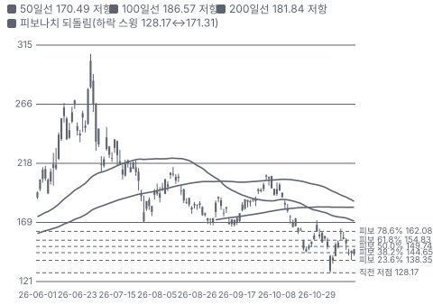

**주봉**

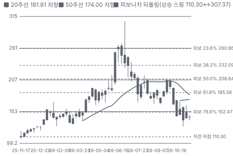

**월봉**

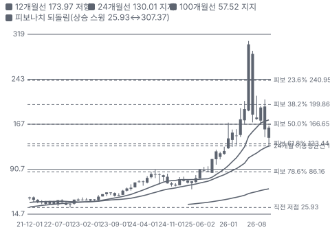

**분기 매출·EPS 실적과 컨센서스**

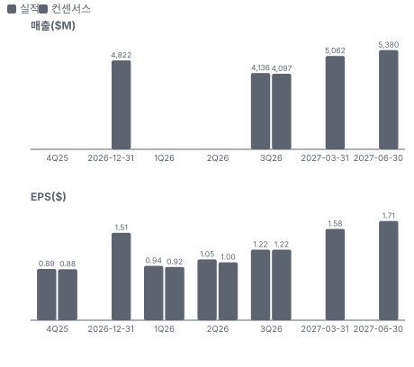

**멀티플 프리미엄(Fwd 1Y P/E, 최근 4개 분기말)**

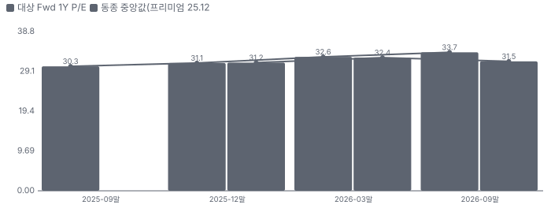

**합리적 멀티플**

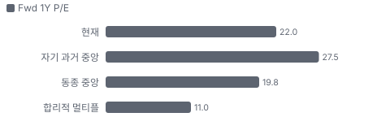

**밸류에이션 주가 시나리오**

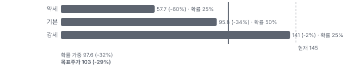

**주가별 업사이드**

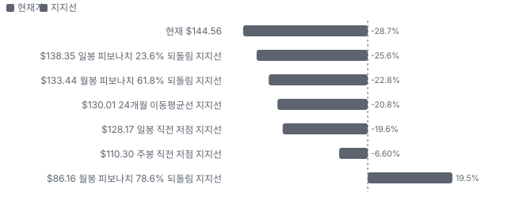
- 제품·서비스 포트폴리오

**고객 믹스(1Q FY27, 매출 대비)**

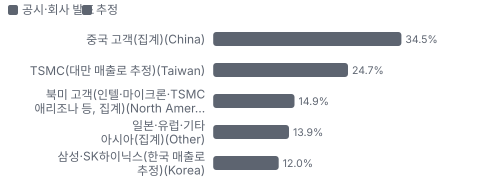

**공급 병목(10점, 낮을수록 병목)**

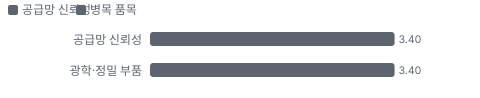

**CAPEX의 매출 대비 비중**

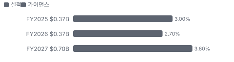

**어닝콜 변화별 주주가치 영향**

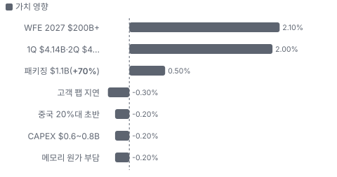

**수주·파이프라인 확실성 사다리**

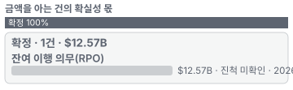

**매출 → 매출총이익 → 영업이익(매출 = 100, 최근 4분기)**

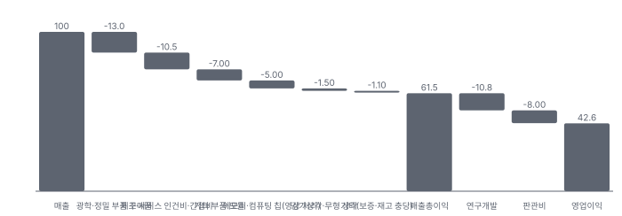

**분기 비용 비중 추이(매출 대비, 공시)**

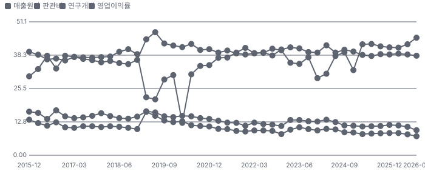

**비용 요인별 매출 대비 비중 1년 변화**

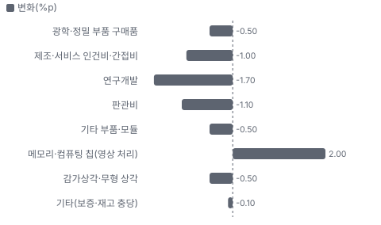

**반도체 공정 제어 BOM 원가 몫**

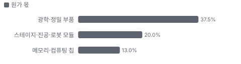

**PCB·부품 검사 BOM 원가 몫**

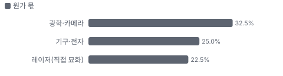

**BOM 항목 가격 +10% 시 OPM 변화**

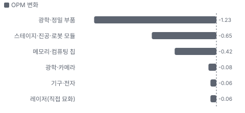

**원가 물가 vs 판매가 물가 — 1년 변화(원가가 판매가보다 더 오르면 단가를 올리지 못하는 만큼 마진이 줄어든다): 판매가 쪽 물가가 원가보다 6.1%p 더 올라 단가 전가 여지가 있다**

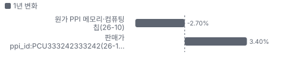

**사업별 매출 vs 물가 — 전년 대비(명목 매출 · 비교 물가 · 실질 = 물량·믹스)**

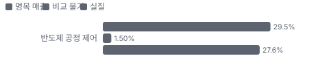

**자산 구성 — 1Q15 분기말 투하자본 \$1,960.0M**

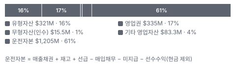

**자산별 변화율 — 최근 12개 분기(2Q12 = 0%) + 다음 4개 분기 추정**

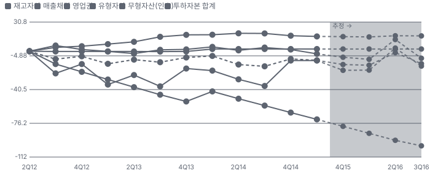

**ROIC 추이 — TTM, 최근 12개 분기 + 다음 4개 분기 추정(컨센서스 NOPAT)**

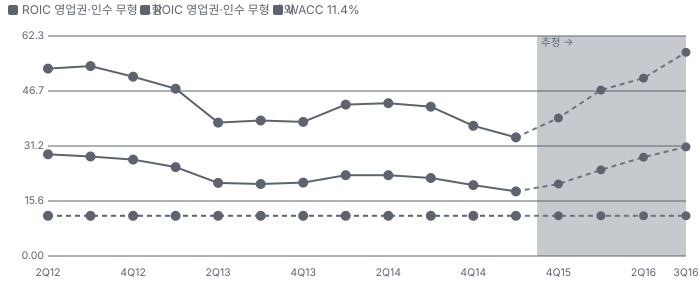

**분기 감가 비율 연율(유형자산 총액 대비)**

**10년 P·Q 사이클 — 추세(HP 필터) 대비 갭과 8분기 전망**

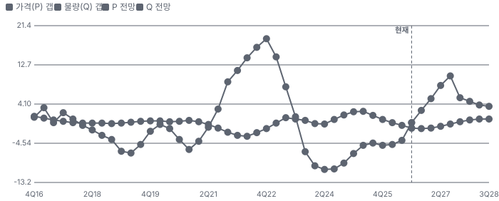

**매출 증가율의 가격·물량 분해와 8분기 전망(전년 대비)**

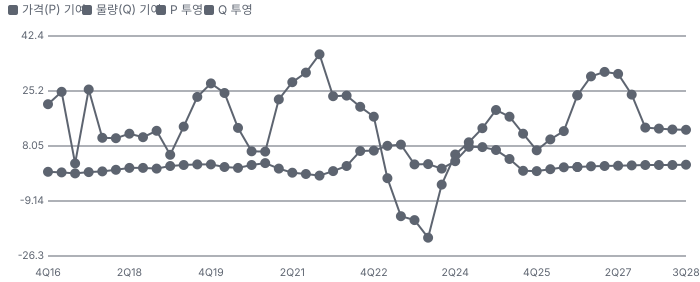

**분기별 매출 증가율 분해**

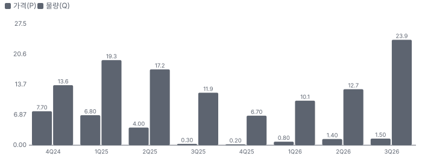

**목표주가 산정 — 기본과 강세 사이(강세 쪽 15%), 도달 확률 약 44%**

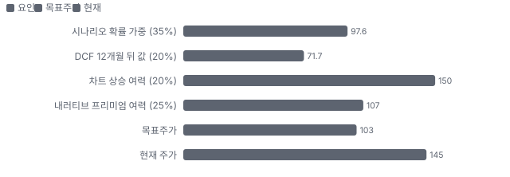

**일봉 지지·저항과 목표주가**

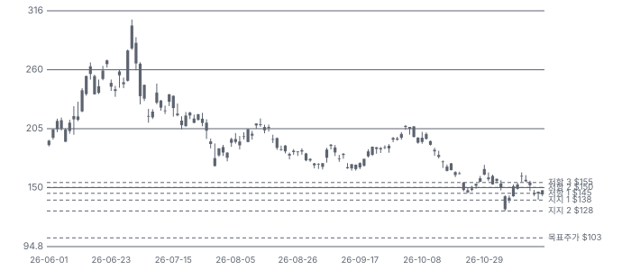

**커뮤니티 언급 수(최근 30일, 채널별)**

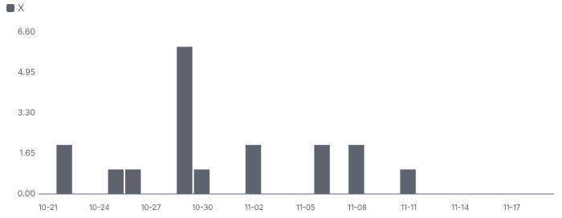

**재고 일수 — 분기별(수주 자료가 없어 수주/출하 비율 없음)**

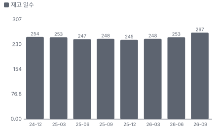

**일별 거래량 분해**

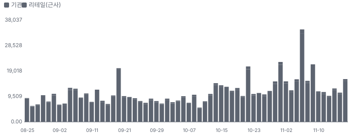

**기관 자금 흐름**

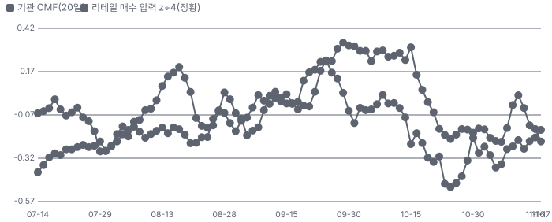

**몬테카를로**

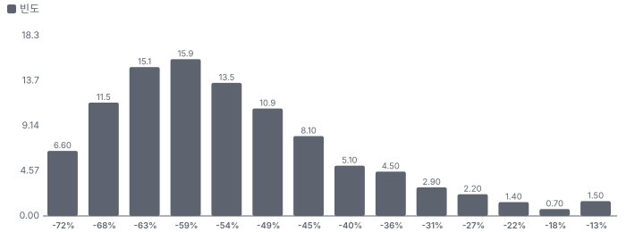

해석: 3,000번 중 10번(0%)에서 가치가 지금 주가 이상이었다. 가정을 흔들어도 지금 주가를 뒷받침하지 못하는 경우가 더 많다. 가운데 값은 0.44배이고, 열 번 중 여덟 번은 0.32~0.65배 사이에 든다.

## 내러티브

> **기업가치를 결정하는 이야기:** 매출의 91%가 반도체 공정 제어(웨이퍼 검사(웨이퍼 표면·패턴의 결함을 찾는 장비) 51%·패터닝(레티클 검사·오버레이 계측 등 회로 패턴 관련 장비) 21%·서비스 21%), 6%가 PCB·부품 검사다. 칩이 미세해지고 HBM(고대역폭 메모리)·패키징이 복잡해질수록 수율을 지키려는 검사 단계가 늘어나고, 깔린 장비는 서비스 매출로 반복된다. 출하 상한은 광학 부품이 정하고, 원가는 장비 안 영상 처리용 D램 칩 가격이 흔든다.

> **멀티플·EPS 프리미엄**
> **멀티플:** Fwd 1Y P/E 22.0배로 동종 4곳(Applied Materials·Lam Research·ASML·Onto Innovation) 중앙값 19.8배보다 11% 높다. 6월 말 60배대에서 내려왔다.
> **EPS:** FY27 조정 EPS 컨센서스 \$6.02, FY28 \$7.43(+23%) — 4개 분기 연속 컨센서스를 넘었다.

### 투자자들은 왜 열광했나

2026년 상반기 투자자들은 'AI 증설의 수율 병목 = 검사·계측'에 열광했고 6/30 종가 \$301.71까지 올랐다(Fwd P/E 60배). 식은 이유는 세 가지다 — 7월 장비주 급락과 4Q 실적 다음 날 −10.8%, 10월 ASML 콜 뒤 10거래일 하락, 11/5 중간선거 뒤 AI 하드웨어 급락(하루 −13.3%)이다.

### 무엇이 기업가치를 바꾸나

> **구조적 체질 변화**
> **변화:** 로직 중심 → 메모리(D램·HBM) 40% + 첨단 패키징
> **증거:** 12월 분기 공정 제어 시스템 중 메모리 약 40%(콜)
> **반증:** 메모리 비중 30% 아래로

> **고부가 믹스 확장**
> **변화:** Gen5(KLA 광학 검사 5세대)·전자빔 등 고급 검사 비중 확대
> **증거:** 콜: 2나노·1.4나노에서 샘플링 단계 증가
> **반증:** 조정 총이익률 61.5% 아래로

> **기술 혁신**
> **변화:** 하이브리드 본딩(칩과 칩을 구리 패드로 직접 붙이는 패키징 기술) 검사 민감도 마이크론 → 100나노미터
> **증거:** 콜
> **반증:** 패키징 경쟁사 고급 장비 채택

> **실행 속도**
> **변화:** 해당 없음(피어 리드타임 미공시라 비교 불가) — 회사 평균 리드타임 약 12개월, Gen4(KLA 광대역 플라즈마 광학 검사 4세대)·Gen5는 더 길다(콜)
> **증거:** 1Q 콜
> **반증:** 리드타임이 더 길어져 출하 지연

> **M&A**
> **변화:** 해당 없음(최근 3년 큰 인수 없음)
> **증거:** 10-K
> **반증:** 해당 없음

> **정책·입법 연관성**
> **재정정책:** CHIPS(미국 반도체지원법) 보조금 — 고객 미국 팹 투자로 간접 연결 10-K 반증: 보조금 지급 지연 의회 동의 10/10 — 하원 5/5(CHIPS법(2022) 세출 반영) · 상원 5/5(같음).
> **행정명령:** 미국 상무부 BIS(미국 상무부 산업안보국) 대중국 장비 수출 규제 10-K 위험 요인 반증: 규제 확대로 중국 서비스까지 제한 의회 동의 2/10 — 하원 1/5(행정 규칙 — 의회 의결 대상 아님) · 상원 1/5(같음).
> **연관입법:** 해당 없음(회사 매출과 직접 연결되는 법안 미확인) 10-K 반증: 해당 없음

> **고객의 지출 예산**
> **변화:** 반도체 회사 팹 장비 투자(CAPEX)와 팹 운영비(서비스)
> **사업별 예산:** **매출의 70%**: 반도체 공정 제어 장비 — 고객 CAPEX(파운드리·메모리 팹 장비 투자) · 동인: 선단 노드·HBM·신규 팹
**매출의 21%**: 서비스 — 고객 OPEX(팹 운영비(장비 유지보수)) · 동인: 가동률·설치 기반
**매출의 9%**: PCB·특수 공정 — 고객 CAPEX(PCB·전력 반도체 설비 투자) · 동인: AI 서버 PCB·전력 반도체
> **증거:** 세그먼트
> **반증:** TSMC·메모리 3사 2027 CAPEX 하향

### 내러티브 근거

> AI 반도체 증설로 공정이 복잡해질수록 결함 검사·계측이 더 필요해진다는 이야기다. 6월 장비주 급등 때 고점을 찍고 −52%로 배수가 정상화됐다. 동종 대비 멀티플 차이 +11% 중 회사 고유 몫은 +100%다. 단계는 컨센서스, 쏠림은 중간(셀사이드 28명 중 19명 매수 쪽) — 13F 보유 기관 2,048곳, Quantral 7일 50(Weak)이다.

> **공정 제어 강도 상승** · 강화
> **논리:** 2나노·1.4나노와 HBM·D램에서 검사 단계가 늘어 KLA 점유율이 WFE보다 빨리 큰다
> **숫자:** 1Q 매출 +29%, 메모리 약 40%(12월 분기)
> **반증:** 2Q 매출이 가이던스 하단 \$4.5B 미만
> **출처:** 1Q FY27 어닝콜(2026-10-28)

> **2027 WFE \$200B 초과** · 유지
> **논리:** 장비 시장이 2026년 \$150B 중반에서 2027년 \$200B 이상으로 커진다
> **숫자:** 회사 전망(콜)
> **반증:** 2027 고객 CAPEX 가이던스 하향
> **출처:** 1Q FY27 어닝콜(2026-10-28)

> **첨단 패키징** · 강화
> **논리:** 하이브리드 본딩이 패키징 검사를 고급 장비로 바꾼다
> **숫자:** 2026 패키징 약 \$1.1B(+70%)
> **반증:** 패키징 매출 성장 둔화
> **출처:** 1Q FY27 어닝콜(2026-10-28)

> **반대 내러티브 — 원가·중국·사이클** · 강화
> **논리:** 메모리 칩 원가로 총이익률이 막히고 중국이 줄며, 6월 같은 장비 과열이 다시 식는다
> **숫자:** 고점 대비 −52%, 총이익률 62.7% vs 목표 63~64%
> **반증:** 2Q 조정 총이익률 63.5% 이상
> **출처:** 콜·10-K

### 투자 포인트

> **이익은 사상 최고, 주가는 고점의 절반**
> **명제:** 1Q 영업이익률 46.1%·매출 +29%인데 주가는 6/30 종가 고점보다 52% 낮다
> **숫자:** 1Q 실적·일봉
> **시장과 다른 점:** 시장은 장비 사이클 정점을 걱정하지만 회사는 2027년 순차 성장과 WFE \$200B 초과를 말한다
> **증명:** 2Q 매출 \$4.7B 이상·2027 첫 분기 가이던스
> **출처:** https://www.sec.gov/Archives/edgar/data/319201/000031920126000032/klac-20261028.htm

> **메모리가 새 성장축**
> **명제:** 12월 분기 공정 제어 시스템의 약 40%가 메모리, 그중 D램 84%
> **숫자:** 1Q FY27 어닝콜(2026-10-28)
> **시장과 다른 점:** D램 공정 제어 강도가 선단 로직 수준으로 올라 메모리 사이클이 KLA 점유율을 키운다
> **증명:** 2Q 메모리 매출 비중·D램 증가 폭
> **출처:** https://www.sec.gov/Archives/edgar/data/319201/000031920126000032/klac-20261028.htm

> **총이익률은 2027년 하반기 이야기**
> **명제:** D램 칩 가격으로 총이익률 62.7%, 목표 63~64%는 2027년 중반 이후
> **숫자:** 1Q FY27 어닝콜(2026-10-28)
> **시장과 다른 점:** 컨센서스 FY28 EBIT 이익률 48%가 원가 회복을 얼마나 넣었는지 확인되지 않았다
> **증명:** 2Q·3Q 조정 총이익률 63% 이상
> **출처:** https://www.sec.gov/Archives/edgar/data/319201/000031920126000032/klac-20261028.htm

### 모멘텀 생성·소멸 타임라인

**카탈리스트 달력 — 지난 사건의 주가 반응과 앞으로 확인할 숫자**
| 날짜 | 상태 | 구분 | 사건 | 반응·확인 | 결과에 따라 |
|---|---|---|---|---|---|
| 2026-06-30 | 완료 | 생성 | 반도체 장비 급등 — 종가 고점 \$301.71 | 이후 −52% |  |
| 2026-07-29 | 완료 | 소멸 | 4Q FY26 실적 다음 날 | 하루 −10.8% |  |
| 2026-10-29 | 완료 | 생성 | 1Q FY27 실적 — 가이던스 상회 | 하루 +5.5% |  |
| 2026-11-05 | 완료 | 소멸 | 중간선거 뒤 AI 하드웨어 급락(매크로·섹터) | 하루 −13.3% |  |
| 2027-01-28(추정) | 예정 | 확인 | 2Q FY27 실적·3Q 가이던스 | 매출 \$4.7B 이상, 조정 총이익률 62.5% 이상, 3Q 가이던스 순차 성장 | 셋이 맞으면 FY28 추정 상향, 가이던스 정체면 배수 정체 |
| 2027-04(추정) | 예정 | 확인 | 3Q FY27 실적 | 총이익률 63% 회복 시작, 중국 비중 20%대 초반 | 원가 회복이 보이면 이익률 추정 상향 |

### 언제 사서 언제 팔아야 할까?

**가격·조건 틀 — 가격은 밸류에이션(약세·기본·강세·목표주가)과 차트 지지 구간에서, 조건은 이벤트에서**
| 구간 | 가격 | 목표주가까지 | 약세까지 | 조건·근거 |
|---|---|---|---|---|
| 관찰 구간 | \$138~\$138 | -26% | -58% | 지지 구간이 약세 시나리오 가격과 겹치는 곳 — 11/5 종가 저점 \$129.80 근처 |
| 확인 뒤 | 지금 \$145 이상에서 조건 확인 | -29% | -60% | 2Q 매출 \$4.7B 이상·총이익률 62.5% 이상·3Q 순차 성장 가이던스 |
| 무효화 | 약세 시나리오 \$58 | - | -60% | 11/5 종가 저점 \$129.80 이탈과 함께 3Q 가이던스가 2Q보다 낮다 |

업종 사건 날 −10~13% 움직임이 반복됐다(7/2, 10/22, 11/5) 가격·조건 틀이며 매매·비중 지시가 아니다(투자 권유 아님).

## 포트폴리오

| 제품·서비스 | 구분 | 무엇 | 쓰는 곳 | 돈 버는 방식 | Mix | Mix 변화(전 분기 대비) |
|---|---|---|---|---|---|---|
| 반도체 공정 제어 | 제품 | 웨이퍼·레티클(회로 원판, 포토마스크) 결함 검사, 오버레이(앞뒤 회로층의 정렬 정확도)·CD(회로 선폭, 임계 치수) 계측 장비와 설치 기반 서비스 | TSMC·삼성·SK하이닉스·인텔·마이크론의 선단 로직·D램·HBM·패키징 라인 | 1Q 매출의 91%(\$3.75B), 부문 총이익률 64% — 검사 단계가 늘수록 매출 증가 | 100% | +0.0%p |
| PCB·부품 검사 | 제품 | PCB 자동 광학 검사·직접 묘화 노광, 부품 검사 | AI 서버용 고다층 PCB·기판 제조사 | 1Q 매출의 6%(\$242M), 부문 총이익률 56% | 미확인 | 미확인 |

**Mix 변화가 가장 큰 쪽은 반도체 공정 제어(+0.0%p, 전 분기 대비).** 계절성 판정: 분기 매출 계절 지수 기준 없음 → 직전 분기와 비교.

## 고객

> **1Q FY27 최대 고객 중국 고객(집계, China) 34%, 상위 3곳 74%, 집중도 보통.** 공시·회사 발표로 확인한 몫은 매출의 63%이고, 나머지 고객 몫은 추정이거나 미분해다. 10-K는 TSMC가 FY24~26 매 해 매출 10% 넘는 고객이라고 밝힌다(몫 미기재). 지역(출하지) 기준 1Q는 중국 34.5%·대만 24.7%·북미 14.9%·한국 12.0%·일본 3.9%·유럽·이스라엘 4.7%다. 콜에서 12월 분기 공정 제어 시스템 중 메모리 약 40%(D램 84%)라고 했다.

**고객별 매출 몫(1Q FY27)**
| 고객 | 몫 | 변화 | 근거 |
|---|---|---|---|
| 중국 고객(집계, China) | 34% | +8%p | 공시 |
| TSMC(대만 매출로 추정, Taiwan) | 25% | -6%p | 추정 |
| 북미 고객(인텔·마이크론·TSMC 애리조나 등, 집계, North America) | 15% | -3%p | 공시 |
| 일본·유럽·기타 아시아(집계, Other) | 14% | -1%p | 공시 |
| 삼성·SK하이닉스(한국 매출로 추정, Korea) | 12% | +2%p | 추정 |

> **중국 고객(집계, China)** · 공시
> **사는 것:** 웨이퍼 검사·계측(규제 허용 범위)
> **추정 근거:** 지역 매출 1Q \$1,426M ÷ \$4,136M(4Q \$957M ÷ \$3,658M)

> **TSMC(대만 매출로 추정, Taiwan)** · 추정
> **사는 것:** 선단 로직 웨이퍼 검사·패터닝
> **추정 근거:** 대만 매출 1Q \$1,023M — TSMC가 10% 초과 고객(10-K)이라 대부분을 TSMC로 본 가설

> **북미 고객(인텔·마이크론·TSMC 애리조나 등, 집계, North America)** · 공시
> **사는 것:** 공정 제어·서비스
> **추정 근거:** 북미 매출 1Q \$618M

> **일본·유럽·기타 아시아(집계, Other)** · 공시
> **사는 것:** 공정 제어·PCB 검사
> **추정 근거:** 일본 \$160M + 유럽·이스라엘 \$194M + 기타 아시아 \$218M

> **삼성·SK하이닉스(한국 매출로 추정, Korea)** · 추정
> **사는 것:** D램·HBM 공정 제어
> **추정 근거:** 한국 매출 1Q \$497M

## 수주·파이프라인

> **2026-06-30 기준 1건.** 확정 \$12.57B. 공시 잔여 이행 의무(RPO) \$12.57B.

**수주 목록**
| 상태 | 계약 | 계약 총액 | 진척 | 기간 | 비고 |
|---|---|---|---|---|---|
| 확정 | 잔여 이행 의무(RPO) | \$12.57B | 비공개 | 2026-07 → 2027-12 | 2026-06-30 기준 — 1Q 말 RPO 미확인 |

**실행 속도와 방해 요인**
| 항목 | 상태 | 실행 속도 | 방해 요인 |
|---|---|---|---|
| 잔여 이행 의무(RPO) | 확정 | 평균 리드타임 약 12개월, Gen4·Gen5는 더 길다(콜) | 광학 부품 공급 · 고객 클린룸·전력 지연 · 중국 수출 규제 |

## 마진 구조

> **GPM 61.9%, OPM 45.0%.** 4Q FY26 대비 GPM +0.5%p, OPM +2.5%p. 변동비는 매출의 32%이고, 매출이 10% 늘면 OPM은 +2.1%p 움직인다. 1Q GAAP 매출원가는 매출의 38.1%로 1년 전 38.7%와 비슷하다. 물량 증가가 고정비를 흡수했지만 D램 칩 가격 급등이 원가를 올렸다(10-K·콜). 원가 항목별 몫은 공시되지 않아 추정이다.

> **매출 100 중 매출원가 38.5, 매출총이익 61.5(최근 4분기, 공시).** 매출원가 요인 중 광학·정밀 부품 구매품이 매출의 13.0%로 가장 무겁고, 단가가 +10% 오르면 GPM이 -1.30%p 움직인다. 분기 회귀로 매출 1이 늘 때 매출원가는 0.39 늘고, 매출원가의 고정비 몫은 1%다.

**비용 요인 강도 — 비중·추세·충격(+10%)·탄력**
| 비용 | 구분 | 매출 대비 | 1년 변화 | 마진 기여 | 충격 시 마진 | 매출 탄력 | 고정비 몫 |
|---|---|---|---|---|---|---|---|
| 광학·정밀 부품 구매품 | 매출원가 요인 | 13.0% | -0.5%p | +0.5%p | -1.30%p | 미확인 | 10% |
| 제조·서비스 인건비·간접비 | 매출원가 요인 | 10.5% | -1.0%p | +1.0%p | -1.05%p | 미확인 | 60% |
| 기타 부품·모듈 | 매출원가 요인 | 7.0% | -0.5%p | +0.5%p | -0.70%p | 미확인 | 10% |
| 메모리·컴퓨팅 칩(영상 처리) | 매출원가 요인 | 5.0% | +2.0%p | -2.0%p | -0.50%p | 미확인 | 0% |
| 감가상각·무형 상각 | 매출원가 요인 | 1.5% | -0.5%p | +0.5%p | -0.15%p | 미확인 | 100% |
| 기타(보증·재고 충당) | 매출원가 요인 | 1.1% | -0.1%p | +0.1%p | -0.11%p | 미확인 | 30% |
| 매출원가 | 공시 항목 | 38.5% | -0.2%p | +0.2%p | -3.85%p | 0.39 | 1% |
| 연구개발 | 공시 항목 | 10.8% | -0.4%p | +0.4%p | 미확인 | 0.09 | 26% |
| 판관비 | 공시 항목 | 8.0% | -0.3%p | +0.3%p | 미확인 | 0.07 | 31% |

매출 탄력 = 분기 비용을 매출에 회귀한 기울기(매출 1당 변동비), 고정비 몫 = 절편 ÷ 평균 비용. 표본이 8분기 미만이면 미확인. 매출원가 요인 비중은 margin 재료의 추정이 섞여 있고, 공시 매출원가와의 차이는 '기타 매출원가'로 둔다.

**GPM에서 OPM까지(GAAP, 아래는 최근 4개 분기)**
| 기간 | GPM | 연구개발 | 판관비 | 기타 | OPM |
|---|---|---|---|---|---|
| 1Q FY26 | 61.3% | 11.2% | 8.4% | 0.0% | 41.7% |
| 4Q FY26 | 61.4% | 10.9% | 8.0% | 0.0% | 42.5% |
| 1Q FY27 | 61.9% | 9.6% | 7.3% | 0.0% | 45.0% |
| 2025-12 | 61.4% | - | - | - | 41.3% |
| 2026-03 | 61.1% | - | - | - | 41.2% |
| 2026-06 | 61.4% | - | - | - | 42.5% |
| 2026-09 | 61.9% | - | - | - | 45.0% |

**비용을 움직이는 요인**
| 비용 | 요인 |
|---|---|
| 광학·정밀 부품 구매품(매출원가) | 광학 부품 단가·리드타임 · 근거 추정 |
| 제조·서비스 인건비·간접비(매출원가) | 조립·서비스 엔지니어 · 근거 추정 |
| 연구개발(연구개발) | Gen5·전자빔·패키징 검사 개발 · 근거 공시 |
| 판관비(판관비) | 영업·관리 · 근거 공시 |
| 기타 부품·모듈(매출원가) | 스테이지·로봇·전자 부품 · 근거 추정 |
| 메모리·컴퓨팅 칩(영상 처리, 매출원가) | D램 칩 가격 급등(10-K) · 근거 추정 |
| 감가상각·무형 상각(매출원가) | 분기 D&A \$97M 중 매출원가 몫 · 근거 추정 |
| 기타(보증·재고 충당, 매출원가) | 보증·재고 평가 · 근거 추정 |

**반도체 공정 제어 BOM — 매출의 91%, GPM 64%(공시 — 1Q 부문 총이익 \$2,403M ÷ 매출 \$3,754M(세그먼트)), 항목 가격 +10% 시**
| 항목 | 원가 몫 | 전가 | 제품 GPM | OPM |
|---|---|---|---|---|
| 광학·정밀 부품 | 30~45% | 미확인 | -1.3%p | -1.23%p |
| 스테이지·진공·로봇 모듈 | 15~25% | 미확인 | -0.7%p | -0.65%p |
| 메모리·컴퓨팅 칩 | 8~18% | 미확인 | -0.5%p | -0.42%p |
| 미분해 | 29% | - | - | - |

**PCB·부품 검사 BOM — 매출의 6%, GPM 56%(공시 — 1Q 부문 총이익 \$135M ÷ 매출 \$242M), 항목 가격 +10% 시**
| 항목 | 원가 몫 | 전가 | 제품 GPM | OPM |
|---|---|---|---|---|
| 광학·카메라 | 25~40% | 미확인 | -1.4%p | -0.08%p |
| 기구·전자 | 20~30% | 미확인 | -1.1%p | -0.06%p |
| 레이저(직접 묘화) | 15~30% | 미확인 | -1.0%p | -0.06%p |
| 미분해 | 20% | - | - | - |

광학·정밀 부품 가격이 +10% 오르면 영업이익은 -2.7% 움직인다. 판매가 전가를 모르는 항목은 전가 0%로 계산했다.

**BOM 항목 가격을 움직이는 것**
| 항목 | 요인 |
|---|---|
| 광학·정밀 부품 | 광대역 플라즈마 광원·대물렌즈 · 근거 추정 |
| 메모리·컴퓨팅 칩 | 검사 영상 처리 · 근거 추정 |
| 스테이지·진공·로봇 모듈 | 웨이퍼 이송·위치 제어 · 근거 추정 |
| 광학·카메라 | AOI(자동 광학 검사) 검사 · 근거 추정 |
| 레이저(직접 묘화) | PCB 노광 · 근거 추정 |
| 기구·전자 | 본체 · 근거 추정 |

> **원가·판매가 물가 격차 +6.1%p** — 판매가 물가가 투입 원가 물가보다 빠르게 오른다.

**투입 물가 — 미국 PPI 3·6·12개월(2026-10, 개정 반영)과 해외 전년비**
| 항목 | 미국 3개월 | 6개월 | 12개월 | 전가 못 할 때 OPM | 일본 | 한국 | 대만 |
|---|---|---|---|---|---|---|---|
| 광학·정밀 부품 | 미확인 | 미확인 | 미확인* | - | 미확인 | 미확인 | 미확인 |
| 메모리·컴퓨팅 칩 | -0.7% | -5.7% | -2.7%* | - | +1.6%* | +418.1% | +22.9%* |

별표는 품목보다 넓은 업종 지수다. 연결한 투입 원가의 미국 PPI(생산자물가지수)는 1년 새 가중 -2.7%이고, 판매가로 넘기지 못하면 GPM +0.1%p·OPM +0.1%p가 움직인다. 판매가 비교 물가(ppi_id:PCU333242333242)는 1년 새 +3.4% — 회사 가격 변화는 미확인. 물가 지수를 붙이지 못한 매출원가 항목은 광학·정밀 부품 구매품, 제조·서비스 인건비·간접비, 감가상각·무형 상각다(미연결). 반도체 공정 제어 매출은 2026-09 전년 대비 +29.5%이고 비교 물가 ppi_id:PCU333242333242의 변화 +1.5%(2026-09)를 빼면 실질 +27.6% — 물량·믹스가 성장을 이끌었다.

## 자산 구성

> **1Q15 분기말 투하자본 \$1,960.0M** — 운전자본 61%, 영업권 17%. 최근 12개 분기(2Q12 → 1Q15) 가장 크게 늘어난 자산은 유형자산(+16%), 투하자본 합계 -10%. 3Q16 추정 투하자본 \$1,880.7M(-4%, 컨센서스 매출과 회전 일수·CAPEX 강도 유지 가정). 연율 감가 비율(총액 기준)은 직전 4분기 14.95% → 최근 4분기 13.08%, 직전 비율이면 감가상각이 \$56.3M 더 컸다(영업이익의 8.9%).

**자산·운전자본 항목별 분기말 잔액 — 최근 12개 분기와 다음 4개 분기 추정**
| 항목 | 2Q12 | 1Q14 | 1Q15(최근) | 3Q16 추정 | 12개 분기 변화 | 다음 4개 분기 변화 |
|---|---|---|---|---|---|---|
| 매출채권 | \$701.3M | \$557.7M | \$631.6M | \$591.5M | -10% | -6% |
| 재고자산 | \$650.8M | \$680.9M | \$632.4M | \$602.1M | -3% | -5% |
| 선급·기타 유동자산 | \$53.5M | \$32.6M | \$44.0M | \$42.8M | -18% | -3% |
| 매입채무 | \$139.2M | \$120.8M | \$103.2M | \$97.0M | -26% | -6% |
| 유형자산 | \$277.7M | \$326.0M | \$321.1M | \$322.7M | +16% | +1% |
| 영업권 | \$327.7M | \$335.2M | \$335.3M | \$335.3M | +2% | +0% |
| 무형자산(인수) | \$55.6M | \$32.0M | \$15.5M | \$0.0M | -72% | -100% |

**자산 추정 동인 — 최근 4개 분기 평균(재무상태표 동인 모형)**
| 동인 | 값 | 곱하는 기준 |
|---|---|---|
| 매출채권 | 72일 | 매출 |
| 재고자산 | 198일 | 매출원가 |
| 선급·기타 유동자산 | 5일 | 매출 |
| 매입채무 | 32일 | 매출원가 |
| CAPEX 강도 | 1.8% | 매출(최근 4개 분기 합) |
| 분기 감가율 | 5.05% | 기초 유형자산 순액(무형 상각 제외 감가상각) |
| 매출원가율 | 43.6% | 매출(최근 4개 분기) |
| 영업권·리스 사용권·기타 | 유지 | 인수·새 리스는 공시 전 모름 |
| 인수 무형자산 | 분기 \$4.1M 상각 | 최근 4개 분기 평균 상각 |

**추정 방법:** 증권사 3표 모델(손익·재무상태표·현금흐름)의 재무상태표 동인 방식이다. 운전자본은 항목별 회전 일수(매출채권·선급·미지급·선수는 매출, 재고·매입채무는 매출원가 기준)를 최근 4개 분기 평균으로 두고 컨센서스 매출에 곱한다. 유형자산은 기초 + CAPEX − 감가상각으로 굴린다(Koller·Goedhart·Wessels 『Valuation』 재무상태표 추정). 매출 경로는 ROIC 절의 컨센서스와 같다.

**유형·무형자산 항목별 가치(2026-06-30 vs 2025-06-30)**
| 구분 | 항목 | 총액 2026-06-30 | 누적상각 | 순액 | 총액 2025-06-30 | 총액 1년 변화 | 공시 내용연수 |
|---|---|---|---|---|---|---|---|
| 유형 | 유형자산 합계(항목 미분해) | \$3,069.5M | 총계만 공시 | 총계만 공시 | \$2,739.3M | +12.1% | 미확인 |
| 영업권 | 영업권 | \$1,788.8M | \$0.0M | \$1,788.8M | \$1,792.2M | -0.2% | 비상각 |
| 무형 | 무형자산 합계(항목 미분해) | \$2,005.5M | \$1,730.8M | \$274.7M | \$2,170.0M | -7.6% | 미확인 |
| 유형 합계 | 유형자산 | \$3,069.5M | \$1,689.0M | \$1,380.6M | \$2,739.3M | +12.1% | 경과율 55%(상각 대상 기준) |

**내용연수 산식(상각 대상 유형자산 = 총액 − 토지 − 건설중)**
| 기준일 | 연 감가상각 | 상각 대상 총액 | 평균 내용연수 | 경과 연수 | 잔여 연수 | 경과율 |
|---|---|---|---|---|---|---|
| 2026-06-30 | \$214.5M | \$3,069.5M | 14.3년 | 7.9년 | 6.4년 | 55% |
| 2025-06-30 | \$192.0M | \$2,739.3M | 14.3년 | 7.7년 | 6.5년 | 54% |

산식 평균 내용연수는 14.3년. 1년 전 14.3년 → 지금 14.3년.

**분기 감가 비율(감가상각 ÷ 평균 유형자산 총액)**
| 분기 | 감가상각 | 평균 유형자산(총액) | 분기 비율 | 연율 | 연율의 역수 |
|---|---|---|---|---|---|
| 4Q24 | \$103.9M | \$2,505.0M | 4.15% | 16.59% | 6.0년 |
| 1Q25 | \$98.1M | \$2,598.1M | 3.78% | 15.10% | 6.6년 |
| 2Q25 | \$96.3M | \$2,686.8M | 3.58% | 14.33% | 7.0년 |
| 3Q25 | \$97.0M | \$2,789.5M | 3.48% | 13.91% | 7.2년 |
| 4Q25 | \$99.3M | \$2,886.7M | 3.44% | 13.75% | 7.3년 |
| 1Q26 | \$99.1M | \$2,966.1M | 3.34% | 13.36% | 7.5년 |
| 2Q26 | \$98.6M | \$3,034.0M | 3.25% | 13.00% | 7.7년 |
| 3Q26 | \$97.4M | \$3,175.9M | 3.07% | 12.27% | 8.1년 |

감가상각 기준: 손익계산서 감가상각·상각비(SEC 공시 데이터, 4분기 = 연간 − 1~3분기).

**감가율 하락 경고: 연율 14.95% → 13.08%(-12%).** 직전 4분기 비율을 그대로 쓰면 최근 4분기 감가상각이 \$56.3M 더 컸다(영업이익의 8.9%). 내용연수 연장·상각 끝난 자산 증가·건설중 자산 증가(믹스) 중 무엇인지는 공시 주석으로 가린다(자체추론).

미공시·미분해: 리스 사용권자산 · 유형자산 항목별 총액·내용연수(10-K 주석에서 모델이 채움) · 무형자산 항목(10-K 주석에서 모델이 채움) — 이 칸은 비우고 나머지로 계산했다.

### 해석 — 자산이 어디에 쌓이고 있나

- 같은 기간 4개 분기 매출은 -7% — 매출보다 빨리 늘어난 자산: 유형자산 +16%. 이 자산의 회전율이 떨어지면 ROIC를 희석한다.
- 다음 4개 분기 CAPEX \$55.0M vs 감가상각 \$64.9M(최근 4개 분기 CAPEX 강도·감가율 유지) — 유형자산 1Q15 \$321.1M → 3Q16 \$322.7M. 투자가 감가보다 작아 자산이 줄어드는 국면이다.
- 감가 비율 하락으로 최근 4분기 영업이익에 \$56.3M(8.9%)가 보태졌을 수 있다 — 내용연수 변경 공시가 없으면 건설중 자산·토지 같은 비상각 자산 몫이 커진 믹스 효과일 가능성이 크다(자체추론).

## ROIC

> **TTM 1Q15 ROIC는 영업권·인수 무형 포함 18.3%, 제외 33.6%**(NOPAT 마진 19.9% × 투하자본 회전율 0.92회). 최근 12개 분기 2Q12 28.8% → 1Q15 18.3%(고점 2Q12 28.8%). 컨센서스 NOPAT으로 굴리면 3Q16 30.9%(제외 57.7%) — WACC 11.4% 대비 +19.5%p. 1년 변화의 가장 큰 요인은 NOPAT 마진(-4.1%p).

**ROIC 추이(TTM)와 다음 4개 분기 추정 — NOPAT ÷ 평균 투하자본(이번 분기말·4개 분기 전)**
| 분기 | 구분 | TTM 매출 | TTM NOPAT | NOPAT 마진 | 평균 투하자본 | ROIC 포함 | ROIC 제외 |
|---|---|---|---|---|---|---|---|
| 2Q12 | 실적 | \$3,171.9M | \$894.9M | 28.2% | \$3,107.4M | 28.8% | 53.1% |
| 3Q12 | 실적 | \$3,096.2M | \$836.3M | 27.0% | \$2,969.5M | 28.2% | 53.8% |
| 4Q12 | 실적 | \$3,126.7M | \$828.3M | 26.5% | \$3,039.5M | 27.3% | 50.8% |
| 1Q13 | 실적 | \$3,015.2M | \$755.8M | 25.1% | \$2,996.0M | 25.2% | 47.4% |
| 2Q13 | 실적 | \$2,842.8M | \$641.7M | 22.6% | \$3,094.2M | 20.7% | 37.8% |
| 3Q13 | 실적 | \$2,780.4M | \$608.0M | 21.9% | \$2,973.7M | 20.4% | 38.4% |
| 4Q13 | 실적 | \$2,812.5M | \$637.1M | 22.7% | \$3,060.4M | 20.8% | 38.0% |
| 1Q14 | 실적 | \$2,915.1M | \$686.6M | 23.6% | \$2,992.1M | 22.9% | 42.9% |
| 2Q14 | 실적 | \$2,929.4M | \$674.0M | 23.0% | \$2,941.6M | 22.9% | 43.3% |
| 3Q14 | 실적 | \$2,914.0M | \$638.8M | 21.9% | \$2,891.1M | 22.1% | 42.3% |
| 4Q14 | 실적 | \$2,885.2M | \$610.4M | 21.2% | \$3,030.8M | 20.1% | 36.9% |
| 1Q15 | 실적 | \$2,792.1M | \$554.3M | 19.9% | \$3,033.0M | 18.3% | 33.6% |
| 4Q15 | 추정 | \$2,768.0M | \$589.5M | 21.3% | \$2,884.9M | 20.4% | 39.1% |
| 1Q16 | 추정 | \$2,837.5M | \$697.0M | 24.6% | \$2,856.6M | 24.4% | 47.0% |
| 2Q16 | 추정 | \$3,080.3M | \$864.4M | 28.1% | \$3,085.8M | 28.0% | 50.4% |
| 3Q16 | 추정 | \$3,092.5M | \$910.8M | 29.5% | \$2,943.6M | 30.9% | 57.7% |

**다음 4개 분기 NOPAT — 컨센서스(세율 14%, 리스 이자 별도)**
| 분기 | 매출 | EBITA 마진 | EBITA | NOPAT(분기) | 근거 |
|---|---|---|---|---|---|
| 4Q15 | \$710.2M | 30.8% | \$218.6M | \$186.9M | 발표 실적 · 재무상태표 추정 |
| 1Q16 | \$712.4M | 33.5% | \$238.9M | \$204.3M | 발표 실적 · 재무상태표 추정 |
| 2Q16 | \$919.2M | 38.6% | \$354.5M | \$303.1M | 발표 실적 · 재무상태표 추정 |
| 3Q16 | \$750.7M | 33.7% | \$253.3M | \$216.6M | 발표 실적 · 재무상태표 추정 |

**추정 방법:** NOPAT은 컨센서스(분기 매출 추정 × 회계연도 EBIT 마진 추정)로 잡고, 조정(비 GAAP) 마진이면 주식보상 몫을 빼서 과거 실적과 같은 기준(영업이익 + 인수 무형 상각)으로 맞췄다. 이미 발표했지만 분기 보고서(10-Q)가 아직 없는 분기는 발표 실적을 쓴다. 투하자본은 자산 구성 절의 재무상태표 동인으로 굴렸다. ROIC는 4개 분기 NOPAT을 이번 분기말과 4개 분기 전 투하자본의 평균으로 나눈다 — 추정 분기의 ROIC에는 이미 나온 실적 분기가 섞여 있다.

**투하자본 항목별 회전율과 ROIC 기여(TTM 1Q15, 평균 잔액)**
| 항목 | 투하자본 | 매출 1달러당 자본 | 회전율(매출 ÷ 항목) | 자본 몫 | 이 항목을 빼면 ROIC |
|---|---|---|---|---|---|
| 운전자본 | \$1,177.6M | 0.42 | 2.37회 | 39% | 37.9% |
| 유형자산 | \$323.6M | 0.12 | 8.63회 | 11% | 26.0% |
| 영업권 | \$1,358.5M | 0.49 | 2.06회 | 45% | 42.0% |
| 무형자산(인수) | \$23.8M | 0.01 | 117.47회 | 1% | 23.4% |
| 기타 영업자산 | \$149.5M | 0.05 | 18.67회 | 5% | 24.4% |

**ROIC 세 가지 판**
| 판 | NOPAT | 투하자본 | ROIC | 무엇을 재나 |
|---|---|---|---|---|
| 영업권·인수 무형 포함 | \$703.4M | \$3,033.0M | 23.2% | 인수 웃돈까지 낸 돈에 대한 수익률 |
| 영업권·인수 무형 제외 | \$703.4M | \$1,650.7M | 42.6% | 본업 운영 수익률(동종 비교용) |
| 무형 자본화 조정(판관비 20%·5년, 연구개발 6년) | \$1,139.9M | \$8,343.6M | 13.7% | 비용으로 처리한 무형 투자를 자산으로 본 판 |
| 경제적 이익(포함판) | \$357.2M | \$3,033.0M | 자본비용 11.4% | (ROIC − 자본비용) × 투하자본 |

NOPAT = (영업이익 \$631.9M + 인수 무형 상각) × (1 − 세율 14%). 리스 사용권자산을 투하자본에 넣었으므로 임차료 속 이자 몫을 영업이익에 되더했다. 현금은 영업에 필요한 몫을 따로 알 수 없어 투하자본에서 뺐다. SEC 공시 데이터 자동 초안 — 운전자본 = 매출채권 + 재고 + 선급 − (매입채무 + 미지급비용 + 선수수익), 현금 제외. 손상 누계는 공시 데이터 수록분.

**ROIC 1년 변화 분해(포함판, TTM 1Q14 → TTM 1Q15)**
| 요인 | ROIC 기여 |
|---|---|
| NOPAT 마진 | -4.12%p |
| 운전자본 | -1.14%p |
| 유형자산 | -0.21%p |
| 영업권 | -0.54%p |
| 무형자산(인수) | +0.09%p |
| 기타 영업자산 | +0.34%p |
| 합계 | -5.59%p |

**무형 자본화 가정별 ROIC(2026년 지출 기준, 포함판에 더함)**
| 투자로 보는 몫 | 상각 연수 | 무형 자산 | NOPAT 조정 | 조정 ROIC |
|---|---|---|---|---|
| 판관비 20% | 2년 | \$5,019.2M | \$419.6M | 13.9% |
| 판관비 20% | 5년 | \$5,310.6M | \$436.5M | 13.7% |
| 판관비 30% | 2년 | \$5,183.8M | \$432.7M | 13.8% |
| 판관비 30% | 5년 | \$5,621.0M | \$458.1M | 13.4% |

### 해석 — 무엇이 수익성을 끌어올리고 희석하나

- 영업권: 투하자본의 45% — 빼면 ROIC 23.2% → 42.0%. 이 자산의 회전율(2.06회)이 수익성을 희석하는 주된 자리다.
- 운전자본: 투하자본의 39% — 빼면 ROIC 23.2% → 37.9%. 이 자산의 회전율(2.37회)이 수익성을 희석하는 주된 자리다.
- 영업권·인수 무형을 빼면 ROIC가 +19.4%p 오른다 — 과거 인수에 치른 웃돈이 주주 수익률을 그만큼 낮춘다(본업 수익률은 제외판, 인수까지 포함한 가치 창출은 포함판으로 본다).
- 1년 ROIC 개선의 최대 요인은 기타 영업자산(+0.3%p). 반대로 깎은 최대 요인은 NOPAT 마진(-4.1%p).
- 비용으로 처리한 무형 투자를 자산으로 보면 ROIC가 -9.5%p 움직인다(무형 자산 \$5,310.6M). 투자를 늘리는 중이라 NOPAT이 더 커지는 쪽이다.
- 추정 경로 1Q15 18.3% → 3Q16 30.9%: NOPAT 마진 +9.6%p, 투하자본 회전율 +0.13회 — 컨센서스 매출·마진이 맞고 회전 일수·CAPEX 강도가 유지된다는 가정이다. 마진 추정이 내려가거나 재고 일수가 늘면 이 경로가 먼저 틀린다.
- ROIC(포함) − WACC = +6.9%p(1Q15) — 양수면 투하자본을 늘릴수록 가치가 쌓인다.

## 공급망 병목

이미지 없음(검수 실패) — 반도체 공정 제어

> **공급망 신뢰성 3.4/10, 병목 심각.** 가장 약한 고리는 광학·정밀 부품 3.4점이고, 품목 평균은 3.4점이다. 근거가 부족한 1건(메모리·컴퓨팅 칩)은 점수에서 뺐다. 출하를 정하는 것은 광학 부품이다(콜). 일부 부품은 단일·소수 공급원이고(10-K), KLA는 핵심 공급사 캐파 확대에 투자하고 있다. D램 칩은 공급은 확보했지만 가격 상승이 원가에 남는다.

**병목과 마진 — 품목 가격 +10% 시 OPM**
| 품목 | 점수 | 판정 | 구분 | OPM |
|---|---|---|---|---|
| 광학·정밀 부품(필수) | 3.4 | 병목 심각 | 핵심 통제 품목 | -1.23%p |

> **광학·정밀 부품** · 3.4/10
> **왜:** 검사 장비 출하 상한
> **병목 요인:** 인증 공급사 1곳 · 캐파 빠듯 · 리드타임 미확인 · 재인증 18개월 · 1위 점유율 미확인 · 지역 집중 미확인 · 물량 확보 장기계약
> **풀리는 조건:** 부분 — 장기 리드타임 부품 공급이 2H CY26부터 개선(콜), 가동 확인은 2Q 출하로

**공급사**
| 품목 | 공급사 | 몫 | 근거 |
|---|---|---|---|
| 광학·정밀 부품 | 미확인(핵심 광학 공급사, 광학 부품) | 미확인 | 회사 발표 |
| 메모리·컴퓨팅 칩 | 미확인(D램 공급사, D램 칩) | 미확인 | 공시 |

**무역 통계로 본 공급 지역**
| 품목 | EU 수입처 | 일본 수입처 | EU 1위 전년비 |
|---|---|---|---|
| 광학·정밀 부품 | CN(중국) 53% · US 30% · JP(일본) 10% | 中華人民共和国 46% · アメリカ合衆国 14% | +16.4% |
| 메모리·컴퓨팅 칩 | TW(대만) 46% · KR(한국) 19% · CN 17% | 台湾 52% · 大韓民国 28% | +413.1% |

## 생산능력

> **현재 명목 캐파 미확인, 가동률 미확인.** 착공 이상 증설은 0 미확인(회사가 캐파를 공시하지 않는다), 발표까지 합치면 0 미확인(회사가 캐파를 공시하지 않는다)이다. FY2026 CAPEX는 \$0.37B로 매출의 2.7%다. 주요 생산은 미국·싱가포르·이스라엘·중국·유럽이다(10-K). 1Q에 인도 신규 캠퍼스 토지를 사 CAPEX가 역대 최고였고, 앞으로 연 \$600~800M(매출의 2~3%)로 모든 공장을 늘린다(콜).

**생산시설 5곳**(10-K Item 2: 주요 제조 거점 국가(미국·싱가포르·이스라엘·중국·유럽 여러 곳) — 시설 수·이름 미공시라 국가 단위로 센다), 미확인 4곳 · 소유 1곳. 시설별 생산능력은 공개되지 않았다 — 회사 전체 캐파만 위에 적었다.

**생산시설 5곳 — 명칭·위치·생산능력**
| 시설 | 위치 | 용도 | 생산능력 | 소유·상태 |
|---|---|---|---|---|
| 본사·제조 | 미국 캘리포니아 밀피타스 | 본사·제조·연구개발 | 미확인 — 시설별 캐파 미공시 | 미확인 · 가동 |
| 싱가포르 제조 | 싱가포르 | 제조 | 미확인 — 시설별 캐파 미공시 | 미확인 · 가동 |
| 이스라엘 제조 | 이스라엘 | 제조·연구개발 | 미확인 — 시설별 캐파 미공시 | 미확인 · 가동 |
| 중국 제조 | 중국 | 제조 | 미확인 — 시설별 캐파 미공시 | 미확인 · 가동 |
| 인도 신규 캠퍼스 | 인도 | 연구개발·운영(계획) | 미확인 — 토지 매입 단계(1Q 콜) | 소유 · 계획 |

**생산능력 확충 계획**
| 계획 | 단계 | 증설 | 가동 시점 | CAPEX |
|---|---|---|---|---|
| 인도 신규 캠퍼스 | 발표 | 미확인 | 미확인 | 미확인 |
| 전 공장 증설·교대 추가 | 착공 | 미확인 | 2027 | 미확인 |

남은 계획의 CAPEX 합계는 \$0.00B(금액 미확인 2건 제외)다. 합계는 FY2027 매출의 0%다.

**증설 방해 요인**
| 계획 | 방해 요인 |
|---|---|
| 인도 신규 캠퍼스 | 건설 |
| 전 공장 증설·교대 추가 | 광학 부품·인력 |

**CAPEX와 매출 대비**
| 기간 | CAPEX | 매출 | 매출 대비 | 구분 |
|---|---|---|---|---|
| FY2025 | \$0.37B | \$12.16B | 3.0% | 실적 |
| FY2026 | \$0.37B | \$13.58B | 2.7% | 실적 |
| FY2027 | \$0.70B | \$19.40B | 3.6% | 가이던스 |

## 해자

> 해자는 '선단 공정 결함 검사·계측에서 압도적 점유율과 고객 수율 데이터에 묶인 설치 기반'이다. 약점은 광학 부품 공급과 메모리 칩 원가다.

> **공정 제어 점유율·기술** · 강함
> **해자:** 선단 로직·D램 수율 관리에 쓰는 광학·전자빔 검사(전자빔으로 미세 결함을 찾는 검사)에서 1위이고 노드마다 공정 제어 강도가 오른다
> **근거:** 1Q 영업이익률 46.1%(사상 최고), 웨이퍼 검사 매출 \$2.11B(+QoQ 18.5%, )
> **숫자:** WFE 점유율 약 7.5%(2025, 콜) → 2030 9% 근접 목표
> **깨지는 조건:** TSMC·삼성 2나노 라인에서 경쟁사 검사 장비 채택

> **설치 기반 서비스** · 강함
> **해자:** 가동률이 높을수록 서비스 매출이 늘고 장비 수명이 길어진다
> **근거:** 서비스 매출 1Q \$851M(+14%), FY26 매출의 약 23%(10-K)
> **숫자:** 서비스 매출 12개 분기 연속 증가
> **깨지는 조건:** 서비스 매출 2분기 연속 감소

> **첨단 패키징 확장** · 보통
> **해자:** 하이브리드 본딩으로 패키징 검사 민감도가 마이크론 → 100나노미터로 오르며 KLA 고급 장비가 쓰인다
> **근거:** 2026년 첨단 패키징 공정제어 약 \$1.1B(+70% 초과, 콜)
> **숫자:** 패키징 시장 성장률의 약 2배(콜)
> **깨지는 조건:** 패키징 장비 경쟁사 점유율 확대

> **공급망(광학·메모리 칩)** · 약함
> **해자:** 광학 부품 리드타임과 D램 칩 가격이 출하와 총이익률을 묶는다
> **근거:** 10-K: 단일·소수 공급원, D램 칩 가격 급등 / 콜: 광학 부품이 출하 결정
> **숫자:** 총이익률 62.7% vs 목표 63~64%
> **깨지는 조건:** 해당 없음

## 경영진·네트워크

> CEO Rick Wallace(2006~)와 CFO Bren Higgins가 콜을 이끈다. 두 사람 모두 2026년 장내 매도만 했다(Form 4 — CEO 11/10 약 \$10.7M 등). 정계 연결은 공개 기록상 미확인이다.

> **Richard P. Wallace** · President & CEO · 2006-01
> **프로필:** 2026-08~11 장내 매도 여러 건(Form 4)
> **비즈니스:** 미확인
> **정계:** 미확인
> **동문:** 미확인
> **사모임:** 미확인

> **Bren D. Higgins** · EVP & CFO · 2013
> **프로필:** 2026-08 장내 매도 약 \$6.6M(Form 4)
> **비즈니스:** 미확인
> **정계:** 미확인
> **동문:** 미확인
> **사모임:** 미확인

**네트워크 정량화**
| 연결 | 강도 | 닿는 매출 | 가중 노출 | 매출 대비 | 근거 |
|---|---|---|---|---|---|
| 비즈니스: TSMC — 10% 초과 고객(10-K) | 4/5 | \$0.25B | \$0.20B | 1% | 대만 매출 몫으로 본 가설 — 연결이 매출을 만든 것이 아니라 고객 관계 https://www.sec.gov/Archives/edgar/data/319201/000031920126000027/klac-20260630.htm |

가중 노출은 연결이 닿는 매출의 크기다. 연결이 그 매출을 만들었다는 뜻이 아니며, 인과는 공개 자료로 입증하지 못한다.

## 약세 논리 및 셀온 조건

| 약세 논리 | 근거 | 가를 자료 |
|---|---|---|
| 장비 사이클 꼬리 | 6월 Fwd P/E 60배대 → 22배, 고점 대비 −52%, 11/5 하루 −13.3% | TSMC·메모리 3사 2027 CAPEX 가이던스 |
| 메모리 칩 원가 | D램 칩 단종·가격 급등이 FY27 총이익률 부담(10-K), 회복은 2027년 중반 이후(콜) | 2Q·3Q 조정 총이익률 |
| 중국 축소 | 중국 1Q 34.5% → 2027년 20%대 초반(콜) | 3Q 중국 비중 |
| 고객 팹 지연 | 일부 고객이 클린룸·전력 지연으로 인도 보류(콜) | 2Q 출하와 백로그 발언 |
| 내부자 매도 | 최근 1년 장내 매수 0·매도 55건, CEO 11/10 약 \$10.7M(Form 4) | 내부자 매도 중단 여부 |

**변이 관점.** 셀사이드(28명 중 19명 매수 쪽, 목표가 평균 \$219)는 KLA를 'AI 증설의 수율 병목을 쥔 회사'로 본다. 숫자로 보면 1Q 이익률 46%는 사상 최고이고 메모리·패키징이 새 성장축인 것도 맞다. 그러나 **지금 이익률이 사이클 정점의 이익률인지**가 가치의 대부분을 정한다 — DCF가 장기 33%로 내려 잡으면 −55%이고, 동종 2년 뒤 배수로 보면 −29%다. 강세 측 근거는 FY28 EPS +23%와 4개 분기 연속 서프라이즈, 그리고 광학 공급 개선이다. 이 다툼은 2Q 실적의 총이익률과 3Q 가이던스가 처음 가른다. 10-K 기준 TSMC가 매 해 매출 10% 넘는 고객이고, 잔여 이행 의무는 2026-06-30 \$12.57B다.

> **셀온 조건**
> **조건 1:** 2Q FY27 매출이 가이던스 하단 \$4.5B에 못 미치거나 3Q 가이던스가 2Q보다 낮다.
> **조건 2:** 조정 총이익률이 61.5% 아래로 내려가 메모리 원가 회복 시점이 2028년 이후로 밀린다.
> **조건 3:** 고객 인도 보류가 주문 연기·취소로 번졌다는 발언이 나온다.
> **조건 4:** 대중국 수출 규제가 서비스까지 넓어진다.

## 어닝콜 변화

**직전 콜 대비 새로 나오거나 바뀐 내용 → 가치 영향**
| 항목 | 내용 | 직전 콜 | 최신 콜 | 모델 동인 이동 | 확신도 | 가치 영향 |
|---|---|---|---|---|---|---|
| 업데이트 | 매출 가속 | 4Q FY26 \$3.66B | 1Q FY27 \$4.14B(QoQ +13%), 2Q 가이던스 \$4.7B | 1년차 성장률 +2.0% | 1.0 | +2.0% |
| 신규 | 2027 WFE \$200B 초과 | 2030 WFE \$220B ± \$20B(투자자의 날) | 2027년 WFE \$200B 초과, 2030 모델 조기 초과 가능 | 장기 성장 수렴값 +0.50% | 0.5 | +2.1% |
| 부정 | 메모리 원가 부담 | 총이익률 목표 63~64% | 1Q 62.7%, 2027년 중반 이후에야 목표 쪽으로 | 출발 이익률 -0.50% | 0.8 | -0.2% |
| 업데이트 | 첨단 패키징 | 패키징 성장 기대 | 2026년 첨단 패키징 공정제어 약 \$1.1B(+70% 초과) | 1년차 성장률 +0.50% | 0.8 | +0.5% |
| 신규 | CAPEX 증가 | CAPEX 매출의 2~3% | 연 \$600~800M(인도 캠퍼스·캐파) | 매출÷투하자본 -5.0% | 0.8 | -0.2% |
| 신규 | 고객 팹 지연 | 공급 제약 | 일부 고객 클린룸·전력 지연으로 인도 보류 | 1년차 성장률 -0.30% | 0.3 | -0.3% |
| 업데이트 | 중국 비중 | 중국 27~29%(2026) | 2027년 20%대 초반 전망 | 1년차 성장률 -0.20% | 0.5 | -0.2% |
| **합계** | 단독 합 |  |  | 동시 적용 +3.8% |  | **+3.8%** |

**실적 발표 예상 변동폭:** 지난 4번 실적 발표 때 주가는 하루에 평균 ±8.8%(최대 15.2%, 오른 날 1번) 움직였다.

**실적 발표 예상 변동폭 — 과거 실적 발표 다음 거래일 주가 변화**
| 분기 | 발표일 | 주가 변화 |
|---|---|---|
| 2Q FY26 | 2026-01-29 | -15.2% |
| 3Q FY26 | 2026-04-29 | -3.6% |
| 4Q FY26 | 2026-07-28 | -10.8% |
| 1Q FY27 | 2026-10-28 | +5.5% |

## P·Q 사이클

> **10년 위치: Q형 기업(매출 갭 분산의 0%가 가격) — 가격은 추세 대비 -1.2%(수축, 10년 분위 18%), 물량은 -0.0%(회복, 분위 65%). P 프리미엄 -2%, Q 프리미엄 0%(매출총이익이 정상(추세) 수준보다 요인별로 이만큼 높거나 낮다).** 전망으로 가격 갭은 4분기 뒤 -0.3%·8분기 뒤 +0.8%, 물량 갭은 +10.3%·+3.6%(물량은 컨센서스 몫 39%를 섞었다).

**10년 P·Q 사이클 위치·프리미엄**
| 항목 | 가격(P) | 물량(Q) |
|---|---|---|
| 추세 대비 갭(현재) | -1.2% | -0.0% |
| 사이클 시계 | 수축 | 회복 |
| 10년 분위 | 18% | 65% |
| 프리미엄(현재) | -2% | 0% |
| 프리미엄 4분기 뒤 | 0% | +11% |
| 프리미엄 8분기 뒤 | +1% | +4% |
| 갭 반감기 | 4분기 | 미확인 |
| 갭 4분기 뒤(80% 범위) | -0.3% (-1.8%~+1.3%) | +10.3% (+3.6%~+17.4%) |
| 갭 8분기 뒤(80% 범위) | +0.8% (-0.9%~+2.5%) | +3.6% (-4.2%~+12.0%) |
| 전망 모형 | 자기회귀모델(과거 2개 시점) | 자기회귀모델(과거 2개 시점) + 컨센서스(분기 컨센서스 4개 + 연간 컨센서스 성장률 FY2027→FY2028 +19%, 4분기 뒤 몫 39%) |

방법: P = 가격 지수 4분기 평균(미국 PPI 반도체 제조 장비 대용 — 회사 판매가가 아니라 업종 가격), Q = TTM 매출 ÷ P. 추세는 로그 레벨의 HP(추세를 뽑는 통계 필터, Hodrick-Prescott) 필터(λ 1600)로 정상(mid-cycle) 수준을 잡는다. 프리미엄 = 요인별 매출총이익 증분 ÷ 정상 매출총이익(정상 GPM 60.7% = 10년 중앙값, 물량 증분 마진 62.8% = 전년 대비 ΔGP÷ΔRev 회귀, 가격은 전액 이익 반영). 표본 40개 TTM 분기. 전망: 가격 갭은 BIC(모형 차수를 고르는 정보 기준)로 차수를 고른 자기회귀모델(정상성 보정), 물량은 통계 갭 자기회귀모델과 컨센서스 매출 ÷ 가격 전망(매출 = P × Q)을 분산 역수로 섞는다(Bates·Granger 1969). 끝점 편향을 줄이려고 전망 경로를 이어 붙인 뒤 HP 필터를 다시 건다(Kaiser·Maravall 1999). 80% 범위는 예측 오차(TTM이 4분기씩 겹쳐 생기는 자기상관을 뉴이·웨스트 장기 분산으로 반영)와 애널리스트 범위에서 낸다. 모형 산출이며 가이던스가 아니다.

> **Q 사이클 — 최근 4분기 평균 가격 기여 +1.0%, 물량 기여 +13.4%(전년 대비 로그 증가율).** P 강도 4.1/10, Q 강도 5.0/10, 최근 8분기 중 100%가 같은 요인 우세(구조적). 전망으로는 8분기 안에 전환 신호가 없다(물량은 컨센서스를 섞었다).

**P·Q 사이클 정량**
| 항목 | 가격(P) | 물량(Q) |
|---|---|---|
| 최근 4분기 평균 기여 | +1.0% | +13.4% |
| 강도(0~10, 자기 이력 z) | 4.1 | 5.0 |
| 고유 주기(자기회귀모델 과거 2개 시점일 때) | 미확인 | 미확인 |
| 다음 4분기 투영 평균 | +1.8% | +28.9% |
| 4분기 뒤 투영(80% 범위) | +2.0% (-1.8%~+5.8%) | +24.1% (+15.0%~+33.1%) |
| 장기 평균(표본 → 기저율 수축) | +2.4% → +2.3% | +14.1% → +10.2% |
| 투영 모형 | 자기회귀모델(과거 1개 시점) | 자기회귀모델(과거 1개 시점) + 컨센서스(분기 컨센서스 4개 + 연간 컨센서스 성장률 FY2027→FY2028 +19%) |

가격 근거: 미국 PPI 반도체 제조 장비 대용 — 회사 판매가가 아니라 업종 가격. PPI를 쓰면 회사 판매가가 아니라 업종 가격 대용이다. 로그 증가율이라 가격·물량 기여의 합이 매출 증가율이다. 전망: 가격은 BIC로 차수를 고른 자기회귀모델에 이미 발표된 월간 가격을 먼저 넣고(나우캐스트), 물량은 자기회귀모델과 '컨센서스 매출 증가율 − 가격 전망'을 분산 역수로 섞는다. 장기 평균은 표본 평균을 장기 기저율(가격 연 2%·물량 연 4%) 쪽으로 줄인다 — 고성장 구간만 담긴 표본이 그 성장을 끝없이 잇지 않게. 범위는 4분기 겹친 표본의 자기상관을 반영한다. 모형 산출이며 가이던스가 아니다. 회사 판매가로 잴 수 없는 이유: ASP·출하 대수를 공시하지 않는다 — 업종 PPI 대용

## 밸류에이션

> **목표주가 \$103, 업사이드 -29%.** 자리는 기본과 강세 사이(강세 쪽 15%)이고 도달 확률은 약 44%다. 기본 \$96, 강세 \$141(-3%), 약세 \$58(-60%). DCF 기준 업사이드는 기본 -55%, 강세 -41%, 약세 -65%다(WACC 11.4%).

기준 멀티플이 Fwd 1Y라서 EPS도 12개월 뒤의 다음 4개 분기(2Q FY28~1Q FY29)를 쓴다. 기본 \$7.48은 그 기간 분기 추정 합(\$1.90 + \$1.86 + \$1.87 + \$1.93 ≈ \$7.56)에서 반올림 차이를 둔 값이다. 약세 \$6.0은 FY27 EPS가 1년간 늘지 않는 경우, 강세 \$8.8은 FY29 추정 평균(\$8.13)과 상단(\$10.6) 사이다. **DCF와 다른 이유:** DCF 기본 업사이드는 −55%로 목표주가 경로(−29%)보다 낮다. 장기 수렴 영업이익률을 33%(FY20~26 GAAP 25.9~41.7%의 위쪽)로 두어 지금의 46%가 사이클과 함께 내려간다고 보기 때문이다. 배수 경로는 FY28 이익에 동종 2년 뒤 배수를 곱한다. 두 방법 모두 지금 가격 아래다 — 지금 가격은 지금의 이익률이 사이클 뒤에도 유지된다는 쪽을 넣고 있다.

시나리오 확률: 다음 해 매출 성장 분포로 계산 — 약세 +9.5% 아래·강세 +27.6% 위 확률. 내부 관점(컨센서스 +18.6%, σ 13.8%: 범위 36.1% ÷ d2(28) × 1.5) 100% — 외부 관점 꺼짐(SEC 전 상장사 표본 없음)

> **약세 \$58 (-60%)** · 확률 25%
> **가정:** 10.7배 × EPS \$6.00
> **근거:** 고객 팹 지연이 2027년 주문 연기로 번지고 메모리 원가가 남는다. 12개월 뒤 다음 4개 분기 조정 EPS가 FY27 수준(\$6.02)에 머문다

> **기본 \$96 (-34%)** · 확률 50%
> **가정:** 14.3배 × EPS \$7.48
> **근거:** 컨센서스 경로 — FY28 매출 \$23.0B(+19%), GAAP EBIT 이익률 48%. 2Q FY28~1Q FY29 분기 추정 합 약 \$7.5(계산)

> **강세 \$141 (-3%)** · 확률 25%
> **가정:** 17.8배 × EPS \$8.80
> **근거:** WFE가 2030 모델을 앞당기고 총이익률이 64%로 돌아온다. EPS가 FY29 추정 평균(\$8.13)을 넘는다

**멀티플 선정 — Fwd 1Y P/E**
| 단계 | 조정 | 근거 |
|---|---|---|
| 동종 중앙값 | 19.8배 | 범위 16.4~22.7배, 4곳 |
| 펀더멘털 | -18% | 성장·이익률·ROIC로 본 합리적 멀티플 11.0배와의 차이의 일부만 인정(로그 차이 × 0.5, 상한 ±20%에 부드럽게 수렴) |
| 해자 | +2% | 공정 제어 점유율·기술 강함 · 설치 기반 서비스 강함 · 첨단 패키징 확장 보통 · 공급망(광학·메모리 칩) 약함 — 점수 8.0%에서 동종 기준 5.5%를 뺌 |
| 반복 매출 | -1% | 반복 매출 23%(동종 25%) · 설치 기반 서비스(유지보수·가동률) · 이미 반복 단계 · 기반 설치 장비 대수 미공시 |
| 수주 전환·가시성 | +3% | book-to-bill 0.60 → 가시성 0.60 · 전환 10.4개월(동종 12) |
| 내러티브 | +0% | 단계 컨센서스 |
| 사이클·실행 판단 | +0% | Fwd 1Y P/E 22.0배는 동종 4곳(Applied Materials·Lam Research·ASML·Onto Innovation) 중앙값 19.8배보다 11% 높다. 공정 제어 1위·서비스 매출 23%·영업이익률 46%는 프리미엄 근거지만, 메모리 원가로 총이익률 회복이 2027년 하반기로 밀렸고 중국 비중이 줄어 판단 조정을 더하지 않는다 |
| **선정** | **17.1배** | 지금 22.0배 |

**동종 레인지**
| 회사 | Fwd 1Y P/E | Fwd 2Y P/E | Fwd 3Y P/E | 성장 | 영업이익률 | ROIC |
|---|---|---|---|---|---|---|
| AMAT | 18.6 | 15.0 | 13.1 | 36% | 36% | 46% |
| LRCX | 20.9 | 18.0 | 17.4 | 42% | 40% | 87% |
| ASML | 22.7 | 20.2 | 14.8 | 42% | 45% | 137% |
| ONTO | 16.4 | 13.9 | 11.7 | 52% | 35% | 18% |
| **KLA** | 22.0 | 19.2 | 17.5 |  |  |  |

지금 주가가 요구하는 5년 매출 CAGR 30%, 기본 시나리오 7%. 몬테카를로 중앙값 업사이드 -56%.

> 의사결정 보조(투자자문 아님): ① 매수 매력: 5년 보유 가정 연 기대수익 -5.4% — 주주가 요구하는 수익률(자기자본비용) 11.4%보다 -16.9%p · 요구수익률을 넘을 확률 0% · 안전마진 없음(비관적 경우(하위 10%) 가치가 시총의 32%) → 정량 신호 약함 / ② 위험 예산 지표(이론): 0% — 기대수익이 요구수익률에 못 미친다(켈리 기준 — 수익·손실 확률로 계산한 이론상 최대 노출 — 0%는 참고) · 5년 뒤 나쁜 경우(하위 10%) -50% · 30% 넘게 잃을 확률 47% / ③ 상방(5년): 평균 0.76배 · 2배 이상 확률 0% · 3배 이상 0% · 10배 이상 0% · 잘 풀린 경우(상위 10%) 1.08배 이상

투입 물가 점검: 지난 1년 PPI를 BOM에 넣으면 OPM -17.77%p다(매출원가의 11% 기준).

## 매수 위치(일봉)

> **현재가 \$144는 '지지 근접'(가장 가까운 일봉 지지 \$138에서 ATR 0.5배 위).** 이 자리에서 목표주가까지 -28.3%, 첫 일봉 저항까지 +0.8%, 다음 지지까지 하방 -3.7%, 손익비 -7.7배. 손익비는 지지 1 \$138에서 -3.5배로 가장 높다(목표주가까지 -25.6%).

**가격대별 업사이드(일봉 기준)**
| 가격대 | 가격 | 목표주가까지 | 첫 저항까지 | 다음 지지까지 | 손익비 | 근거 기법(강도) |
|---|---|---|---|---|---|---|
| 현재가 | \$144 | -28.3% | +0.8% | -3.7% | -7.7 | - |
| 지지 1 | \$138 | -25.6% | +4.6% | -7.4% | -3.5 | 피보 23.6%(1.0) |
| 지지 2 | \$128 | -19.6% | +7.9% | 미확인 | 미확인 | 120일 지그재그 저점 · 스윙 저점(1.8) |

**일봉 저항**
| 저항 | 가격 | 현재가 대비 | 근거 기법(강도) |
|---|---|---|---|
| 저항 1 | \$145 | +0.8% | 120일 지그재그 저점 · 피보 38.2%(1.8) |
| 저항 2 | \$150 | +4.6% | 20일선 · 피보 50.0%(1.5) |
| 저항 3 | \$155 | +7.8% | 피보 61.8%(1.0) |

일봉만 쓴다(주봉·월봉 제외). 손익비 = 목표주가까지 업사이드 ÷ 다음 지지까지 하방. 가격대별 기대값 참고표이며 매수·매도 시점 지시가 아니다.

## 애널리스트 토론

> **토론 결론 Neutral(규칙 등급 Sell).** 성장·이익률·메모리 강도는 반박되지 않았다. 규칙 등급(Sell)은 FY28 이익에 동종 2년 뒤 배수(16.5배)를 붙이지만, FY28 조정 EPS +23%와 4개 분기 연속 서프라이즈를 낸 회사에 동종 평균 배수 하락을 그대로 적용하는 것은 보수적이다 — 한 단계 올려 Neutral. 총이익률 회복과 고객 팹 일정은 2Q 실적(2027-01 말 추정)에서 확인된다

**패널 — 등급별 자리**
| 자리 | 핵심 논리 | 틀리는 조건 | 최종 투표 |
|---|---|---|---|
| Strong Buy | FY28 EPS \$7.43에 Fwd 2Y P/E 19배 — 2027 WFE \$200B 초과의 최대 수혜를 고점 절반 가격에 산다 | 2Q 매출 \$4.5B 미만 | Buy |
| Buy | 메모리 공정 제어 강도 상승이 새 점유율 원천이다 | 2Q 메모리 비중 30% 미만 | Buy |
| Neutral | 성장은 확실하지만 배수 22배는 동종보다 높고 총이익률 회복은 2027년 하반기다 | 2Q 조정 총이익률 63.5% 이상 | Neutral |
| Sell | 중국 34%가 20%대 초반으로 줄고 고객 팹 지연이 2027 성장을 깎는다 | 3Q 가이던스 순차 성장 | Neutral |
| Strong Sell | 6월 장비 거품의 꼬리 — CEO·CFO가 계속 판다 | WFE 2027 전망 상향 지속 | Sell |

**투표**
| Strong Buy | Buy | Neutral | Sell | Strong Sell |
|---|---|---|---|---|
| 0 | 2 | 2 | 1 | 0 |

> **개회 · Strong Buy**
> **발언:** 고점 절반에 사상 최고 이익이다.

> **개회 · Buy**
> **발언:** 메모리가 새 성장축이다.

> **개회 · Neutral**
> **발언:** 배수는 이미 동종보다 높다.

> **개회 · Sell**
> **발언:** 중국이 줄고 팹이 늦는다.

> **개회 · Strong Sell**
> **발언:** 내부자가 판다.

> **반박1 · Strong Buy → Sell**
> **발언:** 중국이 줄어도 중국 밖 WFE가 더 빨리 큰다.

> **반박1 · Buy → Neutral**
> **발언:** 총이익률은 물량 레버리지로 버틴다.

> **반박1 · Neutral → Buy**
> **발언:** 메모리 칩 원가는 2027년에도 남는다고 회사가 말했다.

> **반박1 · Sell → Strong Buy**
> **발언:** 고객이 인도를 미룬다는 것은 수요 둔화의 첫 신호다.

> **반박1 · Strong Sell → Strong Buy**
> **발언:** 6월 P/E 60배였다. 지금 22배도 정상화 중이다.

> **반박2 · Strong Buy → Strong Sell**
> **발언:** 내부자 매도는 계획 매매다.

> **반박2 · Buy → Sell**
> **발언:** 인도 보류는 시설 문제이지 주문 취소가 아니다.

> **반박2 · Neutral → Buy**
> **발언:** 그 구분은 2Q 출하로 확인된다.

> **반박2 · Sell → Strong Buy**
> **발언:** 중국 20%대 초반은 회사 전망이다.

> **반박2 · Strong Sell → Buy**
> **발언:** 동종 배수 19.8배면 주가는 지금보다 낮다.

> **최종 · Strong Buy**
> **발언:** 이익 대비 가격이 낮다는 판단 유지.

> **최종 · Buy**
> **발언:** 메모리가 성장을 받친다.

> **최종 · Neutral**
> **발언:** 2Q 실적까지 중립.

> **최종 · Sell**
> **발언:** 중국·팹 지연 위험.

> **최종 · Strong Sell**
> **발언:** 배수 정상화 위험.

남은 반대 의견: 강세 측은 2027 WFE \$200B 초과와 시장 대비 초과 성장이 FY28 추정을 올린다고 본다

패널은 등급별 논리를 대표하는 자리이고 실존 IB의 의견이 아니다.

## 커뮤니티 반응

통계: 관심 급증 0.0/10(결합 Z -1.0).

> **언급 적음 — Quantral 7일 50(Weak), 10월 23건·11월 4건. 10월 실적 뒤 WFE 전망 상향을 반기는 X 글이 많았고, 그 전에는 ASML 콜 영향으로 10거래일 연속 하락을 다뤘다.**

언급 적음 — 풀이할 만한 논지가 모이지 않았다.

**기대가 바뀐 시점:** 10월 중순 ASML 콜 뒤 하락 → 10/28 실적·WFE 상향 뒤 반등 글

커뮤니티 의견은 시장 기대의 증거이지 사실이 아니며, 관심 급증은 주가·펀더멘털 변화가 아니다.

## 수주·출하·재고 사이클

> **수주 미공시 — 재고만 본다.** 재고 일수 267일(2024-12 254일에서) · 재고 전년 대비 +24% vs 매출(4개 분기) +16%.

**수주/출하 비율 × 재고 — 분기별**
| 분기 말 | B/B(분기) | B/B(4분기) | 재고 일수 | 재고 전년 대비 | 매출 전년 대비(4분기) |
|---|---|---|---|---|---|
| 2024-12 | - | - | 254 | +0% | +12% |
| 2025-03 | - | - | 253 | +5% | +20% |
| 2025-06 | - | - | 247 | +6% | +24% |
| 2025-09 | - | - | 248 | +6% | +22% |
| 2025-12 | - | - | 245 | +8% | +17% |
| 2026-03 | - | - | 248 | +9% | +13% |
| 2026-06 | - | - | 253 | +14% | +12% |
| 2026-09 | - | - | 267 | +24% | +16% |

B/B가 1을 넘으면 받은 주문이 내보낸 물건보다 많아 잔고가 쌓이고, 재고가 매출보다 빨리 늘면 수요보다 생산이 앞선다는 뜻이다. 둘을 함께 봐야 '주문이 많아 쌓이는 재고'와 '안 팔려 쌓이는 재고'를 가른다.

## 시장 평가

> **셀사이드(IB 애널리스트)**
> **한 줄:** 셀사이드는 대부분 매수 쪽이고 목표가 하단 \$170도 지금 주가보다 높다. 질문은 2027 WFE 대비 초과 성장과 메모리 원가에 몰렸다.
> **의견 분포:** 강력 매수 16·매수 3·보유 9(28명)
> **목표가 평균:** \$219(범위 \$170~310, 27명)
> **FY27 EPS 추정:** \$6.02(컨센서스)
> **콜 질문 초점:** 2027 초과 성장·총이익률 회복·2030 모델

> **바이사이드(기관 투자자)**
> **한 줄:** 기관은 3분기에 순매도했다 — Capital International·Fidelity·MFS가 줄이고 BlackRock·Van Eck가 늘렸다. CEO·CFO는 장내 매도만 했다.
> **13F 보유 기관:** 2,048곳(3Q26)
> **증가·감소:** 400곳 증가 · 478곳 감소
> **순변화:** −14.7M주
> **내부자 장내:** 매수 0 · 매도 55(최근 1년)

> **언론·업계**
> **한 줄:** 주가는 회사 실적보다 장비 업종 흐름(ASML 콜·중간선거 뒤 급락)에 더 크게 움직였다.
> **업종 사건:** 11/5 AI 하드웨어 급락 −13.3%
> **동종 실적:** ASML 3Q 캐파 부족 발언 뒤 10거래일 하락

## 체크리스트

| 시점 | 무엇 | 의미 |
|---|---|---|
| 2027-01-28(추정) | 2Q FY27 실적·3Q 가이던스 | 매출 \$4.7B·총이익률 62.5%·순차 성장 — 초과 성장 증명 |
| 2027년 1분기 | TSMC·삼성·SK하이닉스 2027 CAPEX 가이던스 | 2027 WFE \$200B 초과 전망의 바닥 |
| 2027-04(추정) | 3Q FY27 실적 | 총이익률 63% 회복 시작·중국 20%대 초반 |
| 수시 | Form 4 내부자 거래 | CEO·CFO 매도가 멈추는지 |
| 2027년 | 인도 캠퍼스·공장 증설 | CAPEX \$600~800M이 캐파로 이어지는지 |

## 출처
- FY2026 10-K(SEC, 2026-08-06 제출) https://www.sec.gov/Archives/edgar/data/319201/000031920126000027/klac-20260630.htm
- 1Q FY27 10-Q(SEC, 2026-10-29 제출) https://www.sec.gov/Archives/edgar/data/319201/000031920126000034/klac-20260930.htm
- 1Q FY27 실적 8-K(2026-10-28) https://www.sec.gov/Archives/edgar/data/319201/000031920126000032/klac-20261028.htm
- 라이선스 자료 요지 포함 — 외부 공유 금지
- 마스터 노션 자료: 미확인 Cognizant_Technology_Solutions_(CTSH)_Solid_margin_performance_but_guidance_downtick_on_weaker_disc.pdf (요지만, 외부 공유 금지)
- 마스터 노션 자료: 미확인 Japan_Machinery__Automation__Trade_statistics__September_2026_robot_Robodrill_volume_trends.pdf (요지만, 외부 공유 금지)
- 마스터 노션 자료: 미확인 Japan_Machinery__Construction__September_2026_trade_statistics.pdf (요지만, 외부 공유 금지)
- 마스터 노션 자료: 미확인 Intel_Corp._(INTC)__Servers_very_strong_but_PC_weakness_likely_to_be_a_setback_for_the_stock.pdf (요지만, 외부 공유 금지)
- 마스터 노션 자료: 미확인 Entegris_Inc._(ENTG)__Execution_continues_to_improve_with_cyclical_recovery_driving_upside_to_wafer_starts_and_CapEx_.pdf (요지만, 외부 공유 금지)
- 마스터 노션 자료: 미확인 Cognizant_Technology_Solutions_(CTSH)__Solid_margin_performance_but_guidance_downtick_on_weaker_discretionary_trends.pdf (요지만, 외부 공유 금지)
- 마스터 노션 자료: 미확인 SanDisk_Corp._(SNDK)__First_Take__Solid_quarter_with_guidance_above_the_Street.pdf (요지만, 외부 공유 금지)
- 마스터 노션 자료: 미확인 SanDisk_Corp._(SNDK)__Tight_supply_demand_conditions_drive__as_datacenter_exposure_moves_higher.pdf (요지만, 외부 공유 금지)
- 마스터 노션 자료: 미확인 Americas_Technology__Semiconductors__SIA_data_shows_mostly_below-seasonal_trends_in_September_following_a_strong_August.pdf (요지만, 외부 공유 금지)
- 마스터 노션 자료: JPM 2026-11-03 JPM_Memory_Market_Update_2026-11-03_5522344.pdf (요지만, 외부 공유 금지)
- 마스터 노션 자료: 미확인 Global_Semiconductors_2027E_Global_Memory_Supply_Demand_Projection.pdf (요지만, 외부 공유 금지)
- 마스터 노션 자료: 미확인 Marvell Technology Inc. (MRVL)_ Investor Day highlights diversifying opportunity set across connectivity and custom silicon s....pdf (요지만, 외부 공유 금지)
- 마스터 노션 자료: 미확인 Americas Technology_ IT Services_ 3Q Earnings Preview_ Expect macro pressures to result in unchanged guidance.pdf (요지만, 외부 공유 금지)
- 마스터 노션 자료: JPM 2026-11-09 JPM_Semiconductors_Septe_2026-11-09_5521351.pdf (요지만, 외부 공유 금지)
- 마스터 노션 자료: BofA 2026-11-11 BofA_Taiwan Semiconductor Manufacturing Co. Capital budget toward advanced nodes_ investing into frontier labs and semis chain_20261111.pdf (요지만, 외부 공유 금지)
- 마스터 노션 자료: 미확인 Analog Devices Inc.pdf (요지만, 외부 공유 금지)
- 마스터 노션 자료: 미확인 US Semis BOA 11 9.pdf (요지만, 외부 공유 금지)
- 마스터 노션 자료: 미확인 Barclays_AI_gets_physical_The_decade_of_the_robot.pdf (요지만, 외부 공유 금지)
- 마스터 노션 자료: 미확인 261113 BOFA Memory.pdf (요지만, 외부 공유 금지)
- 마스터 노션 자료: 미확인 2026-11-13 2026_11_13_Morgan_Stanley_Investor_Presentation_Semiconductors_Consumer_compressed.pdf (요지만, 외부 공유 금지)
- 마스터 노션 자료: 미확인 Citi - Hesai (HSAI.US) - Citi China Conference 2026 Update - Humanoid Robot Actuators and 2027 Outlook - Buy.pdf (요지만, 외부 공유 금지)
- 마스터 노션 자료: 미확인 Bernstein - Japan Video Games - AI Robots Takeaways - Tracking GTA VI_compressed.pdf (요지만, 외부 공유 금지)
- 마스터 노션 자료: 미확인 MS - GC Semis - Pushback on Cloud Semis and Legacy Memory Downgrades.pdf (요지만, 외부 공유 금지)
- 마스터 노션 자료: 미확인 MS - Semis Weekly - Earnings Week 5.pdf (요지만, 외부 공유 금지)
- 마스터 노션 자료: 미확인 Bernstein - China Semicap - HBM Shortage Drives More DRAM Capex.pdf (요지만, 외부 공유 금지)
- 마스터 노션 자료: 미확인 Bernstein - Global Semicap - No Cuts Yet.pdf (요지만, 외부 공유 금지)
- https://www.sec.gov/Archives/edgar/data/319201/000031920126000027/klac-20260630.htm
- https://www.sec.gov/Archives/edgar/data/319201/000031920126000034/klac-20260930.htm
- 10-K
- 10-K 공급 절
- 10-K 공급 절 — 비중 미공시
- 10-K 위험 요인(D램 칩)
- 10-K 위험 요인·1Q 콜
- 계산(매출원가 − 위 항목)
- SEC 공시 데이터(10-K·10-Q) 자동 초안 — scripts/tenbagger/asset_pack.py
- 1Q FY27 어닝콜(2026-10-28)

_구매 등급·목표주가 모두 규칙이 계산한 모델 값으로, 개인의 보유 종목·자금 사정을 반영하지 않는다 · 공개 자료 기반 분석이며 투자 권유가 아님 · 1차 판정, 미검증 · Chiip ten-bagger_