# 텐배거 리포트 2026-11-19 — AI 패키징 장비주로 샀는데 성장은 중국 와이어 본더였다 — Kulicke & Soffa는 FY28 이익 하강을 TCB가 메울지 시험받는다

> 2026-11-19 · Kulicke & Soffa(KLIC) · 기업: 반도체 후공정 와이어 본더(볼·웨지)와 무플럭스 열압착(TC) 본더 등 패키징 조립 장비, 캐필러리 같은 소모품을 파는 회사

## Chiip View

성장 이야기와 숫자가 다르다. Kulicke & Soffa는 AI 첨단 패키징 장비주로 7/1 종가 \$133.81까지 올랐지만, 3Q 매출의 68%는 볼 본더(선 끝을 공 모양으로 녹여 붙이는 와이어 본딩 장비)이고 첨단 패키징은 9%·적자다. 매출을 키운 것은 중국 OSAT 3곳(9개월 매출 39%)의 전통 패키징 증설이다. 4Q 매출 \$410.3M·1Q 가이던스 \$410M으로 실적은 강하지만 영업현금이 순이익의 3분의 1이고 매출채권이 1년 새 2.3배로 늘었다. Fwd 1Y P/E 11.7배는 동종 4곳 중앙값 20.3배보다 42% 낮은데, FY28 컨센서스 EPS(−22%)로 보면 14.9배라 할인 대부분이 사이클 위치로 설명된다. 선정 배수 16.1배에 FY28 EPS \$4.50을 곱한 기본 \$72, 약세 \$36, 강세 \$127 사이에서 목표주가는 \$67(+0%), 구매 등급은 Neutral이다. DCF(기본)는 −34%(WACC 11.1%)다. 셀사이드 목표가 평균 \$95와 갈리는 지점은 FY28 하강 폭과 TCB(열압착 본딩 — 열과 압력으로 칩을 기판에 붙이는 첨단 패키징 공정)가 그 빈자리를 메울지다 — 11/19 콜의 FY27 하반기 가시성과 2027년 2월 1Q 실적의 2Q 가이던스가 처음 가른다.

## 대시보드
| 항목 | 값 | 설명 |
|---|---|---|
| 주가 | \$66.99 | 고점 대비 -50% · 1년 +88% |
| 시가총액 | \$3.59B | 완전 희석 기준 · EV \$3.08B |
| 업사이드 | +0% | 목표주가 \$67 · 다운사이드 -46% · 손익비(강세÷약세) 1.9 |
| 구매등급 | Neutral | 애널리스트 4명: Strong Buy 0 · Buy 1 · Neutral 3 · Sell 0 · Strong Sell 0 |
| 멀티플 | Fwd 1Y P/E 11.7배 | 동종 중앙값 20.3배 |
| 가이던스 1Q FY27(2027-01-02 종료) | \$410M · \$1.65 | 컨센서스 \$360M · \$1.34 |
| 알파 | 5.5/10 | 텐배거 가능성 점수 |
| 이벤트 | 4Q FY26 어닝콜(08:00 ET) — FY27 2분기 이후 가시성·TCB 목표 재확인·현금 회수 | 2026-11-19 |

## 한 장 요약
- **기업가치를 결정하는 내러티브** Kulicke & Soffa의 기업가치는 **중국 OSAT 와이어 본더 증설이 끝난 뒤 FY28 이익 하강(−22%)을 첨단 패키징(TCB·패널)이 얼마나 메우느냐**에 달려 있다. FY26 매출은 \$1.18B(+81%)로 늘었지만 성장의 대부분은 중국 고객의 전통 볼 본더였고, 주가는 7월 고점보다 50% 낮다.
- **투자 포인트** **[성장의 실체는 중국 와이어 본더]** 3Q 볼 본더 매출 \$226.1M(YoY +198%), 중국 OSAT 3곳이 9개월 매출 39% 3Q 10-Q 세그먼트·고객 집중
**[배수 할인 42%는 정점 이익 때문]** Fwd 1Y P/E 11.7배 vs 동종 20.3배, FY28 EPS −22% Forward 배수·컨센서스
**[이익은 늘었지만 현금은 안 들어왔다]** FY26 순이익 \$182.6M vs 영업현금 \$71.9M, 매출채권 \$425M(+\$242M) 4Q 보도자료 재무상태표·현금흐름표
- **밸류에이션 모델로 본 주가 상방은 어디까지인가?** **목표주가 \$67(+0%), 약세와 기본 사이(약세 쪽 16%)다.** 강세 \$127(+89%)는 Fwd 1Y P/E 20.1배를 강세 EPS에 적용한 값이다. 기본 \$72, 약세 \$36. 손익비 1.9, DCF 기준 업사이드 -34%.
- **모멘텀은 어떻게 만들어지고 사라지나?** 2026-08-18 새 CEO 선임 발표 다음 거래일 → 하루 −9.5%(원인 연결 미확인)
2026-11-05 중간선거 뒤 AI 하드웨어 급락 → 하루 −12.6%
**2026-11-19** 4Q FY26 어닝콜(08:00 ET(미국 동부 시간)) — 확인: FY27 2분기 이후 가시성, TCB \$150~200M 재확인, 매출채권 회수
**2027-02(추정)** 1Q FY27 실적·2Q 가이던스 — 확인: 매출 \$390M 이상, 2Q 가이던스 \$380M 이상, 영업현금 개선
- **수주는 어디까지 왔나?** 백로그 \$0.24B(12개월 안 출하분, FY25 말)
- 패널 레벨(원형 웨이퍼 대신 큰 사각 패널 위에서 패키징하는 방식) APTURA WSX(대만 2곳) — 미확정
- FY27 TCB 매출 목표 — 미확정
- 하이브리드 본더 고객 인도 — 미확정
개별 수주 공시는 없다. 회사 전체 백로그는 FY25 말 \$245.3M(1년 전 \$148.6M)이고 대부분 취소·연기 가능하다(10-K). FY26 말 값은 10-K 제출 뒤 확인한다. 3Q 콜에서 '주문이 FY27 2분기까지 들어온다'고 했다.
- **누가 사 주나?** 최대 매출 묶음 중국 밖 IDM·OSAT·파운드리 44%·상위 3개 묶음 76%(고객 기준으로는 최대 고객 14.8%·상위 3곳 39%). 공시·회사 발표로 확인한 몫은 83%다.
- **마진과 공급망은 어디가 약한가?** GPM 47.8%, OPM 21.2%. OPM을 가장 흔드는 BOM(제품 원가를 이루는 부품·재료 명세) 항목은 모션·본드헤드·초음파 트랜스듀서이고 가격 +10%에 -1.34%p다. 공급망 신뢰성은 3.8/10(병목 심각)이고 가장 약한 고리는 모션·본드헤드·초음파 트랜스듀서다.
- **생산능력은 얼마나 늘어나나?** 현재 명목 캐파 미확인, 착공 이상 증설 0 미확인(장비 대수·캐파 수치 미공시). FY2027 CAPEX는 매출의 2.4%다.
- **지금 가격은 무엇을 가정하나?** Fwd 1Y P/E 11.7배로 동종 4곳(Teradyne·Onto Innovation·Camtek·FormFactor) 중앙값 20.3배보다 42% 낮다. 컨센서스는 FY27(9월 결산) 매출 \$1.48B(+25%)·조정 EPS \$5.75를 정점으로, FY28 매출 \$1.35B(−9%)·EPS \$4.50(−22%)으로 내려간다고 본다. 지금 가격은 와이어 본더 사이클이 FY27 하반기에 꺾이고 첨단 패키징이 그 빈자리를 크게 메우지 못한다는 쪽을 넣고 있다.
- **왜 움직였나?** 1년 전보다 88% 높지만 7/1 종가 고점 \$133.81보다 50% 낮다. 상반기에는 AI 첨단 패키징(TCB·패널·하이브리드) 기대로 배수가 30배대까지 올랐다. 이후 7월 장비주 급락(7/2 −9.3%·7/7 −11.5%), 새 CEO 발표 다음 날 −9.5%, 10/22 −9.9%, 11/5 중간선거 뒤 AI 하드웨어 급락 −12.6%로 빠졌다. 이익 추정은 계속 올랐고 하락은 배수에서 나왔다. 4Q 실적에 대한 주가 반응은 아직 없다(11/18 장 마감 뒤 발표).
- **4Q 실적에서 무엇이 바뀌었나?** 좋아진 것은 크기다 — 4Q 매출 \$410.3M(QoQ +24%)·비GAAP EPS \$1.52, 1Q 가이던스 \$410M으로 통상 12월 분기 약세가 없다. 싱가포르 신규 생산층에서 Advanced Solutions(KLIC의 TCB·다이 어태치 등 첨단 패키징 장비 사업부) 장비 제조를 시작했고, 패널 레벨 TCB(APTURA WSX)를 대만 주요 고객 2곳에 처음 출하했다. 부담은 이익의 질이다 — 4Q 영업현금 \$25.4M로 순이익 \$73.2M의 3분의 1이고, 매출채권이 1년 새 \$184M → \$425M으로 늘었다. 총이익률 47.8%는 가이던스 48%를 조금 밑돌았다. 콜은 11/19 08:00 ET에 열려 이 리포트에는 보도자료만 반영했다.
- **무엇이 바뀌면 판단이 달라지나?** 올라갈 조건: 콜과 1Q 실적에서 FY27 하반기까지 주문 가시성이 늘고, Advanced Solutions 분기 매출이 \$40M을 넘어 TCB 목표가 숫자로 따라오며, 매출채권이 줄어 영업현금이 순이익의 80%를 넘는다 — 그러면 FY28 하강 폭이 줄고 배수 할인이 좁혀질 근거가 생긴다. 내려갈 조건: 1Q 매출 \$390M 미만, 2Q 가이던스가 1Q보다 15% 이상 낮음, 중국 고객 매출채권 회수 지연·충당금, 후공정 장비 수출 통제.
- **언제 사서 언제 팔아야 할까?** **관찰 \$61~\$61**: 목표주가까지 +10%, 약세까지 -41% — 지지 구간이 약세 시나리오 가격과 겹치는 곳 — 11/5 종가 저점 \$59.83 근처
**확인**: 1Q 가이던스 달성·2Q 가이던스 유지·매출채권 감소
**무효화**: 11/5 종가 저점 \$59.83 이탈과 함께 2Q 가이던스가 1Q보다 15% 이상 낮다(약세 \$36)
**차익 고민 1차 \$72(목표주가·기본 시나리오)**: 지금보다 +8%
**차익 고민 2차 \$127(강세 시나리오)**: 지금보다 +89%
업종 사건 날 −9~13% 움직임이 반복됐다(7/2, 7/7, 10/22, 11/5)
가격·조건 틀이며 매매·비중 지시가 아니다.

## 한눈에 보기

**일봉**

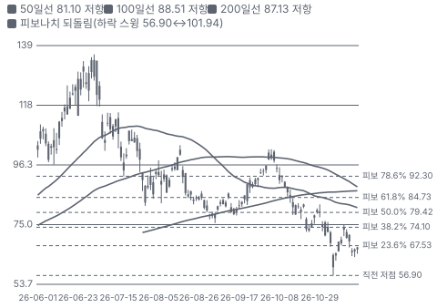

**주봉**

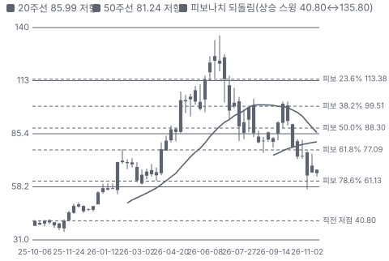

**월봉**

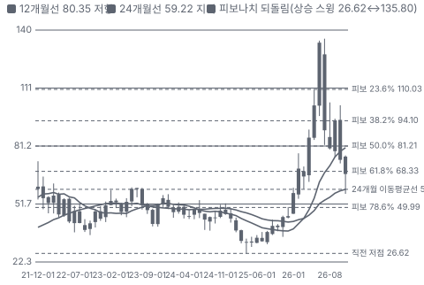

**분기 매출·EPS 실적과 컨센서스**

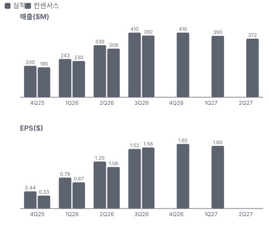

**4Q26 매출 — 지표 추세 vs 가이던스·컨센서스**

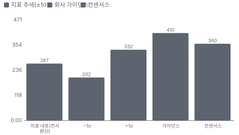

**EPS 리비전**

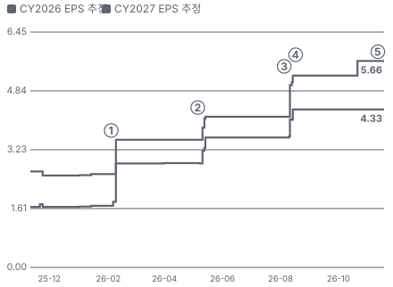

① 26-02-04 1Q FY26 실적 · EPS 리비전 +37%
② 26-05-06 2Q FY26 실적 · EPS 리비전 +18%
③ 26-08-05 3Q FY26 실적 — 캐파 4배·4Q \$375M · EPS 리비전 +27%
④ 26-08-17 새 CEO Raj Talluri 선임 발표 · 실적 창과 겹침
⑤ 26-11-18 4Q FY26 실적 — 1Q \$410M 유지 · EPS 리비전 +0%

**멀티플 프리미엄(Fwd 1Y P/E, 최근 4개 분기말 절대값 — 대상 vs 동종 중앙값)**

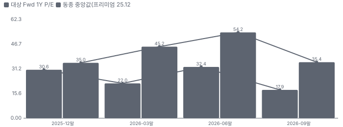

**합리적 멀티플**

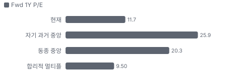

**밸류에이션 주가 시나리오**

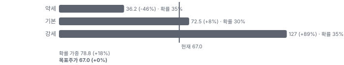

**주가별 업사이드**

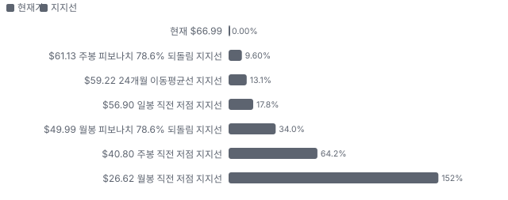
- 제품·서비스 포트폴리오

**고객 믹스(FY26 9개월(10-Q), 매출 대비)**

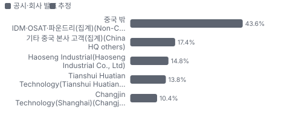

**공급 병목(10점, 낮을수록 병목)**

**CAPEX의 매출 대비 비중**

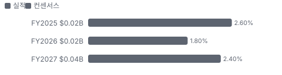

**어닝콜 변화별 주주가치 영향**

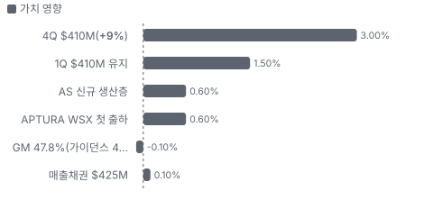

**수주·파이프라인 확실성 사다리**

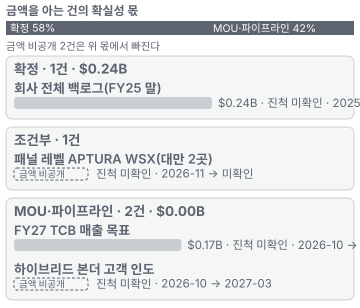

**매출 → 매출총이익 → 영업이익(매출 = 100, 최근 4분기)**

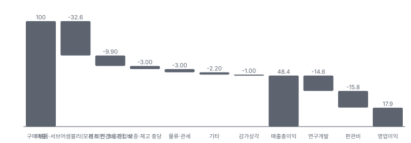

**분기 비용 비중 추이(매출 대비, 공시)**

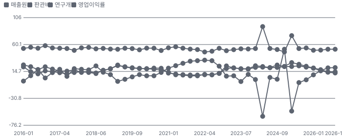

**비용 요인별 매출 대비 비중 1년 변화**

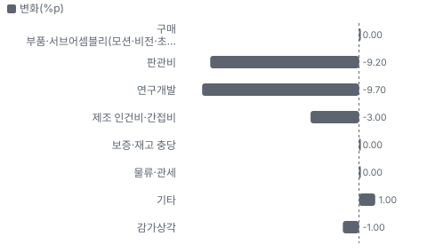

**Ball bonding 장비 BOM 원가 몫**

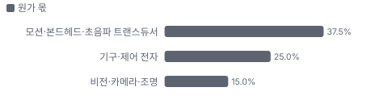

**Advanced Solutions(TCB·첨단 패키징) BOM 원가 몫**

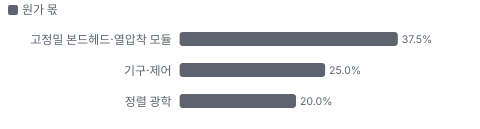

**BOM 항목 가격 +10% 시 OPM 변화**

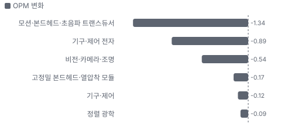

**원가 물가 vs 판매가 물가 — 최근 24개월(24.11 = 100): 둘이 비슷하게 움직인다**

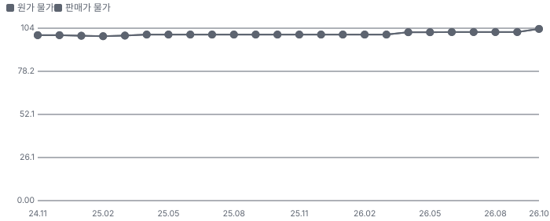

**자산 구성 — 3Q26 분기말 투하자본 \$236.4M**

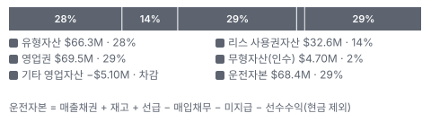

**자산별 변화율 — 최근 12개 분기(3Q23 = 0%) + 다음 4개 분기 추정**

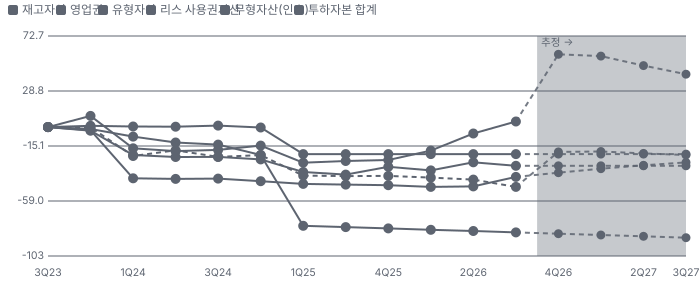

**분기 감가 비율 연율(유형자산 총액 대비)**

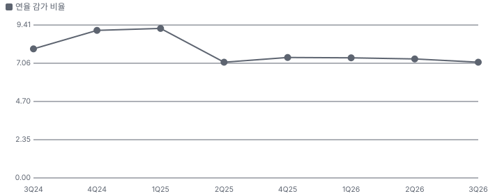

**ROIC 추이 — TTM, 최근 12개 분기 + 다음 4개 분기 추정(컨센서스 NOPAT)**

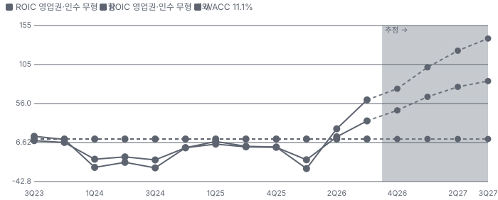

**생산시설별 면적(sq ft, 큰 순) — 생산능력 미공시라 면적을 대용으로**

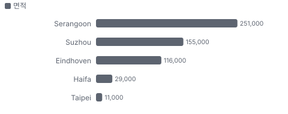

**매출 vs PPI·수출입 — 4Q22 = 100(변화율, 로그 눈금)**

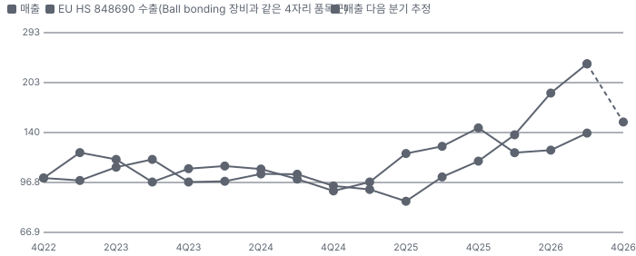

**10년 P·Q 사이클 — 추세(HP 필터) 대비 갭과 8분기 전망**

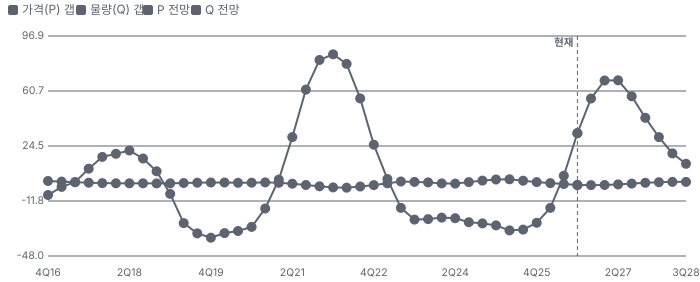

**매출 증가율의 가격·물량 분해와 8분기 전망(전년 대비)**

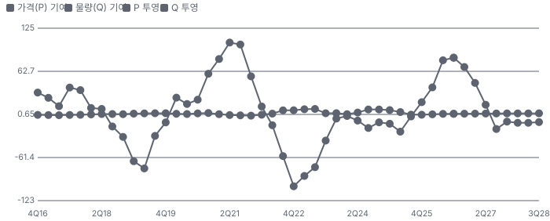

**분기별 매출 증가율 분해**

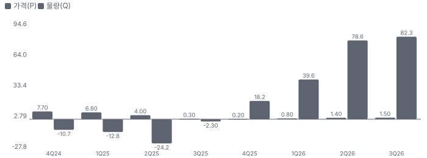

**목표주가 산정 — 약세와 기본 사이(약세 쪽 16%), 도달 확률 약 55%**

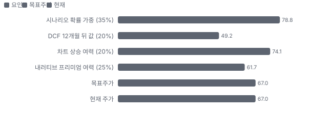

**일봉 지지·저항과 목표주가**

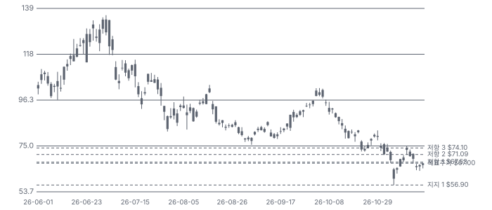

**재고 일수 — 분기별(수주 자료가 없어 수주/출하 비율 없음)**

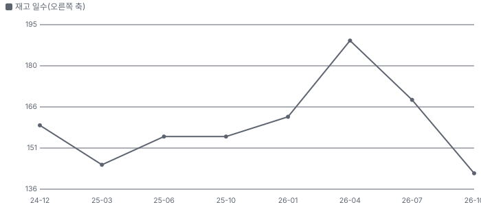

**일별 거래량 분해**

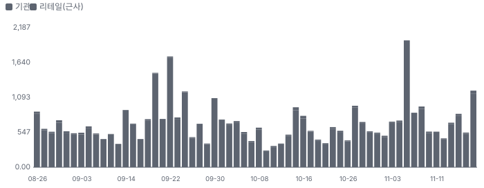

**기관 자금 흐름**

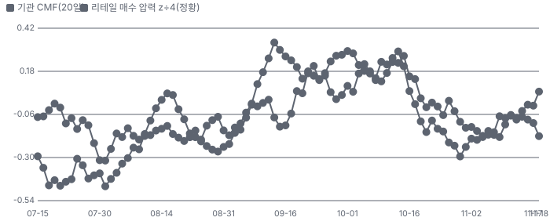

**몬테카를로**

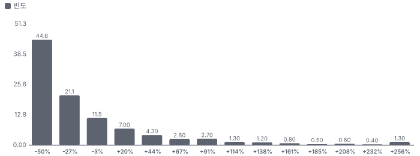

해석: 3,000번 중 779번(26%)에서 가치가 지금 주가 이상이었다. 가정을 흔들어도 지금 주가를 뒷받침하지 못하는 경우가 더 많다. 가운데 값은 0.66배이고, 열 번 중 여덟 번은 0.44~1.68배 사이에 든다.

## 내러티브

> **기업가치를 결정하는 이야기:** 3Q 기준 매출의 68%가 볼 본더, 11%가 소모품·서비스(APS(소모품·부품·서비스 사업, Aftermarket Products and Services)), 9%가 첨단 패키징(Advanced Solutions), 8%가 웨지 본더(굵은 선을 눌러 붙이는 와이어 본딩 장비, 전력 반도체·자동차용)다. 볼 본더는 OSAT 증설 때 한꺼번에 팔리고 증설이 끝나면 급감하는 사이클 사업이다. 장기 가치는 깔린 장비가 소모품을 반복 구매하는 APS와, 아직 적자인 TCB·하이브리드가 사이클 밖 성장을 만드느냐에 달렸다.

> **멀티플·EPS 프리미엄**
> **멀티플:** Fwd 1Y P/E 11.7배로 동종 4곳(Teradyne·Onto Innovation·Camtek·FormFactor) 중앙값 20.3배보다 42% 낮다. 7월에는 30배대였다.
> **EPS:** FY27 조정 EPS 컨센서스 \$5.75(+46%), FY28 \$4.50(−22%) — 시장은 FY27을 정점으로 본다.

### 투자자들은 왜 열광했나

2026년 상반기 투자자들은 KLIC를 'AI 첨단 패키징 장비주'로 봤다 — 플럭스리스(산화막 제거용 플럭스 없이 접합하는 방식) TCB, 패널 레벨, 하이브리드 본더, CPO(광학 엔진을 칩 옆에 함께 넣는 패키징) 패키징. 7/1 종가 \$133.81까지 올랐다. 식은 이유는 네 가지다: 7월 장비주 급락(7/2 −9.3%·7/7 −11.5%), 새 CEO 발표 다음 날 −9.5%, 10/22 장비주 급락(−9.9%), 11/5 중간선거 뒤 AI 하드웨어 급락(−12.6%). 그 사이 매출 성장의 실체가 중국 와이어 본더라는 점이 10-Q로 드러났다.

### 무엇이 기업가치를 바꾸나

> **구조적 체질 변화**
> **변화:** 전자조립 사업 중단(2025-03 결정)으로 반도체 조립에 집중
> **증거:** 10-Q 주석 17
> **반증:** 중단 비용 추가 발생

> **고부가 믹스 확장**
> **변화:** TCB·하이브리드·패널로 첨단 패키징 비중 확대 시도
> **증거:** Advanced Solutions 3Q \$29.4M(9%), FY27 TCB 목표 \$150~200M(3Q 콜)
> **반증:** FY27 Advanced Solutions 매출 \$100M 미만

> **기술 혁신**
> **변화:** 플럭스리스 구리 직접 열압착(열과 압력을 함께 가해 붙이는 방식), 180mm 본드헤드 패널 TCB
> **증거:** 10-K 제품 절·11/18 보도자료
> **반증:** 대만 고객 반복 주문 없음

> **실행 속도**
> **변화:** 해당 없음(주문→출하 리드타임 미공시라 피어 비교 불가) — 와이어 본딩(칩 패드와 기판을 가는 금·구리선으로 잇는 전통 패키징 공정) 캐파를 두 분기 만에 4배로 늘렸고 주문이 FY27 2분기 출하분까지 들어온다(3Q 콜)
> **증거:** 3Q 콜
> **반증:** 출하 지연·재고 증가

> **M&A**
> **변화:** 해당 없음(최근 3년 큰 인수 없음)
> **증거:** 10-K
> **반증:** 해당 없음

> **정책·입법 연관성**
> **재정정책:** CHIPS(미국 반도체 지원법) 보조금 — 미국 출하 약 5%라 노출 작음 10-Q(미국 밖 94.4%) 반증: 해당 없음 의회 동의 10/10 — 하원 5/5(CHIPS법(2022) 세출 반영) · 상원 5/5(같음).
> **행정명령:** 미국 대중국 관세·수출 통제 — 중국 본사 고객 56.4% 10-Q 사업 환경 절 반증: 후공정 조립 장비가 수출 통제 대상에 추가 의회 동의 2/10 — 하원 1/5(행정 조치 — 의회 의결 대상 아님) · 상원 1/5(같음).
> **연관입법:** 해당 없음(회사 매출과 직접 연결되는 법안 미확인) 10-K 반증: 해당 없음

> **고객의 지출 예산**
> **변화:** OSAT·IDM 조립 라인 설비투자(CAPEX)와 운영비(소모품)
> **사업별 예산:** **매출의 76%**: Ball·Wedge bonding 장비 — 고객 CAPEX(OSAT·IDM 조립 라인 증설) · 동인: 중국 OSAT 증설·가동률
**매출의 11%**: APS — 고객 OPEX(조립 라인 소모품·유지보수) · 동인: 가동률(중국 95% 초과, 3Q 콜)
**매출의 9%**: Advanced Solutions — 고객 CAPEX(첨단 패키징 라인(칩렛(여러 작은 칩을 한 패키지로 묶는 설계)·패널)) · 동인: AI 가속기 패키징 캐파
> **증거:** 10-Q 세그먼트
> **반증:** 중국 OSAT 2027 설비투자 축소

### 내러티브 근거

> AI 첨단 패키징(TCB·패널·하이브리드) 장비주라는 이야기로 7월에 \$134까지 올랐지만, 실제 매출을 끌어올린 것은 중국 OSAT의 전통 와이어 본더 증설이었다. 주가는 고점보다 50% 낮다. 동종 대비 멀티플 차이 -43% 중 회사 고유 몫은 +22%다. 단계는 소멸, 쏠림은 낮음 — 셀사이드 4명(매수 1·보유 3), 13F 383곳(3Q 순증 5만 주), Quantral 7일 언급 0건이다.

> **중국 OSAT 와이어 본더 증설** · 강화
> **논리:** 중국 OSAT가 공장을 계속 지어 볼 본더 수요가 FY27 상반기까지 이어진다
> **숫자:** 볼 본딩 3Q \$226.1M(YoY +198%), 중국 본사 고객 56.4%·3곳 39%
> **반증:** 1Q FY27 매출 가이던스 하단 \$390M 미만
> **출처:** https://www.sec.gov/Archives/edgar/data/56978/000005697826000032/klic-20260704.htm

> **AI 첨단 패키징(TCB·패널)** · 약화
> **논리:** 플럭스리스 TCB·패널 레벨로 칩렛·HBM(고대역폭 메모리) 패키징 시장에 들어간다
> **숫자:** Advanced Solutions 3Q \$29.4M·영업손실 −\$12.6M, FY27 TCB 목표 \$150~200M
> **반증:** 1Q·2Q FY27 Advanced Solutions 분기 매출 \$35M 미만
> **출처:** 3Q FY26 어닝콜(2026-08-05)

> **데이터센터 = 와이어 본딩** · 유지
> **논리:** 데이터센터 칩 과반이 전통 와이어 본딩으로 포장돼 AI 투자가 레거시 장비에도 흐른다
> **숫자:** 일반 반도체 3Q \$227.2M(YoY +186%), 메모리 \$34.0M
> **반증:** 일반 반도체 매출 분기 감소 전환
> **출처:** https://www.sec.gov/Archives/edgar/data/56978/000005697826000032/klic-20260704.htm

> **반대 내러티브 — 정점 이익·중국 집중** · 강화
> **논리:** 중국 OSAT 증설 사이클이 FY27 하반기에 꺾이고 가격 경쟁·매출채권이 이익 질을 낮춘다
> **숫자:** FY28 EPS 컨센서스 −22%, 매출채권 \$425M(매출 103일분), 고점 대비 −50%
> **반증:** 2Q FY27 가이던스가 1Q 수준 유지·영업현금 순이익의 80% 이상
> **출처:** https://www.sec.gov/Archives/edgar/data/56978/000005697826000038/ex991liveq42026.htm

### 투자 포인트

> **성장의 실체는 중국 와이어 본더**
> **명제:** 3Q 볼 본더 매출 \$226.1M(YoY +198%), 중국 OSAT 3곳이 9개월 매출 39%
> **숫자:** 3Q 10-Q 세그먼트·고객 집중
> **시장과 다른 점:** 시장은 AI 첨단 패키징 장비주로 샀지만 숫자는 중국 OSAT 증설 사이클이다
> **증명:** 1Q FY27 실적의 세그먼트·지역 구성
> **출처:** https://www.sec.gov/Archives/edgar/data/56978/000005697826000032/klic-20260704.htm

> **배수 할인 42%는 정점 이익 때문**
> **명제:** Fwd 1Y P/E 11.7배 vs 동종 20.3배, FY28 EPS −22%
> **숫자:** Forward 배수·컨센서스
> **시장과 다른 점:** FY28 EPS 기준 14.9배 — 할인의 대부분은 사이클 위치로 설명된다(계산)
> **증명:** 2Q FY27 가이던스가 1Q 수준을 지키는지
> **출처:** https://www.sec.gov/Archives/edgar/data/56978/000005697826000038/ex991liveq42026.htm

> **이익은 늘었지만 현금은 안 들어왔다**
> **명제:** FY26 순이익 \$182.6M vs 영업현금 \$71.9M, 매출채권 \$425M(+\$242M)
> **숫자:** 4Q 보도자료 재무상태표·현금흐름표
> **시장과 다른 점:** 중국 고객 두 곳이 매출채권 절반 — 회수가 이익 질을 가른다
> **증명:** 1Q FY27 영업현금·매출채권
> **출처:** https://www.sec.gov/Archives/edgar/data/56978/000005697826000038/ex991liveq42026.htm

### 모멘텀 생성·소멸 타임라인

**카탈리스트 달력 — 지난 사건의 주가 반응과 앞으로 확인할 숫자**
| 날짜 | 상태 | 구분 | 사건 | 반응·확인 | 결과에 따라 |
|---|---|---|---|---|---|
| 2026-07-01 | 완료 | 생성 | AI 첨단 패키징 기대 — 종가 고점 \$133.81 | 이후 −50% |  |
| 2026-08-18 | 완료 | 소멸 | 새 CEO 선임 발표 다음 거래일 | 하루 −9.5%(원인 연결 미확인) |  |
| 2026-11-05 | 완료 | 소멸 | 중간선거 뒤 AI 하드웨어 급락 | 하루 −12.6% |  |
| 2026-11-19 | 예정 | 확인 | 4Q FY26 어닝콜(08:00 ET) | FY27 2분기 이후 가시성, TCB \$150~200M 재확인, 매출채권 회수 | 가시성이 하반기까지 늘면 FY28 추정 상향, TCB 목표 철회면 배수 정체 |
| 2027-02(추정) | 예정 | 확인 | 1Q FY27 실적·2Q 가이던스 | 매출 \$390M 이상, 2Q 가이던스 \$380M 이상, 영업현금 개선 | 셋이 맞으면 FY28 하강 폭 축소 |

### 언제 사서 언제 팔아야 할까?

**가격·조건 틀 — 가격은 밸류에이션(약세·기본·강세·목표주가)과 차트 지지 구간에서, 조건은 이벤트에서**
| 구간 | 가격 | 목표주가까지 | 약세까지 | 조건·근거 |
|---|---|---|---|---|
| 관찰 구간 | \$61~\$61 | +10% | -41% | 지지 구간이 약세 시나리오 가격과 겹치는 곳 — 11/5 종가 저점 \$59.83 근처 |
| 확인 뒤 | 지금 \$67 이상에서 조건 확인 | +0% | -46% | 1Q 가이던스 달성·2Q 가이던스 유지·매출채권 감소 |
| 무효화 | 약세 시나리오 \$36 | - | -46% | 11/5 종가 저점 \$59.83 이탈과 함께 2Q 가이던스가 1Q보다 15% 이상 낮다 |
| 차익 고민 1차 | \$72(목표주가·기본 시나리오) | +8% | - | 목표주가 근처에서는 FY28 EPS 기준 배수가 동종에 얼마나 다가섰는지 본다 |
| 차익 고민 2차 | \$127(강세 시나리오) | +89% | - | 목표주가 근처에서는 FY28 EPS 기준 배수가 동종에 얼마나 다가섰는지 본다 |

업종 사건 날 −9~13% 움직임이 반복됐다(7/2, 7/7, 10/22, 11/5) 가격·조건 틀이며 매매·비중 지시가 아니다(투자 권유 아님).

## 포트폴리오

| 제품·서비스 | 구분 | 무엇 | 쓰는 곳 | 돈 버는 방식 | Mix | Mix 변화(전 분기 대비) |
|---|---|---|---|---|---|---|
| Ball bonding 장비 | 제품 | 금·구리선을 칩 패드와 기판에 잇는 볼 본더 | 중국·동남아 OSAT의 일반 반도체·메모리·전력 칩 조립 라인 | 3Q 매출 \$226.1M(68%), 부문 영업이익률 41% | 68% | +2.4%p |
| Advanced Solutions(TCB·첨단 패키징) | 제품 | 플럭스리스 열압착(TCB)·칩 투 기판·패널 레벨 본더와 다이 어태치(칩을 기판에 올려 붙이는 공정) | 칩렛·AI 가속기 패키징을 시험하는 파운드리·OSAT·IDM | 3Q 매출 \$29.4M(9%), 영업손실 −\$12.6M | 9% | -1.2%p |
| APS(소모품·서비스) | 서비스 | 캐필러리(와이어 본더 끝에서 선을 내보내는 소모성 세라믹 노즐)·웨지·블레이드 소모품, 부품, 수리·업그레이드 | KLIC와 다른 회사 장비를 쓰는 조립 라인 | 3Q 매출 \$35.8M(11%), 부문 영업이익률 33% | 11% | -3.5%p |
| Wedge bonding 장비 | 제품 | 굵은 선을 눌러 붙이는 웨지 본더 | 자동차·산업용 전력 반도체 | 3Q 매출 \$25.8M(8%), 9개월 −\$30.6M(전기차 수요 약세) | 8% | +2.4%p |

**Mix 변화가 가장 큰 쪽은 APS(소모품·서비스, -3.5%p, 전 분기 대비).** 계절성 판정: 분기 매출 계절 지수 기준 없음 → 직전 분기와 비교.

## 고객

> **FY26 9개월(10-Q) 최대 매출 묶음 중국 밖 IDM·OSAT·파운드리 44%·상위 3개 묶음 76%(고객 기준으로는 최대 고객 14.8%·상위 3곳 39%), 집중도 집중.** 공시·회사 발표로 확인한 몫은 매출의 83%이고, 나머지 고객 몫은 추정이거나 미분해다. 9개월 매출 중 중국 OSAT 3곳이 39%다 — Haoseng Industrial 14.8%, Tianshui Huatian 13.8%, Changjin Technology(Shanghai) 10.4%. 매출채권은 Haoseng 26.1%·Huatian 23.7%로 두 곳이 절반이다. 중국 본사 고객 출하가 9개월 매출의 56.4%(1년 전 51.3%), 미국 밖 출하가 94.4%다.

**고객별 매출 몫(FY26 9개월(10-Q))**
| 고객 | 몫 | 변화 | 근거 |
|---|---|---|---|
| 중국 밖 IDM·OSAT·파운드리(집계, Non-China) | 44% | -5%p | 공시 |
| 기타 중국 본사 고객(집계)(China HQ(본사) others) | 17% | 미확인 | 추정 |
| Haoseng Industrial(Haoseng Industrial Co., Ltd) | 15% | 미확인 | 공시 |
| Tianshui Huatian Technology(Tianshui Huatian Technology Co., Ltd) | 14% | +4%p | 공시 |
| Changjin Technology(Shanghai)(Changjin Technology (Shanghai) Co., Ltd) | 10% | 미확인 | 공시 |

> **중국 밖 IDM·OSAT·파운드리(집계, Non-China)** · 공시
> **사는 것:** 와이어 본더·TCB·소모품
> **추정 근거:** 100% − 중국 본사 56.4%(1년 전 51.3%)

> **기타 중국 본사 고객(집계, China HQ others)** · 추정
> **사는 것:** 와이어 본더·소모품
> **추정 근거:** 중국 본사 고객 56.4% − 위 3곳 39.0%(계산, 3곳이 모두 중국 본사라는 가정)

> **Haoseng Industrial(Haoseng Industrial Co., Ltd)** · 공시
> **사는 것:** 볼 본더(추정)
> **추정 근거:** 10-Q 고객 집중 — 1년 전 10% 미만 — 전년 같은 기간 10% 미만(정확한 값 미공시)

> **Tianshui Huatian Technology(Tianshui Huatian Technology Co., Ltd)** · 공시
> **사는 것:** 볼·웨지 본더
> **추정 근거:** 10-Q 고객 집중(FY25 연간 12.0%, 10-K)

> **Changjin Technology(Shanghai)(Changjin Technology (Shanghai) Co., Ltd)** · 공시
> **사는 것:** 볼 본더(추정)
> **추정 근거:** 10-Q 고객 집중 — 1년 전 10% 미만. 어느 그룹 소속인지는 미확인 — 전년 같은 기간 10% 미만(정확한 값 미공시)

## 수주·파이프라인

> **2026-11-18 기준 4건.** 확정 \$0.24B. 공시 백로그(12개월 안 출하분, FY25 말) \$0.24B. 서로 겹치는 항목은 합계에서 뺐다.

**수주 목록**
| 상태 | 계약 | 계약 총액 | 진척 | 기간 | 비고 |
|---|---|---|---|---|---|
| 확정 | 회사 전체 백로그(FY25 말) | \$0.24B | 비공개 | 2025-10 → 2026-09 | FY26 말 백로그 미확인 |
| 조건부 | 패널 레벨 APTURA WSX(대만 2곳) | 금액 비공개 | 비공개 | 2026-11 → 미확인 | 첫 출하는 양산 채택이 아니다(금지표) |
| 파이프라인 | FY27 TCB 매출 목표 | \$0.17B | 비공개 | 2026-10 → 2027-09 | 경영진 목표 \$150~200M 중간값 — 수주가 아니다 (다른 항목과 겹칠 수 있어 합계에서 뺌) |
| 파이프라인 | 하이브리드 본더 고객 인도 | 금액 비공개 | 비공개 | 2026-10 → 2027-03 | - |

**실행 속도와 방해 요인**
| 항목 | 상태 | 실행 속도 | 방해 요인 |
|---|---|---|---|
| 회사 전체 백로그(FY25 말) | 확정 | 12개월 안 출하분(10-K 정의) | 대부분 취소·연기 가능(10-K) · 중국 고객 수요 변동 |
| 패널 레벨 APTURA WSX(대만 2곳) | 조건부 | 첫 출하 2026-11(회사 발표) | 고객 인증·반복 주문 미확인 |
| FY27 TCB 매출 목표 | 파이프라인 | FY27(2026-10~2027-09) | Advanced Solutions 적자(3Q −\$12.6M) · BESI·ASMPT 경쟁 |
| 하이브리드 본더 고객 인도 | 파이프라인 | FY27 상반기 인도 계획(3Q 콜) | 고객 평가 |

## 마진 구조

> **GPM 47.8%, OPM 21.2%.** 3Q FY26 대비 GPM -0.0%p, OPM +0.6%p. 변동비는 매출의 50%이고, 매출이 10% 늘면 OPM은 +2.6%p 움직인다. 4Q GAAP 매출원가는 매출의 52.2%로 1년 전 54.3%보다 낮다 — 물량이 2.3배로 늘며 고정비를 흡수했다. 원가 항목별 몫은 공시되지 않아 추정이다. 3Q 콜은 성과 보상이 4Q 영업비용을 올린다고 했고, 4Q 판관비는 \$58.0M(3Q \$45.8M)이었다.

> **매출 100 중 매출원가 51.6, 매출총이익 48.4(최근 4분기, 공시).** 매출원가 요인 중 구매 부품·서브어셈블리(모션·비전·초음파)이 매출의 33.0%로 가장 무겁고, 단가가 +10% 오르면 GPM이 -3.30%p 움직인다. 분기 회귀로 매출 1이 늘 때 매출원가는 0.50 늘고, 매출원가의 고정비 몫은 7%다. 매출원가 요인 비중은 요인별 공시 기간 값이라 합이 최근 4분기 매출원가를 넘어, 그림에서는 0.99배로 비례 조정했다.

**비용 요인 강도 — 비중·추세·충격(+10%)·탄력**
| 비용 | 구분 | 매출 대비 | 1년 변화 | 마진 기여 | 충격 시 마진 | 매출 탄력 | 고정비 몫 |
|---|---|---|---|---|---|---|---|
| 구매 부품·서브어셈블리(모션·비전·초음파) | 매출원가 요인 | 33.0% | +0.0%p | -0.0%p | -3.30%p | 미확인 | 5% |
| 제조 인건비·간접비 | 매출원가 요인 | 10.0% | -3.0%p | +3.0%p | -1.00%p | 미확인 | 60% |
| 보증·재고 충당 | 매출원가 요인 | 3.0% | +0.0%p | -0.0%p | -0.30%p | 미확인 | 20% |
| 물류·관세 | 매출원가 요인 | 3.0% | +0.0%p | -0.0%p | -0.30%p | 미확인 | 10% |
| 기타 | 매출원가 요인 | 2.2% | +1.0%p | -1.0%p | -0.22%p | 미확인 | 30% |
| 감가상각 | 매출원가 요인 | 1.0% | -1.0%p | +1.0%p | -0.10%p | 미확인 | 100% |
| 매출원가 | 공시 항목 | 51.6% | -5.9%p | +5.9%p | -5.16%p | 0.50 | 7% |
| 판관비 | 공시 항목 | 15.8% | -9.8%p | +9.8%p | 미확인 | 0.03 | 84% |
| 연구개발 | 공시 항목 | 14.6% | -8.3%p | +8.3%p | 미확인 | 0.02 | 83% |

매출 탄력 = 분기 비용을 매출에 회귀한 기울기(매출 1당 변동비), 고정비 몫 = 절편 ÷ 평균 비용. 표본이 8분기 미만이면 미확인. 매출원가 요인 비중은 margin 재료의 추정이 섞여 있고, 공시 매출원가와의 차이는 '기타 매출원가'로 둔다.

**GPM에서 OPM까지(GAAP, 아래는 최근 4개 분기)**
| 기간 | GPM | 연구개발 | 판관비 | 기타 | OPM |
|---|---|---|---|---|---|
| 4Q FY25 | 45.7% | 21.9% | 23.4% | 0.0% | 0.5% |
| 3Q FY26 | 47.8% | 13.3% | 13.9% | 0.0% | 20.7% |
| 4Q FY26 | 47.8% | 12.1% | 14.1% | 0.2% | 21.2% |
| 2026-01 | 49.6% | - | - | - | 8.9% |
| 2026-04 | 49.3% | - | - | - | 15.9% |
| 2026-07 | 47.8% | - | - | - | 20.7% |
| 2026-10 | 47.8% | - | - | - | 21.2% |

**비용을 움직이는 요인**
| 비용 | 요인 |
|---|---|
| 구매 부품·서브어셈블리(모션·비전·초음파, 매출원가) | 부품 단가·물량 · 근거 추정 |
| 판관비(판관비) | 성과 보상 적립 · 근거 공시 |
| 연구개발(연구개발) | TCB·하이브리드·패널 · 근거 공시 |
| 제조 인건비·간접비(매출원가) | 싱가포르·쑤저우 조립 인력 · 근거 추정 |
| 보증·재고 충당(매출원가) | 보증 충당 3Q \$5.5M(10-Q) · 근거 추정 |
| 물류·관세(매출원가) | 물류비 고공(10-Q) · 근거 추정 |
| 기타(매출원가) | 매출원가 − 위 항목 · 근거 추정 |
| 감가상각(매출원가) | 분기 D&A 약 \$4M · 근거 추정 |

**Ball bonding 장비 BOM — 매출의 68%, GPM 48%(추정 — 부문 총이익 미공시라 4Q 전사 GAAP 총이익률 47.8%로 대용. 부문 총이익 미공시 — 부문 영업이익률 41%(3Q \$93.2M ÷ \$226.1M, 10-Q)), 항목 가격 +10% 시**
| 항목 | 원가 몫 | 전가 | 제품 GPM | OPM |
|---|---|---|---|---|
| 모션·본드헤드·초음파 트랜스듀서 | 30~45% | 미확인 | -2.0%p | -1.34%p |
| 기구·제어 전자 | 20~30% | 미확인 | -1.3%p | -0.89%p |
| 비전·카메라·조명 | 10~20% | 미확인 | -0.8%p | -0.54%p |
| 미분해 | 22% | - | - | - |

**Advanced Solutions(TCB·첨단 패키징) BOM — 매출의 9%, GPM 48%(추정 — 부문 총이익 미공시라 4Q 전사 GAAP 총이익률 47.8%로 대용. 부문 영업손실 −\$12.6M(3Q, 10-Q)), 항목 가격 +10% 시**
| 항목 | 원가 몫 | 전가 | 제품 GPM | OPM |
|---|---|---|---|---|
| 고정밀 본드헤드·열압착 모듈 | 30~45% | 미확인 | -2.0%p | -0.17%p |
| 기구·제어 | 20~30% | 미확인 | -1.3%p | -0.12%p |
| 정렬 광학 | 15~25% | 미확인 | -1.0%p | -0.09%p |
| 미분해 | 18% | - | - | - |

모션·본드헤드·초음파 트랜스듀서 가격이 +10% 오르면 영업이익은 -6.3% 움직인다. 판매가 전가를 모르는 항목은 전가 0%로 계산했다.

**BOM 항목 가격을 움직이는 것**
| 항목 | 요인 |
|---|---|
| 모션·본드헤드·초음파 트랜스듀서 | 본딩 속도·정밀도를 정하는 핵심 부품 · 근거 추정 |
| 비전·카메라·조명 | 패드 인식 · 근거 추정 |
| 기구·제어 전자 | 본체·제어 보드 · 근거 추정 |
| 고정밀 본드헤드·열압착 모듈 | 플럭스리스 구리-구리 열압착 · 근거 추정 |
| 정렬 광학 | 미세 피치 정렬 · 근거 추정 |
| 기구·제어 | 본체 · 근거 추정 |

**투입 물가 — 미국 PPI 3·6·12개월(2026-10, 개정 반영)과 해외 전년비**
| 항목 | 미국 3개월 | 6개월 | 12개월 | 전가 못 할 때 OPM | 일본 | 한국 | 대만 |
|---|---|---|---|---|---|---|---|
| 구매 부품·서브어셈블리(모션·비전·초음파) | +1.9% | +2.0% | +3.4% | -1.1%p | +2.2% | +0.0% | +3.0%* |

별표는 품목보다 넓은 업종 지수다. 연결한 투입 원가의 미국 PPI(생산자물가지수)는 1년 새 가중 +3.4%이고, 판매가로 넘기지 못하면 GPM -1.1%p·OPM -1.1%p가 움직인다. 판매가 비교 물가(반도체 조립 장비(와이어·다이 본더) PPI)는 1년 새 +3.4% — 회사 가격 변화는 미확인. 물가 지수를 붙이지 못한 매출원가 항목은 제조 인건비·간접비, 보증·재고 충당, 물류·관세, 감가상각다(미연결).

## 자산 구성

> **3Q26 분기말 투하자본 \$236.4M** — 영업권 29%, 운전자본 29%. 최근 12개 분기(3Q23 → 3Q26) 가장 크게 늘어난 자산은 재고자산(+5%), 투하자본 합계 -48%. 3Q27 추정 투하자본 \$351.7M(+49%, 컨센서스 매출과 회전 일수·CAPEX 강도 유지 가정). 연율 감가 비율(총액 기준)은 직전 4분기 8.32% → 최근 4분기 7.31%, 직전 비율이면 감가상각이 \$2.2M 더 컸다(영업이익의 1.8%).

**자산·운전자본 항목별 분기말 잔액 — 최근 12개 분기와 다음 4개 분기 추정**
| 항목 | 3Q23 | 2Q25 | 3Q26(최근) | 3Q27 추정 | 12개 분기 변화 | 다음 4개 분기 변화 |
|---|---|---|---|---|---|---|
| 재고자산 | \$217.3M | \$158.3M | \$227.1M | \$309.0M | +5% | +36% |
| 선급·기타 유동자산 | \$53.8M | \$41.6M | \$31.8M | \$65.1M | -41% | +105% |
| 매입채무 | \$49.3M | \$52.7M | \$116.9M | \$127.7M | +137% | +9% |
| 미지급비용 | \$35.7M | \$28.7M | \$73.6M | \$74.1M | +106% | +1% |
| 유형자산 | \$110.1M | \$59.5M | \$66.3M | \$79.0M | -40% | +19% |
| 리스 사용권자산 | \$47.1M | \$29.3M | \$32.6M | \$32.6M | -31% | +0% |
| 영업권 | \$88.7M | \$69.5M | \$69.5M | \$69.5M | -22% | +0% |
| 무형자산(인수) | \$29.4M | \$5.9M | \$4.7M | \$3.4M | -84% | -26% |

**자산 추정 동인 — 최근 4개 분기 평균(재무상태표 동인 모형)**
| 동인 | 값 | 곱하는 기준 |
|---|---|---|
| 재고자산 | 146일 | 매출원가 |
| 선급·기타 유동자산 | 16일 | 매출 |
| 매입채무 | 60일 | 매출원가 |
| 미지급비용 | 18일 | 매출 |
| CAPEX 강도 | 1.5% | 매출(최근 4개 분기 합) |
| 분기 감가율 | 6.30% | 기초 유형자산 순액(무형 상각 제외 감가상각) |
| 매출원가율 | 51.8% | 매출(최근 4개 분기) |
| 영업권·리스 사용권·기타 | 유지 | 인수·새 리스는 공시 전 모름 |
| 인수 무형자산 | 분기 \$0.3M 상각 | 최근 4개 분기 평균 상각 |

**추정 방법:** 증권사 3표 모델(손익·재무상태표·현금흐름)의 재무상태표 동인 방식이다. 운전자본은 항목별 회전 일수(매출채권·선급·미지급·선수는 매출, 재고·매입채무는 매출원가 기준)를 최근 4개 분기 평균으로 두고 컨센서스 매출에 곱한다. 유형자산은 기초 + CAPEX − 감가상각으로 굴린다(Koller·Goedhart·Wessels 『Valuation』 재무상태표 추정). 매출 경로는 ROIC 절의 컨센서스와 같다.

**유형·무형자산 항목별 가치(2025-10-04 vs 2024-09-28)**
| 구분 | 항목 | 총액 2025-10-04 | 누적상각 | 순액 | 총액 2024-09-28 | 총액 1년 변화 | 공시 내용연수 |
|---|---|---|---|---|---|---|---|
| 유형 | 유형자산 합계(항목 미분해) | \$213.7M | 총계만 공시 | 총계만 공시 | \$224.3M | -4.8% | 미확인 |
| 영업권 | 영업권 | \$69.5M | \$0.0M | \$69.5M | \$89.7M | -22.5% | 비상각 |
| 무형 | 무형자산 합계(항목 미분해) | \$69.6M | \$64.0M | \$5.6M | \$134.4M | -48.2% | 미확인 |
| 유형 합계 | 유형자산 | \$213.7M | \$154.7M | \$59.0M | \$224.3M | -4.8% | 경과율 72%(상각 대상 기준) |

**내용연수 산식(상각 대상 유형자산 = 총액 − 토지 − 건설중)**
| 기준일 | 연 감가상각 | 상각 대상 총액 | 평균 내용연수 | 경과 연수 | 잔여 연수 | 경과율 |
|---|---|---|---|---|---|---|
| 2025-10-04 | \$14.9M | \$213.7M | 14.3년 | 10.4년 | 3.9년 | 72% |
| 2024-09-28 | \$19.5M | \$224.3M | 11.5년 | 8.2년 | 3.3년 | 71% |

산식 평균 내용연수는 14.3년. 1년 전 11.5년 → 지금 14.3년.

**분기 감가 비율(감가상각 ÷ 평균 유형자산 총액)**
| 분기 | 감가상각 | 평균 유형자산(총액) | 분기 비율 | 연율 | 연율의 역수 |
|---|---|---|---|---|---|
| 3Q24 | \$4.8M | \$243.9M | 1.98% | 7.94% | 12.6년 |
| 4Q24 | \$5.0M | \$220.7M | 2.27% | 9.08% | 11.0년 |
| 1Q25 | \$5.0M | \$217.9M | 2.30% | 9.20% | 10.9년 |
| 2Q25 | \$3.9M | \$220.2M | 1.78% | 7.12% | 14.1년 |
| 4Q25 | \$4.0M | \$217.7M | 1.85% | 7.41% | 13.5년 |
| 1Q26 | \$4.0M | \$214.3M | 1.85% | 7.39% | 13.5년 |
| 2Q26 | \$4.0M | \$217.2M | 1.83% | 7.32% | 13.7년 |
| 3Q26 | \$4.0M | \$224.7M | 1.78% | 7.12% | 14.0년 |

감가상각 기준: 손익계산서 감가상각·상각비(SEC 공시 데이터, 4분기 = 연간 − 1~3분기).

**감가율 하락 경고: 연율 8.32% → 7.31%(-12%).** 직전 4분기 비율을 그대로 쓰면 최근 4분기 감가상각이 \$2.2M 더 컸다(영업이익의 1.8%). 내용연수 연장·상각 끝난 자산 증가·건설중 자산 증가(믹스) 중 무엇인지는 공시 주석으로 가린다(자체추론).

미공시·미분해: 유형자산 항목별 총액·내용연수(10-K 주석에서 모델이 채움) · 무형자산 항목(10-K 주석에서 모델이 채움) — 이 칸은 비우고 나머지로 계산했다.

### 해석 — 자산이 어디에 쌓이고 있나

- 같은 기간 4개 분기 매출은 +31%. 자산이 매출보다 빨리 쌓이지 않았다 — 회전율이 유지된다.
- 다음 4개 분기 CAPEX \$23.3M vs 감가상각 \$18.0M(최근 4개 분기 CAPEX 강도·감가율 유지) — 유형자산 3Q26 \$66.3M → 3Q27 \$79.0M. 투자가 감가보다 커서 자산이 쌓이는 국면이다.
- 감가 비율 하락으로 최근 4분기 영업이익에 \$2.2M(1.8%)가 보태졌을 수 있다 — 내용연수 변경 공시가 없으면 건설중 자산·토지 같은 비상각 자산 몫이 커진 믹스 효과일 가능성이 크다(자체추론).

## ROIC

> **TTM 3Q26 ROIC는 영업권·인수 무형 포함 34.0%, 제외 60.6%**(NOPAT 마진 11.6% × 투하자본 회전율 2.94회). 최근 12개 분기 3Q23 9.0% → 3Q26 34.0%(고점 3Q26 34.0%). 컨센서스 NOPAT으로 굴리면 3Q27 84.5%(제외 138.3%) — WACC 11.1% 대비 +73.4%p. 1년 변화의 가장 큰 요인은 NOPAT 마진(+27.4%p).

**ROIC 추이(TTM)와 다음 4개 분기 추정 — NOPAT ÷ 평균 투하자본(이번 분기말·4개 분기 전)**
| 분기 | 구분 | TTM 매출 | TTM NOPAT | NOPAT 마진 | 평균 투하자본 | ROIC 포함 | ROIC 제외 |
|---|---|---|---|---|---|---|---|
| 3Q23 | 실적 | \$742.5M | \$41.3M | 5.6% | \$460.7M | 9.0% | 14.5% |
| 4Q23 | 실적 | \$737.4M | \$32.8M | 4.5% | \$488.5M | 6.7% | 10.6% |
| 1Q24 | 실적 | \$736.5M | −\$67.7M | -9.2% | \$467.5M | -14.5% | -24.8% |
| 2Q24 | 실적 | \$727.2M | −\$57.3M | -7.9% | \$497.0M | -11.5% | -18.4% |
| 3Q24 | 실적 | \$706.2M | −\$71.6M | -10.1% | \$465.8M | -15.4% | -25.4% |
| 4Q24 | 실적 | \$701.2M | \$0.4M | 0.1% | \$468.4M | 0.1% | 0.1% |
| 1Q25 | 실적 | \$691.1M | \$17.4M | 2.5% | \$379.7M | 4.6% | 8.0% |
| 2Q25 | 실적 | \$657.8M | \$4.4M | 0.7% | \$389.4M | 1.1% | 1.9% |
| 4Q25 | 실적 | \$654.1M | \$2.1M | 0.3% | \$377.5M | 0.6% | 1.0% |
| 1Q26 | 실적 | \$687.6M | −\$57.3M | -8.3% | \$377.6M | -15.2% | -26.3% |
| 2Q26 | 실적 | \$768.2M | \$46.7M | 6.1% | \$337.2M | 13.9% | 24.0% |
| 3Q26 | 실적 | \$950.2M | \$109.9M | 11.6% | \$323.1M | 34.0% | 60.6% |
| 4Q26 | 추정 | \$1,182.9M | \$183.3M | 15.5% | \$386.5M | 47.4% | 74.8% |
| 1Q27 | 추정 | \$1,393.3M | \$247.8M | 17.8% | \$384.2M | 64.5% | 101.9% |
| 2Q27 | 추정 | \$1,540.7M | \$290.8M | 18.9% | \$377.4M | 77.1% | 122.9% |
| 3Q27 | 추정 | \$1,582.3M | \$305.0M | 19.3% | \$361.0M | 84.5% | 138.3% |

**다음 4개 분기 NOPAT — 컨센서스(세율 15%, 리스 이자 별도)**
| 분기 | 매출 | EBITA 마진 | EBITA | NOPAT(분기) | 근거 |
|---|---|---|---|---|---|
| 4Q26 | \$410.3M | 21.3% | \$87.5M | \$74.3M | 발표 실적 · 재무상태표 추정 |
| 1Q27 | \$410.0M | 22.9% | \$94.0M | \$79.9M | 컨센서스 매출 × EBIT 마진 FY2026(조정 − 주식보상 2.3%) |
| 2Q27 | \$390.0M | 22.9% | \$89.4M | \$76.0M | 컨센서스 매출 × EBIT 마진 FY2027(조정 − 주식보상 2.3%) |
| 3Q27 | \$372.0M | 22.9% | \$85.3M | \$72.5M | 컨센서스 매출 × EBIT 마진 FY2027(조정 − 주식보상 2.3%) |

**추정 방법:** NOPAT은 컨센서스(분기 매출 추정 × 회계연도 EBIT 마진 추정)로 잡고, 조정(비 GAAP) 마진이면 주식보상 몫을 빼서 과거 실적과 같은 기준(영업이익 + 인수 무형 상각)으로 맞췄다. 이미 발표했지만 분기 보고서(10-Q)가 아직 없는 분기는 발표 실적을 쓴다. 투하자본은 자산 구성 절의 재무상태표 동인으로 굴렸다. ROIC는 4개 분기 NOPAT을 이번 분기말과 4개 분기 전 투하자본의 평균으로 나눈다 — 추정 분기의 ROIC에는 이미 나온 실적 분기가 섞여 있다.

**투하자본 항목별 회전율과 ROIC 기여(TTM 3Q26, 평균 잔액)**
| 항목 | 투하자본 | 매출 1달러당 자본 | 회전율(매출 ÷ 항목) | 자본 몫 | 이 항목을 빼면 ROIC |
|---|---|---|---|---|---|
| 운전자본 | \$93.4M | 0.10 | 10.17회 | 29% | 48.5% |
| 유형자산 | \$62.9M | 0.07 | 15.11회 | 19% | 42.8% |
| 리스 사용권자산 | \$30.9M | 0.03 | 30.73회 | 10% | 38.1% |
| 영업권 | \$136.4M | 0.14 | 6.96회 | 42% | 59.7% |
| 무형자산(인수) | \$5.3M | 0.01 | 179.56회 | 2% | 35.1% |
| 기타 영업자산 | −\$5.9M | -0.01 | 음수(자금 원천) | -2% | 33.9% |

**ROIC 세 가지 판**
| 판 | NOPAT | 투하자본 | ROIC | 무엇을 재나 |
|---|---|---|---|---|
| 영업권·인수 무형 포함 | \$111.4M | \$323.1M | 34.5% | 인수 웃돈까지 낸 돈에 대한 수익률 |
| 영업권·인수 무형 제외 | \$111.4M | \$181.3M | 61.5% | 본업 운영 수익률(동종 비교용) |
| 무형 자본화 조정(판관비 20%·5년, 연구개발 6년) | \$130.7M | \$925.5M | 14.1% | 비용으로 처리한 무형 투자를 자산으로 본 판 |
| 경제적 이익(포함판) | \$75.7M | \$323.1M | 자본비용 11.1% | (ROIC − 자본비용) × 투하자본 |

NOPAT = (영업이익 \$125.5M + 인수 무형 상각 + 리스 내재 이자 \$2.5M) × (1 − 세율 15%). 리스 사용권자산을 투하자본에 넣었으므로 임차료 속 이자 몫을 영업이익에 되더했다. 현금은 영업에 필요한 몫을 따로 알 수 없어 투하자본에서 뺐다. SEC 공시 데이터 자동 초안 — 운전자본 = 매출채권 + 재고 + 선급 − (매입채무 + 미지급비용 + 선수수익), 현금 제외. 손상 누계는 공시 데이터 수록분.

**ROIC 1년 변화 분해(포함판, TTM 2Q25 → TTM 3Q26)**
| 요인 | ROIC 기여 |
|---|---|
| NOPAT 마진 | +27.40%p |
| 운전자본 | +2.55%p |
| 유형자산 | +0.64%p |
| 리스 사용권자산 | +0.38%p |
| 영업권 | +1.78%p |
| 무형자산(인수) | +0.42%p |
| 기타 영업자산 | -0.06%p |
| 합계 | +33.11%p |

**무형 자본화 가정별 ROIC(2025년 지출 기준, 포함판에 더함)**
| 투자로 보는 몫 | 상각 연수 | 무형 자산 | NOPAT 조정 | 조정 ROIC |
|---|---|---|---|---|
| 판관비 20% | 2년 | \$557.0M | \$16.3M | 14.5% |
| 판관비 20% | 5년 | \$602.4M | \$19.3M | 14.1% |
| 판관비 30% | 2년 | \$582.1M | \$17.2M | 14.2% |
| 판관비 30% | 5년 | \$650.1M | \$21.6M | 13.7% |

### 해석 — 무엇이 수익성을 끌어올리고 희석하나

- 영업권: 투하자본의 42% — 빼면 ROIC 34.5% → 59.7%. 이 자산의 회전율(6.96회)이 수익성을 희석하는 주된 자리다.
- 운전자본: 투하자본의 29% — 빼면 ROIC 34.5% → 48.5%. 이 자산의 회전율(10.17회)이 수익성을 희석하는 주된 자리다.
- 기타 영업자산: −\$5.9M(음수), 고객 선수금·공급사 외상이 자본을 대신 댄다 — 빼면 ROIC 33.9%로 낮아진다. 수익성을 끌어올리는 쪽이다.
- 영업권·인수 무형을 빼면 ROIC가 +27.0%p 오른다 — 과거 인수에 치른 웃돈이 주주 수익률을 그만큼 낮춘다(본업 수익률은 제외판, 인수까지 포함한 가치 창출은 포함판으로 본다).
- 1년 ROIC 개선의 최대 요인은 NOPAT 마진(+27.4%p). 반대로 깎은 최대 요인은 기타 영업자산(-0.1%p).
- 비용으로 처리한 무형 투자를 자산으로 보면 ROIC가 -20.4%p 움직인다(무형 자산 \$602.4M). 투자를 늘리는 중이라 NOPAT이 더 커지는 쪽이다.
- 추정 경로 3Q26 34.0% → 3Q27 84.5%: NOPAT 마진 +7.7%p, 투하자본 회전율 +1.44회 — 컨센서스 매출·마진이 맞고 회전 일수·CAPEX 강도가 유지된다는 가정이다. 마진 추정이 내려가거나 재고 일수가 늘면 이 경로가 먼저 틀린다.
- ROIC(포함) − WACC = +23.0%p(3Q26) — 양수면 투하자본을 늘릴수록 가치가 쌓인다.

## 공급망 병목

이미지 없음(검수 실패) — Ball bonding 장비

> **공급망 신뢰성 3.8/10, 병목 심각.** 가장 약한 고리는 모션·본드헤드·초음파 트랜스듀서 3.8점이고, 품목 평균은 3.8점이다. 근거가 부족한 2건(캐필러리 원재료(세라믹) · 반도체 조립 장비 수출(대중국))은 점수에서 뺐다. 핵심 기술 부품 일부는 단일 공급원이고 서브어셈블리는 외주다(10-K). 3Q 말 재고 구매 약정은 \$477.9M(FY26 \$316.3M·FY27 \$161.5M)으로 분기 매출의 1.4배다 — 부품을 미리 확보했다는 뜻이자, 수요가 꺾이면 재고 위험이다.

**병목과 마진 — 품목 가격 +10% 시 OPM**
| 품목 | 점수 | 판정 | 구분 | OPM |
|---|---|---|---|---|
| 모션·본드헤드·초음파 트랜스듀서(필수) | 3.8 | 병목 심각 | 핵심 통제 품목 | -1.34%p |

> **모션·본드헤드·초음파 트랜스듀서** · 3.8/10
> **왜:** 볼 본더 출하 상한
> **병목 요인:** 인증 공급사 1곳 · 캐파 빠듯 · 리드타임 미확인 · 재인증 12개월 · 1위 점유율 미확인 · 지역 집중 미확인 · 물량 확보 장기계약
> **풀리는 조건:** 미확인

**공급사**
| 품목 | 공급사 | 몫 | 근거 |
|---|---|---|---|
| 모션·본드헤드·초음파 트랜스듀서 | 미확인(단일 공급원 포함, 핵심 기술 부품) | 미확인 | 공시 |
| 캐필러리 원재료(세라믹) | 자체 생산(쑤저우·하이파, 캐필러리 제조) | 미확인 | 공시 |
| 반도체 조립 장비 수출(대중국) | Kulicke & Soffa 싱가포르 공장(완제품 출하) | 미확인 | 공시 |

**무역 통계로 본 공급 지역**
| 품목 | EU 수입처 | 일본 수입처 | EU 1위 전년비 |
|---|---|---|---|
| 반도체 조립 장비 수출(대중국) | US 33% · JP(일본) 22% · MY(말레이시아) 18% | シンガポール 62% · マレーシア 9% | +0.7% |

## 생산능력

> **현재 명목 캐파 미확인, 가동률 미확인.** FY2026 CAPEX는 \$0.02B로 매출의 1.8%다. 볼·웨지·APTURA(KLIC의 플럭스리스 TCB 장비) 등 본더는 싱가포르(Serangoon, 251,000 sq ft, 임차)에서 만든다(10-K). 3Q 콜에서 와이어 본딩 캐파를 두 분기 전의 4배로 늘렸고 과거 \$400M 분기를 지원한 적이 있다고 했다. 4Q 매출은 \$410.3M이었다. 싱가포르 신규 생산층에서 1Q FY27부터 Advanced Solutions 장비를 만든다(보도자료).

**생산시설 7곳**(10-K FY25 Item 2 주요 시설 표 7곳(그 밖 영업·지원 임차 사무소 10개국은 제외)), 임차 5곳 · 소유 2곳. 시설별 생산능력은 공개되지 않았다 — 회사 전체 캐파만 위에 적었다.

**생산시설 7곳 — 명칭·위치·생산능력**
| 시설 | 위치 | 용도 | 생산능력 | 소유·상태 |
|---|---|---|---|---|
| Serangoon | 싱가포르 | 본사·제조(볼·웨지·APTURA·APAMA(KLIC의 칩 투 기판 TCB 장비) 본더)·기술·영업 | 미확인 — 장비 캐파 미공시 — 와이어 본딩 캐파 4배(3Q 콜) · 면적 251,000 sq ft | 임차 · 가동 |
| Suzhou | 중국 쑤저우 | 제조(블레이드·캐필러리·웨지)·기술 | 미확인 — 미공시 · 면적 155,000 sq ft | 소유 · 가동 |
| Eindhoven | 네덜란드 아인트호벤 | 하이브리드·전자조립 장비 제조·기술(전자조립 사업 중단 중) | 미확인 — 미공시 · 면적 116,000 sq ft | 임차 · 가동 |
| Fort Washington | 미국 펜실베이니아 | 본사·기술·영업 | 미확인 — 생산 시설 아님 · 면적 88,000 sq ft | 소유 · 가동 |
| Santa Ana | 미국 캘리포니아 | 웨지 본더 기술·영업 | 미확인 — 생산 시설 아님 · 면적 65,000 sq ft | 임차 · 가동 |
| Haifa | 이스라엘 하이파 | 캐필러리 제조·기술 | 미확인 — 미공시 · 면적 29,000 sq ft | 임차 · 가동 |
| Taipei | 대만 타이베이 | 디스펜스 장비 제조·기술 | 미확인 — 미공시 · 면적 11,000 sq ft | 임차 · 가동 |

공개된 증설 계획은 확인되지 않았다.

**CAPEX와 매출 대비**
| 기간 | CAPEX | 매출 | 매출 대비 | 구분 |
|---|---|---|---|---|
| FY2025 | \$0.02B | \$0.65B | 2.6% | 실적 |
| FY2026 | \$0.02B | \$1.18B | 1.8% | 실적 |
| FY2027 | \$0.04B | \$1.48B | 2.4% | 컨센서스 |

## 해자

> 해자는 '와이어 본더 설치 기반과 소모품(캐필러리)·서비스'다. 성장 이야기의 중심인 첨단 패키징(TCB)은 아직 적자이고 경쟁사가 많다.

> **볼 본더 설치 기반·생산 유연성** · 보통
> **해자:** OSAT·IDM 라인에 깔린 볼 본더가 교체·증설 수요를 받고, 두 분기 만에 캐파를 4배로 늘려 점유율을 지켰다
> **근거:** 3Q 볼 본딩 매출 \$226.1M·부문 영업이익 \$93.2M(41%, 10-Q 세그먼트) · 캐파 4배(3Q 콜)
> **숫자:** 부문 영업이익률 41%(3Q)
> **깨지는 조건:** 중국 고객 매출 비중 하락과 함께 볼 본딩 부문 이익률 30% 아래

> **소모품·서비스(APS)** · 보통
> **해자:** 캐필러리·웨지·블레이드는 장비 가동량에 따라 반복 판매된다(다른 회사 장비용도 판다)
> **근거:** APS 매출 3Q \$35.8M·영업이익 \$11.7M(33%), 2023~2026 분기 \$31~43M(10-Q·)
> **숫자:** 분기 변동 폭이 장비보다 작다(10-Q '덜 변동적')
> **깨지는 조건:** APS 매출 분기 \$30M 아래 2분기 연속

> **첨단 패키징(TCB·하이브리드)** · 약함
> **해자:** 플럭스리스 TCB·패널 레벨로 칩렛 패키징에 들어가려 한다
> **근거:** Advanced Solutions 3Q 매출 \$29.4M·영업손실 −\$12.6M(10-Q 세그먼트) · 경쟁사 BESI·ASMPT·Hanwha 등(10-K)
> **숫자:** FY27 TCB \$150~200M은 경영진 목표(3Q 콜)
> **깨지는 조건:** 해당 없음

> **중국 가격 경쟁** · 약함
> **해자:** 중국 정부 지원을 받는 현지 업체가 가격을 낮춰 중국 ASP가 내려갔다
> **근거:** 10-K 위험 요인(중국 ASP 하락) · 중국 본사 고객 9개월 매출 56.4%(10-Q)
> **숫자:** 미확인(ASP 미공시)
> **깨지는 조건:** 해당 없음

## 경영진·네트워크

> 새 CEO Raj Talluri가 2026-09-01 취임했다(8-K). 직전 Enovix CEO(2023~), Micron 모바일 사업부장(2018~2022), Qualcomm·TI 경력이다. Lester Wong은 임시 CEO(2025-12~2026-08)를 거쳐 CFO로 돌아갔다. 정계 연결은 공개 기록상 미확인이다.

> **Raj Talluri** · President & CEO · 2026-09-01
> **프로필:** Enovix CEO(2023-01~), Micron SVP(부사장)·모바일 사업부장(2018-03~2022-12), Qualcomm·TI(8-K)
> **비즈니스:** Micron 모바일 메모리 사업 경력
> **정계:** 미확인
> **동문:** UT Austin 전기공학 박사(1993)
> **사모임:** 미확인

> **Lester Wong** · EVP & CFO · 미확인
> **프로필:** 임시 CEO 2025-12-01~2026-08(10-Q), 3Q 콜 진행
> **비즈니스:** 미확인
> **정계:** 미확인
> **동문:** 미확인
> **사모임:** 미확인

**네트워크 정량화**
| 연결 | 강도 | 닿는 매출 | 가중 노출 | 매출 대비 | 근거 |
|---|---|---|---|---|---|
| 비즈니스: Micron 모바일 메모리 사업 경력 — 메모리 고객과의 접점(가설) | 2/5 | \$0.10B | \$0.04B | 3% | 메모리 최종시장 9개월 매출 약 10%(\$81.5M ÷ \$813M, 10-Q) — 연결이 매출을 만든다는 근거 없음 https://www.sec.gov/Archives/edgar/data/56978/000005697826000034/klic-20260813.htm |

가중 노출은 연결이 닿는 매출의 크기다. 연결이 그 매출을 만들었다는 뜻이 아니며, 인과는 공개 자료로 입증하지 못한다.

## 약세 논리 및 셀온 조건

| 약세 논리 | 근거 | 가를 자료 |
|---|---|---|
| 중국 OSAT 사이클 정점 | 볼 본더 3Q \$226.1M(YoY +198%), 중국 본사 고객 9개월 56.4%, FY28 컨센서스 EPS −22% | 1Q FY27 실적의 2Q 가이던스(2027-02 초) |
| 고객 집중·매출채권 | 고객 3곳 9개월 매출 39%, 매출채권 Haoseng 26.1%·Huatian 23.7%(10-Q), 매출채권 \$425M | 1Q FY27 매출채권·영업현금 |
| 이익의 질 | FY26 순이익 \$182.6M vs 영업현금 \$71.9M, 조정 FCF \$50.2M | FY26 10-K 현금흐름 주석(2026-11 말) |
| 첨단 패키징은 아직 적자 | Advanced Solutions 3Q \$29.4M·영업손실 −\$12.6M, 경쟁사 BESI·ASMPT·Hanwha(10-K) | FY26 10-K 세그먼트·1Q FY27 실적 |
| 재고 위험 | 재고 구매 약정 \$477.9M(3Q 말, 분기 매출의 1.4배), 재고 \$237.5M(+48%) | 10-K 약정 표 |
| 중국 가격 경쟁 | 중국 업체 가격 인하로 중국 ASP 하락(10-K) | 부문 영업이익률 추이 |

**변이 관점.** 시장 이야기는 'AI 첨단 패키징 장비주'였다. 10-Q 숫자로 보면 3Q 매출의 68%가 볼 본더이고 첨단 패키징은 9%·적자다. 매출을 끌어올린 것은 중국 OSAT의 전통 패키징 증설이다. 그래서 **배수 11.7배가 싼지 비싼지는 FY27 이익이 정점인지에 달려 있다** — FY28 컨센서스 EPS \$4.50로 보면 14.9배(계산)로 동종과의 차이가 줄어든다. 강세 측 근거는 1Q 가이던스가 계절 약세를 지운 것, 순현금 \$517M(시총의 15%), 패널 TCB 첫 출하다. 경쟁 가설 셋: ① 정점 할인 — 가를 자료: 2Q FY27 가이던스(2027-02 초) ② 중국 집중 할인 — 가를 자료: FY26 10-K 고객 집중 표(2026-11 말) ③ TCB 옵션 미반영 — 가를 자료: 1Q·2Q Advanced Solutions 분기 매출(2027-02·05). 회사의 연간 가이던스는 없다(미확인) — 3Q 콜의 'FY27 상반기까지 강세'가 유일한 기간 발언이다.

> **셀온 조건**
> **조건 1:** 1Q FY27 매출이 가이던스 하단 \$390M에 못 미치거나 2Q 가이던스가 1Q보다 15% 이상 낮다.
> **조건 2:** 중국 고객 매출채권 회수가 늦어져 충당금이 생기거나 영업현금이 2분기 연속 순이익의 50% 아래다.
> **조건 3:** FY27 TCB 매출 목표(\$150~200M)를 철회하거나 Advanced Solutions 분기 매출이 \$30M 아래로 내려간다.
> **조건 4:** 미국이 후공정 조립 장비를 대중국 수출 통제 대상에 넣는다.

## 어닝콜 변화

**직전 콜 대비 새로 나오거나 바뀐 내용 → 가치 영향**
| 항목 | 내용 | 직전 콜 | 최신 콜 | 모델 동인 이동 | 확신도 | 가치 영향 |
|---|---|---|---|---|---|---|
| 업데이트 | 4Q 매출 가이던스 상회 | 4Q 가이던스 \$375M(3Q 콜) | 4Q 매출 \$410.3M(QoQ +24%, YoY +131%) | 1년차 성장률 +2.0% | 1.0 | +3.0% |
| 업데이트 | 1Q 계절성 없음 | 12월 분기는 늘 계절 약세(3Q 콜) | 1Q FY27 가이던스 \$410M ± \$20M — 4Q와 같은 수준 | 1년차 성장률 +1.0% | 0.8 | +1.5% |
| 부정 | 현금 전환 약화 | 3Q 영업현금 \$45.2M | 4Q 영업현금 \$25.4M, 매출채권 \$425.2M(전년 \$183.5M) | 매출÷투하자본 -5.0% | 1.0 | +0.1% |
| 부정 | 총이익률 가이던스 하회 | 4Q 총이익률 가이던스 48%(3Q 콜) | 4Q GAAP 총이익률 47.8% | 출발 이익률 -0.20% | 1.0 | -0.1% |
| 신규 | 싱가포르 AS(Advanced Solutions 사업부) 생산 시작 | 싱가포르 확장 FY27 상반기 완료 목표(3Q 콜) | 1Q FY27에 신규 생산층에서 Advanced Solutions 제조 시작 | 장기 성장 수렴값 +0.30% | 0.8 | +0.6% |
| 신규 | 패널 TCB 첫 출하 | 패널 프로젝트 여러 고객과 논의(3Q 콜) | 대만 주요 고객 2곳에 패널 레벨 APTURA WSX 첫 출하(회사 보도자료) | 장기 성장 수렴값 +0.30% | 0.5 | +0.6% |
| 반복 | FY27 TCB 목표 | FY27 TCB \$150~200M(3Q 콜) | 보도자료 재확인 없음 — 11/19 콜 대기 | 장기 성장 수렴값 — | 0.5 | +0.0% |
| **합계** | 단독 합 |  |  | 동시 적용 +5.7% |  | **+5.6%** |

**사건별 EPS 리비전**
| # | 날짜 | 구분 | 사건 | CY2026 EPS 전→후 | CY2027 EPS 전→후 | 리비전 | 주가 반응 |
|---|---|---|---|---|---|---|---|
| ① | 26-02-04 | 실적 | 1Q FY26 실적 | \$1.69 → \$2.85 | \$2.56 → \$3.50 | +36.6% | +19.3% |
| ② | 26-05-06 | 실적 | 2Q FY26 실적 | \$2.86 → \$3.56 | \$3.50 → \$4.13 | +18.1% | +4.7% |
| ③ | 26-08-05 | 실적 | 3Q FY26 실적 — 캐파 4배·4Q \$375M | \$3.56 → \$4.33 | \$4.13 → \$5.26 | +27.3% | -3.4% |
| ④ | 26-08-17 | 내러티브 | 새 CEO Raj Talluri 선임 발표 | \$4.33 → \$4.33 | \$5.26 → \$5.26 | 실적 창과 겹침 | +2.7% |
| ⑤ | 26-11-18 | 실적 | 4Q FY26 실적 — 1Q \$410M 유지 | \$4.33 → \$4.33 | \$5.66 → \$5.66 | +0.0% | - |

**추정치 수정 폭:** 최근 30일 EPS 추정은 상향 0건·하향 0건으로 **표본 적음**(순 비율 -), 90일은 상향 0건·하향 0건으로 표본 적음(-)이다. 평균이 몇 % 움직였나(리비전 크기)와 달리 몇 번 같은 방향으로 고쳤나를 본다 — 수정 1건은 애널리스트 수가 그대로인 채 컨센서스가 움직인 날(지표별 하루 1건)이라 같은 날 여러 명이 고치면 1건으로 합쳐지고, 상향 + 하향이 3건 미만이면 순 비율을 쓰지 않는다.

**추정치 수정 폭 — 열린 기간(다음 분기들·올해·내년) 컨센서스 수정 건수, 최근 30·90일**
| 지표 | 30일 상향/하향 | 30일 순 비율 | 90일 상향/하향 | 90일 순 비율 | 90일 커버리지 변화 |
|---|---|---|---|---|---|
| 매출 | 1 / 0 | - | 1 / 0 | - | 0 |
| 전체 | 1 / 0 | - | 1 / 0 | - | 0 |

**실적 발표 예상 변동폭:** 지난 3번 실적 발표 때 주가는 하루에 평균 ±9.1%(최대 19.3%, 오른 날 2번) 움직였다.

**실적 발표 예상 변동폭 — 과거 실적 발표 다음 거래일 주가 변화**
| 분기 | 발표일 | 주가 변화 |
|---|---|---|
| 1Q FY26 | 2026-02-04 | +19.3% |
| 2Q FY26 | 2026-05-06 | +4.7% |
| 3Q FY26 | 2026-08-05 | -3.4% |

**해석:** 3개 구간(누적) 주가 +20% = EPS 리비전 +164% × 멀티플 -54%. 더 크게 움직인 쪽은 **EPS 리비전**이다.

## 거시 지표 싱크로율

> **EU(유럽연합) HS(국제 상품 분류 코드) 848690 수출(Ball bonding 장비과 같은 4자리 품목군)와 Ball bonding 장비 싱크로율 93%(2분기 = 약 6개월 선행, 전년 대비, 표본 9개·t 6.6·유의·신뢰 낮음).** 이 지표가 내포하는 4Q26 Ball bonding 장비은 147M(±1σ 112M~183M, 확정)다. 표본 밖 검증(최근 4개 분기)에서 지표 모델 오차는 58.3%p, 기준선(직전 증가율 지속)은 54.0%p다 — **지표가 기준선을 이기지 못해(예측력 없음) 추정은 대부분 기준선이다(지표 가중 43%).** 기준선은 인수·환율 효과의 소멸을 모르므로 회사 가이던스와 차이가 크면 가이던스 쪽 설명을 먼저 본다. 세그먼트 추정에 나머지 사업(직전 증가율 지속)을 더한 전사 매출은 267M(202M~332M)다. 가이던스는 이보다 +53.7%(범위 위), 컨센서스는 +34.9%(범위 위)다. 볼 본더 매출은 OSAT 조립 장비 투자(HS 8486.40 교역)와 장비 물가를 따라가야 한다

**지표별 싱크로율(상관계수 × 100) — 위 두 줄이 제품 연관성 × 싱크로율로 고른 PPI·수출입 세부 지표**
| 지표 | 비교 대상 | 증가율 기준 | 지표 선행 | 매출(t값) | 영업이익 | 방향 일치 | 표본·신뢰 | 표본 밖 오차(지표/기준선) | 4Q26 추정 매출 |
|---|---|---|---|---|---|---|---|---|---|
| EU HS 848690 수출(Ball bonding 장비과 같은 4자리 품목군) | Ball bonding 장비 | 전년 대비 | 2분기(6개월) | 93%(t 6.6) | 17%(4분기) | 89% | 9·낮음 | 58.3/54.0%p ✘ | +33.6% → 147M(확정) |
| 미국 PPI 반도체 장비(조립 장비 대용) | Ball bonding 장비 | 전년 대비 | 1분기(3개월) | -79%(t -3.4) | -17%(3분기) | 44% | 9·낮음 | 69.8/54.0%p ✘ | +81.3% → 200M(확정) |
| EU 반도체 조립 기계 수입(HS 8486.40) | Ball bonding 장비 | 전년 대비 | 0분기(0개월) | 61%(t 2.0) | -21%(3분기) | 56% | 9·낮음 | 95.8/54.0%p ✘ | +56.8% → 173M(지표 자기회귀 추정) |

**지표 후보 25개 — 연관성(제품 품목 일치 × 대용 감점 × 매출 비중) × 싱크로율로 고른다. 후보가 많을수록 최대 상관은 우연히 부풀 수 있다**
| 후보 | 종류 | 연관성 | 매출 분기 일치 | 싱크로율(선행) | 점수 | 출처 |
|---|---|---|---|---|---|---|
| EU HS 848690 수출(Ball bonding 장비과 같은 4자리 품목군) ✔ | 수출입 | 0.70 | 100% | 93%(2분기) | 0.65 | 자동 |
| EU HS 848690 수입(Ball bonding 장비과 같은 4자리 품목군) | 수출입 | 0.70 | 100% | 79%(0분기) | 0.56 | 자동 |
| EU 반도체 조립 장비(와이어·다이 본더) 수입(HS 848640) | 수출입 | 1.00 | 100% | 67%(0분기) | 0.53 | 자동 |
| EU 반도체 조립 기계 수입(HS 8486.40) | 수출입 | 1.00 | 100% | 61%(0분기) | 0.48 | 모델 지정 |
| EU HS 848620 수입(Ball bonding 장비과 같은 4자리 품목군) | 수출입 | 0.70 | 100% | 84%(0분기) | 0.47 | 자동 |
| 미국 HS 848620 수출(Ball bonding 장비과 같은 4자리 품목군) | 수출입 | 0.70 | 100% | 51%(2분기) | 0.29 | 자동 |
| 미국 반도체 조립 장비(와이어·다이 본더) 수출(HS 848640) | 수출입 | 1.00 | 100% | 32%(4분기) | 0.25 | 자동 |
| EU HS 848610 수입(Ball bonding 장비과 같은 4자리 품목군) | 수출입 | 0.70 | 100% | 25%(2분기) | 0.14 | 자동 |
| 미국 PPI 반도체 장비(조립 장비 대용) | PPI | 1.00 | 100% | -79%(1분기) | 0.00 | 모델 지정 |
| EU 반도체 조립 장비(와이어·다이 본더) 수출(HS 848640) | 수출입 | 1.00 | 100% | -83%(0분기) | 0.00 | 자동 |
| 미국 반도체 조립 장비(와이어·다이 본더) 수입(HS 848640) | 수출입 | 1.00 | 100% | -81%(3분기) | 0.00 | 자동 |
| 일본 반도체 조립 장비(와이어·다이 본더) PPI | PPI | 1.00 | 100% | -34%(1분기) | 0.00 | 자동 |

**선행 지표로 본 향후 분기 매출 전망(이미 나온 지표 값 기준, ±1σ)**
| 지표 | 대상 | 분기 | 지표 증가율 | 내포 매출 증가율 | 내포 매출 |
|---|---|---|---|---|---|
| 미국 PPI 반도체 장비(조립 장비 대용) | Ball bonding 장비 | 4Q26 | +1.5% | +81.3% | 200M(141M~259M) |
| 미국 반도체 조립 장비(와이어·다이 본더) 수출(HS 848640) | Ball bonding 장비 | 4Q26 | -7.6% | +32.0% | 146M(54M~237M) |
| 미국 반도체 조립 장비(와이어·다이 본더) 수출(HS 848640) | Ball bonding 장비 | 1Q27 | +27.0% | +74.6% | 280M(147M~413M) |
| 미국 반도체 조립 장비(와이어·다이 본더) 수출(HS 848640) | Ball bonding 장비 | 2Q27 | -7.1% | +32.7% | 300M(112M~488M) |
| 미국 반도체 조립 장비(와이어·다이 본더) 수입(HS 848640) | Ball bonding 장비 | 4Q26 | +12.8% | +30.4% | 144M(88M~200M) |
| 미국 반도체 조립 장비(와이어·다이 본더) 수입(HS 848640) | Ball bonding 장비 | 1Q27 | +29.8% | -23.0% | 123M(42M~205M) |
| 미국 반도체 조립 장비(와이어·다이 본더) 수입(HS 848640) | Ball bonding 장비 | 2Q27 | +131.7% | -342.0% | -547M(-662M~-432M) |
| 일본 반도체 조립 장비(와이어·다이 본더) PPI | Ball bonding 장비 | 4Q26 | +4.5% | +27.8% | 141M(50M~232M) |
| EU HS 848630 수출(Ball bonding 장비과 같은 4자리 품목군) | Ball bonding 장비 | 4Q26 | +134.3% | -155.8% | -62M(-140M~17M) |
| EU HS 848690 수출(Ball bonding 장비과 같은 4자리 품목군) | Ball bonding 장비 | 4Q26 | +2.5% | +33.6% | 147M(112M~183M) |
| EU HS 848690 수출(Ball bonding 장비과 같은 4자리 품목군) | Ball bonding 장비 | 1Q27 | +10.3% | +69.2% | 271M(219M~323M) |
| EU HS 848610 수입(Ball bonding 장비과 같은 4자리 품목군) | Ball bonding 장비 | 4Q26 | -37.2% | +25.3% | 138M(45M~232M) |
| EU HS 848610 수입(Ball bonding 장비과 같은 4자리 품목군) | Ball bonding 장비 | 1Q27 | -40.4% | +23.4% | 198M(62M~334M) |
| EU HS 848630 수입(Ball bonding 장비과 같은 4자리 품목군) | Ball bonding 장비 | 4Q26 | -35.1% | +57.3% | 174M(82M~265M) |
| EU HS 848630 수입(Ball bonding 장비과 같은 4자리 품목군) | Ball bonding 장비 | 1Q27 | +107.3% | +41.1% | 226M(93M~359M) |
| EU HS 848630 수입(Ball bonding 장비과 같은 4자리 품목군) | Ball bonding 장비 | 2Q27 | +40.4% | +48.7% | 336M(148M~524M) |
| 미국 HS 848620 수출(Ball bonding 장비과 같은 4자리 품목군) | Ball bonding 장비 | 4Q26 | +3.7% | +84.6% | 204M(121M~286M) |
| 미국 HS 848620 수출(Ball bonding 장비과 같은 4자리 품목군) | Ball bonding 장비 | 1Q27 | +11.1% | +119.3% | 351M(231M~472M) |
| 미국 HS 848630 수출(Ball bonding 장비과 같은 4자리 품목군) | Ball bonding 장비 | 4Q26 | -53.2% | +66.2% | 183M(92M~275M) |
| 미국 HS 848630 수출(Ball bonding 장비과 같은 4자리 품목군) | Ball bonding 장비 | 1Q27 | -31.5% | +51.3% | 242M(110M~375M) |
| 미국 HS 848630 수출(Ball bonding 장비과 같은 4자리 품목군) | Ball bonding 장비 | 2Q27 | -8.1% | +35.3% | 306M(118M~493M) |
| 미국 HS 848690 수출(Ball bonding 장비과 같은 4자리 품목군) | Ball bonding 장비 | 4Q26 | +21.4% | -44.9% | 61M(-11M~133M) |
| 미국 HS 848690 수출(Ball bonding 장비과 같은 4자리 품목군) | Ball bonding 장비 | 1Q27 | +24.3% | -57.0% | 69M(-36M~174M) |
| 미국 HS 848610 수입(Ball bonding 장비과 같은 4자리 품목군) | Ball bonding 장비 | 4Q26 | +415.0% | -63.5% | 40M(-35M~116M) |
| 미국 HS 848620 수입(Ball bonding 장비과 같은 4자리 품목군) | Ball bonding 장비 | 4Q26 | +121.9% | -132.7% | -36M(-95M~23M) |
| 미국 HS 848690 수입(Ball bonding 장비과 같은 4자리 품목군) | Ball bonding 장비 | 4Q26 | +23.2% | +4.0% | 115M(26M~203M) |
| 미국 HS 848690 수입(Ball bonding 장비과 같은 4자리 품목군) | Ball bonding 장비 | 1Q27 | +30.4% | -9.5% | 145M(17M~273M) |
| 미국 HS 848690 수입(Ball bonding 장비과 같은 4자리 품목군) | Ball bonding 장비 | 2Q27 | +47.3% | -41.2% | 133M(-48M~314M) |

지표가 k분기 앞서면 이미 발표된 지표로 k분기 뒤까지의 매출 증가율을 회귀식으로 읽는다. 표본이 작거나 t값이 2 미만이면 전망은 참고용이다.

**지표를 고른 이유**
| 지표 | 이유 |
|---|---|
| EU HS 848690 수출(Ball bonding 장비과 같은 4자리 품목군) | Ball bonding 장비 품목 같은 4자리 |
| 미국 PPI 반도체 장비(조립 장비 대용) | 업종 대용 PPI |
| EU 반도체 조립 기계 수입(HS 8486.40) | 중국 수입 통계 없음 — EU 수입으로 대용 |

다음 분기 추정 = 지표 회귀와 기준선(직전 증가율 지속)을 표본 밖 오차의 역제곱으로 가중 결합한 값이다(예측 결합). 지표가 회귀에 쓴 범위를 벗어나면 범위 끝으로 자르고(외삽 제한), 세그먼트 추정은 나머지 사업을 기준선으로 더해 전사로 바꾼다. 싱크로율은 증가율의 상관계수이며 인과가 아니다. 지표 단위·통화는 원자료 그대로이고 나라끼리 더하지 않는다(EU 수입만 상대국 합계). ±1σ는 회귀 잔차 표준편차이고, 지표를 예측한 분기는 지표 예측 오차까지 더해 넓혔다.

## P·Q 사이클

> **10년 위치: Q형 기업(매출 갭 분산의 0%가 가격) — 가격은 추세 대비 -1.2%(수축, 10년 분위 18%), 물량은 +32.9%(확장, 분위 88%). P 프리미엄 -3%, Q 프리미엄 +35%(매출총이익이 정상(추세) 수준보다 요인별로 이만큼 높거나 낮다).** 전망으로 가격 갭은 4분기 뒤 -0.3%·8분기 뒤 +0.8%, 물량 갭은 +57.2%·+12.7%(물량은 컨센서스 몫 28%를 섞었다). 이익이 사이클 덕에 정상보다 높다 — 지금 이익에 높은 멀티플을 함께 주면 사이클을 두 번 세는 셈이다(IB는 정상 이익에 멀티플을 건다).

**10년 P·Q 사이클 위치·프리미엄**
| 항목 | 가격(P) | 물량(Q) |
|---|---|---|
| 추세 대비 갭(현재) | -1.2% | +32.9% |
| 사이클 시계 | 수축 | 확장 |
| 10년 분위 | 18% | 88% |
| 프리미엄(현재) | -3% | +35% |
| 프리미엄 4분기 뒤 | -1% | +60% |
| 프리미엄 8분기 뒤 | +2% | +13% |
| 갭 반감기 | 4분기 | 8분기 |
| 갭 4분기 뒤(80% 범위) | -0.3% (-1.8%~+1.3%) | +57.2% (+26.2%~+95.7%) |
| 갭 8분기 뒤(80% 범위) | +0.8% (-0.9%~+2.5%) | +12.7% (-13.2%~+46.3%) |
| 전망 모형 | 자기회귀모델(과거 2개 시점) | 자기회귀모델(과거 2개 시점) 정상성 보정 + 컨센서스(분기 컨센서스 4개 + 연간 컨센서스 성장률 FY2027→FY2028 -9%, 4분기 뒤 몫 28%) |

방법: P = 가격 지수 4분기 평균(미국 PPI 반도체 제조 장비 대용 — 회사 판매가가 아니라 업종 가격), Q = TTM 매출 ÷ P. 추세는 로그 레벨의 HP(추세를 뽑는 통계 필터, Hodrick-Prescott) 필터(λ 1600)로 정상(mid-cycle) 수준을 잡는다. 프리미엄 = 요인별 매출총이익 증분 ÷ 정상 매출총이익(정상 GPM 46.9% = 10년 중앙값, 물량 증분 마진 49.3% = 전년 대비 ΔGP÷ΔRev 회귀, 가격은 전액 이익 반영). 표본 40개 TTM 분기. 전망: 가격 갭은 BIC(모형 차수를 고르는 정보 기준)로 차수를 고른 자기회귀모델(정상성 보정), 물량은 통계 갭 자기회귀모델과 컨센서스 매출 ÷ 가격 전망(매출 = P × Q)을 분산 역수로 섞는다(Bates·Granger 1969). 끝점 편향을 줄이려고 전망 경로를 이어 붙인 뒤 HP 필터를 다시 건다(Kaiser·Maravall 1999). 80% 범위는 예측 오차(TTM이 4분기씩 겹쳐 생기는 자기상관을 뉴이·웨스트 장기 분산으로 반영)와 애널리스트 범위에서 낸다. 모형 산출이며 가이던스가 아니다.

> **Q 사이클 — 최근 4분기 평균 가격 기여 +1.0%, 물량 기여 +54.7%(전년 대비 로그 증가율).** P 강도 4.1/10, Q 강도 7.0/10, 최근 8분기 중 50%가 같은 요인 우세(순환적). 전망으로는 4분기 뒤(3Q27) P 사이클로 전환(물량은 컨센서스를 섞었다).

**P·Q 사이클 정량**
| 항목 | 가격(P) | 물량(Q) |
|---|---|---|
| 최근 4분기 평균 기여 | +1.0% | +54.7% |
| 강도(0~10, 자기 이력 z) | 4.1 | 7.0 |
| 고유 주기(자기회귀모델 과거 2개 시점일 때) | 미확인 | 13.6분기 |
| 다음 4분기 투영 평균 | +1.8% | +27.3% |
| 4분기 뒤 투영(80% 범위) | +2.0% (-1.8%~+5.8%) | -20.3% (-55.4%~+14.9%) |
| 장기 평균(표본 → 기저율 수축) | +2.4% → +2.3% | +4.9% → +4.6% |
| 투영 모형 | 자기회귀모델(과거 1개 시점) | 자기회귀모델(과거 2개 시점) + 컨센서스(분기 컨센서스 4개 + 연간 컨센서스 성장률 FY2027→FY2028 -9%) |

가격 근거: 미국 PPI 반도체 제조 장비 대용 — 회사 판매가가 아니라 업종 가격. PPI를 쓰면 회사 판매가가 아니라 업종 가격 대용이다. 로그 증가율이라 가격·물량 기여의 합이 매출 증가율이다. 전망: 가격은 BIC로 차수를 고른 자기회귀모델에 이미 발표된 월간 가격을 먼저 넣고(나우캐스트), 물량은 자기회귀모델과 '컨센서스 매출 증가율 − 가격 전망'을 분산 역수로 섞는다. 장기 평균은 표본 평균을 장기 기저율(가격 연 2%·물량 연 4%) 쪽으로 줄인다 — 고성장 구간만 담긴 표본이 그 성장을 끝없이 잇지 않게. 범위는 4분기 겹친 표본의 자기상관을 반영한다. 모형 산출이며 가이던스가 아니다. 회사 판매가로 잴 수 없는 이유: ASP·출하 대수를 공시하지 않는다 — 업종 PPI 대용

## 밸류에이션

> **목표주가 \$67, 업사이드 +0%.** 자리는 약세와 기본 사이(약세 쪽 16%)이고 도달 확률은 약 55%다. 기본 \$72, 강세 \$127(+89%), 약세 \$36(-46%). DCF 기준 업사이드는 기본 -34%, 강세 +24%, 약세 -52%다(WACC 11.1%).

기준 멀티플이 Fwd 1Y라서 EPS도 12개월 뒤의 다음 4개 분기(1Q~4Q FY28)를 쓴다. 기본 \$4.50은 FY28 컨센서스, 약세 \$3.0은 컨센서스 하단 \$2.10과 평균 사이, 강세 \$6.3은 FY27 \$5.75와 FY28 상단 \$7.20 사이다. 확률은 다음 해 매출 성장 분포(컨센서스 −8.8%, 범위 −39%~+22%)에서 계산했다 — 컨센서스 범위가 넓어 약세·강세가 각 35%다. **DCF와 다른 이유:** DCF 기본 업사이드는 −34%로 목표주가 경로(+0%)보다 낮다. DCF는 장기 영업이익률을 15%로 수렴시킨다 — FY23~25 GAAP 영업이익률(−0.5~10%)과 FY26(17.9%) 사이로, 와이어 본더 사이클이 이익률을 평균으로 되돌린다고 본다. 배수 경로는 FY28 이익에 16.1배를 곱해 하강을 한 해만 반영한다.

시나리오 확률: 다음 해 매출 성장 분포로 계산 — 약세 -24.0% 아래·강세 +6.4% 위 확률. 내부 관점(컨센서스 -8.8%, σ 44.3%: 범위 60.8% ÷ d2(4) × 1.5) 100% — 외부 관점 꺼짐(SEC 전 상장사 표본 없음)

> **약세 \$36 (-46%)** · 확률 35%
> **가정:** 12.1배 × EPS \$3.00
> **근거:** 중국 OSAT 증설이 FY27 하반기에 멈추고 2023년처럼 분기 매출이 \$250M 안팎으로 내려간다. TCB는 목표 하단에도 못 미친다. 12개월 뒤 다음 4개 분기 조정 EPS가 FY28 컨센서스 하단(\$2.10)과 평균(\$4.50) 사이

> **기본 \$72 (+8%)** · 확률 30%
> **가정:** 16.1배 × EPS \$4.50
> **근거:** 컨센서스 경로 — FY28 매출 \$1.35B(−9%), 조정 EBIT 이익률 21%. 12개월 뒤 다음 4개 분기 = FY28 조정 EPS \$4.50

> **강세 \$127 (+89%)** · 확률 35%
> **가정:** 20.1배 × EPS \$6.30
> **근거:** 와이어 본더 수요가 FY28 상반기까지 이어지고 TCB·패널이 연 \$200M을 넘는다. EPS가 FY27 수준(\$5.75)을 넘어 FY28 상단(\$7.20) 쪽으로

**멀티플 선정 — Fwd 1Y P/E**
| 단계 | 조정 | 근거 |
|---|---|---|
| 동종 중앙값 | 20.3배 | 범위 16.1~24.4배, 4곳 |
| 펀더멘털 | -19% | 성장·이익률·ROIC로 본 합리적 멀티플 9.5배와의 차이의 일부만 인정(로그 차이 × 0.5, 상한 ±20%에 부드럽게 수렴) |
| 해자 | -6% | 볼 본더 설치 기반·생산 유연성 보통 · 소모품·서비스(APS) 보통 · 첨단 패키징(TCB·하이브리드) 약함 · 중국 가격 경쟁 약함 — 점수 0.0%에서 동종 기준 5.5%를 뺌 |
| 반복 매출 | -3% | 반복 매출 11%(동종 20%) · 소모품(캐필러리·웨지·블레이드)·서비스 · 이미 반복 단계 · 기반 설치 대수 미공시 |
| 수주 전환·가시성 | +5% | 가시성 재료 없음 |
| 내러티브 | -10% | 단계 소멸 |
| 사이클·실행 판단 | -10% | Fwd 1Y P/E 11.7배는 동종 4곳(Teradyne·Onto Innovation·Camtek·FormFactor) 중앙값 20.3배보다 42% 낮다. 낮은 배수의 이유가 숫자로 있다 — FY28 컨센서스 EPS −22%(사이클 정점), 중국 OSAT 3곳이 9개월 매출 39%·매출채권 50%(10-Q), 중국 업체 가격 경쟁(10-K). 동종은 검사·테스트로 사이클 상단 위치가 다르다. 그래서 판단 조정 −10% |
| **선정** | **16.1배** | 지금 11.7배 |

**동종 레인지**
| 회사 | Fwd 1Y P/E | 성장 | 영업이익률 | ROIC |
|---|---|---|---|---|
| TER | 24.4 | 17% | 30% | 34% |
| ONTO | 16.1 | 52% | 35% | 35% |
| CAMT | 20.6 | 44% | 31% | 34% |
| FORM | 19.9 | 29% | 31% | 28% |
| **Kulicke and Soffa Industries** | 11.7 |  |  |  |

지금 주가가 요구하는 5년 매출 CAGR 11%, 기본 시나리오 -4%. 몬테카를로 중앙값 업사이드 -34%.

> 의사결정 보조(투자자문 아님): ① 매수 매력: 5년 보유 가정 연 기대수익 +6.7% — 주주가 요구하는 수익률(자기자본비용) 11.1%보다 -4.3%p · 요구수익률을 넘을 확률 23% · 안전마진 없음(비관적 경우(하위 10%) 가치가 시총의 44%) → 정량 신호 약함 / ② 위험 예산 지표(이론): 0% — 기대수익이 요구수익률에 못 미친다(켈리 기준 — 수익·손실 확률로 계산한 이론상 최대 노출 — 13%는 참고) · 5년 뒤 나쁜 경우(하위 10%) -40% · 30% 넘게 잃을 확률 24% / ③ 상방(5년): 평균 1.39배 · 2배 이상 확률 17% · 3배 이상 8% · 10배 이상 0% · 잘 풀린 경우(상위 10%) 2.68배 이상

## 매수 위치(일봉)

> **현재가 \$66.99는 '중간'(가장 가까운 일봉 지지 \$56.90에서 ATR 1.9배 위).** 이 자리에서 목표주가까지 +0.0%, 첫 일봉 저항까지 +0.8%, 다음 지지까지 하방 -15.1%, 손익비 0.0배.

**가격대별 업사이드(일봉 기준)**
| 가격대 | 가격 | 목표주가까지 | 첫 저항까지 | 다음 지지까지 | 손익비 | 근거 기법(강도) |
|---|---|---|---|---|---|---|
| 현재가 | \$66.99 | +0.0% | +0.8% | -15.1% | 0.0 | - |
| 지지 1 | \$56.90 | +17.8% | +18.7% | 미확인 | 미확인 | 120일 지그재그 저점 · 스윙 저점(1.8) |

**일봉 저항**
| 저항 | 가격 | 현재가 대비 | 근거 기법(강도) |
|---|---|---|---|
| 저항 1 | \$67.53 | +0.8% | 피보 23.6%(1.0) |
| 저항 2 | \$71.09 | +6.1% | 20일선(0.5) |
| 저항 3 | \$74.10 | +10.6% | 피보 38.2%(1.0) |

일봉만 쓴다(주봉·월봉 제외). 손익비 = 목표주가까지 업사이드 ÷ 다음 지지까지 하방. 가격대별 기대값 참고표이며 매수·매도 시점 지시가 아니다.

## 애널리스트 토론

> **토론 결론 Neutral(규칙 등급 Neutral).** 배수가 동종보다 42% 낮다는 사실과 FY28 이익 −22%·중국 집중이라는 할인 이유가 서로 상쇄된다. 첨단 패키징이 하강을 메운다는 근거는 아직 목표와 첫 출하뿐이다. 4Q 콜(11/19)과 1Q FY27 실적(2027-02 초)이 FY27 하반기 가시성을 가른다

**패널 — 등급별 자리**
| 자리 | 핵심 논리 | 틀리는 조건 | 최종 투표 |
|---|---|---|---|
| Strong Buy | FY27 EPS \$5.75에 11.7배 — 동종 절반 배수로 사상 최대 이익과 TCB 옵션을 산다 | 1Q 매출 \$390M 미만 | Buy |
| Buy | 패널 TCB 첫 출하와 싱가포르 신규 생산층이 FY28 하강을 줄인다 | 2Q FY27 Advanced Solutions 매출 \$35M 미만 | Neutral |
| Neutral | 싸 보이는 배수는 정점 이익 때문이다 — FY28 EPS \$4.50로 보면 14.9배로 동종과의 차이가 줄어든다 | 2Q 가이던스가 1Q 수준 유지 | Neutral |
| Sell | 중국 OSAT 3곳이 매출 39%·매출채권 50% — 증설이 멈추면 매출과 현금이 같이 꺾인다 | 1Q FY27 영업현금 \$60M 이상 | Neutral |
| Strong Sell | 2021~22 사이클처럼 정점 뒤 매출이 반 토막 난다 | FY27 하반기 분기 매출 \$350M 이상 유지 | Sell |

**투표**
| Strong Buy | Buy | Neutral | Sell | Strong Sell |
|---|---|---|---|---|
| 0 | 1 | 3 | 1 | 0 |

> **개회 · Strong Buy**
> **발언:** 동종 절반 배수에 사상 최대 이익이다.

> **개회 · Buy**
> **발언:** 패널 TCB가 사이클 밖 성장을 만든다.

> **개회 · Neutral**
> **발언:** 배수는 정점 이익에 붙은 것이다.

> **개회 · Sell**
> **발언:** 고객 세 곳과 매출채권이 위험이다.

> **개회 · Strong Sell**
> **발언:** 과거 사이클은 정점 뒤 −38%였다.

> **반박1 · Strong Buy → Strong Sell**
> **발언:** 1Q 가이던스가 계절 약세를 지웠다 — 하강 시점이 늦다.

> **반박1 · Buy → Neutral**
> **발언:** FY27 TCB \$150~200M이면 FY28 매출 하락의 상당 부분을 메운다.

> **반박1 · Neutral → Buy**
> **발언:** TCB는 아직 분기 \$29M·적자다. 목표는 수주가 아니다.

> **반박1 · Sell → Strong Buy**
> **발언:** 순현금이 있어도 매출채권 회수가 늦으면 배당·자사주 여력이 준다.

> **반박1 · Strong Sell → Strong Buy**
> **발언:** 구매 약정 \$478M은 수요가 꺾이면 재고 손실이 된다.

> **반박2 · Strong Buy → Strong Sell**
> **발언:** 과거 정점 때 배수는 20배 넘었다. 지금 11.7배는 하강을 이미 넣었다.

> **반박2 · Buy → Sell**
> **발언:** 대만 고객 출하는 중국 집중을 줄이는 첫걸음이다.

> **반박2 · Neutral → Buy**
> **발언:** 그건 반복 주문이 나와야 확인된다.

> **반박2 · Sell → Buy**
> **발언:** 매출채권 두 곳 50%는 10-Q 숫자다.

> **반박2 · Strong Sell → Neutral**
> **발언:** 컨센서스 FY28 −22%도 낙관일 수 있다.

> **최종 · Strong Buy**
> **발언:** 배수 할인이 과하다는 판단 유지.

> **최종 · Buy**
> **발언:** 패널 TCB가 관건.

> **최종 · Neutral**
> **발언:** 11/19 콜과 1Q 실적까지 중립.

> **최종 · Sell**
> **발언:** 중국 집중·현금 전환 위험.

> **최종 · Strong Sell**
> **발언:** 사이클 정점 위험.

남은 반대 의견: 강세 측은 1Q 가이던스가 계절 약세를 지운 것을 하강이 늦어진다는 신호로 본다

패널은 등급별 논리를 대표하는 자리이고 실존 IB의 의견이 아니다.

## 커뮤니티 반응

통계: 집계 없음.

> **언급 적음 — Quantral 24시간·7일 언급 0건, 월간 요약 없음. 최근 신호 설명은 X 글 하나(OSAT가 전통 패키징 캐파 부족을 고객에게 경고했다는 내용, 사실관계 미확인)뿐이다.**

언급 적음 — 풀이할 만한 논지가 모이지 않았다.

**기대가 바뀐 시점:** 미확인

커뮤니티 의견은 시장 기대의 증거이지 사실이 아니며, 관심 급증은 주가·펀더멘털 변화가 아니다.

## 수주·출하·재고 사이클

> **수주 미공시 — 재고만 본다.** 재고 일수 142일(2024-12 159일에서) · 재고 전년 대비 +48% vs 매출(4개 분기) +81%.

**수주/출하 비율 × 재고 — 분기별**
| 분기 말 | B/B(분기) | B/B(4분기) | 재고 일수 | 재고 전년 대비 | 매출 전년 대비(4분기) |
|---|---|---|---|---|---|
| 2024-12 | - | - | 159 | -22% | -5% |
| 2025-03 | - | - | 145 | -20% | -6% |
| 2025-06 | - | - | 155 | -10% | -10% |
| 2025-10 | - | - | 155 | -10% | -7% |
| 2026-01 | - | - | 162 | -5% | -2% |
| 2026-04 | - | - | 189 | +33% | +11% |
| 2026-07 | - | - | 168 | +43% | +44% |
| 2026-10 | - | - | 142 | +48% | +81% |

B/B가 1을 넘으면 받은 주문이 내보낸 물건보다 많아 잔고가 쌓이고, 재고가 매출보다 빨리 늘면 수요보다 생산이 앞선다는 뜻이다. 둘을 함께 봐야 '주문이 많아 쌓이는 재고'와 '안 팔려 쌓이는 재고'를 가른다.

## 시장 평가

> **셀사이드(IB 애널리스트)**
> **한 줄:** 커버리지가 4명뿐이고 대부분 보유다. 컨센서스는 FY27을 정점, FY28을 하강으로 그린다. 11/9 B. Riley가 목표가를 \$86 → \$70으로 내렸다.
> **의견 분포:** 매수 1·보유 3(4명)
> **목표가 평균:** \$95(범위 \$70~115, 3명)
> **FY27 EPS 컨센서스:** \$5.75(범위 \$3.70~7.70)
> **FY28 EPS 컨센서스:** \$4.50(−22%)

> **바이사이드(기관 투자자)**
> **한 줄:** 기관 보유는 거의 그대로다. 소형 가치·성장 펀드 4곳이 2Q 레터에서 AI 장비 수요를 수익 기여 이유로 들었다. JPMorgan·T. Rowe Price는 3분기에 줄였다.
> **13F 보유 기관:** 383곳(3Q26)
> **증가·감소:** 149곳 증가 · 115곳 감소
> **순변화:** +5만 주
> **내부자 장내:** 매수 1 · 매도 23(최근 1년)

> **언론·업계**
> **한 줄:** 주가는 회사 실적보다 장비 업종 흐름과 새 CEO 발표(8/18 −9.5%)에 더 크게 움직였다.
> **업종 사건:** 11/5 AI 하드웨어 급락 −12.6%
> **동종:** 10/22 KLA와 같은 날 −9.9%

## 체크리스트

| 시점 | 무엇 | 의미 |
|---|---|---|
| 2026-11-19 08:00 ET | 4Q FY26 어닝콜 | FY27 하반기 가시성·TCB 목표 재확인·매출채권 회수 계획 — 전문이 나오면 재발행 |
| 2026-11 말(추정) | FY26 10-K | FY26 말 백로그·고객 집중·구매 약정·세그먼트 4Q |
| 2027-02 초(추정) | 1Q FY27 실적 | 매출 \$390~430M 가이던스, 2Q 가이던스, 영업현금 |
| 2027-03까지 | 하이브리드 본더 고객 인도 | 3Q 콜의 FY27 상반기 인도 계획 실행 여부 |
| 2027-05(추정) | 2Q FY27 실적 | Advanced Solutions 분기 \$40M 돌파 여부, FY27 하반기 주문 |

## 정정 기록 — Chiip Proviser 2026-11-22 10:31(주간 점검)

| 무엇을(전 → 후) | 왜 | 근거 |
|---|---|---|
| '최대 고객 중국 밖 IDM·OSAT·파운드리(집계, Non-China) 44%, 상위 3곳 76%' → '최대 매출 묶음 중국 밖 IDM·OSAT·파운드리 44%·상위 3개 묶음 76%(고객 기준으로는 최대 고객 14.8%·상위 3곳 39%)' 2곳 | 지역·부문·채널 묶음을 '최대 고객'·'상위 3곳'으로 적었다 — 같은 문단의 단일 고객 공시와 어긋난다 | 같은 절: Haoseng 14.8% · Tianshui Huatian 13.8% · Changjin 10.4% = 39% |

목표주가·구매 등급·시나리오 값은 그대로다.

## 출처
- https://www.sec.gov/Archives/edgar/data/56978/000005697826000032/klic-20260704.htm
- 3Q FY26 어닝콜(2026-08-05)
- https://www.prnewswire.com/news-releases/kulicke--soffa-accelerates-industry-shift-to-panel-level-capability-for-ai-applications-302943622.html
- https://www.sec.gov/Archives/edgar/data/56978/000005697825000081/klic-20251004.htm
- 10-K
- 10-K 공급 절
- 10-K 공급 절(외주 서브어셈블리·단일 공급원) — 비중 미공시
- 10-K 설비 절
- 10-K 제품 절
- https://www.sec.gov/Archives/edgar/data/56978/000005697826000038/ex991liveq42026.htm
- 계산
- SEC 공시 데이터(10-K·10-Q) 자동 초안 — scripts/tenbagger/asset_pack.py

_구매 등급·목표주가 모두 규칙이 계산한 모델 값으로, 개인의 보유 종목·자금 사정을 반영하지 않는다 · 공개 자료 기반 분석이며 투자 권유가 아님 · 1차 판정, 미검증 · Chiip ten-bagger_