# 텐배거 리포트 2026-11-19 — 잔고는 사상 최대인데 주가는 고점의 40% — MasTec, 업종 배수 축소와 두 부문 이익률 하락이 겹쳤다

> 2026-11-19 · MasTec(MTZ) · 기업: 북미 송배전·데이터센터 전기·파이프라인·통신·재생에너지 인프라를 짓고 유지보수하는 미국 대형 인프라 시공사

## Chiip View

잔고는 1년 새 46% 늘어 \$24.5B로 매출 17개월치를 쥐었는데, 주가는 5월 종가 고점보다 60% 낮다. 하락의 대부분은 이익이 아니라 배수다 — Fwd 1Y P/E가 6월 말 43배에서 오늘 15.1배로 내려왔고 동종 시공주(DY·MYRG·PRIM)도 배수가 절반 가까이 줄었다. 회사 고유 악재는 두 가지다. 파이프라인 인허가(공사를 시작하기 위한 정부·지자체 허가) 지연으로 3Q 부문 이익률이 18.4%(2Q)에서 10.4%로, 통신 고객의 지출 이연으로 통신 매출이 11.8% 줄어 FY2026 조정 EPS 가이던스가 \$9.30에서 \$8.92~9.30으로 내려왔다. 반대로 전력 송배전은 매출 +65%, EBITDA 이익률 13.2%다. 목표주가 \$163은 지금 주가보다 7% 낮고 기본 시나리오(\$183, FY2027 EPS \$12.4 × 선정 배수 14.8배)와 약세(\$116) 사이에 있다. 규칙 등급은 Neutral이고 애널리스트 토론도 그대로 Neutral이다. GAAP 기준 DCF(−58%)가 낮은 것은 인수 무형자산 상각(3Q \$75M)을 비용으로 빼고 장기 영업이익률을 6.5%로 두기 때문이다 — 조정 EPS 기준 배수 경로와의 차이는 '인수 상각을 비용으로 볼 것이냐'다. 셀사이드 목표가 평균 \$321과의 차이는 6월의 높은 배수가 돌아오느냐다. 2027년 2월(추정) 4Q 실적의 FY2027 첫 가이던스가 첫 시험이다.

## 대시보드
| 항목 | 값 | 설명 |
|---|---|---|
| 주가 | \$174.89 | 고점 대비 -60% · 1년 -10% |
| 시가총액 | \$14.17B | 완전 희석 기준 · EV \$17.88B |
| 업사이드 | -7% | 목표주가 \$163 · 다운사이드 -33% · 손익비(강세÷약세) 1.5 |
| 구매등급 | Neutral | 애널리스트 22명: Strong Buy 20 · Buy 0 · Neutral 2 · Sell 0 · Strong Sell 0 |
| 멀티플 | Fwd 1Y P/E 15.1배 | 동종 중앙값 16.1배 |
| 가이던스 4Q26 | \$4,945M · \$2.54 · EBITDA \$428M | 컨센서스 \$4,956M · \$2.64 · EBITDA \$422M |
| 알파 | 5.2/10 | 텐배거 가능성 점수 |
| 이벤트 | 4Q26·FY2026 실적(추정 일정 — 회사 미공지, 작년 4Q는 2026-02-26) — FY2027 첫 가이던스, 연말 잔고, 파이프라인 이연분 | 2027-02-25 |

## 한 장 요약
- **기업가치를 결정하는 내러티브** **잔고는 1년 새 46% 늘어 \$24.5B 사상 최대인데 주가는 5월 종가 고점보다 60% 낮다.** 3Q 매출 \$5.15B는 가이던스를 4% 넘었지만 파이프라인 인허가 지연과 통신 고객의 지출 이연으로 FY2026 조정 EPS 가이던스가 \$9.30에서 \$8.92~9.30으로 내려왔다. 하락의 대부분은 이익 추정이 아니라 AI 인프라 시공주 전체의 배수 축소다
- **투자 포인트** **[이익은 늘었는데 배수만 줄었다]** 5월 종가 고점 이후 주가 −60%의 대부분이 배수 하락이다 Fwd 1Y P/E(데이터 원천 월말 기준) 6/30 43.2배 → 10/30 16.6배, 오늘 가격 기준 15.1배. FY2026 EPS 추정은 같은 기간 4% 하락
**[부문 이익률이 가를 것]** 파이프라인·통신 두 부문 이익률이 1년 새 4.6~5.0%p 내려갔다 파이프라인 15.4% → 10.4%, 통신 11.3% → 6.7%(3Q 보도자료)
**[전력 송배전이 이익의 중심이 됐다]** 전력 송배전 EBITDA가 1년 새 2.3배가 돼 부문 EBITDA 합의 47%다 3Q 전력 송배전 EBITDA \$241.5M(작년 \$104.3M) ÷ 4개 부문 합 \$519.9M(계산, 3Q 보도자료)
- **밸류에이션 모델로 본 주가 상방은 어디까지인가?** **목표주가 \$163(-7%), 약세와 기본 사이(약세 쪽 30%)다.** 강세 \$262(+50%)는 Fwd 1Y P/E 18.5배를 강세 EPS에 적용한 값이다. 기본 \$183, 약세 \$116. 손익비 1.5, DCF 기준 업사이드 -58%.
- **모멘텀은 어떻게 만들어지고 사라지나?** 2026-10-30 3Q 잔고 +\$3.2B, EPS 가이던스 범위화 → \$177.82 → \$186.06(+4.6%)
2026-11-04 하루 −15.4%(원인 미확인) → \$198.10 → \$167.61
**2027-02-25** 4Q26 실적·FY2027 첫 가이던스(추정 일정) — 확인: FY2027 조정 EPS 가이던스 \$12 이상·연말 잔고 증가
**2027-04-30** 1Q27 실적(추정 일정) — 파이프라인 착공 정상화 — 확인: 파이프라인 EBITDA 이익률 12% 이상
- **수주는 어디까지 왔나?** 18개월 수주잔고 \$24.55B
- 전력 송배전 잔고 — 확정 · \$8.91B · 진척 비공개 · 2028-03 종료
- 청정에너지·인프라 잔고 — 확정 · \$8.31B · 진척 비공개 · 2028-03 종료
- 통신 잔고 — 확정 · \$5.05B · 진척 비공개 · 2028-03 종료
- 파이프라인 잔고 — 확정 · \$2.27B · 진척 비공개 · 2028-03 종료
- Superior 잔고(전력 송배전에 포함) — 확정 · \$1.80B · 진척 비공개 · 2028-01 종료
18개월 잔고 \$24.5B(전력 송배전 \$8.9B·CEI(MasTec의 청정에너지·인프라 부문, Clean Energy and Infrastructure) \$8.3B·통신 \$5.1B·파이프라인 \$2.3B). 잔여 이행 의무(계약했지만 아직 매출로 인식하지 않은 금액) \$19.1B 중 22.5%(\$4.3B)를 4Q에 인식한다(10-Q). 잔고는 MSA(여러 해에 걸쳐 유지보수·교체 공사를 반복 발주하는 서비스 기본 계약, master service agreement) 추정분을 포함한 회사 추정이다
- **누가 사 주나?** 매출 10%를 넘는 단일 고객 없음(3Q·1~3Q 2026), 상위 10개 고객 합 30%. 상위 3곳 몫은 공시되지 않는다.
- **마진과 공급망은 어디가 약한가?** GPM 12.8%, OPM 5.1%. OPM을 가장 흔드는 BOM(제품 원가를 이루는 부품·재료 명세) 항목은 송전·배전 선로 인력이고 가격 +10%에 -1.24%p다. 공급망 신뢰성은 6.2/10(관리 가능)이고 가장 약한 고리는 사이드붐(파이프를 들어 도랑에 내려놓는 파이프 부설용 궤도 장비)·굴착 장비다.
- **생산능력은 얼마나 늘어나나?** 현재 명목 캐파 36,000 현장 인력(명), 착공 이상 증설 0 현장 인력(명). FY2027 CAPEX는 매출의 1.8%다.
- **지금 가격은 무엇을 가정하나?** Fwd 1Y P/E 15.1배로 동종 중앙(16.1배)보다 약간 낮다. **지금 가격은 FY2027 EPS 컨센서스 \$12.4를 반쯤만 믿는 경로를 담고 있다** — 같은 이익에 동종 중앙 배수를 주면 주가는 지금보다 높다. 셀사이드 목표가 평균 \$321은 6월의 높은 배수가 일부 돌아오는 경로이고, 신규 커버리지(11/17)는 \$220 중립이다.
- **왜 움직였나?** 1년 동안 10% 내렸고 5월 종가 고점(\$437.51)보다 60% 낮다. 7/31 2Q 콜 당일 하루 −18.9%(통신 하반기 지출 이연 예고), 11/4 하루 −15.4%(원인 미확인)가 컸다. 하락의 대부분은 이익 추정 하향(FY2026 EPS −4%)이 아니라 배수 축소이고, 동종 시공주가 함께 배수를 잃었다.
- **3Q에서 무엇이 바뀌었나?** 좋아진 것은 18개월 잔고 +\$3.2B(전 분기), 전력 송배전 매출 +65%·이익률 13.2%, Superior 실적 기대 초과, 파이프라인 잔고 +26%(분기)다. 나빠진 것은 파이프라인 이익률 −500bp(인허가 지연), 통신 매출 −11.8%·이익률 6.7%, FY2026 조정 EPS 가이던스 중간값 −2%다. 회사는 이연된 매출·이익이 2027년으로 넘어간다고 했다.
- **무엇이 바뀌면 판단이 바뀌나?** FY2027 첫 가이던스가 EPS \$12 이상이고 4Q 파이프라인 이익률이 12% 위로 돌아오면 이익 경로가 확인된다. 반대로 연말 잔고가 줄거나 FY2027 가이던스가 \$11 아래, 통신 잔고가 \$5B 아래로 내려가면 '성장은 잔고에만 있고 이익률은 따라오지 않는다'는 경로가 맞다.
- **언제 사서 언제 팔아야 할까?** **관찰 \$173~\$173**: 목표주가까지 -6%, 약세까지 -33% — 11/5 종가 저점 \$158.94 부근 — 약세 시나리오 쪽 지지 구간
**확인**: 4Q 잔고 증가, FY2027 EPS 가이던스 \$12 이상, 4Q 파이프라인 이익률 회복
**무효화**: 4Q 잔고 감소이거나 11/5 종가 저점 \$158.94 이탈(약세 \$116)
**차익 고민 1차 \$183(기본 시나리오)**: 지금보다 +5%
**차익 고민 2차 \$262(강세 시나리오)**: 지금보다 +50%
실적 다음 날 −18.9%(7/31)·+4.6%(10/30)처럼 크게 움직였다. 하루 거래량이 100만~400만 주다
가격·조건 틀이며 매매·비중 지시가 아니다.

## 한눈에 보기

**일봉**

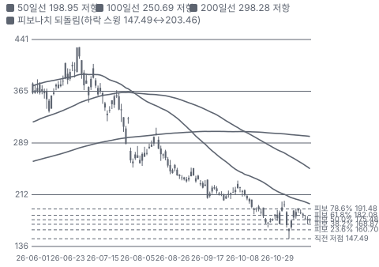

**주봉**

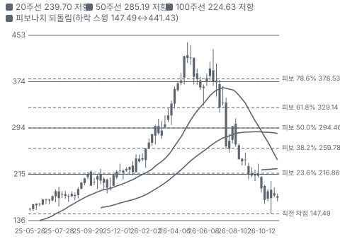

**월봉**

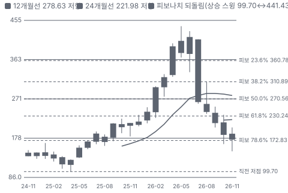

**분기 매출·EPS 실적과 컨센서스**

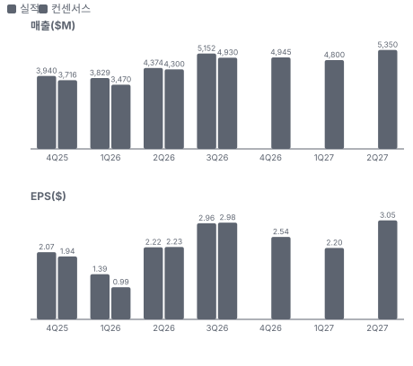

**4Q26 매출 — 지표 추세 vs 가이던스·컨센서스**

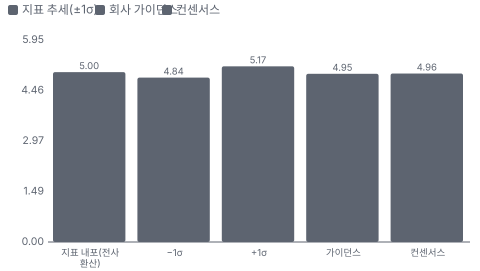

**최근 4개 분기 주가 변화 분석**

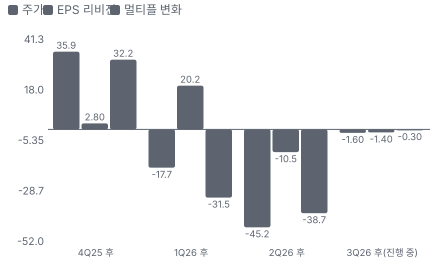

**EPS 리비전**

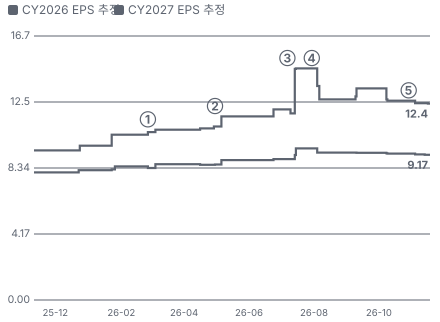

① 26-02-26 4Q25 실적·FY2026 첫 가이던스 · EPS 리비전 +3%
② 26-04-30 1Q26 실적 서프라이즈(EPS \$1.39 vs \$0.98) · EPS 리비전 +6%
③ 26-07-07 Superior 인수 계약·기간대출(8-K) · EPS 리비전 +21%
④ 26-07-30 2Q26 실적·EPS 가이던스 \$9.30 · EPS 리비전 -13%
⑤ 26-10-29 3Q26 실적·EPS 가이던스 범위화 · EPS 리비전 -1%

**멀티플 프리미엄(Fwd 1Y P/E, 최근 4개 분기말 절대값 — 대상 vs 동종 중앙값)**

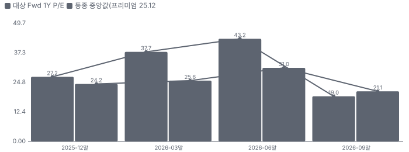

**합리적 멀티플**

**밸류에이션 주가 시나리오**

**주가별 업사이드**

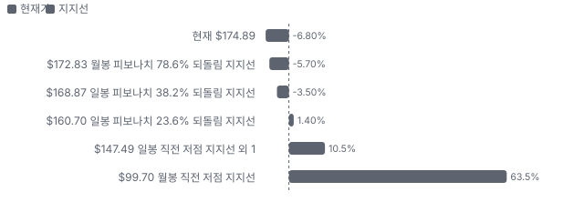
- 제품·서비스 포트폴리오

**고객 믹스(3Q26, 매출 대비)**

**공급 병목(10점, 낮을수록 병목)**

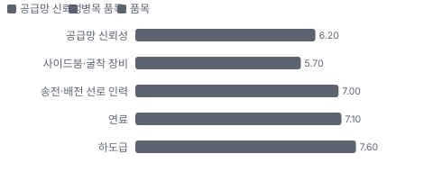

**생산능력 현재와 확충 계획(현장 인력(명))**

**CAPEX의 매출 대비 비중**

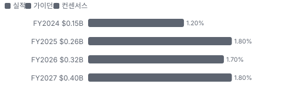

**어닝콜 변화별 주주가치 영향**

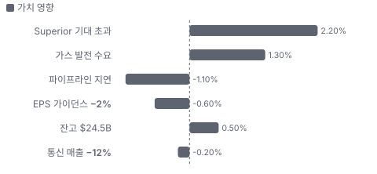

**수주·파이프라인 확실성 사다리**

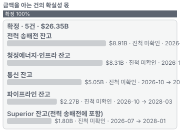

**매출 → 매출총이익 → 영업이익(매출 = 100, 최근 4분기)**

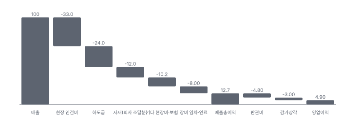

**분기 비용 비중 추이(매출 대비, 공시)**

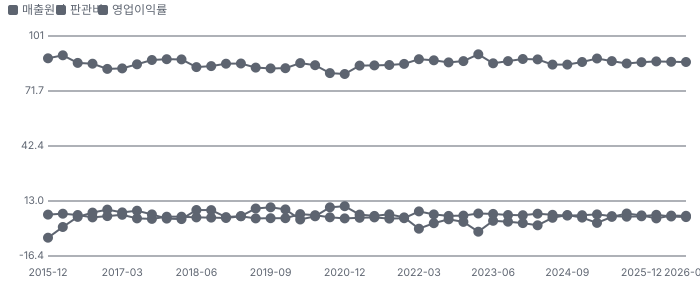

**비용 요인별 매출 대비 비중 1년 변화**

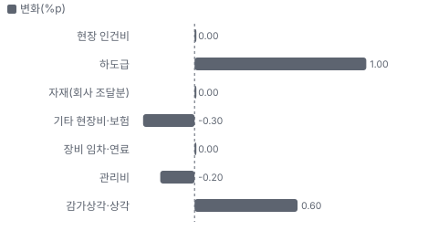

**전력 송배전 BOM 원가 몫**

**청정에너지·인프라 BOM 원가 몫**

**통신 BOM 원가 몫**

**파이프라인 BOM 원가 몫**

**BOM 항목 가격 +10% 시 OPM 변화**

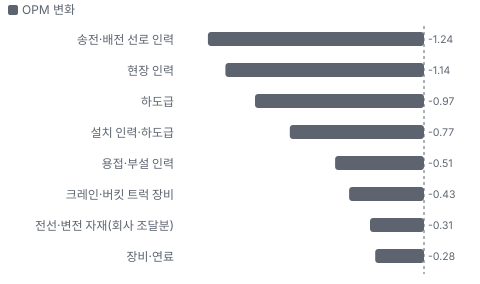

**원가 물가 vs 판매가 물가 — 최근 24개월(24.11 = 100): 판매가가 원가보다 7.8%p 더 올라 마진 여유**

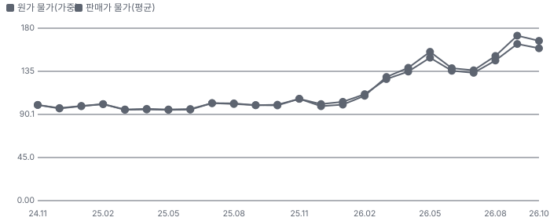

**사업별 매출 vs 물가 — 전년 대비(명목 매출 · 비교 물가 · 실질 = 물량·믹스)**

**The Superior Group(Electrical Specialists, Inc.) 인수 효과 — 인수 전 EPS 대비 %, 굵은 선 = 합계 · 시너지 가치 \$0.22B(웃돈 미확인)**

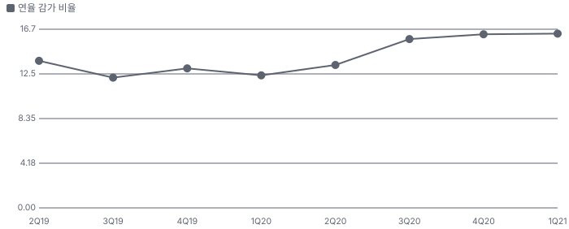

**매출 vs PPI·수출입 — 4Q22 = 100(변화율, 로그 눈금)**

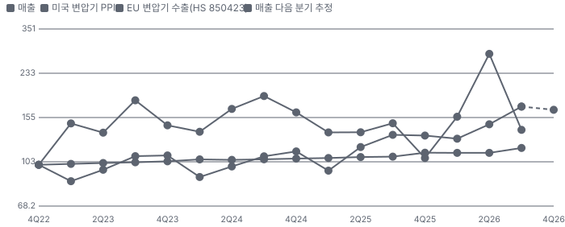

**10년 P·Q 사이클 — 추세(HP 필터) 대비 갭과 8분기 전망**

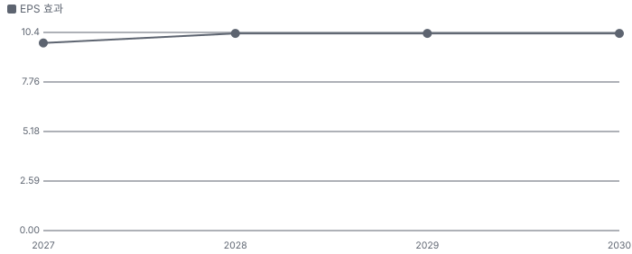

**매출 증가율의 가격·물량 분해와 8분기 전망(전년 대비)**

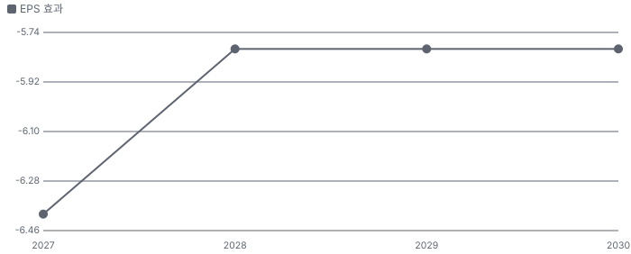

**분기별 매출 증가율 분해**

**목표주가 산정 — 약세와 기본 사이(약세 쪽 30%), 도달 확률 약 60%**

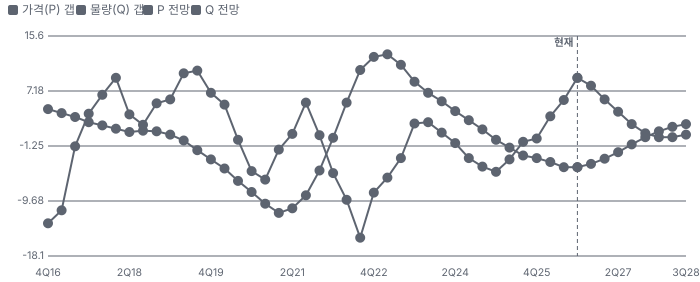

**PEG — 성장 대비 멀티플(낮을수록 성장 대비 쌈)**

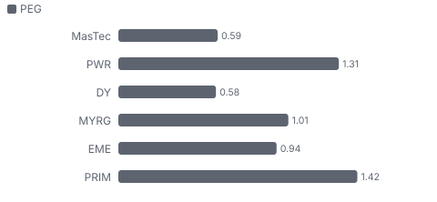

**일봉 지지·저항과 목표주가**

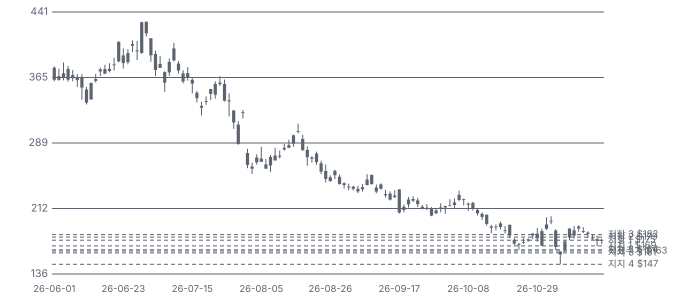

**재고 일수 — 분기별(수주 자료가 없어 수주/출하 비율 없음)**

**일별 거래량 분해**

**기관 자금 흐름**

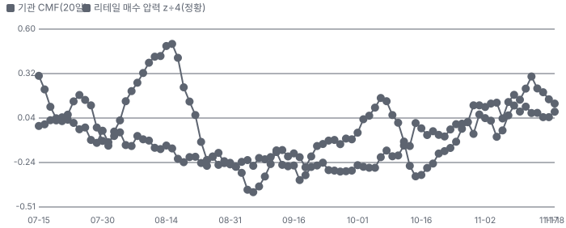

**몬테카를로**

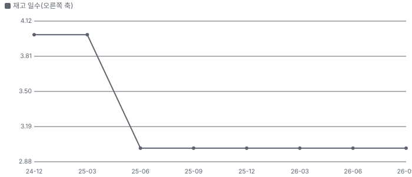

해석: 3,000번 중 316번(11%)에서 가치가 지금 주가 이상이었다. 가정을 흔들어도 지금 주가를 뒷받침하지 못하는 경우가 더 많다. 가운데 값은 0.40배이고, 열 번 중 여덟 번은 -0.02~1.02배 사이에 든다.

## 내러티브

> **기업가치를 결정하는 이야기:** MasTec의 값은 '잔고를 얼마나 빨리, 몇 %의 이익률로 매출로 바꾸느냐'다. 잔고는 18개월치로 매출보다 빨리 쌓이고 있고, 이익률은 인력·장비 가동률과 부문 믹스(전력 송배전 13% 대 통신 7%)가 정한다

> **멀티플·EPS 프리미엄**
> **멀티플:** 오늘 가격 기준 Fwd 1Y P/E 15.1배로 동종 중앙(16.1배)보다 6% 낮다. 6월 말 43배에서 내려왔다.
> **EPS:** FY2026 조정 EPS 가이던스 \$8.92~9.30, FY2027 컨센서스 \$12.4(+36%), FY2028 \$15.2.

### 투자자들은 왜 열광했나

2026년 상반기 전력 송배전·청정에너지 잔고가 급증하고 7월 데이터센터 전기 시공사 Superior를 인수하면서 'AI 전력 인프라 턴키 시공사'로 묶여 Fwd P/E가 40배를 넘었다. 7/31 2Q 콜에서 통신 지출 이연이 나오고 동종 배수가 함께 꺾이며 식었다

### 무엇이 기업가치를 바꾸나

> **구조적 체질 변화**
> **변화:** 통신·파이프라인 중심 회사에서 전력 송배전(36%)·청정에너지(35%)가 매출의 71%를 차지하는 전력 인프라 회사로 바뀌었다(1년 전 62%).
> **증거:** https://www.sec.gov/Archives/edgar/data/15615/000001561526000127/mtz930268-kex991.htm
> **반증:** 전력 송배전 매출 비중이 30% 아래로

> **고부가 믹스 확장**
> **변화:** 전력 송배전 EBITDA 이익률이 9.4%에서 13.2%로 올랐고, 기존 사업만으로도 두 자릿수 이익률이다(CFO).
> **증거:** https://www.sec.gov/Archives/edgar/data/15615/000001561526000127/mtz930268-kex991.htm
> **반증:** 전력 송배전 이익률 11% 아래

> **기술 혁신**
> **변화:** 해당 없음(시공 회사 — 인력·장비·실행력이 경쟁 요인이다. 11/10 Gritt 로봇 부착물 협업은 규모 미공시).

> **실행 속도**
> **변화:** 파이프라인 과제가 인허가로 평균 약 60일 늦어 3Q 착공분이 4Q로 밀렸다. 잔고 ÷ 월매출은 17.0개월이다. **납품 리드타임 2개월.** 피어 비교 미확인. 이전 대비 미확인.
> **증거:** 3Q26 어닝콜(2026-10-30)
> **반증:** 4Q에도 파이프라인 착공 지연이 이어진다

> **M&A**
> **변화:** 2026-07-20 Superior 인수(총 대가 약 \$1.79B) — 데이터센터·병원·산업 시설 전기 시공, 약 3,000명. 8월 파이프라인 시공사 추가 인수(규모 미공시).
> **증거:** https://www.sec.gov/Archives/edgar/data/15615/000001561526000125/mtz-20260930.htm
> **반증:** 언아웃(인수 뒤 실적에 따라 판매자에게 더 주는 조건부 대가) 평가 변동·영업권 손상

> **정책·입법 연관성**
> **재정정책:** 해당 없음(IIJA(2021년 미국 인프라 투자·일자리법) 송전·광대역 예산이 고객 투자의 배경이지만, 이 회사 과제를 만든 재정 사업을 공시·콜로 특정하지 못했다 — 단계 미확인)
> **행정명령:** 해당 없음(이 회사 매출을 바꾸는 행정명령을 공시·콜로 확인하지 못했다). 의회 동의 2/10 — 하원 1/5(논의 없음) · 상원 1/5(논의 없음).
> **연관입법:** 해당 없음(파이프라인 인허가 개혁 법안은 회사가 콜에서 특정하지 않았다 — 단계 미확인).

> **고객의 지출 예산**
> **변화:** 전력 송배전·파이프라인은 유틸리티·에너지 회사의 설비 투자, 통신은 통신사의 설비 투자와 유지보수 예산, CEI는 재생 발전·건물 건설비다.
> **사업별 예산:** **매출의 36%**: 전력 송배전 — 고객 CAPEX(유틸리티 송배전·변전 투자, 데이터센터 전력 설비) · 동인: 대형 부하(데이터센터처럼 전력을 한꺼번에 많이 쓰는 시설, large load) 연결
**매출의 35%**: 청정에너지·인프라 — 고객 CAPEX(재생 발전·토목·일반 건물 건설비) · 동인: 재생 발전·데이터센터 건물
**매출의 16%**: 통신 — 고객 혼합(통신사 광섬유·무선 설비 투자 + MSA 유지보수) · 동인: 광섬유 투자
**매출의 14%**: 파이프라인 — 고객 CAPEX(가스 파이프라인 신설·교체) · 동인: 가스 발전 수요
> **증거:** https://www.sec.gov/Archives/edgar/data/15615/000001561526000125/mtz-20260930.htm
> **반증:** 유틸리티 설비 투자 계획 하향

### 내러티브 근거

> 'AI 데이터센터·전력망 시공 묶음' 기대가 6월 말 Fwd 1Y P/E를 43배까지 올렸다. 7/31 2Q 콜 뒤 동종 시공주 전체가 배수를 절반 가까이 잃었고, MasTec은 파이프라인 지연·통신 부진이 겹쳐 16배대로 내려왔다. 잔고는 사상 최대다. 단계는 소멸, 쏠림은 낮음이다.

> **대형 부하 전력 인프라** · 강화
> **논리:** 데이터센터·전력망 투자로 송배전·변전·내부 전기 공사가 늘고 Superior로 턴키를 맡는다
> **숫자:** 전력 송배전 잔고 \$8.9B(+74%), 매출 +65%
> **반증:** 전력 송배전 잔고가 전 분기보다 줄어든다
> **출처:** https://www.sec.gov/Archives/edgar/data/15615/000001561526000127/mtz930268-kex991.htm

> **파이프라인 사이클** · 약화
> **논리:** 가스 파이프라인 신설이 몇 년 이어져 과거 최대 EBITDA \$634M을 넘본다
> **숫자:** 파이프라인 잔고 +26%(분기), B/B 1.7배 — 이익률은 10.4%로 하락
> **반증:** 4Q 파이프라인 이익률이 12% 아래
> **출처:** 3Q26 어닝콜(2026-10-30)

> **통신 회복** · 약화
> **논리:** 광섬유·데이터센터 연결 투자가 통신 부문을 되살린다
> **숫자:** 3Q 매출 −11.8%, 이익률 6.7%, 잔고 \$5.1B(전 분기 \$5.5B)
> **반증:** 통신 잔고가 \$5B 아래
> **출처:** https://www.sec.gov/Archives/edgar/data/15615/000001561526000127/mtz930268-kex991.htm

> **AI 인프라 시공주 배수 축소(반대 내러티브)** · 강화
> **논리:** 동종 시공주 배수가 6월 고점에서 절반 가까이 내려왔다 — 이익은 늘어도 배수가 계속 줄 수 있다
> **숫자:** Fwd 1Y P/E 6/30 43.2배 → 10/30 16.6배(DY 31.0 → 15.3배, PWR 48.9 → 35.3배)
> **반증:** 동종 중앙 Fwd P/E가 20배 위로 돌아온다
> **출처:** Forward 배수

> **인수 차입·언아웃** · 유지
> **논리:** Superior 인수로 차입이 \$2.35B → \$4.19B로 늘었다
> **숫자:** 순레버리지(순차입금 ÷ 조정 EBITDA) 2.5배, 언아웃 \$179.4M(상한 없음)
> **반증:** 연말 순레버리지 2.5배 위
> **출처:** https://www.sec.gov/Archives/edgar/data/15615/000001561526000125/mtz-20260930.htm

### 투자 포인트

> **이익은 늘었는데 배수만 줄었다**
> **명제:** 5월 종가 고점 이후 주가 −60%의 대부분이 배수 하락이다
> **숫자:** Fwd 1Y P/E(데이터 원천 월말 기준) 6/30 43.2배 → 10/30 16.6배, 오늘 가격 기준 15.1배. FY2026 EPS 추정은 같은 기간 4% 하락
> **시장과 다른 점:** 시장은 업종 배수를 보고 팔았지만 잔고는 사상 최대다
> **증명:** 4Q 잔고가 \$24.5B 위, FY2027 EPS 가이던스 \$12 이상
> **출처:** https://www.sec.gov/Archives/edgar/data/15615/000001561526000127/mtz930268-kex991.htm

> **부문 이익률이 가를 것**
> **명제:** 파이프라인·통신 두 부문 이익률이 1년 새 4.6~5.0%p 내려갔다
> **숫자:** 파이프라인 15.4% → 10.4%, 통신 11.3% → 6.7%(3Q 보도자료)
> **시장과 다른 점:** -
> **증명:** 4Q 파이프라인 12% 이상, 통신 8% 이상
> **출처:** https://www.sec.gov/Archives/edgar/data/15615/000001561526000127/mtz930268-kex991.htm

> **전력 송배전이 이익의 중심이 됐다**
> **명제:** 전력 송배전 EBITDA가 1년 새 2.3배가 돼 부문 EBITDA 합의 47%다
> **숫자:** 3Q 전력 송배전 EBITDA \$241.5M(작년 \$104.3M) ÷ 4개 부문 합 \$519.9M(계산, 3Q 보도자료)
> **시장과 다른 점:** 시장은 통신·파이프라인을 보고 묶음 할인을 주지만 이익 구성은 이미 전력 인프라 회사다
> **증명:** 4Q 전력 송배전 이익률 12% 이상, 잔고 증가
> **출처:** https://www.sec.gov/Archives/edgar/data/15615/000001561526000127/mtz930268-kex991.htm

### 모멘텀 생성·소멸 타임라인

**카탈리스트 달력 — 지난 사건의 주가 반응과 앞으로 확인할 숫자**
| 날짜 | 상태 | 구분 | 사건 | 반응·확인 | 결과에 따라 |
|---|---|---|---|---|---|
| 2026-04-30 | 완료 | 생성 | 1Q EPS 서프라이즈 +41% | 4월 월간 +22% |  |
| 2026-07-20 | 완료 | 생성 | Superior 인수 완료 | 데이터센터 전기 역량 |  |
| 2026-07-31 | 완료 | 소멸 | 2Q 콜 — 통신 지출 이연 예고 | \$324.44 → \$263.10(−18.9%) |  |
| 2026-10-30 | 완료 | 유지 | 3Q 잔고 +\$3.2B, EPS 가이던스 범위화 | \$177.82 → \$186.06(+4.6%) |  |
| 2026-11-04 | 완료 | 소멸 | 하루 −15.4%(원인 미확인) | \$198.10 → \$167.61 |  |
| 2027-02-25 | 예정 | 검증 | 4Q26 실적·FY2027 첫 가이던스(추정 일정) | FY2027 조정 EPS 가이던스 \$12 이상·연말 잔고 증가 |  |
| 2027-04-30 | 예정 | 검증 | 1Q27 실적(추정 일정) — 파이프라인 착공 정상화 | 파이프라인 EBITDA 이익률 12% 이상 |  |

### 언제 사서 언제 팔아야 할까?

**가격·조건 틀 — 가격은 밸류에이션(약세·기본·강세·목표주가)과 차트 지지 구간에서, 조건은 이벤트에서**
| 구간 | 가격 | 목표주가까지 | 약세까지 | 조건·근거 |
|---|---|---|---|---|
| 관찰 구간 | \$173~\$173 | -6% | -33% | 11/5 종가 저점 \$158.94 부근 — 약세 시나리오 쪽 지지 구간 |
| 확인 뒤 | 지금 \$175 이상에서 조건 확인 | -7% | -33% | 4Q 잔고 증가, FY2027 EPS 가이던스 \$12 이상, 4Q 파이프라인 이익률 회복 |
| 무효화 | 약세 시나리오 \$116 | - | -33% | 4Q 잔고 감소이거나 11/5 종가 저점 \$158.94 이탈 |
| 차익 고민 1차 | \$183(기본 시나리오) | +5% | - | 목표주가 근처에서는 잔고 증가 속도와 영업현금흐름을 다시 본다 |
| 차익 고민 2차 | \$262(강세 시나리오) | +50% | - | 목표주가 근처에서는 잔고 증가 속도와 영업현금흐름을 다시 본다 |

실적 다음 날 −18.9%(7/31)·+4.6%(10/30)처럼 크게 움직였다. 하루 거래량이 100만~400만 주다 가격·조건 틀이며 매매·비중 지시가 아니다(투자 권유 아님).

## 포트폴리오

| 제품·서비스 | 구분 | 무엇 | 쓰는 곳 | 돈 버는 방식 | Mix | Mix 변화(전년 대비) |
|---|---|---|---|---|---|---|
| 전력 송배전 | 서비스 | 송전·배전 선로, 변전소, 데이터센터 내부 전기 | 유틸리티·하이퍼스케일러·병원·산업 | 3Q26 매출의 36% | 35% | +7.5%p |
| 청정에너지·인프라 | 서비스 | 태양광·풍력·배터리 발전소, 토목, 일반 건물 | 발전 사업자·정부·건물주 | 3Q26 매출의 35% | 35% | +1.0%p |
| 통신 | 서비스 | 광케이블·무선 기지국 설치와 유지보수 | 통신사·케이블 사업자 | 3Q26 매출의 16% | 16% | -7.4%p |
| 파이프라인 | 서비스 | 가스·수도 파이프라인 신설·교체 | 파이프라인 운영사·가스 유틸리티 | 3Q26 매출의 14% | 14% | -1.0%p |

**Mix 변화가 가장 큰 쪽은 전력 송배전(+7.5%p, 전년 대비).** 계절성 판정: 분기 매출 계절 지수 기준 있음 → 전년 같은 분기와 비교.

## 고객

> **3Q26 매출 10%를 넘는 단일 고객 없음(3Q·1~3Q 2026), 상위 10개 고객 합 30%, 집중도 분산.** 공시로 확인한 몫은 상위 10개 고객 합 30%이고, 나머지 고객 몫은 추정이거나 미분해다. 3Q·9개월 모두 10% 넘는 고객이 없다(작년 AT&T 약 10%). 상위 10개 고객이 3Q 매출의 30%(작년 35%), 정부 매출이 14%다. 고객 약 1,685곳(9개월)

**고객별 매출 몫(3Q26)**
| 고객 | 몫 | 변화 | 근거 |
|---|---|---|---|
| 상위 10개 고객 합(top ten customers) | 30% | -5%p | 공시 |
| 정부 기관(정부 매출) | 14% | +1%p | 공시 |
| AT&T(AT&T(2025 매출 약 10%)) | 미확인 | 미확인 | 공시 |
| 기타·미분해 | 56% | - | - |

> **상위 10개 고객 합(top ten customers)** · 공시
> **사는 것:** 전 부문
> **추정 근거:** 집중도가 1년 새 5%p 내려갔다

> **정부 기관(정부 매출)** · 공시
> **사는 것:** 토목·교통·상하수도
> **추정 근거:** 3Q·9개월 14%(2025 13%)

> **AT&T(AT&T(2025 매출 약 10%))** · 공시
> **사는 것:** 무선·유선 유지보수·설치(MSA)
> **추정 근거:** 3Q는 10% 아래로 내려갔다 — 정확한 몫 미공시

## 수주·파이프라인

> **2026-09-30 기준 5건.** 확정 \$24.55B(Superior \$1.80B는 전력 송배전 잔고에 들어 있어 더하지 않는다). 공시 18개월 수주잔고 \$24.55B.

**수주 목록**
| 상태 | 계약 | 계약 총액 | 진척 | 기간 | 비고 |
|---|---|---|---|---|---|
| 확정 | 전력 송배전 잔고 | \$8.91B | 비공개 | 2026-10 → 2028-03 | - |
| 확정 | 청정에너지·인프라 잔고 | \$8.31B | 비공개 | 2026-10 → 2028-03 | - |
| 확정 | 통신 잔고 | \$5.05B | 비공개 | 2026-10 → 2028-03 | - |
| 확정 | 파이프라인 잔고 | \$2.27B | 비공개 | 2026-10 → 2028-03 | - |
| 확정 | Superior 잔고(전력 송배전에 포함) | \$1.80B | 비공개 | 2026-07 → 2028-01 | - |

**실행 속도와 방해 요인**
| 항목 | 상태 | 실행 속도 | 방해 요인 |
|---|---|---|---|
| 전력 송배전 잔고 | 확정 | 18개월 안(회사 정의) | 인력 확보 · 고압 송전 과제 시점 |
| 청정에너지·인프라 잔고 | 확정 | 18개월 안 | 재생 세액공제 정책 · 일반 건물 일정 |
| 통신 잔고 | 확정 | 18개월 안(MSA 추정 포함) | 고객 지출 이연 |
| 파이프라인 잔고 | 확정 | 18개월 안 | 인허가 지연 |
| Superior 잔고(전력 송배전에 포함) | 확정 | 미확인 | 통합 |

## 마진 구조

> **GPM 12.8%, OPM 5.1%.** 3Q25 대비 GPM -0.7%p, OPM -1.2%p. 변동비는 매출의 73%이고, 매출이 10% 늘면 OPM은 +2.0%p 움직인다. 3Q26 매출원가(감가상각 제외) 비중 87.2%, 감가상각·상각 3.3%, 관리비 4.4%로 영업이익률 5.1%다. 1년 전(86.4%, 2.6%, 4.6%, 6.3%)보다 인수 무형자산 상각이 \$32.7M → \$75.3M으로 늘어 GAAP 이익률이 내려갔다. 조정 EBITDA 이익률은 9.4%로 같다

> **매출 100 중 매출원가 87.3, 매출총이익 12.7(최근 4분기, 공시).** 매출원가 요인 중 현장 인건비이 매출의 33.0%로 가장 무겁고, 단가가 +10% 오르면 GPM이 -3.30%p 움직인다. 분기 회귀로 매출 1이 늘 때 매출원가는 0.88 늘고, 매출원가의 고정비 몫은 -2%다.

**비용 요인 강도 — 비중·추세·충격(+10%)·탄력**
| 비용 | 구분 | 매출 대비 | 1년 변화 | 마진 기여 | 충격 시 마진 | 매출 탄력 | 고정비 몫 |
|---|---|---|---|---|---|---|---|
| 현장 인건비 | 매출원가 요인 | 33.0% | +0.0%p | -0.0%p | -3.30%p | 미확인 | 30% |
| 하도급(공사 일부를 다른 업체에 맡기는 것) | 매출원가 요인 | 24.0% | +1.0%p | -1.0%p | -2.40%p | 미확인 | 0% |
| 자재(회사 조달분) | 매출원가 요인 | 12.0% | +0.0%p | -0.0%p | -1.20%p | 미확인 | 0% |
| 기타 현장비·보험 | 매출원가 요인 | 10.2% | -0.3%p | +0.3%p | -1.02%p | 미확인 | 30% |
| 장비 임차·연료 | 매출원가 요인 | 8.0% | +0.0%p | -0.0%p | -0.80%p | 미확인 | 40% |
| 매출원가 | 공시 항목 | 87.3% | -0.2%p | +0.2%p | -8.73%p | 0.88 | -2% |
| 판관비 | 공시 항목 | 4.8% | -0.3%p | +0.3%p | 미확인 | 0.05 | -5% |
| 감가상각 | 공시 항목 | 3.0% | -0.1%p | +0.1%p | 미확인 | 0.03 | 18% |

매출 탄력 = 분기 비용을 매출에 회귀한 기울기(매출 1당 변동비), 고정비 몫 = 절편 ÷ 평균 비용. 표본이 8분기 미만이면 미확인. 매출원가 요인 비중은 margin 재료의 추정이 섞여 있고, 공시 매출원가와의 차이는 '기타 매출원가'로 둔다.

**GPM에서 OPM까지(GAAP — 10-Q 3개월 손익. 매출원가(감가상각 제외) 요인은 회사가 나누지 않아 추정, 아래는 최근 4개 분기)**
| 기간 | GPM | 연구개발 | 판관비 | 기타 | OPM |
|---|---|---|---|---|---|
| 3Q25 | 13.6% | 0.0% | 4.6% | 2.6% | 6.3% |
| 3Q26 | 12.8% | 0.0% | 4.4% | 3.3% | 5.1% |
| 2025-12 | 12.9% | - | - | - | 5.3% |
| 2026-03 | 12.5% | - | - | - | 3.7% |
| 2026-06 | 12.7% | - | - | - | 5.2% |
| 2026-09 | 12.8% | - | - | - | 5.1% |

**비용을 움직이는 요인**
| 비용 | 요인 |
|---|---|
| 현장 인건비(매출원가) | 숙련 인력 임금·초과근무 · 근거 추정 |
| 하도급(매출원가) | 자체 시공 대 하도급 비중 · 근거 추정 |
| 자재(회사 조달분, 매출원가) | 고객 자재 공급 비중 · 근거 추정 |
| 기타 현장비·보험(매출원가) | 현장 수·보험료 · 근거 추정 |
| 장비 임차·연료(매출원가) | 장비 가동률·경유가 · 근거 추정 |
| 관리비(판관비) | 본사·통합 비용 · 근거 공시 |
| 감가상각·상각(판관비) | 인수 무형자산 상각 · 근거 공시 |

**전력 송배전 BOM — 매출의 36%, GPM 13%(추정 — 세그먼트 매출총이익 미공시라 세그먼트 EBITDA 이익률 13.2%를 쓴다), 항목 가격 +10% 시**
| 항목 | 원가 몫 | 전가 | 제품 GPM | OPM |
|---|---|---|---|---|
| 송전·배전 선로 인력 | 35~45% | 미확인 | -3.5%p | -1.24%p |
| 크레인·버킷 트럭 장비 | 10~18% | 미확인 | -1.2%p | -0.43%p |
| 전선·변전 자재(회사 조달분) | 5~15% | 미확인 | -0.9%p | -0.31%p |
| 미분해 | 36% | - | - | - |

**청정에너지·인프라 BOM — 매출의 35%, GPM 8%(추정 — 세그먼트 EBITDA 이익률 8.2%), 항목 가격 +10% 시**
| 항목 | 원가 몫 | 전가 | 제품 GPM | OPM |
|---|---|---|---|---|
| 현장 인력 | 30~40% | 미확인 | -3.2%p | -1.14%p |
| 하도급 | 25~35% | 미확인 | -2.8%p | -0.97%p |
| 장비·연료 | 5~12% | 미확인 | -0.8%p | -0.28%p |
| 미분해 | 26% | - | - | - |

**통신 BOM — 매출의 16%, GPM 7%(추정 — 세그먼트 EBITDA 이익률 6.7%), 항목 가격 +10% 시**
| 항목 | 원가 몫 | 전가 | 제품 GPM | OPM |
|---|---|---|---|---|
| 설치 인력·하도급 | 45~60% | 미확인 | -4.9%p | -0.77%p |
| 차량·장비 | 8~15% | 미확인 | -1.1%p | -0.17%p |
| 광케이블 자재(회사 조달분) | 2~10% | 미확인 | -0.6%p | -0.09%p |
| 미분해 | 30% | - | - | - |

**파이프라인 BOM — 매출의 14%, GPM 10%(추정 — 세그먼트 EBITDA 이익률 10.4%), 항목 가격 +10% 시**
| 항목 | 원가 몫 | 전가 | 제품 GPM | OPM |
|---|---|---|---|---|
| 용접·부설 인력 | 35~45% | 미확인 | -3.6%p | -0.51%p |
| 사이드붐·굴착 장비 | 15~25% | 미확인 | -1.8%p | -0.25%p |
| 연료 | 3~8% | 미확인 | -0.5%p | -0.07%p |
| 미분해 | 34% | - | - | - |

송전·배전 선로 인력 가격이 +10% 오르면 영업이익은 -24.2% 움직인다. 판매가 전가를 모르는 항목은 전가 0%로 계산했다.

**BOM 항목 가격을 움직이는 것**
| 항목 | 요인 |
|---|---|
| 송전·배전 선로 인력 | 숙련 전기공이 수주 한도 · 근거 추정 |
| 크레인·버킷 트럭 장비 | 선로 공사 필수 장비 · 근거 추정 |
| 전선·변전 자재(회사 조달분) | 대개 고객이 공급 · 근거 추정 |
| 현장 인력 | 태양광·풍력·일반 건물 시공 · 근거 추정 |
| 하도급 | 일반 건물은 하도급 비중이 크다 · 근거 추정 |
| 장비·연료 | 토목 장비 · 근거 추정 |
| 설치 인력·하도급 | 광케이블·기지국 설치 · 근거 추정 |
| 차량·장비 | 현장 이동 · 근거 추정 |
| 광케이블 자재(회사 조달분) | 대개 통신사가 공급 · 근거 추정 |
| 용접·부설 인력 | 지연 때 인력이 놀아도 비용이 나간다(3Q 콜) · 근거 추정 |
| 사이드붐·굴착 장비 | 장비 가동률이 이익률을 가른다 · 근거 추정 |
| 연료 | 장비 연료 · 근거 추정 |

> **원가·판매가 물가 격차 +9.1%p** — 판매가 물가가 투입 원가 물가보다 빠르게 오른다.

**투입 물가 — 미국 PPI 3·6·12개월(2026-10, 개정 반영)과 해외 전년비**
| 항목 | 미국 3개월 | 6개월 | 12개월 | 전가 못 할 때 OPM | 일본 | 한국 | 대만 |
|---|---|---|---|---|---|---|---|
| 전선·변전 자재(회사 조달분) | +3.4% | +7.2% | +23.9% | - | +42.6% | +25.8% | +40.1% |
| 연료 | +38.6% | +30.2% | +115.2% | - | 미확인 | 미확인 | 미확인 |
| 광케이블 자재(회사 조달분) | 미확인 | 미확인 | 미확인* | - | 미확인 | 미확인 | 미확인 |

별표는 품목보다 넓은 업종 지수다. 연결한 투입 원가의 미국 PPI(생산자물가지수)는 1년 새 가중 +60.4%이고, 판매가로 넘기지 못하면 GPM -12.1%p·OPM -12.1%p가 움직인다. 판매가 비교 물가(구리 PPI)는 1년 새 +23.9% — 회사 가격 변화는 미확인. 물가 지수를 붙이지 못한 매출원가 항목은 현장 인건비, 하도급다(미연결). 전력 송배전 매출은 2026-09 전년 대비 +65.2%이고 비교 물가 ppi:copper의 변화 +30.0%(2026-09)를 빼면 실질 +27.1% — 물량·믹스가 성장을 이끌었다. 파이프라인 매출은 2026-09 전년 대비 +21.1%이고 비교 물가 ppi:diesel의 변화 +114.9%(2026-09)를 빼면 실질 -43.6% — 성장 대부분이 가격(물가)이다.

## 공급망 병목

> **공급망 신뢰성 6.2/10, 관리 가능.** 가장 약한 고리는 사이드붐·굴착 장비 5.7점이고, 품목 평균은 7.1점이다. 근거가 부족한 2건(크레인·버킷 트럭 장비 · 전선·변전 자재(회사 조달분))은 점수에서 뺐다. 병목은 자재보다 숙련 인력과 인허가다. 3Q 파이프라인 이익률 하락은 인허가 지연으로 인력·장비가 놀았기 때문이고(3Q 콜), KeyBanc는 전력 송배전 인력 확충 계획을 물었다. 자재는 대개 고객이 공급한다(10-K)

**병목과 마진 — 품목 가격 +10% 시 OPM**
| 품목 | 점수 | 판정 | 구분 | OPM |
|---|---|---|---|---|
| 사이드붐·굴착 장비(필수) | 5.7 | 병목 주의 | 출하 차질 위험 | -0.25%p |
| 송전·배전 선로 인력(필수) | 7.0 | 관리 가능 | 가격 위험 | -1.24%p |
| 연료 | 7.1 | 관리 가능 | 일반 | -0.07%p |
| 하도급(필수) | 7.6 | 관리 가능 | 가격 위험 | -0.97%p |

> **사이드붐·굴착 장비** · 5.7/10
> **왜:** 파이프라인 장비 가동률이 이익률을 가른다
> **병목 요인:** 인증 공급사 3곳 · 캐파 빠듯 · 리드타임 미확인 · 재인증 미확인 · 1위 점유율 60% · 미국 집중 90% · 물량 확보 복수구매
> **풀리는 조건:** 해당 없음

> **송전·배전 선로 인력** · 7.0/10
> **왜:** 숙련 전기공이 잔고 소진 속도를 정한다
> **병목 요인:** 인증 공급사 4곳 · 캐파 빠듯 · 리드타임 미확인 · 재인증 미확인 · 1위 점유율 미확인 · 미국·캐나다 집중 93% · 물량 확보 내재화
> **풀리는 조건:** 해당 없음

> **연료** · 7.1/10
> **왜:** 장비 연료비
> **병목 요인:** 인증 공급사 4곳 · 캐파 균형 · 리드타임 미확인 · 재인증 미확인 · 1위 점유율 미확인 · 미국 집중 93% · 물량 확보 현물
> **풀리는 조건:** 해당 없음

> **하도급** · 7.6/10
> **왜:** 하도급·자체 시공 비중이 이익률을 바꾼다(10-K)
> **병목 요인:** 인증 공급사 4곳 · 캐파 균형 · 리드타임 미확인 · 재인증 미확인 · 1위 점유율 미확인 · 미국 집중 93% · 물량 확보 복수구매
> **풀리는 조건:** 해당 없음

**공급사**
| 품목 | 공급사 | 몫 | 근거 |
|---|---|---|---|
| 송전·배전 선로 인력 | 자체 인력·노조 인력(미공시, 인력) | 미확인 | 공시 |
| 크레인·버킷 트럭 장비 | 자가 보유·임차(관계사 CCI 포함, 장비) | 미확인 | 공시 |
| 전선·변전 자재(회사 조달분) | 전선·변압기 제조사(미공시, 자재) | 미확인 | 추정 |
| 사이드붐·굴착 장비 | 건설 장비 제조·임대사(미공시, 장비) | 미확인 | 추정 |
| 연료 | 연료 유통사(미공시, 연료) | 미확인 | 추정 |
| 하도급 | 지역 하도급사(미공시, 시공) | 미확인 | 공시 |

**무역 통계로 본 공급 지역**
| 품목 | EU 수입처 | 일본 수입처 | EU 1위 전년비 |
|---|---|---|---|
| 전선·변전 자재(회사 조달분) | MY(말레이시아) 77% · KR(한국) 11% · VN(베트남) 7% | マレーシア 58% · タイ 36% | 미확인 |
| 연료 | US 73% · CN(중국) 14% · KR 9% | 大韓民国 74% · シンガポール 7% | +145.7% |

## 생산능력

> **현재 명목 캐파 36,000 현장 인력(명), 가동률 미확인.** FY2025 CAPEX는 \$0.26B로 매출의 1.8%다. 시공 회사라 생산능력은 인력과 장비다. 2025년 말 약 36,000명·810개 거점이고, 2026년 7월 Superior 인수로 약 3,000명이 더해졌다. 설비 투자는 장비 위주로 2025년 \$260M, 2026년 가이던스 약 \$320M이다

**생산시설 810곳**(10-K 사업 설명: 약 810개 거점(2025-12-31). Item 2는 본사 외 시설 이름을 밝히지 않는다) — 이름·위치를 밝힌 곳 1곳, 임차 1곳. 시설별 생산능력은 공개되지 않았다 — 회사 전체 캐파만 위에 적었다.

**생산시설 810곳 — 명칭·위치·생산능력**
| 시설 | 위치 | 용도 | 생산능력 | 소유·상태 |
|---|---|---|---|---|
| 본사 | 미국 플로리다 코럴 게이블스(800 S. Douglas Road) | 본사 | 미확인 — 미공시 | 임차 · 가동 |

공개된 증설 계획은 확인되지 않았다.

**CAPEX와 매출 대비**
| 기간 | CAPEX | 매출 | 매출 대비 | 구분 |
|---|---|---|---|---|
| FY2024 | \$0.15B | \$12.30B | 1.2% | 실적 |
| FY2025 | \$0.26B | \$14.30B | 1.8% | 실적 |
| FY2026 | \$0.32B | \$18.30B | 1.7% | 가이던스 |
| FY2027 | \$0.40B | \$22.00B | 1.8% | 컨센서스 |

## M&A 시너지

> **The Superior Group(Electrical Specialists, Inc.) 인수(2026-07-20, \$1.79B): 시너지가 다 나면 연 \$0.03B(확률 가중 이익 기여).** 세후 시너지 가치는 통합 비용을 빼고 \$0.22B. EPS 효과는 2027년 +9.8%에서 2030년 +10.3%.

**The Superior Group(Electrical Specialists, Inc.) 시너지가 생기는 길**
| 종류 | 시너지 | 연 규모 | 완성 | 확률 | 어떻게 생기나 | 근거 |
|---|---|---|---|---|---|---|
| 매출 | 데이터센터 전기 + 송배전 묶음 수주 | \$0.40B(이익률 10%) | 2028 | 40% | Superior의 데이터센터 내부 전기와 MasTec의 변전·송전·부지를 한 계약으로 묶어 대형 부하 고객에 턴키로 판다 | 추정 — 회사는 '통합 솔루션'만 밝히고 규모를 밝히지 않음(3Q 콜) |
| 원가 | 자체 시공 비중 확대 | \$0.03B | 2027 | 40% | 부문 간 협업으로 하도급을 자체 인력으로 바꿔 2027년 추가 이익률을 노린다(CFO) | 3Q 콜 — 금액 미공시, 추정 |

그림의 구성 요소(대상 순이익·시너지·인수 차입 이자·신주 희석)를 더하면 EPS 효과 합계다. 시너지는 세후·확률 가중이다. 시너지 가치 = 세후 이익 기여 5년 + 말기 가치(할인율 9%, 성장 0) − 통합 비용. 매출 시너지는 그 매출의 이익률만 반영하고, 모든 시너지에 실현 확률을 곱했다.

## 해자

> 해자는 규모와 고객 관계다. 인력 약 39,000명·810개 거점으로 미국·캐나다 전역에서 동시에 공사를 돌리고, 매출의 44%가 여러 해짜리 서비스 기본 계약(MSA)에서 나온다. 다만 10-K는 시장이 매우 경쟁적이고 분절됐다고 쓰고, 영업이익률은 동종 중앙보다 낮다

> **MSA 다년 계약** · 보통
> **해자:** 유틸리티·통신 고객이 유지보수·교체 공사를 여러 해 반복 발주한다
> **근거:** FY2025 10-K: MSA 등 서비스 계약 매출 44%, AT&T와 복수 MSA
> **숫자:** 매출의 44%(2025)
> **깨지는 조건:** 통신 MSA 매출이 2개 분기 더 줄어든다

> **규모·인력 동원력** · 보통
> **해자:** 대형 송전·파이프라인 공사에 필요한 숙련 인력과 장비를 한꺼번에 동원할 수 있다
> **근거:** 10-K: 약 36,000명·810개 거점, ENR(미국 건설 전문지, Engineering News-Record) 상위 5위 시공사. Superior 약 3,000명 추가(10-Q)
> **숫자:** 인력 약 39,000명(2025 말 + Superior)
> **깨지는 조건:** 인력 부족으로 잔고 소진 속도가 떨어진다(잔고 ÷ 월매출이 20개월 이상)

> **대형 부하 턴키 역량** · 약함
> **해자:** 데이터센터 내부 전기(Superior)와 변전·송전·부지 조성을 한 회사가 묶어 맡는다
> **근거:** 3Q 콜: Superior 잔고 \$1.8B(인수 당시 대비 1.6배), 전력 송배전 잔고 +74%
> **숫자:** Superior 잔고 \$1.8B
> **깨지는 조건:** 묶음 수주 사례가 2027년까지 공시되지 않는다

## 경영진·네트워크

> CEO Jose Mas와 회장 Jorge Mas 형제가 창업 가문(1929년 설립)으로 경영을 이끈다. 3Q에 유틸리티 경영 경력 이사(Manny Miranda)와 자본시장·법률 자문 경력 이사(Alex Spiro)를 새로 선임했다

> **Jose R. Mas** · 대표이사(CEO) · 2007
> **프로필:** 창업 가문 2세, 2007년부터 CEO(회사 공개 정보)
> **비즈니스:** 관계사 CCI에서 장비 임차·소모품 구매(2025년 \$6.4M, 10-K 관계자 거래)
> **정계:** 미확인
> **동문:** 미확인
> **사모임:** 미확인

> **Jorge Mas** · 이사회 의장 · 미확인
> **프로필:** 창업 가문 2세(회사 공개 정보)
> **비즈니스:** 미확인
> **정계:** 미확인
> **동문:** 미확인
> **사모임:** 미확인

> **Paul DiMarco** · CFO · 미확인
> **프로필:** 3Q 콜 재무 설명 담당
> **비즈니스:** 미확인
> **정계:** 미확인
> **동문:** 미확인
> **사모임:** 미확인

**네트워크 정량화**
| 연결 | 강도 | 닿는 매출 | 가중 노출 | 매출 대비 | 근거 |
|---|---|---|---|---|---|
| 비즈니스: 유틸리티 경영 40년 경력 이사 선임 — 송배전 대형 프로그램 이해도. 선임이 수주를 만든다는 근거는 없다 | 2/5 | \$0.36B | \$0.14B | 1% | 3Q 전력 송배전 매출 비중 35.6% https://www.sec.gov/Archives/edgar/data/15615/000001561526000127/mtz930268-kex991.htm |

가중 노출은 연결이 닿는 매출의 크기다. 연결이 그 매출을 만들었다는 뜻이 아니며, 인과는 공개 자료로 입증하지 못한다.

## 약세 논리 및 셀온 조건

| 약세 논리 | 근거 | 가를 자료 |
|---|---|---|
| 업종 배수 축소가 끝나지 않았다 | 동종 Fwd 1Y P/E가 6월 말 대비 절반 가까이 내려왔다(DY 31.0 → 15.3배, MYRG 45.5 → 22.2배). 개별 회사가 아니라 AI 인프라 시공주 묶음의 문제다 | 동종 중앙 Fwd P/E 추이(월말) |
| 두 부문 이익률이 꺾였다 | 파이프라인 EBITDA 이익률 15.4% → 10.4%, 통신 11.3% → 6.7%(3Q 보도자료). 합쳐서 매출의 30%다 | 4Q 부문 이익률(2027년 2월 추정) |
| 인수 차입과 상한 없는 언아웃 | 총차입 \$2.35B(연초) → \$4.19B, Superior 언아웃 평가 \$179.4M에 상한 없음, 순레버리지 2.5배(10-Q·3Q 콜) | 연말 순레버리지·언아웃 재평가 |
| 현금흐름이 4Q에 몰려 있다 | 9개월 영업현금흐름 \$388M — 연간 \$1B 이상 가이던스를 채우려면 4Q에 \$600M 넘게 나와야 한다 | 4Q 영업현금흐름 |
| 잔고는 회사 추정이다 | 18개월 잔고에는 MSA 추정분이 들어가고 회사도 '다른 회사와 비교할 수 없을 수 있다'고 쓴다. 잔여 이행 의무는 \$19.1B로 잔고보다 \$5.4B 작다 | 10-K 잔여 이행 의무 주석 |
| 자료 한계 | 11/4 하루 −15.4%의 원인을 1차 자료로 확인하지 못했다. 매출원가 요인·부문별 BOM 몫은 공시되지 않아 추정이다. TradingView 일봉 대신 Easyconomics 일봉을 썼다 | 다음 회차 대조 |

**변이 관점.** 시장은 AI 인프라 시공주 묶음의 배수를 보고 팔았다 — Fwd 1Y P/E는 6월 말 43배에서 15배로 내려왔지만 FY2026 EPS 추정은 같은 기간 4%만 내려갔다. 잔고는 그 사이 \$21.4B에서 \$24.5B로 늘었다. 회사 고유 악재(파이프라인 지연·통신 이연)는 이익을 없애기보다 2027년으로 미루는 성격이라고 회사는 말한다. 그 말이 맞는지는 FY2027 첫 가이던스가 가른다. 회사 답변: 파이프라인 이연분의 2027년 이전 규모를 묻는 질문(Cantor Fitzgerald)에 회사는 금액을 밝히지 않았다.

> **셀온 조건**
> **조건 1:** 연말(4Q26) 18개월 잔고가 3Q \$24.5B보다 줄어든다(2027년 2월 4Q 실적).
> **조건 2:** FY2027 첫 가이던스의 조정 EPS 중간값이 \$11 아래다(2027년 2월).
> **조건 3:** 4Q 영업현금흐름이 \$500M 아래라 연간 \$1B 가이던스를 못 채운다.
> **조건 4:** 통신 잔고가 \$5B 아래로 내려가거나 파이프라인 이익률이 4Q에도 10% 아래다.
> **조건 5:** 주가가 11/5 종가 저점 \$158.94를 종가로 밑돌고 동종 시공주가 같이 신저가를 만든다.

## 어닝콜 변화

**직전 콜 대비 새로 나오거나 바뀐 내용 → 가치 영향**
| 항목 | 내용 | 직전 콜 | 최신 콜 | 모델 동인 이동 | 확신도 | 가치 영향 |
|---|---|---|---|---|---|---|
| 업데이트 | 18개월 잔고 증가 | \$21.4B(2Q) | \$24.5B(3Q) | 1년차 성장률 +1.0% | 1.0 | +0.5% |
| 신규 | Superior 실적 기대 초과 | 인수 직후(2Q) | 전력 송배전 이익률 13.2% | 목표 이익률 +0.20% | 0.8 | +2.2% |
| 부정 | 파이프라인 인허가 지연 | EBITDA 이익률 18.4%(2Q) | 10.4%(3Q) | 출발 이익률 -0.20% | 1.0 | -1.1% |
| 부정 | 통신 고객 지출 이연 | 하반기 이연 예고(2Q) | 매출 −11.8%, 이익률 6.7% | 1년차 성장률 -0.50% | 1.0 | -0.2% |
| 부정 | FY2026 EPS 가이던스 범위화 | \$9.30 | \$8.92~9.30 | 출발 이익률 -0.10% | 1.0 | -0.6% |
| 신규 | 가스 발전·턴키 데이터센터 | 언급 적음 | 주요 성장 축으로 제시 | 장기 성장 수렴값 +0.50% | 0.3 | +1.3% |
| 반복 | 영업현금흐름 \$1B 이상 | \$1B 이상 | \$1B 이상 | 순차입 — | 0.8 | +0.0% |
| **합계** | 단독 합 |  |  | 동시 적용 +2.0% |  | **+2.0%** |

**사건별 EPS 리비전**
| # | 날짜 | 구분 | 사건 | CY2026 EPS 전→후 | CY2027 EPS 전→후 | 리비전 | 주가 반응 |
|---|---|---|---|---|---|---|---|
| ① | 26-02-26 | 실적 | 4Q25 실적·FY2026 첫 가이던스 | \$8.44 → \$8.58 | \$10.44 → \$10.76 | +3.1% | +2.8% |
| ② | 26-04-30 | 실적 | 1Q26 실적 서프라이즈(EPS \$1.39 vs \$0.98) | \$8.54 → \$8.84 | \$10.96 → \$11.60 | +5.8% | +5.9% |
| ③ | 26-07-07 | 내러티브 | Superior 인수 계약·기간대출(8-K) | \$8.90 → \$9.58 | \$12.04 → \$14.63 | +21.5% | -5.7% |
| ④ | 26-07-30 | 실적 | 2Q26 실적·EPS 가이던스 \$9.30 | \$9.58 → \$9.31 | \$14.63 → \$12.67 | -13.4% | -18.9% |
| ⑤ | 26-10-29 | 실적 | 3Q26 실적·EPS 가이던스 범위화 | \$9.25 → \$9.20 | \$12.59 → \$12.43 | -1.3% | +4.6% |

**추정치 수정 폭:** 최근 30일 EPS 추정은 상향 2건·하향 4건으로 **엇갈림**(순 비율 -0.33), 90일은 상향 2건·하향 8건으로 하향 우세(-0.60)이다. 평균이 몇 % 움직였나(리비전 크기)와 달리 몇 번 같은 방향으로 고쳤나를 본다 — 수정 1건은 애널리스트 수가 그대로인 채 컨센서스가 움직인 날(지표별 하루 1건)이라 같은 날 여러 명이 고치면 1건으로 합쳐지고, 상향 + 하향이 3건 미만이면 순 비율을 쓰지 않는다.

**추정치 수정 폭 — 열린 기간(다음 분기들·올해·내년) 컨센서스 수정 건수, 최근 30·90일**
| 지표 | 30일 상향/하향 | 30일 순 비율 | 90일 상향/하향 | 90일 순 비율 | 90일 커버리지 변화 |
|---|---|---|---|---|---|
| EPS | 2 / 4 | -0.33 | 2 / 8 | -0.60 | 2 |
| 매출 | 3 / 0 | +1.00 | 3 / 1 | +0.50 | 2 |
| EBITDA | 2 / 2 | +0.00 | 2 / 2 | +0.00 | 2 |
| 전체 | 7 / 6 | +0.08 | 7 / 11 | -0.22 | 6 |

**실적 발표 예상 변동폭:** 지난 4번 실적 발표 때 주가는 하루에 평균 ±8.1%(최대 18.9%, 오른 날 3번) 움직였다.

**실적 발표 예상 변동폭 — 과거 실적 발표 다음 거래일 주가 변화**
| 분기 | 발표일 | 주가 변화 |
|---|---|---|
| 4Q25 | 2026-02-26 | +2.8% |
| 1Q26 | 2026-04-30 | +5.9% |
| 2Q26 | 2026-07-30 | -18.9% |
| 3Q26 | 2026-10-29 | +4.6% |

**해석:** 4개 구간(누적) 주가 -40% = EPS 리비전 +9% × 멀티플 -45%. 더 크게 움직인 쪽은 **멀티플**이다.

## 거시 지표 싱크로율

> **미국 변압기 PPI와 전력 송배전 싱크로율 77%(3분기 = 약 9개월 선행, 전년 대비, 표본 10개·t 3.4·유의·신뢰 낮음).** 이 지표가 내포하는 4Q26 전력 송배전은 1.73B(±1σ 1.56B~1.89B, 확정)다. 표본 밖 검증(최근 5개 분기)에서 지표 모델 오차는 13.2%p, 기준선(직전 증가율 지속)은 12.1%p다 — **지표가 기준선을 이기지 못해(예측력 없음) 추정은 대부분 기준선이다(지표 가중 69%).** 기준선은 인수·환율 효과의 소멸을 모르므로 회사 가이던스와 차이가 크면 가이던스 쪽 설명을 먼저 본다. 세그먼트 추정에 나머지 사업(직전 증가율 지속)을 더한 전사 매출은 5.00B(4.84B~5.17B)다. 가이던스는 이보다 -1.1%(범위 안), 컨센서스는 -0.9%(범위 안)다. MasTec 원가의 큰 몫은 현장 인력·장비 연료이고, 자재는 대부분 고객이 대지만 일부 공사는 회사가 산다(10-K). 경유 PPI는 장비 연료, 구리 PPI는 송배전·전기 공사 자재, 변압기 PPI는 전력 송배전 고객의 설비 투자 강도 대용이다

**지표별 싱크로율(상관계수 × 100) — 위 두 줄이 제품 연관성 × 싱크로율로 고른 PPI·수출입 세부 지표**
| 지표 | 비교 대상 | 증가율 기준 | 지표 선행 | 매출(t값) | 영업이익 | 방향 일치 | 표본·신뢰 | 표본 밖 오차(지표/기준선) | 4Q26 추정 매출 |
|---|---|---|---|---|---|---|---|---|---|
| 미국 변압기 PPI | 전력 송배전 | 전년 대비 | 3분기(9개월) | 77%(t 3.4) | -13%(0분기) | 100% | 10·낮음 | 13.2/12.1%p ✘ | +54.2% → 1.73B(확정) |
| EU(유럽연합) 변압기 수출(HS(국제 통일 상품 분류 코드) 850423) | 전력 송배전 | 전년 대비 | 1분기(3개월) | 73%(t 3.0) | 17%(3분기) | 50% | 10·낮음 | 18.9/12.1%p ✘ | +50.3% → 1.68B(확정) |
| 미국 경유 PPI | 파이프라인 | 전년 대비 | 0분기(0개월) | 29%(t 0.9) | -18%(0분기) | 70% | 10·낮음 | 128.0/34.3%p ✘ | +22.0% → 786M(나우캐스트 1개월 · 지표 범위 밖 → 범위 끝으로 제한) |
| 미국 구리 PPI | 전력 송배전 | 전년 대비 | 1분기(3개월) | 47%(t 1.5) | -10%(4분기) | 90% | 10·낮음 | 17.8/12.1%p ✘ | +56.2% → 1.75B(확정) |

**지표 후보 27개 — 연관성(제품 품목 일치 × 대용 감점 × 매출 비중) × 싱크로율로 고른다. 후보가 많을수록 최대 상관은 우연히 부풀 수 있다**
| 후보 | 종류 | 연관성 | 매출 분기 일치 | 싱크로율(선행) | 점수 | 출처 |
|---|---|---|---|---|---|---|
| 미국 변압기 PPI ✔ | PPI | 1.00 | 100% | 77%(3분기) | 0.77 | 모델 지정 |
| 미국 구리 PPI | PPI | 1.00 | 100% | 47%(1분기) | 0.38 | 모델 지정 |
| 일본 구리 PPI | PPI | 0.33 | 100% | 75%(2분기) | 0.25 | 자동 |
| EU 변압기 수출(HS 850423) ✔ | 수출입 | 0.33 | 100% | 73%(1분기) | 0.24 | 자동 |
| 미국 경유 PPI | PPI | 1.00 | 100% | 29%(0분기) | 0.24 | 모델 지정 |
| 미국 변압기 수출(HS 850423) | 수출입 | 0.33 | 69% | 63%(0분기) | 0.17 | 자동 |
| EU 구리 수입(HS 740811) | 수출입 | 0.33 | 100% | 57%(1분기) | 0.15 | 자동 |
| 대만 구리 PPI | PPI | 0.33 | 100% | 55%(2분기) | 0.15 | 자동 |
| 영국 구리 PPI | PPI | 0.33 | 100% | 53%(2분기) | 0.14 | 자동 |
| 한국 구리 PPI | PPI | 0.33 | 100% | 40%(1분기) | 0.11 | 자동 |
| EU 변압기 수입(HS 850423) | 수출입 | 0.33 | 100% | 39%(1분기) | 0.10 | 자동 |
| 미국 HS 271020 수출(경유과 같은 4자리 품목군) | 수출입 | 0.23 | 100% | 36%(2분기) | 0.07 | 자동 |

**선행 지표로 본 향후 분기 매출 전망(이미 나온 지표 값 기준, ±1σ)**
| 지표 | 대상 | 분기 | 지표 증가율 | 내포 매출 증가율 | 내포 매출 |
|---|---|---|---|---|---|
| 미국 구리 PPI | 전력 송배전 | 4Q26 | +24.4% | +44.3% | 1.62B(1.42B~1.81B) |
| 미국 변압기 PPI | 전력 송배전 | 4Q26 | +4.9% | +49.2% | 1.67B(1.53B~1.81B) |
| 미국 변압기 PPI | 전력 송배전 | 1Q27 | +3.9% | +38.4% | 1.45B(1.32B~1.58B) |
| 미국 변압기 PPI | 전력 송배전 | 2Q27 | +8.3% | +83.2% | 2.28B(2.13B~2.44B) |
| 미국 경유 수출(HS 271019) | 파이프라인 | 4Q26 | +17.0% | -65.0% | 225M(9M~441M) |
| 미국 경유 수출(HS 271019) | 파이프라인 | 1Q27 | +69.4% | -252.6% | -1.04B(-1.27B~-813M) |
| 미국 경유 수출(HS 271019) | 파이프라인 | 2Q27 | +79.5% | -288.8% | -1.21B(-1.43B~-998M) |
| 미국 경유 수입(HS 271019) | 파이프라인 | 4Q26 | +5.9% | -36.9% | 406M(141M~671M) |
| 미국 경유 수입(HS 271019) | 파이프라인 | 1Q27 | +38.5% | -114.4% | -98M(-379M~182M) |
| 미국 경유 수입(HS 271019) | 파이프라인 | 2Q27 | +14.6% | -57.6% | 273M(9M~537M) |
| EU 구리 수출(HS 740811) | 전력 송배전 | 4Q26 | +27.0% | +12.3% | 1.26B(1.06B~1.45B) |
| EU 구리 수출(HS 740811) | 전력 송배전 | 1Q27 | +18.0% | +20.3% | 1.26B(1.08B~1.44B) |
| EU 구리 수출(HS 740811) | 전력 송배전 | 2Q27 | +38.6% | +2.0% | 1.27B(1.06B~1.49B) |
| EU 구리 수입(HS 740811) | 전력 송배전 | 4Q26 | +69.5% | +36.2% | 1.53B(1.35B~1.70B) |
| 미국 구리 수출(HS 740811) | 전력 송배전 | 4Q26 | -29.1% | +24.1% | 1.39B(1.17B~1.60B) |
| 미국 구리 수입(HS 740811) | 전력 송배전 | 4Q26 | -95.2% | +50.4% | 1.68B(1.49B~1.88B) |
| 미국 구리 수입(HS 740811) | 전력 송배전 | 1Q27 | -81.5% | +46.9% | 1.54B(1.35B~1.72B) |
| 미국 구리 수입(HS 740811) | 전력 송배전 | 2Q27 | -70.5% | +44.1% | 1.79B(1.58B~2.01B) |
| 일본 구리 PPI | 전력 송배전 | 4Q26 | +55.5% | +71.5% | 1.92B(1.78B~2.07B) |
| 일본 구리 PPI | 전력 송배전 | 1Q27 | +56.2% | +72.4% | 1.80B(1.67B~1.94B) |
| 영국 구리 PPI | 전력 송배전 | 4Q26 | +31.8% | +59.5% | 1.79B(1.60B~1.97B) |
| 영국 구리 PPI | 전력 송배전 | 1Q27 | +33.6% | +61.7% | 1.69B(1.52B~1.86B) |
| 한국 구리 PPI | 전력 송배전 | 4Q26 | +28.5% | +41.7% | 1.59B(1.39B~1.79B) |
| 대만 구리 PPI | 전력 송배전 | 4Q26 | +32.5% | +58.2% | 1.77B(1.59B~1.95B) |
| 대만 구리 PPI | 전력 송배전 | 1Q27 | +41.7% | +69.6% | 1.77B(1.60B~1.94B) |
| EU 변압기 수출(HS 850423) | 전력 송배전 | 4Q26 | -6.0% | +22.8% | 1.38B(1.23B~1.53B) |
| EU 변압기 수입(HS 850423) | 전력 송배전 | 4Q26 | +38.8% | +23.6% | 1.38B(1.18B~1.59B) |
| 미국 변압기 수입(HS 850423) | 전력 송배전 | 4Q26 | +35.1% | +34.9% | 1.51B(1.31B~1.71B) |
| 미국 변압기 수입(HS 850423) | 전력 송배전 | 1Q27 | -27.2% | +65.4% | 1.73B(1.54B~1.92B) |
| 미국 변압기 수입(HS 850423) | 전력 송배전 | 2Q27 | +41.4% | +31.8% | 1.64B(1.42B~1.86B) |
| 미국 변압기 수입(HS 850423) | 전력 송배전 | 3Q27 | +30.1% | +37.3% | 2.52B(2.19B~2.85B) |
| 일본 변압기 PPI | 전력 송배전 | 4Q26 | +3.3% | +36.2% | 1.53B(1.36B~1.69B) |
| 일본 변압기 PPI | 전력 송배전 | 1Q27 | +1.9% | +42.0% | 1.49B(1.33B~1.64B) |
| 일본 변압기 PPI | 전력 송배전 | 2Q27 | +0.9% | +46.2% | 1.82B(1.64B~2.01B) |
| 일본 변압기 PPI | 전력 송배전 | 3Q27 | +0.5% | +47.8% | 2.71B(2.44B~2.98B) |
| 한국 변압기 PPI | 전력 송배전 | 4Q26 | +12.9% | +20.6% | 1.35B(1.15B~1.55B) |
| 한국 변압기 PPI | 전력 송배전 | 1Q27 | +15.8% | +16.5% | 1.22B(1.03B~1.41B) |
| 미국 HS 271012 수출(경유과 같은 4자리 품목군) | 파이프라인 | 4Q26 | +8.8% | -83.1% | 109M(-69M~287M) |
| 미국 HS 271012 수출(경유과 같은 4자리 품목군) | 파이프라인 | 1Q27 | +37.5% | -287.3% | -1.28B(-1.47B~-1.09B) |
| 미국 HS 271012 수출(경유과 같은 4자리 품목군) | 파이프라인 | 2Q27 | +34.3% | -264.4% | -1.06B(-1.23B~-879M) |
| 미국 HS 271020 수출(경유과 같은 4자리 품목군) | 파이프라인 | 4Q26 | +33.2% | +9.4% | 705M(410M~999M) |
| 미국 HS 271020 수출(경유과 같은 4자리 품목군) | 파이프라인 | 1Q27 | +127.2% | +15.8% | 790M(478M~1.10B) |
| 미국 HS 271099 수출(경유과 같은 4자리 품목군) | 파이프라인 | 4Q26 | -15.6% | +13.7% | 732M(455M~1.01B) |
| 미국 HS 271099 수출(경유과 같은 4자리 품목군) | 파이프라인 | 1Q27 | +2340.5% | -1704.4% | -10.95B(-11.24B~-10.66B) |
| 미국 HS 271099 수출(경유과 같은 4자리 품목군) | 파이프라인 | 2Q27 | +1.9% | +1.0% | 649M(372M~926M) |
| 미국 HS 271012 수입(경유과 같은 4자리 품목군) | 파이프라인 | 4Q26 | -10.8% | +5.7% | 680M(407M~954M) |
| 미국 HS 271012 수입(경유과 같은 4자리 품목군) | 파이프라인 | 1Q27 | -20.7% | +27.7% | 872M(582M~1.16B) |
| 미국 HS 271012 수입(경유과 같은 4자리 품목군) | 파이프라인 | 2Q27 | +3.5% | -26.0% | 475M(202M~748M) |
| 미국 HS 271012 수입(경유과 같은 4자리 품목군) | 파이프라인 | 3Q27 | -0.1% | -18.1% | 593M(285M~900M) |
| 미국 HS 271099 수입(경유과 같은 4자리 품목군) | 파이프라인 | 4Q26 | -46.4% | +21.4% | 781M(524M~1.04B) |
| 미국 HS 271099 수입(경유과 같은 4자리 품목군) | 파이프라인 | 1Q27 | +18.5% | -22.6% | 529M(256M~801M) |

지표가 k분기 앞서면 이미 발표된 지표로 k분기 뒤까지의 매출 증가율을 회귀식으로 읽는다. 표본이 작거나 t값이 2 미만이면 전망은 참고용이다.

**지표를 고른 이유**
| 지표 | 이유 |
|---|---|
| 미국 변압기 PPI | 유틸리티 송배전 투자 강도 대용 |
| EU 변압기 수출(HS 850423) | 변압기 품목 일치 |
| 미국 경유 PPI | 파이프라인·토목 장비 연료 |
| 미국 구리 PPI | 전선·변전 자재 |

다음 분기 추정 = 지표 회귀와 기준선(직전 증가율 지속)을 표본 밖 오차의 역제곱으로 가중 결합한 값이다(예측 결합). 지표가 회귀에 쓴 범위를 벗어나면 범위 끝으로 자르고(외삽 제한), 세그먼트 추정은 나머지 사업을 기준선으로 더해 전사로 바꾼다. 싱크로율은 증가율의 상관계수이며 인과가 아니다. 지표 단위·통화는 원자료 그대로이고 나라끼리 더하지 않는다(EU 수입만 상대국 합계). ±1σ는 회귀 잔차 표준편차이고, 지표를 예측한 분기는 지표 예측 오차까지 더해 넓혔다.

## P·Q 사이클

> **10년 위치: Q형 기업(매출 갭 분산의 46%가 가격) — 가격은 추세 대비 -4.5%(수축, 10년 분위 25%), 물량은 +9.2%(확장, 분위 95%). P 프리미엄 -37%, Q 프리미엄 +9%(매출총이익이 정상(추세) 수준보다 요인별로 이만큼 높거나 낮다).** 전망으로 가격 갭은 4분기 뒤 -1.0%·8분기 뒤 +2.1%, 물량 갭은 +2.1%·+0.5%(물량은 컨센서스 몫 36%를 섞었다). 이익이 정상보다 낮다 — 바닥 이익 기준 멀티플은 높아 보여도 정상 이익 기준으로는 낮을 수 있다.

**10년 P·Q 사이클 위치·프리미엄**
| 항목 | 가격(P) | 물량(Q) |
|---|---|---|
| 추세 대비 갭(현재) | -4.5% | +9.2% |
| 사이클 시계 | 수축 | 확장 |
| 10년 분위 | 25% | 95% |
| 프리미엄(현재) | -37% | +9% |
| 프리미엄 4분기 뒤 | -8% | +2% |
| 프리미엄 8분기 뒤 | +16% | +0% |
| 갭 반감기 | 3분기 | 3분기 |
| 갭 4분기 뒤(80% 범위) | -1.0% (-5.6%~+3.8%) | +2.1% (-4.5%~+9.3%) |
| 갭 8분기 뒤(80% 범위) | +2.1% (-4.5%~+9.2%) | +0.5% (-6.3%~+7.7%) |
| 전망 모형 | 자기회귀모델(과거 2개 시점) 정상성 보정 | 자기회귀모델(과거 2개 시점) + 컨센서스(분기 컨센서스 4개 + 연간 컨센서스 성장률 FY2027→FY2028 +12%, 4분기 뒤 몫 36%) |

방법: P = 가격 지수 4분기 평균(미국 PPI 변압기·배전 기기 대용 — 회사 판매가가 아니라 업종 가격), Q = TTM 매출 ÷ P. 추세는 로그 레벨의 HP(호드릭-프레스콧 필터, 추세와 순환을 나누는 통계 기법) 필터(λ 1600)로 정상(mid-cycle) 수준을 잡는다. 프리미엄 = 요인별 매출총이익 증분 ÷ 정상 매출총이익(정상 GPM 13.2% = 10년 중앙값, 물량 증분 마진 13.2% = 전년 대비 ΔGP÷ΔRev 회귀, 가격은 전액 이익 반영). 표본 40개 TTM 분기. 전망: 가격 갭은 BIC(모형 차수를 고르는 정보 기준)로 차수를 고른 자기회귀모델(정상성 보정), 물량은 통계 갭 자기회귀모델과 컨센서스 매출 ÷ 가격 전망(매출 = P × Q)을 분산 역수로 섞는다(Bates·Granger 1969). 끝점 편향을 줄이려고 전망 경로를 이어 붙인 뒤 HP 필터를 다시 건다(Kaiser·Maravall 1999). 80% 범위는 예측 오차(TTM이 4분기씩 겹쳐 생기는 자기상관을 뉴이·웨스트 장기 분산으로 반영)와 애널리스트 범위에서 낸다. 모형 산출이며 가이던스가 아니다.

> **Q 사이클 — 최근 4분기 평균 가격 기여 +5.4%, 물량 기여 +17.5%(전년 대비 로그 증가율).** P 강도 4.6/10, Q 강도 6.4/10, 최근 8분기 중 88%가 같은 요인 우세(구조적). 전망으로는 2분기 뒤(1Q27) P 사이클로 전환(물량은 컨센서스를 섞었다).

**P·Q 사이클 정량**
| 항목 | 가격(P) | 물량(Q) |
|---|---|---|
| 최근 4분기 평균 기여 | +5.4% | +17.5% |
| 강도(0~10, 자기 이력 z) | 4.6 | 6.4 |
| 고유 주기(자기회귀모델 과거 2개 시점일 때) | 16.5분기 | 미확인 |
| 다음 4분기 투영 평균 | +10.5% | +9.0% |
| 4분기 뒤 투영(80% 범위) | +10.2% (-0.2%~+20.6%) | +4.6% (-7.4%~+16.6%) |
| 장기 평균(표본 → 기저율 수축) | +8.2% → +5.8% | +5.3% → +4.8% |
| 투영 모형 | 자기회귀모델(과거 2개 시점) | 자기회귀모델(과거 1개 시점) + 컨센서스(분기 컨센서스 4개 + 연간 컨센서스 성장률 FY2027→FY2028 +12%) |

가격 근거: 미국 PPI 변압기·배전 기기 대용 — 회사 판매가가 아니라 업종 가격. PPI를 쓰면 회사 판매가가 아니라 업종 가격 대용이다. 로그 증가율이라 가격·물량 기여의 합이 매출 증가율이다. 전망: 가격은 BIC로 차수를 고른 자기회귀모델에 이미 발표된 월간 가격을 먼저 넣고(나우캐스트), 물량은 자기회귀모델과 '컨센서스 매출 증가율 − 가격 전망'을 분산 역수로 섞는다. 장기 평균은 표본 평균을 장기 기저율(가격 연 2%·물량 연 4%) 쪽으로 줄인다 — 고성장 구간만 담긴 표본이 그 성장을 끝없이 잇지 않게. 범위는 4분기 겹친 표본의 자기상관을 반영한다. 모형 산출이며 가이던스가 아니다. 회사 판매가로 잴 수 없는 이유: 시공 서비스라 단가·물량을 공시하지 않는다 — 공사별 계약가(단가·고정가·원가 가산)라 같은 단위의 가격 지표가 없다

## 밸류에이션

> **목표주가 \$163, 업사이드 -7%.** 자리는 약세와 기본 사이(약세 쪽 30%)이고 도달 확률은 약 60%다. 기본 \$183, 강세 \$262(+50%), 약세 \$116(-33%). DCF 기준 업사이드는 기본 -58%, 강세 -32%, 약세 -71%다(WACC 10.0%).

기본 EPS는 컨센서스이고 약세·강세는 추정 범위 하단·상단(\$10.5·\$14.2)이다. 시나리오 확률은 다음 해 매출 성장 분포로 계산했다. DCF는 GAAP 영업이익률을 쓰는데, 인수 무형자산 상각(3Q \$75.3M)이 GAAP 이익을 누르고 조정 EPS는 그 상각을 뺀다. 두 값이 다르면 그 차이는 '인수 상각을 비용으로 볼 것이냐'에 대한 가정 차이다.

시나리오 확률: 다음 해 매출 성장 분포로 계산 — 약세 +15.3% 아래·강세 +25.4% 위 확률. 내부 관점(컨센서스 +20.2%, σ 9.9%: 범위 20.2% ÷ d2(11) × 1.5) 100% — 외부 관점 꺼짐(SEC 전 상장사 표본 없음) · 모델 조정: 잔고가 1년 새 46% 늘어 다음 해 매출의 하방이 막혀 있다. 반대로 파이프라인 지연·통신 부진이 이어지면 이익률이 매출만큼 오르지 않는다 — 강세 쪽을 조금 낮춘다

> **약세 \$116 (-33%)** · 확률 30%
> **가정:** 11.1배 × EPS \$10.50
> **근거:** 파이프라인 인허가 지연이 2027년 상반기까지 이어지고 통신 이익률이 7% 아래에 머문다. 매출 \$20B대, EPS \$10.5 — 컨센서스 범위 하단

> **기본 \$183 (+5%)** · 확률 43%
> **가정:** 14.8배 × EPS \$12.40
> **근거:** 컨센서스 FY2027 EPS \$12.4·매출 \$21.6~22.0B. 잔고 소진과 전력 송배전 이익률 유지, 파이프라인 이연분 일부 회수

> **강세 \$262 (+50%)** · 확률 27%
> **가정:** 18.5배 × EPS \$14.20
> **근거:** 전력 송배전·대형 부하 턴키 수주가 이어지고 파이프라인이 과거 최대 EBITDA(\$634M)에 다가가 매출 \$23B 이상, EPS \$14.2 — 컨센서스 범위 상단

**멀티플 선정 — Fwd 1Y P/E**
| 단계 | 조정 | 근거 |
|---|---|---|
| 동종 중앙값 | 16.1배 | 범위 12.9~28.5배, 5곳 |
| 펀더멘털 | +0% | 재료 없음 |
| 해자 | -4% | MSA 다년 계약 보통 · 규모·인력 동원력 보통 · 대형 부하 턴키 역량 약함 — 점수 1.5%에서 동종 기준 5.5%를 뺌 |
| 반복 매출 | +7% | 반복 매출 44%(동종 20%) · MSA 유지보수·교체·긴급 복구(여러 해 서비스 기본 계약) · 이미 반복 단계 · 기반 고객 약 1,685곳(9개월, 10-Q) — 설치 기반 수는 공시하지 않는다 |
| 수주 전환·가시성 | +4% | book-to-bill 1.00 · RPO(계약했지만 아직 매출로 인식하지 않은 금액)·ACV(연간 계약 가치) 성장 − 매출 성장 1.00 → 가시성 0.95(감점 0.05) · 전환 17개월(동종 12) |
| 내러티브 | -10% | 단계 소멸 |
| 사이클·실행 판단 | -5% | Fwd 1Y P/E 15.1배는 동종 중앙(16.1배)보다 약간 낮다. 잔고 성장은 동종 상위지만 파이프라인·통신 두 부문의 이익률 하락, 인수 차입(순레버리지 2.5배)과 상한 없는 언아웃이 있어 동종 중앙 아래에 둔다 |
| **선정** | **14.8배** | 지금 15.1배 |

**동종 레인지**
| 회사 | Fwd 1Y P/E | Fwd 2Y P/E | Fwd 3Y P/E | 성장 | 영업이익률 | ROIC |
|---|---|---|---|---|---|---|
| PWR | 28.5 | 23.4 | 20.2 | 37% | 7% | - |
| DY | 13.3 | 10.8 | 9.3 | 38% | 8% | - |
| MYRG | 17.5 | 14.9 | 13.1 | 23% | 6% | - |
| EME | 16.1 | 13.7 | 12.0 | 22% | 10% | - |
| PRIM | 12.9 | 11.8 | 10.3 | -5% | 2% | - |
| **MasTec** | 15.1 | 12.0 | 9.9 |  |  |  |

> **PEG 0.59** — Fwd 1Y P/E 15.1배를 다음 해 EPS 성장 26%로 나눈 값, 동종 중앙 1.01(성장 대비 싸다). 성장률은 Fwd 1Y·2Y P/E에서 역산한 컨센서스라 다음 해 한 해 성장만 반영하고, 성장 지속 기간은 담지 않는다.

**PEG — Fwd 1Y P/E ÷ 다음 해 EPS 성장률**
| 회사 | Fwd 1Y P/E | 다음 해 EPS 성장 | PEG |
|---|---|---|---|
| **MasTec** | 15.1 | +26% | 0.59 |
| PWR | 28.5 | +22% | 1.31 |
| DY | 13.3 | +23% | 0.58 |
| MYRG | 17.5 | +17% | 1.01 |
| EME | 16.1 | +17% | 0.94 |
| PRIM | 12.9 | +9% | 1.42 |

지금 주가가 요구하는 5년 매출 CAGR 53%, 기본 시나리오 10%. 몬테카를로 중앙값 업사이드 -60%.

> 의사결정 보조(투자자문 아님): ① 매수 매력: 5년 보유 가정 연 기대수익 -3.2% — 주주가 요구하는 수익률(자기자본비용) 11.5%보다 -14.8%p · 요구수익률을 넘을 확률 10% · 안전마진 산정 불가 → 정량 신호 약함 / ② 위험 예산 지표(이론): 0% — 기대수익이 요구수익률에 못 미친다(켈리 기준 — 수익·손실 확률로 계산한 이론상 최대 노출 — 0%는 참고) · 5년 뒤 나쁜 경우(하위 10%) -91% · 30% 넘게 잃을 확률 45% / ③ 상방(5년): 평균 0.85배 · 2배 이상 확률 6% · 3배 이상 1% · 10배 이상 0% · 잘 풀린 경우(상위 10%) 1.74배 이상

투입 물가 점검: 지난 1년 PPI를 BOM에 넣으면 OPM -5.04%p다(매출원가의 8% 기준).

## 매수 위치(일봉)

> **현재가 \$175는 '지지 근접'(가장 가까운 일봉 지지 \$169에서 ATR 0.4배 위).** 이 자리에서 목표주가까지 -6.8%, 첫 일봉 저항까지 +2.4%, 다음 지지까지 하방 -3.4%, 손익비 -2.0배. 손익비는 지지 3 \$161에서 0.2배로 가장 높다(목표주가까지 +1.4%).

**가격대별 업사이드(일봉 기준)**
| 가격대 | 가격 | 목표주가까지 | 첫 저항까지 | 다음 지지까지 | 손익비 | 근거 기법(강도) |
|---|---|---|---|---|---|---|
| 현재가 | \$175 | -6.8% | +2.4% | -3.4% | -2.0 | - |
| 지지 1 | \$169 | -3.5% | +3.9% | -2.7% | -1.3 | 피보 38.2%(1.0) |
| 지지 2 | \$164 | -0.8% | +2.8% | -2.2% | -0.4 | 120일 지그재그 저점(0.8) |
| 지지 3 | \$161 | +1.4% | +2.2% | -8.2% | 0.2 | 피보 23.6%(1.0) |
| 지지 4 | \$147 | +10.5% | +9.0% | 미확인 | 미확인 | 120일 지그재그 저점 · 스윙 저점(1.8) |

**일봉 저항**
| 저항 | 가격 | 현재가 대비 | 근거 기법(강도) |
|---|---|---|---|
| 저항 1 | \$175 | +0.3% | 피보 50.0%(1.0) |
| 저항 2 | \$179 | +2.4% | 20일선(0.5) |
| 저항 3 | \$182 | +4.1% | 피보 61.8%(1.0) |

일봉만 쓴다(주봉·월봉 제외). 손익비 = 목표주가까지 업사이드 ÷ 다음 지지까지 하방. 가격대별 기대값 참고표이며 매수·매도 시점 지시가 아니다.

## 애널리스트 토론

> **토론 결론 Neutral(규칙 등급 Neutral).** 잔고 성장과 전력 송배전 이익률은 공시로 확인됐지만, 목표주가가 지금 주가 아래이고 파이프라인·통신 이익률과 업종 배수의 방향은 4Q 실적 전까지 숫자로 보이지 않는다 — 규칙 등급을 옮길 근거가 부족하다.

**패널 — 등급별 자리**
| 자리 | 핵심 논리 | 틀리는 조건 | 최종 투표 |
|---|---|---|---|
| Strong Buy | 잔고 \$24.5B(+46%)에 Fwd P/E 15배는 동종 중앙보다 싸다 | 4Q 잔고가 전 분기보다 줄어든다 | Buy |
| Buy | Superior가 기대를 넘었고 전력 송배전이 이익의 중심이 됐다 | 전력 송배전 이익률 11% 아래 | Buy |
| Neutral | 잔고는 좋지만 두 부문 이익률이 꺾였고 배수 방향이 불확실하다 | FY2027 가이던스가 컨센서스와 같은 수준 | Neutral |
| Sell | 인수 차입과 언아웃으로 재무 여유가 줄었다 | 연말 순레버리지 2.0배 아래 | Neutral |
| Strong Sell | AI 인프라 시공주 배수 축소가 끝나지 않았다 | 동종 중앙 Fwd P/E 20배 회복 | Sell |

**투표**
| Strong Buy | Buy | Neutral | Sell | Strong Sell |
|---|---|---|---|---|
| 0 | 2 | 2 | 1 | 0 |

> **개회 · Strong Buy**
> **발언:** 잔고가 1년 새 \$7.8B 늘었다. 매출 17개월치를 쥐고 Fwd P/E 15배다.

> **개회 · Buy**
> **발언:** Superior는 인수 석 달 만에 잔고가 인수 당시의 1.6배가 됐다.

> **개회 · Neutral**
> **발언:** 파이프라인 이익률이 18.4%에서 10.4%로, 통신이 11.3%에서 6.7%로 내려갔다. 매출 성장이 이익으로 다 오지 않는다.

> **개회 · Sell**
> **발언:** 차입이 9개월 새 \$1.85B 늘었고 언아웃은 상한이 없다.

> **개회 · Strong Sell**
> **발언:** 같은 업종 DY·MYRG도 배수가 반 토막 났다. 개별 회사 문제가 아니다.

> **반박1 · Strong Buy → Strong Sell**
> **발언:** 업종 배수가 줄었으니 오히려 동종보다 싸진 지금이 기준점이다. 이익 추정은 FY2026 기준 4%만 내려갔다.

> **반박1 · Strong Sell → Strong Buy**
> **발언:** FY2027 EPS 추정은 7월보다 15% 낮다. 시장은 그 방향을 보고 있다.

> **반박1 · Neutral → Buy**
> **발언:** Superior 기대 초과는 회사 발언이다. Superior 단독 이익은 공시하지 않는다.

> **반박1 · Buy → Neutral**
> **발언:** 전력 송배전 기존 사업만으로도 두 자릿수 이익률과 매출 +20%라고 CFO가 말했다.

> **반박1 · Sell → Buy**
> **발언:** 파이프라인 지연은 인허가 문제라 회사가 통제하지 못한다.

> **반박2 · Strong Buy → Sell**
> **발언:** 영업현금흐름 \$1B 이상 가이던스를 유지했다. 순레버리지는 연말 2.5배 아래 목표다.

> **반박2 · Sell → Strong Buy**
> **발언:** 9개월 영업현금흐름은 \$388M뿐이다. 4Q에 \$600M 넘게 나와야 한다.

> **반박2 · Neutral → Strong Sell**
> **발언:** 11/4 급락 원인을 확인하지 못했다. 원인 모르는 하락을 펀더멘털로 읽지 않는다.

> **반박2 · Strong Sell → Neutral**
> **발언:** Morgan Stanley가 \$220 중립으로 개시했다. 목표가 평균이 내려오는 중이다.

> **반박2 · Buy → Sell**
> **발언:** 파이프라인 잔고는 분기 +26%, B/B 1.7배다. 지연은 이익을 없애지 않고 2027년으로 민다.

> **최종 · Strong Buy** · Buy
> **발언:** FY2027 추정 하향 폭은 받아들인다.

> **최종 · Buy** · Buy
> **발언:** Superior 단독 이익 미공시라는 점은 받아들인다.

> **최종 · Neutral** · Neutral
> **발언:** 4Q 현금흐름과 FY2027 가이던스가 판단을 가른다.

> **최종 · Sell** · Neutral
> **발언:** 현금흐름 계절성은 받아들인다.

> **최종 · Strong Sell** · Sell
> **발언:** 원인 미확인 급락을 근거로 쓰지 않겠다.

남은 반대 의견: Buy 두 표 — 동종 대비 할인과 잔고 성장

패널은 등급별 논리를 대표하는 자리이고 실존 IB의 의견이 아니다.

## 커뮤니티 반응

통계: 관심 급증 0.0/10(결합 Z -3.6).

> **언급 적음 — 최근 24시간·7일 추적 언급이 없고 월간 요약도 없다(점수 없음 — 낮은 점수가 아니다). 공개 텔레그램에서는 3월 AT&T 투자 수혜 시공주 목록에 한 번 나왔다**

언급 적음 — 풀이할 만한 논지가 모이지 않았다.

**강세** — 통신사 대규모 투자의 수혜 시공주로 묶였다 근거로 드는 것: 채널 글(2026-03). (공개 텔레그램 채널, 2026-03-10) [사실관계 미확인]

**기대가 바뀐 시점:** 6월 말 종가 고점 전후로 AI 인프라 시공주 묶음 기대가 몰렸고, 7/31 2Q 콜 뒤로는 공개 대화가 거의 없다

커뮤니티 의견은 시장 기대의 증거이지 사실이 아니며, 관심 급증은 주가·펀더멘털 변화가 아니다.

## 수주·출하·재고 사이클

> **수주 미공시 — 재고만 본다.** 재고 일수 3일(2024-12 4일에서) · 재고 전년 대비 -1% vs 매출(4개 분기) +26%.

**수주/출하 비율 × 재고 — 분기별**
| 분기 말 | B/B(분기) | B/B(4분기) | 재고 일수 | 재고 전년 대비 | 매출 전년 대비(4분기) |
|---|---|---|---|---|---|
| 2024-12 | - | - | 4 | -1% | +3% |
| 2025-03 | - | - | 4 | +2% | +3% |
| 2025-06 | - | - | 3 | +1% | +7% |
| 2025-09 | - | - | 3 | +11% | +13% |
| 2025-12 | - | - | 3 | +5% | +16% |
| 2026-03 | - | - | 3 | +2% | +23% |
| 2026-06 | - | - | 3 | +5% | +23% |
| 2026-09 | 1.61 | - | 3 | -1% | +26% |

B/B가 1을 넘으면 받은 주문이 내보낸 물건보다 많아 잔고가 쌓이고, 재고가 매출보다 빨리 늘면 수요보다 생산이 앞선다는 뜻이다. 둘을 함께 봐야 '주문이 많아 쌓이는 재고'와 '안 팔려 쌓이는 재고'를 가른다.

## 섹터 핵심 지표

> **산업재 틀로 본 구조적 우위 5.0/10.** 규모(인력 약 39,000명·810개 거점)·MSA 관계·4개 부문 교차 판매가 진입 장벽이지만, 10-K가 '매우 경쟁적이고 분절된 시장'이라 쓰고 영업이익률은 동종 중앙보다 낮다. 우위는 잔고 성장 속도에 있다

**섹터 핵심 지표(3Q26, 판단 틀 질문 번호 순)**
| 판단 틀 질문 | 지표 | 이 회사 | 동종 | 기간 | 출처 |
|---|---|---|---|---|---|
| 수주잔고는 얼마이고 매출 몇 개월치인가 | 18개월 수주잔고 | 24,546\$M | — | 3Q26 | https://www.sec.gov/Archives/edgar/data/15615/000001561526000127/mtz930268-kex991.htm |
| 수주잔고는 얼마이고 매출 몇 개월치인가 | 잔고 ÷ TTM 월평균 매출 | 17.0개월 | — | 3Q26 | 계산 |
| 수주잔고는 얼마이고 매출 몇 개월치인가 | 수주/매출(1년, 계산) | 1.4배 | — | TTM 3Q26 | 계산 — 인수 잔고 포함 |
| 잔고의 질 | 상위 10개 고객 매출 비중 | 30% | — | 3Q26 | https://www.sec.gov/Archives/edgar/data/15615/000001561526000125/mtz-20260930.htm |
| 수요의 구조 요인은 무엇인가 | 전력 송배전 잔고 성장 | 74% | — | 3Q26 | https://www.sec.gov/Archives/edgar/data/15615/000001561526000127/mtz930268-kex991.htm |
| 가격 전가 | 조정 EBITDA 이익률 | 9.4% | — | 3Q26 | https://www.sec.gov/Archives/edgar/data/15615/000001561526000127/mtz930268-kex991.htm |
| 반복 매출 비중 | MSA 등 서비스 계약 매출 비중 | 44% | — | FY2025 | https://www.sec.gov/Archives/edgar/data/15615/000001561526000020/mtz-20251231.htm |
| 동종보다 나은 숫자 1~2개 | TTM 영업이익률(GAAP) | 4.9% | 6.8% | TTM 3Q26 | 손익 — 동종 중앙(PWR·DY·MYRG·EME·PRIM) |

반증: 4Q26·1Q27에 18개월 잔고가 전 분기보다 줄거나 조정 EBITDA 이익률이 TTM 8% 아래로 떨어진다

## 시장 평가

> **셀사이드(IB 애널리스트)**
> **한 줄:** 의견은 거의 모두 강력 매수인데 목표가가 내려오고 신규 커버리지는 중립이다. FY2027 EPS 추정은 7월 고점보다 15% 낮다
> **애널리스트 의견:** 강력 매수 20·보유 2
> **목표가:** 평균 \$321(범위 \$199~500)
> **최근 변경:** Morgan Stanley 개시 Equal Weight \$220, Piper \$313→\$269
> **FY2027 EPS 추정:** 7/15 \$14.63(4명) → 11/16 \$12.41(11명)

> **바이사이드(기관 투자자)**
> **한 줄:** 급락한 3Q에도 기관은 순매수였다 — Victory Capital이 196만 주를 늘렸다
> **13F 보유 기관:** 662곳 · 3Q 순증 약 344만 주
> **상위 보유:** BlackRock 10.7%·Victory 3.9%·Vanguard 3.6%
> **증가·감소:** 늘린 곳 256·줄인 곳 223

> **언론·업계**
> **한 줄:** 회사 발표와 애널리스트 변경 외 보도가 적다
> **주요 보도:** Morgan Stanley 커버리지 개시(11/17)·Gritt 협업(11/10)

## 체크리스트

| 시점 | 무엇 | 의미 |
|---|---|---|
| 2026년 12월~2027년 1월 | 유틸리티 2027 설비 투자 계획·대형 송전 과제 발주 | 전력 송배전 잔고의 다음 단계 |
| 2027년 2월(추정) | 4Q26 실적 — 연말 잔고, 부문 이익률, FY2027 첫 가이던스 | 2027년 EPS 경로와 이연분 회수 |
| 2027년 2월(추정) | FY2026 10-K — 잔여 이행 의무·고객 집중·언아웃 | 잔고의 질과 재무 여력 |
| 2027년 4월(추정) | 1Q27 실적 — 파이프라인 착공 정상화 | 인허가 지연이 풀렸는가 |
| 수시 | 동종 시공주(PWR·DY·MYRG) 실적과 배수 | 업종 배수 방향 |

## 재발행 기록

2026-11-19 수정 — 원가 물가 vs 판매가 물가 그림에서 항목별 점선을 빼고 원가 물가(가중)·판매가 물가(평균) 두 선만 그렸다. 구매 등급·목표주가는 그대로다.

2026-11-19 수정 — M&A 시너지 그림 3개(시너지 램프·시너지 가치 vs 웃돈·EPS 효과)를 한 그림으로 합쳤다. 금액과 %를 한 축에 두려고 모두 인수 전 EPS 대비 %로 바꿨다(대상 순이익·시너지·인수 차입 이자·신주 희석, 합 = EPS 효과). 시너지 가치는 제목에 적었다. 구매 등급·목표주가는 그대로다.

## 정정 기록 — Chiip Proviser 2026-11-22 10:31(주간 점검)

| 무엇을(전 → 후) | 왜 | 근거 |
|---|---|---|
| '최대 고객 상위 10개 고객 합(top ten customers) 30%, 상위 3곳 44%' → '매출 10%를 넘는 단일 고객 없음(3Q·1~3Q 2026), 상위 10개 고객 합 30%' 2곳 | 상위 10곳 합을 '최대 고객'으로, 상위 10곳 30%와 정부 14%를 겹쳐 더한 44%를 '상위 3곳'으로 적었다 | 3Q26 10-Q Significant Customers: 10% 초과 고객 없음, 상위 10개 고객 약 30%(3Q25 35%) |
| '공시·회사 발표로 확인한 몫은 44%다' → '상위 3곳 몫은 공시되지 않는다' | 위와 같음 | 3Q26 10-Q |
| '공시·회사 발표로 확인한 몫은 매출의 44%이고' → '공시로 확인한 몫은 상위 10개 고객 합 30%이고' | 위와 같음 | 3Q26 10-Q |
| '확정 \$26.35B. 공시 18개월 수주잔고 \$24.55B' → '확정 \$24.55B(Superior \$1.80B는 전력 송배전 잔고에 들어 있어 더하지 않는다). 공시 18개월 수주잔고 \$24.55B' | 부문 잔고 합 \$24.55B에 그 안에 든 Superior \$1.80B를 한 번 더 더했다 | 3Q26 보도자료 부문별 잔고 5,053 + 8,315 + 8,913 + 2,265 = 24,546 |
| '7/31 2Q 콜 다음 날 하루 −18.9%' → '7/31 2Q 콜 당일 하루 −18.9%' | 실적 발표는 7/30 장 마감 뒤, 콜과 −18.9%는 7/31 같은 날이다 | 일봉 7/30 \$324.44 → 7/31 \$263.10 |
| '\$183(목표주가·기본 시나리오)' → '\$183(기본 시나리오)' 2곳 | 이 값은 기본 시나리오 값이고 목표주가는 따로다 — 이름표가 둘을 같은 값처럼 적었다 | 목표주가 \$163(타일·규칙 엔진), 기본 시나리오 \$183 |

목표주가·구매 등급·시나리오 값은 그대로다.

## 출처
- 마스터 노션 자료: 미확인 Americas_Utilities_Power_IPPs_Updating__into_3Q_pullback_presents_compelling_opportunity_f.pdf (요지만, 외부 공유 금지)
- 마스터 노션 자료: 미확인 Americas_Utilities__US_Power_Pipeline__September_capacity_additions_accelerate_led_by_solar_and_storage.pdf (요지만, 외부 공유 금지)
- 마스터 노션 자료: BofA 2026-10-30 BofA_-_US_Power__Utilities_-_Watts_On_Tap_Next_Week_-_2026-10-30.pdf (요지만, 외부 공유 금지)
- 마스터 노션 자료: 미확인 When_AI_cannibalises_hyperscalers.pdf (요지만, 외부 공유 금지)
- 마스터 노션 자료: 미확인 Bernstein_-_U.S._Data_Center_Capacity_-_Your_seat_is_skewing_your_numbers._Five_ways_to_forecast_DC_capacity_(and_our_definitive_view)_-_2_Oct_2026.pdf (요지만, 외부 공유 금지)
- 마스터 노션 자료: 미확인 Bernstein_-_Americas_Power__Energy_Transition_-_How_much_power_will_the_US_need_-_our_power_demand_forecast_through_2030_-_6_Oct_2026.pdf (요지만, 외부 공유 금지)
- 마스터 노션 자료: 미확인 Bernstein_-_Decoding_Datacenter_Contracts_-_Key_takeaways_and_transcript_from_our_discussion_with_a_legal_expert_-_30_Oct_2026.pdf (요지만, 외부 공유 금지)
- 마스터 노션 자료: 미확인 AI_Adoption_Tracker__October_2026__Adoption_Rises_to_24.6_.pdf (요지만, 외부 공유 금지)
- 마스터 노션 자료: 미확인 Energy_Utilities__Mining_Pulse__Investors_Asking__What_Has_Been_the_Strongest__Weakest_Mid_Large_Cap_Performer_Over_the_Pa.pdf (요지만, 외부 공유 금지)
- 마스터 노션 자료: MS MS_-_Data_Center_Capacity_Model_20_CAGR_to_Over_300_GW_by_2030E.pdf (요지만, 외부 공유 금지)
- 마스터 노션 자료: MS MS_-_Following_AIs_1.6_trillion_Money_Trail_-_Mapping_the_Revenue_Generated_by_the_Capex_Boom(1).pdf (요지만, 외부 공유 금지)
- 마스터 노션 자료: 미확인 Global_Technology__Global_Data_Center_Capacity_update__Increasing_capacity_.pdf (요지만, 외부 공유 금지)
- 마스터 노션 자료: GS GS_Utilities_Daily__Fortum_takes_full_ownership_of_Elmera_Group____Enel_9M26_operating_data__Output_up_c.5__driven_by_strong_(1).pdf (요지만, 외부 공유 금지)
- 마스터 노션 자료: 미확인 US_Data_Center_Bills_Tracker.xlsx (요지만, 외부 공유 금지)
- 마스터 노션 자료: 미확인 US_Electric_Utilities_New_Texas_Democrat_Governor_Reduces_Texas.pdf (요지만, 외부 공유 금지)
- 마스터 노션 자료: 미확인 APAC Conviction List - Directors_ Cut_ October Update_ Adding Panasonic, CATL, Zijin Mining, Weichai Power, Food & Life, Hanw...(1).pdf (요지만, 외부 공유 금지)
- 마스터 노션 자료: 미확인 The great electrification_ Can Europe_s grids..-압축됨.pdf (요지만, 외부 공유 금지)
- 마스터 노션 자료: 미확인 Barclays_Data_centers_US_midterm_results_demonstrate_growing_NIMBYism.pdf (요지만, 외부 공유 금지)
- 마스터 노션 자료: 미확인 BOFA Blue Sweep, Gridlock Risks.pdf (요지만, 외부 공유 금지)
- 마스터 노션 자료: 미확인 DeskTalk - Mapping the US data center buildout.pdf (요지만, 외부 공유 금지)
- 마스터 노션 자료: 미확인 Barclays_Powering_AI_Data_Center_Participants_Signal_Execution_Risks.pdf (요지만, 외부 공유 금지)
- 마스터 노션 자료: 미확인 MS - Midterm Implications for the Time to Power Stocks.pdf (요지만, 외부 공유 금지)
- 마스터 노션 자료: 미확인 2026-11-10 MS - The State of AI Financing- Hyperscalers Are Back_20261110.pdf (요지만, 외부 공유 금지)
- 마스터 노션 자료: JPM JPM_Who_is_buying_all_the hyperscaler bonds.pdf (요지만, 외부 공유 금지)
- 마스터 노션 자료: 미확인 Bernstein - Data Center Pipeline Probabilities - Gigawatts versus Bragawatts - what_s really getting built (Oct_26).pdf (요지만, 외부 공유 금지)
- 마스터 노션 자료: 미확인 US data center infrastructure BOA.pdf (요지만, 외부 공유 금지)
- 마스터 노션 자료: 미확인 Citi - AI - The Inference Era Is Coming - Hyperscalers Still Dominate.pdf (요지만, 외부 공유 금지)
- 마스터 노션 자료: 미확인 Bernstein - Global Digital Assets - Emerging AI Infrastructure - As Neoclouds Stumble, Value Lies in Power Assets.pdf (요지만, 외부 공유 금지)
- 마스터 노션 자료: 미확인 Bernstein - US Power - IPP Primer.pdf (요지만, 외부 공유 금지)
- 마스터 노션 자료: MS 2026-11-10 MS_The State of AI Financing- Hyperscalers Are Back_20261110.pdf (요지만, 외부 공유 금지)
- 마스터 노션 자료: 미확인 JPM - Malaysia Data Centers - Déjà vu of potential US chip controls.pdf (요지만, 외부 공유 금지)
- 마스터 노션 자료: 미확인 Bernstein_US_Multi_Industry_Data_Center_Channel_Checks_After_Midterms.pdf (요지만, 외부 공유 금지)
- https://www.sec.gov/Archives/edgar/data/15615/000001561526000125/mtz-20260930.htm
- 3Q26 어닝콜(2026-10-30)
- https://www.sec.gov/Archives/edgar/data/15615/000001561526000127/mtz930268-kex991.htm
- 10-K '대부분 고객이 자재 공급'
- 10-K '하도급·자체 시공 비중이 이익률을 바꾼다'
- 10-K 원가 설명(노동이 주된 원가) — 금액 미공시
- 10-K 자재 설명
- 추정
- 추정 — 매출원가 합에 맞춘 나머지
- https://www.sec.gov/Archives/edgar/data/15615/000001561526000020/mtz-20251231.htm

_구매 등급·목표주가 모두 규칙이 계산한 모델 값으로, 개인의 보유 종목·자금 사정을 반영하지 않는다 · 공개 자료 기반 분석이며 투자 권유가 아님 · 1차 판정, 미검증 · Chiip ten-bagger_