# 텐배거 리포트 2026-11-19 — EBITDA는 37% 늘었는데 잔고는 제자리 — Orion, 입찰 \$2B와 해군 MACC가 잔고가 되는 날을 기다린다

> 2026-11-19 · Orion Group Holdings(ORN) · 기업: 미 해군·항만의 부두·드라이독·준설 공사와 데이터센터 등의 콘크리트 공사를 하는 미국 특수 시공사

## Chiip View

가격은 수주 정체를 이미 상당 부분 담았지만, 목표주가 \$6.00은 지금 주가보다 19% 낮다. 3Q 매출 \$256.2M(+14%)·조정 EBITDA \$17.9M(+37%)으로 실적은 좋았고 회사는 연간 가이던스 상단을 말했다. 그런데 분기 수주가 매출의 0.7배라 잔고가 \$645M에 머물렀고, McAmis(Orion이 2026년 2월 인수한 미 서부 준설·방파제 시공사) 인수로 총차입이 \$110.2M까지 늘었다. 오늘 가격 기준 Fwd 1Y EV/EBITDA 7.9배는 동종 중앙 9.1배보다 13% 낮지만, 순차입·리스 \$152M이 시가총액의 절반이라 EBITDA가 조금만 빗나가도 주식 가치가 크게 흔들린다(약세 \$2.67·강세 \$12.06). 규칙 등급은 Sell이고 애널리스트 토론이 한 단계 올려 Neutral이다. GAAP 기준 DCF(기본 −69%)는 감가상각·이자를 뺀 뒤 남는 이익이 얇다는 뜻이다. 셀사이드 목표가 평균 \$14.41과의 차이는 '입찰 대기 \$2B가 2027년에 잔고가 되느냐'의 가정 차이다. 2027년 3월(추정) 4Q 실적의 잔고와 FY2027 첫 가이던스가 첫 시험이다.

## 대시보드
| 항목 | 값 | 설명 |
|---|---|---|
| 주가 | \$7.38 | 고점 대비 -57% · 1년 -18% |
| 시가총액 | \$0.30B | 완전 희석 기준 · EV \$0.45B |
| 업사이드 | -19% | 목표주가 \$6 · 다운사이드 -64% · 손익비(강세÷약세) 1.0 |
| 구매등급 | Neutral | 애널리스트 8명: Strong Buy 7 · Buy 0 · Neutral 1 · Sell 0 · Strong Sell 0 |
| 멀티플 | Fwd 1Y EV/EBITDA 7.9배 | 동종 중앙값 9.1배 |
| 가이던스 4Q26 | \$231M · EBITDA \$17M | 컨센서스 \$247M · EBITDA \$17M |
| 알파 | 5.2/10 | 텐배거 가능성 점수 |
| 이벤트 | 4Q26·FY2026 실적(추정 일정 — 회사 미공지, 작년 4Q는 2026-03-04 장 마감 뒤) — FY2027 첫 가이던스, 잔고와 MACC 과제 수주 | 2027-03-03 |

## 한 장 요약
- **기업가치를 결정하는 내러티브** **매출은 14%, 조정 EBITDA는 37% 늘었는데 주가는 6월 종가 고점보다 57% 낮다.** 3Q 조정 EBITDA \$17.9M은 컨센서스를 조금 넘었고 회사는 연간 가이던스 상단을 말했다. 그러나 3Q 수주는 매출의 0.7배여서 잔고가 \$645M에 머물렀고, 인수로 총차입이 \$110.2M까지 늘었다. 입찰 대기 \$2B와 해군 MACC(미 해군이 여러 시공사를 미리 선정해 두고 개별 과제를 경쟁 발주하는 복수 수상 건설 계약, Multiple Award Construction Contract) 원청 3건이 잔고로 바뀌는 시점이 주가를 가른다.
- **투자 포인트** **[이익은 늘었는데 배수만 줄었다]** 6월 말 종가 고점 이후 주가 −57%의 대부분이 배수 하락과 EPS 추정 하향이다 Fwd 1Y EV/EBITDA(데이터 원천 월말 기준) 6/30 10.5배 → 10/30 8.2배, 오늘 가격 기준 7.9배. FY2027 EPS 추정 7/15 \$0.62 → 11/2 \$0.40. FY2026 EBITDA 가이던스는 \$50~54M 유지
**[잔고가 가를 것]** 잔고가 9개월째 \$640M대다 작년 말 \$640M → 3Q \$645M, 3Q 수주 \$179M(매출의 0.7배)
**[약한 고리 — 현금과 차입]** 현금 \$5.7M에 총차입 \$110.2M 9개월 영업현금흐름 −\$10.7M, 계약자산(공사는 했지만 아직 청구하지 못한 금액) \$31.1M → \$84.2M(10-Q)
- **밸류에이션 모델로 본 주가 상방은 어디까지인가?** **목표주가 \$6.00(-19%), 약세와 기본 사이(약세 쪽 21%)다.** 강세 \$12.06(+63%)는 Fwd 1Y EV/EBITDA 9.1배를 강세 EBITDA에 적용한 값이다. 기본 \$6.94, 약세 \$2.67. 손익비 1.0, DCF 기준 업사이드 -69%.
- **모멘텀은 어떻게 만들어지고 사라지나?** 2026-10-27 3Q26 실적 — 수주/매출 0.7 → 다음 날 −9.3%
2026-11-05 이틀 −21.9%(원인 미확인) → 11/5 종가 \$6.89
**2026-12~2027-02(예상)** NAVFAC(미 해군 시설공병사령부) Northwest MACC 과제 발주(기본 계약 안에서 나오는 개별 공사 주문, task order)·수주 공시 — 확인: Venti·Waterfront MACC(NAVFAC Northwest의 \$700M 상한 부두·안벽 건설 계약) 과제 1건 이상 수주
**2027-03(추정)** 4Q26 실적·FY2027 첫 가이던스 — 확인: 잔고 \$700M 이상·FY2027 조정 EBITDA 가이던스 중간값 \$60M 이상
- **수주는 어디까지 왔나?** 수주잔고 \$0.65B
- 해상 잔고 — 확정 · \$0.51B · 진척 비공개 · 2027-12 종료
- 콘크리트 잔고 — 확정 · \$0.14B · 진척 비공개 · 2027-06 종료
- Pearl Harbor(하와이 진주만 해군 조선소) 드라이독(배를 물 밖에 올려 수리하는 선거, dry dock) 하도급(JV(공동 시공 법인, joint venture)) — 확정 · \$0.47B · 진척 비공개 · 미확인 종료
- 10월 콘크리트 신규 수주 — 확정 · \$0.10B · 진척 0% · 착수 전
- PDI MACC(미 해군 태평양 억지 구상, Pacific Deterrence Initiative 관련 복수 수상 건설 계약) 과제(수주) — 미확정
- NAVFAC Northwest Venti·Waterfront MACC — 미확정
- 입찰 대기 — 미확정
잔고 \$645M(해상 \$506M·콘크리트 \$139M), 그중 73%(\$473M)를 12개월 안에 매출로 인식한다(10-Q). 입찰하고 결과를 기다리는 금액이 약 \$2B다. 해군 MACC 세 곳은 상한일 뿐이라 과제를 따기 전에는 매출이 아니다(금지표 — IDIQ(총액 상한만 정하고 물량·시점은 개별 발주로 정하는 계약 방식) 상한 → 매출 규모).
- **누가 사 주나?** 최대 고객 데이터센터 고객(이름 미공시)(콘크리트 미션 크리티컬(데이터센터처럼 멈추면 안 되는 시설) 공사) 18%, 상위 3곳 30%. 공시·회사 발표로 확인한 몫은 11%다.
- **마진과 공급망은 어디가 약한가?** GPM 12.9%, OPM 3.3%. OPM을 가장 흔드는 BOM(제품 원가를 이루는 부품·재료 명세) 항목은 현장 인력(잠수·크레인 운전)이고 가격 +10%에 -1.64%p다. 공급망 신뢰성은 5.1/10(병목 주의)이고 가장 약한 고리는 해상 장비 선단이다.
- **생산능력은 얼마나 늘어나나?** 현재 명목 캐파 2,076 현장 인력(명), 착공 이상 증설 0 현장 인력(명). FY2027 CAPEX는 매출의 2.9%다.
- **피터 린치라면 어느 분류인가?** **경기순환주(Cyclical) · 소형** — 기대 10배, 하방 -80~100%, 위험 고. 영업이익이 적자였다가 흑자로 돌아온 순환 이력. 10배 경로가 있는 분류다. 팔 때: 재고가 쌓이고 증설이 시작되고 가격이 꺾일 때 — 정점의 낮은 P/E는 싸다는 뜻이 아니다.
- **지금 가격은 무엇을 가정하나?** 기업가치 약 \$452M(시가총액 \$300M, 기본 주식 + 순차입·리스 \$152M)은 Fwd 1Y EBITDA \$57.5M의 7.9배로 동종 중앙(9.1배)보다 13% 낮다. **지금 가격은 FY2027 EBITDA가 컨센서스 \$60M 안팎에 머물고, 차입 부담만큼 할인되는 경로를 담고 있다.** 셀사이드 목표가 평균 \$14.41은 지금 주가의 약 2배로, 입찰 대기 \$2B의 상당 부분이 잔고가 되는 경로다.
- **왜 움직였나?** 6월 종가 고점(\$17.14)에서 57% 내렸고 1년 전보다 18% 낮다. 7월 2Q 실적 다음 날 하루 −24.1%(해상 착공 지연·EPS 가이던스 재설정), 3Q 실적 다음 날 −9.3%(수주 부진), 11월 초 이틀 −21.9%(원인 미확인)였다. 같은 기간 FY2027 EPS 추정은 35% 깎였지만 EBITDA 추정은 거의 그대로다 — 깎인 몫은 인수 뒤 늘어난 감가상각과 이자다.
- **3Q에서 무엇이 바뀌었나?** 좋아진 것은 매출 +14%, 조정 EBITDA 이익률 7.0%(+1.2%p), 콘크리트 영업이익 \$9.4M(작년 \$0.5M), 해군 NAVFAC Northwest MACC 원청 2건 추가, 10월 콘크리트 수주 약 \$100M이다. 나빠진 것은 수주/매출 약 0.7(2Q 1.25), 콘크리트 정상 이익률을 '한 자릿수 중반'으로 낮춰 말한 것, 2026년 FCF 양수가 어렵다는 언급이다.
- **무엇이 바뀌면 판단이 바뀌나?** 4Q 잔고가 \$700M 이상이고 해군 MACC 과제 수주가 공시되며 FY2027 가이던스가 EBITDA \$60M 이상이면 성장 경로가 열린다. 반대로 잔고가 \$600M 아래로 내려가거나 4Q 조정 EBITDA가 \$17M 아래면 '발주 지연이 길어진다'는 경로가 맞다.
- **언제 사서 언제 팔아야 할까?** **관찰 \$6.75~\$6.75**: 목표주가까지 -11%, 약세까지 -60% — 11/5 종가 저점 \$6.89 부근 — 약세 시나리오 쪽 지지 구간
**확인**: 4Q 잔고 \$700M 이상, 수주/매출 1.0 이상, MACC 과제 수주 공시
**무효화**: 4Q 잔고 \$600M 미만이거나 11/5 종가 저점 \$6.89 이탈(약세 \$2.67)
**차익 고민 2차 \$12.06(강세 시나리오)**: 지금보다 +63%
실적 다음 날 −24.1%(7/29)·+13.4%(4/30)·−11.8%(3/5)처럼 크게 움직였다. 거래량이 하루 수십만 주라 이벤트 직전 추격을 경계한다
가격·조건 틀이며 매매·비중 지시가 아니다.

## 한눈에 보기

**일봉**

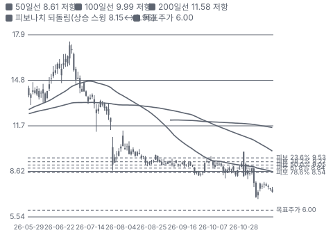

**주봉**

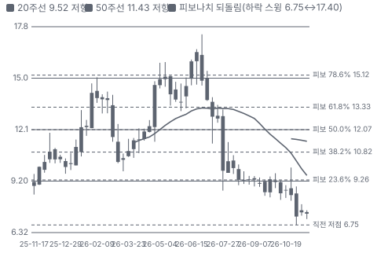

**월봉**

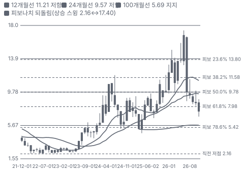

**분기 매출·EPS 실적과 컨센서스**

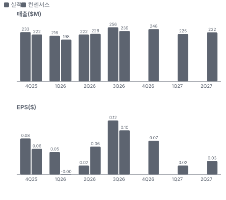

**4Q26 매출 — 지표 추세 vs 가이던스·컨센서스**

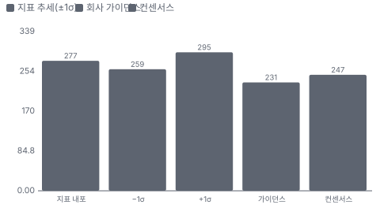

**최근 4개 분기 주가 변화 분석**

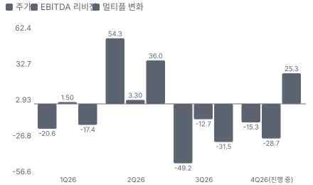

**EPS 리비전**

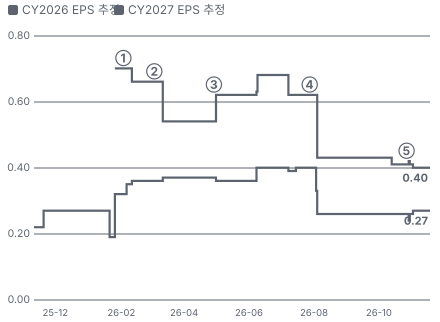

① 26-02-03 McAmis 인수(서부 준설) · EPS 리비전 -6%
② 26-03-04 4Q25 실적·FY2026 첫 가이던스 · EPS 리비전 -18%
③ 26-04-29 1Q26 실적 · EPS 리비전 +14%
④ 26-07-28 2Q26 실적·가이던스 재설정 · EPS 리비전 -31%
⑤ 26-10-27 3Q26 실적·해군 MACC 2건 · EPS 리비전 -2%

**멀티플 프리미엄(Fwd 1Y EV/EBITDA, 최근 4개 분기말 절대값 — 대상 vs 동종 중앙값)**

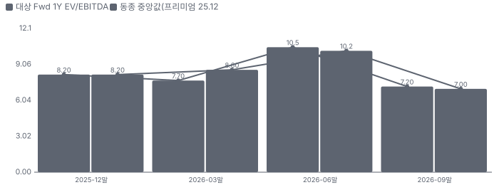

**합리적 멀티플**

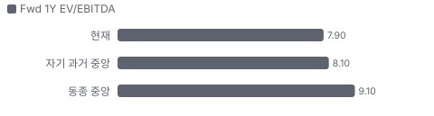

**밸류에이션 주가 시나리오**

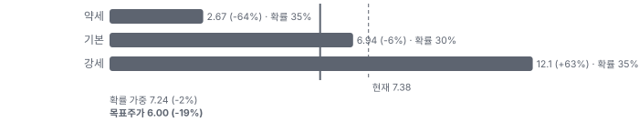

**주가별 업사이드**

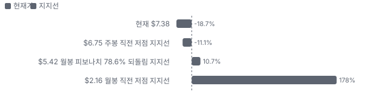
- 제품·서비스 포트폴리오

**고객 믹스(1~3Q26, 매출 대비)**

**공급 병목(10점, 낮을수록 병목)**

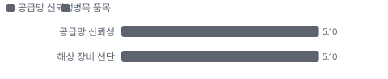

**생산능력 현재와 확충 계획(현장 인력(명))**

**CAPEX의 매출 대비 비중**

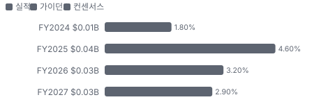

**어닝콜 변화별 주주가치 영향**

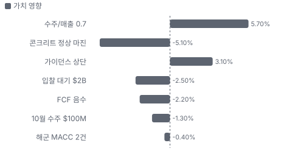

**수주·파이프라인 확실성 사다리**

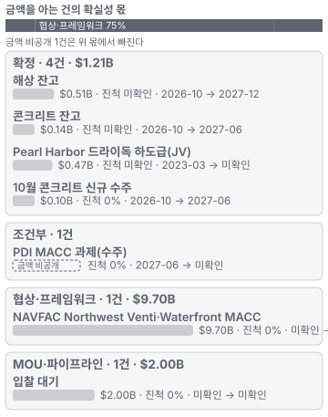

**수주/출하 비율(B/B) × 재고 일수 — 분기별**

**매출 → 매출총이익 → 영업이익(매출 = 100, 최근 4분기)**

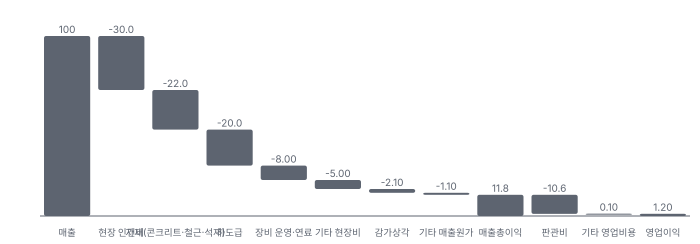

**분기 비용 비중 추이(매출 대비, 공시)**

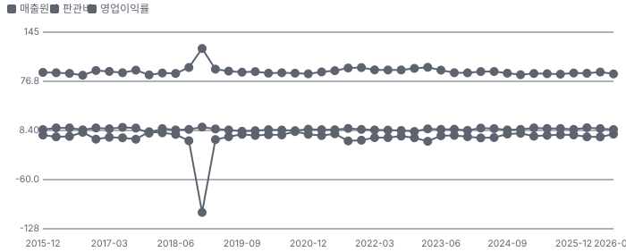

**비용 요인별 매출 대비 비중 1년 변화**

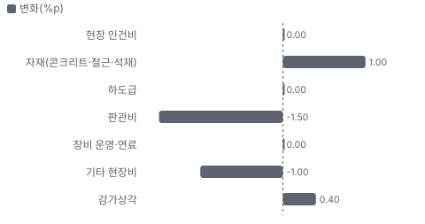

**해상 시공·준설 BOM 원가 몫**

**콘크리트 시공 BOM 원가 몫**

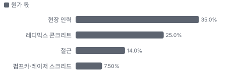

**BOM 항목 가격 +10% 시 OPM 변화**

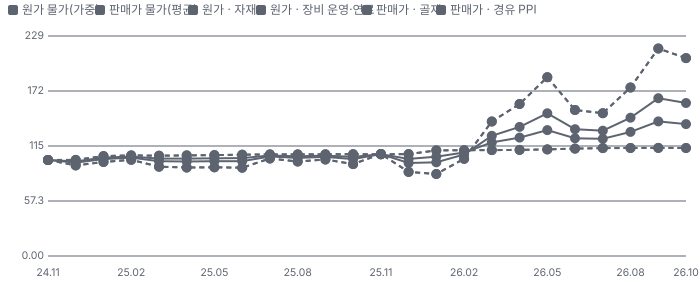

**원가 물가 vs 판매가 물가 — 최근 24개월(24.11 = 100): 판매가가 원가보다 21.9%p 더 올라 마진 여유**

**자산 구성 — 3Q26 분기말 투하자본 \$120.2M**

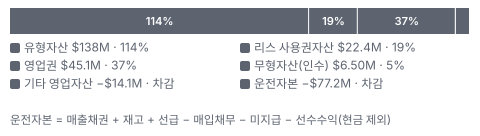

**자산별 변화율 — 최근 12개 분기(4Q23 = 0%) + 다음 4개 분기 추정**

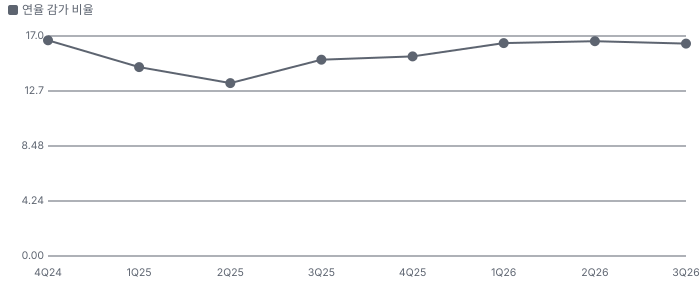

**ROIC 추이 — TTM, 최근 12개 분기 + 다음 4개 분기 추정(컨센서스 NOPAT)**

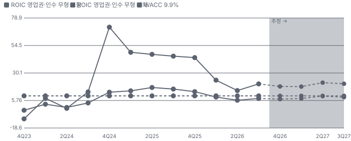

**J.E. McAmis·JEM Marine Leasing 인수 효과 — 인수 전 EPS 대비 %, 굵은 선 = 합계 · 시너지 가치 \$0.01B(웃돈 미확인)**

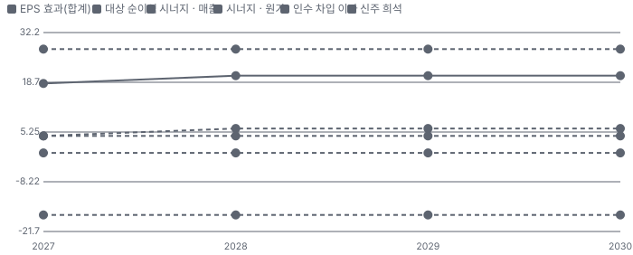

**매출 vs PPI·수출입 — 4Q22 = 100(변화율, 로그 눈금)**

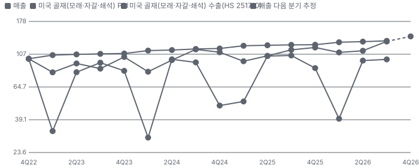

**10년 P·Q 사이클 — 추세(HP 필터) 대비 갭과 8분기 전망**

**매출 증가율의 가격·물량 분해와 8분기 전망(전년 대비)**

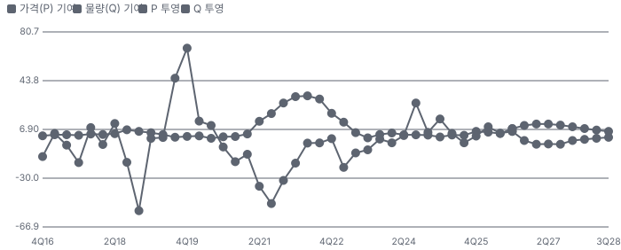

**분기별 매출 증가율 분해**

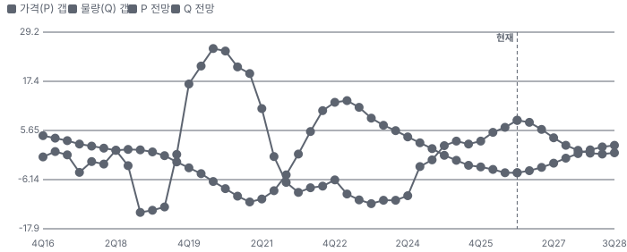

**목표주가 산정 — 약세와 기본 사이(약세 쪽 21%), 도달 확률 약 57%**

**PEG — 성장 대비 멀티플(낮을수록 성장 대비 쌈)**

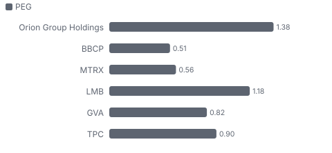

**일별 거래량 분해**

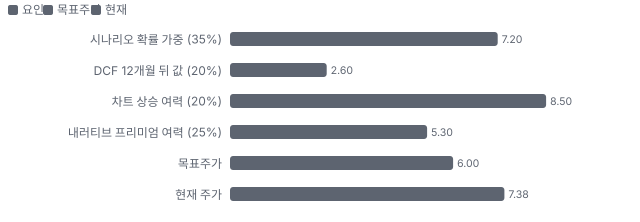

**기관 자금 흐름**

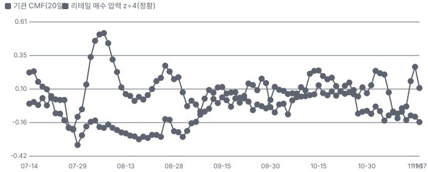

**몬테카를로**

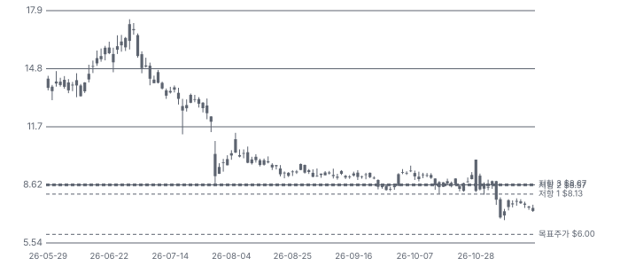

해석: 3,000번 중 621번(21%)에서 가치가 지금 주가 이상이었다. 가정을 흔들어도 지금 주가를 뒷받침하지 못하는 경우가 더 많다. 가운데 값은 0.40배이고, 열 번 중 여덟 번은 -0.46~1.61배 사이에 든다.

## 내러티브

> **기업가치를 결정하는 이야기:** Orion의 값은 '얼마나 많은 해상·콘크리트 공사를 얼마의 이익률로 따내느냐'다. 매출은 잔고에서 1년 안에 나오고, 이익률은 고정가 공사의 실행과 장비 가동률이 정한다. 2027년은 해군 MACC 과제와 데이터센터 콘크리트 발주가 실제 잔고가 되는지로 정해진다.

> **멀티플·EPS 프리미엄**
> **멀티플:** 오늘 가격 기준 Fwd 1Y EV/EBITDA 7.9배로 동종 중앙(9.1배)보다 13% 낮다.
> **EPS:** FY2026 조정 EBITDA 가이던스 \$50~54M, FY2027 컨센서스 약 \$60~62M. EPS는 \$0.23~0.40로 범위가 넓다.

### 투자자들은 왜 열광했나

2026년 상반기 데이터센터 콘크리트 매출이 30% 넘게 늘고 해군 PDI MACC·Pearl Harbor 드라이독 실적이 겹쳐 '해군+AI 인프라 소형주'로 묶였다. 6/29 종가 \$17.14까지 올랐다. 식은 이유는 7/29 2Q 실적(해상 착공 지연·EPS 가이던스 재설정, 하루 −24.1%)과 3Q 수주 부진, 11월 초 이틀 −21.9% 급락이다.

### 무엇이 기업가치를 바꾸나

> **구조적 체질 변화**
> **변화:** 해상 전문 회사에서 해상 63%·콘크리트 37% 두 축으로 바뀌었고, 콘크리트는 텍사스 밖 3개 지역과 부지 조성(건물 공사 전 땅을 고르고 기반을 만드는 토목 공사, site civil)으로 넓어졌다.
> **증거:** https://www.sec.gov/Archives/edgar/data/1402829/000140282926000059/orn-20260930x10q.htm
> **반증:** 텍사스 밖 콘크리트 수주가 끊긴다

> **고부가 믹스 확장**
> **변화:** McAmis의 준설(물 밑 흙·모래를 퍼내 항로·항만 수심을 확보하는 공사)·방파제는 '높은 이익률'로 기여했다고 회사가 말했다. 금액은 공시하지 않는다.
> **증거:** 3Q26 어닝콜(2026-10-28)
> **반증:** 해상 영업이익률이 5% 아래

> **기술 혁신**
> **변화:** 해당 없음(시공 회사 — 장비 보유와 실행력이 경쟁 요인이고 기술 특허로 차별화하지 않는다).

> **실행 속도**
> **변화:** 콘크리트는 수주 뒤 2~3주 안에 착공한다(2Q 콜). 해상은 발주처 결정이 늦어져 입찰 대기가 1년 새 \$1B에서 \$2B로 늘었다. **납품 리드타임 0.6개월.** 피어 비교 미확인. 이전 대비 미확인.
> **증거:** 3Q26 어닝콜(2026-10-28)
> **반증:** 입찰 대기가 더 늘고 잔고가 줄어든다

> **M&A**
> **변화:** 2026-02-03 J.E. McAmis·JEM Marine Leasing 인수(총 대가 \$72.9M) — 서부 준설·방파제와 장비.
> **증거:** https://www.sec.gov/Archives/edgar/data/1402829/000140282926000059/orn-20260930x10q.htm
> **반증:** 조건부 대가가 줄거나 영업권 손상

> **정책·입법 연관성**
> **재정정책:** 해당 없음(해군 시설·항만 예산이 해상 매출의 기반이지만, 이 회사 과제를 만드는 재정 사업·법안을 공시·콜로 특정하지 못했다 — 단계 미확인)
> **행정명령:** 해당 없음(이 회사 매출을 바꾸는 행정명령을 찾지 못했다). 의회 동의 2/10 — 하원 1/5(논의 없음) · 상원 1/5(논의 없음).
> **연관입법:** 해당 없음(Jones Act(미국 항구 사이 해상 운송·작업에 미국 건조·미국 소유 선박만 쓰도록 한 해사법)는 오래된 법으로 지금 바뀌는 단계가 아니다).

> **고객의 지출 예산**
> **변화:** 해상은 정부·항만의 인프라 CAPEX, 콘크리트는 데이터센터·산업 시설 CAPEX다.
> **사업별 예산:** **매출의 63%**: 해상 시공·준설 — 고객 CAPEX(해군 시설·항만 현대화·해안 복원 예산) · 동인: 국방·항만 예산
**매출의 37%**: 콘크리트 시공 — 고객 CAPEX(데이터센터·산업·상업 건물 건설비) · 동인: 데이터센터 착공
> **증거:** https://www.sec.gov/Archives/edgar/data/1402829/000140282926000059/orn-20260930x10q.htm
> **반증:** 해군 시설 예산 삭감·데이터센터 착공 지연

### 내러티브 근거

> 데이터센터 콘크리트와 미 해군 인프라가 함께 성장을 끈다는 이야기가 6월 말까지 주가를 \$17대로 올렸다. 7월 2Q에서 해상 착공이 밀리고 EPS 가이던스가 내려가며 무너졌고, 3Q에는 매출·EBITDA가 좋았지만 잔고가 늘지 않았다. 시장은 '입찰 \$2B와 해군 MACC가 언제 잔고가 되나'를 묻는다. 단계는 소멸, 쏠림은 낮음이다.

> **데이터센터 콘크리트** · 유지
> **논리:** 데이터센터 기초·바닥 공사가 콘크리트 매출을 키운다
> **숫자:** 3Q 콘크리트 매출 +16%, 그중 약 절반이 미션 크리티컬(콜)
> **반증:** 콘크리트 잔고가 \$100M 아래로
> **출처:** 3Q26 어닝콜(2026-10-28)

> **미 해군 시설 현대화** · 강화
> **논리:** 태평양 억지·조선소 현대화로 부두·드라이독 공사가 늘고 Orion이 원청 자리를 얻었다
> **숫자:** MACC 원청 3건, 상한 합 약 \$9.7B(상한이지 매출 아님)
> **반증:** 2027년 말까지 MACC 과제 수주 0건
> **출처:** https://www.sec.gov/Archives/edgar/data/1402829/000140282926000056/orn-ex99d1.htm

> **McAmis 인수로 서부 진출** · 유지
> **논리:** 서부 준설·방파제 실적으로 NAVFAC Northwest 과제에 들어간다
> **숫자:** 총 대가 \$72.9M, 영업권 \$45.1M(10-Q)
> **반증:** 해상 영업이익률이 인수 뒤에도 하락
> **출처:** https://www.sec.gov/Archives/edgar/data/1402829/000140282926000059/orn-20260930x10q.htm

> **이익률 개선** · 약화
> **논리:** 콘크리트 지역 확장과 해상 대형 공사로 EBITDA 이익률이 5%대에서 오른다
> **숫자:** 3Q 조정 EBITDA 이익률 7.0%(+1.2%p), TTM 5.1%
> **반증:** 4Q 조정 EBITDA \$17M 아래
> **출처:** 3Q26 어닝콜(2026-10-28)

> **반대: 수주 정체와 차입 증가** · 강화
> **논리:** 잔고가 9개월째 늘지 않는데 차입은 인수로 \$110M까지 늘었다 — 발주가 늦으면 고정비와 이자가 이익을 먹는다
> **숫자:** 잔고 \$640M → \$645M, 총차입 \$7.9M → \$110.2M, 현금 \$5.7M
> **반증:** 4Q 수주/매출 1.2배 이상
> **출처:** https://www.sec.gov/Archives/edgar/data/1402829/000140282926000056/orn-ex99d1.htm

### 투자 포인트

> **이익은 늘었는데 배수만 줄었다**
> **명제:** 6월 말 종가 고점 이후 주가 −57%의 대부분이 배수 하락과 EPS 추정 하향이다
> **숫자:** Fwd 1Y EV/EBITDA(데이터 원천 월말 기준) 6/30 10.5배 → 10/30 8.2배, 오늘 가격 기준 7.9배. FY2027 EPS 추정 7/15 \$0.62 → 11/2 \$0.40. FY2026 EBITDA 가이던스는 \$50~54M 유지
> **시장과 다른 점:** 시장은 EPS를 보고 팔았지만 EBITDA는 거의 그대로다 — 깎인 몫은 인수 뒤 늘어난 감가상각·이자다
> **증명:** 4Q 조정 EBITDA가 \$17.5M(가이던스 중간값 역산) 이상
> **출처:** https://www.sec.gov/Archives/edgar/data/1402829/000140282926000056/orn-ex99d1.htm

> **잔고가 가를 것**
> **명제:** 잔고가 9개월째 \$640M대다
> **숫자:** 작년 말 \$640M → 3Q \$645M, 3Q 수주 \$179M(매출의 0.7배)
> **시장과 다른 점:** -
> **증명:** 4Q 잔고 \$700M 이상, 수주/매출 1.0 이상
> **출처:** https://www.sec.gov/Archives/edgar/data/1402829/000140282926000056/orn-ex99d1.htm

> **약한 고리 — 현금과 차입**
> **명제:** 현금 \$5.7M에 총차입 \$110.2M
> **숫자:** 9개월 영업현금흐름 −\$10.7M, 계약자산 \$31.1M → \$84.2M(10-Q)
> **시장과 다른 점:** -
> **증명:** 4Q 영업현금흐름이 크게 들어와 계약자산이 줄어든다
> **출처:** https://www.sec.gov/Archives/edgar/data/1402829/000140282926000059/orn-20260930x10q.htm

### 모멘텀 생성·소멸 타임라인

**카탈리스트 달력 — 지난 사건의 주가 반응과 앞으로 확인할 숫자**
| 날짜 | 상태 | 구분 | 사건 | 반응·확인 | 결과에 따라 |
|---|---|---|---|---|---|
| 2026-01-22 | 완료 | 생성 | 주가 +13.2% 하루 급등(원인 미확인) | \$11.18 → \$12.66 |  |
| 2026-02-03 | 완료 | 생성 | McAmis 인수 완료 | 서부 준설 확장 |  |
| 2026-03-04 | 완료 | 소멸 | 4Q25 실적·FY2026 가이던스 | 다음 날 −11.8% |  |
| 2026-04-29 | 완료 | 생성 | 1Q26 실적 — 콘크리트 강세 | 다음 날 +13.4% |  |
| 2026-06-29 | 완료 | 과밀 | 종가 고점 \$17.14 | 데이터센터·해군 테마 정점 |  |
| 2026-07-28 | 완료 | 소멸 | 2Q26 실적 — 해상 착공 지연·EPS 가이던스 재설정 | 다음 날 −24.1% |  |
| 2026-10-27 | 완료 | 소멸 | 3Q26 실적 — 수주/매출 0.7 | 다음 날 −9.3% |  |
| 2026-11-05 | 완료 | 매크로 | 이틀 −21.9%(원인 미확인) | 11/5 종가 \$6.89 |  |
| 2026-12~2027-02(예상) | 예정 | 확인 | NAVFAC Northwest MACC 과제 발주·수주 공시 | Venti·Waterfront MACC 과제 1건 이상 수주 | 수주면 기본~강세, 2027년 상반기까지 0건이면 약세 |
| 2027-03(추정) | 예정 | 확인 | 4Q26 실적·FY2027 첫 가이던스 | 잔고 \$700M 이상·FY2027 조정 EBITDA 가이던스 중간값 \$60M 이상 | 넘으면 기본~강세, 잔고 \$600M 미만이거나 EBITDA 가이던스 \$55M 미만이면 약세 |

### 언제 사서 언제 팔아야 할까?

**가격·조건 틀 — 가격은 밸류에이션(약세·기본·강세·목표주가)과 차트 지지 구간에서, 조건은 이벤트에서**
| 구간 | 가격 | 목표주가까지 | 약세까지 | 조건·근거 |
|---|---|---|---|---|
| 관찰 구간 | \$6.75~\$6.75 | -11% | -60% | 11/5 종가 저점 \$6.89 부근 — 약세 시나리오 쪽 지지 구간 |
| 확인 뒤 | 지금 \$7.38 이상에서 조건 확인 | -19% | -64% | 4Q 잔고 \$700M 이상, 수주/매출 1.0 이상, MACC 과제 수주 공시 |
| 무효화 | 약세 시나리오 \$2.67 | - | -64% | 4Q 잔고 \$600M 미만이거나 11/5 종가 저점 \$6.89 이탈 |
| 차익 고민 2차 | \$12.06(강세 시나리오) | +63% | - | 목표주가 근처에서는 잔고 증가 속도와 영업현금흐름을 다시 본다 |

실적 다음 날 −24.1%(7/29)·+13.4%(4/30)·−11.8%(3/5)처럼 크게 움직였다. 거래량이 하루 수십만 주라 이벤트 직전 추격을 경계한다 가격·조건 틀이며 매매·비중 지시가 아니다(투자 권유 아님).

## 포트폴리오

| 제품·서비스 | 구분 | 무엇 | 쓰는 곳 | 돈 버는 방식 | Mix | Mix 변화(전 분기 대비) |
|---|---|---|---|---|---|---|
| 해상 시공·준설 | 서비스 | 부두·안벽·드라이독·교량·준설·해안 복원 공사 | 미 해군·항만·주정부·에너지 기업 | 3Q26 매출의 63% | 63% | 미확인 |
| 콘크리트 시공 | 서비스 | 기초·바닥 타설·거푸집·배근·부지 조성 | 데이터센터·물류창고·병원·학교 | 3Q26 매출의 37% | 37% | 미확인 |

## 고객

> **1~3Q26 최대 고객 데이터센터 고객(이름 미공시, 콘크리트 미션 크리티컬 공사) 18%, 상위 3곳 30%, 집중도 분산.** 공시·회사 발표로 확인한 몫은 매출의 11%이고, 나머지 고객 몫은 추정이거나 미분해다. 9개월 매출은 민간 48.1%·연방정부 20.8%·주정부 16.1%·지방정부 15.0%다(10-Q). 3Q에는 연방 범주 고객 1곳이 11%였고, 9개월로는 10%를 넘는 고객이 없다. 작년에는 미 해군이 9개월 16%였다 — Pearl Harbor 드라이독 매출이 \$100.4M에서 \$47.4M로 줄어든 영향이다. 콘크리트 매출의 약 절반이 데이터센터 같은 미션 크리티컬 공사다(3Q 콜).

**고객별 매출 몫(1~3Q26)**
| 고객 | 몫 | 변화 | 근거 |
|---|---|---|---|
| 데이터센터 고객(이름 미공시, 콘크리트 미션 크리티컬 공사) | 18% | 미확인 | 추정 |
| 미 해군(연방정부 범주 고객 1곳(3Q 11%)) | 11% | -4%p | 공시 |
| 기타·미분해 | 70% | - | - |

> **데이터센터 고객(이름 미공시, 콘크리트 미션 크리티컬 공사)** · 추정
> **사는 것:** 기초·바닥 콘크리트·부지 조성
> **추정 근거:** 콘크리트 \$95.0M × 약 50% ÷ \$256.2M ≈ 18.5%(계산·추정)

> **미 해군(연방정부 범주 고객 1곳(3Q 11%))** · 공시
> **사는 것:** 부두·안벽·드라이독·준설
> **추정 근거:** 3Q 10% 초과 연방 고객 — 작년 같은 분기 미 해군 15%로 공시. 3Q 고객 이름은 공시되지 않아 해군으로 본 것은 가설

## 수주·파이프라인

> **2026-09-30 기준 7건.** 확정 \$1.21B, 미확정 \$11.70B. 공시 수주잔고 \$0.65B.

**수주 목록**
| 상태 | 계약 | 계약 총액 | 진척 | 기간 | 비고 |
|---|---|---|---|---|---|
| 확정 | 해상 잔고 | \$0.51B | 비공개 | 2026-10 → 2027-12 | - |
| 확정 | 콘크리트 잔고 | \$0.14B | 비공개 | 2026-10 → 2027-06 | - |
| 확정 | Pearl Harbor 드라이독 하도급(JV) | \$0.47B | 비공개 | 2023-03 → 미확인 | - |
| 확정 | 10월 콘크리트 신규 수주 | \$0.10B | 0% | 2026-10 → 2027-06 | - |
| 조건부 | PDI MACC 과제(수주) | 금액 비공개 | 0% | 2027-06 → 미확인 | - |
| 프레임워크 | NAVFAC Northwest Venti·Waterfront MACC | \$9.70B | 0% | 미확인 → 미확인 | - |
| 파이프라인 | 입찰 대기 | \$2.00B | 0% | 미확인 → 미확인 | - |

**실행 속도와 방해 요인**
| 항목 | 상태 | 실행 속도 | 방해 요인 |
|---|---|---|---|
| 해상 잔고 | 확정 | 대부분 1년 안(10-Q '공사 기간 보통 1년 미만') | 발주처 착공 지연 · 기상 |
| 콘크리트 잔고 | 확정 | 수주 후 몇 주 안에 착공(2Q 콜) | 데이터센터 일정 |
| Pearl Harbor 드라이독 하도급(JV) | 확정 | 9개월 인식 \$47.4M(작년 \$100.4M) — 마무리 단계로 줄어든다 | JV 공정 |
| 10월 콘크리트 신규 수주 | 확정 | 4Q 잔고 반영 | 미확인 |
| PDI MACC 과제(수주) | 조건부 | 잔고 반영은 2027년 중·후반(3Q 콜) | 설계·예산 단계 |
| NAVFAC Northwest Venti·Waterfront MACC | 프레임워크 | 과제 몇 건 검토 중, 시점 미확인(3Q 콜) | 과제별 경쟁 · 예산 배정 |
| 입찰 대기 | 파이프라인 | 발주처 결정 지연(3Q 콜) | 발주 지연 · 보증 한도(시공사가 발주처에 낼 수 있는 이행 보증, surety bond 총량) |

## 마진 구조

> **GPM 12.9%, OPM 3.3%.** 3Q25 대비 GPM -0.3%p, OPM +1.0%p. 변동비는 매출의 73%이고, 매출이 10% 늘면 OPM은 +2.1%p 움직인다. 3Q26 매출총이익률 12.9%, 영업이익률 3.3%다. 1년 전(13.2%, 2.4%)보다 매출총이익률은 조금 내려갔고 판관비 비중이 11.1%에서 9.7%로 내려가 영업이익률이 올랐다. 해상은 작년 3Q 마감 정산 이익이 빠져 영업이익이 \$19.4M에서 \$12.6M로 줄었고, 콘크리트는 \$0.5M에서 \$9.4M로 늘었다. 원가는 인건비·하도급·자재(콘크리트·철근)·장비 연료가 대부분이고, 고정가 계약이 대부분이라 자재값이 오르면 진행 중 공사 이익률이 깎인다.

> **매출 100 중 매출원가 88.2, 매출총이익 11.8(최근 4분기, 공시).** 매출원가 요인 중 현장 인건비이 매출의 30.0%로 가장 무겁고, 단가가 +10% 오르면 GPM이 -3.00%p 움직인다. 분기 회귀로 매출 1이 늘 때 매출원가는 0.79 늘고, 매출원가의 고정비 몫은 12%다.

**비용 요인 강도 — 비중·추세·충격(+10%)·탄력**
| 비용 | 구분 | 매출 대비 | 1년 변화 | 마진 기여 | 충격 시 마진 | 매출 탄력 | 고정비 몫 |
|---|---|---|---|---|---|---|---|
| 현장 인건비 | 매출원가 요인 | 30.0% | +0.0%p | -0.0%p | -3.00%p | 미확인 | 30% |
| 자재(콘크리트·철근·석재) | 매출원가 요인 | 22.0% | +1.0%p | -1.0%p | -2.20%p | 미확인 | 0% |
| 하도급 | 매출원가 요인 | 20.0% | +0.0%p | -0.0%p | -2.00%p | 미확인 | 0% |
| 장비 운영·연료 | 매출원가 요인 | 8.0% | +0.0%p | -0.0%p | -0.80%p | 미확인 | 40% |
| 기타 현장비 | 매출원가 요인 | 5.0% | -1.0%p | +1.0%p | -0.50%p | 미확인 | 50% |
| 감가상각 | 매출원가 요인 | 2.1% | +0.4%p | -0.4%p | -0.21%p | 미확인 | 100% |
| 매출원가 | 공시 항목 | 88.2% | +1.3%p | -1.3%p | -8.82%p | 0.79 | 12% |
| 판관비 | 공시 항목 | 10.6% | -0.4%p | +0.4%p | 미확인 | 0.08 | 20% |
| 기타 영업비용 | 공시 항목 | -0.1% | -0.3%p | +0.3%p | 미확인 | -0.10 | 100% |

매출 탄력 = 분기 비용을 매출에 회귀한 기울기(매출 1당 변동비), 고정비 몫 = 절편 ÷ 평균 비용. 표본이 8분기 미만이면 미확인. 매출원가 요인 비중은 margin 재료의 추정이 섞여 있고, 공시 매출원가와의 차이는 '기타 매출원가'로 둔다.

**GPM에서 OPM까지(GAAP — 10-Q 3개월 손익. 매출원가 요인은 회사가 나누지 않아 감가상각·판관비 외에는 추정, 아래는 최근 4개 분기)**
| 기간 | GPM | 연구개발 | 판관비 | 기타 | OPM |
|---|---|---|---|---|---|
| 3Q25 | 13.2% | 0.0% | 11.1% | -0.3% | 2.4% |
| 3Q26 | 12.9% | 0.0% | 9.7% | -0.0% | 3.3% |
| 2025-12 | 11.6% | - | - | - | 2.2% |
| 2026-03 | 12.0% | - | - | - | -0.4% |
| 2026-06 | 10.3% | - | - | - | -0.6% |
| 2026-09 | 12.9% | - | - | - | 3.3% |

**비용을 움직이는 요인**
| 비용 | 요인 |
|---|---|
| 현장 인건비(매출원가) | 숙련 인력·임금 · 근거 추정 |
| 자재(콘크리트·철근·석재, 매출원가) | 자재 단가·물량 · 근거 추정 |
| 하도급(매출원가) | 공사 범위 · 근거 추정 |
| 판관비(판관비) | 본사 인력·인수 비용 · 근거 공시 |
| 장비 운영·연료(매출원가) | 경유 가격·가동률 · 근거 추정 |
| 기타 현장비(매출원가) | 보험·임차·현장 관리 · 근거 추정 |
| 감가상각(매출원가) | 장비 선단 · 근거 공시 |

**해상 시공·준설 BOM — 매출의 63%, GPM 13%(추정 — 세그먼트 매출총이익을 공시하지 않아 회사 전체 3Q26 매출총이익률 12.9%를 쓴다. 3Q 세그먼트 영업이익률은 7.8%(10-Q)), 항목 가격 +10% 시**
| 항목 | 원가 몫 | 전가 | 제품 GPM | OPM |
|---|---|---|---|---|
| 현장 인력(잠수·크레인 운전) | 25~35% | 미확인 | -2.6%p | -1.64%p |
| 장비 선단(준설선·바지선·크레인) | 15~25% | 미확인 | -1.7%p | -1.10%p |
| 하도급 | 15~25% | 미확인 | -1.7%p | -1.10%p |
| 강재(말뚝·철근) | 10~20% | 미확인 | -1.3%p | -0.82%p |
| 미분해 | 15% | - | - | - |

**콘크리트 시공 BOM — 매출의 37%, GPM 13%(추정 — 세그먼트 매출총이익을 공시하지 않아 회사 전체 3Q26 매출총이익률 12.9%를 쓴다. 3Q 세그먼트 영업이익률은 9.9%(10-Q)), 항목 가격 +10% 시**
| 항목 | 원가 몫 | 전가 | 제품 GPM | OPM |
|---|---|---|---|---|
| 현장 인력 | 30~40% | 미확인 | -3.0%p | -1.13%p |
| 레디믹스 콘크리트 | 20~30% | 미확인 | -2.2%p | -0.81%p |
| 철근 | 10~18% | 미확인 | -1.2%p | -0.45%p |
| 펌프카·레이저 스크리드(콘크리트 바닥을 레이저로 평탄하게 고르는 장비) | 5~10% | 미확인 | -0.7%p | -0.24%p |
| 미분해 | 19% | - | - | - |

현장 인력(잠수·크레인 운전) 가격이 +10% 오르면 영업이익은 -49.4% 움직인다. 판매가 전가를 모르는 항목은 전가 0%로 계산했다.

**BOM 항목 가격을 움직이는 것**
| 항목 | 요인 |
|---|---|
| 장비 선단(준설선·바지선·크레인) | 공사 가능 여부를 가른다 · 근거 추정 |
| 현장 인력(잠수·크레인 운전) | 숙련 인력 확보가 수주 한도 · 근거 추정 |
| 강재(말뚝·철근) | 말뚝·방현재 재료 · 근거 추정 |
| 하도급 | 설계·특수 공정 · 근거 추정 |
| 레디믹스 콘크리트 | 타설 물량에 비례 · 근거 추정 |
| 철근 | 배근 공정 · 근거 추정 |
| 현장 인력 | 인력 투입이 처리량 · 근거 추정 |
| 펌프카·레이저 스크리드 | 자가 장비 · 근거 추정 |

> **원가·판매가 물가 격차 +25.4%p** — 판매가 물가가 투입 원가 물가보다 빠르게 오른다.

**투입 물가 — 미국 PPI 3·6·12개월(2026-10, 개정 반영)**
| 항목 | 미국 3개월 | 6개월 | 12개월 | 전가 못 할 때 OPM |
|---|---|---|---|---|
| 레디믹스 콘크리트 | +0.1% | +1.7% | +6.1% | - |
| 장비 운영·연료 | +38.6% | +30.2% | +115.2% | -9.2%p |

별표는 품목보다 넓은 업종 지수다. 연결한 투입 원가의 미국 PPI(생산자물가지수)는 1년 새 가중 +35.2%이고, 판매가로 넘기지 못하면 GPM -10.6%p·OPM -10.6%p가 움직인다. 판매가 비교 물가(골재(모래·자갈·쇄석) PPI)는 1년 새 +6.1% — 회사 가격 변화는 미확인. 물가 지수를 붙이지 못한 매출원가 항목은 현장 인건비, 하도급, 감가상각다(미연결).

## 자산 구성

> **3Q26 분기말 투하자본 \$120.2M** — 유형자산 114%, 영업권 38%. 최근 12개 분기(4Q23 → 3Q26) 가장 크게 늘어난 자산은 유형자산(+57%), 투하자본 합계 +57688%. 3Q27 추정 투하자본 \$155.8M(+30%, 컨센서스 매출과 회전 일수·CAPEX 강도 유지 가정). 연율 감가 비율(순액 기준)은 직전 4분기 14.90% → 최근 4분기 16.24%.

**자산·운전자본 항목별 분기말 잔액 — 최근 12개 분기와 다음 4개 분기 추정**
| 항목 | 4Q23 | 3Q25 | 3Q26(최근) | 3Q27 추정 | 12개 분기 변화 | 다음 4개 분기 변화 |
|---|---|---|---|---|---|---|
| 재고자산 | \$2.7M | \$2.1M | \$2.2M | \$2.9M | -17% | +28% |
| 선급·기타 유동자산 | \$8.9M | \$5.1M | \$8.1M | \$11.3M | -9% | +40% |
| 미지급비용 | \$37.1M | \$28.5M | \$43.9M | \$32.7M | +18% | -26% |
| 선수수익(계약부채) | \$64.1M | \$43.9M | \$43.6M | \$53.8M | -32% | +23% |
| 유형자산 | \$87.8M | \$101.1M | \$137.6M | \$169.9M | +57% | +24% |
| 리스 사용권자산 | \$25.7M | \$22.2M | \$22.4M | \$22.4M | -13% | +0% |
| 영업권 | 미확인 | 미확인 | \$45.1M | \$45.1M | 비교 불가 | +0% |
| 무형자산(인수) | \$0.0M | 미확인 | \$6.5M | \$4.9M | 비교 불가 | -24% |

**자산 추정 동인 — 최근 4개 분기 평균(재무상태표 동인 모형)**
| 동인 | 값 | 곱하는 기준 |
|---|---|---|
| 재고자산 | 1일 | 매출원가 |
| 선급·기타 유동자산 | 4일 | 매출 |
| 미지급비용 | 11일 | 매출 |
| 선수수익(계약부채) | 19일 | 매출 |
| CAPEX 강도 | 4.5% | 매출(최근 4개 분기 합) |
| 분기 감가율 | 3.88% | 기초 유형자산 순액(무형 상각 제외 감가상각) |
| 매출원가율 | 88.2% | 매출(최근 4개 분기) |
| 영업권·리스 사용권·기타 | 유지 | 인수·새 리스는 공시 전 모름 |
| 인수 무형자산 | 분기 \$0.4M 상각 | 최근 4개 분기 평균 상각 |

**추정 방법:** 증권사 3표 모델(손익·재무상태표·현금흐름)의 재무상태표 동인 방식이다. 운전자본은 항목별 회전 일수(매출채권·선급·미지급·선수는 매출, 재고·매입채무는 매출원가 기준)를 최근 4개 분기 평균으로 두고 컨센서스 매출에 곱한다. 유형자산은 기초 + CAPEX − 감가상각으로 굴린다(Koller·Goedhart·Wessels 『Valuation』 재무상태표 추정). 매출 경로는 ROIC 절의 컨센서스와 같다.

**유형·무형자산 항목별 가치(2023-12-31 vs 2022-12-31)**
| 구분 | 항목 | 총액 2023-12-31 | 누적상각 | 순액 | 총액 2022-12-31 | 총액 1년 변화 | 공시 내용연수 |
|---|---|---|---|---|---|---|---|
| 유형 | 유형자산 합계(항목 미분해) | \$265.4M | 총계만 공시 | 총계만 공시 | \$268.2M | -1.1% | 미확인 |
| 무형 | 무형자산 합계(항목 미분해) | \$35.2M | \$35.2M | \$0.0M | \$35.2M | +0.0% | 미확인 |
| 유형 합계 | 유형자산 | \$265.4M | \$206.2M | \$59.1M | \$268.2M | -1.1% | 경과율 78%(상각 대상 기준) |

**내용연수 산식(상각 대상 유형자산 = 총액 − 토지 − 건설중)**
| 기준일 | 연 감가상각 | 상각 대상 총액 | 평균 내용연수 | 경과 연수 | 잔여 연수 | 경과율 |
|---|---|---|---|---|---|---|
| 2023-12-31 | \$15.5M | \$265.4M | 17.1년 | 13.3년 | 3.8년 | 78% |
| 2022-12-31 | \$18.4M | \$268.2M | 14.6년 | 10.6년 | 3.9년 | 73% |

산식 평균 내용연수는 17.1년. 1년 전 14.6년 → 지금 17.1년.

**분기 감가 비율(감가상각 ÷ 평균 유형자산 순액)**
| 분기 | 감가상각 | 평균 유형자산(순액) | 분기 비율 | 연율 | 연율의 역수 |
|---|---|---|---|---|---|
| 4Q24 | \$3.6M | \$86.2M | 4.16% | 16.64% | 6.0년 |
| 1Q25 | \$3.2M | \$87.2M | 3.64% | 14.57% | 6.9년 |
| 2Q25 | \$3.1M | \$92.9M | 3.33% | 13.34% | 7.5년 |
| 3Q25 | \$3.8M | \$99.4M | 3.78% | 15.14% | 6.6년 |
| 4Q25 | \$3.6M | \$94.7M | 3.85% | 15.40% | 6.5년 |
| 1Q26 | \$4.4M | \$106.8M | 4.10% | 16.42% | 6.1년 |
| 2Q26 | \$5.3M | \$127.5M | 4.14% | 16.57% | 6.0년 |
| 3Q26 | \$5.5M | \$133.6M | 4.09% | 16.38% | 6.1년 |

감가상각 기준: 손익계산서 감가상각·상각비(SEC 공시 데이터, 4분기 = 연간 − 1~3분기). 분기 유형자산 총액이 없어 순액 기준.

최근 4분기 연율 감가 비율 16.24%, 직전 4분기 14.90%(+9%) — 경고 문턱(-10%) 안이다.

미공시·미분해: 유형자산 항목별 총액·내용연수(10-K 주석에서 모델이 채움) · 무형자산 항목(10-K 주석에서 모델이 채움) — 이 칸은 비우고 나머지로 계산했다.

### 해석 — 자산이 어디에 쌓이고 있나

- 같은 기간 4개 분기 매출은 +19% — 매출보다 빨리 늘어난 자산: 유형자산 +57%. 이 자산의 회전율이 떨어지면 ROIC를 희석한다.
- 다음 4개 분기 CAPEX \$43.3M vs 감가상각 \$23.2M(최근 4개 분기 CAPEX 강도·감가율 유지) — 유형자산 3Q26 \$137.6M → 3Q27 \$169.9M. 투자가 감가보다 커서 자산이 쌓이는 국면이다.

## ROIC

> **TTM 3Q26 ROIC는 영업권·인수 무형 포함 7.6%, 제외 20.5%**(NOPAT 마진 1.2% × 투하자본 회전율 6.14회). 최근 12개 분기 4Q23 -2.9% → 3Q26 7.6%(고점 2Q25 17.3%). 컨센서스 NOPAT으로 굴리면 3Q27 8.7%(제외 20.6%) — WACC 9.9% 대비 -1.2%p. 1년 변화의 가장 큰 요인은 NOPAT 마진(-6.3%p).

**ROIC 추이(TTM)와 다음 4개 분기 추정 — NOPAT ÷ 평균 투하자본(이번 분기말·4개 분기 전)**
| 분기 | 구분 | TTM 매출 | TTM NOPAT | NOPAT 마진 | 평균 투하자본 | ROIC 포함 | ROIC 제외 |
|---|---|---|---|---|---|---|---|
| 4Q23 | 실적 | \$711.8M | −\$2.9M | -0.4% | \$101.2M | -2.9% | -10.5% |
| 1Q24 | 실적 | \$713.3M | \$2.7M | 0.4% | \$108.2M | 2.5% | 7.7% |
| 2Q24 | 실적 | \$722.9M | −\$0.4M | -0.1% | \$105.7M | -0.4% | -1.2% |
| 3Q24 | 실적 | \$781.1M | \$3.6M | 0.5% | \$100.0M | 3.6% | 13.4% |
| 4Q24 | 실적 | \$796.4M | \$11.2M | 1.4% | \$85.3M | 13.1% | 70.8% |
| 1Q25 | 실적 | \$824.4M | \$14.1M | 1.7% | \$98.6M | 14.3% | 48.5% |
| 2Q25 | 실적 | \$837.5M | \$19.1M | 2.3% | \$110.3M | 17.3% | 46.7% |
| 3Q25 | 실적 | \$835.9M | \$17.0M | 2.0% | \$107.2M | 15.9% | 45.1% |
| 4Q25 | 실적 | \$852.3M | \$13.6M | 1.6% | \$100.7M | 13.6% | 43.8% |
| 1Q26 | 실적 | \$879.9M | \$12.7M | 1.4% | \$143.9M | 8.8% | 23.8% |
| 2Q26 | 실적 | \$896.5M | \$9.1M | 1.0% | \$153.1M | 6.0% | 14.6% |
| 3Q26 | 실적 | \$927.6M | \$11.4M | 1.2% | \$151.0M | 7.6% | 20.5% |
| 4Q26 | 추정 | \$942.0M | \$10.7M | 1.1% | \$154.1M | 7.0% | 18.2% |
| 1Q27 | 추정 | \$950.7M | \$15.1M | 1.6% | \$199.2M | 7.6% | 18.1% |
| 2Q27 | 추정 | \$960.9M | \$20.0M | 2.1% | \$208.1M | 9.6% | 21.6% |
| 3Q27 | 추정 | \$969.7M | \$18.0M | 1.9% | \$207.5M | 8.7% | 20.6% |

**다음 4개 분기 NOPAT — 컨센서스(세율 25%, 리스 이자 별도)**
| 분기 | 매출 | EBITA 마진 | EBITA | NOPAT(분기) | 근거 |
|---|---|---|---|---|---|
| 4Q26 | \$247.7M | 1.6% | \$4.0M | \$3.0M | 컨센서스 매출 × EBIT 마진 FY2026 |
| 1Q27 | \$225.0M | 2.3% | \$5.2M | \$3.9M | 컨센서스 매출 × EBIT 마진 FY2027 |
| 2Q27 | \$232.0M | 2.3% | \$5.4M | \$4.0M | 컨센서스 매출 × EBIT 마진 FY2027 |
| 3Q27 | \$265.0M | 2.3% | \$6.1M | \$4.5M | 컨센서스 매출 × EBIT 마진 FY2027 |

**추정 방법:** NOPAT은 컨센서스(분기 매출 추정 × 회계연도 EBIT 마진 추정)로 잡고, 조정(비 GAAP) 마진이면 주식보상 몫을 빼서 과거 실적과 같은 기준(영업이익 + 인수 무형 상각)으로 맞췄다. 이미 발표했지만 분기 보고서(10-Q)가 아직 없는 분기는 발표 실적을 쓴다. 투하자본은 자산 구성 절의 재무상태표 동인으로 굴렸다. ROIC는 4개 분기 NOPAT을 이번 분기말과 4개 분기 전 투하자본의 평균으로 나눈다 — 추정 분기의 ROIC에는 이미 나온 실적 분기가 섞여 있다.

**투하자본 항목별 회전율과 ROIC 기여(TTM 3Q26, 평균 잔액)**
| 항목 | 투하자본 | 매출 1달러당 자본 | 회전율(매출 ÷ 항목) | 자본 몫 | 이 항목을 빼면 ROIC |
|---|---|---|---|---|---|
| 운전자본 | −\$71.2M | -0.08 | 음수(자금 원천) | -47% | 5.1% |
| 유형자산 | \$119.3M | 0.13 | 7.77회 | 79% | 35.5% |
| 리스 사용권자산 | \$22.3M | 0.02 | 41.56회 | 15% | 8.7% |
| 영업권 | \$92.0M | 0.10 | 10.08회 | 61% | 19.0% |
| 무형자산(인수) | \$3.2M | 0.00 | 286.11회 | 2% | 7.6% |
| 기타 영업자산 | −\$14.8M | -0.02 | 음수(자금 원천) | -10% | 6.8% |

**ROIC 세 가지 판**
| 판 | NOPAT | 투하자본 | ROIC | 무엇을 재나 |
|---|---|---|---|---|
| 영업권·인수 무형 포함 | \$11.2M | \$151.0M | 7.4% | 인수 웃돈까지 낸 돈에 대한 수익률 |
| 영업권·인수 무형 제외 | \$11.2M | \$55.7M | 20.1% | 본업 운영 수익률(동종 비교용) |
| 무형 자본화 조정(판관비 20%·5년, 연구개발 6년) | \$16.3M | \$198.6M | 8.2% | 비용으로 처리한 무형 투자를 자산으로 본 판 |
| 경제적 이익(포함판) | −\$3.7M | \$151.0M | 자본비용 9.9% | (ROIC − 자본비용) × 투하자본 |

NOPAT = (영업이익 \$11.4M + 인수 무형 상각 + 리스 내재 이자 \$3.1M) × (1 − 세율 25%). 리스 사용권자산을 투하자본에 넣었으므로 임차료 속 이자 몫을 영업이익에 되더했다. 현금은 영업에 필요한 몫을 따로 알 수 없어 투하자본에서 뺐다. SEC 공시 데이터 자동 초안 — 운전자본 = 매출채권 + 재고 + 선급 − (매입채무 + 미지급비용 + 선수수익), 현금 제외. 손상 누계는 공시 데이터 수록분.

**ROIC 1년 변화 분해(포함판, TTM 3Q25 → TTM 3Q26)**
| 요인 | ROIC 기여 |
|---|---|
| NOPAT 마진 | -6.31%p |
| 운전자본 | +0.07%p |
| 유형자산 | -1.30%p |
| 리스 사용권자산 | +0.53%p |
| 영업권 | -1.26%p |
| 무형자산(인수) | -0.27%p |
| 기타 영업자산 | -0.47%p |
| 합계 | -9.02%p |

**무형 자본화 가정별 ROIC(2025년 지출 기준, 포함판에 더함)**
| 투자로 보는 몫 | 상각 연수 | 무형 자산 | NOPAT 조정 | 조정 ROIC |
|---|---|---|---|---|
| 판관비 20% | 2년 | \$26.9M | \$3.5M | 8.3% |
| 판관비 20% | 5년 | \$47.6M | \$5.1M | 8.2% |
| 판관비 30% | 2년 | \$40.4M | \$5.2M | 8.6% |
| 판관비 30% | 5년 | \$71.5M | \$7.7M | 8.5% |

### 해석 — 무엇이 수익성을 끌어올리고 희석하나

- 유형자산: 투하자본의 79% — 빼면 ROIC 7.4% → 35.5%. 이 자산의 회전율(7.77회)이 수익성을 희석하는 주된 자리다.
- 영업권: 투하자본의 61% — 빼면 ROIC 7.4% → 19.0%. 이 자산의 회전율(10.08회)이 수익성을 희석하는 주된 자리다.
- 기타 영업자산: −\$14.8M(음수), 고객 선수금·공급사 외상이 자본을 대신 댄다 — 빼면 ROIC 6.8%로 낮아진다. 수익성을 끌어올리는 쪽이다.
- 운전자본: −\$71.2M(음수), 고객 선수금·공급사 외상이 자본을 대신 댄다 — 빼면 ROIC 5.1%로 낮아진다. 수익성을 끌어올리는 쪽이다.
- 영업권·인수 무형을 빼면 ROIC가 +12.7%p 오른다 — 과거 인수에 치른 웃돈이 주주 수익률을 그만큼 낮춘다(본업 수익률은 제외판, 인수까지 포함한 가치 창출은 포함판으로 본다).
- 1년 ROIC 개선의 최대 요인은 리스 사용권자산(+0.5%p). 반대로 깎은 최대 요인은 NOPAT 마진(-6.3%p).
- 비용으로 처리한 무형 투자를 자산으로 보면 ROIC가 +0.8%p 움직인다(무형 자산 \$47.6M). 투자를 늘리는 중이라 NOPAT이 더 커지는 쪽이다.
- 추정 경로 3Q26 7.6% → 3Q27 8.7%: NOPAT 마진 +0.6%p, 투하자본 회전율 -1.47회 — 컨센서스 매출·마진이 맞고 회전 일수·CAPEX 강도가 유지된다는 가정이다. 마진 추정이 내려가거나 재고 일수가 늘면 이 경로가 먼저 틀린다.
- ROIC(포함) − WACC = -2.3%p(3Q26) — 양수면 투하자본을 늘릴수록 가치가 쌓인다.

## 공급망 병목

> **공급망 신뢰성 5.1/10, 병목 주의.** 가장 약한 고리는 해상 장비 선단 5.1점이고, 품목 평균은 5.1점이다. 근거가 부족한 4건(레디믹스 콘크리트 · 철근 · 이행 보증(보증 한도) · 숙련 인력)은 점수에서 뺐다. 병목은 자재보다 발주 시점과 보증·인력이다. 회사는 입찰이 늘었는데 발주처가 결정을 늦춘다고 말했다(3Q 콜). 자재는 국내 조달이고 공급사를 공시하지 않는다. 해상 공사는 Jones Act라 미국 선박만 쓸 수 있어, 장비가 모자라면 외부에서 빌리기도 어렵다.

**병목과 마진 — 품목 가격 +10% 시 OPM**
| 품목 | 점수 | 판정 | 구분 | OPM |
|---|---|---|---|---|
| 해상 장비 선단(필수) | 5.1 | 병목 주의 | 출하 차질 위험 | 미확인 |

> **해상 장비 선단** · 5.1/10
> **왜:** Jones Act 때문에 외국 선박으로 대신할 수 없다
> **병목 요인:** 인증 공급사 2곳 · 캐파 빠듯 · 리드타임 미확인 · 재인증 미확인 · 1위 점유율 미확인 · 미국 집중 100% · 물량 확보 내재화
> **풀리는 조건:** 현대화 진행 중 — '풀렸다' 아님

**공급사**
| 품목 | 공급사 | 몫 | 근거 |
|---|---|---|---|
| 레디믹스 콘크리트 | 지역 레미콘 업체(미공시, 자재) | 미확인 | 추정 |
| 철근 | 미국 철강사·유통사(미공시, 자재) | 미확인 | 추정 |
| 해상 장비 선단 | 자체 보유(준설선·바지선·예인선, 장비) | 미확인 | 공시 |
| 해상 장비 선단 | 리스사 선조달 장비 건조(\$13.4M, 장비 건조 금융) | 미확인 | 공시 |
| 이행 보증(보증 한도) | 보증 보험사(미공시, 보증) | 미확인 | 공시 |
| 숙련 인력 | 직접 고용 2,076명(일부 노조, 인력) | 미확인 | 공시 |

**무역 통계로 본 공급 지역**
| 품목 | EU 수입처 | 일본 수입처 | EU 1위 전년비 |
|---|---|---|---|
| 레디믹스 콘크리트 | CN(중국) 87% · US 11% · VN(베트남) 2% | 中華人民共和国 47% · ベトナム 27% | +8.3% |

## 생산능력

> **현재 명목 캐파 2,076 현장 인력(명), 가동률 미확인.** 착공 이상 증설은 0 현장 인력(명), 발표까지 합치면 0 현장 인력(명)이다. 다 가동하면 지금보다 +0%, 착공 이상만이면 +0%다. FY2025 CAPEX는 \$0.04B로 매출의 4.6%다. 시공 회사라 생산능력은 인력과 장비 선단이다. 인력은 2025년 말 2,076명(해상 808·콘크리트 1,146·본사 122)이고, 2026년 2월 McAmis 인수로 서부 준설 인력·장비가 늘었다(인원 미공시). 가동률은 공시하지 않는다. 본사(휴스턴)와 사무소·야드는 대부분 임차이고 Port Lavaca 남쪽 야드는 2023년 매각 후 재임차했다.

**생산시설 2곳**(10-K Item 2: 휴스턴 본사(임차) 외 알래스카·애리조나·하와이·루이지애나·플로리다·텍사스·워싱턴에 사무소·야드를 임차한다고만 쓰고 수를 밝히지 않는다. 10-Q가 이름을 밝힌 Port Lavaca 남쪽 야드까지 2곳만 센다(나머지 수는 미확인)), 임차 2곳. 시설별 생산능력은 공개되지 않았다 — 회사 전체 캐파만 위에 적었다.

**생산시설 2곳 — 명칭·위치·생산능력**
| 시설 | 위치 | 용도 | 생산능력 | 소유·상태 |
|---|---|---|---|---|
| 본사 | 미국 텍사스 휴스턴(2940 Riverby Road) | 본사·운영 사무소 | 미확인 — 사무 공간 약 63,500제곱피트 · 면적 63,500 sq ft | 임차 · 가동 |
| Port Lavaca 남쪽 야드 | 미국 텍사스 포트라바카 | 해상 장비 야드 | 미확인 — 미공시 | 임차 · 가동 |

**생산능력 확충 계획**
| 계획 | 단계 | 증설 | 가동 시점 | CAPEX |
|---|---|---|---|---|
| 데릭 바지선(대형 크레인을 올린 작업용 바지선, derrick barge) 취득·현대화 | 착공 | 미확인 | 미확인 | 미확인 |
| 리스사 선조달 장비 건조 | 착공 | 미확인 | 미확인 | \$0.01B |

남은 계획의 CAPEX 합계는 \$0.01B(금액 미확인 1건 제외)다. 합계는 FY2027 매출의 1%다.

**증설 방해 요인**
| 계획 | 방해 요인 |
|---|---|
| 데릭 바지선 취득·현대화 | 현대화 일정 |
| 리스사 선조달 장비 건조 | 건조 일정 |

**CAPEX와 매출 대비**
| 기간 | CAPEX | 매출 | 매출 대비 | 구분 |
|---|---|---|---|---|
| FY2024 | \$0.01B | \$0.80B | 1.8% | 실적 |
| FY2025 | \$0.04B | \$0.85B | 4.6% | 실적 |
| FY2026 | \$0.03B | \$0.94B | 3.2% | 가이던스 |
| FY2027 | \$0.03B | \$0.97B | 2.9% | 컨센서스 |

## M&A 시너지

> **J.E. McAmis·JEM Marine Leasing 인수(2026-02-03, \$0.07B): 시너지가 다 나면 연 \$0.00B(확률 가중 이익 기여).** 세후 시너지 가치는 통합 비용을 빼고 \$0.01B. EPS 효과는 2027년 +18.4%에서 2030년 +20.5%.

**J.E. McAmis·JEM Marine Leasing 시너지가 생기는 길**
| 종류 | 시너지 | 연 규모 | 완성 | 확률 | 어떻게 생기나 | 근거 |
|---|---|---|---|---|---|---|
| 매출 | 서부·태평양 해군 과제 공동 입찰 | \$0.03B(이익률 10%) | 2028 | 30% | McAmis의 워싱턴·오리건 준설·방파제 실적과 장비로 NAVFAC Northwest MACC 과제에 원청으로 입찰한다 | 추정 — 회사는 '서부·태평양 입지 강화'만 밝히고 규모를 밝히지 않음(10-Q 인수 주석·3Q 콜) |
| 원가 | 준설선·장비 상호 활용 | \$0.00B | 2027 | 30% | 멕시코만과 서부 사이 장비 가동률을 맞추고 외부 임차를 줄인다 | 추정 — 회사 미공시 |

그림의 구성 요소(대상 순이익·시너지·인수 차입 이자·신주 희석)를 더하면 EPS 효과 합계다. 시너지는 세후·확률 가중이다. 시너지 가치 = 세후 이익 기여 5년 + 말기 가치(할인율 9%, 성장 0) − 통합 비용. 매출 시너지는 그 매출의 이익률만 반영하고, 모든 시너지에 실현 확률을 곱했다.

## 피터 린치 분류

> **경기순환주(Cyclical), 소형.** 린치 표의 기대 수익 10배, 하방 -80~100%, 위험 고. 10배 경로가 있는 분류다(고성장주·회생주·경기순환주).

**분류 근거 — 크기 먼저, 다음은 이야기 유형**
| 항목 | 값 |
|---|---|
| 크기 | 소형(시가총액 \$0.3B) |
| 장기 성장 | 9.9%(컨센서스 EPS 2년 CAGR) |
| 린치 비율((성장% + 배당%) ÷ P/E) | 0.33 — 2 이상 매력, 1 미만 비싸다 |
| PEG(P/E ÷ 성장%) | 3.05 — 1 적정, 0.5 매우 매력, 2 매우 불리 |
| 근거 | 영업이익이 적자였다가 흑자로 돌아온 순환 이력 |
| 반대 근거 | 없음 |

- 점검: 재고·공급과 수요(가격)의 방향
- 점검: 경쟁사의 증설
- 점검: 이익 정점에서 P/E가 낮아 보이는 함정
- 점검: 부채가 바닥을 견딜 수 있나
- 팔 때(점검 조건, 매매 지시 아님): 재고가 쌓이고 증설이 시작되고 가격이 꺾일 때 — 정점의 낮은 P/E는 싸다는 뜻이 아니다

분류 = 피터 린치·존 로스차일드 『One Up On Wall Street』(1989)·『Beating the Street』(1993)의 6분류와 위험·보상 표를 숫자 규칙으로 옮긴 자체추론이다(config/lynch.yaml).

## 해자

> 해자는 해상 장비 선단과 해군 시설 공사 실적이다. 준설선·데릭 바지선·예인선을 대부분 직접 갖고 있고, 미국 해상 작업은 Jones Act로 미국 선박만 할 수 있다. 미 해군 MACC 세 곳(PDI(미 해군 태평양 억지 구상)·Venti·Waterfront)에 원청 자리를 얻었다. 다만 콘크리트는 진입 장벽이 낮은 분절된 시장이고, 회사 전체 이익률은 동종의 절반 아래라 해자가 숫자로 아직 보이지 않는다.

> **해상 장비 선단·Jones Act** · 보통
> **해자:** 준설선·바지선·크레인 같은 특수 장비를 직접 갖고 있어 해상 공사 입찰 자격이 생긴다
> **근거:** 10-K: 장비 대부분 자가 보유(바지선·예인선·준설선·크레인), 진입 장벽으로 보증 한도·해사법·특수 장비를 명시. 2026년 데릭 바지선 취득·현대화(3Q 콜), McAmis 인수로 서부 준설 장비 추가
> **숫자:** 유형자산 순액 \$137.6M(작년 말 \$88.2M)
> **깨지는 조건:** 해상 부문 이익률이 2개 분기 연속 5% 아래

> **미 해군 원청 자리(MACC)** · 보통
> **해자:** 해군이 미리 고른 소수 시공사만 과제 경쟁에 들어갈 수 있다
> **근거:** PDI MACC(2025년), NAVFAC Northwest Venti MACC(NAVFAC Northwest의 \$9B 상한 대형 건설 계약, 과제별 경쟁) \$9B·Waterfront MACC \$700M 원청(3Q 보도자료). Pearl Harbor 드라이독 하도급 \$466.5M(10-Q)
> **숫자:** MACC 상한 합 약 \$9.7B(상한이지 매출 아님)
> **깨지는 조건:** 2027년 말까지 MACC 과제 수주가 잔고에 나타나지 않는다

> **보증 한도·재무 체력** · 약함
> **해자:** 공공 공사는 이행 보증이 필요한데 회사 현금과 차입 여력이 작다
> **근거:** 현금 \$5.7M, 리볼버 가용 약 \$28.0M, 총차입 \$110.2M(작년 말 \$7.9M) — 10-Q. 10-K는 큰 과제에 보증 한도를 더 받아야 할 수 있다고 적었다
> **숫자:** 순차입 약 \$152M(리스 포함, 계산)
> **깨지는 조건:** -

> **콘크리트 지역 밀도** · 약함
> **해자:** 텍사스에서 키운 콘크리트·부지 조성 팀을 다른 지역으로 옮겨 데이터센터 공사를 딴다
> **근거:** 콘크리트 4개 지역 모두에서 수주(3Q 콜). 다만 10-K는 콘크리트 시장 경쟁자가 작은 지역 업체부터 대형 업체까지 많다고 적었다
> **숫자:** 콘크리트 3Q 조정 EBITDA 이익률 약 11%(일회성 약 2%p 포함), TTM 약 7%
> **깨지는 조건:** 콘크리트 이익률이 '한 자릿수 중반' 아래로

## 경영진·네트워크

> CEO Travis Boone(2023년 9월 취임)이 콘크리트 지역 확장·McAmis 인수·해군 MACC 원청 입찰을 이끌었다. 11/11 이사회에 NAVFAC 출신 예비역 해군 소장 Mark Handley가 들어왔다. 7월 말 실적 급락 뒤 CFO·법무 책임자·이사 2명이 장내에서 샀다. 경영진·이사 개인 연결이 매출을 만들었다는 공개 근거는 없다.

> **Travis J. Boone** · 대표이사(President & CEO) · 2023-09
> **프로필:** 2023-09-27 고용 계약, 2026-09 계약을 2026년 말까지 늘리고 이후 해마다 자동 연장(8-K)
> **비즈니스:** 미확인
> **정계:** 미확인
> **동문:** 미확인
> **사모임:** 미확인

> **Alison Vasquez** · CFO · 2025-05
> **프로필:** 2026-10-12 고용 계약(기본급 \$480,000, 목표 상여 75%)
> **비즈니스:** 2026-07-31 장내 매수 5,025주(약 \$50K)
> **정계:** 미확인
> **동문:** 미확인
> **사모임:** 미확인

> **Mark A. Handley** · 이사(2026-11-11 선임) · 2026-11
> **프로필:** 미 해군 시설공병단 32년, 예비역 소장. 해군 해안 시설 준비 책임자(연 \$9B 인프라 지출 감독), NAVFAC Mid-Atlantic 지휘관, 이후 AECOM 연방 사업 임원(2014~2024)
> **비즈니스:** 민간 인프라·건설 회사 2곳 이사
> **정계:** 미확인
> **동문:** 미확인
> **사모임:** 미확인

**네트워크 정량화**
| 연결 | 강도 | 닿는 매출 | 가중 노출 | 매출 대비 | 근거 |
|---|---|---|---|---|---|
| 비즈니스: 해군 시설 조달 경력 이사 선임 — 해군 MACC 과제 입찰 이해도. 선임이 수주를 만든다는 근거는 없다 | 2/5 | \$0.21B | \$0.08B | 9% | 9개월 연방정부 매출 비중 20.8%(10-Q) https://www.sec.gov/Archives/edgar/data/1402829/000140282926000061/orn-20261111x8k.htm |

가중 노출은 연결이 닿는 매출의 크기다. 연결이 그 매출을 만들었다는 뜻이 아니며, 인과는 공개 자료로 입증하지 못한다.

## 약세 논리 및 셀온 조건

| 약세 논리 | 근거 | 가를 자료 |
|---|---|---|
| 잔고가 늘지 않는다 | 잔고가 작년 말 \$640M → 3Q \$645M이고 3Q 수주는 매출의 0.7배다. 공사 기간이 보통 1년 미만이라 잔고가 곧 1년 뒤 매출이다(10-Q) | 4Q 잔고·수주(2027년 3월 추정) |
| MACC는 상한일 뿐이다 | Venti \$9B·Waterfront \$700M은 여러 시공사가 과제마다 경쟁하는 상한이다(금지표 — IDIQ 상한 → 매출 규모). 회사도 과제 시점을 모른다고 했다 | NAVFAC 과제 수주 공시 |
| 이익률이 얇고 들쭉날쭉하다 | TTM GAAP 영업이익률 1.2%, 2Q·1Q는 영업손실이었다. 3Q 콘크리트 약 11%에는 일회성 약 2%p가 들어 있고 회사는 정상 이익률을 '한 자릿수 중반'이라 했다 | 4Q 조정 EBITDA — \$17M 이상인가 |
| 현금이 적고 차입이 늘었다 | 현금 \$5.7M, 총차입 \$110.2M(작년 말 \$7.9M), 9개월 영업현금흐름 −\$10.7M, 계약자산 \$31.1M → \$84.2M(10-Q) | 4Q 영업현금흐름과 계약자산 |
| 우발 부채 | 텍사스주 판매세 부과 \$15M(2025-10) — 회사는 손실 가능성이 높지 않다고 보지만 시가총액의 5%다(10-Q) | 분기보고서 우발 부채 주석 |
| 자료 한계 | 세그먼트 매출 이력은 이번에 두 분기만 대조했다. 매출원가 요인·고객 이름(3Q 11% 고객)은 공시되지 않아 추정이다. 레디믹스·철근 물가는 BLS(미국 노동통계국) 접속 장애로 값이 비었다 | FY2026 10-K(2027년 3월 추정) |

**변이 관점.** 시장은 EPS를 보고 팔았다 — FY2027 EPS 추정은 7월 \$0.62에서 11월 \$0.40으로 깎였다. 그러나 같은 기간 EBITDA 추정은 \$62.9M에서 \$61.7M로 거의 그대로였고, FY2026 EBITDA 가이던스도 유지됐다. EPS를 깎은 것은 McAmis 인수 뒤 늘어난 감가상각·이자이지 공사 이익이 아니다. 그래서 EV/EBITDA로 보면 Orion은 동종 중앙보다 13% 싸지만, 순차입이 시가총액의 절반이라 그 할인은 차입 부담으로 설명된다. 주가를 다시 움직일 것은 배수가 아니라 잔고다.

> **셀온 조건**
> **조건 1:** 4Q26 잔고가 \$600M 아래로 내려가거나 수주/매출이 2개 분기 연속 0.8 아래다(2027년 3월 4Q 실적).
> **조건 2:** FY2027 첫 가이던스의 조정 EBITDA 중간값이 \$55M 아래다(2027년 3월).
> **조건 3:** 4Q 영업현금흐름이 마이너스이고 리볼버 가용이 \$15M 아래로 줄어든다(10-K).
> **조건 4:** 주가가 11월 저점(11/5 종가 \$6.89)을 종가로 밑돌고 동종 소형 시공주가 같이 신저가를 만든다.

## 어닝콜 변화

**직전 콜 대비 새로 나오거나 바뀐 내용 → 가치 영향**
| 항목 | 내용 | 직전 콜 | 최신 콜 | 모델 동인 이동 | 확신도 | 가치 영향 |
|---|---|---|---|---|---|---|
| 업데이트 | 입찰 대기 금액 증가 | 약 \$1.6B(2Q) | 약 \$2B(3Q) | 1년차 성장률 +1.0% | 0.3 | -2.5% |
| 신규 | 해군 MACC 원청 2건 | PDI MACC 1건 | Venti \$9B·Waterfront \$700M 상한 추가 | 장기 성장 수렴값 +0.50% | 0.3 | -0.4% |
| 부정 | 분기 수주가 매출보다 적다 | 1.25배(2Q) | 약 0.7배(3Q 수주 \$179M) | 1년차 성장률 -2.0% | 1.0 | +5.7% |
| 업데이트 | 가이던스 상단 언급 | 범위 재설정(2Q) | 범위 유지·상단 지향 | 출발 이익률 +0.20% | 0.8 | +3.1% |
| 부정 | 콘크리트 정상 이익률 | 3Q 약 11% | 정상 '한 자릿수 중반' | 목표 이익률 -0.20% | 0.8 | -5.1% |
| 신규 | 10월 콘크리트 수주 | - | 약 \$100M(4Q 반영) | 1년차 성장률 +0.50% | 0.8 | -1.3% |
| 부정 | 2026년 FCF 음수 | 미언급 | 연간 FCF 양수 '어렵다' | 매출÷투하자본 -5.0% | 0.8 | -2.2% |
| **합계** | 단독 합 |  |  | 동시 적용 -3.7% |  | **-2.7%** |

**사건별 EPS 리비전**
| # | 날짜 | 구분 | 사건 | CY2026 EPS 전→후 | CY2027 EPS 전→후 | 리비전 | 주가 반응 |
|---|---|---|---|---|---|---|---|
| ① | 26-02-03 | 내러티브 | McAmis 인수(서부 준설) | \$0.32 → \$0.36 | \$0.70 → \$0.66 | -6.4% | +1.7% |
| ② | 26-03-04 | 실적 | 4Q25 실적·FY2026 첫 가이던스 | \$0.36 → \$0.37 | \$0.66 → \$0.54 | -18.1% | -11.8% |
| ③ | 26-04-29 | 실적 | 1Q26 실적 | \$0.37 → \$0.36 | \$0.54 → \$0.62 | +14.2% | +13.4% |
| ④ | 26-07-28 | 실적 | 2Q26 실적·가이던스 재설정 | \$0.40 → \$0.26 | \$0.62 → \$0.43 | -30.8% | -24.1% |
| ⑤ | 26-10-27 | 실적 | 3Q26 실적·해군 MACC 2건 | \$0.26 → \$0.27 | \$0.41 → \$0.40 | -1.8% | -9.3% |

**추정치 수정 폭:** 최근 30일 EPS 추정은 상향 1건·하향 3건으로 **하향 우세**(순 비율 -0.50), 90일은 상향 1건·하향 4건으로 하향 우세(-0.60)이다. 평균이 몇 % 움직였나(리비전 크기)와 달리 몇 번 같은 방향으로 고쳤나를 본다 — 수정 1건은 애널리스트 수가 그대로인 채 컨센서스가 움직인 날(지표별 하루 1건)이라 같은 날 여러 명이 고치면 1건으로 합쳐지고, 상향 + 하향이 3건 미만이면 순 비율을 쓰지 않는다.

**추정치 수정 폭 — 열린 기간(다음 분기들·올해·내년) 컨센서스 수정 건수, 최근 30·90일**
| 지표 | 30일 상향/하향 | 30일 순 비율 | 90일 상향/하향 | 90일 순 비율 | 90일 커버리지 변화 |
|---|---|---|---|---|---|
| EPS | 1 / 3 | -0.50 | 1 / 4 | -0.60 | 0 |
| 매출 | 1 / 0 | - | 1 / 0 | - | 2 |
| EBITDA | 0 / 0 | - | 0 / 1 | - | 0 |
| EBIT | 1 / 1 | - | 2 / 2 | +0.00 | 0 |
| 전체 | 3 / 4 | -0.14 | 4 / 7 | -0.27 | 2 |

**실적 발표 예상 변동폭:** 지난 4번 실적 발표 때 주가는 하루에 평균 ±14.7%(최대 24.1%, 오른 날 1번) 움직였다.

**실적 발표 예상 변동폭 — 과거 실적 발표 다음 거래일 주가 변화**
| 분기 | 발표일 | 주가 변화 |
|---|---|---|
| 4Q25 | 2026-03-04 | -11.8% |
| 1Q26 | 2026-04-29 | +13.4% |
| 2Q26 | 2026-07-28 | -24.1% |
| 3Q26 | 2026-10-27 | -9.3% |

**해석:** 4개 구간 누적 주가 -46%, EV -36% = 선행 EBITDA 리비전 -34% × Fwd EV/EBITDA -4%. 더 크게 움직인 쪽은 **EBITDA 리비전**이다. 순차입이 있어 주가는 EV보다 크게 움직인다.

## 거시 지표 싱크로율

> **미국 골재(모래·자갈·쇄석) 수출(HS(국제 통일 상품 분류 코드) 251710)와 전사 매출 싱크로율 47%(4분기 = 약 12개월 선행, 전년 대비, 표본 31개·t 2.8·유의·신뢰 보통).** 이 지표가 내포하는 4Q26 전사 매출은 277M(±1σ 259M~295M, 확정 · 지표 범위 밖 → 범위 끝으로 제한)다. 표본 밖 검증(최근 6개 분기)에서 지표 모델 오차는 9.7%p, 기준선(직전 증가율 지속)은 7.6%p다 — **지표가 기준선을 이기지 못해(예측력 없음) 추정은 대부분 기준선이다(지표 가중 31%).** 기준선은 인수·환율 효과의 소멸을 모르므로 회사 가이던스와 차이가 크면 가이던스 쪽 설명을 먼저 본다. 가이던스는 이보다 -16.7%(범위 아래), 컨센서스는 -10.8%(범위 아래)다. Orion 원가는 콘크리트 자재·경유가 크다. 골재 PPI는 콘크리트·부지 조성 자재 원가, 경유 PPI는 해상 장비 연료 원가의 대용이다. 레디믹스 콘크리트·철근 PPI는 config에 추가했지만 BLS 접속 장애(503)로 값이 아직 없다. 고정가 계약이 대부분이라 투입 가격이 오르면 진행 중 공사 이익률이 깎인다. 상관은 인과가 아니다

**지표별 싱크로율(상관계수 × 100) — 위 두 줄이 제품 연관성 × 싱크로율로 고른 PPI·수출입 세부 지표**
| 지표 | 비교 대상 | 증가율 기준 | 지표 선행 | 매출(t값) | 영업이익 | 방향 일치 | 표본·신뢰 | 표본 밖 오차(지표/기준선) | 4Q26 추정 매출 |
|---|---|---|---|---|---|---|---|---|---|
| 미국 골재(모래·자갈·쇄석) PPI | 전사 매출 | 전년 대비 | 0분기(0개월) | 18%(t 1.1) | 22%(2분기) | 60% | 40·보통 | 4.9/7.6%p ✔ | +10.0% → 257M(나우캐스트 1개월) |
| 미국 골재(모래·자갈·쇄석) 수출(HS 251710) | 전사 매출 | 전년 대비 | 4분기(12개월) | 47%(t 2.8) | 8%(0분기) | 71% | 31·보통 | 9.7/7.6%p ✘ | +18.7% → 277M(확정 · 지표 범위 밖 → 범위 끝으로 제한) |
| 미국 경유 PPI | 전사 매출 | 전년 대비 | 4분기(12개월) | 17%(t 1.1) | 12%(0분기) | 55% | 40·보통 | 6.0/7.6%p ✔ | +9.1% → 254M(확정) |

**지표 후보 22개 — 연관성(제품 품목 일치 × 대용 감점 × 매출 비중) × 싱크로율로 고른다. 후보가 많을수록 최대 상관은 우연히 부풀 수 있다**
| 후보 | 종류 | 연관성 | 매출 분기 일치 | 싱크로율(선행) | 점수 | 출처 |
|---|---|---|---|---|---|---|
| 미국 골재(모래·자갈·쇄석) 수출(HS 251710) ✔ | 수출입 | 0.50 | 100% | 47%(4분기) | 0.23 | 자동 |
| 미국 골재(모래·자갈·쇄석) 수입(HS 251710) | 수출입 | 0.50 | 100% | 45%(2분기) | 0.23 | 자동 |
| 미국 골재(모래·자갈·쇄석) PPI ✔ | PPI | 1.00 | 100% | 18%(0분기) | 0.14 | 모델 지정 |
| 미국 HS 271020 수입(경유과 같은 4자리 품목군) | 수출입 | 0.35 | 44% | 50%(0분기) | 0.14 | 자동 |
| 미국 경유 PPI | PPI | 1.00 | 100% | 17%(4분기) | 0.14 | 모델 지정 |
| 미국 HS 251720 수출(골재과 같은 4자리 품목군) | 수출입 | 0.35 | 94% | 48%(3분기) | 0.13 | 자동 |
| 미국 경유 수입(HS 271019) | 수출입 | 0.50 | 100% | 31%(4분기) | 0.13 | 자동 |
| 미국 HS 251730 수입(골재과 같은 4자리 품목군) | 수출입 | 0.35 | 94% | 41%(4분기) | 0.11 | 자동 |
| 미국 HS 271012 수출(경유과 같은 4자리 품목군) | 수출입 | 0.35 | 100% | 28%(4분기) | 0.08 | 자동 |
| 미국 HS 271012 수입(경유과 같은 4자리 품목군) | 수출입 | 0.35 | 100% | 26%(4분기) | 0.07 | 자동 |
| 미국 HS 271099 수출(경유과 같은 4자리 품목군) | 수출입 | 0.35 | 100% | 26%(3분기) | 0.07 | 자동 |
| 미국 경유 수출(HS 271019) | 수출입 | 0.50 | 100% | 16%(3분기) | 0.07 | 자동 |

**선행 지표로 본 향후 분기 매출 전망(이미 나온 지표 값 기준, ±1σ)**
| 지표 | 대상 | 분기 | 지표 증가율 | 내포 매출 증가율 | 내포 매출 |
|---|---|---|---|---|---|
| 미국 경유 PPI | 전사 매출 | 4Q26 | -2.3% | +5.5% | 246M(192M~301M) |
| 미국 경유 PPI | 전사 매출 | 1Q27 | +12.2% | +7.1% | 232M(181M~282M) |
| 미국 경유 PPI | 전사 매출 | 2Q27 | +79.7% | +14.4% | 254M(202M~306M) |
| 미국 경유 PPI | 전사 매출 | 3Q27 | +79.8% | +14.4% | 293M(233M~353M) |
| 미국 골재(모래·자갈·쇄석) 수출(HS 251710) | 전사 매출 | 4Q26 | +78.4% | +48.5% | 346M(296M~397M) |
| 미국 골재(모래·자갈·쇄석) 수출(HS 251710) | 전사 매출 | 1Q27 | -23.5% | -5.4% | 205M(158M~252M) |
| 미국 골재(모래·자갈·쇄석) 수출(HS 251710) | 전사 매출 | 2Q27 | -6.7% | +3.5% | 230M(181M~278M) |
| 미국 골재(모래·자갈·쇄석) 수출(HS 251710) | 전사 매출 | 3Q27 | -6.0% | +3.9% | 266M(210M~322M) |
| 미국 골재(모래·자갈·쇄석) 수입(HS 251710) | 전사 매출 | 4Q26 | -3.2% | +3.5% | 241M(188M~295M) |
| 미국 골재(모래·자갈·쇄석) 수입(HS 251710) | 전사 매출 | 1Q27 | -8.9% | -1.2% | 214M(164M~263M) |
| 미국 경유 수출(HS 271019) | 전사 매출 | 4Q26 | +17.0% | +9.3% | 255M(196M~314M) |
| 미국 경유 수출(HS 271019) | 전사 매출 | 1Q27 | +69.4% | +15.2% | 249M(194M~304M) |
| 미국 경유 수출(HS 271019) | 전사 매출 | 2Q27 | +79.5% | +16.3% | 258M(202M~314M) |
| 미국 경유 수입(HS 271019) | 전사 매출 | 4Q26 | -0.6% | +9.1% | 254M(200M~309M) |
| 미국 경유 수입(HS 271019) | 전사 매출 | 1Q27 | +5.9% | +10.7% | 239M(189M~290M) |
| 미국 경유 수입(HS 271019) | 전사 매출 | 2Q27 | +38.5% | +18.7% | 263M(212M~315M) |
| 미국 경유 수입(HS 271019) | 전사 매출 | 3Q27 | +14.6% | +12.8% | 289M(229M~349M) |
| 미국 HS 251720 수출(골재과 같은 4자리 품목군) | 전사 매출 | 4Q26 | -59.1% | -1.1% | 231M(200M~261M) |
| 미국 HS 251720 수출(골재과 같은 4자리 품목군) | 전사 매출 | 1Q27 | +66.0% | +3.2% | 223M(195M~251M) |
| 미국 HS 251720 수출(골재과 같은 4자리 품목군) | 전사 매출 | 2Q27 | +12.5% | +1.4% | 225M(196M~254M) |
| 미국 HS 251730 수출(골재과 같은 4자리 품목군) | 전사 매출 | 4Q26 | +19.5% | +13.8% | 265M(226M~305M) |
| 미국 HS 251741 수출(골재과 같은 4자리 품목군) | 전사 매출 | 4Q26 | -0.5% | +7.3% | 250M(200M~301M) |
| 미국 HS 251749 수출(골재과 같은 4자리 품목군) | 전사 매출 | 4Q26 | +85.2% | +2.0% | 238M(181M~295M) |
| 미국 HS 251720 수입(골재과 같은 4자리 품목군) | 전사 매출 | 1Q27 | +50.6% | +12.6% | 244M(225M~263M) |
| 미국 HS 251720 수입(골재과 같은 4자리 품목군) | 전사 매출 | 2Q27 | +67.5% | +10.2% | 245M(225M~264M) |
| 미국 HS 251730 수입(골재과 같은 4자리 품목군) | 전사 매출 | 4Q26 | +268.5% | +15.1% | 268M(247M~289M) |
| 미국 HS 251730 수입(골재과 같은 4자리 품목군) | 전사 매출 | 1Q27 | +180.6% | +11.2% | 240M(221M~260M) |
| 미국 HS 251730 수입(골재과 같은 4자리 품목군) | 전사 매출 | 2Q27 | +472.8% | +24.1% | 275M(255M~295M) |
| 미국 HS 251730 수입(골재과 같은 4자리 품목군) | 전사 매출 | 3Q27 | +12.7% | +3.8% | 266M(243M~289M) |
| 미국 HS 251749 수입(골재과 같은 4자리 품목군) | 전사 매출 | 4Q26 | +76.6% | +18.3% | 276M(218M~333M) |
| 미국 HS 271012 수출(경유과 같은 4자리 품목군) | 전사 매출 | 4Q26 | -5.4% | +7.3% | 250M(195M~305M) |
| 미국 HS 271012 수출(경유과 같은 4자리 품목군) | 전사 매출 | 1Q27 | +8.8% | +9.9% | 238M(187M~289M) |
| 미국 HS 271012 수출(경유과 같은 4자리 품목군) | 전사 매출 | 2Q27 | +37.5% | +15.3% | 256M(204M~308M) |
| 미국 HS 271012 수출(경유과 같은 4자리 품목군) | 전사 매출 | 3Q27 | +34.3% | +14.7% | 294M(233M~354M) |
| 미국 HS 271020 수출(경유과 같은 4자리 품목군) | 전사 매출 | 4Q26 | +70.7% | +12.5% | 262M(208M~317M) |
| 미국 HS 271020 수출(경유과 같은 4자리 품목군) | 전사 매출 | 1Q27 | +12.2% | +13.9% | 246M(195M~297M) |
| 미국 HS 271020 수출(경유과 같은 4자리 품목군) | 전사 매출 | 2Q27 | +33.2% | +13.4% | 252M(199M~304M) |
| 미국 HS 271020 수출(경유과 같은 4자리 품목군) | 전사 매출 | 3Q27 | +127.2% | +11.2% | 285M(225M~345M) |
| 미국 HS 271099 수출(경유과 같은 4자리 품목군) | 전사 매출 | 4Q26 | -15.6% | +5.7% | 246M(188M~304M) |
| 미국 HS 271099 수출(경유과 같은 4자리 품목군) | 전사 매출 | 1Q27 | +2340.5% | +343.5% | 959M(906M~1.01B) |
| 미국 HS 271099 수출(경유과 같은 4자리 품목군) | 전사 매출 | 2Q27 | +1.9% | +8.2% | 240M(185M~295M) |
| 미국 HS 271012 수입(경유과 같은 4자리 품목군) | 전사 매출 | 4Q26 | -10.8% | +6.2% | 248M(192M~303M) |
| 미국 HS 271012 수입(경유과 같은 4자리 품목군) | 전사 매출 | 1Q27 | -20.7% | +3.7% | 224M(173M~276M) |
| 미국 HS 271012 수입(경유과 같은 4자리 품목군) | 전사 매출 | 2Q27 | +3.5% | +9.8% | 244M(191M~296M) |
| 미국 HS 271012 수입(경유과 같은 4자리 품목군) | 전사 매출 | 3Q27 | -0.1% | +9.0% | 279M(218M~340M) |
| 미국 HS 271099 수입(경유과 같은 4자리 품목군) | 전사 매출 | 4Q26 | -50.3% | +6.6% | 249M(192M~305M) |
| 미국 HS 271099 수입(경유과 같은 4자리 품목군) | 전사 매출 | 1Q27 | -90.1% | +4.9% | 227M(174M~279M) |
| 미국 HS 271099 수입(경유과 같은 4자리 품목군) | 전사 매출 | 2Q27 | -46.4% | +6.7% | 237M(183M~291M) |
| 미국 HS 271099 수입(경유과 같은 4자리 품목군) | 전사 매출 | 3Q27 | +18.5% | +9.4% | 280M(218M~342M) |

지표가 k분기 앞서면 이미 발표된 지표로 k분기 뒤까지의 매출 증가율을 회귀식으로 읽는다. 표본이 작거나 t값이 2 미만이면 전망은 참고용이다.

**지표를 고른 이유**
| 지표 | 이유 |
|---|---|
| 미국 골재(모래·자갈·쇄석) PPI | 레미콘·부지 조성 자재 원가 대용(레디믹스 콘크리트 PPI는 BLS 접속 장애로 이번 회차 미연결) |
| 미국 골재(모래·자갈·쇄석) 수출(HS 251710) | 골재 품목 일치 |
| 미국 경유 PPI | 준설선·바지선·중장비 연료 |

다음 분기 추정 = 지표 회귀와 기준선(직전 증가율 지속)을 표본 밖 오차의 역제곱으로 가중 결합한 값이다(예측 결합). 지표가 회귀에 쓴 범위를 벗어나면 범위 끝으로 자르고(외삽 제한), 세그먼트 추정은 나머지 사업을 기준선으로 더해 전사로 바꾼다. 싱크로율은 증가율의 상관계수이며 인과가 아니다. 지표 단위·통화는 원자료 그대로이고 나라끼리 더하지 않는다(EU(유럽연합) 수입만 상대국 합계). ±1σ는 회귀 잔차 표준편차이고, 지표를 예측한 분기는 지표 예측 오차까지 더해 넓혔다.

## P·Q 사이클

> **10년 위치: Q형 기업(매출 갭 분산의 0%가 가격) — 가격은 추세 대비 -4.5%(수축, 10년 분위 25%), 물량은 +8.1%(확장, 분위 82%). P 프리미엄 -45%, Q 프리미엄 +16%(매출총이익이 정상(추세) 수준보다 요인별로 이만큼 높거나 낮다).** 전망으로 가격 갭은 4분기 뒤 -1.0%·8분기 뒤 +2.1%, 물량 갭은 +2.1%·+0.3%(물량은 컨센서스 몫 34%를 섞었다). 이익이 정상보다 낮다 — 바닥 이익 기준 멀티플은 높아 보여도 정상 이익 기준으로는 낮을 수 있다.

**10년 P·Q 사이클 위치·프리미엄**
| 항목 | 가격(P) | 물량(Q) |
|---|---|---|
| 추세 대비 갭(현재) | -4.5% | +8.1% |
| 사이클 시계 | 수축 | 확장 |
| 10년 분위 | 25% | 82% |
| 프리미엄(현재) | -45% | +16% |
| 프리미엄 4분기 뒤 | -10% | +4% |
| 프리미엄 8분기 뒤 | +20% | +1% |
| 갭 반감기 | 3분기 | 3분기 |
| 갭 4분기 뒤(80% 범위) | -1.0% (-5.6%~+3.8%) | +2.1% (-8.5%~+13.8%) |
| 갭 8분기 뒤(80% 범위) | +2.1% (-4.5%~+9.2%) | +0.3% (-10.5%~+12.4%) |
| 전망 모형 | 자기회귀모델(과거 2개 시점) 정상성 보정 | 자기회귀모델(과거 2개 시점) + 컨센서스(분기 컨센서스 4개 + 연간 컨센서스 성장률 FY2027→FY2028 +7%, 4분기 뒤 몫 34%) |

방법: P = 가격 지수 4분기 평균(미국 PPI 변압기·배전 기기 대용 — 회사 판매가가 아니라 업종 가격), Q = TTM 매출 ÷ P. 추세는 로그 레벨의 HP(호드릭-프레스콧 필터, 추세와 순환을 나누는 통계 기법) 필터(λ 1600)로 정상(mid-cycle) 수준을 잡는다. 프리미엄 = 요인별 매출총이익 증분 ÷ 정상 매출총이익(정상 GPM 10.7% = 10년 중앙값, 물량 증분 마진 21.5% = 전년 대비 ΔGP÷ΔRev 회귀, 가격은 전액 이익 반영). 표본 40개 TTM 분기. 전망: 가격 갭은 BIC(모형 차수를 고르는 정보 기준)로 차수를 고른 자기회귀모델(정상성 보정), 물량은 통계 갭 자기회귀모델과 컨센서스 매출 ÷ 가격 전망(매출 = P × Q)을 분산 역수로 섞는다(Bates·Granger 1969). 끝점 편향을 줄이려고 전망 경로를 이어 붙인 뒤 HP 필터를 다시 건다(Kaiser·Maravall 1999). 80% 범위는 예측 오차(TTM이 4분기씩 겹쳐 생기는 자기상관을 뉴이·웨스트 장기 분산으로 반영)와 애널리스트 범위에서 낸다. 모형 산출이며 가이던스가 아니다.

> **P 사이클 — 최근 4분기 평균 가격 기여 +5.4%, 물량 기여 +5.0%(전년 대비 로그 증가율).** P 강도 4.6/10, Q 강도 5.7/10, 최근 8분기 중 38%가 같은 요인 우세(순환적). 다만 GPM이 전년보다 -0.3%p로 오르지 않아 원가 전가형 가격 상승일 가능성이 있다. 전망으로는 8분기 안에 전환 신호가 없다(물량은 컨센서스를 섞었다).

**P·Q 사이클 정량**
| 항목 | 가격(P) | 물량(Q) |
|---|---|---|
| 최근 4분기 평균 기여 | +5.4% | +5.0% |
| 강도(0~10, 자기 이력 z) | 4.6 | 5.7 |
| 고유 주기(자기회귀모델 과거 2개 시점일 때) | 16.5분기 | 미확인 |
| 다음 4분기 투영 평균 | +10.5% | -3.5% |
| 4분기 뒤 투영(80% 범위) | +10.2% (-0.2%~+20.6%) | -4.3% (-21.3%~+12.7%) |
| 장기 평균(표본 → 기저율 수축) | +8.2% → +5.8% | -1.8% → +0.4% |
| 투영 모형 | 자기회귀모델(과거 2개 시점) | 자기회귀모델(과거 1개 시점) + 컨센서스(분기 컨센서스 4개 + 연간 컨센서스 성장률 FY2027→FY2028 +7%) |

가격 근거: 미국 PPI 변압기·배전 기기 대용 — 회사 판매가가 아니라 업종 가격. PPI를 쓰면 회사 판매가가 아니라 업종 가격 대용이다. 로그 증가율이라 가격·물량 기여의 합이 매출 증가율이다. 전망: 가격은 BIC로 차수를 고른 자기회귀모델에 이미 발표된 월간 가격을 먼저 넣고(나우캐스트), 물량은 자기회귀모델과 '컨센서스 매출 증가율 − 가격 전망'을 분산 역수로 섞는다. 장기 평균은 표본 평균을 장기 기저율(가격 연 2%·물량 연 4%) 쪽으로 줄인다 — 고성장 구간만 담긴 표본이 그 성장을 끝없이 잇지 않게. 범위는 4분기 겹친 표본의 자기상관을 반영한다. 모형 산출이며 가이던스가 아니다. 회사 판매가로 잴 수 없는 이유: 시공 서비스라 단가·물량(ASP·출하량)을 공시하지 않는다 — 고정가 공사별 계약가라 같은 단위의 가격 지표가 없다

## 밸류에이션

> **목표주가 \$6, 업사이드 -19%.** 자리는 약세와 기본 사이(약세 쪽 21%)이고 도달 확률은 약 57%다. 기본 \$7, 강세 \$12(+63%), 약세 \$3(-64%). DCF 기준 업사이드는 기본 -69%, 강세 -29%, 약세 -69%다(WACC 9.9%).

기본 EBITDA는 컨센서스이고 약세·강세는 추정 범위 하단·상단(\$48M·\$71M)이다. 시나리오 확률은 다음 해 매출 성장 분포로 계산했다. DCF는 GAAP 영업이익률이 장기 3.5%로 수렴한다고 두는데, 감가상각이 매출의 2% 넘게 커 EBITDA 기준 배수 경로보다 낮게 나온다. 두 값이 다르면 그 차이는 '감가상각을 뺀 뒤에도 남는 이익이 있느냐'에 대한 가정 차이다.

시나리오 확률: 다음 해 매출 성장 분포로 계산 — 약세 +0.3% 아래·강세 +10.5% 위 확률. 내부 관점(컨센서스 +5.4%, σ 15.0%: 범위 20.5% ÷ d2(4) × 1.5) 100% — 외부 관점 꺼짐(SEC 전 상장사 표본 없음)

> **약세 \$3 (-64%)** · 확률 35%
> **가정:** 5.4배 × EBITDA \$0.05B
> **근거:** 발주 지연이 2027년 상반기까지 이어져 잔고가 \$600M 아래로 내려가고 콘크리트 이익률이 '한 자릿수 중반'으로 돌아간다. 매출 \$880M대, EBITDA 이익률 5.5% — FY2026 가이던스 아래

> **기본 \$7 (-6%)** · 확률 30%
> **가정:** 7.3배 × EBITDA \$0.06B
> **근거:** 컨센서스 FY2027 EBITDA \$60~62M. 입찰 일부가 잔고가 되고 매출 \$975M~1,007M, EBITDA 이익률 6% 안팎

> **강세 \$12 (+63%)** · 확률 35%
> **가정:** 9.1배 × EBITDA \$0.07B
> **근거:** 해군 MACC 과제와 입찰 대기 \$2B의 상당 부분이 2027년 상반기에 잔고가 돼 매출 \$1.07B 이상, EBITDA 이익률 6.6% 이상

**멀티플 선정 — Fwd 1Y EV/EBITDA**
| 단계 | 조정 | 근거 |
|---|---|---|
| 동종 중앙값 | 9.1배 | 범위 7.2~18.5배, 6곳 · 이상치 제외 MTRX ev_sales 0.1 · 지금 배수를 오늘 가격으로 다시 잼(ev_ebitda_fwd 9.0 → 7.9, ev_ebitda_fwd2 7.4 → 6.5, ev_ebitda_fwd3 7.0 → 6.1) |
| 펀더멘털 | +0% | 재료 없음 |
| 해자 | -6% | 해상 장비 선단·Jones Act 보통 · 미 해군 원청 자리(MACC) 보통 · 보증 한도·재무 체력 약함 · 콘크리트 지역 밀도 약함 — 점수 0.0%에서 동종 기준 5.5%를 뺌 |
| 반복 매출 | +0% | 재료 없음 |
| 수주 전환·가시성 | +1% | 잔고 커버리지 0.27 · book-to-bill 0.00 · RPO(계약했지만 아직 매출로 인식하지 않은 금액) 12개월 0.86 → 가시성 0.38 · 전환 8.3개월(동종 12) |
| 내러티브 | -10% | 단계 소멸 |
| 사이클·실행 판단 | -5% | 오늘 가격 기준 Fwd 1Y EV/EBITDA 7.9배는 동종 중앙(9.1배)보다 13% 낮다. 잔고 정체(수주/매출 0.7)·현금 \$5.7M·차입 증가(작년 말 \$7.9M → \$110.2M)는 할인 요인이고, 해군 MACC 원청 자리는 아직 매출이 아니다 — 판단으로 5%를 더 뺀다 |
| **선정** | **7.3배** | 지금 7.9배 |

**동종 레인지**
| 회사 | Fwd 1Y EV/EBITDA | Fwd 2Y EV/EBITDA | Fwd 3Y EV/EBITDA | 성장 | 영업이익률 | ROIC |
|---|---|---|---|---|---|---|
| BBCP | 8.6 | 7.8 | 7.3 | 7% | 11% | - |
| MTRX | 18.5 | 13.6 | 8.9 | 8% | 0% | - |
| NWPX | 9.5 | 8.7 | 8.4 | 16% | 12% | - |
| LMB | 10.0 | 9.2 | 8.4 | 21% | 6% | - |
| GVA | 8.6 | 7.4 | 6.4 | 25% | 9% | - |
| TPC | 7.2 | 6.2 | 5.7 | 22% | 7% | - |
| **Orion Group Holdings** | 7.9 | 6.5 | 6.1 |  |  |  |

> **PEG 1.38** — Fwd 1Y P/E 30.1배를 다음 해 EPS 성장 22%로 나눈 값, 동종 중앙 0.82(성장 대비 비싸다). 성장률은 Fwd 1Y·2Y P/E에서 역산한 컨센서스라 다음 해 한 해 성장만 반영하고, 성장 지속 기간은 담지 않는다.

**PEG — Fwd 1Y P/E ÷ 다음 해 EPS 성장률**
| 회사 | Fwd 1Y P/E | 다음 해 EPS 성장 | PEG |
|---|---|---|---|
| **Orion Group Holdings** | 30.1 | +22% | 1.38 |
| BBCP | 35.9 | +70% | 0.51 |
| MTRX | 15.5 | +28% | 0.56 |
| NWPX | 15.4 | - | - |
| LMB | 12.4 | +11% | 1.18 |
| GVA | 12.9 | +16% | 0.82 |
| TPC | 14.2 | +16% | 0.90 |

몬테카를로 중앙값 업사이드 -60%.

> 의사결정 보조(투자자문 아님): ① 매수 매력: 5년 보유 가정 연 기대수익 -1.6% — 주주가 요구하는 수익률(자기자본비용) 12.3%보다 -13.9%p · 요구수익률을 넘을 확률 20% · 안전마진 산정 불가 → 정량 신호 약함 / ② 위험 예산 지표(이론): 0% — 기대수익이 요구수익률에 못 미친다(켈리 기준 — 수익·손실 확률로 계산한 이론상 최대 노출 — 0%는 참고) · 5년 뒤 나쁜 경우(하위 10%) -158% · 30% 넘게 잃을 확률 47% / ③ 상방(5년): 평균 0.92배 · 2배 이상 확률 16% · 3배 이상 8% · 10배 이상 0% · 잘 풀린 경우(상위 10%) 2.68배 이상

투입 물가 점검: 지난 1년 PPI를 BOM에 넣으면 OPM -0.49%p다(매출원가의 9% 기준).

## 매수 위치(일봉)

> **현재가 \$7.38는 '지지선 미확인'.** 이 자리에서 목표주가까지 -18.7%, 첫 일봉 저항까지 +8.8%, 다음 지지까지 하방 미확인.

**가격대별 업사이드(일봉 기준)**
| 가격대 | 가격 | 목표주가까지 | 첫 저항까지 | 다음 지지까지 | 손익비 | 근거 기법(강도) |
|---|---|---|---|---|---|---|
| 현재가 | \$7.38 | -18.7% | +8.8% | 미확인 | 미확인 | - |

**일봉 저항**
| 저항 | 가격 | 현재가 대비 | 근거 기법(강도) |
|---|---|---|---|
| 저항 1 | \$8.03 | +8.8% | 20일선(0.5) |
| 저항 2 | \$8.15 | +10.4% | 120일 지그재그 저점 · 스윙 저점(1.8) |
| 저항 3 | \$8.55 | +15.9% | 50일선 · 피보 78.6%(2.0) |

일봉만 쓴다(주봉·월봉 제외). 손익비 = 목표주가까지 업사이드 ÷ 다음 지지까지 하방. 가격대별 기대값 참고표이며 매수·매도 시점 지시가 아니다.

## 애널리스트 토론

> **토론 결론 Neutral(규칙 등급 Sell).** EBITDA 성장과 해군 원청 자리는 공시로 확인됐지만, 잔고가 늘지 않아 2027년 매출 경로가 숫자로 보이지 않는다.

**패널 — 등급별 자리**
| 자리 | 핵심 논리 | 틀리는 조건 | 최종 투표 |
|---|---|---|---|
| Strong Buy | 목표가 평균 \$14.41의 절반인데 EBITDA는 37% 늘었다 | 4Q 조정 EBITDA \$17M 아래 | Buy |
| Buy | 해군 MACC 원청 3건과 입찰 대기 \$2B가 2027년 잔고를 채운다 | 4Q 수주/매출 1.0 아래 | Buy |
| Neutral | 매출은 좋지만 잔고가 늘지 않아 2027년이 보이지 않는다 | 4Q 잔고 \$750M 이상 | Neutral |
| Sell | 차입이 늘고 FCF는 음수라 발주 지연을 버틸 여유가 작다 | 4Q 영업현금흐름 \$20M 이상 | Neutral |
| Strong Sell | 이익률 5%의 고정가 시공사는 공사 하나 손실로 이익이 사라진다 | 2개 분기 연속 영업이익률 3% 이상 | Sell |

**투표**
| Strong Buy | Buy | Neutral | Sell | Strong Sell |
|---|---|---|---|---|
| 0 | 2 | 2 | 1 | 0 |

> **개회 · Strong Buy**
> **발언:** 3Q 조정 EBITDA가 \$17.9M으로 1년 새 37% 늘었다. 주가는 그 사이 18% 내렸다.

> **개회 · Buy**
> **발언:** 입찰 대기는 연초 \$1B에서 \$2B로 늘었다. 승률이 그대로면 발주만 풀리면 잔고가 뛴다.

> **개회 · Neutral**
> **발언:** 잔고가 작년 말 \$640M, 지금 \$645M이다. 매출은 잔고에서 나오니 2027년 성장은 아직 숫자가 없다.

> **개회 · Sell**
> **발언:** 작년 말 총차입이 \$7.9M이었는데 지금 \$110.2M이다. 현금은 \$5.7M이다.

> **개회 · Strong Sell**
> **발언:** TTM 영업이익률이 1.2%다. 공사 하나만 틀어져도 1년 이익이 사라진다.

> **반박1 · Strong Buy → Strong Sell**
> **발언:** 영업이익률이 낮은 건 감가상각이 커서다. 조정 EBITDA 이익률은 3Q 7.0%로 1년 새 1.2%p 올랐다.

> **반박1 · Strong Sell → Strong Buy**
> **발언:** 그 1.2%p 중 콘크리트 일회성 이익이 약 2%p를 끌어올렸다. 회사도 정상 이익률은 한 자릿수 중반이라고 했다.

> **반박1 · Neutral → Buy**
> **발언:** MACC는 상한일 뿐이다. 과제를 따야 매출이고, 회사도 시점을 모른다고 했다.

> **반박1 · Buy → Neutral**
> **발언:** PDI MACC 과제 하나는 이미 땄다. 잔고에 늦게 들어올 뿐이다.

> **반박1 · Sell → Buy**
> **발언:** 입찰 대기가 늘어난다는 건 발주처가 결정을 미룬다는 뜻이기도 하다. 그 사이 인력·장비 비용은 나간다.

> **반박2 · Strong Buy → Sell**
> **발언:** 차입의 대부분은 McAmis 인수 대금이다. 리볼버 가용도 \$28M이 남았다.

> **반박2 · Sell → Strong Buy**
> **발언:** 회사는 2026년 FCF 양수가 어렵다고 했다. 데릭 바지선 투자까지 겹친다.

> **반박2 · Neutral → Strong Sell**
> **발언:** 2018년 같은 대형 손실은 그 뒤 경영진이 바뀌었다. 지금 손실 공사 공시는 없다.

> **반박2 · Strong Sell → Neutral**
> **발언:** 텍사스 판매세 \$15M 부과가 걸려 있다. 회사는 손실 가능성이 높지 않다고 보지만 시총의 5%다.

> **반박2 · Buy → Sell**
> **발언:** EV/EBITDA 7.9배는 동종 중앙 9.1배보다 13% 낮다. 수주가 돌아오면 할인할 이유가 줄어든다.

> **최종 · Strong Buy** · Buy
> **발언:** 콘크리트 일회성 이익 지적은 받아들인다.

> **최종 · Buy** · Buy
> **발언:** MACC가 아직 매출이 아니라는 점은 받아들인다.

> **최종 · Neutral** · Neutral
> **발언:** 4Q 잔고와 FY2027 가이던스가 판단을 가른다.

> **최종 · Sell** · Neutral
> **발언:** 리볼버 여유와 인수 목적 차입이라는 점은 받아들인다.

> **최종 · Strong Sell** · Sell
> **발언:** 손실 공사 공시가 없다는 반박을 받아들인다.

남은 반대 의견: Sell 한 표 — 얇은 이익률과 차입 증가

패널은 등급별 논리를 대표하는 자리이고 실존 IB의 의견이 아니다.

## 커뮤니티 반응

통계: 집계 없음.

> **언급 적음 — 최근 24시간·7일 추적 언급이 없다(점수 없음 — 낮은 점수가 아니다). 남은 신호는 내부자 거래 공시뿐이다.**

언급 적음 — 풀이할 만한 논지가 모이지 않았다.

**강세** — 실적 급락 뒤 경영진이 \$9.6~9.8대에서 샀다 — 지금 주가는 그보다 약 25% 낮다 근거로 드는 것: Form 4(미국 내부자 주식 거래 공시) 공시. (Quantral(내부자 공시), 2026-08-04)

**약세** — 고점 근처(\$14~16)에서 이사가 팔았다 근거로 드는 것: Form 4 공시. (Quantral(내부자 공시), 2026-05-06)

**기대가 바뀐 시점:** 6월 말 고점(\$17.14) 전후로 데이터센터 콘크리트 기대가 몰렸고, 7/29 2Q 실적 뒤로는 공시 외 대화가 거의 끊겼다

커뮤니티 의견은 시장 기대의 증거이지 사실이 아니며, 관심 급증은 주가·펀더멘털 변화가 아니다.

## 수주·출하·재고 사이클

> **수요는 둔화됐지만 재고를 줄이는 중이다(바닥 확인 단계).** 최근 4개 분기 수주/출하 비율(Book-to-Bill, 매출 + 잔고 증가로 계산) 0.96, 이번 분기 0.70 · 재고 일수 1.0일(2024-12 1.0일에서) · 재고 전년 대비 +6% vs 매출(4개 분기) +11%.

**수주/출하 비율 × 재고 — 분기별**
| 분기 말 | B/B(분기) | B/B(4분기) | 재고 일수 | 재고 전년 대비 | 매출 전년 대비(4분기) |
|---|---|---|---|---|---|
| 2024-12 | 1.18 | - | 1.0 | - | +12% |
| 2025-03 | 1.59 | - | 1.1 | -20% | +16% |
| 2025-06 | 0.54 | - | 0.9 | -8% | +16% |
| 2025-09 | 0.70 | 0.99 | 1.1 | -9% | +7% |
| 2025-12 | 0.83 | 0.90 | 1.2 | +23% | +7% |
| 2026-03 | 1.13 | 0.80 | 1.3 | +30% | +7% |
| 2026-06 | 1.24 | 0.97 | 1.2 | +38% | +7% |
| 2026-09 | 0.70 | 0.96 | 1.0 | +6% | +11% |

B/B가 1을 넘으면 받은 주문이 내보낸 물건보다 많아 잔고가 쌓이고, 재고가 매출보다 빨리 늘면 수요보다 생산이 앞선다는 뜻이다. 둘을 함께 봐야 '주문이 많아 쌓이는 재고'와 '안 팔려 쌓이는 재고'를 가른다.

## 섹터 핵심 지표

> **산업재 틀로 본 구조적 우위 3.5/10.** 해상 장비 선단·Jones Act·해군 원청 자리가 진입 장벽이지만 이익률이 동종의 절반 아래이고 콘크리트는 진입 장벽이 낮다(10-K '분절된 시장'). 우위는 아직 숫자로 보이지 않는다

**섹터 핵심 지표(3Q26, 판단 틀 질문 번호 순)**
| 판단 틀 질문 | 지표 | 이 회사 | 동종 | 기간 | 출처 |
|---|---|---|---|---|---|
| 수주잔고는 얼마이고 매출 몇 개월치인가 | 수주잔고 | 645\$M | — | 3Q26 | https://www.sec.gov/Archives/edgar/data/1402829/000140282926000056/orn-ex99d1.htm |
| 수주잔고는 얼마이고 매출 몇 개월치인가 | 잔고 ÷ TTM 월평균 매출 | 8.3개월 | — | 3Q26 | 계산 |
| 수주잔고는 얼마이고 매출 몇 개월치인가 | 분기 수주/매출 | 0.7배 | — | 3Q26 | 계산(수주 \$179M ÷ 매출 \$256M), 2Q 1.25배(콜) |
| 잔고의 질 | 최대 고객 비중(연방 범주 1곳) | 11.0% | — | 3Q26 | https://www.sec.gov/Archives/edgar/data/1402829/000140282926000059/orn-20260930x10q.htm |
| 수요의 구조 요인은 무엇인가 | 해군 MACC 상한 합(원청 자리) | 9.7\$B | — | 3Q26 | 보도자료 — 상한이지 매출이 아니다(금지표) |
| 가격 전가 | 매출총이익률 | 12.9% | — | 3Q26 | 10-Q(1년 전 13.2%) |
| 반복 매출 비중 | 반복 매출 비중 | 미확인 | — | - | 미공시 |
| 동종보다 나은 숫자 1~2개 | TTM 조정 EBITDA 이익률 | 5.1% | 12.2% | TTM 3Q26 | 계산(조정 EBITDA \$47.5M ÷ 매출 \$927.6M), 동종 6곳 선행 EBITDA 이익률 중앙값 약 12% |

반증: 4Q26·1Q27에 잔고가 \$600M 아래로 내려가거나 조정 EBITDA 이익률이 TTM 4% 아래로 떨어진다 미확인 1칸은 빈칸을 채우지 않고 그대로 뒀다.

## 시장 평가

> **셀사이드(IB 애널리스트)**
> **한 줄:** 의견은 거의 모두 강력 매수인데 EPS 추정은 넉 달 새 3분의 1이 깎였다. EBITDA 추정은 거의 그대로라, 깎인 몫은 감가상각·이자(인수·차입 증가)다
> **애널리스트 의견:** 강력 매수 7·보유 1 — 8명
> **목표가:** 평균 \$14.41(범위 \$13.00~15.90) — 지금 주가의 약 2배
> **FY2027 EPS 추정:** 7/15 \$0.62 → 11/2 \$0.40 — −35%
> **FY2027 EBITDA 추정:** \$61.7M — 7/31 \$62.9M에서 소폭 하향

> **바이사이드(기관 투자자)**
> **한 줄:** 소형주 펀드가 주주의 대부분이다. 2Q 급락 뒤 순매수로 돌아섰지만 큰 매수자는 계량 펀드(Qube·Centerbook)다 — 확신 매수로 보기 어렵다
> **13F 보유 기관:** 130곳 · 3Q 순증 약 95만 주 — 늘림 40 · 줄임 41
> **상위 보유:** BlackRock 7.4%·Wasatch 5.3%·Royce 4.2% — 소형 성장·가치 펀드
> **펀드 레터:** Brandes 롱(비중 3.5%) · Invesco 2Q 매도 — 데이터센터 콘크리트 논지

> **언론·업계**
> **한 줄:** 회사 발표 외 보도가 적다
> **주요 보도:** 해군 출신 이사 선임(11/11) — 회사 발표

## 체크리스트

| 시점 | 무엇 | 의미 |
|---|---|---|
| 2026년 12월~2027년 2월 | NAVFAC Northwest MACC 과제 수주·해군 부두 공사 발표 | 원청 자리가 매출로 바뀌기 시작하는가 |
| 2027년 3월(추정) | 4Q26 실적 — 잔고·수주/매출·조정 EBITDA, FY2027 첫 가이던스 | 2027년 매출 경로와 이익률 |
| 2027년 3월(추정) | FY2026 10-K — 고객 집중·텍사스 판매세·보증 한도 | 재무 여력과 우발 부채 |
| 2027년 5월(추정) | 1Q27 실적 | 콘크리트 데이터센터 수주 지속 |
| 수시 | 미 해군 시설 예산·데이터센터 착공 소식 | 두 수요 축의 방향 |

## 재발행 기록

2026-11-19 수정 — ① ROIC(영업권·인수 무형 제외)가 4Q25까지 비었던 것은 고객 선수금 때문에 영업권 제외 투하자본이 매출의 2~5%로 작아 "매출 5% 미만이면 비움" 규칙에 걸렸기 때문이다. 기준을 "ROIC가 ±100%를 넘으면 비움"으로 바꿔 12개 분기를 모두 그렸다(4Q25 44% → 3Q26 21%, 1Q26 인수로 투하자본이 늘었다). ② 재고 일수는 재고가 매출원가의 1% 남짓이라 정수 반올림으로 모든 분기가 1로 찍혔다 — 소수 첫째 자리로 바꿨고, 분기 실적 보도자료의 수주잔고로 수주/출하 비율(B/B)도 계산했다(최근 4개 분기 0.96). 구매 등급·목표주가는 그대로다.

## 정정 기록 — Chiip Proviser 23:40

| 무엇을(전 → 후) | 왜 | 근거 |
|---|---|---|
| '매수 위치(일봉)' 현재가 '\$7.24' → '\$7.38'(목표주가까지 −17.1% → −18.7%, 첫 일봉 저항까지 +12.3% → +8.8%) | 일봉 파일(ohlcv.csv)이 11/17 종가에서 멈춰 있어 리포트의 다른 곳(주가 타일·시나리오, 11/18 종가 \$7.38)과 하루 어긋났다. 11/18 일봉을 넣고 병합을 다시 돌렸다 | 11/18 일봉 시가 7.22·고가 7.48·저가 7.08·종가 7.38·거래량 917,000(Easyconomics yfinance 일봉, 2026-11-19 조회). TradingView는 일일 한도로 오늘 막혀 있어 쓰지 못했다 |
| '어닝콜 변화' 해석 '누적 주가 −47%, EV −37%, EBITDA 리비전 −35%' → '−46%, −36%, −34%' | 같은 일봉 갱신으로 마지막 구간 끝 가격이 바뀌었다 | 위와 같음 |
| '피터 린치 분류' 절 추가 | 오늘 들어간 ADR-048 자동 절이 다시 병합하면서 함께 들어갔다(ORN은 경기순환주·소형, 10배 경로가 있는 분류) | scripts/tenbagger/lynch.py |

목표주가 \$6.00·구매 등급 Neutral·약세 \$2.67·기본·강세 \$12.06·확률 가중 −1.9%는 그대로다.

## 출처
- 마스터 노션 자료: 미확인 Americas_Utilities_Power_IPPs_Updating__into_3Q_pullback_presents_compelling_opportunity_f.pdf (요지만, 외부 공유 금지)
- 마스터 노션 자료: 미확인 Americas_Utilities__US_Power_Pipeline__September_capacity_additions_accelerate_led_by_solar_and_storage.pdf (요지만, 외부 공유 금지)
- 마스터 노션 자료: BofA 2026-10-30 BofA_-_US_Power__Utilities_-_Watts_On_Tap_Next_Week_-_2026-10-30.pdf (요지만, 외부 공유 금지)
- 마스터 노션 자료: 미확인 When_AI_cannibalises_hyperscalers.pdf (요지만, 외부 공유 금지)
- 마스터 노션 자료: 미확인 Bernstein_-_U.S._Data_Center_Capacity_-_Your_seat_is_skewing_your_numbers._Five_ways_to_forecast_DC_capacity_(and_our_definitive_view)_-_2_Oct_2026.pdf (요지만, 외부 공유 금지)
- 마스터 노션 자료: 미확인 Bernstein_-_Americas_Power__Energy_Transition_-_How_much_power_will_the_US_need_-_our_power_demand_forecast_through_2030_-_6_Oct_2026.pdf (요지만, 외부 공유 금지)
- 마스터 노션 자료: 미확인 Bernstein_-_Decoding_Datacenter_Contracts_-_Key_takeaways_and_transcript_from_our_discussion_with_a_legal_expert_-_30_Oct_2026.pdf (요지만, 외부 공유 금지)
- 마스터 노션 자료: 미확인 AI_Adoption_Tracker__October_2026__Adoption_Rises_to_24.6_.pdf (요지만, 외부 공유 금지)
- 마스터 노션 자료: 미확인 Energy_Utilities__Mining_Pulse__Investors_Asking__What_Has_Been_the_Strongest__Weakest_Mid_Large_Cap_Performer_Over_the_Pa.pdf (요지만, 외부 공유 금지)
- 마스터 노션 자료: MS MS_-_Data_Center_Capacity_Model_20_CAGR_to_Over_300_GW_by_2030E.pdf (요지만, 외부 공유 금지)
- 마스터 노션 자료: 미확인 Global_Technology__Global_Data_Center_Capacity_update__Increasing_capacity_.pdf (요지만, 외부 공유 금지)
- 마스터 노션 자료: GS GS_Utilities_Daily__Fortum_takes_full_ownership_of_Elmera_Group____Enel_9M26_operating_data__Output_up_c.5__driven_by_strong_(1).pdf (요지만, 외부 공유 금지)
- 마스터 노션 자료: 미확인 US_Data_Center_Bills_Tracker.xlsx (요지만, 외부 공유 금지)
- 마스터 노션 자료: 미확인 US_Electric_Utilities_New_Texas_Democrat_Governor_Reduces_Texas.pdf (요지만, 외부 공유 금지)
- 마스터 노션 자료: 미확인 APAC Conviction List - Directors_ Cut_ October Update_ Adding Panasonic, CATL, Zijin Mining, Weichai Power, Food & Life, Hanw...(1).pdf (요지만, 외부 공유 금지)
- 마스터 노션 자료: 미확인 The great electrification_ Can Europe_s grids..-압축됨.pdf (요지만, 외부 공유 금지)
- 마스터 노션 자료: 미확인 Barclays_Data_centers_US_midterm_results_demonstrate_growing_NIMBYism.pdf (요지만, 외부 공유 금지)
- 마스터 노션 자료: 미확인 BOFA Blue Sweep, Gridlock Risks.pdf (요지만, 외부 공유 금지)
- 마스터 노션 자료: 미확인 DeskTalk - Mapping the US data center buildout.pdf (요지만, 외부 공유 금지)
- 마스터 노션 자료: 미확인 Barclays_Powering_AI_Data_Center_Participants_Signal_Execution_Risks.pdf (요지만, 외부 공유 금지)
- 마스터 노션 자료: 미확인 MS - Midterm Implications for the Time to Power Stocks.pdf (요지만, 외부 공유 금지)
- 마스터 노션 자료: 미확인 2026-11-10 MS - The State of AI Financing- Hyperscalers Are Back_20261110.pdf (요지만, 외부 공유 금지)
- 마스터 노션 자료: JPM JPM_Who_is_buying_all_the hyperscaler bonds.pdf (요지만, 외부 공유 금지)
- 마스터 노션 자료: 미확인 Bernstein - Data Center Pipeline Probabilities - Gigawatts versus Bragawatts - what_s really getting built (Oct_26).pdf (요지만, 외부 공유 금지)
- 마스터 노션 자료: 미확인 US data center infrastructure BOA.pdf (요지만, 외부 공유 금지)
- 마스터 노션 자료: 미확인 Citi - AI - The Inference Era Is Coming - Hyperscalers Still Dominate.pdf (요지만, 외부 공유 금지)
- 마스터 노션 자료: 미확인 Bernstein - Global Digital Assets - Emerging AI Infrastructure - As Neoclouds Stumble, Value Lies in Power Assets.pdf (요지만, 외부 공유 금지)
- 마스터 노션 자료: 미확인 Bernstein - US Power - IPP Primer.pdf (요지만, 외부 공유 금지)
- 마스터 노션 자료: MS 2026-11-10 MS_The State of AI Financing- Hyperscalers Are Back_20261110.pdf (요지만, 외부 공유 금지)
- 마스터 노션 자료: 미확인 JPM - Malaysia Data Centers - Déjà vu of potential US chip controls.pdf (요지만, 외부 공유 금지)
- 마스터 노션 자료: 미확인 Bernstein_US_Multi_Industry_Data_Center_Channel_Checks_After_Midterms.pdf (요지만, 외부 공유 금지)
- 3Q 콜('콘크리트 매출의 약 절반이 미션 크리티컬')
- https://www.sec.gov/Archives/edgar/data/1402829/000140282926000059/orn-20260930x10q.htm
- 3Q26 어닝콜(2026-10-28)
- https://www.sec.gov/Archives/edgar/data/1402829/000140282926000056/orn-ex99d1.htm
- 10-K 인력 2,076명 — 금액 미공시, 시공업 원가 구조로 추정
- 10-K 장비 설명
- 10-Q 위험 요인(콘크리트·철강·연료 가격) — 금액 미공시
- 3Q26 감가상각 \$5.5M ÷ 매출(SEC 공시 데이터)
- 추정
- SEC 공시 데이터(10-K·10-Q) 자동 초안 — scripts/tenbagger/asset_pack.py
- https://www.sec.gov/Archives/edgar/data/1402829/000140282926000011/orn-20251231x10k.htm

_구매 등급·목표주가 모두 규칙이 계산한 모델 값으로, 개인의 보유 종목·자금 사정을 반영하지 않는다 · 공개 자료 기반 분석이며 투자 권유가 아님 · 1차 판정, 미검증 · Chiip ten-bagger_