# 텐배거 리포트 2026-11-19 — 이익은 2배가 됐는데 성장은 7%로 돌아간다 — PLPC는 송배전 붐의 정점 논란을 콜·가이던스 없이 4Q 실적 한 번으로 시험받는다

> 2026-11-19 · Preformed Line Products(PLPC) · 기업: 전력 송배전선·통신선을 잡고 잇고 보호하는 금구(나선형 성형 금구·변전소 커넥터·스페이서 댐퍼·광케이블 클로저)를 26개 공장에서 만드는 미국 회사

## Chiip View

실적은 기록 수준이지만 지금 가격을 받칠 성장은 아니다. 3Q 매출 \$209.5M(+18%)·총이익률 33.4%(+370bp)·EPS \$3.56으로 2Q에 이어 강했고, 미국 사업(PLP-USA(PLPC 미국 사업 부문))은 2분기 연속 분기 \$100M를 넘었다. 그러나 3Q 매출이 QoQ 1.5% 줄자 주가는 이틀 −16.5%였고, 지금은 8/11 종가 고점보다 42% 낮다. 그래도 Fwd 1Y P/E 19.2배는 동종 4곳 중앙값 15.0배보다 28% 높은데, 컨센서스는 FY27 매출 +7%·EPS +12%로 성장이 다시 낮아진다고 본다. 목표주가 \$196(−29%)은 기본 \$182와 강세 \$263 사이이고 강세도 지금 주가보다 5% 낮다. DCF(기본)는 −40%(WACC 10.3%), 몬테카를로 3,000번 중 지금 주가 이상은 5%다. 회사는 콜과 가이던스를 내지 않고 애널리스트는 1명이라, 정점 여부는 2027년 3월 초 4Q 실적과 10-K의 수주잔고가 처음 가른다.

## 대시보드
| 항목 | 값 | 설명 |
|---|---|---|
| 주가 | \$277.21 | 고점 대비 -42% · 1년 +44% |
| 시가총액 | \$1.43B | 완전 희석 기준 · EV \$1.39B |
| 업사이드 | -29% | 목표주가 \$196 · 다운사이드 -61% · 손익비(강세÷약세) -0.1 |
| 구매등급 | Sell | 애널리스트 1명: Strong Buy 1 · Buy 0 · Neutral 0 · Sell 0 · Strong Sell 0 |
| 멀티플 | Fwd 1Y P/E 19.2배 | 동종 중앙값 15.0배 |
| 가이던스 4Q26(2026-12 분기) |  | 컨센서스 \$205M · \$3.26 |
| 알파 | 5.6/10 | 텐배거 가능성 점수 |
| 이벤트 | 4Q26·FY26 실적(추정 일정, 회사 미공지) — 10-K와 함께. 회사는 콜을 열지 않는다 | 2027-03-03 |

## 한 장 요약
- **기업가치를 결정하는 내러티브** PLPC의 기업가치는 **미국 송배전(송전, 고압 장거리과 배전, 지역 공급) 물량과 가격 인상으로 2배가 된 이익이 2027년에도 유지되느냐**에 달려 있다. 2Q·3Q에 매출 \$210M대·EPS \$3.56~4.49로 기록 수준이지만, 3Q 매출이 QoQ 줄자 주가는 8월 고점보다 42% 낮아졌다.
- **투자 포인트** **[이익은 2배, 주가는 고점의 58%]** TTM EPS \$11.91로 1년 전보다 크게 늘었고 주가는 8/11 종가 고점보다 42% 낮다 분기 EPS·일봉
**[미국 공장이 관세 환경의 무기]** PLP-USA 매출 2분기 연속 \$100M 초과, 3Q +27% 3Q26 보도자료(8-K EX-99.1, 2026-10-28)
**[정보 공백이 배수를 깎는다]** 어닝콜·가이던스가 없고 애널리스트가 1명이다 ·Easyconomics
- **밸류에이션 모델로 본 주가 상방은 어디까지인가?** **목표주가 \$196(-29%), 기본과 강세 사이(강세 쪽 17%)다.** 강세 \$263(-5%)는 Fwd 1Y P/E 15.3배를 강세 EPS에 적용한 값이다. 기본 \$182, 약세 \$108. 손익비 의미 없음(강세가 지금 주가 아래거나 약세가 5% 안), DCF 기준 업사이드 -40%. 기본 이익이 2년 뒤 컨센서스와 맞아 2년 뒤 멀티플(동종 2년 뒤 중앙값 13.2배 ÷ 1년 뒤 15.0배)을 쓰고 1년을 자기자본비용으로 할인.
- **모멘텀은 어떻게 만들어지고 사라지나?** 2026-10-29 3Q26 실적 — 매출 QoQ −1.5% → 이틀 −16.5%
2026-11-05 중간선거 뒤 AI·전력 인프라 급락(매크로·섹터) → 하루 −11.6%
**2027-03-03(추정)** 4Q26·FY26 실적과 10-K(2026년 말 수주잔고) — 확인: 4Q 매출 \$205M 이상, 총이익률 33% 이상, 2026년 말 잔고가 \$232.8M보다 큰지
**2027-04-28(추정)** 1Q27 실적·10-Q — 확인: PLP-USA 분기 매출이 2·3Q 수준(각 \$100M 이상)을 유지하는지, 판관비 비중 18% 이하
- **수주는 어디까지 왔나?** 수주잔고 \$0.23B
마지막 공시 잔고는 2025년 말 \$232.8M(+22%)이고 거의 전부 2026년 출하 예정이었다(10-K). 분기 잔고는 공시하지 않는다. 3Q 말 고객 선수금은 \$11.6M으로 12월 말 \$4.7M보다 늘었다(10-Q).
- **누가 사 주나?** 최대 매출 묶음 해외 전력 유틸리티 41%·상위 3개 묶음 94%(고객 기준으로는 최대 단일 고객 10.7%). 공시·회사 발표로 확인한 몫은 25%다.
- **마진과 공급망은 어디가 약한가?** GPM 33.4%, OPM 11.9%. OPM을 가장 흔드는 BOM(제품 원가를 이루는 부품·재료 명세) 항목은 강선·알루미늄 피복 강선이고 가격 +10%에 -2.07%p다. 공급망 신뢰성은 9.0/10(병목 낮음)이고 가장 약한 고리는 강선·알루미늄 피복 강선이다.
- **생산능력은 얼마나 늘어나나?** 현재 명목 캐파 미확인, 착공 이상 증설 0 미확인(회사가 캐파를 공시하지 않는다). FY2026 CAPEX는 매출의 6.7%다.
- **지금 가격은 무엇을 가정하나?** Fwd 1Y P/E 19.2배로 동종 4곳(Hubbell·Belden·EnerSys·Franklin Electric) 중앙값 15.0배보다 28% 높고, Hubbell(19.0배)과 비슷하다. 컨센서스는 FY26 EPS \$13.45, FY27 \$15.10(+12%), FY28 \$16.73이고 FY27 매출 성장은 +7%다. 지금 가격은 이 낮아지는 성장보다 2026년의 붐이 더 이어진다는 쪽을 넣고 있다. 추정자가 1명이라 시장 기대를 대표하기 어렵다.
- **왜 움직였나?** 1년 전보다는 44% 높지만 8/11 종가 고점 \$480.77보다 42% 낮다. 올라간 계기는 2Q 기록 실적(실적 다음 날 +30.0%)과 8월 초 이틀 +31.6%(원인 미확인)다. 내려간 계기는 3Q 매출 QoQ 감소(실적 뒤 이틀 −16.5%)와 11/5 중간선거 뒤 AI·전력 인프라 종목 급락(하루 −11.6%)이다. 7/7 하루 −11.3%의 원인은 확인하지 못했다. 하루 거래량이 6~16만 주로 얇아 분기 숫자 하나에 크게 흔들린다.
- **3Q 실적에서 무엇이 바뀌었나?** 회사는 어닝콜을 열지 않아 보도자료·10-Q로 본다. 좋아진 것은 이익률이다 — 총이익률 33.4%(+370bp YoY)는 물량·믹스·가격 인상(2025·2026 초) 덕이다. 미국 사업은 +27%(송배전 물량)이고, 9개월 영업현금흐름은 \$68.1M(+32%)이다. 약해진 것은 성장 속도다 — 매출은 2Q \$212.7M에서 3Q \$209.5M으로 줄었고, 통신 비중은 23% → 19%, EMEA(유럽·중동·아프리카)는 통신 감소로 소폭 줄었다. 새로 나온 것은 캐나다 공장 취득(CAD 23.5M)·EMEA 신공장 투자(9개월 설비투자 \$43.7M)와 브라질 Delta Star(변전소 커넥터) 인수다.
- **무엇이 바뀌면 판단이 달라지나?** 올라갈 조건: 4Q26 매출이 \$205M 이상이고 총이익률 33% 이상이며, 10-K의 2026년 말 수주잔고가 \$232.8M보다 커서 2027년 물량이 확인된다 — 그러면 FY27 추정이 오르고 배수 프리미엄의 근거가 생긴다. 내려갈 조건: 4Q 매출 \$200M 미만, 잔고 감소, 철강·알루미늄 관세 완화로 수입품 가격이 내려가 미국 공장의 가격 이점이 줄어드는 것.
- **언제 사서 언제 팔아야 할까?** **관찰 \$257~\$257**: 목표주가까지 -24%, 약세까지 -58% — 지지 구간이 약세 시나리오 가격과 겹치는 곳 — 11/5 종가 저점 \$252 근처
**확인**: 4Q 매출 \$205M 이상·총이익률 33% 이상·2026년 말 잔고 증가
**무효화**: 11/5 종가 저점 \$252 이탈과 함께 4Q 매출이 \$200M 미만(약세 \$108)
실적 다음 날 ±10~30% 움직임이 반복됐다(7/30 +30%, 10/29 −8.3%), 거래량이 얇다
가격·조건 틀이며 매매·비중 지시가 아니다.

## 한눈에 보기

**일봉**

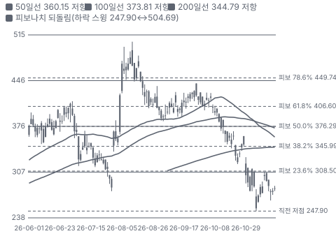

**주봉**

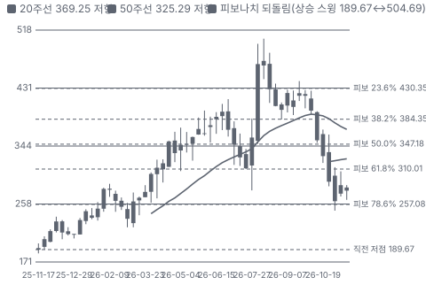

**월봉**

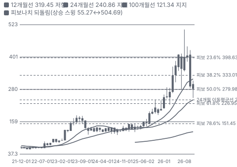

**분기 매출·EPS 실적과 컨센서스**

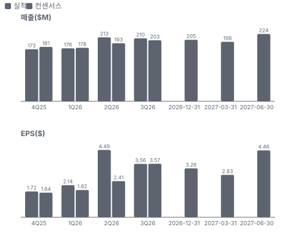

**멀티플 프리미엄(Trailing P/E(선행 이력 없음), 최근 4개 분기말 절대값 — 대상 vs 동종 중앙값)**

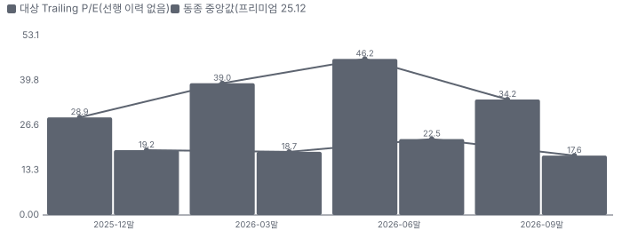

**합리적 멀티플**

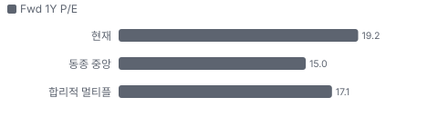

**밸류에이션 주가 시나리오**

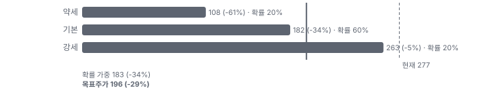

**주가별 업사이드**

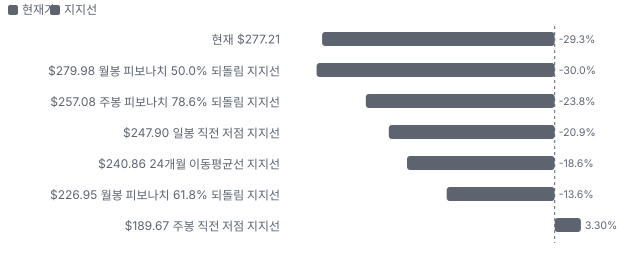
- 제품·서비스 포트폴리오

**고객 믹스(FY25, 매출 대비)**

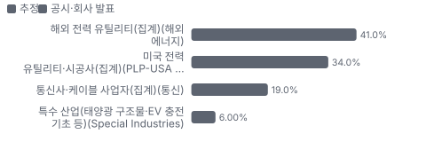

**공급 병목(10점, 낮을수록 병목)**

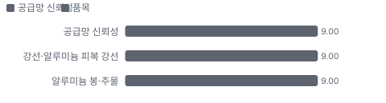

**CAPEX의 매출 대비 비중**

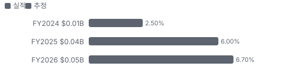

**어닝콜 변화별 주주가치 영향**

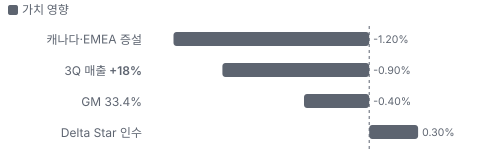

**수주·파이프라인 확실성 사다리**

**매출 → 매출총이익 → 영업이익(매출 = 100, 최근 4분기)**

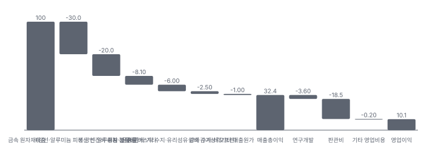

**분기 비용 비중 추이(매출 대비, 공시)**

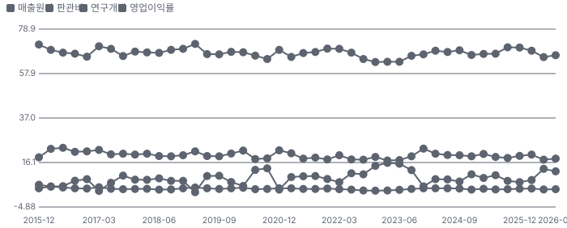

**비용 요인별 매출 대비 비중 1년 변화**

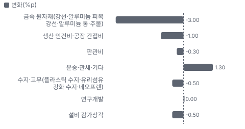

**에너지 금구류 BOM 원가 몫**

**통신 금구·클로저 BOM 원가 몫**

**BOM 항목 가격 +10% 시 OPM 변화**

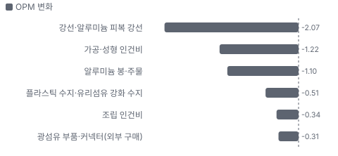

**원가 물가 vs 판매가 물가 — 최근 24개월(24.11 = 100): 원가가 판매가보다 33.4%p 더 올라 단가를 못 올리면 마진 압박**

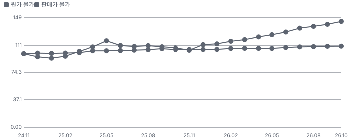

**자산 구성 — 3Q26 분기말 투하자본 \$595.0M**

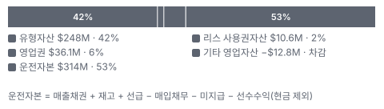

**자산별 변화율 — 최근 12개 분기(4Q23 = 0%) + 다음 4개 분기 추정**

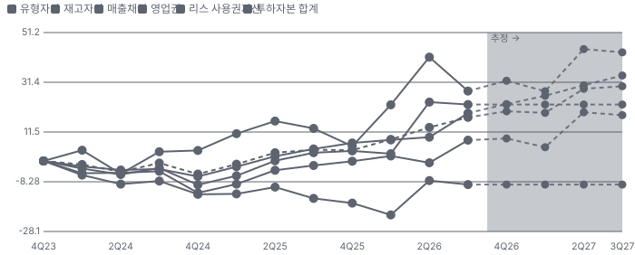

**분기 감가 비율 연율(유형자산 총액 대비)**

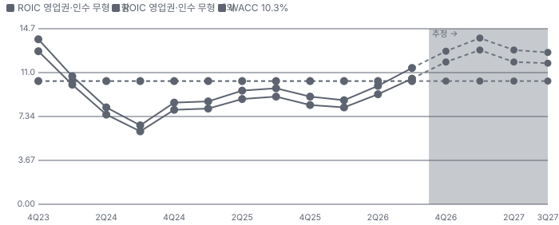

**ROIC 추이 — TTM, 최근 12개 분기 + 다음 4개 분기 추정(컨센서스 NOPAT)**

**10년 P·Q 사이클 — 추세(HP 필터) 대비 갭과 8분기 전망**

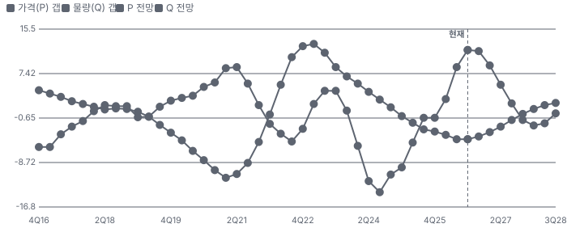

**매출 증가율의 가격·물량 분해와 8분기 전망(전년 대비)**

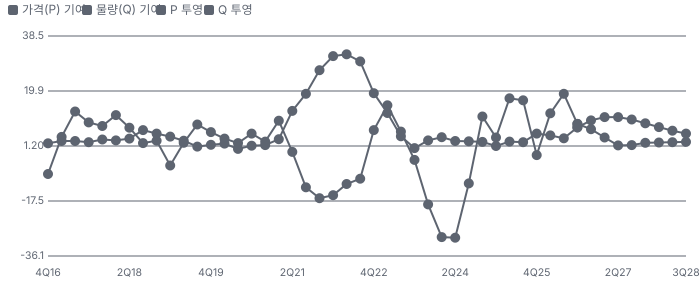

**분기별 매출 증가율 분해**

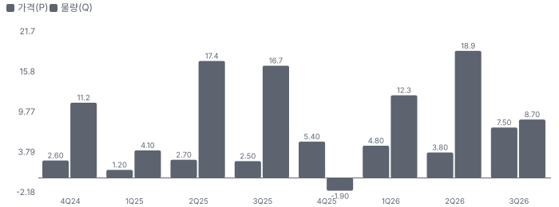

**목표주가 산정 — 기본과 강세 사이(강세 쪽 17%), 도달 확률 약 43%**

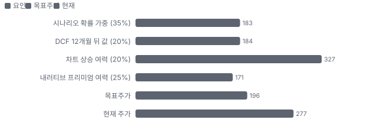

**일봉 지지·저항과 목표주가**

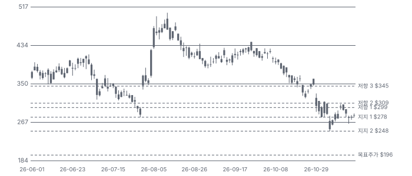

**재고 일수 — 분기별(수주 자료가 없어 수주/출하 비율 없음)**

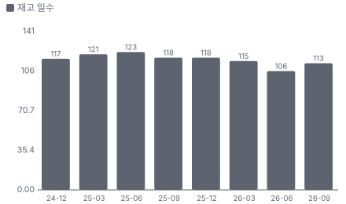

**일별 거래량 분해**

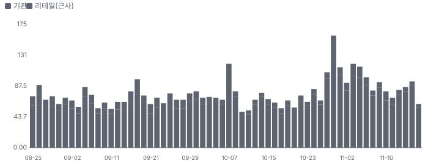

**기관 자금 흐름**

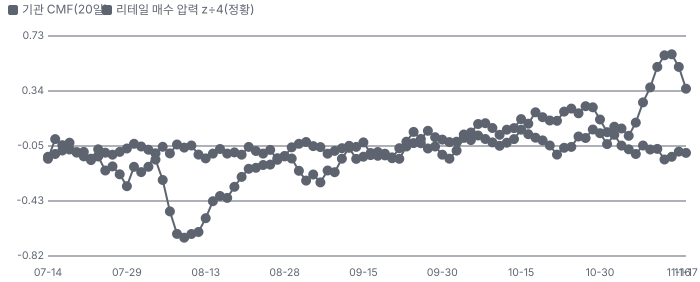

**몬테카를로**

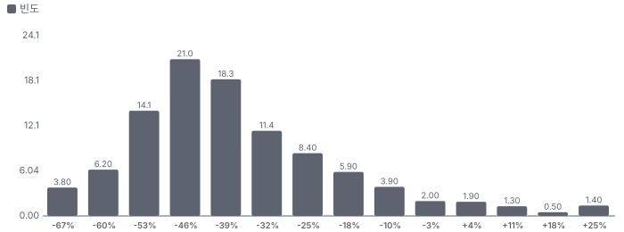

해석: 3,000번 중 156번(5%)에서 가치가 지금 주가 이상이었다. 가정을 흔들어도 지금 주가를 뒷받침하지 못하는 경우가 더 많다. 가운데 값은 0.60배이고, 열 번 중 여덟 번은 0.44~0.88배 사이에 든다.

## 내러티브

> **기업가치를 결정하는 이야기:** 매출의 75%가 전력 송배전 금구, 19%가 통신 금구·클로저다. 나선형 성형 금구로 세계 최대라고 회사는 밝힌다. 유틸리티가 송배전선을 새로 깔거나 교체할 때마다 필요한 소모성 부품이라 물량은 유틸리티 투자와 폭풍 복구가 정한다. 미국 매출(PLP-USA)이 절반이고 미국 공장에서 만들어 관세에 덜 노출된다. 원가는 강선·알루미늄·수지이고, 2025~26년 가격 인상이 원가를 앞질러 총이익률이 올랐다.

> **멀티플·EPS 프리미엄**
> **멀티플:** Fwd 1Y P/E 19.2배로 동종 4곳(Hubbell·Belden·EnerSys·Franklin Electric) 중앙값 15.0배보다 28% 높다. Hubbell(19.0배)과 비슷한 수준이다.
> **EPS:** 다음 4개 분기 EPS 추정 \$14.64, 그다음 4개 분기 \$16.29(+11%) — 추정자는 1명이라 표본이 작다.

### 투자자들은 왜 열광했나

2026년 투자자들은 '미국 송배전 투자 붐 + 관세로 보호받는 미국 내 생산'에 열광했다. 2Q 매출 \$212.7M(기록)·EPS \$4.49로 실적 다음 날 +30%, 8월 초 이틀 +32%로 8/11 종가 \$480.77까지 올랐다. 식은 이유는 세 가지다 — 3Q 매출이 QoQ 줄어 '정점' 우려가 생겼고(실적 뒤 이틀 −16.5%), 통신·EMEA가 약했으며, 11/5 중간선거 뒤 AI·전력 인프라 종목이 함께 급락했다.

### 무엇이 기업가치를 바꾸나

> **구조적 체질 변화**
> **변화:** 통신 비중 축소(23% → 19%)·에너지 비중 확대(69% → 75%)
> **증거:** 3Q26 10-Q 제품별 비중
> **반증:** 에너지 비중이 70% 아래로

> **고부가 믹스 확장**
> **변화:** 변전소 커넥터(Delta Star)·송전 금구 확대
> **증거:** 10-Q: Delta Star 인수, 보도자료: 유리한 제품 믹스
> **반증:** 총이익률 33% 아래로

> **기술 혁신**
> **변화:** 해당 없음(제품 기술 변화보다 생산·공급 경쟁)
> **증거:** 10-K 경쟁 절
> **반증:** 해당 없음

> **실행 속도**
> **변화:** 해당 없음(주문→출하 리드타임을 회사·경쟁사 모두 공시하지 않는다) — 잔고는 대부분 1년 안 출하(10-K)
> **증거:** 10-K
> **반증:** 해당 없음

> **M&A**
> **변화:** 소규모 볼트온 인수(Delta Star \$11.1M, JAP Telecom)
> **증거:** 10-Q
> **반증:** 해당 없음

> **정책·입법 연관성**
> **재정정책:** BEAD(광대역 보조금) 집행 — 통신 금구 수요와 간접 연결 10-K 위험 요인(통신 시장 FTTP(가정까지 광케이블을 까는 통신망) 배치) 반증: BEAD 집행 지연 의회 동의 10/10 — 하원 5/5(2021년 인프라법으로 세출 반영(집행 단계)) · 상원 5/5(같음).
> **행정명령:** 철강·알루미늄 232조 관세 유지, IEEPA(국제비상경제권한법 — 대통령 긴급 관세 근거 법) 관세 무효 판결(2026-02) 뒤 일부 환급 10-K·10-Q 관세 절 반증: 철강·알루미늄 관세 완화 의회 동의 2/10 — 하원 1/5(행정 조치 — 의회 의결 대상 아님) · 상원 1/5(같음).
> **연관입법:** 해당 없음(회사 매출과 직접 연결되는 법안 미확인) 10-K 반증: 해당 없음

> **고객의 지출 예산**
> **변화:** 유틸리티·통신사 CAPEX와 유지보수 OPEX
> **사업별 예산:** **매출의 75%**: 에너지 금구류 — 고객 혼합(유틸리티 송배전 건설(CAPEX)과 유지보수·폭풍 복구(OPEX)) · 동인: 송배전 투자·노후 교체·기상 재해
**매출의 19%**: 통신 금구·클로저 — 고객 CAPEX(통신사 광통신망 구축 투자) · 동인: FTTP·BEAD 보조금 집행
**매출의 6%**: 특수 산업 — 고객 CAPEX(태양광·EV 충전 설비 투자) · 동인: 재생에너지 설치
> **증거:** 10-K·10-Q
> **반증:** 유틸리티 2027 송배전 투자 계획 하향

### 내러티브 근거

> 전력망 증설 수혜를 받는 송배전 금구 회사라는 이야기다. 2분기 기록 실적 뒤 8월 고점까지 올랐다가 3분기 매출 정체와 AI·전력 인프라 급락으로 −42%가 됐다. 동종 대비 멀티플 차이 +28% 중 회사 고유 몫은 +12%다. 단계는 소멸, 쏠림은 낮음(애널리스트 1명, 리테일 언급 없음) — 기관 보유 69%, 내부자 약 49%, 공매도 유통 주식의 7.1%이다.

> **미국 송배전 투자 증가** · 유지
> **논리:** 유틸리티가 노후 설비 교체·데이터센터 연결·전력망 강화로 송배전 투자를 늘리면 금구 물량이 는다
> **숫자:** PLP-USA 3Q +27%, 9개월 +28%(10-Q)
> **반증:** PLP-USA 매출 2분기 연속 QoQ 감소
> **출처:** https://www.sec.gov/Archives/edgar/data/80035/000008003526000034/plpc-10qxexx991x2026q3.htm

> **미국 내 생산 = 관세 방어** · 유지
> **논리:** 수입 경쟁품이 관세를 맞는 동안 미국 공장 제품이 가격·납기에서 유리하다
> **숫자:** 총이익률 33.4%(+370bp YoY)
> **반증:** 철강·알루미늄 관세 완화로 수입품 가격 하락
> **출처:** https://www.sec.gov/Archives/edgar/data/80035/000008003526000034/plpc-10qxexx991x2026q3.htm

> **AI 데이터센터 전력 테마** · 약화
> **논리:** 데이터센터 전력 수요가 송전망 증설을 앞당긴다
> **숫자:** 8월 고점까지 연초 대비 +130%(계산)
> **반증:** 유틸리티 송전 투자 계획 하향
> **출처:** 업종 제목(내러티브 원천)

> **반대 내러티브 — 정체·정보 공백** · 강화
> **논리:** 3Q 매출이 QoQ 줄고 통신·EMEA가 약하며 가이던스·콜이 없어 고점 배수를 지킬 근거가 없다
> **숫자:** 고점 대비 −42%, 실적 뒤 이틀 −16.5%
> **반증:** 4Q 매출 \$210M 이상·총이익률 33% 이상
> **출처:** https://www.sec.gov/Archives/edgar/data/80035/000008003526000034/plpc-10qxexx991x2026q3.htm

### 투자 포인트

> **이익은 2배, 주가는 고점의 58%**
> **명제:** TTM EPS \$11.91로 1년 전보다 크게 늘었고 주가는 8/11 종가 고점보다 42% 낮다
> **숫자:** 분기 EPS·일봉
> **시장과 다른 점:** 시장은 3Q 매출 정체를 정점 신호로 읽지만 전년 대비 +18%·총이익률 +370bp다
> **증명:** 4Q26 매출 \$205M 이상·총이익률 33% 이상
> **출처:** https://www.sec.gov/Archives/edgar/data/80035/000008003526000034/plpc-10qxexx991x2026q3.htm

> **미국 공장이 관세 환경의 무기**
> **명제:** PLP-USA 매출 2분기 연속 \$100M 초과, 3Q +27%
> **숫자:** 3Q26 보도자료(8-K EX-99.1, 2026-10-28)
> **시장과 다른 점:** 수입 경쟁품이 철강·알루미늄 관세를 맞는 동안 가격을 올릴 수 있었다
> **증명:** 철강·알루미늄 관세 유지와 PLP-USA 성장 지속
> **출처:** https://www.sec.gov/Archives/edgar/data/80035/000008003526000034/plpc-10qxexx991x2026q3.htm

> **정보 공백이 배수를 깎는다**
> **명제:** 어닝콜·가이던스가 없고 애널리스트가 1명이다
> **숫자:** ·Easyconomics
> **시장과 다른 점:** 실적이 좋아도 다음 분기를 말해 줄 사람이 없어 분기 숫자 하나에 주가가 크게 흔들린다(실적 뒤 +30%, −16.5%)
> **증명:** 4Q 실적 반응 폭
> **출처:** https://www.sec.gov/Archives/edgar/data/80035/000008003526000036/plpc-20260930.htm

### 모멘텀 생성·소멸 타임라인

**카탈리스트 달력 — 지난 사건의 주가 반응과 앞으로 확인할 숫자**
| 날짜 | 상태 | 구분 | 사건 | 반응·확인 | 결과에 따라 |
|---|---|---|---|---|---|
| 2026-07-30 | 완료 | 생성 | 2Q26 기록 실적 | 하루 +30.0% |  |
| 2026-08-11 | 완료 | 생성 | 종가 고점 \$480.77 | 이후 −42% |  |
| 2026-10-29 | 완료 | 소멸 | 3Q26 실적 — 매출 QoQ −1.5% | 이틀 −16.5% |  |
| 2026-11-05 | 완료 | 소멸 | 중간선거 뒤 AI·전력 인프라 급락(매크로·섹터) | 하루 −11.6% |  |
| 2027-03-03(추정) | 예정 | 확인 | 4Q26·FY26 실적과 10-K(2026년 말 수주잔고) | 4Q 매출 \$205M 이상, 총이익률 33% 이상, 2026년 말 잔고가 \$232.8M보다 큰지 | 셋이 맞으면 정점 우려 해소, 잔고 감소면 배수 정체 |
| 2027-04-28(추정) | 예정 | 확인 | 1Q27 실적·10-Q | PLP-USA 분기 매출이 2·3Q 수준(각 \$100M 이상)을 유지하는지, 판관비 비중 18% 이하 | 미국 물량 지속이면 FY27 추정 유지, 꺾이면 정점 확인 |

### 언제 사서 언제 팔아야 할까?

**가격·조건 틀 — 가격은 밸류에이션(약세·기본·강세·목표주가)과 차트 지지 구간에서, 조건은 이벤트에서**
| 구간 | 가격 | 목표주가까지 | 약세까지 | 조건·근거 |
|---|---|---|---|---|
| 관찰 구간 | \$257~\$257 | -24% | -58% | 지지 구간이 약세 시나리오 가격과 겹치는 곳 — 11/5 종가 저점 \$252 근처 |
| 확인 뒤 | 지금 \$277 이상에서 조건 확인 | -29% | -61% | 4Q 매출 \$205M 이상·총이익률 33% 이상·2026년 말 잔고 증가 |
| 무효화 | 약세 시나리오 \$108 | - | -61% | 11/5 종가 저점 \$252 이탈과 함께 4Q 매출이 \$200M 미만 |

실적 다음 날 ±10~30% 움직임이 반복됐다(7/30 +30%, 10/29 −8.3%), 거래량이 얇다 가격·조건 틀이며 매매·비중 지시가 아니다(투자 권유 아님).

## 포트폴리오

| 제품·서비스 | 구분 | 무엇 | 쓰는 곳 | 돈 버는 방식 | Mix | Mix 변화(전 분기 대비) |
|---|---|---|---|---|---|---|
| 에너지 금구류 | 제품 | 송배전선을 잡고·잇고·보호하는 성형 금구, 변전소 커넥터, 스페이서 댐퍼(송전선 여러 가닥 사이 간격을 잡고 진동을 줄이는 부품), 폴리머 애자(고분자 소재 절연체) | 전력 유틸리티 송배전선 건설·유지보수, 변전소 | 3Q 매출의 75%(약 \$157M, 계산) — 물량과 가격 인상 | 미확인 | 미확인 |
| 통신 금구·클로저 | 제품 | 광케이블 접속부를 보호하는 옥외 클로저와 통신선 금구 | 통신사·케이블 사업자의 광통신망(FTTP)·무선망 | 3Q 매출의 19% — 전년 23%에서 하락 | 미확인 | 미확인 |

## 고객

> **FY25 최대 매출 묶음 해외 전력 유틸리티 41%·상위 3개 묶음 94%(고객 기준으로는 최대 단일 고객 10.7%), 집중도 집중.** 공시·회사 발표로 확인한 몫은 매출의 25%이고, 나머지 고객 몫은 추정이거나 미분해다. 고객은 전력 유틸리티·통신사·케이블 사업자·시공사·유통사다. 10-K는 '한 고객이 매출의 10.7%'라고만 밝히고 이름은 쓰지 않는다. 지역으로는 PLP-USA가 3Q 매출의 49%, 제품으로는 에너지 75%·통신 19%·특수 산업 6%다(3Q26 10-Q).

**고객별 매출 몫(FY25)**
| 고객 | 몫 | 변화 | 근거 |
|---|---|---|---|
| 해외 전력 유틸리티(집계, 해외 에너지) | 41% | -2%p | 추정 |
| 미국 전력 유틸리티·시공사(집계, PLP-USA 에너지) | 34% | +8%p | 추정 |
| 통신사·케이블 사업자(집계, 통신) | 19% | -4%p | 공시 |
| 특수 산업(태양광 구조물·EV 충전 기초 등, Special Industries) | 6% | -2%p | 공시 |

> **해외 전력 유틸리티(집계, 해외 에너지)** · 추정
> **사는 것:** 송배전 금구류·변전소 커넥터
> **추정 근거:** 미주·EMEA·아시아 매출 × 각 에너지 비중(82·80·77%) 합 ÷ 매출(계산)

> **미국 전력 유틸리티·시공사(집계, PLP-USA 에너지)** · 추정
> **사는 것:** 송배전 금구류·커넥터·스페이서 댐퍼
> **추정 근거:** PLP-USA \$102.7M × 에너지 69% ÷ 매출 \$209.5M(계산, 3Q26) — 전년 동기 PLP-USA \$80.8M × 60%

> **통신사·케이블 사업자(집계, 통신)** · 공시
> **사는 것:** OSP 클로저(옥외에서 광케이블 접속부를 보호하는 함체)·광케이블 금구
> **추정 근거:** 3Q26 10-Q 제품별 매출 비중

> **특수 산업(태양광 구조물·EV 충전 기초 등, Special Industries)** · 공시
> **사는 것:** 태양광 마운팅·EV 충전 기초·드론 점검
> **추정 근거:** 3Q26 10-Q 제품별 매출 비중

## 수주·파이프라인

> **2025-12-31 기준 1건.** 확정 \$0.23B. 공시 수주잔고 \$0.23B.

**수주 목록**
| 상태 | 계약 | 계약 총액 | 진척 | 기간 | 비고 |
|---|---|---|---|---|---|
| 확정 | 전체 수주잔고(확정 주문) | \$0.23B | 비공개 | 2026-01 → 2026-12 | 2025년 말 기준 — 2026년 분기 잔고 미공시 |

**실행 속도와 방해 요인**
| 항목 | 상태 | 실행 속도 | 방해 요인 |
|---|---|---|---|
| 전체 수주잔고(확정 주문) | 확정 | 주문은 입력 시점에 확정, 대부분 1년 안 출하(10-K) | 관세·원자재 가격 · 유틸리티 투자 일정 |

## 마진 구조

> **GPM 33.4%, OPM 11.9%.** 2Q26 대비 GPM -0.9%p, OPM -1.2%p. 변동비는 매출의 58%이고, 매출이 10% 늘면 OPM은 +2.7%p 움직인다. 3Q 매출원가는 매출의 66.6%로 1년 전 70.3%보다 3.7%p 낮다. 물량 증가·제품 믹스·고정비 흡수·2025~26년 가격 인상이 개선 요인이고, 판매·운송비·인력 투자와 관세가 역풍이다(보도자료). 원가 항목별 몫은 공시되지 않아 추정이다.

> **매출 100 중 매출원가 67.6, 매출총이익 32.4(최근 4분기, 공시).** 매출원가 요인 중 금속 원자재(강선·알루미늄 피복 강선·알루미늄 봉·주물)이 매출의 30.0%로 가장 무겁고, 단가가 +10% 오르면 GPM이 -3.00%p 움직인다. 분기 회귀로 매출 1이 늘 때 매출원가는 0.64 늘고, 매출원가의 고정비 몫은 5%다.

**비용 요인 강도 — 비중·추세·충격(+10%)·탄력**
| 비용 | 구분 | 매출 대비 | 1년 변화 | 마진 기여 | 충격 시 마진 | 매출 탄력 | 고정비 몫 |
|---|---|---|---|---|---|---|---|
| 금속 원자재(강선·알루미늄 피복 강선·알루미늄 봉·주물) | 매출원가 요인 | 30.0% | -3.0%p | +3.0%p | -3.00%p | 미확인 | 0% |
| 생산 인건비·공장 간접비 | 매출원가 요인 | 20.0% | -1.0%p | +1.0%p | -2.00%p | 미확인 | 60% |
| 운송·관세·기타 | 매출원가 요인 | 8.1% | +1.3%p | -1.3%p | -0.81%p | 미확인 | 20% |
| 수지·고무(플라스틱 수지·유리섬유 강화 수지·네오프렌) | 매출원가 요인 | 6.0% | -0.5%p | +0.5%p | -0.60%p | 미확인 | 0% |
| 설비 감가상각 | 매출원가 요인 | 2.5% | -0.5%p | +0.5%p | -0.25%p | 미확인 | 100% |
| 매출원가 | 공시 항목 | 67.6% | -0.3%p | +0.3%p | -6.76%p | 0.64 | 5% |
| 판관비 | 공시 항목 | 18.5% | -0.5%p | +0.5%p | 미확인 | 0.16 | 19% |
| 연구개발 | 공시 항목 | 3.6% | +0.1%p | -0.1%p | 미확인 | 0.03 | 24% |
| 기타 영업비용 | 공시 항목 | 0.2% | -0.2%p | +0.2%p | 미확인 | 0.01 | -42% |

매출 탄력 = 분기 비용을 매출에 회귀한 기울기(매출 1당 변동비), 고정비 몫 = 절편 ÷ 평균 비용. 표본이 8분기 미만이면 미확인. 매출원가 요인 비중은 margin 재료의 추정이 섞여 있고, 공시 매출원가와의 차이는 '기타 매출원가'로 둔다.

**GPM에서 OPM까지(GAAP, 아래는 최근 4개 분기)**
| 기간 | GPM | 연구개발 | 판관비 | 기타 | OPM |
|---|---|---|---|---|---|
| 3Q25 | 29.7% | 3.5% | 18.2% | 0.6% | 7.4% |
| 2Q26 | 34.3% | 3.4% | 17.4% | 0.5% | 13.1% |
| 3Q26 | 33.4% | 3.5% | 17.9% | 0.1% | 11.9% |
| 2025-12 | 29.8% | - | - | - | 6.8% |
| 2026-03 | 31.3% | - | - | - | 7.8% |
| 2026-06 | 34.3% | - | - | - | 13.1% |
| 2026-09 | 33.4% | - | - | - | 11.9% |

**비용을 움직이는 요인**
| 비용 | 요인 |
|---|---|
| 금속 원자재(강선·알루미늄 피복 강선·알루미늄 봉·주물, 매출원가) | 강·알루미늄 가격과 관세(232조 철강·알루미늄 관세 유지) · 근거 추정 |
| 생산 인건비·공장 간접비(매출원가) | 26개 공장 가동률·인건비 · 근거 추정 |
| 판관비(판관비) | 판매·운송비·전략 인력 · 근거 공시 |
| 운송·관세·기타(매출원가) | 운송비·관세 · 근거 추정 |
| 수지·고무(플라스틱 수지·유리섬유 강화 수지·네오프렌, 매출원가) | 석유화학 가격, 계약 고정가 + 할증 · 근거 추정 |
| 연구개발(연구개발) | 연구·엔지니어링 센터 · 근거 공시 |
| 설비 감가상각(매출원가) | 분기 감가상각 \$6.6M(전사) 중 매출원가 몫 · 근거 추정 |

**에너지 금구류 BOM — 매출의 75%, GPM 35%(추정 — 제품별 총이익 미공시. PLP-USA 9개월 총이익률 약 36%(10-Q 부문 총이익 ÷ 매출, 계산)와 에너지 비중을 근거로 둔 값), 항목 가격 +10% 시**
| 항목 | 원가 몫 | 전가 | 제품 GPM | OPM |
|---|---|---|---|---|
| 강선·알루미늄 피복 강선 | 35~50% | 미확인 | -2.8%p | -2.07%p |
| 가공·성형 인건비 | 20~30% | 미확인 | -1.6%p | -1.22%p |
| 알루미늄 봉·주물 | 15~30% | 미확인 | -1.5%p | -1.10%p |
| 미분해 | 10% | - | - | - |

**통신 금구·클로저 BOM — 매출의 19%, GPM 28%(추정 — 미공시), 항목 가격 +10% 시**
| 항목 | 원가 몫 | 전가 | 제품 GPM | OPM |
|---|---|---|---|---|
| 플라스틱 수지·유리섬유 강화 수지 | 30~45% | 미확인 | -2.7%p | -0.51%p |
| 조립 인건비 | 20~30% | 미확인 | -1.8%p | -0.34%p |
| 광섬유 부품·커넥터(외부 구매) | 15~30% | 미확인 | -1.6%p | -0.31%p |
| 미분해 | 15% | - | - | - |

강선·알루미늄 피복 강선 가격이 +10% 오르면 영업이익은 -17.4% 움직인다. 판매가 전가를 모르는 항목은 전가 0%로 계산했다.

**BOM 항목 가격을 움직이는 것**
| 항목 | 요인 |
|---|---|
| 강선·알루미늄 피복 강선 | 성형 금구의 본체 · 근거 추정 |
| 알루미늄 봉·주물 | 커넥터·스페이서 댐퍼 · 근거 추정 |
| 가공·성형 인건비 | 나선 성형·도금 · 근거 추정 |
| 플라스틱 수지·유리섬유 강화 수지 | 클로저 함체 · 근거 추정 |
| 광섬유 부품·커넥터(외부 구매) | 클로저 내부 부품 · 근거 추정 |
| 조립 인건비 | 조립 · 근거 추정 |

> **원가·판매가 물가 격차 -28.5%p** — 판매가 물가가 투입 원가 물가보다 느리게 오른다.

**투입 물가 — 미국 PPI 3·6·12개월(2026-10, 개정 반영)**
| 항목 | 미국 3개월 | 6개월 | 12개월 | 전가 못 할 때 OPM |
|---|---|---|---|---|
| 강선·알루미늄 피복 강선 | +6.7% | +17.0% | +32.9%* | - |

별표는 품목보다 넓은 업종 지수다. 연결한 투입 원가의 미국 PPI(생산자물가지수)는 1년 새 가중 +32.9%이고, 판매가로 넘기지 못하면 GPM -9.9%p·OPM -9.9%p가 움직인다. 판매가 비교 물가(광섬유용 커넥터·어댑터 PPI)는 1년 새 +4.4% — 회사 가격 변화는 미확인. 물가 지수를 붙이지 못한 매출원가 항목은 수지·고무(플라스틱 수지·유리섬유 강화 수지·네오프렌), 생산 인건비·공장 간접비, 설비 감가상각, 운송·관세·기타다(미연결).

## 자산 구성

> **3Q26 분기말 투하자본 \$595.0M** — 운전자본 53%, 유형자산 42%. 최근 12개 분기(4Q23 → 3Q26) 가장 크게 늘어난 자산은 매출채권(+28%), 투하자본 합계 +17%. 3Q27 추정 투하자본 \$657.9M(+11%, 컨센서스 매출과 회전 일수·CAPEX 강도 유지 가정). 연율 감가 비율(총액 기준)은 직전 4분기 5.09% → 최근 4분기 5.37%.

**자산·운전자본 항목별 분기말 잔액 — 최근 12개 분기와 다음 4개 분기 추정**
| 항목 | 4Q23 | 3Q25 | 3Q26(최근) | 3Q27 추정 | 12개 분기 변화 | 다음 4개 분기 변화 |
|---|---|---|---|---|---|---|
| 매출채권 | \$106.9M | \$120.8M | \$136.8M | \$153.2M | +28% | +12% |
| 재고자산 | \$148.8M | \$146.1M | \$161.2M | \$176.1M | +8% | +9% |
| 선급·기타 유동자산 | \$8.2M | \$14.1M | \$15.7M | \$15.9M | +90% | +2% |
| 유형자산 | \$207.9M | \$217.8M | \$247.5M | \$278.8M | +19% | +13% |
| 리스 사용권자산 | \$11.7M | \$9.9M | \$10.6M | \$10.6M | -9% | +0% |
| 영업권 | \$29.5M | \$30.5M | \$36.1M | \$36.1M | +23% | +0% |

**자산 추정 동인 — 최근 4개 분기 평균(재무상태표 동인 모형)**
| 동인 | 값 | 곱하는 기준 |
|---|---|---|
| 매출채권 | 63일 | 매출 |
| 재고자산 | 107일 | 매출원가 |
| 선급·기타 유동자산 | 7일 | 매출 |
| CAPEX 강도 | 7.0% | 매출(최근 4개 분기 합) |
| 분기 감가율 | 2.66% | 기초 유형자산 순액(무형 상각 제외 감가상각) |
| 매출원가율 | 67.6% | 매출(최근 4개 분기) |
| 영업권·리스 사용권·기타 | 유지 | 인수·새 리스는 공시 전 모름 |
| 인수 무형자산 | 분기 \$0.3M 상각 | 최근 4개 분기 평균 상각 |

**추정 방법:** 증권사 3표 모델(손익·재무상태표·현금흐름)의 재무상태표 동인 방식이다. 운전자본은 항목별 회전 일수(매출채권·선급·미지급·선수는 매출, 재고·매입채무는 매출원가 기준)를 최근 4개 분기 평균으로 두고 컨센서스 매출에 곱한다. 유형자산은 기초 + CAPEX − 감가상각으로 굴린다(Koller·Goedhart·Wessels 『Valuation』 재무상태표 추정). 매출 경로는 ROIC 절의 컨센서스와 같다.

**유형·무형자산 항목별 가치(2025-12-31 vs 2024-12-31)**
| 구분 | 항목 | 총액 2025-12-31 | 누적상각 | 순액 | 총액 2024-12-31 | 총액 1년 변화 | 공시 내용연수 |
|---|---|---|---|---|---|---|---|
| 유형 | 유형자산 합계(항목 미분해) | \$461.0M | 총계만 공시 | 총계만 공시 | \$408.9M | +12.7% | 미확인 |
| 영업권 | 영업권 | \$30.7M | \$0.0M | \$30.7M | \$26.7M | +15.0% | 비상각 |
| 무형 | 무형자산 합계(항목 미분해) | \$34.3M | \$24.2M | \$10.1M | \$31.3M | +9.5% | 미확인 |
| 유형 합계 | 유형자산 | \$461.0M | \$238.3M | \$222.8M | \$408.9M | +12.7% | 경과율 52%(상각 대상 기준) |

**내용연수 산식(상각 대상 유형자산 = 총액 − 토지 − 건설중)**
| 기준일 | 연 감가상각 | 상각 대상 총액 | 평균 내용연수 | 경과 연수 | 잔여 연수 | 경과율 |
|---|---|---|---|---|---|---|
| 2025-12-31 | \$22.0M | \$461.0M | 21.0년 | 10.8년 | 10.1년 | 52% |
| 2024-12-31 | \$20.4M | \$408.9M | 20.0년 | 10.5년 | 9.6년 | 52% |

산식 평균 내용연수는 21.0년. 1년 전 20.0년 → 지금 21.0년.

**분기 감가 비율(감가상각 ÷ 평균 유형자산 총액)**
| 분기 | 감가상각 | 평균 유형자산(총액) | 분기 비율 | 연율 | 연율의 역수 |
|---|---|---|---|---|---|
| 4Q24 | \$4.8M | \$413.3M | 1.17% | 4.69% | 21.3년 |
| 1Q25 | \$5.4M | \$416.3M | 1.30% | 5.19% | 19.3년 |
| 2Q25 | \$5.7M | \$432.5M | 1.31% | 5.26% | 19.0년 |
| 3Q25 | \$5.8M | \$445.5M | 1.30% | 5.21% | 19.2년 |
| 4Q25 | \$6.1M | \$455.4M | 1.35% | 5.39% | 18.5년 |
| 1Q26 | \$6.2M | \$463.1M | 1.33% | 5.33% | 18.8년 |
| 2Q26 | \$6.3M | \$468.7M | 1.33% | 5.34% | 18.7년 |
| 3Q26 | \$6.6M | \$485.0M | 1.35% | 5.41% | 18.5년 |

감가상각 기준: 손익계산서 감가상각·상각비(SEC 공시 데이터, 4분기 = 연간 − 1~3분기).

최근 4분기 연율 감가 비율 5.37%, 직전 4분기 5.09%(+5%) — 경고 문턱(-10%) 안이다.

미공시·미분해: 무형자산 · 유형자산 항목별 총액·내용연수(10-K 주석에서 모델이 채움) · 무형자산 항목(10-K 주석에서 모델이 채움) — 이 칸은 비우고 나머지로 계산했다.

### 해석 — 자산이 어디에 쌓이고 있나

- 같은 기간 4개 분기 매출은 +35%. 자산이 매출보다 빨리 쌓이지 않았다 — 회전율이 유지된다.
- 다음 4개 분기 CAPEX \$59.2M vs 감가상각 \$27.5M(최근 4개 분기 CAPEX 강도·감가율 유지) — 유형자산 3Q26 \$247.5M → 3Q27 \$278.8M. 투자가 감가보다 커서 자산이 쌓이는 국면이다.

## ROIC

> **TTM 3Q26 ROIC는 영업권·인수 무형 포함 10.5%, 제외 11.4%**(NOPAT 마진 7.8% × 투하자본 회전율 1.35회). 최근 12개 분기 4Q23 12.8% → 3Q26 10.5%(고점 4Q23 12.8%). 컨센서스 NOPAT으로 굴리면 3Q27 11.8%(제외 12.7%) — WACC 10.3% 대비 +1.6%p. 1년 변화의 가장 큰 요인은 NOPAT 마진(+0.8%p).

**ROIC 추이(TTM)와 다음 4개 분기 추정 — NOPAT ÷ 평균 투하자본(이번 분기말·4개 분기 전)**
| 분기 | 구분 | TTM 매출 | TTM NOPAT | NOPAT 마진 | 평균 투하자본 | ROIC 포함 | ROIC 제외 |
|---|---|---|---|---|---|---|---|
| 4Q23 | 실적 | \$669.7M | \$65.0M | 9.7% | \$506.8M | 12.8% | 13.8% |
| 1Q24 | 실적 | \$628.8M | \$51.7M | 8.2% | \$519.3M | 10.0% | 10.7% |
| 2Q24 | 실적 | \$585.7M | \$39.0M | 6.7% | \$516.1M | 7.5% | 8.1% |
| 3Q24 | 실적 | \$572.2M | \$31.6M | 5.5% | \$517.8M | 6.1% | 6.6% |
| 4Q24 | 실적 | \$593.7M | \$39.5M | 6.7% | \$501.0M | 7.9% | 8.5% |
| 1Q25 | 실적 | \$601.4M | \$40.7M | 6.8% | \$507.2M | 8.0% | 8.6% |
| 2Q25 | 실적 | \$632.2M | \$45.0M | 7.1% | \$511.5M | 8.8% | 9.5% |
| 3Q25 | 실적 | \$663.3M | \$47.1M | 7.1% | \$523.7M | 9.0% | 9.7% |
| 4Q25 | 실적 | \$669.3M | \$42.7M | 6.4% | \$511.9M | 8.3% | 9.0% |
| 1Q26 | 실적 | \$697.1M | \$43.2M | 6.2% | \$532.7M | 8.1% | 8.7% |
| 2Q26 | 실적 | \$740.2M | \$51.3M | 6.9% | \$556.4M | 9.2% | 9.9% |
| 3Q26 | 실적 | \$771.6M | \$60.1M | 7.8% | \$569.8M | 10.5% | 11.4% |
| 4Q26 | 추정 | \$803.0M | \$68.3M | 8.5% | \$575.2M | 11.9% | 12.8% |
| 1Q27 | 추정 | \$824.7M | \$75.4M | 9.1% | \$584.5M | 12.9% | 13.9% |
| 2Q27 | 추정 | \$836.0M | \$74.2M | 8.9% | \$621.2M | 11.9% | 12.9% |
| 3Q27 | 추정 | \$848.5M | \$75.1M | 8.9% | \$633.9M | 11.8% | 12.7% |

**다음 4개 분기 NOPAT — 컨센서스(세율 25%, 리스 이자 별도)**
| 분기 | 매출 | EBITA 마진 | EBITA | NOPAT(분기) | 근거 |
|---|---|---|---|---|---|
| 4Q26 | \$204.5M | 11.3% | \$23.0M | \$17.3M | 컨센서스 매출 × EBIT 마진 FY2026 |
| 1Q27 | \$198.0M | 11.9% | \$23.6M | \$17.7M | 컨센서스 매출 × EBIT 마진 FY2027 |
| 2Q27 | \$224.0M | 11.9% | \$26.6M | \$20.0M | 컨센서스 매출 × EBIT 마진 FY2027 |
| 3Q27 | \$222.0M | 11.9% | \$26.4M | \$19.8M | 컨센서스 매출 × EBIT 마진 FY2027 |

**추정 방법:** NOPAT은 컨센서스(분기 매출 추정 × 회계연도 EBIT 마진 추정)로 잡고, 조정(비 GAAP) 마진이면 주식보상 몫을 빼서 과거 실적과 같은 기준(영업이익 + 인수 무형 상각)으로 맞췄다. 이미 발표했지만 분기 보고서(10-Q)가 아직 없는 분기는 발표 실적을 쓴다. 투하자본은 자산 구성 절의 재무상태표 동인으로 굴렸다. ROIC는 4개 분기 NOPAT을 이번 분기말과 4개 분기 전 투하자본의 평균으로 나눈다 — 추정 분기의 ROIC에는 이미 나온 실적 분기가 섞여 있다.

**투하자본 항목별 회전율과 ROIC 기여(TTM 3Q26, 평균 잔액)**
| 항목 | 투하자본 | 매출 1달러당 자본 | 회전율(매출 ÷ 항목) | 자본 몫 | 이 항목을 빼면 ROIC |
|---|---|---|---|---|---|
| 운전자본 | \$297.3M | 0.39 | 2.60회 | 52% | 22.1% |
| 유형자산 | \$232.6M | 0.30 | 3.32회 | 41% | 17.8% |
| 리스 사용권자산 | \$10.3M | 0.01 | 75.23회 | 2% | 10.7% |
| 영업권 | \$40.7M | 0.05 | 18.96회 | 7% | 11.4% |
| 기타 영업자산 | −\$11.2M | -0.01 | 음수(자금 원천) | -2% | 10.3% |

**ROIC 세 가지 판**
| 판 | NOPAT | 투하자본 | ROIC | 무엇을 재나 |
|---|---|---|---|---|
| 영업권·인수 무형 포함 | \$60.1M | \$569.8M | 10.5% | 인수 웃돈까지 낸 돈에 대한 수익률 |
| 영업권·인수 무형 제외 | \$60.1M | \$529.1M | 11.4% | 본업 운영 수익률(동종 비교용) |
| 무형 자본화 조정(판관비 20%·5년, 연구개발 6년) | \$62.3M | \$583.7M | 10.7% | 비용으로 처리한 무형 투자를 자산으로 본 판 |
| 경제적 이익(포함판) | \$1.5M | \$569.8M | 자본비용 10.3% | (ROIC − 자본비용) × 투하자본 |

NOPAT = (영업이익 \$78.3M + 인수 무형 상각 + 리스 내재 이자 \$0.5M) × (1 − 세율 25%). 리스 사용권자산을 투하자본에 넣었으므로 임차료 속 이자 몫을 영업이익에 되더했다. 현금은 영업에 필요한 몫을 따로 알 수 없어 투하자본에서 뺐다. SEC 공시 데이터 자동 초안 — 운전자본 = 매출채권 + 재고 + 선급 − (매입채무 + 미지급비용 + 선수수익), 현금 제외. 손상 누계는 공시 데이터 수록분.

**ROIC 1년 변화 분해(포함판, TTM 3Q25 → TTM 3Q26)**
| 요인 | ROIC 기여 |
|---|---|
| NOPAT 마진 | +0.85%p |
| 운전자본 | +0.35%p |
| 유형자산 | +0.18%p |
| 리스 사용권자산 | +0.03%p |
| 영업권 | +0.04%p |
| 기타 영업자산 | +0.05%p |
| 합계 | +1.50%p |

**무형 자본화 가정별 ROIC(2023년 지출 기준, 포함판에 더함)**
| 투자로 보는 몫 | 상각 연수 | 무형 자산 | NOPAT 조정 | 조정 ROIC |
|---|---|---|---|---|
| 판관비 20% | 2년 | \$13.9M | \$2.2M | 10.7% |
| 판관비 20% | 5년 | \$13.9M | \$2.2M | 10.7% |
| 판관비 30% | 2년 | \$13.9M | \$2.2M | 10.7% |
| 판관비 30% | 5년 | \$13.9M | \$2.2M | 10.7% |

### 해석 — 무엇이 수익성을 끌어올리고 희석하나

- 운전자본: 투하자본의 52% — 빼면 ROIC 10.5% → 22.1%. 이 자산의 회전율(2.60회)이 수익성을 희석하는 주된 자리다.
- 유형자산: 투하자본의 41% — 빼면 ROIC 10.5% → 17.8%. 이 자산의 회전율(3.32회)이 수익성을 희석하는 주된 자리다.
- 기타 영업자산: −\$11.2M(음수), 고객 선수금·공급사 외상이 자본을 대신 댄다 — 빼면 ROIC 10.3%로 낮아진다. 수익성을 끌어올리는 쪽이다.
- 영업권·인수 무형을 빼면 ROIC가 +0.8%p 오른다 — 과거 인수에 치른 웃돈이 주주 수익률을 그만큼 낮춘다(본업 수익률은 제외판, 인수까지 포함한 가치 창출은 포함판으로 본다).
- 1년 ROIC 개선의 최대 요인은 NOPAT 마진(+0.8%p).
- 비용으로 처리한 무형 투자를 자산으로 보면 ROIC가 +0.1%p 움직인다(무형 자산 \$13.9M). 투자를 늘리는 중이라 NOPAT이 더 커지는 쪽이다.
- 추정 경로 3Q26 10.5% → 3Q27 11.8%: NOPAT 마진 +1.1%p, 투하자본 회전율 -0.02회 — 컨센서스 매출·마진이 맞고 회전 일수·CAPEX 강도가 유지된다는 가정이다. 마진 추정이 내려가거나 재고 일수가 늘면 이 경로가 먼저 틀린다.
- ROIC(포함) − WACC = +0.3%p(3Q26) — 양수면 투하자본을 늘릴수록 가치가 쌓인다.

## 공급망 병목

> **공급망 신뢰성 9.0/10, 병목 낮음.** 가장 약한 고리는 강선·알루미늄 피복 강선 9.0점이고, 품목 평균은 9.0점이다. 근거가 부족한 1건(플라스틱 수지)은 점수에서 뺐다. 원자재는 강선·스테인리스·알루미늄·수지이고 공급처는 여러 곳이다. 일부 원자재는 단일 공급원이지만 금형·공정을 옮길 수 있다고 회사는 본다(10-K). 병목은 공급이 아니라 철강·알루미늄 관세가 만드는 원가다.

**병목과 마진 — 품목 가격 +10% 시 OPM**
| 품목 | 점수 | 판정 | 구분 | OPM |
|---|---|---|---|---|
| 강선·알루미늄 피복 강선(필수) | 9.0 | 병목 낮음 | 가격 위험 | -2.07%p |
| 알루미늄 봉·주물(필수) | 9.0 | 병목 낮음 | 가격 위험 | -1.10%p |

> **강선·알루미늄 피복 강선** · 9.0/10
> **왜:** 성형 금구 본체
> **병목 요인:** 인증 공급사 3곳 · 캐파 여유 · 리드타임 미확인 · 재인증 3개월 · 1위 점유율 미확인 · 지역 집중 미확인 · 물량 확보 장기계약
> **풀리는 조건:** 해당 없음(제약 없음)

> **알루미늄 봉·주물** · 9.0/10
> **왜:** 커넥터
> **병목 요인:** 인증 공급사 3곳 · 캐파 여유 · 리드타임 미확인 · 재인증 3개월 · 1위 점유율 미확인 · 지역 집중 미확인 · 물량 확보 장기계약
> **풀리는 조건:** 해당 없음

**공급사**
| 품목 | 공급사 | 몫 | 근거 |
|---|---|---|---|
| 강선·알루미늄 피복 강선 | 미확인(복수 공급사, 선재) | 미확인 | 공시 |
| 알루미늄 봉·주물 | 미확인(복수 공급사, 알루미늄) | 미확인 | 공시 |
| 플라스틱 수지 | 미확인(복수 공급사, 수지) | 미확인 | 공시 |

**무역 통계로 본 공급 지역**
| 품목 | EU 수입처 | 일본 수입처 | EU 1위 전년비 |
|---|---|---|---|
| 강선·알루미늄 피복 강선 | KR(한국) 39% · TW(대만) 26% · MY(말레이시아) 15% | 大韓民国 49% · 中華人民共和国 14% | -25.9% |

## 생산능력

> **현재 명목 캐파 미확인, 가동률 미확인.** 착공 이상 증설은 0 미확인(회사가 캐파를 공시하지 않는다), 발표까지 합치면 0 미확인(회사가 캐파를 공시하지 않는다)이다. FY2025 CAPEX는 \$0.04B로 매출의 6.0%다. 제조 공장 26곳(미국 3개 주·19개국, 대부분 소유)이고 대부분 물량 증가를 감당할 수 있다고 회사는 본다(10-K). 2026년 9개월 설비투자 \$43.7M은 EMEA 신공장과 캐나다 시설 취득(CAD 23.5M)에 주로 쓰였다(10-Q·8-K).

**생산시설 26곳**(10-K Item 2: 제조 공장 26곳(미국 3개 주·19개국), 개별 이름·면적 미공시) — 이름·위치를 밝힌 곳 4곳, 미확인 2곳 · 소유 2곳. 시설별 생산능력은 공개되지 않았다 — 회사 전체 캐파만 위에 적었다.

**생산시설 26곳 — 명칭·위치·생산능력**
| 시설 | 위치 | 용도 | 생산능력 | 소유·상태 |
|---|---|---|---|---|
| 본사 | 미국 오하이오 메이필드 빌리지 | 본사·연구 엔지니어링 | 미확인 — 생산 시설 아님 | 미확인 · 가동 |
| PLP Peninsula 공장 | 미국 오하이오 페닌슐라 | 제조(PLP-USA) | 미확인 — 시설별 캐파 미공시 | 미확인 · 가동 |
| PLP Canada 신규 시설 | 캐나다 | 제조(캐파 확대) | 미확인 — 8-K: 취득가 CAD 23.5M, 캐파 미공시 | 소유 · 가동 |
| Delta Star | 브라질 상파울루주 살투 | 제조(변전소 커넥터) | 미확인 — 10-Q: 연 매출 약 \$8M | 소유 · 가동 |

**생산능력 확충 계획**
| 계획 | 단계 | 증설 | 가동 시점 | CAPEX |
|---|---|---|---|---|
| EMEA 신공장 | 착공 | 미확인 | 미확인 | 미확인 |

남은 계획의 CAPEX 합계는 \$0.00B(금액 미확인 1건 제외)다. 합계는 FY2026 매출의 0%다.

**증설 방해 요인**
| 계획 | 방해 요인 |
|---|---|
| EMEA 신공장 | 건설 일정 |

**CAPEX와 매출 대비**
| 기간 | CAPEX | 매출 | 매출 대비 | 구분 |
|---|---|---|---|---|
| FY2024 | \$0.01B | \$0.59B | 2.5% | 실적 |
| FY2025 | \$0.04B | \$0.67B | 6.0% | 실적 |
| FY2026 | \$0.05B | \$0.80B | 6.7% | 추정 |

## 해자

> 해자는 '유틸리티 승인 목록에 오른 성형 금구 제품과 폭풍 복구 때 바로 공급하는 현지 공장망'이다. 제품 자체는 경쟁이 치열하고 가격·성능·서비스로 싸운다(10-K).

> **유틸리티 승인·표준 채택** · 보통
> **해자:** 송배전 금구는 유틸리티 기술 표준에 들어가야 팔리고, 한 번 들어가면 유지보수 교체 수요가 이어진다
> **근거:** 10-K: 성형 금구 세계 최대 제조사라고 회사가 밝힘, 수주잔고 \$232.8M(+22%)
> **숫자:** PLP-USA 3Q 매출 +27%
> **깨지는 조건:** 주요 유틸리티가 경쟁사 금구로 표준 변경

> **현지 생산·긴급 공급** · 보통
> **해자:** 26개 공장(미국 3개 주·19개국)으로 폭풍 복구 같은 긴급 수요에 바로 대응하고 관세를 피한다
> **근거:** 10-K Item 2(26개 공장), 보도자료: 미국 내 생산이 관세 환경의 전략적 이점
> **숫자:** PLP-USA 2분기 연속 매출 \$100M 초과
> **깨지는 조건:** 수입 경쟁품이 관세 완화로 가격을 낮춤

> **제품 기술·특허** · 약함
> **해자:** OSP 클로저는 경쟁이 가장 치열한 분야이고 성형 금구도 다른 금구로 대체 가능하다
> **근거:** 10-K 경쟁 절: OSP 클로저 주요 4개 공급사 중 하나
> **숫자:** 통신 매출 비중 23% → 19%
> **깨지는 조건:** 해당 없음

## 경영진·네트워크

> 창업 가문(Ruhlman)이 경영과 지분을 쥔 회사다 — Robert Ruhlman 이사회 의장(2024~ Executive Chairman), 아들 J. Ryan Ruhlman 사장, 딸 Maegan Cross 이사. CEO는 Dennis McKenna(2024~). 내부자 지분 약 49%(yfinance). 정계 연결은 공개 기록상 미확인이다(10월 오하이오 상원의원 공장 방문은 보도자료 기재).

> **Robert G. Ruhlman** · Executive Chairman · 2024-01
> **프로필:** 2000년부터 CEO, 2004년부터 의장 — 보도자료 대변인
> **비즈니스:** 미확인
> **정계:** 미확인
> **동문:** 미확인
> **사모임:** 미확인

> **Dennis F. McKenna** · CEO · 2024-01
> **프로필:** COO(2019~)·글로벌 사업개발 출신
> **비즈니스:** 미확인
> **정계:** 미확인
> **동문:** 미확인
> **사모임:** 미확인

> **J. Ryan Ruhlman** · President · 2023-05
> **프로필:** 인수·신시장 담당 출신, 2026-06 회사에 주식 1,000주 매각(Form 4)
> **비즈니스:** 미확인
> **정계:** 미확인
> **동문:** 미확인
> **사모임:** 미확인

**네트워크 정량화**
| 연결 | 강도 | 닿는 매출 | 가중 노출 | 매출 대비 | 근거 |
|---|---|---|---|---|---|
| 비즈니스: 창업 가문 지배(내부자 지분 약 49%) | 3/5 | \$0.00B | \$0.00B | 0% | 지배구조 연결 — 매출 연결 아님 https://www.sec.gov/Archives/edgar/data/80035/000008003526000007/plpc-20251231.htm |

가중 노출은 연결이 닿는 매출의 크기다. 연결이 그 매출을 만들었다는 뜻이 아니며, 인과는 공개 자료로 입증하지 못한다.

## 약세 논리 및 셀온 조건

| 약세 논리 | 근거 | 가를 자료 |
|---|---|---|
| 2026년이 물량 정점이다 | 3Q 매출 QoQ −1.5%, 컨센서스 FY27 매출 +7%(FY26 +20%) | 4Q 매출·2026년 말 수주잔고(10-K) |
| 가격 인상 효과가 사라진다 | 총이익률 개선 요인이 2025~2026 초 가격 인상(보도자료) — 추가 인상 계획 미공시 | 4Q·1Q 총이익률 |
| 비용이 매출보다 빨리 는다 | 3Q 판관비 \$37.5M(+16% YoY), 판매·운송비·인력 투자(보도자료) | 판관비 비중 18% 이하 유지 |
| 관세가 양날이다 | 미국 공장은 수입 경쟁품 대비 유리하지만, 강·알루미늄 원자재 관세가 원가를 올린다(10-K) | 철강·알루미늄 232조 관세 변화 |
| 정보 공백·얇은 유동성 | 어닝콜·가이던스 없음, 애널리스트 1명, 내부자 약 49%, 3Q 기관 순매도 −175K주 | 4Q 실적 반응 폭 |

**변이 관점.** 시장은 PLPC를 'AI 데이터센터 전력망 수혜주'로 묶어 8월에 Hubbell급 배수를 줬다. 숫자로 보면 PLPC는 **유틸리티 유지보수·교체 수요가 대부분인 금구 회사**이고, 매출의 75%가 송배전 금구, 19%가 통신이다. 2026년 이익 급증은 물량과 가격 인상이 겹친 결과인데, 컨센서스는 2027년 성장을 한 자릿수로 본다. 강세 측 근거는 고객 선수금 증가(\$4.7M → \$11.6M)와 캐나다·EMEA 증설, 그리고 2025년 말 수주잔고 \$232.8M(+22%)이다. 이 다툼은 4Q 실적과 10-K의 2026년 말 잔고가 가른다. 10-K 기준 최대 고객 1곳이 매출의 10.7%이고 이름은 공시하지 않는다. 구매 약정 금액은 10-Q에 없어 미확인이다.

> **셀온 조건**
> **조건 1:** 4Q26 매출이 \$200M에 못 미치거나 총이익률이 32% 아래로 내려간다.
> **조건 2:** 10-K의 2026년 말 수주잔고가 2025년 말 \$232.8M보다 줄어든다.
> **조건 3:** 미국 사업(PLP-USA) 분기 매출이 2분기 연속 QoQ 감소한다.
> **조건 4:** 철강·알루미늄 관세가 완화돼 수입 경쟁품 가격이 내려가고 회사가 가격을 내린다.

## 어닝콜 변화

**직전 콜 대비 새로 나오거나 바뀐 내용 → 가치 영향**
| 항목 | 내용 | 직전 콜 | 최신 콜 | 모델 동인 이동 | 확신도 | 가치 영향 |
|---|---|---|---|---|---|---|
| 업데이트 | 매출 성장 | 2Q \$212.7M(+25%, 기록) | 3Q \$209.5M(+18%, QoQ −1.5%) | 1년차 성장률 -1.0% | 1.0 | -0.9% |
| 업데이트 | 총이익률 | 2Q 34.3% | 3Q 33.4%(+370bp YoY, QoQ −0.9%p) | 출발 이익률 -0.50% | 1.0 | -0.4% |
| 신규 | 캐나다·EMEA 증설 | 설비투자 상반기 \$17.0M | 9개월 \$43.7M — EMEA 신공장·캐나다 시설 | 매출÷투하자본 -10.0% | 1.0 | -1.2% |
| 신규 | Delta Star 인수 | 없음 | 브라질 변전소 커넥터, 연 매출 약 \$8M, 인수가 \$11.1M | 1년차 성장률 +0.30% | 1.0 | +0.3% |
| 반복 | 관세 역풍 | 관세 역풍 | 관세 역풍 지속, IEEPA 환급 일부(비중요) | 출발 이익률 — | 0.8 | +0.0% |
| **합계** | 단독 합 |  |  | 동시 적용 -2.3% |  | **-2.2%** |

**실적 발표 예상 변동폭:** 지난 4번 실적 발표 때 주가는 하루에 평균 ±10.6%(최대 30.0%, 오른 날 1번) 움직였다.

**실적 발표 예상 변동폭 — 과거 실적 발표 다음 거래일 주가 변화**
| 분기 | 발표일 | 주가 변화 |
|---|---|---|
| 4Q25 | 2026-03-04 | -2.6% |
| 1Q26 | 2026-04-29 | -1.5% |
| 2Q26 | 2026-07-29 | +30.0% |
| 3Q26 | 2026-10-28 | -8.3% |

## P·Q 사이클

> **10년 위치: P형 기업(매출 갭 분산의 55%가 가격) — 가격은 추세 대비 -4.5%(수축, 10년 분위 25%), 물량은 +11.7%(확장, 분위 100%). P 프리미엄 -16%, Q 프리미엄 +15%(매출총이익이 정상(추세) 수준보다 요인별로 이만큼 높거나 낮다).** 전망으로 가격 갭은 4분기 뒤 -1.0%·8분기 뒤 +2.1%, 물량 갭은 +2.0%·+0.2%(물량은 컨센서스 몫 8%를 섞었다).

**10년 P·Q 사이클 위치·프리미엄**
| 항목 | 가격(P) | 물량(Q) |
|---|---|---|
| 추세 대비 갭(현재) | -4.5% | +11.7% |
| 사이클 시계 | 수축 | 확장 |
| 10년 분위 | 25% | 100% |
| 프리미엄(현재) | -16% | +15% |
| 프리미엄 4분기 뒤 | -3% | +3% |
| 프리미엄 8분기 뒤 | +7% | +0% |
| 갭 반감기 | 3분기 | 3분기 |
| 갭 4분기 뒤(80% 범위) | -1.0% (-5.6%~+3.8%) | +2.0% (-4.9%~+9.4%) |
| 갭 8분기 뒤(80% 범위) | +2.1% (-4.5%~+9.2%) | +0.2% (-7.2%~+8.1%) |
| 전망 모형 | 자기회귀모델(과거 2개 시점) 정상성 보정 | 자기회귀모델(과거 2개 시점) + 컨센서스(분기 컨센서스 4개 + 연간 컨센서스 성장률 FY2027→FY2028 +6%, 4분기 뒤 몫 8%) |

방법: P = 가격 지수 4분기 평균(미국 PPI 변압기·배전 기기 대용 — 회사 판매가가 아니라 업종 가격), Q = TTM 매출 ÷ P. 추세는 로그 레벨의 HP(추세를 뽑는 통계 필터, Hodrick-Prescott) 필터(λ 1600)로 정상(mid-cycle) 수준을 잡는다. 프리미엄 = 요인별 매출총이익 증분 ÷ 정상 매출총이익(정상 GPM 32.2% = 10년 중앙값, 물량 증분 마진 41.6% = 전년 대비 ΔGP÷ΔRev 회귀, 가격은 전액 이익 반영). 표본 40개 TTM 분기. 전망: 가격 갭은 BIC(모형 차수를 고르는 정보 기준)로 차수를 고른 자기회귀모델(정상성 보정), 물량은 통계 갭 자기회귀모델과 컨센서스 매출 ÷ 가격 전망(매출 = P × Q)을 분산 역수로 섞는다(Bates·Granger 1969). 끝점 편향을 줄이려고 전망 경로를 이어 붙인 뒤 HP 필터를 다시 건다(Kaiser·Maravall 1999). 80% 범위는 예측 오차(TTM이 4분기씩 겹쳐 생기는 자기상관을 뉴이·웨스트 장기 분산으로 반영)와 애널리스트 범위에서 낸다. 모형 산출이며 가이던스가 아니다.

> **Q 사이클 — 최근 4분기 평균 가격 기여 +5.4%, 물량 기여 +9.5%(전년 대비 로그 증가율).** P 강도 4.6/10, Q 강도 6.4/10, 최근 8분기 중 88%가 같은 요인 우세(구조적). 전망으로는 1분기 뒤(4Q26) P 사이클로 전환(물량은 컨센서스를 섞었다).

**P·Q 사이클 정량**
| 항목 | 가격(P) | 물량(Q) |
|---|---|---|
| 최근 4분기 평균 기여 | +5.4% | +9.5% |
| 강도(0~10, 자기 이력 z) | 4.6 | 6.4 |
| 고유 주기(자기회귀모델 과거 2개 시점일 때) | 16.5분기 | 미확인 |
| 다음 4분기 투영 평균 | +10.5% | +3.5% |
| 4분기 뒤 투영(80% 범위) | +10.2% (-0.2%~+20.6%) | +1.5% (-13.1%~+16.0%) |
| 장기 평균(표본 → 기저율 수축) | +8.2% → +5.8% | +2.2% → +2.9% |
| 투영 모형 | 자기회귀모델(과거 2개 시점) | 자기회귀모델(과거 1개 시점) + 컨센서스(분기 컨센서스 4개 + 연간 컨센서스 성장률 FY2027→FY2028 +6%) |

가격 근거: 미국 PPI 변압기·배전 기기 대용 — 회사 판매가가 아니라 업종 가격. PPI를 쓰면 회사 판매가가 아니라 업종 가격 대용이다. 로그 증가율이라 가격·물량 기여의 합이 매출 증가율이다. 전망: 가격은 BIC로 차수를 고른 자기회귀모델에 이미 발표된 월간 가격을 먼저 넣고(나우캐스트), 물량은 자기회귀모델과 '컨센서스 매출 증가율 − 가격 전망'을 분산 역수로 섞는다. 장기 평균은 표본 평균을 장기 기저율(가격 연 2%·물량 연 4%) 쪽으로 줄인다 — 고성장 구간만 담긴 표본이 그 성장을 끝없이 잇지 않게. 범위는 4분기 겹친 표본의 자기상관을 반영한다. 모형 산출이며 가이던스가 아니다. 회사 판매가로 잴 수 없는 이유: ASP·출하량을 공시하지 않는다 — 업종 PPI 대용

## 밸류에이션

> **목표주가 \$196, 업사이드 -29%.** 자리는 기본과 강세 사이(강세 쪽 17%)이고 도달 확률은 약 43%다. 기본 \$182, 강세 \$263(-5%), 약세 \$108(-61%). DCF 기준 업사이드는 기본 -40%, 강세 -22%, 약세 -47%다(WACC 10.3%).

기준 멀티플이 Fwd 1Y라서 EPS도 12개월 뒤의 다음 4개 분기(4Q27~3Q28)를 쓴다. 기본 \$16.4는 그 기간 분기 추정 합(\$3.72 + \$4.08 + \$4.25 + \$4.24, 계산)이다. 약세 \$13.0은 FY26 EPS가 1년 동안 늘지 않는 경우, 강세 \$19.0은 FY28 추정 평균(\$16.7)과 상단(\$20.8) 사이다. 추정자는 1명이라 표본이 작다. **DCF와 다른 이유:** DCF 기본 업사이드는 −40%로 목표주가 경로(−29%)보다 낮다. 장기 수렴 영업이익률을 11%(FY19~25 GAAP 7.4~12.5%의 위쪽)로 두고 성장이 컨센서스대로 한 자릿수로 낮아지기 때문이다. 배수 경로는 2028년 이익에 동종 2년 뒤 배수(13.2배 기준)를 곱한다. 둘 다 지금 가격 아래라는 점은 같다. ROIC(TTM)는 10.5%로 WACC 10.3%를 0.2%p 넘는다 — 가치를 만들지만 큰 폭은 아니다.

시나리오 확률: 다음 해 매출 성장 분포로 계산 — 약세 +1.5% 아래·강세 +12.7% 위 확률. 내부 관점(컨센서스 +7.1%, σ 6.8%: 추정 범위 없음 — 5% + 0.25 × |성장률|) 100% — 외부 관점 꺼짐(SEC 전 상장사 표본 없음)

> **약세 \$108 (-61%)** · 확률 20%
> **가정:** 9.2배 × EPS \$13.00
> **근거:** 2026년이 송배전 물량의 정점이고 가격 인상 효과가 사라진다. 12개월 뒤 다음 4개 분기 EPS가 FY26 수준(\$13.45) 아래에 머문다

> **기본 \$182 (-34%)** · 확률 60%
> **가정:** 12.2배 × EPS \$16.40
> **근거:** 컨센서스 경로 — FY27 매출 \$860M(+7%), EBIT 이익률 11.7%. 4Q27~3Q28 분기 추정 합 약 \$16.3(계산)

> **강세 \$263 (-5%)** · 확률 20%
> **가정:** 15.3배 × EPS \$19.00
> **근거:** 미국 송배전 투자가 2027년에도 +20%대로 이어지고 총이익률 34%를 지킨다. EPS가 FY28 추정 상단(\$20.8) 쪽으로 간다

**멀티플 선정 — Fwd 1Y P/E**
| 단계 | 조정 | 근거 |
|---|---|---|
| 동종 중앙값 | 15.0배 | 범위 10.2~19.0배, 4곳 |
| 펀더멘털 | +7% | 성장·이익률·ROIC로 본 합리적 멀티플 17.1배와의 차이의 일부만 인정(로그 차이 × 0.5, 상한 ±20%에 부드럽게 수렴) |
| 해자 | -4% | 유틸리티 승인·표준 채택 보통 · 현지 생산·긴급 공급 보통 · 제품 기술·특허 약함 — 점수 1.5%에서 동종 기준 5.5%를 뺌 |
| 반복 매출 | +0% | 재료 없음 |
| 수주 전환·가시성 | +5% | book-to-bill 0.52 → 가시성 0.52 · 전환 4.2개월(동종 12) |
| 내러티브 | -10% | 단계 소멸 |
| 사이클·실행 판단 | -5% | Fwd 1Y P/E 19.2배는 동종 4곳(Hubbell·Belden·EnerSys·Franklin Electric) 중앙값 15.0배보다 높다. 미국 송배전 물량과 가격 인상으로 이익이 2배가 됐지만 3Q에 매출이 QoQ 줄었고, 애널리스트가 1명뿐이라 추정 신뢰가 낮으며 가이던스·콜이 없어 정보 공백이 크다 |
| **선정** | **13.9배** | 지금 19.2배 |

**동종 레인지**
| 회사 | Fwd 1Y P/E | Fwd 2Y P/E | Fwd 3Y P/E | 성장 | 영업이익률 | ROIC |
|---|---|---|---|---|---|---|
| HUBB | 19.0 | 17.0 | 15.7 | 15% | 23% | 13% |
| BDC | 11.0 | 9.2 | 8.0 | 25% | 7% | 4% |
| ENS | 10.2 | 9.3 | 8.2 | 4% | 16% | 18% |
| FELE | 18.9 | 17.2 | 15.3 | 9% | 14% | 13% |
| **Preformed Line Products** | 19.2 | 17.3 | 15.5 |  |  |  |

몬테카를로 중앙값 업사이드 -40%.

> 의사결정 보조(투자자문 아님): ① 매수 매력: 5년 보유 가정 연 기대수익 -0.3% — 주주가 요구하는 수익률(자기자본비용) 10.3%보다 -10.6%p · 요구수익률을 넘을 확률 4% · 안전마진 없음(비관적 경우(하위 10%) 가치가 시총의 44%) → 정량 신호 약함 / ② 위험 예산 지표(이론): 0% — 기대수익이 요구수익률에 못 미친다(켈리 기준 — 수익·손실 확률로 계산한 이론상 최대 노출 — 0%는 참고) · 5년 뒤 나쁜 경우(하위 10%) -33% · 30% 넘게 잃을 확률 13% / ③ 상방(5년): 평균 0.99배 · 2배 이상 확률 1% · 3배 이상 0% · 10배 이상 0% · 잘 풀린 경우(상위 10%) 1.38배 이상

투입 물가 점검: 지난 1년 PPI를 BOM에 넣으면 OPM -6.82%p다(매출원가의 31% 기준).

## 매수 위치(일봉)

> **현재가 \$282는 '지지 근접'(가장 가까운 일봉 지지 \$278에서 ATR 0.2배 위).** 이 자리에서 목표주가까지 -30.6%, 첫 일봉 저항까지 +5.9%, 다음 지지까지 하방 -1.6%, 손익비 -19.6배. 손익비는 지지 1 \$278에서 -2.7배로 가장 높다(목표주가까지 -29.5%).

**가격대별 업사이드(일봉 기준)**
| 가격대 | 가격 | 목표주가까지 | 첫 저항까지 | 다음 지지까지 | 손익비 | 근거 기법(강도) |
|---|---|---|---|---|---|---|
| 현재가 | \$282 | -30.6% | +5.9% | -1.6% | -19.6 | - |
| 지지 1 | \$278 | -29.5% | +7.6% | -10.9% | -2.7 | 120일 지그재그 저점(0.8) |
| 지지 2 | \$248 | -20.9% | +12.2% | 미확인 | 미확인 | 120일 지그재그 저점 · 스윙 저점(1.8) |

**일봉 저항**
| 저항 | 가격 | 현재가 대비 | 근거 기법(강도) |
|---|---|---|---|
| 저항 1 | \$299 | +5.9% | 20일선(0.5) |
| 저항 2 | \$309 | +9.2% | 피보 23.6%(1.0) |
| 저항 3 | \$345 | +22.3% | 200일선 · 피보 38.2%(2.0) |

일봉만 쓴다(주봉·월봉 제외). 손익비 = 목표주가까지 업사이드 ÷ 다음 지지까지 하방. 가격대별 기대값 참고표이며 매수·매도 시점 지시가 아니다.

## 애널리스트 토론

> **토론 결론 Sell(규칙 등급 Sell).** 미국 물량·이익률 개선은 반박되지 않았지만, 컨센서스 성장(FY27 +7%)으로는 동종보다 28% 높은 배수를 지킬 근거가 없다. 목표주가·DCF·몬테카를로가 모두 지금 가격 아래이고, 가이던스·콜이 없어 정점 여부를 4Q 실적(2027-03 초 추정) 전에는 확인할 수 없다 — 규칙 등급(Sell)을 옮길 근거가 부족하다

**패널 — 등급별 자리**
| 자리 | 핵심 논리 | 틀리는 조건 | 최종 투표 |
|---|---|---|---|
| Strong Buy | 이익이 2배가 됐는데 주가는 고점의 58% — Fwd 2Y P/E 17배에 미국 송배전 붐을 산다 | 4Q 매출 \$200M 미만 | Neutral |
| Buy | 관세가 수입품을 막는 동안 미국 공장이 가격 결정력을 갖는다 | 철강·알루미늄 관세 완화 | Neutral |
| Neutral | 이익은 좋지만 3Q 매출이 QoQ 줄었고 가이던스·콜이 없어 다음 분기를 잴 수 없다 | 4Q 매출 \$215M 이상 | Sell |
| Sell | 통신·EMEA가 약하고 판관비·운송비가 늘어 이익률이 정점이다 | 4Q 영업이익률 12% 이상 | Sell |
| Strong Sell | 유동성이 얇은 가족 지배 회사에 테마 배수가 붙었다 — 기관 순매도가 이어지면 동종 배수(15배)로 수렴 | 기관 보유 증가 전환 | Strong Sell |

**투표**
| Strong Buy | Buy | Neutral | Sell | Strong Sell |
|---|---|---|---|---|
| 0 | 0 | 2 | 2 | 1 |

> **개회 · Strong Buy**
> **발언:** 이익은 2배, 주가는 고점의 58%다.

> **개회 · Buy**
> **발언:** 관세가 미국 공장을 보호한다.

> **개회 · Neutral**
> **발언:** 3Q 매출이 줄었고 다음 분기를 말해 주는 사람이 없다.

> **개회 · Sell**
> **발언:** 비용이 매출보다 빨리 는다.

> **개회 · Strong Sell**
> **발언:** 얇은 유동성에 테마 배수다.

> **반박1 · Strong Buy → Neutral**
> **발언:** QoQ 감소는 1.5%다. 전년 대비 +18%다.

> **반박1 · Buy → Sell**
> **발언:** 판관비 증가는 성장 투자다.

> **반박1 · Neutral → Strong Buy**
> **발언:** 전년 대비가 아니라 정점인지가 문제다.

> **반박1 · Sell → Buy**
> **발언:** 관세 환급은 일회성이다.

> **반박1 · Strong Sell → Strong Buy**
> **발언:** 추정자가 1명이면 목표가 \$480은 기대의 증거가 못 된다.

> **반박2 · Strong Buy → Neutral**
> **발언:** 고객 선수금이 \$4.7M → \$11.6M으로 늘었다.

> **반박2 · Buy → Sell**
> **발언:** 캐나다·EMEA 증설은 수요가 있다는 뜻이다.

> **반박2 · Neutral → Buy**
> **발언:** 증설은 수요의 증거가 아니라 계획이다.

> **반박2 · Sell → Buy**
> **발언:** EMEA는 3Q 매출이 줄었다.

> **반박2 · Strong Sell → Buy**
> **발언:** 가족 지분 49%라 유통 물량이 적다.

> **최종 · Strong Buy**
> **발언:** 이익 대비 가격이 낮다는 판단 유지.

> **최종 · Buy**
> **발언:** 관세 보호와 미국 수요가 이어진다.

> **최종 · Neutral**
> **발언:** 4Q 실적 확인까지 중립.

> **최종 · Sell**
> **발언:** 이익률 정점 위험.

> **최종 · Strong Sell**
> **발언:** 배수 수렴 위험.

남은 반대 의견: 강세 측은 고객 선수금 증가(\$4.7M → \$11.6M)와 미국 송배전 투자가 FY27 추정을 올릴 수 있다고 본다

패널은 등급별 논리를 대표하는 자리이고 실존 IB의 의견이 아니다.

## 커뮤니티 반응

언급 적음 — Quantral 미수록 수준(24시간·7일·월간 요약 없음) — 리테일 언급 없음

## 수주·출하·재고 사이클

> **수주 미공시 — 재고만 본다.** 재고 일수 113일(2024-12 117일에서) · 재고 전년 대비 +10% vs 매출(4개 분기) +16%.

**수주/출하 비율 × 재고 — 분기별**
| 분기 말 | B/B(분기) | B/B(4분기) | 재고 일수 | 재고 전년 대비 | 매출 전년 대비(4분기) |
|---|---|---|---|---|---|
| 2024-12 | - | - | 117 | -13% | -11% |
| 2025-03 | - | - | 121 | -5% | -4% |
| 2025-06 | - | - | 123 | +1% | +8% |
| 2025-09 | - | - | 118 | +2% | +16% |
| 2025-12 | - | - | 118 | +14% | +13% |
| 2026-03 | - | - | 115 | +12% | +16% |
| 2026-06 | - | - | 106 | +3% | +17% |
| 2026-09 | - | - | 113 | +10% | +16% |

B/B가 1을 넘으면 받은 주문이 내보낸 물건보다 많아 잔고가 쌓이고, 재고가 매출보다 빨리 늘면 수요보다 생산이 앞선다는 뜻이다. 둘을 함께 봐야 '주문이 많아 쌓이는 재고'와 '안 팔려 쌓이는 재고'를 가른다.

## 시장 평가

> **셀사이드(IB 애널리스트)**
> **한 줄:** 셀사이드 커버리지가 1명뿐이라 시장 기대를 대표하지 못한다. 회사는 콜·가이던스를 내지 않아 투자자는 분기 보도자료와 10-Q로만 판단한다.
> **의견:** 강력 매수 1명(커버리지 1명)
> **목표가:** \$480(1명)
> **FY27 EPS 추정:** \$15.10(컨센서스)
> **어닝콜:** 없음

> **바이사이드(기관 투자자)**
> **한 줄:** 3분기에 기관은 순매도했다 — Wasatch가 약 10만 주를 줄였다. 창업 가문 지분이 커 유통 주식이 적고, 하루 거래량이 6~16만 주라 매도가 가격을 크게 움직인다.
> **13F 보유 기관:** 197곳(3Q26)
> **증가·감소:** 47곳 증가 · 68곳 감소
> **순변화:** −175K주(유통 주식의 약 3.6%)
> **최대 보유:** Wasatch 5.7% · BlackRock 4.4%

> **언론·업계**
> **한 줄:** 업종 기사는 데이터센터 전력·전력망 투자를 다루고, 회사 고유 기사는 거의 없다.
> **IB 의견 변경(30일):** 3건 제목(내러티브 원천)
> **업종 제목:** 전력망·데이터센터 전력 12건

## 체크리스트

| 시점 | 무엇 | 의미 |
|---|---|---|
| 2027-03-03(추정, 회사 미공지) | 4Q26·FY26 실적과 10-K | 4Q 매출 \$205M·총이익률 33%, 2026년 말 수주잔고 — 정점 여부 |
| 2027년 1분기 | 캐나다 신규 시설 가동·EMEA 신공장 진척 | 캐파 확대가 매출로 이어지는지 |
| 2027-04-28(추정) | 1Q27 실적·10-Q | 미국 사업 분기 \$100M 유지와 판관비 비중 |
| 수시 | 철강·알루미늄 232조 관세 | 원가와 수입 경쟁품 가격 |
| 수시 | 13F·내부자 거래 | 기관 순매도가 멈추는지 |

## 재발행 기록

2026-11-19 수정 — 멀티플 프리미엄을 %가 아니라 분기말 절대 배수(대상 vs 동종 중앙값) 최근 4개 분기로 바꿨다. PLPC는 컨센서스 이력이 없어 선행 배수 이력을 만들 수 없어, 분기말 후행 P/E(종가 ÷ 4개 분기 EPS 실적)로 그렸다(PLPC GAAP, 동종 조정 EPS). 구매 등급·목표주가는 그대로다.

## 정정 기록 — Chiip Proviser 2026-11-22 10:31(주간 점검)

| 무엇을(전 → 후) | 왜 | 근거 |
|---|---|---|
| 'ROIC(TTM)는 11.8%로 WACC 10.3%를 1.5%p 넘는다' → 'ROIC(TTM)는 10.5%로 WACC 10.3%를 0.2%p 넘는다' | 11.8%는 3Q27 추정값이다 — ROIC 절의 TTM 값은 10.5%다 | 같은 리포트 ROIC 절(TTM 3Q26 포함 10.5%) |
| '최대 고객 해외 전력 유틸리티(집계, 해외 에너지) 41%, 상위 3곳 94%' → '최대 매출 묶음 해외 전력 유틸리티 41%·상위 3개 묶음 94%(고객 기준으로는 최대 단일 고객 10.7%)' 2곳 | 지역·부문·채널 묶음을 '최대 고객'·'상위 3곳'으로 적었다 — 같은 문단의 단일 고객 공시와 어긋난다 | 같은 절의 10-K 인용(한 고객 10.7%) |

목표주가·구매 등급·시나리오 값은 그대로다.

## 출처
- FY2025 10-K(SEC, 2026-03-05 제출) https://www.sec.gov/Archives/edgar/data/80035/000008003526000007/plpc-20251231.htm
- 3Q26 10-Q(SEC, 2026-10-29 제출) https://www.sec.gov/Archives/edgar/data/80035/000008003526000036/plpc-20260930.htm
- 3Q26 실적 8-K EX-99.1(2026-10-28) https://www.sec.gov/Archives/edgar/data/80035/000008003526000034/plpc-10qxexx991x2026q3.htm
- 캐나다 시설 취득 8-K(2026-07-27) https://www.sec.gov/Archives/edgar/data/80035/000008003526000024/plpc-20260727.htm
- 이사 퇴임 8-K(2026-10-30) https://www.sec.gov/Archives/edgar/data/80035/000008003526000039/plpc-20261030.htm
- 라이선스 자료 요지 포함 — 외부 공유 금지
- 마스터 노션 자료: 미확인 Americas_Utilities_Power_IPPs_Updating__into_3Q_pullback_presents_compelling_opportunity_f.pdf (요지만, 외부 공유 금지)
- 마스터 노션 자료: 미확인 Americas_Utilities__US_Power_Pipeline__September_capacity_additions_accelerate_led_by_solar_and_storage.pdf (요지만, 외부 공유 금지)
- 마스터 노션 자료: BofA 2026-10-30 BofA_-_US_Power__Utilities_-_Watts_On_Tap_Next_Week_-_2026-10-30.pdf (요지만, 외부 공유 금지)
- 마스터 노션 자료: 미확인 When_AI_cannibalises_hyperscalers.pdf (요지만, 외부 공유 금지)
- 마스터 노션 자료: 미확인 Bernstein_-_U.S._Data_Center_Capacity_-_Your_seat_is_skewing_your_numbers._Five_ways_to_forecast_DC_capacity_(and_our_definitive_view)_-_2_Oct_2026.pdf (요지만, 외부 공유 금지)
- 마스터 노션 자료: 미확인 Bernstein_-_Americas_Power__Energy_Transition_-_How_much_power_will_the_US_need_-_our_power_demand_forecast_through_2030_-_6_Oct_2026.pdf (요지만, 외부 공유 금지)
- 마스터 노션 자료: 미확인 Bernstein_-_Decoding_Datacenter_Contracts_-_Key_takeaways_and_transcript_from_our_discussion_with_a_legal_expert_-_30_Oct_2026.pdf (요지만, 외부 공유 금지)
- 마스터 노션 자료: 미확인 Americas_Clean_Technology__Solar__A_quick_snapshot_of_potential_implications_of_2026_midterm_elections(1).pdf (요지만, 외부 공유 금지)
- 마스터 노션 자료: 미확인 AI_Adoption_Tracker__October_2026__Adoption_Rises_to_24.6_.pdf (요지만, 외부 공유 금지)
- 마스터 노션 자료: 미확인 Energy_Utilities__Mining_Pulse__Investors_Asking__What_Has_Been_the_Strongest__Weakest_Mid_Large_Cap_Performer_Over_the_Pa.pdf (요지만, 외부 공유 금지)
- 마스터 노션 자료: MS MS_-_Data_Center_Capacity_Model_20_CAGR_to_Over_300_GW_by_2030E.pdf (요지만, 외부 공유 금지)
- 마스터 노션 자료: 미확인 Global_Technology__Global_Data_Center_Capacity_update__Increasing_capacity_.pdf (요지만, 외부 공유 금지)
- 마스터 노션 자료: GS GS_Utilities_Daily__Fortum_takes_full_ownership_of_Elmera_Group____Enel_9M26_operating_data__Output_up_c.5__driven_by_strong_(1).pdf (요지만, 외부 공유 금지)
- 마스터 노션 자료: 미확인 US_Data_Center_Bills_Tracker.xlsx (요지만, 외부 공유 금지)
- 마스터 노션 자료: 미확인 US_Electric_Utilities_New_Texas_Democrat_Governor_Reduces_Texas.pdf (요지만, 외부 공유 금지)
- 마스터 노션 자료: 미확인 APAC Conviction List - Directors_ Cut_ October Update_ Adding Panasonic, CATL, Zijin Mining, Weichai Power, Food & Life, Hanw...(1).pdf (요지만, 외부 공유 금지)
- 마스터 노션 자료: 미확인 The great electrification_ Can Europe_s grids..-압축됨.pdf (요지만, 외부 공유 금지)
- 마스터 노션 자료: 미확인 Barclays_Data_centers_US_midterm_results_demonstrate_growing_NIMBYism.pdf (요지만, 외부 공유 금지)
- 마스터 노션 자료: 미확인 BOFA Blue Sweep, Gridlock Risks.pdf (요지만, 외부 공유 금지)
- 마스터 노션 자료: 미확인 DeskTalk - Mapping the US data center buildout.pdf (요지만, 외부 공유 금지)
- 마스터 노션 자료: 미확인 Barclays_Powering_AI_Data_Center_Participants_Signal_Execution_Risks.pdf (요지만, 외부 공유 금지)
- 마스터 노션 자료: 미확인 MS - Midterm Implications for the Time to Power Stocks.pdf (요지만, 외부 공유 금지)
- 마스터 노션 자료: 미확인 2026-11-10 MS - The State of AI Financing- Hyperscalers Are Back_20261110.pdf (요지만, 외부 공유 금지)
- 마스터 노션 자료: JPM JPM_Who_is_buying_all_the hyperscaler bonds.pdf (요지만, 외부 공유 금지)
- 마스터 노션 자료: 미확인 Bernstein - Data Center Pipeline Probabilities - Gigawatts versus Bragawatts - what_s really getting built (Oct_26).pdf (요지만, 외부 공유 금지)
- 마스터 노션 자료: 미확인 US data center infrastructure BOA.pdf (요지만, 외부 공유 금지)
- 마스터 노션 자료: 미확인 Citi - AI - The Inference Era Is Coming - Hyperscalers Still Dominate.pdf (요지만, 외부 공유 금지)
- 마스터 노션 자료: 미확인 Bernstein - Global Digital Assets - Emerging AI Infrastructure - As Neoclouds Stumble, Value Lies in Power Assets.pdf (요지만, 외부 공유 금지)
- 마스터 노션 자료: 미확인 Bernstein - US Power - IPP Primer.pdf (요지만, 외부 공유 금지)
- 마스터 노션 자료: MS 2026-11-10 MS_The State of AI Financing- Hyperscalers Are Back_20261110.pdf (요지만, 외부 공유 금지)
- 마스터 노션 자료: 미확인 JPM - Malaysia Data Centers - Déjà vu of potential US chip controls.pdf (요지만, 외부 공유 금지)
- https://www.sec.gov/Archives/edgar/data/80035/000008003526000036/plpc-20260930.htm
- https://www.sec.gov/Archives/edgar/data/80035/000008003526000007/plpc-20251231.htm
- 10-K
- 10-K 원자재 절
- 10-K 원자재 절 — 비중 미공시
- 10-K(직원 3,734명)
- 계산(매출원가 − 위 항목)
- SEC 공시 데이터(10-K·10-Q) 자동 초안 — scripts/tenbagger/asset_pack.py
- https://www.sec.gov/Archives/edgar/data/80035/000008003526000024/plpc-20260727.htm

_구매 등급·목표주가 모두 규칙이 계산한 모델 값으로, 개인의 보유 종목·자금 사정을 반영하지 않는다 · 공개 자료 기반 분석이며 투자 권유가 아님 · 1차 판정, 미검증 · Chiip ten-bagger_