# 텐배거 리포트 2026-11-20 — 매출 +84%·EPS 추정 +12%인데 주가는 고점 대비 −48% — AAON, 데이터센터 냉각 잔고와 재작성이 갈라놓은 가격

> 2026-11-20 · AAON(AAON) · 기업: 미국 오클라호마 털사의 상업용 공조 장비(옥상형 공조기) 회사로, BASX 브랜드로 하이퍼스케일 데이터센터 액체·공랭 냉각 장비를 만든다

## Chiip View

목표주가 \$67은 지금 주가 \$77.08보다 13% 낮다. 이익은 빠르게 늘고 있다 — 3Q 매출 +84%, 2Q 콜 뒤 FY2027 EPS 추정 +12%. 그런데도 이 가격은 Fwd 1Y P/E 22.5배로 동종 중앙(17.0배)보다 약 30% 비싸고, 선정 배수 16.2배에는 내부통제 중대 취약점(재무보고 내부통제의 중요한 결함, SEC 공시 의무)·두 분기 연속 줄어든 수주잔고·낮은 반복 매출 비중이 할인으로 들어갔다. 규칙 등급은 Sell이고 애널리스트 토론이 한 단계 올려 Neutral로 모였다. DCF(기본 −42%)가 배수 경로보다 낮은 것은 장기 영업이익률을 15.5%로 두고 2028년 이후 성장이 빠르게 식는다고 봤기 때문이다 — 지금 가격은 5년 매출 CAGR 27%를 요구하는데 기본 시나리오는 10%다. 셀사이드 목표가 평균 \$105와의 차이는 6월 같은 고배수가 돌아온다고 보느냐의 가정 차이다. 반 토막에 가까운 하락은 이익이 아니라 배수에서 나왔고, 그 배수를 되돌릴 숫자는 2027년 3월(추정) 4Q 실적의 수주잔고와 10-K 내부통제 결론이다.

## 대시보드
| 항목 | 값 | 설명 |
|---|---|---|
| 주가 | \$77.08 | 고점 대비 -48% · 1년 -14% |
| 시가총액 | \$6.43B | 완전 희석 기준 · EV \$6.84B |
| 업사이드 | -13% | 목표주가 \$67 · 다운사이드 -57% · 손익비(강세÷약세) 0.4 |
| 구매등급 | Neutral | 애널리스트 7명: Strong Buy 6 · Buy 0 · Neutral 1 · Sell 0 · Strong Sell 0 |
| 멀티플 | Fwd 1Y P/E 22.5배 | 동종 중앙값 17.0배 |
| 가이던스 4Q26 | \$671M | 컨센서스 \$660M · \$0.76 |
| 알파 | 5.3/10 | 텐배거 가능성 점수 |
| 이벤트 | 4Q26·FY2026 실적(추정 — 전년 3/2 발표 기준, 회사 미발표) | 2027-03-01 |

## 한 장 요약
- **기업가치를 결정하는 내러티브** **AAON은 옥상형 공조기(건물 지붕에 놓는 일체형 냉난방·환기 장비) 회사에서 AI 데이터센터 냉각 회사로 바뀌는 중이다.** 3Q26 매출 \$707M 중 56%가 BASX 데이터센터·클린룸 냉각이고, 회사는 2026년 매출 성장 가이던스를 72~75%로 올렸다. 그런데 주가는 6월 종가 고점 \$148.25에서 11월 5일 \$54.42까지 63% 빠졌다가 \$77로 돌아왔다 — Fwd 1Y P/E는 22.5배로 Trane(23.7배) 수준이다.
- **투자 포인트** **[이익은 올랐는데 배수만 깎였다]** 2Q 콜 뒤 주가는 −19%였지만 FY2027 EPS 추정은 +12% 올랐다 FY2027 EPS 추정 \$3.46(8/11) → \$3.88(11/17), 주가 \$94.83(8/7) → \$77.08(11/19)
**[수주잔고 감소의 성격이 첫 숫자]** 잔고가 \$2.13B → \$1.85B로 줄었다 — 출하 가속인지 수주 둔화인지를 4Q 수주가 가른다 3Q 단독 B/B 약 0.84(계산), 회사는 4Q BASX 수주 전년 이상 예상
**[CAPEX가 줄면 현금이 남는다]** 3Q가 2년 만의 첫 FCF 흑자였고 2027 CAPEX는 의미 있게 줄어든다 9M 영업현금흐름 \$146.9M, FY2026 CAPEX 약 \$190M → FY2027 컨센서스 \$110M
- **밸류에이션 모델로 본 주가 상방은 어디까지인가?** **목표주가 \$67(-13%), 기본과 강세 사이(강세 쪽 15%)다.** 강세 \$93(+21%)는 Fwd 1Y P/E 20.3배를 강세 EPS에 적용한 값이다. 기본 \$62, 약세 \$33. 손익비 0.4, DCF 기준 업사이드 -42%.
- **모멘텀은 어떻게 만들어지고 사라지나?** 2026-11-04 중간선거 직후 데이터센터 규제 우려 → −15.7%
2026-11-10 3Q26 실적·가이던스 72~75%·재작성 → +19.3%
**2027-03(예상)** 4Q26·FY2026 실적·10-K 내부통제 결론·두 브랜드 세그먼트 재편 — 확인: 4Q 수주잔고 \$1.85B 이상, 중대 취약점 해소, 2027 CAPEX 가이던스
**2027-01~02(예상)** 하이퍼스케일러 2027 CAPEX 가이던스 — 확인: 전년 대비 증가 유지
- **수주는 어디까지 왔나?** 수주잔고 \$1.85B
- BASX 브랜드 수주잔고 — 확정 · \$1.36B · 진척 비공개 · 2027-12 종료
- AAON 브랜드 수주잔고 — 확정 · \$0.50B · 진척 비공개 · 2027-06 종료
- 4Q BASX 신규 수주(대형 고객 연간 프로그램) — 미확정
수주잔고 \$1,854.5M(+40.5%)는 1Q 정점 \$2,129.5M에서 두 분기 연속 줄었다 — 회사는 출하 속도가 빨라진 결과라고 설명한다. 건별 계약은 공시하지 않는다.
- **누가 사 주나?** 최대 고객 하이퍼스케일·데이터센터 고객(미공시, customers with very strong financial profiles) 50%, 상위 3곳 92%. 공시·회사 발표로 확인한 몫은 0%다.
- **마진과 공급망은 어디가 약한가?** GPM 26.7%, OPM 14.1%. OPM을 가장 흔드는 BOM(제품 원가를 이루는 부품·재료 명세) 항목은 판형 열교환기이고 가격 +10%에 -0.60%p다. 공급망 신뢰성은 4.3/10(병목 주의)이고 가장 약한 고리는 멤피스 공장 가동(인력·라인)이다.
- **생산능력은 얼마나 늘어나나?** 현재 명목 캐파 2 BASX 매출 환산 \$B/년, 착공 이상 증설 0 BASX 매출 환산 \$B/년. FY2027 CAPEX는 매출의 3.7%다.
- **피터 린치라면 어느 분류인가?** **고성장주(Fast Grower) · 중형** — 기대 10~100배, 하방 -80~100%, 위험 고. 장기 EPS 성장 29%(컨센서스 EPS 2년 CAGR) — 고성장 구간(≥18%). 10배 경로가 있는 분류다. 팔 때: 성장 단계가 끝나거나(확장 여지 소진·동일 매장 성장 둔화) P/E가 성장률의 2배를 크게 넘을 때 — 50% 올랐다고 팔지 않는다(10배 경로를 자른다).
- **지금 가격은 무엇을 가정하나?** 주가 \$77.08은 Fwd 1Y EPS의 22.5배로 동종 중앙(17.0배)보다 약 30% 높다. **지금 가격은 BASX 데이터센터 냉각이 2027년 이후에도 연 20%대 후반으로 커진다는 경로를 담고 있다** — 기본 시나리오(5년 10%)보다 훨씬 가파르다. 셀사이드 목표가 평균 \$105는 배수가 6월 수준 쪽으로 돌아온다고 본다.
- **왜 움직였나?** 1년 동안 14% 내렸고 6월 종가 고점 대비로는 48% 낮다. 5월 1Q 실적 날 +31%로 뛰었다가 내부자 대량 매도·데이터센터 투자 둔화 우려로 미끄러졌고, 11월 4일 중간선거 직후 데이터센터 규제 우려로 하루 −16%를 맞은 뒤 3Q 실적 다음 날 +19% 반등했다. 최근 4개 분기 주가 분해로 보면 EPS 리비전은 +30%였고 멀티플은 −41%였다 — 하락은 이익이 아니라 배수에서 나왔다.
- **3Q에서 무엇이 바뀌었나?** 좋아진 것은 연간 성장 가이던스 72~75%, BASX 브랜드 매출 +218%, 가격 반영으로 오른 코일(ACP(AAON Coil Products — 텍사스 롱뷰의 코일·액체 냉각 제품 부문)) 매출총이익률 25.8%(전년 11.0%), 9M 영업현금흐름 \$146.9M, 2027년 CAPEX 감소 예고다. 나빠진 것은 상반기 재작성과 내부통제 중대 취약점, 총 수주잔고 감소, BASX 믹스로 300bp 넘게 깎인 매출총이익률이다.
- **무엇이 바뀌면 판단이 바뀌나?** 4Q에 수주잔고가 다시 늘고 BASX 수주가 전년 같은 분기를 넘으며 10-K에서 중대 취약점이 해소되면 할인 요인 두 개가 함께 빠져 배수 경로가 열린다. 반대로 잔고가 \$1.7B 아래로 줄거나 추가 재작성이 나오면 데이터센터 일정 위험이 배수를 더 누른다.
- **언제 사서 언제 팔아야 할까?** **관찰 \$76~\$77**: 목표주가까지 -13%, 약세까지 -57% — 11월 저점(\$53~57) 근처는 재작성·규제 공포가 가장 깊게 반영된 자리다
**확인**: 4Q 실적에서 수주잔고 반등과 중대 취약점 해소
**무효화**: 4Q 수주잔고 \$1.7B 미만 또는 추가 재작성, 종가 \$54 아래(약세 \$33)
**차익 고민 2차 \$93(강세 시나리오)**: 지금보다 +21%
실적일·정책 뉴스일 하루 변동이 15~30%다 — 발표 직후 추격은 경계
가격·조건 틀이며 매매·비중 지시가 아니다.

## 한눈에 보기

**일봉**

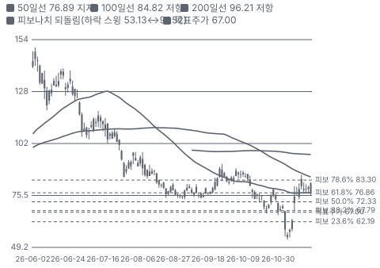

**주봉**

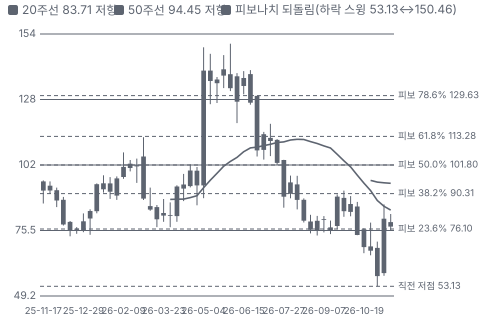

**월봉**

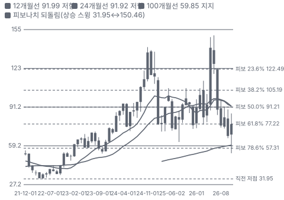

**분기 매출·EPS 실적과 컨센서스**

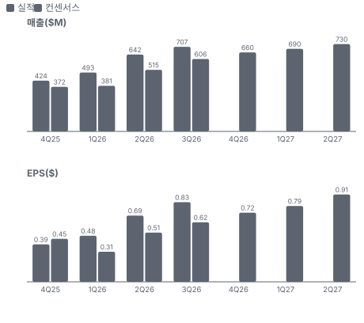

**4Q26 매출 — 지표 추세 vs 가이던스·컨센서스**

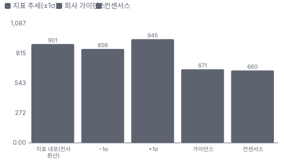

**최근 4개 분기 주가 변화 분석**

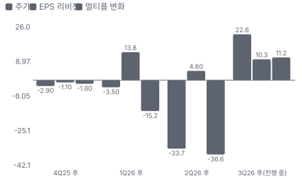

**EPS 리비전**

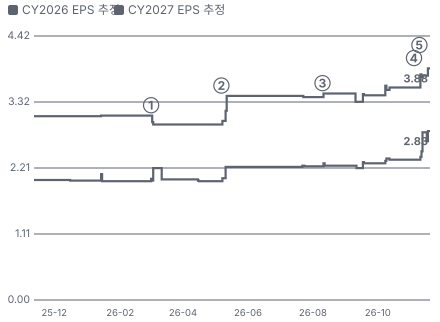

① 26-03-02 4Q25 EPS 미달(\$0.39 vs \$0.45) · EPS 리비전 -5%
② 26-05-07 1Q26 매출 +54%, 다음 날 +31% · EPS 리비전 +16%
③ 26-08-10 2Q26 가이던스 상향에도 −6% · EPS 리비전 +2%
④ 26-11-04 선거 직후 데이터센터 규제 우려 −16% · EPS 리비전 +0%
⑤ 26-11-09 3Q26 매출 \$707M·가이던스 72~75% · EPS 리비전 +9%

**멀티플 프리미엄(Fwd 1Y P/E, 최근 4개 분기말 절대값 — 대상 vs 동종 중앙값)**

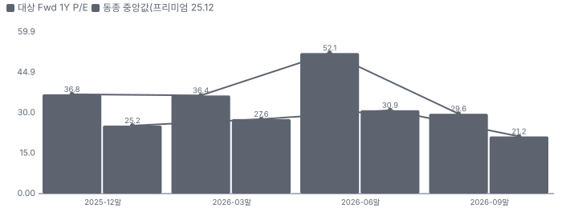

**합리적 멀티플**

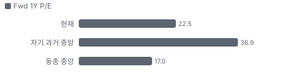

**밸류에이션 주가 시나리오**

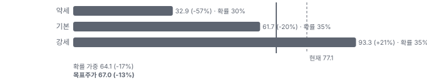

**주가별 업사이드**

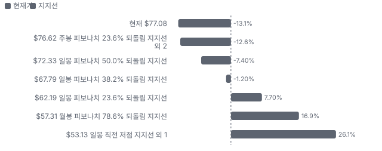
- 제품·서비스 포트폴리오

**고객 믹스(3Q26, 매출 대비)**

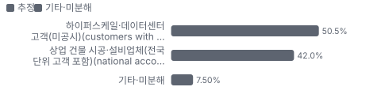

**공급 병목(10점, 낮을수록 병목)**

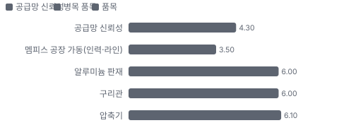

**생산능력 현재와 확충 계획(BASX 매출 환산 \$B/년)**

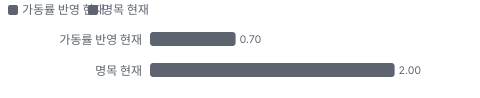

**CAPEX의 매출 대비 비중**

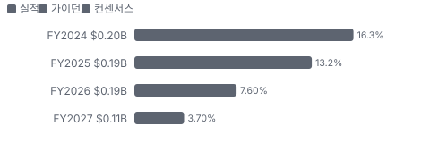

**어닝콜 변화별 주주가치 영향**

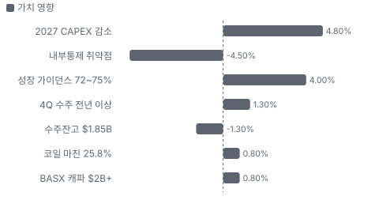

**수주·파이프라인 확실성 사다리**

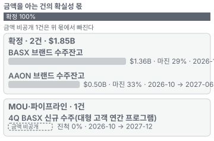

**수주/출하 비율(B/B) × 재고 일수 — 분기별**

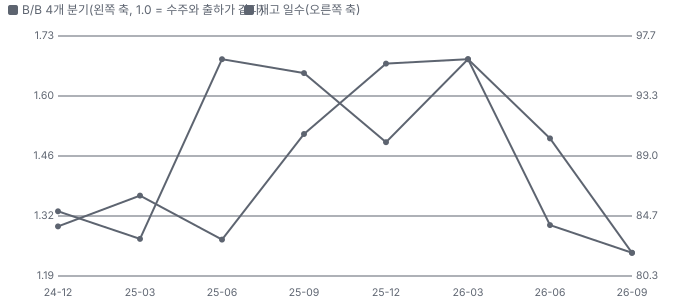

**매출 → 매출총이익 → 영업이익(매출 = 100, 최근 4분기)**

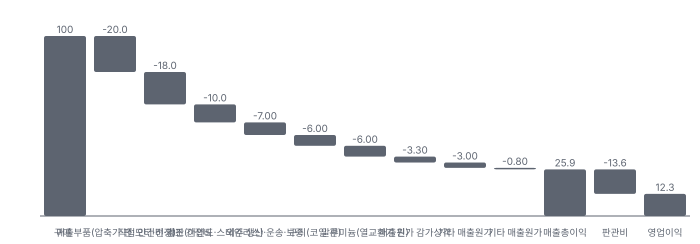

**분기 비용 비중 추이(매출 대비, 공시)**

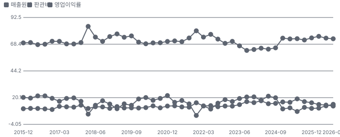

**비용 요인별 매출 대비 비중 1년 변화**

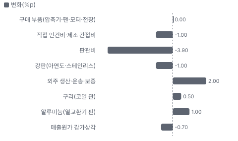

**AAON 브랜드 BOM 원가 몫**

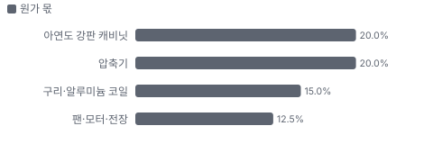

**BASX 브랜드 BOM 원가 몫**

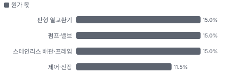

**BOM 항목 가격 +10% 시 OPM 변화**

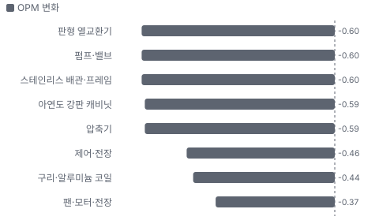

**원가 물가 vs 판매가 물가 — 최근 24개월(24.11 = 100): 원가가 판매가보다 23.2%p 더 올라 단가를 못 올리면 마진 압박**

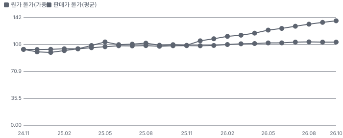

**사업별 매출 vs 물가 — 전년 대비(명목 매출 · 비교 물가 · 실질 = 물량·믹스)**

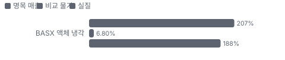

**자산 구성 — 3Q26 분기말 투하자본 \$1,475.0M**

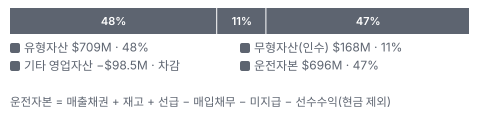

**자산별 변화율 — 최근 12개 분기(4Q23 = 0%) + 다음 4개 분기 추정**

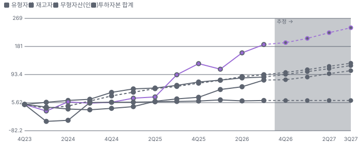

**ROIC 추이 — TTM, 최근 12개 분기 + 다음 4개 분기 추정(컨센서스 NOPAT)**

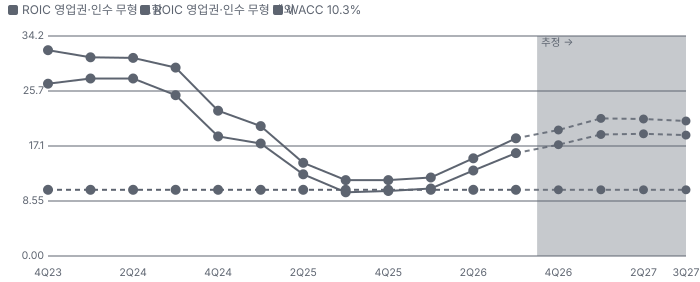

**생산시설별 면적(sq ft, 큰 순) — 생산능력 미공시라 면적을 대용으로**

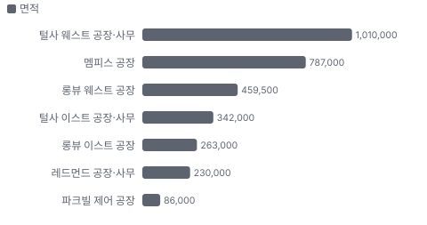

**매출 vs PPI·수출입 — 4Q22 = 100(변화율, 로그 눈금)**

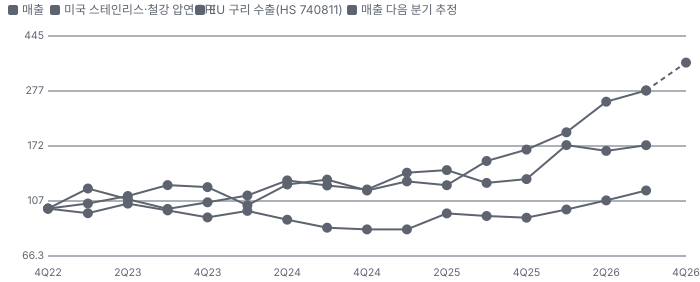

**10년 P·Q 사이클 — 추세(HP 필터) 대비 갭과 8분기 전망**

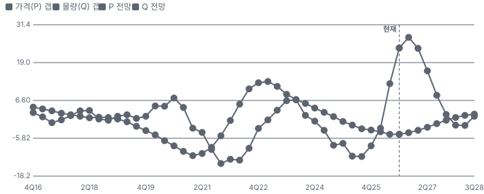

**매출 증가율의 가격·물량 분해와 8분기 전망(전년 대비)**

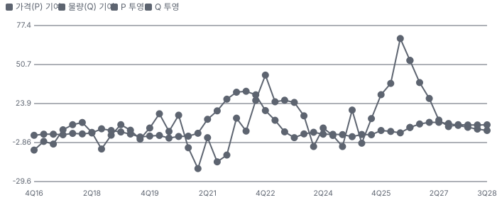

**분기별 매출 증가율 분해**

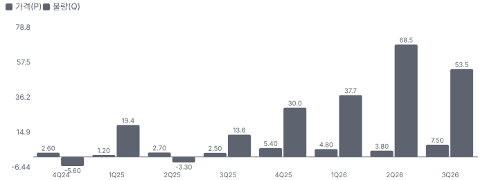

**목표주가 산정 — 기본과 강세 사이(강세 쪽 15%), 도달 확률 약 47%**

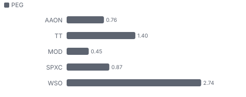

**PEG — 성장 대비 멀티플(낮을수록 성장 대비 쌈)**

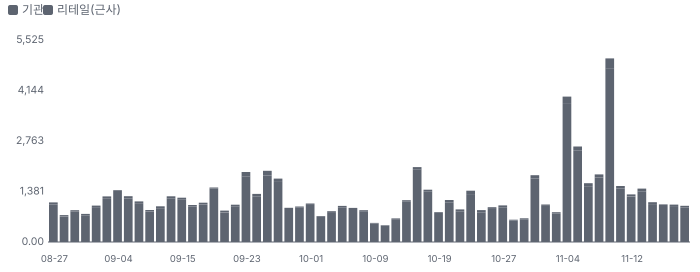

**일별 거래량 분해**

**기관 자금 흐름**

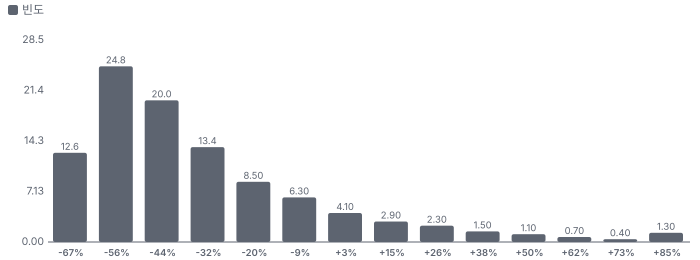

**몬테카를로**

해석: 3,000번 중 400번(13%)에서 가치가 지금 주가 이상이었다. 가정을 흔들어도 지금 주가를 뒷받침하지 못하는 경우가 더 많다. 가운데 값은 0.57배이고, 열 번 중 여덟 번은 0.37~1.09배 사이에 든다.

## 내러티브

> **기업가치를 결정하는 이야기:** AAON의 값은 ① BASX 수주잔고 \$1.36B가 멤피스 증설과 함께 매출로 바뀌는 속도 ② 가격 반영으로 오른 코일 마진(25.8%)이 유지되는지 ③ 2027년 CAPEX 감소로 FCF가 커지는지 ④ 재작성·중대 취약점이 4Q에 정리되는지로 정해진다.

> **멀티플·EPS 프리미엄**
> **멀티플:** Fwd 1Y P/E 22.5배로 동종 중앙(약 17배)보다 높지만, 2024~2026년 자기 레인지(22~61배)의 바닥이다.
> **EPS:** FY2026 EPS 컨센서스 \$2.72~2.83(+95% 안팎), FY2027 \$3.70~3.88(+36%) — 2Q 뒤 FY2027 추정은 12% 올랐다.

### 투자자들은 왜 열광했나

5월 1Q 실적(매출 +54%)에 하루 +31%로 뛰어 6월 \$148을 찍었다. 이후 내부자 대량 매도·데이터센터 투자 둔화 우려로 미끄러졌고, 11/4 중간선거 직후 데이터센터 규제 우려로 하루 −16%를 맞았다. 3Q 실적과 가이던스 상향으로 다음 날 +19% 반등했지만 재작성과 수주잔고 감소가 열기를 식혔다.

### 무엇이 기업가치를 바꾸나

> **구조적 체질 변화**
> **변화:** 데이터센터 냉각(BASX)이 매출의 56%로 커져 상업 건설 경기주에서 데이터센터 투자 연동주로 바뀌었다.
> **증거:** 3Q26 어닝콜(2026-11-09) — BASX 브랜드 \$397M vs AAON 브랜드 \$310M
> **반증:** BASX 비중이 다시 50% 아래로

> **고부가 믹스 확장**
> **변화:** BASX가 AAON 브랜드보다 마진이 낮아 믹스는 매출총이익률을 300bp 넘게 깎지만, 가격 반영으로 ACP 마진이 11.0% → 25.8%로 올랐다.
> **증거:** 3Q26 어닝콜(2026-11-09)
> **반증:** 4Q 매출총이익률이 25% 아래로

> **기술 혁신**
> **변화:** 공랭에서 액체 냉각(CDU(냉각수 분배 장치 — 서버 랙 액체 냉각 회로에 냉각수를 보내고 열을 빼는 장비)·맞춤 코일)으로 제품이 옮겨 가고 고객 배치 방식에 맞춰 제품을 함께 바꾼다. 히트펌프 Alpha Class(AAON의 저온, 영하 29도에서도 도는 공기열원 히트펌프 기술)는 영하 29도까지 돈다.
> **증거:** 3Q26 어닝콜(2026-11-09)·10-K
> **반증:** 액체 냉각 수주가 2개 분기 연속 줄어든다

> **실행 속도**
> **변화:** 해당 없음(리드타임 수치 미공시 — 회사는 BASX 전통 프로그램 리드타임이 줄었고 AAON 브랜드는 성수기 전 리드타임을 낮추려 생산을 끌어올렸다고만 밝혔다)
> **증거:** 3Q26 어닝콜(2026-11-09)
> **반증:** 리드타임이 다시 늘었다는 콜 발언

> **M&A**
> **변화:** 해당 없음(최근 3년 인수 없음, 자사주 매입 한도 \$70M 남음)
> **증거:** 3Q26 어닝콜(2026-11-09)

> **정책·입법 연관성**
> **재정정책:** 멤피스·롱뷰 공장에 신시장 세액공제(NMTC(신시장 세액공제 — 저소득 지역 투자에 주는 미국 연방 세액공제)) 저리 자금(\$50.5M 배정, 2026) — 매출 직접 연결 없음 https://www.sec.gov/Archives/edgar/data/824142/000082414226000088/aaon-20260930.htm 의회 동의 2/10 — 하원 1/5(논의 없음) · 상원 1/5(논의 없음).
> **행정명령:** 해당 없음(행정명령과 직접 연결되는 매출 없음) 의회 동의 2/10 — 하원 1/5(논의 없음) · 상원 1/5(논의 없음).
> **연관입법:** 해당 없음 — 데이터센터 규제는 주(州) 단위 논의(BASX 잔고의 1/3 미만이 해당 주, 콜), 연방 법안 연결 미확인 3Q26 어닝콜(2026-11-09)

> **고객의 지출 예산**
> **변화:** BASX는 하이퍼스케일러의 데이터센터 CAPEX, AAON 브랜드는 상업 건물 신축·교체 CAPEX에서 돈이 나온다.
> **사업별 예산:** **매출의 56%**: BASX 브랜드 — 고객 CAPEX(데이터센터 건설·냉각 설비 투자) · 동인: AI 데이터센터 착공
**매출의 44%**: AAON 브랜드 — 고객 CAPEX(상업 건물 신축·설비 교체) · 동인: 상업 건설·교체 수요
> **증거:** 3Q26 어닝콜(2026-11-09)
> **반증:** 하이퍼스케일러 CAPEX 가이던스 하향

### 내러티브 근거

> 털사의 옥상형 공조기 회사가 데이터센터 냉각(BASX)으로 매출의 절반 넘게를 버는 회사로 바뀌었다. 3Q 매출은 84% 늘었지만 주가는 6월 고점 \$148에서 반 토막 근처까지 밀렸다가 실적 뒤 일부 회복했다 — 시장은 성장보다 재작성·수주잔고 감소·데이터센터 규제 위험을 먼저 본다. 단계는 확산, 쏠림은 낮음이다.

> **AI 데이터센터 액체 냉각** · 유지
> **논리:** 하이퍼스케일러의 액체 냉각 전환으로 BASX 매출이 연 140% 늘고 수주잔고 \$1.36B가 쌓였다
> **숫자:** BASX 브랜드 매출 \$397M(+218%), 수주잔고 \$1,355.2M(+51%)
> **반증:** 4Q BASX 수주가 전년 같은 분기를 밑돈다
> **출처:** 3Q26 어닝콜(2026-11-09)

> **점유율로 크는 AAON 브랜드** · 강화
> **논리:** 상업 건설이 약한데도 반맞춤형 옥상형 공조기가 점유율을 가져간다
> **숫자:** AAON 브랜드 매출 +20%, 수주 +10%, 전국 단위 고객 수주 +70%
> **반증:** 2027년 1Q 수주 시즌에 AAON 브랜드 수주 역성장
> **출처:** 3Q26 어닝콜(2026-11-09)

> **증설 끝 → 현금흐름 전환** · 강화
> **논리:** 다년 증설이 끝나 2027년 CAPEX가 줄고 FCF가 커진다
> **숫자:** 9M 영업현금흐름 \$146.9M(전년 −\$18.8M), 3Q가 2년 만의 첫 FCF 흑자, FY2027 CAPEX 컨센서스 \$110M(FY2026 \$190M)
> **반증:** 2027년 CAPEX 가이던스가 \$150M 이상
> **출처:** 3Q26 어닝콜(2026-11-09)

> **반대 — 이익의 질과 데이터센터 규제** · 유지
> **논리:** 상반기 매출 과소계상과 내부통제 중대 취약점, 선거 뒤 데이터센터 규제 논의가 배수를 누른다
> **숫자:** 재작성 매출 \$10.7M·EPS \$0.09, 11/4 하루 −15.7%, 수주잔고 두 분기 연속 감소
> **반증:** 4Q 10-K에서 중대 취약점 해소 확인
> **출처:** 3Q26 10-Q·8-K Item 4.02

### 투자 포인트

> **이익은 올랐는데 배수만 깎였다**
> **명제:** 2Q 콜 뒤 주가는 −19%였지만 FY2027 EPS 추정은 +12% 올랐다
> **숫자:** FY2027 EPS 추정 \$3.46(8/11) → \$3.88(11/17), 주가 \$94.83(8/7) → \$77.08(11/19)
> **시장과 다른 점:** 시장은 재작성·규제 위험을 할인했다 — 이익 경로 자체는 아직 꺾이지 않았다
> **증명:** 4Q 매출 \$638~682M(가이던스 내재) 달성·FY2027 가이던스
> **출처:** 3Q26 어닝콜(2026-11-09)

> **수주잔고 감소의 성격이 첫 숫자**
> **명제:** 잔고가 \$2.13B → \$1.85B로 줄었다 — 출하 가속인지 수주 둔화인지를 4Q 수주가 가른다
> **숫자:** 3Q 단독 B/B 약 0.84(계산), 회사는 4Q BASX 수주 전년 이상 예상
> **시장과 다른 점:** 시장은 수요 둔화로 읽지만 회사 설명은 전환 속도다
> **증명:** 4Q 수주잔고 \$1.85B 이상
> **출처:** 3Q26 10-Q·3Q26 어닝콜(2026-11-09)

> **CAPEX가 줄면 현금이 남는다**
> **명제:** 3Q가 2년 만의 첫 FCF 흑자였고 2027 CAPEX는 의미 있게 줄어든다
> **숫자:** 9M 영업현금흐름 \$146.9M, FY2026 CAPEX 약 \$190M → FY2027 컨센서스 \$110M
> **시장과 다른 점:** 시장은 성장만 보지만 배수를 받칠 것은 FCF다
> **증명:** 4Q 콜의 2027 CAPEX 가이던스
> **출처:** 3Q26 어닝콜(2026-11-09)

### 모멘텀 생성·소멸 타임라인

**카탈리스트 달력 — 지난 사건의 주가 반응과 앞으로 확인할 숫자**
| 날짜 | 상태 | 구분 | 사건 | 반응·확인 | 결과에 따라 |
|---|---|---|---|---|---|
| 2026-05-07 | 완료 | 생성 | 1Q26 매출 +54% | +31.5%(당일 종가) |  |
| 2026-08-10 | 완료 | 소멸 | 2Q26 가이던스 상향(55~60%) | −5.9% |  |
| 2026-11-04 | 완료 | 소멸 | 중간선거 직후 데이터센터 규제 우려 | −15.7% |  |
| 2026-11-10 | 완료 | 확인 | 3Q26 실적·가이던스 72~75%·재작성 | +19.3% |  |
| 2027-03(예상) | 예정 | 확인 | 4Q26·FY2026 실적·10-K 내부통제 결론·두 브랜드 세그먼트 재편 | 4Q 수주잔고 \$1.85B 이상, 중대 취약점 해소, 2027 CAPEX 가이던스 | 충족이면 기본~강세, 미달이면 약세 |
| 2027-01~02(예상) | 예정 | 매크로 | 하이퍼스케일러 2027 CAPEX 가이던스 | 전년 대비 증가 유지 | BASX 수주 환경 유지 |

### 언제 사서 언제 팔아야 할까?

**가격·조건 틀 — 가격은 밸류에이션(약세·기본·강세·목표주가)과 차트 지지 구간에서, 조건은 이벤트에서**
| 구간 | 가격 | 목표주가까지 | 약세까지 | 조건·근거 |
|---|---|---|---|---|
| 관찰 구간 | \$76~\$77 | -13% | -57% | 11월 저점(\$53~57) 근처는 재작성·규제 공포가 가장 깊게 반영된 자리다 |
| 확인 뒤 | 지금 \$77 이상에서 조건 확인 | -13% | -57% | 4Q 실적에서 수주잔고 반등과 중대 취약점 해소 |
| 무효화 | 약세 시나리오 \$33 | - | -57% | 4Q 수주잔고 \$1.7B 미만 또는 추가 재작성, 종가 \$54 아래 |
| 차익 고민 2차 | \$93(강세 시나리오) | +21% | - | 목표주가 근처에서는 배수 정상화가 상당 부분 반영된다 |

실적일·정책 뉴스일 하루 변동이 15~30%다 — 발표 직후 추격은 경계 가격·조건 틀이며 매매·비중 지시가 아니다(투자 권유 아님).

## 포트폴리오

| 제품·서비스 | 구분 | 무엇 | 쓰는 곳 | 돈 버는 방식 | Mix | Mix 변화(전 분기 대비) |
|---|---|---|---|---|---|---|
| AAON 브랜드 | 제품 | 반맞춤형 옥상형 공조기·공기조화기(공기를 데우고 식히고 걸러 건물에 보내는 장비)·히트펌프·응축기 | 학교·병원·사무실·소매·제조 건물 | 3Q26 매출의 44% | 44% | 미확인 |
| BASX 브랜드 | 제품 | 데이터센터 액체 냉각(CDU·맞춤 코일)·공랭 냉각·클린룸 공조 | 하이퍼스케일·코로케이션 데이터센터, 반도체·바이오 클린룸 | 3Q26 매출의 56% | 56% | 미확인 |

**Mix 변화가 가장 큰 쪽은 AAON Coil Products(+3.8%p, 전 분기 대비).** 계절성 판정: 분기 매출 계절 지수 기준 없음 → 직전 분기와 비교.

## 고객

> **3Q26 최대 고객 하이퍼스케일·데이터센터 고객(미공시, customers with very strong financial profiles) 50%, 상위 3곳 92%, 집중도 집중.** 공시·회사 발표로 확인한 몫은 매출의 0%이고, 나머지 고객 몫은 추정이거나 미분해다. 10% 넘는 고객을 이름으로 공시하지 않는다. BASX 수주잔고의 80% 넘는 몫이 재무가 매우 강한 고객(하이퍼스케일러로 보인다 — 가설)이고, ACP 액체 냉각은 장기 프로그램 대형 고객 중심이다.

**고객별 매출 몫(3Q26)**
| 고객 | 몫 | 변화 | 근거 |
|---|---|---|---|
| 하이퍼스케일·데이터센터 고객(미공시, customers with very strong financial profiles) | 45~56% | +22%p | 추정 |
| 상업 건물 시공·설비업체(전국 단위 고객 포함, national accounts) | 40~44% | -23%p | 추정 |
| 기타·미분해 | 7% | - | - |

> **하이퍼스케일·데이터센터 고객(미공시, customers with very strong financial profiles)** · 추정
> **사는 것:** BASX 액체 냉각(CDU·맞춤 코일)·공랭 냉각
> **추정 근거:** 회사명·몫 미공시. 하한은 클린룸·기타를 뺀 추정, prior는 3Q25 BASX 브랜드 약 \$125M ÷ \$384M에서 같은 방식으로 뺀 값(추정). 특정 하이퍼스케일러로 옮기면 가설

> **상업 건물 시공·설비업체(전국 단위 고객 포함, national accounts)** · 추정
> **사는 것:** 옥상형 공조기·공기조화기·히트펌프
> **추정 근거:** 독립 대표 조직을 거쳐 판다 — 고객별 몫 미공시

## 수주·파이프라인

> **2026-09-30 기준 3건.** 확정 \$1.85B. 공시 수주잔고 \$1.85B.

**수주 목록**
| 상태 | 계약 | 계약 총액 | 진척 | 기간 | 비고 |
|---|---|---|---|---|---|
| 확정 | BASX 브랜드 수주잔고 | \$1.36B | 비공개 | 2026-10 → 2027-12 | - |
| 확정 | AAON 브랜드 수주잔고 | \$0.50B | 비공개 | 2026-10 → 2027-06 | - |
| 파이프라인 | 4Q BASX 신규 수주(대형 고객 연간 프로그램) | 금액 비공개 | 0% | 2026-10 → 2027-12 | - |

**실행 속도와 방해 요인**
| 항목 | 상태 | 실행 속도 | 방해 요인 |
|---|---|---|---|
| BASX 브랜드 수주잔고 | 확정 | 약 7~10개월(계산) | 고객 데이터센터 건설 일정 · 멤피스 가동률 |
| AAON 브랜드 수주잔고 | 확정 | 수개월(리드타임 단축 중) | 상업 건설 경기 |
| 4Q BASX 신규 수주(대형 고객 연간 프로그램) | 파이프라인 | 2027년 출하 | 데이터센터 투자 일정 |

## 마진 구조

> **GPM 26.7%, OPM 14.1%.** 3Q25 대비 GPM -1.2%p, OPM +2.8%p. 변동비는 매출의 61%이고, 매출이 10% 늘면 OPM은 +2.2%p 움직인다. 3Q26 매출총이익률 26.7%(전년 27.8%). BASX 비중이 커지며 브랜드 믹스가 300bp 넘게 깎았지만, 판관비 비중이 16.5% → 12.5%로 내려가 영업이익률은 11.3% → 14.1%로 올랐다.

> **매출 100 중 매출원가 74.1, 매출총이익 25.9(최근 4분기, 공시).** 매출원가 요인 중 구매 부품(압축기·팬·모터·전장)이 매출의 20.0%로 가장 무겁고, 단가가 +10% 오르면 GPM이 -2.00%p 움직인다. 분기 회귀로 매출 1이 늘 때 매출원가는 0.73 늘고, 매출원가의 고정비 몫은 -2%다.

**비용 요인 강도 — 비중·추세·충격(+10%)·탄력**
| 비용 | 구분 | 매출 대비 | 1년 변화 | 마진 기여 | 충격 시 마진 | 매출 탄력 | 고정비 몫 |
|---|---|---|---|---|---|---|---|
| 구매 부품(압축기·팬·모터·전장) | 매출원가 요인 | 20.0% | +0.0%p | -0.0%p | -2.00%p | 미확인 | 0% |
| 직접 인건비·제조 간접비 | 매출원가 요인 | 18.0% | -1.0%p | +1.0%p | -1.80%p | 미확인 | 60% |
| 강판(아연도·스테인리스) | 매출원가 요인 | 10.0% | -1.0%p | +1.0%p | -1.00%p | 미확인 | 0% |
| 외주 생산·운송·보증 | 매출원가 요인 | 7.0% | +2.0%p | -2.0%p | -0.70%p | 미확인 | 20% |
| 구리(코일 관) | 매출원가 요인 | 6.0% | +0.5%p | -0.5%p | -0.60%p | 미확인 | 0% |
| 알루미늄(열교환기 핀) | 매출원가 요인 | 6.0% | +1.0%p | -1.0%p | -0.60%p | 미확인 | 0% |
| 매출원가 감가상각 | 매출원가 요인 | 3.3% | -0.7%p | +0.7%p | -0.33%p | 미확인 | 100% |
| 기타 매출원가 | 매출원가 요인 | 3.0% | +0.4%p | -0.4%p | -0.30%p | 미확인 | 50% |
| 매출원가 | 공시 항목 | 74.1% | +1.0%p | -1.0%p | -7.41%p | 0.73 | -2% |
| 판관비 | 공시 항목 | 13.6% | -3.2%p | +3.2%p | 미확인 | 0.15 | -9% |

매출 탄력 = 분기 비용을 매출에 회귀한 기울기(매출 1당 변동비), 고정비 몫 = 절편 ÷ 평균 비용. 표본이 8분기 미만이면 미확인. 매출원가 요인 비중은 margin 재료의 추정이 섞여 있고, 공시 매출원가와의 차이는 '기타 매출원가'로 둔다.

**GPM에서 OPM까지(GAAP — 10-Q 3개월 손익, 아래는 최근 4개 분기)**
| 기간 | GPM | 연구개발 | 판관비 | 기타 | OPM |
|---|---|---|---|---|---|
| 3Q25 | 27.8% | 0.0% | 16.5% | 0.0% | 11.3% |
| 3Q26 | 26.7% | 0.0% | 12.5% | 0.0% | 14.1% |
| 2025-12 | 25.9% | - | - | - | 10.4% |
| 2026-03 | 24.5% | - | - | - | 10.6% |
| 2026-06 | 26.1% | - | - | - | 12.7% |
| 2026-09 | 26.7% | - | - | - | 14.1% |

**비용을 움직이는 요인**
| 비용 | 요인 |
|---|---|
| 구매 부품(압축기·팬·모터·전장, 매출원가) | 부품 단가·공급 · 근거 추정 |
| 직접 인건비·제조 간접비(매출원가) | 가동률(멤피스 약 1/3) · 근거 추정 |
| 판관비(판관비) | 인력·이익 연동 보상·ERP 감가상각 · 근거 공시 |
| 강판(아연도·스테인리스, 매출원가) | 강판 가격(연초 대비 스테인리스 −10.8%·아연도 −1.7%) · 근거 추정 |
| 외주 생산·운송·보증(매출원가) | 리드타임 단축용 외주(콜) · 근거 추정 |
| 구리(코일 관, 매출원가) | 구리 가격(연초 대비 +7.8%) · 근거 추정 |
| 알루미늄(열교환기 핀, 매출원가) | 알루미늄 가격(연초 대비 +18.2%) · 근거 추정 |
| 매출원가 감가상각(매출원가) | 증설 설비 · 근거 추정 |
| 기타 매출원가(매출원가) | 기타 · 근거 추정 |

**AAON 브랜드 BOM — 매출의 44%, GPM 33%(AAON Oklahoma 조정 매출총이익률 32.8%(콜) — 브랜드 전체 마진 미공시), 항목 가격 +10% 시**
| 항목 | 원가 몫 | 전가 | 제품 GPM | OPM |
|---|---|---|---|---|
| 아연도 강판 캐비닛 | 15~25% | 미확인 | -1.3%p | -0.59%p |
| 압축기 | 15~25% | 미확인 | -1.3%p | -0.59%p |
| 구리·알루미늄 코일 | 10~20% | 미확인 | -1.0%p | -0.44%p |
| 팬·모터·전장 | 10~15% | 미확인 | -0.8%p | -0.37%p |
| 미분해 | 32% | - | - | - |

**BASX 브랜드 BOM — 매출의 56%, GPM 29%(BASX 세그먼트 매출총이익률 28.7%(10-Q) — ACP 내 BASX 액체 냉각은 ACP 25.8%에 포함), 항목 가격 +10% 시**
| 항목 | 원가 몫 | 전가 | 제품 GPM | OPM |
|---|---|---|---|---|
| 판형 열교환기 | 10~20% | 미확인 | -1.1%p | -0.60%p |
| 펌프·밸브 | 10~20% | 미확인 | -1.1%p | -0.60%p |
| 스테인리스 배관·프레임 | 10~20% | 미확인 | -1.1%p | -0.60%p |
| 제어·전장 | 8~15% | 미확인 | -0.8%p | -0.46%p |
| 미분해 | 43% | - | - | - |

판형 열교환기 가격이 +10% 오르면 영업이익은 -4.3% 움직인다. 판매가 전가를 모르는 항목은 전가 0%로 계산했다.

**BOM 항목 가격을 움직이는 것**
| 항목 | 요인 |
|---|---|
| 아연도 강판 캐비닛 | 부피 최대 소재 · 근거 추정 |
| 압축기 | 외부 조달 핵심 부품 · 근거 추정 |
| 구리·알루미늄 코일 | 원자재 가격 노출 · 근거 추정 |
| 팬·모터·전장 | 외부 조달 · 근거 추정 |
| 판형 열교환기 | CDU 열교환 핵심 · 근거 추정 |
| 펌프·밸브 | 냉각수 순환 · 근거 추정 |
| 스테인리스 배관·프레임 | 부식 방지 소재 · 근거 추정 |
| 제어·전장 | 고객 맞춤 제어 · 근거 추정 |

> **원가·판매가 물가 격차 -23.2%p** — 판매가 물가가 투입 원가 물가보다 느리게 오른다.

**투입 물가 — 미국 PPI 3·6·12개월(2026-10, 개정 반영)과 해외 전년비**
| 항목 | 미국 3개월 | 6개월 | 12개월 | 전가 못 할 때 OPM | 일본 | 한국 | 대만 |
|---|---|---|---|---|---|---|---|
| 스테인리스 배관·프레임 | +6.7% | +17.0% | +32.9%* | - | 미확인 | 미확인 | 미확인 |
| 구리·알루미늄 코일 | +3.4% | +7.2% | +23.9% | - | +42.6% | +25.8% | +40.1% |
| 펌프·밸브 | +0.4% | +0.3% | +6.4%* | - | 미확인 | 미확인 | 미확인 |

별표는 품목보다 넓은 업종 지수다. 연결한 투입 원가의 미국 PPI(생산자물가지수)는 1년 새 가중 +29.5%이고, 판매가로 넘기지 못하면 GPM -4.7%p·OPM -4.7%p가 움직인다. 판매가 비교 물가(산업용 밸브·유량 제어 부품 PPI)는 1년 새 +6.4% — 회사 가격 변화는 미확인. 물가 지수를 붙이지 못한 매출원가 항목은 알루미늄(열교환기 핀), 구매 부품(압축기·팬·모터·전장), 직접 인건비·제조 간접비, 외주 생산·운송·보증, 매출원가 감가상각다(미연결). BASX 액체 냉각 매출은 2026-09 전년 대비 +207.4%이고 비교 물가 ppi:valve의 변화 +6.8%(2026-09)를 빼면 실질 +187.8% — 물량·믹스가 성장을 이끌었다.

## 자산 구성

> **3Q26 분기말 투하자본 \$1,475.0M** — 유형자산 48%, 운전자본 47%. 최근 12개 분기(4Q23 → 3Q26) 가장 크게 늘어난 자산은 매출채권(+187%), 투하자본 합계 +93%. 3Q27 추정 투하자본 \$1,750.0M(+19%, 컨센서스 매출과 회전 일수·CAPEX 강도 유지 가정). 연율 감가 비율(총액 기준)은 직전 4분기 8.90% → 최근 4분기 9.10%.

**자산·운전자본 항목별 분기말 잔액 — 최근 12개 분기와 다음 4개 분기 추정**
| 항목 | 4Q23 | 3Q25 | 3Q26(최근) | 3Q27 추정 | 12개 분기 변화 | 다음 4개 분기 변화 |
|---|---|---|---|---|---|---|
| 매출채권 | \$138.1M | \$266.2M | \$396.8M | \$469.1M | +187% | +18% |
| 재고자산 | \$213.5M | \$250.5M | \$376.0M | \$438.8M | +76% | +17% |
| 선급·기타 유동자산 | \$48.3M | \$214.8M | \$297.8M | \$403.2M | +517% | +35% |
| 매입채무 | \$27.5M | \$109.7M | \$182.6M | \$212.0M | +564% | +16% |
| 미지급비용 | \$85.5M | \$120.5M | \$185.9M | \$204.2M | +117% | +10% |
| 선수수익(계약부채) | \$13.8M | \$20.0M | \$5.7M | \$60.1M | -58% | +952% |
| 유형자산 | \$381.7M | \$608.7M | \$708.6M | \$845.2M | +86% | +19% |
| 리스 사용권자산 | \$0.0M | \$0.0M | \$0.0M | \$0.0M | 비교 불가 | — |
| 영업권 | \$0.0M | \$0.0M | \$0.0M | \$0.0M | 비교 불가 | — |
| 무형자산(인수) | \$149.9M | \$163.9M | \$168.4M | \$168.4M | +12% | +0% |

**자산 추정 동인 — 최근 4개 분기 평균(재무상태표 동인 모형)**
| 동인 | 값 | 곱하는 기준 |
|---|---|---|
| 매출채권 | 56일 | 매출 |
| 재고자산 | 71일 | 매출원가 |
| 선급·기타 유동자산 | 48일 | 매출 |
| 매입채무 | 34일 | 매출원가 |
| 미지급비용 | 24일 | 매출 |
| 선수수익(계약부채) | 7일 | 매출 |
| CAPEX 강도 | 8.9% | 매출(최근 4개 분기 합) |
| 분기 감가율 | 3.60% | 기초 유형자산 순액(무형 상각 제외 감가상각) |
| 매출원가율 | 74.1% | 매출(최근 4개 분기) |
| 영업권·리스 사용권·기타 | 유지 | 인수·새 리스는 공시 전 모름 |
| 인수 무형자산 | 분기 \$0.0M 상각 | 최근 4개 분기 평균 상각 |

**추정 방법:** 증권사 3표 모델(손익·재무상태표·현금흐름)의 재무상태표 동인 방식이다. 운전자본은 항목별 회전 일수(매출채권·선급·미지급·선수는 매출, 재고·매입채무는 매출원가 기준)를 최근 4개 분기 평균으로 두고 컨센서스 매출에 곱한다. 유형자산은 기초 + CAPEX − 감가상각으로 굴린다(Koller·Goedhart·Wessels 『Valuation』 재무상태표 추정). 매출 경로는 ROIC 절의 컨센서스와 같다.

**유형·무형자산 항목별 가치(2025-12-31 vs 2024-12-31)**
| 구분 | 항목 | 총액 2025-12-31 | 누적상각 | 순액 | 총액 2024-12-31 | 총액 1년 변화 | 공시 내용연수 |
|---|---|---|---|---|---|---|---|
| 유형 | 유형자산 합계(항목 미분해) | \$1,003.8M | 총계만 공시 | 총계만 공시 | \$820.0M | +22.4% | 미확인 |
| 무형 | 무형자산 합계(항목 미분해) | \$52.5M | −\$25.5M | \$77.9M | \$52.0M | +1.0% | 미확인 |
| 유형 합계 | 유형자산 | \$1,003.8M | \$372.5M | \$631.3M | \$820.0M | +22.4% | 경과율 37%(상각 대상 기준) |

**내용연수 산식(상각 대상 유형자산 = 총액 − 토지 − 건설중)**
| 기준일 | 연 감가상각 | 상각 대상 총액 | 평균 내용연수 | 경과 연수 | 잔여 연수 | 경과율 |
|---|---|---|---|---|---|---|
| 2025-12-31 | \$72.3M | \$1,003.8M | 13.9년 | 5.2년 | 8.7년 | 37% |
| 2024-12-31 | \$54.0M | \$820.0M | 15.2년 | 5.7년 | 9.5년 | 38% |

산식 평균 내용연수는 13.9년. 1년 전 15.2년 → 지금 13.9년.

**분기 감가 비율(감가상각 ÷ 평균 유형자산 총액)**
| 분기 | 감가상각 | 평균 유형자산(총액) | 분기 비율 | 연율 | 연율의 역수 |
|---|---|---|---|---|---|
| 4Q24 | \$17.6M | \$773.1M | 2.27% | 9.08% | 11.0년 |
| 1Q25 | \$18.9M | \$848.6M | 2.23% | 8.93% | 11.2년 |
| 2Q25 | \$19.9M | \$887.8M | 2.25% | 8.98% | 11.1년 |
| 3Q25 | \$20.0M | \$922.9M | 2.16% | 8.65% | 11.6년 |
| 4Q25 | \$20.4M | \$975.6M | 2.09% | 8.34% | 12.0년 |
| 1Q26 | \$21.7M | \$1,019.8M | 2.13% | 8.53% | 11.7년 |
| 2Q26 | \$25.0M | \$1,059.0M | 2.36% | 9.44% | 10.6년 |
| 3Q26 | \$27.1M | \$1,086.4M | 2.50% | 9.99% | 10.0년 |

감가상각 기준: 손익계산서 감가상각·상각비(SEC 공시 데이터, 4분기 = 연간 − 1~3분기).

최근 4분기 연율 감가 비율 9.10%, 직전 4분기 8.90%(+2%) — 경고 문턱(-10%) 안이다.

미공시·미분해: 유형자산 항목별 총액·내용연수(10-K 주석에서 모델이 채움) · 무형자산 항목(10-K 주석에서 모델이 채움) · 리스 가중평균 할인율 — 이 칸은 비우고 나머지로 계산했다.

### 해석 — 자산이 어디에 쌓이고 있나

- 같은 기간 4개 분기 매출은 +87% — 매출보다 빨리 늘어난 자산: 매출채권 +187%. 이 자산의 회전율이 떨어지면 ROIC를 희석한다.
- 다음 4개 분기 CAPEX \$251.8M vs 감가상각 \$108.9M(최근 4개 분기 CAPEX 강도·감가율 유지) — 유형자산 3Q26 \$708.6M → 3Q27 \$845.2M. 투자가 감가보다 커서 자산이 쌓이는 국면이다.

## ROIC

> **TTM 3Q26 ROIC는 영업권·인수 무형 포함 16.0%, 제외 18.3%**(NOPAT 마진 9.4% × 투하자본 회전율 1.70회). 최근 12개 분기 4Q23 26.8% → 3Q26 16.0%(고점 1Q24 27.6%). 컨센서스 NOPAT으로 굴리면 3Q27 18.8%(제외 21.0%) — WACC 10.3% 대비 +8.5%p. 1년 변화의 가장 큰 요인은 NOPAT 마진(+2.6%p).

**ROIC 추이(TTM)와 다음 4개 분기 추정 — NOPAT ÷ 평균 투하자본(이번 분기말·4개 분기 전)**
| 분기 | 구분 | TTM 매출 | TTM NOPAT | NOPAT 마진 | 평균 투하자본 | ROIC 포함 | ROIC 제외 |
|---|---|---|---|---|---|---|---|
| 4Q23 | 실적 | \$1,168.5M | \$175.2M | 15.0% | \$654.2M | 26.8% | 32.0% |
| 1Q24 | 실적 | \$1,164.7M | \$177.3M | 15.2% | \$641.4M | 27.6% | 30.9% |
| 2Q24 | 실적 | \$1,194.3M | \$186.9M | 15.6% | \$676.9M | 27.6% | 30.8% |
| 3Q24 | 실적 | \$1,209.6M | \$187.6M | 15.5% | \$750.6M | 25.0% | 29.3% |
| 4Q24 | 실적 | \$1,200.6M | \$161.0M | 13.4% | \$866.7M | 18.6% | 22.6% |
| 1Q25 | 실적 | \$1,260.6M | \$151.9M | 12.0% | \$866.5M | 17.5% | 20.2% |
| 2Q25 | 실적 | \$1,258.6M | \$118.3M | 9.4% | \$934.4M | 12.7% | 14.5% |
| 3Q25 | 실적 | \$1,315.6M | \$101.4M | 7.7% | \$1,020.1M | 9.9% | 11.8% |
| 4Q25 | 실적 | \$1,442.1M | \$112.6M | 7.8% | \$1,120.5M | 10.1% | 11.8% |
| 1Q26 | 실적 | \$1,612.5M | \$125.8M | 7.8% | \$1,200.3M | 10.5% | 12.2% |
| 2Q26 | 실적 | \$1,943.1M | \$170.5M | 8.8% | \$1,285.7M | 13.3% | 15.2% |
| 3Q26 | 실적 | \$2,266.3M | \$214.0M | 9.4% | \$1,335.2M | 16.0% | 18.3% |
| 4Q26 | 추정 | \$2,502.1M | \$242.1M | 9.7% | \$1,401.1M | 17.3% | 19.6% |
| 1Q27 | 추정 | \$2,699.6M | \$277.9M | 10.3% | \$1,469.0M | 18.9% | 21.4% |
| 2Q27 | 추정 | \$2,787.4M | \$295.3M | 10.6% | \$1,552.4M | 19.0% | 21.3% |
| 3Q27 | 추정 | \$2,845.0M | \$302.6M | 10.6% | \$1,612.5M | 18.8% | 21.0% |

**다음 4개 분기 NOPAT — 컨센서스(세율 23%, 리스 이자 별도)**
| 분기 | 매출 | EBITA 마진 | EBITA | NOPAT(분기) | 근거 |
|---|---|---|---|---|---|
| 4Q26 | \$660.0M | 12.2% | \$80.5M | \$62.0M | 컨센서스 매출 × EBIT 마진 FY2026 |
| 1Q27 | \$690.0M | 14.3% | \$98.7M | \$76.0M | 컨센서스 매출 × EBIT 마진 FY2027 |
| 2Q27 | \$730.0M | 14.3% | \$104.4M | \$80.4M | 컨센서스 매출 × EBIT 마진 FY2027 |
| 3Q27 | \$765.0M | 14.3% | \$109.4M | \$84.2M | 컨센서스 매출 × EBIT 마진 FY2027 |

**추정 방법:** NOPAT은 컨센서스(분기 매출 추정 × 회계연도 EBIT 마진 추정)로 잡고, 조정(비 GAAP) 마진이면 주식보상 몫을 빼서 과거 실적과 같은 기준(영업이익 + 인수 무형 상각)으로 맞췄다. 이미 발표했지만 분기 보고서(10-Q)가 아직 없는 분기는 발표 실적을 쓴다. 투하자본은 자산 구성 절의 재무상태표 동인으로 굴렸다. ROIC는 4개 분기 NOPAT을 이번 분기말과 4개 분기 전 투하자본의 평균으로 나눈다 — 추정 분기의 ROIC에는 이미 나온 실적 분기가 섞여 있다.

**투하자본 항목별 회전율과 ROIC 기여(TTM 3Q26, 평균 잔액)**
| 항목 | 투하자본 | 매출 1달러당 자본 | 회전율(매출 ÷ 항목) | 자본 몫 | 이 항목을 빼면 ROIC |
|---|---|---|---|---|---|
| 운전자본 | \$588.9M | 0.26 | 3.85회 | 44% | 28.7% |
| 유형자산 | \$658.6M | 0.29 | 3.44회 | 49% | 31.6% |
| 리스 사용권자산 | \$0.0M | 0.00 | 음수(자금 원천) | 0% | 16.0% |
| 영업권 | \$0.0M | 0.00 | 음수(자금 원천) | 0% | 16.0% |
| 무형자산(인수) | \$166.2M | 0.07 | 13.64회 | 12% | 18.3% |
| 기타 영업자산 | −\$78.5M | -0.03 | 음수(자금 원천) | -6% | 15.1% |

**ROIC 세 가지 판**
| 판 | NOPAT | 투하자본 | ROIC | 무엇을 재나 |
|---|---|---|---|---|
| 영업권·인수 무형 포함 | \$214.0M | \$1,335.2M | 16.0% | 인수 웃돈까지 낸 돈에 대한 수익률 |
| 영업권·인수 무형 제외 | \$214.0M | \$1,169.1M | 18.3% | 본업 운영 수익률(동종 비교용) |
| 무형 자본화 조정(판관비 20%·5년, 연구개발 6년) | \$265.0M | \$1,604.0M | 16.5% | 비용으로 처리한 무형 투자를 자산으로 본 판 |
| 경제적 이익(포함판) | \$76.6M | \$1,335.2M | 자본비용 10.3% | (ROIC − 자본비용) × 투하자본 |

NOPAT = (영업이익 \$277.9M + 인수 무형 상각) × (1 − 세율 23%). 리스 사용권자산을 투하자본에 넣었으므로 임차료 속 이자 몫을 영업이익에 되더했다. 현금은 영업에 필요한 몫을 따로 알 수 없어 투하자본에서 뺐다. 재무상태표(분기) — 운전자본 = 매출채권 + 재고 + 기타 유동자산(계약자산 포함) − (매입채무 + 미지급비용 + 선수수익), 현금 제외. 무형자산 칸은 영업권 \$81.9M 포함(컨센서스 합산). 유형자산 순액은 리스 사용권자산 약 \$19M 포함(10-Q 유형자산 \$689.6M과 차이).

**ROIC 1년 변화 분해(포함판, TTM 3Q25 → TTM 3Q26)**
| 요인 | ROIC 기여 |
|---|---|
| NOPAT 마진 | +2.58%p |
| 운전자본 | +0.56%p |
| 유형자산 | +2.05%p |
| 리스 사용권자산 | -0.00%p |
| 영업권 | -0.00%p |
| 무형자산(인수) | +0.93%p |
| 기타 영업자산 | -0.03%p |
| 합계 | +6.08%p |

**무형 자본화 가정별 ROIC(2025년 지출 기준, 포함판에 더함)**
| 투자로 보는 몫 | 상각 연수 | 무형 자산 | NOPAT 조정 | 조정 ROIC |
|---|---|---|---|---|
| 판관비 20% | 2년 | \$225.3M | \$39.0M | 16.2% |
| 판관비 20% | 5년 | \$268.8M | \$51.0M | 16.5% |
| 판관비 30% | 2년 | \$258.6M | \$45.0M | 16.2% |
| 판관비 30% | 5년 | \$323.8M | \$63.0M | 16.7% |

### 해석 — 무엇이 수익성을 끌어올리고 희석하나

- 유형자산: 투하자본의 49% — 빼면 ROIC 16.0% → 31.6%. 이 자산의 회전율(3.44회)이 수익성을 희석하는 주된 자리다.
- 운전자본: 투하자본의 44% — 빼면 ROIC 16.0% → 28.7%. 이 자산의 회전율(3.85회)이 수익성을 희석하는 주된 자리다.
- 기타 영업자산: −\$78.5M(음수), 고객 선수금·공급사 외상이 자본을 대신 댄다 — 빼면 ROIC 15.1%로 낮아진다. 수익성을 끌어올리는 쪽이다.
- 영업권·인수 무형을 빼면 ROIC가 +2.3%p 오른다 — 과거 인수에 치른 웃돈이 주주 수익률을 그만큼 낮춘다(본업 수익률은 제외판, 인수까지 포함한 가치 창출은 포함판으로 본다).
- 1년 ROIC 개선의 최대 요인은 NOPAT 마진(+2.6%p).
- 비용으로 처리한 무형 투자를 자산으로 보면 ROIC가 +0.5%p 움직인다(무형 자산 \$268.8M). 투자를 늘리는 중이라 NOPAT이 더 커지는 쪽이다.
- 추정 경로 3Q26 16.0% → 3Q27 18.8%: NOPAT 마진 +1.2%p, 투하자본 회전율 +0.07회 — 컨센서스 매출·마진이 맞고 회전 일수·CAPEX 강도가 유지된다는 가정이다. 마진 추정이 내려가거나 재고 일수가 늘면 이 경로가 먼저 틀린다.
- ROIC(포함) − WACC = +5.7%p(3Q26) — 양수면 투하자본을 늘릴수록 가치가 쌓인다.

## 공급망 병목

> **공급망 신뢰성 4.3/10, 병목 주의.** 가장 약한 고리는 멤피스 공장 가동(인력·라인) 3.5점이고, 품목 평균은 5.4점이다. 근거가 부족한 1건(냉매)은 점수에서 뺐다. 지금 병목은 부품이 아니라 공장 가동이다 — 멤피스 공장이 약 1/3만 돌고 있어 BASX 출하 속도가 매출 인식을 정한다. 회사는 공급망이 부품을 생산 시점에 맞춰 대고 있다고 밝혔다.

**병목과 마진 — 품목 가격 +10% 시 OPM**
| 품목 | 점수 | 판정 | 구분 | OPM |
|---|---|---|---|---|
| 멤피스 공장 가동(인력·라인, 필수) | 3.5 | 병목 심각 | 출하 차질 위험 | 미확인 |
| 알루미늄 판재 | 6.0 | 병목 주의 | 출하 차질 위험 | 미확인 |
| 구리관 | 6.0 | 병목 주의 | 출하 차질 위험 | 미확인 |
| 압축기(필수) | 6.1 | 관리 가능 | 가격 위험 | -0.59%p |

> **멤피스 공장 가동(인력·라인)** · 3.5/10
> **왜:** BASX 출하 속도 = 매출 인식 속도
> **병목 요인:** 인증 공급사 1곳 · 캐파 빠듯 · 리드타임 미확인 · 재인증 미확인 · 1위 점유율 미확인 · 미국 테네시 집중 100% · 물량 확보 내재화
> **풀리는 조건:** 증설 중 — 2027~28년 단계적 가동(회사 발표), 가동률 수치 확인 전

> **알루미늄 판재** · 6.0/10
> **왜:** 연초 대비 +18.2%
> **병목 요인:** 인증 공급사 2곳 · 캐파 균형 · 리드타임 미확인 · 재인증 미확인 · 1위 점유율 미확인 · 미국 집중 90% · 물량 확보 장기계약
> **풀리는 조건:** 해당 없음

> **구리관** · 6.0/10
> **왜:** 연초 대비 +7.8%
> **병목 요인:** 인증 공급사 2곳 · 캐파 균형 · 리드타임 미확인 · 재인증 미확인 · 1위 점유율 미확인 · 미국 집중 90% · 물량 확보 장기계약
> **풀리는 조건:** 해당 없음

> **압축기** · 6.1/10
> **왜:** 옥상형 공조기 핵심 외부 부품
> **병목 요인:** 인증 공급사 2곳 · 캐파 균형 · 리드타임 미확인 · 재인증 미확인 · 1위 점유율 50% · 미국(국내 조달, 10-Q) 집중 90% · 물량 확보 장기계약
> **풀리는 조건:** 해당 없음

**공급사**
| 품목 | 공급사 | 몫 | 근거 |
|---|---|---|---|
| 압축기 | 미공시(국내 제조사, 압축기) | 미확인 | 공시 |
| 알루미늄 판재 | 미공시(국내, 핀 소재) | 미확인 | 공시 |
| 구리관 | 미공시(국내, 코일 관) | 미확인 | 공시 |
| 냉매 | 미공시(냉매) | 미확인 | 공시 |
| 멤피스 공장 가동(인력·라인) | 자체(BASX 생산) | 미확인 | 회사 발표 |

**무역 통계로 본 공급 지역**
| 품목 | EU 수입처 | 일본 수입처 | EU 1위 전년비 |
|---|---|---|---|
| 구리관 | MY(말레이시아) 77% · KR(한국) 11% · VN(베트남) 7% | マレーシア 58% · タイ 36% | 미확인 |

## 생산능력

> **현재 명목 캐파 2 BASX 매출 환산 \$B/년, 가동률 35%.** FY2025 CAPEX는 \$0.19B로 매출의 13.2%다. 소유 공장은 털사(웨스트·이스트)·멤피스·롱뷰(웨스트·이스트)·레드먼드다. BASX 전체 생산능력은 매출 기준 \$2B 초과이고 멤피스는 약 1/3만 가동 중이다 — 증설 CAPEX는 2027년에 줄어든다.

**생산시설 9곳**(10-K Item 2: 생산 공장 기준 — 털사 웨스트·이스트, 멤피스, 롱뷰 웨스트·이스트, 레드먼드(소유) + 파크빌 제어 공장·털사 부품 물류(임차) + 롱뷰 Kodak 창고. 사무·창고·소매 건물은 세지 않았다) — 이름·위치를 밝힌 곳 7곳, 소유 6곳 · 임차 1곳. 시설별 생산능력은 공개되지 않았다 — 회사 전체 캐파만 위에 적었다.

**생산시설 9곳 — 명칭·위치·생산능력**
| 시설 | 위치 | 용도 | 생산능력 | 소유·상태 |
|---|---|---|---|---|
| 털사 웨스트 공장·사무 | 미국 오클라호마 털사 | 옥상형 공조기(AAON 브랜드) | 미확인 — 생산능력 미공시 · 면적 1,010,000 sq ft | 소유 · 가동 |
| 털사 이스트 공장·사무 | 미국 오클라호마 털사 | 옥상형 공조기 | 미확인 — 생산능력 미공시 · 면적 342,000 sq ft | 소유 · 가동 |
| 멤피스 공장 | 미국 테네시 멤피스 | BASX 데이터센터 냉각(원가는 AAON Oklahoma 부문) | 미확인 — 가동률 약 1/3(콜) · 면적 787,000 sq ft | 소유 · 증설 중 |
| 롱뷰 웨스트 공장 | 미국 텍사스 롱뷰 | 코일·액체 냉각(ACP) | 미확인 — 2025년 1월 225,500 ft² 증설 완료 · 면적 459,500 sq ft | 소유 · 가동 |
| 롱뷰 이스트 공장 | 미국 텍사스 롱뷰 | 코일·응축기 | 미확인 — 미공시 · 면적 263,000 sq ft | 소유 · 가동 |
| 레드먼드 공장·사무 | 미국 오리건 레드먼드 | BASX 데이터센터·클린룸 냉각 | 미확인 — 미공시 · 면적 230,000 sq ft | 소유 · 가동 |
| 파크빌 제어 공장 | 미국 미주리 파크빌 | 제어 장치 | 미확인 — 미공시 · 면적 86,000 sq ft | 임차 · 가동 |

공개된 증설 계획은 확인되지 않았다.

**CAPEX와 매출 대비**
| 기간 | CAPEX | 매출 | 매출 대비 | 구분 |
|---|---|---|---|---|
| FY2024 | \$0.20B | \$1.20B | 16.3% | 실적 |
| FY2025 | \$0.19B | \$1.44B | 13.2% | 실적 |
| FY2026 | \$0.19B | \$2.50B | 7.6% | 가이던스 |
| FY2027 | \$0.11B | \$2.95B | 3.7% | 컨센서스 |

## 피터 린치 분류

> **고성장주(Fast Grower), 중형.** 린치 표의 기대 수익 10~100배, 하방 -80~100%, 위험 고. 10배 경로가 있는 분류다(고성장주·회생주·경기순환주).

**분류 근거 — 크기 먼저, 다음은 이야기 유형**
| 항목 | 값 |
|---|---|
| 크기 | 중형(시가총액 \$6.4B) |
| 장기 성장 | 29.2%(컨센서스 EPS 2년 CAGR) |
| 린치 비율((성장% + 배당%) ÷ P/E) | 1.30 — 2 이상 매력, 1 미만 비싸다 |
| PEG(P/E ÷ 성장%) | 0.77 — 1 적정, 0.5 매우 매력, 2 매우 불리 |
| 근거 | 장기 EPS 성장 29%(컨센서스 EPS 2년 CAGR) — 고성장 구간(≥18%) |
| 반대 근거 | 없음 |

- 점검: 성장을 더 이어 갈 자리(새 시장·점포·고객)가 남았나
- 점검: P/E가 성장률의 2배를 넘지 않나(PEG)
- 점검: 성장 속도가 꺾이는 2단계에 들어섰나
- 팔 때(점검 조건, 매매 지시 아님): 성장 단계가 끝나거나(확장 여지 소진·동일 매장 성장 둔화) P/E가 성장률의 2배를 크게 넘을 때 — 50% 올랐다고 팔지 않는다(10배 경로를 자른다)

분류 = 피터 린치·존 로스차일드 『One Up On Wall Street』(1989)·『Beating the Street』(1993)의 6분류와 위험·보상 표를 숫자 규칙으로 옮긴 자체추론이다(config/lynch.yaml).

## 해자

> 해자는 주문마다 사양을 바꾸면서도 대량 생산 원가로 만드는 반맞춤형 공조 제조 역량과, 하이퍼스케일 고객의 장기 프로그램에 맞춘 액체 냉각 설계 이력이다. 데이터센터 냉각은 Vertiv·Trane과 경쟁하고 고객 수가 적어 해자가 아직 보통이다.

> **반맞춤형 대량 생산(옥상형 공조기)** · 보통
> **해자:** 고객 사양을 주문마다 반영하면서 표준 제품 수준 원가로 만든다 — 상업 건설 경기가 약한데도 점유율을 늘렸다
> **근거:** 3Q 콜: AAON 브랜드 매출 \$310M(+20%, 사상 최대), 수주 +10%, 전국 단위 고객 수주 약 +70% · 10-Q AAON Oklahoma 조정 매출총이익률 32.8%
> **숫자:** AAON 브랜드 수주잔고 \$499.3M(+18%)
> **깨지는 조건:** 상업 건설 반등 국면에서 AAON 브랜드 수주가 동종보다 느리면

> **하이퍼스케일 장기 프로그램 액체 냉각 설계** · 보통
> **해자:** 대형 고객의 특정 배치에 맞춘 맞춤 제품을 장기 프로그램으로 공급한다 — 고객이 제품 세대를 함께 바꾼다
> **근거:** 3Q 콜: ACP 내 BASX 액체 냉각 매출 \$166M(+256%), 기존·신규 고객 모두 액체 냉각 수주 증가 · 10-Q: 대형 액체 냉각 주문으로 ACP 매출 \$119.0M 증가
> **숫자:** BASX 수주잔고 \$1,355.2M(+51%)
> **깨지는 조건:** 4Q BASX 수주가 전년 같은 분기를 밑돌면

> **수직 통합(부품을 외부에서 사지 않고 직접 만드는 것) 제조와 자체 시험 설비** · 보통
> **해자:** 코일·판금·제어를 직접 만들고 자체 연구 시험동(NAIC(AAON 털사 연구·성능 시험동, Norman Asbjornson Innovation Center, 시험실 12개), 시험실 12개)으로 인증을 빨리 받는다
> **근거:** 10-K Item 2: 소유 공장 연면적 약 348만 ft²(털사·멤피스·롱뷰·레드먼드), NAIC 시험실 12개 · 3Q 콜: 내재화 물량 계속 증가
> **숫자:** 3Q ACP 매출총이익률 25.8%(전년 11.0%)
> **깨지는 조건:** 외주 비중이 2027년에도 늘고 마진이 꺾이면

> **독립 영업 대표 네트워크** · 약함
> **해자:** 독립 제조사 대표(Representatives)가 설계 단계에서 AAON 사양을 넣는다
> **근거:** 10-K·10-Q: 판매는 독립 대표 조직·내부 영업 인력·온라인으로 — 대표 수수료 미지급금 \$26.6M(3Q26)
> **숫자:** 미확인 — 대표 수·채널 점유율 미공시
> **깨지는 조건:** 대표 조직이 경쟁사로 옮긴다는 공시·보도

## 경영진·네트워크

> CEO 겸 사장 Matt Tobolski와 CFO Andy Cheung이 BASX 증설과 재무 통제 정비를 이끈다. 전 CEO Gary Fields는 이사로 남아 5월에 주식을 대량 처분했다. 정치·동문 연결은 공개 자료에서 확인되지 않았다.

> **Matt Tobolski** · 대표이사 겸 사장(CEO & President) · 미확인
> **프로필:** BASX 출신 — 데이터센터 냉각 사업 성장을 이끈 경영진(3Q 콜·Baird 콘퍼런스 발표자)
> **비즈니스:** 미확인
> **정계:** 미확인
> **동문:** 미확인
> **사모임:** 미확인

> **Andy Cheung** · 최고재무책임자(CFO & Treasurer) · 미확인
> **프로필:** 3Q 콜에서 재작성·내부통제·세그먼트 재편 답변
> **비즈니스:** 미확인
> **정계:** 미확인
> **동문:** 미확인
> **사모임:** 미확인

> **Gary D. Fields** · 이사(전 CEO) · 미확인
> **프로필:** 2026년 5월 \$134~143에서 약 \$12M 이상 매도(Form 4)
> **비즈니스:** 미확인
> **정계:** 미확인
> **동문:** 미확인
> **사모임:** 미확인

**네트워크 정량화**
| 연결 | 강도 | 닿는 매출 | 가중 노출 | 매출 대비 | 근거 |
|---|---|---|---|---|---|
| 비즈니스: 오클라호마·텍사스·테네시 신시장 세액공제(NMTC)로 공장 투자 저리 조달 | 2/5 | 미확인 | 미확인 | 미확인 | 10-Q: 2026 NMTC \$50.5M 배정(멤피스) https://www.sec.gov/Archives/edgar/data/824142/000082414226000088/aaon-20260930.htm |

가중 노출은 연결이 닿는 매출의 크기다. 연결이 그 매출을 만들었다는 뜻이 아니며, 인과는 공개 자료로 입증하지 못한다.

## 약세 논리 및 셀온 조건

| 약세 논리 | 근거 | 가를 자료 |
|---|---|---|
| 수주잔고가 꺾였다 | 총 수주잔고가 1Q \$2,129.5M → 2Q \$1,970.8M → 3Q \$1,854.5M로 두 분기 연속 줄었다. 3Q 단독 수주 ÷ 매출은 약 0.84(계산)다. 회사는 출하가 빨라진 결과라고 설명한다 | 4Q 수주잔고와 BASX 4Q 수주(2027년 3월 추정 발표) |
| 이익의 질 — 재작성과 중대 취약점 | BASX 매출 인식의 원가 배분·결산 통제가 작동하지 않아 상반기 매출 \$10.7M·EPS \$0.09를 과소계상했다(10-Q·8-K Item 4.02). 고성장 중 통제가 따라가지 못했다고 회사가 인정했다 | FY2026 10-K 내부통제 결론 |
| 소수 고객 집중 | BASX 브랜드가 매출의 56%이고, 대형 액체 냉각 주문 하나로 ACP 매출이 \$119.0M 늘었다(10-Q). 고객 이름·몫은 공시하지 않는다 | 10-K 주요 고객 공시·4Q 신규 고객 수 |
| 데이터센터 규제·일정 | 11월 4일 선거 직후 하루 −15.7%. 회사는 규제 압력 주의 잔고가 1/3 미만이고 허가·착공을 마친 프로젝트라고 답했지만 회사 설명이다(콜) | 하이퍼스케일러 2027 CAPEX 가이던스·주 단위 규제 법안 단계 |
| 믹스와 원가 | BASX가 커질수록 매출총이익률이 300bp 넘게 깎이고, 연결한 투입 원가 PPI는 1년 새 가중 +29.5%(구리 +23.9%)다. 판매가로 못 넘기면 OPM이 −4.7%p 움직인다(계산) | 4Q 매출총이익률 — 가이던스 약 26% |
| 배수가 여전히 비싸다 | Fwd 1Y P/E 22.5배는 동종 중앙 17.0배보다 높고, 반복 매출 비중은 약 6%로 동종(약 20%)보다 낮다 | 4Q 뒤 FY2027 가이던스와 배수 재평가 |
| 자료 한계 | TradingView 한도로 일봉은 1년치 실측(Easyconomics)만 썼다. 알루미늄·압축기·공조 장비 PPI는 이번 회차에 수집 전이라 '미연결'이다. 리드타임·고객별 몫은 미공시 | 다음 회차 PPI 수집·10-K |

**변이 관점.** 시장은 AAON을 '데이터센터 냉각 테마주'로 사고팔며 배수를 52배에서 22배로 끌어내렸다. 그러나 2Q 뒤에도 EPS 추정은 올라갔고, 하락의 원인은 이익이 아니라 이익의 질(재작성)과 잔고의 방향이다. 선정 배수 16.2배로 보면 가격이 아직 이익보다 앞서 있다 — 배수를 되돌릴 첫 숫자는 데이터센터 이야기가 아니라 4Q 수주잔고와 10-K 내부통제 결론이다.

> **셀온 조건**
> **조건 1:** 4Q26 총 수주잔고가 \$1.7B 아래로 내려가고 BASX 4Q 수주가 전년 같은 분기를 밑돈다(2027년 3월 추정).
> **조건 2:** FY2026 10-K에서 중대 취약점이 해소되지 않거나 추가 재작성이 나온다.
> **조건 3:** 4Q 매출총이익률이 25% 아래로 내려가 가격 반영이 원가 상승을 못 따라간다는 신호가 나온다.
> **조건 4:** 주가가 11월 저점(11/5 종가 \$54.42)을 종가로 밑돌고 데이터센터 냉각 동종주가 함께 신저가를 만든다.

## 어닝콜 변화

**직전 콜 대비 새로 나오거나 바뀐 내용 → 가치 영향**
| 항목 | 내용 | 직전 콜 | 최신 콜 | 모델 동인 이동 | 확신도 | 가치 영향 |
|---|---|---|---|---|---|---|
| 업데이트 | 2026 매출 성장 가이던스 | 55~60%(2Q) | 72~75%(3Q) | 1년차 성장률 +3.0% | 0.8 | +4.0% |
| 업데이트 | ACP 매출총이익률(가격 반영) | 19.1%(2Q) | 25.8%(3Q) — 소급 매출 없음 | 목표 이익률 +0.50% | 0.8 | +0.8% |
| 부정 | 내부통제 중대 취약점·상반기 재작성 | 언급 없음 | 상반기 매출 \$10.7M 과소계상 재작성 | 할인율(WACC) +0.30% | 1.0 | -4.5% |
| 부정 | 총 수주잔고 순감 | \$1,970.8M(2Q) | \$1,854.5M(3Q) — 전환 가속(회사) | 1년차 성장률 -1.0% | 1.0 | -1.3% |
| 신규 | Memphis 가동률·BASX 생산능력 | 미공시 | Memphis 약 1/3 가동, 전체 \$2B 초과 | 성장 지속(감속 계수) +2.0% | 0.5 | +0.8% |
| 신규 | 2027 CAPEX 감소 | 증설 진행 | 다년 증설 마무리 — 2027 CAPEX 의미 있게 감소 | 매출÷투하자본 +20.0% | 0.5 | +4.8% |
| 신규 | 4Q BASX 수주 전망 | 언급 없음 | 4Q BASX 수주 전년 같은 분기 이상 | 1년차 성장률 +1.0% | 0.5 | +1.3% |
| **합계** | 단독 합 |  |  | 동시 적용 +4.9% |  | **+5.8%** |

**사건별 EPS 리비전**
| # | 날짜 | 구분 | 사건 | CY2026 EPS 전→후 | CY2027 EPS 전→후 | 리비전 | 주가 반응 |
|---|---|---|---|---|---|---|---|
| ① | 26-03-02 | 실적 | 4Q25 EPS 미달(\$0.39 vs \$0.45) | \$1.99 → \$2.02 | \$3.09 → \$2.94 | -4.7% | +3.5% |
| ② | 26-05-07 | 실적 | 1Q26 매출 +54%, 다음 날 +31% | \$1.99 → \$2.23 | \$2.94 → \$3.42 | +16.3% | +31.5% |
| ③ | 26-08-10 | 실적 | 2Q26 가이던스 상향에도 −6% | \$2.24 → \$2.25 | \$3.40 → \$3.46 | +1.6% | -5.9% |
| ④ | 26-11-04 | 내러티브 | 선거 직후 데이터센터 규제 우려 −16% | \$2.35 → \$2.35 | \$3.56 → \$3.56 | +0.0% | -15.7% |
| ⑤ | 26-11-09 | 실적 | 3Q26 매출 \$707M·가이던스 72~75% | \$2.35 → \$2.83 | \$3.56 → \$3.88 | +9.1% | +19.3% |

**추정치 수정 폭:** 최근 30일 EPS 추정은 상향 4건·하향 0건으로 **상향 우세**(순 비율 +1.00), 90일은 상향 7건·하향 3건으로 엇갈림(+0.40)이다. 평균이 몇 % 움직였나(리비전 크기)와 달리 몇 번 같은 방향으로 고쳤나를 본다 — 수정 1건은 애널리스트 수가 그대로인 채 컨센서스가 움직인 날(지표별 하루 1건)이라 같은 날 여러 명이 고치면 1건으로 합쳐지고, 상향 + 하향이 3건 미만이면 순 비율을 쓰지 않는다.

**추정치 수정 폭 — 열린 기간(다음 분기들·올해·내년) 컨센서스 수정 건수, 최근 30·90일**
| 지표 | 30일 상향/하향 | 30일 순 비율 | 90일 상향/하향 | 90일 순 비율 | 90일 커버리지 변화 |
|---|---|---|---|---|---|
| EPS | 4 / 0 | +1.00 | 7 / 3 | +0.40 | 4 |
| 매출 | 2 / 0 | - | 4 / 0 | +1.00 | 1 |
| 전체 | 6 / 0 | +1.00 | 11 / 3 | +0.57 | 5 |

**실적 발표 예상 변동폭:** 지난 4번 실적 발표 때 주가는 하루에 평균 ±15.0%(최대 31.5%, 오른 날 3번) 움직였다.

**실적 발표 예상 변동폭 — 과거 실적 발표 다음 거래일 주가 변화**
| 분기 | 발표일 | 주가 변화 |
|---|---|---|
| 4Q25 | 2026-03-02 | +3.5% |
| 1Q26 | 2026-05-07 | +31.5% |
| 2Q26 | 2026-08-10 | -5.9% |
| 3Q26 | 2026-11-09 | +19.3% |

**해석:** 4개 구간(누적) 주가 -24% = EPS 리비전 +30% × 멀티플 -41%. 더 크게 움직인 쪽은 **멀티플**이다.

## 거시 지표 싱크로율

> **미국 스테인리스·철강 압연 PPI와 AAON Oklahoma 싱크로율 87%(1분기 = 약 3개월 선행, 전년 대비, 표본 10개·t 5.0·유의·신뢰 낮음).** 이 지표가 내포하는 4Q26 AAON Oklahoma은 292M(±1σ 248M~336M, 확정)다. 표본 밖 검증(최근 5개 분기)에서 지표 모델 오차는 13.2%p, 기준선(직전 증가율 지속)은 20.1%p다 — 지표가 기준선을 이겨 지표 59%·기준선 41%로 결합했다. 세그먼트 추정에 나머지 사업(직전 증가율 지속)을 더한 전사 매출은 901M(856M~945M)다. 가이던스는 이보다 -25.5%(범위 아래), 컨센서스는 -26.7%(범위 아래)다. AAON 매출원가의 큰 몫은 강판·구리·알루미늄과 압축기·팬 같은 구매 부품이고, 판매가는 상업용 공조 장비 가격 흐름을 따른다

**지표별 싱크로율(상관계수 × 100) — 위 두 줄이 제품 연관성 × 싱크로율로 고른 PPI·수출입 세부 지표**
| 지표 | 비교 대상 | 증가율 기준 | 지표 선행 | 매출(t값) | 영업이익 | 방향 일치 | 표본·신뢰 | 표본 밖 오차(지표/기준선) | 4Q26 추정 매출 |
|---|---|---|---|---|---|---|---|---|---|
| 미국 스테인리스·철강 압연 PPI | AAON Oklahoma | 전년 대비 | 1분기(3개월) | 87%(t 5.0) | 37%(4분기) | 100% | 10·낮음 | 13.2/20.1%p ✔ | +35.7% → 292M(확정) |
| EU(유럽연합) 구리 수출(HS(국제 통일 상품 분류 코드) 740811) | AAON Coil Products | 전년 대비 | 2분기(6개월) | 73%(t 3.1) | 33%(4분기) | 90% | 10·낮음 | 45.0/47.3%p ✔ | +157.3% → 264M(확정) |
| 미국 구리 PPI | AAON Coil Products | 전년 대비 | 1분기(3개월) | 60%(t 2.1) | -32%(1분기) | 90% | 10·낮음 | 56.7/47.3%p ✘ | +187.9% → 295M(확정) |

**지표 후보 26개 — 연관성(제품 품목 일치 × 대용 감점 × 매출 비중) × 싱크로율로 고른다. 후보가 많을수록 최대 상관은 우연히 부풀 수 있다**
| 후보 | 종류 | 연관성 | 매출 분기 일치 | 싱크로율(선행) | 점수 | 출처 |
|---|---|---|---|---|---|---|
| 미국 스테인리스·철강 압연 PPI ✔ | PPI | 1.00 | 100% | 87%(1분기) | 0.87 | 모델 지정 |
| 미국 구리 PPI | PPI | 1.00 | 100% | 60%(1분기) | 0.48 | 모델 지정 |
| EU 구리 수출(HS 740811) ✔ | 수출입 | 0.50 | 100% | 73%(2분기) | 0.37 | 자동 |
| 일본 구리 PPI | PPI | 0.50 | 100% | 71%(3분기) | 0.35 | 자동 |
| EU HS 740822 수입(구리과 같은 4자리 품목군) | 수출입 | 0.35 | 100% | 88%(0분기) | 0.31 | 자동 |
| EU HS 740829 수출(구리과 같은 4자리 품목군) | 수출입 | 0.35 | 100% | 83%(2분기) | 0.29 | 자동 |
| EU HS 740819 수출(구리과 같은 4자리 품목군) | 수출입 | 0.35 | 100% | 76%(1분기) | 0.26 | 자동 |
| 미국 HS 740819 수출(구리과 같은 4자리 품목군) | 수출입 | 0.35 | 100% | 72%(3분기) | 0.25 | 자동 |
| 대만 구리 PPI | PPI | 0.50 | 100% | 61%(2분기) | 0.24 | 자동 |
| 한국 구리 PPI | PPI | 0.50 | 100% | 56%(2분기) | 0.22 | 자동 |
| EU HS 740829 수입(구리과 같은 4자리 품목군) | 수출입 | 0.35 | 100% | 59%(0분기) | 0.17 | 자동 |
| 미국 HS 740829 수출(구리과 같은 4자리 품목군) | 수출입 | 0.35 | 100% | 55%(2분기) | 0.15 | 자동 |

**선행 지표로 본 향후 분기 매출 전망(이미 나온 지표 값 기준, ±1σ)**
| 지표 | 대상 | 분기 | 지표 증가율 | 내포 매출 증가율 | 내포 매출 |
|---|---|---|---|---|---|
| 미국 구리 PPI | AAON Coil Products | 4Q26 | +24.4% | +201.3% | 309M(236M~382M) |
| 미국 스테인리스·철강 압연 PPI | AAON Oklahoma | 4Q26 | +24.6% | +47.3% | 317M(289M~345M) |
| EU 구리 수출(HS 740811) | AAON Coil Products | 4Q26 | +18.0% | +144.3% | 251M(189M~312M) |
| EU 구리 수출(HS 740811) | AAON Coil Products | 1Q27 | +38.6% | +268.2% | 433M(362M~504M) |
| EU 구리 수입(HS 740811) | AAON Coil Products | 4Q26 | +128.9% | +200.7% | 309M(223M~394M) |
| EU 구리 수입(HS 740811) | AAON Coil Products | 1Q27 | +69.5% | +140.1% | 282M(184M~381M) |
| 미국 구리 수출(HS 740811) | AAON Coil Products | 4Q26 | -29.1% | +148.9% | 255M(172M~339M) |
| 미국 구리 수입(HS 740811) | AAON Coil Products | 4Q26 | -96.5% | +268.6% | 378M(297M~459M) |
| 미국 구리 수입(HS 740811) | AAON Coil Products | 1Q27 | -95.2% | +266.5% | 431M(338M~524M) |
| 미국 구리 수입(HS 740811) | AAON Coil Products | 2Q27 | -81.5% | +243.9% | 504M(389M~620M) |
| 미국 구리 수입(HS 740811) | AAON Coil Products | 3Q27 | -70.5% | +226.0% | 628M(476M~780M) |
| 일본 구리 PPI | AAON Coil Products | 4Q26 | +42.6% | +322.7% | 434M(370M~498M) |
| 일본 구리 PPI | AAON Coil Products | 1Q27 | +55.5% | +414.2% | 605M(531M~678M) |
| 일본 구리 PPI | AAON Coil Products | 2Q27 | +56.2% | +419.6% | 762M(671M~854M) |
| 영국 구리 PPI | AAON Coil Products | 4Q26 | +11.4% | +2.8% | 106M(27M~184M) |
| 영국 구리 PPI | AAON Coil Products | 1Q27 | +24.6% | -140.1% | -47M(-137M~43M) |
| 영국 구리 PPI | AAON Coil Products | 2Q27 | +31.8% | -217.6% | -173M(-285M~-60M) |
| 영국 구리 PPI | AAON Coil Products | 3Q27 | +33.6% | -238.0% | -266M(-413M~-118M) |
| 한국 구리 PPI | AAON Coil Products | 4Q26 | +28.1% | +226.6% | 335M(260M~410M) |
| 한국 구리 PPI | AAON Coil Products | 1Q27 | +28.5% | +229.3% | 387M(301M~473M) |
| 대만 구리 PPI | AAON Coil Products | 4Q26 | +32.5% | +260.3% | 370M(298M~442M) |
| 대만 구리 PPI | AAON Coil Products | 1Q27 | +41.7% | +317.4% | 491M(409M~573M) |
| 미국 스테인리스·특수강 판재(연료전지 인터커넥트·하우징) 수출(HS 721934) | AAON Oklahoma | 4Q26 | +21.7% | -39.0% | 131M(90M~172M) |
| 미국 스테인리스·특수강 판재(연료전지 인터커넥트·하우징) 수입(HS 721934) | AAON Oklahoma | 4Q26 | -1.6% | -2.5% | 210M(165M~255M) |
| EU HS 740819 수출(구리과 같은 4자리 품목군) | AAON Coil Products | 4Q26 | +2.3% | +132.0% | 238M(179M~297M) |
| EU HS 740821 수출(구리과 같은 4자리 품목군) | AAON Coil Products | 4Q26 | +23.3% | +185.1% | 293M(213M~372M) |
| EU HS 740821 수출(구리과 같은 4자리 품목군) | AAON Coil Products | 1Q27 | +42.0% | +233.6% | 392M(301M~484M) |
| EU HS 740821 수출(구리과 같은 4자리 품목군) | AAON Coil Products | 2Q27 | +26.2% | +192.6% | 429M(315M~543M) |
| EU HS 740822 수출(구리과 같은 4자리 품목군) | AAON Coil Products | 4Q26 | -10.2% | +103.9% | 209M(120M~298M) |
| EU HS 740822 수출(구리과 같은 4자리 품목군) | AAON Coil Products | 1Q27 | +1.9% | +112.5% | 250M(148M~352M) |
| EU HS 740829 수출(구리과 같은 4자리 품목군) | AAON Coil Products | 4Q26 | +17.4% | +217.7% | 326M(276M~376M) |
| EU HS 740829 수출(구리과 같은 4자리 품목군) | AAON Coil Products | 1Q27 | -2.9% | +126.4% | 266M(209M~324M) |
| EU HS 740819 수입(구리과 같은 4자리 품목군) | AAON Coil Products | 4Q26 | +21.6% | +17.9% | 121M(43M~199M) |
| EU HS 740819 수입(구리과 같은 4자리 품목군) | AAON Coil Products | 1Q27 | +43.8% | -79.3% | 24M(-65M~114M) |
| EU HS 740819 수입(구리과 같은 4자리 품목군) | AAON Coil Products | 2Q27 | +30.0% | -18.7% | 119M(8M~231M) |
| EU HS 740819 수입(구리과 같은 4자리 품목군) | AAON Coil Products | 3Q27 | +33.0% | -31.8% | 131M(-15M~278M) |
| EU HS 740821 수입(구리과 같은 4자리 품목군) | AAON Coil Products | 4Q26 | +14.0% | +145.1% | 252M(171M~332M) |
| 일본 HS 7408 수입(구리과 같은 4자리 품목군) | AAON Coil Products | 4Q26 | -16.0% | +27.2% | 245M(218M~272M) |
| 미국 HS 740819 수출(구리과 같은 4자리 품목군) | AAON Coil Products | 4Q26 | +135.1% | +273.4% | 383M(320M~446M) |
| 미국 HS 740819 수출(구리과 같은 4자리 품목군) | AAON Coil Products | 1Q27 | +63.8% | +163.8% | 310M(238M~382M) |
| 미국 HS 740819 수출(구리과 같은 4자리 품목군) | AAON Coil Products | 2Q27 | +97.0% | +214.9% | 462M(372M~552M) |
| 미국 HS 740821 수출(구리과 같은 4자리 품목군) | AAON Coil Products | 4Q26 | +55.8% | +188.9% | 296M(215M~378M) |
| 미국 HS 740822 수출(구리과 같은 4자리 품목군) | AAON Coil Products | 4Q26 | -6.1% | +150.7% | 257M(195M~320M) |
| 미국 HS 740822 수출(구리과 같은 4자리 품목군) | AAON Coil Products | 1Q27 | -6.5% | +151.7% | 296M(224M~368M) |
| 미국 HS 740822 수출(구리과 같은 4자리 품목군) | AAON Coil Products | 2Q27 | -27.0% | +200.4% | 441M(351M~530M) |
| 미국 HS 740822 수출(구리과 같은 4자리 품목군) | AAON Coil Products | 3Q27 | -16.9% | +176.5% | 533M(415M~650M) |
| 미국 HS 740829 수출(구리과 같은 4자리 품목군) | AAON Coil Products | 4Q26 | +68.6% | +257.7% | 367M(291M~443M) |
| 미국 HS 740829 수출(구리과 같은 4자리 품목군) | AAON Coil Products | 1Q27 | +15.3% | +131.1% | 272M(185M~359M) |

지표가 k분기 앞서면 이미 발표된 지표로 k분기 뒤까지의 매출 증가율을 회귀식으로 읽는다. 표본이 작거나 t값이 2 미만이면 전망은 참고용이다.

**지표를 고른 이유**
| 지표 | 이유 |
|---|---|
| 미국 스테인리스·철강 압연 PPI | 옥상형 공조기 강판 캐비닛 원가(업종 대용) |
| EU 구리 수출(HS 740811) | 구리 품목 일치 |
| 미국 구리 PPI | 코일 구리관 원가 |

다음 분기 추정 = 지표 회귀와 기준선(직전 증가율 지속)을 표본 밖 오차의 역제곱으로 가중 결합한 값이다(예측 결합). 지표가 회귀에 쓴 범위를 벗어나면 범위 끝으로 자르고(외삽 제한), 세그먼트 추정은 나머지 사업을 기준선으로 더해 전사로 바꾼다. 싱크로율은 증가율의 상관계수이며 인과가 아니다. 지표 단위·통화는 원자료 그대로이고 나라끼리 더하지 않는다(EU 수입만 상대국 합계). ±1σ는 회귀 잔차 표준편차이고, 지표를 예측한 분기는 지표 예측 오차까지 더해 넓혔다.

## P·Q 사이클

> **10년 위치: Q형 기업(매출 갭 분산의 40%가 가격) — 가격은 추세 대비 -4.5%(수축, 10년 분위 25%), 물량은 +23.8%(확장, 분위 100%). P 프리미엄 -20%, Q 프리미엄 +24%(매출총이익이 정상(추세) 수준보다 요인별로 이만큼 높거나 낮다).** 전망으로 가격 갭은 4분기 뒤 -1.0%·8분기 뒤 +2.1%, 물량 갭은 +8.3%·+1.4%(물량은 컨센서스 몫 24%를 섞었다).

**10년 P·Q 사이클 위치·프리미엄**
| 항목 | 가격(P) | 물량(Q) |
|---|---|---|
| 추세 대비 갭(현재) | -4.5% | +23.8% |
| 사이클 시계 | 수축 | 확장 |
| 10년 분위 | 25% | 100% |
| 프리미엄(현재) | -20% | +24% |
| 프리미엄 4분기 뒤 | -4% | +8% |
| 프리미엄 8분기 뒤 | +8% | +1% |
| 갭 반감기 | 3분기 | 4분기 |
| 갭 4분기 뒤(80% 범위) | -1.0% (-5.6%~+3.8%) | +8.3% (-1.7%~+19.3%) |
| 갭 8분기 뒤(80% 범위) | +2.1% (-4.5%~+9.2%) | +1.4% (-8.6%~+12.6%) |
| 전망 모형 | 자기회귀모델(과거 2개 시점) 정상성 보정 | 자기회귀모델(과거 2개 시점) + 컨센서스(분기 컨센서스 4개 + 연간 컨센서스 성장률 FY2027→FY2028 +12%, 4분기 뒤 몫 24%) |

방법: P = 가격 지수 4분기 평균(미국 PPI 변압기·배전 기기 대용 — 회사 판매가가 아니라 업종 가격), Q = TTM 매출 ÷ P. 추세는 로그 레벨의 HP(호드릭-프레스콧 필터 — 시계열에서 추세를 떼어 내는 통계 기법) 필터(λ 1600)로 정상(mid-cycle) 수준을 잡는다. 프리미엄 = 요인별 매출총이익 증분 ÷ 정상 매출총이익(정상 GPM 28.0% = 10년 중앙값, 물량 증분 마진 28.0% = 전년 대비 ΔGP÷ΔRev 회귀, 가격은 전액 이익 반영). 표본 40개 TTM 분기. 전망: 가격 갭은 BIC(모형 차수를 고르는 정보 기준)로 차수를 고른 자기회귀모델(정상성 보정), 물량은 통계 갭 자기회귀모델과 컨센서스 매출 ÷ 가격 전망(매출 = P × Q)을 분산 역수로 섞는다(Bates·Granger 1969). 끝점 편향을 줄이려고 전망 경로를 이어 붙인 뒤 HP 필터를 다시 건다(Kaiser·Maravall 1999). 80% 범위는 예측 오차(TTM이 4분기씩 겹쳐 생기는 자기상관을 뉴이·웨스트 장기 분산으로 반영)와 애널리스트 범위에서 낸다. 모형 산출이며 가이던스가 아니다.

> **Q 사이클 — 최근 4분기 평균 가격 기여 +5.4%, 물량 기여 +47.4%(전년 대비 로그 증가율).** P 강도 4.6/10, Q 강도 9.0/10, 최근 8분기 중 75%가 같은 요인 우세(구조적). 전망으로는 4분기 뒤(3Q27) P 사이클로 전환(물량은 컨센서스를 섞었다).

**P·Q 사이클 정량**
| 항목 | 가격(P) | 물량(Q) |
|---|---|---|
| 최근 4분기 평균 기여 | +5.4% | +47.4% |
| 강도(0~10, 자기 이력 z) | 4.6 | 9.0 |
| 고유 주기(자기회귀모델 과거 2개 시점일 때) | 16.5분기 | 미확인 |
| 다음 4분기 투영 평균 | +10.5% | +21.6% |
| 4분기 뒤 투영(80% 범위) | +10.2% (-0.2%~+20.6%) | +8.1% (-8.6%~+24.9%) |
| 장기 평균(표본 → 기저율 수축) | +8.2% → +5.8% | +16.1% → +11.4% |
| 투영 모형 | 자기회귀모델(과거 2개 시점) | 자기회귀모델(과거 1개 시점) + 컨센서스(분기 컨센서스 4개 + 연간 컨센서스 성장률 FY2027→FY2028 +12%) |

가격 근거: 미국 PPI 변압기·배전 기기 대용 — 회사 판매가가 아니라 업종 가격. PPI를 쓰면 회사 판매가가 아니라 업종 가격 대용이다. 로그 증가율이라 가격·물량 기여의 합이 매출 증가율이다. 전망: 가격은 BIC로 차수를 고른 자기회귀모델에 이미 발표된 월간 가격을 먼저 넣고(나우캐스트), 물량은 자기회귀모델과 '컨센서스 매출 증가율 − 가격 전망'을 분산 역수로 섞는다. 장기 평균은 표본 평균을 장기 기저율(가격 연 2%·물량 연 4%) 쪽으로 줄인다 — 고성장 구간만 담긴 표본이 그 성장을 끝없이 잇지 않게. 범위는 4분기 겹친 표본의 자기상관을 반영한다. 모형 산출이며 가이던스가 아니다. 회사 판매가로 잴 수 없는 이유: 제품이 주문 설계형이라 회사 ASP·출하 대수 공시가 없다 — 업종 PPI 대용으로 잰다

## 밸류에이션

> **목표주가 \$67, 업사이드 -13%.** 자리는 기본과 강세 사이(강세 쪽 15%)이고 도달 확률은 약 47%다. 기본 \$62, 강세 \$93(+21%), 약세 \$33(-57%). DCF 기준 업사이드는 기본 -42%, 강세 -14%, 약세 -56%다(WACC 10.3%).

기본 EPS는 컨센서스 범위의 가운데이고 약세·강세는 추정 범위 하단·상단(\$2.7·\$4.6)이다. 시나리오 확률은 다음 해 매출 성장 분포로 계산했다. DCF는 장기 영업이익률 15.5%와 2028년 이후 빠르게 식는 성장을 가정해 배수 경로보다 낮다 — 차이는 'BASX 성장이 몇 년 더 30%대로 이어지느냐'의 가정 차이다.

시나리오 확률: 다음 해 매출 성장 분포로 계산 — 약세 +8.9% 아래·강세 +25.9% 위 확률. 내부 관점(컨센서스 +17.9%, σ 18.8%: 범위 34.0% ÷ d2(7) × 1.5) 100% — 외부 관점 꺼짐(SEC 전 상장사 표본 없음)

> **약세 \$33 (-57%)** · 확률 30%
> **가정:** 12.2배 × EPS \$2.70
> **근거:** 데이터센터 프로젝트가 밀려 BASX 잔고 출하가 2028년으로 넘어가고 상업 건설 약세로 AAON 브랜드가 정체 — 매출 \$2.5B, 컨센서스 하단

> **기본 \$62 (-20%)** · 확률 35%
> **가정:** 16.2배 × EPS \$3.80
> **근거:** 컨센서스 FY2027 EPS \$3.70~3.88, 매출 \$2.9~2.95B. 멤피스 가동률이 오르고 코일 마진이 유지된다

> **강세 \$93 (+21%)** · 확률 35%
> **가정:** 20.3배 × EPS \$4.60
> **근거:** 4Q·1Q 수주 시즌에 BASX 대형 프로그램이 이어지고 가격 반영으로 영업이익률 16%대 — 매출 \$3.35B, 컨센서스 상단

**멀티플 선정 — Fwd 1Y P/E**
| 단계 | 조정 | 근거 |
|---|---|---|
| 동종 중앙값 | 17.0배 | 범위 15.4~23.7배, 5곳 |
| 펀더멘털 | +0% | 재료 없음 |
| 해자 | -2% | 반맞춤형 대량 생산(옥상형 공조기) 보통 · 하이퍼스케일 장기 프로그램 액체 냉각 설계 보통 · 수직 통합 제조와 자체 시험 설비 보통 · 독립 영업 대표 네트워크 약함 — 점수 3.0%에서 동종 기준 5.5%를 뺌 |
| 반복 매출 | -4% | 반복 매출 6%(동종 20%) · 애프터마켓 부품 판매(대리점·소매점·온라인) · 이미 반복 단계 · 기반 설치 기반 대수 미공시 |
| 수주 전환·가시성 | +2% | 잔고 커버리지 0.47 · book-to-bill 0.88 · RPO(잔여 이행 의무 — 계약했지만 아직 인식하지 않은 매출)·ACV(연간 계약 가치) 성장 − 매출 성장 0.00 → 가시성 0.45 · 전환 7.9개월(동종 12) |
| 내러티브 | +5% | 단계 확산 |
| 사이클·실행 판단 | -5% | 내부통제 중대 취약점과 상반기 재작성이 풀리기 전까지 이익의 질에 할인이 붙고, 수주잔고가 두 분기 연속 줄었다 |
| **선정** | **16.2배** | 지금 22.5배 |

**동종 레인지**
| 회사 | Fwd 1Y P/E | Fwd 2Y P/E | Fwd 3Y P/E | 성장 | 영업이익률 | ROIC |
|---|---|---|---|---|---|---|
| LII | 17.0 | - | - | 2% | 19% | - |
| TT | 23.7 | 20.3 | 17.9 | 10% | 18% | - |
| MOD | 15.7 | 11.6 | 8.5 | 35% | 10% | - |
| SPXC | 15.4 | 13.1 | 11.2 | 20% | 16% | - |
| WSO | 22.3 | 20.6 | 18.1 | 0% | 9% | - |
| **AAON** | 22.5 | 17.4 | 14.5 |  |  |  |

> **PEG 0.76** — Fwd 1Y P/E 22.5배를 다음 해 EPS 성장 30%로 나눈 값, 동종 중앙 1.14(성장 대비 싸다). 성장률은 Fwd 1Y·2Y P/E에서 역산한 컨센서스라 다음 해 한 해 성장만 반영하고, 성장 지속 기간은 담지 않는다.

**PEG — Fwd 1Y P/E ÷ 다음 해 EPS 성장률**
| 회사 | Fwd 1Y P/E | 다음 해 EPS 성장 | PEG |
|---|---|---|---|
| **AAON** | 22.5 | +30% | 0.76 |
| LII | 17.0 | - | - |
| TT | 23.7 | +17% | 1.40 |
| MOD | 15.7 | +35% | 0.45 |
| SPXC | 15.4 | +18% | 0.87 |
| WSO | 22.3 | +8% | 2.74 |

지금 주가가 요구하는 5년 매출 CAGR 27%, 기본 시나리오 10%. 몬테카를로 중앙값 업사이드 -43%.

> 의사결정 보조(투자자문 아님): ① 매수 매력: 5년 보유 가정 연 기대수익 +1.8% — 주주가 요구하는 수익률(자기자본비용) 10.6%보다 -8.8%p · 요구수익률을 넘을 확률 13% · 안전마진 없음(비관적 경우(하위 10%) 가치가 시총의 37%) → 정량 신호 약함 / ② 위험 예산 지표(이론): 0% — 기대수익이 요구수익률에 못 미친다(켈리 기준 — 수익·손실 확률로 계산한 이론상 최대 노출 — 0%는 참고) · 5년 뒤 나쁜 경우(하위 10%) -40% · 30% 넘게 잃을 확률 22% / ③ 상방(5년): 평균 1.09배 · 2배 이상 확률 7% · 3배 이상 1% · 10배 이상 0% · 잘 풀린 경우(상위 10%) 1.78배 이상

투입 물가 점검: 지난 1년 PPI를 BOM에 넣으면 OPM -5.81%p다(매출원가의 30% 기준).

## 매수 위치(일봉)

> **현재가 \$77.08는 '지지 근접'(가장 가까운 일봉 지지 \$76.87에서 ATR 0.0배 위).** 이 자리에서 목표주가까지 -13.1%, 첫 일봉 저항까지 +8.1%, 다음 지지까지 하방 -4.6%, 손익비 -2.8배.

**가격대별 업사이드(일봉 기준)**
| 가격대 | 가격 | 목표주가까지 | 첫 저항까지 | 다음 지지까지 | 손익비 | 근거 기법(강도) |
|---|---|---|---|---|---|---|
| 현재가 | \$77.08 | -13.1% | +8.1% | -4.6% | -2.8 | - |
| 지지 1 | \$76.87 | -12.8% | +8.4% | -4.4% | -2.9 | 50일선 · 피보 61.8%(2.0) |
| 지지 2 | \$73.50 | -8.8% | +4.6% | -1.6% | -5.5 | 120일 지그재그 저점(0.8) |
| 지지 3 | \$72.33 | -7.4% | +1.6% | -1.3% | -5.7 | 피보 50.0%(1.0) |
| 지지 4 | \$71.39 | -6.1% | +1.3% | 미확인 | 미확인 | 20일선(0.5) |

**일봉 저항**
| 저항 | 가격 | 현재가 대비 | 근거 기법(강도) |
|---|---|---|---|
| 저항 1 | \$83.30 | +8.1% | 피보 78.6%(1.0) |
| 저항 2 | \$91.52 | +18.7% | 120일 지그재그 고점 · 스윙 고점(1.8) |
| 저항 3 | \$96.21 | +24.8% | 200일선(1.0) |

일봉만 쓴다(주봉·월봉 제외). 손익비 = 목표주가까지 업사이드 ÷ 다음 지지까지 하방. 가격대별 기대값 참고표이며 매수·매도 시점 지시가 아니다.

## 애널리스트 토론

> **토론 결론 Neutral(규칙 등급 Sell).** 살아남은 반박은 '6월 배수 52배는 과열 값이라 기준이 될 수 없다'와 '코일 마진은 소급 없는 가격 반영'이다. 이익 경로는 올라가지만 선정 배수 16.2배로 잡으면 지금 가격은 이미 2027년 성장을 앞당겨 담고 있다 — 4Q 수주잔고와 10-K 내부통제 결론 전에는 한쪽으로 기울 근거가 약하다.

**패널 — 등급별 자리**
| 자리 | 핵심 논리 | 틀리는 조건 | 최종 투표 |
|---|---|---|---|
| Strong Buy | 매출 +84%·EPS 추정 +12%인데 배수는 자기 레인지 바닥 22배다 — 재작성 소음이 걷히면 배수가 돌아온다 | 4Q 10-K에서 추가 재작성 | Buy |
| Buy | AAON 브랜드 +20%가 하방을 받치고 BASX 잔고 \$1.36B가 2027년 매출을 덮는다 | 4Q BASX 수주 전년 미달 | Neutral |
| Neutral | 성장은 맞지만 수주잔고가 두 분기 연속 줄었고 내부통제가 깨졌다 — 4Q 수주와 10-K를 보기 전엔 판단을 미룬다 | 4Q 수주잔고 반등 | Neutral |
| Sell | 동종 중앙보다 30% 비싼데 BASX 마진은 AAON 브랜드보다 낮다 — 믹스가 마진을 계속 깎는다 | 매출총이익률 27% 이상 회복 | Neutral |
| Strong Sell | 고객 몇 곳의 데이터센터 일정에 매출 절반이 걸렸고, 규제가 강해지면 잔고가 미뤄진다 | 4Q BASX 수주 전년 이상 확인 | Sell |

**투표**
| Strong Buy | Buy | Neutral | Sell | Strong Sell |
|---|---|---|---|---|
| 0 | 1 | 3 | 1 | 0 |

> **개회 · Strong Buy**
> **발언:** EPS 추정은 오르는데 배수는 52배에서 22배로 반 넘게 깎였다.

> **개회 · Buy**
> **발언:** 기존 공조 사업만 +20%다. 데이터센터는 그 위에 얹힌다.

> **개회 · Neutral**
> **발언:** 수주잔고 감소와 재작성 두 가지를 4Q에 확인해야 한다.

> **개회 · Sell**
> **발언:** 데이터센터가 커질수록 마진은 내려간다.

> **개회 · Strong Sell**
> **발언:** 매출 절반이 소수 고객 일정에 묶였다.

> **반박1 · Neutral → Strong Buy**
> **발언:** 배수 52배는 6월 과열 값이다. 비교 기준을 동종 17배로 잡으면 아직 비싸다.

> **반박1 · Buy → Sell**
> **발언:** 믹스는 매출총이익률을 깎지만 판관비 비중이 4%p 내려가 영업이익률은 14.1%로 올랐다.

> **반박1 · Strong Buy → Strong Sell**
> **발언:** 회사는 잔고의 80% 넘게가 재무가 강한 고객이고 허가·착공을 마친 프로젝트라고 했다.

> **반박2 · Strong Sell → Strong Buy**
> **발언:** 그건 회사 설명이다. 고객 이름도 몫도 공시하지 않았다.

> **반박2 · Sell → Buy**
> **발언:** 영업이익률 개선의 상당 부분은 이익 연동 보상을 뺀 판관비 레버리지라 성장이 꺾이면 되돌아간다.

> **반박2 · Neutral → Sell**
> **발언:** ACP 마진 25.8%는 소급 매출 없이 나왔다고 회사가 답했다 — 가격 반영이 지속성의 근거다.

> **최종 · Strong Buy** · Buy
> **발언:** 재작성 소음을 인정해 한 단계 낮춘다.

> **최종 · Buy** · Neutral
> **발언:** 잔고가 2027 매출을 덮는다는 점은 맞지만 동종보다 30% 비싼 배수까지 받쳐 주진 않는다 — 중립으로 옮긴다.

> **최종 · Neutral**
> **발언:** 코일 마진 지속성 답변은 설득력이 있다. 그래도 4Q 수주 확인 전 중립.

> **최종 · Sell** · Neutral
> **발언:** 영업이익률 개선은 인정 — 중립으로 옮긴다.

> **최종 · Strong Sell** · Sell
> **발언:** 고객 집중 위험은 그대로다. 한 단계만 올린다.

남은 반대 의견: Strong Sell 쪽 — 매출 절반이 이름 없는 소수 고객의 데이터센터 일정에 걸렸다

패널은 등급별 논리를 대표하는 자리이고 실존 IB의 의견이 아니다.

## 커뮤니티 반응

언급 적음 — Quantral 최근 24시간·7일 언급 없음(최근 글 2026-09-25 X 강세 논지 1건) — ApeWisdom 463위·언급 1건으로 리테일 화제 거의 없음

## 수주·출하·재고 사이클

> **수요가 공급을 앞서고 재고는 건전하다(상향 국면).** 최근 4개 분기 수주/출하 비율(Book-to-Bill, 매출 + 잔고 증가로 계산) 1.24, 이번 분기 0.84 · 재고 일수 82일(2024-12 85일에서) · 재고 전년 대비 +50% vs 매출(4개 분기) +72%.

**수주/출하 비율 × 재고 — 분기별**
| 분기 말 | B/B(분기) | B/B(4분기) | 재고 일수 | 재고 전년 대비 | 매출 전년 대비(4분기) |
|---|---|---|---|---|---|
| 2024-12 | 1.74 | 1.30 | 85 | -12% | +3% |
| 2025-03 | 1.50 | 1.37 | 83 | +1% | +8% |
| 2025-06 | 0.90 | 1.27 | 96 | +28% | +5% |
| 2025-09 | 1.85 | 1.51 | 95 | +41% | +9% |
| 2025-12 | 2.20 | 1.67 | 90 | +39% | +20% |
| 2026-03 | 1.61 | 1.68 | 96 | +58% | +28% |
| 2026-06 | 0.75 | 1.50 | 84 | +41% | +54% |
| 2026-09 | 0.84 | 1.24 | 82 | +50% | +72% |

B/B가 1을 넘으면 받은 주문이 내보낸 물건보다 많아 잔고가 쌓이고, 재고가 매출보다 빨리 늘면 수요보다 생산이 앞선다는 뜻이다. 둘을 함께 봐야 '주문이 많아 쌓이는 재고'와 '안 팔려 쌓이는 재고'를 가른다.

## 시장 평가

> **셀사이드(IB 애널리스트)**
> **한 줄:** 2Q 뒤 EPS 추정은 계속 올랐는데 주가는 내려갔다 — 이익이 아니라 배수가 문제다
> **애널리스트 의견:** 강력 매수 6·보유 1 — 7명
> **목표가:** 평균 \$105(범위 \$91~115) — 지금 주가보다 약 36% 높다
> **FY2027 EPS 추정:** 8/11 \$3.46 → 11/17 \$3.88 — +12%

> **바이사이드(기관 투자자)**
> **한 줄:** 고점에서는 전·현직 경영진이 팔았고, 반 토막 근처에서 임원·이사가 소액을 샀다
> **기관 보유:** 유통 주식의 약 87% — 높다
> **공매도:** 유통 주식의 약 9.3%, 커버 6.4일 — 다소 높다
> **내부자:** 5월 \$134~143 대량 매도 → 8·9월 \$75~77 소액 매수 — 방향 전환

> **언론·업계**
> **한 줄:** 보도 초점은 3Q 서프라이즈와 재작성
> **주요 보도:** Baird 산업 콘퍼런스 발표(11/12) — 2026-11-16

## 체크리스트

| 시점 | 무엇 | 의미 |
|---|---|---|
| 2026년 12월~2027년 2월 | 하이퍼스케일러 4Q 실적의 2027 CAPEX 가이던스 | BASX 수주 환경 |
| 2027년 3월(추정) | 4Q26 실적 — 수주잔고, BASX 4Q 수주, 매출 \$638~682M(가이던스 내재), 2027 CAPEX 가이던스, 두 브랜드 세그먼트 재편 | 잔고 감소가 출하 가속인지 수요 둔화인지 |
| 2027년 3월(추정) | FY2026 10-K 내부통제 결론·주요 고객 공시 | 이익의 질 할인이 풀리는가 |
| 2027년 1~2분기 | AAON 브랜드 성수기 수주 시즌 | 점유율 성장이 이어지는가 |
| 2027년 매월 | 미국 구리·알루미늄·철강 PPI | 원가와 판매가 전가 |

## 출처
- 3Q26 어닝콜(2026-11-09) · 3Q26 10-Q — BASX 브랜드 매출 \$397M(매출의 56%, 클린룸 포함), 대형 액체 냉각 주문 하나로 ACP 매출 \$119.0M 증가
- 3Q26 어닝콜(2026-11-09) — AAON 브랜드 매출 \$310M(44%), 전국 단위 고객 수주 약 +70%
- 3Q26 10-Q
- 3Q26 어닝콜(2026-11-09) — '전년 같은 분기 이상' 예상
- 10-K — 코일 자체 생산(롱뷰)
- 10-K 제품 설명
- 3Q26 10-Q — 국내 제조사에서 코일·압축기·모터·전장 구매
- 3Q26 10-Q — 멤피스 간접비 \$20.7M가 AAON Oklahoma 원가에
- 3Q26 10-Q 원재료 설명
- 3Q26 어닝콜(2026-11-09) — 외주 생산 2027년에도 일부 유지
- https://www.sec.gov/Archives/edgar/data/824142/000082414226000088/aaon-20260930.htm
- 3Q26 어닝콜(2026-11-09)
- https://www.sec.gov/Archives/edgar/data/824142/000082414226000088/aaon-20260930.htm · 6~18개월 계약(10-Q). 인증 공급사 수·1위 점유율은 업계 추정(상업용 스크롤 압축기는 소수 회사 과점 — 추정)
- https://www.sec.gov/Archives/edgar/data/824142/000082414226000005/aaon-20251231.htm
- https://www.sec.gov/Archives/edgar/data/824142/000082414226000005/aaon-20251231.htm · 3Q26 어닝콜(2026-11-09)

_구매 등급·목표주가 모두 규칙이 계산한 모델 값으로, 개인의 보유 종목·자금 사정을 반영하지 않는다 · 공개 자료 기반 분석이며 투자 권유가 아님 · 1차 판정, 미검증 · Chiip ten-bagger_