# 텐배거 리포트 2026-11-20 — 현금이 시총의 39%, 나머지 \$55M은 첫 라이선스 날짜에 걸린 옵션

> 2026-11-20 · Atomera(ATOM) · 기업: 트랜지스터 성능을 높이는 실리콘 초격자 박막 공정 MST를 반도체 제조사에 라이선스하는 회사. 칩을 만들지 않고 평가 웨이퍼·시뮬레이션 소프트웨어·라이선스·로열티로 돈을 번다

## Chiip View

기술 진척은 이어졌지만 값을 정할 숫자는 아직 하나도 없다. 3Q에 GAA(게이트가 채널을 사방에서 감싸는 차세대 트랜지스터) 개발 4개사 중 3곳과 작업하게 됐고(2곳은 고객 실리콘 증착 단계) IQE와 GaN-on-Si(실리콘 기판 위에 키운 질화갈륨) 공동개발 계약을 맺었다. 반면 분기 매출은 0이었고, 2Q에 CEO가 말한 라이선스 협상 시점은 3Q 콜에서 사라졌으며, 300mm 장비 리스료가 월 \$250K로 거의 두 배가 돼 2027 비용 가이던스를 내지 못했다. 시가총액 \$90M(기본 주식, 완전 희석 약 \$0.10B) 가운데 \$34.8M이 현금이라 시장은 나머지 약 \$55M을 'MST(Atomera의 산소 원자층을 끼운 실리콘 초격자 박막, Mears Silicon Technology)가 표준 소재가 될 옵션'으로 산다. 매출 배수로 보면 그 옵션 값이 거의 남지 않아 구매 등급은 Sell(규칙 등급 Strong Sell에서 토론으로 한 단계 조정), 목표주가 \$1.10으로 업사이드 −52%다. 시나리오는 약세 \$0.75·기본 \$0.89·강세 \$1.54로 모두 지금 주가 아래인데, 12개월 뒤 다음 4개 분기 매출이 \$0.3~6M에 그쳐 값이 완전 희석 주당 현금 약 \$0.80 근처에 모이기 때문이다. DCF는 기본 시나리오 지분가치가 0 이하라 산정하지 않았다. 다만 이 방법은 '라이선스 한 건이면 표준이 된다'는 이진 옵션을 거의 담지 못한다. 업프런트 \$5M짜리 라이선스 하나는 시가총액의 약 6%·EV의 약 9%로 '매우 큰' 사건이다. 10배 후보가 아니라 첫 라이선스를 증명해야 하는 후보다.

## 대시보드
| 항목 | 값 | 설명 |
|---|---|---|
| 주가 | \$2.31 | 고점 대비 -81% · 1년 +5% |
| 시가총액 | \$0.10B | 완전 희석 기준 · EV \$0.07B |
| 업사이드 | -52% | 목표주가 \$1.10 · 다운사이드 -68% · 손익비(강세÷약세) -0.5 |
| 구매등급 | Sell | 애널리스트 1명: Strong Buy 1 · Buy 0 · Neutral 0 · Sell 0 · Strong Sell 0 |
| 멀티플 | EV/매출 315.0배 | 동종 중앙값 9.2배 |
| 가이던스 4Q26 매출 약 \$50K(회사 예상, 컨센서스 \$150K) |  | 컨센서스 미확인 |
| 알파 | 5.3/10 | 텐배거 가능성 점수 |
| 이벤트 | 4Q26 실적·웨비나(날짜 미공지, 2월 중순 추정 — 2026년은 2/12) | 2027-02-11 |

## 한 장 요약
- **기업가치를 결정하는 내러티브** Atomera의 기업가치는 **MST를 쓰겠다는 첫 양산 라이선스가 언제 오느냐 × 그때까지 현금이 버티느냐**로 정해진다. 3Q 매출은 0, 영업손실은 \$6.3M, 현금·단기투자는 \$34.8M이다. GAA 고객이 2곳에서 3곳으로 늘었고 IQE와 GaN(질화갈륨) 공동개발 계약을 맺었지만, 2Q에 말한 라이선스 협상 시점은 3Q에 사라졌다. 주가는 \$2.31(11/19)로 5/26 종가 고점 \$12.11의 19%다.
- **투자 포인트** **[GAA 도미노]** GAA 한 곳이 MST를 쓰면 나머지도 따라와 첨단 로직 표준 소재가 된다 4곳 중 3곳 작업, 2곳은 고객 실리콘 증착 단계(3Q 콜). 2Q 1곳 마일스톤 통과
**[Prima(MST를 미리 입힌 시작 웨이퍼 제품군)가 먼저 온다]** 고객 공정 인증이 필요 없는 시작 웨이퍼(Prima)가 로열티보다 먼저 매출을 만든다 Prima 용도 1년 새 2 → 6개, IQE 공동개발(10/22) — CEO는 6개월 튜닝 + 두어 달 인증이면 판매 가능하다고 설명
**[현금이 하방을 일부 받친다]** 시총의 39%가 현금이라 사업 가치는 약 \$55M에 불과하다 현금·단기투자 \$34.8M, 무차입, 분기 영업 현금 사용 \$3.2~4.6M(10-Q)
- **밸류에이션 모델로 본 주가 상방은 어디까지인가?** **목표주가 \$1.10(-52%), 기본과 강세 사이(강세 쪽 26%)다.** 강세 \$1.54(-33%)는 EV/매출 5.9배를 강세 매출에 적용한 값이다. 기본 \$0.89, 약세 \$0.75. 손익비 의미 없음(강세가 지금 주가 아래거나 약세가 5% 안), DCF는 산정하지 않았다(기본 시나리오 지분가치 ≤ 0).
- **모멘텀은 어떻게 만들어지고 사라지나?** 2026-04-24 Synopsys GaN 모델링 협력 확대 → +38.9%
2026-10-29 3Q 매출 0·라이선스 시점 언급 소멸 → 10/30 +1.2% 뒤 11/19까지 −31%
**2027-02(예상)** 4Q26 실적·웨비나 — 확인: GAA 전기 특성 결과, 2027 영업비용 가이던스(\$20M 문턱)
**2027 상반기(예상)** IQE GaN-on-Si 튜닝 결과·샘플 공급 — 확인: 고객 샘플 공급 발표 여부
**2027-02~03(예상)** FY2026 10-K — 확인: ATM 사용액·잔여 한도, 300mm 장비 리스 새 조건
- **수주는 어디까지 왔나?** - IQE RF(무선 주파수) GaN-on-Si 공동개발 — 확정 · 금액 비공개 · 진척 10% · 미확인 종료
- 4Q26 웨이퍼 납품 — 확정 · \$0.00B · 진척 0% · 2026-12 종료
- GAA 로직 고객 3곳(4곳 중) — 미확정
- STMicro 재협력 — 미확정
- 대형 아날로그·전력 IDM 다음 노드 — 미확정
- 메모리(4F²(수직 채널로 셀 면적을 줄인 차세대 DRAM 셀 구조) DRAM·HBM(고대역폭 메모리) 베이스·NAND) — 미확정
- RF SOI(절연막 위 실리콘으로 만든 무선 주파수 스위치용 기판)·전력(trench FET(홈 안에 게이트를 판 전력 트랜지스터)·HBT(이종접합 바이폴라 트랜지스터)) 고객 — 미확정
계약서로 확인되는 것은 IQE 공동개발 계약과 MSTcad(MST 효과를 TCAD에서 시뮬레이션하는 Atomera 소프트웨어)·평가 용역뿐이다. 매출을 바꿀 상업 라이선스는 한 건도 체결되지 않았고, GAA 3곳·대형 IDM·메모리사는 평가 단계다
- **누가 사 주나?** 최대 고객 대형 아날로그·전력 IDM(large IDM customer) 68%, 상위 3곳 92%. 공시·회사 발표로 확인한 몫은 25%다.
- **마진과 공급망은 어디가 약한가?** GPM 83.5%, OPM -4277.8%. OPM을 가장 흔드는 BOM(제품 원가를 이루는 부품·재료 명세) 항목은 실리콘 기판(200·300mm)이고 가격 +10%에 -0.66%p다. 공급망 신뢰성은 4.5/10(병목 주의)이고 가장 약한 고리는 200mm 에피 증착 장비 리스다.
- **생산능력은 얼마나 늘어나나?** 현재 명목 캐파 2 MST 증착 장비(임차, 대), 착공 이상 증설 0 MST 증착 장비(임차, 대). TTM 3Q26 CAPEX는 매출의 23.3%다.
- **피터 린치라면 어느 분류인가?** **경기순환주(Cyclical) · 소형** — 기대 10배, 하방 -80~100%, 위험 고. TTM 매출이 과거 고점 대비 96% 빠진 적이 있다. 10배 경로가 있는 분류다. 팔 때: 재고가 쌓이고 증설이 시작되고 가격이 꺾일 때 — 정점의 낮은 P/E는 싸다는 뜻이 아니다.
- **지금 가격은 무엇을 가정하나?** 시가총액 \$90M(기본 주식 기준, 대시보드는 완전 희석 \$0.10B·EV \$0.07B) 중 현금·단기투자가 \$34.8M이라 시장이 사업에 매기는 값은 약 **\$55M**이다. 현금흐름으로 풀면 지금 주가는 5년 매출 CAGR **440%**를 요구하고 기본 시나리오는 94%다. 4개 분기 매출이 \$0.22M뿐이라 EV/매출은 300배를 넘는다. 지금 가격은 매출이 아니라 첫 상업 라이선스와 로열티가 온다는 기대를 산다.
- **왜 움직였나?** 1년 동안 +5%지만 그 안에서 5배 올랐다가 81% 내렸다. 2026년 2~5월 GAA 목표 제시(2/13 +64%), Synopsys GaN 협력(4/24 +39%), GaN-on-Si 성능 발표로 5/26 종가 고점 \$12.11까지 갔다. 그 뒤 매출이 붙지 않았고, 회사는 2월에 \$5.00로 500만 주를 팔았으며 경영진은 6월 \$8대에서 계획 매도를 했다. 실적 다음 날 반응은 1Q −13.5%, 2Q −7.3%, 3Q +1.2%였고 3Q 뒤 11/19까지 −31% 내려 \$2.31로 마감했다. 11/10(−9.3%)·11/16(−8.4%) 하락의 원인 사건은 확인하지 못했다.
- **3Q 콜에서 무엇이 바뀌었나?** 좋아진 것은 GAA 고객이 2곳에서 3곳(4곳 중)으로 늘었고 그중 2곳이 고객 실리콘에 MST를 증착하는 단계에 들어간 것, IQE와 RF GaN-on-Si 공동개발 계약, 4F² DRAM·HBM 베이스 다이·NAND로 넓힌 메모리 용도, 시작 웨이퍼 용도가 1년 새 2개에서 6개로 늘어 'Prima' 브랜드를 만든 것이다. 나빠진 것은 3Q 매출 0, 300mm 장비 리스료가 월 \$250K로 거의 두 배가 된 것과 2027 비용 가이던스 보류다. 2Q에 CEO가 말한 'GAA 첫 고객 라이선스 논의가 빠르면 연말~그 직후'라는 시점은 3Q에 나오지 않았다. 4Q 매출은 약 \$50K로 제시했다.
- **무엇이 바뀌면 판단이 달라지나?** 업프런트 금액이 있는 상업 라이선스가 공시되거나 IQE가 MST 기반 GaN-on-Si 샘플 웨이퍼를 고객에게 보내기 시작하면 옵션 값이 숫자로 바뀐다. 그때는 매출 배수가 아니라 웨이퍼당 로열티와 고객 양산 물량으로 다시 잰다. 반대로 2027-02 4Q 콜에서도 GAA 전기 특성 결과·라이선스 진척이 없고 2027 비용이 장비 리스 인상으로 \$20M을 넘으면 약세 쪽이다. 라이선스 가설은 4Q 콜, 비용 가설은 2027 가이던스, 희석 가설은 10-K의 ATM 사용액(2027-02~03)으로 가른다.
- **언제 사서 언제 팔아야 할까?** **관찰 \$1.99~\$1.99**: 목표주가까지 -45%, 약세까지 -62% — 지금 가격 아래 지지 구간 — 주당 현금(약 \$0.80, 완전 희석) 위의 옵션 값이 얼마나 남는지 본다
**확인**: 업프런트 금액이 있는 상업 라이선스 공시 또는 IQE 샘플 웨이퍼 고객 공급 발표
**무효화**: 2027-02 4Q 콜에서 GAA 결과·라이선스 언급 없음, 2027 비용 가이던스 \$20M 초과, 새 증자 프로그램(약세 \$0.75)
뉴스 하루에 ±30~60% 움직이는 종목이라 발표 당일 추격은 변동성이 크다 — 가격·조건 틀이며 매매 지시가 아니다
가격·조건 틀이며 매매·비중 지시가 아니다.

## 한눈에 보기

**일봉**

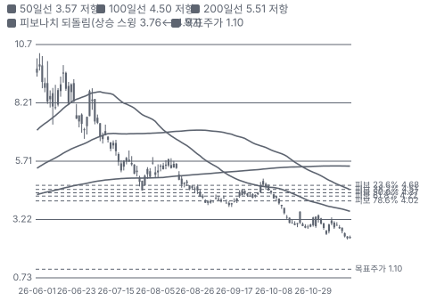

**주봉**

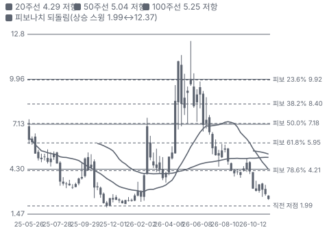

**월봉**

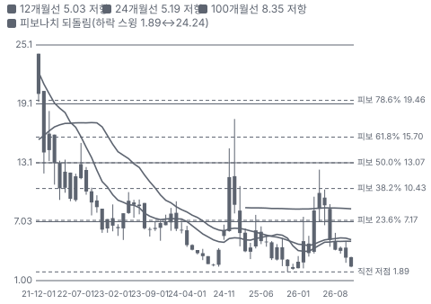

**분기 매출·EPS 실적과 컨센서스**

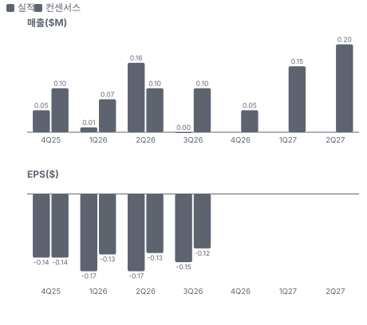

**밸류에이션 주가 시나리오**

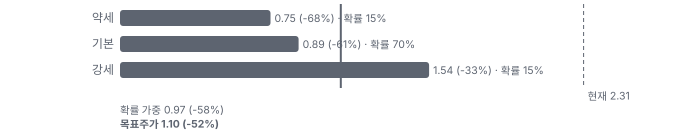

**주가별 업사이드**

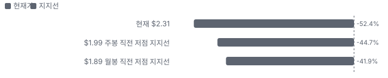
- 제품·서비스 포트폴리오

**고객 믹스(9M26, 매출 대비)**

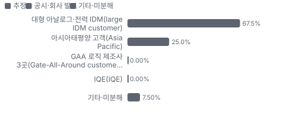

**공급 병목(10점, 낮을수록 병목)**

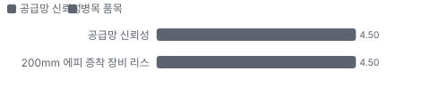

**생산능력 현재와 확충 계획(MST 증착 장비(임차, 대))**

**CAPEX의 매출 대비 비중**

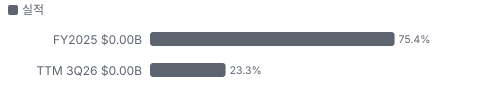

**수주·파이프라인 확실성 사다리**

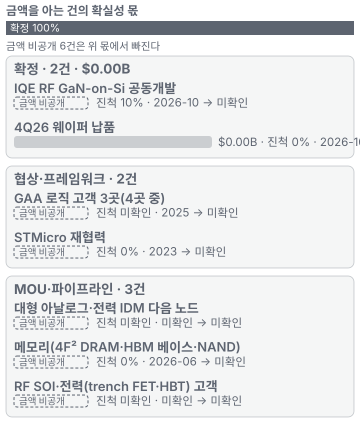

**매출 → 매출총이익 → 영업이익(매출 = 100, 최근 4분기)**

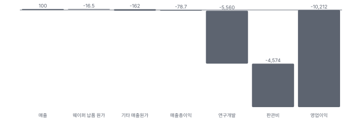

**분기 비용 비중 추이(매출 대비, 공시)**

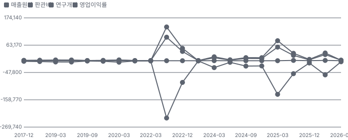

**비용 요인별 매출 대비 비중 1년 변화**

**평가용 MST 웨이퍼·MSTcad BOM 원가 몫**

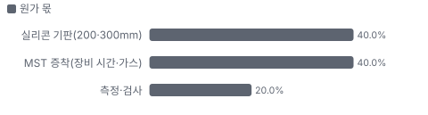

**BOM 항목 가격 +10% 시 OPM 변화**

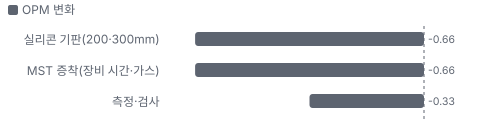

**자산 구성 — 3Q26 분기말 투하자본 \$1.9M**

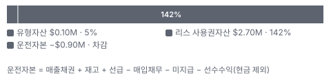

**자산별 변화율 — 최근 12개 분기(4Q23 = 0%)**

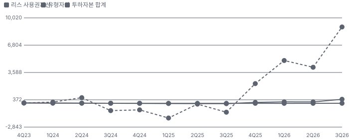

**ROIC 추이 — TTM, 최근 12개 분기 · 투하자본이 음수인 분기는 ROIC도 음수(고객 선수금 등 음의 운전자본이 자본을 대신 댄다) · 투하자본이 0 근처라 ROIC가 ±100%를 넘는 분기는 비움**

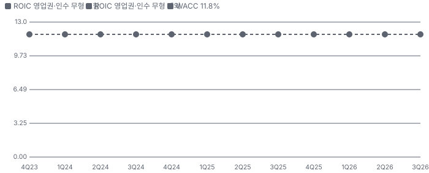

**매출 증가율의 가격·물량 분해와 8분기 전망(전년 대비)**

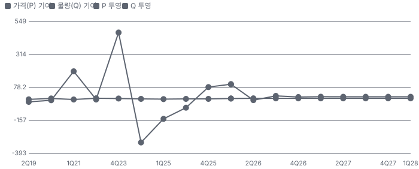

**분기별 매출 증가율 분해**

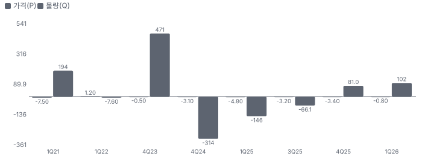

**목표주가 산정 — 기본과 강세 사이(강세 쪽 26%), 도달 확률 약 36%**

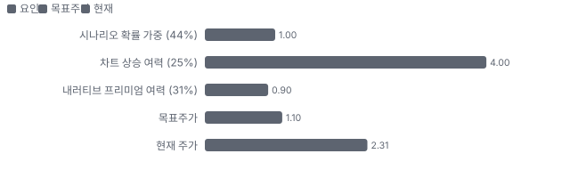

**커뮤니티 언급 수(최근 30일, 채널별)**

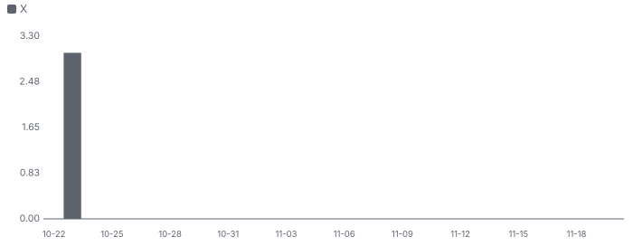

**일별 거래량 분해**

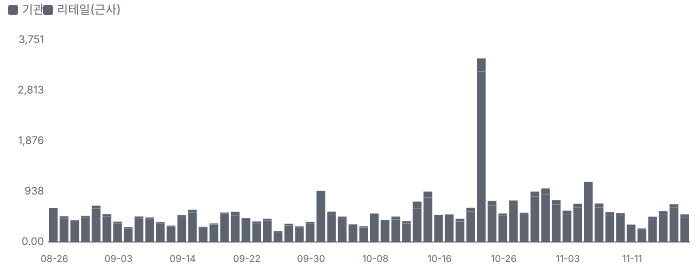

**기관 자금 흐름**

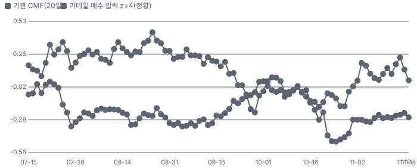

**몬테카를로**

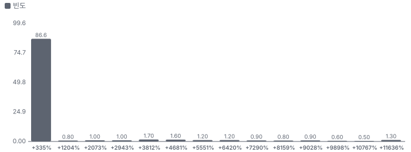

해석: 3,000번 중 417번(14%)에서 가치가 지금 주가 이상이었다. 가정을 흔들어도 지금 주가를 뒷받침하지 못하는 경우가 더 많다. 가운데 값은 -1.48배이고, 열 번 중 여덟 번은 -1.66~38.80배 사이에 든다.

## 내러티브

> **기업가치를 결정하는 이야기:** Atomera는 칩을 만들지 않고 박막 공정을 빌려준다. 값은 세 숫자로 갈린다. 첫 상업 라이선스의 업프런트 금액, 양산 웨이퍼당 로열티, 그리고 그때까지 찍을 주식 수다. 셋 다 아직 없다. 시가총액 \$90M 중 현금이 \$35M이라 시장은 나머지 약 \$55M을 'MST가 표준이 될 옵션'으로 산다.

> **멀티플·EPS 프리미엄**
> **멀티플:** 선행 이익이 모두 적자라 P/E·EV/EBITDA를 쓸 수 없고 EV/매출로 내려간다. EV는 약 \$58M, 4개 분기 매출은 \$0.22M이라 배수는 260배를 넘는다. 매출이 있는 IP 동종(CEVA 4.5배·Arteris 9.1배·Rambus 9.3배)과 직접 비교할 수 없는 구간이다.
> **EPS:** EPS 추정은 1명뿐이다. FY2027 −\$0.40은 2026년 실적 페이스(9개월 −\$0.49)보다 손실이 작다는 가정이다. 장비 리스 인상이 반영되면 내려갈 수 있다.

### 투자자들은 왜 열광했나

2026년 2월 4Q 실적에서 GAA 고객 확보를 연간 목표로 내걸고, 4월 Synopsys GaN 협력, 5월 GaN-on-Si RF 성능 발표가 이어져 종가가 \$2.36(1/2)에서 \$12.11(5/26)까지 갔다. 식은 이유는 셋이다. 그 사이 회사가 \$5.00에 500만 주를 팔았고 경영진도 계획 매도를 했다. 분기 매출은 \$0~0.16M에 머물렀다. 3Q 콜에서는 라이선스 시점 언급이 사라졌다.

### 무엇이 기업가치를 바꾸나

> **구조적 체질 변화**
> **변화:** 소자 내 증착(Selecta(고객 소자 공정 중간에 MST를 선택 증착하는 제품군)) 중심에서 시작 웨이퍼(Prima)로 빠른 상용화 경로를 앞세우는 중
> **증거:** Prima 용도 1년 새 2 → 6개, IQE가 MST 웨이퍼 생산자가 될 수 있다는 CEO 설명(3Q 콜)
> **반증:** 2027년 Prima 웨이퍼 판매 매출이 분기 \$0.5M을 넘지 못한다

> **고부가 믹스 확장**
> **변화:** 해당 없음 — 매출이 평가용 웨이퍼 납품뿐이라 믹스를 말할 단계가 아니다
> **증거:** 9M26 매출 \$169K 전부 시점 인식 납품(10-Q)
> **반증:** 첫 업프런트 라이선스 매출

> **기술 혁신**
> **변화:** 산소 원자층을 끼운 실리콘 초격자가 도펀트 확산을 막아 GAA·수직 DRAM·GaN-on-Si의 공정 문제를 푼다
> **증거:** SISPAD(반도체 공정·소자 시뮬레이션 국제 학회) 2026 4F² 논문, GaN-on-Si 선형성 기준 대비 약 1,000배(회사 자료), 2026년 미국 특허 3건 이상 등록. 제3자 양산 검증은 없다
> **반증:** GAA 고객 전기 특성 결과가 기준에 못 미쳐 재시도

> **실행 속도**
> **변화:** 해당 없음(라이선스 사업이라 주문→납품 리드타임이 없다 — 평가에서 라이선스까지의 기간이 실행 속도다)
> **증거:** 2Q 콜에서 CEO는 순조로우면 연말~그 직후, 재시도면 약 9개월 더라고 했다. 3Q에는 일정을 말하지 않았다. 반도체 신소재 채택은 장비사가 고객 팹에 장비를 넣어 시험하는 경로가 보통이다(2Q 콜 CEO 설명)
> **반증:** 2027-02 4Q 콜까지 라이선스 협상 진척 언급 없음

> **M&A**
> **변화:** 해당 없음 — 최근 3년 인수 없음
> **증거:** 10-Q
> **반증:** -

> **정책·입법 연관성**
> **재정정책:** 해당 없음 — 정부 보조금·과제 매출 없음(PowerAmerica 미선정 추정, 2Q 콜) 3Q 10-Q·2Q 콜 반증: CHIPS(미국 반도체 지원법) 연구 과제 선정 의회 동의 2/10 — 하원 1/5(관련 의결 없음) · 상원 1/5(관련 의결 없음).
> **행정명령:** 해당 없음 — 회사에 직접 닿는 행정명령 없음. 대중국 수출통제는 고객(아시아태평양 매출 25%) 쪽 간접 변수 3Q 10-Q 지역 매출 반증: MST 관련 품목 통제 의회 동의 2/10 — 하원 1/5(행정명령 — 의회 의결 없음) · 상원 1/5(같음).
> **연관입법:** 해당 없음 — CHIPS Act 연구 과제 응모 정도 2Q 콜 반증: -

> **고객의 지출 예산**
> **변화:** 고객의 돈은 R&D 평가 예산(OPEX)에서 나오고, 라이선스·로열티는 양산 공정 예산(CAPEX 연동)에서 나온다
> **사업별 예산:** **매출의 100%**: 평가용 웨이퍼·MSTcad — 고객 OPEX(고객 공정 개발 R&D 예산) · 동인: 신공정 평가 수
**매출의 0%**: 상업 라이선스·로열티 — 고객 혼합(업프런트는 R&D, 로열티는 양산 웨이퍼 원가) · 동인: 고객 양산 웨이퍼 수
> **증거:** 지금 매출은 평가용 웨이퍼 수수료(10-Q). 로열티는 고객 양산 웨이퍼 수에 비례하는 구조(10-Q 사업 설명)
> **반증:** 반도체 설비투자 감속으로 신공정 도입이 늦어진다

### 내러티브 근거

> 'GAA·GaN·메모리에 모두 쓰이는 원자 단위 소재 IP'라는 이야기는 2~5월에 주가를 \$2대에서 종가 \$12.11(5/26)까지 끌어올렸다가 꺼졌다(11/19 \$2.31, 고점 대비 −81%). 지금 쟁점은 기술이 아니라 첫 상업 라이선스가 언제 오느냐, 그 전까지 현금 \$34.8M이 얼마나 버티느냐다. 단계는 소멸, 쏠림은 낮음이다.

> **GAA 표준 소재 편입** · 유지
> **논리:** GAA 고객 하나가 MST를 쓰면 다른 회사도 따라 쓰는 도미노가 된다(CEO)
> **숫자:** 4곳 중 3곳 작업, 2곳 고객 실리콘 증착 단계
> **반증:** 2027년 말까지 GAA 라이선스 0건
> **출처:** 3Q 콜

> **GaN-on-Si RF의 새 시장** · 강화
> **논리:** 비싼 SiC(탄화규소) 기판 대신 실리콘 위 GaN으로 RF SOI급 성능을 내면 RF 프런트엔드 일부가 넘어온다
> **숫자:** RF GaN 시장 약 \$1.2B → 수년 안 약 \$2B(회사 제시), IQE 공동개발
> **반증:** IQE 샘플 웨이퍼가 2027년 상반기 안에 고객에게 가지 않는다
> **출처:** 3Q 콜·회사 보도자료 2026-10-22

> **AI 메모리 용도(4F²·HBM·NAND)** · 유지
> **논리:** AI로 메모리사가 새 구조를 서두르며 MST가 공정 단계를 줄인다
> **숫자:** 시뮬레이션 논문 1편, 고객 방문 — 실리콘 데이터 없음
> **반증:** 메모리사 평가 착수 발표가 1년 안에 없다
> **출처:** 3Q 콜

> **현금 활주로** · 약화
> **논리:** 현금 \$34.8M과 분기 현금 사용 약 \$3~4M이면 약 2년 버틴다
> **숫자:** 9M 영업 현금 사용 \$11.7M, 4Q는 리스 선납 \$1.4M 추가
> **반증:** 2027 비용이 장비 리스 인상으로 \$22M을 넘는다
> **출처:** 3Q 10-Q

> **반대 내러티브 — 20년째 '곧' 라이선스** · 강화
> **논리:** 2001년 창업 뒤 상업 양산 고객 없이 증자로 버텨 온 회사의 반복
> **숫자:** 2017~2026 연 매출 \$0.1~0.6M, 누적 결손 \$260M, 2025-10 STMicro 프로젝트 중단
> **반증:** 상업 라이선스(업프런트 금액 공시) 체결
> **출처:** 10-Q·분기 손익

### 투자 포인트

> **GAA 도미노**
> **명제:** GAA 한 곳이 MST를 쓰면 나머지도 따라와 첨단 로직 표준 소재가 된다
> **숫자:** 4곳 중 3곳 작업, 2곳은 고객 실리콘 증착 단계(3Q 콜). 2Q 1곳 마일스톤 통과
> **시장과 다른 점:** 시장은 매출 0만 보고 GAA 진척에 값을 거의 주지 않는다(EV 약 \$58M). 다만 라이선스 시점 언급이 사라진 것은 시장 판단 쪽 근거다
> **증명:** GAA 고객 전기 특성 결과와 라이선스 협상 공시(2027-02 4Q 콜)
> **출처:** 3Q·2Q 콜

> **Prima가 먼저 온다**
> **명제:** 고객 공정 인증이 필요 없는 시작 웨이퍼(Prima)가 로열티보다 먼저 매출을 만든다
> **숫자:** Prima 용도 1년 새 2 → 6개, IQE 공동개발(10/22) — CEO는 6개월 튜닝 + 두어 달 인증이면 판매 가능하다고 설명
> **시장과 다른 점:** 컨센서스 FY2027 매출 \$1.0M(1명)은 Prima 판매를 거의 담지 않는다. 반대로 IQE 계약 금액이 없어 숫자로 확인할 수 없다
> **증명:** IQE MST GaN-on-Si 샘플 웨이퍼의 고객 공급 발표(2027 상반기)
> **출처:** 3Q 콜·회사 보도자료 2026-10-22

> **현금이 하방을 일부 받친다**
> **명제:** 시총의 39%가 현금이라 사업 가치는 약 \$55M에 불과하다
> **숫자:** 현금·단기투자 \$34.8M, 무차입, 분기 영업 현금 사용 \$3.2~4.6M(10-Q)
> **시장과 다른 점:** 현금은 줄어드는 받침이다 — 장비 리스 인상으로 2027 비용이 늘면 1년 반 안에 다시 증자해야 한다
> **증명:** 2027 영업비용 가이던스와 4Q 현금(2027-02)
> **출처:** 3Q 10-Q

### 모멘텀 생성·소멸 타임라인

**카탈리스트 달력 — 지난 사건의 주가 반응과 앞으로 확인할 숫자**
| 날짜 | 상태 | 구분 | 사건 | 반응·확인 | 결과에 따라 |
|---|---|---|---|---|---|
| 2025-10-22 | 완료 | 소멸 | STMicro 프로젝트 진행 안 함 공시 | −32.6% |  |
| 2026-02-13 | 완료 | 생성 | 4Q25 실적 뒤 GAA 목표 제시 | +64.0% |  |
| 2026-04-24 | 완료 | 생성 | Synopsys GaN 모델링 협력 확대 | +38.9% |  |
| 2026-10-29 | 완료 | 소멸 | 3Q 매출 0·라이선스 시점 언급 소멸 | 10/30 +1.2% 뒤 11/19까지 −31% |  |
| 2027-02(예상) | 예정 | 확인 | 4Q26 실적·웨비나 | GAA 전기 특성 결과, 2027 영업비용 가이던스(\$20M 문턱) | 결과 양호·비용 \$20M 이하면 기본, 언급 없고 비용 초과면 약세 |
| 2027 상반기(예상) | 예정 | 확인 | IQE GaN-on-Si 튜닝 결과·샘플 공급 | 고객 샘플 공급 발표 여부 | 공급 시작이면 강세 쪽, 지연이면 약세 쪽 |
| 2027-02~03(예상) | 예정 | 확인 | FY2026 10-K | ATM 사용액·잔여 한도, 300mm 장비 리스 새 조건 | 새 증자 프로그램이면 약세 |

### 언제 사서 언제 팔아야 할까?

**가격·조건 틀 — 가격은 밸류에이션(약세·기본·강세·목표주가)과 차트 지지 구간에서, 조건은 이벤트에서**
| 구간 | 가격 | 목표주가까지 | 약세까지 | 조건·근거 |
|---|---|---|---|---|
| 관찰 구간 | \$1.99~\$1.99 | -45% | -62% | 지금 가격 아래 지지 구간 — 주당 현금(약 \$0.80, 완전 희석) 위의 옵션 값이 얼마나 남는지 본다 |
| 확인 뒤 | 지금 \$2.31 이상에서 조건 확인 | -52% | -68% | 업프런트 금액이 있는 상업 라이선스 공시 또는 IQE 샘플 웨이퍼 고객 공급 발표 |
| 무효화 | 약세 시나리오 \$0.75 | - | -68% | 2027-02 4Q 콜에서 GAA 결과·라이선스 언급 없음, 2027 비용 가이던스 \$20M 초과, 새 증자 프로그램 |

뉴스 하루에 ±30~60% 움직이는 종목이라 발표 당일 추격은 변동성이 크다 — 가격·조건 틀이며 매매 지시가 아니다 가격·조건 틀이며 매매·비중 지시가 아니다(투자 권유 아님).

## 포트폴리오

| 제품·서비스 | 구분 | 무엇 | 쓰는 곳 | 돈 버는 방식 | Mix | Mix 변화(전년 대비) |
|---|---|---|---|---|---|---|
| MST(Mears Silicon Technology) | 기술 | 산소 원자층을 끼운 두께 100~300Å 실리콘 초격자 박막 | GAA 로직·DRAM·RF SOI·전력·GaN-on-Si 트랜지스터 성능·누설 개선 | 평가 웨이퍼 수수료 → 라이선스 업프런트 → 양산 로열티. 지금은 평가 단계 | 미확인 | 미확인 |
| Prima 시작 웨이퍼 | 제품 | MST를 미리 입힌 웨이퍼(RF SOI·GaN-on-Si·메모리 등 6개 용도) | 고객이 사서 바로 공정에 투입 | 웨이퍼 판매·라이선스. 양산이 Selecta보다 빠를 것이라는 게 CEO 판단 | 미확인 | 미확인 |
| Selecta 공정 | 제품 | 고객 소자 공정 중간에 MST를 선택 증착 | GAA·전력 소자·HBT | 고객 팹 설치 라이선스 + 로열티 | 미확인 | 미확인 |
| MSTcad | 소프트웨어 | MST 효과를 Synopsys TCAD(반도체 공정·소자 시뮬레이션)에서 시뮬레이션하는 소프트웨어 | 고객 설계·공정 평가 | 라이선스 수수료(기간 인식) — 9M26 매출 없음 | 미확인 | 미확인 |

## 고객

> **9M26 최대 고객 대형 아날로그·전력 IDM(large IDM customer) 68%, 상위 3곳 92%, 집중도 집중.** 공시·회사 발표로 확인한 몫은 매출의 25%이고, 나머지 고객 몫은 추정이거나 미분해다. 9개월 매출 \$169K는 북미 \$127K·아시아태평양 \$42K의 웨이퍼 납품이고, 2Q 매출은 주로 대형 IDM 고객 몫이다. 고객 이름은 공시하지 않는다. 회사가 이름을 밝힌 상대는 IQE(공동개발)·Synopsys(시뮬레이션 협력)·STMicro(과거 라이선스)뿐이다

**고객별 매출 몫(9M26)**
| 고객 | 몫 | 변화 | 근거 |
|---|---|---|---|
| 대형 아날로그·전력 IDM(large IDM customer) | 60~75% | 미확인 | 추정 |
| 아시아태평양 고객(Asia Pacific) | 25% | +25%p | 공시 |
| GAA 로직 제조사 3곳(Gate-All-Around customers) | 0% | +0%p | 공시 |
| IQE(IQE) | 0% | +0%p | 공시 |
| 기타·미분해 | 7% | - | - |

> **대형 아날로그·전력 IDM(large IDM customer)** · 추정
> **사는 것:** 평가용 MST 웨이퍼 납품
> **추정 근거:** 2Q \$158K의 대부분 — 북미 매출(\$127K) 안에 있다고 보고 9M 몫을 추정

> **아시아태평양 고객(Asia Pacific)** · 공시
> **사는 것:** 웨이퍼 납품
> **추정 근거:** 이름 미공시

> **GAA 로직 제조사 3곳(Gate-All-Around customers)** · 공시
> **사는 것:** 평가(매출 미발생)
> **추정 근거:** GAA를 개발하는 4곳은 공개 정보로 TSMC·Samsung·Intel·Rapidus로 추정되나 어느 3곳인지는 가설

> **IQE(IQE)** · 공시
> **사는 것:** 공동개발(금액 미공시)
> **추정 근거:** 양산 시 MST 웨이퍼 생산자가 될 수 있다(CEO)

## 수주·파이프라인

> **2026-10-29 기준 7건.** 확정 \$0.00B.

**수주 목록**
| 상태 | 계약 | 계약 총액 | 진척 | 기간 | 비고 |
|---|---|---|---|---|---|
| 확정 | IQE RF GaN-on-Si 공동개발 | 금액 비공개 | 10% | 2026-10 → 미확인 | - |
| 확정 | 4Q26 웨이퍼 납품 | \$0.00B | 0% | 2026-10 → 2026-12 | - |
| 협상 | GAA 로직 고객 3곳(4곳 중) | 금액 비공개 | 비공개 | 2025 → 미확인 | - |
| 협상 | STMicro 재협력 | 금액 비공개 | 0% | 2023 → 미확인 | - |
| 파이프라인 | 대형 아날로그·전력 IDM 다음 노드 | 금액 비공개 | 비공개 | 미확인 → 미확인 | - |
| 파이프라인 | 메모리(4F² DRAM·HBM 베이스·NAND) | 금액 비공개 | 0% | 2026-06 → 미확인 | - |
| 파이프라인 | RF SOI·전력(trench FET·HBT) 고객 | 금액 비공개 | 비공개 | 미확인 → 미확인 | - |

**실행 속도와 방해 요인**
| 항목 | 상태 | 실행 속도 | 방해 요인 |
|---|---|---|---|
| IQE RF GaN-on-Si 공동개발 | 확정 | 작업 시작, CEO는 6개월 튜닝 + 두어 달 인증 시나리오 제시 | 성능 재현 · IQE 고객 확보 · 계약 금액 미공시 |
| 4Q26 웨이퍼 납품 | 확정 | 4Q 인식 예상 | 웨이퍼 납품 시점이 들쭉날쭉(CFO) |
| GAA 로직 고객 3곳(4곳 중) | 협상 | 2곳은 고객 실리콘 증착·물리 검증 마일스톤 진행, 1곳은 초기 평가 | 전기 특성 결과 · 고객 팹 설치 위한 라이선스 체결 · 재시도 시 약 9개월 지연(2Q 콜) |
| STMicro 재협력 | 협상 | 2025-10 기존 프로젝트 중단 뒤 사업부와 재논의 | 발표된 계약 없음 |
| 대형 아날로그·전력 IDM 다음 노드 | 파이프라인 | 웨이퍼 런 반복, 전기 시험·양산성 준비 | 공정 인증 · 고객 설계 채택 |
| 메모리(4F² DRAM·HBM 베이스·NAND) | 파이프라인 | 시뮬레이션 논문·고객 방문, 초기 단계 | 실리콘 데이터 · 고객 평가 착수 |
| RF SOI·전력(trench FET·HBT) 고객 | 파이프라인 | 여러 고객 평가, 고처리량 공정 개발 | 양산 처리량 · 기판 공급망 |

## 마진 구조

> **GPM 83.5%, OPM -4277.8%.** 1Q26 대비 GPM +1129.0%p, OPM +53213.1%p. 변동비는 매출의 548%이고, 매출이 10% 늘면 OPM은 +348.1%p 움직인다. 3Q 매출이 0이라 이익률을 잴 수 없어 매출이 있던 1·2Q로 본다. 분기 영업비용은 \$6.2~6.9M(연구개발·판관, SBC 약 \$1.7M 포함)이고 핵심은 장비 리스·계측·소자 제작 외주와 인건비다. 손실을 일부 메우는 것은 이자 수익(3Q \$0.33M)이다

> **매출 100 중 매출원가 178.7, 매출총이익 -78.7(최근 4분기, 공시).** 매출원가 요인 중 웨이퍼 납품 원가이 매출의 16.5%로 가장 무겁고, 단가가 +10% 오르면 GPM이 -1.65%p 움직인다. 분기 회귀로 매출 1이 늘 때 매출원가는 -0.10 늘고, 매출원가의 고정비 몫은 100%다.

**비용 요인 강도 — 비중·추세·충격(+10%)·탄력**
| 비용 | 구분 | 매출 대비 | 1년 변화 | 마진 기여 | 충격 시 마진 | 매출 탄력 | 고정비 몫 |
|---|---|---|---|---|---|---|---|
| 웨이퍼 납품 원가 | 매출원가 요인 | 16.5% | 미확인 | 미확인 | -1.65%p | 미확인 | 50% |
| 연구개발 | 공시 항목 | 5560.0% | -3883.0%p | +3883.0%p | 미확인 | -0.69 | 100% |
| 판관비 | 공시 항목 | 4573.5% | -2343.9%p | +2343.9%p | 미확인 | -0.03 | 100% |
| 매출원가 | 공시 항목 | 178.7% | +104.3%p | -104.3%p | -17.87%p | -0.10 | 100% |

매출 탄력 = 분기 비용을 매출에 회귀한 기울기(매출 1당 변동비), 고정비 몫 = 절편 ÷ 평균 비용. 표본이 8분기 미만이면 미확인. 매출원가 요인 비중은 margin 재료의 추정이 섞여 있고, 공시 매출원가와의 차이는 '기타 매출원가'로 둔다.

**GPM에서 OPM까지(GAAP, 아래는 최근 4개 분기)**
| 기간 | GPM | 연구개발 | 판관비 | 기타 | OPM |
|---|---|---|---|---|---|
| 1Q26 | -1045.5% | 31427.3% | 25018.2% | 0.0% | -57490.9% |
| 2Q26 | 83.5% | 2080.4% | 2281.0% | 0.0% | -4277.8% |
| 2025-09 | -1063.6% | - | - | - | -52663.6% |
| 2025-12 | -162.0% | - | - | - | -9224.0% |
| 2026-03 | -1045.5% | - | - | - | -57490.9% |
| 2026-06 | 83.5% | - | - | - | -4277.8% |

**비용을 움직이는 요인**
| 비용 | 요인 |
|---|---|
| 판관비(SBC·법무 포함, 판관비) | 인력·특허 법무·주식보상 · 근거 공시 |
| 연구개발(장비 리스·계측·인력, 연구개발) | 장비 리스료·외주 계측 단가 · 근거 공시 |
| 웨이퍼 납품 원가(매출원가) | 기판·증착 · 근거 공시 |

**평가용 MST 웨이퍼·MSTcad BOM — 매출의 100%, GPM 84%(2Q26 매출 \$158K − 매출원가 \$26K(3Q는 매출 0)), 항목 가격 +10% 시**
| 항목 | 원가 몫 | 전가 | 제품 GPM | OPM |
|---|---|---|---|---|
| 실리콘 기판(200·300mm) | 30~50% | 미확인 | -0.7%p | -0.66%p |
| MST 증착(장비 시간·가스) | 30~50% | 미확인 | -0.7%p | -0.66%p |
| 측정·검사 | 10~30% | 미확인 | -0.3%p | -0.33%p |

판매가 전가를 모르는 항목은 전가 0%로 계산했다.

**BOM 항목 가격을 움직이는 것**
| 항목 | 요인 |
|---|---|
| 실리콘 기판(200·300mm) | 기판 가격 · 근거 추정 |
| MST 증착(장비 시간·가스) | 장비 리스료가 원가에 배분되는지는 미공시 · 근거 추정 |
| 측정·검사 | 외주 계측 단가 · 근거 추정 |

**투입 물가 — 미국 PPI 3·6·12개월(2026-10, 개정 반영)과 해외 전년비**
| 항목 | 미국 3개월 | 6개월 | 12개월 | 전가 못 할 때 OPM | 일본 |
|---|---|---|---|---|---|
| 실리콘 기판(200·300mm) | -0.7% | -5.7% | -2.7%* | - | +1.6%* |

별표는 품목보다 넓은 업종 지수다. 지난 1년 투입 물가를 판매가 전가 뒤 원가에 넣으면 OPM은 -0.13%p 움직인다(매출원가의 40% 기준). 물가 지수를 붙이지 못한 매출원가 항목은 웨이퍼 납품 원가다(미연결).

## 자산 구성

> **3Q26 분기말 투하자본 \$1.9M** — 리스 사용권자산 144%, 유형자산 3%. 최근 12개 분기(4Q23 → 3Q26) 가장 크게 늘어난 자산은 리스 사용권자산(+428%), 투하자본 합계 +8948%. 연율 감가 비율(순액 기준)은 직전 4분기 86.24% → 최근 4분기 67.11%, 직전 비율이면 감가상각이 \$0.0M 더 컸다(영업이익의 -0.0%).

**자산·운전자본 항목별 분기말 잔액 — 최근 12개 분기와 다음 4개 분기 추정**
| 항목 | 4Q23 | 3Q25 | 3Q26(최근) | 추정 | 12개 분기 변화 | 다음 4개 분기 변화 |
|---|---|---|---|---|---|---|
| 매출채권 | \$0.0M | \$0.1M | \$0.0M | — | 비교 불가 | — |
| 선급·기타 유동자산 | \$0.2M | \$0.5M | \$0.5M | — | +87% | — |
| 매입채무 | \$0.6M | \$0.6M | \$0.9M | — | +40% | — |
| 미지급비용 | \$0.2M | \$0.2M | \$0.5M | — | +135% | — |
| 선수수익(계약부채) | \$0.0M | \$0.1M | \$0.0M | — | 비교 불가 | — |
| 유형자산 | \$0.1M | \$0.1M | \$0.1M | — | -38% | — |
| 리스 사용권자산 | \$0.5M | \$0.1M | \$2.7M | — | +428% | — |

**유형·무형자산 항목별 가치(2025-12-31 vs 2024-12-31)**
| 구분 | 항목 | 총액 2025-12-31 | 누적상각 | 순액 | 총액 2024-12-31 | 총액 1년 변화 | 공시 내용연수 |
|---|---|---|---|---|---|---|---|
| 유형 | 유형자산 합계(항목 미분해) | \$0.5M | 총계만 공시 | 총계만 공시 | \$0.5M | +7.5% | 미확인 |
| 유형 합계 | 유형자산 | \$0.5M | \$0.4M | \$0.1M | \$0.5M | +7.5% | 경과율 88%(상각 대상 기준) |

**내용연수 산식(상각 대상 유형자산 = 총액 − 토지 − 건설중)**
| 기준일 | 연 감가상각 | 상각 대상 총액 | 평균 내용연수 | 경과 연수 | 잔여 연수 | 경과율 |
|---|---|---|---|---|---|---|
| 2025-12-31 | \$0.0M | \$0.5M | 10.2년 | 9.0년 | 1.2년 | 88% |
| 2024-12-31 | \$0.1M | \$0.5M | 8.4년 | 7.4년 | 1.1년 | 87% |

산식 평균 내용연수는 10.2년. 1년 전 8.4년 → 지금 10.2년.

**분기 감가 비율(감가상각 ÷ 평균 유형자산 순액)**
| 분기 | 감가상각 | 평균 유형자산(순액) | 분기 비율 | 연율 | 연율의 역수 |
|---|---|---|---|---|---|
| 4Q24 | \$0.0M | \$0.1M | 19.67% | 78.69% | 1.3년 |
| 1Q25 | \$0.0M | \$0.1M | 21.62% | 86.49% | 1.2년 |
| 2Q25 | \$0.0M | \$0.1M | 23.53% | 94.12% | 1.1년 |
| 3Q25 | \$0.0M | \$0.1M | 21.78% | 87.13% | 1.1년 |
| 4Q25 | \$0.0M | \$0.1M | 23.42% | 93.69% | 1.1년 |
| 1Q26 | \$0.0M | \$0.1M | 16.22% | 64.86% | 1.5년 |
| 2Q26 | \$0.0M | \$0.1M | 10.91% | 43.64% | 2.3년 |
| 3Q26 | \$0.0M | \$0.1M | 16.53% | 66.12% | 1.5년 |

감가상각 기준: 손익계산서 감가상각·상각비(SEC 공시 데이터, 4분기 = 연간 − 1~3분기).

**감가율 하락 경고: 연율 86.24% → 67.11%(-22%).** 직전 4분기 비율을 그대로 쓰면 최근 4분기 감가상각이 \$0.0M 더 컸다(영업이익의 -0.0%). 내용연수 연장·상각 끝난 자산 증가·건설중 자산 증가(믹스) 중 무엇인지는 공시 주석으로 가린다(자체추론).

미공시·미분해: 영업권 · 무형자산 · 기타 영업자산·부채 · 유형자산 항목별 총액·내용연수(10-K 주석에서 모델이 채움) · 무형자산 항목(10-K 주석에서 모델이 채움) — 이 칸은 비우고 나머지로 계산했다.

### 해석 — 자산이 어디에 쌓이고 있나

- 같은 기간 4개 분기 매출은 -67% — 매출보다 빨리 늘어난 자산: 유형자산 -38%, 리스 사용권자산 +428%. 이 자산의 회전율이 떨어지면 ROIC를 희석한다.
- 감가 비율 하락으로 최근 4분기 영업이익에 \$0.0M(-0.0%)가 보태졌을 수 있다 — 내용연수 변경 공시가 없으면 건설중 자산·토지 같은 비상각 자산 몫이 커진 믹스 효과일 가능성이 크다(자체추론).

## ROIC

**ROIC 추이(TTM)와 다음 4개 분기 추정 — NOPAT ÷ 평균 투하자본(이번 분기말·4개 분기 전)**
| 분기 | 구분 | TTM 매출 | TTM NOPAT | NOPAT 마진 | 평균 투하자본 | ROIC 포함 | ROIC 제외 |
|---|---|---|---|---|---|---|---|
| 4Q23 | 실적 | \$0.6M | −\$16.3M | -2961.6% | \$0.4M | 미확인 | 미확인 |
| 1Q24 | 실적 | \$0.6M | −\$16.2M | -2850.2% | \$0.2M | 미확인 | 미확인 |
| 2Q24 | 실적 | \$0.6M | −\$15.6M | -2440.1% | \$0.4M | 미확인 | 미확인 |
| 3Q24 | 실적 | \$0.7M | −\$15.2M | -2293.6% | \$0.1M | 미확인 | 미확인 |
| 4Q24 | 실적 | \$0.1M | −\$15.2M | -11293.6% | −\$0.1M | 미확인 | 미확인 |
| 1Q25 | 실적 | \$0.1M | −\$15.6M | -12886.1% | −\$0.2M | 미확인 | 미확인 |
| 2Q25 | 실적 | \$0.0M | −\$16.1M | -32837.2% | \$0.1M | 미확인 | 미확인 |
| 3Q25 | 실적 | \$0.0M | −\$16.9M | -44417.6% | −\$0.2M | 미확인 | 미확인 |
| 4Q25 | 실적 | \$0.1M | −\$16.6M | -25611.9% | \$0.2M | 미확인 | 미확인 |
| 1Q26 | 실적 | \$0.1M | −\$17.3M | -24055.0% | \$0.4M | 미확인 | 미확인 |
| 2Q26 | 실적 | \$0.2M | −\$18.5M | -8048.3% | \$0.4M | 미확인 | 미확인 |
| 3Q26 | 실적 | \$0.2M | −\$18.9M | -8621.7% | \$0.8M | 미확인 | 미확인 |

**투하자본 항목별 회전율과 ROIC 기여(TTM 3Q26, 평균 잔액)**
| 항목 | 투하자본 | 매출 1달러당 자본 | 회전율(매출 ÷ 항목) | 자본 몫 | 이 항목을 빼면 ROIC |
|---|---|---|---|---|---|
| 운전자본 | −\$0.6M | -2.84 | 음수(자금 원천) | -74% | -1286.2% |
| 유형자산 | \$0.1M | 0.26 | 3.88회 | 7% | -2391.6% |
| 리스 사용권자산 | \$1.4M | 6.45 | 0.16회 | 167% | 미확인 |

**ROIC 세 가지 판**
| 판 | NOPAT | 투하자본 | ROIC | 무엇을 재나 |
|---|---|---|---|---|
| 영업권·인수 무형 포함 | −\$18.9M | \$0.8M | 미확인 | 인수 웃돈까지 낸 돈에 대한 수익률 |
| 영업권·인수 무형 제외 | −\$18.9M | \$0.8M | 미확인 | 본업 운영 수익률(동종 비교용) |
| 무형 자본화 조정(판관비 20%·5년, 연구개발 6년) | −\$16.3M | \$40.0M | -40.8% | 비용으로 처리한 무형 투자를 자산으로 본 판 |
| 경제적 이익(포함판) | −\$19.0M | \$0.8M | 자본비용 11.8% | (ROIC − 자본비용) × 투하자본 |

NOPAT = (영업이익 −\$24.0M + 인수 무형 상각 + 리스 내재 이자 \$0.1M) × (1 − 세율 21%). 리스 사용권자산을 투하자본에 넣었으므로 임차료 속 이자 몫을 영업이익에 되더했다. 현금은 영업에 필요한 몫을 따로 알 수 없어 투하자본에서 뺐다. SEC 공시 데이터 자동 초안 — 운전자본 = 매출채권 + 재고 + 선급 − (매입채무 + 미지급비용 + 선수수익), 현금 제외. 손상 누계는 공시 데이터 수록분.

투하자본 또는 NOPAT이 0 이하라 ROIC 분해는 비교 불가 — 경제적 이익으로 본다.

**무형 자본화 가정별 ROIC(2025년 지출 기준, 포함판에 더함)**
| 투자로 보는 몫 | 상각 연수 | 무형 자산 | NOPAT 조정 | 조정 ROIC |
|---|---|---|---|---|
| 판관비 20% | 2년 | \$39.2M | \$2.5M | -40.8% |
| 판관비 20% | 5년 | \$39.2M | \$2.5M | -40.8% |
| 판관비 30% | 2년 | \$39.2M | \$2.5M | -40.8% |
| 판관비 30% | 5년 | \$39.2M | \$2.5M | -40.8% |

### 해석 — 무엇이 수익성을 끌어올리고 희석하나

- 리스 사용권자산: 투하자본의 167% — 빼면 ROIC 미확인 → 미확인. 이 자산의 회전율(0.16회)이 수익성을 희석하는 주된 자리다.
- 유형자산: 투하자본의 7% — 빼면 ROIC 미확인 → -2391.6%. 이 자산의 회전율(3.88회)이 수익성을 희석하는 주된 자리다.
- 운전자본: −\$0.6M(음수), 고객 선수금·공급사 외상이 자본을 대신 댄다 — 빼면 ROIC -1286.2%로 낮아진다. 수익성을 끌어올리는 쪽이다.

## 공급망 병목

> **공급망 신뢰성 4.5/10, 병목 주의.** 가장 약한 고리는 200mm 에피 증착 장비 리스 4.5점이고, 품목 평균은 4.5점이다. 근거가 부족한 3건(300mm 에피 증착 장비 리스 · 계측·소자 제작 외주 · GaN 에피 성장)은 점수에서 뺐다. 병목은 자기 증착 장비와 측정·소자 제작 외주다. 장비를 사지 않고 빌려 쓰는데, 업계 증설로 장비 리스·계측·소자 제작 단가가 크게 올랐다(CFO). 양산 단계에서는 고객 팹의 표준 에피 장비를 그대로 쓴다고 회사는 말한다

**병목과 마진 — 품목 가격 +10% 시 OPM**
| 품목 | 점수 | 판정 | 구분 | OPM |
|---|---|---|---|---|
| 200mm 에피 증착 장비 리스 | 4.5 | 병목 주의 | 출하 차질 위험 | 미확인 |

> **200mm 에피 증착 장비 리스** · 4.5/10
> **왜:** Prima 시작 웨이퍼(RF SOI·GaN)
> **병목 요인:** 인증 공급사 1곳 · 캐파 여유 · 리드타임 미확인 · 재인증 미확인 · 1위 점유율 100% · 미국 집중 100% · 물량 확보 미확인
> **풀리는 조건:** 일부 — 2027년분 확보

**공급사**
| 품목 | 공급사 | 몫 | 근거 |
|---|---|---|---|
| 300mm 에피 증착 장비 리스 | 이름 비공개 임대인(300mm 에피 장비 임대) | 미확인 | 공시 |
| 200mm 에피 증착 장비 리스 | 이름 비공개 임대인(Tempe, 200mm 에피 장비 임대) | 미확인 | 공시 |
| 계측·소자 제작 외주 | 외주 계측·팹 서비스(이름 비공개, 측정·소자 제작) | 미확인 | 회사 발표 |
| GaN 에피 성장 | IQE(MST 실리콘 위 GaN 에피 공동개발) | 미확인 | 회사 발표 |

**무역 통계로 본 공급 지역**
| 품목 | EU 수입처 | 일본 수입처 | EU 1위 전년비 |
|---|---|---|---|
| 300mm 에피 증착 장비 리스 | JP(일본) 48% · US 33% · TW(대만) 8% | 大韓民国 36% · シンガポール 25% | +892.4% |
| 200mm 에피 증착 장비 리스 | JP 48% · US 33% · TW 8% | 大韓民国 36% · シンガポール 25% | +892.4% |

## 생산능력

> **현재 명목 캐파 2 MST 증착 장비(임차, 대), 가동률 미확인.** TTM 3Q26 CAPEX는 \$0.00B로 매출의 23.3%다. 생산 설비를 소유하지 않는다. 고객 평가용 MST 웨이퍼는 임차한 300mm·200mm 에피 증착 장비 2대로 만든다. 300mm 장비 리스료가 2026-08 월 \$250K로 뛰었고 그 뒤 조건은 협상 중이다. 양산은 고객이 자기 팹 장비에 MST를 설치해 하는 구조다

**생산시설 4곳**(3Q 10-Q 리스 주석: 본사·Tempe 사무실 2곳과 임차 증착 장비 2대. 장비가 놓인 300mm 장비의 위치는 공시하지 않는다), 임차 4곳. 시설별 생산능력은 공개되지 않았다 — 회사 전체 캐파만 위에 적었다.

**생산시설 4곳 — 명칭·위치·생산능력**
| 시설 | 위치 | 용도 | 생산능력 | 소유·상태 |
|---|---|---|---|---|
| 본사 | 미국 캘리포니아 Los Gatos | 경영·연구개발(2031-03까지) | 미확인 — 사무 시설 | 임차 · 가동 |
| Tempe 사무실 | 미국 애리조나 Tempe | 연구개발, 애리조나주립대 연구 협력 조건 | 미확인 — 사무·연구 시설 | 임차 · 가동 |
| 300mm 에피 증착 장비 | 미확인 | 고객 평가·시연 웨이퍼 MST 증착 | 미확인 — 처리량 미공시 | 임차 · 가동 |
| 200mm 에피 증착 장비 | 미국 애리조나 Tempe | RF SOI·GaN 등 200mm 시작 웨이퍼 | 미확인 — 처리량 미공시 | 임차 · 가동 |

공개된 증설 계획은 확인되지 않았다.

**CAPEX와 매출 대비**
| 기간 | CAPEX | 매출 | 매출 대비 | 구분 |
|---|---|---|---|---|
| FY2025 | \$0.00B | \$0.00B | 75.4% | 실적 |
| TTM 3Q26 | \$0.00B | \$0.00B | 23.3% | 실적 |

## 피터 린치 분류

> **경기순환주(Cyclical), 소형.** 린치 표의 기대 수익 10배, 하방 -80~100%, 위험 고. 10배 경로가 있는 분류다(고성장주·회생주·경기순환주).

**분류 근거 — 크기 먼저, 다음은 이야기 유형**
| 항목 | 값 |
|---|---|
| 크기 | 소형(시가총액 \$0.1B) |
| 장기 성장 | 237.9%(컨센서스 매출 2년 CAGR(EPS 없음)) |
| 린치 비율((성장% + 배당%) ÷ P/E) | 미확인 |
| PEG(P/E ÷ 성장%) | 미확인 |
| 근거 | TTM 매출이 과거 고점 대비 96% 빠진 적이 있다 |
| 반대 근거 | 장기 성장률 238%로 고성장주 구간 — 순환 위의 성장주일 수 있다 |

- 점검: 재고·공급과 수요(가격)의 방향
- 점검: 경쟁사의 증설
- 점검: 이익 정점에서 P/E가 낮아 보이는 함정
- 점검: 부채가 바닥을 견딜 수 있나
- 팔 때(점검 조건, 매매 지시 아님): 재고가 쌓이고 증설이 시작되고 가격이 꺾일 때 — 정점의 낮은 P/E는 싸다는 뜻이 아니다

분류 = 피터 린치·존 로스차일드 『One Up On Wall Street』(1989)·『Beating the Street』(1993)의 6분류와 위험·보상 표를 숫자 규칙으로 옮긴 자체추론이다(config/lynch.yaml).

## 해자

> 해자는 MST 박막 특허와 고객 실리콘에 넣어 본 경험이다. 다만 20년 넘게 상업 양산 고객이 없어 특허가 돈이 된다는 증거는 아직 없다

> **MST 특허·노하우** · 보통
> **해자:** 산소를 끼운 실리콘 초격자로 도펀트 확산을 막는 방법을 특허로 묶었다
> **근거:** 2026년에도 GAA 초격자 소자(8/11)·RF SOI 초격자 구조(10/13)·DRAM 감지증폭기(8/18) 미국 특허 등록(USPTO(미국 특허청)). 2Q 콜에서 CEO는 제3자가 새 소재를 들이는 일은 드물다고 설명
> **숫자:** 특허 총수 미확인
> **깨지는 조건:** GAA 고객이 MST 없이 다른 도펀트 차단층(탄소 도핑 등)을 채택

> **고객 실리콘 접근** · 약함
> **해자:** GAA 4곳 중 2곳이 자기 실리콘을 맡겼다
> **근거:** 3Q 콜 — 고객 실리콘 증착 단계 2곳, 초기 평가 1곳. 다만 라이선스·매출 전환 기록이 없다
> **숫자:** GAA 3곳 작업
> **깨지는 조건:** 2027년 안 GAA 라이선스 0건

> **장비 비종속** · 미확인
> **해자:** 표준 에피 장비에서 MST를 증착할 수 있어 고객이 새 장비를 살 필요가 없다
> **근거:** 3Q 콜 CEO 발언 — 회사 주장일 뿐 고객 팹 설치 사례는 공시되지 않았다
> **숫자:** 미확인
> **깨지는 조건:** 양산 처리량을 위해 전용 장비가 필요

## 경영진·네트워크

> CEO Bibaud·CTO Mears(MST 발명자)·CFO Laurencio 세 명이 회사를 이끈다. 세 명 모두 10b5-1 계획 매도를 이어 왔고 장내 매수 기록은 이번 조사에서 찾지 못했다. 정계·대형 고객과의 공개 연결은 확인하지 못했다

> **Scott Bibaud** · President·CEO·이사 · 미확인
> **프로필:** 10-K 경영진 소개 미대조 — 미확인
> **비즈니스:** 10b5-1 계획 매도(2026-06 \$0.47M 등, Form 4)
> **정계:** 미확인
> **동문:** 미확인
> **사모임:** 미확인

> **Robert J. Mears** · 공동창업자·CTO · 2001
> **프로필:** MST 발명자(회사 옛 이름 Mears Technologies)
> **비즈니스:** 2026-06-08 \$8.42에 \$0.46M 계획 매도(Form 4)
> **정계:** 미확인
> **동문:** 미확인
> **사모임:** 미확인

> **Francis Laurencio** · CFO · 미확인
> **프로필:** 미확인
> **비즈니스:** 2026-02-20 \$7.25에 \$0.16M 매도(Form 4)
> **정계:** 미확인
> **동문:** 미확인
> **사모임:** 미확인

**네트워크 정량화**
| 연결 | 강도 | 닿는 매출 | 가중 노출 | 매출 대비 | 근거 |
|---|---|---|---|---|---|
| 비즈니스: IQE·Synopsys·이름 비공개 장비 파트너와 공식 협력 | 2/5 | 미확인 | 미확인 | 미확인 | 협력 금액 미공시 회사 보도자료·3Q 콜 |

가중 노출은 연결이 닿는 매출의 크기다. 연결이 그 매출을 만들었다는 뜻이 아니며, 인과는 공개 자료로 입증하지 못한다.

## 약세 논리 및 셀온 조건

| 약세 논리 | 근거 | 반박 | 가를 자료 |
|---|---|---|---|
| 20년째 '곧' 라이선스 | 2001년 창업 뒤 상업 양산 고객이 없다. 2017~2026 연 매출은 \$0.1~0.6M, 누적 결손은 \$260M이다(3Q 10-Q) | GAA 고객이 자기 실리콘을 맡긴 것은 처음이다(3Q 콜) | 2027-02 4Q 콜의 GAA 전기 특성 결과·라이선스 협상 언급 |
| 이미 한 번 멈췄다 | 2025-10 STMicro 프로젝트가 진행되지 않는다고 공시했고 당일 −32.6%였다 | CEO는 STMicro와 결국 거래할 것이라고 했다(3Q 콜) | STMicro와의 계약 공시 |
| 비용이 오른다 | 300mm 장비 리스료가 월 \$133K에서 \$250K로 올랐고(10-Q 주석 7), 2027 비용 가이던스를 내지 않았다 | 200mm 장비는 2027년분을 월 \$95K 수준으로 선납했다 | 2027 영업비용 가이던스(4Q 콜) |
| 희석이 이어진다 | 2026-02 \$5.00에 500만 주 직접공모, 1Q ATM 130만 주. ATM 잔여는 약 \$40M(추정)이다 | 2·3Q에는 ATM을 쓰지 않았고 현금 \$34.8M이 1년 넘게 버틴다고 회사가 적었다 | 10-K ATM 사용액, 새 증자 8-K |
| 대체 기술 | GAA 도펀트 확산은 탄소 도핑 등 고객 자체 공정으로 풀 수도 있다(업계 일반, 수치 미검증) | MST는 장비 비종속이라 도입 장벽이 낮다는 것이 회사 주장이다 | GAA 고객의 공정 선택 — 라이선스 체결 여부 |
| 내부자는 판다 | CEO·CFO·CTO가 2026-06 \$0.74M, 09 \$0.13M을 계획 매도했고 매수 기록은 찾지 못했다(Form 4) | 모두 10b5-1 계획 매도다 | 다음 Form 4 |

3Q 10-Q(2026-10-30 제출)에서 확인한 것은 중요 구매 약정 공시 없음(주석 9 — 소송 없음, 약정 성격 지출은 장비 리스뿐), 제한 현금 공시 없음, 10% 이상 고객 표 없음(9개월 매출 \$169K = 북미 \$127K + 아시아태평양 \$42K, 전부 웨이퍼 납품), 정부 지원 없음(PowerAmerica 과제 미선정 추정 — 2Q 콜)이다. 실적 보도자료는 Item 2.02 8-K(2026-10-29)다. 미확인은 GAA 고객 이름, 대형 IDM 이름, IQE 계약 금액, ATM 잔여 한도, 300mm 장비의 2026-11 이후 리스 조건이다. 고점은 실측 일봉 종가 기준 2026-05-26 \$12.11이다. 데이터 검증의 'TTM = 공시 분기 이력' 실패는 점검표가 매출 0 분기(3Q26)를 빼고 앞 분기를 더하기 때문이고, TTM 값(\$0.219M·−\$24.0M)은 4개 분기 표준화 손익과 같다.

> **셀온 조건**
> **조건 1:** 2027-02 4Q 콜에서도 GAA 전기 특성 결과·라이선스 협상 진척을 말하지 않는다
> **조건 2:** 2027 영업비용 가이던스가 장비 리스 인상으로 \$20M을 넘는다
> **조건 3:** IQE 공동개발이 2027 상반기 안에 샘플 웨이퍼 공급으로 이어지지 않는다
> **조건 4:** 새 증자 프로그램을 내거나 ATM을 시가총액의 20% 넘게 쓴다
> **조건 5:** GAA 고객 중 한 곳이 평가를 끝내고 다른 도펀트 차단 방식을 고른다

## 어닝콜 변화

**직전 콜 대비 새로 나오거나 바뀐 내용 → 가치 영향**
| 항목 | 내용 | 직전 콜 | 최신 콜 | 모델 동인 이동 | 확신도 | 가치 영향 |
|---|---|---|---|---|---|---|
| 업데이트 | GAA 고객 2곳 → 3곳(4곳 중) | 2Q: 4곳 중 2곳 작업, 1곳 마일스톤 통과 | 3Q: 3곳 작업(2곳은 고객 실리콘 증착), 4번째와 대화 | 1년차 성장률 +10.0% | 0.5 | - |
| 부정 | GAA 라이선스 협상 시점 언급 소멸 | 2Q: 순조로우면 연말~그 직후 설치 논의, 재시도면 약 9개월 지연 | 3Q: 마일스톤을 다 밝힐 수 없고 시점은 보기 어렵다 | 1년차 성장률 -20.0% | 0.5 | - |
| 신규 | IQE RF GaN-on-Si 공동개발 | GaN 신규 고객 평가 | IQE가 MST 실리콘 위 GaN 에피를 최적화, 6개월 안 튜닝 뒤 두어 달 인증이면 판매 가능하다는 CEO 설명 | 1년차 성장률 +15.0% | 0.3 | - |
| 부정 | 3Q 매출 0 | 2Q \$158K(대형 IDM 웨이퍼) | 3Q \$0, 4Q 약 \$50K 예상 | 기준연도 매출 -\$0.00B | 1.0 | - |
| 부정 | 장비 리스 단가 상승 | 300mm 장비 월 \$133K, 연 약 \$1.8M | 2026-08~10 월 \$250K, 이후 협상 중. 2027 비용 가이던스 보류 | 출발 이익률 -2.0% | 0.8 | - |
| 신규 | 메모리 용도 확대(4F² DRAM·HBM 베이스·NAND) | 2Q: 4F² 개념·NAND 주변회로 기회 발견 | 3Q: DRAM·NAND 양쪽 메모리사 방문, 초기 단계 | 성장 지속(감속 계수) +1.0% | 0.3 | - |
| 반복 | 2026 영업비용 가이던스 상단 유지 | \$18.5M ±\$0.25M 상단 | 같음 | 출발 이익률 — | 0.8 | +0.0% |
| 반복 | 대형 아날로그·전력 IDM 프로그램 | 2Q: 계획대로, 새 소자 데이터 수신 | 3Q: 웨이퍼 런 진행, 다음 노드 채택 목표 | 1년차 성장률 — | 0.5 | +0.0% |
| **합계** | 단독 합 |  |  | 동시 적용 - |  | **+0.0%** |

**실적 발표 예상 변동폭:** 지난 4번 실적 발표 때 주가는 하루에 평균 ±21.5%(최대 64.0%, 오른 날 2번) 움직였다.

**실적 발표 예상 변동폭 — 과거 실적 발표 다음 거래일 주가 변화**
| 분기 | 발표일 | 주가 변화 |
|---|---|---|
| 4Q25 | 2026-02-12 | +64.0% |
| 1Q26 | 2026-05-05 | -13.5% |
| 2Q26 | 2026-08-04 | -7.3% |
| 3Q26 | 2026-10-29 | +1.2% |

## P·Q 사이클

> **동반 하강 — 최근 4분기 평균 가격 기여 -3.0%, 물량 기여 -7.2%(전년 대비 로그 증가율).** P 강도 4.9/10, Q 강도 4.7/10. 전망으로는 2분기 뒤(3Q26) Q 사이클로 전환(통계 전망만).

**P·Q 사이클 정량**
| 항목 | 가격(P) | 물량(Q) |
|---|---|---|
| 최근 4분기 평균 기여 | -3.0% | -7.2% |
| 강도(0~10, 자기 이력 z) | 4.9 | 4.7 |
| 고유 주기(자기회귀모델 과거 2개 시점일 때) | 미확인 | 미확인 |
| 다음 4분기 투영 평균 | +0.6% | +7.0% |
| 4분기 뒤 투영(80% 범위) | +0.6% (-2.9%~+4.1%) | +12.2% (-290.6%~+315.0%) |
| 장기 평균(표본 → 기저율 수축) | -2.7% → +0.6% | +35.6% → +12.4% |
| 투영 모형 | 자기회귀모델(과거 1개 시점) · 2Q26 월간 가격 3개월 반영 | 자기회귀모델(과거 1개 시점) (컨센서스 없음) |

가격 근거: 미국 PPI(생산자물가지수) 반도체·관련 소자 대용 — 회사 판매가가 아니라 업종 가격. PPI를 쓰면 회사 판매가가 아니라 업종 가격 대용이다. 로그 증가율이라 가격·물량 기여의 합이 매출 증가율이다. 전망: 가격은 BIC(모형 차수를 고르는 정보 기준)로 차수를 고른 자기회귀모델에 이미 발표된 월간 가격을 먼저 넣고(나우캐스트), 물량은 자기회귀모델과 '컨센서스 매출 증가율 − 가격 전망'을 분산 역수로 섞는다. 장기 평균은 표본 평균을 장기 기저율(가격 연 2%·물량 연 4%) 쪽으로 줄인다 — 고성장 구간만 담긴 표본이 그 성장을 끝없이 잇지 않게. 범위는 4분기 겹친 표본의 자기상관을 반영한다. 모형 산출이며 가이던스가 아니다. 회사 판매가로 잴 수 없는 이유: 매출이 분기 \$0~0.16M 웨이퍼 납품 수수료라 가격·물량 사이클을 잴 수 없다

10년 위치·프리미엄: 구조 단절(2Q26 전후 분기 매출 급변·되돌림(재작성·분리 자료가 섞인 것으로 보임) — 그 뒤만 쓴다) 뒤 TTM 표본이 0개로 20개에 못 미쳐 10년 비교를 하지 않는다 — 단절 전후 매출은 같은 회사 범위가 아니다.

## 밸류에이션

> **목표주가 \$1, 업사이드 -52%.** 자리는 기본과 강세 사이(강세 쪽 26%)이고 도달 확률은 약 36%다. 기본 \$1, 강세 \$2(-33%), 약세 \$1(-68%). DCF는 목표주가와 등급에 쓰지 않았다 — 기본 시나리오 지분가치 ≤ 0.

선행 EPS·EBITDA가 모두 적자라 기준 멀티플은 EV/매출이고, 12개월 뒤의 다음 4개 분기(4Q27~3Q28) 매출을 쓴다. 이 기간 매출 추정은 약 \$2.4M(1명, 범위가 넓다)이다. 선정 배수는 4.7배(동종 중앙값 9.2배에서 해자·반복 매출·내러티브 소멸·판단 조정 −30% 반영)이고 약세 \$0.75, 기본 \$0.89, 강세 \$1.54다. 세 값이 모두 지금 주가 아래인 이유는 매출 \$0.3~6M에 배수를 곱한 값이 완전 희석 주당 현금 약 \$0.80에 비해 작기 때문이다. 즉 이 방법은 '현금만 인정하고 라이선스 옵션은 거의 0'에 가깝다. DCF는 기본 시나리오 지분가치가 0 이하로 나와 쓰지 않았다(투하자본이 거의 없고 흑자 시점이 가정 밖이다). 확률은 계산값에 약세 쪽 조정을 더해 약세 15%·기본 70%·강세 15%로 정해졌다 — 추정 표본이 1명이라 계산 확률의 신뢰도가 낮다. 라이선스가 체결되면 이 틀이 아니라 업프런트 금액과 웨이퍼당 로열티로 다시 잰다. 대시보드 시가총액은 옵션·RSU 459만 주를 더한 완전 희석 기준이다.

시나리오 확률: 다음 해 매출 성장 분포로 계산 — 약세 +185.4% 아래·강세 +1155.7% 위 확률. 내부 관점(컨센서스 +356.6%, σ 94.2%: 추정 범위 없음 — 5% + 0.25 × |성장률|) 100% — 외부 관점 꺼짐(SEC 전 상장사 표본 없음) · 모델 조정: 상업 라이선스 없이 10년 넘게 매출 \$0.5M 안팎에 머물렀고(2017~2026), 2025-10 STMicro 프로젝트가 멈춘 전례가 있어 약세를 높게 본다. 표본 1명 추정이라 계산 확률을 그대로 믿기 어렵다

> **약세 \$1 (-68%)** · 확률 15%
> **가정:** 3.6배 × 매출 \$0M
> **근거:** GAA 결과가 재시도로 넘어가고 IQE 튜닝도 늦어져 평가 웨이퍼 수수료만 남는다. 장비 리스 인상분을 메우려 ATM을 더 쓴다

> **기본 \$1 (-61%)** · 확률 70%
> **가정:** 4.7배 × 매출 \$2M
> **근거:** Prima 웨이퍼·MSTcad 매출이 조금씩 붙고 라이선스는 2028년 이후로 간다. 컨센서스 약 \$2.4M보다 낮게 잡았다

> **강세 \$2 (-33%)** · 확률 15%
> **가정:** 5.9배 × 매출 \$6M
> **근거:** GAA 또는 대형 IDM 한 곳과 업프런트가 있는 상업 라이선스를 맺고 IQE 샘플 판매가 시작된다

**멀티플 선정 — EV/매출**
| 단계 | 조정 | 근거 |
|---|---|---|
| 동종 중앙값 | 9.2배 | 범위 4.5~11.0배, 4곳 · 이상치 제외 CEVA ev_ebitda_fwd 110.4, RMBS ev_ebitda_fwd 18.2, AIP ev_ebitda_fwd 100.2, AXTI ev_ebitda_fwd 7.8 |
| 펀더멘털 | +0% | 재료 없음 |
| 해자 | -6% | MST 특허·노하우 보통 · 고객 실리콘 접근 약함 · 장비 비종속 미확인 — 점수 0.0%에서 동종 기준 5.5%를 뺌 |
| 반복 매출 | -3% | 반복 매출 0%(동종 20%) · 로열티·MSTcad 라이선스 — 아직 반복 매출 없음 · 반복 단계까지 3년(할인 ×0.50) · 기반 양산 라이선스 0건(2023 STMicro 상업 라이선스는 2025-10 프로젝트 중단) |
| 수주 전환·가시성 | +0% | 가시성 재료 없음 |
| 내러티브 | -10% | 단계 소멸 |
| 사이클·실행 판단 | -30% | 동종 EV/매출(4.5~11.0배)은 매출 \$0.09~0.80B가 있는 IP·기판 회사 값이다. 4개 분기 매출 \$0.22M인 라이선스 전 단계 Atomera에 그대로 쓰면 과대라 상한(−30%)까지 내린다 |
| **선정** | **4.7배** | 지금 315.0배 |

**동종 레인지**
| 회사 | EV/매출 | 성장 | 영업이익률 | ROIC |
|---|---|---|---|---|
| CEVA | 4.5 | 8% | -10% | -7% |
| RMBS | 9.3 | 17% | 36% | 36% |
| AIP | 9.1 | 41% | -46% | - |
| AXTI | 11.0 | 89% | 20% | 7% |
| **Atomera** | 315.0 |  |  |  |

지금 주가가 요구하는 5년 매출 CAGR 440%, 기본 시나리오 94%. 몬테카를로 중앙값 업사이드 -248%.

> 의사결정 보조(투자자문 아님): ① 매수 매력: 5년 보유 가정 연 기대수익 +69.6% — 주주가 요구하는 수익률(자기자본비용) 11.8%보다 +57.7%p · 요구수익률을 넘을 확률 14% · 안전마진 산정 불가 → 정량 신호 약함 / ② 위험 예산 지표(이론): 켈리 기준(수익·손실 확률로 계산한 이론상 최대 노출)의 1/4만 반영 0.8% (상한 10%) · 5년 뒤 나쁜 경우(하위 10%) -376% · 30% 넘게 잃을 확률 86% / ③ 상방(5년): 평균 14.01배 · 2배 이상 확률 14% · 3배 이상 14% · 10배 이상 14% · 잘 풀린 경우(상위 10%) 73.23배 이상

투입 물가 점검: 지난 1년 PPI를 BOM에 넣으면 OPM -0.13%p다(매출원가의 40% 기준).

## 매수 위치(일봉)

> **현재가 \$2.43는 '지지선 미확인'.** 이 자리에서 목표주가까지 -54.7%, 첫 일봉 저항까지 +19.9%, 다음 지지까지 하방 미확인.

**가격대별 업사이드(일봉 기준)**
| 가격대 | 가격 | 목표주가까지 | 첫 저항까지 | 다음 지지까지 | 손익비 | 근거 기법(강도) |
|---|---|---|---|---|---|---|
| 현재가 | \$2.43 | -54.7% | +19.9% | 미확인 | 미확인 | - |

**일봉 저항**
| 저항 | 가격 | 현재가 대비 | 근거 기법(강도) |
|---|---|---|---|
| 저항 1 | \$2.91 | +19.9% | 20일선(0.5) |
| 저항 2 | \$3.57 | +47.0% | 50일선(1.0) |
| 저항 3 | \$3.76 | +54.7% | 120일 지그재그 저점 · 스윙 저점(1.8) |

일봉만 쓴다(주봉·월봉 제외). 손익비 = 목표주가까지 업사이드 ÷ 다음 지지까지 하방. 가격대별 기대값 참고표이며 매수·매도 시점 지시가 아니다.

## 애널리스트 토론

> **토론 결론 Sell(규칙 등급 Strong Sell).** 현금이 시총의 39%라 하방이 일부 받쳐지지만 라이선스 금액·시점이 없다. 살아남은 반박은 비용 상승과 증자다 토론은 Neutral를 냈지만 규칙 등급에서 1단계까지만 옮길 수 있어 Sell로 정했다.

**패널 — 등급별 자리**
| 자리 | 핵심 논리 | 틀리는 조건 | 최종 투표 |
|---|---|---|---|
| Strong Buy | 시총 \$90M에 현금이 \$35M이다. GAA 한 곳만 라이선스해도 표준 소재가 된다 | 2027년 GAA 라이선스 0건 | Buy |
| Buy | Prima·IQE 경로는 Selecta보다 빨라 2027년 첫 웨이퍼 판매가 가능하다 | 2027 상반기 IQE 샘플 공급 없음 | Buy |
| Neutral | 진척 발표는 많지만 값을 정할 숫자(라이선스 금액·로열티·고객 이름)가 하나도 없다 | 업프런트 금액이 있는 상업 라이선스 공시 | Neutral |
| Sell | 비용은 오르고 매출은 없어 주가가 오를 때마다 주식이 풀린다 | 2027 비용 가이던스가 \$19M 이하 | Sell |
| Strong Sell | 2001년 창업 뒤 상업 양산 0건, STMicro도 2025-10 프로젝트를 멈췄다. 기저율은 실패다 | 상업 라이선스 체결 | Sell |

**투표**
| Strong Buy | Buy | Neutral | Sell | Strong Sell |
|---|---|---|---|---|
| 0 | 2 | 1 | 2 | 0 |

> **개회 · Strong Buy**
> **발언:** 현금이 시총의 39%다

> **개회 · Buy**
> **발언:** Prima 경로가 빠르다

> **개회 · Neutral**
> **발언:** 값을 정할 숫자가 없다

> **개회 · Sell**
> **발언:** 증자가 가격을 누른다

> **개회 · Strong Sell**
> **발언:** 20년 기저율은 실패다

> **반박1 · Neutral → Strong Buy**
> **발언:** 현금은 분기 \$3~4M씩 줄고 4Q에는 리스 선납 \$1.4M이 더 나간다. 받침이 아니라 시계다

> **반박1 · Strong Buy → Strong Sell**
> **발언:** GAA 고객이 자기 실리콘을 맡긴 것은 과거와 다른 단계다

> **반박1 · Strong Sell → Buy**
> **발언:** IQE는 금액을 밝히지 않았고, 2Q의 RF SOI 두 번째 JDA(공동개발 계약)는 3Q에 말이 없다

> **반박1 · Buy → Sell**
> **발언:** 2·3Q에는 ATM을 쓰지 않았다

> **반박1 · Sell → Neutral**
> **발언:** 라이선스가 늦어질수록 증자 규모가 커진다

> **반박2 · Strong Buy → Neutral**
> **발언:** CEO는 지금까지 마일스톤을 하나도 놓치지 않았다고 했다

> **반박2 · Neutral → Strong Buy**
> **발언:** 놓치지 않았다는 것도 회사 말이다. 고객 확인은 없다

> **반박2 · Buy → Strong Sell**
> **발언:** STMicro와는 여전히 '결국 거래할 것'이라고 했다

> **반박2 · Strong Sell → Buy**
> **발언:** 같은 말을 2025년에도 했고 프로젝트는 멈췄다

> **반박2 · Sell → Strong Buy**
> **발언:** 경영진은 \$8~9대에서 계획 매도를 했다

> **최종 · Strong Buy** · Buy
> **발언:** GAA 전기 특성 결과를 기다린다

> **최종 · Buy**
> **발언:** IQE 샘플 공급 시점이 다음 가를 자료다

> **최종 · Neutral**
> **발언:** 업프런트 금액 공시가 상향 조건이다

> **최종 · Sell**
> **발언:** 2027 비용 가이던스를 보고 다시 본다

> **최종 · Strong Sell** · Sell
> **발언:** 라이선스 전엔 의견을 유지한다

남은 반대 의견: 20년 기저율로 보면 라이선스 전 매수는 근거가 약하다(Strong Sell)

패널은 등급별 논리를 대표하는 자리이고 실존 IB의 의견이 아니다.

## 커뮤니티 반응

통계: 관심 급증 0.0/10(결합 Z -0.6).

> **추적 언급은 24시간·7일 모두 없다(null). 최근 3개월에 잡힌 것은 IQE 계약을 반긴 X 글 1건과 특허 등록·내부자 매도 공시뿐이다**

언급 적음 — 풀이할 만한 논지가 모이지 않았다.

**강세** — IQE가 웨이퍼를 만들어 파운드리·IDM에 공급하면 상업 잠재력이 크다는 글 근거로 드는 것: IQE 공동개발 계약. (X, 2026-10-22)

**약세** — 언급 적음 — 약세 논지를 담은 추적 글이 없다 근거로 드는 것: -. (Quantral, 2026-11-20) [사실관계 미확인]

**기대가 바뀐 시점:** 월간 요약 없음 — 5월 급등기 레딧 댓글 1건, 10월 X 글 1건만 잡혔다

커뮤니티 의견은 시장 기대의 증거이지 사실이 아니며, 관심 급증은 주가·펀더멘털 변화가 아니다.

## 시장 평가

> **셀사이드(IB 애널리스트)**
> **한 줄:** 셀사이드는 1곳뿐이고 그 1곳이 증자 주관사(Craig-Hallum)다. 목표가는 기대의 증거일 뿐 독립 확인이 아니다.
> **의견 분포:** 1명 Strong Buy — 커버리지가 사실상 1곳(Craig-Hallum)
> **목표가:** \$8.50(1명, 11/17) — 지금 주가의 3.7배 — 표본 1명
> **추정:** FY2027 매출 \$1.0M(\$0.25~4.5M), EPS −\$0.40(1명) — 매출 추정 자체가 작다
> **콜 질문:** 모든 질문이 Craig-Hallum과 개인 투자자 서면 질문 — 기관 커버리지가 얕다

> **바이사이드(기관 투자자)**
> **한 줄:** 바이사이드 수급의 핵심 변수는 회사의 증자와 공매도다.
> **기관 보유:** 약 50% — yfinance 기준
> **공매도:** 유동 주식의 16.7%, 상환 8.8일 — 매출 없는 소형주에 공매도가 두껍다
> **내부자:** CEO·CFO·CTO 계획 매도 반복(2026-06 \$0.74M·09 \$0.13M), 매수 기록 없음 — 10b5-1 계획 — 신호 강도는 약하다
> **자금 조달:** 2026-02 직접공모 500만 주 × \$5.00, 1Q ATM 130만 주 — 주가가 오를 때 주식을 판다

> **언론·업계**
> **한 줄:** 뉴스가 기술 진척이어도 매출이 붙지 않으면 주가가 반응하지 않는 국면이다.
> **2026-04-24:** Synopsys GaN 협력 확대 — 당일 +38.9%
> **2026-10-22:** IQE 공동개발 계약 — 10/22 +2.0%, 11/19까지 −25% — 계약 뉴스에도 하락
> **2026-10-30:** 매출 0 분기가 라이선스 공백을 보여 준다는 실적 기사 — 실적 뒤 하락 지속

## 체크리스트

| 시점 | 무엇 | 의미 |
|---|---|---|
| 2026-12 | 4Q 웨이퍼 납품(약 \$50K) | 분기 매출이 0에서 다시 생기는지 |
| 2027-02(날짜 미공지) | 4Q26 실적·웨비나 | GAA 전기 특성 결과, 2027 비용 가이던스, 라이선스 협상 언급 |
| 2027-02~03 | FY2026 10-K | ATM 사용액·잔여, 300mm 장비 리스 새 조건, 고객 집중도 |
| 2027 상반기 | IQE GaN-on-Si 튜닝 결과·샘플 공급 | Prima 경로가 CEO 설명(6개월 + 두어 달)대로 가는지 |
| 2027년 중 | 메모리사 평가 착수·STMicro 계약 여부 | 메모리 용도가 실리콘 데이터 단계로 가는지 |

## 정정 기록 — Chiip Proviser 23:40

| 무엇을(전 → 후) | 왜 | 근거 |
|---|---|---|
| 머리 타일 '업사이드' 부제 '목표주가 \$1' → '목표주가 \$1.10' | 판단 문장·밸류에이션 절의 목표주가 \$1.10이 타일에서 정수로 잘려 다른 값처럼 보였다 | 리포트 판단 문장('목표주가 \$1.10으로 업사이드 −52%') · \$1.10 ÷ \$2.31 − 1 = −52.4%(재계산) |

확인 일치: 3Q26 매출 0·순손실 \$6.0M(주당 \$0.15)·현금성 자산 \$34.8M·주식 수 3,910만 주·GAA 고객 3곳·IQE 공동개발 계약이 회사 발표(8-K EX-99.1, 2026-10-29)와 맞았다. 목표주가·등급·시나리오는 그대로다.

## 정정 기록 — Chiip Proviser 2026-11-22 10:31(주간 점검)

| 무엇을(전 → 후) | 왜 | 근거 |
|---|---|---|
| '11/11(−8.6%)·11/17(−8.2%)' → '11/10(−9.3%)·11/16(−8.4%)' | 날짜가 하루씩 밀렸고 폭도 일봉과 달랐다 | 일봉 11/10 −9.3% · 11/11 +3.6% · 11/16 −8.4% · 11/17 −3.2% |
| '종가가 \$2.27(1/2)에서' → '종가가 \$2.36(1/2)에서' | \$2.27은 1/2 시가다 | 일봉 1/2 시가 2.27 · 종가 2.36 |

목표주가·구매 등급·시나리오 값은 그대로다.

## 출처
- 3Q26 10-Q(SEC, 2026-10-30 제출) https://www.sec.gov/Archives/edgar/data/1420520/000168316826008195/atomera_i10q-093026.htm
- 3Q26 실적 8-K(Item 2.02, 2026-10-29) https://www.sec.gov/Archives/edgar/data/1420520/000168316826008161/atomera_8k.htm
- 2Q26 10-Q(SEC, 2026-08-06) https://www.sec.gov/Archives/edgar/data/1420520/000168316826006050/atomera_i10q-063026.htm
- 3Q26 어닝콜(2026-10-29)
- 2Q26 어닝콜(2026-08-04)
- Atomera·IQE 공동개발 계약 발표(2026-10-22) https://atomera.com
- Form 4 내부자 매도 공시(SEC, 2026-06-17·09-03) https://www.sec.gov/cgi-bin/browse-edgar?action=getcompany&CIK=0001420520&type=4
- 실측 일봉(2024-11~2026-11, 11/20 조회)
- 라이선스 자료 요지 포함 — 외부 공유 금지
- 마스터 노션 자료: 미확인 Americas_Utilities__US_Power_Pipeline__September_capacity_additions_accelerate_led_by_solar_and_storage.pdf (요지만, 외부 공유 금지)
- 마스터 노션 자료: 미확인 When_AI_cannibalises_hyperscalers.pdf (요지만, 외부 공유 금지)
- 마스터 노션 자료: 미확인 Bernstein_-_US_Networking_-_Connecting_the_dots..._A_primer_on_networking_equipment_in_the_age_of_AI_-_8_Oct_2026.pdf (요지만, 외부 공유 금지)
- 마스터 노션 자료: 미확인 Bernstein_-_U.S._Data_Center_Capacity_-_Your_seat_is_skewing_your_numbers._Five_ways_to_forecast_DC_capacity_(and_our_definitive_view)_-_2_Oct_2026.pdf (요지만, 외부 공유 금지)
- 마스터 노션 자료: 미확인 Bernstein_-_Decoding_Datacenter_Contracts_-_Key_takeaways_and_transcript_from_our_discussion_with_a_legal_expert_-_30_Oct_2026.pdf (요지만, 외부 공유 금지)
- 마스터 노션 자료: 미확인 Americas_Clean_Technology__Solar__A_quick_snapshot_of_potential_implications_of_2026_midterm_elections(1).pdf (요지만, 외부 공유 금지)
- 마스터 노션 자료: 미확인 AI_Adoption_Tracker__October_2026__Adoption_Rises_to_24.6_.pdf (요지만, 외부 공유 금지)
- 마스터 노션 자료: MS MS_-_Data_Center_Capacity_Model_20_CAGR_to_Over_300_GW_by_2030E.pdf (요지만, 외부 공유 금지)
- 마스터 노션 자료: 미확인 Americas_Technology__Semiconductors__SIA_data_shows_mostly_below-seasonal_trends_in_September_following_a_strong_August.pdf (요지만, 외부 공유 금지)
- 마스터 노션 자료: 미확인 Global_Technology__Global_Data_Center_Capacity_update__Increasing_capacity_.pdf (요지만, 외부 공유 금지)
- 마스터 노션 자료: 미확인 US_Data_Center_Bills_Tracker.xlsx (요지만, 외부 공유 금지)
- 마스터 노션 자료: JPM 2026-11-03 JPM_Memory_Market_Update_2026-11-03_5522344.pdf (요지만, 외부 공유 금지)
- 마스터 노션 자료: 미확인 Global_Semiconductors_2027E_Global_Memory_Supply_Demand_Projection.pdf (요지만, 외부 공유 금지)
- 마스터 노션 자료: 미확인 Barclays_Data_centers_US_midterm_results_demonstrate_growing_NIMBYism.pdf (요지만, 외부 공유 금지)
- 마스터 노션 자료: JPM 2026-11-09 JPM_Semiconductors_Septe_2026-11-09_5521351.pdf (요지만, 외부 공유 금지)
- 마스터 노션 자료: 미확인 DeskTalk - Mapping the US data center buildout.pdf (요지만, 외부 공유 금지)
- 마스터 노션 자료: 미확인 Barclays_Powering_AI_Data_Center_Participants_Signal_Execution_Risks.pdf (요지만, 외부 공유 금지)
- 마스터 노션 자료: 미확인 2026-11-10 MS - The State of AI Financing- Hyperscalers Are Back_20261110.pdf (요지만, 외부 공유 금지)
- 마스터 노션 자료: JPM JPM_Who_is_buying_all_the hyperscaler bonds.pdf (요지만, 외부 공유 금지)
- 마스터 노션 자료: BofA 2026-11-11 BofA_Taiwan Semiconductor Manufacturing Co. Capital budget toward advanced nodes_ investing into frontier labs and semis chain_20261111.pdf (요지만, 외부 공유 금지)
- 마스터 노션 자료: 미확인 Bernstein - Data Center Pipeline Probabilities - Gigawatts versus Bragawatts - what_s really getting built (Oct_26).pdf (요지만, 외부 공유 금지)
- 마스터 노션 자료: 미확인 US Semis BOA 11 9.pdf (요지만, 외부 공유 금지)
- 마스터 노션 자료: 미확인 US data center infrastructure BOA.pdf (요지만, 외부 공유 금지)
- 마스터 노션 자료: 미확인 261113 BOFA Memory.pdf (요지만, 외부 공유 금지)
- 마스터 노션 자료: 미확인 2026-11-13 2026_11_13_Morgan_Stanley_Investor_Presentation_Semiconductors_Consumer_compressed.pdf (요지만, 외부 공유 금지)
- 마스터 노션 자료: 미확인 Citi - China Telecom Infrastructure - Citi China Conference 2026 - Optical Interconnect and Optical Computing Panel.pdf (요지만, 외부 공유 금지)
- 마스터 노션 자료: 미확인 Citi - AI - The Inference Era Is Coming - Hyperscalers Still Dominate.pdf (요지만, 외부 공유 금지)
- 마스터 노션 자료: 미확인 MS - GC Semis - Pushback on Cloud Semis and Legacy Memory Downgrades.pdf (요지만, 외부 공유 금지)
- 마스터 노션 자료: 미확인 MS - Semis Weekly - Earnings Week 5.pdf (요지만, 외부 공유 금지)
- 마스터 노션 자료: 미확인 Bernstein - China Semicap - HBM Shortage Drives More DRAM Capex.pdf (요지만, 외부 공유 금지)
- 마스터 노션 자료: MS 2026-11-10 MS_The State of AI Financing- Hyperscalers Are Back_20261110.pdf (요지만, 외부 공유 금지)
- 마스터 노션 자료: 미확인 JPM - Malaysia Data Centers - Déjà vu of potential US chip controls.pdf (요지만, 외부 공유 금지)
- 마스터 노션 자료: 미확인 Bernstein_US_Multi_Industry_Data_Center_Channel_Checks_After_Midterms.pdf (요지만, 외부 공유 금지)
- 마스터 노션 자료: 미확인 MS - Semicap - 4Q26 WFE Spending Update, Little Change.pdf (요지만, 외부 공유 금지)
- 마스터 노션 자료: 미확인 MS - GC Tech Semis - BIS Export Controls on Cloud Chips May Raise Risk.pdf (요지만, 외부 공유 금지)
- 마스터 노션 자료: 미확인 Citi - China Semis - Citi China Conference, Memory Expert Fireside Chat.pdf (요지만, 외부 공유 금지)
- 마스터 노션 자료: 미확인 China Semis & Al US Tightens the Screws Again.pdf (요지만, 외부 공유 금지)
- 마스터 노션 자료: 미확인 Bernstein - EU Semis - Electronica 2026 Takeaways, Robots Draw Crowds, Data Centers Set the Agenda.pdf (요지만, 외부 공유 금지)
- 마스터 노션 자료: 미확인 Bernstein - China Semis and AI - US Tightens BIS Export Controls on Remote AI Access.pdf (요지만, 외부 공유 금지)
- 2Q 콜 '주로 대형 IDM 고객'·3Q 10-Q 지역별 매출
- 3Q 10-Q 지역별 매출 \$42K / \$169K
- 3Q 콜
- 회사 보도자료 2026-10-22
- 3Q 콜·2025-10 공시 보도
- 3Q·2Q 콜
- 회사 보도자료 2026-10-22·3Q 콜
- 10-Q 리스 주석
- 2Q 10-Q 손익
- 2Q 10-Q 손익(3Q는 매출 0이라 2Q 기준)
- 2Q 손익 매출원가 \$26K / 매출 \$158K
- 웨이퍼 납품 사업 일반
- 콜 발언
- SEC 공시 데이터(10-K·10-Q) 자동 초안 — scripts/tenbagger/asset_pack.py
- 2Q·3Q 콜
- 3Q 10-Q
- 3Q 10-Q 주석 7
- 3Q 10-Q·콜
- https://www.sec.gov/Archives/edgar/data/1420520/000168316826008195/atomera_i10q-093026.htm

_구매 등급·목표주가 모두 규칙이 계산한 모델 값으로, 개인의 보유 종목·자금 사정을 반영하지 않는다 · 공개 자료 기반 분석이며 투자 권유가 아님 · 1차 판정, 미검증 · Chiip ten-bagger_