# 텐배거 리포트 2026-11-20 — 수주는 사상 최대인데 배수는 11배 — Belden, RUCKUS 칩 부족과 레버리지 3.9배가 풀리는 순서를 기다린다

> 2026-11-20 · Belden(BDC) · 기업: 공장·건물·데이터센터용 산업 이더넷 스위치·케이블·광섬유 연결과 RUCKUS 기업 무선랜을 파는 미국 네트워크 인프라 회사

## Chiip View

가격은 레버리지와 RUCKUS 칩 부족을 이미 크게 할인했고, 목표주가 \$131은 지금 주가보다 26% 높다. 3Q 수주는 사상 최대 \$1B를 넘었고 FY2027 EPS 추정은 2월 이후 오히려 9% 올랐는데, 주가는 35% 내려 Fwd 1Y P/E 11.1배다 — 하락은 이익이 아니라 배수에서 나왔다. 할인의 이유는 인수 차입으로 생긴 순레버리지 3.9배와 RUCKUS의 Wi-Fi 7(최신 무선랜 표준, 802.11be, 멀티기가비트 속도) 칩셋 부족(분기 \$10~15M 매출 놓침)이고, 둘 다 2027년 2월(추정) 4Q 실적에서 숫자로 확인된다. 규칙 등급은 Buy이고 애널리스트 토론도 Buy로 모였다. GAAP 기준 DCF(기본 −38%)는 인수 상각과 이자를 그대로 비용으로 보고 장기 이익률을 15%로 두어 조정 EPS 배수 경로보다 낮다. 셀사이드 목표가 평균 \$151.8과의 차이는 배수를 동종 수준까지 되돌릴지에 대한 가정 차이다. 2027 데이터센터 사업 \$275M은 이야기로는 크지만 매출의 약 7%라 배수를 혼자 올리지 못한다.

## 대시보드
| 항목 | 값 | 설명 |
|---|---|---|
| 주가 | \$104.21 | 고점 대비 -31% · 1년 -4% |
| 시가총액 | \$4.13B | 완전 희석 기준 · EV \$6.93B |
| 업사이드 | +26% | 목표주가 \$131 · 다운사이드 -9% · 손익비(강세÷약세) 9.7 |
| 구매등급 | Buy | 애널리스트 8명: Strong Buy 5 · Buy 1 · Neutral 2 · Sell 0 · Strong Sell 0 |
| 멀티플 | Fwd 1Y P/E 11.1배 | 동종 중앙값 18.3배 |
| 가이던스 4Q26 | \$970M · \$2.27 | 컨센서스 \$972M · \$2.31 |
| 알파 | 5.4/10 | 텐배거 가능성 점수 |
| 이벤트 | 4Q26·FY2026 실적(추정 — 전년 2/12 발표 기준, 회사 미발표) | 2027-02-11 |

## 한 장 요약
- **기업가치를 결정하는 내러티브** **Belden은 케이블 회사에서 공장·병원·데이터센터의 유선과 무선을 한 번에 까는 네트워크 회사로 바뀌는 중이다.** 7월 RUCKUS 인수로 매출이 38% 늘었고 3Q 수주는 사상 최대 \$1B를 넘었다. 2027년 데이터센터 사업은 \$275M으로 커진다. 그러나 주가는 Fwd 1Y P/E 11배로 동종보다 크게 낮다 — 순레버리지 3.9배와 RUCKUS 칩셋 부족이 할인의 이유다.
- **투자 포인트** **[이익은 올랐는데 배수만 깎였다]** 2월 이후 주가 −35% 동안 FY2027 EPS 추정은 +9% 올랐다 FY2027 EPS 추정 \$9.38(7/6) → \$10.01(11/3), Fwd 1Y P/E 17.8배(2월) → 11.1배
**[레버리지가 첫 촉매]** FCF로 순레버리지를 3.9배 → 2027년 말 2.9배로 내리는 경로가 배수를 되돌릴 첫 숫자다 3Q FCF \$82M, TTM \$229M, 인수 후 18개월 FCF 목표 약 \$500M
**[RUCKUS는 수요가 아니라 공급 문제]** 수주 +10%·B/B 1.09인데 매출 −6% — 칩셋이 풀리면 놓친 매출이 돌아온다 분기 \$10~15M 고마진 매출 놓침(회사 동의), PoE(랜선 하나로 데이터와 전력을 함께 보내는 방식) 스위치 수요 +50%
- **밸류에이션 모델로 본 주가 상방은 어디까지인가?** **목표주가 \$131(+26%), 약세와 기본 사이(약세 쪽 23%)다.** 강세 \$195(+87%)는 Fwd 1Y P/E 17.8배를 강세 EPS에 적용한 값이다. 기본 \$142, 약세 \$95. 손익비 9.7, DCF 기준 업사이드 -38%.
- **모멘텀은 어떻게 만들어지고 사라지나?** 2026-07-30 2Q26 EPS 서프라이즈 +16% → +14.8%
2026-10-29 3Q26 수주 \$1B·데이터센터 \$100M 계약, RUCKUS 공급 차질 → +0.8%(장중 −10% 뒤 회복)
**2027-02(예상)** 4Q26 실적·FY2027 가이던스 — 확인: RUCKUS 매출 \$168M 이상, 순레버리지 3.6배 이하, 조정 EPS \$2.20 이상
**2027-1H(예상)** 데이터센터 \$100M 광섬유 출하 개시 — 확인: 1Q27 콜에서 출하 개시 확인
**매월** 미국 ISM(미국 공급관리협회 제조업 경기 지수) 제조업 지수 — 확인: 50 이상 유지
- **수주는 어디까지 왔나?** - 데이터센터 광섬유 솔루션 계약 — 확정 · \$0.10B · 진척 0% · 착수 전
- 아태 고속철도 네트워크 백본 — 확정 · \$0.01B · 진척 비공개 · 미확인 종료
- 미국 대형 병원 신축 — 확정 · \$0.01B · 진척 비공개 · 미확인 종료
- 캐나다 병원 2곳 — 확정 · \$0.02B · 진척 비공개 · 미확인 종료
- Belden·RUCKUS 공동 퍼널 — 미확정
3Q 수주 \$1B 초과(B/B 1.05). 데이터센터 광섬유 \$100M 계약은 이 수주에 들어 있지 않다. 잔고 금액은 공시하지 않는다.
- **누가 사 주나?** 최대 고객 Wesco(Anixter, 유통사) 20%, 상위 3곳 20%. 공시·회사 발표로 확인한 몫은 0%다.
- **마진과 공급망은 어디가 약한가?** GPM 35.1%, OPM 1.7%. OPM을 가장 흔드는 BOM(제품 원가를 이루는 부품·재료 명세) 항목은 구리 산업 케이블 도체이고 가격 +10%에 -0.82%p다. 공급망 신뢰성은 4.5/10(병목 주의)이고 가장 약한 고리는 Wi-Fi 7 칩셋이다.
- **생산능력은 얼마나 늘어나나?** 현재 명목 캐파 미확인, 착공 이상 증설 0 공장(곳). FY2026 CAPEX는 매출의 5.3%다.
- **피터 린치라면 어느 분류인가?** **경기순환주(Cyclical) · 중형** — 기대 10배, 하방 -80~100%, 위험 고. TTM 매출이 과거 고점 대비 28% 빠진 적이 있다. 10배 경로가 있는 분류다. 팔 때: 재고가 쌓이고 증설이 시작되고 가격이 꺾일 때 — 정점의 낮은 P/E는 싸다는 뜻이 아니다.
- **지금 가격은 무엇을 가정하나?** 주가 \$104.21은 Fwd 1Y 조정 EPS \$9.44의 11.1배로 동종 중앙(약 18배)보다 약 40% 낮다. **지금 가격은 2027년 EPS가 컨센서스 \$10에 닿더라도 레버리지와 RUCKUS 실행 위험만큼 배수를 깎은 경로를 담고 있다.** 셀사이드 목표가 평균 \$151.8은 동종에 가까운 배수 회복을 가정한다.
- **왜 움직였나?** 2월 4Q25 실적 뒤 사상 최고가에서 35% 내렸고 1년 전보다 4% 낮다. 4월 1Q 실적 날 −12%, 7월 RUCKUS 인수 종결 뒤 차입 부담으로 약세였다가 2Q EPS 서프라이즈(+16%)로 반등했다. 3Q 뒤에는 RUCKUS 공급 차질로 다시 밀렸다. 같은 기간 FY2027 EPS 추정은 오히려 7% 올랐다 — 하락은 이익이 아니라 배수에서 나왔다.
- **3Q에서 무엇이 바뀌었나?** 좋아진 것은 수주 \$1B 초과, 데이터센터 \$100M 계약과 2027 사업 규모 \$275M, 조정 매출총이익률 41.5%(+330bp), 구리 통과분을 뺀 증분 EBITDA 마진 25% 초과, Wi-Fi 7 전환이 6~9개월 빨라졌다는 점이다. 나빠진 것은 RUCKUS 칩셋·컴퓨팅 부품 부족, 3Q GAAP 영업이익 \$16.8M, 순레버리지 3.9배다.
- **무엇이 바뀌면 판단이 바뀌나?** 4Q RUCKUS 매출이 \$168M 이상을 지키고 2026년 말 순레버리지가 3.6배 아래이며 1Q27에 데이터센터 광섬유 출하가 시작되면 배수 회복 경로가 열린다. 반대로 RUCKUS 매출이 더 줄거나 자동화 수주가 꺾이면 레버리지 할인이 더 깊어진다.
- **언제 사서 언제 팔아야 할까?** **관찰 \$103~\$103**: 목표주가까지 +28%, 약세까지 -8% — 11월 저점(\$94.75~96) 근처 지지 구간은 레버리지 할인이 가장 깊게 반영된 자리다
**확인**: 4Q 실적에서 RUCKUS 매출 \$168M 이상과 순레버리지 3.6배 이하
**무효화**: RUCKUS 매출 \$160M 미만 또는 순레버리지 3.8배 초과, 종가 \$94 아래(약세 \$95)
**차익 고민 1차 \$142(기본 시나리오)**: 지금보다 +36%
**차익 고민 2차 \$195(강세 시나리오)**: 지금보다 +87%
실적일 장중 변동이 크다(3Q 실적일 장중 −10% 뒤 회복) — 발표 직후 추격은 경계
가격·조건 틀이며 매매·비중 지시가 아니다.

## 한눈에 보기

**일봉**

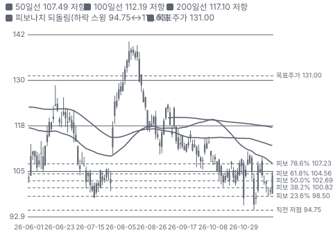

**주봉**

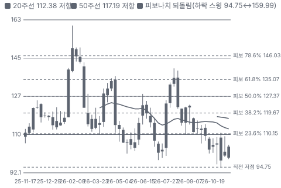

**월봉**

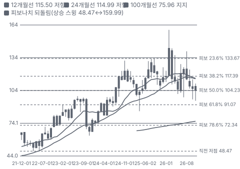

**분기 매출·EPS 실적과 컨센서스**

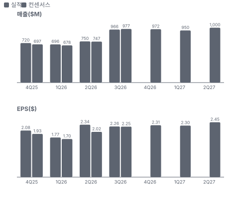

**4Q26 매출 — 지표 추세 vs 가이던스·컨센서스**

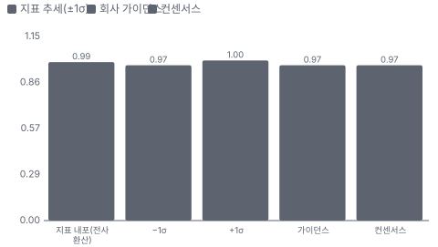

**최근 4개 분기 주가 변화 분석**

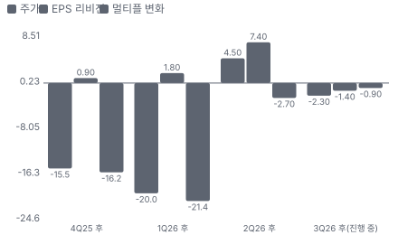

**EPS 리비전**

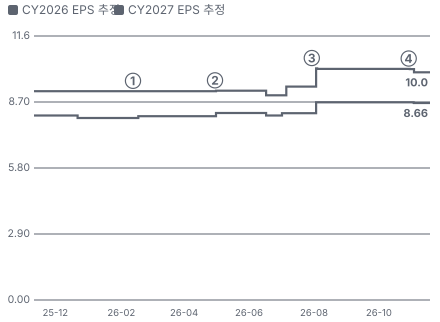

① 26-02-12 4Q25 실적 뒤 사상 최고가 · EPS 리비전 +0%
② 26-04-30 1Q26 실적 뒤 −12% · EPS 리비전 +0%
③ 26-07-30 2Q26 EPS 서프라이즈 +16% · EPS 리비전 +8%
④ 26-10-29 3Q26 수주 \$1B·데이터센터 \$275M · EPS 리비전 -2%

**멀티플 프리미엄(Fwd 1Y P/E, 최근 4개 분기말 절대값 — 대상 vs 동종 중앙값)**

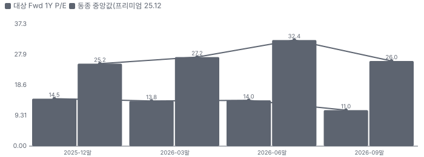

**합리적 멀티플**

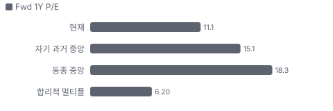

**밸류에이션 주가 시나리오**

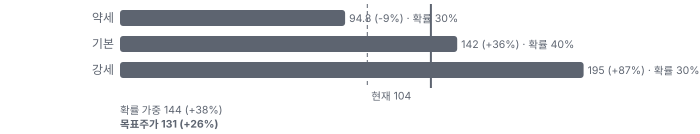

**주가별 업사이드**

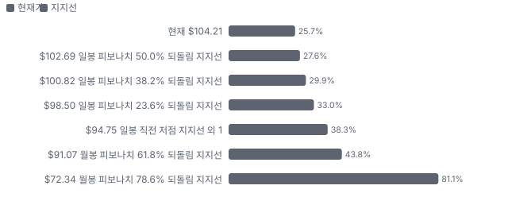
- 제품·서비스 포트폴리오

**고객 믹스(3Q26, 매출 대비)**

**공급 병목(10점, 낮을수록 병목)**

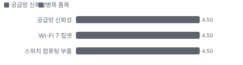

**CAPEX의 매출 대비 비중**

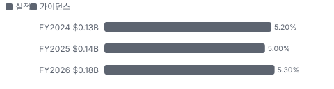

**어닝콜 변화별 주주가치 영향**

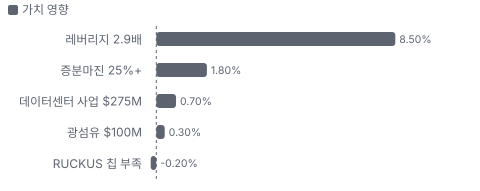

**수주·파이프라인 확실성 사다리**

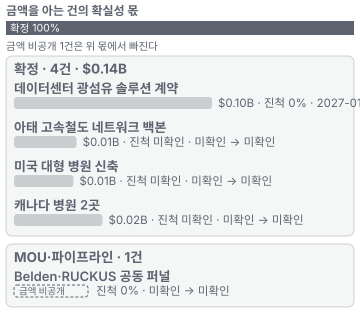

**매출 → 매출총이익 → 영업이익(매출 = 100, 최근 4분기)**

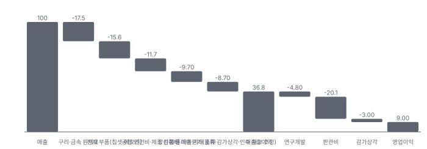

**분기 비용 비중 추이(매출 대비, 공시)**

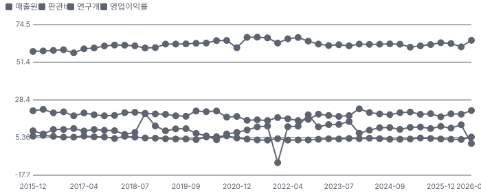

**비용 요인별 매출 대비 비중 1년 변화**

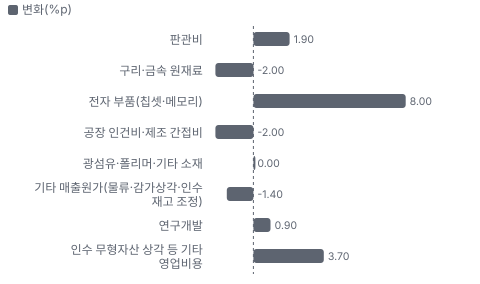

**자동화 BOM 원가 몫**

**스마트빌딩 BOM 원가 몫**

**무선(RUCKUS) BOM 원가 몫**

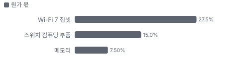

**BOM 항목 가격 +10% 시 OPM 변화**

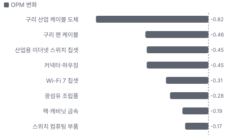

**원가 물가 vs 판매가 물가 — 최근 24개월(24.11 = 100): 원가가 판매가보다 1.0%p 더 올라 단가를 못 올리면 마진 압박**

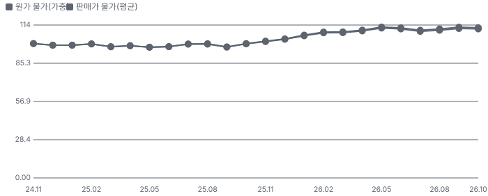

**사업별 매출 vs 물가 — 전년 대비(명목 매출 · 비교 물가 · 실질 = 물량·믹스)**

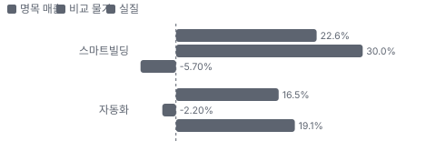

**자산 구성 — 3Q26 분기말 투하자본 \$3,670.7M**

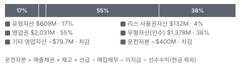

**자산별 변화율 — 최근 12개 분기(4Q23 = 0%) + 다음 4개 분기 추정**

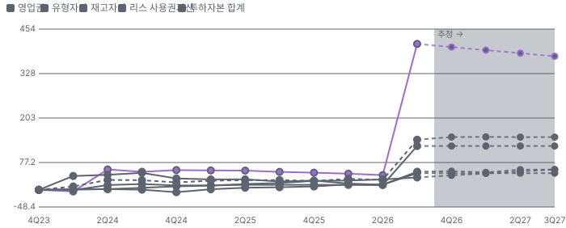

**ROIC 추이 — TTM, 최근 12개 분기 + 다음 4개 분기 추정(컨센서스 NOPAT) · 투하자본이 0 근처라 ROIC가 ±100%를 넘는 분기는 비움**

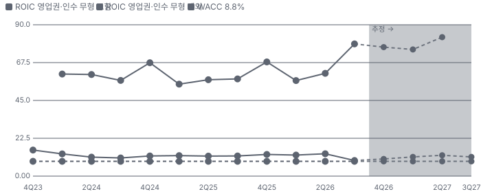

**RUCKUS Networks 인수 효과 — 인수 전 EPS 대비 %, 굵은 선 = 합계 · 시너지 가치 -\$0.02B(웃돈 미확인)**

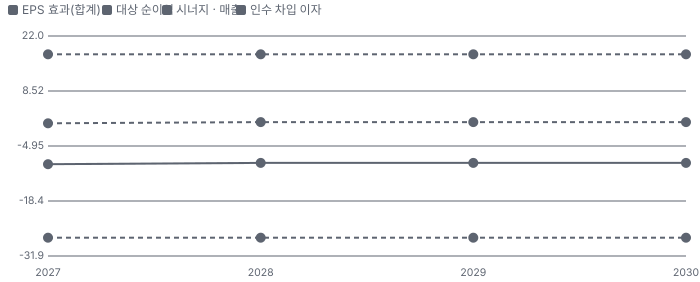

**매출 vs PPI·수출입 — 4Q22 = 100(변화율, 로그 눈금)**

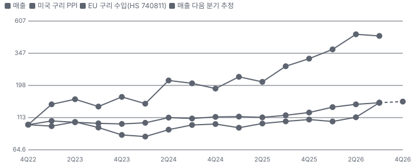

**10년 P·Q 사이클 — 추세(HP 필터) 대비 갭과 8분기 전망**

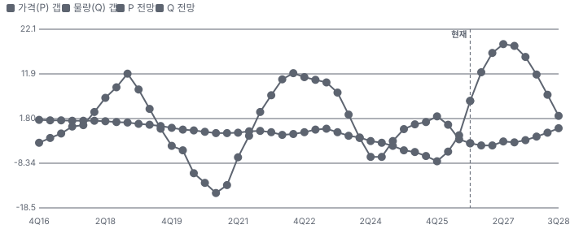

**매출 증가율의 가격·물량 분해와 8분기 전망(전년 대비)**

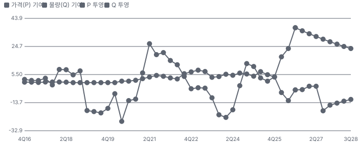

**목표주가 산정 — 약세와 기본 사이(약세 쪽 23%), 도달 확률 약 58%**

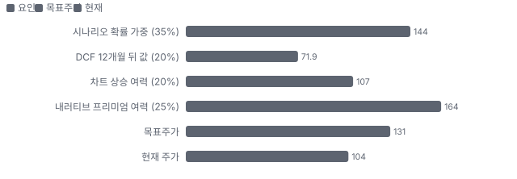

**PEG — 성장 대비 멀티플(낮을수록 성장 대비 쌈)**

**재고 일수 — 분기별(수주 자료가 없어 수주/출하 비율 없음)**

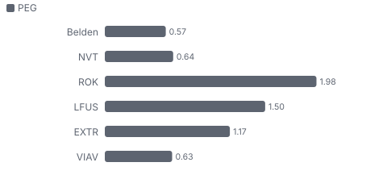

**일별 거래량 분해**

**기관 자금 흐름**

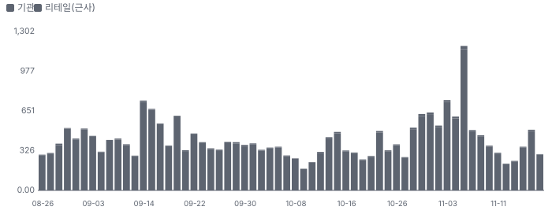

**몬테카를로**

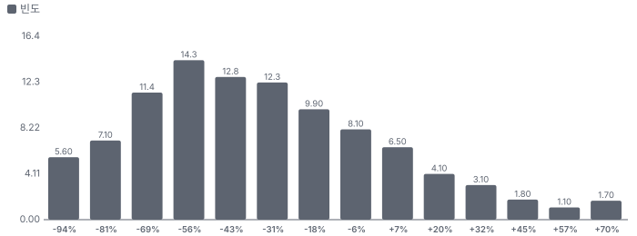

해석: 3,000번 중 568번(19%)에서 가치가 지금 주가 이상이었다. 가정을 흔들어도 지금 주가를 뒷받침하지 못하는 경우가 더 많다. 가운데 값은 0.62배이고, 열 번 중 여덟 번은 0.22~1.19배 사이에 든다.

## 내러티브

> **기업가치를 결정하는 이야기:** Belden의 값은 ① 자동화·스마트빌딩의 유기적 성장(3Q +11%)이 이어지는지 ② RUCKUS가 공급 문제를 풀고 증분 마진 30% 가까이로 성장하는지 ③ FCF로 레버리지를 2027년 말 2.9배 아래로 내리는지에 달렸다. 세 가지가 맞으면 2027년 EPS \$10과 배수 정상화가 함께 온다.

> **멀티플·EPS 프리미엄**
> **멀티플:** Fwd 1Y P/E 11.1배로 동종 중앙(약 18배)보다 약 40% 낮다. 2월 고점 때는 약 17.8배였다.
> **EPS:** FY2026 조정 EPS 컨센서스 \$8.69(+14%), FY2027 \$10.0(+15%) — 7월 이후 FY2027 추정은 7% 올랐다.

### 투자자들은 왜 열광했나

2월에는 4Q25 실적과 RUCKUS 인수 기대로 사상 최고가 \$160을 찍었다. 이후 1Q 실적 날 −12%, 인수 종결 뒤 차입 부담과 3Q RUCKUS 부품 차질로 기대가 식었다. 3Q 데이터센터 \$100M 계약은 아직 주가를 되돌리지 못했다.

### 무엇이 기업가치를 바꾸나

> **구조적 체질 변화**
> **변화:** 매출의 80% 이상이 IT/OT 네트워크 융합 제품이고, 케이블 단품 대신 설계부터 맡는 솔루션 판매로 병원·철도 대형 수주를 따고 있다.
> **증거:** 3Q26 어닝콜(2026-10-29)
> **반증:** 솔루션 대형 수주가 끊긴다

> **고부가 믹스 확장**
> **변화:** RUCKUS 편입으로 조정 매출총이익률 41.5%(+330bp). 구리 통과분을 뺀 증분 EBITDA 마진 25% 초과.
> **증거:** 3Q26 어닝콜(2026-10-29)
> **반증:** 조정 매출총이익률이 40% 아래로

> **기술 혁신**
> **변화:** RUCKUS가 Wi-Fi 7을 처음 상용 출시했고 Wi-Fi 8(Wi-Fi 7 다음 무선랜 표준)은 2028년 출시가 목표. 산업용 Wi-Fi 공동 로드맵.
> **증거:** 3Q26 어닝콜(2026-10-29)
> **반증:** Wi-Fi 8 출시가 경쟁사보다 늦어진다

> **실행 속도**
> **변화:** RUCKUS는 칩셋 리드타임이 늘어 출하가 밀렸다. 데이터센터 광섬유는 \$20M 주문 실행 뒤 \$100M 후속 계약을 따냈다. **납품 리드타임 1~3개월.** 피어 비교 미확인. 이전 대비 미확인.
> **증거:** 3Q26 어닝콜(2026-10-29)
> **반증:** 4Q에도 RUCKUS 매출이 전분기보다 줄어든다

> **M&A**
> **변화:** 2026-07-01 RUCKUS Networks 인수(순현금 지출 \$1.87B). 조달·물류 통합, 푸네 스위치 생산, 공동 영업 퍼널 수천만 달러.
> **증거:** https://www.sec.gov/cgi-bin/browse-edgar?action=getcompany&CIK=0000913142&type=10-Q
> **반증:** 영업권 손상 또는 교차 판매 매출이 2027년에도 안 보인다

> **정책·입법 연관성**
> **재정정책:** 해당 없음(직접 보조금·정부 계약 매출 공시 없음)
> **행정명령:** 해당 없음(행정명령과 직접 연결되는 매출 없음) 의회 동의 2/10 — 하원 1/5(논의 없음) · 상원 1/5(논의 없음).
> **연관입법:** 해당 없음(BEAD(미국 연방 광대역 보급 보조금 프로그램) 광대역 보조금은 브로드밴드 고객 쪽 간접 — 매출 연결 미확인)

> **고객의 지출 예산**
> **변화:** 자동화·데이터센터는 고객 CAPEX(공장·데이터센터 건설), 스마트빌딩·무선은 건물 신축 CAPEX와 IT(정보기술, 사무·데이터 네트워크) 교체 예산이 섞여 있다.
> **사업별 예산:** **매출의 46%**: 자동화 — 고객 CAPEX(공장·에너지·운송 설비 투자) · 동인: 제조 리쇼어링·자율화
**매출의 19%**: 스마트빌딩 — 고객 CAPEX(병원·호텔·데이터센터 건설비) · 동인: 건설 착공
**매출의 18%**: 브로드밴드 — 고객 CAPEX(통신사 액세스망 투자) · 동인: DOCSIS 4.0(케이블TV망으로 초고속 인터넷을 주는 최신 표준)·광섬유 확장
**매출의 17%**: 무선(RUCKUS) — 고객 혼합(기업 IT 교체 예산(OPEX 성격 포함)·건물 신축) · 동인: Wi-Fi 7 교체
> **증거:** 3Q26 어닝콜(2026-10-29)
> **반증:** 제조 설비투자와 상업용 건물 착공이 함께 줄어든다

### 내러티브 근거

> 산업용 케이블 회사에서 IT/OT 네트워크 솔루션 회사로 바뀌는 이야기에 RUCKUS 무선과 AI 데이터센터 광섬유가 붙었다. 다만 주가는 2월 고점 \$151에서 30% 넘게 내려와 Fwd 1Y P/E 11배 — 시장은 레버리지와 부품 공급 차질을 먼저 본다. 동종 대비 멀티플 차이 -39% 중 회사 고유 몫은 +78%다. 단계는 확산, 쏠림은 낮음이다.

> **AI 데이터센터 광섬유** · 유지
> **논리:** 하이퍼스케일 고객이 \$20M 뒤 \$100M을 맡겨 2027 데이터센터 사업이 \$275M으로 커진다
> **숫자:** \$175M → \$275M(+57%), 매출의 약 7%
> **반증:** 2027년 상반기 출하가 시작되지 않는다
> **출처:** 3Q26 어닝콜(2026-10-29)

> **Wi-Fi 7 교체 주기** · 강화
> **논리:** Wi-Fi 7 전환이 6~9개월 빨라 RUCKUS가 액세스포인트·스위치·소프트웨어를 한꺼번에 판다
> **숫자:** RUCKUS 수주 +10%, B/B 1.09, PoE 스위치 수요 +50%
> **반증:** 공급 정상화 뒤에도 RUCKUS 매출이 전년 대비 감소
> **출처:** 3Q26 어닝콜(2026-10-29)

> **공장 자동화 회복** · 유지
> **논리:** 제조·에너지 고객이 자율화로 가며 산업 네트워크 투자를 늘린다
> **숫자:** 자동화 수주 약 +30%, 자동화 매출 \$444M(+17%)
> **반증:** ISM이 다시 50 아래로 내려가고 수주가 꺾인다
> **출처:** 3Q26 어닝콜(2026-10-29)

> **디레버리징으로 배수 회복** · 유지
> **논리:** 18개월 FCF \$500M으로 순레버리지 3.9배 → 2027년 말 2.9배
> **숫자:** 3Q FCF \$82M, TTM \$229M
> **반증:** 2026년 말 순레버리지가 3.6배를 넘는다
> **출처:** 3Q26 어닝콜(2026-10-29)

> **반대 — 레버리지와 실행 위험** · 강화
> **논리:** 인수 차입 \$1.8B에 RUCKUS 공급 차질이 겹쳐 이익이 밀리면 배수가 더 깎인다
> **숫자:** 순레버리지 3.9배, 3Q GAAP 영업이익률 1.7%, 공매도 15%
> **반증:** 4Q 조정 EPS \$2.28 이상·RUCKUS 매출 회복
> **출처:** https://www.sec.gov/cgi-bin/browse-edgar?action=getcompany&CIK=0000913142&type=10-Q

### 투자 포인트

> **이익은 올랐는데 배수만 깎였다**
> **명제:** 2월 이후 주가 −35% 동안 FY2027 EPS 추정은 +9% 올랐다
> **숫자:** FY2027 EPS 추정 \$9.38(7/6) → \$10.01(11/3), Fwd 1Y P/E 17.8배(2월) → 11.1배
> **시장과 다른 점:** 시장은 레버리지·RUCKUS 실행 위험을 할인했다 — 이익 경로 자체는 아직 꺾이지 않았다
> **증명:** 4Q 조정 EPS \$2.20~2.35 달성·FY2027 가이던스
> **출처:** 3Q26 어닝콜(2026-10-29)

> **레버리지가 첫 촉매**
> **명제:** FCF로 순레버리지를 3.9배 → 2027년 말 2.9배로 내리는 경로가 배수를 되돌릴 첫 숫자다
> **숫자:** 3Q FCF \$82M, TTM \$229M, 인수 후 18개월 FCF 목표 약 \$500M
> **시장과 다른 점:** 시장은 데이터센터를 보지만 배수를 움직일 것은 부채 숫자다
> **증명:** 2026년 말 순레버리지 3.6배 이하
> **출처:** 3Q26 어닝콜(2026-10-29)

> **RUCKUS는 수요가 아니라 공급 문제**
> **명제:** 수주 +10%·B/B 1.09인데 매출 −6% — 칩셋이 풀리면 놓친 매출이 돌아온다
> **숫자:** 분기 \$10~15M 고마진 매출 놓침(회사 동의), PoE 스위치 수요 +50%
> **시장과 다른 점:** 시장은 인수 실패로 읽지만 숫자는 공급 지연을 가리킨다
> **증명:** 4Q RUCKUS 매출 \$168M 이상, 1Q27 전년 대비 성장
> **출처:** 3Q26 어닝콜(2026-10-29)

### 모멘텀 생성·소멸 타임라인

**카탈리스트 달력 — 지난 사건의 주가 반응과 앞으로 확인할 숫자**
| 날짜 | 상태 | 구분 | 사건 | 반응·확인 | 결과에 따라 |
|---|---|---|---|---|---|
| 2026-02-12 | 완료 | 생성 | 4Q25 실적 뒤 사상 최고가 | +6.1%(당일 종가) |  |
| 2026-04-30 | 완료 | 소멸 | 1Q26 실적 | −11.8% |  |
| 2026-07-30 | 완료 | 생성 | 2Q26 EPS 서프라이즈 +16% | +14.8% |  |
| 2026-10-29 | 완료 | 확인 | 3Q26 수주 \$1B·데이터센터 \$100M 계약, RUCKUS 공급 차질 | +0.8%(장중 −10% 뒤 회복) |  |
| 2027-02(예상) | 예정 | 확인 | 4Q26 실적·FY2027 가이던스 | RUCKUS 매출 \$168M 이상, 순레버리지 3.6배 이하, 조정 EPS \$2.20 이상 | 충족이면 기본~강세, 미달이면 약세 |
| 2027-1H(예상) | 예정 | 확인 | 데이터센터 \$100M 광섬유 출하 개시 | 1Q27 콜에서 출하 개시 확인 | 지연이면 데이터센터 요인 약화 |
| 매월 | 예정 | 매크로 | 미국 ISM 제조업 지수 | 50 이상 유지 | 자동화 수주 지속 |

### 언제 사서 언제 팔아야 할까?

**가격·조건 틀 — 가격은 밸류에이션(약세·기본·강세·목표주가)과 차트 지지 구간에서, 조건은 이벤트에서**
| 구간 | 가격 | 목표주가까지 | 약세까지 | 조건·근거 |
|---|---|---|---|---|
| 관찰 구간 | \$103~\$103 | +28% | -8% | 11월 저점(\$94.75~96) 근처 지지 구간은 레버리지 할인이 가장 깊게 반영된 자리다 |
| 확인 뒤 | 지금 \$104 이상에서 조건 확인 | +26% | -9% | 4Q 실적에서 RUCKUS 매출 \$168M 이상과 순레버리지 3.6배 이하 |
| 무효화 | 약세 시나리오 \$95 | - | -9% | RUCKUS 매출 \$160M 미만 또는 순레버리지 3.8배 초과, 종가 \$94 아래 |
| 차익 고민 1차 | \$142(기본 시나리오) | +36% | - | 목표주가 근처에서는 배수 정상화가 상당 부분 반영된다 |
| 차익 고민 2차 | \$195(강세 시나리오) | +87% | - | 목표주가 근처에서는 배수 정상화가 상당 부분 반영된다 |

실적일 장중 변동이 크다(3Q 실적일 장중 −10% 뒤 회복) — 발표 직후 추격은 경계 가격·조건 틀이며 매매·비중 지시가 아니다(투자 권유 아님).

## 포트폴리오

| 제품·서비스 | 구분 | 무엇 | 쓰는 곳 | 돈 버는 방식 | Mix | Mix 변화(전 분기 대비) |
|---|---|---|---|---|---|---|
| 자동화 | 제품 | 공장·에너지·운송용 산업 이더넷 스위치·케이블·커넥터 | 제조·창고·발전·철도 | 3Q26 매출의 46% | 46% | -12.2%p |
| 스마트빌딩 | 제품 | 건물·데이터센터용 구리·광섬유 케이블, 광섬유 조립품(광케이블과 커넥터를 공장에서 미리 붙여 만든 연결 부품), 랙·캐비닛 | 병원·호텔·대학·데이터센터 | 3Q26 매출의 19% | 19% | -1.8%p |
| 무선(RUCKUS) | 제품 | Wi-Fi 7 액세스포인트·멀티기가비트 PoE 스위치·관리 소프트웨어 | 호텔·학교·병원·창고·경기장 | 3Q26 매출의 17%(7월 인수) | 17% | 미확인 |
| 브로드밴드 | 제품 | 통신사 액세스망용 광섬유·동축 케이블과 연결 장비 | 케이블TV(텔레비전)·광대역 사업자 | 3Q26 매출의 18% | 18% | -3.4%p |

**Mix 변화가 가장 큰 쪽은 자동화(-12.2%p, 전 분기 대비).** 계절성 판정: 분기 매출 계절 지수 기준 없음 → 직전 분기와 비교.

## 고객

> **3Q26 최대 고객 Wesco(Anixter, 유통사) 20%, 상위 3곳 20%, 집중도 분산.** 공시·회사 발표로 확인한 몫은 매출의 0%이고, 나머지 고객 몫은 추정이거나 미분해다. 유통사·설치업체·OEM에 판다. 데이터센터 \$100M 계약은 Wesco 유통으로 공급한다. 고객별 몫은 이번 회차에 10-K 원문으로 확인하지 못했다.

**고객별 매출 몫(3Q26)**
| 고객 | 몫 | 변화 | 근거 |
|---|---|---|---|
| Wesco(Anixter, 유통사) | 15~25% | 미확인 | 추정 |
| 하이퍼스케일 데이터센터 고객 1곳(existing hyperscale customer) | 미확인 | 미확인 | 추정 |
| 기타·미분해 | 80% | - | - |

> **Wesco(Anixter, 유통사)** · 추정
> **사는 것:** 케이블·연결·데이터센터 광섬유
> **추정 근거:** 최대 유통 채널로 보인다 — 정확한 몫 미확인

> **하이퍼스케일 데이터센터 고객 1곳(existing hyperscale customer)** · 추정
> **사는 것:** 광섬유 조립·산업용 스위치·코드셋
> **추정 근거:** 회사명 미공시 — 특정 회사로 옮기면 가설

## 수주·파이프라인

> **2026-09-27 기준 5건.** 확정 \$0.14B.

**수주 목록**
| 상태 | 계약 | 계약 총액 | 진척 | 기간 | 비고 |
|---|---|---|---|---|---|
| 확정 | 데이터센터 광섬유 솔루션 계약 | \$0.10B | 0% | 2027-01 → 2027-12 | - |
| 확정 | 아태 고속철도 네트워크 백본 | \$0.01B | 비공개 | 미확인 → 미확인 | - |
| 확정 | 미국 대형 병원 신축 | \$0.01B | 비공개 | 미확인 → 미확인 | - |
| 확정 | 캐나다 병원 2곳 | \$0.02B | 비공개 | 미확인 → 미확인 | - |
| 파이프라인 | Belden·RUCKUS 공동 퍼널 | 금액 비공개 | 0% | 미확인 → 미확인 | - |

**실행 속도와 방해 요인**
| 항목 | 상태 | 실행 속도 | 방해 요인 |
|---|---|---|---|
| 데이터센터 광섬유 솔루션 계약 | 확정 | 2027년 안 | 고객 데이터센터 건설 일정 |
| 아태 고속철도 네트워크 백본 | 확정 | 미확인 | 프로젝트 공정 |
| 미국 대형 병원 신축 | 확정 | 미확인 | 건설 일정 |
| 캐나다 병원 2곳 | 확정 | 다년 | 건설 일정 |
| Belden·RUCKUS 공동 퍼널 | 파이프라인 | 미확인 | RUCKUS 부품 공급 |

## 마진 구조

> **GPM 35.1%, OPM 1.7%.** 3Q25 대비 GPM -2.6%p, OPM -9.2%p. 변동비는 매출의 63%이고, 매출이 10% 늘면 OPM은 +3.2%p 움직인다. 3Q26 GAAP 매출총이익률 35.1%(조정 41.5%). RUCKUS 편입으로 매출총이익률은 올랐지만 인수 상각·재고 공정가치 조정으로 GAAP 영업이익률은 1.7%까지 내려갔다.

> **매출 100 중 매출원가 63.2, 매출총이익 36.8(최근 4분기, 공시).** 매출원가 요인 중 구리·금속 원재료이 매출의 18.0%로 가장 무겁고, 단가가 +10% 오르면 GPM이 -1.80%p 움직인다. 분기 회귀로 매출 1이 늘 때 매출원가는 0.64 늘고, 매출원가의 고정비 몫은 -2%다. 매출원가 요인 비중은 요인별 공시 기간 값이라 합이 최근 4분기 매출원가를 넘어, 그림에서는 0.97배로 비례 조정했다.

**비용 요인 강도 — 비중·추세·충격(+10%)·탄력**
| 비용 | 구분 | 매출 대비 | 1년 변화 | 마진 기여 | 충격 시 마진 | 매출 탄력 | 고정비 몫 |
|---|---|---|---|---|---|---|---|
| 구리·금속 원재료 | 매출원가 요인 | 18.0% | -2.0%p | +2.0%p | -1.80%p | 미확인 | 0% |
| 전자 부품(칩셋·메모리) | 매출원가 요인 | 16.0% | +8.0%p | -8.0%p | -1.60%p | 미확인 | 0% |
| 공장 인건비·제조 간접비 | 매출원가 요인 | 12.0% | -2.0%p | +2.0%p | -1.20%p | 미확인 | 60% |
| 광섬유·폴리머·기타 소재 | 매출원가 요인 | 10.0% | +0.0%p | -0.0%p | -1.00%p | 미확인 | 0% |
| 기타 매출원가(물류·감가상각·인수 재고 조정) | 매출원가 요인 | 8.9% | -1.4%p | +1.4%p | -0.89%p | 미확인 | 50% |
| 매출원가 | 공시 항목 | 63.2% | +1.4%p | -1.4%p | -6.32%p | 0.64 | -2% |
| 판관비 | 공시 항목 | 20.1% | -0.2%p | +0.2%p | 미확인 | 0.21 | -6% |
| 연구개발 | 공시 항목 | 4.8% | +0.1%p | -0.1%p | 미확인 | 0.04 | 15% |
| 감가상각 | 공시 항목 | 3.0% | +0.9%p | -0.9%p | 미확인 | 0.03 | -15% |

매출 탄력 = 분기 비용을 매출에 회귀한 기울기(매출 1당 변동비), 고정비 몫 = 절편 ÷ 평균 비용. 표본이 8분기 미만이면 미확인. 매출원가 요인 비중은 margin 재료의 추정이 섞여 있고, 공시 매출원가와의 차이는 '기타 매출원가'로 둔다.

**GPM에서 OPM까지(GAAP — 10-Q 3개월 손익, 아래는 최근 4개 분기)**
| 기간 | GPM | 연구개발 | 판관비 | 기타 | OPM |
|---|---|---|---|---|---|
| 3Q25 | 37.7% | 4.8% | 20.0% | 2.0% | 10.9% |
| 3Q26 | 35.1% | 5.7% | 21.9% | 5.7% | 1.7% |
| 2025-12 | 36.6% | - | - | - | 12.2% |
| 2026-03 | 37.1% | - | - | - | 11.2% |
| 2026-06 | 39.1% | - | - | - | 13.2% |
| 2026-09 | 35.1% | - | - | - | 1.7% |

**비용을 움직이는 요인**
| 비용 | 요인 |
|---|---|
| 판관비(판관비) | 영업망·인수 비용 · 근거 공시 |
| 구리·금속 원재료(매출원가) | 구리 가격(판매가 통과) · 근거 추정 |
| 전자 부품(칩셋·메모리, 매출원가) | 스위치·액세스포인트 부품 수급 · 근거 추정 |
| 공장 인건비·제조 간접비(매출원가) | 가동률 · 근거 추정 |
| 광섬유·폴리머·기타 소재(매출원가) | 광섬유 유리 공급 계약 · 근거 추정 |
| 기타 매출원가(물류·감가상각·인수 재고 조정, 매출원가) | 인수 회계 · 근거 추정 |
| 연구개발(연구개발) | RUCKUS Wi-Fi 7·8 개발 · 근거 공시 |
| 인수 무형자산 상각 등 기타 영업비용(기타) | RUCKUS 인수 회계 · 근거 공시 |

**자동화 BOM — 매출의 46%, GPM 35%(세그먼트 매출총이익 미공시 — 회사 3Q26 GAAP 매출총이익률을 썼다), 항목 가격 +10% 시**
| 항목 | 원가 몫 | 전가 | 제품 GPM | OPM |
|---|---|---|---|---|
| 구리 산업 케이블 도체 | 20~35% | 미확인 | -1.8%p | -0.82%p |
| 산업용 이더넷(공장·발전소 환경을 견디는 유선 네트워크) 스위치 칩셋 | 10~20% | 미확인 | -1.0%p | -0.45%p |
| 커넥터·하우징 | 10~20% | 미확인 | -1.0%p | -0.45%p |
| 미분해 | 42% | - | - | - |

**스마트빌딩 BOM — 매출의 19%, GPM 35%(세그먼트 매출총이익 미공시 — 회사 3Q26 GAAP 매출총이익률을 썼다), 항목 가격 +10% 시**
| 항목 | 원가 몫 | 전가 | 제품 GPM | OPM |
|---|---|---|---|---|
| 구리 랜 케이블 | 30~45% | 미확인 | -2.4%p | -0.46%p |
| 광섬유 조립품 | 15~30% | 미확인 | -1.5%p | -0.28%p |
| 랙·캐비닛 금속 | 10~20% | 미확인 | -1.0%p | -0.19%p |
| 미분해 | 25% | - | - | - |

**무선(RUCKUS) BOM — 매출의 17%, GPM 35%(세그먼트 매출총이익 미공시 — 회사 3Q26 GAAP 매출총이익률을 썼다), 항목 가격 +10% 시**
| 항목 | 원가 몫 | 전가 | 제품 GPM | OPM |
|---|---|---|---|---|
| Wi-Fi 7 칩셋 | 20~35% | 미확인 | -1.8%p | -0.31%p |
| 스위치 컴퓨팅 부품 | 10~20% | 미확인 | -1.0%p | -0.17%p |
| 메모리 | 5~10% | 미확인 | -0.5%p | -0.08%p |
| 미분해 | 50% | - | - | - |

구리 산업 케이블 도체 가격이 +10% 오르면 영업이익은 -47.3% 움직인다. 판매가 전가를 모르는 항목은 전가 0%로 계산했다.

**BOM 항목 가격을 움직이는 것**
| 항목 | 요인 |
|---|---|
| 산업용 이더넷 스위치 칩셋 | 공급 부족 시 출하가 막힌다 · 근거 추정 |
| 구리 산업 케이블 도체 | 원가 최대 몫 — 구리 가격 연동(콜) · 근거 추정 |
| 커넥터·하우징 | 산업 인증 부품 · 근거 추정 |
| 구리 랜 케이블 | 원가 최대 몫 — 구리 가격 연동 · 근거 추정 |
| 광섬유 조립품 | 데이터센터 화이트 스페이스(데이터센터에서 서버·스토리지 랙이 놓이는 공간) · 근거 추정 |
| 랙·캐비닛 금속 | 부피 큰 물류 · 근거 추정 |
| Wi-Fi 7 칩셋 | 3Q 공급 병목 · 근거 추정 |
| 스위치 컴퓨팅 부품 | 3Q 공급 병목 · 근거 추정 |
| 메모리 | 가격 상승 국면 · 근거 추정 |

**투입 물가 — 미국 PPI 3·6·12개월(2026-10, 개정 반영)과 해외 전년비**
| 항목 | 미국 3개월 | 6개월 | 12개월 | 전가 못 할 때 OPM | 일본 | 한국 | 대만 |
|---|---|---|---|---|---|---|---|
| 스위치 컴퓨팅 부품 | -0.7% | -5.7% | -2.7%* | - | +1.6%* | 미확인 | 미확인 |
| 구리 랜 케이블 | +3.4% | +7.2% | +23.9% | - | +42.6% | +19.2% | +40.1% |
| 광섬유 조립품 | 미확인 | 미확인 | 미확인* | - | 미확인 | 미확인 | 미확인 |
| 메모리 | -0.7% | -5.7% | -2.7%* | - | +1.6%* | +327.8% | +22.9%* |

별표는 품목보다 넓은 업종 지수다. 연결한 투입 원가의 미국 PPI(생산자물가지수)는 1년 새 가중 +11.4%이고, 판매가로 넘기지 못하면 GPM -3.9%p·OPM -3.9%p가 움직인다. 판매가 비교 물가(구리 PPI)는 1년 새 +23.9% — 회사 가격 변화는 미확인. 물가 지수를 붙이지 못한 매출원가 항목은 광섬유·폴리머·기타 소재, 공장 인건비·제조 간접비다(미연결). 스마트빌딩 매출은 2026-09 전년 대비 +22.6%이고 비교 물가 ppi:copper의 변화 +30.0%(2026-09)를 빼면 실질 -5.7% — 성장 대부분이 가격(물가)이다. 자동화 매출은 2026-09 전년 대비 +16.5%이고 비교 물가 ppi:discrete_semi의 변화 -2.2%(2026-09)를 빼면 실질 +19.1% — 물량·믹스가 성장을 이끌었다.

## 자산 구성

> **3Q26 분기말 투하자본 \$3,670.7M** — 영업권 55%, 무형자산(인수) 38%. 최근 12개 분기(4Q23 → 3Q26) 가장 크게 늘어난 자산은 무형자산(인수, +412%), 투하자본 합계 +142%. 3Q27 추정 투하자본 \$3,783.0M(+3%, 컨센서스 매출과 회전 일수·CAPEX 강도 유지 가정). 연율 감가 비율(순액 기준)은 직전 4분기 25.00% → 최근 4분기 31.58%.

**자산·운전자본 항목별 분기말 잔액 — 최근 12개 분기와 다음 4개 분기 추정**
| 항목 | 4Q23 | 3Q25 | 3Q26(최근) | 3Q27 추정 | 12개 분기 변화 | 다음 4개 분기 변화 |
|---|---|---|---|---|---|---|
| 재고자산 | \$367.0M | \$393.9M | \$555.1M | \$576.8M | +51% | +4% |
| 선급·기타 유동자산 | \$79.1M | \$89.8M | \$113.4M | \$122.9M | +43% | +8% |
| 매입채무 | \$343.2M | \$308.8M | \$398.8M | \$467.4M | +16% | +17% |
| 미지급비용 | \$290.3M | \$322.6M | \$534.0M | \$455.6M | +84% | -15% |
| 선수수익(계약부채) | \$23.7M | \$35.4M | \$135.7M | \$72.5M | +472% | -47% |
| 유형자산 | \$451.1M | \$537.5M | \$609.1M | \$711.1M | +35% | +17% |
| 리스 사용권자산 | \$89.7M | \$110.8M | \$132.0M | \$132.0M | +47% | +0% |
| 영업권 | \$907.3M | \$1,036.7M | \$2,030.9M | \$2,030.9M | +124% | +0% |
| 무형자산(인수) | \$269.1M | \$405.7M | \$1,378.5M | \$1,284.5M | +412% | -7% |

**자산 추정 동인 — 최근 4개 분기 평균(재무상태표 동인 모형)**
| 동인 | 값 | 곱하는 기준 |
|---|---|---|
| 재고자산 | 83일 | 매출원가 |
| 선급·기타 유동자산 | 11일 | 매출 |
| 매입채무 | 68일 | 매출원가 |
| 미지급비용 | 42일 | 매출 |
| 선수수익(계약부채) | 7일 | 매출 |
| CAPEX 강도 | 5.5% | 매출(최근 4개 분기 합) |
| 분기 감가율 | 3.85% | 기초 유형자산 순액(무형 상각 제외 감가상각) |
| 매출원가율 | 63.2% | 매출(최근 4개 분기) |
| 영업권·리스 사용권·기타 | 유지 | 인수·새 리스는 공시 전 모름 |
| 인수 무형자산 | 분기 \$23.5M 상각 | 최근 4개 분기 평균 상각 |

**추정 방법:** 증권사 3표 모델(손익·재무상태표·현금흐름)의 재무상태표 동인 방식이다. 운전자본은 항목별 회전 일수(매출채권·선급·미지급·선수는 매출, 재고·매입채무는 매출원가 기준)를 최근 4개 분기 평균으로 두고 컨센서스 매출에 곱한다. 유형자산은 기초 + CAPEX − 감가상각으로 굴린다(Koller·Goedhart·Wessels 『Valuation』 재무상태표 추정). 매출 경로는 ROIC 절의 컨센서스와 같다.

**유형·무형자산 항목별 가치(2025-12-31 vs 2024-12-31)**
| 구분 | 항목 | 총액 2025-12-31 | 누적상각 | 순액 | 총액 2024-12-31 | 총액 1년 변화 | 공시 내용연수 |
|---|---|---|---|---|---|---|---|
| 유형 | 유형자산 합계(항목 미분해) | \$1,249.5M | 총계만 공시 | 총계만 공시 | \$1,157.7M | +7.9% | 미확인 |
| 영업권 | 영업권 | \$1,036.8M | \$0.0M | \$1,036.8M | \$1,018.7M | +1.8% | 비상각 |
| 무형 | 무형자산 합계(항목 미분해) | \$952.4M | \$552.6M | \$399.8M | \$892.8M | +6.7% | 미확인 |
| 유형 합계 | 유형자산 | \$1,249.5M | \$683.5M | \$566.0M | \$1,157.7M | +7.9% | 경과율 55%(상각 대상 기준) |

**내용연수 산식(상각 대상 유형자산 = 총액 − 토지 − 건설중)**
| 기준일 | 연 감가상각 | 상각 대상 총액 | 평균 내용연수 | 경과 연수 | 잔여 연수 | 경과율 |
|---|---|---|---|---|---|---|
| 2025-12-31 | \$63.8M | \$1,249.5M | 19.6년 | 10.7년 | 8.9년 | 55% |
| 2024-12-31 | \$56.4M | \$1,157.7M | 20.5년 | 11.7년 | 8.8년 | 57% |

산식 평균 내용연수는 19.6년. 1년 전 20.5년 → 지금 19.6년.

**분기 감가 비율(감가상각 ÷ 평균 유형자산 순액)**
| 분기 | 감가상각 | 평균 유형자산(순액) | 분기 비율 | 연율 | 연율의 역수 |
|---|---|---|---|---|---|
| 4Q24 | \$31.7M | \$486.5M | 6.52% | 26.07% | 3.8년 |
| 1Q25 | \$29.8M | \$500.6M | 5.95% | 23.80% | 4.2년 |
| 2Q25 | \$32.1M | \$515.5M | 6.22% | 24.88% | 4.0년 |
| 3Q25 | \$33.6M | \$531.4M | 6.32% | 25.26% | 4.0년 |
| 4Q25 | \$34.0M | \$551.8M | 6.17% | 24.66% | 4.1년 |
| 1Q26 | \$32.5M | \$567.7M | 5.72% | 22.87% | 4.4년 |
| 2Q26 | \$36.1M | \$576.5M | 6.26% | 25.04% | 4.0년 |
| 3Q26 | \$78.4M | \$596.4M | 13.14% | 52.58% | 1.9년 |

감가상각 기준: 손익계산서 감가상각·상각비(SEC 공시 데이터, 4분기 = 연간 − 1~3분기).

최근 4분기 연율 감가 비율 31.58%, 직전 4분기 25.00%(+26%) — 경고 문턱(-10%) 안이다.

미공시·미분해: 유형자산 항목별 총액·내용연수(10-K 주석에서 모델이 채움) · 무형자산 항목(10-K 주석에서 모델이 채움) — 이 칸은 비우고 나머지로 계산했다.

### 해석 — 자산이 어디에 쌓이고 있나

- 같은 기간 4개 분기 매출은 +34% — 매출보다 빨리 늘어난 자산: 재고자산 +51%, 리스 사용권자산 +47%, 영업권 +124%, 무형자산(인수) +412%. 이 자산의 회전율이 떨어지면 ROIC를 희석한다.
- 다음 4개 분기 CAPEX \$215.3M vs 감가상각 \$99.8M(최근 4개 분기 CAPEX 강도·감가율 유지) — 유형자산 3Q26 \$609.1M → 3Q27 \$711.1M. 투자가 감가보다 커서 자산이 쌓이는 국면이다.
- 감가 비율이 올라갔다 — 이익을 보수적으로 잡는 쪽이다(내용연수 단축·짧은 수명 자산 증가).

## ROIC

> **TTM 3Q26 ROIC는 영업권·인수 무형 포함 9.3%, 제외 78.6%**(NOPAT 마진 9.5% × 투하자본 회전율 0.98회). 최근 12개 분기 4Q23 15.5% → 3Q26 9.3%(고점 4Q23 15.5%). 컨센서스 NOPAT으로 굴리면 3Q27 11.4%(제외 미확인) — WACC 8.8% 대비 +2.6%p. 1년 변화의 가장 큰 요인은 NOPAT 마진(-1.9%p).

**ROIC 추이(TTM)와 다음 4개 분기 추정 — NOPAT ÷ 평균 투하자본(이번 분기말·4개 분기 전)**
| 분기 | 구분 | TTM 매출 | TTM NOPAT | NOPAT 마진 | 평균 투하자본 | ROIC 포함 | ROIC 제외 |
|---|---|---|---|---|---|---|---|
| 4Q23 | 실적 | \$2,512.1M | \$283.1M | 11.3% | \$1,826.5M | 15.5% | 미확인 |
| 1Q24 | 실적 | \$2,406.0M | \$259.5M | 10.8% | \$1,966.2M | 13.2% | 60.7% |
| 2Q24 | 실적 | \$2,318.1M | \$240.2M | 10.4% | \$2,121.0M | 11.3% | 60.4% |
| 3Q24 | 실적 | \$2,346.2M | \$228.0M | 9.7% | \$2,120.4M | 10.8% | 56.9% |
| 4Q24 | 실적 | \$2,461.0M | \$250.9M | 10.2% | \$2,085.1M | 12.0% | 67.4% |
| 1Q25 | 실적 | \$2,550.2M | \$268.8M | 10.5% | \$2,194.7M | 12.2% | 54.7% |
| 2Q25 | 실적 | \$2,617.8M | \$279.7M | 10.7% | \$2,346.6M | 11.9% | 57.3% |
| 3Q25 | 실적 | \$2,661.1M | \$280.3M | 10.5% | \$2,343.2M | 12.0% | 57.8% |
| 4Q25 | 실적 | \$2,715.2M | \$293.3M | 10.8% | \$2,274.9M | 12.9% | 67.9% |
| 1Q26 | 실적 | \$2,786.7M | \$295.8M | 10.6% | \$2,357.6M | 12.5% | 56.8% |
| 2Q26 | 실적 | \$2,864.9M | \$312.4M | 10.9% | \$2,347.9M | 13.3% | 61.1% |
| 3Q26 | 실적 | \$3,132.6M | \$298.7M | 9.5% | \$3,211.6M | 9.3% | 78.6% |
| 4Q26 | 추정 | \$3,384.5M | \$330.6M | 9.8% | \$3,248.3M | 10.2% | 76.7% |
| 1Q27 | 추정 | \$3,638.1M | \$374.5M | 10.3% | \$3,297.7M | 11.4% | 75.3% |
| 2Q27 | 추정 | \$3,888.0M | \$405.2M | 10.4% | \$3,271.4M | 12.4% | 82.6% |
| 3Q27 | 추정 | \$3,922.0M | \$469.8M | 12.0% | \$4,132.7M | 11.4% | 미확인 |

**다음 4개 분기 NOPAT — 컨센서스(세율 22%, 리스 이자 별도)**
| 분기 | 매출 | EBITA 마진 | EBITA | NOPAT(분기) | 근거 |
|---|---|---|---|---|---|
| 4Q26 | \$972.0M | 14.5% | \$141.4M | \$110.3M | 컨센서스 매출 × EBIT 마진 FY2026(조정 − 주식보상 1.1%) |
| 1Q27 | \$950.0M | 15.3% | \$145.8M | \$113.7M | 컨센서스 매출 × EBIT 마진 FY2027(조정 − 주식보상 1.1%) |
| 2Q27 | \$1,000.0M | 15.3% | \$153.5M | \$119.7M | 컨센서스 매출 × EBIT 마진 FY2027(조정 − 주식보상 1.1%) |
| 3Q27 | \$1,000.0M | 15.3% | \$153.5M | \$119.7M | 컨센서스 매출 × EBIT 마진 FY2027(조정 − 주식보상 1.1%) |

**추정 방법:** NOPAT은 컨센서스(분기 매출 추정 × 회계연도 EBIT 마진 추정)로 잡고, 조정(비 GAAP) 마진이면 주식보상 몫을 빼서 과거 실적과 같은 기준(영업이익 + 인수 무형 상각)으로 맞췄다. 이미 발표했지만 분기 보고서(10-Q)가 아직 없는 분기는 발표 실적을 쓴다. 투하자본은 자산 구성 절의 재무상태표 동인으로 굴렸다. ROIC는 4개 분기 NOPAT을 이번 분기말과 4개 분기 전 투하자본의 평균으로 나눈다 — 추정 분기의 ROIC에는 이미 나온 실적 분기가 섞여 있다.

**투하자본 항목별 회전율과 ROIC 기여(TTM 3Q26, 평균 잔액)**
| 항목 | 투하자본 | 매출 1달러당 자본 | 회전율(매출 ÷ 항목) | 자본 몫 | 이 항목을 빼면 ROIC |
|---|---|---|---|---|---|
| 운전자본 | −\$291.6M | -0.09 | 음수(자금 원천) | -9% | 7.6% |
| 유형자산 | \$573.3M | 0.18 | 5.46회 | 18% | 10.1% |
| 리스 사용권자산 | \$121.4M | 0.04 | 25.80회 | 4% | 8.6% |
| 영업권 | \$1,939.7M | 0.62 | 1.62회 | 60% | 21.0% |
| 무형자산(인수) | \$892.1M | 0.28 | 3.51회 | 28% | 11.5% |
| 기타 영업자산 | −\$23.3M | -0.01 | 음수(자금 원천) | -1% | 8.3% |

**ROIC 세 가지 판**
| 판 | NOPAT | 투하자본 | ROIC | 무엇을 재나 |
|---|---|---|---|---|
| 영업권·인수 무형 포함 | \$267.0M | \$3,211.6M | 8.3% | 인수 웃돈까지 낸 돈에 대한 수익률 |
| 영업권·인수 무형 제외 | \$267.0M | \$379.8M | 70.3% | 본업 운영 수익률(동종 비교용) |
| 무형 자본화 조정(판관비 20%·5년, 연구개발 6년) | \$318.4M | \$3,902.0M | 8.2% | 비용으로 처리한 무형 투자를 자산으로 본 판 |
| 경제적 이익(포함판) | −\$15.1M | \$3,211.6M | 자본비용 8.8% | (ROIC − 자본비용) × 투하자본 |

NOPAT = (영업이익 \$281.5M + 인수 무형 상각 + 리스 내재 이자 \$7.4M) × (1 − 세율 22%). 리스 사용권자산을 투하자본에 넣었으므로 임차료 속 이자 몫을 영업이익에 되더했다. 현금은 영업에 필요한 몫을 따로 알 수 없어 투하자본에서 뺐다. SEC 공시 데이터 자동 초안 — 운전자본 = 매출채권 + 재고 + 선급 − (매입채무 + 미지급비용 + 선수수익), 현금 제외. 손상 누계는 공시 데이터 수록분.

**ROIC 1년 변화 분해(포함판, TTM 3Q25 → TTM 3Q26)**
| 요인 | ROIC 기여 |
|---|---|
| NOPAT 마진 | -1.94%p |
| 운전자본 | +0.31%p |
| 유형자산 | +0.08%p |
| 리스 사용권자산 | +0.07%p |
| 영업권 | -0.77%p |
| 무형자산(인수) | -1.38%p |
| 기타 영업자산 | +0.18%p |
| 합계 | -3.46%p |

**무형 자본화 가정별 ROIC(2025년 지출 기준, 포함판에 더함)**
| 투자로 보는 몫 | 상각 연수 | 무형 자산 | NOPAT 조정 | 조정 ROIC |
|---|---|---|---|---|
| 판관비 20% | 2년 | \$550.6M | \$38.2M | 8.1% |
| 판관비 20% | 5년 | \$690.4M | \$51.5M | 8.2% |
| 판관비 30% | 2년 | \$628.6M | \$42.2M | 8.1% |
| 판관비 30% | 5년 | \$838.4M | \$62.1M | 8.1% |

### 해석 — 무엇이 수익성을 끌어올리고 희석하나

- 영업권: 투하자본의 60% — 빼면 ROIC 8.3% → 21.0%. 이 자산의 회전율(1.62회)이 수익성을 희석하는 주된 자리다.
- 무형자산(인수): 투하자본의 28% — 빼면 ROIC 8.3% → 11.5%. 이 자산의 회전율(3.51회)이 수익성을 희석하는 주된 자리다.
- 기타 영업자산: −\$23.3M(음수), 고객 선수금·공급사 외상이 자본을 대신 댄다 — 빼면 ROIC 8.3%로 낮아진다. 수익성을 끌어올리는 쪽이다.
- 운전자본: −\$291.6M(음수), 고객 선수금·공급사 외상이 자본을 대신 댄다 — 빼면 ROIC 7.6%로 낮아진다. 수익성을 끌어올리는 쪽이다.
- 영업권·인수 무형을 빼면 ROIC가 +62.0%p 오른다 — 과거 인수에 치른 웃돈이 주주 수익률을 그만큼 낮춘다(본업 수익률은 제외판, 인수까지 포함한 가치 창출은 포함판으로 본다).
- 1년 ROIC 개선의 최대 요인은 운전자본(+0.3%p). 반대로 깎은 최대 요인은 NOPAT 마진(-1.9%p).
- 비용으로 처리한 무형 투자를 자산으로 보면 ROIC가 -0.2%p 움직인다(무형 자산 \$690.4M). 투자를 늘리는 중이라 NOPAT이 더 커지는 쪽이다.
- 추정 경로 3Q26 9.3% → 3Q27 11.4%: NOPAT 마진 +2.4%p, 투하자본 회전율 -0.03회 — 컨센서스 매출·마진이 맞고 회전 일수·CAPEX 강도가 유지된다는 가정이다. 마진 추정이 내려가거나 재고 일수가 늘면 이 경로가 먼저 틀린다.
- ROIC(포함) − WACC = +0.5%p(3Q26) — 양수면 투하자본을 늘릴수록 가치가 쌓인다.

## 공급망 병목

> **공급망 신뢰성 4.5/10, 병목 주의.** 가장 약한 고리는 Wi-Fi 7 칩셋 4.5점이고, 품목 평균은 4.5점이다. 근거가 부족한 3건(메모리 · 광섬유 유리 · 구리)은 점수에서 뺐다. 지금 병목은 RUCKUS Wi-Fi 7 스위치의 칩셋·컴퓨팅 부품이다(메모리는 확보). 데이터센터 광섬유는 유리 공급 계약과 투손·푸네·멕시코 생산능력을 확보했다고 회사가 밝혔다.

**병목과 마진 — 품목 가격 +10% 시 OPM**
| 품목 | 점수 | 판정 | 구분 | OPM |
|---|---|---|---|---|
| Wi-Fi 7 칩셋(필수) | 4.5 | 병목 주의 | 출하 차질 위험 | -0.31%p |
| 스위치 컴퓨팅 부품(필수) | 4.5 | 병목 주의 | 출하 차질 위험 | -0.17%p |

> **Wi-Fi 7 칩셋** · 4.5/10
> **왜:** 수요 급증 대비 상반기 주문 부족 — 분기 \$10~15M 매출 놓침
> **병목 요인:** 인증 공급사 미확인 · 캐파 빠듯 · 리드타임 미확인 · 재인증 미확인 · 1위 점유율 60% · 대만(파운드리) 집중 90% · 물량 확보 복수구매
> **풀리는 조건:** 공급 중 — 추가 할당·조기 납품 일부 확보(회사 발표), 정상화 미확인

> **스위치 컴퓨팅 부품** · 4.5/10
> **왜:** 멀티기가비트 PoE 스위치 수요 연초 대비 +50%
> **병목 요인:** 인증 공급사 미확인 · 캐파 빠듯 · 리드타임 미확인 · 재인증 미확인 · 1위 점유율 60% · 대만(파운드리) 집중 90% · 물량 확보 복수구매
> **풀리는 조건:** 미해소

**공급사**
| 품목 | 공급사 | 몫 | 근거 |
|---|---|---|---|
| Wi-Fi 7 칩셋 | 미공시(Wi-Fi 칩 업체, 칩셋) | 미확인 | 추정 |
| 스위치 컴퓨팅 부품 | 미공시(CPU·SoC(여러 기능을 한 칩에 담은 반도체)) | 미확인 | 추정 |
| 메모리 | 미공시(DRAM·NAND) | 미확인 | 추정 |
| 광섬유 유리 | 미공시(유리 공급 계약, 광섬유 원재료) | 미확인 | 회사 발표 |
| 구리 | 미공시(도체) | 미확인 | 추정 |

**무역 통계로 본 공급 지역**
| 품목 | EU 수입처 | 일본 수입처 | EU 1위 전년비 |
|---|---|---|---|
| Wi-Fi 7 칩셋 | CN(중국) 33% · MY(말레이시아) 30% · JP(일본) 21% | マレーシア 25% · 中華人民共和国 19% | -0.5% |
| 스위치 컴퓨팅 부품 | CN 33% · MY 30% · JP 21% | マレーシア 25% · 中華人民共和国 19% | -0.5% |
| 메모리 | TW(대만) 46% · KR(한국) 19% · CN 17% | 台湾 52% · 大韓民国 28% | +413.1% |
| 광섬유 유리 | CN 53% · US 35% · VN(베트남) 5% | 中華人民共和国 46% · ベトナム 20% | -7.1% |
| 구리 | MY 77% · KR 11% · VN 7% | マレーシア 58% · タイ 36% | 미확인 |

## 생산능력

> **현재 명목 캐파 미확인, 가동률 미확인.** FY2025 CAPEX는 \$0.14B로 매출의 5.0%다. 생산능력 수치는 공시하지 않는다. 데이터센터 광섬유는 애리조나 투손·인도 푸네·멕시코 공장으로 2027년 \$275M분을 감당한다고 밝혔고, 푸네에서 RUCKUS 스위치 생산을 시작했다.

**생산시설 3곳**(콜에서 이름이 나온 광섬유·스위치 생산 거점만 — 10-K Item 2 전체 시설 수는 이번 회차에 원문 미확인), 미확인 3곳. 시설별 생산능력은 공개되지 않았다 — 회사 전체 캐파만 위에 적었다.

**생산시설 3곳 — 명칭·위치·생산능력**
| 시설 | 위치 | 용도 | 생산능력 | 소유·상태 |
|---|---|---|---|---|
| 투손 광섬유 공장 | 미국 애리조나 투손 | 데이터센터 광섬유 솔루션 | 미확인 — 2027 \$275M분 감당(회사 설명) | 미확인 · 가동 |
| 푸네 공장 | 인도 푸네 | 광섬유 조립·RUCKUS 이더넷 스위치 | 미확인 — 미공시 | 미확인 · 가동 |
| 멕시코 공장 | 멕시코(도시 미공시) | 광섬유 조립 | 미확인 — 미공시 | 미확인 · 가동 |

공개된 증설 계획은 확인되지 않았다.

**CAPEX와 매출 대비**
| 기간 | CAPEX | 매출 | 매출 대비 | 구분 |
|---|---|---|---|---|
| FY2024 | \$0.13B | \$2.46B | 5.2% | 실적 |
| FY2025 | \$0.14B | \$2.72B | 5.0% | 실적 |
| FY2026 | \$0.18B | \$3.38B | 5.3% | 가이던스 |

## M&A 시너지

> **RUCKUS Networks 인수(2026-07-01, \$1.87B): 시너지가 다 나면 연 \$0.00B(확률 가중 이익 기여), 인수 배수 EV/EBITDA 14.0배 → 시너지 반영 13.6배.** 세후 시너지 가치는 통합 비용을 빼고 -\$0.02B. EPS 효과는 2027년 -9.4%에서 2030년 -9.1%.

**RUCKUS Networks 시너지가 생기는 길**
| 종류 | 시너지 | 연 규모 | 완성 | 확률 | 어떻게 생기나 | 근거 |
|---|---|---|---|---|---|---|
| 매출 | Belden 유선 + RUCKUS 무선 교차 판매 | \$0.05B(이익률 25%) | 2028 | 30% | 병원·호텔·창고 자율이동로봇·데이터센터 그레이 스페이스(데이터센터의 전력·냉각·보안 설비 공간)에 유선 백본과 Wi-Fi를 한 번에 판다(공동 퍼널 수천만 달러) | 추정 — 회사는 공동 퍼널 '수천만 달러'만 밝혔다(3Q26 어닝콜(2026-10-29)) |

그림의 구성 요소(대상 순이익·시너지·인수 차입 이자·신주 희석)를 더하면 EPS 효과 합계다. 시너지는 세후·확률 가중이다. 시너지 가치 = 세후 이익 기여 5년 + 말기 가치(할인율 9%, 성장 0) − 통합 비용. 매출 시너지는 그 매출의 이익률만 반영하고, 모든 시너지에 실현 확률을 곱했다.

## 피터 린치 분류

> **경기순환주(Cyclical), 중형.** 린치 표의 기대 수익 10배, 하방 -80~100%, 위험 고. 10배 경로가 있는 분류다(고성장주·회생주·경기순환주).

**분류 근거 — 크기 먼저, 다음은 이야기 유형**
| 항목 | 값 |
|---|---|
| 크기 | 중형(시가총액 \$4.1B) |
| 장기 성장 | 15.6%(컨센서스 EPS 2년 CAGR) |
| 린치 비율((성장% + 배당%) ÷ P/E) | 1.40 — 2 이상 매력, 1 미만 비싸다 |
| PEG(P/E ÷ 성장%) | 0.71 — 1 적정, 0.5 매우 매력, 2 매우 불리 |
| 근거 | TTM 매출이 과거 고점 대비 28% 빠진 적이 있다 |
| 반대 근거 | 없음 |

- 점검: 재고·공급과 수요(가격)의 방향
- 점검: 경쟁사의 증설
- 점검: 이익 정점에서 P/E가 낮아 보이는 함정
- 점검: 부채가 바닥을 견딜 수 있나
- 팔 때(점검 조건, 매매 지시 아님): 재고가 쌓이고 증설이 시작되고 가격이 꺾일 때 — 정점의 낮은 P/E는 싸다는 뜻이 아니다

분류 = 피터 린치·존 로스차일드 『One Up On Wall Street』(1989)·『Beating the Street』(1993)의 6분류와 위험·보상 표를 숫자 규칙으로 옮긴 자체추론이다(config/lynch.yaml).

## 해자

> 해자는 산업 환경용 케이블·연결·스위치를 한 회사가 설계부터 공급하는 포트폴리오 폭과, 유통사(Wesco)·설계 단계 참여로 쌓은 채택 관성이다. 데이터센터와 기업 무선에서는 해자가 아직 약하다.

> **솔루션 포트폴리오 폭(케이블·연결·랙·스위치·무선·소프트웨어)** · 보통
> **해자:** 병원·고속철도·공장 프로젝트를 설계 단계부터 맡아 여러 공급사 대신 한 곳이 공급한다
> **근거:** 3Q 콜: 미국 병원 \$9M·캐나다 병원 2곳 \$20M·아태 고속철도 \$10M 수주에서 기존 공급사를 대체
> **숫자:** 매출의 80% 이상이 네트워크 융합 지원 제품(회사 설명)
> **깨지는 조건:** 솔루션 대형 수주가 2개 분기 연속 나오지 않으면

> **산업용 이더넷·케이블 인증과 설치 기반** · 보통
> **해자:** 공장·에너지·운송 설비는 한 번 깔린 네트워크 부품을 쉽게 바꾸지 않는다
> **근거:** 10-K: 자동화 부문(Hirschmann 계열 스위치·산업 케이블)이 매출의 약 46%, 3Q 자동화 수주 약 +30%
> **숫자:** 3Q26 자동화 매출 \$444M(전체의 46%)
> **깨지는 조건:** 자동화 수주가 ISM 반등 국면에서도 동종보다 느리면

> **데이터센터 광섬유 조립 역량** · 약함
> **해자:** 하이퍼스케일 고객이 \$20M 주문 뒤 \$100M으로 늘렸다 — 실행 이력이 생겼지만 아직 고객 수가 적다
> **근거:** 3Q26 어닝콜(2026-10-29): 2027 데이터센터 사업 약 \$275M, 광섬유 원재료(유리) 공급 계약 확보
> **숫자:** 데이터센터 매출은 전체의 한 자릿수(회사 설명)
> **깨지는 조건:** \$100M 계약 출하가 2027년 상반기에 시작되지 않으면

> **RUCKUS 기업 무선 기술(Wi-Fi 7 첫 상용 출시)** · 보통
> **해자:** Wi-Fi 7을 처음 상용 출시했고 Wi-Fi 8도 2028년 출시를 목표로 한다
> **근거:** 3Q26 어닝콜(2026-10-29): RUCKUS 수주 +10%, B/B 1.09, 조정 EBITDA 마진 약 20%
> **숫자:** 3Q RUCKUS 매출 \$168M(−6%)
> **깨지는 조건:** 공급 정상화 뒤에도 RUCKUS 매출이 전년 대비 늘지 않으면

## 경영진·네트워크

> CEO Ashish Chand(2022년 취임, 이전 Belden 자동화 부문장)와 CFO Jeremy Parks가 RUCKUS 인수와 솔루션 판매 전환을 이끈다. 정치·동문 연결은 공개 자료에서 확인되지 않았다.

> **Ashish Chand** · 대표이사(President & CEO) · 2022
> **프로필:** Belden 산업 자동화 부문을 이끈 뒤 CEO 선임(회사 발표)
> **비즈니스:** 미확인
> **정계:** 미확인
> **동문:** 미확인
> **사모임:** 미확인

> **Jeremy Parks** · 최고재무책임자(CFO) · 미확인
> **프로필:** 3Q26 콜에서 가이던스·공급망 답변
> **비즈니스:** 미확인
> **정계:** 미확인
> **동문:** 미확인
> **사모임:** 미확인

**네트워크 정량화**
| 연결 | 강도 | 닿는 매출 | 가중 노출 | 매출 대비 | 근거 |
|---|---|---|---|---|---|
| 비즈니스: 유통사 Wesco와 데이터센터 광섬유 공급 협력 | 2/5 | 미확인 | 미확인 | 미확인 | \$100M 계약을 Wesco 유통으로 공급(콜) 3Q26 어닝콜(2026-10-29) |

가중 노출은 연결이 닿는 매출의 크기다. 연결이 그 매출을 만들었다는 뜻이 아니며, 인과는 공개 자료로 입증하지 못한다.

## 약세 논리 및 셀온 조건

| 약세 논리 | 근거 | 가를 자료 |
|---|---|---|
| 레버리지가 배수를 누른다 | 인수로 장기차입이 \$1.29B에서 \$3.05B로 늘어 순레버리지 3.9배다. 회사 목표는 2026년 말 3.6배·2027년 말 2.9배다(콜) | 4Q 순레버리지(2027년 2월 추정) |
| RUCKUS 공급 차질이 길어진다 | Wi-Fi 7 스위치 칩셋·컴퓨팅 부품이 모자라 3Q RUCKUS 매출이 6% 줄었다. 회사는 '일시적'이라 했지만 제품군별 회복 속도가 다르다고 인정했다 | 4Q RUCKUS 매출 — \$168M 이상인가 |
| 데이터센터는 아직 작다 | 2027년 \$275M도 매출 \$4B의 약 7%다. \$100M 계약은 하이퍼스케일 고객 한 곳이고 이번 분기 수주에는 들어 있지 않다(콜) | 2027년 상반기 출하 개시 |
| 산업 경기 의존 | 자동화가 매출의 46%이고 수주는 ISM 같은 산업 지표와 같이 움직여 왔다(IB 리포트 위험 항목) | ISM 제조업 지수·4Q 자동화 수주 |
| 원가 상승 | 미국 구리 PPI가 1년 새 +23.9%(2026-10)다. 회사는 구리를 판매가로 넘기지만 통과 매출은 이익률을 희석한다 | 4Q 조정 매출총이익률 — 41% 유지 |
| 자료 한계 | TradingView 한도로 일봉은 1년치 실측(Easyconomics)만 썼다. 10-K 시설 수·고객 몫은 이번 회차에 원문 확인을 못 해 '미확인'·'추정'으로 남겼다 | FY2026 10-K(2027년 2월 추정) |

**변이 관점.** 시장은 주가를 이익이 아니라 배수로 깎았다 — 2월 이후 주가는 35% 내렸지만 FY2027 EPS 추정은 \$9.38에서 \$10.01로 올라갔다. 할인의 이유는 레버리지 3.9배와 RUCKUS 실행 위험이고, 둘 다 숫자로 확인할 날짜가 정해져 있다(4Q 실적의 순레버리지·RUCKUS 매출). 데이터센터 광섬유는 이야기로는 크지만 2027년에도 매출의 한 자릿수라 배수를 혼자 올리지 못한다. 주가를 움직일 첫 숫자는 데이터센터가 아니라 레버리지다.

> **셀온 조건**
> **조건 1:** 4Q26 RUCKUS 매출이 \$160M 아래로 내려가고 회사가 부품 정상화 시점을 2027년 하반기 이후로 미룬다(2027년 2월 추정).
> **조건 2:** 2026년 말 순레버리지가 3.8배를 넘거나 FY2027 FCF 전망이 줄어든다.
> **조건 3:** 자동화 수주가 전년 대비 줄어든다(2개 분기 연속 B/B 1.0 아래).
> **조건 4:** 주가가 11월 저점(11/5 종가 \$96.25)을 종가로 밑돌고 동종 네트워크 장비주가 함께 신저가를 만든다.

## 어닝콜 변화

**직전 콜 대비 새로 나오거나 바뀐 내용 → 가치 영향**
| 항목 | 내용 | 직전 콜 | 최신 콜 | 모델 동인 이동 | 확신도 | 가치 영향 |
|---|---|---|---|---|---|---|
| 업데이트 | 2027 데이터센터 사업 규모 | 약 \$175M(2Q) | 약 \$275M(3Q) | 1년차 성장률 +2.0% | 0.8 | +0.7% |
| 신규 | \$100M 광섬유 솔루션 계약(2027) | \$20M 조립 주문 | \$100M 계약 | 1년차 성장률 +1.0% | 1.0 | +0.3% |
| 부정 | RUCKUS 부품 공급 차질 | 언급 없음 | 분기 \$10~15M 매출 놓침 | 1년차 성장률 -0.50% | 0.8 | -0.2% |
| 업데이트 | 증분 EBITDA 마진 | 25~30% 목표 | 구리 통과분 제외 25% 초과, RUCKUS 성장 시 30% 근접 | 목표 이익률 +0.50% | 0.5 | +1.8% |
| 신규 | 레버리지 감축 경로 | 인수 자금 조달 중 | 2027년 말 2.9배 이하·2029년 1.5배 | 순차입 -\$0.20B | 0.5 | +8.5% |
| **합계** | 단독 합 |  |  | 동시 적용 +11.6% |  | **+11.2%** |

**사건별 EPS 리비전**
| # | 날짜 | 구분 | 사건 | CY2026 EPS 전→후 | CY2027 EPS 전→후 | 리비전 | 주가 반응 |
|---|---|---|---|---|---|---|---|
| ① | 26-02-12 | 실적 | 4Q25 실적 뒤 사상 최고가 | \$8.00 → \$8.08 | \$9.18 → \$9.18 | +0.0% | -0.9% |
| ② | 26-04-30 | 실적 | 1Q26 실적 뒤 −12% | \$8.08 → \$8.22 | \$9.18 → \$9.20 | +0.2% | -11.8% |
| ③ | 26-07-30 | 실적 | 2Q26 EPS 서프라이즈 +16% | \$8.21 → \$8.69 | \$9.38 → \$10.16 | +8.4% | +14.8% |
| ④ | 26-10-29 | 실적 | 3Q26 수주 \$1B·데이터센터 \$275M | \$8.69 → \$8.66 | \$10.16 → \$10.01 | -1.6% | +0.8% |

**추정치 수정 폭:** 최근 30일 EPS 추정은 상향 0건·하향 1건으로 **표본 적음**(순 비율 -), 90일은 상향 0건·하향 1건으로 표본 적음(-)이다. 평균이 몇 % 움직였나(리비전 크기)와 달리 몇 번 같은 방향으로 고쳤나를 본다 — 수정 1건은 애널리스트 수가 그대로인 채 컨센서스가 움직인 날(지표별 하루 1건)이라 같은 날 여러 명이 고치면 1건으로 합쳐지고, 상향 + 하향이 3건 미만이면 순 비율을 쓰지 않는다.

**추정치 수정 폭 — 열린 기간(다음 분기들·올해·내년) 컨센서스 수정 건수, 최근 30·90일**
| 지표 | 30일 상향/하향 | 30일 순 비율 | 90일 상향/하향 | 90일 순 비율 | 90일 커버리지 변화 |
|---|---|---|---|---|---|
| EPS | 0 / 1 | - | 0 / 1 | - | 0 |
| 전체 | 0 / 1 | - | 0 / 1 | - | 0 |

**실적 발표 예상 변동폭:** 지난 4번 실적 발표 때 주가는 하루에 평균 ±8.4%(최대 14.8%, 오른 날 3번) 움직였다.

**실적 발표 예상 변동폭 — 과거 실적 발표 다음 거래일 주가 변화**
| 분기 | 발표일 | 주가 변화 |
|---|---|---|
| 4Q25 | 2026-02-12 | +6.1% |
| 1Q26 | 2026-04-30 | -11.8% |
| 2Q26 | 2026-07-30 | +14.8% |
| 3Q26 | 2026-10-29 | +0.8% |

**해석:** 4개 구간(누적) 주가 -31% = EPS 리비전 +9% × 멀티플 -37%. 더 크게 움직인 쪽은 **멀티플**이다.

## 거시 지표 싱크로율

> **미국 구리 PPI와 스마트빌딩 싱크로율 69%(4분기 = 약 12개월 선행, 전년 대비, 표본 10개·t 2.7·유의·신뢰 낮음).** 이 지표가 내포하는 4Q26 스마트빌딩은 183M(±1σ 167M~199M, 확정)다. 표본 밖 검증(최근 5개 분기)에서 지표 모델 오차는 9.6%p, 기준선(직전 증가율 지속)은 12.4%p다 — 지표가 기준선을 이겨 지표 60%·기준선 40%로 결합했다. 세그먼트 추정에 나머지 사업(직전 증가율 지속)을 더한 전사 매출은 985M(969M~1.00B)다. 가이던스는 이보다 -1.6%(범위 안), 컨센서스는 -1.4%(범위 안)다. Belden 매출원가의 큰 몫은 구리·광섬유 유리·전자 부품이고, 자동화·스마트빌딩 수요는 미국 제조업 설비 투자를 따른다

**지표별 싱크로율(상관계수 × 100) — 위 두 줄이 제품 연관성 × 싱크로율로 고른 PPI·수출입 세부 지표**
| 지표 | 비교 대상 | 증가율 기준 | 지표 선행 | 매출(t값) | 영업이익 | 방향 일치 | 표본·신뢰 | 표본 밖 오차(지표/기준선) | 4Q26 추정 매출 |
|---|---|---|---|---|---|---|---|---|---|
| 미국 구리 PPI | 스마트빌딩 | 전년 대비 | 4분기(12개월) | 69%(t 2.7) | 27%(1분기) | 90% | 10·낮음 | 9.6/12.4%p ✔ | +16.0% → 183M(확정) |
| EU(유럽연합) 구리 수입(HS(국제 통일 상품 분류 코드) 740811) | 스마트빌딩 | 전년 대비 | 1분기(3개월) | 81%(t 4.0) | 14%(3분기) | 80% | 10·낮음 | 7.0/12.4%p ✔ | +16.3% → 183M(확정) |
| 미국 반도체 소자 PPI | 전사 매출 | 전년 대비 | 3분기(9개월) | -22%(t -1.4) | -29%(1분기) | 35% | 40·보통 | 10.6/7.0%p ✘ | +26.3% → 909M(확정) |

**지표 후보 26개 — 연관성(제품 품목 일치 × 대용 감점 × 매출 비중) × 싱크로율로 고른다. 후보가 많을수록 최대 상관은 우연히 부풀 수 있다**
| 후보 | 종류 | 연관성 | 매출 분기 일치 | 싱크로율(선행) | 점수 | 출처 |
|---|---|---|---|---|---|---|
| 미국 구리 PPI ✔ | PPI | 1.00 | 100% | 69%(4분기) | 0.69 | 모델 지정 |
| EU 구리 수입(HS 740811) ✔ | 수출입 | 0.50 | 100% | 81%(1분기) | 0.41 | 자동 |
| 한국 구리 PPI | PPI | 0.50 | 100% | 68%(1분기) | 0.34 | 자동 |
| EU 개별 반도체(MOSFET(전력 스위칭용 트랜지스터)·트랜지스터·다이오드) 수입(HS 854129) | 수출입 | 0.50 | 100% | 57%(0분기) | 0.29 | 자동 |
| 미국 개별 반도체(MOSFET·트랜지스터·다이오드) 수출(HS 854129) | 수출입 | 0.50 | 100% | 54%(0분기) | 0.27 | 자동 |
| EU HS 740822 수출(구리과 같은 4자리 품목군) | 수출입 | 0.35 | 100% | 75%(3분기) | 0.26 | 자동 |
| EU HS 740821 수출(구리과 같은 4자리 품목군) | 수출입 | 0.35 | 100% | 71%(1분기) | 0.25 | 자동 |
| EU HS 740819 수출(구리과 같은 4자리 품목군) | 수출입 | 0.35 | 100% | 71%(0분기) | 0.25 | 자동 |
| 영국 구리 PPI | PPI | 0.50 | 100% | 59%(1분기) | 0.24 | 자동 |
| 미국 개별 반도체(MOSFET·트랜지스터·다이오드) 수입(HS 854129) | 수출입 | 0.50 | 100% | 44%(0분기) | 0.22 | 자동 |
| 일본 구리 PPI | PPI | 0.50 | 100% | 49%(1분기) | 0.20 | 자동 |
| 대만 구리 PPI | PPI | 0.50 | 100% | 45%(1분기) | 0.18 | 자동 |

**선행 지표로 본 향후 분기 매출 전망(이미 나온 지표 값 기준, ±1σ)**
| 지표 | 대상 | 분기 | 지표 증가율 | 내포 매출 증가율 | 내포 매출 |
|---|---|---|---|---|---|
| 미국 구리 PPI | 스마트빌딩 | 4Q26 | +7.9% | +11.7% | 176M(164M~188M) |
| 미국 구리 PPI | 스마트빌딩 | 1Q27 | +18.0% | +22.3% | 188M(177M~200M) |
| 미국 구리 PPI | 스마트빌딩 | 2Q27 | +25.6% | +30.2% | 204M(192M~215M) |
| 미국 구리 PPI | 스마트빌딩 | 3Q27 | +24.4% | +29.0% | 238M(224M~251M) |
| 미국 반도체 소자 PPI | 전사 매출 | 4Q26 | -0.8% | +2.0% | 734M(627M~842M) |
| 미국 반도체 소자 PPI | 전사 매출 | 1Q27 | +0.6% | +0.2% | 698M(594M~801M) |
| 미국 반도체 소자 PPI | 전사 매출 | 2Q27 | -2.5% | +4.2% | 781M(670M~893M) |
| EU 구리 수출(HS 740811) | 스마트빌딩 | 4Q26 | +38.6% | +18.4% | 187M(172M~202M) |
| EU 구리 수입(HS 740811) | 스마트빌딩 | 4Q26 | +69.5% | +14.0% | 180M(170M~189M) |
| 미국 구리 수입(HS 740811) | 스마트빌딩 | 4Q26 | -96.5% | +37.5% | 217M(205M~228M) |
| 미국 구리 수입(HS 740811) | 스마트빌딩 | 1Q27 | -95.2% | +37.1% | 211M(200M~222M) |
| 미국 구리 수입(HS 740811) | 스마트빌딩 | 2Q27 | -81.5% | +32.9% | 208M(196M~219M) |
| 미국 구리 수입(HS 740811) | 스마트빌딩 | 3Q27 | -70.5% | +29.6% | 239M(225M~252M) |
| 일본 구리 PPI | 스마트빌딩 | 4Q26 | +56.2% | +17.8% | 186M(171M~200M) |
| 영국 구리 PPI | 스마트빌딩 | 4Q26 | +33.6% | +21.7% | 192M(179M~205M) |
| 한국 구리 PPI | 스마트빌딩 | 4Q26 | +28.4% | +20.1% | 189M(177M~201M) |
| 대만 구리 PPI | 스마트빌딩 | 4Q26 | +41.7% | +22.5% | 193M(178M~208M) |
| EU 개별 반도체(MOSFET·트랜지스터·다이오드) 수출(HS 854129) | 전사 매출 | 4Q26 | +6.7% | +6.3% | 765M(652M~878M) |
| EU 개별 반도체(MOSFET·트랜지스터·다이오드) 수출(HS 854129) | 전사 매출 | 1Q27 | +8.5% | +5.4% | 734M(625M~843M) |
| EU 개별 반도체(MOSFET·트랜지스터·다이오드) 수출(HS 854129) | 전사 매출 | 2Q27 | +14.2% | +2.8% | 771M(653M~889M) |
| EU 개별 반도체(MOSFET·트랜지스터·다이오드) 수출(HS 854129) | 전사 매출 | 3Q27 | +18.7% | +0.7% | 973M(821M~1.12B) |
| EU HS 740821 수출(구리과 같은 4자리 품목군) | 스마트빌딩 | 4Q26 | +26.2% | +15.2% | 182M(170M~193M) |
| EU HS 740822 수출(구리과 같은 4자리 품목군) | 스마트빌딩 | 4Q26 | +7.4% | +12.1% | 177M(166M~188M) |
| EU HS 740822 수출(구리과 같은 4자리 품목군) | 스마트빌딩 | 1Q27 | -10.2% | +7.0% | 165M(154M~176M) |
| EU HS 740822 수출(구리과 같은 4자리 품목군) | 스마트빌딩 | 2Q27 | +1.9% | +10.5% | 173M(162M~184M) |
| EU HS 740829 수출(구리과 같은 4자리 품목군) | 스마트빌딩 | 4Q26 | -2.9% | +8.2% | 171M(157M~184M) |
| EU HS 740821 수입(구리과 같은 4자리 품목군) | 스마트빌딩 | 4Q26 | +14.0% | +13.4% | 179M(166M~192M) |
| EU HS 740822 수입(구리과 같은 4자리 품목군) | 스마트빌딩 | 4Q26 | -10.4% | +7.5% | 170M(155M~184M) |
| 일본 HS 7408 수입(구리과 같은 4자리 품목군) | 스마트빌딩 | 4Q26 | -16.0% | +3.6% | 191M(176M~206M) |
| 미국 HS 740819 수출(구리과 같은 4자리 품목군) | 스마트빌딩 | 4Q26 | +88.7% | +16.8% | 184M(169M~199M) |
| 미국 HS 740819 수출(구리과 같은 4자리 품목군) | 스마트빌딩 | 1Q27 | +135.1% | +22.6% | 189M(175M~203M) |
| 미국 HS 740819 수출(구리과 같은 4자리 품목군) | 스마트빌딩 | 2Q27 | +63.8% | +13.6% | 178M(163M~192M) |
| 미국 HS 740819 수출(구리과 같은 4자리 품목군) | 스마트빌딩 | 3Q27 | +97.0% | +17.8% | 217M(200M~234M) |
| 미국 HS 740821 수출(구리과 같은 4자리 품목군) | 스마트빌딩 | 4Q26 | -29.8% | +13.0% | 178M(165M~191M) |
| 미국 HS 740821 수출(구리과 같은 4자리 품목군) | 스마트빌딩 | 1Q27 | +20.1% | -1.7% | 152M(139M~165M) |
| 미국 HS 740821 수출(구리과 같은 4자리 품목군) | 스마트빌딩 | 2Q27 | +93.8% | -23.3% | 120M(107M~133M) |
| 미국 HS 740821 수출(구리과 같은 4자리 품목군) | 스마트빌딩 | 3Q27 | +55.8% | -12.1% | 162M(146M~177M) |

지표가 k분기 앞서면 이미 발표된 지표로 k분기 뒤까지의 매출 증가율을 회귀식으로 읽는다. 표본이 작거나 t값이 2 미만이면 전망은 참고용이다.

**지표를 고른 이유**
| 지표 | 이유 |
|---|---|
| 미국 구리 PPI | 구리 케이블 원가와 판매가 통과 |
| EU 구리 수입(HS 740811) | 구리 품목 일치 |
| 미국 반도체 소자 PPI | 스위치 칩셋·컴퓨팅 부품 원가 |

다음 분기 추정 = 지표 회귀와 기준선(직전 증가율 지속)을 표본 밖 오차의 역제곱으로 가중 결합한 값이다(예측 결합). 지표가 회귀에 쓴 범위를 벗어나면 범위 끝으로 자르고(외삽 제한), 세그먼트 추정은 나머지 사업을 기준선으로 더해 전사로 바꾼다. 싱크로율은 증가율의 상관계수이며 인과가 아니다. 지표 단위·통화는 원자료 그대로이고 나라끼리 더하지 않는다(EU 수입만 상대국 합계). ±1σ는 회귀 잔차 표준편차이고, 지표를 예측한 분기는 지표 예측 오차까지 더해 넓혔다.

## P·Q 사이클

> **10년 위치: Q형 기업(매출 갭 분산의 14%가 가격) — 가격은 추세 대비 +5.8%(확장, 10년 분위 100%), 물량은 -3.8%(수축, 분위 25%). P 프리미엄 +15%, Q 프리미엄 -4%(매출총이익이 정상(추세) 수준보다 요인별로 이만큼 높거나 낮다).** 전망으로 가격 갭은 4분기 뒤 +18.3%·8분기 뒤 +2.4%, 물량 갭은 -3.6%·-0.4%(물량은 컨센서스 몫 38%를 섞었다).

**10년 P·Q 사이클 위치·프리미엄**
| 항목 | 가격(P) | 물량(Q) |
|---|---|---|
| 추세 대비 갭(현재) | +5.8% | -3.8% |
| 사이클 시계 | 확장 | 수축 |
| 10년 분위 | 100% | 25% |
| 프리미엄(현재) | +15% | -4% |
| 프리미엄 4분기 뒤 | +47% | -4% |
| 프리미엄 8분기 뒤 | +6% | 0% |
| 갭 반감기 | 8분기 | 7분기 |
| 갭 4분기 뒤(80% 범위) | +18.3% (+13.2%~+23.5%) | -3.6% (-9.3%~+2.5%) |
| 갭 8분기 뒤(80% 범위) | +2.4% (-4.0%~+9.2%) | -0.4% (-7.0%~+6.5%) |
| 전망 모형 | 자기회귀모델(과거 2개 시점) 정상성 보정 | 자기회귀모델(과거 2개 시점) + 컨센서스(분기 컨센서스 4개 + 연간 컨센서스 성장률 FY2027→FY2028 +7%, 4분기 뒤 몫 38%) |

방법: P = 가격 지수 4분기 평균(미국 PPI 인쇄회로기판 대용 — 회사 판매가가 아니라 업종 가격), Q = TTM 매출 ÷ P. 추세는 로그 레벨의 HP 필터(λ 1600)로 정상(mid-cycle) 수준을 잡는다. 프리미엄 = 요인별 매출총이익 증분 ÷ 정상 매출총이익(정상 GPM 37.7% = 10년 중앙값, 물량 증분 마진 37.8% = 전년 대비 ΔGP÷ΔRev 회귀, 가격은 전액 이익 반영). 표본 40개 TTM 분기. 전망: 가격 갭은 BIC(모형 차수를 고르는 정보 기준)로 차수를 고른 자기회귀모델(정상성 보정), 물량은 통계 갭 자기회귀모델과 컨센서스 매출 ÷ 가격 전망(매출 = P × Q)을 분산 역수로 섞는다(Bates·Granger 1969). 끝점 편향을 줄이려고 전망 경로를 이어 붙인 뒤 HP 필터를 다시 건다(Kaiser·Maravall 1999). 80% 범위는 예측 오차(TTM이 4분기씩 겹쳐 생기는 자기상관을 뉴이·웨스트 장기 분산으로 반영)와 애널리스트 범위에서 낸다. 모형 산출이며 가이던스가 아니다.

> **P 사이클 — 최근 4분기 평균 가격 기여 +20.6%, 물량 기여 -5.1%(전년 대비 로그 증가율).** P 강도 9.5/10, Q 강도 4.5/10, 최근 8분기 중 75%가 같은 요인 우세(구조적). 다만 GPM이 전년보다 -2.6%p로 오르지 않아 원가 전가형 가격 상승일 가능성이 있다. 전망으로는 8분기 안에 전환 신호가 없다(물량은 컨센서스를 섞었다).

**P·Q 사이클 정량**
| 항목 | 가격(P) | 물량(Q) |
|---|---|---|
| 최근 4분기 평균 기여 | +20.6% | -5.1% |
| 강도(0~10, 자기 이력 z) | 9.5 | 4.5 |
| 고유 주기(자기회귀모델 과거 2개 시점일 때) | 미확인 | 미확인 |
| 다음 4분기 투영 평균 | +32.5% | -7.3% |
| 4분기 뒤 투영(80% 범위) | +29.7% (+22.0%~+37.3%) | -19.3% (-29.2%~-9.3%) |
| 장기 평균(표본 → 기저율 수축) | -8.4% → -4.7% | -2.4% → -0.1% |
| 투영 모형 | 자기회귀모델(과거 1개 시점) | 자기회귀모델(과거 1개 시점) + 컨센서스(분기 컨센서스 4개 + 연간 컨센서스 성장률 FY2027→FY2028 +7%) |

가격 근거: 미국 PPI 인쇄회로기판 대용 — 회사 판매가가 아니라 업종 가격. PPI를 쓰면 회사 판매가가 아니라 업종 가격 대용이다. 로그 증가율이라 가격·물량 기여의 합이 매출 증가율이다. 전망: 가격은 BIC로 차수를 고른 자기회귀모델에 이미 발표된 월간 가격을 먼저 넣고(나우캐스트), 물량은 자기회귀모델과 '컨센서스 매출 증가율 − 가격 전망'을 분산 역수로 섞는다. 장기 평균은 표본 평균을 장기 기저율(가격 연 2%·물량 연 4%) 쪽으로 줄인다 — 고성장 구간만 담긴 표본이 그 성장을 끝없이 잇지 않게. 범위는 4분기 겹친 표본의 자기상관을 반영한다. 모형 산출이며 가이던스가 아니다. 회사 판매가로 잴 수 없는 이유: 제품 수천 종이라 회사 ASP·출하량 공시가 없다 — 업종 PPI 대용으로 잰다

## 밸류에이션

> **목표주가 \$131, 업사이드 +26%.** 자리는 약세와 기본 사이(약세 쪽 23%)이고 도달 확률은 약 58%다. 기본 \$142, 강세 \$195(+87%), 약세 \$95(-9%). DCF 기준 업사이드는 기본 -38%, 강세 -11%, 약세 -53%다(WACC 8.8%).

기본 EPS는 컨센서스이고 약세·강세는 추정 범위 하단·상단(\$8.9·\$11.0)이다. 시나리오 확률은 다음 해 매출 성장 분포로 계산했다. DCF는 GAAP 기준이라 RUCKUS 인수로 생긴 무형자산 상각과 이자를 그대로 비용으로 본다. 조정 EPS 배수 경로와 DCF가 다르면 그 차이는 '인수 상각을 걷어낸 이익을 얼마나 믿느냐'와 레버리지 감축 속도의 가정 차이다.

시나리오 확률: 다음 해 매출 성장 분포로 계산 — 약세 +14.6% 아래·강세 +22.0% 위 확률. 내부 관점(컨센서스 +18.3%, σ 7.8%: 범위 14.8% ÷ d2(8) × 1.5) 100% — 외부 관점 꺼짐(SEC 전 상장사 표본 없음)

> **약세 \$95 (-9%)** · 확률 30%
> **가정:** 10.7배 × EPS \$8.90
> **근거:** RUCKUS 부품 부족이 2027년 상반기까지 이어지고 산업 경기가 식어 매출 \$3.75B, 이자비용 부담이 남는다 — 컨센서스 하단

> **기본 \$142 (+36%)** · 확률 40%
> **가정:** 14.2배 × EPS \$10.00
> **근거:** 컨센서스 FY2027 EPS \$10.0, 매출 \$4.0B. 데이터센터 \$275M 출하와 RUCKUS 정상화가 하반기에 이뤄진다

> **강세 \$195 (+87%)** · 확률 30%
> **가정:** 17.8배 × EPS \$11.00
> **근거:** Wi-Fi 7 교체가 2027년에 몰리고 교차 판매가 시작돼 매출 \$4.25B, 증분 마진 30% 근처 — 컨센서스 상단

**멀티플 선정 — Fwd 1Y P/E**
| 단계 | 조정 | 근거 |
|---|---|---|
| 동종 중앙값 | 18.3배 | 범위 12.7~26.0배, 5곳 |
| 펀더멘털 | -20% | 성장·이익률·ROIC로 본 합리적 멀티플 6.2배와의 차이의 일부만 인정(로그 차이 × 0.5, 상한 ±20%에 부드럽게 수렴) |
| 해자 | -2% | 솔루션 포트폴리오 폭(케이블·연결·랙·스위치·무선·소프트웨어) 보통 · 산업용 이더넷·케이블 인증과 설치 기반 보통 · 데이터센터 광섬유 조립 역량 약함 · RUCKUS 기업 무선 기술(Wi-Fi 7 첫 상용 출시) 보통 — 점수 3.0%에서 동종 기준 5.5%를 뺌 |
| 반복 매출 | +0% | 재료 없음 |
| 수주 전환·가시성 | +0% | book-to-bill 0.50 → 가시성 0.50 |
| 내러티브 | +5% | 단계 확산 |
| 사이클·실행 판단 | -5% | 순레버리지 3.9배와 RUCKUS 칩셋 공급 차질로 2027년 EPS 경로의 실행 위험이 동종보다 크다 — 데이터센터 사업은 아직 매출의 한 자릿수 |
| **선정** | **14.2배** | 지금 11.1배 |

**동종 레인지**
| 회사 | Fwd 1Y P/E | Fwd 2Y P/E | Fwd 3Y P/E | 성장 | 영업이익률 | ROIC |
|---|---|---|---|---|---|---|
| NVT | 17.5 | 13.7 | 11.8 | 32% | 22% | 17% |
| ROK | 26.0 | 23.0 | 20.6 | 6% | 23% | 26% |
| LFUS | 18.3 | 16.3 | 15.0 | 16% | 24% | 20% |
| EXTR | 19.1 | 16.4 | 14.6 | 10% | 17% | 411% |
| VIAV | 12.7 | 10.6 | 9.1 | 33% | 31% | 29% |
| **Belden** | 11.1 | 9.3 | 8.1 |  |  |  |

> **PEG 0.57** — Fwd 1Y P/E 11.1배를 다음 해 EPS 성장 20%로 나눈 값, 동종 중앙 1.17(성장 대비 싸다). 성장률은 Fwd 1Y·2Y P/E에서 역산한 컨센서스라 다음 해 한 해 성장만 반영하고, 성장 지속 기간은 담지 않는다.

**PEG — Fwd 1Y P/E ÷ 다음 해 EPS 성장률**
| 회사 | Fwd 1Y P/E | 다음 해 EPS 성장 | PEG |
|---|---|---|---|
| **Belden** | 11.1 | +20% | 0.57 |
| NVT | 17.5 | +27% | 0.64 |
| ROK | 26.0 | +13% | 1.98 |
| LFUS | 18.3 | +12% | 1.50 |
| EXTR | 19.1 | +16% | 1.17 |
| VIAV | 12.7 | +20% | 0.63 |

지금 주가가 요구하는 5년 매출 CAGR 32%, 기본 시나리오 8%. 몬테카를로 중앙값 업사이드 -38%.

> 의사결정 보조(투자자문 아님): ① 매수 매력: 5년 보유 가정 연 기대수익 +3.2% — 주주가 요구하는 수익률(자기자본비용) 11.3%보다 -8.1%p · 요구수익률을 넘을 확률 17% · 안전마진 없음(비관적 경우(하위 10%) 가치가 시총의 22%) → 정량 신호 약함 / ② 위험 예산 지표(이론): 0% — 기대수익이 요구수익률에 못 미친다(켈리 기준 — 수익·손실 확률로 계산한 이론상 최대 노출 — 0%는 참고) · 5년 뒤 나쁜 경우(하위 10%) -49% · 30% 넘게 잃을 확률 20% / ③ 상방(5년): 평균 1.17배 · 2배 이상 확률 9% · 3배 이상 0% · 10배 이상 0% · 잘 풀린 경우(상위 10%) 1.95배 이상

투입 물가 점검: 지난 1년 PPI를 BOM에 넣으면 OPM -7.17%p다(매출원가의 35% 기준).

## 매수 위치(일봉)

> **현재가 \$104는 '지지 근접'(가장 가까운 일봉 지지 \$102에서 ATR 0.4배 위).** 이 자리에서 목표주가까지 +25.7%, 첫 일봉 저항까지 +3.0%, 다음 지지까지 하방 -1.7%, 손익비 14.8배. 손익비는 지지 1 \$102에서 18.1배로 가장 높다(목표주가까지 +27.9%).

**가격대별 업사이드(일봉 기준)**
| 가격대 | 가격 | 목표주가까지 | 첫 저항까지 | 다음 지지까지 | 손익비 | 근거 기법(강도) |
|---|---|---|---|---|---|---|
| 현재가 | \$104 | +25.7% | +3.0% | -1.7% | 14.8 | - |
| 지지 1 | \$102 | +27.9% | +4.8% | -1.5% | 18.1 | 120일 지그재그 저점 · 피보 50.0%(1.8) |
| 지지 2 | \$101 | +29.9% | +1.6% | -2.5% | 11.8 | 피보 38.2%(1.0) |
| 지지 3 | \$98.25 | +33.3% | +2.6% | -2.2% | 15.0 | 120일 지그재그 저점 · 피보 23.6%(1.8) |
| 지지 4 | \$96.06 | +36.4% | +2.3% | 미확인 | 미확인 | 120일 지그재그 저점(0.8) |

**일봉 저항**
| 저항 | 가격 | 현재가 대비 | 근거 기법(강도) |
|---|---|---|---|
| 저항 1 | \$107 | +3.0% | 50일선 · 피보 78.6%(2.0) |
| 저항 2 | \$110 | +5.9% | 120일 지그재그 고점 · 120일 지그재그 저점 · 스윙 고점(1.8) |
| 저항 3 | \$117 | +12.4% | 200일선(1.0) |

일봉만 쓴다(주봉·월봉 제외). 손익비 = 목표주가까지 업사이드 ÷ 다음 지지까지 하방. 가격대별 기대값 참고표이며 매수·매도 시점 지시가 아니다.

## 애널리스트 토론

> **토론 결론 Buy(규칙 등급 Buy).** 살아남은 반박은 'EPS 상향은 조정 기준이고 이자비용이 늘었다'와 'RUCKUS는 수요가 아니라 공급 문제'다. 이익 경로는 유지되지만 배수 회복은 4Q 레버리지 숫자를 봐야 한다.

**패널 — 등급별 자리**
| 자리 | 핵심 논리 | 틀리는 조건 | 최종 투표 |
|---|---|---|---|
| Strong Buy | 수주 사상 최대와 2027 EPS 상향에도 배수만 11배로 깎였다 — 레버리지가 내려가면 배수가 동종 쪽으로 돌아온다 | 2026년 말 순레버리지가 3.6배를 넘는다 | Buy |
| Buy | 자동화·스마트빌딩 유기적 성장 11%가 기본을 받치고, RUCKUS는 공급만 풀리면 더해진다 | 4Q 자동화 수주가 꺾인다 | Buy |
| Neutral | 싸지만 싼 이유가 있다 — 레버리지 3.9배와 RUCKUS 칩 부족이 확인되기 전까지 배수 회복을 미리 셀 수 없다 | 4Q RUCKUS 매출 회복과 레버리지 3.6배 이하 | Buy |
| Sell | 데이터센터 이야기는 매출의 7%뿐이고, 산업 경기와 구리 원가가 이익을 흔든다 | 데이터센터 추가 대형 계약이 1~2분기 안에 나온다 | Neutral |
| Strong Sell | 인수 차입으로 산 RUCKUS가 첫 분기부터 매출이 줄었다 — 통합 실패면 영업권 \$2.0B가 위험하다 | RUCKUS가 2개 분기 안에 전년 대비 성장으로 돌아선다 | Neutral |

**투표**
| Strong Buy | Buy | Neutral | Sell | Strong Sell |
|---|---|---|---|---|
| 0 | 3 | 2 | 0 | 0 |

> **개회 · Strong Buy**
> **발언:** 이익 추정은 올랐는데 주가는 35% 빠졌다. 배수 11배는 레버리지를 지나치게 할인한 값이다.

> **개회 · Buy**
> **발언:** 기존 사업만으로도 유기적 +11%다. RUCKUS는 덤이다.

> **개회 · Neutral**
> **발언:** 할인 이유 두 가지 — 레버리지와 RUCKUS — 는 4Q에 숫자로 확인된다. 그 전에는 중립이다.

> **개회 · Sell**
> **발언:** 데이터센터는 매출의 7%다. 배수를 올릴 크기가 아니다.

> **개회 · Strong Sell**
> **발언:** 인수 첫 분기에 RUCKUS 매출이 줄고 GAAP 순손실이 났다.

> **반박1 · Neutral → Strong Buy**
> **발언:** EPS 상향은 조정 기준이다. 이자비용이 늘어 IB 한 곳도 EPS를 올리면서 배수를 15배에서 14배로 내렸다.

> **반박1 · Buy → Strong Sell**
> **발언:** GAAP 손실은 재고 공정가치 조정·상각 같은 인수 회계다. 3Q FCF는 \$82M이었다.

> **반박1 · Sell → Buy**
> **발언:** 유기적 +11%에는 구리 가격 통과 매출이 섞여 있다 — 구리 PPI가 +24%다.

> **반박2 · Strong Buy → Sell**
> **발언:** 회사는 구리 통과분을 빼고도 증분 EBITDA 마진이 25%를 넘었다고 했다.

> **반박2 · Strong Sell → Buy**
> **발언:** FCF \$82M으로 차입 \$3B를 줄이려면 몇 년이 걸린다. 2.9배 목표는 EBITDA 성장에 기댄다.

> **반박2 · Neutral → Strong Sell**
> **발언:** RUCKUS 수주는 +10%, B/B 1.09다. 수요가 아니라 공급 문제라는 회사 설명과 숫자가 맞는다.

> **최종 · Strong Buy** · Buy
> **발언:** 배수 할인은 과하다. 다만 확인 전까지 한 단계 낮춘다.

> **최종 · Buy**
> **발언:** 매수 유지 — 기존 사업 성장이 하방을 받친다.

> **최종 · Neutral** · Buy
> **발언:** 4Q 숫자 확인 전까지 중립.

> **최종 · Sell** · Neutral
> **발언:** 레버리지 감축 경로가 숫자로 확인되면 중립으로 옮길 수 있다.

> **최종 · Strong Sell** · Neutral
> **발언:** RUCKUS 수주가 늘었다는 점은 인정 — 한 단계 올린다.

남은 반대 의견: Sell 쪽 — 데이터센터는 매출의 7%라 배수를 올리지 못한다

패널은 등급별 논리를 대표하는 자리이고 실존 IB의 의견이 아니다.

## 커뮤니티 반응

언급 적음 — Quantral 커넥터 연결 끊김(2026-11-20) — ApeWisdom 504위·언급 1건으로 리테일 화제 거의 없음

## 수주·출하·재고 사이클

> **수주 미공시 — 재고만 본다.** 재고 일수 102일(2024-12 81일에서) · 재고 전년 대비 +41% vs 매출(4개 분기) +18%.

**수주/출하 비율 × 재고 — 분기별**
| 분기 말 | B/B(분기) | B/B(4분기) | 재고 일수 | 재고 전년 대비 | 매출 전년 대비(4분기) |
|---|---|---|---|---|---|
| 2024-12 | - | - | 81 | -7% | -2% |
| 2025-03 | - | - | 86 | 0% | +6% |
| 2025-06 | - | - | 88 | +4% | +13% |
| 2025-09 | - | - | 87 | +7% | +13% |
| 2025-12 | - | - | 87 | +17% | +10% |
| 2026-03 | - | - | 89 | +13% | +9% |
| 2026-06 | - | - | 86 | +8% | +9% |
| 2026-09 | - | - | 102 | +41% | +18% |

B/B가 1을 넘으면 받은 주문이 내보낸 물건보다 많아 잔고가 쌓이고, 재고가 매출보다 빨리 늘면 수요보다 생산이 앞선다는 뜻이다. 둘을 함께 봐야 '주문이 많아 쌓이는 재고'와 '안 팔려 쌓이는 재고'를 가른다.

## 시장 평가

> **셀사이드(IB 애널리스트)**
> **한 줄:** 의견은 대부분 매수이고 EPS 추정은 올라갔다. 그런데 목표가는 배수 하향으로 내려갔다 — 이익이 아니라 배수가 문제다
> **애널리스트 의견:** 강력 매수 5·매수 1·보유 2 — 8명
> **목표가:** 평균 \$151.8(범위 \$140~170) — 지금 주가보다 약 46% 높다
> **FY2027 EPS 추정:** 7/6 \$9.38 → 11/3 \$10.01 — +7%
> **IB 의견 변경:** 3Q 뒤 한 곳 목표가 \$161 → \$151(배수 15 → 14배) — 하향

> **바이사이드(기관 투자자)**
> **한 줄:** 공매도 비중 15%는 레버리지·RUCKUS 실행에 반대로 거는 자금이 많다는 뜻이다
> **기관 보유:** 미확인 — —
> **공매도:** 유통 주식의 약 15%, 커버 10일 — 높다

> **언론·업계**
> **한 줄:** 보도의 초점도 저평가와 부채의 줄다리기다
> **주요 보도:** Seeking Alpha '낮은 배수, 그러나 부채를 보라' — 2026-11-19

## 체크리스트

| 시점 | 무엇 | 의미 |
|---|---|---|
| 2026년 12월 | Wi-Fi 7 칩셋 업체 실적·공급 코멘트 | RUCKUS 부품 정상화 속도 |
| 2027년 2월(추정) | 4Q26 실적 — RUCKUS 매출, 조정 EPS \$2.20~2.35, 순레버리지, FY2027 첫 가이던스 | 레버리지 할인이 줄어드는가 |
| 2027년 1~2분기 | 데이터센터 \$100M 광섬유 계약 출하 개시 | 2027 \$275M 사업의 실행 |
| 2027년 매월 | 미국 ISM 제조업 지수·구리 가격 | 자동화 수주와 원가 |
| 2027년 하반기 | Wi-Fi 8 테스트 결과·교차 판매 수주 공시 | RUCKUS 인수 시너지가 매출로 보이는가 |

## 재발행 기록

2026-11-20 수정 — 멀티플 프리미엄을 최근 4개 분기말 추이로 다시 그렸다. 애널리스트 분기 추정 이력이 2026-12 분기까지만 있어 3월 이후 월말 Fwd 1Y P/E가 계산되지 않았고(다음 4개 분기를 못 채움), 동종 분기말 배수와 겹치는 분기가 1개뿐이었다. 연간 추정 두 해를 남은 날짜로 가중한 다음 12개월 EPS로 빈 달을 채웠다 — 25-12 −43% → 26-09 −58%로 할인이 커졌다. 구매 등급·목표주가는 그대로다.

## 정정 기록 — Chiip Proviser 2026-11-22 10:31(주간 점검)

| 무엇을(전 → 후) | 왜 | 근거 |
|---|---|---|
| '평균 ±7.0%(최대 14.8%, 오른 날 2번)' → '평균 ±8.4%(최대 14.8%, 오른 날 3번)' | 4Q25 실적은 2/12 장 시작 전에 나왔는데 반응을 2/13(−0.9%)로 잡았다 — 카탈리스트 표는 +6.1%(당일)로 적었다 | 일봉 2/11 \$142.23 → 2/12 \$150.91(+6.1%) |
| 'FY2027 EPS 추정은 2월 이후 오히려 7% 올랐는데' → 'FY2027 EPS 추정은 2월 이후 오히려 9% 올랐는데' | +7%는 7/6 이후 변화이고 2월 이후로는 +9%다(\$9.18 → \$10.01) | 같은 리포트 어닝콜 절 'EPS 리비전 +9%' |
| '2월 이후 주가 −35% 동안 FY2027 EPS 추정은 +7% 올랐다' → '2월 이후 주가 −35% 동안 FY2027 EPS 추정은 +9% 올랐다' 2곳 | 위와 같음 | 위와 같음 |
| '\$142(목표주가·기본 시나리오)' → '\$142(기본 시나리오)' 2곳 | 이 값은 기본 시나리오 값이고 목표주가는 따로다 — 이름표가 둘을 같은 값처럼 적었다 | 목표주가 \$131(타일·규칙 엔진), 기본 시나리오 \$142 |
| 어닝콜 변화 표 4Q25 행 주가 변화 칸: -0.9% → +6.1% | 4Q25 실적 반응일은 2/12 | 일봉 |

목표주가·구매 등급·시나리오 값은 그대로다.

## 출처
- 마스터 노션 자료: 미확인 Belden_Inc._(BDC)_Good_bookings_especially_in_the_datacenter_market_although_Ruckus_supply_chain_ti.pdf (요지만, 외부 공유 금지)
- 마스터 노션 자료: 미확인 Belden_Inc._(BDC)__Good_bookings_especially_in_the_datacenter_market_although_Ruckus_supply_chain_tightness_limiting_near-te....pdf (요지만, 외부 공유 금지)
- 마스터 노션 자료: 미확인 When_AI_cannibalises_hyperscalers.pdf (요지만, 외부 공유 금지)
- 마스터 노션 자료: 미확인 Bernstein_-_US_Networking_-_Connecting_the_dots..._A_primer_on_networking_equipment_in_the_age_of_AI_-_8_Oct_2026.pdf (요지만, 외부 공유 금지)
- 마스터 노션 자료: 미확인 Bernstein_-_U.S._Data_Center_Capacity_-_Your_seat_is_skewing_your_numbers._Five_ways_to_forecast_DC_capacity_(and_our_definitive_view)_-_2_Oct_2026.pdf (요지만, 외부 공유 금지)
- 마스터 노션 자료: 미확인 Bernstein_-_Decoding_Datacenter_Contracts_-_Key_takeaways_and_transcript_from_our_discussion_with_a_legal_expert_-_30_Oct_2026.pdf (요지만, 외부 공유 금지)
- 마스터 노션 자료: 미확인 AI_Adoption_Tracker__October_2026__Adoption_Rises_to_24.6_.pdf (요지만, 외부 공유 금지)
- 마스터 노션 자료: MS MS_-_Data_Center_Capacity_Model_20_CAGR_to_Over_300_GW_by_2030E.pdf (요지만, 외부 공유 금지)
- 마스터 노션 자료: 미확인 Global_Technology__Global_Data_Center_Capacity_update__Increasing_capacity_.pdf (요지만, 외부 공유 금지)
- 마스터 노션 자료: 미확인 US_Data_Center_Bills_Tracker.xlsx (요지만, 외부 공유 금지)
- 마스터 노션 자료: 미확인 Barclays_Data_centers_US_midterm_results_demonstrate_growing_NIMBYism.pdf (요지만, 외부 공유 금지)
- 마스터 노션 자료: 미확인 DeskTalk - Mapping the US data center buildout.pdf (요지만, 외부 공유 금지)
- 마스터 노션 자료: 미확인 Barclays_Powering_AI_Data_Center_Participants_Signal_Execution_Risks.pdf (요지만, 외부 공유 금지)
- 마스터 노션 자료: 미확인 2026-11-10 MS - The State of AI Financing- Hyperscalers Are Back_20261110.pdf (요지만, 외부 공유 금지)
- 마스터 노션 자료: JPM JPM_Who_is_buying_all_the hyperscaler bonds.pdf (요지만, 외부 공유 금지)
- 마스터 노션 자료: 미확인 Bernstein - Data Center Pipeline Probabilities - Gigawatts versus Bragawatts - what_s really getting built (Oct_26).pdf (요지만, 외부 공유 금지)
- 마스터 노션 자료: 미확인 US data center infrastructure BOA.pdf (요지만, 외부 공유 금지)
- 마스터 노션 자료: 미확인 Citi - China Telecom Infrastructure - Citi China Conference 2026 - Optical Interconnect and Optical Computing Panel.pdf (요지만, 외부 공유 금지)
- 마스터 노션 자료: 미확인 Citi - AI - The Inference Era Is Coming - Hyperscalers Still Dominate.pdf (요지만, 외부 공유 금지)
- 마스터 노션 자료: MS 2026-11-10 MS_The State of AI Financing- Hyperscalers Are Back_20261110.pdf (요지만, 외부 공유 금지)
- 마스터 노션 자료: 미확인 JPM - Malaysia Data Centers - Déjà vu of potential US chip controls.pdf (요지만, 외부 공유 금지)
- 마스터 노션 자료: 미확인 Bernstein_US_Multi_Industry_Data_Center_Channel_Checks_After_Midterms.pdf (요지만, 외부 공유 금지)
- 마스터 노션 자료: 미확인 Bernstein - EU Semis - Electronica 2026 Takeaways, Robots Draw Crowds, Data Centers Set the Agenda.pdf (요지만, 외부 공유 금지)
- 3Q26 어닝콜(2026-10-29)
- 3Q26 어닝콜(2026-10-29) — '수천만 달러'
- 10-K
- 10-K 원재료 설명·콜 '구리 통과 매출'
- 10-K 인력
- 10-K 제품 설명
- 3Q26 어닝콜(2026-10-29) — RUCKUS 편입으로 늘었다
- 3Q26 어닝콜(2026-10-29) — 확보 완료
- https://www.sec.gov/cgi-bin/browse-edgar?action=getcompany&CIK=0000913142&type=10-Q
- SEC 공시 데이터(10-K·10-Q) 자동 초안 — scripts/tenbagger/asset_pack.py
- 3Q26 어닝콜(2026-10-29) · 1위 점유율·지역 집중은 업계 추정(기업용 Wi-Fi·네트워크 SoC는 소수 칩 회사가 대만 파운드리에서 생산 — 추정)
- https://www.sec.gov/cgi-bin/browse-edgar?action=getcompany&CIK=0000913142&type=10-K

_구매 등급·목표주가 모두 규칙이 계산한 모델 값으로, 개인의 보유 종목·자금 사정을 반영하지 않는다 · 공개 자료 기반 분석이며 투자 권유가 아님 · 1차 판정, 미검증 · Chiip ten-bagger_