# 텐배거 리포트 2026-11-20 — 매출은 10배, 주가는 −94% — 라이다 매출이 현금보다 먼저 오느냐

> 2026-11-20 · MicroVision(MVIS) · 기업: 국방·산업·자동차용 라이다 센서(장거리 IRIS·단거리 MOVIA)와 인식 소프트웨어를 만드는 미국 회사. 2026년 파산한 Luminar의 1550nm 라이다 자산을 사 와 올랜도에서 만든다

## Chiip View

매출은 붙기 시작했지만 주주 몫을 정하는 것은 다음 증자다. 3Q 매출은 \$2.4M으로 전년의 10배, 매출총이익률은 50%이고 출하를 기다리는 PO(구매 주문서)가 약 \$10M이다. 회사는 2027 매출을 2026의 2배 이상, 2027 영업 현금 소진을 약 \$40M으로 잡았다. 그런데 9/30 현금은 \$28.9M이고 10월에 전환사채 \$6.6M을 현금으로 갚았으며, 10-Q에는 계속기업 불확실성 주석이 있다. 시가총액은 \$29M(기본 주식)으로 현금과 거의 같고, 기업가치는 다음 4개 분기 매출 추정의 약 2배다. 구매 등급은 Neutral(규칙 등급 Buy에서 토론으로 한 단계 조정), 목표주가 \$1.00으로 업사이드 +16%다. 시나리오는 약세 \$0.21·기본 \$0.98·강세 \$2.24로 폭이 넓다. 약세가 이렇게 낮은 이유는 매출이 밀리면 소진을 지금 가격의 ATM으로 메워 주식 수가 두 배 넘게 늘기 때문이다. DCF는 기본 시나리오 지분가치가 0 이하라 산정하지 않았다. 손익비 2.1은 강세가 넓어서이지 하방이 막혀서가 아니다(약세 −76%). 10배 후보가 아니라 증자 없이 버티는지를 증명해야 하는 후보다.

## 대시보드
| 항목 | 값 | 설명 |
|---|---|---|
| 주가 | \$0.86 | 고점 대비 -94% · 1년 -94% |
| 시가총액 | \$0.05B | 완전 희석 기준 · EV \$0.06B |
| 업사이드 | +16% | 목표주가 \$1.00 · 다운사이드 -76% · 손익비(강세÷약세) 2.1 |
| 구매등급 | Neutral | 애널리스트 1명: Strong Buy 0 · Buy 1 · Neutral 0 · Sell 0 · Strong Sell 0 |
| 멀티플 | EV/매출 11.8배 | 동종 중앙값 4.5배 |
| 가이던스 4Q26 매출 \$5.2~10.2M(연간 범위 − 9M \$4.81M, 계산) |  | 컨센서스 미확인 |
| 알파 | 5.3/10 | 텐배거 가능성 점수 |
| 이벤트 | 4Q26 실적(날짜 미공지 — 2026년 4Q25 발표는 3/4, 추정) | 2027-03-04 |

## 한 장 요약
- **기업가치를 결정하는 내러티브** MicroVision의 기업가치는 **늘어나는 라이다 매출이 현금이 바닥나기 전에 소진을 메우느냐**로 정해진다. 3Q 매출은 \$2.4M(전년 10배), 매출총이익률 50%, 영업손실 \$21.3M이다. 9/30 현금은 \$28.9M인데 회사는 2027 소진을 약 \$40M으로 잡았고 10-Q에 계속기업 불확실성을 적었다. 주가는 \$0.86(11/19)로 1년 전 \$15.00(병합 반영)의 6%다.
- **투자 포인트** **[Luminar 재고가 매출이 된다]** 파산 경매로 산 IRIS(Luminar에서 인수한 1550nm 장거리 라이다) 재고·고객이 2026~2027 매출을 만든다 3Q 매출 \$2.4M(전년 \$0.24M), 매출총이익률 50%(싸게 산 재고 덕, 10-Q), 출하 대기 PO 약 \$10M(콜)
**[소진이 1/3 준다]** 레드먼드 통합과 28% 감원으로 2027 영업 현금 소진이 약 \$40M이 된다 레드먼드 임차 의무 \$12.8M 감소(8-K/A), 감원 비용 약 \$4.0M(10-Q 주석 15), 3Q 영업비용 1H 평균보다 7.5% 낮음
**[희석이 주당 가치를 정한다]** ATM 잔여 \$41.1M·워런트·전환사채가 지금 주주 몫을 줄인다 2026 주식 수 20.4M → 34.0M(+67%), 계속기업 주석, ATM을 지금 가격에 다 쓰면 약 4,800만 주(계산)
- **밸류에이션 모델로 본 주가 상방은 어디까지인가?** **목표주가 \$1.00(+16%), 기본 시나리오다.** 강세 \$2.24(+160%)는 EV/매출 2.9배를 강세 매출에 적용한 값이다. 기본 \$0.98, 약세 \$0.21. 손익비 2.1, DCF는 산정하지 않았다(기본 시나리오 지분가치 ≤ 0).
- **모멘텀은 어떻게 만들어지고 사라지나?** 2026-10-29 3Q 매출 기록·2027 소진 \$40M → +10.8% 뒤 11/19까지 −40%
2026-11-12 전환사채 잔액 \$7.8M 공시 → −4.4%
**2027-03(예상)** 4Q26 실적·10-K — 확인: 4Q 매출 \$5.2M(가이던스 하단 환산), 매출총이익률 40%, 연말 현금, 계속기업 주석 유지 여부
**2027 상반기(예상)** HALO(IRIS 다음 세대의 작고 싼 1550nm 장거리 라이다) 양산 전 샘플 공급 — 확인: 고객 평가 착수 발표
**2027-05(예상)** 1Q27 실적 — 확인: 영업 현금 사용 분기 \$10M 이하
- **수주는 어디까지 왔나?** 출하 대기 고객 PO 약 \$10M \$0.01B(3Q 콜)
- 건설·광산 장비 OEM 장기 개발 계약 — 확정 · 금액 비공개 · 진척 비공개 · 미확인 종료
- 정부 주계약자 맞춤 반도체 설계(MSI(MicroVision Semiconductor, 콜로라도스프링스 맞춤 반도체 설계 조직)) — 확정 · 금액 비공개 · 진척 비공개 · 미확인 종료
- Blue-Band ITS(지능형 교통 시스템) 제휴·루이빌 사업 — 미확정
- 아시아태평양 자율주행 시범 — 미확정
- MOVIA Pro(2026-10 출시한 MOVIA 새 세대, 옛 이름 MOVIA S) 고객 70곳 — 미확정
숫자로 확인되는 것은 출하 대기 PO 약 \$10M뿐이다. 건설·광산 장비 OEM 장기 개발 계약, 정부 주계약자 반도체 설계 선정, Blue-Band 제휴는 금액이 공시되지 않았고 자동차 양산 수주는 없다
- **누가 사 주나?** 최대 고객 국방 고객 A(Security & Defense customer(39%)) 39%, 상위 3곳 87%. 공시·회사 발표로 확인한 몫은 84%다.
- **마진과 공급망은 어디가 약한가?** GPM 50.0%, OPM -889.2%. OPM을 가장 흔드는 BOM(제품 원가를 이루는 부품·재료 명세) 항목은 1550nm 레이저 광원이고 가격 +10%에 -1.22%p다. 공급망 신뢰성은 3.4/10(병목 심각)이고 가장 약한 고리는 1550nm 레이저 광원이다.
- **생산능력은 얼마나 늘어나나?** 현재 명목 캐파 미확인, 착공 이상 증설 0 센서 조립 라인(대수 미공시). FY2026 CAPEX는 매출의 20.8%다.
- **피터 린치라면 어느 분류인가?** **경기순환주(Cyclical) · 소형** — 기대 10배, 하방 -80~100%, 위험 고. TTM 매출이 과거 고점 대비 87% 빠진 적이 있다. 10배 경로가 있는 분류다. 팔 때: 재고가 쌓이고 증설이 시작되고 가격이 꺾일 때 — 정점의 낮은 P/E는 싸다는 뜻이 아니다.
- **지금 가격은 무엇을 가정하나?** 시가총액은 \$29M(기본 주식 기준, 대시보드는 완전 희석 \$0.05B)이고 현금은 \$28.9M(9/30)이라 시장은 사업에 거의 값을 주지 않는다. 기업가치는 리스·전환사채를 더해 약 **\$43M**(기본 주식 기준, 대시보드는 완전 희석 \$0.06B)으로 다음 4개 분기 매출 추정 \$21.2M의 약 2배다(대시보드 11.8배는 지난 4개 분기 매출·완전 희석 기준). 다음 해 매출 기준으로 라이다 동종(Ouster 6.9배, Hesai 2.0배)보다 낮고 같은 처지의 Innoviz(0.24배)보다 높다. 지금 가격은 '매출은 늘지만 그 대가로 주식이 크게 늘어난다'를 가정한다.
- **왜 움직였나?** 1년 동안 −94%다(1:15 병합 반영). 2월 Luminar 자산 인수 뒤 4Q25 실적 다음 날 −29.5%, 1Q26 실적 다음 날 −21.1%였다. 8/1 1:15 주식 병합 뒤 8/14 주당 \$2.50 공모·워런트 발표일에 −40.6%였다. 3Q 실적 다음 날은 +10.8%였지만 11/19까지 −40% 더 내렸다. 6/2(−31.7%)의 원인 사건은 확인하지 못했다. 하락의 중심은 실적보다 희석이다.
- **3Q 콜에서 무엇이 바뀌었나?** 새로 나온 것은 2027 매출 2배 이상, 2027 영업 현금 소진 약 \$40M, 10/26 전 세계 인력 약 28% 감원(주로 함부르크), 출하 대기 PO 약 \$10M, 독일 정부 R&D 보조금 \$6.3M 수령이다. MOVIA(MicroVision의 단·중거리 플래시 라이다 제품군) 고객 관여는 25곳에서 70곳으로 늘었고 Scantinel은 AI 데이터센터 광연결 모듈을 내놨다. 사라진 것은 2Q의 2026 소진 약 \$60M과 2026 매출총이익률 40~45% 가이던스다. 3Q 매출 \$2.4M은 발표 전 추정 \$4.1M(가이던스 환산)에 못 미쳤다.
- **무엇이 바뀌면 판단이 달라지나?** 4Q 매출이 가이던스 중간(\$7.7M) 근처에 닿고, 자산 현금화·제휴로 \$20M 이상의 비희석 자금이 공시되면 희석 가정이 줄어 기본 쪽으로 간다. 반대로 4Q 매출이 \$5.2M에 못 미치거나 새 ATM·공모가 나오거나 1Q27 영업 현금 사용이 분기 \$10M을 넘으면 약세 쪽이다. 매출 가설은 4Q 실적(2027-03), 희석 가설은 10-K·증자 8-K, 소진 가설은 1Q27 실적(2027-05)으로 가른다.
- **언제 사서 언제 팔아야 할까?** **관찰 \$0.80~\$0.80**: 목표주가까지 +25%, 약세까지 -74% — 지금 가격 아래 지지 구간 — 주가가 주당 현금(약 \$0.85, 9/30 기준 기본 주식)에 붙어 있어 사업 가치에 값이 거의 없다
**확인**: 4Q 매출 가이던스 하단 이상과 비희석 자금(자산 매각·라이선스) 공시
**무효화**: 4Q 매출 \$5.2M 미만, 새 ATM·공모, 나스닥 최소 호가(\$1) 미달 통지(약세 \$0.21)
**차익 고민 1차 \$1.00(목표주가·기본 시나리오)**: 지금보다 +16%
**차익 고민 2차 \$2.24(강세 시나리오)**: 지금보다 +160%
하루 ±15~40% 움직이는 종목이라 발표 당일 추격은 변동성이 크다 — 가격·조건 틀이며 매매 지시가 아니다
가격·조건 틀이며 매매·비중 지시가 아니다.

## 한눈에 보기

**일봉**

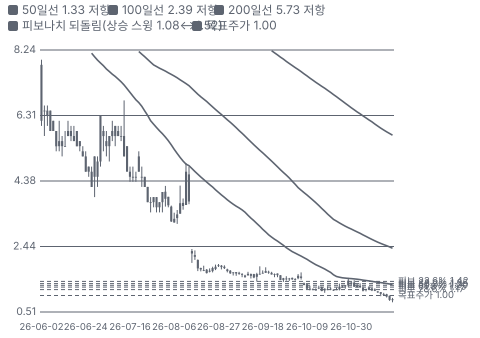

**주봉**

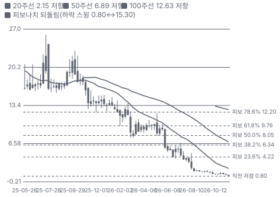

**월봉**

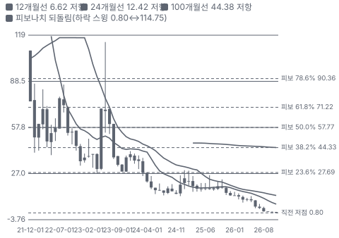

**분기 매출·EPS 실적과 컨센서스**

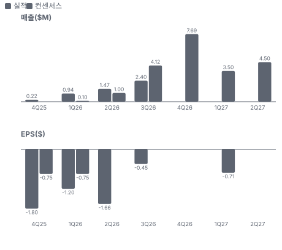

**밸류에이션 주가 시나리오**

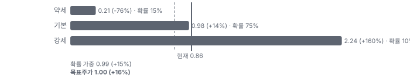

**주가별 업사이드**

- 제품·서비스 포트폴리오

**고객 믹스(3Q26, 매출 대비)**

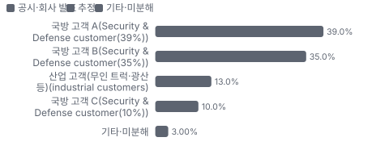

**공급 병목(10점, 낮을수록 병목)**

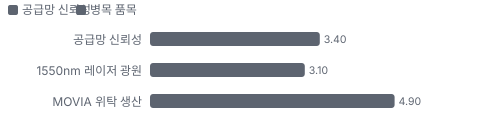

**CAPEX의 매출 대비 비중**

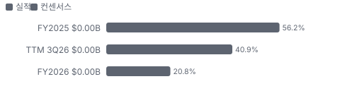

**수주·파이프라인 확실성 사다리**

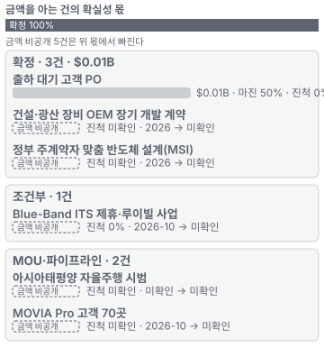

**매출 → 매출총이익 → 영업이익(매출 = 100, 최근 4분기)**

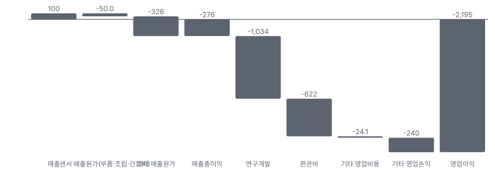

**분기 비용 비중 추이(매출 대비, 공시)**

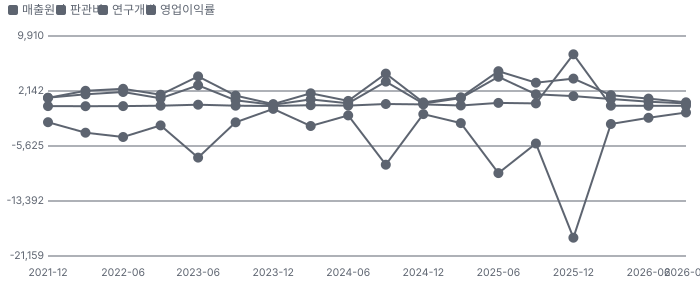

**비용 요인별 매출 대비 비중 1년 변화**

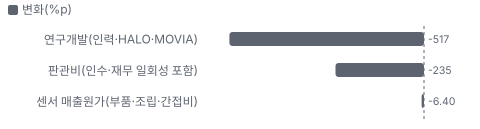

**IRIS 장거리 라이다 BOM 원가 몫**

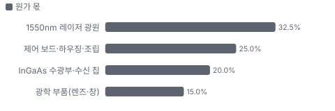

**MOVIA 단거리 라이다 BOM 원가 몫**

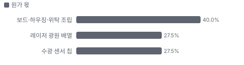

**BOM 항목 가격 +10% 시 OPM 변화**

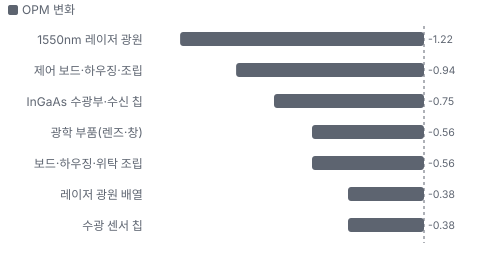

**자산 구성 — 3Q26 분기말 투하자본 \$44.8M**

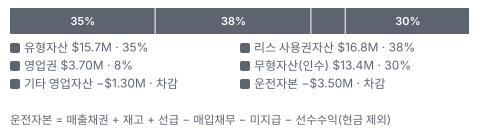

**자산별 변화율 — 최근 12개 분기(4Q23 = 0%) + 다음 4개 분기 추정**

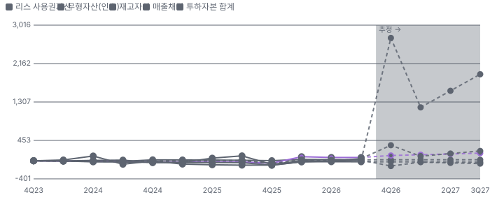

**ROIC 추이 — TTM, 최근 12개 분기 + 다음 4개 분기 추정(컨센서스 NOPAT) · 투하자본이 0 근처라 ROIC가 ±100%를 넘는 분기는 비움**

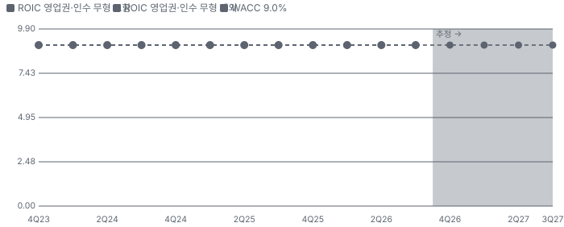

**Luminar 라이다 자산 시너지 램프(종류별, 확률 가중) · 시너지 가치 \$0.09B**

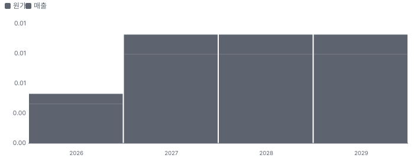
- Scantinel 자산 시너지 램프(종류별, 확률 가중) · 시너지 가치 \$0.00B

**매출 증가율의 가격·물량 분해와 8분기 전망(전년 대비)**

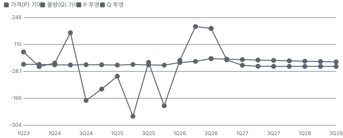

**목표주가 산정 — 기본 시나리오, 도달 확률 약 47%**

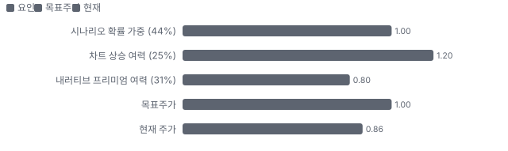

**재고 일수 — 분기별(수주 자료가 없어 수주/출하 비율 없음)**

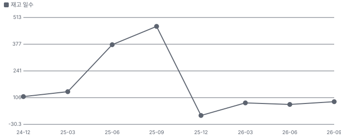

**일별 거래량 분해**

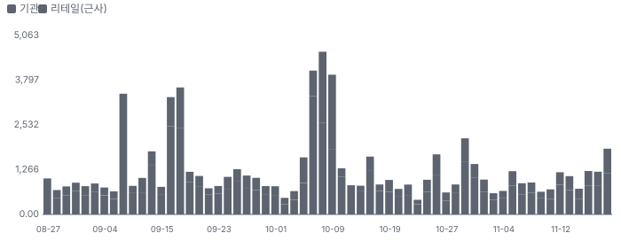

**기관 자금 흐름**

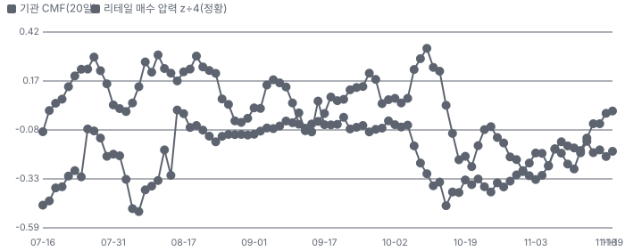

**몬테카를로**

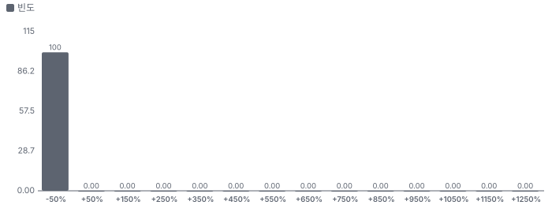

해석: 3,000번 중 0번(0%)에서 가치가 지금 주가 이상이었다. 가정을 흔들어도 지금 주가를 뒷받침하지 못하는 경우가 더 많다. 가운데 값은 -10.93배이고, 열 번 중 여덟 번은 -59.95~-1.32배 사이에 든다.

## 내러티브

> **기업가치를 결정하는 이야기:** MicroVision은 파산한 Luminar의 1550nm IRIS를 사 와 국방·산업 고객에 판다. 값은 세 숫자로 갈린다. 2027 매출(회사는 2026의 2배 이상), 매출총이익률(40~50%), 그리고 소진을 메우려 찍을 주식 수다. 시가총액은 \$29M, 기업가치는 약 \$43M으로 다음 4개 분기 매출 추정 \$21.2M의 2배 남짓이다.

> **멀티플·EPS 프리미엄**
> **멀티플:** 선행 이익이 모두 적자라 P/E·EV/EBITDA를 쓸 수 없고 EV/매출로 본다. 다음 4개 분기 매출 기준 약 2.0배로 Ouster 6.9배·Hesai 2.0배보다 낮고 같은 처지의 Innoviz 0.24배보다 높다.
> **EPS:** EPS 추정은 사실상 1명이다. FY2026 −\$3.90은 9개월 실적 −\$3.18에 4Q 손실을 더한 값이다. 2026년 주식 수가 67% 늘어 주당 손실이 줄어 보이는 효과도 있다.

### 투자자들은 왜 열광했나

2026년 2월 Luminar 자산 인수 뒤 '라이다 2.0'과 2026 매출 \$10~15M 가이던스가 나왔지만 주가는 3월부터 계속 내렸다. 식은 이유는 셋이다. 분기 매출이 1H에 합쳐 \$2.4M에 그쳤고, 회사가 전환사채 전환·\$2.50 공모로 주식을 계속 찍었으며, 10-Q에 계속기업 의문이 적혔다.

### 무엇이 기업가치를 바꾸나

> **구조적 체질 변화**
> **변화:** 자동차 OEM 개발 회사에서 국방·산업에 센서를 파는 회사로 바뀌는 중
> **증거:** 3Q 매출 84% 국방 고객(전년 3Q는 자동차 80%·12%, 10-Q)
> **반증:** 2027 매출이 2026의 2배에 못 미친다

> **고부가 믹스 확장**
> **변화:** IRIS(장거리)에서 MOVIA Pro·HALO로 제품을 넓힌다
> **증거:** MOVIA 관여 70곳(3Q 콜), HALO 양산 샘플 2027 초
> **반증:** MOVIA Pro 이익률이 IRIS보다 크게 낮게 굳는다

> **기술 혁신**
> **변화:** 1550nm ToF(IRIS·HALO)와 FMCW(Scantinel)를 함께 가진다
> **증거:** Luminar·Scantinel 개발 기술 계상(10-Q 주석 4)
> **반증:** HALO 고객 평가 결과가 IRIS보다 나쁘다

> **실행 속도**
> **변화:** PO 출하가 공급사 대응에 달려 있다 — 출하 대기 PO \$10M을 4Q에 얼마나 내보내나 **납품 리드타임 12.5개월.** 피어 비교 미확인. 이전 대비 미확인.
> **증거:** 3Q 콜: 출하 대기 PO 약 \$10M, 재고 대부분 확보, 일부 공급망 의존. 주문→출하 리드타임은 공시하지 않아 PO 잔고 ÷ 월 매출(약 12.5개월, 계산)로 본다
> **반증:** 4Q 매출 \$5.2M 미만

> **M&A**
> **변화:** Luminar 라이다 자산(\$33.2M)·Scantinel(\$2.2M) 인수
> **증거:** 10-Q 주석 4
> **반증:** Luminar 승계 고객 이탈

> **정책·입법 연관성**
> **재정정책:** 독일 정부 R&D 보조금 \$6.3M 현금 수령(3Q). 미국 정부 직접 계약은 미공시 3Q 10-Q MD&A(10-Q 경영진 재무 분석) 반증: - 의회 동의 2/10 — 하원 1/5(미국 의회 관련 의결 없음) · 상원 1/5(같음).
> **행정명령:** FCC(미국 연방통신위원회)의 외국산 로봇 부품 조치를 회사가 순풍으로 꼽는다(3Q 콜) 3Q 콜 CEO 발언 — 조치 원문 미대조 반증: 조치 철회 의회 동의 2/10 — 하원 1/5(행정 조치 — 의회 의결 없음) · 상원 1/5(같음).
> **연관입법:** NDAA(미국 국방수권법, 중국산 부품 배제 조항)의 중국산 부품 배제 조항이 국방 고객의 미국산 선호를 만든다 3Q 콜(IRIS·HALO NDAA 준수) 반증: -

> **고객의 지출 예산**
> **변화:** 국방 고객은 무인 차량·드론 조달 예산(CAPEX 성격), 산업 고객은 자율 장비 개발·도입 예산에서 돈이 나온다
> **사업별 예산:** **매출의 84%**: 국방 무인 차량·드론 센서 — 고객 CAPEX(국방 조달·시제 예산) · 동인: 무인 지상·항공 프로그램 수
**매출의 16%**: 산업 자율 장비 센서 — 고객 혼합(장비 개발(OPEX)·양산 도입(CAPEX)) · 동인: 무인 트럭·광산 장비 도입
> **증거:** 3Q 10-Q 고객 구성·3Q 콜
> **반증:** 국방 예산 지연으로 PO 출하가 밀린다

### 내러티브 근거

> '라이다 2.0 — Luminar 자산을 싸게 사서 매출을 키운다'는 이야기는 매출 성장(3Q \$2.4M, 전년 10배)으로 일부 확인됐지만, 그 사이 회사는 전환사채·\$2.50 공모·1:15 주식 병합으로 버텼다. 주가는 1년 전 종가 \$15.00(병합 반영)에서 \$0.86으로 −94%다. 쟁점은 매출이 아니라 2027 소진 \$40M을 어떻게 메우느냐다. 단계는 소멸, 쏠림은 낮음이다.

> **Luminar 자산의 매출 전환** · 약화
> **논리:** 파산한 Luminar의 IRIS 재고·고객을 \$33M에 사서 매출을 빠르게 만든다
> **숫자:** 3Q 매출 \$2.4M(전년 \$0.24M), 매출총이익률 50%, 2026 매출의 70~80%가 IRIS — 다만 3Q 매출은 발표 전 추정 \$4.1M(가이던스 환산)에 못 미쳤다
> **반증:** 4Q 매출이 \$5.2M(가이던스 하단 환산)에 못 미친다
> **출처:** 3Q 10-Q·2Q 콜

> **국방·미국산 라이다 수요** · 강화
> **논리:** NDAA·FCC 조치로 중국산이 빠진 국방·무인 차량 시장을 미국산 1550nm가 차지한다
> **숫자:** 3Q 매출의 84%가 국방 고객 3곳
> **반증:** 국방 고객 2곳 집중이 2027년에도 풀리지 않는다
> **출처:** 3Q 10-Q·콜

> **비용 절감과 소진 축소** · 유지
> **논리:** 레드먼드 통합·28% 감원으로 2027 소진을 \$40M까지 줄인다
> **숫자:** 3Q 영업비용 \$22.5M(1H 평균 \$24.4M), 레드먼드 임차 의무 \$12.8M 감소
> **반증:** 1Q27 영업 현금 사용이 분기 \$10M을 넘는다
> **출처:** 3Q 10-Q·8-K/A

> **AI 데이터센터 광연결(Scantinel)** · 유지
> **논리:** FMCW 광집적회로를 AI 데이터센터 광연결 모듈로 판다
> **숫자:** 매출 0, 9M 순손실 \$3.3M
> **반증:** 2027년 안 광연결 고객 발표가 없다
> **출처:** 3Q 실적 8-K·10-Q

> **반대 내러티브 — 희석 기계** · 강화
> **논리:** 30년 넘게 증자로 버텨 온 회사가 2027에도 현금보다 큰 소진을 증자로 메운다
> **숫자:** 누적 결손 \$1.03B, 2026 주식 수 20.4M → 34.0M(+67%), 계속기업 주석
> **반증:** 비희석 자금(자산 매각·라이선스) \$20M 이상 확보
> **출처:** 3Q 10-Q

### 투자 포인트

> **Luminar 재고가 매출이 된다**
> **명제:** 파산 경매로 산 IRIS 재고·고객이 2026~2027 매출을 만든다
> **숫자:** 3Q 매출 \$2.4M(전년 \$0.24M), 매출총이익률 50%(싸게 산 재고 덕, 10-Q), 출하 대기 PO 약 \$10M(콜)
> **시장과 다른 점:** 시장은 EV/다음 해 매출 2배로 라이다 동종(Ouster 6.9배)보다 낮게 본다. 다만 이익률은 싼 재고가 끝나면 내려갈 수 있다
> **증명:** 4Q 매출 \$5.2M 이상과 매출총이익률 40% 이상(2027-03 4Q 실적)
> **출처:** 3Q 10-Q·콜

> **소진이 1/3 준다**
> **명제:** 레드먼드 통합과 28% 감원으로 2027 영업 현금 소진이 약 \$40M이 된다
> **숫자:** 레드먼드 임차 의무 \$12.8M 감소(8-K/A), 감원 비용 약 \$4.0M(10-Q 주석 15), 3Q 영업비용 1H 평균보다 7.5% 낮음
> **시장과 다른 점:** \$40M도 9/30 현금 \$28.9M보다 크다 — 소진 축소는 증자 규모를 줄일 뿐 없애지 못한다
> **증명:** 1Q27 영업 현금 사용 분기 \$10M 이하(2027-05)
> **출처:** 3Q 실적 8-K·10-Q

> **희석이 주당 가치를 정한다**
> **명제:** ATM 잔여 \$41.1M·워런트·전환사채가 지금 주주 몫을 줄인다
> **숫자:** 2026 주식 수 20.4M → 34.0M(+67%), 계속기업 주석, ATM을 지금 가격에 다 쓰면 약 4,800만 주(계산)
> **시장과 다른 점:** CFO는 비핵심 자산 현금화·전략 제휴로 '깨끗한 자본'을 찾겠다고 했다 — 금액·시점은 없다
> **증명:** 비희석 자금 공시 또는 새 증자 조건(4Q 실적·10-K)
> **출처:** 3Q 10-Q·콜

### 모멘텀 생성·소멸 타임라인

**카탈리스트 달력 — 지난 사건의 주가 반응과 앞으로 확인할 숫자**
| 날짜 | 상태 | 구분 | 사건 | 반응·확인 | 결과에 따라 |
|---|---|---|---|---|---|
| 2026-03-05 | 완료 | 소멸 | 4Q25 실적 뒤 | −29.5% |  |
| 2026-08-14 | 완료 | 소멸 | \$2.50 공모·워런트 | −40.6% |  |
| 2026-10-29 | 완료 | 생성 | 3Q 매출 기록·2027 소진 \$40M | +10.8% 뒤 11/19까지 −40% |  |
| 2026-11-12 | 완료 | 확인 | 전환사채 잔액 \$7.8M 공시 | −4.4% |  |
| 2027-03(예상) | 예정 | 확인 | 4Q26 실적·10-K | 4Q 매출 \$5.2M(가이던스 하단 환산), 매출총이익률 40%, 연말 현금, 계속기업 주석 유지 여부 | 매출 하단 이상·비희석 자금이면 기본, 매출 미달·새 증자면 약세 |
| 2027 상반기(예상) | 예정 | 확인 | HALO 양산 전 샘플 공급 | 고객 평가 착수 발표 | 공급 시작이면 강세 쪽, 지연이면 약세 쪽 |
| 2027-05(예상) | 예정 | 확인 | 1Q27 실적 | 영업 현금 사용 분기 \$10M 이하 | 넘으면 2027 \$40M 목표가 흔들린다 |

### 언제 사서 언제 팔아야 할까?

**가격·조건 틀 — 가격은 밸류에이션(약세·기본·강세·목표주가)과 차트 지지 구간에서, 조건은 이벤트에서**
| 구간 | 가격 | 목표주가까지 | 약세까지 | 조건·근거 |
|---|---|---|---|---|
| 관찰 구간 | \$0.80~\$0.80 | +25% | -74% | 지금 가격 아래 지지 구간 — 주가가 주당 현금(약 \$0.85, 9/30 기준 기본 주식)에 붙어 있어 사업 가치에 값이 거의 없다 |
| 확인 뒤 | 지금 \$0.86 이상에서 조건 확인 | +16% | -76% | 4Q 매출 가이던스 하단 이상과 비희석 자금(자산 매각·라이선스) 공시 |
| 무효화 | 약세 시나리오 \$0.21 | - | -76% | 4Q 매출 \$5.2M 미만, 새 ATM·공모, 나스닥 최소 호가(\$1) 미달 통지 |
| 차익 고민 1차 | \$1.00(목표주가·기본 시나리오) | +16% | - | 고객 발표 직후 급등 — 2026년에는 발표 뒤 공모·전환이 따라왔다 |
| 차익 고민 2차 | \$2.24(강세 시나리오) | +160% | - | 고객 발표 직후 급등 — 2026년에는 발표 뒤 공모·전환이 따라왔다 |

하루 ±15~40% 움직이는 종목이라 발표 당일 추격은 변동성이 크다 — 가격·조건 틀이며 매매 지시가 아니다 가격·조건 틀이며 매매·비중 지시가 아니다(투자 권유 아님).

## 포트폴리오

| 제품·서비스 | 구분 | 무엇 | 쓰는 곳 | 돈 버는 방식 | Mix | Mix 변화(전년 대비) |
|---|---|---|---|---|---|---|
| IRIS 장거리 라이다 | 제품 | 1550nm ToF 장거리 고체형 라이다(Luminar에서 인수) | 무인 트럭·광산 장비·국방 무인 차량 | 센서 판매 — 2026 매출의 70~80%(2Q 콜) | 미확인 | 미확인 |
| MOVIA 단거리 라이다 | 제품 | 움직이는 부품 없는 플래시 라이다(MOVIA L(기존 플래시 라이다)·Pro·Air) | 무인 지상 차량·드론·로봇·물류 | 센서 판매 — MOVIA Pro 10월 출시, 고객 관여 70곳 | 미확인 | 미확인 |
| HALO 차세대 장거리 라이다 | 제품 | IRIS보다 작고 싸고 전력이 적은 1550nm 라이다 | 교통 시스템·산업·자동차 | 양산 샘플 2027 초 — 매출 전 | 미확인 | 미확인 |
| Scantinel·MSI | 서비스 | FMCW 광집적회로와 맞춤 반도체 설계 | 차세대 라이다·AI 데이터센터 광연결·정부 반도체 설계 | 매출 0(Scantinel), 정부 주계약자 설계 선정(금액 미공시) | 미확인 | 미확인 |

## 고객

> **3Q26 최대 고객 국방 고객 A(Security & Defense customer(39%)) 39%, 상위 3곳 87%, 집중도 집중.** 공시·회사 발표로 확인한 몫은 매출의 84%이고, 나머지 고객 몫은 추정이거나 미분해다. 3Q 매출의 84%가 국방 고객 3곳(39%·35%·10%)이다. 9개월로는 국방 2곳 51%, 산업 1곳 15%, 자동차 OEM 1곳 10%. 회사가 이름을 밝힌 고객은 Overland AI·Lake Fusion Technologies·Kodiak AI 정도이고 10% 고객의 이름은 공시하지 않는다

**고객별 매출 몫(3Q26)**
| 고객 | 몫 | 변화 | 근거 |
|---|---|---|---|
| 국방 고객 A(Security & Defense customer(39%)) | 39% | 미확인 | 공시 |
| 국방 고객 B(Security & Defense customer(35%)) | 35% | 미확인 | 공시 |
| 산업 고객(무인 트럭·광산 등, industrial customers) | 10~16% | 미확인 | 추정 |
| 국방 고객 C(Security & Defense customer(10%)) | 10% | 미확인 | 공시 |
| 기타·미분해 | 3% | - | - |

> **국방 고객 A(Security & Defense customer(39%))** · 공시
> **사는 것:** IRIS·MOVIA L
> **추정 근거:** 이름 미공시

> **국방 고객 B(Security & Defense customer(35%))** · 공시
> **사는 것:** MOVIA L(10-Q '국방 고객에 MOVIA L 출하')
> **추정 근거:** 이름 미공시

> **산업 고객(무인 트럭·광산 등, industrial customers)** · 추정
> **사는 것:** IRIS
> **추정 근거:** 나머지 16%를 산업·기타로 나눔 — Kodiak AI가 그중 하나인지는 가설

> **국방 고객 C(Security & Defense customer(10%))** · 공시
> **사는 것:** 센서
> **추정 근거:** 이름 미공시

## 수주·파이프라인

> **2026-10-28 기준 6건.** 확정 \$0.01B. 공시 출하 대기 고객 PO 약 \$10M(3Q 콜) \$0.01B.

**수주 목록**
| 상태 | 계약 | 계약 총액 | 진척 | 기간 | 비고 |
|---|---|---|---|---|---|
| 확정 | 출하 대기 고객 PO | \$0.01B | 0% | 2026-10 → 2026-12 | - |
| 확정 | 건설·광산 장비 OEM 장기 개발 계약 | 금액 비공개 | 비공개 | 2026 → 미확인 | - |
| 확정 | 정부 주계약자 맞춤 반도체 설계(MSI) | 금액 비공개 | 비공개 | 2026 → 미확인 | - |
| 조건부 | Blue-Band ITS 제휴·루이빌 사업 | 금액 비공개 | 0% | 2026-10 → 미확인 | - |
| 파이프라인 | 아시아태평양 자율주행 시범 | 금액 비공개 | 비공개 | 미확인 → 미확인 | - |
| 파이프라인 | MOVIA Pro 고객 70곳 | 금액 비공개 | 비공개 | 2026-10 → 미확인 | 출시 초기 이익률이 얇다(CEO, 3Q 콜) |

**실행 속도와 방해 요인**
| 항목 | 상태 | 실행 속도 | 방해 요인 |
|---|---|---|---|
| 출하 대기 고객 PO | 확정 | 재고 대부분 확보, 4Q에 IRIS 출하가 크게 늘 것(CEO) | 일부 공급망 의존(CFO) · 출하 시점 |
| 건설·광산 장비 OEM 장기 개발 계약 | 확정 | IRIS → HALO 전환 경로 | HALO 양산 샘플(2027 초) · 계약 금액 미공시 |
| 정부 주계약자 맞춤 반도체 설계(MSI) | 확정 | 선정 단계 | 금액 미공시 |
| Blue-Band ITS 제휴·루이빌 사업 | 조건부 | 제휴 발표(10월), 루이빌 \$3M 연방 지원 사업 참여(11/19) | 사업 총액 \$3M 중 MicroVision 몫 미공시 |
| 아시아태평양 자율주행 시범 | 파이프라인 | IRIS 시범, HALO 전환 가능 | 양산 결정 |
| MOVIA Pro 고객 70곳 | 파이프라인 | 10월 출시, 평가·견적 | 평가 → 양산 전환 |

## 마진 구조

> **GPM 50.0%, OPM -889.2%.** 2Q26 대비 GPM +6.4%p, OPM +758.6%p. 변동비는 매출의 151%이고, 매출이 10% 늘면 OPM은 +76.2%p 움직인다. 3Q 매출총이익률은 50%(2Q 44%)다. Luminar에서 싸게 산 IRIS 재고와 올랜도 설비를 쓴 덕이라고 회사가 적었다. 매출 \$2.4M에 연구개발 \$13.2M·판관비 \$9.4M이 붙어 영업손실은 \$21.3M이다. 3Q 순손실이 \$12.2M으로 작은 것은 독일 정부 보조금 \$6.3M·워런트 평가이익 \$3.6M 덕이다

> **매출 100 중 매출원가 376.2, 매출총이익 -276.2(최근 4분기, 공시).** 매출원가 요인 중 센서 매출원가(부품·조립·간접비)이 매출의 50.0%로 가장 무겁고, 단가가 +10% 오르면 GPM이 -5.00%p 움직인다. 분기 회귀로 매출 1이 늘 때 매출원가는 -0.31 늘고, 매출원가의 고정비 몫은 100%다.

**비용 요인 강도 — 비중·추세·충격(+10%)·탄력**
| 비용 | 구분 | 매출 대비 | 1년 변화 | 마진 기여 | 충격 시 마진 | 매출 탄력 | 고정비 몫 |
|---|---|---|---|---|---|---|---|
| 센서 매출원가(부품·조립·간접비) | 매출원가 요인 | 50.0% | -6.4%p | +6.4%p | -5.00%p | 미확인 | 40% |
| 연구개발 | 공시 항목 | 1033.8% | -173.2%p | +173.2%p | 미확인 | 1.44 | 86% |
| 판관비 | 공시 항목 | 621.5% | -253.8%p | +253.8%p | 미확인 | 0.79 | 89% |
| 매출원가 | 공시 항목 | 376.2% | +135.7%p | -135.7%p | -37.62%p | -0.31 | 100% |
| 기타 영업비용 | 공시 항목 | 24.1% | 미확인 | 미확인 | 미확인 | 0.01 | 98% |

매출 탄력 = 분기 비용을 매출에 회귀한 기울기(매출 1당 변동비), 고정비 몫 = 절편 ÷ 평균 비용. 표본이 8분기 미만이면 미확인. 매출원가 요인 비중은 margin 재료의 추정이 섞여 있고, 공시 매출원가와의 차이는 '기타 매출원가'로 둔다.

**GPM에서 OPM까지(GAAP, 아래는 최근 4개 분기)**
| 기간 | GPM | 연구개발 | 판관비 | 기타 | OPM |
|---|---|---|---|---|---|
| 2Q26 | 43.6% | 1066.0% | 625.3% | 0.0% | -1647.7% |
| 3Q26 | 50.0% | 549.2% | 390.0% | 0.0% | -889.2% |
| 2025-12 | -7220.6% | - | - | - | -18570.0% |
| 2026-03 | 38.8% | - | - | - | -2512.7% |
| 2026-06 | 43.6% | - | - | - | -1643.7% |
| 2026-09 | 50.0% | - | - | - | -889.0% |

**비용을 움직이는 요인**
| 비용 | 요인 |
|---|---|
| 연구개발(인력·HALO·MOVIA, 연구개발) | 인력(28% 감원 대상) · 근거 공시 |
| 판관비(인수·재무 일회성 포함, 판관비) | 인력·법무·일회성 재무 비용 \$1.2M(3Q) · 근거 공시 |
| 센서 매출원가(부품·조립·간접비, 매출원가) | IRIS 재고 원가·부품 단가 · 근거 공시 |

**IRIS 장거리 라이다 BOM — 매출의 75%, GPM 50%(3Q 전사 매출총이익률(제품별 미공시)), 항목 가격 +10% 시**
| 항목 | 원가 몫 | 전가 | 제품 GPM | OPM |
|---|---|---|---|---|
| 1550nm 레이저 광원 | 25~40% | 미확인 | -1.6%p | -1.22%p |
| 제어 보드·하우징·조립 | 20~30% | 미확인 | -1.3%p | -0.94%p |
| InGaAs(인듐갈륨비소, 1550nm 빛 수광 소재) 수광부·수신 칩 | 15~25% | 미확인 | -1.0%p | -0.75%p |
| 광학 부품(렌즈·창) | 10~20% | 미확인 | -0.8%p | -0.56%p |
| 미분해 | 7% | - | - | - |

**MOVIA 단거리 라이다 BOM — 매출의 20%, GPM 30%(추정 — 출시 초기라 이익률이 얇다(CEO, 3Q 콜), 전사 50%보다 낮게), 항목 가격 +10% 시**
| 항목 | 원가 몫 | 전가 | 제품 GPM | OPM |
|---|---|---|---|---|
| 보드·하우징·위탁 조립 | 30~50% | 미확인 | -2.8%p | -0.56%p |
| 레이저 광원 배열 | 20~35% | 미확인 | -1.9%p | -0.38%p |
| 수광 센서 칩 | 20~35% | 미확인 | -1.9%p | -0.38%p |
| 미분해 | 5% | - | - | - |

판매가 전가를 모르는 항목은 전가 0%로 계산했다.

**BOM 항목 가격을 움직이는 것**
| 항목 | 요인 |
|---|---|
| 1550nm 레이저 광원 | 광원·증폭기가 원가의 큰 몫 · 근거 추정 |
| InGaAs 수광부·수신 칩 | 맞춤 칩 · 근거 추정 |
| 광학 부품(렌즈·창) | 광학 정렬 · 근거 추정 |
| 제어 보드·하우징·조립 | 올랜도 조립 인건비 · 근거 추정 |
| 레이저 광원 배열 | 광원 · 근거 추정 |
| 수광 센서 칩 | 수광 배열 · 근거 추정 |
| 보드·하우징·위탁 조립 | 위탁 생산 · 근거 추정 |

**투입 물가 — 미국 PPI 3·6·12개월(2026-10, 개정 반영)과 해외 전년비**
| 항목 | 미국 3개월 | 6개월 | 12개월 | 전가 못 할 때 OPM | 일본 | 한국 | 대만 |
|---|---|---|---|---|---|---|---|
| 레이저 광원 배열 | -0.7% | -5.7% | -2.7%* | - | 미확인 | 미확인 | 미확인 |
| 수광 센서 칩 | -0.7% | -5.7% | -2.7% | - | +1.6% | +1.5% | +22.9%* |
| 광학 부품(렌즈·창) | 미확인 | 미확인 | 미확인* | - | 미확인 | 미확인 | 미확인 |
| 보드·하우징·위탁 조립 | +0.0% | +24.0% | +46.4% | - | +11.5% | +1.7% | +12.1% |

별표는 품목보다 넓은 업종 지수다. 연결한 투입 원가의 미국 PPI(생산자물가지수)는 1년 새 가중 -2.7%이고, 판매가로 넘기지 못하면 GPM +1.3%p·OPM +1.3%p가 움직인다.

## 자산 구성

> **3Q26 분기말 투하자본 \$44.8M** — 리스 사용권자산 38%, 유형자산 35%. 최근 12개 분기(4Q23 → 3Q26) 가장 크게 늘어난 자산은 유형자산(+74%), 투하자본 합계 +17%. 3Q27 추정 투하자본 \$14.4M(-68%, 컨센서스 매출과 회전 일수·CAPEX 강도 유지 가정). 연율 감가 비율(총액 기준)은 직전 4분기 21.73% → 최근 4분기 27.60%.

**자산·운전자본 항목별 분기말 잔액 — 최근 12개 분기와 다음 4개 분기 추정**
| 항목 | 4Q23 | 3Q25 | 3Q26(최근) | 3Q27 추정 | 12개 분기 변화 | 다음 4개 분기 변화 |
|---|---|---|---|---|---|---|
| 매출채권 | \$0.9M | \$0.0M | \$1.4M | \$3.0M | +48% | +115% |
| 재고자산 | \$3.9M | \$8.1M | \$4.4M | \$78.4M | +14% | +1681% |
| 선급·기타 유동자산 | \$4.9M | \$7.0M | \$2.9M | \$38.5M | -41% | +1234% |
| 매입채무 | \$2.3M | \$1.3M | \$6.4M | \$105.5M | +180% | +1560% |
| 미지급비용 | \$8.6M | \$3.8M | \$5.7M | \$54.8M | -34% | +868% |
| 선수수익(계약부채) | 미확인 | 미확인 | \$0.1M | \$1.2M | 비교 불가 | +825% |
| 유형자산 | \$9.0M | \$6.6M | \$15.7M | \$24.5M | +74% | +56% |
| 리스 사용권자산 | \$13.8M | \$15.4M | \$16.8M | \$16.8M | +22% | +0% |
| 영업권 | 미확인 | 미확인 | \$3.7M | \$3.7M | 비교 불가 | +0% |
| 무형자산(인수) | \$17.2M | \$10.3M | \$13.4M | \$12.3M | -22% | -8% |

**자산 추정 동인 — 최근 4개 분기 평균(재무상태표 동인 모형)**
| 동인 | 값 | 곱하는 기준 |
|---|---|---|
| 매출채권 | 50일 | 매출 |
| 재고자산 | 346일 | 매출원가 |
| 선급·기타 유동자산 | 639일 | 매출 |
| 매입채무 | 465일 | 매출원가 |
| 미지급비용 | 909일 | 매출 |
| 선수수익(계약부채) | 20일 | 매출 |
| CAPEX 강도 | 40.9% | 매출(최근 4개 분기 합) |
| 분기 감가율 | 19.69% | 기초 유형자산 순액(무형 상각 제외 감가상각) |
| 매출원가율 | 376.2% | 매출(최근 4개 분기) |
| 영업권·리스 사용권·기타 | 유지 | 인수·새 리스는 공시 전 모름 |
| 인수 무형자산 | 분기 \$0.3M 상각 | 최근 4개 분기 평균 상각 |

**추정 방법:** 증권사 3표 모델(손익·재무상태표·현금흐름)의 재무상태표 동인 방식이다. 운전자본은 항목별 회전 일수(매출채권·선급·미지급·선수는 매출, 재고·매입채무는 매출원가 기준)를 최근 4개 분기 평균으로 두고 컨센서스 매출에 곱한다. 유형자산은 기초 + CAPEX − 감가상각으로 굴린다(Koller·Goedhart·Wessels 『Valuation』 재무상태표 추정). 매출 경로는 ROIC 절의 컨센서스와 같다.

**유형·무형자산 항목별 가치(2025-12-31 vs 2024-12-31)**
| 구분 | 항목 | 총액 2025-12-31 | 누적상각 | 순액 | 총액 2024-12-31 | 총액 1년 변화 | 공시 내용연수 |
|---|---|---|---|---|---|---|---|
| 유형 | 유형자산 합계(항목 미분해) | \$26.1M | 총계만 공시 | 총계만 공시 | \$27.3M | -4.2% | 미확인 |
| 무형 | 무형자산 합계(항목 미분해) | \$16.0M | −\$5.9M | \$22.0M | \$20.2M | -20.5% | 미확인 |
| 유형 합계 | 유형자산 | \$26.1M | \$21.9M | \$4.3M | \$27.3M | -4.2% | 경과율 84%(상각 대상 기준) |

**내용연수 산식(상각 대상 유형자산 = 총액 − 토지 − 건설중)**
| 기준일 | 연 감가상각 | 상각 대상 총액 | 평균 내용연수 | 경과 연수 | 잔여 연수 | 경과율 |
|---|---|---|---|---|---|---|
| 2025-12-31 | \$1.4M | \$26.1M | 18.7년 | 15.6년 | 3.1년 | 84% |
| 2024-12-31 | \$2.1M | \$27.3M | 13.0년 | 9.6년 | 3.4년 | 74% |

산식 평균 내용연수는 18.7년. 1년 전 13.0년 → 지금 18.7년.

**분기 감가 비율(감가상각 ÷ 평균 유형자산 총액)**
| 분기 | 감가상각 | 평균 유형자산(총액) | 분기 비율 | 연율 | 연율의 역수 |
|---|---|---|---|---|---|
| 4Q24 | \$1.7M | \$27.6M | 6.08% | 24.30% | 4.1년 |
| 1Q25 | \$1.4M | \$27.4M | 5.14% | 20.55% | 4.9년 |
| 2Q25 | \$1.5M | \$27.8M | 5.56% | 22.23% | 4.5년 |
| 3Q25 | \$1.4M | \$28.1M | 4.97% | 19.88% | 5.0년 |
| 4Q25 | \$1.5M | \$27.1M | 5.44% | 21.78% | 4.6년 |
| 1Q26 | \$2.4M | \$33.2M | 7.13% | 28.54% | 3.5년 |
| 2Q26 | \$3.0M | \$40.2M | 7.41% | 29.62% | 3.4년 |
| 3Q26 | \$2.9M | \$40.8M | 7.18% | 28.71% | 3.5년 |

감가상각 기준: 손익계산서 감가상각·상각비(SEC 공시 데이터, 4분기 = 연간 − 1~3분기).

최근 4분기 연율 감가 비율 27.60%, 직전 4분기 21.73%(+27%) — 경고 문턱(-10%) 안이다.

미공시·미분해: 유형자산 항목별 총액·내용연수(10-K 주석에서 모델이 채움) · 무형자산 항목(10-K 주석에서 모델이 채움) — 이 칸은 비우고 나머지로 계산했다.

### 해석 — 자산이 어디에 쌓이고 있나

- 같은 기간 4개 분기 매출은 -38% — 매출보다 빨리 늘어난 자산: 매출채권 +48%, 재고자산 +14%, 유형자산 +74%, 리스 사용권자산 +22%, 무형자산(인수) -22%. 이 자산의 회전율이 떨어지면 ROIC를 희석한다.
- 다음 4개 분기 CAPEX \$8.7M vs 감가상각 \$15.6M(최근 4개 분기 CAPEX 강도·감가율 유지) — 유형자산 3Q26 \$15.7M → 3Q27 \$24.5M. 투자가 감가보다 작아 자산이 줄어드는 국면이다.
- 감가 비율이 올라갔다 — 이익을 보수적으로 잡는 쪽이다(내용연수 단축·짧은 수명 자산 증가).

## ROIC

**ROIC 추이(TTM)와 다음 4개 분기 추정 — NOPAT ÷ 평균 투하자본(이번 분기말·4개 분기 전)**
| 분기 | 구분 | TTM 매출 | TTM NOPAT | NOPAT 마진 | 평균 투하자본 | ROIC 포함 | ROIC 제외 |
|---|---|---|---|---|---|---|---|
| 4Q23 | 실적 | \$7.3M | −\$67.9M | -935.0% | \$29.9M | 미확인 | 미확인 |
| 1Q24 | 실적 | \$7.4M | −\$72.1M | -969.7% | \$38.6M | 미확인 | 미확인 |
| 2Q24 | 실적 | \$9.0M | −\$72.7M | -807.1% | \$36.6M | 미확인 | 미확인 |
| 3Q24 | 실적 | \$8.1M | −\$66.3M | -813.7% | \$37.9M | 미확인 | 미확인 |
| 4Q24 | 실적 | \$4.7M | −\$65.1M | -1385.8% | \$37.5M | 미확인 | 미확인 |
| 1Q25 | 실적 | \$4.3M | −\$55.4M | -1279.7% | \$36.9M | 미확인 | 미확인 |
| 2Q25 | 실적 | \$2.6M | −\$47.8M | -1848.4% | \$36.2M | 미확인 | 미확인 |
| 3Q25 | 실적 | \$2.6M | −\$45.7M | -1733.2% | \$37.5M | 미확인 | 미확인 |
| 4Q25 | 실적 | \$1.2M | −\$63.9M | -5291.7% | \$26.3M | 미확인 | 미확인 |
| 1Q26 | 실적 | \$1.6M | −\$71.3M | -4589.1% | \$42.5M | 미확인 | 미확인 |
| 2Q26 | 실적 | \$2.9M | −\$78.9M | -2746.0% | \$40.9M | 미확인 | 미확인 |
| 3Q26 | 실적 | \$5.0M | −\$85.6M | -1700.6% | \$42.7M | 미확인 | 미확인 |
| 4Q26 | 추정 | \$12.5M | −\$97.0M | -776.2% | \$4.7M | 미확인 | 미확인 |
| 1Q27 | 추정 | \$15.1M | −\$85.9M | -570.2% | \$36.6M | 미확인 | 미확인 |
| 2Q27 | 추정 | \$18.1M | −\$76.5M | -423.0% | \$31.4M | 미확인 | 미확인 |
| 3Q27 | 추정 | \$21.2M | −\$71.7M | -338.3% | \$29.6M | 미확인 | 미확인 |

**다음 4개 분기 NOPAT — 컨센서스(세율 21%, 리스 이자 별도)**
| 분기 | 매출 | EBITA 마진 | EBITA | NOPAT(분기) | 근거 |
|---|---|---|---|---|---|
| 4Q26 | \$7.7M | -724.4% | −\$55.7M | −\$44.0M | 컨센서스 매출 × EBIT 마진 FY2026 |
| 1Q27 | \$3.5M | -265.9% | −\$9.3M | −\$7.4M | 컨센서스 매출 × EBIT 마진 FY2027 |
| 2Q27 | \$4.5M | -267.7% | −\$12.0M | −\$9.5M | 컨센서스 매출 × EBIT 마진 FY2027 |
| 3Q27 | \$5.5M | -268.8% | −\$14.8M | −\$11.7M | 컨센서스 매출 × EBIT 마진 FY2027 |

**추정 방법:** NOPAT은 컨센서스(분기 매출 추정 × 회계연도 EBIT 마진 추정)로 잡고, 조정(비 GAAP) 마진이면 주식보상 몫을 빼서 과거 실적과 같은 기준(영업이익 + 인수 무형 상각)으로 맞췄다. 이미 발표했지만 분기 보고서(10-Q)가 아직 없는 분기는 발표 실적을 쓴다. 투하자본은 자산 구성 절의 재무상태표 동인으로 굴렸다. ROIC는 4개 분기 NOPAT을 이번 분기말과 4개 분기 전 투하자본의 평균으로 나눈다 — 추정 분기의 ROIC에는 이미 나온 실적 분기가 섞여 있다.

**투하자본 항목별 회전율과 ROIC 기여(TTM 3Q26, 평균 잔액)**
| 항목 | 투하자본 | 매출 1달러당 자본 | 회전율(매출 ÷ 항목) | 자본 몫 | 이 항목을 빼면 ROIC |
|---|---|---|---|---|---|
| 운전자본 | \$3.3M | 0.65 | 1.53회 | 8% | -217.5% |
| 유형자산 | \$11.2M | 2.22 | 0.45회 | 26% | -271.6% |
| 리스 사용권자산 | \$16.1M | 3.20 | 0.31회 | 38% | -322.2% |
| 영업권 | \$1.8M | 0.37 | 2.74회 | 4% | -209.7% |
| 무형자산(인수) | \$11.8M | 2.35 | 0.43회 | 28% | -277.5% |
| 기타 영업자산 | −\$1.5M | -0.30 | 음수(자금 원천) | -4% | -193.9% |

**ROIC 세 가지 판**
| 판 | NOPAT | 투하자본 | ROIC | 무엇을 재나 |
|---|---|---|---|---|
| 영업권·인수 무형 포함 | −\$85.7M | \$42.7M | 미확인 | 인수 웃돈까지 낸 돈에 대한 수익률 |
| 영업권·인수 무형 제외 | −\$85.7M | \$29.1M | 미확인 | 본업 운영 수익률(동종 비교용) |
| 무형 자본화 조정(판관비 20%·5년, 연구개발 6년) | −\$86.1M | \$193.9M | -44.4% | 비용으로 처리한 무형 투자를 자산으로 본 판 |
| 경제적 이익(포함판) | −\$89.6M | \$42.7M | 자본비용 9.0% | (ROIC − 자본비용) × 투하자본 |

NOPAT = (영업이익 −\$110.5M + 인수 무형 상각 + 리스 내재 이자 \$1.1M) × (1 − 세율 21%). 리스 사용권자산을 투하자본에 넣었으므로 임차료 속 이자 몫을 영업이익에 되더했다. 현금은 영업에 필요한 몫을 따로 알 수 없어 투하자본에서 뺐다. SEC 공시 데이터 자동 초안 — 운전자본 = 매출채권 + 재고 + 선급 − (매입채무 + 미지급비용 + 선수수익), 현금 제외. 손상 누계는 공시 데이터 수록분.

투하자본 또는 NOPAT이 0 이하라 ROIC 분해는 비교 불가 — 경제적 이익으로 본다.

**무형 자본화 가정별 ROIC(2025년 지출 기준, 포함판에 더함)**
| 투자로 보는 몫 | 상각 연수 | 무형 자산 | NOPAT 조정 | 조정 ROIC |
|---|---|---|---|---|
| 판관비 20% | 2년 | \$142.3M | −\$2.3M | -47.6% |
| 판관비 20% | 5년 | \$151.2M | −\$0.4M | -44.4% |
| 판관비 30% | 2년 | \$145.8M | −\$3.5M | -47.4% |
| 판관비 30% | 5년 | \$159.2M | −\$0.7M | -42.8% |

### 해석 — 무엇이 수익성을 끌어올리고 희석하나

- 리스 사용권자산: 투하자본의 38% — 빼면 ROIC 미확인 → -322.2%. 이 자산의 회전율(0.31회)이 수익성을 희석하는 주된 자리다.
- 무형자산(인수): 투하자본의 28% — 빼면 ROIC 미확인 → -277.5%. 이 자산의 회전율(0.43회)이 수익성을 희석하는 주된 자리다.
- 기타 영업자산: −\$1.5M(음수), 고객 선수금·공급사 외상이 자본을 대신 댄다 — 빼면 ROIC -193.9%로 낮아진다. 수익성을 끌어올리는 쪽이다.

## 공급망 병목

> **공급망 신뢰성 3.4/10, 병목 심각.** 가장 약한 고리는 1550nm 레이저 광원 3.1점이고, 품목 평균은 4.0점이다. 근거가 부족한 2건(InGaAs 수광부·수신 칩 · 광학 부품(렌즈·창))은 점수에서 뺐다. 10-Q는 부품 대부분을 단일·소수 공급원에서 산다고 적는다. IRIS는 올랜도에서 조립하고 1550nm 레이저·수광부·맞춤 칩이 핵심이다. 콜에서 CFO는 '일부 공급망 의존이 남아 있다'고 했고 CEO는 4Q에 '핵심 공급사가 완전히 붙어' 출하가 늘 것이라고 했다. 공급사 이름은 공시하지 않는다

**병목과 마진 — 품목 가격 +10% 시 OPM**
| 품목 | 점수 | 판정 | 구분 | OPM |
|---|---|---|---|---|
| 1550nm 레이저 광원(필수) | 3.1 | 병목 심각 | 핵심 통제 품목 | -1.22%p |
| MOVIA 위탁 생산 | 4.9 | 병목 주의 | 출하 차질 위험 | 미확인 |

> **1550nm 레이저 광원** · 3.1/10
> **왜:** IRIS 거리 성능의 핵심
> **병목 요인:** 인증 공급사 1곳 · 캐파 빠듯 · 리드타임 미확인 · 재인증 12개월 · 1위 점유율 미확인 · 지역 집중 미확인 · 물량 확보 현물
> **풀리는 조건:** 미확인 — '핵심 공급사 참여'는 회사 말

> **MOVIA 위탁 생산** · 4.9/10
> **왜:** MOVIA L 재고
> **병목 요인:** 인증 공급사 1곳 · 캐파 여유 · 리드타임 미확인 · 재인증 9개월 · 1위 점유율 100% · 지역 집중 미확인 · 물량 확보 현물
> **풀리는 조건:** 해소 — 약정 정산

**공급사**
| 품목 | 공급사 | 몫 | 근거 |
|---|---|---|---|
| 1550nm 레이저 광원 | 이름 비공개(광원·광섬유 증폭) | 미확인 | 공시 |
| InGaAs 수광부·수신 칩 | MicroVision Semiconductor(설계)·외부 파운드리(미공시, 수신 칩 설계·제조) | 미확인 | 회사 발표 |
| 광학 부품(렌즈·창) | 이름 비공개(광학) | 미확인 | 추정 |
| MOVIA 위탁 생산 | 이름 비공개 위탁 생산사(MOVIA L 생산) | 미확인 | 공시 |

**무역 통계로 본 공급 지역**
| 품목 | EU 수입처 | 일본 수입처 | EU 1위 전년비 |
|---|---|---|---|
| 1550nm 레이저 광원 | CN(중국) 42% · MY(말레이시아) 24% · JP(일본) 18% | 中華人民共和国 32% · マレーシア 21% | +3.1% |
| InGaAs 수광부·수신 칩 | TW(대만) 31% · MY 19% · CN 15% | 台湾 60% · 中華人民共和国 8% | +120.6% |
| 광학 부품(렌즈·창) | CN 53% · US 30% · JP 10% | 中華人民共和国 46% · アメリカ合衆国 14% | +16.4% |
| MOVIA 위탁 생산 | CN 85% · TW 4% · KR(한국) 4% | 中華人民共和国 62% · 台湾 11% | +32.0% |

## 생산능력

> **현재 명목 캐파 미확인, 가동률 미확인.** 착공 이상 증설은 0 센서 조립 라인(대수 미공시), 발표까지 합치면 0 센서 조립 라인(대수 미공시)이다. TTM 3Q26 CAPEX는 \$0.00B로 매출의 40.9%다. IRIS는 Luminar에서 이어받은 올랜도 공장에서 만들고, MOVIA L은 외부 위탁 생산사가 만들었다. 2026년 레드먼드의 엔지니어링·제조·공급망을 올랜도로 모았고 레드먼드 임차는 11/30 끝난다. 명목 캐파·가동률은 공시하지 않는다

**생산시설 6곳**(3Q 10-Q 리스 주석: 레드먼드 2곳(11/30 해지), 함부르크·콜로라도스프링스·올랜도·버지니아 샹틸리 사무실, 버지니아 워런턴 활주로(2026-09 만기·연장 옵션). 활주로는 시험장이라 시설 수에서 뺐다) — 이름·위치를 밝힌 곳 5곳, 임차 5곳. 시설별 생산능력은 공개되지 않았다 — 회사 전체 캐파만 위에 적었다.

**생산시설 6곳 — 명칭·위치·생산능력**
| 시설 | 위치 | 용도 | 생산능력 | 소유·상태 |
|---|---|---|---|---|
| 올랜도 시설 | 미국 플로리다 Orlando | 본사·IRIS 생산·연구 | 미확인 — 생산 능력 미공시 | 임차 · 가동 |
| 레드먼드 시설 2곳 | 미국 워싱턴 Redmond | 시험·사무·연구실(약 17,000·36,000제곱피트) | 미확인 — 사무·시험 시설 | 임차 · 매각·폐쇄 예정 |
| 함부르크 사무실 | 독일 Hamburg | MOVIA 엔지니어링 | 미확인 — 사무 시설 — 28% 감원 대상 다수 | 임차 · 가동 |
| 콜로라도스프링스 사무실 | 미국 콜로라도 Colorado Springs | 맞춤 반도체 설계(MSI) | 미확인 — 설계 조직 | 임차 · 가동 |
| 샹틸리 사무실 | 미국 버지니아 Chantilly | 국방 영업 | 미확인 — 사무 시설 | 임차 · 가동 |

**생산능력 확충 계획**
| 계획 | 단계 | 증설 | 가동 시점 | CAPEX |
|---|---|---|---|---|
| 올랜도 MOVIA 생산 확충 | 발표 | 미확인 | 2027 | 미확인 |

남은 계획의 CAPEX 합계는 \$0.00B(금액 미확인 1건 제외)다. 합계는 FY2026 매출의 0%다.

**증설 방해 요인**
| 계획 | 방해 요인 |
|---|---|
| 올랜도 MOVIA 생산 확충 | 자금·수요 확인 |

**CAPEX와 매출 대비**
| 기간 | CAPEX | 매출 | 매출 대비 | 구분 |
|---|---|---|---|---|
| FY2025 | \$0.00B | \$0.00B | 56.2% | 실적 |
| TTM 3Q26 | \$0.00B | \$0.01B | 40.9% | 실적 |
| FY2026 | \$0.00B | \$0.01B | 20.8% | 컨센서스 |

## M&A 시너지

> **Luminar 라이다 자산 인수(2026-02-03, \$0.03B): 시너지가 다 나면 연 \$0.01B(확률 가중 이익 기여).** 세후 시너지 가치는 통합 비용을 빼고 \$0.09B.

**Luminar 라이다 자산 시너지가 생기는 길**
| 종류 | 시너지 | 연 규모 | 완성 | 확률 | 어떻게 생기나 | 근거 |
|---|---|---|---|---|---|---|
| 원가 | 레드먼드 → 올랜도 통합 | \$0.01B | 2027 | 70% | 레드먼드 임차 2건 해지(의무 \$12.8M 감소)와 13%·28% 감원으로 중복 인력·시설을 없앤다 | 10-Q 주석 15·8-K/A 2026-11-13(연간 효과는 2026 소진 \$60M → 2027 \$40M 차이의 일부, Chiip 추정) |
| 매출 | IRIS 재고·고객 재가동 | \$0.01B(이익률 45%) | 2027 | 50% | Luminar 파산으로 끊긴 IRIS 산업·국방 고객에 싸게 산 재고로 다시 공급 | 3Q 콜(2026 매출의 70~80%가 IRIS, 2Q 콜) — 금액은 Chiip 추정 |

> **Scantinel 자산 인수(2026-01-01, \$0.00B): 시너지가 다 나면 연 \$0.00B(확률 가중 이익 기여).** 세후 시너지 가치는 통합 비용을 빼고 \$0.00B.

**Scantinel 자산 시너지가 생기는 길**
| 종류 | 시너지 | 연 규모 | 완성 | 확률 | 어떻게 생기나 | 근거 |
|---|---|---|---|---|---|---|
| 매출 | FMCW 라이다·광연결 모듈 | \$0.00B(이익률 40%) | 2028 | 20% | 1550nm FMCW 광집적회로를 라이다와 AI 데이터센터 광연결 모듈(ELS-FP(AI 데이터센터 광연결용 외부 광원 모듈))에 쓴다 | 3Q 실적 8-K — 금액 추정 |

그림의 구성 요소(대상 순이익·시너지·인수 차입 이자·신주 희석)를 더하면 EPS 효과 합계다. 시너지는 세후·확률 가중이다. 시너지 가치 = 세후 이익 기여 5년 + 말기 가치(할인율 9%, 성장 0) − 통합 비용. 매출 시너지는 그 매출의 이익률만 반영하고, 모든 시너지에 실현 확률을 곱했다.

## 피터 린치 분류

> **경기순환주(Cyclical), 소형.** 린치 표의 기대 수익 10배, 하방 -80~100%, 위험 고. 10배 경로가 있는 분류다(고성장주·회생주·경기순환주).

**분류 근거 — 크기 먼저, 다음은 이야기 유형**
| 항목 | 값 |
|---|---|
| 크기 | 소형(시가총액 \$0.0B) |
| 장기 성장 | 74.4%(컨센서스 매출 2년 CAGR(EPS 없음)) |
| 린치 비율((성장% + 배당%) ÷ P/E) | 미확인 |
| PEG(P/E ÷ 성장%) | 미확인 |
| 근거 | TTM 매출이 과거 고점 대비 87% 빠진 적이 있다 |
| 반대 근거 | 장기 성장률 74%로 고성장주 구간 — 순환 위의 성장주일 수 있다 |

- 점검: 재고·공급과 수요(가격)의 방향
- 점검: 경쟁사의 증설
- 점검: 이익 정점에서 P/E가 낮아 보이는 함정
- 점검: 부채가 바닥을 견딜 수 있나
- 팔 때(점검 조건, 매매 지시 아님): 재고가 쌓이고 증설이 시작되고 가격이 꺾일 때 — 정점의 낮은 P/E는 싸다는 뜻이 아니다

분류 = 피터 린치·존 로스차일드 『One Up On Wall Street』(1989)·『Beating the Street』(1993)의 6분류와 위험·보상 표를 숫자 규칙으로 옮긴 자체추론이다(config/lynch.yaml).

## 해자

> 해자는 Luminar에서 싸게 산 1550nm IRIS 기술과 미국 생산·NDAA 준수다. 다만 국방·산업 고객 몇 곳에 매출이 몰려 있고 경쟁사(Ouster·Hesai)가 현금과 규모에서 앞선다

> **1550nm 장거리 기술(IRIS·HALO)** · 보통
> **해자:** 1550nm는 야간 투시경에 잡히지 않고 장거리 감지가 좋아 국방·무인 트럭에 맞는다
> **근거:** Luminar 인수 개발 기술 \$9.4M·고객 관계 \$3.1M 계상(10-Q 주석 4). 3Q 매출 84%가 국방 고객(10-Q)
> **숫자:** 개발 기술 장부가 \$9.4M
> **깨지는 조건:** HALO 양산 샘플이 2027 상반기에 나오지 않는다

> **미국 생산·NDAA 준수** · 보통
> **해자:** 중국산 라이다 배제(NDAA·FCC 조치)로 국방·로보택시 고객이 미국산을 찾는다
> **근거:** 3Q 콜 CEO 'FCC 조치가 순풍'. Hesai 등 중국 경쟁사는 국방 조달에서 빠진다
> **숫자:** 미확인
> **깨지는 조건:** 국방 고객이 Ouster 등 다른 미국 공급사로 옮긴다

> **제품 폭(단·장거리, 905·1550nm)** · 약함
> **해자:** 한 회사가 단거리 MOVIA부터 장거리 IRIS까지 판다
> **근거:** 포트폴리오 설명(10-Q 주석 1) — 매출 전환 기록은 아직 짧다
> **숫자:** 9M 매출 \$4.81M
> **깨지는 조건:** MOVIA Pro 매출이 2027년에도 분기 \$1M 미만

## 경영진·네트워크

> CEO Glen DeVos와 2026-08 취임한 CFO Christine Chambers가 회사를 이끈다. 2026년 경영진의 장내 매수 기록은 이번 조사에서 찾지 못했고 공시된 거래는 RSU 가득·세금 원천징수뿐이다. 정계·대형 고객과의 공개 연결은 확인하지 못했다

> **Glen DeVos** · CEO · 미확인
> **프로필:** 자동차 업계 출신(3Q 콜 본인 발언). 상세 경력은 위임장 미대조 — 미확인
> **비즈니스:** 2026-06 RSU 가득 361,500주·세금 원천징수 처분(Form 4, 병합 전 주식 수)
> **정계:** 미확인
> **동문:** 미확인
> **사모임:** 미확인

> **Christine Chambers** · CFO(2026-08-27~) · 2026
> **프로필:** Fusemachines·PetMed Express·RealNetworks CFO, Rosetta Stone 재무 임원(8-K)
> **비즈니스:** 기본급 \$425K, 입사 RSU \$1.0M(8-K)
> **정계:** 미확인
> **동문:** University of Washington MBA(8-K)
> **사모임:** 미확인

> **Simon Biddiscombe** · 이사회 집행 부의장 · 미확인
> **프로필:** 미확인
> **비즈니스:** 2026-06·10 RSU 가득(Form 4)
> **정계:** 미확인
> **동문:** 미확인
> **사모임:** 미확인

**네트워크 정량화**
| 연결 | 강도 | 닿는 매출 | 가중 노출 | 매출 대비 | 근거 |
|---|---|---|---|---|---|
| 비즈니스: Luminar 파산 경매 인수로 IRIS 고객을 이어받음 | 3/5 | 미확인 | 미확인 | 미확인 | 회사 발언 2Q 콜 |

가중 노출은 연결이 닿는 매출의 크기다. 연결이 그 매출을 만들었다는 뜻이 아니며, 인과는 공개 자료로 입증하지 못한다.

## 약세 논리 및 셀온 조건

| 약세 논리 | 근거 | 반박 | 가를 자료 |
|---|---|---|---|
| 현금이 1년을 못 간다 | 9/30 현금 \$28.9M, 10/5 전환사채 \$6.6M 현금 상환, 2027 소진 목표 약 \$40M, 계속기업 불확실성 주석(3Q 10-Q) | 전환사채 잔액이 \$7.8M으로 줄어 최소 현금 조건이 \$10.9M으로 낮아졌다(8-K/A) | 4Q 연말 현금과 10-K 계속기업 주석 |
| 희석이 주당 가치를 먹는다 | 2026 주식 수 20.4M → 34.0M(+67%), ATM 잔여 \$41.1M, 워런트 718만 주, 8월 \$2.50 공모(8-K) | CFO는 비핵심 자산 현금화·전략 제휴로 비희석 자금을 찾겠다고 했다(3Q 콜) | 비희석 자금 공시 또는 새 증자 8-K |
| 고객 집중 | 3Q 매출의 84%가 국방 고객 3곳(39%·35%·10%), 이름 미공시(10-Q) | Overland AI·Kodiak AI처럼 이름이 나오기 시작했다(회사 발표) | 4Q·10-K 고객 집중 주석 |
| 싼 재고 효과가 끝난다 | 3Q 매출총이익률 50%는 Luminar에서 유리한 원가로 산 IRIS 재고 덕이다(10-Q MD&A) | 회사는 장기 40~50%를 말한다(2Q·3Q 콜) | 4Q·1Q27 매출총이익률 |
| 3Q 순손실은 일회성으로 작다 | 기타수익 \$7.97M 중 독일 보조금 \$6.3M, 워런트 평가이익 \$3.6M(10-Q) | 영업손실 \$21.3M은 1H 평균보다 작아졌다 | 4Q 영업손실과 영업 현금 사용 |
| 경쟁사가 크다 | Ouster 현금 \$0.42B·매출 \$0.22B, Hesai 현금 약 \$1.0B | 중국산 배제(NDAA·FCC)로 국방 시장은 Hesai가 못 들어온다(3Q 콜) | 국방 프로그램 수주 발표 |

3Q 10-Q(2026-10-30 제출)에서 확인한 것은 구매 약정(MOVIA L 위탁 생산 약정 미결 \$2.3M을 \$0.6M에 정산, 주석 12), 제한 현금 \$1.45M, 10% 이상 고객(3Q 국방 3곳, 9M 국방 2곳·산업 1곳·자동차 OEM 1곳), 정부 지원(독일 R&D 보조금 \$6.3M)이다. 실적 보도자료는 Item 2.02 8-K(2026-10-28)다. 미확인은 10% 고객 이름, Blue-Band 사업의 MicroVision 몫, 공급사 이름, 올랜도 생산 능력, 4Q 이후 ATM 사용액이다. 고점은 실측 일봉 종가 기준 2025-11-19 \$15.00(1:15 병합 반영)이다. 데이터 검증 경고는 추정 1명, 선행 이익 없음(EV/매출), 동종 규모 차이(시가총액 \$29M vs 동종 \$0.03~1.97B)에서 나온다 — 자료가 없어서이고 같은 처지의 Innoviz를 동종에 넣었다.

> **셀온 조건**
> **조건 1:** 4Q26 매출이 \$5.2M(2026 가이던스 하단 환산)에 못 미친다
> **조건 2:** 새 ATM 판매·공모·전환사채를 공시하거나 ATM을 시가총액의 50% 넘게 쓴다
> **조건 3:** 1Q27 영업 현금 사용이 분기 \$10M을 넘어 2027 \$40M 목표가 흔들린다
> **조건 4:** 나스닥 최소 호가(\$1) 미달 통지를 다시 받는다
> **조건 5:** 국방 고객 2곳 중 한 곳의 주문이 끊겨 분기 매출이 줄어든다

## 어닝콜 변화

**직전 콜 대비 새로 나오거나 바뀐 내용 → 가치 영향**
| 항목 | 내용 | 직전 콜 | 최신 콜 | 모델 동인 이동 | 확신도 | 가치 영향 |
|---|---|---|---|---|---|---|
| 신규 | 2027 매출 2026의 최소 2배 | 2Q: 2027 숫자 없음(MOVIA S(MOVIA Pro의 개발 단계 이름)가 2027 의미 있는 몫) | 3Q: 2026 수준의 최소 2배, 2026 말 확정 PO가 받침 | 1년차 성장률 +20.0% | 0.8 | - |
| 신규 | 2027 영업 현금 소진 약 \$40M | 2Q: 2026 영업+CAPEX 소진 약 \$60M | 3Q: 2027 약 \$40M(약 1/3 감소) | 출발 이익률 +5.0% | 0.8 | - |
| 업데이트 | 추가 감원 28%(주로 함부르크) | 1Q: 레드먼드 13% 감원 | 10/26 전 세계 약 28% 감원, 비용 약 \$4.0M, 2027 1Q까지 | 출발 이익률 +3.0% | 1.0 | - |
| 신규 | 출하 대기 PO 약 \$10M | 2Q: 공급 상황에 따라 3·4Q 출하 시점이 정해진다 | 3Q: 약 \$10M PO, 재고 대부분 확보 | 기준연도 매출 +\$0.00B | 0.8 | - |
| 부정 | 3Q 매출 \$2.4M — 발표 전 추정 미달 | 발표 전 추정 \$4.1M(가이던스 환산) | \$2.4M(1H 합과 같음) | 기준연도 매출 -\$0.00B | 1.0 | - |
| 업데이트 | MOVIA 고객 관여 25 → 70곳 | 2Q: 25곳 이상 평가·견적 | 3Q: 70곳 이상, MOVIA Pro 10월 출시 | 1년차 성장률 +5.0% | 0.3 | - |
| 신규 | Scantinel ELS-FP AI 데이터센터 광연결 | 2Q: 칩 위 라이다용 광집적회로 | 3Q: 광연결 외부 광원 모듈 소개 | 성장 지속(감속 계수) +1.0% | 0.3 | - |
| 부정 | 계속기업 불확실성 주석 유지 | 2Q 10-Q 같은 주석 | 3Q 10-Q: 상반기 높은 소진과 현재 유동성으로 12개월 계속기업 의문 | 할인율(WACC) +1.0% | 1.0 | - |
| 반복 | 2026 매출 \$10~15M 유지 | \$10~15M | 같음, 9M \$4.81M | 기준연도 매출 — | 0.8 | +0.0% |
| **합계** | 단독 합 |  |  | 동시 적용 - |  | **+0.0%** |

**실적 발표 예상 변동폭:** 지난 4번 실적 발표 때 주가는 하루에 평균 ±16.3%(최대 29.5%, 오른 날 2번) 움직였다.

**실적 발표 예상 변동폭 — 과거 실적 발표 다음 거래일 주가 변화**
| 분기 | 발표일 | 주가 변화 |
|---|---|---|
| 4Q25 | 2026-03-04 | -29.5% |
| 1Q26 | 2026-05-13 | -21.1% |
| 2Q26 | 2026-08-06 | +4.0% |
| 3Q26 | 2026-10-28 | +10.8% |

## P·Q 사이클

> **Q 사이클 — 최근 4분기 평균 가격 기여 +20.6%, 물량 기여 +54.7%(전년 대비 로그 증가율).** P 강도 7.0/10, Q 강도 5.9/10, 최근 8분기 중 50%가 같은 요인 우세(순환적). 전망으로는 1분기 뒤(4Q26) P 사이클로 전환(통계 전망만).

**P·Q 사이클 정량**
| 항목 | 가격(P) | 물량(Q) |
|---|---|---|
| 최근 4분기 평균 기여 | +20.6% | +54.7% |
| 강도(0~10, 자기 이력 z) | 7.0 | 5.9 |
| 고유 주기(자기회귀모델 과거 2개 시점일 때) | 미확인 | 미확인 |
| 다음 4분기 투영 평균 | +31.6% | +7.8% |
| 4분기 뒤 투영(80% 범위) | +28.2% (+15.8%~+40.7%) | -2.1% (-218.1%~+214.0%) |
| 장기 평균(표본 → 기저율 수축) | -32.4% → -11.7% | -12.7% → -2.2% |
| 투영 모형 | 자기회귀모델(과거 1개 시점) | 자기회귀모델(과거 1개 시점) (컨센서스 없음) |

가격 근거: 미국 PPI 인쇄회로기판 대용 — 회사 판매가가 아니라 업종 가격. PPI를 쓰면 회사 판매가가 아니라 업종 가격 대용이다. 로그 증가율이라 가격·물량 기여의 합이 매출 증가율이다. 전망: 가격은 BIC(모형 차수를 고르는 정보 기준)로 차수를 고른 자기회귀모델에 이미 발표된 월간 가격을 먼저 넣고(나우캐스트), 물량은 자기회귀모델과 '컨센서스 매출 증가율 − 가격 전망'을 분산 역수로 섞는다. 장기 평균은 표본 평균을 장기 기저율(가격 연 2%·물량 연 4%) 쪽으로 줄인다 — 고성장 구간만 담긴 표본이 그 성장을 끝없이 잇지 않게. 범위는 4분기 겹친 표본의 자기상관을 반영한다. 모형 산출이며 가이던스가 아니다. 회사 판매가로 잴 수 없는 이유: 매출이 분기 \$0.2~2.4M 초기 출하라 가격·물량 사이클을 잴 수 없다(ASP·출하 대수 미공시)

10년 위치·프리미엄: 구조 단절(3Q25 전후 분기 매출 급변·되돌림(재작성·분리 자료가 섞인 것으로 보임) — 그 뒤만 쓴다) 뒤 TTM 표본이 1개로 20개에 못 미쳐 10년 비교를 하지 않는다 — 단절 전후 매출은 같은 회사 범위가 아니다.

## 밸류에이션

> **목표주가 \$1.00, 업사이드 +16%.** 자리는 기본 시나리오이고 도달 확률은 약 47%다. 기본 \$0.98, 강세 \$2.24(+160%), 약세 \$0.21(-76%). DCF는 목표주가와 등급에 쓰지 않았다 — 기본 시나리오 지분가치 ≤ 0.

선행 EPS·EBITDA가 모두 적자라 기준 멀티플은 EV/매출이고 12개월 뒤의 다음 4개 분기(4Q27~3Q28) 매출을 쓴다. 이 기간 매출 추정은 약 \$35M(1명, 범위가 넓다)이다. 확률은 다음 해 매출 성장 분포로 계산하고 계속기업 주석을 반영해 약세 쪽으로 조정했다. 추정 표본이 1명이라 계산 확률의 신뢰도가 낮다.

시나리오 확률: 다음 해 매출 성장 분포로 계산 — 약세 +32.0% 아래·강세 +112.0% 위 확률. 내부 관점(컨센서스 +68.0%, σ 22.0%: 추정 범위 없음 — 5% + 0.25 × |성장률|) 100% — 외부 관점 꺼짐(SEC 전 상장사 표본 없음) · 모델 조정: 계속기업 주석과 2027 소진 목표(\$40M)가 현금(\$28.9M, 10월 상환 전)보다 커서 증자 없이는 기본 시나리오가 성립하지 않는다. 표본 1명 추정이라 계산 확률을 그대로 믿기 어려워 약세를 높인다

> **약세 \$0.21 (-76%)** · 확률 15%
> **가정:** 1.8배 × 매출 \$14M
> **근거:** 공급 의존으로 PO 출하가 밀리고 국방 고객 2곳 집중이 풀리지 않는다. 소진을 ATM으로 메워 주식이 크게 늘어난다

> **기본 \$0.98 (+14%)** · 확률 75%
> **가정:** 2.3배 × 매출 \$28M
> **근거:** IRIS·MOVIA Pro가 회사 계획에 조금 못 미치게 늘고 비용 절감이 반영된다. 추정 약 \$35M보다 낮게 잡았다

> **강세 \$2.24 (+160%)** · 확률 10%
> **가정:** 2.9배 × 매출 \$45M
> **근거:** HALO 샘플과 국방·산업 양산 프로그램이 붙고 비희석 자금으로 증자 규모가 줄어든다

**멀티플 선정 — EV/매출**
| 단계 | 조정 | 근거 |
|---|---|---|
| 동종 중앙값 | 4.5배 | 범위 2.0~6.9배, 2곳 · 이상치 제외 AEVA ev_sales 24.2, INVZ ev_sales 0.2 |
| 펀더멘털 | +0% | 재료 없음 |
| 해자 | -4% | 1550nm 장거리 기술(IRIS·HALO) 보통 · 미국 생산·NDAA 준수 보통 · 제품 폭(단·장거리, 905·1550nm) 약함 — 점수 1.5%에서 동종 기준 5.5%를 뺌 |
| 반복 매출 | -3% | 반복 매출 0%(동종 20%) · 센서 하드웨어 판매 — 소프트웨어·서비스 반복 매출 공시 없음 · 반복 단계까지 3년(할인 ×0.50) · 기반 IRIS 기존 고객(Luminar에서 이어받은 산업·국방 고객)과 MOVIA 고객 |
| 수주 전환·가시성 | 0% | 가시성 재료 없음 |
| 내러티브 | -10% | 단계 소멸 |
| 사이클·실행 판단 | -30% | 동종 EV/매출 중앙값(약 4.5배)은 현금이 시총보다 많은 Hesai·Ouster·Aeva가 끌어올린다. 계속기업 주석이 있고 2027 소진(\$40M)이 현금보다 큰 회사에 그대로 쓰면 과대라 상한(−30%)까지 내린다. 같은 처지의 Innoviz는 0.24배다 |
| **선정** | **2.3배** | 지금 11.8배 |

**동종 레인지**
| 회사 | EV/매출 | 성장 | 영업이익률 | ROIC |
|---|---|---|---|---|
| OUST | 6.9 | 64% | -26% | -32% |
| HSAI | 2.0 | 31% | 4% | 5% |
| **MicroVision** | 11.8 |  |  |  |

몬테카를로 중앙값 업사이드 -1193%.

> 의사결정 보조(투자자문 아님): ① 매수 매력: 5년 보유 가정 연 기대수익 -100.0% — 주주가 요구하는 수익률(자기자본비용) 10.1%보다 -110.1%p · 요구수익률을 넘을 확률 0% · 안전마진 산정 불가 → 정량 신호 약함 / ② 위험 예산 지표(이론): 0% — 기대수익이 요구수익률에 못 미친다(켈리 기준 — 수익·손실 확률로 계산한 이론상 최대 노출 — 0%는 참고) · 5년 뒤 나쁜 경우(하위 10%) -9163% · 30% 넘게 잃을 확률 100% / ③ 상방(5년): 평균 -70.72배 · 2배 이상 확률 0% · 3배 이상 0% · 10배 이상 0% · 잘 풀린 경우(상위 10%) -1.80배 이상

투입 물가 점검: 지난 1년 PPI를 BOM에 넣으면 OPM -2.28%p다(매출원가의 85% 기준).

## 매수 위치(일봉)

> **현재가 \$0.86는 '지지선 미확인'.** 이 자리에서 목표주가까지 +16.3%, 첫 일봉 저항까지 +25.6%, 다음 지지까지 하방 미확인.

**가격대별 업사이드(일봉 기준)**
| 가격대 | 가격 | 목표주가까지 | 첫 저항까지 | 다음 지지까지 | 손익비 | 근거 기법(강도) |
|---|---|---|---|---|---|---|
| 현재가 | \$0.86 | +16.3% | +25.6% | 미확인 | 미확인 | - |

**일봉 저항**
| 저항 | 가격 | 현재가 대비 | 근거 기법(강도) |
|---|---|---|---|
| 저항 1 | \$1.08 | +25.6% | 120일 지그재그 저점 · 스윙 저점(1.8) |
| 저항 2 | \$1.17 | +35.9% | 20일선 · 피보 78.6%(1.5) |
| 저항 3 | \$1.25 | +45.1% | 피보 61.8%(1.0) |

일봉만 쓴다(주봉·월봉 제외). 손익비 = 목표주가까지 업사이드 ÷ 다음 지지까지 하방. 가격대별 기대값 참고표이며 매수·매도 시점 지시가 아니다.

## 애널리스트 토론

> **토론 결론 Neutral(규칙 등급 Buy).** 매출은 늘지만 2027 소진이 현금보다 커서 지금 주주 몫이 희석될 가능성이 가장 크다. 살아남은 반박은 현금 부족과 고객 집중이다 토론은 Sell를 냈지만 규칙 등급에서 1단계까지만 옮길 수 있어 Neutral로 정했다.

**패널 — 등급별 자리**
| 자리 | 핵심 논리 | 틀리는 조건 | 최종 투표 |
|---|---|---|---|
| Strong Buy | EV \$43M에 2027 매출 \$21M(추정)이면 2배다. 매출총이익률 50%의 매출이 붙기 시작했다 | 4Q 매출 \$5.2M 미만 | Buy |
| Buy | 28% 감원과 레드먼드 해지로 2027 소진이 \$40M으로 준다. 매출이 2배면 손실이 빠르게 줄어든다 | 1Q27 영업 현금 사용 \$10M 초과 | Buy |
| Neutral | 매출은 늘지만 고객 3곳이 84%이고 이름이 없다. 증자 규모를 모르면 주당 가치를 정할 수 없다 | 비희석 자금 \$20M 이상 확보 | Neutral |
| Sell | 현금 \$28.9M에서 10월에 \$6.6M을 갚았고 2027 소진은 \$40M이다. 지금 가격의 ATM은 주식 수를 두 배 넘게 늘린다 | 2027 상반기까지 증자 없이 현금 \$15M 이상 유지 | Sell |
| Strong Sell | 30년 넘게 이익을 못 냈고 누적 결손이 \$1.03B다. 2026에만 주식이 67% 늘었다. 기저율은 희석 뒤 소멸이다 | 분기 영업 현금흐름 흑자 | Strong Sell |

**투표**
| Strong Buy | Buy | Neutral | Sell | Strong Sell |
|---|---|---|---|---|
| 0 | 2 | 1 | 1 | 1 |

> **개회 · Strong Buy**
> **발언:** EV는 다음 해 매출의 2배다

> **개회 · Buy**
> **발언:** 소진이 1/3 준다

> **개회 · Neutral**
> **발언:** 증자 규모를 모른다

> **개회 · Sell**
> **발언:** 현금이 1년을 못 간다

> **개회 · Strong Sell**
> **발언:** 희석 뒤 소멸이 기저율이다

> **반박1 · Sell → Strong Buy**
> **발언:** EV의 절반은 리스·전환사채다. 주주 몫 시총은 \$29M이다

> **반박1 · Strong Buy → Strong Sell**
> **발언:** 2025년과 달리 지금은 매출총이익률 50%의 매출이 있다

> **반박1 · Neutral → Buy**
> **발언:** \$40M은 목표이고 3Q 영업 현금 사용은 보조금 \$6.3M을 받고도 \$13.6M이다

> **반박1 · Buy → Sell**
> **발언:** 전환사채 잔액이 \$7.8M으로 줄어 최소 현금 조건도 \$10.9M으로 낮아졌다

> **반박1 · Strong Sell → Neutral**
> **발언:** 고객 이름이 없다는 것 자체가 위험이다

> **반박2 · Strong Buy → Neutral**
> **발언:** Kodiak AI·Overland AI처럼 이름이 나오기 시작했다

> **반박2 · Neutral → Strong Buy**
> **발언:** 그 둘의 매출 몫은 공시되지 않았다

> **반박2 · Buy → Strong Sell**
> **발언:** CFO는 비핵심 자산 현금화로 비희석 자금을 찾겠다고 했다

> **반박2 · Strong Sell → Buy**
> **발언:** 금액도 시점도 없다. 8월에도 결국 \$2.50 공모였다

> **반박2 · Sell → Strong Buy**
> **발언:** 목표가 \$1.70은 1명의 값이다

> **최종 · Strong Buy** · Buy
> **발언:** 4Q 매출을 보고 다시 본다

> **최종 · Buy**
> **발언:** 1Q27 소진이 가를 자료다

> **최종 · Neutral**
> **발언:** 비희석 자금 공시가 상향 조건이다

> **최종 · Sell**
> **발언:** 다음 증자 조건을 본다

> **최종 · Strong Sell**
> **발언:** 영업 현금 흑자 전엔 의견을 유지한다

남은 반대 의견: EV/매출 2배는 라이다 동종보다 낮아 비희석 자금이 오면 되돌림이 크다(Strong Buy)

패널은 등급별 논리를 대표하는 자리이고 실존 IB의 의견이 아니다.

## 커뮤니티 반응

통계: 집계 없음.

> **추적 언급은 24시간·7일 모두 없다(null). 최근 잡힌 것은 미국 특허 등록 1건(11/3)뿐이고 월간 요약도 없다**

언급 적음 — 풀이할 만한 논지가 모이지 않았다.

**약세** — 언급 적음 — 강세·약세 논지를 담은 추적 글이 없다 근거로 드는 것: -. (Quantral, 2026-11-20) [사실관계 미확인]

**기대가 바뀐 시점:** 월간 요약 없음 — 2021년 레딧 밈 종목 시기 이후 추적 언급이 거의 없다

커뮤니티 의견은 시장 기대의 증거이지 사실이 아니며, 관심 급증은 주가·펀더멘털 변화가 아니다.

## 수주·출하·재고 사이클

> **수주 미공시 — 재고만 본다.** 재고 일수 85일(2024-12 111일에서) · 재고 전년 대비 -46% vs 매출(4개 분기) +91%.

**수주/출하 비율 × 재고 — 분기별**
| 분기 말 | B/B(분기) | B/B(4분기) | 재고 일수 | 재고 전년 대비 | 매출 전년 대비(4분기) |
|---|---|---|---|---|---|
| 2024-12 | - | - | 111 | -41% | -35% |
| 2025-03 | - | - | 136 | -32% | -42% |
| 2025-06 | - | - | 375 | +46% | -71% |
| 2025-09 | - | - | 468 | +81% | -68% |
| 2025-12 | - | - | 15 | -68% | -74% |
| 2026-03 | - | - | 79 | +59% | -64% |
| 2026-06 | - | - | 71 | -40% | +11% |
| 2026-09 | - | - | 85 | -46% | +91% |

B/B가 1을 넘으면 받은 주문이 내보낸 물건보다 많아 잔고가 쌓이고, 재고가 매출보다 빨리 늘면 수요보다 생산이 앞선다는 뜻이다. 둘을 함께 봐야 '주문이 많아 쌓이는 재고'와 '안 팔려 쌓이는 재고'를 가른다.

## 시장 평가

> **셀사이드(IB 애널리스트)**
> **한 줄:** 셀사이드는 1곳뿐이다. 목표가는 기대의 증거일 뿐 독립 확인이 아니다.
> **의견 분포:** 1명 Buy — 커버리지가 사실상 1곳(AmerX)
> **목표가:** \$1.70(1명) — 지금 주가 +98% — 표본 1명
> **추정:** FY2027 매출 \$21.0M(\$12~32M), 조정 EBITDA −\$39.9M — 회사 가이던스(2배 이상)와 맞춘 값
> **콜 질문:** 전화 질문은 AmerX 1곳, 나머지는 개인 투자자 서면 질문 — 기관 관심이 얕다

> **바이사이드(기관 투자자)**
> **한 줄:** 바이사이드 수급의 핵심 변수는 회사의 증자·전환사채 전환과 공매도다.
> **13F 보유:** 61곳, 541만 주(3Q) — 주식 수의 약 16% — 순변화 −1만 주, 늘린 곳 0
> **공매도:** 유동 주식의 18.5%, 상환 4.4일 — 매출 초기 소형주에 공매도가 두껍다
> **내부자:** 2026 장내 매수 0건, RSU 가득·세금 처분만 — 신호 약함
> **자금 조달:** 2026-02 전환사채 \$43.0M, 08 \$2.50 공모 \$17.0M + 워런트 — 주가 하락 구간에서 주식을 판다

> **언론·업계**
> **한 줄:** 고객 뉴스가 나와도 희석 걱정이 주가를 누르는 국면이다.
> **2026-08-14:** \$2.50 공모·워런트 — 당일 −40.6%
> **2026-10-28:** 3Q 매출 기록·2027 소진 \$40M — 다음 날 +10.8% 뒤 11/19까지 −40%
> **2026-11-16:** Kodiak AI 무인 트럭 라이다 — 당일 −1.9%

## 체크리스트

| 시점 | 무엇 | 의미 |
|---|---|---|
| 2026-12 | 출하 대기 PO 약 \$10M 출하 | 4Q 매출이 가이던스 범위 안에 드는지 |
| 2027-03(날짜 미공지) | 4Q26 실적·10-K | 4Q 매출·매출총이익률, 연말 현금, 계속기업 주석, ATM 사용액 |
| 2027 상반기 | HALO 양산 전 샘플 공급 | IRIS 다음 세대로 고객이 넘어가는지 |
| 2027-05(예상) | 1Q27 실적 | 영업 현금 사용 분기 \$10M 이하 — 2027 \$40M 경로 |
| 수시 | 비희석 자금·증자 8-K | 주식 수가 얼마나 늘어나는지 |

## 출처
- 3Q26 10-Q(SEC, 2026-10-30 제출) https://www.sec.gov/Archives/edgar/data/65770/000149315226049319/form10-q.htm
- 3Q26 실적 8-K EX-99.1(Item 2.02, 2026-10-28) https://www.sec.gov/Archives/edgar/data/65770/000149315226048989/ex99-1.htm
- 레드먼드 임차 해지·전환사채 잔액 8-K/A(2026-11-13) https://www.sec.gov/Archives/edgar/data/65770/000149315226051559/form8-ka.htm
- \$2.50 공모·워런트 8-K(2026-08-17) https://www.sec.gov/Archives/edgar/data/65770/000149315226038743/form8-k.htm
- 1:15 주식 병합 8-K(2026-07-22) https://www.sec.gov/Archives/edgar/data/65770/000149315226034194/form8-k.htm
- CFO 선임 8-K(2026-08-10) https://www.sec.gov/Archives/edgar/data/65770/000149315226036772/form8-k.htm
- 3Q26 어닝콜(2026-10-28)
- 2Q26 어닝콜(2026-08-06)
- 회사 보도자료(2026-11-16 Kodiak AI·2026-11-19 Blue-Band) https://ir.microvision.com/news/press-releases
- 실측 일봉(2024-11~2026-11, 11/20 조회)
- 3Q 10-Q
- 3Q 10-Q 신용 위험 집중
- 3Q 10-Q(9M 산업 1곳 15%)·회사 보도자료 2026-11-16(Kodiak AI)
- 3Q 실적 8-K
- 3Q 콜
- 회사 보도자료 2026-11-19·3Q 콜
- 10-Q(위탁 생산)
- 1550nm 라이다 일반 구조
- 3Q 10-Q 매출원가 \$1.20M / 매출 \$2.40M
- 3Q 10-Q 손익
- 3Q 10-Q·콜
- 3Q 콜(MSI 칩 설계)
- 추정
- 플래시 라이다 일반 구조
- SEC 공시 데이터(10-K·10-Q) 자동 초안 — scripts/tenbagger/asset_pack.py
- 3Q 10-Q 단일·소수 공급원 문구
- 3Q 10-Q 주석 12(구매 약정 정산 \$0.6M)
- 3Q 콜(MSI가 IRIS·HALO 칩 설계)
- 3Q 콜·10-Q
- 라이다 일반 구조
- 2Q 콜('올랜도 캐파 확충' 발언, 수치 미확인)
- 3Q 10-Q 주석 15·3Q 콜
- https://www.sec.gov/Archives/edgar/data/65770/000149315226049319/form10-q.htm

_구매 등급·목표주가 모두 규칙이 계산한 모델 값으로, 개인의 보유 종목·자금 사정을 반영하지 않는다 · 공개 자료 기반 분석이며 투자 권유가 아님 · 1차 판정, 미검증 · Chiip ten-bagger_