# 텐배거 리포트 2026-11-21 — 매출은 세 번 올렸는데 주가는 4분의 1 — 드론 배터리의 값은 이익의 질과 공급망 국적이 정한다

> 2026-11-21 · Amprius Technologies(AMPX) · 기업: 실리콘 음극으로 무게당 에너지를 높인 리튬이온 셀(SiCore·SiMaxx)을 설계해 드론·HAPS·무인 잠수정 업체에 파는 미국 회사. 셀 양산은 중국·한국·미국 위탁사에 맡기고 Fremont에서 연구개발과 파일럿 생산을 한다

## Chiip View

성장은 확인됐고 이익의 질은 아직이다. 3Q 매출은 \$39.1M(+83%)으로 기록이었고 2026 가이던스를 \$145M으로 세 번째 올렸지만, 같은 콜에서 조정 EBITDA 가이던스를 '\$4M 초과'에서 '최소 \$2.5M'으로 낮췄다. 4Q에 흑자가 나와도 그 안에는 국방혁신단(DIU) 과제 수익 약 \$6M이 들어 있다. FY2027 EPS 컨센서스는 11/13 하루에 +\$0.049에서 −\$0.043으로 바뀌었다. 매출의 22%가 우크라이나 향이고 상위 3개 고객이 49%이며, 실리콘 음극 소재를 중국 Berzelius에 기대는 구조가 2028년 초 NDAA(미국 국방수권법) 국산 조달 요건에 걸린다. 주가는 6/2 종가 고점 \$22.91에서 −75% 내린 \$5.77이다. 그래도 지금 가격(완전 희석 EV 약 \$0.92B)은 5년 매출 CAGR 52.6%(기저율 상위 3%)를 요구한다. 기본 시나리오의 5년 CAGR은 24.0%다. 우리가 시장과 다르게 보는 곳은 '매출 상향이 곧 가치'가 아니라 DIU를 뺀 EBITDA와 미국산 셀 양산 시점이다. 구매 등급은 Sell(규칙 등급 Strong Sell에서 토론으로 한 단계 조정), 목표주가 \$1.90으로 업사이드 −67%다. 시나리오는 약세 \$0.51·기본 \$1.34·강세 \$3.10으로 모두 지금 주가 아래이고, DCF 기준 업사이드도 −64%다. 다만 이 방법은 조정 EBITDA가 거의 0인 지금의 이익에 배수를 곱해, 매출 +99% 성장과 2030 목표 \$800M을 거의 담지 못한다 — 2027 가이던스가 DIU 없이 EBITDA 흑자를 보여 주면 틀 자체가 다시 잰다. 10배 후보가 아니라 이익의 질을 먼저 증명해야 하는 후보다.

## 대시보드
| 항목 | 값 | 설명 |
|---|---|---|
| 주가 | \$5.77 | 고점 대비 -75% · 1년 -43% |
| 시가총액 | \$0.97B | 완전 희석 기준 · EV \$0.92B |
| 업사이드 | -67% | 목표주가 \$1.90 · 다운사이드 -91% · 손익비(강세÷약세) -0.5 |
| 구매등급 | Sell | 애널리스트 12명: Strong Buy 10 · Buy 1 · Neutral 1 · Sell 0 · Strong Sell 0 |
| 멀티플 | Fwd 1Y EV/EBITDA 111.5배 | 동종 중앙값 16.5배 |
| 가이던스 4Q26 | \$43M | 컨센서스 \$43M |
| 알파 | 5.1/10 | 텐배거 가능성 점수 |
| 이벤트 | 4Q26 실적·2027 첫 가이던스(날짜 미공지 — 2026년은 3/4) | 2027-03-04 |

## 한 장 요약
- **기업가치를 결정하는 내러티브** Amprius의 기업가치는 **드론용 고밀도 셀 수요를 위탁 캐파로 얼마나 오래, 얼마의 마진으로 받아 내느냐 × NDAA 2028 전까지 중국 밖 공급망을 세우느냐**로 정해진다. 3Q 매출은 \$39.1M(+83%)으로 기록이었고 연간 가이던스를 세 번째 올렸지만, 조정 EBITDA 가이던스를 낮추고 FY2027 EPS 컨센서스가 적자로 바뀌며 주가는 6월 고점의 4분의 1이 됐다
- **투자 포인트** **[가이던스 상향 기계]** 수요가 캐파를 앞서 매 분기 가이던스를 올린다 \$125M → \$130M → \$140M → \$145M(2026), 잔여 이행 의무 \$46.0M
**[마진 레버]** 파우치 믹스·해상 운송·위탁 고정비 분리로 매출총이익률 30% 이상 운임 매출의 11%, 해상 전환 시 약 5%p(CFO)
**[중국 밖 공급망]** NDAA 2028 전 미국·한국 캐파로 국방 조달 자격을 지킨다 Caminus 1Q27, IBAS(미국 국방부 산업기반 분석·유지 사업) 2028 초, 한국 위탁 4곳
- **밸류에이션 모델로 본 주가 상방은 어디까지인가?** **목표주가 \$1.90(-67%), 기본과 강세 사이(강세 쪽 31%)다.** 강세 \$3.10(-46%)는 Fwd 1Y EV/EBITDA 11.6배를 강세 EBITDA에 적용한 값이다. 기본 \$1.34, 약세 \$0.51. 손익비 의미 없음(강세가 지금 주가 아래거나 약세가 5% 안), DCF 기준 업사이드 -64%. 기본 이익이 2년 뒤 컨센서스와 맞아 2년 뒤 멀티플(동종 2년 뒤 중앙값 13.2배 ÷ 1년 뒤 16.5배)을 쓰고 1년을 자기자본비용으로 할인.
- **모멘텀은 어떻게 만들어지고 사라지나?** 2026-09-28 IBAS \$75M 발표 → 종가 −1.5%
2026-11-11 3Q EBITDA 가이던스 하향 → −6.8%
**2027-03 초(예상)** 4Q26 실적·2027 첫 가이던스 — 확인: 2027 매출 \$200M 이상·4Q 매출총이익률 30% 이상·DIU 제외 EBITDA 흑자
**2027-1Q(예상)** Caminus 미국산 파우치 양산 개시 — 확인: 양산 개시 공시와 미국산 셀 매출 언급
**2027 상반기(예상)** FY2027 국방 세출 의결(DAWG(미국 국방부 자율전 그룹, 드론 예산 조직) 드론 예산) — 확인: 드론·자율 무기 세출 규모
- **수주는 어디까지 왔나?** 잔여 이행 의무 \$46.0M \$0.05B(전부 1년 안 인식, 10-Q)
- DIU 계약(NDAA 공급망·Fremont 파일럿) — 확정 · \$0.02B · 진척 45% · 미확인 종료
- 유럽 무인 잠수정 업체 — 확정 · 금액 비공개 · 진척 비공개 · 미확인 종료
- IBAS Project acCELLerate(미국 라인 전환) — 미확정
- Quantum Systems 추가 주문 — 미확정
- SiCore 500(kg당 500Wh 장시간 비행용 SiCore 셀, 2026-09 출시) HAPS(성층권에 몇 주~몇 달 머무는 고고도 무인기) 출하 — 미확정
계약으로 확인되는 것은 잔여 이행 의무 \$46.0M과 정부 계약 두 건(DIU \$18.1M·IBAS 최대 \$75M)이다. 정부 계약은 매출이 아니라 기타수익·설비 상환이다. Quantum Systems 추가 주문·무인 잠수정·HAPS는 금액이 없다
- **누가 사 주나?** 최대 고객 기타 유럽·중동·아프리카 고객(EMEA(유럽·중동·아프리카) ex-Ukraine) 37%, 상위 3곳 91%. 공시·회사 발표로 확인한 몫은 100%다.
- **마진과 공급망은 어디가 약한가?** GPM 26.9%, OPM -12.1%. OPM을 가장 흔드는 BOM(제품 원가를 이루는 부품·재료 명세) 항목은 양극재(NCM(니켈·코발트·망간 양극재) 등)이고 가격 +10%에 -2.23%p다. 공급망 신뢰성은 3.1/10(병목 심각)이고 가장 약한 고리는 실리콘 음극 소재다.
- **생산능력은 얼마나 늘어나나?** 현재 명목 캐파 2,000 MWh/년(위탁 생산 접근 캐파), 착공 이상 증설 0 MWh/년(위탁 생산 접근 캐파). FY2027 CAPEX는 매출의 4.1%다.
- **피터 린치라면 어느 분류인가?** **경기순환주(Cyclical) · 소형** — 기대 10배, 하방 -80~100%, 위험 고. TTM 매출이 과거 고점 대비 38% 빠진 적이 있다. 10배 경로가 있는 분류다. 팔 때: 재고가 쌓이고 증설이 시작되고 가격이 꺾일 때 — 정점의 낮은 P/E는 싸다는 뜻이 아니다.
- **지금 가격은 무엇을 가정하나?** 시가총액 \$846M(기본 주식, 대시보드는 완전 희석 기준) 중 현금이 \$60.7M이고 차입은 없다. 현금흐름으로 풀면 지금 주가는 5년 매출 CAGR **52.6%**를 요구하고 기본 시나리오는 24.0%다. 회사 2030 목표 \$800M에 가까운 성장을 이미 가격에 담고 있다. 다음 4개 분기 조정 EBITDA 추정은 \$8.2M뿐이라 Fwd 1Y EV/EBITDA는 111.5배(완전 희석 EV 기준)다. 시장은 이익이 아니라 매출 성장과 국방 드론 수요를 산다.
- **왜 움직였나?** 1년 동안 −44% 내렸고 그 안에서 고점은 6/2 종가 \$22.91이었다. 3~6월에는 '드론 전쟁의 배터리' 이야기와 가이던스 상향으로 올랐지만, 1Q 실적 다음 날 −27.4%(EPS 미달), 6~7월 배터리주 약세와 내부자 매도(5~8월 약 \$6M)가 이어졌다. 3Q 실적 뒤에는 EBITDA 가이던스 하향으로 다음 날 −6.8%, 이후 FY2027 EPS 추정이 적자로 바뀌고 나스닥 100이 20거래일 −8.4% 내린 가운데 11/20까지 3Q 발표 전 종가 대비 −37% 더 내렸다. 2Q 콜 이후 하락의 대부분은 매출 추정이 아니라 이익 추정과 배수가 함께 줄어든 몫이다. 11/16~11/20 하락의 회사 고유 원인 사건은 확인하지 못했다.
- **3Q 콜에서 무엇이 바뀌었나?** 좋아진 것은 2026 매출 가이던스 \$145M(4Q 약 \$43.3M), 북미 매출 2.3배(\$12.2M, 비중 31%), 국방부 IBAS 최대 \$75M로 한국 대형 배터리사의 미국 EV 라인을 2028년 초 연 1,200만 셀 드론 셀 라인으로 바꾸는 계약, Caminus 인디애나폴리스 위탁 생산(1Q27), kg당 500Wh SiCore 500 출시, 2030 매출 목표 \$600M → \$800M이다. 나빠진 것은 조정 EBITDA 가이던스 하향(영업비용 \$2.9M 추가 투자), 원통형 믹스·항공 운임으로 매출총이익률 약 8%p 역풍(운임만 매출의 11%), 3Q 영업 현금 −\$7.8M이다. 시장이 묻는 '이익의 질'에 회사는 'DIU 과제 수익은 원래 조정 EBITDA 정의에 들어간다'고 답했다.
- **무엇이 바뀌면 판단이 달라지나?** 2027 첫 가이던스가 매출 \$200M 이상이고 4Q 매출총이익률이 30%를 넘으며 DIU를 뺀 분기 EBITDA가 흑자로 확인되면 이익 추정이 다시 올라 배수가 정상화된다. 반대로 2027 가이던스가 컨센서스 하단 \$160M 근처이거나 4Q 매출총이익률이 28% 아래면 약세 쪽이다. 마진 가설은 4Q 실적(2027-03), 공급망 가설은 Caminus 양산 공시(1Q27)와 IBAS 추가 자금 배정, 집중 가설은 10-K의 고객·지역 매출(2027-03)로 가른다.
- **언제 사서 언제 팔아야 할까?** **관찰 \$5.72~\$5.73**: 목표주가까지 -67%, 약세까지 -91% — 52주 신저가 \$5.72(11/20 장중) 아래 지지 구간과 주당 현금 약 \$0.36(완전 희석) 위의 사업 가치
**확인**: 2027 가이던스 매출 \$200M 이상과 4Q 매출총이익률 30% 이상, DIU 제외 EBITDA 흑자
**무효화**: 2027 가이던스가 컨센서스 하단(\$160M) 근처, 새 증자 프로그램, 우크라이나 매출 급감(약세 \$0.51)
실적·정책 뉴스 하루에 ±10~27% 움직이는 종목이라 발표 당일 변동성이 크다 — 가격·조건 틀이며 매매 지시가 아니다
가격·조건 틀이며 매매·비중 지시가 아니다.

## 한눈에 보기

**일봉**

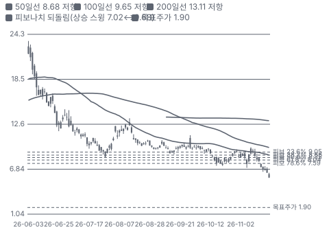

**주봉**

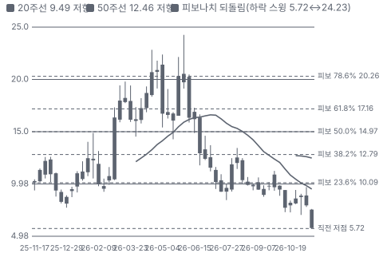

**월봉**

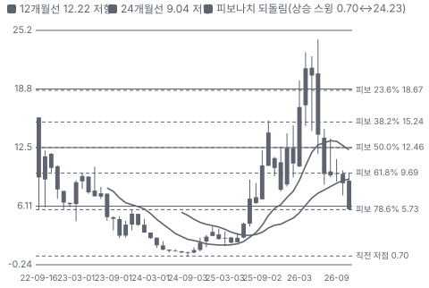

**분기 매출·EPS 실적과 컨센서스**

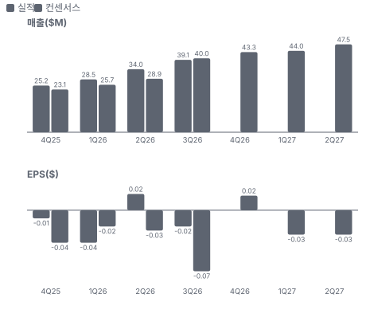

**EPS 리비전**

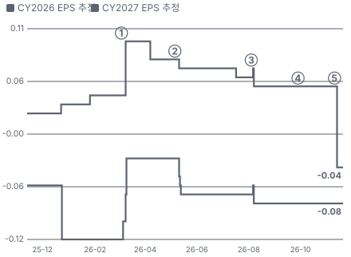

① 26-03-04 4Q25 실적, 2026 첫 가이던스 \$125M+ · EPS 리비전 +176%
② 26-05-06 1Q26 실적, 가이던스 \$130M · EPS 리비전 -20%
③ 26-08-04 2Q26 실적, 가이던스 \$140M+ · EPS 리비전 -27%
④ 26-09-28 IBAS \$75M 미국 라인 발표 · EPS 리비전 +0%
⑤ 26-11-10 3Q26 실적, 매출 \$145M·EBITDA 하향 · EPS 리비전 -191%

**멀티플 프리미엄(Fwd 1Y EV/EBITDA, 최근 4개 분기말 절대값 — 대상 vs 동종 중앙값)**

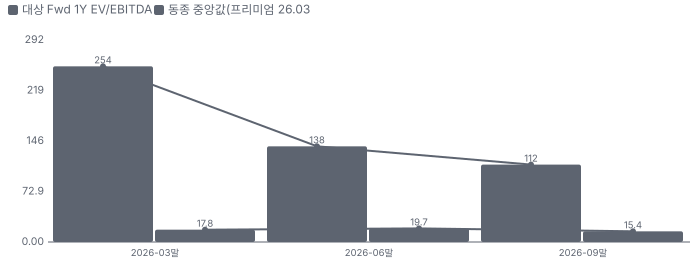

**합리적 멀티플**

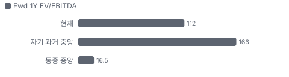

**밸류에이션 주가 시나리오**

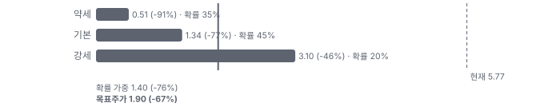

**주가별 업사이드**

- 제품·서비스 포트폴리오

**고객 믹스(3Q26, 매출 대비)**

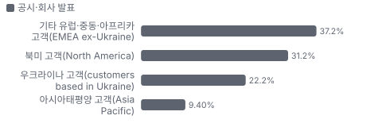

**공급 병목(10점, 낮을수록 병목)**

**생산능력 현재와 확충 계획(MWh/년(위탁 생산 접근 캐파))**

**CAPEX의 매출 대비 비중**

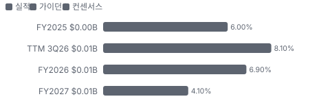

**어닝콜 변화별 주주가치 영향**

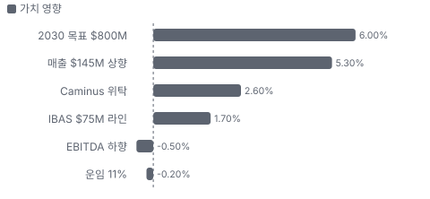

**수주·파이프라인 확실성 사다리**

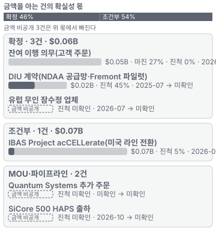

**매출 → 매출총이익 → 영업이익(매출 = 100, 최근 4분기)**

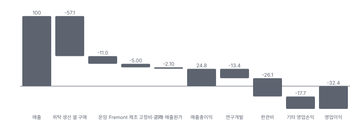

**분기 비용 비중 추이(매출 대비, 공시)**

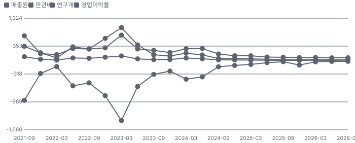

**비용 요인별 매출 대비 비중 1년 변화**

**SiCore 셀(파우치·원통형) BOM 원가 몫**

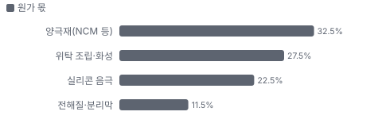

**BOM 항목 가격 +10% 시 OPM 변화**

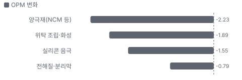

**자산 구성 — 3Q26 분기말 투하자본 \$73.8M**

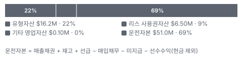

**자산별 변화율 — 최근 12개 분기(4Q23 = 0%) + 다음 4개 분기 추정**

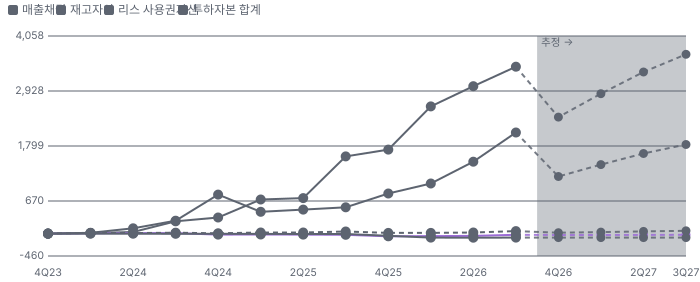

**ROIC 추이 — TTM, 최근 12개 분기 + 다음 4개 분기 추정(컨센서스 NOPAT) · 투하자본이 0 근처라 ROIC가 ±100%를 넘는 분기는 비움**

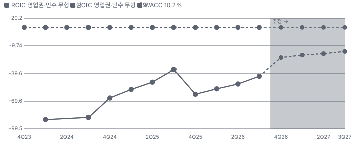

**매출 증가율의 가격·물량 분해와 8분기 전망(전년 대비)**

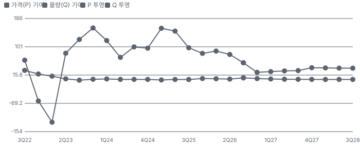

**목표주가 산정 — 기본과 강세 사이(강세 쪽 31%), 도달 확률 약 32%**

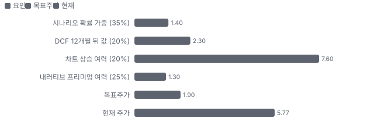

**커뮤니티 언급 수(최근 30일, 채널별)**

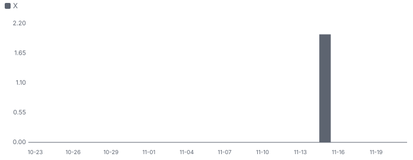

**커뮤니티 게시 수(월, 최근 10개월)**

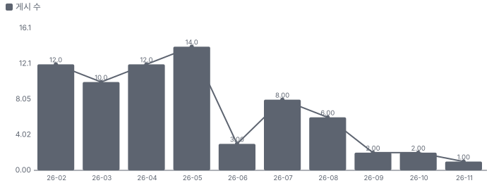

**재고 일수 — 분기별(수주 자료가 없어 수주/출하 비율 없음)**

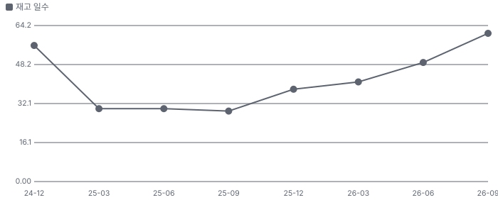

**일별 거래량 분해**

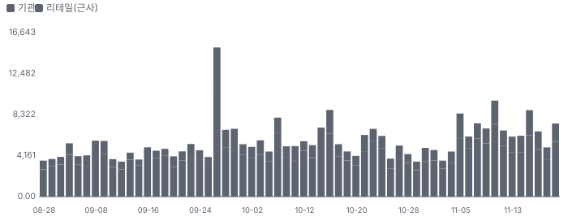

**기관 자금 흐름**

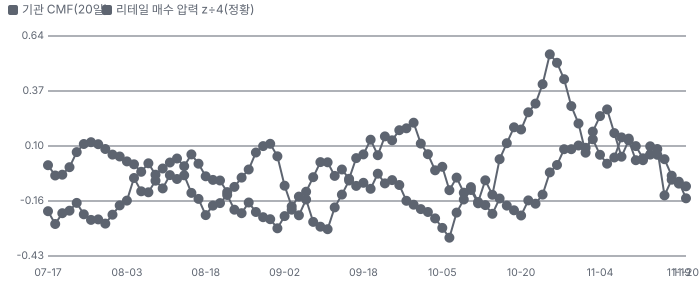

**몬테카를로**

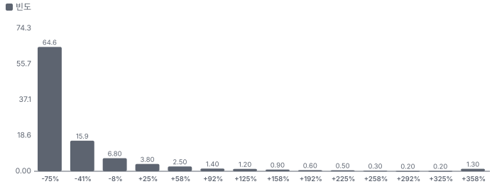

해석: 3,000번 중 423번(14%)에서 가치가 지금 주가 이상이었다. 가정을 흔들어도 지금 주가를 뒷받침하지 못하는 경우가 더 많다. 가운데 값은 0.29배이고, 열 번 중 여덟 번은 0.14~1.32배 사이에 든다.

## 내러티브

> **기업가치를 결정하는 이야기:** Amprius는 실리콘 음극 셀을 설계하고 생산은 중국·한국·미국 위탁사에 맡긴다. 값은 세 숫자로 갈린다. ① 2027 매출이 컨센서스 \$195~212M을 넘느냐 ② 매출총이익률이 27%에서 30% 이상으로 가느냐(파우치·해상 운송) ③ 미국산 셀이 2028 전에 양산되느냐. 지금 EV 약 \$790M은 TTM 매출의 6.2배, 다음 4개 분기 조정 EBITDA(\$8.2M)의 약 96배다(기본 주식 EV 기준, 완전 희석이면 111.5배)

> **멀티플·EPS 프리미엄**
> **멀티플:** 선행 EPS가 적자라 P/E를 쓸 수 없고 EV/EBITDA도 이익이 너무 작아 극단값이다(Fwd 1Y 111.5배, 완전 희석 EV 기준 — 실현 EBITDA가 거의 0이라는 뜻). 동종 중 흑자인 EnerSys는 Fwd 1Y EV/EBITDA 7.6배, Electrovaya는 19.5배다
> **EPS:** FY2027 EPS 컨센서스는 11/13 하루에 +\$0.049에서 −\$0.043으로 바뀌었다(7명). 매출 추정은 그대로라 영업비용 투자와 마진 가정이 깎인 것이다. FY2028 EPS도 8월 \$0.36에서 \$0.23으로 내려왔다

### 투자자들은 왜 열광했나

2026년 3월 4Q 실적과 첫 가이던스 \$125M+ 뒤 '드론 전쟁의 배터리' 이야기가 붙어 주가가 3월 한 달 +57%, 6/2 장중 \$24.23까지 갔다. 이후 1Q 실적 다음 날 −27%(EPS 미달), 6~7월 배터리주 전반 약세, 내부자 매도가 이어졌고, 3Q에 EBITDA 가이던스를 낮추자 열기가 식었다

### 무엇이 기업가치를 바꾸나

> **구조적 체질 변화**
> **변화:** 자체 공장(Brighton) 계획을 접고 위탁 생산 자산경량 모델로 전환
> **증거:** Brighton 리스 \$20.0M에 해지(2026-01), 위탁 접근 캐파 연 2.0GWh 초과(10-Q), 9개월 매출총이익률 5% → 25%
> **반증:** 위탁사 마진 요구로 매출총이익률 25% 아래 복귀

> **고부가 믹스 확장**
> **변화:** 원통형보다 비싼 파우치 비중 확대
> **증거:** 3Q 원통형 비중이 커져 매출총이익률 4%p 손실, 4Q 주문은 파우치가 많다(CFO). 파우치 단가는 1년 전 예상보다 높다
> **반증:** 4Q 매출총이익률 30% 미만

> **기술 혁신**
> **변화:** kg당 500Wh 셀을 표준 장비로 만들 수 있게 됨
> **증거:** SiCore 500 출시(2026-09), 로드맵보다 3개월 빠름(CFO)
> **반증:** 경쟁사가 같은 밀도 셀 양산

> **실행 속도**
> **변화:** 해당 없음(주문 → 출하 리드타임을 회사·동종 모두 공시하지 않는다 — 잔여 이행 의무 \$46.0M이 월 매출 약 3.5개월치라 주기가 짧다는 정황뿐)
> **증거:** 잔여 이행 의무 \$46.0M, 전부 1년 안(10-Q). Fremont 파일럿은 고객 맞춤 시제품을 빠르게 만든다(CEO)
> **반증:** -

> **M&A**
> **변화:** 해당 없음 — 최근 3년 인수 없음
> **증거:** 10-Q
> **반증:** -

> **정책·입법 연관성**
> **재정정책:** DAWG 2027 예산 요청 \$50B 이상 — 의회 세출 전 3Q 콜(회사 인용) 반증: 세출에서 드론 예산 삭감 의회 동의 4/10 — 하원 2/5(대통령 예산 요청 단계 — 하원 세출 의결 기록 미확인) · 상원 2/5(같음).
> **행정명령:** 국방부 IBAS Project acCELLerate OTA(최대 \$75M, \$22.3M 배정)·DIU 계약 \$18.1M 3Q 10-Q 반증: 나머지 \$52.7M 미배정 의회 동의 2/10 — 하원 1/5(행정 계약 — 의회 의결 대상 아님) · 상원 1/5(같음).
> **연관입법:** FY2026 NDAA 배터리 원산지 조항 — 2028년 초부터 국방 조달 셀의 중국산 부품 제한 3Q 10-Q·3Q 콜('약 14개월 뒤') 반증: 시행 유예·예외 확대

> **고객의 지출 예산**
> **변화:** 고객(드론 제조사)은 셀을 매출원가로 사고, 최종 지갑은 각국 국방 조달 예산이다
> **사업별 예산:** 비중 미확인: 드론용 셀(국방) — 고객 혼합(각국 국방 조달 예산(무기·탄약) → 드론 제조사 매출원가) · 동인: 우크라이나·유럽·미국 드론 조달
비중 미확인: 상업·이동(배송 드론·eVTOL(전기 수직이착륙기)·LEV(경량 전기 이동수단)) — 고객 OPEX(배송·점검 사업자 운영비, 기체 업체 개발비) · 동인: Part 108(미국 연방항공청의 시야 밖 드론 비행 규칙안) 시야 밖 비행 규칙
> **증거:** 매출의 대부분이 국방 드론용(3Q 콜), 우크라이나 22%
> **반증:** -

### 내러티브 근거

> '드론 전쟁의 배터리 독점 공급사'라는 이야기가 2026년 3~6월 주가를 \$10대에서 장중 \$24.23(6/2)까지 올렸다. 지금은 매출이 계속 늘어도 이익 추정이 깎이고(FY2027 EPS 흑자 → 적자), 우크라이나 휴전·중국 공급 의존·배터리주 전반 약세가 겹쳐 주가가 \$5.77로 고점 대비 −76%다. 단계는 소멸, 쏠림은 낮음이다.

> **드론 전쟁 슈퍼사이클** · 유지
> **논리:** 각국이 드론 예산을 늘리고 고밀도 셀은 공급자가 몇 곳 없다
> **숫자:** 2026 동맹국 국방 셀 수요 \$445M(회사 추정) 중 약 30%, DAWG 2027 요청 \$50B 이상(의회 세출 전)
> **반증:** 2027 미국 국방 세출에서 드론 예산 대폭 삭감
> **출처:** 3Q 콜

> **가이던스 반복 상향** · 유지
> **논리:** 연초 \$125M에서 세 번 올려 \$145M — 수요가 공급을 앞선다
> **숫자:** 2026 매출 +99%, 잔여 이행 의무 \$46.0M
> **반증:** 2027 첫 가이던스가 컨센서스 \$195~212M 아래
> **출처:** 3Q 콜·10-Q

> **NDAA 국산 공급망 승자** · 약화
> **논리:** 2028 중국산 배터리 조달 금지가 오면 미국·동맹 생산 셀을 가진 Amprius가 남는다
> **숫자:** IBAS 최대 \$75M·DIU \$18.1M, 미국 추가 캐파 270~300MWh 목표
> **반증:** 2027 말 미국산 셀 매출 미미 — 오히려 Berzelius 의존이 약점이 된다
> **출처:** 3Q 10-Q·콜

> **매출총이익률 30% 경로** · 유지
> **논리:** 파우치 믹스·해상 운송·위탁사 고정비 분리로 30% 이상
> **숫자:** 3Q 26.9%, 연간 28%를 맞추려면 4Q 약 35%
> **반증:** 4Q 매출총이익률 30% 미만
> **출처:** 3Q 콜

> **[반대] 배터리주 무덤·휴전 위험** · 강화
> **논리:** 배터리 소형주는 결국 희석·적자로 끝나고, 우크라이나 휴전이면 일회용 드론 수요가 빠진다
> **숫자:** 우크라이나 매출 22%, 주가 고점 대비 −76%, 공매도 15.1%
> **반증:** 휴전 협상 뒤에도 유럽·미국 주문으로 4Q \$43M 달성
> **출처:** 3Q 10-Q·Quantral

### 투자 포인트

> **가이던스 상향 기계**
> **명제:** 수요가 캐파를 앞서 매 분기 가이던스를 올린다
> **숫자:** \$125M → \$130M → \$140M → \$145M(2026), 잔여 이행 의무 \$46.0M
> **시장과 다른 점:** 시장은 매출이 아니라 EBITDA 하향을 봤다 — 매출 컨센서스 FY2027 \$195~212M이 이미 상향 기대를 담는다
> **증명:** 2027 첫 가이던스(2027-03 4Q 콜)
> **출처:** 3Q 콜·10-Q

> **마진 레버**
> **명제:** 파우치 믹스·해상 운송·위탁 고정비 분리로 매출총이익률 30% 이상
> **숫자:** 운임 매출의 11%, 해상 전환 시 약 5%p(CFO)
> **시장과 다른 점:** 4Q에 약 35%가 필요해 회사 목표 자체가 공격적이다
> **증명:** 4Q 매출총이익률(2027-03)
> **출처:** 3Q 콜

> **중국 밖 공급망**
> **명제:** NDAA 2028 전 미국·한국 캐파로 국방 조달 자격을 지킨다
> **숫자:** Caminus 1Q27, IBAS 2028 초, 한국 위탁 4곳
> **시장과 다른 점:** Seeking Alpha 등 커뮤니티가 이 위험을 먼저 짚었다 — 회사 답은 '부품 18종 검토 완료'뿐
> **증명:** Caminus 양산 개시 공시·IBAS 추가 자금 배정
> **출처:** 3Q 콜·10-Q

### 모멘텀 생성·소멸 타임라인

**카탈리스트 달력 — 지난 사건의 주가 반응과 앞으로 확인할 숫자**
| 날짜 | 상태 | 구분 | 사건 | 반응·확인 | 결과에 따라 |
|---|---|---|---|---|---|
| 2026-03-04 | 완료 | 생성 | 4Q25 실적·2026 첫 가이던스 | 3월 한 달 +57% |  |
| 2026-05-07 | 완료 | 소멸 | 1Q26 EPS 미달 | −27.4% |  |
| 2026-05-28 | 완료 | 생성 | 국방부 드론 제조사 지원 검토 보도 | +21.5% |  |
| 2026-08-04 | 완료 | 생성 | 2Q26 매출 +126%·가이던스 \$140M+ | 다음 날 +8.4% |  |
| 2026-09-28 | 완료 | 생성 | IBAS \$75M 발표 | 종가 −1.5% |  |
| 2026-11-11 | 완료 | 소멸 | 3Q EBITDA 가이던스 하향 | −6.8% |  |
| 2027-03 초(예상) | 예정 | 확인 | 4Q26 실적·2027 첫 가이던스 | 2027 매출 \$200M 이상·4Q 매출총이익률 30% 이상·DIU 제외 EBITDA 흑자 | 셋 다면 이익 추정 상향·배수 회복, 매출 \$160M대면 약세 시나리오 |
| 2027-1Q(예상) | 예정 | 확인 | Caminus 미국산 파우치 양산 개시 | 양산 개시 공시와 미국산 셀 매출 언급 | NDAA 2028 대응 첫 증거 — 늦어지면 공급망 할인 확대 |
| 2027 상반기(예상) | 예정 | 매크로 | FY2027 국방 세출 의결(DAWG 드론 예산) | 드론·자율 무기 세출 규모 | 요청 \$50B 대비 크게 줄면 미국 매출 성장 가정 하향 |

### 언제 사서 언제 팔아야 할까?

**가격·조건 틀 — 가격은 밸류에이션(약세·기본·강세·목표주가)과 차트 지지 구간에서, 조건은 이벤트에서**
| 구간 | 가격 | 목표주가까지 | 약세까지 | 조건·근거 |
|---|---|---|---|---|
| 관찰 구간 | \$5.72~\$5.73 | -67% | -91% | 52주 신저가 \$5.72(11/20 장중) 아래 지지 구간과 주당 현금 약 \$0.36(완전 희석) 위의 사업 가치 |
| 확인 뒤 | 지금 \$5.77 이상에서 조건 확인 | -67% | -91% | 2027 가이던스 매출 \$200M 이상과 4Q 매출총이익률 30% 이상, DIU 제외 EBITDA 흑자 |
| 무효화 | 약세 시나리오 \$0.51 | - | -91% | 2027 가이던스가 컨센서스 하단(\$160M) 근처, 새 증자 프로그램, 우크라이나 매출 급감 |

실적·정책 뉴스 하루에 ±10~27% 움직이는 종목이라 발표 당일 변동성이 크다 — 가격·조건 틀이며 매매 지시가 아니다 가격·조건 틀이며 매매·비중 지시가 아니다(투자 권유 아님).

## 포트폴리오

| 제품·서비스 | 구분 | 무엇 | 쓰는 곳 | 돈 버는 방식 | Mix | Mix 변화(전년 대비) |
|---|---|---|---|---|---|---|
| SiCore(Amprius의 위탁 생산 실리콘 음극 셀 제품군) 셀(파우치·원통형) | 제품 | 위탁사가 만드는 실리콘 음극 리튬이온 셀(kg당 최대 500Wh) | ISR(정보·감시·정찰)·장거리 타격·요격 드론, HAPS, 무인 잠수정 | 셀 판매. 매출의 대부분(추정 90~98%) | 94% | 미확인 |
| SiCore 500 | 제품 | kg당 500Wh 장시간 비행용 셀, 표준 리튬이온 장비로 생산 | HAPS·고정익 장거리 드론 | 4Q 첫 출하(금액 미공시) | 미확인 | 미확인 |
| SiMaxx(Amprius가 Fremont에서 직접 만드는 실리콘 나노와이어 음극 셀) 셀 | 제품 | Fremont에서 직접 만드는 실리콘 나노와이어 음극 셀 | 초고밀도 특수 용도·시제품 | 소량(추정 2~10%) | 4% | 미확인 |
| 정부 개발 과제(DIU·IBAS) | 서비스 | NDAA 공급망 연구·미국 라인 전환 자금 | Fremont 파일럿·한국 파트너 미국 라인 | 매출이 아닌 기타수익·설비 상환(DIU \$18.1M, IBAS 최대 \$75M) | 미확인 | 미확인 |

## 고객

> **3Q26 최대 고객 기타 유럽·중동·아프리카 고객(EMEA ex-Ukraine) 37%, 상위 3곳 91%, 집중도 집중.** 공시·회사 발표로 확인한 몫은 매출의 100%이고, 나머지 고객 몫은 추정이거나 미분해다. 고객 이름은 거의 공시하지 않는다. 3Q 매출의 49%를 3개 고객이 차지했고(전년 3Q는 1개 고객 35%), 우크라이나 향이 \$8.7M(22%)다. 지역은 유럽·중동·아프리카 59%, 북미 31%(2Q 19%), 아시아태평양 9%다 — 아래 몫은 지역 기준이라 겹치지 않는다

**고객별 매출 몫(3Q26)**
| 고객 | 몫 | 변화 | 근거 |
|---|---|---|---|
| 기타 유럽·중동·아프리카 고객(EMEA ex-Ukraine) | 37% | +14%p | 공시 |
| 북미 고객(North America) | 31% | +7%p | 공시 |
| 우크라이나 고객(customers based in Ukraine) | 22% | -19%p | 공시 |
| 아시아태평양 고객(Asia Pacific) | 9% | -1%p | 공시 |
| Quantum Systems(Quantum Systems) | 미확인 | 미확인 | 회사 발표 |
| 유럽 무인 잠수정 업체(leading European manufacturer of autonomous deep-sea underwater vehicles) | 미확인 | 미확인 | 회사 발표 |

> **기타 유럽·중동·아프리카 고객(EMEA ex-Ukraine)** · 공시
> **사는 것:** ISR·장거리 드론·무인 잠수정용 셀
> **추정 근거:** 계산

> **북미 고객(North America)** · 공시
> **사는 것:** NDAA 준수 셀
> **추정 근거:** 전년 3Q \$5.28M

> **우크라이나 고객(customers based in Ukraine)** · 공시
> **사는 것:** 드론용 셀
> **추정 근거:** 전년 3Q \$8.9M / \$21.4M

> **아시아태평양 고객(Asia Pacific)** · 공시
> **사는 것:** 드론·이동수단용 셀
> **추정 근거:** 전년 3Q \$2.24M

> **Quantum Systems(Quantum Systems)** · 회사 발표
> **사는 것:** Vector·Twister ISR 드론용 셀
> **추정 근거:** 수년간 공급 중(CEO). 몫 미공시 — 위 유럽 몫 안에 있다

> **유럽 무인 잠수정 업체(leading European manufacturer of autonomous deep-sea underwater vehicles)** · 회사 발표
> **사는 것:** SiCore 셀
> **추정 근거:** 3Q 첫 출하, 이름 미공시

## 수주·파이프라인

> **2026-11-11 기준 6건.** 확정 \$0.06B, 미확정 \$0.07B. 공시 잔여 이행 의무 \$46.0M(전부 1년 안 인식, 10-Q) \$0.05B.

**수주 목록**
| 상태 | 계약 | 계약 총액 | 진척 | 기간 | 비고 |
|---|---|---|---|---|---|
| 확정 | 잔여 이행 의무(고객 주문) | \$0.05B | 0% | 2026-09 → 2027-09 | - |
| 확정 | DIU 계약(NDAA 공급망·Fremont 파일럿) | \$0.02B | 45% | 2025-07 → 미확인 | - |
| 확정 | 유럽 무인 잠수정 업체 | 금액 비공개 | 비공개 | 2026-07 → 미확인 | - |
| 조건부 | IBAS Project acCELLerate(미국 라인 전환) | \$0.07B | 5% | 2026-09 → 2028-03 | - |
| 파이프라인 | Quantum Systems 추가 주문 | 금액 비공개 | 비공개 | 미확인 → 미확인 | - |
| 파이프라인 | SiCore 500 HAPS 출하 | 금액 비공개 | 비공개 | 2026-10 → 미확인 | - |

**실행 속도와 방해 요인**
| 항목 | 상태 | 실행 속도 | 방해 요인 |
|---|---|---|---|
| 잔여 이행 의무(고객 주문) | 확정 | 지연(계획 17%, -17%p) | 위탁사 출하 일정 · 운임·통관 |
| DIU 계약(NDAA 공급망·Fremont 파일럿) | 확정 | 9개월 \$1.9M 인식, 4Q 약 \$6M 예정 | 마일스톤 검수 |
| 유럽 무인 잠수정 업체 | 확정 | 3Q 첫 출하 | 반복 주문 여부 |
| IBAS Project acCELLerate(미국 라인 전환) | 조건부 | 지연(계획 11%, -6%p), 이대로면 2030-01 완료, 22개월 지연 | \$22.3M만 배정 — 나머지는 의회 세출·마일스톤 · 한국 파트너의 장비 조달 · 라인 전환 수율 |
| Quantum Systems 추가 주문 | 파이프라인 | CFO '예상되는 Quantum Systems 작업이 주문으로' | 주문 확정 |
| SiCore 500 HAPS 출하 | 파이프라인 | 4Q 출하 계획 | 고객 인증 |

## 마진 구조

> **GPM 26.9%, OPM -12.1%.** 2Q26 대비 GPM -0.4%p, OPM +0.6%p. 변동비는 매출의 71%이고, 매출이 10% 늘면 OPM은 +3.8%p 움직인다. 3Q 매출총이익률 26.9%(2Q 27.3%). 매출원가의 대부분은 위탁사에서 사 오는 완제 셀이고, 3Q에는 항공 운임이 매출의 11%였다. 영업비용은 연구개발 \$6.4M(Fremont 비용 \$0.8M 이전 포함)·판관비 \$8.8M

> **매출 100 중 매출원가 75.2, 매출총이익 24.8(최근 4분기, 공시).** 매출원가 요인 중 위탁 생산 셀 구매이 매출의 57.1%로 가장 무겁고, 단가가 +10% 오르면 GPM이 -5.71%p 움직인다. 분기 회귀로 매출 1이 늘 때 매출원가는 0.65 늘고, 매출원가의 고정비 몫은 37%다.

**비용 요인 강도 — 비중·추세·충격(+10%)·탄력**
| 비용 | 구분 | 매출 대비 | 1년 변화 | 마진 기여 | 충격 시 마진 | 매출 탄력 | 고정비 몫 |
|---|---|---|---|---|---|---|---|
| 위탁 생산 셀 구매 | 매출원가 요인 | 57.1% | 미확인 | 미확인 | -5.71%p | 미확인 | 10% |
| 운임 | 매출원가 요인 | 11.0% | 미확인 | 미확인 | -1.10%p | 미확인 | 0% |
| Fremont 제조 고정비·감가 | 매출원가 요인 | 5.0% | 미확인 | 미확인 | -0.50%p | 미확인 | 90% |
| 매출원가 | 공시 항목 | 75.2% | -24.7%p | +24.7%p | -7.52%p | 0.65 | 37% |
| 판관비 | 공시 항목 | 26.1% | -11.9%p | +11.9%p | 미확인 | 0.15 | 68% |
| 연구개발 | 공시 항목 | 13.4% | -1.9%p | +1.9%p | 미확인 | 0.12 | 33% |

매출 탄력 = 분기 비용을 매출에 회귀한 기울기(매출 1당 변동비), 고정비 몫 = 절편 ÷ 평균 비용. 표본이 8분기 미만이면 미확인. 매출원가 요인 비중은 margin 재료의 추정이 섞여 있고, 공시 매출원가와의 차이는 '기타 매출원가'로 둔다.

**GPM에서 OPM까지(GAAP, 아래는 최근 4개 분기)**
| 기간 | GPM | 연구개발 | 판관비 | 기타 | OPM |
|---|---|---|---|---|---|
| 2Q26 | 27.3% | 12.0% | 27.9% | 0.0% | -12.6% |
| 3Q26 | 26.9% | 16.4% | 22.6% | 0.0% | -12.1% |
| 2025-12 | 23.6% | - | - | - | -100.9% |
| 2026-03 | 20.1% | - | - | - | -23.4% |
| 2026-06 | 27.3% | - | - | - | -12.6% |
| 2026-09 | 26.9% | - | - | - | -12.1% |

**비용을 움직이는 요인**
| 비용 | 요인 |
|---|---|
| 위탁 생산 셀 구매(매출원가) | 셀 단가·믹스(파우치 vs 원통형) · 근거 추정 |
| 판관비(SBC 포함, 판관비) | 영업 인력·상장 비용 · 근거 공시 |
| 연구개발(연구개발) | SiCore 500·DIU 라인·인증 · 근거 공시 |
| 운임(매출원가) | 항공 → 해상 전환 · 근거 공시 |
| Fremont 제조 고정비·감가(매출원가) | 가동률 · 근거 추정 |

**SiCore 셀(파우치·원통형) BOM — 매출의 94%, GPM 27%(3Q 회사 전체 매출총이익률(제품별 미공시)), 항목 가격 +10% 시**
| 항목 | 원가 몫 | 전가 | 제품 GPM | OPM |
|---|---|---|---|---|
| 양극재(NCM 등) | 25~40% | 미확인 | -2.4%p | -2.23%p |
| 위탁 조립·화성 | 20~35% | 미확인 | -2.0%p | -1.89%p |
| 실리콘 음극 | 15~30% | 미확인 | -1.6%p | -1.55%p |
| 전해질·분리막 | 8~15% | 미확인 | -0.8%p | -0.79%p |
| 미분해 | 6% | - | - | - |

판매가 전가를 모르는 항목은 전가 0%로 계산했다.

**BOM 항목 가격을 움직이는 것**
| 항목 | 요인 |
|---|---|
| 양극재(NCM 등) | 금속 가격 · 근거 추정 |
| 실리콘 음극 | 독점 소재 · 근거 추정 |
| 전해질·분리막 | - · 근거 추정 |
| 위탁 조립·화성 | 위탁 마진 · 근거 추정 |

물가 지수를 붙이지 못한 매출원가 항목은 위탁 생산 셀 구매, 운임, Fremont 제조 고정비·감가다(미연결).

## 자산 구성

> **3Q26 분기말 투하자본 \$73.8M** — 운전자본 69%, 유형자산 22%. 최근 12개 분기(4Q23 → 3Q26) 가장 크게 늘어난 자산은 매출채권(+3428%), 투하자본 합계 +51%. 3Q27 추정 투하자본 \$76.8M(+4%, 컨센서스 매출과 회전 일수·CAPEX 강도 유지 가정). 연율 감가 비율(총액 기준)은 직전 4분기 12.88% → 최근 4분기 14.84%.

**자산·운전자본 항목별 분기말 잔액 — 최근 12개 분기와 다음 4개 분기 추정**
| 항목 | 4Q23 | 3Q25 | 3Q26(최근) | 3Q27 추정 | 12개 분기 변화 | 다음 4개 분기 변화 |
|---|---|---|---|---|---|---|
| 매출채권 | \$1.3M | \$21.9M | \$45.9M | \$49.2M | +3428% | +7% |
| 재고자산 | \$0.7M | \$4.7M | \$15.9M | \$14.1M | +2077% | -11% |
| 선급·기타 유동자산 | \$2.0M | \$6.9M | \$18.9M | \$12.2M | +851% | -35% |
| 매입채무 | \$3.3M | \$7.8M | \$13.4M | \$13.0M | +300% | -3% |
| 미지급비용 | \$5.6M | \$4.3M | \$16.2M | \$8.6M | +189% | -47% |
| 선수수익(계약부채) | \$3.4M | \$0.7M | \$0.1M | \$0.2M | -97% | +124% |
| 유형자산 | \$21.8M | \$16.3M | \$16.2M | \$16.5M | -25% | +2% |
| 리스 사용권자산 | \$35.1M | \$32.2M | \$6.5M | \$6.5M | -81% | +0% |

**자산 추정 동인 — 최근 4개 분기 평균(재무상태표 동인 모형)**
| 동인 | 값 | 곱하는 기준 |
|---|---|---|
| 매출채권 | 104일 | 매출 |
| 재고자산 | 39일 | 매출원가 |
| 선급·기타 유동자산 | 26일 | 매출 |
| 매입채무 | 36일 | 매출원가 |
| 미지급비용 | 18일 | 매출 |
| 선수수익(계약부채) | 0일 | 매출 |
| CAPEX 강도 | 8.1% | 매출(최근 4개 분기 합) |
| 분기 감가율 | 7.20% | 기초 유형자산 순액(무형 상각 제외 감가상각) |
| 매출원가율 | 75.2% | 매출(최근 4개 분기) |
| 영업권·리스 사용권·기타 | 유지 | 인수·새 리스는 공시 전 모름 |
| 인수 무형자산 | 분기 \$0.0M 상각 | 최근 4개 분기 평균 상각 |

**추정 방법:** 증권사 3표 모델(손익·재무상태표·현금흐름)의 재무상태표 동인 방식이다. 운전자본은 항목별 회전 일수(매출채권·선급·미지급·선수는 매출, 재고·매입채무는 매출원가 기준)를 최근 4개 분기 평균으로 두고 컨센서스 매출에 곱한다. 유형자산은 기초 + CAPEX − 감가상각으로 굴린다(Koller·Goedhart·Wessels 『Valuation』 재무상태표 추정). 매출 경로는 ROIC 절의 컨센서스와 같다.

**유형·무형자산 항목별 가치(2025-12-31 vs 2024-12-31)**
| 구분 | 항목 | 총액 2025-12-31 | 누적상각 | 순액 | 총액 2024-12-31 | 총액 1년 변화 | 공시 내용연수 |
|---|---|---|---|---|---|---|---|
| 유형 | 유형자산 합계(항목 미분해) | \$19.6M | 총계만 공시 | 총계만 공시 | \$29.5M | -33.5% | 미확인 |
| 유형 합계 | 유형자산 | \$19.6M | \$9.9M | \$9.7M | \$29.5M | -33.5% | 경과율 51%(상각 대상 기준) |

**내용연수 산식(상각 대상 유형자산 = 총액 − 토지 − 건설중)**
| 기준일 | 연 감가상각 | 상각 대상 총액 | 평균 내용연수 | 경과 연수 | 잔여 연수 | 경과율 |
|---|---|---|---|---|---|---|
| 2025-12-31 | \$4.4M | \$19.6M | 4.5년 | 2.3년 | 2.2년 | 51% |
| 2024-12-31 | \$3.8M | \$29.5M | 7.8년 | 3.2년 | 4.6년 | 41% |

산식 평균 내용연수는 4.5년. 1년 전 7.8년 → 지금 4.5년.

**분기 감가 비율(감가상각 ÷ 평균 유형자산 총액)**
| 분기 | 감가상각 | 평균 유형자산(총액) | 분기 비율 | 연율 | 연율의 역수 |
|---|---|---|---|---|---|
| 4Q24 | \$0.9M | \$32.7M | 2.72% | 10.90% | 9.2년 |
| 1Q25 | \$0.9M | \$30.2M | 3.13% | 12.50% | 8.0년 |
| 2Q25 | \$1.0M | \$31.1M | 3.28% | 13.11% | 7.6년 |
| 3Q25 | \$1.2M | \$31.3M | 3.77% | 15.07% | 6.6년 |
| 4Q25 | \$1.2M | \$25.5M | 4.79% | 19.18% | 5.2년 |
| 1Q26 | \$0.8M | \$20.5M | 3.71% | 14.84% | 6.7년 |
| 2Q26 | \$0.8M | \$22.3M | 3.37% | 13.48% | 7.4년 |
| 3Q26 | \$0.8M | \$25.8M | 2.92% | 11.70% | 8.5년 |

감가상각 기준: 손익계산서 감가상각·상각비(SEC 공시 데이터, 4분기 = 연간 − 1~3분기).

최근 4분기 연율 감가 비율 14.84%, 직전 4분기 12.88%(+15%) — 경고 문턱(-10%) 안이다.

미공시·미분해: 영업권 · 무형자산 · 유형자산 항목별 총액·내용연수(10-K 주석에서 모델이 채움) · 무형자산 항목(10-K 주석에서 모델이 채움) — 이 칸은 비우고 나머지로 계산했다.

### 해석 — 자산이 어디에 쌓이고 있나

- 같은 기간 4개 분기 매출은 +626% — 매출보다 빨리 늘어난 자산: 매출채권 +3428%, 재고자산 +2077%. 이 자산의 회전율이 떨어지면 ROIC를 희석한다.
- 다음 4개 분기 CAPEX \$11.8M vs 감가상각 \$4.6M(최근 4개 분기 CAPEX 강도·감가율 유지) — 유형자산 3Q26 \$16.2M → 3Q27 \$16.5M. 투자가 감가보다 커서 자산이 쌓이는 국면이다.
- 감가 비율이 올라갔다 — 이익을 보수적으로 잡는 쪽이다(내용연수 단축·짧은 수명 자산 증가).

## ROIC

> **TTM 3Q26 ROIC는 영업권·인수 무형 포함 -42.4%, 제외 -42.4%**(NOPAT 마진 -24.1% × 투하자본 회전율 1.76회). 컨센서스 NOPAT으로 굴리면 3Q27 -15.9%(제외 -15.9%) — WACC 10.2% 대비 -26.1%p.

**ROIC 추이(TTM)와 다음 4개 분기 추정 — NOPAT ÷ 평균 투하자본(이번 분기말·4개 분기 전)**
| 분기 | 구분 | TTM 매출 | TTM NOPAT | NOPAT 마진 | 평균 투하자본 | ROIC 포함 | ROIC 제외 |
|---|---|---|---|---|---|---|---|
| 4Q23 | 실적 | \$9.1M | −\$28.9M | -319.1% | \$26.8M | 미확인 | 미확인 |
| 1Q24 | 실적 | \$10.7M | −\$29.1M | -271.6% | \$32.5M | -89.5% | -89.5% |
| 2Q24 | 실적 | \$12.4M | −\$31.3M | -252.1% | \$30.9M | 미확인 | 미확인 |
| 3Q24 | 실적 | \$17.5M | −\$33.0M | -188.6% | \$37.9M | -87.1% | -87.1% |
| 4Q24 | 실적 | \$24.2M | −\$33.3M | -137.9% | \$50.5M | -66.0% | -66.0% |
| 1Q25 | 실적 | \$33.1M | −\$32.8M | -99.0% | \$57.9M | -56.7% | -56.7% |
| 2Q25 | 실적 | \$44.8M | −\$27.9M | -62.3% | \$57.2M | -48.8% | -48.8% |
| 3Q25 | 실적 | \$58.4M | −\$22.7M | -38.9% | \$64.3M | -35.3% | -35.3% |
| 4Q25 | 실적 | \$73.0M | −\$33.4M | -45.8% | \$54.0M | -61.9% | -61.9% |
| 1Q26 | 실적 | \$90.3M | −\$32.6M | -36.1% | \$58.0M | -56.1% | -56.1% |
| 2Q26 | 실적 | \$109.2M | −\$30.6M | -28.0% | \$60.2M | -50.8% | -50.8% |
| 3Q26 | 실적 | \$126.9M | −\$30.6M | -24.1% | \$72.1M | -42.4% | -42.4% |
| 4Q26 | 추정 | \$130.2M | −\$12.8M | -9.9% | \$56.8M | -22.6% | -22.6% |
| 1Q27 | 추정 | \$135.7M | −\$12.0M | -8.8% | \$60.3M | -19.8% | -19.8% |
| 2Q27 | 추정 | \$140.9M | −\$12.0M | -8.5% | \$65.6M | -18.3% | -18.3% |
| 3Q27 | 추정 | \$145.0M | −\$12.0M | -8.3% | \$75.3M | -15.9% | -15.9% |

**다음 4개 분기 NOPAT — 컨센서스(세율 21%, 리스 이자 별도)**
| 분기 | 매출 | EBITA 마진 | EBITA | NOPAT(분기) | 근거 |
|---|---|---|---|---|---|
| 4Q26 | \$28.5M | -11.0% | −\$3.1M | −\$2.5M | 컨센서스 매출 × EBIT 마진 FY2026 |
| 1Q27 | \$34.0M | -11.0% | −\$3.7M | −\$3.0M | 컨센서스 매출 × EBIT 마진 FY2026 |
| 2Q27 | \$39.1M | -11.0% | −\$4.3M | −\$3.4M | 컨센서스 매출 × EBIT 마진 FY2026 |
| 3Q27 | \$43.3M | -11.0% | −\$4.8M | −\$3.8M | 컨센서스 매출 × EBIT 마진 FY2026 |

**추정 방법:** NOPAT은 컨센서스(분기 매출 추정 × 회계연도 EBIT 마진 추정)로 잡고, 조정(비 GAAP) 마진이면 주식보상 몫을 빼서 과거 실적과 같은 기준(영업이익 + 인수 무형 상각)으로 맞췄다. 이미 발표했지만 분기 보고서(10-Q)가 아직 없는 분기는 발표 실적을 쓴다. 투하자본은 자산 구성 절의 재무상태표 동인으로 굴렸다. ROIC는 4개 분기 NOPAT을 이번 분기말과 4개 분기 전 투하자본의 평균으로 나눈다 — 추정 분기의 ROIC에는 이미 나온 실적 분기가 섞여 있다.

**투하자본 항목별 회전율과 ROIC 기여(TTM 3Q26, 평균 잔액)**
| 항목 | 투하자본 | 매출 1달러당 자본 | 회전율(매출 ÷ 항목) | 자본 몫 | 이 항목을 빼면 ROIC |
|---|---|---|---|---|---|
| 운전자본 | \$35.8M | 0.28 | 3.54회 | 50% | -84.2% |
| 유형자산 | \$16.3M | 0.13 | 7.79회 | 23% | -54.8% |
| 리스 사용권자산 | \$19.3M | 0.15 | 6.56회 | 27% | -57.9% |
| 기타 영업자산 | \$0.7M | 0.01 | 192.49회 | 1% | -42.8% |

**ROIC 세 가지 판**
| 판 | NOPAT | 투하자본 | ROIC | 무엇을 재나 |
|---|---|---|---|---|
| 영업권·인수 무형 포함 | −\$30.6M | \$72.1M | -42.4% | 인수 웃돈까지 낸 돈에 대한 수익률 |
| 영업권·인수 무형 제외 | −\$30.6M | \$72.1M | -42.4% | 본업 운영 수익률(동종 비교용) |
| 무형 자본화 조정(판관비 20%·5년, 연구개발 6년) | −\$21.1M | \$102.7M | -20.6% | 비용으로 처리한 무형 투자를 자산으로 본 판 — 이력이 상각 기간보다 짧아 자산 과소 |
| 경제적 이익(포함판) | −\$37.9M | \$72.1M | 자본비용 10.2% | (ROIC − 자본비용) × 투하자본 |

NOPAT = (영업이익 −\$41.2M + 인수 무형 상각 + 리스 내재 이자 \$2.5M) × (1 − 세율 21%). 리스 사용권자산을 투하자본에 넣었으므로 임차료 속 이자 몫을 영업이익에 되더했다. 현금은 영업에 필요한 몫을 따로 알 수 없어 투하자본에서 뺐다. SEC 공시 데이터 자동 초안 — 운전자본 = 매출채권 + 재고 + 선급 − (매입채무 + 미지급비용 + 선수수익), 현금 제외. 손상 누계는 공시 데이터 수록분.

투하자본 또는 NOPAT이 0 이하라 ROIC 분해는 비교 불가 — 경제적 이익으로 본다.

**무형 자본화 가정별 ROIC(2025년 지출 기준, 포함판에 더함)**
| 투자로 보는 몫 | 상각 연수 | 무형 자산 | NOPAT 조정 | 조정 ROIC |
|---|---|---|---|---|
| 판관비 20% | 2년 | \$26.0M | \$7.7M | -23.3% |
| 판관비 20% | 5년 | \$30.6M | \$9.4M | -20.6% |
| 판관비 30% | 2년 | \$29.2M | \$8.0M | -22.2% |
| 판관비 30% | 5년 | \$36.1M | \$10.6M | -18.4% |

### 해석 — 무엇이 수익성을 끌어올리고 희석하나

- 운전자본: 투하자본의 50% — 빼면 ROIC -42.4% → -84.2%. 이 자산의 회전율(3.54회)이 수익성을 희석하는 주된 자리다.
- 리스 사용권자산: 투하자본의 27% — 빼면 ROIC -42.4% → -57.9%. 이 자산의 회전율(6.56회)이 수익성을 희석하는 주된 자리다.
- 영업권·인수 무형을 빼면 ROIC가 +0.0%p 오른다 — 과거 인수에 치른 웃돈이 주주 수익률을 그만큼 낮춘다(본업 수익률은 제외판, 인수까지 포함한 가치 창출은 포함판으로 본다).
- 비용으로 처리한 무형 투자를 자산으로 보면 ROIC가 +21.8%p 움직인다(무형 자산 \$30.6M). 투자를 늘리는 중이라 NOPAT이 더 커지는 쪽이다.
- 추정 경로 3Q26 -42.4% → 3Q27 -15.9%: NOPAT 마진 +15.8%p, 투하자본 회전율 +0.17회 — 컨센서스 매출·마진이 맞고 회전 일수·CAPEX 강도가 유지된다는 가정이다. 마진 추정이 내려가거나 재고 일수가 늘면 이 경로가 먼저 틀린다.
- ROIC(포함) − WACC = -52.6%p(3Q26) — 양수면 투하자본을 늘릴수록 가치가 쌓인다.

## 공급망 병목

> **공급망 신뢰성 3.1/10, 병목 심각.** 가장 약한 고리는 실리콘 음극 소재 3.1점이고, 품목 평균은 3.1점이다. 근거가 부족한 3건(셀 위탁 조립 · 양극재·전해질·분리막 등 부품 18종 · 항공 운송)은 점수에서 뺐다. 병목은 셀 생산을 위탁사에 맡긴 구조와 NDAA 2028 국산 조달 요건이다. 실리콘 음극 소재와 셀의 상당 부분이 중국 Berzelius에서 오고, 한국 위탁사 4곳·Caminus·IBAS 라인이 그 의존을 줄이는 중이다. 구매 약정은 없다

**병목과 마진 — 품목 가격 +10% 시 OPM**
| 품목 | 점수 | 판정 | 구분 | OPM |
|---|---|---|---|---|
| 실리콘 음극 소재(필수) | 3.1 | 병목 심각 | 출하 차질 위험 | 미확인 |

> **실리콘 음극 소재** · 3.1/10
> **왜:** 에너지 밀도의 원천
> **병목 요인:** 인증 공급사 1곳 · 캐파 빠듯 · 리드타임 미확인 · 재인증 미확인 · 1위 점유율 100% · 지역 집중 미확인 · 물량 확보 장기계약
> **풀리는 조건:** 일부 — 한국 음극 위탁 가동, 미국 국산화는 2027 목표

**공급사**
| 품목 | 공급사 | 몫 | 근거 |
|---|---|---|---|
| 실리콘 음극 소재 | Berzelius(Nanjing)(독점 공급(미국·캐나다·멕시코 판매분)) | 미확인 | 공시 |
| 실리콘 음극 소재 | 한국 위탁사 1곳(이름 미공시, 음극 제조) | 미확인 | 회사 발표 |
| 셀 위탁 조립 | Berzelius(Nanjing, SiCore 셀 생산) | 미확인 | 공시 |
| 셀 위탁 조립 | 한국 위탁사 4곳(이름 미공시, 셀 조립) | 미확인 | 회사 발표 |
| 셀 위탁 조립 | Caminus(미국 파우치 조립(1Q27)) | 미확인 | 회사 발표 |
| 양극재·전해질·분리막 등 부품 18종 | 미공시(셀 부품) | 미확인 | 회사 발표 |
| 항공 운송 | 미공시(아시아 → 유럽·북미 운송) | 미확인 | 회사 발표 |

## 생산능력

> **현재 명목 캐파 2,000 MWh/년(위탁 생산 접근 캐파), 가동률 미확인.** 착공 이상 증설은 0 MWh/년(위탁 생산 접근 캐파), 발표까지 합치면 0 MWh/년(위탁 생산 접근 캐파)이다. 다 가동하면 지금보다 +0%, 착공 이상만이면 +0%다. TTM 3Q26 CAPEX는 \$0.01B로 매출의 8.1%다. 자기 공장이 없다. 셀은 중국 Berzelius와 한국 위탁사(4곳 계약)가 만들고, 회사가 접근할 수 있는 연간 캐파는 2.0GWh를 넘는다(10-Q). 2026 매출 \$145M은 그 일부만 쓴다. 미국 국산 캐파(Caminus 1Q27, IBAS 라인 2028 초)가 NDAA 2028 요건의 열쇠다

**생산시설 5곳**(3Q 10-Q 리스 주석·사업 개요: 회사가 운영하는 시설은 Fremont 1곳(Brighton 리스는 2026-01 해지). 셀 양산은 위탁사 공장(Berzelius·한국 4곳·Caminus) — 표에는 위탁 공장을 묶어 적는다), 임차 2곳 · 위탁 3곳. 시설별 생산능력은 1곳만 공개됐다.

**생산시설 5곳 — 명칭·위치·생산능력**
| 시설 | 위치 | 용도 | 생산능력 | 소유·상태 |
|---|---|---|---|---|
| Fremont 본사·파일럿 라인 | 미국 캘리포니아 Fremont | 연구개발·SiMaxx 셀·DIU 파일럿 라인(리스 2034-06까지) | 1,000 셀/일(정상 가동 시 700~1,000) | 임차 · 가동 |
| Brighton 공장 부지 | 미국 콜로라도 Brighton | 자체 양산 공장 계획(77.4만 sq ft) — 2026-01-30 \$20.0M 일시금으로 리스 해지 | 미확인 — 2026-01-30 \$20.0M 일시금으로 리스 해지 | 임차 · 가동 중단 |
| Berzelius 위탁 공장 | 중국 난징 | SiCore 셀·실리콘 음극 소재 | 미확인 — 회사별 캐파 미공시 | 위탁 · 가동 |
| 한국 위탁사 4곳 | 대한민국(이름 미공시) | 음극(1곳)·셀 조립 | 미확인 — 회사별 캐파 미공시 | 위탁 · 가동 |
| Caminus 공장 | 미국 인디애나 Indianapolis | 파우치 셀 조립 | 미확인 — 미공시 | 위탁 · 계획 |

**생산능력 확충 계획**
| 계획 | 단계 | 증설 | 가동 시점 | CAPEX |
|---|---|---|---|---|
| Caminus 인디애나폴리스 파우치 위탁 | 발표 | 미확인 | 2027-1Q | 미확인 |
| IBAS 미국 라인 전환(한국 대형 배터리사 운영) | 발표 | 미확인 | 2028-1Q | \$0.10B |
| Fremont DIU 파일럿 라인 | 장비 반입 | 미확인 | 2026-12 | 미확인 |

남은 계획의 CAPEX 합계는 \$0.10B(금액 미확인 2건 제외)다. 합계는 FY2027 매출의 51%다.

**증설 방해 요인**
| 계획 | 방해 요인 |
|---|---|
| Caminus 인디애나폴리스 파우치 위탁 | NDAA 부품 국산화; 수율 램프 |
| IBAS 미국 라인 전환(한국 대형 배터리사 운영) | 정부 자금 \$52.7M 미배정; 장비 반입(2027 여름~가을) |
| Fremont DIU 파일럿 라인 | 장비 30대 중 2대 미설치 |

**CAPEX와 매출 대비**
| 기간 | CAPEX | 매출 | 매출 대비 | 구분 |
|---|---|---|---|---|
| FY2025 | \$0.00B | \$0.07B | 6.0% | 실적 |
| TTM 3Q26 | \$0.01B | \$0.13B | 8.1% | 실적 |
| FY2026 | \$0.01B | \$0.14B | 6.9% | 가이던스 |
| FY2027 | \$0.01B | \$0.20B | 4.1% | 컨센서스 |

## 피터 린치 분류

> **경기순환주(Cyclical), 소형.** 린치 표의 기대 수익 10배, 하방 -80~100%, 위험 고. 10배 경로가 있는 분류다(고성장주·회생주·경기순환주).

**분류 근거 — 크기 먼저, 다음은 이야기 유형**
| 항목 | 값 |
|---|---|
| 크기 | 소형(시가총액 \$0.8B) |
| 장기 성장 | 31.3%(컨센서스 매출 2년 CAGR(EPS 없음)) |
| 린치 비율((성장% + 배당%) ÷ P/E) | 미확인 |
| PEG(P/E ÷ 성장%) | 미확인 |
| 근거 | TTM 매출이 과거 고점 대비 38% 빠진 적이 있다 |
| 반대 근거 | 장기 성장률 31%로 고성장주 구간 — 순환 위의 성장주일 수 있다 |

- 점검: 재고·공급과 수요(가격)의 방향
- 점검: 경쟁사의 증설
- 점검: 이익 정점에서 P/E가 낮아 보이는 함정
- 점검: 부채가 바닥을 견딜 수 있나
- 팔 때(점검 조건, 매매 지시 아님): 재고가 쌓이고 증설이 시작되고 가격이 꺾일 때 — 정점의 낮은 P/E는 싸다는 뜻이 아니다

분류 = 피터 린치·존 로스차일드 『One Up On Wall Street』(1989)·『Beating the Street』(1993)의 6분류와 위험·보상 표를 숫자 규칙으로 옮긴 자체추론이다(config/lynch.yaml).

## 해자

> 해자는 무게당 에너지 밀도와 '실제로 납품할 수 있는' 위탁 캐파다. 셀을 직접 만들지 않아 공정 노하우가 위탁사로 새는 위험이 있다

> **에너지 밀도 선두** · 보통
> **해자:** 실리콘 음극으로 kg당 최대 500Wh — 흑연 음극 셀보다 비행 시간·탑재량을 늘린다
> **근거:** SiCore 500 출시(2026-09), 3Q 매출 \$39.1M(+83%), 9개월 매출총이익률 25.1%(전년 5%)
> **숫자:** 2026 매출 \$145M vs 2026 동맹국 국방 셀 수요 \$445M 추정(점유율 약 30%, 회사 추정)
> **깨지는 조건:** 경쟁사가 같은 밀도의 셀을 양산 납품(CFO는 2·3위가 연 \$80M·\$40M 수준이라고 주장)

> **위탁 캐파 접근** · 보통
> **해자:** 자체 공장 없이 연 2.0GWh 넘는 위탁 캐파를 묶어 경쟁사보다 빨리 납품한다
> **근거:** 10-Q '연 2.0GWh 초과 접근', 한국 위탁사 4곳 계약(3Q 콜), 선급금 \$18.9M
> **숫자:** 접근 캐파 2.0GWh 초과
> **깨지는 조건:** 위탁사가 같은 기술을 다른 고객에 팔거나 캐파를 회수

> **NDAA 준수 미국 공급망** · 약함
> **해자:** 2028 국산 조달 요건을 맞출 미국 라인을 정부 돈으로 세운다
> **근거:** IBAS 최대 \$75M(\$22.3M 배정)·DIU \$18.1M(10-Q). 다만 Caminus 양산 전, IBAS 라인 2028 초 완공
> **숫자:** 미국 추가 캐파 270~300MWh(회사 목표)
> **깨지는 조건:** 2027 말까지 미국산 셀 매출 미미, IBAS 나머지 자금 미배정

## 경영진·네트워크

> CEO Tom Stepien·CFO Ricardo Rodriguez가 3Q 콜을 이끌었다. 2026-05~08에 이사 Kang Sun·Donald Dixon, CEO, CTO Constantin Stefan이 합계 약 \$6M을 장내 매도했고 장내 매수 공시는 찾지 못했다

> **Tom Stepien** · CEO·이사 · 미확인
> **프로필:** 10-K 경영진 소개 미대조 — 미확인
> **비즈니스:** 2026-05-26 \$0.90M, 08-25 \$0.32M 등 매도(Form 4)
> **정계:** 미확인
> **동문:** 미확인
> **사모임:** 미확인

> **Ricardo Rodriguez** · CFO · 미확인
> **프로필:** 미확인
> **비즈니스:** 미확인
> **정계:** 미확인
> **동문:** 미확인
> **사모임:** 미확인

> **Kang Sun** · 이사 · 미확인
> **프로필:** 미확인
> **비즈니스:** 2026-05-26 \$1.0M, 08-25 \$0.64M 매도(Form 4)
> **정계:** 미확인
> **동문:** 미확인
> **사모임:** 미확인

> **Constantin Stefan** · CTO · 미확인
> **프로필:** 미확인
> **비즈니스:** 2026-05·08 합계 약 \$0.79M 매도(Form 4)
> **정계:** 미확인
> **동문:** 미확인
> **사모임:** 미확인

**네트워크 정량화**
| 연결 | 강도 | 닿는 매출 | 가중 노출 | 매출 대비 | 근거 |
|---|---|---|---|---|---|
| 정계: 국방부 DIU·IBAS 계약과 외부 로비 회사(3Q \$60K, 국방·에너지 쟁점) — 경영진 개인의 정계 이력은 미확인 | 2/5 | \$0.09B | \$0.04B | 29% | 정부 계약 한도 합계 \$93.1M(DIU \$18.1M + IBAS 최대 \$75M) — 매출이 아니라 기타수익·설비 상환 3Q 10-Q·하원 LD(미국 하원 로비 공개 보고) 공시(Quantral 집계) |

가중 노출은 연결이 닿는 매출의 크기다. 연결이 그 매출을 만들었다는 뜻이 아니며, 인과는 공개 자료로 입증하지 못한다.

## 약세 논리 및 셀온 조건

| 반대 논리 | 근거 | 반박 | 가를 자료 |
|---|---|---|---|
| 매출 상향이 이어지면 배수는 따라온다 | 가이던스 \$125M → \$145M, 잔여 이행 의무 \$46.0M(10-Q), 셀사이드 12명 중 11명 매수·목표가 평균 \$20.2 | 3Q 뒤 매출 추정은 그대로인데 FY2027 EPS만 −\$0.043으로 내렸다 — 시장이 보는 것은 이익이다 | 2027 가이던스의 매출·EBITDA(2027-03) |
| 4Q 마진이 35% 가까이 뛴다 | CFO: 4Q 주문은 파우치 비중이 높고 운임을 해상으로 돌리면 약 5%p | 3Q에도 '좋아진다'고 했고 실제는 26.9%였다. 해상 전환 효과는 대부분 2027년 몫이라고 CFO가 말했다 | 4Q 매출총이익률(2027-03) |
| 우크라이나 비중은 줄고 있다 | 우크라이나 3Q \$8.7M은 전년 3Q \$8.9M보다 작고 북미가 2.3배 늘었다(10-Q) | 9개월로는 \$29.1M(29%)로 아직 가장 큰 단일 국가다. 휴전 협상이 일회용 드론 주문을 줄일 수 있다 | 4Q·2027 1Q 지역별 매출(10-K·10-Q) |
| NDAA는 오히려 기회다 | IBAS \$75M·DIU \$18.1M, Caminus 1Q27, 부품 18종 국방부 검토 완료(3Q 콜) | IBAS는 \$22.3M만 배정됐고 라인은 2028년 초 완공 예정 — 요건 시행(약 14개월 뒤)과 거의 같은 시점이다 | Caminus 양산 개시·IBAS 마일스톤 지급 공시 |
| 현금이 받쳐 준다 | 현금 \$60.7M·무차입·ATM 없음, 회사는 12개월 자금이 충분하다고 적었다 | 3Q에 선급금 \$14M 증가 등으로 현금 \$13.8M이 줄었다 — 성장할수록 운전자본이 현금을 먹는다 | 4Q 영업 현금흐름·연말 현금(2027-03) |

경쟁 가설 두 개와 가를 자료: ① '배수 축소는 일시적 배터리주 약세' — 가를 자료는 동종(Enovix·Eos) 대비 4Q 실적 뒤 상대 주가 반응(2027-03). ② '이익 추정 하향은 투자 확대의 결과일 뿐' — 가를 자료는 2027 영업비용 가이던스와 DIU 제외 EBITDA(2027-03 4Q 콜).

> **셀온 조건**
> **조건 1:** 2027 첫 가이던스 매출이 \$160M(컨센서스 하단) 근처이거나 조정 EBITDA 가이던스에 DIU 같은 과제 수익을 빼면 적자일 때
> **조건 2:** 4Q 매출총이익률이 28% 아래로 나와 연간 목표를 놓칠 때
> **조건 3:** 새 ATM·직접공모 등록 — 지금 ATM이 없다는 점이 희석 위험을 낮춰 온 근거였다
> **조건 4:** 우크라이나 휴전 뒤 EMEA 매출이 전 분기 대비 20% 넘게 줄 때
> **조건 5:** Caminus 양산이 1Q27을 넘겨 미뤄지거나 IBAS 추가 자금이 2027 세출에서 빠질 때

## 어닝콜 변화

**직전 콜 대비 새로 나오거나 바뀐 내용 → 가치 영향**
| 항목 | 내용 | 직전 콜 | 최신 콜 | 모델 동인 이동 | 확신도 | 가치 영향 |
|---|---|---|---|---|---|---|
| 업데이트 | 2026 매출 가이던스 \$140M → \$145M | 2Q: 최소 \$140M | 3Q: \$145M, 4Q 계산값 약 \$43.3M(+11% 전분기 대비) | 1년차 성장률 +2.0% | 0.8 | +5.3% |
| 부정 | 조정 EBITDA \$4M 초과 → 최소 \$2.5M | 2Q: \$4M 초과 | 3Q: 최소 \$2.5M — 영업비용 \$2.9M 추가 투자. 4Q에는 DIU 과제 약 \$6M 기타수익 포함 | 출발 이익률 -1.2% | 0.8 | -0.5% |
| 신규 | IBAS \$75M 미국 셀 라인 전환 | 2Q: 미국 생산은 DIU 파일럿·Nanotech 협력 | 3Q: OTA 체결(9/23), \$22.3M 배정, 2028 초 연 1,200만 셀, 총 사업비 약 \$100M | 장기 성장 수렴값 +0.50% | 0.5 | +1.7% |
| 업데이트 | 2030 매출 목표 \$600M → \$800M | 이전 IR 자료: 2030 \$600M | 3Q IR 자료: \$800M — 한국 파트너·Caminus 캐파 270~300MWh 추가 기준(CFO) | 성장 지속(감속 계수) +2.0% | 0.5 | +6.0% |
| 부정 | 믹스·운임이 매출총이익률 약 8%p 깎음 | 2Q 매출총이익률 27.3% | 3Q 26.9% — 원통형 비중·북미 출하로 4%p, 항공 운임으로 4%p. Fremont 비용 감소·가격으로 대부분 상쇄 | 출발 이익률 -0.50% | 1.0 | -0.2% |
| 신규 | Caminus 미국 위탁 생산 | 미국 셀 위탁 생산사 없음(Nanotech는 원통형 예정) | 인디애나폴리스에서 파우치 셀 조립, 1Q27 양산 — NDAA 국산 조달 2027 목표 | 1년차 성장률 +1.0% | 0.5 | +2.6% |
| **합계** | 단독 합 |  |  | 동시 적용 +14.7% |  | **+14.9%** |

**사건별 EPS 리비전**
| # | 날짜 | 구분 | 사건 | CY2026 EPS 전→후 | CY2027 EPS 전→후 | 리비전 | 주가 반응 |
|---|---|---|---|---|---|---|---|
| ① | 26-03-04 | 실적 | 4Q25 실적, 2026 첫 가이던스 \$125M+ | \$-0.12 → \$-0.03 | \$0.04 → \$0.10 | +175.5% | +18.6% |
| ② | 26-05-06 | 실적 | 1Q26 실적, 가이던스 \$130M | \$-0.03 → \$-0.07 | \$0.08 → \$0.07 | -20.4% | -27.4% |
| ③ | 26-08-04 | 실적 | 2Q26 실적, 가이던스 \$140M+ | \$-0.07 → \$-0.08 | \$0.06 → \$0.05 | -26.7% | +8.4% |
| ④ | 26-09-28 | 내러티브 | IBAS \$75M 미국 라인 발표 | \$-0.08 → \$-0.08 | \$0.05 → \$0.05 | +0.0% | -1.5% |
| ⑤ | 26-11-10 | 실적 | 3Q26 실적, 매출 \$145M·EBITDA 하향 | \$-0.08 → \$-0.08 | \$0.05 → \$-0.04 | -190.9% | -6.8% |

**추정치 수정 폭:** 최근 30일 EPS 추정은 상향 0건·하향 2건으로 **표본 적음**(순 비율 -), 90일은 상향 0건·하향 2건으로 표본 적음(-)이다. 평균이 몇 % 움직였나(리비전 크기)와 달리 몇 번 같은 방향으로 고쳤나를 본다 — 수정 1건은 애널리스트 수가 그대로인 채 컨센서스가 움직인 날(지표별 하루 1건)이라 같은 날 여러 명이 고치면 1건으로 합쳐지고, 상향 + 하향이 3건 미만이면 순 비율을 쓰지 않는다.

**추정치 수정 폭 — 열린 기간(다음 분기들·올해·내년) 컨센서스 수정 건수, 최근 30·90일**
| 지표 | 30일 상향/하향 | 30일 순 비율 | 90일 상향/하향 | 90일 순 비율 | 90일 커버리지 변화 |
|---|---|---|---|---|---|
| EPS | 0 / 2 | - | 0 / 2 | - | 0 |
| 매출 | 1 / 1 | - | 1 / 1 | - | 1 |
| EBITDA | 0 / 0 | - | 0 / 0 | - | 1 |
| EBIT | 0 / 1 | - | 0 / 1 | - | 0 |
| 전체 | 1 / 4 | -0.60 | 1 / 4 | -0.60 | 2 |

**실적 발표 예상 변동폭:** 지난 4번 실적 발표 때 주가는 하루에 평균 ±15.3%(최대 27.4%, 오른 날 2번) 움직였다.

**실적 발표 예상 변동폭 — 과거 실적 발표 다음 거래일 주가 변화**
| 분기 | 발표일 | 주가 변화 |
|---|---|---|
| 4Q25 | 2026-03-04 | +18.6% |
| 1Q26 | 2026-05-06 | -27.4% |
| 2Q26 | 2026-08-04 | +8.4% |
| 3Q26 | 2026-11-10 | -6.8% |

**해석:** 3개 구간 누적 주가 -73%, EV -74% = 선행 EBITDA 리비전 -84% × Fwd EV/EBITDA +65%. 더 크게 움직인 쪽은 **EBITDA 리비전**이다. 순차입이 있어 주가는 EV보다 크게 움직인다.

## P·Q 사이클

> **Q 사이클 — 최근 4분기 평균 가격 기여 +5.4%, 물량 기여 +74.9%(전년 대비 로그 증가율).** P 강도 4.7/10, Q 강도 4.9/10, 최근 8분기 중 100%가 같은 요인 우세(구조적). 전망으로는 8분기 안에 전환 신호가 없다(물량은 컨센서스를 섞었다).

**P·Q 사이클 정량**
| 항목 | 가격(P) | 물량(Q) |
|---|---|---|
| 최근 4분기 평균 기여 | +5.4% | +74.9% |
| 강도(0~10, 자기 이력 z) | 4.7 | 4.9 |
| 고유 주기(자기회귀모델 과거 2개 시점일 때) | 미확인 | 미확인 |
| 다음 4분기 투영 평균 | +3.9% | +26.9% |
| 4분기 뒤 투영(80% 범위) | +3.0% (-0.1%~+6.1%) | +29.2% (-4.3%~+62.7%) |
| 장기 평균(표본 → 기저율 수축) | +3.4% → +2.6% | +172.5% → +55.0% |
| 투영 모형 | 자기회귀모델(과거 1개 시점) | 자기회귀모델(과거 3개 시점) + 컨센서스(분기 컨센서스 4개 + 연간 컨센서스 성장률 FY2026→FY2027 +34%) |

가격 근거: 미국 PPI(생산자물가지수) 변압기·배전 기기 대용 — 회사 판매가가 아니라 업종 가격. PPI를 쓰면 회사 판매가가 아니라 업종 가격 대용이다. 로그 증가율이라 가격·물량 기여의 합이 매출 증가율이다. 전망: 가격은 BIC(모형 차수를 고르는 정보 기준)로 차수를 고른 자기회귀모델에 이미 발표된 월간 가격을 먼저 넣고(나우캐스트), 물량은 자기회귀모델과 '컨센서스 매출 증가율 − 가격 전망'을 분산 역수로 섞는다. 장기 평균은 표본 평균을 장기 기저율(가격 연 2%·물량 연 4%) 쪽으로 줄인다 — 고성장 구간만 담긴 표본이 그 성장을 끝없이 잇지 않게. 범위는 4분기 겹친 표본의 자기상관을 반영한다. 모형 산출이며 가이던스가 아니다. 회사 판매가로 잴 수 없는 이유: 출하량(MWh(메가와트시))·ASP를 공시하지 않는다 — 3Q 콜은 단가가 1년 전 예상보다 높다고만 했다

10년 위치·프리미엄: 구조 단절(2Q22 전후 분기 매출 급변·되돌림(재작성·분리 자료가 섞인 것으로 보임) — 그 뒤만 쓴다) 뒤 TTM 표본이 14개로 20개에 못 미쳐 10년 비교를 하지 않는다 — 단절 전후 매출은 같은 회사 범위가 아니다.

## 밸류에이션

> **목표주가 \$1.90, 업사이드 -67%.** 자리는 기본과 강세 사이(강세 쪽 31%)이고 도달 확률은 약 32%다. 기본 \$1.34, 강세 \$3.10(-46%), 약세 \$0.51(-91%). DCF 기준 업사이드는 기본 -64%, 강세 +6%, 약세 -79%다(WACC 10.2%).

선행 EPS가 적자라 기준 멀티플은 Fwd 1Y EV/EBITDA이고, 12개월 뒤의 다음 4개 분기(4Q27~3Q28) 조정 EBITDA를 쓴다. 지금 조정 EBITDA가 거의 0이라 배수 방법은 이 회사의 매출 성장을 거의 담지 못한다 — 그래서 DCF와 몬테카를로를 함께 본다. DCF 기본 시나리오는 5년 매출 CAGR 24.0%, 장기 영업이익률 15%를 가정한다. 시장 내포 CAGR 52.6%와의 차이가 이 리포트 판단의 대부분이다. 확률은 계산값(약세 35%·기본 35%·강세 30%)에 우크라이나 집중과 FY2027 EPS 하향을 반영해 기본 +10%p·강세 −10%p 조정했다. 대시보드 시가총액·EV는 워런트·옵션·RSU 2,132만 주를 더한 완전 희석 기준이다(워런트 1,047만 주는 행사가 \$11.50~12.50으로 지금은 외가격).

시나리오 확률: 다음 해 매출 성장 분포로 계산 — 약세 +22.4% 아래·강세 +48.5% 위 확률. 내부 관점(컨센서스 +34.5%, σ 29.0%: 범위 52.2% ÷ d2(7) × 1.5) 100% — 외부 관점 꺼짐(SEC 전 상장사 표본 없음) · 모델 조정: 가이던스 세 번 상향·잔여 이행 의무 \$46M(1년 내)로 2027 매출 하단은 받쳐지지만, 2027 EPS 컨센서스가 11/13에 흑자에서 적자로 바뀌었고 우크라이나 비중이 커 휴전 시 수요 공백이 생길 수 있어 약세를 조금 높인다

> **약세 \$0.51 (-91%)** · 확률 35%
> **가정:** 6.9배 × EBITDA \$0.01B
> **근거:** 우크라이나 주문이 줄고 원통형 비중이 남아 매출총이익률이 25~27%에 머문다. DIU 같은 과제 수익이 없으면 EBITDA는 거의 0이다

> **기본 \$1.34 (-77%)** · 확률 45%
> **가정:** 9.3배 × EBITDA \$0.02B
> **근거:** 매출이 컨센서스 경로(\$195M대)로 늘고 해상 운송·파우치 믹스로 매출총이익률이 29~30%가 된다. 4Q27~3Q28 조정 EBITDA 추정 합 약 \$21M

> **강세 \$3.10 (-46%)** · 확률 20%
> **가정:** 11.6배 × EBITDA \$0.04B
> **근거:** 2027 가이던스가 \$220M 이상, 매출총이익률 32% 이상, Caminus 미국산 파우치가 NDAA 조달로 단가를 높인다

**멀티플 선정 — Fwd 1Y EV/EBITDA**
| 단계 | 조정 | 근거 |
|---|---|---|
| 동종 중앙값 | 16.5배 | 범위 7.6~19.5배, 4곳 · 이상치 제외 ENVX ev_sales 9.8 · 지금 배수를 오늘 가격으로 다시 잼(ev_ebitda_fwd 524.9 → 111.5, ev_ebitda_fwd2 204.5 → 43.4, ev_ebitda_fwd3 131.9 → 28.0) |
| 펀더멘털 | +0% | 재료 없음 |
| 해자 | -4% | 에너지 밀도 선두 보통 · 위탁 캐파 접근 보통 · NDAA 준수 미국 공급망 약함 — 점수 1.5%에서 동종 기준 5.5%를 뺌 |
| 반복 매출 | -6% | 반복 매출 0%(동종 20%) · 계약상 반복 매출 없음 — 드론 업체의 재주문(일회용 드론용 셀은 소모품 성격) · 이미 반복 단계 · 기반 미확인 |
| 수주 전환·가시성 | +5% | 잔고 커버리지 0.00 · RPO(잔여 이행 의무) 12개월 1.00 → 가시성 0.50 · 전환 3.5개월(동종 12) |
| 내러티브 | -10% | 단계 소멸 |
| 사이클·실행 판단 | -15% | 매출의 약 23%(3Q \$8.7M, 9개월 \$29.1M)가 우크라이나 향이고 상위 3개 고객이 3Q 매출의 49%다. 셀 생산은 중국 Berzelius와 한국 위탁 생산에 기대 NDAA 2028 국산화 전환 비용이 남아 있다 — 동종 배수에서 집중·실행 할인을 준다 |
| **선정** | **11.6배** | 지금 111.5배 |

**동종 레인지**
| 회사 | Fwd 1Y EV/EBITDA | Fwd 2Y EV/EBITDA | Fwd 3Y EV/EBITDA | 성장 | 영업이익률 | ROIC |
|---|---|---|---|---|---|---|
| ENS | 7.6 | 7.2 | 6.6 | 2% | 14% | - |
| ELVA | 19.5 | 13.4 | 8.3 | 31% | 9% | - |
| ULBI | 15.4 | 13.2 | 11.9 | 3% | -2% | - |
| AVAV | 17.7 | 13.2 | 11.2 | 84% | -13% | - |
| **Amprius Technologies** | 111.5 | 43.4 | 28.0 |  |  |  |

지금 주가가 요구하는 5년 매출 CAGR 53%, 기본 시나리오 24%. 몬테카를로 중앙값 업사이드 -71%.

> 의사결정 보조(투자자문 아님): ① 매수 매력: 5년 보유 가정 연 기대수익 -0.5% — 주주가 요구하는 수익률(자기자본비용) 10.2%보다 -10.7%p · 요구수익률을 넘을 확률 14% · 안전마진 없음(비관적 경우(하위 10%) 가치가 시총의 14%) → 정량 신호 약함 / ② 위험 예산 지표(이론): 0% — 기대수익이 요구수익률에 못 미친다(켈리 기준 — 수익·손실 확률로 계산한 이론상 최대 노출 — 0%는 참고) · 5년 뒤 나쁜 경우(하위 10%) -78% · 30% 넘게 잃을 확률 66% / ③ 상방(5년): 평균 0.98배 · 2배 이상 확률 11% · 3배 이상 6% · 10배 이상 1% · 잘 풀린 경우(상위 10%) 2.15배 이상

## 매수 위치(일봉)

> **현재가 \$5.77는 '지지선 미확인'.** 이 자리에서 목표주가까지 -67.1%, 첫 일봉 저항까지 +21.7%, 다음 지지까지 하방 미확인.

**가격대별 업사이드(일봉 기준)**
| 가격대 | 가격 | 목표주가까지 | 첫 저항까지 | 다음 지지까지 | 손익비 | 근거 기법(강도) |
|---|---|---|---|---|---|---|
| 현재가 | \$5.77 | -67.1% | +21.7% | 미확인 | 미확인 | - |

**일봉 저항**
| 저항 | 가격 | 현재가 대비 | 근거 기법(강도) |
|---|---|---|---|
| 저항 1 | \$7.02 | +21.7% | 120일 지그재그 저점 · 스윙 저점(1.8) |
| 저항 2 | \$7.59 | +31.5% | 피보 78.6%(1.0) |
| 저항 3 | \$8.08 | +40.0% | 20일선 · 피보 61.8%(1.5) |

일봉만 쓴다(주봉·월봉 제외). 손익비 = 목표주가까지 업사이드 ÷ 다음 지지까지 하방. 가격대별 기대값 참고표이며 매수·매도 시점 지시가 아니다.

## 애널리스트 토론

> **토론 결론 Sell(규칙 등급 Strong Sell).** 매출 성장·현금·무차입은 하방을 일부 받치지만, EBITDA 흑자가 정부 과제 수익에 기대고 2027 가이던스가 없다. 살아남은 반박은 이익의 질과 공급망 국적이다 토론은 Neutral를 냈지만 규칙 등급에서 1단계까지만 옮길 수 있어 Sell로 정했다.

**패널 — 등급별 자리**
| 자리 | 핵심 논리 | 틀리는 조건 | 최종 투표 |
|---|---|---|---|
| Strong Buy | EV \$0.79B에 2026 매출 \$145M, 셀사이드 목표가 평균 \$20.2 — 기대가 바닥까지 빠졌다 | 2027 가이던스 \$180M 미만 | Buy |
| Buy | 매출총이익률 30% 경로가 열리면 2027 EBITDA 흑자가 확인된다 | 4Q 매출총이익률 30% 미만 | Buy |
| Neutral | 성장은 확인됐지만 이익의 질이 약하다 — 4Q EBITDA 흑자는 DIU 기타수익 약 \$6M 덕이다 | DIU 제외 분기 EBITDA 흑자 | Neutral |
| Sell | 우크라이나 22%와 상위 3개 고객 49% — 휴전·고객 이탈 한 번에 매출이 꺾인다 | 휴전 협상 중에도 4Q \$43M 달성 | Neutral |
| Strong Sell | 중국 Berzelius 의존이 NDAA 2028에 걸리고, 미국 라인은 2028 초에야 나온다 | Caminus 1Q27 양산·미국산 셀 매출 공시 | Sell |

**투표**
| Strong Buy | Buy | Neutral | Sell | Strong Sell |
|---|---|---|---|---|
| 0 | 2 | 2 | 1 | 0 |

> **개회 · Strong Buy**
> **발언:** 고점 대비 −76%면 매출 성장 +99%가 가격에 거의 없다

> **개회 · Buy**
> **발언:** 마진 레버는 회사 손안에 있다 — 믹스·운임·단가

> **개회 · Neutral**
> **발언:** 4Q EBITDA는 DIU 돈을 빼면 거의 0이다

> **개회 · Sell**
> **발언:** 매출의 5분의 1이 한 나라 전쟁에 달려 있다

> **개회 · Strong Sell**
> **발언:** 공급망 국적이 2028년에 시험대에 오른다

> **반박1 · Neutral → Strong Buy**
> **발언:** EV/매출 6.2배는 흑자 동종(EnerSys 1.3배·Electrovaya 2.7배)보다 아직 비싸다

> **반박1 · Strong Buy → Sell**
> **발언:** 우크라이나 매출은 전년 3Q \$8.9M에서 오히려 줄었고 북미가 2.3배 늘었다 — 집중이 낮아지는 중이다

> **반박1 · Buy → Strong Sell**
> **발언:** 한국 위탁사 4곳과 Caminus로 중국 밖 캐파가 이미 생기고 있다

> **반박1 · Strong Sell → Buy**
> **발언:** Caminus는 음극을 한국에서 받아 조립만 한다 — NDAA 부품 원산지 검증은 아직 회사 주장이다

> **반박1 · Sell → Buy**
> **발언:** 3Q에도 '4Q에 마진이 좋아진다'고 했다 — 연간 28%를 맞추려면 4Q 35%가 필요하다

> **반박2 · Buy → Neutral**
> **발언:** DIU 수익은 반복되지 않지만 영업비용 투자 \$2.9M도 일회성 성격이 섞여 있다

> **반박2 · Neutral → Buy**
> **발언:** 그렇다면 2027 비용 가이던스로 확인하면 된다 — 지금은 숫자가 없다

> **반박2 · Strong Buy → Strong Sell**
> **발언:** 현금 \$60.7M·무차입·ATM 없음 — 희석 위험은 동종보다 낮다

> **반박2 · Strong Sell → Strong Buy**
> **발언:** 선급금 \$18.9M을 포함해 3Q에 현금 \$13.8M이 나갔다 — 성장할수록 운전자본이 현금을 먹는다

> **반박2 · Sell → Strong Buy**
> **발언:** 셀사이드 목표가는 기대의 증거이지 가치가 아니다 — 이익 추정은 내렸다

> **최종 · Strong Buy**
> **발언:** 2027 가이던스 한 번이면 재평가된다

> **최종 · Buy**
> **발언:** 4Q 마진이 첫 시험이다

> **최종 · Neutral**
> **발언:** 이익의 질이 확인될 때까지 중립

> **최종 · Sell**
> **발언:** 집중 위험이 할인돼야 한다

> **최종 · Strong Sell**
> **발언:** 공급망 전환 전까지 매도 쪽

남은 반대 의견: 중국 의존과 내부자 매도를 보면 전환 확인 전 매수 근거가 약하다(Strong Sell)

패널은 등급별 논리를 대표하는 자리이고 실존 IB의 의견이 아니다.

## 커뮤니티 반응

통계: 관심 급증 0.0/10(결합 Z -0.7), 최근 7일 신뢰 가중 감성 +0.25.

> **Quantral 7일 점수 50(Weak), 24시간 언급 없음. 월간 점수는 4월 89(Strong)에서 10월 35(Weak)로 내려왔고 글 수도 12건에서 2건으로 줄었다**

**강세** — 드론이 날려면 무게당 에너지가 높은 셀이 필요하고, 누가 드론 계약을 따든 Amprius가 일부를 가져간다는 논지 근거로 드는 것: 에너지 밀도·국방 드론 수요. (레딧 r/wallstreetbets, 2026-07-19)

**강세** — 국방부 \$75M 지원으로 미국 EV 라인을 드론 셀 라인으로 바꾼다는 점을 반긴 글 — 실제는 최대 \$75M 중 \$22.3M만 배정됐고 비용 상환 구조다(10-Q) 근거로 드는 것: IBAS OTA. (X, 2026-09-28) [사실과 다름]

**약세** — 배터리 소형주는 결국 희석과 적자로 끝난다며 AMPX도 예외가 아니라는 글이 7·9·10월에 반복 근거로 드는 것: 업종 기저율. (X, 2026-10-13) [사실관계 미확인]

**새 쟁점** — 2028 NDAA 배터리 금지가 중국 위탁 의존 회사에 진짜 시험이라는 분석 근거로 드는 것: NDAA 국산 조달. (Seeking Alpha, 2026-11-13)

**시장과 다른 점** — 5월에는 1분기 실적 뒤 급락을 '과잉 반응'으로 보고 샀다는 글이 많았지만 11월 하락에는 매수 글이 거의 없다 근거로 드는 것: Quantral 글 수. (X, 2026-11-21)

**기대가 바뀐 시점:** 2026-08 2Q 실적 직후 강세(85) 뒤 9월부터 Weak로 내려왔다 — IBAS 발표(9/28)도 관심을 되살리지 못했다

커뮤니티 의견은 시장 기대의 증거이지 사실이 아니며, 관심 급증은 주가·펀더멘털 변화가 아니다.

## 수주·출하·재고 사이클

> **수주 미공시 — 재고만 본다.** 재고 일수 61일(2024-12 56일에서) · 재고 전년 대비 +240% vs 매출(4개 분기) +117%.

**수주/출하 비율 × 재고 — 분기별**
| 분기 말 | B/B(분기) | B/B(4분기) | 재고 일수 | 재고 전년 대비 | 매출 전년 대비(4분기) |
|---|---|---|---|---|---|
| 2024-12 | - | - | 56 | +801% | +167% |
| 2025-03 | - | - | 30 | +367% | +209% |
| 2025-06 | - | - | 30 | +184% | +261% |
| 2025-09 | - | - | 29 | +76% | +234% |
| 2025-12 | - | - | 38 | +2% | +202% |
| 2026-03 | - | - | 41 | +106% | +173% |
| 2026-06 | - | - | 49 | +166% | +144% |
| 2026-09 | - | - | 61 | +240% | +117% |

B/B가 1을 넘으면 받은 주문이 내보낸 물건보다 많아 잔고가 쌓이고, 재고가 매출보다 빨리 늘면 수요보다 생산이 앞선다는 뜻이다. 둘을 함께 봐야 '주문이 많아 쌓이는 재고'와 '안 팔려 쌓이는 재고'를 가른다.

## 시장 평가

> **셀사이드(IB 애널리스트)**
> **한 줄:** 셀사이드는 거의 만장일치 매수이고 목표가는 지금 가격의 3배 이상이다. 다만 3Q 뒤 매출 추정은 그대로 두고 이익 추정만 깎았다 — 의견과 숫자가 엇갈린다
> **의견 분포:** Strong Buy 10·Buy 1·Hold 1 — 10/14
> **목표가:** 평균 \$20.2(중앙 \$19, \$14~30) — 11/17
> **3Q 콜 질문:** 증권사 11곳 — 11/11
> **EPS 리비전:** FY2027 +\$0.049 → −\$0.043 — 11/13

> **바이사이드(기관 투자자)**
> **한 줄:** 공매도 비중이 높고 경영진이 고점권에서 팔았다. 바이사이드가 기다리는 것은 2027 가이던스와 EBITDA 흑자 전환의 질(DIU 기타수익 제외)이다
> **기관 보유:** 57.8% — 11/20
> **공매도:** 유동 주식의 15.1%, 상환 3.9일 — 11/20
> **내부자:** 2026-05~08 장내 매도 약 \$6M, 매수 없음 — Form 4
> **SEC 미결제(FTD):** 10월 최대 95,520주(10/8) — SEC

> **언론·업계**
> **한 줄:** 좋은 뉴스에도 주가가 내려가는 국면이다 — 시장은 성장보다 이익의 질과 공급망 국적을 본다
> **2026-09-28:** IBAS \$75M 미국 라인 — 회사 발표
> **2026-11-13:** Seeking Alpha '2028 배터리 금지가 진짜 시험' — 커뮤니티
> **2026-11-10:** 3Q 매출 +83%·가이던스 상향 — 8-K

## 체크리스트

| 시점 | 무엇 | 의미 |
|---|---|---|
| 2026-12-02 | B. Riley 콘퍼런스 발표 | 2027 수요·운임 전환 언급 — 가이던스 전 마지막 공개 발언 |
| 2026-12 | Fremont DIU 파일럿 라인 생산 시작 | 미국 내 시제품·NDAA 준수 셀 능력 |
| 2027-01~03 | Caminus 인디애나폴리스 파우치 양산 | 미국산 셀 매출의 시작 — NDAA 2028 대응의 첫 증거 |
| 2027-03 초 | 4Q26 실적·2027 가이던스 | 매출 \$200M 이상·4Q 매출총이익률 30% 이상·DIU 제외 EBITDA 흑자 여부 |
| 2027-03 | 2026 10-K | 고객 집중·우크라이나 비중·Berzelius 계약 조건·구매 약정 |
| 2027 상반기 | FY2027 국방 세출(DAWG 드론 예산) | 미국 드론 조달 규모 — 의회 의결 단계 |
| 2027 여름~가을 | IBAS 라인 장비 반입 | 2028 초 연 1,200만 셀 일정의 실행 확인 |

## 출처
- 마스터 노션 자료: 미확인 Americas_Utilities_Power_IPPs_Updating__into_3Q_pullback_presents_compelling_opportunity_f.pdf (요지만, 외부 공유 금지)
- 마스터 노션 자료: 미확인 Americas_Utilities__US_Power_Pipeline__September_capacity_additions_accelerate_led_by_solar_and_storage.pdf (요지만, 외부 공유 금지)
- 마스터 노션 자료: BofA 2026-10-30 BofA_-_US_Power__Utilities_-_Watts_On_Tap_Next_Week_-_2026-10-30.pdf (요지만, 외부 공유 금지)
- 마스터 노션 자료: 미확인 When_AI_cannibalises_hyperscalers.pdf (요지만, 외부 공유 금지)
- 마스터 노션 자료: 미확인 Bernstein_-_U.S._Data_Center_Capacity_-_Your_seat_is_skewing_your_numbers._Five_ways_to_forecast_DC_capacity_(and_our_definitive_view)_-_2_Oct_2026.pdf (요지만, 외부 공유 금지)
- 마스터 노션 자료: 미확인 Bernstein_-_Americas_Power__Energy_Transition_-_How_much_power_will_the_US_need_-_our_power_demand_forecast_through_2030_-_6_Oct_2026.pdf (요지만, 외부 공유 금지)
- 마스터 노션 자료: 미확인 Bernstein_-_Decoding_Datacenter_Contracts_-_Key_takeaways_and_transcript_from_our_discussion_with_a_legal_expert_-_30_Oct_2026.pdf (요지만, 외부 공유 금지)
- 마스터 노션 자료: 미확인 Americas_Clean_Technology__Solar__A_quick_snapshot_of_potential_implications_of_2026_midterm_elections(1).pdf (요지만, 외부 공유 금지)
- 마스터 노션 자료: 미확인 AI_Adoption_Tracker__October_2026__Adoption_Rises_to_24.6_.pdf (요지만, 외부 공유 금지)
- 마스터 노션 자료: 미확인 Energy_Utilities__Mining_Pulse__Investors_Asking__What_Has_Been_the_Strongest__Weakest_Mid_Large_Cap_Performer_Over_the_Pa.pdf (요지만, 외부 공유 금지)
- 마스터 노션 자료: MS MS_-_Data_Center_Capacity_Model_20_CAGR_to_Over_300_GW_by_2030E.pdf (요지만, 외부 공유 금지)
- 마스터 노션 자료: 미확인 Global_Technology__Global_Data_Center_Capacity_update__Increasing_capacity_.pdf (요지만, 외부 공유 금지)
- 마스터 노션 자료: GS GS_Utilities_Daily__Fortum_takes_full_ownership_of_Elmera_Group____Enel_9M26_operating_data__Output_up_c.5__driven_by_strong_(1).pdf (요지만, 외부 공유 금지)
- 마스터 노션 자료: 미확인 US_Data_Center_Bills_Tracker.xlsx (요지만, 외부 공유 금지)
- 마스터 노션 자료: 미확인 US_Electric_Utilities_New_Texas_Democrat_Governor_Reduces_Texas.pdf (요지만, 외부 공유 금지)
- 마스터 노션 자료: 미확인 APAC Conviction List - Directors_ Cut_ October Update_ Adding Panasonic, CATL, Zijin Mining, Weichai Power, Food & Life, Hanw...(1).pdf (요지만, 외부 공유 금지)
- 마스터 노션 자료: 미확인 The great electrification_ Can Europe_s grids..-압축됨.pdf (요지만, 외부 공유 금지)
- 마스터 노션 자료: 미확인 Barclays_Data_centers_US_midterm_results_demonstrate_growing_NIMBYism.pdf (요지만, 외부 공유 금지)
- 마스터 노션 자료: 미확인 BOFA Blue Sweep, Gridlock Risks.pdf (요지만, 외부 공유 금지)
- 마스터 노션 자료: 미확인 DeskTalk - Mapping the US data center buildout.pdf (요지만, 외부 공유 금지)
- 마스터 노션 자료: 미확인 Barclays_Powering_AI_Data_Center_Participants_Signal_Execution_Risks.pdf (요지만, 외부 공유 금지)
- 마스터 노션 자료: 미확인 MS - Midterm Implications for the Time to Power Stocks.pdf (요지만, 외부 공유 금지)
- 마스터 노션 자료: 미확인 2026-11-10 MS - The State of AI Financing- Hyperscalers Are Back_20261110.pdf (요지만, 외부 공유 금지)
- 마스터 노션 자료: JPM JPM_Who_is_buying_all_the hyperscaler bonds.pdf (요지만, 외부 공유 금지)
- 마스터 노션 자료: 미확인 Bernstein - Data Center Pipeline Probabilities - Gigawatts versus Bragawatts - what_s really getting built (Oct_26).pdf (요지만, 외부 공유 금지)
- 마스터 노션 자료: 미확인 US data center infrastructure BOA.pdf (요지만, 외부 공유 금지)
- 마스터 노션 자료: 미확인 Citi - AI - The Inference Era Is Coming - Hyperscalers Still Dominate.pdf (요지만, 외부 공유 금지)
- 마스터 노션 자료: 미확인 Bernstein - Global Digital Assets - Emerging AI Infrastructure - As Neoclouds Stumble, Value Lies in Power Assets.pdf (요지만, 외부 공유 금지)
- 마스터 노션 자료: 미확인 Bernstein - US Power - IPP Primer.pdf (요지만, 외부 공유 금지)
- 마스터 노션 자료: MS 2026-11-10 MS_The State of AI Financing- Hyperscalers Are Back_20261110.pdf (요지만, 외부 공유 금지)
- 마스터 노션 자료: 미확인 JPM - Malaysia Data Centers - Déjà vu of potential US chip controls.pdf (요지만, 외부 공유 금지)
- 마스터 노션 자료: 미확인 Bernstein_US_Multi_Industry_Data_Center_Channel_Checks_After_Midterms.pdf (요지만, 외부 공유 금지)
- 마스터 노션 자료: 미확인 Nomura - Global ESS Batteries - AIDC Power and Storage Catch-Up Leads Next Structural Growth Cycle (Anchor Report).pdf (요지만, 외부 공유 금지)
- 마스터 노션 자료: 미확인 Bernstein - EU Semis - Electronica 2026 Takeaways, Robots Draw Crowds, Data Centers Set the Agenda.pdf (요지만, 외부 공유 금지)
- 3Q 10-Q 지역 매출 \$12.2M / \$39.1M
- 3Q 10-Q 지역 매출 \$3.68M / \$39.1M
- 3Q 10-Q 지역 매출 \$8.7M / \$39.1M
- 3Q 10-Q 지역 매출 EMEA \$23.26M − 우크라이나 \$8.7M
- 3Q 콜
- 3Q 10-Q 주석 3
- 3Q 10-Q·3Q 콜
- 10-Q Berzelius 독점 공급
- 3Q 매출원가 73.1%에서 운임·Fremont 고정비를 뺀 나머지
- 3Q 콜 CFO
- 3Q 콜 — Fremont 비용 감소로 약 4%p 개선, \$0.8M 연구개발로 이전
- 3Q 콜(위탁사 고정비 분리 협상)
- 3Q·2Q 손익
- 리튬이온 셀 원가 구성 일반
- 셀 원가 일반
- SEC 공시 데이터(10-K·10-Q) 자동 초안 — scripts/tenbagger/asset_pack.py
- 3Q 10-Q
- 3Q 10-Q·콜
- 3Q 콜·10-Q
- https://www.sec.gov/Archives/edgar/data/1899287/000189928726000071/ampx-20260930.htm

_구매 등급·목표주가 모두 규칙이 계산한 모델 값으로, 개인의 보유 종목·자금 사정을 반영하지 않는다 · 공개 자료 기반 분석이며 투자 권유가 아님 · 1차 판정, 미검증 · Chiip ten-bagger_