# 텐배거 리포트 2026-11-21 — 수주는 1년 새 두 배, 주가는 고점의 절반 — Besi, 하이브리드 본딩의 '언제'에 걸린 가격

> 2026-11-21 · BE Semiconductor(BESI) · 기업: 네덜란드 Duiven의 반도체 후공정 장비 회사로, 칩을 웨이퍼·기판에 붙이는 다이 어태치 본더(하이브리드 본딩·TC·플립칩)와 몰딩·도금 장비를 만든다

## Chiip View

목표주가 €107은 지금 주가 €142.70보다 25% 낮다. 이익은 빠르게 늘고 있다 — 3Q 매출 +114%, 수주 +96%, 영업이익률 45.8%. 그런데도 이 가격은 Fwd 1Y P/E 25.0배로 동종 중앙(14.8배)보다 약 69% 비싸고(계산), 선정 배수 16.3배는 동종 중앙에 하이브리드 본딩(범프 없이 구리 패드끼리 직접 붙이는 칩 접합 — 간격 10μm 이하 초미세 연결) 선두 프리미엄을 조금 얹은 값이다. 기본 시나리오는 16.3배 × FY2027 EPS €6.05 = €99이고, 목표주가 €107은 기본과 강세(€155) 사이 강세 쪽 14% 자리다. 규칙 등급은 Sell이고 애널리스트 토론이 한 단계 올려 Neutral로 모였다. DCF(기본 −54%)가 배수 경로보다 낮은 것은 장기 영업이익률을 35%로 두고 2028년 이후 성장이 빠르게 식는다고 봤기 때문이다 — 지금 가격은 5년 매출 CAGR 31%를 요구하는데 기본 시나리오는 10%다. 고점 대비 −55%에도 가격은 아직 하이브리드 본딩이 HBM(D램을 수직으로 쌓은 고대역폭 메모리)까지 넓어지는 경로를 담고 있고, 그 경로를 확인할 첫 숫자는 2027년 2월(추정) 4Q 수주와 1Q27 매출 가이던스다.

## 대시보드
| 항목 | 값 | 설명 |
|---|---|---|
| 주가 | €142.70 | 고점 대비 -55% · 1년 +10% |
| 시가총액 | €11.53B | 완전 희석 기준 · EV €11.30B |
| 업사이드 | -25% | 목표주가 €107 · 다운사이드 -63% · 손익비(강세÷약세) 0.1 |
| 구매등급 | Neutral | 애널리스트 등급 미확인 |
| 멀티플 | Fwd 1Y P/E 25.0배 | 동종 중앙값 14.8배 |
| 가이던스 4Q26(2026-12 분기) | €283M | 컨센서스 €283M · €1.27 |
| 알파 | 6.1/10 | 텐배거 가능성 점수 |
| 이벤트 | 4Q26·FY26 실적(날짜 미확정 — 전년 2/18 기준 추정) — 1Q27 가이던스·하이브리드 본딩 수주 | 2027-02-18 |

## 한 장 요약
- **기업가치를 결정하는 내러티브** Besi의 기업가치는 **하이브리드 본딩이 AI 칩 연결의 표준이 되는 속도**에 달려 있다. 3Q 수주는 €342.6M으로 1년 새 두 배가 됐지만 4Q 매출 가이던스는 보합이고, 주가는 6월 고점보다 55% 낮다.
- **투자 포인트** **[수주는 두 배인데 주가는 반 토막]** 3Q 수주 €342.6M(+96% YoY), 주가는 6/22 종가 고점 €320.3에서 −55% 컨센서스 KPI·일봉
**[4Q 보합은 인도 시점]** 고객이 3Q 수주 일부의 인도를 1H27로 늦춰 달라고 했다 3Q 콜
**[HBM 없이도 커지는 하이브리드 본딩]** 로직 칩렛·CPO(광 엔진을 스위치·GPU 칩 옆에 함께 패키징한 광전 통합 부품)·엣지 AI에서 하이브리드 본딩 고객이 늘었다 고객 15곳(2025 말) → 23곳(3Q26), 누적 수요 215대 초과, 2026 수주가 2025 연간의 2배 초과
- **밸류에이션 모델로 본 주가 상방은 어디까지인가?** **목표주가 €107(-25%), 기본과 강세 사이(강세 쪽 14%)다.** 강세 €155(+9%)는 Fwd 1Y P/E 20.4배를 강세 EPS에 적용한 값이다. 기본 €99, 약세 €53. 손익비 0.1, DCF 기준 업사이드 -54%.
- **모멘텀은 어떻게 만들어지고 사라지나?** 2026-07-23 2Q 실적 — 3Q 이익률 하향 가이던스 → −7.3%
2026-10-22 3Q 실적 — 4Q 매출 보합 가이던스 → 이틀 −10.7%
**2026-12~2027-01(예상)** 메모리 3사 차세대 HBM 사양·장비 발주 — 확인: 하이브리드 본딩 양산 라인 발주 여부
**2027-02-18(예상)** 4Q26 실적 — 확인: 4Q 수주 €300M 이상, 1Q27 매출 가이던스 QoQ +10% 이상
- **수주는 어디까지 왔나?** 1~3Q26 수주 EUR 0.91B
- 하이브리드 본딩 누적 수요 — 미확정
- 삼성 평택 P5(삼성전자 평택캠퍼스 5라인) 하이브리드 본더 50대(보도) — 미확정
수주는 4분기 연속 늘어 3Q €342.6M(지난 12개월 €1.2B)이다. 잔고 금액은 이번 회차에 대조하지 못했다
- **누가 사 주나?** 최대 고객 중국 고객(집계, China) 42%, 상위 3곳 77%. 공시·회사 발표로 확인한 몫은 100%다.
- **마진과 공급망은 어디가 약한가?** GPM 65.2%, OPM 45.8%. OPM을 가장 흔드는 BOM(제품 원가를 이루는 부품·재료 명세) 항목은 본드 헤드·정밀 모션 스테이지이고 가격 +10%에 -0.95%p다. 공급망 신뢰성은 3.8/10(병목 심각)이고 가장 약한 고리는 고객 라인 전처리 장비(플라즈마·세정)다.
- **생산능력은 얼마나 늘어나나?** 현재 명목 캐파 미확인, 착공 이상 증설 0 장비 대/년(출하). TTM 3Q26 CAPEX는 매출의 3.5%다.
- **피터 린치라면 어느 분류인가?** **경기순환주(Cyclical) · 중형** — 기대 10배, 하방 -80~100%, 위험 고. 순환 업종(semicap) · TTM 매출이 과거 고점 대비 44% 빠진 적이 있다. 10배 경로가 있는 분류다. 팔 때: 재고가 쌓이고 증설이 시작되고 가격이 꺾일 때 — 정점의 낮은 P/E는 싸다는 뜻이 아니다.
- **지금 가격은 무엇을 가정하나?** 주가 €142.70은 Fwd 1Y EPS의 25.0배로 동종 4곳 중앙(14.8배)보다 높다. **지금 가격은 FY2027 EPS €6.05(+39%) — 곧 하이브리드 본딩·데이터센터 수주가 2027년 매출로 바뀐다는 경로를 담고 있다.** 애널리스트 의견·목표가 데이터는 없다.
- **왜 움직였나?** 1년 동안 10% 올랐지만 6월 22일 종가 고점 €320.3보다 55% 낮다. 3월 인수 제안 검토 보도와 7월 삼성 하이브리드 본더 50대 도입 보도로 올랐다가, 2Q 실적 날 −7.3%, 3Q 실적 이틀 동안 −10.7%로 내려왔다. 수주는 늘었는데 주가가 빠진 것은 HBM 전환 지연과 4Q 보합 가이던스가 배수를 끌어내렸기 때문이다.
- **3Q에서 무엇이 바뀌었나?** 좋아진 것은 수주 €342.6M(+17% QoQ), 하이브리드 본딩 고객 23곳·누적 수요 215대 초과, 선두 메모리 고객의 하이브리드 본더·TC Next(Besi 차세대 TC 본더 — 범프 간격 10~20μm용) 동시 주문, Applied Materials EPIC 센터(Applied Materials 실리콘밸리 공동 개발 센터) 합류, 자사주 매입 연 €100M 확대다. 나빠진 것은 4Q 매출 보합 가이던스(일부 고객의 인도 1H27 요청)와 전략 자문 비용으로 늘어나는 4Q 영업비용(+5~10%)이다. 인도 지연이 수요 감소인지 묻는 질문에 회사는 '고객 라인의 다른 장비 리드타임 때문'이라고 답했다.
- **무엇이 바뀌면 판단이 바뀌나?** 4Q 수주가 €300M 이상을 지키고 1Q27 매출 가이던스가 두 자릿수 성장으로 돌아서면 4Q 보합이 인도 시점 문제였다는 회사 설명이 확인된다. 반대로 수주가 €250M 아래로 줄거나 HBM 차세대 사양이 TC(열압착 본딩의 줄임말) 방식으로 굳으면 FY2027 추정이 깎이고 배수도 동종 수준으로 내려갈 수 있다.
- **언제 사서 언제 팔아야 할까?** **관찰 €136~€136**: 목표주가까지 -22%, 약세까지 -61% — 지지 구간이 약세 시나리오 가격과 겹치는 곳
**확인**: 4Q 수주 €300M 이상과 1Q27 매출 성장 가이던스
**무효화**: 1Q27 가이던스 매출 감소와 하이브리드 본딩 수주 감소(약세 €53)
**차익 고민 2차 €155(강세 시나리오)**: 지금보다 +9%
실적 다음 날 −7~8% 움직임이 두 번 연속 나왔다
가격·조건 틀이며 매매·비중 지시가 아니다.

## 한눈에 보기

**일봉**

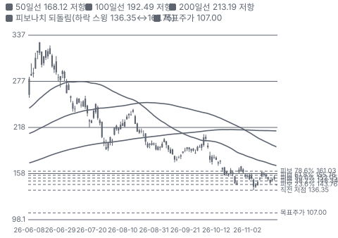

**주봉**

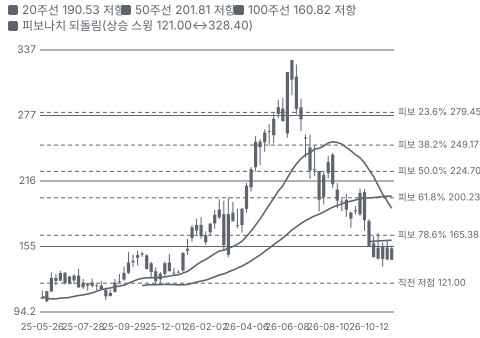

**월봉**

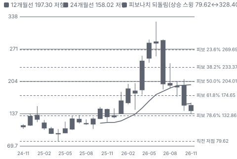

**분기 매출·EPS 실적과 컨센서스**

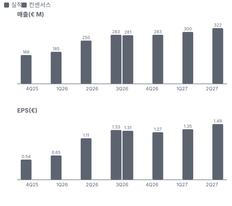

**멀티플 프리미엄(분기말 후행 P/E(대상 선행 추정 이력 없음), 최근 4개 분기말 절대값 — 대상 vs 동종 중앙값)**

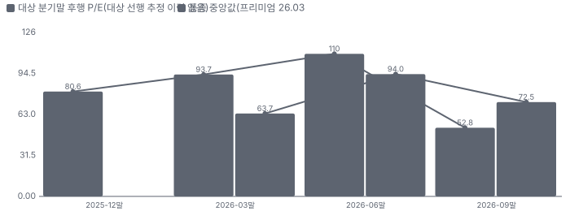

**합리적 멀티플**

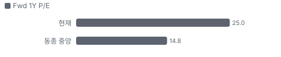

**밸류에이션 주가 시나리오**

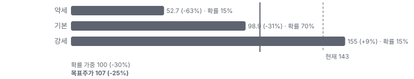

**주가별 업사이드**

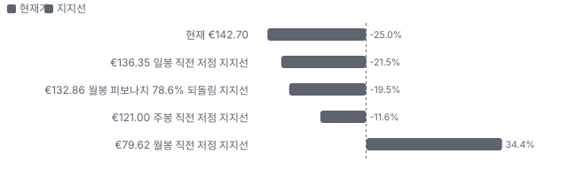
- 제품·서비스 포트폴리오

**고객 믹스(1H26, 매출 대비)**

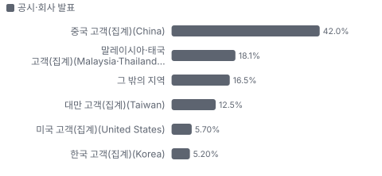

**공급 병목(10점, 낮을수록 병목)**

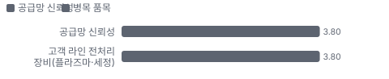

**CAPEX의 매출 대비 비중**

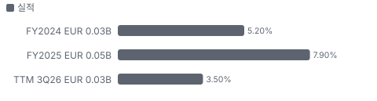

**어닝콜 변화별 주주가치 영향**

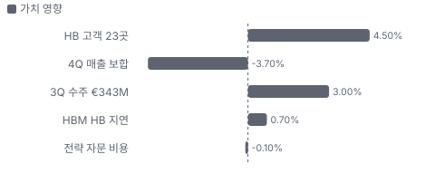

**수주·파이프라인 확실성 사다리**

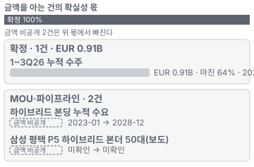

**매출 → 매출총이익 → 영업이익(매출 = 100, 최근 4분기)**

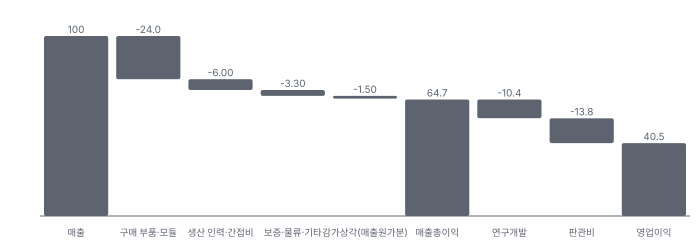

**분기 비용 비중 추이(매출 대비, 공시)**

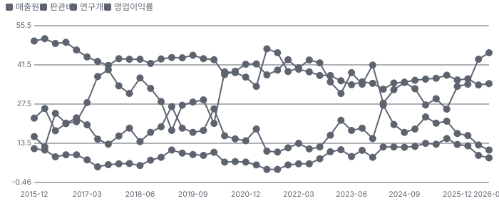

**비용 요인별 매출 대비 비중 1년 변화**

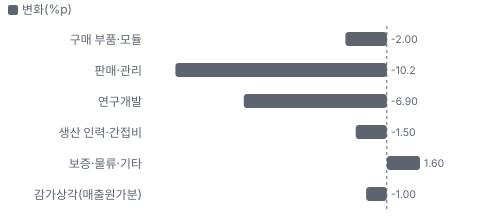

**다이 어태치 BOM 원가 몫**

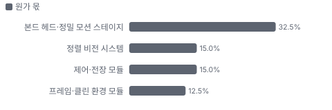

**패키징 BOM 원가 몫**

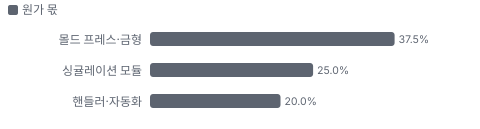

**BOM 항목 가격 +10% 시 OPM 변화**

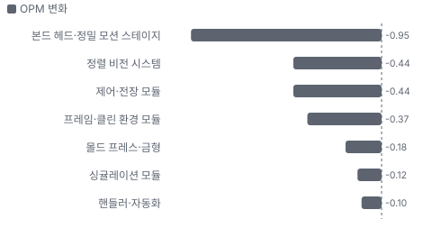

**원가 물가 vs 판매가 물가 — 최근 24개월(24.11 = 100): 둘이 비슷하게 움직인다**

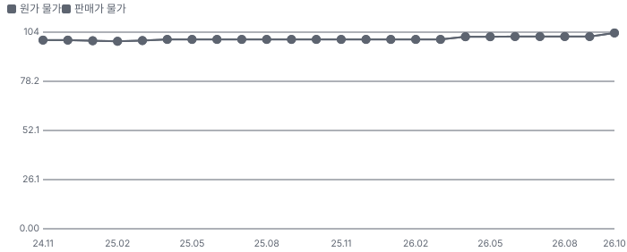

**사업별 매출 vs 물가 — 전년 대비(명목 매출 · 비교 물가 · 실질 = 물량·믹스)**

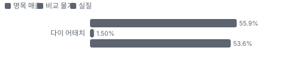

**매출 vs PPI·수출입 — 4Q22 = 100(변화율, 로그 눈금)**

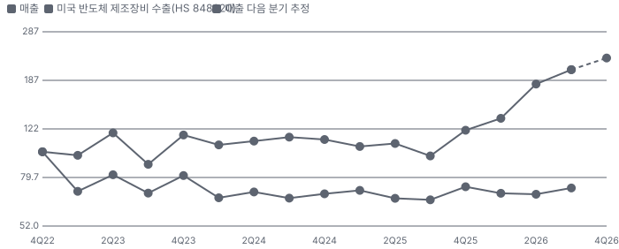

**10년 P·Q 사이클 — 추세(HP 필터) 대비 갭과 8분기 전망**

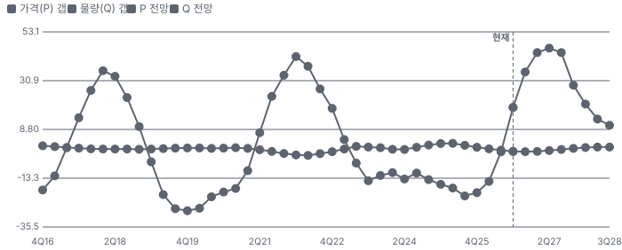

**매출 증가율의 가격·물량 분해와 8분기 전망(전년 대비)**

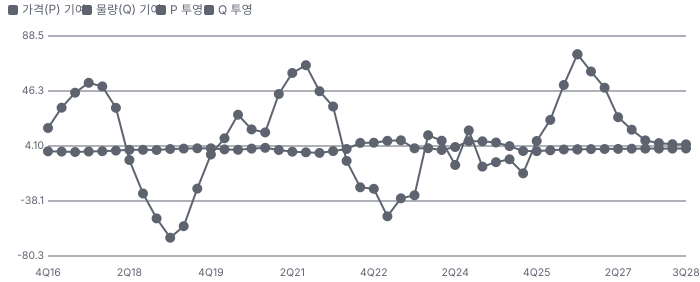

**목표주가 산정 — 기본과 강세 사이(강세 쪽 14%), 도달 확률 약 44%**

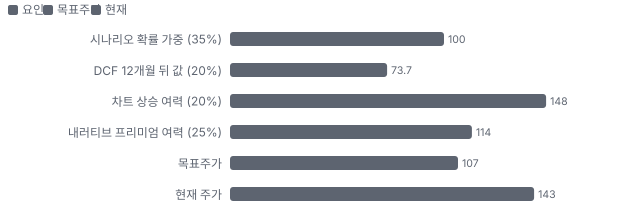

**PEG — 성장 대비 멀티플(낮을수록 성장 대비 쌈)**

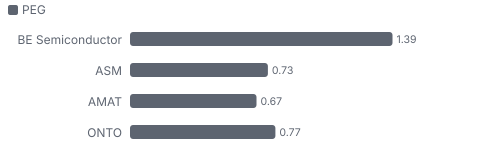

**몬테카를로**

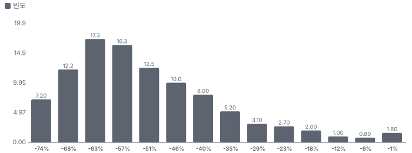

해석: 3,000번 중 37번(1%)에서 가치가 지금 주가 이상이었다. 가정을 흔들어도 지금 주가를 뒷받침하지 못하는 경우가 더 많다. 가운데 값은 0.45배이고, 열 번 중 여덟 번은 0.31~0.70배 사이에 든다.

## 내러티브

> **기업가치를 결정하는 이야기:** 매출의 84%가 다이 어태치(하이브리드 본딩·TC·플립칩(칩을 뒤집어 범프로 기판에 붙이는 방식) 본더), 14%가 패키징, 2%가 도금(전기로 금속막을 입히는 공정)이다. 이익은 하이브리드 본딩 비중이 늘수록 매출총이익률 65% 안팎에서 고정비 레버리지로 커진다 — 3Q 영업이익률 45.8%.

> **멀티플·EPS 프리미엄**
> **멀티플:** Fwd 1Y P/E 25.0배로 동종 4곳 중앙(14.8배)보다 높다 — 하이브리드 본딩 선두 프리미엄
> **EPS:** FY26 EPS 컨센서스 €4.36, FY27 €6.05(+39%)

### 투자자들은 왜 열광했나

2026년 상반기 투자자들은 하이브리드 본딩 고객 급증과 인수 보도, 삼성 50대 도입 보도에 열광해 주가를 €320까지 올렸다. 하반기에는 메모리 품귀로 HBM이 기존 TC 방식을 더 오래 쓰고, 4Q 매출이 멈춘다는 가이던스가 나오면서 기대가 식었다.

### 무엇이 기업가치를 바꾸나

> **구조적 체질 변화**
> **변화:** 범용 다이 본더 회사 → 하이브리드 본딩 장비 선두
> **증거:** 1H26 다이 어태치 €366.6M(+56% YoY), 하이브리드 본딩 고객 23곳
> **반증:** 하이브리드 본딩 수주 감소

> **고부가 믹스 확장**
> **변화:** 하이브리드 본딩·TC Next 비중 확대로 매출총이익률 상승
> **증거:** 매출총이익률 62.2%(3Q25) → 65.2%(3Q26)
> **반증:** 매출총이익률 63% 아래

> **기술 혁신**
> **변화:** 10μm 이하 간격 본딩 — TC Next로 리플로·하이브리드 둘 다
> **증거:** IMEC 시연 데이터(3Q 콜)
> **반증:** 경쟁사의 같은 간격 양산 장비 채택

> **실행 속도**
> **변화:** 3Q 수주 일부를 1H27에 인도 — 고객 라인 일정에 맞춘다 **납품 리드타임 1~9개월.** 피어 비교 미확인. 이전 대비 미확인.
> **증거:** 3Q 콜
> **반증:** 4Q 매출이 가이던스 상단 이상

> **M&A**
> **변화:** 피인수 가능성 — 2026-03 인수 제안 검토 보도, 4Q 전략 자문 비용
> **증거:** Reuters(2026-03-13)·3Q 콜
> **반증:** 회사가 독자 경영 발표

> **정책·입법 연관성**
> **재정정책:** 해당 없음(Besi는 미국·EU(유럽연합) 보조금 수령 공시 없음 — 미확인) 연차보고서 미대조 반증: 해당 없음 의회 동의 2/10 — 하원 1/5(Besi 관련 세출 논의 없음) · 상원 1/5(같음).
> **행정명령:** 네덜란드·미국의 대중국 장비 수출통제 — 후공정 본더는 대부분 통제 밖(추정) 3Q 수주 중국 40% 반증: 첨단 패키징 장비가 통제 목록에 추가 의회 동의 2/10 — 하원 1/5(의회 의결 대상 아님 — 행정 규칙) · 상원 1/5(같음).
> **연관입법:** MATCH(동맹국 장비 수출통제 정렬 법안) Act(동맹국 장비 수출통제 정렬 법안) — 발의 단계 IB 노트 요지(2026-11-16) 반증: 최종 문구에서 후공정 장비 제외

> **고객의 지출 예산**
> **변화:** 고객 CAPEX(후공정 장비 투자)에서 나온다
> **사업별 예산:** **매출의 84%**: 다이 어태치 — 고객 CAPEX(첨단 패키징·HBM 장비 투자) · 동인: AI 칩·HBM 증설
**매출의 14%**: 패키징 — 고객 CAPEX(OSAT 패키징 라인 투자) · 동인: 전통 반도체 회복
> **증거:** OSAT·IDM 증설
> **반증:** TSMC·OSAT 2027 CAPEX 축소

### 내러티브 근거

> 하이브리드 본딩이 AI 칩·HBM의 차세대 연결 방식이 된다는 이야기의 대표 종목이다. 6월 고점 뒤 −55%로, 시장은 'HBM 채택이 늦어진다'와 '인수 기대가 식었다'를 함께 반영했다. 단계는 확산, 쏠림은 낮음~중간(리테일 집계 없음, 콜 질문 증권사 10곳)이다.

> **하이브리드 본딩 확산** · 강화
> **논리:** 로직 칩렛·CPO·엣지 AI에서 하이브리드 본딩 채택이 늘어 고객 수와 대수가 함께 늘어난다
> **숫자:** 고객 15곳 → 23곳, 누적 215대 초과, 2026 수주 2025의 2배 초과
> **반증:** 4Q26·1Q27 하이브리드 본딩 수주가 1H26보다 적음
> **출처:** Besi 3Q26 실적 발표·어닝콜(2026-10-22)

> **HBM 하이브리드 본딩 전환** · 약화
> **논리:** HBM이 16단 이상·차세대 구조로 가면 TC에서 하이브리드 본딩으로 넘어간다
> **숫자:** 메모리 3사 모두 개발 지속, 선두 메모리 고객 HB(하이브리드 본딩의 줄임말)·TC Next 동시 주문
> **반증:** HBM4E(HBM 4세대 개선판)·HBM5(HBM 5세대) 양산 사양이 TC로 확정
> **출처:** Besi 3Q26 실적 발표·어닝콜(2026-10-22)

> **AI 데이터센터 다이 어태치** · 강화
> **논리:** 데이터센터·포토닉스용 플립칩·멀티모듈 본더 수요가 OSAT에서 늘어 전통 사업도 회복한다
> **숫자:** 3Q 수주 OSAT €202.2M(3Q25 €104.1M의 1.9배)
> **반증:** OSAT 수주 2분기 연속 감소
> **출처:** Besi 3Q26 실적 발표·어닝콜(2026-10-22)

> **인수·전략 검토** · 유지
> **논리:** Applied·Lam 같은 대형 장비사가 인수하면 웃돈이 붙는다
> **숫자:** Reuters 2026-03 보도, 4Q 전략 자문 비용 증가
> **반증:** 회사가 전략 검토 종료·독자 경영 발표
> **출처:** Reuters(2026-03-13)·Besi 3Q26 실적 발표·어닝콜(2026-10-22)

> **반대 내러티브 — HBM 지연·인도 지연·중국** · 강화
> **논리:** HBM 하이브리드 본딩은 2028년 이후로 밀리고, 4Q 보합 가이던스는 수주의 매출 전환이 늦다는 뜻이며, 중국 수주 40%는 선행 증설일 수 있다
> **숫자:** 4Q 매출 보합 ±5%, 3Q 수주의 중국 40%
> **반증:** 1Q27 매출 가이던스 두 자릿수 성장
> **출처:** Besi 3Q26 실적 발표·어닝콜(2026-10-22)

### 투자 포인트

> **수주는 두 배인데 주가는 반 토막**
> **명제:** 3Q 수주 €342.6M(+96% YoY), 주가는 6/22 종가 고점 €320.3에서 −55%
> **숫자:** 컨센서스 KPI·일봉
> **시장과 다른 점:** 시장은 HBM 지연과 인수 기대 소멸을 함께 반영했다 — 수주는 로직·CPO·OSAT에서 나왔다
> **증명:** 2027-02 4Q 실적의 1Q27 가이던스 매출 성장
> **출처:** Besi 3Q26 실적 발표·어닝콜(2026-10-22)

> **4Q 보합은 인도 시점**
> **명제:** 고객이 3Q 수주 일부의 인도를 1H27로 늦춰 달라고 했다
> **숫자:** 3Q 콜
> **시장과 다른 점:** 회사 답변: 고객 라인의 다른 장비 리드타임 때문 — 수요 감소가 아니라고 설명
> **증명:** 4Q 수주가 €300M 이상
> **출처:** Besi 3Q26 실적 발표·어닝콜(2026-10-22)

> **HBM 없이도 커지는 하이브리드 본딩**
> **명제:** 로직 칩렛·CPO·엣지 AI에서 하이브리드 본딩 고객이 늘었다
> **숫자:** 고객 15곳(2025 말) → 23곳(3Q26), 누적 수요 215대 초과, 2026 수주가 2025 연간의 2배 초과
> **시장과 다른 점:** 시장은 하이브리드 본딩을 HBM 시점과 같이 보지만, 3Q 주문은 로직·CPO·메모리 개발용에서 나왔다
> **증명:** 4Q·1Q27 하이브리드 본딩 수주와 고객 수
> **출처:** Besi 3Q26 실적 발표·어닝콜(2026-10-22)

### 모멘텀 생성·소멸 타임라인

**카탈리스트 달력 — 지난 사건의 주가 반응과 앞으로 확인할 숫자**
| 날짜 | 상태 | 구분 | 사건 | 반응·확인 | 결과에 따라 |
|---|---|---|---|---|---|
| 2026-03-13 | 완료 | 생성 | 인수 제안 검토 보도(Reuters) | +5.6% |  |
| 2026-07-21 | 완료 | 생성 | 삼성 평택 하이브리드 본더 50대 도입 보도(디일렉) | +7.2% |  |
| 2026-07-23 | 완료 | 소멸 | 2Q 실적 — 3Q 이익률 하향 가이던스 | −7.3% |  |
| 2026-10-22 | 완료 | 소멸 | 3Q 실적 — 4Q 매출 보합 가이던스 | 이틀 −10.7% |  |
| 2026-12~2027-01(예상) | 예정 | 매크로 | 메모리 3사 차세대 HBM 사양·장비 발주 | 하이브리드 본딩 양산 라인 발주 여부 | 발주 확인 → 강세 쪽, TC 확정 → 약세 쪽 |
| 2027-02-18(예상) | 예정 | 확인 | 4Q26 실적 | 4Q 수주 €300M 이상, 1Q27 매출 가이던스 QoQ +10% 이상 | 충족 → 기본, 수주 €250M 미만 → 약세 |

### 언제 사서 언제 팔아야 할까?

**가격·조건 틀 — 가격은 밸류에이션(약세·기본·강세·목표주가)과 차트 지지 구간에서, 조건은 이벤트에서**
| 구간 | 가격 | 목표주가까지 | 약세까지 | 조건·근거 |
|---|---|---|---|---|
| 관찰 구간 | €136~€136 | -22% | -61% | 지지 구간이 약세 시나리오 가격과 겹치는 곳 |
| 확인 뒤 | 지금 €143 이상에서 조건 확인 | -25% | -63% | 4Q 수주 €300M 이상과 1Q27 매출 성장 가이던스 |
| 무효화 | 약세 시나리오 €53 | - | -63% | 1Q27 가이던스 매출 감소와 하이브리드 본딩 수주 감소 |
| 차익 고민 2차 | €155(강세 시나리오) | +9% | - | 목표주가 근처에서 Fwd 1Y P/E가 동종 대비 프리미엄을 넓힐 때 |

실적 다음 날 −7~8% 움직임이 두 번 연속 나왔다 가격·조건 틀이며 매매·비중 지시가 아니다(투자 권유 아님).

## 포트폴리오

| 제품·서비스 | 구분 | 무엇 | 쓰는 곳 | 돈 버는 방식 | Mix | Mix 변화(전년 대비) |
|---|---|---|---|---|---|---|
| 다이 어태치 | 제품 | 칩을 기판·웨이퍼에 붙이는 본더 — 하이브리드 본딩·TC·플립칩·멀티모듈 | TSMC·OSAT의 AI 칩 패키징, 메모리 3사의 HBM 개발 | 1H26 매출의 84%(€366.6M) | 84% | +5.5%p |
| 패키징 | 제품 | 칩을 수지로 싸는 몰딩(칩을 수지로 덮어 보호하는 패키징 공정) 장비와 자르는 싱귤레이션 장비 | OSAT 전통·웨이퍼 레벨 패키징 | 1H26 매출의 14%(€59.7M) | 14% | -4.7%p |
| 도금 | 제품 | 커넥터·태양전지용 금속 도금 장비 | 전자 부품·태양광 | 1H26 매출의 2%(€8.4M) | 2% | -0.9%p |

**Mix 변화가 가장 큰 쪽은 다이 어태치(+5.5%p, 전년 대비).** 계절성 판정: 분기 매출 계절 지수 기준 있음 → 전년 같은 분기와 비교.

## 고객

> **1H26 최대 고객 중국 고객(집계, China) 42%, 상위 3곳 77%, 집중도 집중.** 공시·회사 발표로 확인한 몫은 매출의 100%이고, 나머지 고객 몫은 추정이거나 미분해다. Besi는 고객 이름별 매출 몫을 분기 자료에 내지 않는다. 지역으로는 1H26 매출의 42%가 중국, 13% 대만, 18% 말레이시아·태국이고, 3Q 수주는 OSAT 59%·IDM 41%다

**고객별 매출 몫(1H26)**
| 고객 | 몫 | 변화 | 근거 |
|---|---|---|---|
| 중국 고객(집계, China) | 42% | +15%p | 공시 |
| 말레이시아·태국 고객(집계, Malaysia·Thailand) | 18% | +6%p | 공시 |
| 그 밖의 지역 | 16% | -1%p | 공시 |
| 대만 고객(집계, Taiwan) | 12% | -3%p | 공시 |
| 미국 고객(집계, United States) | 6% | -15%p | 공시 |
| 한국 고객(집계, Korea) | 5% | -2%p | 공시 |

> **중국 고객(집계, China)** · 공시
> **사는 것:** 플립칩·멀티모듈 다이 어태치(데이터센터·스마트폰)
> **추정 근거:** 지역 매출 1H26 €182.6M ÷ €434.7M(계산), 1H25 €78.1M ÷ €292.2M

> **말레이시아·태국 고객(집계, Malaysia·Thailand)** · 공시
> **사는 것:** OSAT 데이터센터·광 부품 조립
> **추정 근거:** 1H26 €37.9M + €40.7M ÷ €434.7M(계산)

> **그 밖의 지역** · 공시
> **사는 것:** 유럽·기타 아시아 차량·산업용
> **추정 근거:** 나머지(계산)

> **대만 고객(집계, Taiwan)** · 공시
> **사는 것:** 하이브리드 본딩·TC(첨단 로직 패키징)·다이 어태치
> **추정 근거:** 1H26 €54.5M ÷ €434.7M(계산)

> **미국 고객(집계, United States)** · 공시
> **사는 것:** 하이브리드 본딩(미국 로직 고객)
> **추정 근거:** 1H26 €24.8M ÷ €434.7M — 1H25 €60.3M에서 줄었다(미국 로직 고객의 큰 추가 주문 없음, 3Q 콜 질문)

> **한국 고객(집계, Korea)** · 공시
> **사는 것:** HBM 하이브리드 본딩·TC Next 개발 장비(메모리)
> **추정 근거:** 1H26 €22.8M ÷ €434.7M(계산). 삼성 평택 P5 50대 도입 보도는 회사 확인 없음

## 수주·파이프라인

> **2026-09-30 기준 3건.** 확정 EUR 0.91B. 서로 겹치는 항목은 합계에서 뺐다.

**수주 목록**
| 상태 | 계약 | 계약 총액 | 진척 | 기간 | 비고 |
|---|---|---|---|---|---|
| 확정 | 1~3Q26 누적 수주 | EUR 0.91B | 비공개 | 2026-01 → 2027-06 | - |
| 파이프라인 | 하이브리드 본딩 누적 수요 | 금액 비공개 | 비공개 | 2023-01 → 2028-12 | (다른 항목과 겹칠 수 있어 합계에서 뺌) |
| 파이프라인 | 삼성 평택 P5 하이브리드 본더 50대(보도) | 금액 비공개 | 비공개 | 미확인 → 미확인 | (다른 항목과 겹칠 수 있어 합계에서 뺌) |

**실행 속도와 방해 요인**
| 항목 | 상태 | 실행 속도 | 방해 요인 |
|---|---|---|---|
| 1~3Q26 누적 수주 | 확정 | 3Q 수주 일부는 1H27 인도 요청 | 고객 라인의 다른 장비 리드타임 · 고객 증설 일정 |
| 하이브리드 본딩 누적 수요 | 파이프라인 | 2026년 수주가 2025년 연간의 2배 초과 | HBM 채택 시점 · 미국 로직 고객 증설 |
| 삼성 평택 P5 하이브리드 본더 50대(보도) | 파이프라인 | 미확인 | 세메스 경쟁 납품 · HBM 하이브리드 본딩 양산 시점 |

## 마진 구조

> **GPM 65.2%, OPM 45.8%.** 2Q26 대비 GPM -0.5%p, OPM +2.2%p. 변동비는 매출의 33%이고, 매출이 10% 늘면 OPM은 +1.9%p 움직인다. 3Q 매출원가는 매출의 34.8%로 1년 전 37.8%보다 3.0%p 낮다. 연구개발·판관비 비중이 36.6%에서 19.4%로 줄어 영업이익률이 25.7%에서 45.8%로 뛰었다

> **매출 100 중 매출원가 35.3, 매출총이익 64.7(최근 4분기, 공시).** 매출원가 요인 중 구매 부품·모듈이 매출의 24.0%로 가장 무겁고, 단가가 +10% 오르면 GPM이 -2.40%p 움직인다. 분기 회귀로 매출 1이 늘 때 매출원가는 0.31 늘고, 매출원가의 고정비 몫은 20%다.

**비용 요인 강도 — 비중·추세·충격(+10%)·탄력**
| 비용 | 구분 | 매출 대비 | 1년 변화 | 마진 기여 | 충격 시 마진 | 매출 탄력 | 고정비 몫 |
|---|---|---|---|---|---|---|---|
| 구매 부품·모듈 | 매출원가 요인 | 24.0% | -2.0%p | +2.0%p | -2.40%p | 미확인 | 0% |
| 생산 인력·간접비 | 매출원가 요인 | 6.0% | -1.5%p | +1.5%p | -0.60%p | 미확인 | 60% |
| 보증·물류·기타 | 매출원가 요인 | 3.3% | +1.6%p | -1.6%p | -0.33%p | 미확인 | 20% |
| 감가상각(매출원가분) | 매출원가 요인 | 1.5% | -1.0%p | +1.0%p | -0.15%p | 미확인 | 100% |
| 매출원가 | 공시 항목 | 35.3% | -1.4%p | +1.4%p | -3.53%p | 0.31 | 20% |
| 판관비 | 공시 항목 | 13.8% | -7.0%p | +7.0%p | 미확인 | 0.06 | 61% |
| 연구개발 | 공시 항목 | 10.4% | -3.2%p | +3.2%p | 미확인 | 0.06 | 33% |

매출 탄력 = 분기 비용을 매출에 회귀한 기울기(매출 1당 변동비), 고정비 몫 = 절편 ÷ 평균 비용. 표본이 8분기 미만이면 미확인. 매출원가 요인 비중은 margin 재료의 추정이 섞여 있고, 공시 매출원가와의 차이는 '기타 매출원가'로 둔다.

**GPM에서 OPM까지(GAAP, 아래는 최근 4개 분기)**
| 기간 | GPM | 연구개발 | 판관비 | 기타 | OPM |
|---|---|---|---|---|---|
| 3Q25 | 62.2% | 15.2% | 21.4% | 0.0% | 25.7% |
| 2Q26 | 65.7% | 9.2% | 12.9% | 0.0% | 43.5% |
| 3Q26 | 65.2% | 8.3% | 11.1% | 0.0% | 45.8% |
| 2025-12 | 63.9% | - | - | - | 33.8% |
| 2026-03 | 63.5% | - | - | - | 34.6% |
| 2026-06 | 65.7% | - | - | - | 43.5% |
| 2026-09 | 65.2% | - | - | - | 45.8% |

**비용을 움직이는 요인**
| 비용 | 요인 |
|---|---|
| 구매 부품·모듈(매출원가) | 정밀 모션·비전·본드 헤드 부품 단가와 물량 · 근거 추정 |
| 판매·관리(판관비) | 영업·고객 지원, 4Q 전략 자문 비용 · 근거 공시 |
| 연구개발(연구개발) | 하이브리드 본딩·TC Next·포토닉스 개발 인력 · 근거 공시 |
| 생산 인력·간접비(매출원가) | 말레이시아·중국 조립 인력, 가동률 · 근거 추정 |
| 보증·물류·기타(매출원가) | 설치·보증 충당, 운송 · 근거 추정 |
| 감가상각(매출원가분, 매출원가) | 생산 설비 감가상각 · 근거 추정 |

**다이 어태치 BOM — 매출의 84%, GPM 65%(회사 전체 매출총이익률(3Q26) — 세그먼트별 총이익 미공시), 항목 가격 +10% 시**
| 항목 | 원가 몫 | 전가 | 제품 GPM | OPM |
|---|---|---|---|---|
| 본드 헤드·정밀 모션 스테이지 | 25~40% | 미확인 | -1.1%p | -0.95%p |
| 정렬 비전 시스템 | 10~20% | 미확인 | -0.5%p | -0.44%p |
| 제어·전장 모듈 | 10~20% | 미확인 | -0.5%p | -0.44%p |
| 프레임·클린 환경 모듈 | 10~15% | 미확인 | -0.4%p | -0.37%p |
| 미분해 | 25% | - | - | - |

**패키징 BOM — 매출의 14%, GPM 65%(회사 전체 매출총이익률 대용), 항목 가격 +10% 시**
| 항목 | 원가 몫 | 전가 | 제품 GPM | OPM |
|---|---|---|---|---|
| 몰드 프레스·금형 | 30~45% | 미확인 | -1.3%p | -0.18%p |
| 싱귤레이션 모듈 | 20~30% | 미확인 | -0.9%p | -0.12%p |
| 핸들러·자동화 | 15~25% | 미확인 | -0.7%p | -0.10%p |
| 미분해 | 18% | - | - | - |

본드 헤드·정밀 모션 스테이지 가격이 +10% 오르면 영업이익은 -2.1% 움직인다. 판매가 전가를 모르는 항목은 전가 0%로 계산했다.

**BOM 항목 가격을 움직이는 것**
| 항목 | 요인 |
|---|---|
| 본드 헤드·정밀 모션 스테이지 | 리니어 모터·에어 베어링 단가 · 근거 추정 |
| 정렬 비전 시스템 | 고해상 카메라·광학 단가 · 근거 추정 |
| 제어·전장 모듈 | 산업용 컴퓨터·모터 드라이버 단가 · 근거 추정 |
| 프레임·클린 환경 모듈 | 판금·필터 단가 · 근거 추정 |
| 몰드 프레스·금형 | 금형강 단가 · 근거 추정 |
| 싱귤레이션 모듈 | 레이저·블레이드 부품 · 근거 추정 |
| 핸들러·자동화 | 로봇·센서 단가 · 근거 추정 |

**투입 물가 — 미국 PPI 3·6·12개월(2026-10, 개정 반영)과 해외 전년비**
| 항목 | 미국 3개월 | 6개월 | 12개월 | 전가 못 할 때 OPM | 일본 | 한국 | 대만 |
|---|---|---|---|---|---|---|---|
| 본드 헤드·정밀 모션 스테이지 | +1.9% | +2.0% | +3.4% | - | +2.2% | +0.0% | +3.0%* |

별표는 품목보다 넓은 업종 지수다. 연결한 투입 원가의 미국 PPI(생산자물가지수)는 1년 새 가중 +3.4%이고, 판매가로 넘기지 못하면 GPM -0.8%p·OPM -0.8%p가 움직인다. 판매가 비교 물가(반도체 제조장비 PPI)는 1년 새 +3.4% — 회사 가격 변화는 미확인. 물가 지수를 붙이지 못한 매출원가 항목은 생산 인력·간접비, 감가상각(매출원가분), 보증·물류·기타다(미연결). 다이 어태치 매출은 2026-06 전년 대비 +55.9%이고 비교 물가 ppi_id:PCU333242333242의 변화 +1.5%(2026-06)를 빼면 실질 +53.6% — 물량·믹스가 성장을 이끌었다.

## 공급망 병목

> **공급망 신뢰성 3.8/10, 병목 심각.** 가장 약한 고리는 고객 라인 전처리 장비(플라즈마·세정) 3.8점이고, 품목 평균은 3.8점이다. 근거가 부족한 2건(본드 헤드·정밀 모션 스테이지 · 정렬 비전 시스템)은 점수에서 뺐다. Besi는 핵심 부품을 외부에서 사서 말레이시아·중국에서 조립한다. 공급사 이름·단일 공급원 여부는 연차보고서 미대조라 미확인이다. 병목은 부품보다 고객 라인의 다른 장비 리드타임에 있다(3Q 콜)

**병목과 마진 — 품목 가격 +10% 시 OPM**
| 품목 | 점수 | 판정 | 구분 | OPM |
|---|---|---|---|---|
| 고객 라인 전처리 장비(플라즈마·세정) | 3.8 | 병목 심각 | 출하 차질 위험 | 미확인 |

> **고객 라인 전처리 장비(플라즈마·세정)** · 3.8/10
> **왜:** Besi 부품이 아니라 고객 라인의 짝 장비 — 인도 시점을 좌우. 재인증 12개월은 하이브리드 본딩 라인 공정 재검증 기간 추정(업계 통상 6~18개월), 장기계약은 2020년 공동 개발 계약 기준
> **병목 요인:** 인증 공급사 1곳 · 캐파 빠듯 · 리드타임 미확인 · 재인증 12개월 · 1위 점유율 미확인 · 지역 집중 미확인 · 물량 확보 장기계약
> **풀리는 조건:** 미확인

**공급사**
| 품목 | 공급사 | 몫 | 근거 |
|---|---|---|---|
| 본드 헤드·정밀 모션 스테이지 | 미공개(리니어 모터·정밀 스테이지) | 미확인 | 추정 |
| 정렬 비전 시스템 | 미공개(카메라·광학) | 미확인 | 추정 |
| 고객 라인 전처리 장비(플라즈마·세정) | Applied Materials(하이브리드 본딩 전처리·세정(Kinex(Applied Materials·Besi 통합 하이브리드 본딩 라인) 통합)) | 미확인 | 회사 발표 |

**무역 통계로 본 공급 지역**
| 품목 | EU 수입처 | 일본 수입처 | EU 1위 전년비 |
|---|---|---|---|
| 본드 헤드·정밀 모션 스테이지 | JP(일본) 48% · US 33% · TW(대만) 8% | 大韓民国 36% · シンガポール 25% | +892.4% |

## 생산능력

> **현재 명목 캐파 미확인, 가동률 미확인.** 착공 이상 증설은 0 장비 대/년(출하), 발표까지 합치면 0 장비 대/년(출하)이다. TTM 3Q26 CAPEX는 EUR 0.03B로 매출의 3.5%다. 생산 거점별 캐파는 공시하지 않는다. 회사는 운영 모델상 생산을 빠르게 70%까지 늘릴 수 있다고 말한다(3Q 콜). CAPEX는 매출의 3~8%로 가볍다

**생산시설 4곳**(회사 소개·컨센서스 개요에 나온 생산·개발 거점 4곳(연차보고서 시설 목록 미대조 — 더 있을 수 있다)), 미확인 4곳. 시설별 생산능력은 공개되지 않았다 — 회사 전체 캐파만 위에 적었다.

**생산시설 4곳 — 명칭·위치·생산능력**
| 시설 | 위치 | 용도 | 생산능력 | 소유·상태 |
|---|---|---|---|---|
| Duiven 본사 | 네덜란드 Duiven | 본사·패키징·도금 개발 | 미확인 — 거점별 캐파 미공시 | 미확인 · 가동 |
| Radstadt 거점 | 오스트리아 Radstadt | 다이 어태치·하이브리드 본딩 개발 | 미확인 — 거점별 캐파 미공시 | 미확인 · 가동 |
| Shah Alam 공장 | 말레이시아 Shah Alam | 장비 조립 | 미확인 — 거점별 캐파 미공시 | 미확인 · 가동 |
| 중국 생산 거점 | 중국(도시 미대조) | 장비 조립 | 미확인 — 거점별 캐파 미공시 | 미확인 · 가동 |

**생산능력 확충 계획**
| 계획 | 단계 | 증설 | 가동 시점 | CAPEX |
|---|---|---|---|---|
| 조립 캐파 확대(유연 인력) | 발표 | 미확인 | 미확인 | 미확인 |

남은 계획의 CAPEX 합계는 EUR 0.00B(금액 미확인 1건 제외)다. 합계는 TTM 3Q26 매출의 0%다.

**증설 방해 요인**
| 계획 | 방해 요인 |
|---|---|
| 조립 캐파 확대(유연 인력) | 고객 인도 일정 |

**CAPEX와 매출 대비**
| 기간 | CAPEX | 매출 | 매출 대비 | 구분 |
|---|---|---|---|---|
| FY2024 | EUR 0.03B | EUR 0.61B | 5.2% | 실적 |
| FY2025 | EUR 0.05B | EUR 0.59B | 7.9% | 실적 |
| TTM 3Q26 | EUR 0.03B | EUR 0.88B | 3.5% | 실적 |

## 피터 린치 분류

> **경기순환주(Cyclical), 중형.** 린치 표의 기대 수익 10배, 하방 -80~100%, 위험 고. 10배 경로가 있는 분류다(고성장주·회생주·경기순환주).

**분류 근거 — 크기 먼저, 다음은 이야기 유형**
| 항목 | 값 |
|---|---|
| 크기 | 중형(시가총액 \$11.5B) |
| 장기 성장 | 23.5%(컨센서스 EPS 2년 CAGR) |
| 린치 비율((성장% + 배당%) ÷ P/E) | 0.94 — 2 이상 매력, 1 미만 비싸다 |
| PEG(P/E ÷ 성장%) | 1.06 — 1 적정, 0.5 매우 매력, 2 매우 불리 |
| 근거 | 순환 업종(semicap) · TTM 매출이 과거 고점 대비 44% 빠진 적이 있다 |
| 반대 근거 | 장기 성장률 24%로 고성장주 구간 — 순환 위의 성장주일 수 있다 |

- 점검: 재고·공급과 수요(가격)의 방향
- 점검: 경쟁사의 증설
- 점검: 이익 정점에서 P/E가 낮아 보이는 함정
- 점검: 부채가 바닥을 견딜 수 있나
- 팔 때(점검 조건, 매매 지시 아님): 재고가 쌓이고 증설이 시작되고 가격이 꺾일 때 — 정점의 낮은 P/E는 싸다는 뜻이 아니다

분류 = 피터 린치·존 로스차일드 『One Up On Wall Street』(1989)·『Beating the Street』(1993)의 6분류와 위험·보상 표를 숫자 규칙으로 옮긴 자체추론이다(config/lynch.yaml).

## 해자

> 해자는 '양산 하이브리드 본더를 가장 많이 깔았고, 그 위에 Applied의 전공정 기술을 묶었다'는 데서 나온다. 다만 TC 본딩(열과 압력으로 범프를 녹여 칩을 하나씩 붙이는 접합, TCB — 지금 HBM 적층 주력)은 한미반도체·ASMPT·한화세미텍과 겨루는 시장이라 해자가 약하다

> **하이브리드 본딩 설치 기반** · 강함
> **해자:** 양산용 D2W(다이를 웨이퍼 위에 하나씩 붙이는 방식, 다이-투-웨이퍼) 하이브리드 본더를 쓰는 고객 대부분이 Besi 장비로 공정을 맞췄다
> **근거:** 고객 23곳·누적 수요 215대 초과(3Q 콜), 2026년 수주가 2025년의 2배 초과
> **숫자:** 고객 15곳(2025 말) → 23곳(3Q26)
> **깨지는 조건:** 선두 HBM·로직 고객이 다른 회사 하이브리드 본더로 양산 라인을 채움

> **Applied Materials 통합** · 보통
> **해자:** 전처리·세정(Applied)과 본딩(Besi)을 한 라인(Kinex)으로 묶어 고객 공정 검증 부담을 줄인다
> **근거:** 7년 협업, EPIC 센터 첫 프로그램이 미국 대형 고객용 하이브리드 본딩·TC(3Q 콜)
> **숫자:** Applied 지분 약 9%(보도)
> **깨지는 조건:** Applied가 자체 본더를 내거나 다른 본딩 회사와 손잡음

> **TC 본딩 경쟁력** · 약함
> **해자:** HBM 주력인 TC 본딩은 한미반도체·ASMPT·한화세미텍이 점유를 나눠 가져 가격 결정력이 약하다
> **근거:** 선두 메모리 고객의 TC Next 재주문(3Q 콜) — 점유율 수치 미공시
> **숫자:** 미확인
> **깨지는 조건:** TC Next가 HBM 양산 라인 다수에 채택

> **가격 전가** · 보통
> **해자:** 원가 상승을 판매가로 넘겨 매출총이익률을 유지했다
> **근거:** 1~3Q 순이익 +179%의 이유로 제품 믹스와 가격 인상 전가를 꼽음(3Q 콜), 3Q 매출총이익률 65.2%
> **숫자:** 매출총이익률 62.2%(3Q25) → 65.2%(3Q26)
> **깨지는 조건:** 매출총이익률 가이던스 하단이 60% 아래로

## 경영진·네트워크

> 공동 창업자 Richard Blickman이 1995년부터 CEO를 맡아 콜을 직접 이끈다. 정계 연결은 공개 기록상 미확인이다

> **Richard Blickman** · CEO(공동 창업자) · 1995
> **프로필:** 3Q 콜에서 하이브리드 본딩 로드맵·Applied 협업·전략 점검을 직접 설명
> **비즈니스:** Applied Materials와 7년 협업(3Q 콜)
> **정계:** 미확인
> **동문:** 미확인
> **사모임:** 미확인

**네트워크 정량화**
| 연결 | 강도 | 닿는 매출 | 가중 노출 | 매출 대비 | 근거 |
|---|---|---|---|---|---|
| 비즈니스: Applied Materials 공동 개발·지분 약 9% | 4/5 | €0.00B | €0.00B | 0% | Applied를 통한 매출 몫 미공시 — 노출 0으로 둔다 Besi 3Q26 실적 발표·어닝콜(2026-10-22) |

가중 노출은 연결이 닿는 매출의 크기다. 연결이 그 매출을 만들었다는 뜻이 아니며, 인과는 공개 자료로 입증하지 못한다.

## 약세 논리 및 셀온 조건

| 약세 논리 | 근거 | 가를 자료 |
|---|---|---|
| HBM 하이브리드 본딩이 늦어진다 | 메모리 품귀로 지금 HBM의 낮은 적층이 예상보다 오래 쓰이고, 회사도 하이브리드 본딩이 앞으로 2년에 걸쳐 여러 적층에 단계적으로 들어간다고 말했다(3Q 콜). 콜 질문 대부분이 이 시점에 몰렸다 | HBM4E·차세대 HBM 양산 사양 발표, 메모리 3사의 하이브리드 본더 양산 주문 |
| 4Q 보합은 수요 둔화의 첫 신호일 수 있다 | 4Q 매출 가이던스 보합 ±5%는 3Q 수주 €342.6M가 바로 매출로 바뀌지 않는다는 뜻이다. 회사는 고객 라인의 다른 장비 리드타임 때문이라고 답했지만 회사 설명이다 | 4Q 수주(2027년 2월 추정 발표)와 1Q27 매출 가이던스 |
| 중국·OSAT 사이클 | 3Q 수주의 40%가 중국이고 OSAT 수주가 €202.2M(59%)다. 연 수주는 2021년 €939M에서 2023년 €548M로 줄어든 적이 있다 | 4Q 중국 수주 비중, OSAT 수주 추이 |
| 배수가 동종보다 비싸다 | Fwd 1Y P/E 25.0배로 동종 4곳 중앙(14.8배)보다 높다. 인수 기대가 빠지면 이 프리미엄이 줄 수 있다 | 전략 검토 결과 발표 |
| TC 본딩은 경쟁이 치열하다 | HBM 주력 TC 본딩은 한미반도체·ASMPT·한화세미텍과 겨룬다. 선두 메모리 고객의 TC Next 재주문은 있었지만 점유율은 공시되지 않는다 | 메모리 3사 TC 본더 발주 공시(한국 장비사 단일판매 공시) |
| 자료 한계 | TradingView 한도로 일봉은 Easyconomics 2년치를 썼고 11/20 한 봉은 시가·종가만 있다. 애널리스트 의견·목표가·수정 이력 데이터가 없고, 연차보고서(구매 약정·10% 초과 고객·생산 거점 캐파)는 이번 회차에 대조하지 못했다 | 다음 회차 연차보고서 대조 |

**변이 관점.** 시장은 Besi를 'HBM 하이브리드 본딩 주식'으로 보고 HBM 전환 지연을 곧 수요 지연으로 읽었다. 그러나 3Q 수주가 1년 새 두 배가 된 것은 HBM이 아니라 로직 칩렛·CPO·데이터센터 OSAT에서 나왔다. 가격이 수주와 반대로 간 원인은 이익 추정이 아니라 '언제'에 대한 의심이다 — 그 의심을 풀 첫 숫자는 HBM 사양이 아니라 4Q 수주와 1Q27 매출 가이던스다.

> **셀온 조건**
> **조건 1:** 4Q26 수주가 €250M 아래로 줄고 1Q27 매출 가이던스도 보합 이하다(2027년 2월 추정).
> **조건 2:** HBM 차세대 사양이 TC 방식으로 굳었다는 메모리 업체 발표가 나오고 하이브리드 본딩 고객 수 증가가 멈춘다.
> **조건 3:** 매출총이익률 가이던스 하단이 60% 아래로 내려간다.
> **조건 4:** 회사가 전략 검토를 끝내고 독자 경영을 발표하는데 같은 분기 수주가 줄어든다.

## 어닝콜 변화

**직전 콜 대비 새로 나오거나 바뀐 내용 → 가치 영향**
| 항목 | 내용 | 직전 콜 | 최신 콜 | 모델 동인 이동 | 확신도 | 가치 영향 |
|---|---|---|---|---|---|---|
| 업데이트 | 분기 매출 가이던스 | 3Q +10~15% QoQ(2Q 콜) | 4Q 보합 ±5%(3Q 콜) | 1년차 성장률 -4.0% | 0.8 | -3.7% |
| 업데이트 | 분기 수주 | 2Q €292.9M | 3Q €342.6M(+17% QoQ, +96% YoY) | 1년차 성장률 +3.0% | 1.0 | +3.0% |
| 신규 | 하이브리드 본딩 고객 수 | 21곳(2Q 말) | 23곳·누적 215대 초과 | 장기 성장 수렴값 +1.0% | 1.0 | +4.5% |
| 부정 | HBM 하이브리드 본딩 시점 | HBM4(HBM 4세대)·4E 일부 채택 기대 | 메모리 품귀로 낮은 적층 사용 연장 — 2년에 걸쳐 단계 채택 | 성장 지속(감속 계수) +2.0% | 0.5 | +0.7% |
| 신규 | 영업비용 가이던스 | 영업비용 증가 제한(2Q 콜) | 4Q +5~10% QoQ — 전략 자문 비용 | 출발 이익률 -0.50% | 0.8 | -0.1% |
| 반복 | 매출총이익률 가이던스 | 3Q 63~65%(2Q 콜) | 4Q 63~65%(3Q 실적 65.2%) | 목표 이익률 — | 0.8 | +0.0% |
| **합계** | 단독 합 |  |  | 동시 적용 +4.1% |  | **+4.3%** |

**실적 발표 예상 변동폭:** 지난 4번 실적 발표 때 주가는 하루에 평균 ±4.6%(최대 7.3%, 오른 날 2번) 움직였다.

**실적 발표 예상 변동폭 — 과거 실적 발표 다음 거래일 주가 변화**
| 분기 | 발표일 | 주가 변화 |
|---|---|---|
| 4Q25 | 2026-02-18 | +3.8% |
| 1Q26 | 2026-04-23 | +4.1% |
| 2Q26 | 2026-07-23 | -7.3% |
| 3Q26 | 2026-10-22 | -3.2% |

## 거시 지표 싱크로율

> **미국 반도체 제조장비 수출(HS(국제 통일 상품 분류 코드) 848620)와 전사 매출 싱크로율 69%(0분기 = 약 0개월 선행, 전년 대비, 표본 35개·t 5.5·유의·신뢰 보통).** 이 지표가 내포하는 4Q26 전사 매출은 314M(±1σ 259M~369M, 지표 자기회귀 추정)다. 표본 밖 검증(최근 6개 분기)에서 지표 모델 오차는 33.9%p, 기준선(직전 증가율 지속)은 23.7%p다 — **지표가 기준선을 이기지 못해(예측력 없음) 추정은 대부분 기준선이다(지표 가중 26%).** 기준선은 인수·환율 효과의 소멸을 모르므로 회사 가이던스와 차이가 크면 가이던스 쪽 설명을 먼저 본다.  Besi 매출은 고객의 후공정 장비 반입을 따라간다 — 반도체 제조장비(HS 8486) 수입이 큰 중국·대만·말레이시아 쪽 지표

**지표별 싱크로율(상관계수 × 100) — 위 두 줄이 제품 연관성 × 싱크로율로 고른 PPI·수출입 세부 지표**
| 지표 | 비교 대상 | 증가율 기준 | 지표 선행 | 매출(t값) | 영업이익 | 방향 일치 | 표본·신뢰 | 표본 밖 오차(지표/기준선) | 4Q26 추정 매출 |
|---|---|---|---|---|---|---|---|---|---|
| 미국 반도체 제조장비 수출(HS 848620) | 전사 매출 | 전년 대비 | 0분기(0개월) | 69%(t 5.5) | 64%(0분기) | 69% | 35·보통 | 33.9/23.7%p ✘ | +88.8% → 314M(지표 자기회귀 추정) |
| 미국 반도체 제조장비 수입 | 전사 매출 | 전년 대비 | 2분기(6개월) | -42%(t -2.6) | -44%(2분기) | 36% | 33·보통 | 30.4/23.7%p ✘ | +84.4% → 307M(확정) |

**지표 후보 24개 — 연관성(제품 품목 일치 × 대용 감점 × 매출 비중) × 싱크로율로 고른다. 후보가 많을수록 최대 상관은 우연히 부풀 수 있다**
| 후보 | 종류 | 연관성 | 매출 분기 일치 | 싱크로율(선행) | 점수 | 출처 |
|---|---|---|---|---|---|---|
| 미국 반도체 제조장비 수출(HS 848620) ✔ | 수출입 | 1.00 | 100% | 69%(0분기) | 0.69 | 자동 |
| 미국 HS 848690 수출(다이 어태치과 같은 4자리 품목군) | 수출입 | 0.70 | 100% | 65%(0분기) | 0.46 | 자동 |
| EU 반도체 제조장비 수입(HS 848620) | 수출입 | 1.00 | 100% | 43%(0분기) | 0.34 | 자동 |
| 미국 HS 848690 수입(다이 어태치과 같은 4자리 품목군) | 수출입 | 0.70 | 100% | 47%(0분기) | 0.33 | 자동 |
| 미국 HS 848610 수출(다이 어태치과 같은 4자리 품목군) | 수출입 | 0.70 | 100% | 38%(2분기) | 0.21 | 자동 |
| EU HS 848690 수입(다이 어태치과 같은 4자리 품목군) | 수출입 | 0.70 | 100% | 37%(0분기) | 0.21 | 자동 |
| 미국 HS 848630 수출(다이 어태치과 같은 4자리 품목군) | 수출입 | 0.70 | 94% | 27%(0분기) | 0.15 | 자동 |
| EU HS 848630 수입(다이 어태치과 같은 4자리 품목군) | 수출입 | 0.70 | 100% | 17%(3분기) | 0.09 | 자동 |
| EU HS 848690 수출(다이 어태치과 같은 4자리 품목군) | 수출입 | 0.70 | 100% | 13%(2분기) | 0.07 | 자동 |
| 미국 반도체 제조장비 수입 | 수출입 | 1.00 | 100% | -42%(2분기) | 0.00 | 모델 지정 |
| EU 반도체 제조장비 수출(HS 848620) | 수출입 | 1.00 | 100% | -34%(3분기) | 0.00 | 자동 |
| 미국 반도체 제조장비 PPI | PPI | 1.00 | 100% | -49%(0분기) | 0.00 | 자동 |

**선행 지표로 본 향후 분기 매출 전망(이미 나온 지표 값 기준, ±1σ)**
| 지표 | 대상 | 분기 | 지표 증가율 | 내포 매출 증가율 | 내포 매출 |
|---|---|---|---|---|---|
| 미국 반도체 제조장비 수입 | 전사 매출 | 4Q26 | +4.3% | +15.9% | 193M(131M~254M) |
| 미국 반도체 제조장비 수입 | 전사 매출 | 1Q27 | +121.9% | -23.4% | 142M(73M~210M) |
| EU 반도체 제조장비 수출(HS 848620) | 전사 매출 | 4Q26 | -29.6% | +45.7% | 242M(178M~306M) |
| EU 반도체 제조장비 수출(HS 848620) | 전사 매출 | 1Q27 | -17.8% | +37.3% | 254M(183M~325M) |
| EU 반도체 제조장비 수출(HS 848620) | 전사 매출 | 2Q27 | +46.6% | -8.6% | 228M(132M~325M) |
| 일본 반도체 제조장비 PPI | 전사 매출 | 4Q26 | +0.6% | +17.3% | 195M(129M~262M) |
| 일본 반도체 제조장비 PPI | 전사 매출 | 1Q27 | +4.5% | +7.3% | 198M(125M~272M) |
| EU HS 848610 수출(다이 어태치과 같은 4자리 품목군) | 전사 매출 | 4Q26 | -0.4% | +24.6% | 207M(149M~266M) |
| EU HS 848610 수출(다이 어태치과 같은 4자리 품목군) | 전사 매출 | 1Q27 | -47.5% | +56.3% | 289M(224M~354M) |
| EU HS 848610 수출(다이 어태치과 같은 4자리 품목군) | 전사 매출 | 2Q27 | -29.7% | +44.4% | 361M(273M~449M) |
| EU HS 848610 수출(다이 어태치과 같은 4자리 품목군) | 전사 매출 | 3Q27 | -12.8% | +32.9% | 377M(277M~477M) |
| EU HS 848630 수출(다이 어태치과 같은 4자리 품목군) | 전사 매출 | 4Q26 | -34.3% | +26.2% | 210M(155M~265M) |
| EU HS 848630 수출(다이 어태치과 같은 4자리 품목군) | 전사 매출 | 1Q27 | +71.1% | -12.1% | 163M(101M~224M) |
| EU HS 848630 수출(다이 어태치과 같은 4자리 품목군) | 전사 매출 | 2Q27 | +134.3% | -35.0% | 162M(80M~245M) |
| EU HS 848690 수출(다이 어태치과 같은 4자리 품목군) | 전사 매출 | 4Q26 | +2.5% | +8.5% | 180M(113M~248M) |
| EU HS 848690 수출(다이 어태치과 같은 4자리 품목군) | 전사 매출 | 1Q27 | +10.3% | +10.8% | 205M(130M~280M) |
| EU HS 848610 수입(다이 어태치과 같은 4자리 품목군) | 전사 매출 | 4Q26 | +25.6% | +12.3% | 187M(127M~247M) |
| EU HS 848610 수입(다이 어태치과 같은 4자리 품목군) | 전사 매출 | 1Q27 | -52.3% | +34.2% | 248M(181M~315M) |
| EU HS 848610 수입(다이 어태치과 같은 4자리 품목군) | 전사 매출 | 2Q27 | -37.2% | +30.0% | 325M(235M~415M) |
| EU HS 848610 수입(다이 어태치과 같은 4자리 품목군) | 전사 매출 | 3Q27 | -40.4% | +30.9% | 371M(269M~473M) |
| EU HS 848630 수입(다이 어태치과 같은 4자리 품목군) | 전사 매출 | 4Q26 | +107.3% | +11.5% | 185M(118M~253M) |
| EU HS 848630 수입(다이 어태치과 같은 4자리 품목군) | 전사 매출 | 1Q27 | +40.4% | +9.4% | 202M(128M~277M) |
| EU HS 848630 수입(다이 어태치과 같은 4자리 품목군) | 전사 매출 | 2Q27 | +36.0% | +9.2% | 273M(172M~374M) |
| EU HS 848640 수입(다이 어태치과 같은 4자리 품목군) | 전사 매출 | 4Q26 | -16.4% | +24.9% | 208M(146M~269M) |
| EU HS 848640 수입(다이 어태치과 같은 4자리 품목군) | 전사 매출 | 1Q27 | -13.6% | +23.8% | 229M(161M~297M) |
| EU HS 848640 수입(다이 어태치과 같은 4자리 품목군) | 전사 매출 | 2Q27 | +70.5% | -8.4% | 229M(136M~321M) |
| EU HS 848640 수입(다이 어태치과 같은 4자리 품목군) | 전사 매출 | 3Q27 | +62.8% | -5.5% | 268M(163M~373M) |
| 일본 HS 8486 수출(다이 어태치과 같은 4자리 품목군) | 전사 매출 | 4Q26 | +26.1% | +3.5% | 293M(250M~337M) |
| 일본 HS 8486 수입(다이 어태치과 같은 4자리 품목군) | 전사 매출 | 4Q26 | +5.1% | +13.6% | 322M(272M~372M) |
| 미국 HS 848610 수출(다이 어태치과 같은 4자리 품목군) | 전사 매출 | 4Q26 | -49.1% | -18.3% | 136M(73M~199M) |
| 미국 HS 848610 수출(다이 어태치과 같은 4자리 품목군) | 전사 매출 | 1Q27 | -23.1% | -5.7% | 174M(105M~244M) |
| 미국 HS 848640 수출(다이 어태치과 같은 4자리 품목군) | 전사 매출 | 4Q26 | +27.0% | +1.3% | 169M(103M~234M) |
| 미국 HS 848640 수출(다이 어태치과 같은 4자리 품목군) | 전사 매출 | 1Q27 | -7.1% | +19.4% | 221M(148M~293M) |
| 미국 HS 848640 수출(다이 어태치과 같은 4자리 품목군) | 전사 매출 | 2Q27 | +8.8% | +11.0% | 277M(179M~376M) |
| 미국 HS 848610 수입(다이 어태치과 같은 4자리 품목군) | 전사 매출 | 4Q26 | +415.0% | -38.9% | 102M(42M~162M) |
| 미국 HS 848630 수입(다이 어태치과 같은 4자리 품목군) | 전사 매출 | 4Q26 | -81.9% | +30.9% | 218M(156M~280M) |
| 미국 HS 848630 수입(다이 어태치과 같은 4자리 품목군) | 전사 매출 | 1Q27 | -51.9% | +26.0% | 233M(164M~302M) |
| 미국 HS 848640 수입(다이 어태치과 같은 4자리 품목군) | 전사 매출 | 4Q26 | -24.5% | +38.9% | 231M(173M~289M) |
| 미국 HS 848640 수입(다이 어태치과 같은 4자리 품목군) | 전사 매출 | 1Q27 | +12.8% | +11.6% | 206M(142M~271M) |
| 미국 HS 848640 수입(다이 어태치과 같은 4자리 품목군) | 전사 매출 | 2Q27 | +29.8% | -0.9% | 248M(161M~335M) |
| 미국 HS 848640 수입(다이 어태치과 같은 4자리 품목군) | 전사 매출 | 3Q27 | +131.7% | -75.3% | 70M(-29M~168M) |

지표가 k분기 앞서면 이미 발표된 지표로 k분기 뒤까지의 매출 증가율을 회귀식으로 읽는다. 표본이 작거나 t값이 2 미만이면 전망은 참고용이다.

**지표를 고른 이유**
| 지표 | 이유 |
|---|---|
| 미국 반도체 제조장비 수출(HS 848620) | 다이 어태치 품목 일치 |
| 미국 반도체 제조장비 수입 | 미국 로직 고객·Applied 협업 라인 |

다음 분기 추정 = 지표 회귀와 기준선(직전 증가율 지속)을 표본 밖 오차의 역제곱으로 가중 결합한 값이다(예측 결합). 지표가 회귀에 쓴 범위를 벗어나면 범위 끝으로 자르고(외삽 제한), 세그먼트 추정은 나머지 사업을 기준선으로 더해 전사로 바꾼다. 싱크로율은 증가율의 상관계수이며 인과가 아니다. 지표 단위·통화는 원자료 그대로이고 나라끼리 더하지 않는다(EU 수입만 상대국 합계). ±1σ는 회귀 잔차 표준편차이고, 지표를 예측한 분기는 지표 예측 오차까지 더해 넓혔다.

## P·Q 사이클

> **10년 위치: Q형 기업(매출 갭 분산의 0%가 가격) — 가격은 추세 대비 -1.2%(수축, 10년 분위 18%), 물량은 +18.8%(확장, 분위 78%). P 프리미엄 -2%, Q 프리미엄 +19%(매출총이익이 정상(추세) 수준보다 요인별로 이만큼 높거나 낮다).** 전망으로 가격 갭은 4분기 뒤 -0.3%·8분기 뒤 +0.8%, 물량 갭은 +43.7%·+10.7%(물량은 컨센서스 몫 38%를 섞었다). 이익이 사이클 덕에 정상보다 높다 — 지금 이익에 높은 멀티플을 함께 주면 사이클을 두 번 세는 셈이다(IB는 정상 이익에 멀티플을 건다).

**10년 P·Q 사이클 위치·프리미엄**
| 항목 | 가격(P) | 물량(Q) |
|---|---|---|
| 추세 대비 갭(현재) | -1.2% | +18.8% |
| 사이클 시계 | 수축 | 확장 |
| 10년 분위 | 18% | 78% |
| 프리미엄(현재) | -2% | +19% |
| 프리미엄 4분기 뒤 | -1% | +44% |
| 프리미엄 8분기 뒤 | +1% | +11% |
| 갭 반감기 | 4분기 | 미확인 |
| 갭 4분기 뒤(80% 범위) | -0.3% (-1.8%~+1.3%) | +43.7% (+23.5%~+67.3%) |
| 갭 8분기 뒤(80% 범위) | +0.8% (-0.9%~+2.5%) | +10.7% (-8.6%~+34.0%) |
| 전망 모형 | 자기회귀모델(과거 2개 시점) | 자기회귀모델(과거 2개 시점) 정상성 보정 + 컨센서스(분기 컨센서스 4개 + 연간 컨센서스 성장률 FY2027→FY2028 +10%, 4분기 뒤 몫 38%) |

방법: P = 가격 지수 4분기 평균(미국 PPI 반도체 제조 장비 대용 — 회사 판매가가 아니라 업종 가격), Q = TTM 매출 ÷ P. 추세는 로그 레벨의 HP(추세와 순환을 나누는 통계 필터, 호드릭-프레스콧) 필터(λ 1600)로 정상(mid-cycle) 수준을 잡는다. 프리미엄 = 요인별 매출총이익 증분 ÷ 정상 매출총이익(정상 GPM 59.9% = 10년 중앙값, 물량 증분 마진 60.3% = 전년 대비 ΔGP÷ΔRev 회귀, 가격은 전액 이익 반영). 표본 40개 TTM 분기. 전망: 가격 갭은 BIC(모형 차수를 고르는 정보 기준)로 차수를 고른 자기회귀모델(정상성 보정), 물량은 통계 갭 자기회귀모델과 컨센서스 매출 ÷ 가격 전망(매출 = P × Q)을 분산 역수로 섞는다(Bates·Granger 1969). 끝점 편향을 줄이려고 전망 경로를 이어 붙인 뒤 HP 필터를 다시 건다(Kaiser·Maravall 1999). 80% 범위는 예측 오차(TTM이 4분기씩 겹쳐 생기는 자기상관을 뉴이·웨스트 장기 분산으로 반영)와 애널리스트 범위에서 낸다. 모형 산출이며 가이던스가 아니다.

> **Q 사이클 — 최근 4분기 평균 가격 기여 +1.0%, 물량 기여 +39.3%(전년 대비 로그 증가율).** P 강도 4.1/10, Q 강도 6.8/10, 최근 8분기 중 50%가 같은 요인 우세(순환적). 전망으로는 8분기 안에 전환 신호가 없다(물량은 컨센서스를 섞었다).

**P·Q 사이클 정량**
| 항목 | 가격(P) | 물량(Q) |
|---|---|---|
| 최근 4분기 평균 기여 | +1.0% | +39.3% |
| 강도(0~10, 자기 이력 z) | 4.1 | 6.8 |
| 고유 주기(자기회귀모델 과거 2개 시점일 때) | 미확인 | 14.6분기 |
| 다음 4분기 투영 평균 | +1.8% | +38.2% |
| 4분기 뒤 투영(80% 범위) | +2.0% (-1.8%~+5.8%) | +16.6% (-5.6%~+38.7%) |
| 장기 평균(표본 → 기저율 수축) | +2.4% → +2.3% | +7.8% → +6.4% |
| 투영 모형 | 자기회귀모델(과거 1개 시점) | 자기회귀모델(과거 2개 시점) + 컨센서스(분기 컨센서스 4개 + 연간 컨센서스 성장률 FY2027→FY2028 +10%) |

가격 근거: 미국 PPI 반도체 제조 장비 대용 — 회사 판매가가 아니라 업종 가격. PPI를 쓰면 회사 판매가가 아니라 업종 가격 대용이다. 로그 증가율이라 가격·물량 기여의 합이 매출 증가율이다. 전망: 가격은 BIC로 차수를 고른 자기회귀모델에 이미 발표된 월간 가격을 먼저 넣고(나우캐스트), 물량은 자기회귀모델과 '컨센서스 매출 증가율 − 가격 전망'을 분산 역수로 섞는다. 장기 평균은 표본 평균을 장기 기저율(가격 연 2%·물량 연 4%) 쪽으로 줄인다 — 고성장 구간만 담긴 표본이 그 성장을 끝없이 잇지 않게. 범위는 4분기 겹친 표본의 자기상관을 반영한다. 모형 산출이며 가이던스가 아니다. 회사 판매가로 잴 수 없는 이유: 제품별 출하 대수·평균 판매가를 공시하지 않고 세그먼트도 반기라 분기 가격·물량 분해가 안 된다 — 업종 PPI 대용

## 밸류에이션

> **목표주가 €107, 업사이드 -25%.** 자리는 기본과 강세 사이(강세 쪽 14%)이고 도달 확률은 약 44%다. 기본 €99, 강세 €155(+9%), 약세 €53(-63%). DCF 기준 업사이드는 기본 -54%, 강세 -34%, 약세 -66%다(WACC 11.1%).

기본 EPS는 컨센서스 평균이고 약세·강세는 추정 범위 하단·상단(€4.28·€7.64)에 가깝게 잡았다. 시나리오 확률은 다음 해 매출 성장 분포로 계산했다.

시나리오 확률: 다음 해 매출 성장 분포로 계산 — 약세 +16.5% 아래·강세 +41.8% 위 확률. 내부 관점(컨센서스 +28.9%, σ 12.2%: 추정 범위 없음 — 5% + 0.25 × |성장률|) 100% — 외부 관점 꺼짐(SEC 전 상장사 표본 없음)

> **약세 €53 (-63%)** · 확률 15%
> **가정:** 12.3배 × EPS €4.30
> **근거:** HBM 하이브리드 본딩이 2028년 이후로 밀리고 중국·OSAT 수주가 꺾여 2027년 매출이 €1.05B(컨센서스 하단)에 머문다

> **기본 €99 (-31%)** · 확률 70%
> **가정:** 16.3배 × EPS €6.05
> **근거:** 컨센서스 FY2027 매출 €1.30B·EPS €6.05 — 1H27에 3Q 수주 인도가 몰리고 로직·CPO 하이브리드 본딩이 늘어난다

> **강세 €155 (+9%)** · 확률 15%
> **가정:** 20.4배 × EPS €7.60
> **근거:** HBM 차세대 사양에 하이브리드 본딩이 들어가고 미국 로직 고객이 증설해 매출 €1.56B(컨센서스 상단)

**멀티플 선정 — Fwd 1Y P/E**
| 단계 | 조정 | 근거 |
|---|---|---|
| 동종 중앙값 | 14.8배 | 범위 8.1~20.2배, 4곳 |
| 펀더멘털 | +0% | 재료 없음 |
| 해자 | +0% | 하이브리드 본딩 설치 기반 강함 · Applied Materials 통합 보통 · TC 본딩 경쟁력 약함 · 가격 전가 보통 — 점수 5.5%에서 동종 기준 5.5%를 뺌 |
| 반복 매출 | +0% | 재료 없음 |
| 수주 전환·가시성 | +5% | book-to-bill 0.82 → 가시성 0.82 |
| 내러티브 | +5% | 단계 확산 |
| 사이클·실행 판단 | +0% | Fwd 1Y P/E 25.0배는 동종 4곳 중앙(14.8배)보다 높다. 하이브리드 본딩 단독 선두라는 프리미엄은 이미 배수에 있고, 4Q 보합 가이던스와 HBM 채택 지연이 남아 판단 조정은 0 |
| **선정** | **16.3배** | 지금 25.0배 |

**동종 레인지**
| 회사 | Fwd 1Y P/E | Fwd 2Y P/E | Fwd 3Y P/E | 성장 | 영업이익률 | ROIC |
|---|---|---|---|---|---|---|
| ASM | 20.2 | 15.9 | 14.4 | 47% | 31% | - |
| KLIC | 8.1 | - | - | 40% | 28% | - |
| AMAT | 16.1 | 12.9 | 11.2 | 36% | 36% | - |
| ONTO | 13.6 | 11.6 | 9.8 | 52% | 35% | - |
| **BE Semiconductor** | 25.0 | 21.2 | 19.9 |  |  |  |

> **PEG 1.39** — Fwd 1Y P/E 25.0배를 다음 해 EPS 성장 18%로 나눈 값, 동종 중앙 0.73(성장 대비 비싸다). 성장률은 Fwd 1Y·2Y P/E에서 역산한 컨센서스라 다음 해 한 해 성장만 반영하고, 성장 지속 기간은 담지 않는다.

**PEG — Fwd 1Y P/E ÷ 다음 해 EPS 성장률**
| 회사 | Fwd 1Y P/E | 다음 해 EPS 성장 | PEG |
|---|---|---|---|
| **BE Semiconductor** | 25.0 | +18% | 1.39 |
| ASM | 20.2 | +28% | 0.73 |
| KLIC | 8.1 | - | - |
| AMAT | 16.1 | +24% | 0.67 |
| ONTO | 13.6 | +18% | 0.77 |

지금 주가가 요구하는 5년 매출 CAGR 31%, 기본 시나리오 10%. 몬테카를로 중앙값 업사이드 -55%.

> 의사결정 보조(투자자문 아님): ① 매수 매력: 5년 보유 가정 연 기대수익 -5.2% — 주주가 요구하는 수익률(자기자본비용) 11.1%보다 -16.3%p · 요구수익률을 넘을 확률 1% · 안전마진 없음(비관적 경우(하위 10%) 가치가 시총의 31%) → 정량 신호 약함 / ② 위험 예산 지표(이론): 0% — 기대수익이 요구수익률에 못 미친다(켈리 기준 — 수익·손실 확률로 계산한 이론상 최대 노출 — 0%는 참고) · 5년 뒤 나쁜 경우(하위 10%) -53% · 30% 넘게 잃을 확률 48% / ③ 상방(5년): 평균 0.77배 · 2배 이상 확률 0% · 3배 이상 0% · 10배 이상 0% · 잘 풀린 경우(상위 10%) 1.13배 이상

투입 물가 점검: 지난 1년 PPI를 BOM에 넣으면 OPM -0.18%p다(매출원가의 27% 기준).

## 매수 위치(일봉)

> **현재가 €143는 '지지 근접'(가장 가까운 일봉 지지 €136에서 ATR 0.8배 위).** 이 자리에서 목표주가까지 -25.0%, 첫 일봉 저항까지 +4.0%, 다음 지지까지 하방 -4.4%, 손익비 -5.6배.

**가격대별 업사이드(일봉 기준)**
| 가격대 | 가격 | 목표주가까지 | 첫 저항까지 | 다음 지지까지 | 손익비 | 근거 기법(강도) |
|---|---|---|---|---|---|---|
| 현재가 | €143 | -25.0% | +4.0% | -4.4% | -5.6 | - |
| 지지 1 | €136 | -21.5% | +8.8% | 미확인 | 미확인 | 120일 지그재그 저점 · 스윙 저점(1.8) |

**일봉 저항**
| 저항 | 가격 | 현재가 대비 | 근거 기법(강도) |
|---|---|---|---|
| 저항 1 | €148 | +4.0% | 피보 38.2%(1.0) |
| 저항 2 | €152 | +6.6% | 20일선 · 피보 50.0%(1.5) |
| 저항 3 | €156 | +9.1% | 피보 61.8%(1.0) |

일봉만 쓴다(주봉·월봉 제외). 손익비 = 목표주가까지 업사이드 ÷ 다음 지지까지 하방. 가격대별 기대값 참고표이며 매수·매도 시점 지시가 아니다.

## 애널리스트 토론

> **토론 결론 Neutral(규칙 등급 Sell).** 수주 2배·B/B 1.21은 반박되지 않았지만, 4Q 보합과 HBM 시점 불확실성 때문에 FY27 EPS €6.05를 그대로 믿기 어렵다는 반박도 살아남았다

**패널 — 등급별 자리**
| 자리 | 핵심 논리 | 틀리는 조건 | 최종 투표 |
|---|---|---|---|
| Strong Buy | 수주가 1년 새 2배인데 주가는 고점의 45% — 하이브리드 본딩 선두를 Fwd 2Y P/E 21배에 산다 | 1Q27 수주가 €250M 아래 | Buy |
| Buy | 4Q 보합은 인도 시점 문제이지 수요 문제가 아니다 — B/B 1.21 | 1Q27 매출 가이던스도 보합 | Buy |
| Neutral | 좋은 회사지만 HBM 채택이 2028년 이후로 밀리면 FY27 EPS €6.05는 높다 — Fwd 1Y P/E 25배는 동종보다 비싸다 | HBM4E 하이브리드 본딩 양산 주문 발표 | Neutral |
| Sell | 중국 수주 40%와 OSAT 수주는 사이클을 탄다 — 2021~23년처럼 수주가 크게 줄 수 있다 | 중국 비중이 30% 아래에서도 총수주 증가 | Neutral |
| Strong Sell | 인수 기대가 빠지면 배수가 동종 수준(14.8배)으로 내려간다 | 구속력 있는 인수 제안 공시 | Sell |

**투표**
| Strong Buy | Buy | Neutral | Sell | Strong Sell |
|---|---|---|---|---|
| 0 | 2 | 2 | 1 | 0 |

> **개회 · Strong Buy**
> **발언:** 수주 두 배, 주가 반 토막이다. 숫자와 가격이 반대로 간다.

> **개회 · Buy**
> **발언:** B/B 1.21이다. 매출은 따라온다.

> **개회 · Neutral**
> **발언:** HBM이 늦다. FY27 추정이 너무 앞서 있다.

> **개회 · Sell**
> **발언:** 중국이 수주의 40%다. 이건 사이클이다.

> **개회 · Strong Sell**
> **발언:** 배수에 인수 기대가 들어 있다. 빠지면 크게 내린다.

> **반박1 · Strong Buy → Neutral**
> **발언:** HBM 없이도 로직·CPO로 고객이 23곳이 됐다.

> **반박1 · Buy → Sell**
> **발언:** IDM 수주도 €140.4M으로 1년 새 2배다. 중국만이 아니다.

> **반박1 · Neutral → Buy**
> **발언:** 인도를 늦춘 고객이 1H27 계획을 또 늦추면 B/B는 의미가 없다.

> **반박1 · Sell → Strong Buy**
> **발언:** 2021년에도 수주 정점에서 주가가 먼저 꺾였다.

> **반박1 · Strong Sell → Buy**
> **발언:** 11/20 하루 −5.6%가 시장의 답이다.

> **반박2 · Strong Buy → Strong Sell**
> **발언:** FY27 EPS €6.05에 동종 중앙 14.8배만 줘도 €90이다. 하이브리드 본딩 몫을 0으로 볼 수는 없다.

> **반박2 · Buy → Neutral**
> **발언:** 메모리 3사 모두 개발을 계속하고 선두 고객이 장비를 더 샀다.

> **반박2 · Neutral → Strong Buy**
> **발언:** 고객 수는 늘었지만 대당 금액·매출 몫은 공시되지 않는다.

> **반박2 · Sell → Buy**
> **발언:** IDM 수주 증가의 상당 부분이 개발용일 수 있다.

> **반박2 · Strong Sell → Neutral**
> **발언:** 전략 자문 비용이 인수로 이어진다는 근거도 없다.

> **최종 · Strong Buy** · Buy
> **발언:** 수주와 가격의 괴리가 크다는 판단 유지.

> **최종 · Buy** · Buy
> **발언:** 인도 시점 문제로 본다. 매수 쪽 유지.

> **최종 · Neutral**
> **발언:** 2월 1Q27 가이던스와 HBM 사양 확인까지 중립.

> **최종 · Sell** · Neutral
> **발언:** 중국·OSAT 사이클 위험을 낮게 볼 수 없다.

> **최종 · Strong Sell** · Sell
> **발언:** 인수 기대 소멸 위험은 남는다.

남은 반대 의견: 강세 측은 로직·CPO만으로도 하이브리드 본딩 수요가 커진다고 본다

패널은 등급별 논리를 대표하는 자리이고 실존 IB의 의견이 아니다.

## 커뮤니티 반응

언급 적음 — Quantral 미수록 — 레딧·X 관심 집계 없음(ApeWisdom·텔레그램 공개 채널도 언급 없음)

## 시장 평가

> **셀사이드(IB 애널리스트)**
> **한 줄:** 질문 대부분이 HBM 하이브리드 본딩 시점에 몰렸다. 셀사이드는 수요보다 '언제'를 묻는다. 의견 분포 데이터는 없다.
> **콜 질문 증권사:** 10곳(BofA·UBS·Needham·Morgan Stanley 등)
> **의견·목표가:** 데이터 없음(미확인)
> **FY27 EPS 추정:** €6.05(범위 €4.28~7.64)
> **콜 질문 초점:** HBM 채택 시점·4Q 인도 지연·중국 수주

> **바이사이드(기관 투자자)**
> **한 줄:** Applied의 지분과 인수 보도가 바이사이드의 하단 지지 논리다. 기관 보유 변화는 미국 공시 대상이 아니라 미확인이다.
> **13F 보유:** 해당 없음(미국 상장 아님)
> **최대 주주:** Applied Materials 약 9%(보도)
> **자사주:** 연 €100M으로 확대

> **언론·업계**
> **한 줄:** 국내 언론은 삼성 평택 하이브리드 본더 50대 도입(보도)을, 해외 언론은 인수 제안 검토(보도)를 주로 다뤘다.
> **실적 반응:** 3Q 실적 다음 날 −7.7%
> **업종 사건:** 11/5 AI 하드웨어 급락 −7.3%
> **인수 보도:** 2026-03-13 +5.6%

## 체크리스트

| 시점 | 무엇 | 의미 |
|---|---|---|
| 2026년 12월~2027년 1월 | SK하이닉스·삼성전자·마이크론의 HBM4E·차세대 HBM 사양과 장비 발주 | 하이브리드 본딩 전환 시점 |
| 2027년 1월 | TSMC 4Q 실적의 2027 CAPEX와 첨단 패키징(CoWoS(TSMC의 2.5D 칩 패키징, 인터포저 위에 GPU·HBM을 나란히 올림)·SoIC(TSMC의 3D 칩 적층 패키징, 하이브리드 본딩 사용)) 증설 | 로직 하이브리드 본딩 수요 |
| 2027년 2월(추정, 전년 2/18) | 4Q26 실적 — 4Q 수주, 1Q27 매출·매출총이익률 가이던스, 하이브리드 본딩 고객 수 | 4Q 보합이 인도 시점이었는가 |
| 2027년 2~4월 | 2026 연차보고서 — 구매 약정·10% 초과 고객·생산 거점 | 자료 한계 해소 |
| 수시 | 전략 검토·인수 관련 회사 발표 | 배수 프리미엄의 근거 |

## 출처
- 마스터 노션 자료: 미확인 Japan_Machinery__Automation__Trade_statistics__September_2026_robot_Robodrill_volume_trends.pdf (요지만, 외부 공유 금지)
- 마스터 노션 자료: 미확인 Japan_Machinery__Construction__September_2026_trade_statistics.pdf (요지만, 외부 공유 금지)
- 마스터 노션 자료: 미확인 Bernstein_-_U.S._Data_Center_Capacity_-_Your_seat_is_skewing_your_numbers._Five_ways_to_forecast_DC_capacity_(and_our_definitive_view)_-_2_Oct_2026.pdf (요지만, 외부 공유 금지)
- 마스터 노션 자료: MS MS_-_Following_AIs_1.6_trillion_Money_Trail_-_Mapping_the_Revenue_Generated_by_the_Capex_Boom(1).pdf (요지만, 외부 공유 금지)
- 마스터 노션 자료: 미확인 Americas_Technology__Semiconductors__SIA_data_shows_mostly_below-seasonal_trends_in_September_following_a_strong_August.pdf (요지만, 외부 공유 금지)
- 마스터 노션 자료: JPM 2026-11-03 JPM_Memory_Market_Update_2026-11-03_5522344.pdf (요지만, 외부 공유 금지)
- 마스터 노션 자료: 미확인 Global_Semiconductors_2027E_Global_Memory_Supply_Demand_Projection.pdf (요지만, 외부 공유 금지)
- 마스터 노션 자료: JPM 2026-11-09 JPM_Semiconductors_Septe_2026-11-09_5521351.pdf (요지만, 외부 공유 금지)
- 마스터 노션 자료: UBS UBS_European Equity Strategy 2027 Outlook- Europe gets to work_compressed.pdf (요지만, 외부 공유 금지)
- 마스터 노션 자료: BofA 2026-11-11 BofA_Taiwan Semiconductor Manufacturing Co. Capital budget toward advanced nodes_ investing into frontier labs and semis chain_20261111.pdf (요지만, 외부 공유 금지)
- 마스터 노션 자료: 미확인 US Semis BOA 11 9.pdf (요지만, 외부 공유 금지)
- 마스터 노션 자료: 미확인 Barclays_AI_gets_physical_The_decade_of_the_robot.pdf (요지만, 외부 공유 금지)
- 마스터 노션 자료: 미확인 261113 BOFA Memory.pdf (요지만, 외부 공유 금지)
- 마스터 노션 자료: 미확인 2026-11-13 2026_11_13_Morgan_Stanley_Investor_Presentation_Semiconductors_Consumer_compressed.pdf (요지만, 외부 공유 금지)
- 마스터 노션 자료: 미확인 Citi - Hesai (HSAI.US) - Citi China Conference 2026 Update - Humanoid Robot Actuators and 2027 Outlook - Buy.pdf (요지만, 외부 공유 금지)
- 마스터 노션 자료: 미확인 Bernstein - Japan Video Games - AI Robots Takeaways - Tracking GTA VI_compressed.pdf (요지만, 외부 공유 금지)
- 마스터 노션 자료: 미확인 MS - GC Semis - Pushback on Cloud Semis and Legacy Memory Downgrades.pdf (요지만, 외부 공유 금지)
- 마스터 노션 자료: 미확인 MS - Semis Weekly - Earnings Week 5.pdf (요지만, 외부 공유 금지)
- 마스터 노션 자료: 미확인 Bernstein - China Semicap - HBM Shortage Drives More DRAM Capex.pdf (요지만, 외부 공유 금지)
- 마스터 노션 자료: 미확인 MS - ASML (ASML.AS) - China Caution May Persist into 2027 - Overweight.pdf (요지만, 외부 공유 금지)
- 마스터 노션 자료: 미확인 MS - AlphaWise Smartphone Survey 2026 - Another Down Year Not Priced In.pdf (요지만, 외부 공유 금지)
- 마스터 노션 자료: 미확인 MS - Semicap - 4Q26 WFE Spending Update, Little Change.pdf (요지만, 외부 공유 금지)
- 마스터 노션 자료: 미확인 MS - GC Tech Semis - BIS Export Controls on Cloud Chips May Raise Risk.pdf (요지만, 외부 공유 금지)
- 마스터 노션 자료: 미확인 Citi - China Semis - Citi China Conference, Memory Expert Fireside Chat.pdf (요지만, 외부 공유 금지)
- 마스터 노션 자료: 미확인 China Semis & Al US Tightens the Screws Again.pdf (요지만, 외부 공유 금지)
- 마스터 노션 자료: 미확인 Bernstein - EU Semis - Electronica 2026 Takeaways, Robots Draw Crowds, Data Centers Set the Agenda.pdf (요지만, 외부 공유 금지)
- 마스터 노션 자료: 미확인 Bernstein - China Semis and AI - US Tightens BIS Export Controls on Remote AI Access.pdf (요지만, 외부 공유 금지)
- 마스터 노션 자료: 미확인 Barclays - Tesla (TSLA) - Robotaxi and Cybercab Update, Autonomy Inflection Continues - OW.pdf (요지만, 외부 공유 금지)
- Besi 3Q26 실적 발표·어닝콜(2026-10-22)
- https://www.thelec.kr/news/articleView.html?idxno=59804
- 나머지(계산)
- 분기 감가상각 €10.2M 중 매출원가 배분 미공시
- 비중 미공시
- 연차보고서 원가 구성 미대조 — 장비 업계 통상 비중
- 장비 구조상 최대 원가 — 비중 미공시
- 추정 — 생산 거점 인력 비용 미공시
- 하이브리드 본딩 정렬 정확도 요구 — 비중 미공시
- https://www.besi.com/investor-relations/financial-reports/
- https://www.besi.com/

_구매 등급·목표주가 모두 규칙이 계산한 모델 값으로, 개인의 보유 종목·자금 사정을 반영하지 않는다 · 공개 자료 기반 분석이며 투자 권유가 아님 · 1차 판정, 미검증 · Chiip ten-bagger_