# 텐배거 리포트 2026-11-21 — 가이던스는 세 번 올랐고 주가는 고점 대비 −59% — IQE, InP 품귀를 공장 가동률로 바꾸는 속도에 걸린 가격

> 2026-11-21 · IQE(IQE) · 기업: 영국 웨일스 Cardiff의 화합물 반도체 에피웨이퍼 회사로, InP·GaAs·GaN·GaSb 기판 위에 소자 구조 박막을 길러 광통신 레이저·RF 칩 회사에 판다

## Chiip View

목표주가 £0.30(30펜스)은 지금 주가 25.8펜스보다 16% 높다. 숫자는 빠르게 좋아졌다 — FY26 매출 가이던스가 세 번 올라 +40% 초과가 됐고 1H26 매출총이익률이 1.2%에서 9.3%로 뛰었다. 그러나 이 가격은 Fwd 1Y EV/EBITDA 17.1배로 동종 4곳 중앙(12.2배)보다 높고, 선정 배수 11.3배는 GAAP 적자·약한 가격 결정력·InP(인듐인 — 광통신 레이저·수광 소자용 화합물 반도체) 기판 병목을 반영해 동종 중앙보다 낮게 잡았다. 기본 시나리오는 11.3배 × FY2027 조정 EBITDA £30M = 주당 £0.24이고, 목표주가 £0.30은 기본과 강세(£0.44) 사이 강세 쪽 28% 자리다. 약세(£0.11)까지는 −57%다. 규칙 등급은 Neutral이고 애널리스트 토론도 Neutral로 모였다. DCF 기본 가치는 지금 가격과 거의 같다 — 지금 가격이 요구하는 5년 매출 CAGR 18%가 기본 시나리오와 같다. 판단을 가를 첫 숫자는 테마가 아니라 공장 가동률이다: 2027년 3~4월(추정) FY26 실적의 2H 매출총이익률과 2027 가이던스다.

## 대시보드
| 항목 | 값 | 설명 |
|---|---|---|
| 주가 | £0.26 | 고점 대비 -59% · 1년 +410% |
| 시가총액 | £0.34B | 완전 희석 기준 · EV £0.36B |
| 업사이드 | +16% | 목표주가 £0.30 · 다운사이드 -57% · 손익비(강세÷약세) 1.2 |
| 구매등급 | Neutral | 애널리스트 등급 미확인 |
| 멀티플 | Fwd 1Y EV/EBITDA 17.1배 | 동종 중앙값 12.2배 |
| 가이던스 FY26(2026-12 결산) | £136M | 컨센서스 £136M |
| 알파 | 5.9/10 | 텐배거 가능성 점수 |
| 이벤트 | FY26 실적(날짜 미확정 — 통상 3~4월, FY25는 전략 검토로 5/28에 늦게 냈다) — 2027 가이던스·새 사업부 보고 | 2027-03-31 |

## 한 장 요약
- **기업가치를 결정하는 내러티브** IQE의 기업가치는 **AI 데이터센터 광통신용 InP 에피웨이퍼 품귀를 빈 공장 가동률로 얼마나 빨리 이익에 바꾸느냐**에 달려 있다. FY26 매출 가이던스는 세 번 올라 +40% 초과가 됐지만, 주가는 4월 고점보다 59% 낮고 11/20 하루 −13%였다.
- **투자 포인트** **[가이던스 세 번 상향, 주가는 고점 대비 −59%]** FY26 매출 가이던스가 5월 +20% 초과에서 11월 +40% 초과까지 올랐는데 주가는 4/21 종가 고점 63.0p에서 25.8p로 내려왔다 5월·7월·11월 세 차례 상향, 조정 EBITDA 10파운드 중반
**[가동률 레버리지]** 매출 +43%에 매출총이익률이 1.2%에서 9.3%로 올랐다 — 고정비 공장의 이익은 매출보다 빨리 는다 1H26 매출 £64.6M·매출총이익 £6.0M, 1H25 £45.3M·£0.5M
**[병목은 IQE가 아니라 기판]** InP 에피 수요는 넘치지만 InP 기판이 물량 증가를 막는다고 회사가 말했다 1H 콜 — 기판 공급사 배정을 잠그는 중
- **밸류에이션 모델로 본 주가 상방은 어디까지인가?** **목표주가 £0.30(+16%), 기본과 강세 사이(강세 쪽 28%)다.** 강세 £0.44(+71%)는 Fwd 1Y EV/EBITDA 14.1배를 강세 EBITDA에 적용한 값이다. 기본 £0.24, 약세 £0.11. 손익비 1.2, DCF 기준 업사이드 +0%.
- **모멘텀은 어떻게 만들어지고 사라지나?** 2026-09-07 1H26 실적 — 매출 +43%, 은행 차입 0 → +3.3%
2026-11-17 거래 갱신 — 매출 +40% 초과 → 0.0%
**2027-01(예상)** FY26 거래 갱신 — 확인: FY26 매출 £140M 이상
**2027-03~04(예상)** FY26 실적·2027 가이던스 — 확인: 2027 매출 +30% 이상, 2H 매출총이익률 10% 이상
**2027-1H(예상)** LSE 메인 시장 이전·전략 재설정 — 확인: 장기 이익률 목표 제시, FTSE 편입
- **수주는 어디까지 왔나?** - AI·데이터센터 고객 양산 주문 — 확정 · GBP 0.01B · 진척 비공개 · 미확인 종료
- 2027 수주 커버리지 — 미확정
건별 금액이 나온 것은 AI·데이터센터 고객 \$14M 주문뿐이다. 회사는 2027 수주 커버리지가 '강하다'고만 했다(11/17)
- **누가 사 주나?** 최대 고객 AI·데이터센터 고객(이름 미공개, an AI and data center customer) 6%, 상위 3곳 6%. 공시·회사 발표로 확인한 몫은 0%다.
- **마진과 공급망은 어디가 약한가?** GPM 9.3%, OPM -12.5%. OPM을 가장 흔드는 BOM(제품 원가를 이루는 부품·재료 명세) 항목은 반응기(에피 박막을 기르는 MOCVD·MBE 장비 한 대) 감가상각·가동 비용이고 가격 +10%에 -2.49%p다. 공급망 신뢰성은 5.9/10(병목 주의)이고 가장 약한 고리는 InP·GaAs(갈륨비소 — RF 증폭기·VCSEL용 화합물 반도체) 기판이다.
- **생산능력은 얼마나 늘어나나?** 현재 명목 캐파 미확인, 착공 이상 증설 0 웨이퍼(공시 없음). TTM 1H26 CAPEX는 매출의 6.5%다.
- **피터 린치라면 어느 분류인가?** **경기순환주(Cyclical) · 소형** — 기대 10배, 하방 -80~100%, 위험 고. TTM 매출이 과거 고점 대비 45% 빠진 적이 있다. 10배 경로가 있는 분류다. 팔 때: 재고가 쌓이고 증설이 시작되고 가격이 꺾일 때 — 정점의 낮은 P/E는 싸다는 뜻이 아니다.
- **지금 가격은 무엇을 가정하나?** 주가 25.8펜스는 Fwd 1Y EV/EBITDA 17.1배로 동종 4곳 중앙(12.2배)보다 높지만 Fwd 2Y로는 9.1배다. **지금 가격은 5년 매출 CAGR 18% — 2026년 +40% 뒤에도 성장이 이어져 조정 EBITDA가 FY27 £30M으로 두 배가 된다는 경로를 담고 있다.** 기본 시나리오 CAGR도 18%라 가격이 기본 경로를 거의 그대로 반영한다. 애널리스트 의견·목표가 데이터는 없다.
- **왜 움직였나?** 1년 동안 410% 올랐지만 4월 21일 종가 고점 63.0펜스보다 59% 낮다. 1~4월에 전략 검토와 InP 품귀 기대가 겹치며 12배 넘게 올랐다가(상승일 원인은 다 확인하지 못했다), 4월 말 전략 검토 종결·증자 발표 무렵 하루 −18.5%를 시작으로 내려왔다. 그 뒤 가이던스가 두 번 더 올랐는데도 주가는 반응하지 않았다 — 하락은 이익 추정이 아니라 테마 기대가 빠진 몫이다. 11/20 −13.3%의 원인은 확인하지 못했다.
- **1H26·11월 갱신에서 무엇이 바뀌었나?** 좋아진 것은 FY26 매출 가이던스가 +40% 초과로, 조정 EBITDA 가이던스가 10파운드 중반(£M)으로 올라간 것이다. Tower Semiconductor와의 다년 InP 계약, AI·데이터센터 고객 \$14M 양산 주문, 하반기 GaAs 반응기의 InP 전환, 은행 차입 0도 새로 나왔다. 새 걱정은 회사가 직접 꼽은 InP 기판 병목이다. 2027 수주 커버리지는 '강하다'고만 했고 숫자는 내지 않았다.
- **무엇이 바뀌면 판단이 바뀌나?** FY26 실적에서 2H 매출총이익률이 1H26보다 오르고 2027 가이던스가 +30% 이상이면 가동률 레버리지가 확인된다. 반대로 InP 기판 배정이 막혀 2027 성장이 +20% 아래로 가이드되거나, 추가 증자·전환사채(정해진 가격에 주식으로 바꿀 수 있는 채권) 전환으로 주식 수가 더 늘면 주당 가치가 깎인다.
- **언제 사서 언제 팔아야 할까?** **관찰 £0.21~£0.21**: 목표주가까지 +41%, 약세까지 -48% — 지지 구간이 약세 시나리오 가격과 겹치는 곳
**확인**: FY26 매출 £140M 이상과 2027 가이던스 +30% 이상
**무효화**: 2027 가이던스 +20% 미만 또는 추가 증자(약세 £0.11)
**차익 고민 1차 £0.30(목표주가·기본 시나리오)**: 지금보다 +16%
**차익 고민 2차 £0.44(강세 시나리오)**: 지금보다 +71%
하루 ±15% 이상 움직인 날이 1년에 30번 넘는 종목이다(계산) — 이벤트 전후 추격을 경계
가격·조건 틀이며 매매·비중 지시가 아니다.

## 한눈에 보기

**일봉**

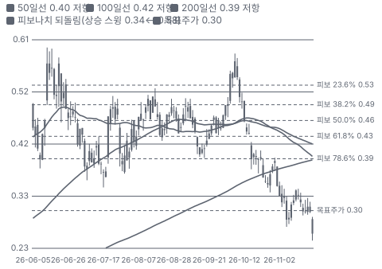

**주봉**

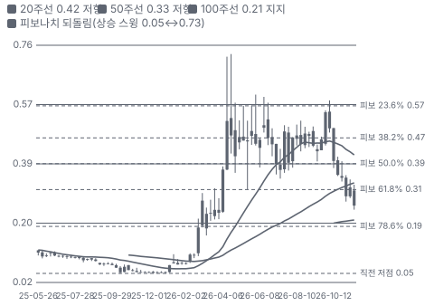

**월봉**

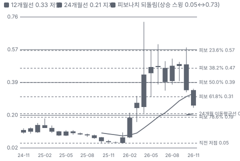

**반기 매출·EPS 실적과 컨센서스 — 반기 보고 회사라 분기 실적이 없다**

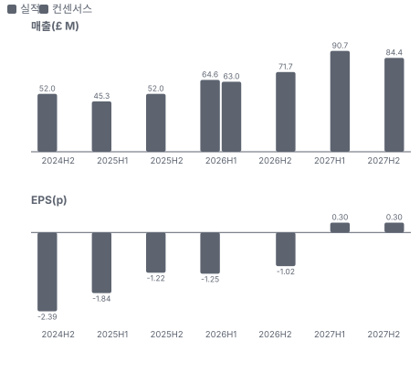

**멀티플 프리미엄(Fwd 1Y EV/EBITDA 현재값 — 최근 4개 분기 추이 없음: 대상 과거 배수 없음 — 컨센서스 이력이 없어 과거 선행 배수를 못 만들고, 후행 이익이 적자·0 근처라 후행 배수도 뜻이 없다)**

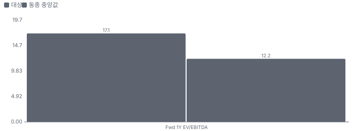

**합리적 멀티플**

**밸류에이션 주가 시나리오**

**주가별 업사이드**

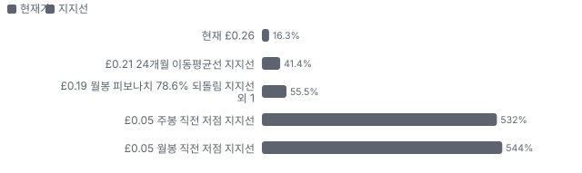
- 제품·서비스 포트폴리오

**고객 믹스(1H26, 매출 대비)**

**공급 병목(10점, 낮을수록 병목)**

**CAPEX의 매출 대비 비중**

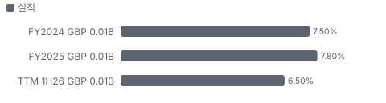

**어닝콜 변화별 주주가치 영향**

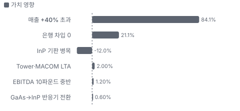

**수주·파이프라인 확실성 사다리**

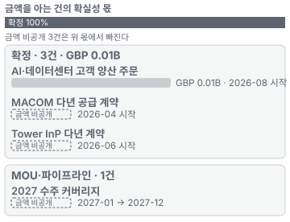

**매출 → 매출총이익 → 영업이익(매출 = 100, 최근 4분기)**

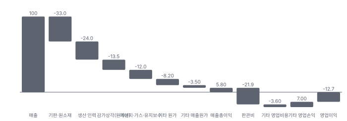

**분기 비용 비중 추이(매출 대비, 공시)**

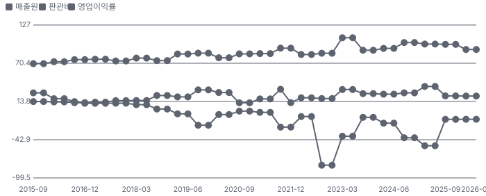

**비용 요인별 매출 대비 비중 1년 변화**

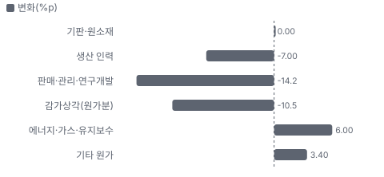

**Photonics BOM 원가 몫**

**Wireless BOM 원가 몫**

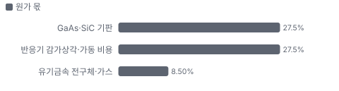

**BOM 항목 가격 +10% 시 OPM 변화**

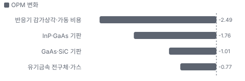

**원가 물가 vs 판매가 물가 — 최근 24개월(24.11 = 100): 둘이 비슷하게 움직인다**

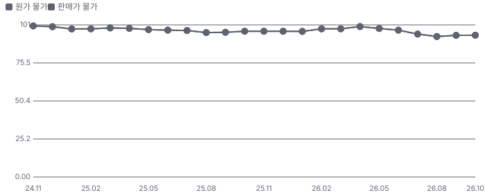

**매출 vs PPI·수출입 — 3Q22 = 100(변화율, 로그 눈금)**

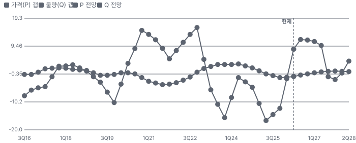

**10년 P·Q 사이클 — 추세(HP 필터) 대비 갭과 8분기 전망**

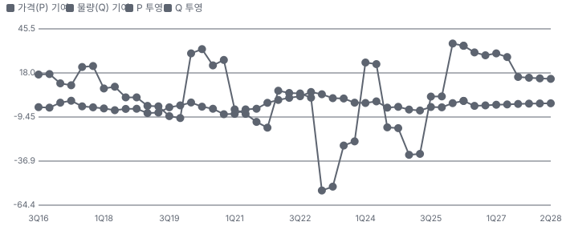

**매출 증가율의 가격·물량 분해와 8분기 전망(전년 대비)**

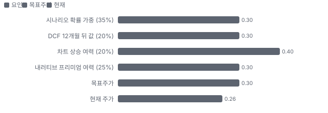

**목표주가 산정 — 기본과 강세 사이(강세 쪽 28%), 도달 확률 약 38%**

**몬테카를로**

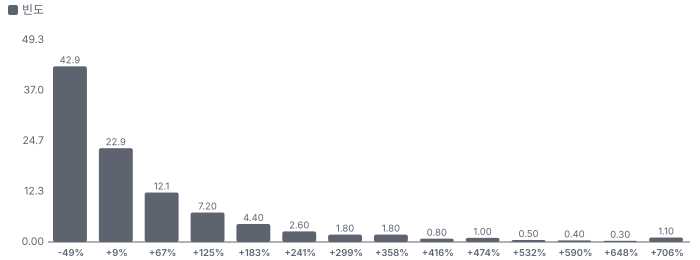

해석: 3,000번 중 1,422번(47%)에서 가치가 지금 주가 이상이었다. 지금 주가를 뒷받침하는 경우와 그렇지 않은 경우가 반반에 가깝다. 가운데 값은 0.94배이고, 열 번 중 여덟 번은 0.36~3.22배 사이에 든다.

## 내러티브

> **기업가치를 결정하는 이야기:** 1H26 매출의 60%가 Photonics(광통신 InP·VCSEL(웨이퍼 표면으로 빛을 내는 레이저 — 3D 센싱·짧은 거리 광통신)·적외선·국방), 40%가 Wireless(스마트폰·인프라 RF(무선 주파수, 통신용 전파 소자) GaAs·GaN(질화갈륨 — 전력·RF·마이크로LED용 화합물 반도체))다. 공장 고정비가 커서 매출이 오르면 매출총이익률이 빠르게 오른다 — 1.2%(1H25) → 9.3%(1H26).

> **멀티플·EPS 프리미엄**
> **멀티플:** Fwd 1Y EV/EBITDA 17.1배로 동종 4곳 중앙보다 높다 — 이익이 이제 막 흑자로 돌아서는 회사라 배수가 높게 보인다. Fwd 2Y는 9.1배
> **EPS:** 선행 EPS는 FY26 적자, FY27 £0.005 — 조정 EBITDA FY26 가이던스 10파운드 중반, FY27 컨센서스 £30M

### 투자자들은 왜 열광했나

2025년 11월 5펜스였던 주가는 MACOM 투자 협상·InP 품귀 기대로 2026년 4월 72.9펜스(장중)까지 13배가 됐다. 4월 말 증자 확정 뒤 하루 −18.5%를 시작으로 기대가 식었고, 11/17 가이던스 상향에도 주가가 움직이지 않다가 11/20 −13%로 25.8펜스까지 내려왔다.

### 무엇이 기업가치를 바꾸나

> **구조적 체질 변화**
> **변화:** 부채 많은 스팟 주문 공급사 → 순현금·다년 계약 공급사
> **증거:** 조정 순차입 £31.5M(FY25 말) → 순현금 £30.2M(1H26 말), MACOM·Tower LTA(다년 장기 공급 계약)
> **반증:** 추가 증자 또는 LTA 해지

> **고부가 믹스 확장**
> **변화:** Photonics(InP) 비중 확대
> **증거:** Photonics 비중 58.7%(1H25) → 59.6%(1H26, 계산), 회사: 믹스 개선이 이익률을 올렸다(1H 콜)
> **반증:** Photonics 성장률이 Wireless 아래로

> **기술 혁신**
> **변화:** 6인치 InP 에피·GaN-on-Si 마이크로LED(칩 간 광 연결)
> **증거:** Aixtron G4(Aixtron의 MOCVD 반응기 모델) 반응기 6인치 InP 전환 질문(1H 콜), 마이크로LED가 GaN 전력을 거의 앞섰다(1H 콜)
> **반증:** 6인치 InP 고객 인증 지연

> **실행 속도**
> **변화:** 새 건물 없이 기존 반응기를 InP로 바꿔 캐파를 늘린다 **납품 리드타임 1~3개월.** 피어 비교 미확인. 이전 대비 미확인.
> **증거:** 하반기 반응기 전환 시작(1H 콜)
> **반증:** 2H26 Photonics 매출이 1H26 이하

> **M&A**
> **변화:** 피투자 — MACOM 지분 약 10%, 정지 협약 없음
> **증거:** FY25 콜: MACOM 추가 지분 확대를 막는 협약이 없다
> **반증:** MACOM 지분 매각

> **정책·입법 연관성**
> **재정정책:** 영국·미국 반도체 보조금 수령 공시 미확인 — 미국 국방 프로그램 예산 집행이 Photonics를 밀었다(1H 콜) IQE 1H26 실적 발표·콜(2026-09-07) 반증: 미국 국방 예산 집행 지연 의회 동의 8/10 — 하원 4/5(FY26 국방 세출이 하원을 통과·집행돼 1H26 국방 프로그램 자금이 풀렸다(회사 설명) — IQE 개별 세출 항목은 없다) · 상원 4/5(같음).
> **행정명령:** 중국의 갈륨·게르마늄·인듐 관련 수출통제 — 원소재 가격·조달 위험 InP 기판 병목(1H 콜) — 통제와의 직접 연결은 미확인 반증: 통제 완화 의회 동의 2/10 — 하원 1/5(의회 의결 대상 아님 — 외국 정부 조치) · 상원 1/5(같음).
> **연관입법:** 해당 없음(IQE 매출을 직접 바꾸는 계류 법안 미확인) 미확인 반증: -

> **고객의 지출 예산**
> **변화:** 고객의 소자 생산 원가(OPEX·재료비)에서 나온다 — 그 뒤에는 하이퍼스케일러 데이터센터 CAPEX
> **사업별 예산:** **매출의 60%**: Photonics — 고객 혼합(칩 회사 재료비 ← 하이퍼스케일러 광 인프라 CAPEX) · 동인: 800G·1.6T 광 모듈 출하
**매출의 40%**: Wireless — 고객 OPEX(스마트폰·기지국 RF 칩 회사 재료비) · 동인: 스마트폰 RF 콘텐츠·5G
> **증거:** 에피웨이퍼는 칩 회사의 원재료 구매
> **반증:** 광 트랜시버 재고 조정

### 내러티브 근거

> AI 데이터센터 광통신이 InP 에피웨이퍼 품귀를 만들고, 부채에 눌렸던 상업 에피 회사가 MACOM 투자로 살아나 그 수요를 받는다는 이야기다. 주가는 1년 새 5배가 됐지만 4월 고점보다 59% 낮다. 단계는 확산, 쏠림은 중간(영국 AIM 리테일 거래 비중 큼 — 내부자·기관 66% 보유, 리테일 집계 없음)이다.

> **InP 광통신 품귀** · 강화
> **논리:** AI 데이터센터 800G·1.6T 광 트랜시버가 InP 레이저·수광 칩을 늘리고, 상업 InP 에피 공급이 모자란다
> **숫자:** Photonics 1H26 +45%, FY26 가이던스 +40% 초과
> **반증:** 2027 상반기 InP 에피 주문이 줄거나 LTA 고객이 물량을 내재화
> **출처:** IQE 1H26 실적 발표·콜(2026-09-07)

> **MACOM 전략 투자** · 유지
> **논리:** MACOM이 지분 10%와 다년 계약으로 IQE를 공급망에 묶었다 — 생존 위험이 사라졌다
> **숫자:** £81M 증자(MACOM £45M), 은행 차입 0, 순현금 £30.2M
> **반증:** MACOM 매출 몫이 줄거나 LTA 물량이 최소치에 머묾
> **출처:** IQE FY25 실적 발표·콜(2026-05-28)

> **가동률 레버리지** · 강화
> **논리:** 고정비가 큰 에피 공장은 가동률이 오르면 이익이 매출보다 빨리 는다
> **숫자:** 매출총이익률 1.2%(1H25) → 9.3%(1H26), 조정 EBITDA £6.0M
> **반증:** 2H26 매출총이익률이 1H26보다 낮음
> **출처:** IQE 1H26 실적 발표·콜(2026-09-07)

> **메인 시장 이전·FTSE 편입** · 유지
> **논리:** 1H27 LSE 메인 시장 이전으로 기관 자금 접근이 넓어진다
> **숫자:** 목표 1H27
> **반증:** 이전 일정 연기
> **출처:** IQE 1H26 실적 발표·콜(2026-09-07)

> **반대 내러티브 — 희석과 기판 병목** · 강화
> **논리:** 주식 수가 크게 늘었고, InP 기판이 막히면 매출 성장이 가이던스를 넘기 어렵다
> **숫자:** 1H26 가중평균 1,145.9M → 현재 1,333.1M(+16%, 계산), 회사가 InP 기판을 병목으로 언급
> **반증:** FY26 매출이 +40% 상한 이상으로 나오고 추가 증자 없음
> **출처:** IQE 1H26 실적 발표·콜(2026-09-07)

### 투자 포인트

> **가이던스 세 번 상향, 주가는 고점 대비 −59%**
> **명제:** FY26 매출 가이던스가 5월 +20% 초과에서 11월 +40% 초과까지 올랐는데 주가는 4/21 종가 고점 63.0p에서 25.8p로 내려왔다
> **숫자:** 5월·7월·11월 세 차례 상향, 조정 EBITDA 10파운드 중반
> **시장과 다른 점:** 시장은 테마 열기(MACOM 투자 기대)를 먼저 사고 먼저 팔았다 — 실적 숫자는 오히려 기대보다 빨리 좋아졌다
> **증명:** FY26 실적의 매출이 £140M 이상, 2H 조정 EBITDA £9M 이상
> **출처:** IQE 거래 갱신(2026-11-17)

> **가동률 레버리지**
> **명제:** 매출 +43%에 매출총이익률이 1.2%에서 9.3%로 올랐다 — 고정비 공장의 이익은 매출보다 빨리 는다
> **숫자:** 1H26 매출 £64.6M·매출총이익 £6.0M, 1H25 £45.3M·£0.5M
> **시장과 다른 점:** 시장은 GAAP 적자(TTM −£14.8M)를 보지만 증분 매출의 이익 전환율이 높다 — 1H 증분 매출 £19.3M 중 £5.5M이 매출총이익으로 갔다(계산)
> **증명:** 2H26 매출총이익률 10% 이상
> **출처:** IQE 1H26 실적 발표·콜(2026-09-07)

> **병목은 IQE가 아니라 기판**
> **명제:** InP 에피 수요는 넘치지만 InP 기판이 물량 증가를 막는다고 회사가 말했다
> **숫자:** 1H 콜 — 기판 공급사 배정을 잠그는 중
> **시장과 다른 점:** 시장은 'IQE가 InP 품귀의 수혜주'로 보지만 이익의 큰 몫은 기판사(선행 영업이익률 47%)에 쌓일 수 있다
> **증명:** FY26 실적에서 2H Photonics 매출이 1H(£38.5M)보다 큰가
> **출처:** IQE 1H26 실적 발표·콜(2026-09-07)

### 모멘텀 생성·소멸 타임라인

**카탈리스트 달력 — 지난 사건의 주가 반응과 앞으로 확인할 숫자**
| 날짜 | 상태 | 구분 | 사건 | 반응·확인 | 결과에 따라 |
|---|---|---|---|---|---|
| 2026-04-28 | 완료 | 소멸 | 전략 검토 종결·MACOM 투자·증자 발표 무렵 | −18.5% |  |
| 2026-05-28 | 완료 | 생성 | FY25 실적 — 2026 매출 +20% 초과 가이던스 | −6.0% |  |
| 2026-09-07 | 완료 | 확인 | 1H26 실적 — 매출 +43%, 은행 차입 0 | +3.3% |  |
| 2026-11-17 | 완료 | 확인 | 거래 갱신 — 매출 +40% 초과 | 0.0% |  |
| 2027-01(예상) | 예정 | 확인 | FY26 거래 갱신 | FY26 매출 £140M 이상 | 충족 → 기본 유지, £136M 근처 → 약세 쪽 |
| 2027-03~04(예상) | 예정 | 확인 | FY26 실적·2027 가이던스 | 2027 매출 +30% 이상, 2H 매출총이익률 10% 이상 | 충족 → 기본~강세, +20% 미만 → 약세 |
| 2027-1H(예상) | 예정 | 생성 | LSE 메인 시장 이전·전략 재설정 | 장기 이익률 목표 제시, FTSE 편입 | 목표가 영업이익률 15% 이상이면 강세 쪽 |

### 언제 사서 언제 팔아야 할까?

**가격·조건 틀 — 가격은 밸류에이션(약세·기본·강세·목표주가)과 차트 지지 구간에서, 조건은 이벤트에서**
| 구간 | 가격 | 목표주가까지 | 약세까지 | 조건·근거 |
|---|---|---|---|---|
| 관찰 구간 | £0.21~£0.21 | +41% | -48% | 지지 구간이 약세 시나리오 가격과 겹치는 곳 |
| 확인 뒤 | 지금 £0.26 이상에서 조건 확인 | +16% | -57% | FY26 매출 £140M 이상과 2027 가이던스 +30% 이상 |
| 무효화 | 약세 시나리오 £0.11 | - | -57% | 2027 가이던스 +20% 미만 또는 추가 증자 |
| 차익 고민 1차 | £0.30(목표주가·기본 시나리오) | +16% | - | 목표주가 근처에서 Fwd 1Y EV/EBITDA가 동종 대비 프리미엄을 넓힐 때 |
| 차익 고민 2차 | £0.44(강세 시나리오) | +71% | - | 목표주가 근처에서 Fwd 1Y EV/EBITDA가 동종 대비 프리미엄을 넓힐 때 |

하루 ±15% 이상 움직인 날이 1년에 30번 넘는 종목이다(계산) — 이벤트 전후 추격을 경계 가격·조건 틀이며 매매·비중 지시가 아니다(투자 권유 아님).

## 포트폴리오

| 제품·서비스 | 구분 | 무엇 | 쓰는 곳 | 돈 버는 방식 | Mix | Mix 변화(1H26 £38.5M ÷ £64.6M, 1H25 £26.6M(계산 — +45% 역산) ÷ £45.25M) |
|---|---|---|---|---|---|---|
| Photonics | 제품 | 빛을 내고 받는 소자용 에피웨이퍼 — InP 레이저·수광, GaAs VCSEL, GaSb(갈륨안티모나이드 — 적외선 센서용 화합물 반도체) 적외선 | AI 데이터센터 광 트랜시버, 3D 센싱, 국방 적외선 | 1H26 매출의 60%(£38.5M, +45%) | 60% | +0.9%p |
| Wireless | 제품 | 무선 주파수 소자용 에피웨이퍼 — GaAs HBT(이종접합 트랜지스터 — 스마트폰 RF 증폭기 소자)·pHEMT(고전자이동도 트랜지스터 — RF 스위치·저잡음 증폭 소자), GaN-on-SiC | 스마트폰 RF 프런트엔드, 5G 기지국, 위성통신 | 1H26 매출의 40%(£26.0M, +40%) | 40% | -0.8%p |

**Mix 변화가 가장 큰 쪽은 Photonics(+0.9%p, 1H26 £38.5M ÷ £64.6M, 1H25 £26.6M(계산 — +45% 역산) ÷ £45.25M).** 계절성 판정: 분기 매출 계절 지수 기준 없음 → 직전 분기와 비교.

## 고객

> **1H26 최대 고객 AI·데이터센터 고객(이름 미공개, an AI and data center customer) 6%, 상위 3곳 6%, 집중도 분산.** 공시·회사 발표로 확인한 몫은 매출의 0%이고, 나머지 고객 몫은 추정이거나 미분해다. IQE는 고객별 매출 몫을 공시하지 않는다(이번 회차 연차보고서 미대조). 이름이 나온 고객은 MACOM(지분 10%·다년 계약), Tower Semiconductor(InP 다년 계약), AI·데이터센터 고객(\$14M 주문, 이름 미공개), Quintessent다

**고객별 매출 몫(1H26)**
| 고객 | 몫 | 변화 | 근거 |
|---|---|---|---|
| AI·데이터센터 고객(이름 미공개, an AI and data center customer) | 4~8% | 미확인 | 추정 |
| MACOM | 미확인 | 미확인 | 회사 발표 |
| Tower Semiconductor | 미확인 | 미확인 | 회사 발표 |
| Quintessent | 미확인 | 미확인 | 회사 발표 |
| 기타·미분해 | 94% | - | - |

> **AI·데이터센터 고객(이름 미공개, an AI and data center customer)** · 추정
> **사는 것:** 광통신 에피 양산 주문 \$14M
> **추정 근거:** \$14M ≈ £10.6M(환율 1.326, 계산) ÷ FY26 매출 하한 £136.2M = 7.8%가 상한 — 인식 기간 미공시라 하단은 그 절반(추정)

> **MACOM** · 회사 발표
> **사는 것:** GaN·GaAs·InP 에피(다년 계약)
> **추정 근거:** 회사: MACOM은 성장 동인의 하나지만 다른 고객 상세는 밝히지 않는다(FY25 콜)

> **Tower Semiconductor** · 회사 발표
> **사는 것:** InP 에피(다년 계약 — 실리콘 포토닉스 파운드리)
> **추정 근거:** 계약 금액 미공시

> **Quintessent** · 회사 발표
> **사는 것:** 양자·광 집적용 에피(구매 계약)
> **추정 근거:** 금액 미공시

## 수주·파이프라인

> **2026-11-17 기준 4건.** 확정 GBP 0.01B. 서로 겹치는 항목은 합계에서 뺐다.

**수주 목록**
| 상태 | 계약 | 계약 총액 | 진척 | 기간 | 비고 |
|---|---|---|---|---|---|
| 확정 | AI·데이터센터 고객 양산 주문 | GBP 0.01B | 비공개 | 2026-08 → 미확인 | - |
| 확정 | MACOM 다년 공급 계약 | 금액 비공개 | 비공개 | 2026-04 → 미확인 | (다른 항목과 겹칠 수 있어 합계에서 뺌) |
| 확정 | Tower InP 다년 계약 | 금액 비공개 | 비공개 | 2026-06 → 미확인 | (다른 항목과 겹칠 수 있어 합계에서 뺌) |
| 파이프라인 | 2027 수주 커버리지 | 금액 비공개 | 비공개 | 2027-01 → 2027-12 | (다른 항목과 겹칠 수 있어 합계에서 뺌) |

**실행 속도와 방해 요인**
| 항목 | 상태 | 실행 속도 | 방해 요인 |
|---|---|---|---|
| AI·데이터센터 고객 양산 주문 | 확정 | 미확인 | InP 기판 배정 |
| MACOM 다년 공급 계약 | 확정 | 미확인 | MACOM 최종 수요 |
| Tower InP 다년 계약 | 확정 | 미확인 | InP 기판 · Tower 실리콘 포토닉스 램프 |
| 2027 수주 커버리지 | 파이프라인 | 미확인 | InP 기판 · 반응기 전환 속도 |

## 마진 구조

> **GPM 9.3%, OPM -12.5%.** 2H25 대비 GPM +7.7%p, OPM +7.9%p. 변동비는 매출의 56%이고, 매출이 10% 늘면 OPM은 +5.1%p 움직인다. 1H26 매출원가는 매출의 90.7%로 1년 전 98.8%보다 8.1%p 낮다. 매출이 43% 늘었는데 공장 고정비는 거의 그대로여서 매출총이익률이 1.2%에서 9.3%로 올랐다

> **매출 100 중 매출원가 94.2, 매출총이익 5.8(최근 4분기, 공시).** 매출원가 요인 중 기판·원소재이 매출의 33.0%로 가장 무겁고, 단가가 +10% 오르면 GPM이 -3.30%p 움직인다. 분기 회귀로 매출 1이 늘 때 매출원가는 0.57 늘고, 매출원가의 고정비 몫은 32%다.

**비용 요인 강도 — 비중·추세·충격(+10%)·탄력**
| 비용 | 구분 | 매출 대비 | 1년 변화 | 마진 기여 | 충격 시 마진 | 매출 탄력 | 고정비 몫 |
|---|---|---|---|---|---|---|---|
| 기판·원소재 | 매출원가 요인 | 33.0% | +0.0%p | -0.0%p | -3.30%p | 미확인 | 0% |
| 생산 인력 | 매출원가 요인 | 24.0% | -7.0%p | +7.0%p | -2.40%p | 미확인 | 70% |
| 감가상각(원가분) | 매출원가 요인 | 13.5% | -10.5%p | +10.5%p | -1.35%p | 미확인 | 100% |
| 에너지·가스·유지보수 | 매출원가 요인 | 12.0% | +6.0%p | -6.0%p | -1.20%p | 미확인 | 50% |
| 기타 원가 | 매출원가 요인 | 8.2% | +3.4%p | -3.4%p | -0.82%p | 미확인 | 30% |
| 매출원가 | 공시 항목 | 94.2% | -5.9%p | +5.9%p | -9.42%p | 0.57 | 32% |
| 판관비 | 공시 항목 | 21.9% | -9.0%p | +9.0%p | 미확인 | 0.08 | 60% |
| 기타 영업비용 | 공시 항목 | 3.6% | -11.0%p | +11.0%p | 미확인 | 0.19 | -100% |

매출 탄력 = 분기 비용을 매출에 회귀한 기울기(매출 1당 변동비), 고정비 몫 = 절편 ÷ 평균 비용. 표본이 8분기 미만이면 미확인. 매출원가 요인 비중은 margin 재료의 추정이 섞여 있고, 공시 매출원가와의 차이는 '기타 매출원가'로 둔다.

**GPM에서 OPM까지(GAAP, 아래는 최근 4개 분기)**
| 기간 | GPM | 연구개발 | 판관비 | 기타 | OPM |
|---|---|---|---|---|---|
| 1H25 | 1.2% | 0.0% | 36.0% | 0.0% | -34.9% |
| 2H25 | 1.6% | 0.0% | 22.0% | 0.0% | -20.4% |
| 1H26 | 9.3% | 0.0% | 21.8% | 0.0% | -12.5% |
| 2025-09 | 1.6% | - | - | - | -12.7% |
| 2025-12 | 1.6% | - | - | - | -12.7% |
| 2026-03 | 9.3% | - | - | - | -12.6% |
| 2026-06 | 9.3% | - | - | - | -12.6% |

**비용을 움직이는 요인**
| 비용 | 요인 |
|---|---|
| 기판·원소재(매출원가) | InP·GaAs 기판, 유기금속 전구체 단가와 물량 · 근거 추정 |
| 생산 인력(매출원가) | 영국·미국·대만 공장 인력(직원 약 460명) · 근거 추정 |
| 판매·관리·연구개발(판관비) | 본사·연구개발 인력(연구개발비 별도 공시 미대조) · 근거 공시 |
| 감가상각(원가분, 매출원가) | 반응기·클린룸 감가상각 · 근거 추정 |
| 에너지·가스·유지보수(매출원가) | 영국 전력 단가, 반응기 유지보수·전환 · 근거 추정 |
| 기타 원가(매출원가) | 재고 평가·물류 · 근거 추정 |

**Photonics BOM — 매출의 60%, GPM 9%(회사 전체 매출총이익률(1H26) — 사업부별 총이익 미공시), 항목 가격 +10% 시**
| 항목 | 원가 몫 | 전가 | 제품 GPM | OPM |
|---|---|---|---|---|
| InP·GaAs 기판 | 25~40% | 미확인 | -2.9%p | -1.76%p |
| 반응기 감가상각·가동 비용 | 20~35% | 미확인 | -2.5%p | -1.49%p |
| 유기금속 전구체·가스 | 5~12% | 미확인 | -0.8%p | -0.46%p |
| 미분해 | 31% | - | - | - |

**Wireless BOM — 매출의 40%, GPM 9%(회사 전체 매출총이익률(1H26)), 항목 가격 +10% 시**
| 항목 | 원가 몫 | 전가 | 제품 GPM | OPM |
|---|---|---|---|---|
| GaAs·SiC(탄화규소 — GaN RF 소자를 올리는 기판) 기판 | 20~35% | 미확인 | -2.5%p | -1.01%p |
| 반응기 감가상각·가동 비용 | 20~35% | 미확인 | -2.5%p | -1.01%p |
| 유기금속 전구체·가스 | 5~12% | 미확인 | -0.8%p | -0.31%p |
| 미분해 | 36% | - | - | - |

판매가 전가를 모르는 항목은 전가 0%로 계산했다.

**BOM 항목 가격을 움직이는 것**
| 항목 | 요인 |
|---|---|
| InP·GaAs 기판 | InP 기판 단가·배정 · 근거 추정 |
| 유기금속 전구체·가스 | 인듐·갈륨 원소재 가격 · 근거 추정 |
| 반응기 감가상각·가동 비용 | 가동률 · 근거 추정 |
| GaAs·SiC 기판 | 기판 단가 · 근거 추정 |
| 유기금속 전구체·가스 | 갈륨 원소재 가격 · 근거 추정 |

**투입 물가 — 미국 PPI 3·6·12개월(2026-10, 개정 반영)과 해외 전년비**
| 항목 | 미국 3개월 | 6개월 | 12개월 | 전가 못 할 때 OPM | 일본 |
|---|---|---|---|---|---|
| GaAs·SiC 기판 | -0.7% | -5.7% | -2.7%* | - | +1.6%* |
| 유기금속 전구체·가스 | +7.1% | +8.0% | +45.8%* | - | 미확인 |

별표는 품목보다 넓은 업종 지수다. 연결한 투입 원가의 미국 PPI(생산자물가지수)는 1년 새 가중 -2.7%이고, 판매가로 넘기지 못하면 GPM +0.9%p·OPM +0.9%p가 움직인다. 판매가 비교 물가(전자용 도핑 화합물 웨이퍼(InP·GaAs 기판) PPI)는 1년 새 -2.7% — 회사 가격 변화는 미확인. 물가 지수를 붙이지 못한 매출원가 항목은 생산 인력, 감가상각(원가분), 에너지·가스·유지보수다(미연결).

## 공급망 병목

> **공급망 신뢰성 5.9/10, 병목 주의.** 가장 약한 고리는 InP·GaAs 기판 5.9점이고, 품목 평균은 5.9점이다. 근거가 부족한 2건(MOCVD(유기금속 가스로 박막을 기르는 에피 장비) 반응기 · 유기금속 전구체·가스)은 점수에서 뺐다. IQE의 병목은 장비가 아니라 InP 기판이다. 회사는 기판이 물량 증가를 막는 병목이라며 공급사 배정을 잠그고 있다고 말했다(1H 콜). 기판 공급사 이름과 계약 조건은 공시되지 않았다

**병목과 마진 — 품목 가격 +10% 시 OPM**
| 품목 | 점수 | 판정 | 구분 | OPM |
|---|---|---|---|---|
| InP·GaAs 기판(필수) | 5.9 | 병목 주의 | 핵심 통제 품목 | -1.76%p |

> **InP·GaAs 기판** · 5.9/10
> **왜:** InP 에피 매출의 상한을 정한다. 재인증 9개월은 기판 교체 때 에피 공정·고객 소자 재검증 기간 추정(업계 통상 6~12개월), 지역 집중 90%는 주요 3사의 생산지(일본·중국) 기준 추정
> **병목 요인:** 인증 공급사 3곳 · 캐파 빠듯 · 리드타임 미확인 · 재인증 9개월 · 1위 점유율 미확인 · 일본·중국 집중 90% · 물량 확보 미확인
> **풀리는 조건:** 미확인

**공급사**
| 품목 | 공급사 | 몫 | 근거 |
|---|---|---|---|
| InP·GaAs 기판 | 미공개(업계 공급사: AXT·Sumitomo Electric·JX Advanced Metals, InP·GaAs 단결정 기판) | 미확인 | 추정 |
| MOCVD 반응기 | Aixtron(G4 등 MOCVD 반응기(콜 질문)) | 미확인 | 회사 발표 |
| 유기금속 전구체·가스 | 미공개(TMIn(트리메틸인듐 — 인듐 박막용 유기금속 원료)·TMGa(트리메틸갈륨 — 갈륨 박막용 유기금속 원료)·포스핀·아르신) | 미확인 | 추정 |

**무역 통계로 본 공급 지역**
| 품목 | EU 수입처 | 일본 수입처 | EU 1위 전년비 |
|---|---|---|---|
| InP·GaAs 기판 | JP 38% · CN(중국) 20% · US 19% | 中華人民共和国 31% · 台湾 18% | +8.1% |
| 유기금속 전구체·가스 | CN 42% · US 38% · JP 9% | 中華人民共和国 28% · 台湾 25% | +88.3% |

## 생산능력

> **현재 명목 캐파 미확인, 가동률 미확인.** 착공 이상 증설은 0 웨이퍼(공시 없음), 발표까지 합치면 0 웨이퍼(공시 없음)이다. TTM 1H26 CAPEX는 GBP 0.01B로 매출의 6.5%다. 거점별 명목 캐파와 가동률은 공시하지 않는다. 회사는 모든 거점에 큰 투자 없이 생산을 늘릴 여유가 있고, Newport에 빈 클린룸이 있다고 말한다(FY25·1H 콜). CAPEX는 매출의 6~7%로 가볍다

**생산시설 4곳**(회사 설명상 영국·미국·대만에 생산 거점(1H·FY25 콜, 컨센서스 개요) — 연차보고서 시설 목록 미대조, 미국 거점 이름 미대조라 count에만 센다) — 이름·위치를 밝힌 곳 3곳, 미확인 3곳. 시설별 생산능력은 공개되지 않았다 — 회사 전체 캐파만 위에 적었다.

**생산시설 4곳 — 명칭·위치·생산능력**
| 시설 | 위치 | 용도 | 생산능력 | 소유·상태 |
|---|---|---|---|---|
| Cardiff 본사·생산 | 영국 웨일스 Cardiff | 본사·에피 생산 | 미확인 — 거점별 캐파 미공시 | 미확인 · 가동 |
| Newport 거점 | 영국 웨일스 Newport | 에피 생산 — 빈 클린룸 보유 | 미확인 — 빈 클린룸 면적 미공시(1H 콜) | 미확인 · 가동 |
| 대만 거점 | 대만(도시 미대조) | 에피 생산 — 매각 검토 뒤 유지 | 미확인 — 거점별 캐파 미공시 | 미확인 · 가동 |

**생산능력 확충 계획**
| 계획 | 단계 | 증설 | 가동 시점 | CAPEX |
|---|---|---|---|---|
| GaAs→InP 반응기 전환 | 발표 | 미확인 | 2H26~(회사 설명) | 미확인 |
| Newport 빈 클린룸 반응기 추가 | 발표 | 미확인 | 미확인 | 미확인 |

남은 계획의 CAPEX 합계는 GBP 0.00B(금액 미확인 2건 제외)다. 합계는 TTM 1H26 매출의 0%다.

**증설 방해 요인**
| 계획 | 방해 요인 |
|---|---|
| GaAs→InP 반응기 전환 | InP 기판 배정, 전환 동안 생산 손실 |
| Newport 빈 클린룸 반응기 추가 | 고객 확약·선급금 없으면 증설하지 않는다(1H 콜) |

**CAPEX와 매출 대비**
| 기간 | CAPEX | 매출 | 매출 대비 | 구분 |
|---|---|---|---|---|
| FY2024 | GBP 0.01B | GBP 0.12B | 7.5% | 실적 |
| FY2025 | GBP 0.01B | GBP 0.10B | 7.8% | 실적 |
| TTM 1H26 | GBP 0.01B | GBP 0.12B | 6.5% | 실적 |

## 피터 린치 분류

> **경기순환주(Cyclical), 소형.** 린치 표의 기대 수익 10배, 하방 -80~100%, 위험 고. 10배 경로가 있는 분류다(고성장주·회생주·경기순환주).

**분류 근거 — 크기 먼저, 다음은 이야기 유형**
| 항목 | 값 |
|---|---|
| 크기 | 소형(시가총액 \$0.3B) |
| 장기 성장 | 25.3%(컨센서스 매출 2년 CAGR(EPS 없음)) |
| 린치 비율((성장% + 배당%) ÷ P/E) | 미확인 |
| PEG(P/E ÷ 성장%) | 미확인 |
| 근거 | TTM 매출이 과거 고점 대비 45% 빠진 적이 있다 |
| 반대 근거 | 장기 성장률 25%로 고성장주 구간 — 순환 위의 성장주일 수 있다 |

- 점검: 재고·공급과 수요(가격)의 방향
- 점검: 경쟁사의 증설
- 점검: 이익 정점에서 P/E가 낮아 보이는 함정
- 점검: 부채가 바닥을 견딜 수 있나
- 팔 때(점검 조건, 매매 지시 아님): 재고가 쌓이고 증설이 시작되고 가격이 꺾일 때 — 정점의 낮은 P/E는 싸다는 뜻이 아니다

분류 = 피터 린치·존 로스차일드 『One Up On Wall Street』(1989)·『Beating the Street』(1993)의 6분류와 위험·보상 표를 숫자 규칙으로 옮긴 자체추론이다(config/lynch.yaml).

## 해자

> 해자는 '40년 가까이 쌓은 상업(머천트) 에피 공정 레시피와 고객 인증'에서 나온다. 다만 매출총이익률이 한 자릿수라 가격 결정력은 아직 약하다

> **재료 폭·공정 레시피** · 보통
> **해자:** InP·GaAs·GaN·GaSb 네 재료계를 모두 상업 공급하는 몇 안 되는 에피 회사다
> **근거:** 1H 콜: 재료계 포트폴리오가 업계에서 가장 넓다고 설명, InP 웨이퍼 수십 년 생산 경험(FY25 콜)
> **숫자:** Photonics 1H26 £38.5M(+45%), Wireless £26.0M(+40%)
> **깨지는 조건:** 주요 고객이 InP 에피를 자체 생산(내재화)으로 돌림

> **고객 인증·LTA** · 보통
> **해자:** 에피 웨이퍼는 고객 소자 공정에 맞춰 인증받아 공급사 교체에 시간이 걸리고, 이제 다년 계약으로 묶였다
> **근거:** MACOM 다년 계약·지분 투자, Tower InP 다년 계약, AI 고객 \$14M 주문(1H 콜)
> **숫자:** LTA 금액 미공시
> **깨지는 조건:** LTA 고객이 다른 에피 공급사(VPEC·IntelliEPI 등)를 이중 인증하고 물량을 옮김

> **가격 결정력** · 약함
> **해자:** 가동률이 낮던 시기 원가를 못 덮어 매출총이익률이 한 자릿수다
> **근거:** 1H26 매출총이익률 9.3%(£5.99M ÷ £64.56M, 계산), FY25 1.4%. 회사: '가격 인상은 레버 중 하나'(1H 콜)
> **숫자:** 매출총이익률 1.2%(1H25) → 9.3%(1H26)
> **깨지는 조건:** LTA 갱신에서 가격 인상이 확인되고 매출총이익률 20% 이상

> **빈 클린룸(빠른 증설)** · 보통
> **해자:** Newport에 빈 클린룸이 있어 새 건물 없이 반응기만 들이면 된다
> **근거:** 1H 콜: 클린룸 여유가 충분, 반응기만 추가
> **숫자:** 여유 면적 미공시
> **깨지는 조건:** 고객 선급금 없이 증설을 미루다 경쟁사가 물량을 가져감

## 경영진·네트워크

> CEO Jutta Meier가 전략 검토·MACOM 투자·LTA 전환을 이끌었다. MACOM 임원 2명이 비상임 이사로 들어왔다. 정계 연결은 공개 기록상 미확인

> **Jutta Meier** · CEO · 미확인
> **프로필:** 스팟 주문 → 다년 계약 전환, 증설은 고객 확약·선급금이 있을 때만이라는 원칙을 콜에서 밝힘
> **비즈니스:** MACOM 전략 투자 협상(FY25 콜)
> **정계:** 미확인
> **동문:** 미확인
> **사모임:** 미확인

> **Matt Geen** · COO(1H26 선임) · 2026
> **프로필:** 운영 효율·가동률 개선 담당(1H 콜)
> **비즈니스:** 미확인
> **정계:** 미확인
> **동문:** 미확인
> **사모임:** 미확인

> **Robert Dennehy** · 비상임 이사(MACOM COO) · 2026
> **프로필:** MACOM 파견 이사(FY25 콜)
> **비즈니스:** MACOM
> **정계:** 미확인
> **동문:** 미확인
> **사모임:** 미확인

**네트워크 정량화**
| 연결 | 강도 | 닿는 매출 | 가중 노출 | 매출 대비 | 근거 |
|---|---|---|---|---|---|
| 비즈니스: MACOM 지분 약 10%·이사 2명·다년 계약 | 4/5 | £0.00B | £0.00B | 0% | MACOM 매출 몫 미공시 — 노출 0으로 둔다 IQE FY25 실적 발표·콜(2026-05-28) |

가중 노출은 연결이 닿는 매출의 크기다. 연결이 그 매출을 만들었다는 뜻이 아니며, 인과는 공개 자료로 입증하지 못한다.

## 약세 논리 및 셀온 조건

| 약세 논리 | 근거 | 가를 자료 |
|---|---|---|
| InP 기판이 성장의 상한을 정한다 | 회사가 InP 기판을 물량 증가의 병목으로 꼽고 공급사 배정을 잠그는 중이라고 말했다(1H 콜). 기판사 AXT의 선행 영업이익률 추정은 47%로 IQE(조정 EBITDA 마진 약 11%, 계산)보다 훨씬 높다 — 품귀의 이익이 공급망 위쪽에 쌓일 수 있다 | FY26 실적의 2H 매출총이익률, 기판 장기 계약 공시 |
| 가격 결정력이 약하다 | 1H26 매출총이익률 9.3%는 원가를 겨우 넘긴 수준이다. 회사는 가격 인상을 '레버 중 하나'라고 했지만 장기 관계를 더 중시한다고 말했다 | LTA 갱신 가격, FY26 매출총이익률 |
| 희석 | 주식 수 1,333.1M은 1H26 가중평균 1,145.9M보다 16% 많다(계산). MACOM 전환사채(액면 £15M)의 전환가는 확인하지 못했다. 증설은 고객 선급금으로 하겠다고 했지만 추가 증자 가능성은 남는다 | FY26 연차보고서 주식·전환사채 주석 |
| 고객 쏠림 | MACOM은 지분 10% 주주이자 LTA 고객이지만 매출 몫이 공시되지 않는다. 회사는 MACOM이 성장 동인의 하나라고만 했다 | 연차보고서 10% 초과 고객 공시 |
| 상향에도 주가가 빠졌다 | 11/17 가이던스 상향 날 주가는 보합이었고 11/20 −13.3%였다(원인 미확인). 1년 새 주가가 5배가 돼 기대가 이미 가이던스를 앞섰을 수 있다 | FY26 실적 전후 주가 반응 |
| 자료 한계 | TradingView 한도로 일봉은 Easyconomics 2년치를 썼다. 애널리스트 의견·목표가·수정 이력 데이터가 없고, 반기 보고라 분기 값은 반기를 반으로 나눈 값이다. 연차보고서(10% 초과 고객·구매 약정·시설 목록·전환사채 조건)는 이번 회차에 대조하지 못했다 | 다음 회차 FY25 연차보고서·증자 서류 대조 |

**변이 관점.** 시장은 IQE를 'MACOM이 살린 AI 광통신 테마주'로 사고판다 — 그래서 가이던스가 세 번 올라도 주가는 테마 열기를 따라 내려왔다. 그러나 가치를 바꾸는 숫자는 테마가 아니라 고정비 공장의 가동률이다. 1H26에 매출이 43% 늘자 매출총이익률이 8%p 올랐다. 판단을 가를 첫 숫자는 InP 기판 배정이 허락하는 2H26 매출과 그 이익률이다.

> **셀온 조건**
> **조건 1:** FY26 실적(2027년 3~4월 추정)에서 2H26 매출총이익률이 1H26(9.3%)보다 낮다.
> **조건 2:** 2027 가이던스가 매출 +20% 아래이거나 회사가 InP 기판 부족으로 물량을 못 채웠다고 밝힌다.
> **조건 3:** 추가 증자 또는 MACOM 전환사채 전환으로 주식 수가 10% 넘게 늘어난다.
> **조건 4:** MACOM·Tower LTA 가운데 하나가 물량 축소·해지된다.

## 어닝콜 변화

**직전 콜 대비 새로 나오거나 바뀐 내용 → 가치 영향**
| 항목 | 내용 | 직전 콜 | 최신 콜 | 모델 동인 이동 | 확신도 | 가치 영향 |
|---|---|---|---|---|---|---|
| 업데이트 | FY26 매출 가이던스 | +20% 초과(FY25 콜) | +40% 초과(11/17) | 1년차 성장률 +15.0% | 0.8 | +84.1% |
| 업데이트 | 조정 EBITDA 가이던스 | 한 자릿수 후반~10파운드 초반 | 10파운드 중반(£M) | 출발 이익률 +3.0% | 0.8 | +1.2% |
| 신규 | 다년 공급 계약 | MACOM LTA만(4월) | Tower InP 다년 계약·\$14M AI 주문·Quintessent | 장기 성장 수렴값 +1.0% | 0.5 | +2.0% |
| 신규 | InP 캐파 전환 | 기존 설비 여유(FY25 콜) | 하반기 반응기 전환 시작(1H 콜) | 매출÷투하자본 +5.0% | 0.5 | +0.6% |
| 부정 | InP 기판 병목 | 언급 없음(FY25 콜) | 기판이 물량 증가의 병목(1H 콜) | 1년차 성장률 -3.0% | 0.5 | -12.0% |
| 업데이트 | 재무 구조 | 조정 순차입 £31.5M(FY25 말) | 조정 순현금 £30.2M(1H26 말) | 순차입 -0.06 BGBP | 1.0 | +21.1% |
| **합계** | 단독 합 |  |  | 동시 적용 +142.0% |  | **+97.0%** |

**실적 발표 예상 변동폭:** 지난 2번 실적 발표 때 주가는 하루에 평균 ±4.6%(최대 6.0%, 오른 날 1번) 움직였다.

**실적 발표 예상 변동폭 — 과거 실적 발표 다음 거래일 주가 변화**
| 분기 | 발표일 | 주가 변화 |
|---|---|---|
| 4Q25 | 2026-05-28 | -6.0% |
| 2Q26 | 2026-09-07 | +3.3% |

## 거시 지표 싱크로율

> **미국 도핑 화합물 웨이퍼 수입과 전사 매출 싱크로율 -21%(4분기 = 약 12개월 선행, 전년 대비, 표본 30개·t -1.2·유의 아님·신뢰 보통).** 이 지표가 내포하는 3Q26 전사 매출은 34M(±1σ 27M~40M, 확정)다. 표본 밖 검증(최근 6개 분기)에서 지표 모델 오차는 29.4%p, 기준선(직전 증가율 지속)은 14.6%p다 — **지표가 기준선을 이기지 못해(예측력 없음) 추정은 대부분 기준선이다(지표 가중 30%).** 기준선은 인수·환율 효과의 소멸을 모르므로 회사 가이던스와 차이가 크면 가이던스 쪽 설명을 먼저 본다.  IQE 매출은 화합물 반도체 웨이퍼(HS(국제 통일 상품 분류 코드) 3818) 교역과 광 부품 수요를 따라간다

**지표별 싱크로율(상관계수 × 100) — 위 두 줄이 제품 연관성 × 싱크로율로 고른 PPI·수출입 세부 지표**
| 지표 | 비교 대상 | 증가율 기준 | 지표 선행 | 매출(t값) | 영업이익 | 방향 일치 | 표본·신뢰 | 표본 밖 오차(지표/기준선) | 3Q26 추정 매출 |
|---|---|---|---|---|---|---|---|---|---|
| 미국 도핑 화합물 웨이퍼 수입 | 전사 매출 | 전년 대비 | 4분기(12개월) | -21%(t -1.2) | 37%(0분기) | 50% | 30·보통 | 29.4/14.6%p ✘ | +29.0% → 34M(확정) |

**지표 후보 9개 — 연관성(제품 품목 일치 × 대용 감점 × 매출 비중) × 싱크로율로 고른다. 후보가 많을수록 최대 상관은 우연히 부풀 수 있다**
| 후보 | 종류 | 연관성 | 매출 분기 일치 | 싱크로율(선행) | 점수 | 출처 |
|---|---|---|---|---|---|---|
| 미국 도핑 화합물 웨이퍼 수입 | 수출입 | 1.00 | 100% | -21%(4분기) | 0.00 | 모델 지정 |
| EU(유럽연합) 전자용 도핑 화합물 웨이퍼(InP·GaAs 기판) 수출(HS 381800) | 수출입 | 1.00 | 100% | -42%(2분기) | 0.00 | 자동 |
| EU 전자용 도핑 화합물 웨이퍼(InP·GaAs 기판) 수입(HS 381800) | 수출입 | 1.00 | 100% | -28%(0분기) | 0.00 | 자동 |
| 미국 전자용 도핑 화합물 웨이퍼(InP·GaAs 기판) 수출(HS 381800) | 수출입 | 1.00 | 100% | -43%(3분기) | 0.00 | 자동 |
| 일본 HS 3818 수출(Photonics과 같은 4자리 품목군) | 수출입 | 0.70 | 38% | -87%(0분기) | 0.00 | 자동 |
| 일본 HS 3818 수입(Photonics과 같은 4자리 품목군) | 수출입 | 0.70 | 38% | -76%(0분기) | 0.00 | 자동 |
| 미국 전자용 도핑 화합물 웨이퍼(InP·GaAs 기판) PPI(업종 대용) | PPI | 0.60 | 100% | -44%(4분기) | 0.00 | 자동 |
| 일본 전자용 도핑 화합물 웨이퍼(InP·GaAs 기판) PPI(업종 대용) | PPI | 0.60 | 100% | -65%(4분기) | 0.00 | 자동 |
| EU 전자용 도핑 화합물 웨이퍼(InP·GaAs 기판) PPI(업종 대용) | PPI | 0.60 | 100% | -45%(3분기) | 0.00 | 자동 |

**선행 지표로 본 향후 분기 매출 전망(이미 나온 지표 값 기준, ±1σ)**
| 지표 | 대상 | 분기 | 지표 증가율 | 내포 매출 증가율 | 내포 매출 |
|---|---|---|---|---|---|
| 미국 도핑 화합물 웨이퍼 수입 | 전사 매출 | 3Q26 | +8.4% | -3.0% | 25M(19M~31M) |
| 미국 도핑 화합물 웨이퍼 수입 | 전사 매출 | 4Q26 | +11.8% | -4.1% | 25M(19M~31M) |
| 미국 도핑 화합물 웨이퍼 수입 | 전사 매출 | 1Q27 | +8.9% | -3.1% | 31M(24M~39M) |
| 미국 도핑 화합물 웨이퍼 수입 | 전사 매출 | 2Q27 | +19.1% | -6.5% | 30M(23M~38M) |
| EU 전자용 도핑 화합물 웨이퍼(InP·GaAs 기판) 수출(HS 381800) | 전사 매출 | 3Q26 | -12.3% | +15.5% | 30M(25M~36M) |
| EU 전자용 도핑 화합물 웨이퍼(InP·GaAs 기판) 수출(HS 381800) | 전사 매출 | 4Q26 | +12.9% | -7.9% | 24M(18M~30M) |
| 미국 전자용 도핑 화합물 웨이퍼(InP·GaAs 기판) 수출(HS 381800) | 전사 매출 | 3Q26 | -21.3% | +24.0% | 32M(27M~38M) |
| 미국 전자용 도핑 화합물 웨이퍼(InP·GaAs 기판) 수출(HS 381800) | 전사 매출 | 4Q26 | -12.8% | +16.9% | 30M(25M~36M) |
| 미국 전자용 도핑 화합물 웨이퍼(InP·GaAs 기판) 수출(HS 381800) | 전사 매출 | 1Q27 | +3.5% | +3.2% | 33M(26M~40M) |
| 미국 전자용 도핑 화합물 웨이퍼(InP·GaAs 기판) PPI(업종 대용) | 전사 매출 | 3Q26 | -3.2% | +5.1% | 27M(22M~32M) |
| 미국 전자용 도핑 화합물 웨이퍼(InP·GaAs 기판) PPI(업종 대용) | 전사 매출 | 4Q26 | -3.3% | +5.6% | 27M(22M~33M) |
| 미국 전자용 도핑 화합물 웨이퍼(InP·GaAs 기판) PPI(업종 대용) | 전사 매출 | 1Q27 | -0.8% | -3.9% | 31M(25M~37M) |
| 미국 전자용 도핑 화합물 웨이퍼(InP·GaAs 기판) PPI(업종 대용) | 전사 매출 | 2Q27 | +0.6% | -9.1% | 29M(23M~36M) |
| 일본 전자용 도핑 화합물 웨이퍼(InP·GaAs 기판) PPI(업종 대용) | 전사 매출 | 3Q26 | -2.4% | +25.7% | 33M(27M~38M) |
| 일본 전자용 도핑 화합물 웨이퍼(InP·GaAs 기판) PPI(업종 대용) | 전사 매출 | 4Q26 | -0.9% | +18.6% | 31M(25M~36M) |
| 일본 전자용 도핑 화합물 웨이퍼(InP·GaAs 기판) PPI(업종 대용) | 전사 매출 | 1Q27 | +1.0% | +10.0% | 35M(29M~42M) |
| 일본 전자용 도핑 화합물 웨이퍼(InP·GaAs 기판) PPI(업종 대용) | 전사 매출 | 2Q27 | +2.5% | +3.0% | 33M(26M~40M) |
| EU 전자용 도핑 화합물 웨이퍼(InP·GaAs 기판) PPI(업종 대용) | 전사 매출 | 3Q26 | -3.0% | +6.8% | 28M(22M~33M) |
| EU 전자용 도핑 화합물 웨이퍼(InP·GaAs 기판) PPI(업종 대용) | 전사 매출 | 4Q26 | -2.1% | +4.1% | 27M(22M~33M) |
| EU 전자용 도핑 화합물 웨이퍼(InP·GaAs 기판) PPI(업종 대용) | 전사 매출 | 1Q27 | +2.2% | -8.7% | 29M(23M~36M) |

지표가 k분기 앞서면 이미 발표된 지표로 k분기 뒤까지의 매출 증가율을 회귀식으로 읽는다. 표본이 작거나 t값이 2 미만이면 전망은 참고용이다.

**지표를 고른 이유**
| 지표 | 이유 |
|---|---|
| 미국 도핑 화합물 웨이퍼 수입 | IQE 매출의 약 40%가 미국(회사 지역 구분 추정) — 미국 칩 회사의 에피·기판 반입 |

다음 분기 추정 = 지표 회귀와 기준선(직전 증가율 지속)을 표본 밖 오차의 역제곱으로 가중 결합한 값이다(예측 결합). 지표가 회귀에 쓴 범위를 벗어나면 범위 끝으로 자르고(외삽 제한), 세그먼트 추정은 나머지 사업을 기준선으로 더해 전사로 바꾼다. 싱크로율은 증가율의 상관계수이며 인과가 아니다. 지표 단위·통화는 원자료 그대로이고 나라끼리 더하지 않는다(EU 수입만 상대국 합계). ±1σ는 회귀 잔차 표준편차이고, 지표를 예측한 분기는 지표 예측 오차까지 더해 넓혔다.

## P·Q 사이클

> **10년 위치: Q형 기업(매출 갭 분산의 0%가 가격) — 가격은 추세 대비 -1.2%(회복, 10년 분위 28%), 물량은 +8.4%(확장, 분위 80%). P 프리미엄 -8%, Q 프리미엄 +17%(매출총이익이 정상(추세) 수준보다 요인별로 이만큼 높거나 낮다).** 전망으로 가격 갭은 4분기 뒤 +0.4%·8분기 뒤 +0.5%, 물량 갭은 +9.7%·+4.2%(물량은 컨센서스 몫 32%를 섞었다).

**10년 P·Q 사이클 위치·프리미엄**
| 항목 | 가격(P) | 물량(Q) |
|---|---|---|
| 추세 대비 갭(현재) | -1.2% | +8.4% |
| 사이클 시계 | 회복 | 확장 |
| 10년 분위 | 28% | 80% |
| 프리미엄(현재) | -8% | +17% |
| 프리미엄 4분기 뒤 | +3% | +19% |
| 프리미엄 8분기 뒤 | +3% | +8% |
| 갭 반감기 | 2분기 | 5분기 |
| 갭 4분기 뒤(80% 범위) | +0.4% (-1.5%~+2.4%) | +9.7% (-1.0%~+21.4%) |
| 갭 8분기 뒤(80% 범위) | +0.5% (-2.0%~+3.0%) | +4.2% (-7.4%~+17.1%) |
| 전망 모형 | 자기회귀모델(과거 2개 시점) | 자기회귀모델(과거 2개 시점) + 컨센서스(분기 컨센서스 4개 + 연간 컨센서스 성장률 FY2027→FY2028 +22%, 4분기 뒤 몫 32%) |

방법: P = 가격 지수 4분기 평균(미국 PPI 반도체·관련 소자 대용 — 회사 판매가가 아니라 업종 가격), Q = TTM 매출 ÷ P. 추세는 로그 레벨의 HP(추세와 순환을 나누는 통계 필터, 호드릭-프레스콧) 필터(λ 1600)로 정상(mid-cycle) 수준을 잡는다. 프리미엄 = 요인별 매출총이익 증분 ÷ 정상 매출총이익(정상 GPM 15.4% = 10년 중앙값, 물량 증분 마진 30.8% = 전년 대비 ΔGP÷ΔRev 회귀, 가격은 전액 이익 반영). 표본 40개 TTM 분기. 전망: 가격 갭은 BIC(모형 차수를 고르는 정보 기준)로 차수를 고른 자기회귀모델(정상성 보정), 물량은 통계 갭 자기회귀모델과 컨센서스 매출 ÷ 가격 전망(매출 = P × Q)을 분산 역수로 섞는다(Bates·Granger 1969). 끝점 편향을 줄이려고 전망 경로를 이어 붙인 뒤 HP 필터를 다시 건다(Kaiser·Maravall 1999). 80% 범위는 예측 오차(TTM이 4분기씩 겹쳐 생기는 자기상관을 뉴이·웨스트 장기 분산으로 반영)와 애널리스트 범위에서 낸다. 모형 산출이며 가이던스가 아니다.

> **Q 사이클 — 최근 4분기 평균 가격 기여 -1.7%, 물량 기여 +19.5%(전년 대비 로그 증가율).** P 강도 5.3/10, Q 강도 6.6/10, 최근 8분기 중 50%가 같은 요인 우세(순환적). 전망으로는 8분기 안에 전환 신호가 없다(물량은 컨센서스를 섞었다).

**P·Q 사이클 정량**
| 항목 | 가격(P) | 물량(Q) |
|---|---|---|
| 최근 4분기 평균 기여 | -1.7% | +19.5% |
| 강도(0~10, 자기 이력 z) | 5.3 | 6.6 |
| 고유 주기(자기회귀모델 과거 2개 시점일 때) | 미확인 | 미확인 |
| 다음 4분기 투영 평균 | -2.0% | +29.5% |
| 4분기 뒤 투영(80% 범위) | -1.6% (-5.9%~+2.8%) | +27.9% (+12.0%~+43.8%) |
| 장기 평균(표본 → 기저율 수축) | -1.6% → -0.3% | +1.9% → +2.7% |
| 투영 모형 | 자기회귀모델(과거 1개 시점) · 3Q26 월간 가격 3개월 반영 | 자기회귀모델(과거 1개 시점) + 컨센서스(분기 컨센서스 4개 + 연간 컨센서스 성장률 FY2027→FY2028 +22%) |

가격 근거: 미국 PPI 반도체·관련 소자 대용 — 회사 판매가가 아니라 업종 가격. PPI를 쓰면 회사 판매가가 아니라 업종 가격 대용이다. 로그 증가율이라 가격·물량 기여의 합이 매출 증가율이다. 전망: 가격은 BIC로 차수를 고른 자기회귀모델에 이미 발표된 월간 가격을 먼저 넣고(나우캐스트), 물량은 자기회귀모델과 '컨센서스 매출 증가율 − 가격 전망'을 분산 역수로 섞는다. 장기 평균은 표본 평균을 장기 기저율(가격 연 2%·물량 연 4%) 쪽으로 줄인다 — 고성장 구간만 담긴 표본이 그 성장을 끝없이 잇지 않게. 범위는 4분기 겹친 표본의 자기상관을 반영한다. 모형 산출이며 가이던스가 아니다. 회사 판매가로 잴 수 없는 이유: 반기 보고에 출하량·평균 판매가를 공시하지 않는다 — 업종 PPI 대용

## 밸류에이션

> **목표주가 £0.30, 업사이드 +16%.** 자리는 기본과 강세 사이(강세 쪽 28%)이고 도달 확률은 약 38%다. 기본 £0.24, 강세 £0.44(+71%), 약세 £0.11(-57%). DCF 기준 업사이드는 기본 +0%, 강세 +153%, 약세 -56%다(WACC 11.7%).

기본은 컨센서스 평균이고 약세·강세는 추정 범위 하단·상단(£18M·£42M)이다. 시나리오 확률은 다음 해 매출 성장 분포로 계산했다. 애널리스트 수가 공개되지 않아 분포는 추정 범위로만 잡았다.

시나리오 확률: 다음 해 매출 성장 분포로 계산 — 약세 +12.9% 아래·강세 +30.3% 위 확률. 내부 관점(컨센서스 +21.6%, σ 10.4%: 추정 범위 없음 — 5% + 0.25 × |성장률|) 100% — 외부 관점 꺼짐(SEC 전 상장사 표본 없음)

> **약세 £0.11 (-57%)** · 확률 20%
> **가정:** 8.5배 × EBITDA £0.02B
> **근거:** InP 기판 배정이 막히고 반응기 전환이 늦어 FY27 매출이 £150M(컨센서스 하단), 조정 EBITDA £18M에 머문다

> **기본 £0.24 (-7%)** · 확률 60%
> **가정:** 11.3배 × EBITDA £0.03B
> **근거:** 컨센서스 FY27 매출 £175M(+28%)·조정 EBITDA £30M — LTA 물량과 가동률 상승이 2026년 속도를 이어간다

> **강세 £0.44 (+71%)** · 확률 20%
> **가정:** 14.1배 × EBITDA £0.04B
> **근거:** MACOM 밖 LTA가 늘고 Newport 빈 클린룸에 선급금 증설이 붙어 매출 £200M(컨센서스 상단), 조정 EBITDA £42M

**멀티플 선정 — Fwd 1Y EV/EBITDA**
| 단계 | 조정 | 근거 |
|---|---|---|
| 동종 중앙값 | 12.2배 | 범위 6.6~18.7배, 4곳 · 이상치 제외 AXTI ev_ebitda_fwd3 2.1, SOI pe_fwd 108.2, SOI pe_fwd2 34.2 |
| 펀더멘털 | +0% | 재료 없음 |
| 해자 | -2% | 재료 폭·공정 레시피 보통 · 고객 인증·LTA 보통 · 가격 결정력 약함 · 빈 클린룸(빠른 증설) 보통 — 점수 3.0%에서 동종 기준 5.5%를 뺌 |
| 반복 매출 | +0% | 재료 없음 |
| 수주 전환·가시성 | +0% | 가시성 재료 없음 |
| 내러티브 | +5% | 단계 확산 |
| 사이클·실행 판단 | -10% | Fwd 1Y EV/EBITDA 17.1배는 동종 4곳 중앙보다 높지만 동종은 이익률 26~48%의 수직계열·기판 회사다. IQE는 GAAP 적자·반기 보고·고객 쏠림이 있어 판단 조정은 −10% |
| **선정** | **11.3배** | 지금 17.1배 |

**동종 레인지**
| 회사 | Fwd 1Y EV/EBITDA | Fwd 2Y EV/EBITDA | Fwd 3Y EV/EBITDA | 성장 | 영업이익률 | ROIC |
|---|---|---|---|---|---|---|
| COHR | 13.3 | 9.3 | 7.3 | 52% | 26% | - |
| LITE | 11.1 | 7.9 | 6.3 | 113% | 48% | - |
| SOI | 18.7 | 13.3 | 9.9 | 15% | 8% | - |
| AXTI | 6.6 | 3.3 | - | 191% | 48% | - |
| **IQE** | 17.1 | 9.1 | 5.8 |  |  |  |

지금 주가가 요구하는 5년 매출 CAGR 18%, 기본 시나리오 18%. 몬테카를로 중앙값 업사이드 -6%.

> 의사결정 보조(투자자문 아님): ① 매수 매력: 5년 보유 가정 연 기대수익 +21.0% — 주주가 요구하는 수익률(자기자본비용) 11.9%보다 +9.1%p · 요구수익률을 넘을 확률 47% · 안전마진 없음(비관적 경우(하위 10%) 가치가 시총의 36%) → 정량 신호 약함 / ② 위험 예산 지표(이론): 켈리 기준(수익·손실 확률로 계산한 이론상 최대 노출)의 1/4만 반영 10.0% (상한 10%) · 5년 뒤 나쁜 경우(하위 10%) -38% · 30% 넘게 잃을 확률 14% / ③ 상방(5년): 평균 2.60배 · 2배 이상 확률 42% · 3배 이상 26% · 10배 이상 3% · 잘 풀린 경우(상위 10%) 5.55배 이상

투입 물가 점검: 지난 1년 PPI를 BOM에 넣으면 OPM -4.05%p다(매출원가의 39% 기준).

## 매수 위치(일봉)

> **현재가 £0.26는 '지지선 미확인'.** 이 자리에서 목표주가까지 +16.3%, 첫 일봉 저항까지 +24.6%, 다음 지지까지 하방 미확인.

**가격대별 업사이드(일봉 기준)**
| 가격대 | 가격 | 목표주가까지 | 첫 저항까지 | 다음 지지까지 | 손익비 | 근거 기법(강도) |
|---|---|---|---|---|---|---|
| 현재가 | £0.26 | +16.3% | +24.6% | 미확인 | 미확인 | - |

**일봉 저항**
| 저항 | 가격 | 현재가 대비 | 근거 기법(강도) |
|---|---|---|---|
| 저항 1 | £0.32 | +24.6% | 20일선(0.5) |
| 저항 2 | £0.34 | +32.6% | 120일 지그재그 저점 · 스윙 저점(1.8) |
| 저항 3 | £0.38 | +45.9% | 120일 지그재그 저점(0.8) |

일봉만 쓴다(주봉·월봉 제외). 손익비 = 목표주가까지 업사이드 ÷ 다음 지지까지 하방. 가격대별 기대값 참고표이며 매수·매도 시점 지시가 아니다.

## 애널리스트 토론

> **토론 결론 Neutral(규칙 등급 Neutral).** 가이던스 세 번 상향과 가동률 레버리지는 반박되지 않았지만, GAAP 적자·InP 기판 병목·희석 정보 부족 때문에 FY27 EBITDA £30M을 그대로 믿기 어렵다는 반박도 살아남았다

**패널 — 등급별 자리**
| 자리 | 핵심 논리 | 틀리는 조건 | 최종 투표 |
|---|---|---|---|
| Strong Buy | 가이던스가 세 번 올랐는데 주가는 고점의 35%다 — InP 품귀 국면의 상업 에피 회사를 Fwd 2Y EV/EBITDA 9배에 산다 | FY26 실적에서 2H 매출총이익률이 1H26(9.3%)보다 낮음 | Buy |
| Buy | 가동률 레버리지는 이제 시작 — 매출총이익률 1.2% → 9.3% | 2027 가이던스가 +30% 아래 | Buy |
| Neutral | 방향은 맞지만 Fwd 1Y EV/EBITDA 17.1배는 동종(이익률 26~48%)보다 비싸고 GAAP 이익은 아직 적자다 | FY26 GAAP 영업이익 흑자 | Neutral |
| Sell | InP 기판이 병목이면 매출 상한은 IQE가 아니라 기판사가 정한다 — 이익은 AXT 같은 기판사로 간다 | IQE 매출총이익률 20% 이상 | Neutral |
| Strong Sell | 주식 수가 늘고 전환사채가 남았다. 상향에도 주가가 빠지는 것은 기대가 앞섰다는 뜻이다 | 추가 증자 없이 메인 시장 이전 | Sell |

**투표**
| Strong Buy | Buy | Neutral | Sell | Strong Sell |
|---|---|---|---|---|
| 0 | 2 | 2 | 1 | 0 |

> **개회 · Strong Buy**
> **발언:** 가이던스 +20% → +30% → +40%. 주가는 반대로 갔다.

> **개회 · Buy**
> **발언:** 공장이 차기 시작했다. 이익은 매출보다 빨리 는다.

> **개회 · Neutral**
> **발언:** 17배는 흑자 전환 직전 회사의 배수다. 싸지 않다.

> **개회 · Sell**
> **발언:** 기판이 막히면 성장도 막힌다.

> **개회 · Strong Sell**
> **발언:** 희석과 전환사채가 주당 가치를 깎는다.

> **반박1 · Strong Buy → Neutral**
> **발언:** Fwd 2Y로 보면 9.1배다. 이익이 두 배가 되는 해를 봐야 한다.

> **반박1 · Buy → Sell**
> **발언:** 회사는 기판 배정을 잠그고 있다고 말했고, 매출은 이미 +43%다.

> **반박1 · Neutral → Buy**
> **발언:** 레버리지는 가동률이 계속 오를 때만 맞다. 반응기 전환 기간엔 생산이 빠진다.

> **반박1 · Sell → Strong Buy**
> **발언:** 가이던스가 올라도 매출총이익률 9%는 원가를 겨우 넘긴 수준이다.

> **반박1 · Strong Sell → Buy**
> **발언:** 11/20 하루 −13%가 시장의 답이다.

> **반박2 · Strong Buy → Strong Sell**
> **발언:** 증자로 은행 빚이 0이 됐다. 생존 할인이 사라진 값이다.

> **반박2 · Buy → Neutral**
> **발언:** 전환 비용은 새 반응기보다 훨씬 작다고 회사가 말했다.

> **반박2 · Neutral → Strong Buy**
> **발언:** FY27 EBITDA £30M 범위가 £18~42M이다. 9배의 분모가 넓다.

> **반박2 · Sell → Buy**
> **발언:** MACOM 몫이 공시되지 않는다. 한 고객 쏠림일 수 있다.

> **반박2 · Strong Sell → Neutral**
> **발언:** 전환사채 전환가도 모른다. 희석 상한을 알 수 없다.

> **최종 · Strong Buy** · Buy
> **발언:** 가이던스와 가격의 괴리가 크다는 판단 유지.

> **최종 · Buy** · Buy
> **발언:** 가동률 레버리지 판단 유지.

> **최종 · Neutral**
> **발언:** FY26 실적의 2H 이익률 확인까지 중립.

> **최종 · Sell** · Neutral
> **발언:** 기판 병목 위험은 남지만 매출 성장은 인정한다.

> **최종 · Strong Sell** · Sell
> **발언:** 희석 위험은 남는다.

남은 반대 의견: 강세 측은 Fwd 2Y 9배가 InP 품귀 국면의 상업 에피 회사로는 낮다고 본다

패널은 등급별 논리를 대표하는 자리이고 실존 IB의 의견이 아니다.

## 커뮤니티 반응

언급 적음 — Quantral 미수록 — 레딧·X 관심 집계 없음(ApeWisdom·텔레그램 공개 채널도 언급 없음)

## 시장 평가

> **셀사이드(IB 애널리스트)**
> **한 줄:** 커버리지가 좁다. 질문은 '얼마나 더 LTA를 맺나'와 '빈 클린룸을 언제 채우나'에 몰렸다.
> **콜 질문 증권사:** 2곳(Deutsche Bank·Panmure Liberum)
> **의견·목표가:** 데이터 없음(미확인)
> **FY27 매출 추정:** £175M(범위 £150~200M)
> **콜 질문 초점:** LTA 추가·InP 전환·Newport 증설 조건

> **바이사이드(기관 투자자)**
> **한 줄:** MACOM 지분과 이사 2명 파견이 하단 지지 논리다. 정지 협약(standstill)이 없다고 회사가 밝혀 인수 옵션 이야기도 붙는다.
> **전략 주주:** MACOM 약 10%(4월 £45M 투자 — 보도·회사 발표)
> **기관·내부자 보유:** 기관 38%·내부자 28%(yfinance 개요)
> **13F:** 해당 없음(영국 상장)

> **언론·업계**
> **한 줄:** Reuters는 '데이터센터 부품 수요로 연간 전망을 또 올렸다'고 썼다. 상향에도 주가가 반응하지 않은 것은 기대가 이미 앞섰다는 신호로 읽힌다(추정).
> **11/17 거래 갱신:** 주가 보합(0.0%)
> **11/20:** −13.3%(원인 미확인)
> **4/28 증자 발표 무렵:** −18.5%

## 체크리스트

| 시점 | 무엇 | 의미 |
|---|---|---|
| 2026년 12월~2027년 1월 | AXT·Sumitomo Electric 등 InP 기판 증설·가격 발표 | 기판 병목이 풀리는 속도 |
| 2027년 1~2월 | Coherent·Lumentum 실적의 InP 레이저 출하·캐파 코멘트 | 최종 수요가 이어지는가 |
| 2027년 1월(추정) | IQE FY26 거래 갱신 | +40% 초과가 어디까지 넘었나 |
| 2027년 3~4월(추정) | FY26 실적·연차보고서 — 2H 매출총이익률, 2027 가이던스, 10% 초과 고객, 전환사채 조건 | 가동률 레버리지와 희석 상한 |
| 2027년 상반기 | LSE 메인 시장 이전·전략 재설정(5개년 목표·새 사업부 보고) | 기관 자금 접근과 장기 이익률 목표 |

## 재발행 기록

2026-11-21 수정 — 분기 매출·EPS 그림을 반기 그림으로 바꿨다. IQE는 반기로만 보고해 분기 매출은 반기를 둘로 나눈 값(같은 값이 두 번)이었고 분기 EPS 실적은 없었다. 이제 최근 4개 반기 실적(매출 £45.3~64.6M, EPS −2.39p → −1.25p)과 앞으로 3개 반기 컨센서스(분기 추정 두 개씩 합)를 그린다. 파운드 EPS는 펜스로 표기한다. 구매 등급·목표주가는 그대로다.

2026-11-21 수정 — 멀티플 프리미엄이 현재값 1개만 나오는 이유를 그림 제목에 밝혔다. IQE는 컨센서스 이력이 없어 과거 분기말 Fwd 1Y 배수를 만들 수 없고, 후행 EV/EBITDA는 GAAP EBITDA가 적자·0 근처라 분기말 −21배~611배로 비교에 쓸 수 없다. 동종 분기말 배수만 따로 그리면 계산 기준이 달라 오해를 낳아 그리지 않았다.

## 정정 기록 — Chiip Proviser 23:18

| 무엇을(전 → 후) | 왜 | 근거 |
|---|---|---|
| '매출총이익률 0.8%(1H25)' → '1.2%(1H25)' — 판단·좋은 점·투자 포인트·포트폴리오·마진 구조·약세 논리·애널리스트 토론 9곳 | 1H25 매출총이익 £0.53M을 매출 £45.25M으로 나누면 1.2%다. 0.8%는 2H25 매출총이익(£0.82M)을 비율로 잘못 읽은 값으로 보인다 | IQE 1H26 실적(2026-09-07)·FY25 실적 반기 수치(datapack half_years: 1H25 매출 £45.25M·매출총이익 £0.53M). 같은 리포트의 '1년 전 매출원가 98.8%'(= 매출총이익률 1.2%)와도 맞다 |

목표주가 £0.30·구매 등급 Neutral·시나리오(약세 £0.11·기본 £0.24·강세 £0.44)는 그대로다. 이 숫자는 밸류에이션 입력이 아니라 설명 문장에만 쓰였다. 출발점이 0.8%가 아니라 1.2%여도 '매출 +43%에 매출총이익률 약 8%p 상승'이라는 가동률 레버리지 논리는 그대로다.

## 출처
- IQE 거래 갱신(2026-11-17, RNS) https://www.londonstockexchange.com/news-article/IQE/iqe-plc-trading-update/17407932
- Semiconductor Today — IQE 거래 갱신(2026-11-17) https://semiconductor-today.com/news_items/2026/nov/iqe-171126.shtml
- IQE 회사 소개 https://www.iqep.com
- 마스터 노션 자료: 미확인 Japan_Machinery__Automation__Trade_statistics__September_2026_robot_Robodrill_volume_trends.pdf (요지만, 외부 공유 금지)
- 마스터 노션 자료: 미확인 Japan_Machinery__Construction__September_2026_trade_statistics.pdf (요지만, 외부 공유 금지)
- 마스터 노션 자료: 미확인 Americas_Technology__Semiconductors__SIA_data_shows_mostly_below-seasonal_trends_in_September_following_a_strong_August.pdf (요지만, 외부 공유 금지)
- 마스터 노션 자료: JPM 2026-11-03 JPM_Memory_Market_Update_2026-11-03_5522344.pdf (요지만, 외부 공유 금지)
- 마스터 노션 자료: 미확인 Global_Semiconductors_2027E_Global_Memory_Supply_Demand_Projection.pdf (요지만, 외부 공유 금지)
- 마스터 노션 자료: JPM 2026-11-09 JPM_Semiconductors_Septe_2026-11-09_5521351.pdf (요지만, 외부 공유 금지)
- 마스터 노션 자료: BofA 2026-11-11 BofA_Taiwan Semiconductor Manufacturing Co. Capital budget toward advanced nodes_ investing into frontier labs and semis chain_20261111.pdf (요지만, 외부 공유 금지)
- 마스터 노션 자료: 미확인 US Semis BOA 11 9.pdf (요지만, 외부 공유 금지)
- 마스터 노션 자료: 미확인 Barclays_AI_gets_physical_The_decade_of_the_robot.pdf (요지만, 외부 공유 금지)
- 마스터 노션 자료: 미확인 261113 BOFA Memory.pdf (요지만, 외부 공유 금지)
- 마스터 노션 자료: 미확인 2026-11-13 2026_11_13_Morgan_Stanley_Investor_Presentation_Semiconductors_Consumer_compressed.pdf (요지만, 외부 공유 금지)
- 마스터 노션 자료: 미확인 Citi - Hesai (HSAI.US) - Citi China Conference 2026 Update - Humanoid Robot Actuators and 2027 Outlook - Buy.pdf (요지만, 외부 공유 금지)
- 마스터 노션 자료: 미확인 Bernstein - Japan Video Games - AI Robots Takeaways - Tracking GTA VI_compressed.pdf (요지만, 외부 공유 금지)
- 마스터 노션 자료: 미확인 MS - GC Semis - Pushback on Cloud Semis and Legacy Memory Downgrades.pdf (요지만, 외부 공유 금지)
- 마스터 노션 자료: 미확인 MS - Semis Weekly - Earnings Week 5.pdf (요지만, 외부 공유 금지)
- 마스터 노션 자료: 미확인 Bernstein - China Semicap - HBM Shortage Drives More DRAM Capex.pdf (요지만, 외부 공유 금지)
- 마스터 노션 자료: 미확인 MS - Semicap - 4Q26 WFE Spending Update, Little Change.pdf (요지만, 외부 공유 금지)
- 마스터 노션 자료: 미확인 MS - GC Tech Semis - BIS Export Controls on Cloud Chips May Raise Risk.pdf (요지만, 외부 공유 금지)
- 마스터 노션 자료: 미확인 Citi - China Semis - Citi China Conference, Memory Expert Fireside Chat.pdf (요지만, 외부 공유 금지)
- 마스터 노션 자료: 미확인 China Semis & Al US Tightens the Screws Again.pdf (요지만, 외부 공유 금지)
- 마스터 노션 자료: 미확인 Bernstein - EU Semis - Electronica 2026 Takeaways, Robots Draw Crowds, Data Centers Set the Agenda.pdf (요지만, 외부 공유 금지)
- 마스터 노션 자료: 미확인 Bernstein - China Semis and AI - US Tightens BIS Export Controls on Remote AI Access.pdf (요지만, 외부 공유 금지)
- 마스터 노션 자료: 미확인 Barclays - Tesla (TSLA) - Robotaxi and Cybercab Update, Autonomy Inflection Continues - OW.pdf (요지만, 외부 공유 금지)
- IQE 1H26 실적 발표·콜(2026-09-07)
- IQE FY25 실적 발표·콜(2026-05-28)
- IQE 거래 갱신(2026-11-17)
- 1H26 감가상각 £9.8M(매출의 15.2%)
- 1H26 감가상각 £9.8M(매출의 15.2%) 중 원가 배분 미공시 — 대부분 원가로 추정
- MOCVD 공정 원리 — 비중 미공시
- 감가상각 공시
- 나머지 일부(추정)
- 나머지(계산)
- 비중 미공시
- 원가 구성 미공시 — 에피 업계 통상 비중(추정)
- 인건비 원가 배분 미공시
- 회사가 InP 기판을 병목으로 언급(1H 콜) — 비중 미공시
- MOCVD 공정 원리

_구매 등급·목표주가 모두 규칙이 계산한 모델 값으로, 개인의 보유 종목·자금 사정을 반영하지 않는다 · 공개 자료 기반 분석이며 투자 권유가 아님 · 1차 판정, 미검증 · Chiip ten-bagger_