# 텐배거 리포트 2026-11-22 — 이익률은 1년에 두 배, 주가는 고점 대비 −37% — Siemens Energy, 예약 39GW가 주문으로 바뀌는지에 걸린 가격

> 2026-11-22 · Siemens Energy(ENR) · 기업: 독일 뮌헨의 에너지 장비 회사로, 발전용 가스터빈과 장기 정비, 변압기·HVDC 같은 송전 기기, 풍력 터빈(Siemens Gamesa)을 만든다

## Chiip View

FY26에 이익률이 6.0%에서 12.4%로 올랐고 FY27 매출의 약 85%가 이미 수주잔고에 있다. 주가 €118.32는 Fwd 1Y P/E 20.0배로 동종 5곳 중앙(21.1배)보다 조금 낮다.

## 대시보드
| 항목 | 값 | 설명 |
|---|---|---|
| 주가 | €118.32 | 고점 대비 -37% · 1년 +11% |
| 시가총액 | €100.96B | 완전 희석 기준 · EV €92.78B |
| 업사이드 | +14% | 목표주가 €135 · 다운사이드 -29% · 손익비(강세÷약세) 2.1 |
| 구매등급 | Neutral | 애널리스트 등급 미확인 |
| 멀티플 | Fwd 1Y P/E 20.0배 | 동종 중앙값 21.1배 |
| 가이던스 FY27(2026-10~2027-09) | €50,880M | 컨센서스 €51,500M · €5.92 |
| 알파 | 5.4/10 | 텐배거 가능성 점수 |
| 이벤트 | 1Q FY27 실적(날짜 미확정 — 전년 2/11 기준 추정) — 가스터빈 예약 39GW의 확정 주문 전환, 분기 수주 | 2027-02-10 |

## 한 장 요약
- **기업가치를 결정하는 내러티브** Siemens Energy의 기업가치는 **가스터빈과 송전 기기의 부족이 얼마나 오래가는가**에 달려 있다. FY26 이익률은 6.0%에서 12.4%로 뛰었고 수주잔고는 €164B이지만, 주가는 4월 고점보다 37% 낮다.
- **투자 포인트** **[이익률이 1년에 두 배, 가격은 고점 대비 −37%]** 특별항목 제외 이익률 6.0% → 12.4%, FY27 가이던스 14~16%인데 주가는 4/24 종가 고점 €187.62보다 37% 낮다 4Q FY26 실적 자료·일봉
**[장비 다음에 오는 서비스]** 서비스 잔고 €71B, 장기 서비스 계약 평균 17년, 신규 계약 마진은 기존보다 5%p 높다 4Q FY26 발표 자료·3Q 콜
**[GE Vernova와의 배수 격차]** Fwd 1Y P/E 20.0배 vs GE Vernova 33.3배, 다음 해 EPS 성장은 +35% 동종 배수 표
- **밸류에이션 모델로 본 주가 상방은 어디까지인가?** **목표주가 €135(+14%), 기본 시나리오다.** 강세 €191(+61%)는 Fwd 1Y P/E 28.1배를 강세 EPS에 적용한 값이다. 기본 €133, 약세 €84. 손익비 2.1, DCF 기준 업사이드 +16%.
- **모멘텀은 어떻게 만들어지고 사라지나?** 2026-11-11 4Q FY26 실적·FY30 목표·자사주 €9B → +10.8%
2026-11-20 AI 연관주 동반 급락(보도) → −6.6%
**2026-12-29** 독일 장기 용량 2차 입찰 — 확인: 낙찰 물량과 가스 발전 비중
**2027-02-10(예상)** 1Q FY27 실적 — 확인: 가스터빈 확정 주문 10GW 이상, 분기 수주 €15B 이상, 이익률 14% 이상
- **수주는 어디까지 왔나?** FY26 수주 EUR 68.10B
- 50Hertz NordSee Connector 2 변환 시스템 2GW(독일) — 미확정
- 가스터빈 슬롯 예약(가스터빈 생산 순번을 예약금을 내고 잡아 두는 계약 — 확정 주문 전 단계) 39GW — 미확정
- Zeevonk 해상풍력 약 1GW(네덜란드) — 미확정
- Berwick Bank B 해상풍력 1.4GW(영국) — 미확정
수주잔고는 €164B로 1년 새 €26B 늘었고 FY27 매출의 약 85%를 덮는다. 다만 4Q 가스터빈 확정 주문은 약 2GW에 그쳤고, 예약 39GW가 FY27에 확정으로 바뀌는지가 관건이다
- **누가 사 주나?** 최대 고객 유럽·CIS(옛 소련 지역 국가 모임, 독립국가연합)·중동·아프리카 고객(집계)(EMEA(유럽·중동·아프리카 지역 묶음)) 53%, 상위 3곳 100%. 공시·회사 발표로 확인한 몫은 100%다.
- **마진과 공급망은 어디가 약한가?** GPM 22.3%, OPM 11.8%. OPM을 가장 흔드는 BOM(제품 원가를 이루는 부품·재료 명세) 항목은 터빈 블레이드·베인이고 가격 +10%에 -0.64%p다. 공급망 신뢰성은 5.6/10(병목 주의)이고 가장 약한 고리는 터빈 블레이드·베인이다.
- **생산능력은 얼마나 늘어나나?** 현재 명목 캐파 22 GW/년(가스터빈 전 기종), 착공 이상 증설 8 GW/년(가스터빈 전 기종). FY2027 CAPEX는 매출의 5.5%다.
- **피터 린치라면 어느 분류인가?** **고성장주(Fast Grower) · 대형** — 기대 10~100배, 하방 -80~100%, 위험 고. 장기 EPS 성장 30%(컨센서스 EPS 2년 CAGR) — 고성장 구간(≥18%). 10배 경로가 있는 분류다. 팔 때: 성장 단계가 끝나거나(확장 여지 소진·동일 매장 성장 둔화) P/E가 성장률의 2배를 크게 넘을 때 — 50% 올랐다고 팔지 않는다(10배 경로를 자른다).
- **구루 여섯 관점으로 보면 어떤가?** **통과 2 · 미달 1 · 미확인 3**(여섯 관점). 가장 약한 관점은 5배 경로와 시장이 모르는 이유 — 대형주라 배수 확장 여지가 작고 상방은 회사 FY30 목표 달성에 묶여 있다. 판단 기간 5년, 그 안에 10배면 연 58.5%가 필요하다. 투자 논리 지표: 가스터빈 확정 주문(GW)과 예약 전환 · 특별항목 제외 이익률 · 세전 FCF와 계약부채 증감.
- **지금 가격은 무엇을 가정하나?** 주가 €118.32는 Fwd 1Y EPS의 20.0배, Fwd 2Y의 14.8배다. **지금 가격은 FY27 EPS €5.92(+35%)와 FY28 €8.00 — 곧 잔고가 계획대로 매출이 되고 이익률이 14~16%로 오른다는 회사 가이던스를 대체로 담고 있다.** 동종 5곳 중앙(21.1배)보다 조금 낮고 GE Vernova(33.3배)보다는 크게 낮다.
- **왜 움직였나?** 1년 동안 6% 올랐지만 4월 24일 종가 고점 €187.62보다 37% 낮다. 2월 1Q 실적(+8.4%)과 4월까지의 가이던스 상향 기대로 올랐다가, 데이터센터 전력 수요에 대한 의심으로 내려왔다. 11월에는 미국 중간선거 뒤 규제 우려 보도(−8.0%), 4Q 실적·FY30 목표(+10.8%), AI 연관주 동반 급락(−6.6%)이 이어졌다. 같은 기간 회사는 가이던스를 올렸으므로 하락은 이익 전망 하향보다 배수 축소 쪽이다 — 다만 추정 수정 이력 데이터는 없다.
- **4Q에서 무엇이 바뀌었나?** 좋아진 것:
**FY27 가이던스** 이익률 14~16% — 직전 FY28 목표를 1년 앞당겼다.
**FY30 목표** 매출 €70B 초과·이익률 20~22%.
**주주환원** 배당 €0.70 → €2.30, 자사주 최대 €9B 추가.
**가스터빈 약정** 95GW → 104GW.
나빠진 것:
**4Q 수주** €14.8B — 회사 집계 컨센서스 €15.5B에 못 미쳤고 가스터빈 확정 주문은 약 2GW였다.
**FY27 순이익 가이던스** 약 €5B — 실적 전 컨센서스 €5.5B보다 낮다.
예약의 취소 위험을 묻는 질문에 회사는 전환이 계약 단계에 묶여 있고 순번을 다른 고객에게 돌릴 수 있다고 답했다.
- **무엇이 바뀌면 판단이 바뀌나?** 1Q·2Q FY27에 예약 39GW 중 20GW 이상이 확정 주문으로 바뀌고 세전 FCF 가이던스 약 €10B가 유지되면 '4Q 수주 감소는 계약 시점 문제'라는 회사 설명이 확인된다. __반대로 예약 취소가 공시되거나 FY27 FCF 가이던스가 내려가면__ 선수금에 기댄 현금흐름과 FY27 추정이 함께 깎인다.
- **언제 사서 언제 팔아야 할까?** **관찰 €117~€117**: 목표주가까지 +15%, 약세까지 -28% — 일봉 지지 구간이 약세 시나리오 가격과 겹치는 곳
**확인**: 1Q FY27 가스터빈 확정 주문 10GW 이상과 FY27 가이던스 유지
**무효화**: 예약 취소 공시 또는 FY27 FCF 가이던스 하향(약세 €84)
**차익 고민 1차 €135(목표주가·기본 시나리오)**: 지금보다 +14%
**차익 고민 2차 €191(강세 시나리오)**: 지금보다 +61%
최근 6개월에 하루 5% 넘는 움직임이 18번 — AI 전력 테마와 함께 크게 흔들린다
가격·조건 틀이며 매매·비중 지시가 아니다.

## 한눈에 보기

**일봉**

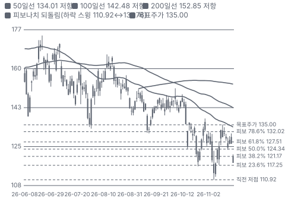

**주봉**

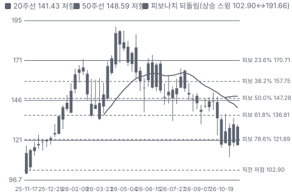

**월봉**

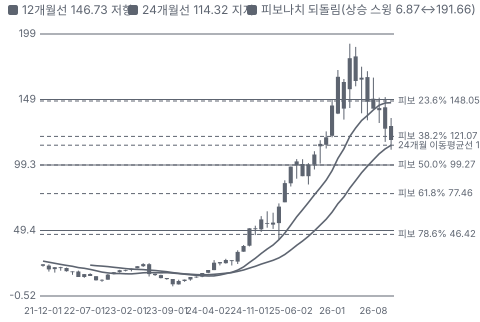

**분기 매출·EPS 실적과 컨센서스**

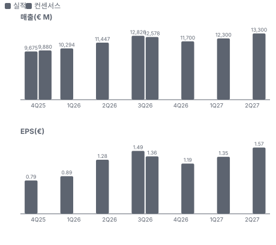

**멀티플 프리미엄(분기말 후행 P/E(대상 선행 추정 이력 없음), 최근 4개 분기말 절대값 — 대상 vs 동종 중앙값)**

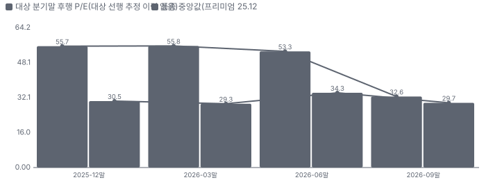

**합리적 멀티플**

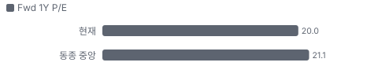

**밸류에이션 주가 시나리오**

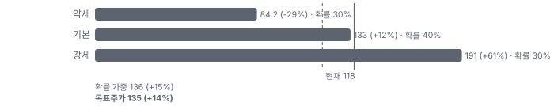

**주가별 업사이드**

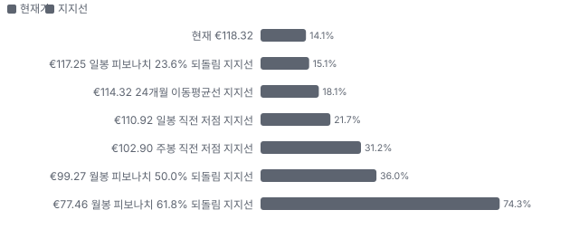
- 제품·서비스 포트폴리오

**고객 믹스(FY26, 매출 대비)**

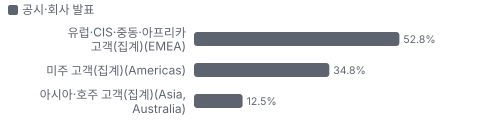

**공급 병목(10점, 낮을수록 병목)**

**생산능력 현재와 확충 계획(GW/년(가스터빈 전 기종))**

**CAPEX의 매출 대비 비중**

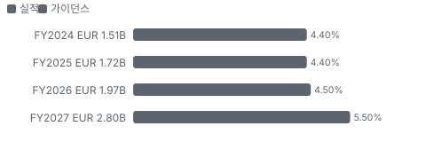

**어닝콜 변화별 주주가치 영향**

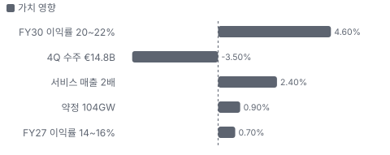

**수주·파이프라인 확실성 사다리**

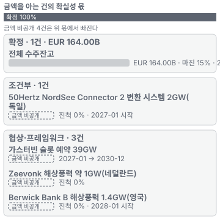

**수주/출하 비율(B/B) × 재고 일수 — 분기별**

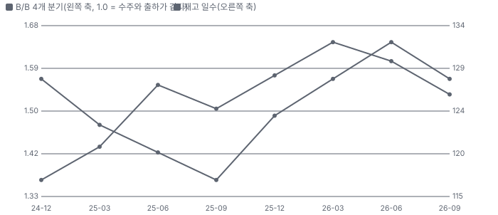

**매출 → 매출총이익 → 영업이익(매출 = 100, 최근 4분기)**

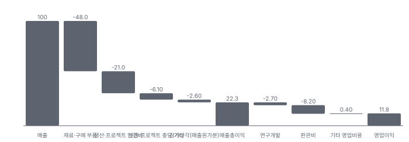

**분기 비용 비중 추이(매출 대비, 공시)**

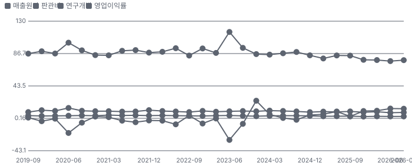

**비용 요인별 매출 대비 비중 1년 변화**

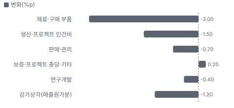

**가스 서비스 BOM 원가 몫**

**그리드 테크놀로지 BOM 원가 몫**

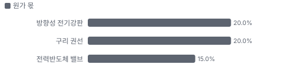

**BOM 항목 가격 +10% 시 OPM 변화**

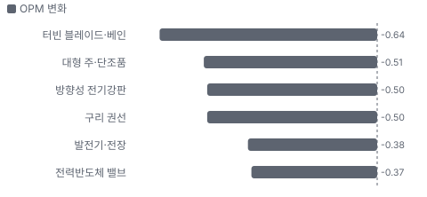

**원가 물가 vs 판매가 물가 — 최근 24개월(24.11 = 100): 원가가 판매가보다 18.0%p 더 올라 단가를 못 올리면 마진 압박**

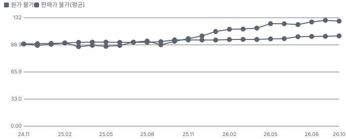

**사업별 매출 vs 물가 — 전년 대비(명목 매출 · 비교 물가 · 실질 = 물량·믹스)**

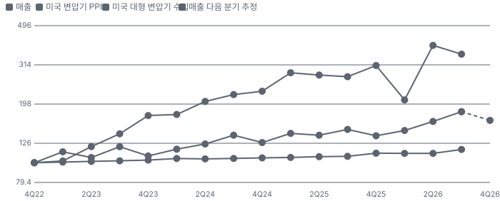

**매출 vs PPI·수출입 — 4Q22 = 100(변화율, 로그 눈금)**

**10년 P·Q 사이클 — 추세(HP 필터) 대비 갭과 8분기 전망**

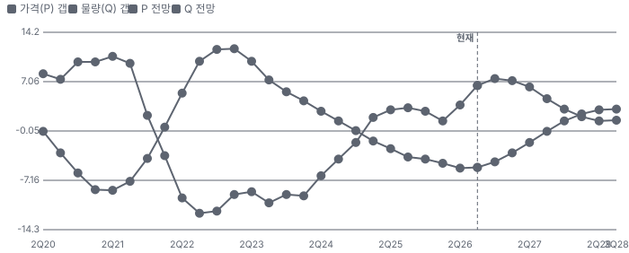

**매출 증가율의 가격·물량 분해와 8분기 전망(전년 대비)**

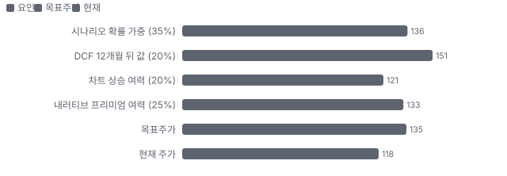

**목표주가 산정 — 기본 시나리오, 도달 확률 약 49%**

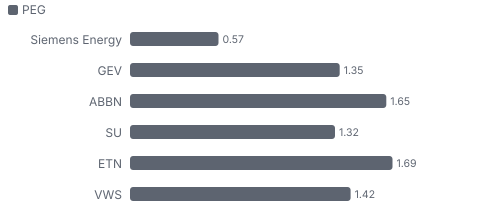

**PEG — 성장 대비 멀티플(낮을수록 성장 대비 쌈)**

**몬테카를로**

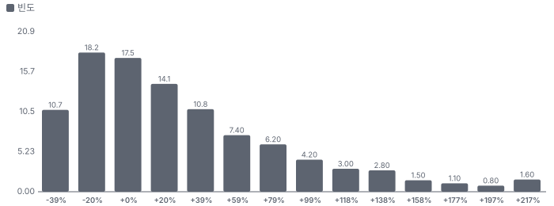

해석: 3,000번 중 1,869번(62%)에서 가치가 지금 주가 이상이었다. 가정을 흔들어도 지금 주가를 뒷받침하는 경우가 더 많다. 가운데 값은 1.14배이고, 열 번 중 여덟 번은 0.70~2.12배 사이에 든다.

## 내러티브

> **기업가치를 결정하는 이야기:** 매출의 33%가 가스 서비스(가스터빈과 정비), 32%가 그리드 테크놀로지(변압기·HVDC(먼 거리로 전기를 손실 적게 보내는 초고압 직류 송전)), 24%가 지멘스 가메사(풍력), 13%가 산업 전환이다. 이익은 가스와 그리드 두 사업에서 나오고(FY26 특별항목 제외 이익 €5.0B), 풍력은 이제 막 손익분기다. 고객이 순번을 잡으려고 미리 내는 돈(계약부채 €28.6B)이 현금을 만든다.

> **멀티플·EPS 프리미엄**
> **멀티플:** Fwd 1Y P/E 20.0배로 동종 5곳 중앙(21.1배)보다 조금 낮다 — GE Vernova(33.3배)와의 격차가 크다
> **EPS:** FY26 희석 EPS €4.37, FY27 컨센서스 €5.92~6.23(+35~43%), FY28 €8.00

### 투자자들은 왜 열광했나

2025~2026년 투자자들은 분기마다 올라가는 가이던스, 풍력 흑자 전환, 데이터센터발 가스터빈 주문에 열광해 주가를 1년 반 만에 €25에서 €188까지 올렸다. 4월 이후에는 데이터센터 투자 지속성에 대한 의심, 미국 중간선거 뒤 규제 우려, 4Q 수주 감소가 겹쳐 기대가 식었다.

### 무엇이 기업가치를 바꾸나

> **구조적 체질 변화**
> **변화:** 풍력 손실에 눌린 회사 → 가스·그리드가 이익을 끌고 풍력은 손익분기
> **증거:** 특별항목 제외 이익률 6.0%(FY25) → 12.4%(FY26), 가메사 −€1,364M → +€8M
> **반증:** FY27 이익률 14% 미달

> **고부가 믹스 확장**
> **변화:** 가격이 오른 신규 주문과 마진 높은 서비스 계약이 잔고를 채운다
> **증거:** 신규 장비 잔고 마진 FY22 이후 +26%p, 신규 서비스 계약 마진 +5%p(4Q 콜)
> **반증:** 잔고 마진 개선 중단

> **기술 혁신**
> **변화:** 최대형 HL급(Siemens Energy의 최대형·최고 효율 가스터빈 등급) 가스터빈 효율 64% 기록, 반도체 변압기 시제품 2028년 예정
> **증거:** 영국 Keadby 2 복합화력 효율 64.18%(회사 자료), 4Q 콜
> **반증:** 경쟁사 대형 터빈 수주 점유 역전

> **실행 속도**
> **변화:** 가스터빈 납기는 3~4년 이상으로 길어졌다 — 경쟁사는 더 길다 **납품 리드타임 36~48개월.** 피어 중앙값 57개월보다 26% 짧다(GE Vernova 60개월 · Mitsubishi Heavy 54개월). 이전 대비 미확인.
> **증거:** 3Q 콜(납기 3~4년 이상), 경쟁사 발표
> **반증:** 증설 가동이 FY27에서 밀림

> **M&A**
> **변화:** 산업 전환 사업 분리(공동 투자자), 인도 법인 지분 2028년 51%로 확대, 블레이드 공급망 소형 인수
> **증거:** 4Q 콜 — 인도 지분에 €3.5~4.5B 배정(국내 채널 Q&A 정리, 콜 대조)
> **반증:** 분리 무산

> **정책·입법 연관성**
> **재정정책:** 독일 발전소 용량 확보 법(StromVKG(독일 발전소 용량 확보 법 — 가스 발전소 신규 건설 입찰의 근거)) — 첫 장기 용량 입찰에서 약 5.2GW 낙찰(2026-11-03), 2차 입찰 12/29. 터빈 공급사는 미공개 독일 연방네트워크청 발표(2026-11-03), 연방의회 2026-07-09·연방참사원 07-10 통과 반증: 2차 입찰 유찰·EU(유럽연합) 보조금 심사 지연 의회 동의 2/10 — 하원 1/5(독일 법 — 미국 의회 의결 대상 아님) · 상원 1/5(같음).
> **행정명령:** 미국 연방에너지규제위원회가 대형 부하(데이터센터) 계통 연결 개편을 6개 계통 운영자에게 명령(2026-06-18, 최종 규칙 아님) 보도 — 원문 미대조 반증: 최종 규칙이 자가 발전을 제한 의회 동의 2/10 — 하원 1/5(독립 규제기관 명령 — 의회 의결 없음) · 상원 1/5(같음).
> **연관입법:** EU 전력망 패키지 — 인허가 부분 잠정 합의(2026-11-18), 정식 채택 전 보도 — 원문 미대조 반증: 최종 채택 무산

> **고객의 지출 예산**
> **변화:** 고객의 설비투자(발전소·송전망·데이터센터 전력)에서 나오고, 서비스는 운영 예산에서 나온다
> **사업별 예산:** **매출의 32%**: 그리드 테크놀로지 — 고객 CAPEX(송전망 운영사 규제 자산 투자) · 동인: 노후망 교체·재생에너지 연결
**매출의 24%**: 지멘스 가메사 — 고객 CAPEX(발전 사업자의 풍력 단지 투자) · 동인: 해상풍력 입찰
**매출의 19%**: 가스 서비스(정비) — 고객 OPEX(발전소 운영·정비 예산) · 동인: 가동 시간·설치 대수
**매출의 14%**: 가스 서비스(신규 장비) — 고객 CAPEX(발전소·데이터센터 자가 발전 설비투자) · 동인: 전력 수요 증가·노후 석탄 대체
**매출의 13%**: 산업 전환 — 고객 혼합(플랜트 설비투자·정비) · 동인: 석유·가스·화학 투자
> **증거:** 서비스 매출 32%, 데이터센터 잔고 약 9%
> **반증:** 전력회사·하이퍼스케일러 2027 CAPEX 축소

### 내러티브 근거

> AI 데이터센터와 전력망 교체로 가스터빈·변압기가 모자란다는 이야기의 유럽 대표 종목이다. 4월 고점 뒤 −37%로, 시장은 '데이터센터 전력 수요가 꺾이면 예약이 주문으로 안 바뀐다'는 걱정을 가격에 넣었다. 단계는 컨센서스, 쏠림은 중간~높음(콜 질문 증권사 18곳, 애널리스트 28명 중 21명 매수 — 보도)이다.

> **가스터빈 부족과 가격** · 유지
> **논리:** 세계 캐파(약 130GW)가 수요(140~150GW)에 못 미쳐 순번이 FY28까지 매진이고 가격이 오른다
> **숫자:** 약정 104GW, 신규 장비 잔고 마진 FY26 +14%p
> **반증:** 예약 39GW 중 FY27 확정 전환이 절반 아래
> **출처:** Siemens Energy 4Q FY26 실적 발표·어닝콜(2026-11-11)

> **서비스 장기 성장** · 강화
> **논리:** 지금 파는 터빈이 2030년대 서비스 매출을 만든다
> **숫자:** 서비스 잔고 €71B, FY35까지 가스 서비스 매출 2배 이상(회사 목표)
> **반증:** 신규 서비스 계약 마진 우위(+5%p) 소멸
> **출처:** Siemens Energy 4Q FY26 어닝콜(2026-11-11)

> **전력망 교체** · 유지
> **논리:** 선진국 전력망 절반 이상이 2040년까지 교체 대상이라 변압기·HVDC 수요가 길다
> **숫자:** 그리드 잔고 €52B(+25%), FY26 이익률 18.9%
> **반증:** 유럽 그리드 가격 하락으로 FY27 이익률 21% 미달
> **출처:** Siemens Energy 4Q FY26 실적 발표(2026-11-11)

> **현금과 주주환원** · 강화
> **논리:** 선수금이 쌓여 현금이 넘치고 FY30까지 €25B 넘게 돌려준다
> **숫자:** FY26 세전 FCF €8.8B, 배당 €0.70 → €2.30, 자사주 최대 €9B 추가
> **반증:** FY27 세전 FCF가 €8B 아래
> **출처:** Siemens Energy 4Q FY26 실적 발표(2026-11-11)

> **풍력 정상화** · 강화
> **논리:** 지멘스 가메사가 손익분기를 넘어 FY30 8~10% 이익률로 간다
> **숫자:** FY25 −€1,364M → FY26 +€8M
> **반증:** FY27 이익률 0% 아래
> **출처:** Siemens Energy 4Q FY26 실적 발표(2026-11-11)

> **반대 내러티브 — 데이터센터 둔화·예약 취소·선수금 현금** · 강화
> **논리:** 데이터센터 전력 수요가 꺾이면 예약이 주문으로 바뀌지 않고, 선수금 유입이 줄어 현금흐름이 정점을 지난다. 2001~2004년 가스터빈 대량 취소 전례가 있다
> **숫자:** 4Q 확정 주문 약 2GW(3Q 15GW), FY26 계약부채 증가 €5.8B, 4/24 고점 뒤 −37%
> **반증:** 1Q·2Q FY27에 예약 20GW 이상이 확정 주문으로 전환
> **출처:** Siemens Energy 4Q FY26 실적 발표(2026-11-11)·IB 요지(마스터 노션)

### 투자 포인트

> **이익률이 1년에 두 배, 가격은 고점 대비 −37%**
> **명제:** 특별항목 제외 이익률 6.0% → 12.4%, FY27 가이던스 14~16%인데 주가는 4/24 종가 고점 €187.62보다 37% 낮다
> **숫자:** 4Q FY26 실적 자료·일봉
> **시장과 다른 점:** 시장은 데이터센터 수요 둔화를 걱정하지만 FY27 매출의 85%가 이미 잔고에 있고 데이터센터 직접 노출은 잔고의 9%다
> **증명:** 2027-02 1Q FY27 실적의 이익률과 수주
> **출처:** Siemens Energy 4Q FY26 실적 발표(2026-11-11)

> **장비 다음에 오는 서비스**
> **명제:** 서비스 잔고 €71B, 장기 서비스 계약 평균 17년, 신규 계약 마진은 기존보다 5%p 높다
> **숫자:** 4Q FY26 발표 자료·3Q 콜
> **시장과 다른 점:** 시장은 신규 주문(GW)을 보지만 이익의 지속성은 2030년대 서비스가 만든다 — 장비 주문이 줄어도 서비스 매출은 깔린 대수를 따라간다
> **증명:** 가스 서비스 서비스 매출 성장률(FY26 약 +4%에서 상승 여부)
> **출처:** Siemens Energy 4Q FY26 어닝콜(2026-11-11)

> **GE Vernova와의 배수 격차**
> **명제:** Fwd 1Y P/E 20.0배 vs GE Vernova 33.3배, 다음 해 EPS 성장은 +35%
> **숫자:** 동종 배수 표
> **시장과 다른 점:** 격차의 이유였던 풍력 손실은 FY26에 사라졌다. 남은 할인은 선수금에 기댄 현금과 4Q 수주 감소다
> **증명:** 가메사 FY27 이익률 0~2% 달성, 예약 39GW 확정 전환
> **출처:** Siemens Energy 4Q FY26 실적 발표(2026-11-11)

### 모멘텀 생성·소멸 타임라인

**카탈리스트 달력 — 지난 사건의 주가 반응과 앞으로 확인할 숫자**
| 날짜 | 상태 | 구분 | 사건 | 반응·확인 | 결과에 따라 |
|---|---|---|---|---|---|
| 2026-02-11 | 완료 | 생성 | 1Q FY26 실적 — 수주 €17.6B | +8.4% |  |
| 2026-05-12 | 완료 | 소멸 | 2Q FY26 실적 — 가이던스 상향에도 하락 | −5.1% |  |
| 2026-11-04 | 완료 | 소멸 | 미국 중간선거 뒤 데이터센터 규제 우려(보도) | −8.0% |  |
| 2026-11-11 | 완료 | 생성 | 4Q FY26 실적·FY30 목표·자사주 €9B | +10.8% |  |
| 2026-11-20 | 완료 | 소멸 | AI 연관주 동반 급락(보도) | −6.6% |  |
| 2026-12-29 | 예정 | 매크로 | 독일 장기 용량 2차 입찰 | 낙찰 물량과 가스 발전 비중 | 낙찰 확대 → 유럽 가스터빈 수요 근거, 유찰 → 중립 |
| 2027-02-10(예상) | 예정 | 확인 | 1Q FY27 실적 | 가스터빈 확정 주문 10GW 이상, 분기 수주 €15B 이상, 이익률 14% 이상 | 충족 → 기본~강세, 확정 주문 5GW 미만 → 약세 |

### 언제 사서 언제 팔아야 할까?

**가격·조건 틀 — 가격은 밸류에이션(약세·기본·강세·목표주가)과 차트 지지 구간에서, 조건은 이벤트에서**
| 구간 | 가격 | 목표주가까지 | 약세까지 | 조건·근거 |
|---|---|---|---|---|
| 관찰 구간 | €117~€117 | +15% | -28% | 일봉 지지 구간이 약세 시나리오 가격과 겹치는 곳 |
| 확인 뒤 | 지금 €118 이상에서 조건 확인 | +14% | -29% | 1Q FY27 가스터빈 확정 주문 10GW 이상과 FY27 가이던스 유지 |
| 무효화 | 약세 시나리오 €84 | - | -29% | 예약 취소 공시 또는 FY27 FCF 가이던스 하향 |
| 차익 고민 1차 | €135(목표주가·기본 시나리오) | +14% | - | 목표주가 근처에서 Fwd 1Y P/E가 동종 중앙을 넘어설 때 |
| 차익 고민 2차 | €191(강세 시나리오) | +61% | - | 목표주가 근처에서 Fwd 1Y P/E가 동종 중앙을 넘어설 때 |

최근 6개월에 하루 5% 넘는 움직임이 18번 — AI 전력 테마와 함께 크게 흔들린다 가격·조건 틀이며 매매·비중 지시가 아니다(투자 권유 아님).

## 포트폴리오

| 제품·서비스 | 구분 | 무엇 | 쓰는 곳 | 돈 버는 방식 | Mix | Mix 변화(전년 대비) |
|---|---|---|---|---|---|---|
| 가스 서비스 | 제품 | 발전용 대형·중형 가스터빈과 20년 가까운 장기 정비 계약 | 전력회사 복합화력, 데이터센터 자가 발전, 사우디·대만 발전소 | FY26 매출의 33%(€14.5B), 서비스가 57% | 32% | +2.7%p |
| 그리드 테크놀로지 | 제품 | 대형 변압기, HVDC 변환소, 개폐장치 | 송전망 운영사의 노후 설비 교체, 해상풍력 연결, 데이터센터 전력 공급 | FY26 매출의 32%(€14.1B), 이익률 18.9% | 33% | +3.7%p |
| 지멘스 가메사 | 제품 | 해상·육상 풍력 터빈과 유지보수 | 유럽 해상풍력 단지 | FY26 매출의 24%(€10.6B), 이익률 0.1% | 22% | -3.4%p |
| 산업 전환 | 제품 | 산업용 증기터빈·압축기·전해조 | 석유·가스, 화학 플랜트 | FY26 매출의 13%(€5.8B) — 공동 투자자와 분리 추진 | 12% | -3.0%p |

**Mix 변화가 가장 큰 쪽은 그리드 테크놀로지(+3.7%p, 전년 대비).** 계절성 판정: 분기 매출 계절 지수 기준 있음 → 전년 같은 분기와 비교.

## 고객

> **FY26 최대 고객 유럽·CIS·중동·아프리카 고객(집계, EMEA) 53%, 상위 3곳 100%, 집중도 집중.** 공시·회사 발표로 확인한 몫은 매출의 100%이고, 나머지 고객 몫은 추정이거나 미분해다. 고객 이름별 매출 몫과 10% 초과 고객은 공시하지 않는다(FY26 연차보고서 게시 전). 지역으로는 FY26 매출의 53%가 유럽·중동·아프리카, 35%가 미주다. 데이터센터 관련 고객은 수주잔고 €164B 중 약 €15B(약 9%)다

**고객별 매출 몫(FY26)**
| 고객 | 몫 | 변화 | 근거 |
|---|---|---|---|
| 유럽·CIS·중동·아프리카 고객(집계, EMEA) | 53% | 0%p | 공시 |
| 미주 고객(집계, Americas) | 35% | +4%p | 공시 |
| 아시아·호주 고객(집계, Asia, Australia) | 12% | -4%p | 공시 |

> **유럽·CIS·중동·아프리카 고객(집계, EMEA)** · 공시
> **사는 것:** HVDC 변환소·변압기(송전망 운영사), 해상풍력 터빈, 사우디 복합화력 가스터빈
> **추정 근거:** FY26 €23,344M ÷ €44,243M(계산), FY25 €20,690M ÷ €39,077M

> **미주 고객(집계, Americas)** · 공시
> **사는 것:** 대형·중형 가스터빈과 서비스(전력회사·데이터센터 자가 발전), 대형 변압기
> **추정 근거:** FY26 €15,390M ÷ €44,243M(계산), FY25 €11,934M. FY26 미국 수주 €27.7B(+70.8%)

> **아시아·호주 고객(집계, Asia, Australia)** · 공시
> **사는 것:** 대만·인도 가스터빈, 송변전 기기
> **추정 근거:** FY26 €5,510M ÷ €44,243M(계산), FY25 €6,454M — 인도 육상풍력 매각으로 줄었다

## 수주·파이프라인

> **2026-09-30 기준 5건.** 확정 EUR 164.00B. 서로 겹치는 항목은 합계에서 뺐다.

**수주 목록**
| 상태 | 계약 | 계약 총액 | 진척 | 기간 | 비고 |
|---|---|---|---|---|---|
| 확정 | 전체 수주잔고 | EUR 164.00B | - | 2026-10 → 2034-09 | - |
| 조건부 | 50Hertz NordSee Connector 2 변환 시스템 2GW(독일) | 금액 비공개 | 0% | 2027-01 → 미확인 | (다른 항목과 겹칠 수 있어 합계에서 뺌) |
| 프레임워크 | 가스터빈 슬롯 예약 39GW | 금액 비공개 | - | 2027-01 → 2030-12 | (다른 항목과 겹칠 수 있어 합계에서 뺌) |
| 협상 | Zeevonk 해상풍력 약 1GW(네덜란드) | 금액 비공개 | 0% | 미확인 → 미확인 | (다른 항목과 겹칠 수 있어 합계에서 뺌) |
| 협상 | Berwick Bank B 해상풍력 1.4GW(영국) | 금액 비공개 | 0% | 2028-01 → 미확인 | (다른 항목과 겹칠 수 있어 합계에서 뺌) |

**실행 속도와 방해 요인**
| 항목 | 상태 | 실행 속도 | 방해 요인 |
|---|---|---|---|
| 전체 수주잔고 | 확정 | FY27 매출의 약 85% 커버, 그리드 잔고 가시성 2~8년 | 가스터빈 블레이드 등 부품 공급 · 공장 증설 가동 시점 · 고객 현장 인허가·계통 연결 |
| 50Hertz NordSee Connector 2 변환 시스템 2GW(독일) | 조건부 | 미확인 | 인허가 |
| 가스터빈 슬롯 예약 39GW | 프레임워크 | 회사는 FY27 안 확정 전환을 예상 | 고객 자금 조달·전력 구매 계약 · 미국 주별 데이터센터 규제 · 예약 취소·순번 재배정 |
| Zeevonk 해상풍력 약 1GW(네덜란드) | 협상 | 미확인 | 최종 투자 결정 |
| Berwick Bank B 해상풍력 1.4GW(영국) | 협상 | 미확인 | 최종 투자 결정 · 영국 차액계약 입찰 |

## 마진 구조

> **GPM 22.3%, OPM 11.8%.** FY25 대비 GPM +5.4%p, OPM +6.3%p. 변동비는 매출의 64%이고, 매출이 10% 늘면 OPM은 +2.2%p 움직인다. FY26 매출원가는 매출의 77.7%로 1년 전 83.2%보다 5.4%p 낮다. 풍력 손실이 사라지고 가스·그리드 가격이 올라 매출총이익률이 16.8%에서 22.3%로, 영업이익률이 5.5%에서 11.8%로 올랐다

> **매출 100 중 매출원가 77.7, 매출총이익 22.3(최근 4분기, 공시).** 매출원가 요인 중 재료·구매 부품이 매출의 48.0%로 가장 무겁고, 단가가 +10% 오르면 GPM이 -4.80%p 움직인다. 분기 회귀로 매출 1이 늘 때 매출원가는 0.63 늘고, 매출원가의 고정비 몫은 28%다.

**비용 요인 강도 — 비중·추세·충격(+10%)·탄력**
| 비용 | 구분 | 매출 대비 | 1년 변화 | 마진 기여 | 충격 시 마진 | 매출 탄력 | 고정비 몫 |
|---|---|---|---|---|---|---|---|
| 재료·구매 부품 | 매출원가 요인 | 48.0% | -3.0%p | +3.0%p | -4.80%p | 미확인 | 0% |
| 생산·프로젝트 인건비 | 매출원가 요인 | 21.0% | -1.5%p | +1.5%p | -2.10%p | 미확인 | 60% |
| 보증·프로젝트 충당·기타 | 매출원가 요인 | 6.1% | +0.2%p | -0.2%p | -0.61%p | 미확인 | 20% |
| 감가상각(매출원가분) | 매출원가 요인 | 2.6% | -1.2%p | +1.2%p | -0.26%p | 미확인 | 100% |
| 매출원가 | 공시 항목 | 77.7% | -5.4%p | +5.4%p | -7.77%p | 0.63 | 28% |
| 판관비 | 공시 항목 | 8.2% | -0.7%p | +0.7%p | 미확인 | 0.05 | 43% |
| 연구개발 | 공시 항목 | 2.7% | -0.4%p | +0.4%p | 미확인 | 0.02 | 55% |
| 기타 영업비용 | 공시 항목 | -0.4% | +0.3%p | -0.3%p | 미확인 | 0.00 | 100% |

매출 탄력 = 분기 비용을 매출에 회귀한 기울기(매출 1당 변동비), 고정비 몫 = 절편 ÷ 평균 비용. 표본이 8분기 미만이면 미확인. 매출원가 요인 비중은 margin 재료의 추정이 섞여 있고, 공시 매출원가와의 차이는 '기타 매출원가'로 둔다.

**GPM에서 OPM까지(GAAP, 아래는 최근 4개 분기)**
| 기간 | GPM | 연구개발 | 판관비 | 기타 | OPM |
|---|---|---|---|---|---|
| FY25 | 16.8% | 3.1% | 8.9% | -0.7% | 5.5% |
| FY26 | 22.3% | 2.7% | 8.2% | -0.4% | 11.8% |
| 2025-12 | 21.6% | - | - | - | 9.9% |
| 2026-03 | 21.9% | - | - | - | 10.3% |
| 2026-06 | 23.3% | - | - | - | 13.2% |
| 2026-09 | 22.1% | - | - | - | 13.0% |

**비용을 움직이는 요인**
| 비용 | 요인 |
|---|---|
| 재료·구매 부품(매출원가) | 주·단조품, 터빈 블레이드, 전기강판, 구리, 전력반도체 단가와 물량 · 근거 추정 |
| 생산·프로젝트 인건비(매출원가) | 직원 10.8만 명(FY25 10.3만), 임금 인상, 증설 채용 · 근거 추정 |
| 판매·관리(판관비) | 영업·관리 인력, 상표 사용료(FY30경 종료) · 근거 공시 |
| 보증·프로젝트 충당·기타(매출원가) | 풍력 품질 충당, 프로젝트 원가 초과, 운송 · 근거 추정 |
| 연구개발(연구개발) | 가스터빈·그리드·풍력 개발 — FY27 약 €1.3B 예정 · 근거 공시 |
| 감가상각(매출원가분, 매출원가) | 공장 증설 — 상각·손상 FY25 €1,781M → FY26 €1,377M · 근거 추정 |

**가스 서비스 BOM — 매출의 33%, GPM 22%(회사 전체 매출총이익률 대용 — 세그먼트별 총이익 미공시(세그먼트 특별항목 제외 이익률 16.4%)), 항목 가격 +10% 시**
| 항목 | 원가 몫 | 전가 | 제품 GPM | OPM |
|---|---|---|---|---|
| 터빈 블레이드·베인 | 20~30% | 미확인 | -1.9%p | -0.64%p |
| 대형 주·단조품 | 15~25% | 미확인 | -1.6%p | -0.51%p |
| 발전기·전장 | 10~20% | 미확인 | -1.2%p | -0.38%p |
| 미분해 | 40% | - | - | - |

**그리드 테크놀로지 BOM — 매출의 32%, GPM 22%(회사 전체 매출총이익률 대용(세그먼트 특별항목 제외 이익률 18.9%)), 항목 가격 +10% 시**
| 항목 | 원가 몫 | 전가 | 제품 GPM | OPM |
|---|---|---|---|---|
| 방향성 전기강판 | 15~25% | 미확인 | -1.6%p | -0.50%p |
| 구리 권선 | 15~25% | 미확인 | -1.6%p | -0.50%p |
| 전력반도체 밸브 | 10~20% | 미확인 | -1.2%p | -0.37%p |
| 미분해 | 45% | - | - | - |

터빈 블레이드·베인 가격이 +10% 오르면 영업이익은 -5.4% 움직인다. 판매가 전가를 모르는 항목은 전가 0%로 계산했다.

**BOM 항목 가격을 움직이는 것**
| 항목 | 요인 |
|---|---|
| 터빈 블레이드·베인 | 니켈 초합금·세라믹 코어 단가, 주조 수율 · 근거 추정 |
| 대형 주·단조품 | 특수강 단가와 단조 설비 가동률 · 근거 추정 |
| 발전기·전장 | 구리 권선·절연재 단가 · 근거 추정 |
| 방향성 전기강판 | 전기강판 단가 · 근거 추정 |
| 구리 권선 | 구리 가격 · 근거 추정 |
| 전력반도체 밸브 | IGBT(큰 전류를 켜고 끄는 전력반도체) 모듈 단가 · 근거 추정 |

> **원가·판매가 물가 격차 -19.3%p** — 판매가 물가가 투입 원가 물가보다 느리게 오른다.

**투입 물가 — 미국 PPI 3·6·12개월(2026-10, 개정 반영)과 해외 전년비**
| 항목 | 미국 3개월 | 6개월 | 12개월 | 전가 못 할 때 OPM | 일본 | 한국 | 대만 |
|---|---|---|---|---|---|---|---|
| 대형 주·단조품 | +6.7% | +17.0% | +32.9%* | - | 미확인 | 미확인 | 미확인 |
| 구리 권선 | +3.4% | +7.2% | +23.9% | - | +42.6% | +19.2% | +40.1% |
| 전력반도체 밸브 | -0.7% | -5.7% | -2.7%* | - | +1.6%* | 미확인 | 미확인 |

별표는 품목보다 넓은 업종 지수다. 연결한 투입 원가의 미국 PPI(생산자물가지수)는 1년 새 가중 +23.9%이고, 판매가로 넘기지 못하면 GPM -11.5%p·OPM -11.5%p가 움직인다. 판매가 비교 물가(가스 터빈(출력 5,000kW 초과) PPI)는 1년 새 +3.6% — 회사 가격 변화는 미확인. 물가 지수를 붙이지 못한 매출원가 항목은 생산·프로젝트 인건비, 감가상각(매출원가분), 보증·프로젝트 충당·기타다(미연결). 가스 서비스 매출은 2026-09 전년 대비 +34.8%이고 비교 물가 ppi:gas_turbine의 변화 +4.1%(2026-09)를 빼면 실질 +29.6% — 물량·믹스가 성장을 이끌었다. 그리드 테크놀로지 매출은 2026-09 전년 대비 +38.7%이고 비교 물가 ppi:transformer의 변화 +8.6%(2026-09)를 빼면 실질 +27.8% — 물량·믹스가 성장을 이끌었다.

## 공급망 병목

> **공급망 신뢰성 5.6/10, 병목 주의.** 가장 약한 고리는 터빈 블레이드·베인 4.8점이고, 품목 평균은 6.8점이다. 근거가 부족한 3건(대형 주·단조품 · 방향성 전기강판 · 전력반도체 밸브)은 점수에서 뺐다. 가장 약한 고리는 가스터빈 고온부 블레이드다. CEO가 2024년에 병목으로 지목했고, 회사는 블레이드 자회사 완전 소유와 세라믹 코어 회사 인수로 안쪽에 끌어들였다. 변압기용 전기강판·구리는 업계 전반의 제약이다. 공급사별 물량·단일 공급원 여부는 FY26 연차보고서 게시 전이라 미확인이다

**병목과 마진 — 품목 가격 +10% 시 OPM**
| 품목 | 점수 | 판정 | 구분 | OPM |
|---|---|---|---|---|
| 터빈 블레이드·베인(필수) | 4.8 | 병목 주의 | 핵심 통제 품목 | -0.64%p |
| 구리 권선 | 9.4 | 병목 낮음 | 일반 | -0.50%p |

> **터빈 블레이드·베인** · 4.8/10
> **왜:** 고온부 부품이 없으면 터빈 출하가 멈춘다. 재인증 24개월은 단결정 블레이드 주조사 신규 인증 기간 추정(업계 통상 2년 안팎)
> **병목 요인:** 인증 공급사 2곳 · 캐파 빠듯 · 리드타임 미확인 · 재인증 24개월 · 1위 점유율 미확인 · 지역 집중 미확인 · 물량 확보 내재화
> **풀리는 조건:** 미확인 — 자회사 증설의 가동·수율 근거 없음

> **구리 권선** · 9.4/10
> **왜:** 변압기·발전기 권선 — 범용 원자재라 가격 위험이지 물량 위험은 아니다(판단, 재인증 3개월은 추정)
> **병목 요인:** 인증 공급사 4곳 · 캐파 여유 · 리드타임 미확인 · 재인증 3개월 · 1위 점유율 미확인 · 지역 집중 미확인 · 물량 확보 복수구매
> **풀리는 조건:** 미확인

**공급사**
| 품목 | 공급사 | 몫 | 근거 |
|---|---|---|---|
| 터빈 블레이드·베인 | Advanced Airfoil Components(자회사, 단결정 블레이드 주조 — 완전 소유로 전환) | 미확인 | 회사 발표 |
| 터빈 블레이드·베인 | Capital Injection Ceramics(인수, 블레이드 주조용 세라믹 코어) | 미확인 | 보도 |
| 대형 주·단조품 | 미공개(로터·케이싱 단조) | 미확인 | 추정 |
| 방향성 전기강판 | thyssenkrupp(해상풍력 변압기용 저탄소 전기강판) | 미확인 | 보도 |
| 구리 권선 | 미공개(권선용 구리) | 미확인 | 추정 |
| 전력반도체 밸브 | 미공개(HVDC 변환소용 IGBT 모듈) | 미확인 | 추정 |

**무역 통계로 본 공급 지역**
| 품목 | EU 수입처 | 일본 수입처 | EU 1위 전년비 |
|---|---|---|---|
| 대형 주·단조품 | KR(한국) 39% · TW(대만) 26% · MY(말레이시아) 15% | 大韓民国 49% · 中華人民共和国 14% | -25.9% |
| 구리 권선 | MY 77% · KR 11% · VN(베트남) 7% | マレーシア 58% · タイ 36% | 미확인 |
| 전력반도체 밸브 | CN(중국) 33% · MY 30% · JP(일본) 21% | マレーシア 25% · 中華人民共和国 19% | -0.5% |

## 생산능력

> **현재 명목 캐파 22 GW/년(가스터빈 전 기종), 가동률 미확인.** 착공 이상 증설은 8 GW/년(가스터빈 전 기종), 발표까지 합치면 8 GW/년(가스터빈 전 기종)이다. 다 가동하면 지금보다 +36%, 착공 이상만이면 +36%다. FY2026 CAPEX는 EUR 1.97B로 매출의 4.5%다. 가스터빈 생산은 FY25~27 평균 약 22GW(160대)에서 FY28~30 평균 30GW 초과(210~230대)로 늘린다. 변압기·개폐장치도 2030년까지 약 50% 늘린다. 증설은 기존 공장 안에서 하고, FY27 CAPEX는 매출의 5~6%로 정점이다. 순번은 FY28까지 매진이다

**생산시설 62곳**(회사 소개 자료(2026-02) 9쪽의 생산 거점 수 — 미주 22·유럽·중동·아프리카 23·아시아·호주 17. 소유·임차 구분은 연차보고서 미대조) — 이름·위치를 밝힌 곳 8곳, 미확인 8곳. 시설별 생산능력은 2곳만 공개됐다.

**생산시설 62곳 — 명칭·위치·생산능력**
| 시설 | 위치 | 용도 | 생산능력 | 소유·상태 |
|---|---|---|---|---|
| 뉘른베르크 변압기 공장 | 독일 뉘른베르크 | 대형 전력 변압기·변환기 부품 | 미확인 — 캐파 단위 미공시 — 2028년까지 +50% | 미확인 · 증설 중 |
| 샬럿 공장 | 미국 노스캐롤라이나 샬럿 | 대형 전력 변압기, 대형 가스터빈 제조 재개 | 24 변압기 대/년(최대 57대 계획) | 미확인 · 증설 중 |
| 탬파 공장 | 미국 플로리다 탬파 | 가스터빈 블레이드·베인 | 미확인 — 미공시 | 미확인 · 가동 |
| 바이츠 변압기 공장 | 오스트리아 바이츠 | 변압기 개발·생산 | 미확인 — 미공시 — €95M 확장(2028 초 가동 예정, 보도) | 미확인 · 증설 중 |
| 자그레브 변압기 합작 공장 | 크로아티아 자그레브 | 대형 전력 변압기 — 합작 51% | 미확인 — 미공시 | 미확인 · 가동 |
| 베를린 전해조 공장 | 독일 베를린 | 수소 전해조 — 합작 | 1 GW/년(초기) | 미확인 · 가동 |
| 헐 블레이드 공장 | 영국 헐 | 해상풍력 블레이드 | 미확인 — 미공시 | 미확인 · 가동 |
| 르아브르 공장 | 프랑스 르아브르 | 해상풍력 나셀·블레이드 | 미확인 — 미공시 | 미확인 · 가동 |

**생산능력 확충 계획**
| 계획 | 단계 | 증설 | 가동 시점 | CAPEX |
|---|---|---|---|---|
| 가스터빈 증설(기존 공장 — 대형 35 → 약 50대, 중형 80 → 약 100대) | 착공 | 8 GW/년(가스터빈 전 기종) | 2027-10 | 미확인 |
| 미국 제조 확대(샬럿 대형 터빈 재개·미시시피 개폐장치 신공장 등) | 발표 | 미확인 | 미확인 | EUR 0.91B |
| 뉘른베르크 변압기 공장 확장 | 착공 | 미확인 | 2028-01 | EUR 0.22B |
| 그리드 공장 37곳 투자(FY25~30) | 발표 | 미확인 | 2030-09 | EUR 4.00B |

남은 계획의 CAPEX 합계는 EUR 5.13B(금액 미확인 1건 제외)다. 합계는 FY2027 매출의 10%다.

**증설 방해 요인**
| 계획 | 방해 요인 |
|---|---|
| 가스터빈 증설(기존 공장 — 대형 35 → 약 50대, 중형 80 → 약 100대) | 블레이드·주단조품 공급, 숙련 인력 |
| 미국 제조 확대(샬럿 대형 터빈 재개·미시시피 개폐장치 신공장 등) | 인허가·채용 1,500명 |
| 뉘른베르크 변압기 공장 확장 | 숙련 인력 350명 채용 |
| 그리드 공장 37곳 투자(FY25~30) | 전기강판·구리 공급 |

**CAPEX와 매출 대비**
| 기간 | CAPEX | 매출 | 매출 대비 | 구분 |
|---|---|---|---|---|
| FY2024 | EUR 1.51B | EUR 34.47B | 4.4% | 실적 |
| FY2025 | EUR 1.72B | EUR 39.08B | 4.4% | 실적 |
| FY2026 | EUR 1.97B | EUR 44.24B | 4.5% | 실적 |
| FY2027 | EUR 2.80B | EUR 50.88B | 5.5% | 가이던스 |

## 피터 린치 분류

> **고성장주(Fast Grower), 대형.** 린치 표의 기대 수익 10~100배, 하방 -80~100%, 위험 고. 10배 경로가 있는 분류다(고성장주·회생주·경기순환주).

**분류 근거 — 크기 먼저, 다음은 이야기 유형**
| 항목 | 값 |
|---|---|
| 크기 | 대형(시가총액 \$101.0B) |
| 장기 성장 | 29.6%(컨센서스 EPS 2년 CAGR) |
| 린치 비율((성장% + 배당%) ÷ P/E) | 1.48 — 2 이상 매력, 1 미만 비싸다 |
| PEG(P/E ÷ 성장%) | 0.67 — 1 적정, 0.5 매우 매력, 2 매우 불리 |
| 근거 | 장기 EPS 성장 30%(컨센서스 EPS 2년 CAGR) — 고성장 구간(≥18%) |
| 반대 근거 | 대형주라 10배는 드물다 — 크기가 기대치를 낮춘다 |

- 점검: 성장을 더 이어 갈 자리(새 시장·점포·고객)가 남았나
- 점검: P/E가 성장률의 2배를 넘지 않나(PEG)
- 점검: 성장 속도가 꺾이는 2단계에 들어섰나
- 팔 때(점검 조건, 매매 지시 아님): 성장 단계가 끝나거나(확장 여지 소진·동일 매장 성장 둔화) P/E가 성장률의 2배를 크게 넘을 때 — 50% 올랐다고 팔지 않는다(10배 경로를 자른다)

분류 = 피터 린치·존 로스차일드 『One Up On Wall Street』(1989)·『Beating the Street』(1993)의 6분류와 위험·보상 표를 숫자 규칙으로 옮긴 자체추론이다(config/lynch.yaml).

## 구루 교차 점검

> **여섯 관점 중 통과 2 · 미달 1 · 미확인 3.** 가장 약한 관점은 5배 경로와 시장이 모르는 이유 — 대형주라 배수 확장 여지가 작고 상방은 회사 FY30 목표 달성에 묶여 있다.

판정은 자체추론이고 숫자는 계산값이다.

> **성장 여지** · 미확인
> **질문:** 5년 안에 매출이 2배가 될 자리가 있나, 10년 뒤에도 커지나
> **이유:** 회사 목표는 FY30 매출 €70B 초과(연 12~14%)지만 컨센서스 경로로는 5년 2배에 못 미친다
> **계산한 숫자:** 매출 경로 FY2027→FY2029 연 12.3%, 2배까지 6.0년
> **근거:** 출처 목록

> **해자와 자본수익률** · 통과
> **질문:** 경쟁우위가 무엇이고, 투하자본수익률(ROIC)이 자본비용보다 높으며 유지·상승하나
> **이유:** 대형 가스터빈 3사 과점과 서비스 잔고 €71B, 투하자본수익률이 자본비용을 넘는다
> **계산한 숫자:** ROIC 107.6% · 자본비용 10.1%
> **근거:** 출처 목록

> **재투자 복리** · 미확인
> **질문:** 번 돈을 높은 수익률로 다시 넣을 곳이 있나 — 자본 배분(재투자·인수·자사주·희석) 이력은
> **이유:** 증설은 기존 공장 안에서 하고 남는 현금은 환원한다 — 재투자율이 낮아 복리 성장은 제한적이다
> **계산한 숫자:** 설비 재투자율 15.6% · 지속 가능 성장 16.8%(근사) · 소유주 이익 수익률 3.8%(근사)
> **근거:** 출처 목록

> **사람과 문화** · 통과
> **질문:** 경영진이 주주와 같은 배를 탔나 — 창업자·내부자 지분, 기회형 내부자 매수, 문화가 경쟁우위에 기여하나
> **이유:** 2020년부터 같은 CEO·CFO가 풍력 위기를 넘기고 가이던스를 연속 초과 달성했다
> **계산한 숫자:** 서류로 확인(계산 없음)
> **근거:** 출처 목록

> **변화의 방향** · 미확인
> **질문:** 18~24개월 뒤 이익 그림이 지금과 얼마나 다른가, 유동성 국면은 그 변화를 받쳐 주나
> **이유:** 이익은 늘고 있지만 2년 뒤 EPS 변화 계산값이 미확인이고 4Q 수주가 줄었다
> **계산한 숫자:** 2년 뒤 EPS +35.1%(다음 12개월 대비) · 유동성 국면 중립
> **근거:** 출처 목록

> **5배 경로와 시장이 모르는 이유** · 미달
> **질문:** 어떻게 5배 이상이 되나(이익 성장 × 배수 변화), 시장은 왜 아직 값을 안 매기나
> **이유:** 시가총액 €101B에서 5배는 경로가 없다 — 2배가 회사 목표를 다 채우는 경우다
> **계산한 숫자:** 5년에 5배 = 연 38.0% · 10배 = 연 58.5% · Fwd P/E 20.0배
> **근거:** 출처 목록

**배수별로 필요한 연 성장률 — 이익 성장과 배수 변화를 합친 속도**
| 목표 | 5년 | 7년 | 10년 |
|---|---|---|---|
| 2배 | 14.9% | 10.4% | 7.2% |
| 5배 | 38.0% | 25.8% | 17.5% |
| 10배 | 58.5%(희소) | 38.9% | 25.9% |

### 보유 규율 — 가격이 아니라 지표로 유지·종료를 가른다

- 투자 논리 지표: 가스터빈 확정 주문(GW)과 예약 전환 · 특별항목 제외 이익률 · 세전 FCF와 계약부채 증감
- 규칙: 가격만 빠지고 세 지표가 살아 있으면 투자 논리는 유지된다
- 지금 주가는 일봉 254개 기간의 고점 대비 -36.9%, 그 기간 최대 낙폭은 -39.3%다.

여섯 관점은 베일리 기포드(성장 여지·5배 경로), 워렌 버핏(해자·재투자), 론 바론(사람), 피터 린치(분류·내부자), 스탠리 드러켄밀러(변화의 방향·유동성)의 질문을 옮긴 점검 틀이다. 유동성 국면은 중립(10년물 20일 -9bp · 하이일드 스프레드 20일 +12bp). 설비 재투자율은 설비투자에서 감가상각을 뺀 몫만 본 근사이고(연구개발·인수·운전자본은 빠진다), 소유주 이익 수익률은 유지 설비투자를 감가상각과 같다고 본 근사다. 점검 틀이며 매매·비중 지시가 아니다.

## 해자

> 해자는 '대형 가스터빈을 만들 수 있는 회사가 세계에 셋뿐이고, 한번 깔린 터빈은 20년 가까이 서비스 매출을 낸다'는 데서 나온다. 풍력은 해자가 약하다

> **대형 가스터빈 과점** · 강함
> **해자:** 대형 가스터빈은 GE Vernova·Siemens Energy·Mitsubishi Heavy 세 곳이 나눠 갖고, 생산 순번이 FY28까지 매진이다
> **근거:** 100MW 초과 가스터빈 3Q 점유율 42%(3Q 콜), 약정 104GW, 세계 제조 캐파 약 130GW vs FY26 수요 140~150GW(4Q 발표 자료)
> **숫자:** 신규 장비 잔고 마진 FY22 이후 +26%p
> **깨지는 조건:** 신규 장비 가격 하락이나 예약 취소가 분기 10GW를 넘음

> **서비스 설치 기반** · 강함
> **해자:** 깔린 터빈이 장기 서비스 계약으로 20년 가까이 반복 매출을 낸다
> **근거:** 장기 서비스 계약 평균 17년(3Q 콜), 서비스 잔고 약 €71B, FY26 서비스 매출 €14.2B(매출의 32%)
> **숫자:** 신규 서비스 계약 마진이 기존 잔고보다 약 5%p 높음
> **깨지는 조건:** 서비스 매출 성장률이 2년 연속 5% 아래

> **송전 기기 제조망과 납기** · 보통
> **해자:** 변압기·HVDC는 공장과 숙련 인력이 병목이라 먼저 증설한 회사가 가격을 정한다
> **근거:** 그리드 잔고 €52B(+25%), FY25~30 공장 37곳에 약 €4B 투자, FY26 그리드 이익률 18.9%(4Q 실적 자료)
> **숫자:** 그리드 잔고 마진 FY22 이후 +12%p
> **깨지는 조건:** 유럽 변압기 가격 하락, 경쟁사 증설로 납기 단축

> **풍력 터빈** · 약함
> **해자:** 풍력은 FY26에야 손익분기에 닿았고 과거 육상 터빈 품질 문제로 큰 손실을 냈다
> **근거:** 지멘스 가메사 FY26 특별항목 제외 이익 €8M(0.1%), 세전 FCF −€1.58B(4Q 실적 자료)
> **숫자:** FY25 −€1,364M → FY26 +€8M
> **깨지는 조건:** FY27 이익률이 0~2% 가이던스를 밑돔

## 경영진·네트워크

> CEO Christian Bruch와 CFO Maria Ferraro가 2020년 분사 때부터 회사를 이끈다. 감독이사회 의장은 전 Siemens AG CEO Joe Kaeser다. 옛 모회사 Siemens AG 지분은 5% 안팎으로 줄었다

> **Christian Bruch** · CEO · 2020
> **프로필:** Linde 부사장·Linde Engineering 대표를 거쳐 2020-05 취임, 계약 2030-04까지
> **비즈니스:** Linde 출신 — 산업가스·플랜트 업계
> **정계:** 2026-02 미국 투자 발표 때 미국 행정부에 정책 안정성을 요청(보도)
> **동문:** 미확인
> **사모임:** 미확인

> **Maria Ferraro** · CFO · 2020
> **프로필:** Siemens Digital Industries CFO 출신, 계약 2027-11까지
> **비즈니스:** Capgemini 이사(2022~)
> **정계:** 미확인
> **동문:** 미확인
> **사모임:** 미확인

> **Joe Kaeser** · 감독이사회 의장 · 미확인
> **프로필:** 전 Siemens AG CEO — 의장 재선임, 임기는 FY2028 주총까지
> **비즈니스:** Siemens AG와의 상표 사용 계약·분사 관계
> **정계:** 미확인
> **동문:** 미확인
> **사모임:** 미확인

**네트워크 정량화**
| 연결 | 강도 | 닿는 매출 | 가중 노출 | 매출 대비 | 근거 |
|---|---|---|---|---|---|
| 비즈니스: Siemens AG — 상표 사용 계약(FY30경 종료)·잔여 지분 5% 안팎·인도 법인 지분 거래 | 4/5 | €0.00B | €0.00B | 0% | Siemens AG를 통한 매출 몫 미공시 — 노출 0으로 둔다 4Q FY26 어닝콜(상표 사용료 제외 기준 FY30 목표), 지분 통지 공시(2026-04·09) |

가중 노출은 연결이 닿는 매출의 크기다. 연결이 그 매출을 만들었다는 뜻이 아니며, 인과는 공개 자료로 입증하지 못한다.

## 약세 논리 및 셀온 조건

| 약세 논리 | 근거 | 가를 자료 |
|---|---|---|
| 예약은 주문이 아니다 | 가스터빈 약정 104GW 중 39GW는 예약금만 받은 순번 예약이다. 4Q에는 예약이 14GW 늘었지만 확정 전환은 0이었고 확정 주문은 약 2GW였다 | 1Q·2Q FY27 가스터빈 확정 주문(GW)과 예약 잔량 — 2027년 2월·5월 |
| 현금흐름이 선수금에 기댄다 | FY26 세전 FCF €8.8B 가운데 계약부채 증가가 €5.8B다. 주문이 둔화하면 이익보다 현금이 먼저 줄어든다. 회사는 FY27 FCF의 약 75%가 이익에서 나온다고 설명했다 | FY27 분기별 계약부채 증감과 세전 FCF(가이던스 약 €10B) |
| 데이터센터 수요 둔화 | 회사가 밝힌 직접 노출은 잔고 €164B 중 약 €15B(9%)지만, 전력회사 주문 뒤에 있는 데이터센터 수요는 회사도 나누지 못했다. 2001~2004년에 가스터빈 대량 취소 전례가 있다 | 미국 전력회사·하이퍼스케일러 2027 CAPEX 가이던스(2027년 1~2월), 예약 취소 공시 |
| 풍력은 아직 현금을 태운다 | Siemens Gamesa FY26 특별항목 제외 이익은 €8M이지만 세전 FCF는 −€1.58B였고 FY27 매출은 줄어든다. 과거 육상 터빈 품질 문제의 충당금 현황은 확인하지 못했다 | FY27 분기별 가메사 이익률(가이던스 0~2%)과 FCF, FY26 연차보고서 충당금 주석(2026년 12월) |
| 그리드 가격이 평평해진다 | 회사는 유럽·규제 대상 제품의 그리드 가격 상승이 둔화했다고 했다. FY27 그리드 이익률 가이던스 21~23%는 FY26 18.9%에서 다시 오르는 경로다 | FY27 분기별 그리드 수주 마진·이익률 |
| 자료 한계 | FY26 연차보고서가 아직 게시되지 않아 10% 초과 고객·구매 약정·인건비·재료비·리스 부채를 대조하지 못했다. 일봉은 1년치(실제 고가·저가)이고 애널리스트 의견 분포·추정 수정 이력 데이터가 없다. 급락 원인은 단일 언론 보도다 | FY26 연차보고서(2026년 12월 게시 예상) |

**변이 관점.** 시장은 Siemens Energy를 'AI 전력 주식'으로 묶어 데이터센터 뉴스에 따라 하루 5% 넘게 움직인다. 그러나 회사가 밝힌 데이터센터 직접 노출은 잔고의 9%이고, FY27 매출의 85%는 이미 잔고에 있다. ==가격을 가르는 것은 데이터센터 뉴스가 아니라 예약 39GW의 확정 전환과 선수금 흐름이다== — 두 숫자 모두 2월 1Q 실적에서 처음 확인된다.

> **셀온 조건**
> **조건 1:** 가스터빈 예약 취소가 공시되거나 1Q·2Q FY27 확정 주문이 합쳐 10GW에 못 미친다.
> **조건 2:** FY27 세전 FCF 가이던스(약 €10B)나 이익률 가이던스(14~16%)가 내려간다.
> **조건 3:** Siemens Gamesa가 FY27에 다시 분기 적자로 돌아서고 손익분기 가이던스(0~2%)를 낮춘다.
> **조건 4:** 분기 수주가 두 분기 연속 매출을 밑돈다(수주 ÷ 매출 1.0 미만).

## 어닝콜 변화

**직전 콜 대비 새로 나오거나 바뀐 내용 → 가치 영향**
| 항목 | 내용 | 직전 콜 | 최신 콜 | 모델 동인 이동 | 확신도 | 가치 영향 |
|---|---|---|---|---|---|---|
| 신규 | FY30 중기 목표 | FY28 이익률 14~16%(2025-11 목표) | FY30 매출 €70B 초과·이익률 20~22% | 목표 이익률 +4.0% | 0.5 | +4.6% |
| 업데이트 | 다음 해 이익률 가이던스 | FY26 10~12%(8월 재확인) | FY27 14~16% — FY28 목표 1년 조기 | 출발 이익률 +2.0% | 0.8 | +0.7% |
| 부정 | 분기 수주 | 3Q €17.9B(분기 최대) | 4Q €14.8B — 회사 집계 컨센서스 €15.5B 미달, 가스 확정 주문 약 2GW | 1년차 성장률 -1.0% | 1.0 | -3.5% |
| 업데이트 | 가스터빈 약정 | 95GW(잔고 69 + 예약 26) | 104GW(잔고 65 + 예약 39) | 장기 성장 수렴값 +0.30% | 0.8 | +0.9% |
| 신규 | 서비스 장기 전망 | 1GW당 서비스 기회 약 €400M 언급(3Q 질문) | FY35까지 가스 서비스 매출 2배 이상, 신규 장기 서비스 계약 마진 +5%p | 성장 지속(감속 계수) +2.0% | 0.5 | +2.4% |
| 신규 | 데이터센터 노출 | 정량 공개 없음 | 잔고 €164B 중 약 €15B(약 9%) | 1년차 성장률 — | 1.0 | +0.0% |
| **합계** | 단독 합 |  |  | 동시 적용 +5.5% |  | **+5.2%** |

**실적 발표 예상 변동폭:** 지난 4번 실적 발표 때 주가는 하루에 평균 ±6.1%(최대 10.8%, 오른 날 2번) 움직였다.

**실적 발표 예상 변동폭 — 과거 실적 발표 다음 거래일 주가 변화**
| 분기 | 발표일 | 주가 변화 |
|---|---|---|
| 1Q26 | 2026-02-11 | +8.4% |
| 2Q26 | 2026-05-12 | -5.1% |
| 3Q26 | 2026-08-05 | +0.0% |
| 4Q26 | 2026-11-11 | +10.8% |

## 거시 지표 싱크로율

> **미국 대형 변압기 수입과 그리드 테크놀로지 싱크로율 76%(0분기 = 약 0개월 선행, 전년 대비, 표본 9개·t 3.1·유의·신뢰 낮음).** 이 지표가 내포하는 4Q26 그리드 테크놀로지은 3.89B(±1σ 3.57B~4.22B, 지표 자기회귀 추정)다. 표본 밖 검증(최근 4개 분기)에서 지표 모델 오차는 7.4%p, 기준선(직전 증가율 지속)은 13.6%p다 — 지표가 기준선을 이겨 지표 70%·기준선 30%로 결합했다. 세그먼트 추정에 나머지 사업(직전 증가율 지속)을 더한 전사 매출은 11.59B(11.26B~11.91B)다.  가스 서비스는 고객의 가스터빈 반입, 그리드는 변압기 반입을 따라간다 — 미주 매출이 35%라 미국 수입 지표를 본다

**지표별 싱크로율(상관계수 × 100) — 위 두 줄이 제품 연관성 × 싱크로율로 고른 PPI·수출입 세부 지표**
| 지표 | 비교 대상 | 증가율 기준 | 지표 선행 | 매출(t값) | 영업이익 | 방향 일치 | 표본·신뢰 | 표본 밖 오차(지표/기준선) | 4Q26 추정 매출 |
|---|---|---|---|---|---|---|---|---|---|
| 미국 변압기 PPI | 그리드 테크놀로지 | 전년 대비 | 2분기(6개월) | 70%(t 2.6) | 16%(2분기) | 100% | 9·낮음 | 9.2/13.6%p ✔ | +31.2% → 4.01B(확정) |
| 미국 대형 변압기 수입 | 그리드 테크놀로지 | 전년 대비 | 0분기(0개월) | 76%(t 3.1) | -20%(0분기) | 89% | 9·낮음 | 7.4/13.6%p ✔ | +27.5% → 3.89B(지표 자기회귀 추정) |
| 미국 대형 가스터빈 수입 | 가스 서비스 | 전년 대비 | 4분기(12개월) | 52%(t 1.4) | 42%(3분기) | 86% | 7·참고용 | 10.5/8.4%p ✘ | +29.4% → 4.01B(확정) |

**지표 후보 26개 — 연관성(제품 품목 일치 × 대용 감점 × 매출 비중) × 싱크로율로 고른다. 후보가 많을수록 최대 상관은 우연히 부풀 수 있다**
| 후보 | 종류 | 연관성 | 매출 분기 일치 | 싱크로율(선행) | 점수 | 출처 |
|---|---|---|---|---|---|---|
| 미국 대형 변압기 수입 ✔ | 수출입 | 1.00 | 100% | 76%(0분기) | 0.76 | 모델 지정 |
| EU 변압기 수출(HS(국제 통일 상품 분류 코드) 850423) | 수출입 | 0.49 | 100% | 88%(1분기) | 0.43 | 자동 |
| 미국 대형 가스터빈 수입 | 수출입 | 1.00 | 94% | 52%(4분기) | 0.42 | 모델 지정 |
| 미국 변압기 PPI ✔ | PPI | 0.49 | 100% | 70%(2분기) | 0.35 | 자동 |
| 미국 구리 PPI | PPI | 0.49 | 100% | 68%(1분기) | 0.27 | 자동 |
| EU HS 841112 수입(가스 서비스과 같은 4자리 품목군) | 수출입 | 0.36 | 100% | 74%(4분기) | 0.26 | 자동 |
| 영국 구리 PPI | PPI | 0.49 | 100% | 63%(3분기) | 0.25 | 자동 |
| 일본 구리 PPI | PPI | 0.49 | 100% | 62%(1분기) | 0.25 | 자동 |
| 한국 변압기 PPI | PPI | 0.49 | 100% | 51%(0분기) | 0.20 | 자동 |
| EU HS 841191 수출(가스 서비스과 같은 4자리 품목군) | 수출입 | 0.36 | 100% | 55%(0분기) | 0.16 | 자동 |
| 미국 가스 터빈(출력 5,000kW 초과) 수출(HS 841182) | 수출입 | 0.51 | 100% | 36%(1분기) | 0.15 | 자동 |
| 미국 변압기 수출(HS 850423) | 수출입 | 0.49 | 69% | 33%(0분기) | 0.13 | 자동 |

**선행 지표로 본 향후 분기 매출 전망(이미 나온 지표 값 기준, ±1σ)**
| 지표 | 대상 | 분기 | 지표 증가율 | 내포 매출 증가율 | 내포 매출 |
|---|---|---|---|---|---|
| 미국 대형 가스터빈 수입 | 가스 서비스 | 4Q26 | +162.3% | +18.9% | 3.68B(3.35B~4.02B) |
| 미국 대형 가스터빈 수입 | 가스 서비스 | 1Q27 | +35.8% | +10.8% | 3.86B(3.48B~4.23B) |
| 미국 대형 가스터빈 수입 | 가스 서비스 | 2Q27 | +148.2% | +18.0% | 4.43B(4.02B~4.84B) |
| 미국 대형 가스터빈 수입 | 가스 서비스 | 3Q27 | +99.7% | +14.9% | 4.79B(4.34B~5.25B) |
| EU 가스 터빈(출력 5,000kW 초과) 수출(HS 841182) | 가스 서비스 | 4Q26 | +36.7% | +14.3% | 3.54B(3.21B~3.87B) |
| EU 가스 터빈(출력 5,000kW 초과) 수출(HS 841182) | 가스 서비스 | 1Q27 | -21.0% | +11.1% | 3.86B(3.50B~4.23B) |
| EU 가스 터빈(출력 5,000kW 초과) 수출(HS 841182) | 가스 서비스 | 2Q27 | +8.3% | +12.7% | 4.23B(3.84B~4.63B) |
| EU 가스 터빈(출력 5,000kW 초과) 수출(HS 841182) | 가스 서비스 | 3Q27 | -14.4% | +11.4% | 4.65B(4.21B~5.09B) |
| EU 가스 터빈(출력 5,000kW 초과) 수입(HS 841182) | 가스 서비스 | 4Q26 | +73.8% | -0.2% | 3.09B(2.78B~3.39B) |
| 미국 가스 터빈(출력 5,000kW 초과) 수출(HS 841182) | 가스 서비스 | 4Q26 | -9.3% | +11.9% | 3.46B(3.14B~3.79B) |
| EU 변압기 수출(HS 850423) | 그리드 테크놀로지 | 4Q26 | -6.0% | +20.7% | 3.69B(3.54B~3.84B) |
| EU 변압기 수입(HS 850423) | 그리드 테크놀로지 | 4Q26 | +106.3% | +22.3% | 3.74B(3.49B~3.98B) |
| EU 변압기 수입(HS 850423) | 그리드 테크놀로지 | 1Q27 | +24.9% | +31.3% | 4.03B(3.78B~4.27B) |
| EU 변압기 수입(HS 850423) | 그리드 테크놀로지 | 2Q27 | +35.6% | +30.1% | 4.71B(4.43B~5.00B) |
| EU 변압기 수입(HS 850423) | 그리드 테크놀로지 | 3Q27 | +38.8% | +29.7% | 5.66B(5.31B~6.01B) |
| 미국 변압기 PPI | 그리드 테크놀로지 | 4Q26 | +3.9% | +27.2% | 3.89B(3.66B~4.11B) |
| 미국 변압기 PPI | 그리드 테크놀로지 | 1Q27 | +8.3% | +49.4% | 4.58B(4.36B~4.81B) |
| 일본 변압기 PPI | 그리드 테크놀로지 | 4Q26 | +1.9% | +28.5% | 3.92B(3.63B~4.22B) |
| 일본 변압기 PPI | 그리드 테크놀로지 | 1Q27 | +0.9% | +29.6% | 3.97B(3.68B~4.27B) |
| 일본 변압기 PPI | 그리드 테크놀로지 | 2Q27 | +0.5% | +30.0% | 4.71B(4.36B~5.07B) |
| 미국 구리 PPI | 그리드 테크놀로지 | 4Q26 | +24.4% | +36.4% | 4.16B(3.93B~4.39B) |
| 일본 구리 PPI | 그리드 테크놀로지 | 4Q26 | +56.2% | +36.1% | 4.16B(3.91B~4.40B) |
| 영국 구리 PPI | 그리드 테크놀로지 | 4Q26 | +24.6% | +50.8% | 4.60B(4.36B~4.85B) |
| 영국 구리 PPI | 그리드 테크놀로지 | 1Q27 | +31.8% | +59.5% | 4.89B(4.65B~5.14B) |
| 영국 구리 PPI | 그리드 테크놀로지 | 2Q27 | +33.6% | +61.8% | 5.86B(5.57B~6.15B) |
| 한국 구리 PPI | 그리드 테크놀로지 | 4Q26 | +14.9% | +14.3% | 3.49B(3.23B~3.75B) |
| 한국 구리 PPI | 그리드 테크놀로지 | 1Q27 | +23.9% | +5.2% | 3.23B(2.96B~3.49B) |
| 한국 구리 PPI | 그리드 테크놀로지 | 2Q27 | +28.1% | +0.9% | 3.66B(3.35B~3.97B) |
| 한국 구리 PPI | 그리드 테크놀로지 | 3Q27 | +28.4% | +0.6% | 4.39B(4.01B~4.76B) |
| 대만 구리 PPI | 그리드 테크놀로지 | 4Q26 | +9.0% | +20.2% | 3.67B(3.47B~3.87B) |
| 대만 구리 PPI | 그리드 테크놀로지 | 1Q27 | +25.2% | +0.4% | 3.08B(2.88B~3.28B) |
| 대만 구리 PPI | 그리드 테크놀로지 | 2Q27 | +32.5% | -8.4% | 3.32B(3.08B~3.56B) |
| 대만 구리 PPI | 그리드 테크놀로지 | 3Q27 | +41.7% | -19.6% | 3.51B(3.22B~3.80B) |
| EU HS 841111 수출(가스 서비스과 같은 4자리 품목군) | 가스 서비스 | 4Q26 | +4.0% | +12.5% | 3.48B(3.18B~3.79B) |
| EU HS 841111 수출(가스 서비스과 같은 4자리 품목군) | 가스 서비스 | 1Q27 | +56.6% | +17.7% | 4.09B(3.75B~4.44B) |
| EU HS 841122 수출(가스 서비스과 같은 4자리 품목군) | 가스 서비스 | 4Q26 | +80.6% | +7.4% | 3.33B(3.05B~3.60B) |
| EU HS 841122 수출(가스 서비스과 같은 4자리 품목군) | 가스 서비스 | 1Q27 | -20.5% | +16.2% | 4.04B(3.73B~4.35B) |
| EU HS 841122 수출(가스 서비스과 같은 4자리 품목군) | 가스 서비스 | 2Q27 | -20.6% | +16.2% | 4.37B(4.03B~4.70B) |
| EU HS 841122 수출(가스 서비스과 같은 4자리 품목군) | 가스 서비스 | 3Q27 | -28.0% | +16.9% | 4.88B(4.50B~5.25B) |
| EU HS 841181 수출(가스 서비스과 같은 4자리 품목군) | 가스 서비스 | 4Q26 | +9.1% | +11.7% | 3.46B(3.14B~3.78B) |
| EU HS 841181 수출(가스 서비스과 같은 4자리 품목군) | 가스 서비스 | 1Q27 | -22.7% | +6.2% | 3.69B(3.34B~4.05B) |
| EU HS 841181 수출(가스 서비스과 같은 4자리 품목군) | 가스 서비스 | 2Q27 | +7.1% | +11.3% | 4.18B(3.79B~4.57B) |
| EU HS 841181 수출(가스 서비스과 같은 4자리 품목군) | 가스 서비스 | 3Q27 | +3.0% | +10.6% | 4.61B(4.18B~5.05B) |
| EU HS 841111 수입(가스 서비스과 같은 4자리 품목군) | 가스 서비스 | 4Q26 | +11.7% | +15.2% | 3.57B(3.26B~3.88B) |
| EU HS 841111 수입(가스 서비스과 같은 4자리 품목군) | 가스 서비스 | 1Q27 | +8.0% | +14.7% | 3.99B(3.64B~4.34B) |
| EU HS 841111 수입(가스 서비스과 같은 4자리 품목군) | 가스 서비스 | 2Q27 | -26.0% | +10.1% | 4.14B(3.76B~4.51B) |
| EU HS 841111 수입(가스 서비스과 같은 4자리 품목군) | 가스 서비스 | 3Q27 | +4.5% | +14.3% | 4.77B(4.35B~5.18B) |
| EU HS 841112 수입(가스 서비스과 같은 4자리 품목군) | 가스 서비스 | 4Q26 | +15.7% | +14.8% | 3.56B(3.32B~3.79B) |
| EU HS 841112 수입(가스 서비스과 같은 4자리 품목군) | 가스 서비스 | 1Q27 | +11.2% | +12.4% | 3.91B(3.65B~4.17B) |
| EU HS 841112 수입(가스 서비스과 같은 4자리 품목군) | 가스 서비스 | 2Q27 | +20.1% | +17.2% | 4.40B(4.12B~4.68B) |
| EU HS 841112 수입(가스 서비스과 같은 4자리 품목군) | 가스 서비스 | 3Q27 | +10.6% | +12.0% | 4.67B(4.36B~4.99B) |
| EU HS 841121 수입(가스 서비스과 같은 4자리 품목군) | 가스 서비스 | 4Q26 | -17.2% | +19.2% | 3.69B(3.39B~3.99B) |

지표가 k분기 앞서면 이미 발표된 지표로 k분기 뒤까지의 매출 증가율을 회귀식으로 읽는다. 표본이 작거나 t값이 2 미만이면 전망은 참고용이다.

**지표를 고른 이유**
| 지표 | 이유 |
|---|---|
| 미국 변압기 PPI | 그리드 테크놀로지 ↔ 변압기 생산자물가 |
| 미국 대형 변압기 수입 | 미국 전력망 변압기 부족분의 수입 |
| 미국 대형 가스터빈 수입 | 미국 발전·데이터센터용 대형 가스터빈 반입 |

다음 분기 추정 = 지표 회귀와 기준선(직전 증가율 지속)을 표본 밖 오차의 역제곱으로 가중 결합한 값이다(예측 결합). 지표가 회귀에 쓴 범위를 벗어나면 범위 끝으로 자르고(외삽 제한), 세그먼트 추정은 나머지 사업을 기준선으로 더해 전사로 바꾼다. 싱크로율은 증가율의 상관계수이며 인과가 아니다. 지표 단위·통화는 원자료 그대로이고 나라끼리 더하지 않는다(EU 수입만 상대국 합계). ±1σ는 회귀 잔차 표준편차이고, 지표를 예측한 분기는 지표 예측 오차까지 더해 넓혔다.

## P·Q 사이클

> **10년 위치: Q형 기업(매출 갭 분산의 0%가 가격) — 가격은 추세 대비 -5.3%(수축, 10년 분위 23%), 물량은 +6.5%(확장, 분위 77%). P 프리미엄 -49%, Q 프리미엄 +13%(매출총이익이 정상(추세) 수준보다 요인별로 이만큼 높거나 낮다).** 전망으로 가격 갭은 4분기 뒤 -0.1%·8분기 뒤 +3.1%, 물량 갭은 +4.6%·+1.5%(물량은 컨센서스 몫 61%를 섞었다). 이익이 정상보다 낮다 — 바닥 이익 기준 멀티플은 높아 보여도 정상 이익 기준으로는 낮을 수 있다.

**10년 P·Q 사이클 위치·프리미엄**
| 항목 | 가격(P) | 물량(Q) |
|---|---|---|
| 추세 대비 갭(현재) | -5.3% | +6.5% |
| 사이클 시계 | 수축 | 확장 |
| 10년 분위 | 23% | 77% |
| 프리미엄(현재) | -49% | +13% |
| 프리미엄 4분기 뒤 | -1% | +9% |
| 프리미엄 8분기 뒤 | +28% | +3% |
| 갭 반감기 | 3분기 | 5분기 |
| 갭 4분기 뒤(80% 범위) | -0.1% (-4.4%~+4.4%) | +4.6% (-1.5%~+11.2%) |
| 갭 8분기 뒤(80% 범위) | +3.1% (-2.4%~+9.0%) | +1.5% (-5.4%~+8.8%) |
| 전망 모형 | 자기회귀모델(과거 2개 시점) 정상성 보정 | 자기회귀모델(과거 2개 시점) + 컨센서스(분기 컨센서스 4개 + 연간 컨센서스 성장률 FY2027→FY2028 +13%, 4분기 뒤 몫 61%) |

방법: P = 가격 지수 4분기 평균(미국 PPI 변압기·배전 기기 대용 — 회사 판매가가 아니라 업종 가격), Q = TTM 매출 ÷ P. 추세는 로그 레벨의 HP(추세와 순환을 나누는 통계 필터, 호드릭-프레스콧) 필터(λ 1600)로 정상(mid-cycle) 수준을 잡는다. 프리미엄 = 요인별 매출총이익 증분 ÷ 정상 매출총이익(정상 GPM 11.4% = 10년 중앙값, 물량 증분 마진 22.7% = 전년 대비 ΔGP÷ΔRev 회귀, 가격은 전액 이익 반영). 표본 26개 TTM 분기. 전망: 가격 갭은 BIC(모형 차수를 고르는 정보 기준)로 차수를 고른 자기회귀모델(정상성 보정), 물량은 통계 갭 자기회귀모델과 컨센서스 매출 ÷ 가격 전망(매출 = P × Q)을 분산 역수로 섞는다(Bates·Granger 1969). 끝점 편향을 줄이려고 전망 경로를 이어 붙인 뒤 HP 필터를 다시 건다(Kaiser·Maravall 1999). 80% 범위는 예측 오차(TTM이 4분기씩 겹쳐 생기는 자기상관을 뉴이·웨스트 장기 분산으로 반영)와 애널리스트 범위에서 낸다. 모형 산출이며 가이던스가 아니다.

> **Q 사이클 — 최근 4분기 평균 가격 기여 +5.4%, 물량 기여 +6.6%(전년 대비 로그 증가율).** P 강도 4.2/10, Q 강도 6.2/10, 최근 8분기 중 75%가 같은 요인 우세(구조적). 전망으로는 1분기 뒤(4Q26) P 사이클로 전환(물량은 컨센서스를 섞었다).

**P·Q 사이클 정량**
| 항목 | 가격(P) | 물량(Q) |
|---|---|---|
| 최근 4분기 평균 기여 | +5.4% | +6.6% |
| 강도(0~10, 자기 이력 z) | 4.2 | 6.2 |
| 고유 주기(자기회귀모델 과거 2개 시점일 때) | 14.6분기 | 미확인 |
| 다음 4분기 투영 평균 | +11.1% | +5.6% |
| 4분기 뒤 투영(80% 범위) | +10.9% (-1.3%~+23.1%) | +1.6% (-9.7%~+13.0%) |
| 장기 평균(표본 → 기저율 수축) | +11.7% → +6.8% | +1.4% → +2.7% |
| 투영 모형 | 자기회귀모델(과거 2개 시점) | 자기회귀모델(과거 1개 시점) + 컨센서스(분기 컨센서스 4개 + 연간 컨센서스 성장률 FY2027→FY2028 +13%) |

가격 근거: 미국 PPI 변압기·배전 기기 대용 — 회사 판매가가 아니라 업종 가격. PPI를 쓰면 회사 판매가가 아니라 업종 가격 대용이다. 로그 증가율이라 가격·물량 기여의 합이 매출 증가율이다. 전망: 가격은 BIC로 차수를 고른 자기회귀모델에 이미 발표된 월간 가격을 먼저 넣고(나우캐스트), 물량은 자기회귀모델과 '컨센서스 매출 증가율 − 가격 전망'을 분산 역수로 섞는다. 장기 평균은 표본 평균을 장기 기저율(가격 연 2%·물량 연 4%) 쪽으로 줄인다 — 고성장 구간만 담긴 표본이 그 성장을 끝없이 잇지 않게. 범위는 4분기 겹친 표본의 자기상관을 반영한다. 모형 산출이며 가이던스가 아니다. 회사 판매가로 잴 수 없는 이유: 제품별 출하 대수·평균 판매가를 분기 재무로 공시하지 않는다(가스터빈 GW 수주만 공개) — 업종 PPI 대용

## 밸류에이션

> **목표주가 €135, 업사이드 +14%.** 자리는 기본 시나리오이고 도달 확률은 약 49%다. 기본 €133, 강세 €191(+61%), 약세 €84(-29%). DCF 기준 업사이드는 기본 +16%, 강세 +81%, 약세 -19%다(WACC 10.1%).

기본 EPS는 컨센서스 €5.92(회사 순이익 가이던스 약 €5B ÷ 주식 약 8.4억 주와 같은 수준)이고, 실적 전 회사 집계 컨센서스는 €6.23이었다. 시나리오 확률은 다음 해 매출 성장 분포로 계산했다.

시나리오 확률: 다음 해 매출 성장 분포로 계산 — 약세 +10.1% 아래·강세 +17.7% 위 확률. 내부 관점(컨센서스 +14.0%, σ 6.6%: 범위 15.3% ÷ d2(17) × 1.5) 100% — 외부 관점 꺼짐(SEC 전 상장사 표본 없음)

> **약세 €84 (-29%)** · 확률 30%
> **가정:** 16.8배 × EPS €5.00
> **근거:** 예약 전환이 늦어지고 풍력이 다시 적자로 돌아 FY27 성장 10%·이익률 13%에 그친다

> **기본 €133 (+12%)** · 확률 40%
> **가정:** 22.5배 × EPS €5.92
> **근거:** 회사 가이던스 중간 — 매출 +15%, 이익률 15%, 순이익 약 €5B

> **강세 €191 (+61%)** · 확률 30%
> **가정:** 28.1배 × EPS €6.80
> **근거:** 가스·그리드 가격 인상분이 빨리 매출로 잡혀 이익률이 가이던스 상단 16%에 닿고 예약이 상반기에 확정된다

**멀티플 선정 — Fwd 1Y P/E**
| 단계 | 조정 | 근거 |
|---|---|---|
| 동종 중앙값 | 21.1배 | 범위 17.6~33.3배, 5곳 |
| 펀더멘털 | +0% | 재료 없음 |
| 해자 | +2% | 대형 가스터빈 과점 강함 · 서비스 설치 기반 강함 · 송전 기기 제조망과 납기 보통 · 풍력 터빈 약함 — 점수 8.0%에서 동종 기준 5.5%를 뺌 |
| 반복 매출 | +5% | 반복 매출 32%(동종 20%) · 장기 서비스 계약(가스터빈 정비·부품)·풍력 유지보수 · 이미 반복 단계 · 기반 가스 서비스 장기 서비스 계약 평균 17년(3Q 콜), 서비스 수주잔고 약 €71B(4Q 발표 자료), 풍력 설치 기반 155GW 초과 |
| 수주 전환·가시성 | -1% | 잔고 커버리지 0.79 · book-to-bill 1.00 · RPO(계약은 했지만 아직 매출로 잡지 않은 잔여 이행 의무)·ACV(연간 계약 가치) 성장 − 매출 성장 0.52 → 가시성 0.77 · 전환 44.5개월(동종 12) |
| 내러티브 | +0% | 단계 컨센서스 |
| 사이클·실행 판단 | +0% | Fwd 1Y P/E 20.0배는 동종 5곳 중앙(21.1배)보다 조금 낮다. 다음 해 EPS 성장(+35%)은 동종보다 빠르지만 풍력 손실 이력과 선수금에 기댄 현금흐름이 할인 요인이라 판단 조정은 0 |
| **선정** | **22.5배** | 지금 20.0배 |

**동종 레인지**
| 회사 | Fwd 1Y P/E | Fwd 2Y P/E | Fwd 3Y P/E | 성장 | 영업이익률 | ROIC |
|---|---|---|---|---|---|---|
| GEV | 33.3 | 26.8 | 20.0 | 22% | 13% | - |
| ABBN | 22.5 | 19.8 | 17.7 | 12% | 22% | - |
| SU | 21.1 | 18.2 | 16.8 | 14% | 20% | - |
| ETN | 18.9 | 17.0 | 14.9 | 18% | 21% | - |
| VWS | 17.6 | 15.6 | 12.7 | 5% | 9% | - |
| **Siemens Energy** | 20.0 | 14.8 | 11.9 |  |  |  |

> **PEG 0.57** — Fwd 1Y P/E 20.0배를 다음 해 EPS 성장 35%로 나눈 값, 동종 중앙 1.42(성장 대비 싸다). 성장률은 Fwd 1Y·2Y P/E에서 역산한 컨센서스라 다음 해 한 해 성장만 반영하고, 성장 지속 기간은 담지 않는다.

**PEG — Fwd 1Y P/E ÷ 다음 해 EPS 성장률**
| 회사 | Fwd 1Y P/E | 다음 해 EPS 성장 | PEG |
|---|---|---|---|
| **Siemens Energy** | 20.0 | +35% | 0.57 |
| GEV | 33.3 | +25% | 1.35 |
| ABBN | 22.5 | +14% | 1.65 |
| SU | 21.1 | +16% | 1.32 |
| ETN | 18.9 | +11% | 1.69 |
| VWS | 17.6 | +12% | 1.42 |

지금 주가가 요구하는 5년 매출 CAGR 8%, 기본 시나리오 11%. 몬테카를로 중앙값 업사이드 +14%.

> 의사결정 보조(투자자문 아님): ① 매수 매력: 5년 보유 가정 연 기대수익 +15.3% — 주주가 요구하는 수익률(자기자본비용) 10.3%보다 +5.1%p · 요구수익률을 넘을 확률 58% · 안전마진 없음(비관적 경우(하위 10%) 가치가 시총의 70%) → 정량 신호 중립 / ② 위험 예산 지표(이론): 켈리 기준(수익·손실 확률로 계산한 이론상 최대 노출)의 1/4만 반영 10.0% (상한 10%) · 5년 뒤 나쁜 경우(하위 10%) +8% · 30% 넘게 잃을 확률 0% / ③ 상방(5년): 평균 2.04배 · 2배 이상 확률 41% · 3배 이상 14% · 10배 이상 0% · 잘 풀린 경우(상위 10%) 3.36배 이상

투입 물가 점검: 지난 1년 PPI를 BOM에 넣으면 OPM -4.63%p다(매출원가의 23% 기준).

## 매수 위치(일봉)

> **현재가 €118는 '지지 근접'(가장 가까운 일봉 지지 €117에서 ATR 0.2배 위).** 이 자리에서 목표주가까지 +14.1%, 첫 일봉 저항까지 +2.4%, 다음 지지까지 하방 -1.1%, 손익비 13.1배.

**가격대별 업사이드(일봉 기준)**
| 가격대 | 가격 | 목표주가까지 | 첫 저항까지 | 다음 지지까지 | 손익비 | 근거 기법(강도) |
|---|---|---|---|---|---|---|
| 현재가 | €118 | +14.1% | +2.4% | -1.1% | 13.1 | - |
| 지지 1 | €117 | +15.3% | +3.5% | -5.2% | 2.9 | 120일 지그재그 저점 · 피보 23.6%(1.8) |
| 지지 2 | €111 | +21.7% | +5.5% | 미확인 | 미확인 | 120일 지그재그 저점 · 스윙 저점(1.8) |

**일봉 저항**
| 저항 | 가격 | 현재가 대비 | 근거 기법(강도) |
|---|---|---|---|
| 저항 1 | €121 | +2.4% | 피보 38.2%(1.0) |
| 저항 2 | €124 | +5.1% | 피보 50.0%(1.0) |
| 저항 3 | €127 | +7.2% | 20일선 · 피보 61.8%(1.5) |

일봉만 쓴다(주봉·월봉 제외). 손익비 = 목표주가까지 업사이드 ÷ 다음 지지까지 하방. 가격대별 기대값 참고표이며 매수·매도 시점 지시가 아니다.

## 애널리스트 토론

> **토론 결론 Neutral(규칙 등급 Neutral).** 이익률 개선·잔고 커버리지 85%·서비스 잔고 €71B는 반박되지 않았다. 그러나 4Q 확정 주문 2GW와 선수금에 기댄 현금흐름도 반박되지 않았고, 이를 가를 숫자는 2월에야 나온다 — 규칙 등급을 옮길 새 근거가 없다

**패널 — 등급별 자리**
| 자리 | 핵심 논리 | 틀리는 조건 | 최종 투표 |
|---|---|---|---|
| Strong Buy | 이익률이 1년에 두 배가 됐고 잔고가 FY27 매출의 85%를 덮는데 Fwd 2Y P/E는 14.8배다 | FY27 이익률 14% 미달 | Buy |
| Buy | GE Vernova 33배와의 격차는 풍력 손실 이력 때문인데 풍력은 손익분기를 넘었다 | 가메사 FY27 적자 전환 | Buy |
| Neutral | 4Q 가스 확정 주문이 2GW뿐이다 — 예약 39GW가 주문으로 바뀌는 것을 보고 판단해야 한다 | 1Q FY27 가스 확정 주문 10GW 이상 | Neutral |
| Sell | 현금흐름이 선수금에 기댄다 — 주문이 둔화하면 FCF가 먼저 꺾인다 | FY27 세전 FCF €10B 달성 | Neutral |
| Strong Sell | 데이터센터 전력 수요가 꺾이면 2001~2004년처럼 가스터빈 예약·주문이 취소된다 | 데이터센터 관련 잔고 비중이 낮게 유지된 채 수주 증가 | Sell |

**투표**
| Strong Buy | Buy | Neutral | Sell | Strong Sell |
|---|---|---|---|---|
| 0 | 2 | 2 | 1 | 0 |

> **개회 · Strong Buy**
> **발언:** 이익률 12.4%, 잔고 €164B. 2년 뒤 이익의 15배다.

> **개회 · Buy**
> **발언:** GE Vernova보다 40% 싸다. 풍력이 흑자로 돌아섰다.

> **개회 · Neutral**
> **발언:** 4Q 가스 확정 주문은 2GW다. 예약은 주문이 아니다.

> **개회 · Sell**
> **발언:** 현금의 3분의 2가 선수금이다. 지속되지 않는다.

> **개회 · Strong Sell**
> **발언:** 데이터센터가 멈추면 예약부터 취소된다.

> **반박1 · Strong Buy → Strong Sell**
> **발언:** 데이터센터 관련 잔고는 €15B, 전체의 9%다. 데이터센터를 뺀 수요도 2년에 50% 늘었다.

> **반박1 · Buy → Sell**
> **발언:** 회사는 FY27 FCF의 약 75%가 이익에서 나온다고 했다. 선수금만이 아니다.

> **반박1 · Neutral → Strong Buy**
> **발언:** 9%는 직접 계약분이다. 전력회사 주문 뒤의 데이터센터 수요는 회사도 가르지 못했다.

> **반박1 · Sell → Buy**
> **발언:** 75%는 회사 설명이다. FY26 계약부채 증가 €5.8B는 현금흐름표 숫자다.

> **반박1 · Strong Sell → Neutral**
> **발언:** 4Q 수주가 컨센서스 €15.5B에 못 미쳤다. 둔화는 이미 시작됐다.

> **반박2 · Strong Buy → Neutral**
> **발언:** FY26 가스 신규 주문 42GW는 사상 최대다. 한 분기 2GW는 계약 시점 문제다.

> **반박2 · Buy → Strong Sell**
> **발언:** 서비스 잔고 €71B는 취소되지 않는다. 터빈이 깔리면 정비는 따라온다.

> **반박2 · Neutral → Sell**
> **발언:** FCF 가이던스 €10B가 맞는지는 2월에 선수금 흐름으로 확인할 수 있다.

> **반박2 · Sell → Strong Buy**
> **발언:** FY27 순이익 가이던스 약 €5B는 실적 전 컨센서스 €5.5B보다 낮다.

> **반박2 · Strong Sell → Buy**
> **발언:** 가메사 FY27 매출은 줄고 세전 FCF는 −€1.58B였다. 흑자는 아직 종이 위다.

> **최종 · Strong Buy** · Buy
> **발언:** 이익과 잔고가 가격보다 앞서 있다는 판단 유지.

> **최종 · Buy** · Buy
> **발언:** 배수 격차는 풍력 정상화와 함께 좁혀진다. 매수 유지.

> **최종 · Neutral**
> **발언:** 예약 전환과 선수금 흐름을 2월에 확인할 때까지 중립.

> **최종 · Sell** · Neutral
> **발언:** 현금의 질 우려는 남지만 잔고 커버리지 85%는 인정한다.

> **최종 · Strong Sell** · Sell
> **발언:** 취소 전례가 있는 산업이다. 위험은 낮게 볼 수 없다.

남은 반대 의견: 강세 측은 FY26 가스 신규 주문 42GW가 사상 최대이고 한 분기 2GW는 계약 시점 문제라고 본다

패널은 등급별 논리를 대표하는 자리이고 실존 IB의 의견이 아니다.

## 커뮤니티 반응

언급 적음 — Quantral 미수록 — 레딧·X 관심 집계 없음(독일 상장)

## 수주·출하·재고 사이클

> **수요가 공급을 앞서고 재고는 건전하다(상향 국면).** 최근 4개 분기 수주/출하 비율(Book-to-Bill, Total Orders) 1.54, 이번 분기 1.16 · 재고 일수 128일(2024-12 128일에서) · 재고 전년 대비 +16% vs 매출(4개 분기) +13%.

**수주/출하 비율 × 재고 — 분기별**
| 분기 말 | B/B(분기) | B/B(4분기) | 재고 일수 | 재고 전년 대비 | 매출 전년 대비(4분기) |
|---|---|---|---|---|---|
| 2024-12 | 1.53 | 1.36 | 128 | +16% | +13% |
| 2025-03 | 1.45 | 1.43 | 123 | +9% | +17% |
| 2025-06 | 1.70 | 1.56 | 120 | +4% | +15% |
| 2025-09 | 1.36 | 1.51 | 117 | +6% | +13% |
| 2025-12 | 1.82 | 1.58 | 124 | +2% | +11% |
| 2026-03 | 1.72 | 1.65 | 128 | +6% | +7% |
| 2026-06 | 1.57 | 1.61 | 132 | +12% | +9% |
| 2026-09 | 1.16 | 1.54 | 128 | +16% | +13% |

B/B가 1을 넘으면 받은 주문이 내보낸 물건보다 많아 잔고가 쌓이고, 재고가 매출보다 빨리 늘면 수요보다 생산이 앞선다는 뜻이다. 둘을 함께 봐야 '주문이 많아 쌓이는 재고'와 '안 팔려 쌓이는 재고'를 가른다.

## 시장 평가

> **셀사이드(IB 애널리스트)**
> **한 줄:** 질문은 수요 규모가 아니라 예약의 주문 전환, 그리드 이익률 경로, 현금흐름의 질에 몰렸다. IB 요지(마스터 노션, 라이선스): 한 하우스는 FY30까지 주주환원이 시장 집계보다 많고 GE Vernova 대비 배수 격차가 좁혀질 여지를 본다 — 기대의 증거로만 쓴다.
> **콜 질문 증권사:** 18곳(Goldman Sachs·Morgan Stanley·JPMorgan·BofA 등)
> **의견 분포:** 28명 중 21명 매수(보도, 미대조)
> **FY27 EPS 컨센서스:** €5.92~6.23
> **최근 변경:** 11/12 JPMorgan 목표가 상향, 11/13 Goldman Sachs 목표가 하향·Oddo BHF 상향(보도)

> **바이사이드(기관 투자자)**
> **한 줄:** 옛 모회사가 지분을 계속 팔아 왔다 — 오버행은 줄었지만 끝났는지는 미확인이다. 독일 대형 기관은 풍력 분사를 시기상조로 봤다(보도).
> **13F 보유:** 해당 없음(미국 상장 아님)
> **행동주의:** Ananym Capital — 풍력 분사 요구(2025-12, 보도)
> **Siemens AG 지분:** 14.96% → 5% 안팎(2026-04·09 통지, 보도)
> **자사주:** FY26 €3.1B, FY30까지 최대 €9B 추가

> **언론·업계**
> **한 줄:** 독일 언론은 급락의 배경으로 미국 중간선거 뒤 데이터센터 규제 우려와 AI 연관주 동반 하락을 들었다(보도, 단일 출처).
> **실적 반응:** 11/11 +10.8%
> **업종 사건:** 11/4 −8.0%, 11/20 −6.6%
> **고점 대비:** 4/24 종가 €187.62 → −37%

## 체크리스트

| 시점 | 무엇 | 의미 |
|---|---|---|
| 2026년 12월 | FY26 연차보고서 — 10% 초과 고객·구매 약정·풍력 충당금·시설 목록 | 자료 한계 해소 |
| 2026년 12월 29일 | 독일 장기 용량 2차 입찰 | 유럽 가스 발전 신규 수요 |
| 2027년 1~2월 | GE Vernova·Mitsubishi Heavy 실적의 예약·주문, 미국 하이퍼스케일러 2027 CAPEX | 가스터빈 수요의 방향 |
| 2027년 2월(추정, 전년 2/11) | 1Q FY27 실적 — 가스터빈 확정 주문·예약 잔량, 분기 수주, 계약부채 증감 | 예약이 주문으로 바뀌는가 |
| 2027년 5월 | 2Q FY27 실적 — 대형 터빈 증설 가동, 그리드 이익률 | FY27 가이던스 달성 경로 |
| 수시 | 산업 전환 사업 분리 계약, 인도 법인 지분 확대 | 자본 배분 |

## 출처
- 마스터 노션 자료: JPM 2026-10-29 JPM_GE_Vernova_Power_SRA_2026-10-29_5510883.pdf (요지만, 외부 공유 금지)
- 마스터 노션 자료: 미확인 Americas_Utilities_Power_IPPs_Updating__into_3Q_pullback_presents_compelling_opportunity_f.pdf (요지만, 외부 공유 금지)
- 마스터 노션 자료: 미확인 Americas_Utilities__US_Power_Pipeline__September_capacity_additions_accelerate_led_by_solar_and_storage.pdf (요지만, 외부 공유 금지)
- 마스터 노션 자료: BofA 2026-10-30 BofA_-_US_Power__Utilities_-_Watts_On_Tap_Next_Week_-_2026-10-30.pdf (요지만, 외부 공유 금지)
- 마스터 노션 자료: 미확인 When_AI_cannibalises_hyperscalers.pdf (요지만, 외부 공유 금지)
- 마스터 노션 자료: 미확인 Bernstein_-_U.S._Data_Center_Capacity_-_Your_seat_is_skewing_your_numbers._Five_ways_to_forecast_DC_capacity_(and_our_definitive_view)_-_2_Oct_2026.pdf (요지만, 외부 공유 금지)
- 마스터 노션 자료: 미확인 Bernstein_-_Americas_Power__Energy_Transition_-_How_much_power_will_the_US_need_-_our_power_demand_forecast_through_2030_-_6_Oct_2026.pdf (요지만, 외부 공유 금지)
- 마스터 노션 자료: 미확인 Bernstein_-_Decoding_Datacenter_Contracts_-_Key_takeaways_and_transcript_from_our_discussion_with_a_legal_expert_-_30_Oct_2026.pdf (요지만, 외부 공유 금지)
- 마스터 노션 자료: 미확인 AI_Adoption_Tracker__October_2026__Adoption_Rises_to_24.6_.pdf (요지만, 외부 공유 금지)
- 마스터 노션 자료: 미확인 Energy_Utilities__Mining_Pulse__Investors_Asking__What_Has_Been_the_Strongest__Weakest_Mid_Large_Cap_Performer_Over_the_Pa.pdf (요지만, 외부 공유 금지)
- 마스터 노션 자료: MS MS_-_Data_Center_Capacity_Model_20_CAGR_to_Over_300_GW_by_2030E.pdf (요지만, 외부 공유 금지)
- 마스터 노션 자료: 미확인 European_Conviction_List_-_Directors__Cut__November_2026_Update.pdf (요지만, 외부 공유 금지)
- 마스터 노션 자료: 미확인 Global_Technology__Global_Data_Center_Capacity_update__Increasing_capacity_.pdf (요지만, 외부 공유 금지)
- 마스터 노션 자료: 미확인 Research_Unplugged__European_Conviction_List_-_Directors__Cut__November_Spotlight.pdf (요지만, 외부 공유 금지)
- 마스터 노션 자료: GS GS_Utilities_Daily__Fortum_takes_full_ownership_of_Elmera_Group____Enel_9M26_operating_data__Output_up_c.5__driven_by_strong_(1).pdf (요지만, 외부 공유 금지)
- 마스터 노션 자료: 미확인 US_Data_Center_Bills_Tracker.xlsx (요지만, 외부 공유 금지)
- 마스터 노션 자료: 미확인 US_Electric_Utilities_New_Texas_Democrat_Governor_Reduces_Texas.pdf (요지만, 외부 공유 금지)
- 마스터 노션 자료: 미확인 APAC Conviction List - Directors_ Cut_ October Update_ Adding Panasonic, CATL, Zijin Mining, Weichai Power, Food & Life, Hanw...(1).pdf (요지만, 외부 공유 금지)
- 마스터 노션 자료: 미확인 The great electrification_ Can Europe_s grids..-압축됨.pdf (요지만, 외부 공유 금지)
- 마스터 노션 자료: 미확인 Barclays_Data_centers_US_midterm_results_demonstrate_growing_NIMBYism.pdf (요지만, 외부 공유 금지)
- 마스터 노션 자료: 미확인 BOFA Blue Sweep, Gridlock Risks.pdf (요지만, 외부 공유 금지)
- 마스터 노션 자료: 미확인 DeskTalk - Mapping the US data center buildout.pdf (요지만, 외부 공유 금지)
- 마스터 노션 자료: 미확인 Barclays_Powering_AI_Data_Center_Participants_Signal_Execution_Risks.pdf (요지만, 외부 공유 금지)
- 마스터 노션 자료: 미확인 MS - Midterm Implications for the Time to Power Stocks.pdf (요지만, 외부 공유 금지)
- 마스터 노션 자료: 미확인 2026-11-10 MS - The State of AI Financing- Hyperscalers Are Back_20261110.pdf (요지만, 외부 공유 금지)
- 마스터 노션 자료: JPM JPM_Who_is_buying_all_the hyperscaler bonds.pdf (요지만, 외부 공유 금지)
- 마스터 노션 자료: 미확인 Siemens Energy (ENR1n.DE)_ Returns of value rising out to FY 2030 as new targets are set .pdf (요지만, 외부 공유 금지)
- 마스터 노션 자료: 미확인 Bernstein - Data Center Pipeline Probabilities - Gigawatts versus Bragawatts - what_s really getting built (Oct_26).pdf (요지만, 외부 공유 금지)
- 마스터 노션 자료: JPM 2026-11-15 JPM_Asia_Electrical_Equi_2026-11-15_5538967.pdf (요지만, 외부 공유 금지)
- 마스터 노션 자료: 미확인 US data center infrastructure BOA.pdf (요지만, 외부 공유 금지)
- 마스터 노션 자료: 미확인 2026-11-13 2026_11_13_Morgan_Stanley_Investor_Presentation_Semiconductors_Consumer_compressed.pdf (요지만, 외부 공유 금지)
- 마스터 노션 자료: 미확인 Citi - AI - The Inference Era Is Coming - Hyperscalers Still Dominate.pdf (요지만, 외부 공유 금지)
- 마스터 노션 자료: 미확인 Bernstein - Global Digital Assets - Emerging AI Infrastructure - As Neoclouds Stumble, Value Lies in Power Assets.pdf (요지만, 외부 공유 금지)
- 마스터 노션 자료: 미확인 MS - 2027 European Equity Outlook - The Great Diversifier.pdf (요지만, 외부 공유 금지)
- 마스터 노션 자료: 미확인 Bernstein - US Power - IPP Primer.pdf (요지만, 외부 공유 금지)
- 마스터 노션 자료: MS 2026-11-08 MS_Global Thematics_Buy the Drop- AI Investment Opportunities Post the US Midterms_20261108.pdf (요지만, 외부 공유 금지)
- 마스터 노션 자료: MS 2026-11-10 MS_The State of AI Financing- Hyperscalers Are Back_20261110.pdf (요지만, 외부 공유 금지)
- 마스터 노션 자료: 미확인 JPM - Malaysia Data Centers - Déjà vu of potential US chip controls.pdf (요지만, 외부 공유 금지)
- 마스터 노션 자료: 미확인 Bernstein_US_Multi_Industry_Data_Center_Channel_Checks_After_Midterms.pdf (요지만, 외부 공유 금지)
- 마스터 노션 자료: 미확인 Nomura - Global ESS Batteries - AIDC Power and Storage Catch-Up Leads Next Structural Growth Cycle (Anchor Report).pdf (요지만, 외부 공유 금지)
- 마스터 노션 자료: 미확인 Bernstein - EU Semis - Electronica 2026 Takeaways, Robots Draw Crowds, Data Centers Set the Agenda.pdf (요지만, 외부 공유 금지)
- 마스터 노션 자료: 미확인 Bernstein - US Multi-Industry - Data Center Channel Checks After Midterms, Cooling and Power Order Air Pocket.pdf (요지만, 외부 공유 금지)
- 마스터 노션 자료: 미확인 MS - US Public Policy - Export Controls and Data Center Bottlenecks, Investment Implications.pdf (요지만, 외부 공유 금지)
- 마스터 노션 자료: 미확인 Citi - US Utilities - Texas Data Center Permits Resume, Better Outlook for BTM, Campus and WLPUN Projects.pdf (요지만, 외부 공유 금지)
- Siemens Energy 4Q FY26 실적 발표(2026-11-11)
- Siemens Energy 4Q FY26 어닝콜(2026-11-11)
- https://assets.siemens-energy.com/dam/8c98ab91-992c-44ca-aafd-b46c008b9fbd/Siemens_Energy_Press_Release_NSC2_EN-pdf_Original%20file.pdf
- https://t.me/js_Enews/70
- https://www.offshorewind.biz/2026/11/18/siemens-gamesas-155-mw-turbines-for-1-gw-dutch-offshore-wind-farm
- 4Q FY26 실적 자료
- 4Q FY26 실적 자료(전체 상각의 매출원가 배분은 미공시)
- FY26 연차보고서 게시 전 — 재료비 미공시, 중전기 업계 통상 비중
- HVDC 변환소 — 비중 미공시
- 고온부 단결정 주조 부품 — 비중 미공시
- 나머지(계산)
- 로터·케이싱 — 비중 미공시
- 변압기 권선 — 비중 미공시
- 변압기 철심 — 비중 미공시
- 비중 미공시
- 인건비 미공시 — 추정
- https://pv-magazine-usa.com/2026/05/11/u-s-transformer-market-faces-severe-supply-constraints-as-lead-times-extend-to-four-years/
- https://teitimes.com/post/siemens-energy-buys-capital-injection-ceramics-limited
- https://www.cleanenergywire.org/news/turbine-production-bottleneck-threatens-plans-new-german-gas-power-plants-industry
- https://www.siemens-energy.com/global/en/home/investor-relations/publications-ad-hoc.html
- https://www.siemens-energy.com/us/en/home/press-releases/siemens-energy-assumes-full-ownership-advanced-airfoil-components-announces-roadmap.html
- https://www.steelorbis.com/steel-news/latest-news/thyssenkrupp-to-supply-carbon-reduced-electrical-steel-to-siemens-energy-1328769.htm
- https://assets.siemens-energy.com/dam/292f4f99-1c6d-4799-aa7b-b12400fc58c9/Siemens-Energy_Company-Presentation-pdf_Original%20file.pdf
- https://assets.siemens-energy.com/dam/5fc093ca-4fd8-482c-8390-b39b004f66f3/251120_CMD-2025_Gas_Services_FINAL-pdf_Original%20file.pdf
- https://www.siemens-energy.com/global/en/home/press-releases/siemens-energy-invests--220-million.html
- https://www.siemens-energy.com/global/en/home/press-releases/siemens-energy-is-investing--1-billion-and-creating-highly-skill.html
- https://assets.siemens-energy.com/dam/991522b0-f8bd-4c08-bc2a-b4ff00538589/2026-11-11_Q4_Analyst_presentation_final_-pdf_Original%20file.pdf
- https://assets.siemens-energy.com/dam/23e549e5-fb37-4db4-99d3-b4ff00539ccb/ER_Q4_26_EN_final-pdf_Original%20file.pdf

_구매 등급·목표주가 모두 규칙이 계산한 모델 값으로, 개인의 보유 종목·자금 사정을 반영하지 않는다 · 공개 자료 기반 분석이며 투자 권유가 아님 · 1차 판정, 미검증 · Chiip ten-bagger_