# 텐배거 리포트 2026-11-22 — 매출 +65%에 가이던스를 또 올렸는데 공모가 아래 — SOLV Energy, 2027년 첫 가이던스가 이익률을 가른다

> 2026-11-22 · SOLV Energy(MWH) · 기업: 미국 유틸리티 규모 태양광·배터리 저장 발전소와 변전소를 설계·조달·시공하고, 지은 발전소를 운영·정비하는 전력 인프라 시공사

## Chiip View

목표주가 \$29는 지금 주가보다 17% 높고 규칙 등급은 Buy다. 3Q 매출 \$1.242B(+65%)·조정 EBITDA \$172.9M으로 상장 뒤 세 분기 연속 컨센서스를 넘었고, 회사는 FY2026 가이던스를 8월에 이어 다시 올렸다. 그런데 주가는 5월 종가 고점보다 47% 낮고 공모가 \$25 아래다. ==시장은 2026년을 세액공제 기한 전 앞당김으로 읽는다== — 애널리스트 FY2027 EBITDA 추정 \$523M은 FY2026 가이던스 중간값 \$532.5M보다 낮다. 제 판단은 그보다 위다. 회사가 낸 4Q 내재 수준(매출 \$1.205B·이익률 12.4%)만 이어져도 2027년 EBITDA는 약 \$0.60B(계산)이고, 순현금 \$335M에 장기 차입이 없다. 다만 확신을 높이지 못하는 이유가 셋이다. 총 잔고 \$9.18B 중 본계약분은 \$3.27B뿐이고, 조정 EBITDA 이익률은 1년 새 16.1%에서 13.9%로 내려왔으며, 최대주주 사모펀드가 아직 전체의 약 39%를 들고 판다. 약세 \$18·강세 \$40으로 손익비는 2.2, DCF 기준 업사이드는 +9%다. 셀사이드 목표가 평균 \$38.82와의 차이는 '2027년에도 13%대 이익률로 30% 넘게 크느냐'의 가정 차이다. __2027년 3월(추정) FY2027 첫 가이던스__가 첫 시험이다 — 조정 EBITDA 중간값 \$560M 이상이면 기본~강세, FY2026 수준 이하면 약세 쪽이다.

## 대시보드
| 항목 | 값 | 설명 |
|---|---|---|
| 주가 | \$24.69 | 고점 대비 -47% · 상장 첫날 종가 대비 -20% |
| 시가총액 | \$5.13B | 완전 희석 기준 · EV \$4.79B |
| 업사이드 | +17% | 목표주가 \$29 · 다운사이드 -28% · 손익비(강세÷약세) 2.2 |
| 구매등급 | Buy | 애널리스트 12명: Strong Buy 11 · Buy 0 · Neutral 1 · Sell 0 · Strong Sell 0 |
| 멀티플 | Fwd 1Y EV/EBITDA 6.7배 | 동종 중앙값 9.2배 |
| 가이던스 4Q26 | \$1.21B · EBITDA \$150M | 컨센서스 \$1.17B · EBITDA \$146M |
| 알파 | 5.3/10 | 텐배거 가능성 점수 |
| 이벤트 | 4Q26·FY2026 실적(추정 일정 — 회사 미공지, 작년 FY2025 실적은 2026-03-19 장 시작 전) — FY2027 첫 가이던스와 연말 수주잔고 구성 | 2027-03-18 |

## 한 장 요약
- **기업가치를 결정하는 내러티브** **매출이 1년 새 65% 늘고 가이던스를 또 올렸는데 주가는 공모가 \$25 아래다.** 3Q 매출 \$1.242B, 조정 EBITDA \$172.9M, 총 잔고 \$9.18B로 모두 최대였다. 그런데 5월 종가 고점 \$46.77에서 47% 내렸다. 최대주주 사모펀드의 지분 매각, 세액공제 착공 기한과 수입 규제 걱정, 내려오는 이익률(조정 EBITDA 이익률 16.1% → 13.9%)이 이유다. 주가는 2027년 첫 가이던스가 '이익률을 지키며 계속 크는가'에 답하는 날 갈린다.
- **투자 포인트** **[성장률은 동종의 두세 배, 배수는 동종 이하]** 매출이 +71% 느는 회사가 동종 중앙값 이하의 배수에 거래된다 Fwd 1Y EV/EBITDA 6.7배(높은 쪽 추정)~9.2배(컨센서스), 동종 중앙 9.2배. TTM 매출 +71%, FY2026 가이던스 두 번 상향
**[잔고 \$9.18B의 3분의 1만 본계약이다]** 총 잔고의 대부분은 가격을 합의한 본계약 전 물량이다 잔여 이행 의무(계약했지만 아직 매출로 인식하지 않은 금액) \$3.27B(10-Q) vs 총 잔고 \$9.18B. 2025년 말 총 잔고의 68%가 본계약 전 물량(10-K)
**[약한 고리 — 내려오는 이익률과 견적 변경]** 이익률이 정점을 지났을 수 있다 조정 매출총이익률 19.7% → 17.3%, 조정 EBITDA 이익률 16.1% → 13.9%, 4Q 내재 약 12.4%. 3Q 매출에 견적 변경 +\$103.1M(작년 \$52.2M)
- **밸류에이션 모델로 본 주가 상방은 어디까지인가?** **목표주가 \$29(+17%), 기본과 강세 사이(강세 쪽 20%)다.** 강세 \$40(+64%)는 Fwd 1Y EV/EBITDA 10.6배를 강세 EBITDA에 적용한 값이다. 기본 \$26, 약세 \$18. 손익비 2.2, DCF 기준 업사이드 +9%.
- **모멘텀은 어떻게 만들어지고 사라지나?** 2026-11-12 3Q26 실적·가이던스 재상향 — 4Q 내재 이익률이 낮다 → 당일 −2.9%
2026-11-20 하루 급락(원인 미확인, 변동성 지수 28대) → 당일 −9.2%, 종가 \$24.69
**2026-12-10** 텍사스 전력망 대형 부하 접속 관련 결정(업계 자료상 예정) — 확인: 대형 부하·발전 접속 절차가 늦춰지는가
**2027-03-18(추정)** 4Q26 실적·FY2027 첫 가이던스·연말 잔고 구성 — 확인: FY2027 조정 EBITDA 가이던스 중간값 \$560M 이상, 4Q 조정 EBITDA \$149.6M 이상, 본계약 잔고 \$3.5B 이상
**2027-05-12(추정)** 1Q27 실적 — 확인: 총 잔고가 \$9.18B 위에서 유지되는가
- **수주는 어디까지 왔나?** 총 잔고 \$9.18B(회사 정의)
- 본계약 시공 — 확정 · \$3.27B · 2028-03 종료
- 본계약 전 물량 등 — 미확정
회사 총 잔고 \$9.18B 가운데 본계약으로 묶여 재무제표 주석에 실린 잔여 이행 의무는 \$3.27B(36%)다. 나머지는 가격만 합의하고 제한 착수 계약을 맺은 본계약 전 물량이 대부분이다 — 2025년 말 구성으로는 총 잔고의 68%가 그 범주였다(10-K). 본계약 전 물량은 고객이 착공 지시를 내야 매출이 된다(금지표 — 프레임워크·우선협상 → 매출 확정).
- **누가 사 주나?** 최대 고객 최대 고객(이름 미공시) 14%, 상위 3곳 14%. 공시·회사 발표로 확인한 몫은 14%다.
- **마진과 공급망은 어디가 약한가?** GPM 17.8%, OPM 11.4%. OPM을 가장 흔드는 BOM(제품 원가를 이루는 부품·재료 명세) 항목은 현장 인력이고 가격 +10%에 -1.82%p다. 공급망 신뢰성은 5.7/10(병목 주의)이고 가장 약한 고리는 배터리 저장 장치다.
- **생산능력은 얼마나 늘어나나?** 현재 명목 캐파 2,600 정규 인력(명), 착공 이상 증설 0 정규 인력(명). TTM 3Q26 CAPEX는 매출의 1.0%다.
- **피터 린치라면 어느 분류인가?** **고성장주(Fast Grower) · 중형** — 기대 10~100배, 하방 -80~100%, 위험 고. 장기 EPS 성장 48%(컨센서스 EPS 2년 CAGR) — 고성장 구간(≥18%). 10배 경로가 있는 분류다. 팔 때: 성장 단계가 끝나거나(확장 여지 소진·동일 매장 성장 둔화) P/E가 성장률의 2배를 크게 넘을 때 — 50% 올랐다고 팔지 않는다(10배 경로를 자른다).
- **구루 여섯 관점으로 보면 어떤가?** **통과 2 · 미달 2 · 미확인 2**(여섯 관점). 가장 약한 관점은 해자와 자본수익률 — 이익률 13%대가 구조인지 수요 초과기의 일시 현상인지가 가장 약하다 — 동종 시공사는 한 자릿수다. 판단 기간 5년, 그 안에 10배면 연 58.5%가 필요하다. 투자 논리 지표: 총 잔고와 잔여 이행 의무 · 조정 EBITDA 이익률 · 영업현금흐름 ÷ 조정 EBITDA.
- **지금 가격은 무엇을 가정하나?** 기업가치 약 \$4.79B(완전 희석 시가총액 \$5.13B − 순현금 \$335M)는 Fwd 1Y EBITDA의 6.7배(높은 쪽 추정)~9.2배(컨센서스)이고 동종 중앙은 9.2배다. **지금 가격은 FY2027 EBITDA가 컨센서스 \$523M 근처, 곧 FY2026 가이던스(\$525~540M)에서 거의 늘지 않는 경로를 담고 있다.** 셀사이드 목표가 평균 \$38.82는 성장이 2027년에도 이어지는 경로다.
- **왜 움직였나?** 5월 종가 고점(\$46.77)에서 47% 내렸고 2월 공모가(\$25.00)보다 1% 낮다. 직전 콜 전날(8/12) 이후로는 18% 내렸는데, 같은 기간 FY2027 EBITDA 추정은 7% 올랐다 — ==주가를 내린 것은 이익 추정이 아니라 배수다.== 배수를 누른 것은 최대주주 사모펀드의 지분 매각(6월·8월), 세액공제 기한과 수입 규제 걱정, 내려오는 이익률이다. 11/20 하루 −9.2%는 원인 미확인이다.
- **3Q에서 무엇이 바뀌었나?** 좋아진 것은 FY2026 가이던스 재상향(매출 \$4.03~4.12B, 조정 EBITDA \$525~540M), 총 잔고 \$9.18B(2Q \$8.9B), 저장 관련 잔고 약 \$3.1B(2Q 약 \$2.5B), ASB(SOLV가 2026년 10월 인수한 텍사스 변전소 기초·토목·저장 설비 시공사) 인수다. 나빠진 것은 4Q 내재 조정 EBITDA 이익률이 약 12.4%로 3Q 13.9%보다 낮은 점, 투입 원가 상승을 회사가 인정한 점이다. 회사는 2027년 '의미 있는 성장'을 말했지만 숫자는 다음 콜로 미뤘다.
- **무엇이 바뀌면 판단이 바뀌나?** FY2027 첫 가이던스의 조정 EBITDA 중간값이 \$560M 이상이고 연말 본계약 잔고가 \$3.5B 이상이면 '2026년은 앞당김이 아니라 추세'라는 경로가 열린다. 반대로 가이던스가 FY2026 수준(\$532.5M) 이하이거나 __총 잔고가 2개 분기 연속 줄면__ '세액공제 기한 전 정점'이라는 경로가 맞다.
- **언제 사서 언제 팔아야 할까?** **관찰 \$23~\$23**: 목표주가까지 +24%, 약세까지 -24% — 10/23 종가 저점 \$21.38 부근 — 공모가 \$25 아래에서 처음 만든 지지 구간
**확인**: FY2027 조정 EBITDA 가이던스 중간값 \$560M 이상, 총 잔고 \$9.18B 유지, 최대주주 추가 매각 소화
**무효화**: 10/23 종가 저점 \$21.38 이탈, 또는 FY2027 가이던스가 FY2026 조정 EBITDA \$532.5M 이하(약세 \$18)
**차익 고민 1차 \$29(목표주가)**: 지금보다 +17%
**차익 고민 2차 \$40(강세 시나리오)**: 지금보다 +64%
11월에만 하루 ±9% 넘는 움직임이 세 번(11/3 +11.7%·11/5 −9.6%·11/20 −9.2%) 있었다. 최대주주 매각 공모 때 거래량이 평소의 3~5배로 늘며 눌렸다 — 이벤트 직전 추격을 경계한다
가격·조건 틀이며 매매·비중 지시가 아니다.

## 한눈에 보기

**일봉**

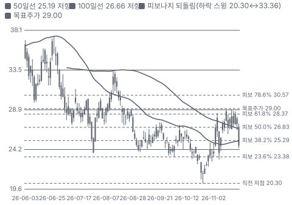

**주봉**

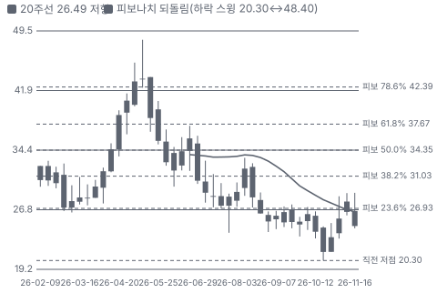

**월봉**

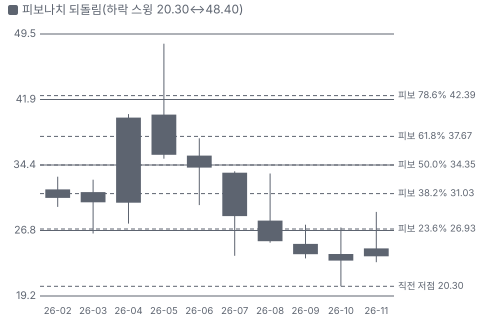

**분기 매출·EPS 실적과 컨센서스**

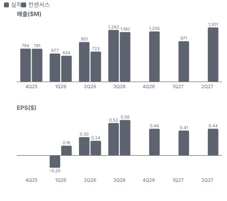

**4Q26 매출 — 지표 추세 vs 가이던스·컨센서스**

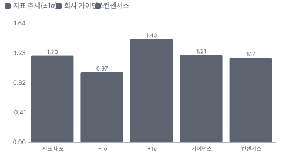

**EPS 리비전**

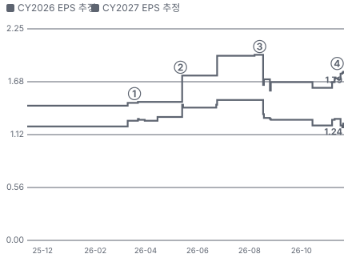

① 26-03-19 4Q25·FY2025 실적(상장 뒤 첫 발표)·FY2026 첫 가이던스 · EPS 리비전 +1%
② 26-05-12 1Q26 실적 · EPS 리비전 +19%
③ 26-08-13 2Q26 실적·가이던스 상향 · EPS 리비전 -15%
④ 26-11-12 3Q26 실적·가이던스 재상향·잔고 \$9.2B · EPS 리비전 +5%

**멀티플 프리미엄(Fwd 1Y EV/EBITDA, 최근 4개 분기말 절대값 — 대상 vs 동종 중앙값)**

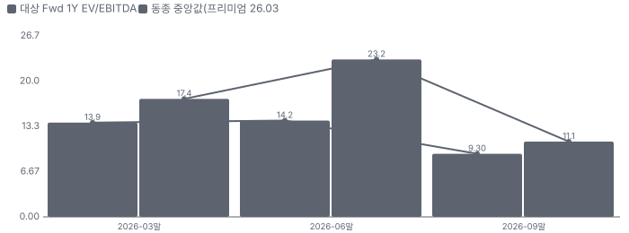

**합리적 멀티플**

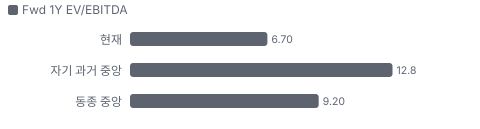

**밸류에이션 주가 시나리오**

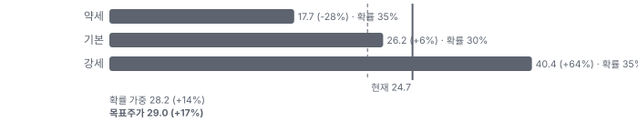

**주가별 업사이드**

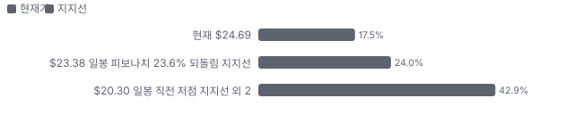
- 제품·서비스 포트폴리오

**고객 믹스(FY2025, 매출 대비)**

**공급 병목(10점, 낮을수록 병목)**

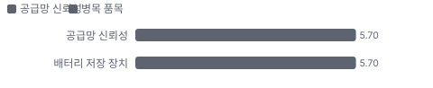

**생산능력 현재와 확충 계획(정규 인력(명))**

**CAPEX의 매출 대비 비중**

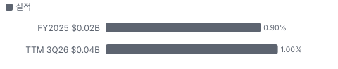

**어닝콜 변화별 주주가치 영향**

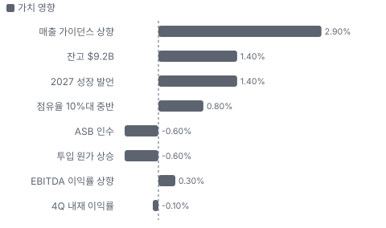

**수주·파이프라인 확실성 사다리**

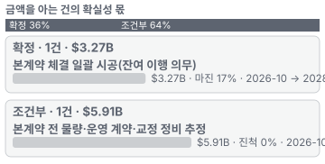

**매출 → 매출총이익 → 영업이익(매출 = 100, 최근 4분기)**

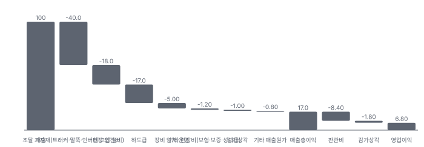

**분기 비용 비중 추이(매출 대비, 공시)**

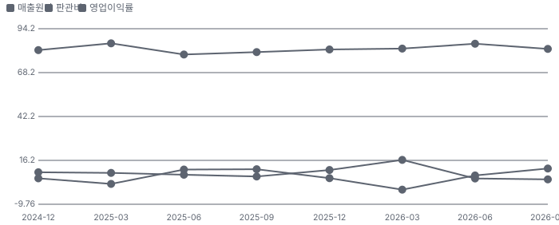

**비용 요인별 매출 대비 비중 1년 변화**

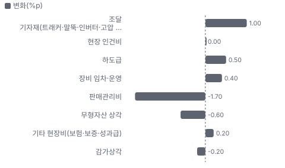

**신규 건설 BOM 원가 몫**

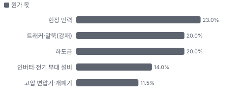

**기존 설비 서비스 BOM 원가 몫**

**BOM 항목 가격 +10% 시 OPM 변화**

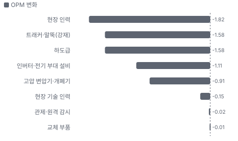

**원가 물가 vs 판매가 물가 — 최근 24개월**

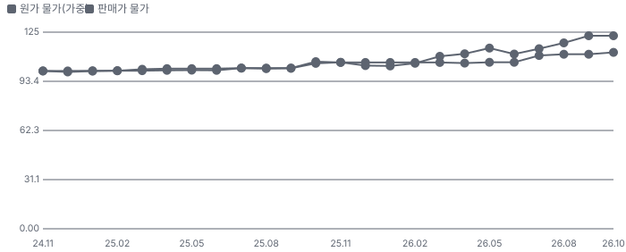

**자산 구성 — 2Q26 분기말 투하자본 \$446.8M**

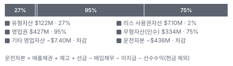

**자산별 변화율 — 최근 2개 분기(1Q26 = 0%)**

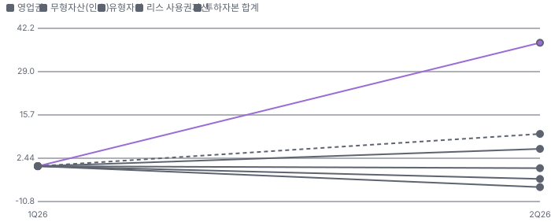

**Roberson Waite Electric 시너지 램프(종류별, 확률 가중) · 시너지 가치 \$0.01B**

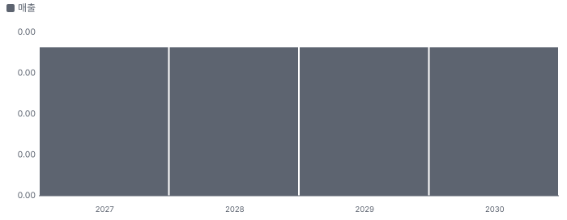

**ASB Energy Services 시너지 램프(종류별, 확률 가중) · 시너지 가치 \$0.01B**

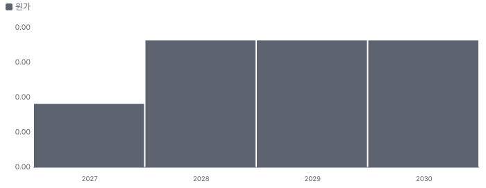

**매출 vs PPI·수출입 — 4Q24 = 100(변화율, 로그 눈금)**

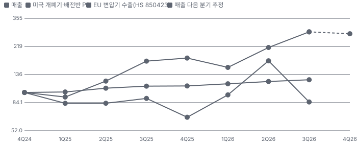

**매출 증가율의 가격·물량 분해와 8분기 전망(전년 대비)**

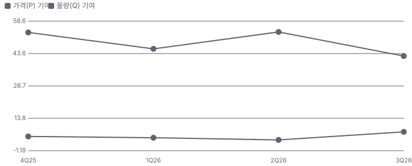

**목표주가 산정 — 기본과 강세 사이(강세 쪽 20%), 도달 확률 약 44%**

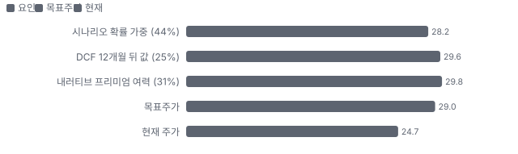

**PEG — 성장 대비 멀티플(낮을수록 성장 대비 쌈)**

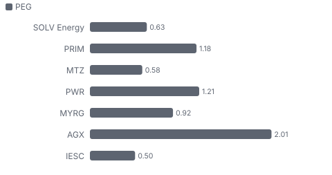

**일별 거래량 분해**

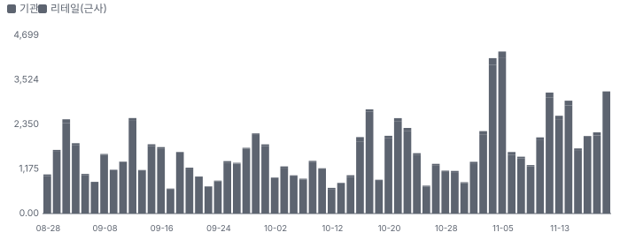

**기관 자금 흐름**

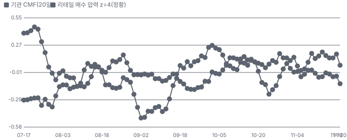

**몬테카를로**

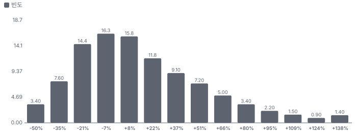

해석: 3,000번 중 1,774번(59%)에서 가치가 지금 주가 이상이었다. 지금 주가를 뒷받침하는 경우와 그렇지 않은 경우가 반반에 가깝다. 가운데 값은 1.08배이고, 열 번 중 여덟 번은 0.70~1.71배 사이에 든다.

## 내러티브

> **기업가치를 결정하는 이야기:** SOLV의 값은 '대형 태양광·저장 발전소를 몇 GW, 얼마의 이익률로 짓느냐'다. 매출은 잔고에서 12~18개월에 걸쳐 나오고, 이익률은 일괄 도급가에 넣은 예비비가 공사 끝에 얼마나 남느냐로 정해진다. 설비 투자가 매출의 1%라 이익이 거의 현금으로 남지만, 그 현금의 일부는 기존 주주 몫(LLC 분배·세금 수취 계약(상장 법인이 절감한 세금의 85%를 기존 주주에게 현금으로 돌려주는 계약))으로 나간다.

> **멀티플·EPS 프리미엄**
> **멀티플:** Fwd 1Y EV/EBITDA는 높은 쪽 추정 기준 6.7배, 컨센서스 기준 9.2배다(동종 중앙 9.2배) — 성장률이 동종의 두세 배인데 프리미엄이 없거나 오히려 할인이다.
> **EPS:** FY2026 조정 EBITDA 가이던스 \$525~540M, FY2027 컨센서스 \$523M~758M로 범위가 넓다.

### 투자자들은 왜 열광했나

2월 공모가 \$25로 상장한 뒤 5월 1Q 실적(매출이 컨센서스를 9% 상회)과 전력 수요 테마가 겹쳐 5/13 종가 \$46.77까지 올랐다. 식은 이유는 세 가지다. 5월 말과 8월 최대주주 지분 매각(5/29 거래량 988만 주), 수입 규제·세액공제 기한 걱정, 그리고 이익률 하락이다. 10/23 종가 \$21.38까지 내렸다가 선거일(11/3) +11.7% 반등했지만 11/20 하루 −9.2%로 다시 공모가 아래다(11/20 하락 원인 미확인).

### 무엇이 기업가치를 바꾸나

> **구조적 체질 변화**
> **변화:** 프로젝트가 커졌다 — 2Q에 잔고로 들어온 공사 평균이 약 450MW(1년 전 200MW 남짓)이고, 3Q 잔고에 600MW 초과 공사가 합계 5GW 넘게 있다.
> **증거:** 3Q26 어닝콜(2026-11-12)
> **반증:** 신규 유입 공사 평균 규모가 다시 줄어든다

> **고부가 믹스 확장**
> **변화:** 저장 설비가 들어간 공사가 잔고의 약 1/3(\$3.1B, 2Q \$2.5B)로 늘었고 송배전 매출이 +56%다. 이익률 차이는 회사가 밝히지 않았다.
> **증거:** https://www.sec.gov/Archives/edgar/data/2065636/000206563626000005/mwh-20260930.htm
> **반증:** 저장 관련 잔고가 줄어든다

> **기술 혁신**
> **변화:** 해당 없음(시공 회사 — 현장 로봇·자동화 도입을 말했지만 수치가 없고, 자체 인공지능 기술은 개발하지 않는다고 10-K에 적었다).

> **실행 속도**
> **변화:** 제한 착수 계약으로 지반·설계를 먼저 확인한 뒤 본계약을 맺고 12~18개월에 짓는다. 회사는 지연·취소가 없다고 답했다(3Q 콜). **납품 리드타임 12~18개월.** 피어 비교 미확인. 이전 대비 미확인.
> **증거:** https://www.sec.gov/Archives/edgar/data/2065636/000119312526124117/d31834d10k.htm
> **반증:** 잔여 이행 의무 인식 기간이 18개월을 넘는다

> **M&A**
> **변화:** 2025년 이후 네 건(SDI(SOLV가 2025년 1월 인수한 태양광 말뚝 천공·기초 시공사)·Spartan·Roberson Waite(SOLV가 2026년 7월 인수한 캘리포니아 변전소 시공사)·ASB)으로 말뚝 기초·송배전·변전소를 자체 시공으로 들였다. 건당 \$17M~67M의 작은 인수다.
> **증거:** https://www.sec.gov/Archives/edgar/data/2065636/000206563626000005/mwh-20260930.htm
> **반증:** 영업권 손상

> **정책·입법 연관성**
> **재정정책:** 청정에너지 세액공제가 고객 프로젝트 수익성의 한 축이다. 2025년 세제·지출법이 태양광 세액공제 기한을 앞당기고 우려 국가 부품 제한을 넓혔다(10-K). 회사는 잔고 전부가 착공 요건을 채웠다고 말했다(3Q 콜 — 회사 설명, 프로젝트별 확인 불가). https://www.sec.gov/Archives/edgar/data/2065636/000119312526124117/d31834d10k.htm 반증: 착공 요건 지침이 소급해 좁아진다 의회 동의 10/10 — 하원 5/5(2025년 세제·지출법이 하원 본회의를 통과해 시행 중(공제 축소 방향)) · 상원 5/5(같은 법이 상원 본회의를 통과해 시행 중).
> **행정명령:** 수입 규제(무역확장법 232조 조사·관세)가 기자재 가격을 올린다. 회사는 물량이 아니라 가격 문제이고 관세는 계약의 법령 변경 조항으로 고객에게 넘긴다고 설명한다. 2026년 2월 대법원이 비상경제권한법 관세 일부를 무효로 했다(10-Q). https://www.sec.gov/Archives/edgar/data/2065636/000206563626000005/mwh-20260930.htm 반증: 관세를 고객에게 넘기지 못한 손실 공사 공시 의회 동의 2/10 — 하원 1/5(의회 의결 없음 — 행정부 조치) · 상원 1/5(의회 의결 없음).
> **연관입법:** 선거 뒤 세액공제 연장 논의가 늘었다는 질문에 회사는 '정책이 아니라 전력 수요 사업'이라고 답했다(3Q 콜). 연장 법안은 발의·의결 단계를 확인하지 못했다 — 정책 0단계(선거 결과) 가설이다. 인허가 개혁 법안은 회사가 지지한다고만 밝혔다. 3Q26 어닝콜(2026-11-12) 반증: 새 의회에서 연장 법안이 발의되지 않는다

> **고객의 지출 예산**
> **변화:** 매출의 96%가 발전 사업자·개발사의 발전소 건설 CAPEX다. 운영·유지보수 3%만 고객 OPEX다.
> **사업별 예산:** **매출의 96%**: 신규 건설 — 고객 CAPEX(유틸리티 규모 태양광·저장 발전소·변전 설비 건설비) · 동인: 전력 장기 구매 계약 체결·세액공제 요건·금리
**매출의 3%**: 기존 설비 서비스 — 고객 OPEX(발전소 운영·정비 예산) · 동인: 운영 중 발전 용량
> **증거:** https://www.sec.gov/Archives/edgar/data/2065636/000206563626000005/mwh-20260930.htm
> **반증:** 발전 사업자의 착공 연기

### 내러티브 근거

> 'AI·제조업 전력 수요를 가장 빨리 채우는 전원은 태양광과 저장이고, 그 대형 발전소를 지을 수 있는 시공사는 몇 안 된다'는 이야기가 5월에 주가를 공모가의 1.9배까지 올렸다. 그 뒤 최대주주의 두 차례 지분 매각, 수입 규제와 세액공제 기한 걱정, 11월 선거 뒤 시장 급락이 겹쳐 공모가 아래로 돌아왔다. 실적과 가이던스는 세 분기 연속 올랐다 — 시장이 묻는 것은 '2027년 이후에도 이 이익률로 이만큼 짓느냐'다. 단계는 확산, 쏠림은 중간이다.

> **전력 수요와 가장 빠른 전원** · 유지
> **논리:** 데이터센터·제조업 전력 수요를 당장 채울 수 있는 것은 태양광과 저장이고 가스는 2028년 이후에 몰린다
> **숫자:** 9개월 매출 +69%, 총 잔고 2024년 말 \$4.28B → \$9.18B
> **반증:** 총 잔고가 2개 분기 연속 감소
> **출처:** https://www.sec.gov/Archives/edgar/data/2065636/000119312526456918/d255358dex991.htm

> **대형 시공사로 쏠림** · 강화
> **논리:** 발전소가 커질수록 지을 수 있는 시공사가 줄어 점유율과 조건이 좋아진다
> **숫자:** 잔고 안 600MW 초과 공사 합계 5GW 이상, 점유율 '10%대 중반'(콜)
> **반증:** 분기 신규 수주가 매출을 밑돈다
> **출처:** 3Q26 어닝콜(2026-11-12)

> **가이던스 연속 상향** · 유지
> **논리:** 상장 뒤 세 번 발표에 두 번 가이던스를 올렸다 — 보수적으로 내고 넘긴다
> **숫자:** FY2026 매출 가이던스 5월 \$3.72~3.82B → 8월 \$3.87~3.97B → 11월 \$4.03~4.12B
> **반증:** 4Q 매출이 내재값 \$1.205B(계산)을 밑돈다
> **출처:** https://www.sec.gov/Archives/edgar/data/2065636/000119312526456918/d255358dex991.htm

> **시공에서 운영·변전으로** · 유지
> **논리:** 운영·유지보수 24GW와 변전소 인수로 반복 매출과 자체 시공 범위가 넓어진다
> **숫자:** 기존 설비 매출 3Q \$37.8M(매출의 3.0%), 송배전 \$66.9M(+56%)
> **반증:** 기존 설비 매출 비중이 3% 아래에서 더 내려간다
> **출처:** https://www.sec.gov/Archives/edgar/data/2065636/000206563626000005/mwh-20260930.htm

> **반대: 정책 기한과 이익률 정점** · 강화
> **논리:** 세액공제 착공 기한 전에 물량이 앞당겨졌고 이익률은 이미 내려오는 중이다 — 2027년 이후 수주와 이익률이 꺾일 수 있다
> **숫자:** 조정 EBITDA 이익률 3Q 13.9%(작년 16.1%), 4Q 내재 약 12.4%. 본계약분 \$3.27B ÷ 총 잔고 \$9.18B = 36%
> **반증:** FY2027 가이던스가 매출 \$4.8B 이상·조정 EBITDA 이익률 13% 이상
> **출처:** https://www.sec.gov/Archives/edgar/data/2065636/000206563626000005/mwh-20260930.htm

> **반대: 최대주주 물량** · 유지
> **논리:** 사모펀드 최대주주가 아직 전체의 약 39%를 들고 있고 상장 뒤 두 번 팔았다
> **숫자:** 6/1 약 770만 주·8/19 약 794만 주 매각(Form 4(미국 내부자 주식 거래 공시)), 남은 지분 7,805만 주(13F)
> **반증:** 추가 매각 없이 2개 분기
> **출처:** https://www.sec.gov/Archives/edgar/data/2065636/000119312526248671/d150146d424b4.htm

### 투자 포인트

> **성장률은 동종의 두세 배, 배수는 동종 이하**
> **명제:** 매출이 +71% 느는 회사가 동종 중앙값 이하의 배수에 거래된다
> **숫자:** Fwd 1Y EV/EBITDA 6.7배(높은 쪽 추정)~9.2배(컨센서스), 동종 중앙 9.2배. TTM 매출 +71%, FY2026 가이던스 두 번 상향
> **시장과 다른 점:** 시장은 2026년을 세액공제 기한 전 앞당김으로 보고 2027년을 깎는다 — 애널리스트 FY2027 EBITDA \$523M은 FY2026 가이던스 중간값 \$532.5M보다 낮다. 회사는 2027년 '의미 있는 성장'을 말했다
> **증명:** FY2027 첫 가이던스의 조정 EBITDA 중간값이 \$560M 이상
> **출처:** https://www.sec.gov/Archives/edgar/data/2065636/000119312526456918/d255358dex991.htm

> **잔고 \$9.18B의 3분의 1만 본계약이다**
> **명제:** 총 잔고의 대부분은 가격을 합의한 본계약 전 물량이다
> **숫자:** 잔여 이행 의무 \$3.27B(10-Q) vs 총 잔고 \$9.18B. 2025년 말 총 잔고의 68%가 본계약 전 물량(10-K)
> **시장과 다른 점:** 헤드라인 잔고만 보면 2년 반치 매출이 잠긴 것처럼 보이지만, 묶인 것은 약 11개월치다 — 대신 회사 정의는 구두 수주를 넣지 않아 본계약 전환 이력은 좋았다(잔고 → 매출 +69%)
> **증명:** FY2026 10-K의 연말 잔고 구성 — 본계약분이 \$3.5B 이상으로 늘었나
> **출처:** https://www.sec.gov/Archives/edgar/data/2065636/000206563626000005/mwh-20260930.htm

> **약한 고리 — 내려오는 이익률과 견적 변경**
> **명제:** 이익률이 정점을 지났을 수 있다
> **숫자:** 조정 매출총이익률 19.7% → 17.3%, 조정 EBITDA 이익률 16.1% → 13.9%, 4Q 내재 약 12.4%. 3Q 매출에 견적 변경 +\$103.1M(작년 \$52.2M)
> **시장과 다른 점:** -
> **증명:** 4Q 조정 EBITDA가 내재값 \$149.6M(계산) 이상이고 FY2027 이익률 가이던스가 13% 이상
> **출처:** https://www.sec.gov/Archives/edgar/data/2065636/000206563626000005/mwh-20260930.htm

### 모멘텀 생성·소멸 타임라인

**카탈리스트 달력 — 지난 사건의 주가 반응과 앞으로 확인할 숫자**
| 날짜 | 상태 | 구분 | 사건 | 반응·확인 | 결과에 따라 |
|---|---|---|---|---|---|
| 2026-02-12 | 완료 | 생성 | 나스닥 상장(공모가 \$25.00) | 첫날 종가 \$30.91 |  |
| 2026-03-19 | 완료 | 소멸 | 4Q25 실적·FY2026 첫 가이던스 | 당일 −5.8% |  |
| 2026-05-12 | 완료 | 생성 | 1Q26 실적 — 매출이 컨센서스를 9% 상회 | 당일 +2.3%, 5/13 종가 고점 \$46.77 |  |
| 2026-05-29 | 완료 | 소멸 | 최대주주 지분 매각 공모 가격 결정 | 당일 −3.2%, 거래량 988만 주 |  |
| 2026-08-13 | 완료 | 생성 | 2Q26 실적·가이던스 상향 | 당일 +8.8% |  |
| 2026-08-19 | 완료 | 소멸 | 최대주주·경영진 지주 법인 지분 매각(Form 4) | 8/20 −3.5% |  |
| 2026-11-03 | 완료 | 매크로 | 중간선거일 — 청정에너지 세액공제 축소 위험 완화 기대 | 당일 +11.7%, 이틀 뒤 −9.6% |  |
| 2026-11-12 | 완료 | 소멸 | 3Q26 실적·가이던스 재상향 — 4Q 내재 이익률이 낮다 | 당일 −2.9% |  |
| 2026-11-20 | 완료 | 매크로 | 하루 급락(원인 미확인, 변동성 지수 28대) | 당일 −9.2%, 종가 \$24.69 |  |
| 2026-12-10 | 예정 | 매크로 | 텍사스 전력망 대형 부하 접속 관련 결정(업계 자료상 예정) | 대형 부하·발전 접속 절차가 늦춰지는가 | 지연이면 텍사스 물량(ASB 거점) 착공이 밀려 약세 쪽, 절차 재개면 중립 |
| 2027-03-18(추정) | 예정 | 확인 | 4Q26 실적·FY2027 첫 가이던스·연말 잔고 구성 | FY2027 조정 EBITDA 가이던스 중간값 \$560M 이상, 4Q 조정 EBITDA \$149.6M 이상, 본계약 잔고 \$3.5B 이상 | 모두 넘으면 기본~강세, 가이던스가 FY2026 수준(\$532.5M) 이하면 약세 |
| 2027-05-12(추정) | 예정 | 확인 | 1Q27 실적 | 총 잔고가 \$9.18B 위에서 유지되는가 | 잔고 감소가 2개 분기 이어지면 약세 |

### 언제 사서 언제 팔아야 할까?

**가격·조건 틀 — 가격은 밸류에이션(약세·기본·강세·목표주가)과 차트 지지 구간에서, 조건은 이벤트에서**
| 구간 | 가격 | 목표주가까지 | 약세까지 | 조건·근거 |
|---|---|---|---|---|
| 관찰 구간 | \$23~\$23 | +24% | -24% | 10/23 종가 저점 \$21.38 부근 — 공모가 \$25 아래에서 처음 만든 지지 구간 |
| 확인 뒤 | 지금 \$25 이상에서 조건 확인 | +17% | -28% | FY2027 조정 EBITDA 가이던스 중간값 \$560M 이상, 총 잔고 \$9.18B 유지, 최대주주 추가 매각 소화 |
| 무효화 | 약세 시나리오 \$18 | - | -28% | 10/23 종가 저점 \$21.38 이탈, 또는 FY2027 가이던스가 FY2026 조정 EBITDA \$532.5M 이하 |
| 차익 고민 1차 | \$29(목표주가) | +17% | - | 목표주가 근처에서는 이익률 가이던스와 최대주주 매각 일정을 다시 본다 |
| 차익 고민 2차 | \$40(강세 시나리오) | +64% | - | 목표주가 근처에서는 이익률 가이던스와 최대주주 매각 일정을 다시 본다 |

11월에만 하루 ±9% 넘는 움직임이 세 번(11/3 +11.7%·11/5 −9.6%·11/20 −9.2%) 있었다. 최대주주 매각 공모 때 거래량이 평소의 3~5배로 늘며 눌렸다 — 이벤트 직전 추격을 경계한다 가격·조건 틀이며 매매·비중 지시가 아니다(투자 권유 아님).

## 포트폴리오

| 제품·서비스 | 구분 | 무엇 | 쓰는 곳 | 돈 버는 방식 | Mix | Mix 변화(전년 대비) |
|---|---|---|---|---|---|---|
| 신규 건설 | 시공 인도물 | 유틸리티 규모 태양광·저장 발전소와 변전소 일괄 시공 | 발전 사업자·개발사·유틸리티 | 3Q26 매출의 96% | 96% | 미확인 |
| 기존 설비 서비스 | 서비스 | 발전소 원격 관제·정비·수리·리파워링 | 운영 중 태양광·저장 발전소 소유주 | 3Q26 매출의 3% | 3% | 미확인 |

**Mix 변화가 가장 큰 쪽은 태양광·저장 혼합 EPC(+2.9%p, 전년 대비).** 계절성 판정: 분기 매출 계절 지수 기준 있음 → 전년 같은 분기와 비교.

## 고객

> **FY2025 최대 고객 최대 고객(이름 미공시) 14%, 상위 3곳 14%, 집중도 분산.** 공시·회사 발표로 확인한 몫은 매출의 14%이고, 나머지 고객 몫은 추정이거나 미분해다. 고객은 발전 프로젝트 개발사·민간 발전 사업자·유틸리티다. 2025년 최대 고객이 매출의 약 14%였고, 상위 10곳을 합치면 약 73%였다(10-K). 이름은 공시되지 않았고 3Q26 분기보고서에는 고객 집중 공시가 없다. 계약은 짧은 통지로 해지될 수 있다고 회사가 적었다 — 상위 고객 한두 곳의 착공 일정이 분기 매출을 좌우한다.

**고객별 매출 몫(FY2025)**
| 고객 | 몫 | 변화 | 근거 |
|---|---|---|---|
| 최대 고객(이름 미공시) | 14% | 미확인 | 공시 |
| 기타·미분해 | 86% | - | - |

> **최대 고객(이름 미공시)** · 공시
> **사는 것:** 유틸리티 규모 태양광·저장 발전소 일괄 시공
> **추정 근거:** 10-K 'Customers' — 2025년 매출의 약 14%

## 수주·파이프라인

> **2026-09-30 기준 2건.** 확정 \$3.27B, 미확정 \$5.91B. 공시 총 잔고(회사 정의) \$9.18B.

**수주 목록**
| 상태 | 계약 | 계약 총액 | 진척 | 기간 | 비고 |
|---|---|---|---|---|---|
| 확정 | 본계약 체결 일괄 시공(잔여 이행 의무) | \$3.27B | - | 2026-10 → 2028-03 | - |
| 조건부 | 본계약 전 물량·운영 계약·교정 정비 추정 | \$5.91B | 0% | 2026-10 → 미확인 | 총 잔고 \$9.18B − 잔여 이행 의무 \$3.27B(계산). 3Q 구성은 미공시 — 2025년 말에는 본계약 전 물량 \$5.46B·운영 계약 최소분 \$0.31B·교정 정비 추정 \$0.23B |

**실행 속도와 방해 요인**
| 항목 | 상태 | 실행 속도 | 방해 요인 |
|---|---|---|---|
| 본계약 체결 일괄 시공(잔여 이행 의무) | 확정 | 거의 전부 12~18개월 안에 매출 인식(10-Q) | 발주처 착공 지연 · 기자재 납기 · 기상 |
| 본계약 전 물량·운영 계약·교정 정비 추정 | 조건부 | 제한 착수 계약 → 본계약 → 12~18개월 시공(10-K) | 고객 착공 지시 · 세액공제 착공 기한·우려 국가 부품 규정 · 인허가·계통 연결 |

## 마진 구조

> **GPM 17.8%, OPM 11.4%.** 3Q25 대비 GPM -1.9%p, OPM +0.5%p. 변동비는 매출의 77%이고, 매출이 10% 늘면 OPM은 +1.1%p 움직인다. 3Q26 매출총이익률 17.8%, 영업이익률 11.4%다. 1년 전(19.7%, 11.0%)보다 매출총이익률은 1.9%p 내려갔다 — 작년 3Q에 준공 단계 공사의 예비비 환입과 큰 수리 공사가 있었고, 2026년부터 성과급·주식 보상 일부를 매출원가로 옮겨 적은 영향이다(10-Q). 판관비와 상각 비중이 8.7%에서 6.3%로 내려가 영업이익률은 올랐다. 3Q 매출에는 진행 중 공사의 견적 변경으로 늘어난 \$103.1M(작년 \$52.2M)이 들어 있다 — 이익률이 예비비 환입 시점에 따라 분기마다 흔들린다는 뜻이다.

> **매출 100 중 매출원가 83.0, 매출총이익 17.0(최근 4분기, 공시).** 매출원가 요인 중 조달 기자재(트래커(태양광 패널이 해를 따라 기울도록 하는 구동 지지대)·말뚝·인버터·고압 설비)이 매출의 40.0%로 가장 무겁고, 단가가 +10% 오르면 GPM이 -4.00%p 움직인다. 분기 회귀로 매출 1이 늘 때 매출원가는 0.83 늘고, 매출원가의 고정비 몫은 -1%다.

**비용 요인 강도 — 비중·추세·충격(+10%)·탄력**
| 비용 | 구분 | 매출 대비 | 1년 변화 | 마진 기여 | 충격 시 마진 | 매출 탄력 | 고정비 몫 |
|---|---|---|---|---|---|---|---|
| 조달 기자재(트래커·말뚝·인버터·고압 설비) | 매출원가 요인 | 40.0% | +1.0%p | -1.0%p | -4.00%p | 미확인 | 0% |
| 현장 인건비 | 매출원가 요인 | 18.0% | +0.0%p | -0.0%p | -1.80%p | 미확인 | 20% |
| 하도급 | 매출원가 요인 | 17.0% | +0.5%p | -0.5%p | -1.70%p | 미확인 | 0% |
| 장비 임차·운영 | 매출원가 요인 | 5.0% | +0.4%p | -0.4%p | -0.50%p | 미확인 | 30% |
| 기타 현장비(보험·보증·성과급) | 매출원가 요인 | 1.2% | +0.2%p | -0.2%p | -0.12%p | 미확인 | 50% |
| 감가상각 | 매출원가 요인 | 1.0% | -0.2%p | +0.2%p | -0.10%p | 미확인 | 100% |
| 매출원가 | 공시 항목 | 83.0% | +1.8%p | -1.8%p | -8.30%p | 0.83 | -1% |
| 판관비 | 공시 항목 | 8.4% | +0.6%p | -0.6%p | 미확인 | 0.03 | 67% |
| 감가상각 | 공시 항목 | 1.8% | -1.0%p | +1.0%p | 미확인 | 0.00 | 84% |

매출 탄력 = 분기 비용을 매출에 회귀한 기울기(매출 1당 변동비), 고정비 몫 = 절편 ÷ 평균 비용. 표본이 8분기 미만이면 미확인. 매출원가 요인 비중은 margin 재료의 추정이 섞여 있고, 공시 매출원가와의 차이는 '기타 매출원가'로 둔다.

**GPM에서 OPM까지(GAAP — 10-Q 3개월 손익. 판관비 칸은 판매관리비 + 무형자산 상각. 매출원가 요인은 회사가 나누지 않아 감가상각 외에는 추정, 아래는 최근 4개 분기)**
| 기간 | GPM | 연구개발 | 판관비 | 기타 | OPM |
|---|---|---|---|---|---|
| 3Q25 | 19.7% | 0.0% | 8.7% | 0.0% | 11.0% |
| 3Q26 | 17.8% | 0.0% | 6.3% | 0.0% | 11.4% |
| 2025-12 | 18.1% | - | - | - | 5.7% |
| 2026-03 | 17.6% | - | - | - | -1.1% |
| 2026-06 | 14.7% | - | - | - | 7.3% |
| 2026-09 | 17.8% | - | - | - | 11.4% |

**비용을 움직이는 요인**
| 비용 | 요인 |
|---|---|
| 조달 기자재(트래커·말뚝·인버터·고압 설비, 매출원가) | 프로젝트 규모·기자재 단가·관세 · 근거 추정 |
| 현장 인건비(매출원가) | 전기공·현장 인력 임금과 생산성 · 근거 추정 |
| 하도급(매출원가) | 자체 시공 범위(인수로 축소 중) · 근거 추정 |
| 장비 임차·운영(매출원가) | 중장비 임차료·연료 · 근거 추정 |
| 판매관리비(판관비) | 본사 인력·상장사 비용·주식 보상 · 근거 공시 |
| 무형자산 상각(판관비) | 인수 무형자산(고객 관계·상표) · 근거 공시 |
| 기타 현장비(보험·보증·성과급, 매출원가) | 보험·보증 수수료, 2026년부터 매출원가로 옮긴 성과급 · 근거 추정 |
| 감가상각(매출원가) | 자가 장비 · 근거 공시 |

**신규 건설 BOM — 매출의 96%, GPM 18%(추정 — 서비스별 매출총이익을 공시하지 않아 회사 전체 3Q26 매출총이익률 17.8%를 쓴다), 항목 가격 +10% 시**
| 항목 | 원가 몫 | 전가 | 제품 GPM | OPM |
|---|---|---|---|---|
| 현장 인력 | 18~28% | 미확인 | -1.9%p | -1.82%p |
| 트래커·말뚝(강재) | 15~25% | 미확인 | -1.6%p | -1.58%p |
| 하도급 | 15~25% | 미확인 | -1.6%p | -1.58%p |
| 인버터·전기 부대 설비 | 10~18% | 미확인 | -1.2%p | -1.11%p |
| 고압 변압기·개폐기 | 8~15% | 미확인 | -0.9%p | -0.91%p |
| 미분해 | 12% | - | - | - |

**기존 설비 서비스 BOM — 매출의 3%, GPM 18%(추정 — 미공시. 회사는 운영·유지보수가 신규 건설보다 이익률이 높다고만 적었다(10-K)), 항목 가격 +10% 시**
| 항목 | 원가 몫 | 전가 | 제품 GPM | OPM |
|---|---|---|---|---|
| 현장 기술 인력 | 50~70% | 미확인 | -4.9%p | -0.15%p |
| 교체 부품 | 10~25% | 90% | -0.4%p | -0.01%p |
| 관제·원격 감시 | 5~15% | 미확인 | -0.8%p | -0.02%p |
| 미분해 | 12% | - | - | - |

현장 인력 가격이 +10% 오르면 영업이익은 -15.9% 움직인다. 판매가 전가를 모르는 항목은 전가 0%로 계산했다.

**BOM 항목 가격을 움직이는 것**
| 항목 | 요인 |
|---|---|
| 트래커·말뚝(강재) | 철강 가격·관세 · 근거 추정 |
| 인버터·전기 부대 설비 | 전력 반도체·구리 가격 · 근거 추정 |
| 고압 변압기·개폐기 | 납기가 긴 변전 기자재 가격 · 근거 추정 |
| 현장 인력 | 숙련 전기공 임금 · 근거 추정 |
| 하도급 | 토목·기초 등 외주 범위 · 근거 추정 |
| 현장 기술 인력 | 상주·순회 정비 인력 · 근거 추정 |
| 교체 부품 | 교정 정비는 원가에 이윤을 붙여 청구(10-K) · 근거 추정 |
| 관제·원격 감시 | 관제 센터 운영비 · 근거 추정 |

> **원가·판매가 물가 격차 -12.2%p** — 판매가 물가가 투입 원가 물가보다 느리게 오른다.

**투입 물가 — 미국 PPI 3·6·12개월(2026-10, 개정 반영)과 해외 전년비**
| 항목 | 미국 3개월 | 6개월 | 12개월 | 전가 못 할 때 OPM | 일본 | 한국 | 대만 |
|---|---|---|---|---|---|---|---|
| 트래커·말뚝(강재) | +2.4% | +8.1% | +13.1%* | - | 미확인 | 미확인 | 미확인 |
| 인버터·전기 부대 설비 | +3.4% | +7.2% | +23.9% | - | +42.6% | +19.2% | +40.1% |
| 고압 변압기·개폐기 | +1.9% | +6.5% | +5.6% | - | -1.5% | +14.3% | +10.6%* |
| 장비 임차·운영 | +38.6% | +30.2% | +115.2% | -5.8%p | 미확인 | 미확인 | 미확인 |

별표는 품목보다 넓은 업종 지수다. 연결한 투입 원가의 미국 PPI(생산자물가지수)는 1년 새 가중 +17.8%이고, 판매가로 넘기지 못하면 GPM -8.0%p·OPM -8.0%p가 움직인다. 판매가 비교 물가(변압기 PPI)는 1년 새 +5.6% — 회사 가격 변화는 미확인. 물가 지수를 붙이지 못한 매출원가 항목은 현장 인건비, 하도급, 감가상각다(미연결).

## 자산 구성

> **2Q26 분기말 투하자본 \$446.8M** — 영업권 95%, 무형자산(인수) 75%. 최근 2개 분기(1Q26 → 2Q26) 가장 크게 늘어난 자산은 매출채권(+38%), 투하자본 합계 +10%.

**자산·운전자본 항목별 분기말 잔액 — 최근 12개 분기와 다음 4개 분기 추정**
| 항목 | 1Q26 | 1년 전 | 2Q26(최근) | 추정 | 2개 분기 변화 | 다음 4개 분기 변화 |
|---|---|---|---|---|---|---|
| 매출채권 | \$285.0M | 미확인 | \$392.8M | — | +38% | — |
| 선급·기타 유동자산 | \$105.5M | 미확인 | \$110.2M | — | +4% | — |
| 미지급비용 | \$524.9M | 미확인 | \$680.5M | — | +30% | — |
| 선수수익(계약부채) | \$346.3M | 미확인 | \$258.2M | — | -25% | — |
| 유형자산 | \$116.1M | 미확인 | \$122.3M | — | +5% | — |
| 리스 사용권자산 | \$7.6M | 미확인 | \$7.1M | — | -6% | — |
| 영업권 | \$429.0M | 미확인 | \$426.6M | — | -1% | — |
| 무형자산(인수) | \$347.5M | 미확인 | \$333.9M | — | -4% | — |

**유형·무형자산 항목별 가치(2026-06-30 vs 2026-03-31)**
| 구분 | 항목 | 총액 2026-06-30 | 누적상각 | 순액 | 총액 2026-03-31 | 총액 1년 변화 | 공시 내용연수 |
|---|---|---|---|---|---|---|---|
| 유형 | 유형자산 합계(항목 미분해) | \$200.8M | 총계만 공시 | 총계만 공시 | \$186.1M | +7.9% | 미확인 |
| 영업권 | 영업권 | \$426.6M | \$0.0M | \$426.6M | \$429.0M | -0.6% | 비상각 |
| 무형 | 무형자산 합계(항목 미분해) | \$592.2M | −\$258.3M | \$850.4M | \$650.8M | -9.0% | 미확인 |
| 유형 합계 | 유형자산 | \$200.8M | \$78.5M | \$122.3M | \$186.1M | +7.9% | 경과율 39%(상각 대상 기준) |

**분기 감가 비율(감가상각 ÷ 평균 유형자산 총액)**
| 분기 | 감가상각 | 평균 유형자산(총액) | 분기 비율 | 연율 | 연율의 역수 |
|---|---|---|---|---|---|
| 2Q26 | \$26.8M | \$193.5M | 13.83% | 55.33% | 1.8년 |

감가상각 기준: 손익계산서 감가상각·상각비(SEC 공시 데이터, 4분기 = 연간 − 1~3분기).

미공시·미분해: 분기 감가상각·유형자산(순액) 9분기 · 분기 매출·영업이익 8분기 · 유형자산 항목별 총액·내용연수(10-K 주석에서 모델이 채움) · 무형자산 항목(10-K 주석에서 모델이 채움) — 이 칸은 비우고 나머지로 계산했다.

## 공급망 병목

> **공급망 신뢰성 5.7/10, 병목 주의.** 가장 약한 고리는 배터리 저장 장치 5.7점이고, 품목 평균은 5.7점이다. 근거가 부족한 4건(고압 변압기·개폐기 · 트래커·말뚝(강재) · 인버터·전기 부대 설비 · 숙련 전기공·현장 인력)은 점수에서 뺐다. 공급사 이름은 공시되지 않는다. 회사는 주요 품목마다 공급사가 여럿이고 특정 공급사 의존이 크지 않다고 적었다(10-K). 수입 기자재의 관세는 계약의 법령 변경 조항으로 고객에게 넘기는 것이 보통이다. 약한 고리는 자재보다 사람과 규정이다 — 숙련 전기공, 그리고 세액공제 요건(우려 국가 부품 제한) 때문에 고객이 고를 수 있는 배터리·모듈 공급사가 줄어드는 점이다.

**병목과 마진 — 품목 가격 +10% 시 OPM**
| 품목 | 점수 | 판정 | 구분 | OPM |
|---|---|---|---|---|
| 배터리 저장 장치(필수) | 5.7 | 병목 주의 | 출하 차질 위험 | 미확인 |

> **배터리 저장 장치** · 5.7/10
> **왜:** 잔고의 약 1/3이 저장 관련이다. 우려 국가 부품 제한과 관세가 고객의 조달·착공 일정을 흔들 수 있다(10-K 위험 요인, 3Q 콜 질문). 전력망용 저장 배터리는 중국산 비중이 90%를 넘는다는 업계 추정이 있어 지역 집중이 가장 크다
> **병목 요인:** 인증 공급사 2곳 · 캐파 균형 · 리드타임 미확인 · 재인증 미확인 · 1위 점유율 미확인 · 중국(전력망용 저장 배터리 — 업계 추정 90% 이상) 집중 90% · 물량 확보 복수구매
> **풀리는 조건:** 미확인

**공급사**
| 품목 | 공급사 | 몫 | 근거 |
|---|---|---|---|
| 고압 변압기·개폐기 | 주요 전력 기자재 업체(미공개, 기자재) | 미확인 | 추정 |
| 트래커·말뚝(강재) | 주요 트래커·강재 업체(미공개, 기자재) | 미확인 | 추정 |
| 인버터·전기 부대 설비 | 주요 인버터 업체(미공개, 기자재) | 미확인 | 추정 |
| 배터리 저장 장치 | 배터리 시스템 업체(미공개 — 고객이 직접 조달하는 경우 포함, 기자재) | 미확인 | 추정 |
| 숙련 전기공·현장 인력 | 자체 고용(단체협약 48건·약 750명 포함, 인력) | 미확인 | 공시 |

**무역 통계로 본 공급 지역**
| 품목 | EU 수입처 | 일본 수입처 | EU 1위 전년비 |
|---|---|---|---|
| 고압 변압기·개폐기 | CN(중국) 85% · KR(한국) 9% · VN(베트남) 3% | 中華人民共和国 65% · 大韓民国 19% | +27.7% |
| 트래커·말뚝(강재) | VN 99% · CN 1% · JP 0% | 台湾 63% · 中華人民共和国 21% | 미확인 |
| 인버터·전기 부대 설비 | MY(말레이시아) 77% · KR 11% · VN 7% | マレーシア 58% · タイ 36% | 미확인 |
| 배터리 저장 장치 | CN 92% · US 3% · KR 2% | 中華人民共和国 93% · 大韓民国 3% | +39.8% |

## 생산능력

> **현재 명목 캐파 2,600 정규 인력(명), 가동률 미확인.** 착공 이상 증설은 0 정규 인력(명), 발표까지 합치면 0 정규 인력(명)이다. 다 가동하면 지금보다 +0%, 착공 이상만이면 +0%다. TTM 3Q26 CAPEX는 \$0.04B로 매출의 1.0%다. 시공 회사라 생산능력은 사람이다. 2025년 말 정규 인력 약 2,600명(현장 약 1,950명), 40개 주 시공 면허다(10-K). 그 뒤 Roberson Waite·ASB 인수와 채용으로 늘었지만 최신 인원은 공시되지 않았다. 사무소 15곳은 모두 임차이고 소유 공장은 없다. 설비 투자는 9개월 \$27.0M로 매출의 0.9%에 그친다 — 성장을 묶는 것은 돈이 아니라 인력과 발주처의 착공 지시다.

**생산시설 15곳**(10-K Item 2 Properties — 샌디에이고 본사를 포함한 지역 거점 15곳, 모두 임차. 이름이 공시된 곳은 2곳) — 이름·위치를 밝힌 곳 2곳, 임차 2곳. 시설별 생산능력은 1곳만 공개됐다.

**생산시설 15곳 — 명칭·위치·생산능력**
| 시설 | 위치 | 용도 | 생산능력 | 소유·상태 |
|---|---|---|---|---|
| 본사·운영 관제 센터 | 미국 캘리포니아 샌디에이고(16680 West Bernardo Drive) | 본사·24시간 발전소 원격 관제 | 24 GW(운영·유지보수 계약 용량) | 임차 · 가동 |
| 벤드 사무소(예비 관제 센터) | 미국 오리건 벤드 | 지역 사무소·예비 관제 센터 구축 중 | 미확인 — 미공시 | 임차 · 증설 중 |

**생산능력 확충 계획**
| 계획 | 단계 | 증설 | 가동 시점 | CAPEX |
|---|---|---|---|---|
| 오리건 벤드 예비 관제 센터 | 착공 | 미확인 | 미확인 | 미확인 |

남은 계획의 CAPEX 합계는 \$0.00B(금액 미확인 1건 제외)다. 합계는 TTM 3Q26 매출의 0%다.

**증설 방해 요인**
| 계획 | 방해 요인 |
|---|---|
| 오리건 벤드 예비 관제 센터 | 미확인 |

**CAPEX와 매출 대비**
| 기간 | CAPEX | 매출 | 매출 대비 | 구분 |
|---|---|---|---|---|
| FY2025 | \$0.02B | \$2.49B | 0.9% | 실적 |
| TTM 3Q26 | \$0.04B | \$3.66B | 1.0% | 실적 |

## M&A 시너지

> **Roberson Waite Electric 인수(2026-07-01, \$0.05B): 시너지가 다 나면 연 \$0.00B(확률 가중 이익 기여).** 세후 시너지 가치는 통합 비용을 빼고 \$0.01B.

**Roberson Waite Electric 시너지가 생기는 길**
| 종류 | 시너지 | 연 규모 | 완성 | 확률 | 어떻게 생기나 | 근거 |
|---|---|---|---|---|---|---|
| 매출 | 캘리포니아 유틸리티 변전소 공사 직접 수행 | \$0.03B(이익률 12%) | 2028 | 30% | 하도급으로 주던 변전소 시공·시험·시운전을 자체 인력으로 하고, 캘리포니아 유틸리티 고객에게 저장 설비 공사를 함께 판다 | 추정 — 회사는 '캘리포니아 유틸리티와의 오랜 관계·변전소 일괄 시공'만 밝히고 규모를 밝히지 않았다(10-Q) |

> **ASB Energy Services 인수(2026-10-30, \$0.04B): 시너지가 다 나면 연 \$0.00B(확률 가중 이익 기여).** 세후 시너지 가치는 통합 비용을 빼고 \$0.01B.

**ASB Energy Services 시너지가 생기는 길**
| 종류 | 시너지 | 연 규모 | 완성 | 확률 | 어떻게 생기나 | 근거 |
|---|---|---|---|---|---|---|
| 원가 | 변전소 기초·토목 자체 시공 | \$0.01B | 2028 | 30% | 텍사스에서 하도급으로 주던 변전소 기초·토목·저장 설비 기반 공사를 자체 수행해 하도급 이윤을 안으로 가져온다 | 추정 — 회사는 '고압 자체 시공 역량·텍사스 거점 확대'만 밝혔다(3Q26 보도자료) |

그림의 구성 요소(대상 순이익·시너지·인수 차입 이자·신주 희석)를 더하면 EPS 효과 합계다. 시너지는 세후·확률 가중이다. 시너지 가치 = 세후 이익 기여 5년 + 말기 가치(할인율 9%, 성장 0) − 통합 비용. 매출 시너지는 그 매출의 이익률만 반영하고, 모든 시너지에 실현 확률을 곱했다.

## 피터 린치 분류

> **고성장주(Fast Grower), 중형.** 린치 표의 기대 수익 10~100배, 하방 -80~100%, 위험 고. 10배 경로가 있는 분류다(고성장주·회생주·경기순환주).

**분류 근거 — 크기 먼저, 다음은 이야기 유형**
| 항목 | 값 |
|---|---|
| 크기 | 중형(시가총액 \$5.0B) |
| 장기 성장 | 48.5%(컨센서스 EPS 2년 CAGR) |
| 린치 비율((성장% + 배당%) ÷ P/E) | 3.63 — 2 이상 매력, 1 미만 비싸다 |
| PEG(P/E ÷ 성장%) | 0.28 — 1 적정, 0.5 매우 매력, 2 매우 불리 |
| 근거 | 장기 EPS 성장 48%(컨센서스 EPS 2년 CAGR) — 고성장 구간(≥18%) |
| 반대 근거 | 없음 |

- 점검: 성장을 더 이어 갈 자리(새 시장·점포·고객)가 남았나
- 점검: P/E가 성장률의 2배를 넘지 않나(PEG)
- 점검: 성장 속도가 꺾이는 2단계에 들어섰나
- 팔 때(점검 조건, 매매 지시 아님): 성장 단계가 끝나거나(확장 여지 소진·동일 매장 성장 둔화) P/E가 성장률의 2배를 크게 넘을 때 — 50% 올랐다고 팔지 않는다(10배 경로를 자른다)

분류 = 피터 린치·존 로스차일드 『One Up On Wall Street』(1989)·『Beating the Street』(1993)의 6분류와 위험·보상 표를 숫자 규칙으로 옮긴 자체추론이다(config/lynch.yaml).

## 구루 교차 점검

> **여섯 관점 중 통과 2 · 미달 2 · 미확인 2.** 가장 약한 관점은 해자와 자본수익률 — 이익률 13%대가 구조인지 수요 초과기의 일시 현상인지가 가장 약하다 — 동종 시공사는 한 자릿수다.

판정은 자체추론이고 숫자는 계산값이다.

> **성장 여지** · 통과
> **질문:** 5년 안에 매출이 2배가 될 자리가 있나, 10년 뒤에도 커지나
> **이유:** 컨센서스 매출 경로가 FY2026→FY2028 연 26%이고 총 잔고 \$9.18B가 TTM 매출의 2.5배다 — 다만 하단 추정(연 10%)으로는 5년 2배에 못 미친다
> **계산한 숫자:** 매출 경로 FY2026→FY2028 연 26.4%, 2배까지 3.0년
> **근거:** 출처 목록

> **해자와 자본수익률** · 미확인
> **질문:** 경쟁우위가 무엇이고, 투하자본수익률(ROIC)이 자본비용보다 높으며 유지·상승하나
> **이유:** ROIC 31%는 고객 선수금으로 투하자본이 작아 높게 나온 값이고, 조정 매출총이익률이 1년 새 2.4%p 내려 해자가 숫자로 굳었는지 아직 모른다
> **계산한 숫자:** ROIC 31.1% · 자본비용 10.3%
> **근거:** 출처 목록

> **재투자 복리** · 미달
> **질문:** 번 돈을 높은 수익률로 다시 넣을 곳이 있나 — 자본 배분(재투자·인수·자사주·희석) 이력은
> **이유:** 설비 투자가 매출의 1%라 재투자할 곳이 적고, 9개월 동안 LLC 구성원 분배로 \$203.4M가 나갔다 — 남는 현금이 복리로 쌓이는 구조가 아니다
> **계산한 숫자:** 설비 재투자율 0%(설비투자가 감가상각 이하 — 연구개발·인수로 하는 재투자는 이 숫자에 없다) · 소유주 이익 수익률 1.9%(근사)
> **근거:** 출처 목록

> **사람과 문화** · 미확인
> **질문:** 경영진이 주주와 같은 배를 탔나 — 창업자·내부자 지분, 기회형 내부자 매수, 문화가 경쟁우위에 기여하나
> **이유:** CEO는 전신 사업부터 20년 넘게 이끌었지만 상장 9개월 차라 자본 배분 기록이 짧고, 최대주주 사모펀드는 파는 중이다
> **계산한 숫자:** 서류로 확인(계산 없음)
> **근거:** 출처 목록

> **변화의 방향** · 통과
> **질문:** 18~24개월 뒤 이익 그림이 지금과 얼마나 다른가, 유동성 국면은 그 변화를 받쳐 주나
> **이유:** 2026년 가이던스를 8월·11월 두 번 올렸고 2년 뒤 EPS 추정이 다음 12개월보다 21% 높다
> **계산한 숫자:** 2년 뒤 EPS +21.1%(다음 12개월 대비) · 유동성 국면 중립
> **근거:** 출처 목록

> **5배 경로와 시장이 모르는 이유** · 미달
> **질문:** 어떻게 5배 이상이 되나(이익 성장 × 배수 변화), 시장은 왜 아직 값을 안 매기나
> **이유:** 5배는 매출이 지금의 5배 이상이어야 해 경로가 없다 — 열린 것은 조건부 2배까지다
> **계산한 숫자:** 5년에 5배 = 연 38.0% · 10배 = 연 58.5% · Fwd P/E 13.4배
> **근거:** 밸류에이션 주가 상방 계산(이 리포트)

**배수별로 필요한 연 성장률 — 이익 성장과 배수 변화를 합친 속도**
| 목표 | 5년 | 7년 | 10년 |
|---|---|---|---|
| 2배 | 14.9% | 10.4% | 7.2% |
| 5배 | 38.0% | 25.8% | 17.5% |
| 10배 | 58.5%(희소) | 38.9% | 25.9% |

### 보유 규율 — 가격이 아니라 지표로 유지·종료를 가른다

- 투자 논리 지표: 총 잔고와 잔여 이행 의무 · 조정 EBITDA 이익률 · 영업현금흐름 ÷ 조정 EBITDA
- 규칙: 가격만 빠지고 세 지표가 살아 있으면 투자 논리는 유지된다
- 지금 주가는 일봉 196개 기간의 고점 대비 -47.2%, 그 기간 최대 낙폭은 -54.3%다.

여섯 관점은 베일리 기포드(성장 여지·5배 경로), 워렌 버핏(해자·재투자), 론 바론(사람), 피터 린치(분류·내부자), 스탠리 드러켄밀러(변화의 방향·유동성)의 질문을 옮긴 점검 틀이다. 유동성 국면은 중립(10년물 20일 -9bp · 하이일드 스프레드 20일 +12bp). 설비 재투자율은 설비투자에서 감가상각을 뺀 몫만 본 근사이고(연구개발·인수·운전자본은 빠진다), 소유주 이익 수익률은 유지 설비투자를 감가상각과 같다고 본 근사다. 점검 틀이며 매매·비중 지시가 아니다.

## 해자

> 해자는 규모와 실적, 그리고 짓고 나서 운영까지 맡는 구조다. 2008년 이후 24GW 넘게 지었고 미국 태양광 시공사 2위다. 프로젝트가 커질수록 발주처가 대형 시공사를 찾는다는 점이 유리하다. 다만 시공은 입찰 경쟁 시장이고 경쟁사(Quanta·MasTec·Primoris·Kiewit)가 더 크다. 조정 EBITDA 이익률 13%대가 동종 시공사보다 높은데, 이것이 구조인지 견적 변경이 겹친 시기인지는 아직 가를 자료가 없다.

> **대형 프로젝트 수행 실적·규모** · 보통
> **해자:** 200MWdc 이상 대형 태양광·저장 발전소를 많이 지어 본 회사가 적어, 프로젝트가 커질수록 발주가 대형 시공사로 몰린다
> **근거:** 10-K: 2008년 이후 500개 넘는 발전소·21GWdc 이상 시공, ENR(미국 건설 전문지, Engineering News-Record) 2024년 매출 기준 미국 태양광 시공사 2위·전력 시공사 7위. 총 잔고 2024년 말 \$4.28B → 3Q26 \$9.18B
> **숫자:** 9개월 매출 +69%, 총 잔고 \$9.18B
> **깨지는 조건:** 총 잔고가 2개 분기 연속 줄어든다

> **시공 + 운영 일괄** · 보통
> **해자:** 지은 발전소의 운영·유지보수를 이어 맡아 고객과 5년 이상 묶인다
> **근거:** 운영·유지보수 계약 24GW 이상(3Q26 보도자료), 계약 최소 5년·자동 연장·중도 해지 위약금(10-K). 다만 기존 설비 매출은 3Q26 매출의 3.0%뿐이다
> **숫자:** 기존 설비 매출 \$37.8M(+47%)
> **깨지는 조건:** 계약 용량이 줄거나 기존 설비 매출이 2개 분기 연속 감소

> **자체 시공 범위 확대(변전·기초)** · 보통
> **해자:** 말뚝 천공·변전소·송배전을 인수로 내재화해 하도급 이윤과 일정 통제를 가져온다
> **근거:** SDI(2025-01)·Spartan(2025-06)·Roberson Waite(2026-07)·ASB(2026-10) 인수. 송배전 신규 건설 매출 3Q26 \$66.9M(작년 \$42.8M) — 10-Q
> **숫자:** 송배전 매출 +56%
> **깨지는 조건:** 인수 영업권 손상 또는 송배전 매출 정체

> **가격 결정력·이익률 지속성** · 약함
> **해자:** 수요가 공급(대형 시공사 인력)을 넘어 일괄 도급가에 예비비를 넉넉히 넣을 수 있다
> **근거:** 조정 EBITDA 이익률 3Q26 13.9%(작년 16.1%), 조정 매출총이익률 17.3%(작년 19.7%)로 내려가는 중이다. 3Q 매출에 견적 변경 +\$103.1M가 들어 있다(10-Q). 시공 단가 상승은 콜에서 애널리스트가 물은 업계 이야기로, 회사 수치 확인은 없다
> **숫자:** FY2026 조정 EBITDA 이익률 가이던스 13.0~13.1%
> **깨지는 조건:** -

## 경영진·네트워크

> CEO George Hershman은 2021년 12월부터 회사를 이끈다. 그 전 Swinerton Builders에서 1997년부터 일했고 2017~2021년 Swinerton Renewable Energy 대표였다 — SOLV의 전신 사업이다. 미국 태양에너지산업협회 이사(2013년~)이고 2020~2023년 의장이었다. CFO Chad Plotkin은 Blackstone 인프라 부문과 Clearway Energy CFO를 거쳤고, COO Kevin Deters는 MYR Energy Services 대표였다. 최대주주는 사모펀드 American Securities다. 경영진 연결이 매출을 만들었다는 공개 근거는 없다.

> **George Hershman** · CEO·이사 · 2021-12
> **프로필:** Swinerton Builders 1997년 입사, 2017-01~2021-12 Swinerton Renewable Energy 대표(10-K)
> **비즈니스:** 미국 태양에너지산업협회 이사(2013년~), 2020-01~2023-12 의장 — 개발사·발전 사업자가 회원인 업계 단체
> **정계:** 개인 공개 기록 미확인. 회사는 3Q26 외부 로비 회사를 통해 에너지 분야 \$50K 로비(공개 기록)
> **동문:** 미확인
> **사모임:** 미확인

> **Chad Plotkin** · CFO · 2025-01
> **프로필:** Blackstone 인프라 부문 매니징 디렉터(2022-08~2025-01), Clearway Energy CFO(2016-11~2022-08, 10-K)
> **비즈니스:** 민간 발전 사업자·인프라 투자자 경력 — SOLV 고객군과 같은 업계
> **정계:** 미확인
> **동문:** 미확인
> **사모임:** 미확인

> **Kevin Deters** · COO · 2024-01
> **프로필:** MYR Energy Services 대표 출신(10-K)
> **비즈니스:** 송배전 시공 업계 경력
> **정계:** 미확인
> **동문:** 미확인
> **사모임:** 미확인

**네트워크 정량화**
| 연결 | 강도 | 닿는 매출 | 가중 노출 | 매출 대비 | 근거 |
|---|---|---|---|---|---|
| 비즈니스: CEO의 태양에너지산업협회 이사·전 의장 직책 — 개발사·발전 사업자 고객군과 닿는 업계 단체. 직책이 수주를 만든다는 근거는 없다 | 3/5 | \$1.19B | \$0.71B | 19% | 3Q26 신규 건설 매출 \$1.19B(태양광·저장이 93%, 10-Q) https://www.sec.gov/Archives/edgar/data/2065636/000119312526124117/d31834d10k.htm |

가중 노출은 연결이 닿는 매출의 크기다. 연결이 그 매출을 만들었다는 뜻이 아니며, 인과는 공개 자료로 입증하지 못한다.

## 약세 논리 및 셀온 조건

| 약세 논리 | 근거 | 가를 자료 |
|---|---|---|
| 잔고의 3분의 2는 본계약 전이다 | 총 잔고 \$9.18B 중 잔여 이행 의무는 \$3.27B(36%)다. 2025년 말에는 총 잔고의 68%가 가격만 합의한 본계약 전 물량이었다(10-K). 고객이 착공 지시를 미루면 매출이 밀린다 | FY2026 10-K 연말 잔고 구성(2027년 3월 추정) |
| 이익률이 정점을 지났다 | 조정 매출총이익률 19.7% → 17.3%, 조정 EBITDA 이익률 16.1% → 13.9%, 4Q 내재 약 12.4%. 3Q 매출에 견적 변경 +\$103.1M(작년 \$52.2M)가 들어 있다(10-Q). 회사는 투입 원가 상승을 인정했다 | 4Q 조정 EBITDA — \$149.6M(계산) 이상인가 |
| 세액공제 기한 전 앞당김 | 신규 건설 매출의 93%가 태양광·저장이다. 2025년 세제·지출법이 태양광 세액공제 기한을 앞당겨 2026년 착공이 몰렸을 수 있다. 회사는 기한 뒤 공사도 파이프라인에 많다고 답했지만 숫자는 없다 | FY2027 가이던스, 2027년 분기별 신규 수주 |
| 최대주주 물량 | American Securities가 7,805만 주(전체의 약 39%)를 들고 6/1·8/19 두 번 팔았다. 경영진 지주 법인도 8/19 약 133만 주를 팔았다(Form 4). 내부자 장내 매수는 없다 | Form 4·S-1 추가 제출 |
| 순현금에 안 잡히는 기존 주주 몫 | 세금 수취 계약 부채 \$289.8M(지급은 2028년쯤부터 — 2Q 콜), 9개월 LLC 구성원 분배 \$203.4M(10-Q). 영업현금흐름의 일부는 Class A 주주에게 오지 않는다 | 10-K 세금 수취 계약 주석 |
| 고객 집중·해지 조항 | 2025년 상위 10곳이 매출의 73%, 최대 고객 14%다. 계약은 짧은 통지로 해지될 수 있다(10-K) | 10-K 고객 집중 공시 |
| 자료 한계 | 상장 9개월 차라 분기 이력이 8개뿐이다. 매출원가 요인·공급사·고객 이름은 공시되지 않아 추정이다. 실측 일봉은 상장 뒤 196거래일이다. 두 컨센서스의 FY2027 EBITDA가 \$523M과 \$758M로 갈린다 | FY2026 10-K |

**변이 관점.** 시장은 2026년을 '세액공제 기한 전 앞당김'으로 읽는다 — 애널리스트 FY2027 EBITDA 추정 \$523M은 FY2026 가이던스 중간값 \$532.5M보다 낮다. 매출이 71% 느는 회사에 성장 0을 매긴 셈이다. 제 판단은 그보다 위다. 회사가 낸 4Q 내재 수준(매출 \$1.205B·이익률 12.4%)만 이어져도 2027년 EBITDA는 약 \$0.60B이고, 저장 관련 잔고는 한 분기에 \$2.5B에서 \$3.1B로 늘었다. 다만 이것은 가이던스 내포값을 늘린 계산이지 회사 전망이 아니다. 가를 자료는 2027년 3월(추정) 첫 가이던스 하나다.

중간선거 영향은 정책 0단계(선거 결과) 가설이다. 청정에너지 세액공제 추가 축소 위험은 낮아졌지만, 연장 법안은 발의·의결 단계를 확인하지 못했다. 텍사스는 주지사 교체로 대형 부하·발전 접속 정책이 불확실해졌다는 업계 견해가 있고, 10월 인수한 ASB가 텍사스 거점이다 — 노출 크기는 미확인이다.

> **셀온 조건**
> **조건 1:** FY2027 첫 가이던스의 조정 EBITDA 중간값이 FY2026 가이던스 중간값 \$532.5M 이하다(2027년 3월 추정).
> **조건 2:** 총 잔고가 2개 분기 연속 줄거나, 연말 본계약 잔고가 2025년 말(\$2.34B)보다 줄어든다(10-K).
> **조건 3:** 4Q 조정 EBITDA가 내재값 \$149.6M(계산)을 밑돌고 조정 매출총이익률이 16% 아래로 내려간다.
> **조건 4:** 주가가 10/23 종가 저점 \$21.38을 종가로 밑돌고 최대주주 추가 매각 공모가 나온다.

## 어닝콜 변화

**직전 콜 대비 새로 나오거나 바뀐 내용 → 가치 영향**
| 항목 | 내용 | 직전 콜 | 최신 콜 | 모델 동인 이동 | 확신도 | 가치 영향 |
|---|---|---|---|---|---|---|
| 업데이트 | FY2026 매출 가이던스 재상향 | \$3.87~3.97B(8/13) | \$4.03~4.12B(11/12) | 1년차 성장률 +2.0% | 0.8 | +2.9% |
| 업데이트 | FY2026 조정 EBITDA 이익률 가이던스 상향 | 12.5~12.7% | 13.0~13.1% | 출발 이익률 +0.45% | 0.8 | +0.3% |
| 업데이트 | 총 잔고와 저장 관련 잔고 증가 | \$8.9B(저장 약 \$2.5B) | 약 \$9.2B(저장 약 \$3.1B) | 1년차 성장률 +1.0% | 1.0 | +1.4% |
| 신규 | ASB Energy Services 인수 | - | 현금 약 \$36M + Class A 376,836주 | 순차입 +\$0.04B | 1.0 | -0.6% |
| 부정 | 4Q 내재 이익률이 3Q보다 낮다 | 3Q 13.9% | 4Q 약 12.4%(계산) | 출발 이익률 -0.20% | 0.8 | -0.1% |
| 부정 | 투입 원가·시공 단가 상승 인정 | 수입 규제 단기 영향 적음(2Q) | 투입 원가 전반 상승 인정, 구매력으로 완화 | 목표 이익률 -0.30% | 0.3 | -0.6% |
| 업데이트 | 2027년 성장 발언 | 2027년 상당 부분이 잔고로 뒷받침(2Q) | '의미 있는 성장' 위치, 잔고는 24~30개월치 | 1년차 성장률 +1.0% | 0.5 | +1.4% |
| 신규 | 점유율 10%대 중반 발언 | - | '10%대 중반', 대형화로 상승 기대 | 장기 성장 수렴값 +0.20% | 0.3 | +0.8% |
| **합계** | 단독 합 |  |  | 동시 적용 +5.5% |  | **+5.5%** |

**사건별 EPS 리비전**
| # | 날짜 | 구분 | 사건 | CY2026 EPS 전→후 | CY2027 EPS 전→후 | 리비전 | 주가 반응 |
|---|---|---|---|---|---|---|---|
| ① | 26-03-19 | 실적 | 4Q25·FY2025 실적(상장 뒤 첫 발표)·FY2026 첫 가이던스 | \$1.27 → \$1.27 | \$1.46 → \$1.47 | +0.5% | -5.8% |
| ② | 26-05-12 | 실적 | 1Q26 실적 | \$1.31 → \$1.41 | \$1.47 → \$1.75 | +18.9% | +2.3% |
| ③ | 26-08-13 | 실적 | 2Q26 실적·가이던스 상향 | \$1.49 → \$1.28 | \$1.97 → \$1.68 | -14.6% | +8.8% |
| ④ | 26-11-12 | 실적 | 3Q26 실적·가이던스 재상향·잔고 \$9.2B | \$1.29 → \$1.24 | \$1.72 → \$1.79 | +4.5% | -2.9% |

**추정치 수정 폭:** 최근 30일 EPS 추정은 상향 4건·하향 1건으로 **상향 우세**(순 비율 +0.60), 90일은 상향 4건·하향 1건으로 상향 우세(+0.60)이다. 평균이 몇 % 움직였나(리비전 크기)와 달리 몇 번 같은 방향으로 고쳤나를 본다 — 수정 1건은 애널리스트 수가 그대로인 채 컨센서스가 움직인 날(지표별 하루 1건)이라 같은 날 여러 명이 고치면 1건으로 합쳐지고, 상향 + 하향이 3건 미만이면 순 비율을 쓰지 않는다.

**추정치 수정 폭 — 열린 기간(다음 분기들·올해·내년) 컨센서스 수정 건수, 최근 30·90일**
| 지표 | 30일 상향/하향 | 30일 순 비율 | 90일 상향/하향 | 90일 순 비율 | 90일 커버리지 변화 |
|---|---|---|---|---|---|
| EPS | 4 / 1 | +0.60 | 4 / 1 | +0.60 | 3 |
| 매출 | 2 / 0 | - | 2 / 0 | - | 2 |
| EBITDA | 2 / 0 | - | 2 / 0 | - | 2 |
| 전체 | 8 / 1 | +0.78 | 8 / 1 | +0.78 | 7 |

**실적 발표 예상 변동폭:** 지난 4번 실적 발표 때 주가는 하루에 평균 ±4.9%(최대 8.8%, 오른 날 2번) 움직였다.

**실적 발표 예상 변동폭 — 과거 실적 발표 다음 거래일 주가 변화**
| 분기 | 발표일 | 주가 변화 |
|---|---|---|
| 4Q25 | 2026-03-19 | -5.8% |
| 1Q26 | 2026-05-12 | +2.3% |
| 2Q26 | 2026-08-13 | +8.8% |
| 3Q26 | 2026-11-12 | -2.9% |

**해석:** 3개 구간 누적 주가 -38%, EV -40% = 선행 EBITDA 리비전 +19% × Fwd EV/EBITDA -49%. 더 크게 움직인 쪽은 **멀티플**이다. 순차입이 있어 주가는 EV보다 크게 움직인다.

## 거시 지표 싱크로율

> **미국 개폐기·배전반 PPI와 전사 매출 싱크로율 69%(4분기 = 약 12개월 선행, 전 분기 대비, 표본 7개·t 2.1·유의 아님·신뢰 참고용).** 이 지표가 내포하는 4Q26 전사 매출은 1.20B(±1σ 974M~1.43B, 확정)다. 가이던스는 이보다 +0.2%(범위 안), 컨센서스는 -2.3%(범위 안)다. SOLV 매출은 유틸리티 규모 태양광·저장 착공량을 따라간다. 직접 맞는 월간 지표가 없어, 변전·송전 기자재(변압기·개폐기)와 배터리 셀 물가를 고객 프로젝트 원가·수요의 대용으로 본다. 상장 전 분기 이력이 짧아 상관은 참고 수준이고, 상관은 인과가 아니다

**지표별 싱크로율(상관계수 × 100) — 위 두 줄이 제품 연관성 × 싱크로율로 고른 PPI·수출입 세부 지표**
| 지표 | 비교 대상 | 증가율 기준 | 지표 선행 | 매출(t값) | 영업이익 | 방향 일치 | 표본·신뢰 | 표본 밖 오차(지표/기준선) | 4Q26 추정 매출 |
|---|---|---|---|---|---|---|---|---|---|
| 미국 개폐기·배전반 PPI | 전사 매출 | 전 분기 대비 | 4분기(12개월) | 69%(t 2.1) | -52%(3분기) | 71% | 7·참고용 | 미확인 | -3.2% → 1.20B(확정) |
| EU(유럽연합) 변압기 수출(HS(국제 통일 상품 분류 코드) 850423) | 전사 매출 | 전 분기 대비 | 4분기(12개월) | 78%(t 2.8) | -57%(0분기) | 86% | 7·참고용 | 미확인 | -17.2% → 1.03B(확정) |
| 미국 변압기 PPI | 전사 매출 | 전 분기 대비 | 1분기(3개월) | -64%(t -1.9) | -86%(2분기) | 43% | 7·참고용 | 미확인 | -14.3% → 1.06B(확정 · 지표 범위 밖 → 범위 끝으로 제한) |

**지표 후보 26개 — 연관성(제품 품목 일치 × 대용 감점 × 매출 비중) × 싱크로율로 고른다. 후보가 많을수록 최대 상관은 우연히 부풀 수 있다**
| 후보 | 종류 | 연관성 | 매출 분기 일치 | 싱크로율(선행) | 점수 | 출처 |
|---|---|---|---|---|---|---|
| 미국 개폐기·배전반 PPI ✔ | PPI | 1.00 | 100% | 69%(4분기) | 0.55 | 모델 지정 |
| EU 변압기 수출(HS 850423) ✔ | 수출입 | 0.33 | 100% | 78%(4분기) | 0.26 | 자동 |
| EU 개폐기·배전반 수출(HS 853710) | 수출입 | 0.33 | 100% | 75%(1분기) | 0.20 | 자동 |
| EU 리튬이온 축전지(셀·팩) 수출(HS 850760) | 수출입 | 0.33 | 100% | 74%(4분기) | 0.20 | 자동 |
| 미국 리튬이온 축전지(셀·팩) 수입(HS 850760) | 수출입 | 0.33 | 100% | 72%(0분기) | 0.19 | 자동 |
| 미국 리튬이온 축전지(셀·팩) 수출(HS 850760) | 수출입 | 0.33 | 100% | 66%(0분기) | 0.18 | 자동 |
| 일본 개폐기·배전반 PPI | PPI | 0.33 | 100% | 65%(0분기) | 0.17 | 자동 |
| EU 리튬이온 축전지(셀·팩) 수입(HS 850760) | 수출입 | 0.33 | 100% | 60%(4분기) | 0.16 | 자동 |
| 한국 변압기 PPI | PPI | 0.33 | 100% | 56%(1분기) | 0.15 | 자동 |
| EU HS 850422 수출(변압기과 같은 4자리 품목군) | 수출입 | 0.23 | 100% | 67%(0분기) | 0.12 | 자동 |
| EU HS 850440 수출(변압기과 같은 4자리 품목군) | 수출입 | 0.23 | 100% | 64%(0분기) | 0.12 | 자동 |
| 한국 개폐기·배전반 PPI | PPI | 0.33 | 100% | 44%(3분기) | 0.12 | 자동 |

**선행 지표로 본 향후 분기 매출 전망(이미 나온 지표 값 기준, ±1σ)**
| 지표 | 대상 | 분기 | 지표 증가율 | 내포 매출 증가율 | 내포 매출 |
|---|---|---|---|---|---|
| 미국 변압기 PPI | 전사 매출 | 4Q26 | +4.7% | -25.9% | 920M(679M~1.16B) |
| 미국 개폐기·배전반 PPI | 전사 매출 | 4Q26 | +0.4% | -3.2% | 1.20B(974M~1.43B) |
| EU 변압기 수출(HS 850423) | 전사 매출 | 4Q26 | -27.5% | -17.2% | 1.03B(829M~1.23B) |
| EU 변압기 수입(HS 850423) | 전사 매출 | 4Q26 | +8.8% | +17.7% | 1.46B(1.17B~1.76B) |
| 미국 변압기 수입(HS 850423) | 전사 매출 | 4Q26 | +89.1% | +90.0% | 2.36B(2.07B~2.65B) |
| 일본 변압기 PPI | 전사 매출 | 4Q26 | +0.2% | +24.5% | 1.55B(1.27B~1.83B) |
| 한국 변압기 PPI | 전사 매출 | 4Q26 | +4.6% | +39.2% | 1.73B(1.47B~1.99B) |
| EU 개폐기·배전반 수출(HS 853710) | 전사 매출 | 4Q26 | +2.4% | +25.2% | 1.55B(1.35B~1.76B) |
| EU 개폐기·배전반 수입(HS 853710) | 전사 매출 | 4Q26 | +6.5% | -13.5% | 1.07B(898M~1.25B) |
| 미국 개폐기·배전반 수출(HS 853710) | 전사 매출 | 4Q26 | -4.5% | +57.8% | 1.96B(1.69B~2.23B) |
| 미국 개폐기·배전반 수입(HS 853710) | 전사 매출 | 4Q26 | +16.3% | -32.5% | 839M(597M~1.08B) |
| 한국 개폐기·배전반 PPI | 전사 매출 | 4Q26 | +1.0% | +29.2% | 1.60B(1.32B~1.89B) |
| EU 리튬이온 축전지(셀·팩) 수출(HS 850760) | 전사 매출 | 4Q26 | +3.6% | +26.1% | 1.57B(1.35B~1.78B) |
| EU 리튬이온 축전지(셀·팩) 수입(HS 850760) | 전사 매출 | 4Q26 | +19.4% | +42.2% | 1.77B(1.51B~2.02B) |
| EU HS 850410 수출(변압기과 같은 4자리 품목군) | 전사 매출 | 4Q26 | -1.4% | +21.6% | 1.51B(1.25B~1.77B) |
| EU HS 850431 수출(변압기과 같은 4자리 품목군) | 전사 매출 | 4Q26 | -1.8% | +12.5% | 1.40B(1.12B~1.68B) |
| EU HS 850432 수출(변압기과 같은 4자리 품목군) | 전사 매출 | 4Q26 | -14.7% | +26.7% | 1.57B(1.34B~1.81B) |
| EU HS 850433 수출(변압기과 같은 4자리 품목군) | 전사 매출 | 4Q26 | -7.2% | +28.7% | 1.60B(1.31B~1.88B) |
| EU HS 850434 수출(변압기과 같은 4자리 품목군) | 전사 매출 | 4Q26 | +34.9% | -2.0% | 1.22B(955M~1.48B) |

지표가 k분기 앞서면 이미 발표된 지표로 k분기 뒤까지의 매출 증가율을 회귀식으로 읽는다. 표본이 작거나 t값이 2 미만이면 전망은 참고용이다.

**지표를 고른 이유**
| 지표 | 이유 |
|---|---|
| 미국 개폐기·배전반 PPI | 중·고압 설비 조달 원가 |
| EU 변압기 수출(HS 850423) | 변압기 품목 일치 |
| 미국 변압기 PPI | 변전소·계통 연결 기자재 — SOLV가 조달하는 고압 설비 |

다음 분기 추정 = 지표 회귀와 기준선(직전 증가율 지속)을 표본 밖 오차의 역제곱으로 가중 결합한 값이다(예측 결합). 지표가 회귀에 쓴 범위를 벗어나면 범위 끝으로 자르고(외삽 제한), 세그먼트 추정은 나머지 사업을 기준선으로 더해 전사로 바꾼다. 싱크로율은 증가율의 상관계수이며 인과가 아니다. 지표 단위·통화는 원자료 그대로이고 나라끼리 더하지 않는다(EU 수입만 상대국 합계). ±1σ는 회귀 잔차 표준편차이고, 지표를 예측한 분기는 지표 예측 오차까지 더해 넓혔다.

## P·Q 사이클

> **Q 사이클 — 최근 4분기 평균 가격 기여 +5.4%, 물량 기여 +48.8%(전년 대비 로그 증가율).** P 강도 5.0/10, Q 강도 5.0/10, 최근 8분기 중 100%가 같은 요인 우세(구조적).

**P·Q 사이클 정량**
| 항목 | 가격(P) | 물량(Q) |
|---|---|---|
| 최근 4분기 평균 기여 | +5.4% | +48.8% |
| 강도(0~10, 자기 이력 z) | 5.0 | 5.0 |
| 고유 주기(자기회귀모델 과거 2개 시점일 때) | 미확인 | 미확인 |
| 다음 4분기 투영 평균 | 미확인 | 미확인 |

가격 근거: 미국 PPI 변압기·배전 기기 대용 — 회사 판매가가 아니라 업종 가격. PPI를 쓰면 회사 판매가가 아니라 업종 가격 대용이다. 로그 증가율이라 가격·물량 기여의 합이 매출 증가율이다. 전망: 가격은 BIC(모형 차수를 고르는 정보 기준)로 차수를 고른 자기회귀모델에 이미 발표된 월간 가격을 먼저 넣고(나우캐스트), 물량은 자기회귀모델과 '컨센서스 매출 증가율 − 가격 전망'을 분산 역수로 섞는다. 장기 평균은 표본 평균을 장기 기저율(가격 연 2%·물량 연 4%) 쪽으로 줄인다 — 고성장 구간만 담긴 표본이 그 성장을 끝없이 잇지 않게. 범위는 4분기 겹친 표본의 자기상관을 반영한다. 모형 산출이며 가이던스가 아니다. 회사 판매가로 잴 수 없는 이유: 시공 서비스라 회사 단가·물량(설치 MW(발전 설비 용량 단위, 메가와트)·MW당 단가)을 분기로 공시하지 않는다 — 공사별 일괄 도급가라 같은 단위의 가격 지표가 없다

10년 위치·프리미엄: TTM 표본 5개로 20개에 못 미친다 — quarters.js로 분기 44개를 다시 받으면 나온다.

## 밸류에이션

> **목표주가 \$29, 업사이드 +17%.** 자리는 기본과 강세 사이(강세 쪽 20%)이고 도달 확률은 약 44%다. 기본 \$26, 강세 \$40(+64%), 약세 \$18(-28%). DCF 기준 업사이드는 기본 +9%, 강세 +43%, 약세 -13%다(WACC 10.3%).

약세와 강세는 서로 다른 두 컨센서스(\$523M·\$758M)이고, 기본은 회사 가이던스가 내포한 4Q 수준을 연으로 늘린 값이다. 확률은 다음 해 매출 성장 분포로 계산했다. DCF는 GAAP 영업이익률이 장기 9%로 수렴한다고 두고, 1년차 성장은 두 매출 추정의 중간(+23%)을 썼다. DCF와 배수 경로가 다르면 그 차이는 '2027년 뒤에도 두 자릿수 성장이 몇 해 이어지느냐'의 가정 차이다.

시나리오 확률: 다음 해 매출 성장 분포로 계산 — 약세 +18.6% 아래·강세 +27.8% 위 확률. 내부 관점(컨센서스 +23.2%, σ 13.9%: 범위 28.4% ÷ d2(11) × 1.5) 100% — 외부 관점 꺼짐(SEC 전 상장사 표본 없음)

> **약세 \$18 (-28%)** · 확률 35%
> **가정:** 6.4배 × EBITDA \$0.52B
> **근거:** 컨센서스 하단 경로. 세액공제 기한 전 앞당김이 끝나 2027년 매출이 \$4.6B(+13%)에 그치고 조정 EBITDA 이익률이 11%대로 내려와 EBITDA가 FY2026 가이던스에서 늘지 않는다

> **기본 \$26 (+6%)** · 확률 30%
> **가정:** 8.5배 × EBITDA \$0.60B
> **근거:** 4Q26 내재 매출 \$1.205B·이익률 12.4%가 2027년 내내 이어지는 경로(연 환산 매출 \$4.82B × 12.4% ≈ \$0.60B, 계산). 잔고의 본계약 전환이 지금 속도를 유지한다

> **강세 \$40 (+64%)** · 확률 35%
> **가정:** 10.6배 × EBITDA \$0.76B
> **근거:** 높은 쪽 추정 경로. 총 잔고 \$9.18B가 예정대로 본계약이 돼 매출 \$5.4B(+33%), 조정 EBITDA 이익률 13.9%

**멀티플 선정 — Fwd 1Y EV/EBITDA**
| 단계 | 조정 | 근거 |
|---|---|---|
| 동종 중앙값 | 9.2배 | 범위 5.2~18.4배, 6곳 · 지금 배수를 오늘 가격으로 다시 잼(ev_ebitda_fwd 9.3 → 6.7, ev_ebitda_fwd2 7.6 → 5.5, ev_ebitda_fwd3 6.4 → 4.6) |
| 펀더멘털 | +0% | 재료 없음 |
| 해자 | -2% | 대형 프로젝트 수행 실적·규모 보통 · 시공 + 운영 일괄 보통 · 자체 시공 범위 확대(변전·기초) 보통 · 가격 결정력·이익률 지속성 약함 — 점수 3.0%에서 동종 기준 5.5%를 뺌 |
| 반복 매출 | -5% | 반복 매출 3%(동종 20%) · 운영·유지보수(고정 수수료) + 교정 정비·수리·리파워링(실비 정산) · 이미 반복 단계 · 기반 운영·유지보수 계약 24GW 이상(3Q26 보도자료). 2025년 말 150개 발전소 21GWdc 이상(10-K) |
| 수주 전환·가시성 | 0% | 잔고 커버리지 0.59 · book-to-bill 1.00 → 가시성 0.79 · 전환 30.1개월(동종 12) |
| 내러티브 | +5% | 단계 확산 |
| 사이클·실행 판단 | -5% | Fwd 1Y EV/EBITDA는 높은 쪽 추정 기준 6.7배, 컨센서스 기준 9.2배다(동종 중앙 9.2배). 매출 성장(TTM +71%)과 이익률은 동종보다 높지만, 세금 수취 계약 부채 \$289.8M(시가총액의 약 6%)가 순차입에 잡히지 않고, 최대주주 사모펀드가 아직 약 7,800만 주(전체의 약 39%)를 들고 6월·8월에 팔았다. 매출의 93%가 태양광·저장 한 업종이다 — 판단으로 5%를 뺀다 |
| **선정** | **8.5배** | 지금 6.7배 |

**동종 레인지**
| 회사 | Fwd 1Y EV/EBITDA | Fwd 2Y EV/EBITDA | Fwd 3Y EV/EBITDA | 성장 | 영업이익률 | ROIC |
|---|---|---|---|---|---|---|
| PRIM | 8.5 | 7.2 | 6.3 | -5% | 2% | - |
| MTZ | 9.0 | 7.7 | 6.7 | 26% | 5% | - |
| PWR | 18.4 | 15.4 | 13.1 | 37% | 7% | - |
| MYRG | 9.5 | 8.5 | 7.7 | 23% | 6% | - |
| AGX | 10.7 | 9.7 | 9.0 | 29% | 15% | - |
| IESC | 5.2 | 4.6 | 4.3 | 33% | 14% | - |
| **SOLV Energy** | 6.7 | 5.5 | 4.6 |  |  |  |

> **PEG 0.63** — Fwd 1Y P/E 13.4배를 다음 해 EPS 성장 21%로 나눈 값, 동종 중앙 1.05(성장 대비 싸다). 성장률은 Fwd 1Y·2Y P/E에서 역산한 컨센서스라 다음 해 한 해 성장만 반영하고, 성장 지속 기간은 담지 않는다.

**PEG — Fwd 1Y P/E ÷ 다음 해 EPS 성장률**
| 회사 | Fwd 1Y P/E | 다음 해 EPS 성장 | PEG |
|---|---|---|---|
| **SOLV Energy** | 13.4 | +21% | 0.63 |
| PRIM | 10.8 | +9% | 1.18 |
| MTZ | 13.5 | +23% | 0.58 |
| PWR | 26.5 | +22% | 1.21 |
| MYRG | 15.9 | +17% | 0.92 |
| AGX | 17.5 | +9% | 2.01 |
| IESC | 8.8 | +17% | 0.50 |

지금 주가가 요구하는 5년 매출 CAGR 9%, 기본 시나리오 12%. 몬테카를로 중앙값 업사이드 +8%.

> 의사결정 보조(투자자문 아님): ① 매수 매력: 5년 보유 가정 연 기대수익 +12.5% — 주주가 요구하는 수익률(자기자본비용) 10.3%보다 +2.2%p · 요구수익률을 넘을 확률 53% · 안전마진 없음(비관적 경우(하위 10%) 가치가 시총의 70%) → 정량 신호 중립 / ② 위험 예산 지표(이론): 켈리 기준(수익·손실 확률로 계산한 이론상 최대 노출)의 1/4만 반영 10.0% (상한 10%) · 5년 뒤 나쁜 경우(하위 10%) +9% · 30% 넘게 잃을 확률 1% / ③ 상방(5년): 평균 1.80배 · 2배 이상 확률 32% · 3배 이상 5% · 10배 이상 0% · 잘 풀린 경우(상위 10%) 2.70배 이상

투입 물가 점검: 지난 1년 PPI를 BOM에 넣으면 OPM -6.25%p다(매출원가의 44% 기준).

## 애널리스트 토론

> **토론 결론 Buy(규칙 등급 Buy).** 가이던스 상향과 순현금은 공시로 확인됐고 배수는 동종 이하다. 다만 본계약 잔고가 총 잔고의 1/3이고 이익률이 내려오는 중이라 2027년 첫 가이던스 전에는 확신을 높이기 어렵다.

**패널 — 등급별 자리**
| 자리 | 핵심 논리 | 틀리는 조건 | 최종 투표 |
|---|---|---|---|
| Strong Buy | 매출 +65%에 가이던스 연속 상향인데 공모가 아래다 | FY2027 가이던스가 FY2026 이하 | Buy |
| Buy | 성장률은 동종의 두세 배인데 배수는 동종 중앙값 이하다 | 4Q 조정 EBITDA \$149.6M 미달 | Buy |
| Neutral | 2027년 추정이 \$523M과 \$758M로 갈려 가치의 폭이 너무 넓다 | FY2027 가이던스가 \$600M 이상 | Neutral |
| Sell | 이익률이 정점을 지났고 최대주주가 판다 | 조정 매출총이익률 17% 이상 유지 | Neutral |
| Strong Sell | 세액공제 기한이 지나면 물량이 꺾이는 한 업종 시공사다 | 2027년 신규 수주가 매출을 웃돈다 | Sell |

**투표**
| Strong Buy | Buy | Neutral | Sell | Strong Sell |
|---|---|---|---|---|
| 0 | 2 | 2 | 1 | 0 |

> **개회 · Strong Buy**
> **발언:** 상장 뒤 세 분기 모두 매출이 컨센서스를 넘었고 가이던스는 두 번 올랐다. 주가는 공모가 \$25보다 낮다.

> **개회 · Buy**
> **발언:** 기업가치가 다음 12개월 EBITDA의 6.7~9.2배다. 매출이 71% 느는 회사가 한 자릿수 성장 동종사(중앙 9.2배)보다 비싸지 않다.

> **개회 · Neutral**
> **발언:** FY2027 EBITDA 추정이 \$523M과 \$758M다. 어느 쪽이냐에 따라 같은 주가가 싸기도 비싸기도 하다.

> **개회 · Sell**
> **발언:** 조정 EBITDA 이익률이 1년 새 16.1%에서 13.9%로 내렸고 회사가 낸 4Q 내재값은 12.4%다.

> **개회 · Strong Sell**
> **발언:** 신규 건설 매출의 93%가 태양광·저장이다. 세액공제 착공 기한이 지난 뒤 물량은 아무도 숫자로 말하지 못한다.

> **반박1 · Strong Buy → Strong Sell**
> **발언:** 회사는 잔고 전부가 착공 요건을 채웠고 파이프라인이 2030년까지 이어진다고 했다. 총 잔고는 9개월에 \$1.16B 늘었다.

> **반박1 · Strong Sell → Strong Buy**
> **발언:** 그 잔고 \$9.18B 중 본계약은 \$3.27B다. 나머지는 고객이 착공 지시를 내야 매출이다.

> **반박1 · Neutral → Buy**
> **발언:** 6.7배는 높은 쪽 추정으로 계산한 배수다. 컨센서스으로는 9.2배로 동종과 같고, 2027년 EBITDA가 늘지 않으면 싸다고 하기 어렵다.

> **반박1 · Buy → Sell**
> **발언:** 작년 3Q 이익률에는 예비비 환입과 큰 수리 공사가 있었다. 올해는 성과급을 매출원가로 옮긴 회계 분류 효과도 있다.

> **반박1 · Sell → Buy**
> **발언:** 분류 효과는 60bp 남짓이다. 조정 매출총이익률 하락폭은 240bp다. 올해 3Q에도 견적 변경이 \$103.1M 들어 있다.

> **반박2 · Strong Buy → Sell**
> **발언:** 최대주주 매각은 수급이지 사업이 아니다. 3Q에 기관 219곳이 순증 771만 주였다.

> **반박2 · Sell → Strong Buy**
> **발언:** 남은 물량이 7,805만 주로 전체의 약 39%다. 6월과 8월 두 번 모두 주가가 눌렸다.

> **반박2 · Neutral → Strong Sell**
> **발언:** 순현금 \$335M에 장기 차입이 없다. 물량이 꺾여도 재무가 흔들릴 회사는 아니다.

> **반박2 · Strong Sell → Neutral**
> **발언:** 세금 수취 계약 부채 \$289.8M는 순현금에 잡히지 않는다. 9개월 분배도 \$203.4M 나갔다.

> **반박2 · Buy → Strong Sell**
> **발언:** 저장 관련 잔고가 한 분기에 \$2.5B에서 \$3.1B로 늘었다. 저장 세액공제는 태양광보다 기한이 길다.

> **최종 · Strong Buy** · Buy
> **발언:** 본계약분이 1/3이라는 지적은 받아들인다.

> **최종 · Buy** · Buy
> **발언:** 컨센서스 기준으로는 '싸다'가 아니라 '동종과 같다'가 정확하다. 성장 차이만큼의 여지는 남는다.

> **최종 · Neutral** · Neutral
> **발언:** 2027년 3월 첫 가이던스 전에는 범위를 좁힐 수 없다.

> **최종 · Sell** · Neutral
> **발언:** 순현금과 현금 전환율은 인정한다. 이익률 방향은 여전히 아래다.

> **최종 · Strong Sell** · Sell
> **발언:** 저장 잔고 증가는 받아들인다. 한 업종 집중은 그대로다.

남은 반대 의견: Sell 한 표 — 세액공제 기한 뒤 물량과 한 업종 집중

패널은 등급별 논리를 대표하는 자리이고 실존 IB의 의견이 아니다.

## 커뮤니티 반응

통계: 집계 없음.

> **언급 적음 — 최근 24시간·7일 추적 언급이 없다(점수 없음 — 낮은 점수가 아니다). 월간 요약도 없다. 상장 9개월 차라 리테일 대화가 거의 쌓이지 않았고, 남은 신호는 로비 공시 한 건뿐이다.**

**채널별 내러티브와 기대 소화**
| 채널 | 주된 이야기 | 기대 | 1차 자료 대조 | 비중 |
|---|---|---|---|---|
| 로비 공시 | 3Q26 외부 로비 회사를 통한 에너지 분야 로비 \$50K | 혼재 | 확인 — 로비 공개 기록 | 100% |

**기대가 바뀐 시점:** 기대가 바뀐 시점을 가를 만한 대화량이 없다

커뮤니티 의견은 시장 기대의 증거이지 사실이 아니며, 관심 급증은 주가·펀더멘털 변화가 아니다.

## 시장 평가

> **셀사이드(IB 애널리스트)**
> **한 줄:** 의견은 거의 모두 강력 매수다. 8월 이후 매출·EBITDA 추정은 올랐는데 EPS 추정은 내렸다(FY2026 \$1.49 → \$1.20) — 세금·비지배 지분·주식 보상 가정이 바뀐 것으로 보이나 원인은 미확인이다. 콜 질문은 수요가 아니라 4Q 이익률, 저장 잔고, 세액공제 기한에 몰렸다
> **애널리스트 의견:** 강력 매수 11 · 보유 1 — 12곳
> **목표가:** 평균 \$38.82(범위 \$34~55) — 지금 주가보다 57% 위
> **FY2027 매출 추정:** \$4.60B~5.44B — 두 추정의 차이 18%
> **FY2027 EBITDA 추정:** \$523M~758M — 8/12 이후 하단 +7.5%
> **최근 의견 변경:** UBS Neutral → Buy(목표가 \$37) — 11/18

> **바이사이드(기관 투자자)**
> **한 줄:** 최대주주가 파는 물량을 성장주 펀드가 받는 구도다. 한 소형 성장 펀드는 실적은 강했지만 최대주주 매각이 주가를 눌렀다고 적었다. 내부자 장내 매수는 없다
> **13F 보유 기관:** 219곳 · 3Q 순증 약 771만 주 — 늘림 81 · 줄임 46
> **최대주주:** American Securities 7,805만 주 — 3Q −487만 주
> **순매수 상위:** Fred Alger +664만 주 · BlackRock +170만 주 — 성장주 펀드
> **펀드 레터:** 환경 테마 펀드 3개 분기 연속 추가 매수 · 소형 성장 펀드 2곳 보유 — 숏·청산 레터 없음

> **언론·업계**
> **한 줄:** 회사 발표와 의견 변경 외 보도가 적다
> **주요 보도:** 3Q 실적·가이던스 상향(11/12), 업계 전시회 발표(11/16) — 회사 발표

## 체크리스트

| 시점 | 무엇 | 의미 |
|---|---|---|
| 2026년 12월 | 텍사스 대형 부하·발전 접속 절차 결정, 세액공제 착공 요건 지침 | 텍사스 물량과 고객 착공 일정 |
| 수시 | 최대주주 지분 매각 신고(S-1·Form 4·Form 144(미국 내부자·대주주의 매도 예정 신고)) | 수급 부담 |
| 2027년 3월(추정) | 4Q26 실적·FY2027 첫 가이던스 — 조정 EBITDA·이익률 | 2026년이 앞당김인지 추세인지 |
| 2027년 3월(추정) | FY2026 10-K — 연말 잔고 구성(본계약·본계약 전), 고객 집중, 세금 수취 계약 | 잔고의 질과 기존 주주 몫 |
| 2027년 5월(추정) | 1Q27 실적 — 총 잔고·저장 관련 잔고 | 기한 뒤 수주 흐름 |
| 2027년 상반기 | 새 의회의 세액공제 연장·인허가 법안 발의 여부 | 정책 가설의 단계 확인 |

## 출처
- SOLV Energy 3Q26 10-Q(2026-11-12) https://www.sec.gov/Archives/edgar/data/2065636/000206563626000005/mwh-20260930.htm
- SOLV Energy 3Q26 실적 보도자료(8-K Item 2.02 EX-99.1, 2026-11-12) https://www.sec.gov/Archives/edgar/data/2065636/000119312526456918/d255358dex991.htm
- SOLV Energy 2Q26 실적 보도자료(8-K Item 2.02 EX-99.1, 2026-08-13) https://www.sec.gov/Archives/edgar/data/2065636/000119312526347858/d82759dex991.htm
- SOLV Energy FY2025 10-K(2026-03-25) https://www.sec.gov/Archives/edgar/data/2065636/000119312526124117/d31834d10k.htm
- 지분 매각 공모 설명서(424B4, 2026-05-29) https://www.sec.gov/Archives/edgar/data/2065636/000119312526248671/d150146d424b4.htm
- 3Q26·2Q26 어닝콜(2026-11-12·2026-08-13)
- Form 4 내부자 거래 신고(2026-06·2026-08) https://www.sec.gov/cgi-bin/browse-edgar?action=getcompany&CIK=2065636&type=4
- 공개 자료 기반 분석이며 투자 권유가 아님
- 타일 대조: 목표주가 \$29·업사이드 +17%·손익비 2.2·구매 등급 Buy — 판단 문장과 같다
- 산식 대조: 4Q 내재 매출 \$4.075B − \$2.87B = \$1.205B, 조정 EBITDA \$532.5M − \$382.9M = \$149.6M, 이익률 12.4%. 기본 시나리오 \$4.82B × 12.4% ≈ \$0.60B
- 일봉 대조: 5/13 종가 고점 \$46.77·10/23 종가 저점 \$21.38·11/20 종가 \$24.69 — 실측 일봉(상장 뒤 196거래일)
- 마스터 노션 자료: 미확인 Americas_Utilities_Power_IPPs_Updating__into_3Q_pullback_presents_compelling_opportunity_f.pdf (요지만, 외부 공유 금지)
- 마스터 노션 자료: 미확인 Americas_Utilities__US_Power_Pipeline__September_capacity_additions_accelerate_led_by_solar_and_storage.pdf (요지만, 외부 공유 금지)
- 마스터 노션 자료: BofA 2026-10-30 BofA_-_US_Power__Utilities_-_Watts_On_Tap_Next_Week_-_2026-10-30.pdf (요지만, 외부 공유 금지)
- 마스터 노션 자료: 미확인 When_AI_cannibalises_hyperscalers.pdf (요지만, 외부 공유 금지)
- 마스터 노션 자료: 미확인 Bernstein_-_U.S._Data_Center_Capacity_-_Your_seat_is_skewing_your_numbers._Five_ways_to_forecast_DC_capacity_(and_our_definitive_view)_-_2_Oct_2026.pdf (요지만, 외부 공유 금지)
- 마스터 노션 자료: 미확인 Bernstein_-_Americas_Power__Energy_Transition_-_How_much_power_will_the_US_need_-_our_power_demand_forecast_through_2030_-_6_Oct_2026.pdf (요지만, 외부 공유 금지)
- 마스터 노션 자료: 미확인 Bernstein_-_Decoding_Datacenter_Contracts_-_Key_takeaways_and_transcript_from_our_discussion_with_a_legal_expert_-_30_Oct_2026.pdf (요지만, 외부 공유 금지)
- 마스터 노션 자료: 미확인 AI_Adoption_Tracker__October_2026__Adoption_Rises_to_24.6_.pdf (요지만, 외부 공유 금지)
- 마스터 노션 자료: 미확인 Energy_Utilities__Mining_Pulse__Investors_Asking__What_Has_Been_the_Strongest__Weakest_Mid_Large_Cap_Performer_Over_the_Pa.pdf (요지만, 외부 공유 금지)
- 마스터 노션 자료: MS MS_-_Data_Center_Capacity_Model_20_CAGR_to_Over_300_GW_by_2030E.pdf (요지만, 외부 공유 금지)
- 마스터 노션 자료: 미확인 Global_Technology__Global_Data_Center_Capacity_update__Increasing_capacity_.pdf (요지만, 외부 공유 금지)
- 마스터 노션 자료: GS GS_Utilities_Daily__Fortum_takes_full_ownership_of_Elmera_Group____Enel_9M26_operating_data__Output_up_c.5__driven_by_strong_(1).pdf (요지만, 외부 공유 금지)
- 마스터 노션 자료: 미확인 US_Data_Center_Bills_Tracker.xlsx (요지만, 외부 공유 금지)
- 마스터 노션 자료: 미확인 US_Electric_Utilities_New_Texas_Democrat_Governor_Reduces_Texas.pdf (요지만, 외부 공유 금지)
- 마스터 노션 자료: 미확인 APAC Conviction List - Directors_ Cut_ October Update_ Adding Panasonic, CATL, Zijin Mining, Weichai Power, Food & Life, Hanw...(1).pdf (요지만, 외부 공유 금지)
- 마스터 노션 자료: 미확인 The great electrification_ Can Europe_s grids..-압축됨.pdf (요지만, 외부 공유 금지)
- 마스터 노션 자료: 미확인 Barclays_Data_centers_US_midterm_results_demonstrate_growing_NIMBYism.pdf (요지만, 외부 공유 금지)
- 마스터 노션 자료: 미확인 BOFA Blue Sweep, Gridlock Risks.pdf (요지만, 외부 공유 금지)
- 마스터 노션 자료: 미확인 DeskTalk - Mapping the US data center buildout.pdf (요지만, 외부 공유 금지)
- 마스터 노션 자료: 미확인 Barclays_Powering_AI_Data_Center_Participants_Signal_Execution_Risks.pdf (요지만, 외부 공유 금지)
- 마스터 노션 자료: 미확인 MS - Midterm Implications for the Time to Power Stocks.pdf (요지만, 외부 공유 금지)
- 마스터 노션 자료: 미확인 2026-11-10 MS - The State of AI Financing- Hyperscalers Are Back_20261110.pdf (요지만, 외부 공유 금지)
- 마스터 노션 자료: JPM JPM_Who_is_buying_all_the hyperscaler bonds.pdf (요지만, 외부 공유 금지)
- 마스터 노션 자료: 미확인 Bernstein - Data Center Pipeline Probabilities - Gigawatts versus Bragawatts - what_s really getting built (Oct_26).pdf (요지만, 외부 공유 금지)
- 마스터 노션 자료: 미확인 US data center infrastructure BOA.pdf (요지만, 외부 공유 금지)
- 마스터 노션 자료: 미확인 Citi - AI - The Inference Era Is Coming - Hyperscalers Still Dominate.pdf (요지만, 외부 공유 금지)
- 마스터 노션 자료: 미확인 Bernstein - Global Digital Assets - Emerging AI Infrastructure - As Neoclouds Stumble, Value Lies in Power Assets.pdf (요지만, 외부 공유 금지)
- 마스터 노션 자료: 미확인 Bernstein - US Power - IPP Primer.pdf (요지만, 외부 공유 금지)
- 마스터 노션 자료: MS 2026-11-08 MS_Global Thematics_Buy the Drop- AI Investment Opportunities Post the US Midterms_20261108.pdf (요지만, 외부 공유 금지)
- 마스터 노션 자료: MS 2026-11-10 MS_The State of AI Financing- Hyperscalers Are Back_20261110.pdf (요지만, 외부 공유 금지)
- 마스터 노션 자료: 미확인 JPM - Malaysia Data Centers - Déjà vu of potential US chip controls.pdf (요지만, 외부 공유 금지)
- 마스터 노션 자료: 미확인 Bernstein_US_Multi_Industry_Data_Center_Channel_Checks_After_Midterms.pdf (요지만, 외부 공유 금지)
- 마스터 노션 자료: 미확인 Nomura - Global ESS Batteries - AIDC Power and Storage Catch-Up Leads Next Structural Growth Cycle (Anchor Report).pdf (요지만, 외부 공유 금지)
- 마스터 노션 자료: 미확인 JPM - Commodities Positioning and Flows - Ag Open Interest Up, Offsetting Energy and Metals Weakness.pdf (요지만, 외부 공유 금지)
- 마스터 노션 자료: 미확인 GS - Carbonomics - Geoengineering, Cooling the Planet Without Decarbonizing_compressed.pdf (요지만, 외부 공유 금지)
- 마스터 노션 자료: 미확인 Bernstein - EU Semis - Electronica 2026 Takeaways, Robots Draw Crowds, Data Centers Set the Agenda.pdf (요지만, 외부 공유 금지)
- 마스터 노션 자료: 미확인 Bernstein - US Energy - Google-Quaise Deal Positive for Geothermal.pdf (요지만, 외부 공유 금지)
- 마스터 노션 자료: 미확인 MS - US Public Policy - Export Controls and Data Center Bottlenecks, Investment Implications.pdf (요지만, 외부 공유 금지)
- 마스터 노션 자료: 미확인 Citi - US Utilities - Texas Data Center Permits Resume, Better Outlook for BTM, Campus and WLPUN Projects.pdf (요지만, 외부 공유 금지)
- https://www.sec.gov/Archives/edgar/data/2065636/000119312526124117/d31834d10k.htm
- https://www.sec.gov/Archives/edgar/data/2065636/000206563626000005/mwh-20260930.htm
- 10-K 'Suppliers'
- 10-K 'Suppliers'(조달 품목) — 금액 미공시
- 10-K 인력 약 2,600명(현장 약 1,950명) — 금액 미공시
- 10-K(24시간 관제 센터)
- 10-Q(성과급 분류 변경)
- 9개월 감가상각·상각 \$77.6M − 무형 상각 \$49.2M = \$28.4M ÷ 매출 \$2.87B(10-Q, 계산)
- 추정
- SEC 공시 데이터(10-K·10-Q) 자동 초안 — scripts/tenbagger/asset_pack.py
- https://www.sec.gov/Archives/edgar/data/2065636/000119312526456918/d255358dex991.htm

_구매 등급·목표주가 모두 규칙이 계산한 모델 값으로, 개인의 보유 종목·자금 사정을 반영하지 않는다 · 공개 자료 기반 분석이며 투자 권유가 아님 · 1차 판정, 미검증 · Chiip ten-bagger_