# 텐배거 리포트 2026-11-23 — 잔고는 1년 새 두 배, 주가는 고점의 절반 — Aixtron, 수요가 아니라 증산 속도에 걸린 가격

> 2026-11-23 · Aixtron(AIXA) · 기업: 독일 Herzogenrath의 반도체 증착 장비 회사로, 광통신 레이저·GaN·SiC 전력반도체·LED 같은 화합물 반도체 박막을 기르는 MOCVD 장비를 만든다

## Chiip View

목표주가 €29는 지금 주가 €29.42와 거의 같다(−1%). 이익은 가파르게 회복 중이다 — 3Q 매출 +54%, 수주 +122%, 영업이익률 30.9%. 그러나 이 가격은 이미 FY2027 EPS €1.50(+131%)을 Fwd 1Y P/E 20.1배로 담고 있고, 선정 배수 20.3배는 동종 중앙(18.1배)에 수주 가시성 프리미엄을 조금 얹은 값이다. 기본 시나리오는 20.3배 × FY2027 EPS €1.50 = €30이고 강세 €53, 약세 €15, 손익비는 1.6이다. 규칙 등급은 Neutral이고 애널리스트 토론도 Neutral로 모였다. DCF(기본 −45%)가 배수 경로보다 낮은 것은 장기 영업이익률을 과거 5년 평균인 22%로 두고 2028년 이후 성장이 식는다고 봤기 때문이다 — 수주가 크게 출렁이는 장비주라는 점을 반영한 값이다. 제가 시장과 다르게 보는 곳은 하락의 원인이다. 고점 대비 −51%는 수요 둔화가 아니라 증산 속도에 대한 의심에서 왔고, 1년 새 €72.5M에서 €309.0M로 늘어난 선수금은 수요가 살아 있다는 증거다. 다만 그 차이는 지금 배수에 이미 들어 있어 업사이드로 남지 않는다. 판단을 가를 첫 숫자는 2027년 3월 4일 FY27 매출 가이던스다.

## 대시보드
| 항목 | 값 | 설명 |
|---|---|---|
| 주가 | €29.42 | 고점 대비 -51% · 1년 +70% |
| 시가총액 | €3.34B | 완전 희석 기준 · EV €2.74B |
| 업사이드 | -1% | 목표주가 €29 · 다운사이드 -50% · 손익비(강세÷약세) 1.6 |
| 구매등급 | Neutral | 애널리스트 등급 미확인 |
| 멀티플 | Fwd 1Y P/E 20.1배 | 동종 중앙값 18.1배 |
| 가이던스 4Q26(2026-12 분기) | €202M | 컨센서스 €202M · €0.36 |
| 알파 | 5.3/10 | 텐배거 가능성 점수 |
| 이벤트 | 4Q26·FY26 실적과 FY27 공식 가이던스(회사가 3Q 콜에서 밝힌 날짜) | 2027-03-04 |

## 한 장 요약
- **기업가치를 결정하는 내러티브** Aixtron의 기업가치는 **AI 데이터센터 광통신 레이저 증설이 얼마나 오래 가고, 그 수주를 얼마나 빨리 매출로 바꾸느냐**에 달려 있다. 3Q 수주는 €274.9M로 1년 새 2.2배, 장비 수주잔고는 €549.4M로 거의 두 배가 됐지만 리드타임은 약 12개월로 늘었다.
- **투자 포인트** **[잔고는 두 배, 주가는 고점의 절반]** 장비 수주잔고 €549.4M(1년 전 €286.5M), 주가는 6/22 종가 고점 €60.42에서 −51% 3Q26 실적 발표·일봉
**[선수금이 증산 비용을 댄다]** 선수금 €309.0M, 1~3분기 영업현금흐름 €311M — 증산에 외부 자금이 필요 없다 3Q26 재무상태표·콜
**[전력반도체가 두 번째 다리]** GaN(질화갈륨 — 고속·고효율 전력 변환 소자와 LED에 쓰는 화합물 반도체) 가동률 정상화, 300mm GaN 장비 2027년 두 자릿수 대수 준비, SiC(탄화규소 — 고전압 전력반도체 소재) 첫 신규 주문 3Q 콜 — 전력이 장비 수주의 24%
- **밸류에이션 모델로 본 주가 상방은 어디까지인가?** **목표주가 €29(-1%), 약세와 기본 사이(약세 쪽 8%)다.** 강세 €53(+80%)는 Fwd 1Y P/E 25.4배를 강세 EPS에 적용한 값이다. 기본 €30, 약세 €15. 손익비 1.6, DCF 기준 업사이드 -45%.
- **모멘텀은 어떻게 만들어지고 사라지나?** 2026-10-29 3Q26 실적 — 수주 €274.9M, 잔고 €549.4M → +8.5%
2026-11-05 AI 하드웨어 업종 급락 → −9.8%
**2027-01(예상)** 레이저·광 모듈 업체 실적의 2027 증설 계획 — 확인: InP(인화인듐 — 데이터센터 광통신 레이저를 만드는 화합물 반도체) 레이저 CAPEX 확대 유지 여부
**2027-03-04** 4Q26·FY26 실적과 FY27 가이던스 — 확인: 4Q 수주 €250M 이상, FY27 매출 가이던스 €880M 이상, 매출총이익률 42% 이상
- **수주는 어디까지 왔나?** 장비 수주잔고 EUR 0.55B
- 300mm GaN 전력반도체 장비 — 미확정
- SiC 에피 장비 회복 수요 — 미확정
장비 수주잔고는 1년 전 €286.5M의 1.9배다. 대부분이 InP 광통신 레이저용 장비이고 리드타임이 약 12개월이라 2027년 매출을 먼저 채운다. 1~3분기 수주는 €660.9M이다
- **마진과 공급망은 어디가 약한가?** GPM 47.6%, OPM 30.9%. OPM을 가장 흔드는 BOM(제품 원가를 이루는 부품·재료 명세) 항목은 반응기 챔버·서셉터(반응기 안에서 웨이퍼를 받쳐 가열하는 흑연 원판)이고 가격 +10%에 -1.02%p다. 공급망 신뢰성은 4.2/10(병목 주의)이고 가장 약한 고리는 반응기 챔버·서셉터다.
- **생산능력은 얼마나 늘어나나?** 현재 명목 캐파 미확인, 착공 이상 증설 0 €M(분기 출하 매출). FY2027 CAPEX는 매출의 5.7%다.
- **피터 린치라면 어느 분류인가?** **경기순환주(Cyclical) · 중형** — 기대 10배, 하방 -80~100%, 위험 고. 순환 업종(semicap) · TTM 매출이 과거 고점 대비 28% 빠진 적이 있다 · 영업이익이 적자였다가 흑자로 돌아온 순환 이력. 10배 경로가 있는 분류다. 팔 때: 재고가 쌓이고 증설이 시작되고 가격이 꺾일 때 — 정점의 낮은 P/E는 싸다는 뜻이 아니다.
- **구루 여섯 관점으로 보면 어떤가?** **통과 2 · 미달 1 · 미확인 3**(여섯 관점). 가장 약한 관점은 변화의 방향 — 광전자 한 용도가 수주의 68%라 투자 물결이 끝나면 방향이 빠르게 바뀔 수 있다. 판단 기간 5년, 그 안에 10배면 연 58.5%가 필요하다. 투자 논리 지표: 분기 장비 수주 · 장비 수주잔고 · 매출총이익률.
- **지금 가격은 무엇을 가정하나?** 주가 €29.42는 Fwd 1Y EPS의 20.1배로 동종 4곳 중앙(18.1배)과 비슷하다. **지금 가격은 FY2027 EPS €1.50(+131%) — 곧 수주잔고 €549.4M이 2027년 매출 €880M로 바뀐다는 경로를 담고 있다.** 애널리스트 의견·목표가 분포 데이터는 없다.
- **왜 움직였나?** 1년 동안 70% 올랐지만 6월 22일 종가 고점 €60.42보다 51% 낮다. 상반기에는 광전자 수주 변곡과 4월 가이던스 상향(4/15 +20.3%)으로 올랐고, 하반기에는 매출이 수주를 못 따라간다는 우려와 AI 하드웨어 업종 급락(11/5 −9.8%, 11/20 −9.5%)으로 내려왔다. 3Q 실적 날은 +8.5%였다.
- **3Q에서 무엇이 바뀌었나?** 좋아진 것은 수주 €274.9M(2Q보다 40% 많다), 수주 전망 상향('분기 €200M 안팎'에서 '지금 수준 유지·확대'로), GaN 가동률 정상화와 300mm GaN 장비 2027년 두 자릿수 대수 준비, SiC 첫 신규 주문이다. 나빠진 것은 리드타임 약 12개월, 4Q 매출총이익률 하락 예고, 2027년 연구개발 증액이다. 2027년 매출 상한을 묻는 질문에 회사는 '설비 한계는 없고 증산 속도가 한계이며 답은 3월 가이던스에서 한다'고 답했다.
- **무엇이 바뀌면 판단이 바뀌나?** 4Q 수주가 €250M 이상을 지키고 FY27 매출 가이던스가 €880M 이상이면 잔고가 매출로 바뀌는 속도가 확인된다. 반대로 분기 수주가 €200M 아래로 내려가고 선수금 잔액이 줄면 광전자 투자 물결이 꺾였다는 뜻이라 FY2027 추정과 배수가 함께 내려갈 수 있다.
- **언제 사서 언제 팔아야 할까?** **관찰 €28~€28**: 목표주가까지 +4%, 약세까지 -47% — 지금 가격 아래 지지 구간이 약세 시나리오 가격과 겹치는 곳
**확인**: 4Q 수주 €250M 이상과 FY27 매출 가이던스 €880M 이상
**무효화**: 분기 수주가 €200M 아래로 내려가고 선수금 잔액이 줄어든다(약세 €15)
**차익 고민 1차 €30(기본 시나리오)**: 지금보다 +4%
**차익 고민 2차 €53(강세 시나리오)**: 지금보다 +80%
10월 이후 하루 −9~13% 움직임이 네 번 나왔다 — 업종 급락에 크게 흔들린다
가격·조건 틀이며 매매·비중 지시가 아니다.

## 한눈에 보기

**일봉**

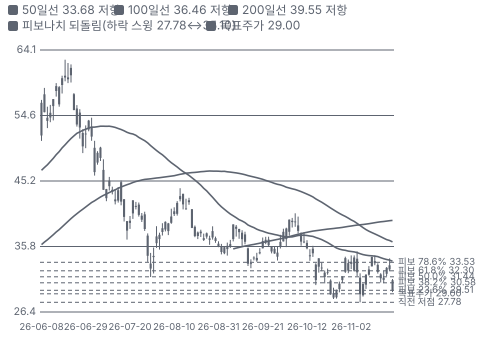

**주봉**

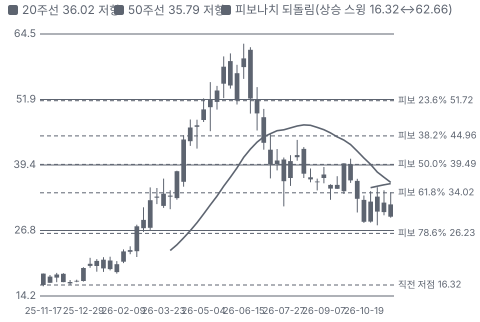

**월봉**

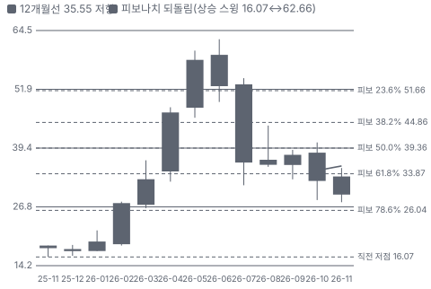

**분기 매출·EPS 실적과 컨센서스**

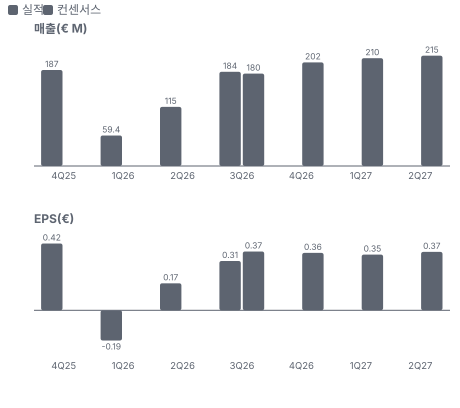

**멀티플 프리미엄(분기말 후행 P/E(대상 선행 추정 이력 없음), 최근 4개 분기말 절대값 — 대상 vs 동종 중앙값)**

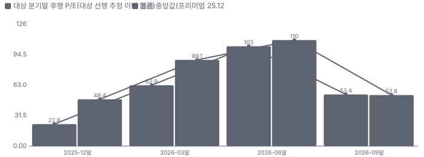

**합리적 멀티플**

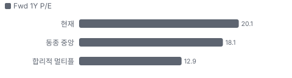

**밸류에이션 주가 시나리오**

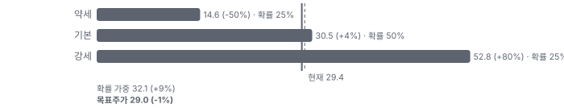

**주가별 업사이드**

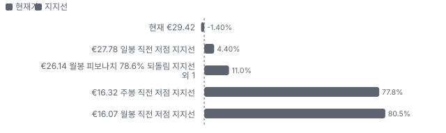
- 제품·서비스 포트폴리오

**공급 병목(10점, 낮을수록 병목)**

**CAPEX의 매출 대비 비중**

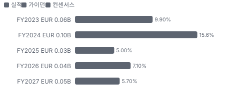

**어닝콜 변화별 주주가치 영향**

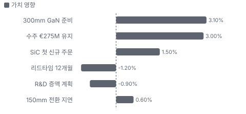

**수주·파이프라인 확실성 사다리**

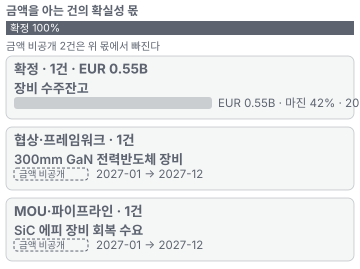

**매출 → 매출총이익 → 영업이익(매출 = 100, 최근 4분기)**

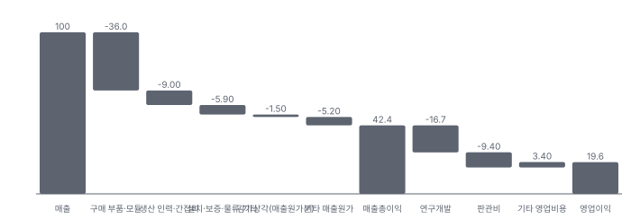

**분기 비용 비중 추이(매출 대비, 공시)**

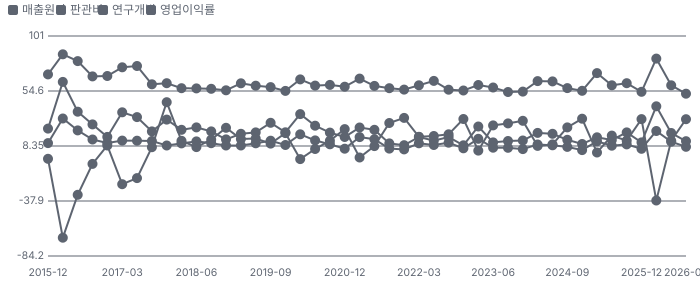

**비용 요인별 매출 대비 비중 1년 변화**

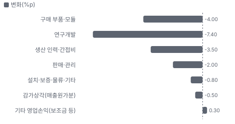

**광전자 장비 BOM 원가 몫**

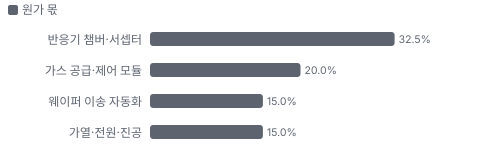

**애프터세일즈 BOM 원가 몫**

**전력반도체 장비 BOM 원가 몫**

**BOM 항목 가격 +10% 시 OPM 변화**

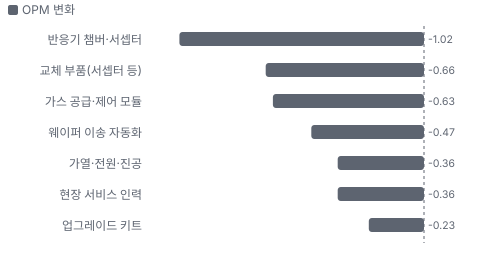

**원가 물가 vs 판매가 물가 — 최근 24개월(비교 불가 — 같은 물가 지수)**

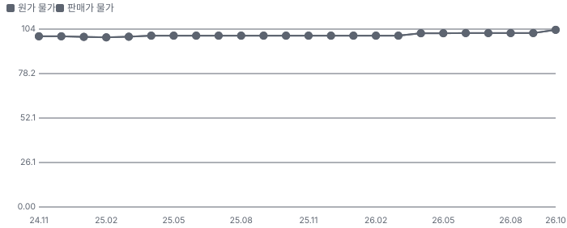

**생산시설별 면적(㎡, 큰 순) — 생산능력 미공시라 면적을 대용으로**

**매출 vs PPI·수출입 — 4Q22 = 100(변화율, 로그 눈금)**

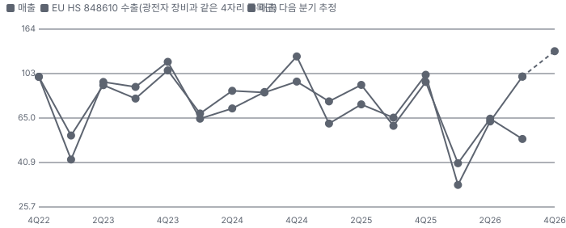

**매출 증가율의 가격·물량 분해와 8분기 전망(전년 대비)**

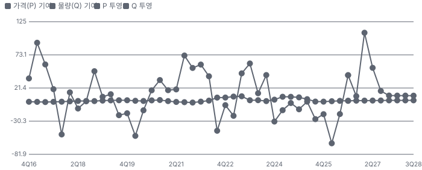

**목표주가 산정 — 약세와 기본 사이(약세 쪽 8%), 도달 확률 약 54%**

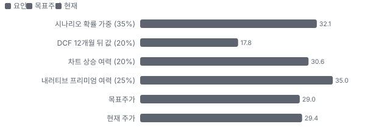

**몬테카를로**

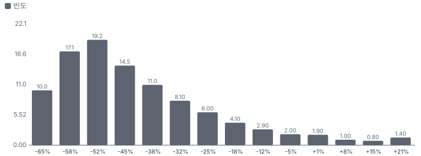

해석: 3,000번 중 136번(5%)에서 가치가 지금 주가 이상이었다. 가정을 흔들어도 지금 주가를 뒷받침하지 못하는 경우가 더 많다. 가운데 값은 0.53배이고, 열 번 중 여덟 번은 0.38~0.85배 사이에 든다.

## 내러티브

> **기업가치를 결정하는 이야기:** 화합물 반도체(InP·GaN·SiC) 박막을 기르는 MOCVD(금속 유기 화합물 가스를 흘려 웨이퍼 위에 결정 박막을 기르는 증착 방식) 장비를 판다. 1~3분기 장비 매출의 61%가 광전자(레이저), 19%가 전력반도체, 18%가 LED(발광 다이오드)·마이크로LED(수십 마이크로미터 크기 LED를 화소로 쓰는 디스플레이·광연결 소자)이고 애프터세일즈(설치한 장비의 부품·서비스·업그레이드 매출)가 전체 매출의 25%다. 이익은 출하량에 크게 좌우된다 — 분기 매출이 €59M일 때 영업손실, €184M일 때 영업이익률 30.9%다.

> **멀티플·EPS 프리미엄**
> **멀티플:** Fwd 1Y P/E 20.1배로 동종 4곳 중앙(18.1배)과 비슷하다 — 수주 급증에 비해 프리미엄이 거의 없다
> **EPS:** FY26 EPS 컨센서스 €0.65, FY27 €1.50(+131%)

### 투자자들은 왜 열광했나

2026년 상반기 투자자들은 광전자 수주 변곡(1Q)과 4월 가이던스 상향에 열광해 주가를 €17에서 6월 €60까지 올렸다. 하반기에는 2Q 매출이 1년 전보다 16% 적었고 매출이 공급망 램프에 묶여 있다는 점, AI 하드웨어 업종 급락이 겹쳐 €29까지 식었다. 수주와 잔고는 그사이에도 늘었다.

### 무엇이 기업가치를 바꾸나

> **구조적 체질 변화**
> **변화:** LED·전력반도체 사이클 회사 → AI 광통신 레이저 장비가 주력
> **증거:** 광전자가 장비 매출의 61%(1~3Q26), 장비 수주의 68%(3Q)
> **반증:** 광전자 수주 비중이 50% 아래로 내려가며 총수주 감소

> **고부가 믹스 확장**
> **변화:** 최신 G10 세대 비중이 늘면 매출총이익률이 오른다
> **증거:** 매출총이익률 38.8%(3Q25) → 47.6%(3Q26). 단 회사는 4Q가 더 낮다고 예고
> **반증:** FY27 매출총이익률 가이던스 42% 아래

> **기술 혁신**
> **변화:** 300mm GaN 장비와 두꺼운 SiC 에피층(2~3kV 소자)
> **증거:** 300mm GaN 2027년 두 자릿수 대수 준비, G10-SiC(Aixtron의 탄화규소 에피택시 장비) 두꺼운 에피 고객 평가(3Q 콜)
> **반증:** 300mm GaN 고객이 다른 장비사를 선택

> **실행 속도**
> **변화:** 리드타임이 6~9개월에서 약 12개월로 늘었다 — 수요가 증산 속도를 앞선다 **납품 리드타임 12개월.** 피어 비교 미확인. 2026년 상반기 6~9개월보다 60% 길다.
> **증거:** 3Q 콜
> **반증:** 분기 출하가 €250M 이상으로 올라가며 리드타임 단축

> **M&A**
> **변화:** 해당 없음(최근 3년 인수 없음 — 전환사채(정해진 가격에 주식으로 바꿀 수 있는 채권) 자금 용도에 인수가 포함돼 있으나 발표된 건 없음)
> **증거:** EQS-News(2026-04-15)
> **반증:** 해당 없음

> **정책·입법 연관성**
> **재정정책:** 독일·EU(유럽연합) 연구개발 보조금 수령(금액 미공시) — 미국 재정정책 직접 대상 아님 2Q 콜: 연구개발 보조금 증가가 영업비용을 상쇄 반증: 보조금 축소 공시 의회 동의 2/10 — 하원 1/5(미국 의회 세출 대상 아님) · 상원 1/5(같음).
> **행정명령:** 대중국 장비 수출통제 — 화합물 반도체 MOCVD의 통제 범위와 Aixtron 중국 비중은 이번 회차 미대조 3Q 콜: 4Q는 중국 비중이 늘어 매출총이익률이 낮아진다 반증: MOCVD 장비가 통제 목록에 추가 의회 동의 2/10 — 하원 1/5(의회 의결 대상 아님 — 행정 규칙) · 상원 1/5(같음).
> **연관입법:** MATCH(동맹국 장비 수출통제 정렬 법안) Act(동맹국 장비 수출통제 정렬 법안) — 발의 단계 IB 노트 요지(2026-11) 반증: 최종 문구에서 화합물 반도체 장비 제외

> **고객의 지출 예산**
> **변화:** 고객 CAPEX(레이저·전력반도체 생산 설비 투자)에서 나온다
> **사업별 예산:** **매출의 46%**: 광전자 장비 — 고객 CAPEX(InP 레이저 팹 증설) · 동인: AI 데이터센터 광 모듈 수요
**매출의 25%**: 애프터세일즈 — 고객 OPEX(장비 유지보수·소모 부품 예산) · 동인: 설치 장비 가동률
**매출의 14%**: 전력반도체 장비 — 고객 CAPEX(GaN·SiC 에피 설비 투자) · 동인: 800V 데이터센터 전력·전기차
**매출의 14%**: LED·마이크로LED 장비 — 고객 CAPEX(LED·마이크로LED 설비 투자) · 동인: 증강현실 안경
> **증거:** 레이저 업체의 신규 팹 건설·증설(2Q·3Q 콜)
> **반증:** 레이저 업체 2027 CAPEX 축소 발표

### 내러티브 근거

> AI 데이터센터 광통신 레이저 증설의 '삽'을 파는 회사라는 이야기다. 주가는 1년 전 €17에서 6월 €60까지 올랐다가 €29로 내려왔다. 그사이 수주잔고는 계속 늘어, 시장의 의심은 수요가 아니라 '얼마나 빨리 매출로 바꾸나'와 '사이클이 얼마나 가나'에 있다. 동종 대비 멀티플 차이 +11% 중 회사 고유 몫은 +56%다. 단계는 확산, 쏠림은 낮음~중간(리테일 집계 없음, 콜 질문 증권사 9곳, 기관 보유 약 62%)이다.

> **AI 광통신 레이저 증설** · 강화
> **논리:** 800G 이상 광 모듈·CPO(광 엔진을 스위치·GPU 칩 옆에 함께 패키징한 광전 통합 부품) 수요가 InP 레이저 증설로 이어지고, 레이저를 기르는 MOCVD 장비 주문이 늘어난다
> **숫자:** 3Q 수주 €274.9M(+122% YoY), 광전자가 장비 수주의 68%, 잔고 €549.4M
> **반증:** 4Q26·1Q27 수주가 €200M 아래
> **출처:** Aixtron 3Q26 실적 발표·어닝콜(2026-10-29)

> **InP 기판 부족이 장비 대수를 늘린다** · 강화
> **논리:** 150mm 기판이 모자라 고객이 75·100mm에 머물면 같은 생산량에 장비가 더 필요하다
> **숫자:** 2027년 150mm 장비 비중 약 30% → 25%(3Q 콜)
> **반증:** 150mm InP 기판 공급이 풀려 고객이 기존 G10을 재구성
> **출처:** Aixtron 3Q26 실적 발표·어닝콜(2026-10-29)

> **전력반도체 회복(GaN·SiC)** · 강화
> **논리:** AI 데이터센터 800V 전력 구조가 GaN·SiC 소자 수요를 만들고 2027년에 장비 주문으로 돌아온다
> **숫자:** 전력이 3Q 장비 수주의 24%, 300mm GaN 두 자릿수 대수 준비
> **반증:** 2027년 상반기 전력 수주가 3Q 수준을 밑돈다
> **출처:** Aixtron 3Q26 실적 발표·어닝콜(2026-10-29)

> **선수금이 대는 증산** · 강화
> **논리:** 고객이 선수금을 내고 줄을 서 증산 자금과 가시성을 함께 준다
> **숫자:** 선수금 €309.0M(1년 전 €72.5M), 1~3분기 영업현금흐름 €311M
> **반증:** 선수금 잔액 감소와 주문 취소 공시
> **출처:** Aixtron 3Q26 실적 발표·어닝콜(2026-10-29)

> **반대 내러티브 — 증산 한계와 사이클** · 유지
> **논리:** 매출은 공급망 램프에 묶여 있고, 화합물 반도체 장비는 2023년 SiC처럼 투자 물결이 끝나면 수주가 급감한다
> **숫자:** 리드타임 6~9개월 → 12개월, FY25 매출 −12%(계산), 1Q26 영업손실 €22.3M
> **반증:** FY27 가이던스 매출이 €880M 이상이고 수주가 €250M 이상 유지
> **출처:** Aixtron 3Q26 실적 발표·어닝콜(2026-10-29)

### 투자 포인트

> **잔고는 두 배, 주가는 고점의 절반**
> **명제:** 장비 수주잔고 €549.4M(1년 전 €286.5M), 주가는 6/22 종가 고점 €60.42에서 −51%
> **숫자:** 3Q26 실적 발표·일봉
> **시장과 다른 점:** 시장은 '매출이 안 따라온다'를 수요 둔화처럼 가격에 넣었다 — 회사 설명은 수요가 아니라 증산 속도 문제다
> **증명:** 2027-03-04 FY27 가이던스 매출과 분기 출하 능력
> **출처:** Aixtron 3Q26 실적 발표·어닝콜(2026-10-29)

> **선수금이 증산 비용을 댄다**
> **명제:** 선수금 €309.0M, 1~3분기 영업현금흐름 €311M — 증산에 외부 자금이 필요 없다
> **숫자:** 3Q26 재무상태표·콜
> **시장과 다른 점:** 현금 €945M 가운데 선수금과 전환사채를 빼면 실제 여유는 작다 — 회사도 자사주 매입에 선을 그었다
> **증명:** 4Q 선수금 잔액과 주문 취소 여부
> **출처:** Aixtron 3Q26 실적 발표·어닝콜(2026-10-29)

> **전력반도체가 두 번째 다리**
> **명제:** GaN 가동률 정상화, 300mm GaN 장비 2027년 두 자릿수 대수 준비, SiC 첫 신규 주문
> **숫자:** 3Q 콜 — 전력이 장비 수주의 24%
> **시장과 다른 점:** 컨센서스 논의는 광전자에 몰려 있다 — 전력 회복이 겹치면 수주 수준이 한 단계 더 오른다
> **증명:** 2027년 상반기 전력 수주와 300mm GaN 확정 주문 발표
> **출처:** Aixtron 3Q26 실적 발표·어닝콜(2026-10-29)

### 모멘텀 생성·소멸 타임라인

**카탈리스트 달력 — 지난 사건의 주가 반응과 앞으로 확인할 숫자**
| 날짜 | 상태 | 구분 | 사건 | 반응·확인 | 결과에 따라 |
|---|---|---|---|---|---|
| 2026-04-15 | 완료 | 생성 | FY26 가이던스 상향(4월 중순) | +20.3% |  |
| 2026-07-30 | 완료 | 확인 | 2Q26 실적 — 광전자가 장비 수주의 75% | +3.3% |  |
| 2026-10-29 | 완료 | 생성 | 3Q26 실적 — 수주 €274.9M, 잔고 €549.4M | +8.5% |  |
| 2026-11-05 | 완료 | 소멸 | AI 하드웨어 업종 급락 | −9.8% |  |
| 2027-01(예상) | 예정 | 매크로 | 레이저·광 모듈 업체 실적의 2027 증설 계획 | InP 레이저 CAPEX 확대 유지 여부 | 유지 → 기본·강세, 축소 → 약세 쪽 |
| 2027-03-04 | 예정 | 확인 | 4Q26·FY26 실적과 FY27 가이던스 | 4Q 수주 €250M 이상, FY27 매출 가이던스 €880M 이상, 매출총이익률 42% 이상 | 충족 → 기본에서 강세 쪽, 수주 €200M 미만 → 약세 |

### 언제 사서 언제 팔아야 할까?

**가격·조건 틀 — 가격은 밸류에이션(약세·기본·강세·목표주가)과 차트 지지 구간에서, 조건은 이벤트에서**
| 구간 | 가격 | 목표주가까지 | 약세까지 | 조건·근거 |
|---|---|---|---|---|
| 관찰 구간 | €28~€28 | +4% | -47% | 지금 가격 아래 지지 구간이 약세 시나리오 가격과 겹치는 곳 |
| 확인 뒤 | 지금 €29 이상에서 조건 확인 | -1% | -50% | 4Q 수주 €250M 이상과 FY27 매출 가이던스 €880M 이상 |
| 무효화 | 약세 시나리오 €15 | - | -50% | 분기 수주가 €200M 아래로 내려가고 선수금 잔액이 줄어든다 |
| 차익 고민 1차 | €30(기본 시나리오) | +4% | - | 목표주가 근처에서 Fwd 1Y P/E가 동종 중앙보다 크게 높아질 때 |
| 차익 고민 2차 | €53(강세 시나리오) | +80% | - | 목표주가 근처에서 Fwd 1Y P/E가 동종 중앙보다 크게 높아질 때 |

10월 이후 하루 −9~13% 움직임이 네 번 나왔다 — 업종 급락에 크게 흔들린다 가격·조건 틀이며 매매·비중 지시가 아니다(투자 권유 아님).

## 포트폴리오

| 제품·서비스 | 구분 | 무엇 | 쓰는 곳 | 돈 버는 방식 | Mix | Mix 변화(전년 대비) |
|---|---|---|---|---|---|---|
| 광전자 장비 | 제품 | InP·GaAs(갈륨비소 — 레이저·무선 소자용 화합물 반도체) 레이저 박막을 기르는 MOCVD 장비(G10-AsP(Aixtron의 비소·인 계열, 레이저·광소자용 최신 MOCVD 장비) 등) | 데이터센터 광 모듈·CPO용 레이저 업체 | 1~3Q26 매출의 약 46%(장비 매출의 61%) | 46% | 미확인 |
| 애프터세일즈 | 서비스 | 설치한 장비의 교체 부품·서비스·업그레이드 | 기존 고객의 가동 장비 | 1~3Q26 €88M, 매출의 25% | 25% | 미확인 |
| 전력반도체 장비 | 제품 | GaN·SiC 전력 소자 박막을 기르는 장비(G10-GaN(Aixtron의 질화갈륨 전력반도체용 최신 MOCVD 장비)·G10-SiC) | AI 데이터센터 800V 전력 변환, 전기차 인버터용 소자 업체 | 1~3Q26 매출의 약 14%(장비 매출의 19%) | 14% | 미확인 |
| LED·마이크로LED 장비 | 제품 | LED·마이크로LED 박막용 MOCVD 장비 | 증강현실 안경용 마이크로LED, 조명·디스플레이 | 1~3Q26 매출의 약 13.5%(장비 매출의 18%) | 14% | 미확인 |

## 수주·파이프라인

> **2026-09-30 기준 3건.** 확정 EUR 0.55B. 공시 장비 수주잔고 EUR 0.55B. 서로 겹치는 항목은 합계에서 뺐다.

**수주 목록**
| 상태 | 계약 | 계약 총액 | 진척 | 기간 | 비고 |
|---|---|---|---|---|---|
| 확정 | 장비 수주잔고 | EUR 0.55B | - | 2026-10 → 2027-09 | 선수금 €309.0M 수령 — 대부분 InP 광통신 레이저용 |
| 협상 | 300mm GaN 전력반도체 장비 | 금액 비공개 | - | 2027-01 → 2027-12 | (다른 항목과 겹칠 수 있어 합계에서 뺌) |
| 파이프라인 | SiC 에피 장비 회복 수요 | 금액 비공개 | - | 2027-01 → 2027-12 | (다른 항목과 겹칠 수 있어 합계에서 뺌) |

**실행 속도와 방해 요인**
| 항목 | 상태 | 실행 속도 | 방해 요인 |
|---|---|---|---|
| 장비 수주잔고 | 확정 | 리드타임 약 12개월(이전 6~9개월) | 공급사 증설 속도 · 조립·설치 인력 채용 |
| 300mm GaN 전력반도체 장비 | 협상 | 200mm·300mm 양쪽 대량 주문 협의 중 | AI 데이터센터 800V 전력 구조 채택 시점 · 고객 팹 준비 |
| SiC 에피 장비 회복 수요 | 파이프라인 | GaN보다 느리다(회사 설명) | 전기차 수요 · 고객 과잉 설비 소진 |

## 마진 구조

> **GPM 47.6%, OPM 30.9%.** 2Q26 대비 GPM +6.9%p, OPM +18.1%p. 변동비는 매출의 46%이고, 매출이 10% 늘면 OPM은 +2.1%p 움직인다. 3Q 매출원가는 매출의 52.4%로 1년 전 61.2%보다 8.8%p 낮다. 최신 G10 장비와 유리한 지역 믹스 덕이라 회사는 4Q가 더 낮다고 예고했다. 연구개발·판관비 비중은 29.5%에서 20.1%로 줄어 영업이익률이 12.9%에서 30.9%로 올랐다

> **매출 100 중 매출원가 57.6, 매출총이익 42.4(최근 4분기, 공시).** 매출원가 요인 중 구매 부품·모듈이 매출의 36.0%로 가장 무겁고, 단가가 +10% 오르면 GPM이 -3.60%p 움직인다. 분기 회귀로 매출 1이 늘 때 매출원가는 0.52 늘고, 매출원가의 고정비 몫은 13%다.

**비용 요인 강도 — 비중·추세·충격(+10%)·탄력**
| 비용 | 구분 | 매출 대비 | 1년 변화 | 마진 기여 | 충격 시 마진 | 매출 탄력 | 고정비 몫 |
|---|---|---|---|---|---|---|---|
| 구매 부품·모듈 | 매출원가 요인 | 36.0% | -4.0%p | +4.0%p | -3.60%p | 미확인 | 0% |
| 생산 인력·간접비 | 매출원가 요인 | 9.0% | -3.5%p | +3.5%p | -0.90%p | 미확인 | 60% |
| 설치·보증·물류·기타 | 매출원가 요인 | 5.9% | -0.8%p | +0.8%p | -0.59%p | 미확인 | 20% |
| 감가상각(매출원가분) | 매출원가 요인 | 1.5% | -0.5%p | +0.5%p | -0.15%p | 미확인 | 100% |
| 매출원가 | 공시 항목 | 57.6% | -2.3%p | +2.3%p | -5.76%p | 0.52 | 13% |
| 연구개발 | 공시 항목 | 16.7% | +2.9%p | -2.9%p | 미확인 | 0.05 | 70% |
| 판관비 | 공시 항목 | 9.4% | +1.3%p | -1.3%p | 미확인 | 0.03 | 63% |
| 기타 영업비용 | 공시 항목 | -3.4% | -2.6%p | +2.6%p | 미확인 | -0.00 | 96% |

매출 탄력 = 분기 비용을 매출에 회귀한 기울기(매출 1당 변동비), 고정비 몫 = 절편 ÷ 평균 비용. 표본이 8분기 미만이면 미확인. 매출원가 요인 비중은 margin 재료의 추정이 섞여 있고, 공시 매출원가와의 차이는 '기타 매출원가'로 둔다.

**GPM에서 OPM까지(GAAP, 아래는 최근 4개 분기)**
| 기간 | GPM | 연구개발 | 판관비 | 기타 | OPM |
|---|---|---|---|---|---|
| 3Q25 | 38.8% | 19.8% | 9.7% | -3.7% | 12.9% |
| 2Q26 | 40.6% | 19.3% | 12.0% | -3.3% | 12.8% |
| 3Q26 | 47.6% | 12.4% | 7.7% | -3.4% | 30.9% |
| 2025-12 | 46.0% | - | - | - | 31.0% |
| 2026-03 | 18.1% | - | - | - | -37.5% |
| 2026-06 | 40.6% | - | - | - | 12.8% |
| 2026-09 | 47.6% | - | - | - | 30.9% |

**비용을 움직이는 요인**
| 비용 | 요인 |
|---|---|
| 구매 부품·모듈(매출원가) | 반응기 부품·가스 모듈·자동화 모듈 단가와 물량, 제품 세대 믹스 · 근거 추정 |
| 연구개발(연구개발) | 300mm GaN·차세대 장비 개발 인력과 재료비 · 근거 공시 |
| 생산 인력·간접비(매출원가) | 독일·영국 조립·시험 인력, 가동률 · 근거 추정 |
| 판매·관리(판관비) | 영업·고객 지원·본사 관리 · 근거 공시 |
| 설치·보증·물류·기타(매출원가) | 현장 설치, 보증 충당, 운송 · 근거 추정 |
| 감가상각(매출원가분, 매출원가) | 생산·시험 설비 감가상각 · 근거 추정 |
| 기타 영업손익(보조금 등, 기타) | 연구개발 보조금·환차손익 · 근거 공시 |

**광전자 장비 BOM — 매출의 46%, GPM 48%(회사 전체 매출총이익률(3Q26) — 제품별 총이익 미공시), 항목 가격 +10% 시**
| 항목 | 원가 몫 | 전가 | 제품 GPM | OPM |
|---|---|---|---|---|
| 반응기 챔버·서셉터 | 25~40% | 미확인 | -1.7%p | -0.78%p |
| 가스 공급·제어 모듈 | 15~25% | 미확인 | -1.0%p | -0.48%p |
| 웨이퍼 이송 자동화 | 10~20% | 미확인 | -0.8%p | -0.36%p |
| 가열·전원·진공 | 10~20% | 미확인 | -0.8%p | -0.36%p |
| 미분해 | 17% | - | - | - |

**애프터세일즈 BOM — 매출의 25%, GPM 48%(회사 전체 매출총이익률 대용 — 미공시), 항목 가격 +10% 시**
| 항목 | 원가 몫 | 전가 | 제품 GPM | OPM |
|---|---|---|---|---|
| 교체 부품(서셉터 등) | 40~60% | 미확인 | -2.6%p | -0.66%p |
| 현장 서비스 인력 | 20~35% | 미확인 | -1.4%p | -0.36%p |
| 업그레이드 키트 | 10~25% | 미확인 | -0.9%p | -0.23%p |
| 미분해 | 5% | - | - | - |

**전력반도체 장비 BOM — 매출의 14%, GPM 48%(회사 전체 매출총이익률 대용 — 회사는 G10 세대 마진이 더 높다고만 설명), 항목 가격 +10% 시**
| 항목 | 원가 몫 | 전가 | 제품 GPM | OPM |
|---|---|---|---|---|
| 반응기 챔버·서셉터 | 25~40% | 미확인 | -1.7%p | -0.24%p |
| 가스 공급·제어 모듈 | 15~25% | 미확인 | -1.0%p | -0.15%p |
| 웨이퍼 이송 자동화 | 10~20% | 미확인 | -0.8%p | -0.11%p |
| 미분해 | 32% | - | - | - |

반응기 챔버·서셉터 가격이 +10% 오르면 영업이익은 -3.3% 움직인다. 판매가 전가를 모르는 항목은 전가 0%로 계산했다.

**BOM 항목 가격을 움직이는 것**
| 항목 | 요인 |
|---|---|
| 반응기 챔버·서셉터 | 흑연·석영 정밀 가공품 단가 · 근거 추정 |
| 가스 공급·제어 모듈 | 유량 제어기·밸브 단가 · 근거 추정 |
| 웨이퍼 이송 자동화 | 카세트 자동 이송 로봇 단가 · 근거 추정 |
| 가열·전원·진공 | 히터·전원·펌프 단가 · 근거 추정 |
| 교체 부품(서셉터 등) | 소모 부품 단가 · 근거 추정 |
| 현장 서비스 인력 | 서비스 엔지니어 인건비 · 근거 추정 |
| 업그레이드 키트 | 구형 장비 개조 부품 · 근거 추정 |
| 반응기 챔버·서셉터 | 고온 공정용 코팅 흑연 부품 · 근거 추정 |
| 웨이퍼 이송 자동화 | 200·300mm 이송 모듈 · 근거 추정 |

**투입 물가 — 미국 PPI 3·6·12개월(2026-10, 개정 반영)과 해외 전년비**
| 항목 | 미국 3개월 | 6개월 | 12개월 | 전가 못 할 때 OPM | 일본 | 한국 | 대만 |
|---|---|---|---|---|---|---|---|
| 반응기 챔버·서셉터 | +1.9% | +2.0% | +3.4% | - | +2.2% | +0.0% | +3.0%* |

별표는 품목보다 넓은 업종 지수다. 연결한 투입 원가의 미국 PPI(생산자물가지수)는 1년 새 가중 +3.4%이고, 판매가로 넘기지 못하면 GPM -1.2%p·OPM -1.2%p가 움직인다. MOCVD 장비 가격은 +0.0%로 비교 물가(반도체 제조장비 PPI, 2026-10) +3.4%보다 3.4%p 덜 올랐다. 물가 지수를 붙이지 못한 매출원가 항목은 생산 인력·간접비, 감가상각(매출원가분), 설치·보증·물류·기타다(미연결).

## 공급망 병목

> **공급망 신뢰성 4.2/10, 병목 주의.** 가장 약한 고리는 반응기 챔버·서셉터 4.2점이고, 품목 평균은 4.2점이다. 근거가 부족한 3건(가스 공급·제어 모듈 · 웨이퍼 이송 자동화 · 조립·설치 인력)은 점수에서 뺐다. Aixtron은 모듈을 외부 협력사에서 받아 독일·영국에서 조립·시험한다. 병목은 특정 부품이 아니라 협력사와 자사의 증산 속도다 — 리드타임이 6~9개월에서 약 12개월로 늘었고 일부 협력사는 더 늘리기 어렵다고 해 2·3번째 공급사를 붙이고 있다(3Q 콜). 공급사 이름은 미공개다

**병목과 마진 — 품목 가격 +10% 시 OPM**
| 품목 | 점수 | 판정 | 구분 | OPM |
|---|---|---|---|---|
| 반응기 챔버·서셉터(필수) | 4.2 | 병목 주의 | 핵심 통제 품목 | -1.02%p |

> **반응기 챔버·서셉터** · 4.2/10
> **왜:** 박막 균일도를 결정하는 핵심 부품
> **병목 요인:** 인증 공급사 1곳 · 캐파 빠듯 · 리드타임 52주(평시 33주) · 재인증 미확인 · 1위 점유율 미확인 · 지역 집중 미확인 · 물량 확보 장기계약
> **풀리는 조건:** 협력사가 건물 임차·설비 구매·채용으로 증산 중 — 가동 확인 전

**공급사**
| 품목 | 공급사 | 몫 | 근거 |
|---|---|---|---|
| 반응기 챔버·서셉터 | 미공개(흑연·석영 정밀 가공) | 미확인 | 추정 |
| 가스 공급·제어 모듈 | 미공개(유량 제어기·밸브·배관 모듈) | 미확인 | 추정 |
| 웨이퍼 이송 자동화 | 미공개(카세트 이송 로봇) | 미확인 | 추정 |
| 조립·설치 인력 | Aixtron 자체 채용(조립·시험·현장 설치 엔지니어) | 미확인 | 회사 발표 |

**무역 통계로 본 공급 지역**
| 품목 | EU 수입처 | 일본 수입처 | EU 1위 전년비 |
|---|---|---|---|
| 반응기 챔버·서셉터 | JP(일본) 48% · US 33% · TW(대만) 8% | 大韓民国 36% · シンガポール 25% | +892.4% |

## 생산능력

> **현재 명목 캐파 미확인, 가동률 미확인.** 착공 이상 증설은 0 €M(분기 출하 매출), 발표까지 합치면 0 €M(분기 출하 매출)이다. FY2025 CAPEX는 EUR 0.03B로 매출의 5.0%다. 명목 캐파는 공시하지 않는다. 회사는 '설비 한계는 없고 증산 속도가 한계'라고 설명한다 — 분기 출하는 1Q €59M에서 3Q €184M로 늘었고 4Q는 약 €200M을 겨냥한다. 말레이시아 페낭 공장은 2027년 가을부터 쓴다

**생산시설 4곳**(회사 발표·지속가능성 보고서에 나온 생산·개발 거점 4곳 — Herzogenrath·Cambridge·페낭(건설 중)과 2024년 취득한 이탈리아 토리노 인근 생산 부지(현재 상태 미확인이라 목록에서 뺐다). 연차보고서 시설 목록 미대조) — 이름·위치를 밝힌 곳 3곳, 미확인 3곳. 시설별 생산능력은 공개되지 않았다 — 회사 전체 캐파만 위에 적었다.

**생산시설 4곳 — 명칭·위치·생산능력**
| 시설 | 위치 | 용도 | 생산능력 | 소유·상태 |
|---|---|---|---|---|
| Herzogenrath 본사·생산 | 독일 Herzogenrath | 본사·연구개발·장비 조립과 시험, 300mm 클린룸 혁신센터 | 미확인 — 거점별 캐파 미공시 · 면적 61,806 ㎡ | 미확인 · 가동 |
| Cambridge 사업장 | 영국 Cambridge | 개발·장비 생산 | 미확인 — 거점별 캐파 미공시 | 미확인 · 가동 |
| 페낭 신공장 | 말레이시아 페낭 | 100·150·200mm 장비 조립·시험, 현지 조달 | 미확인 — 2027년 가을 사용, 2027년 말 첫 출하 목표 — 증가분 미공시 | 미확인 · 건설 중 |

**생산능력 확충 계획**
| 계획 | 단계 | 증설 | 가동 시점 | CAPEX |
|---|---|---|---|---|
| 말레이시아 페낭 신공장 1단계 | 착공 | 미확인 | 2027-10 | EUR 0.04B |
| 독일·영국 기존 사업장 증산(임차 공간·협력사) | 발표 | 미확인 | 미확인 | 미확인 |

남은 계획의 CAPEX 합계는 EUR 0.04B(금액 미확인 1건 제외)다. 합계는 FY2027 매출의 5%다.

**증설 방해 요인**
| 계획 | 방해 요인 |
|---|---|
| 말레이시아 페낭 신공장 1단계 | 클린룸 단계 증설(단계마다 6~7개월) |
| 독일·영국 기존 사업장 증산(임차 공간·협력사) | 협력사 증산·채용 |

**CAPEX와 매출 대비**
| 기간 | CAPEX | 매출 | 매출 대비 | 구분 |
|---|---|---|---|---|
| FY2023 | EUR 0.06B | EUR 0.63B | 9.9% | 실적 |
| FY2024 | EUR 0.10B | EUR 0.63B | 15.6% | 실적 |
| FY2025 | EUR 0.03B | EUR 0.56B | 5.0% | 실적 |
| FY2026 | EUR 0.04B | EUR 0.56B | 7.1% | 가이던스 |
| FY2027 | EUR 0.05B | EUR 0.88B | 5.7% | 컨센서스 |

## 피터 린치 분류

> **경기순환주(Cyclical), 중형.** 린치 표의 기대 수익 10배, 하방 -80~100%, 위험 고. 10배 경로가 있는 분류다(고성장주·회생주·경기순환주).

**분류 근거 — 크기 먼저, 다음은 이야기 유형**
| 항목 | 값 |
|---|---|
| 크기 | 중형(시가총액 \$3.3B) |
| 장기 성장 | 67.2%(컨센서스 EPS 2년 CAGR) |
| 린치 비율((성장% + 배당%) ÷ P/E) | 3.35 — 2 이상 매력, 1 미만 비싸다 |
| PEG(P/E ÷ 성장%) | 0.30 — 1 적정, 0.5 매우 매력, 2 매우 불리 |
| 근거 | 순환 업종(semicap) · TTM 매출이 과거 고점 대비 28% 빠진 적이 있다 · 영업이익이 적자였다가 흑자로 돌아온 순환 이력 |
| 반대 근거 | 장기 성장률 67%로 고성장주 구간 — 순환 위의 성장주일 수 있다 |

- 점검: 재고·공급과 수요(가격)의 방향
- 점검: 경쟁사의 증설
- 점검: 이익 정점에서 P/E가 낮아 보이는 함정
- 점검: 부채가 바닥을 견딜 수 있나
- 팔 때(점검 조건, 매매 지시 아님): 재고가 쌓이고 증설이 시작되고 가격이 꺾일 때 — 정점의 낮은 P/E는 싸다는 뜻이 아니다

분류 = 피터 린치·존 로스차일드 『One Up On Wall Street』(1989)·『Beating the Street』(1993)의 6분류와 위험·보상 표를 숫자 규칙으로 옮긴 자체추론이다(config/lynch.yaml).

## 구루 교차 점검

> **여섯 관점 중 통과 2 · 미달 1 · 미확인 3.** 가장 약한 관점은 변화의 방향 — 광전자 한 용도가 수주의 68%라 투자 물결이 끝나면 방향이 빠르게 바뀔 수 있다.

판정은 자체추론이고 숫자는 계산값이다.

> **성장 여지** · 통과
> **질문:** 5년 안에 매출이 2배가 될 자리가 있나, 10년 뒤에도 커지나
> **이유:** 추정 매출 경로가 FY26 €560M → FY28 €1.0B(연 33.6%)로 5년 2배 속도를 넘고 수주잔고가 2027년을 덮는다
> **계산한 숫자:** 매출 경로 FY2026→FY2028 연 33.6%, 2배까지 2.4년
> **근거:** Aixtron 3Q26 분기보고서·실적 발표(2026-10-29) · 출처 목록

> **해자와 자본수익률** · 통과
> **질문:** 경쟁우위가 무엇이고, 투하자본수익률(ROIC)이 자본비용보다 높으며 유지·상승하나
> **이유:** ROIC 19.8%로 자본비용을 웃돌고 고객 공정이 Aixtron 장비 위에서 개발됐다 — 단 점유율 숫자는 확인하지 못했다
> **계산한 숫자:** ROIC 17.0% · 자본비용 11.0%
> **근거:** Aixtron 3Q26 분기보고서(2026-10-29) · 출처 목록

> **재투자 복리** · 미확인
> **질문:** 번 돈을 높은 수익률로 다시 넣을 곳이 있나 — 자본 배분(재투자·인수·자사주·희석) 이력은
> **이유:** 증산 자금이 유보 이익이 아니라 고객 선수금에서 나와 재투자 수익률을 재기 어렵다(재투자율 12.5%)
> **계산한 숫자:** 설비 재투자율 13.1% · 지속 가능 성장 2.2%(근사) · 소유주 이익 수익률 2.2%(근사)

> **사람과 문화** · 미확인
> **질문:** 경영진이 주주와 같은 배를 탔나 — 창업자·내부자 지분, 기회형 내부자 매수, 문화가 경쟁우위에 기여하나
> **이유:** 경영진 임기·보상 구조를 연차보고서로 대조하지 못했다 — 가격 유지·선수금 방침은 콜에서 확인
> **계산한 숫자:** 서류로 확인(계산 없음)

> **변화의 방향** · 미확인
> **질문:** 18~24개월 뒤 이익 그림이 지금과 얼마나 다른가, 유동성 국면은 그 변화를 받쳐 주나
> **이유:** 수주·잔고 방향은 위지만 2년 뒤 EPS 추정이 다음 12개월보다 2.6% 낮게 나온다 — FY28 분기 추정이 불안정하다
> **계산한 숫자:** 2년 뒤 EPS -2.6%(다음 12개월 대비) · 유동성 국면 중립

> **5배 경로와 시장이 모르는 이유** · 미달
> **질문:** 어떻게 5배 이상이 되나(이익 성장 × 배수 변화), 시장은 왜 아직 값을 안 매기나
> **이유:** 5배는 화합물 반도체 장비 시장 크기로 경로가 없다 — 2배만 조건부로 열려 있다
> **계산한 숫자:** 5년에 5배 = 연 38.0% · 10배 = 연 58.5% · Fwd P/E 20.1배
> **근거:** 이 리포트의 2·3·5·10배 경로 계산

**배수별로 필요한 연 성장률 — 이익 성장과 배수 변화를 합친 속도**
| 목표 | 5년 | 7년 | 10년 |
|---|---|---|---|
| 2배 | 14.9% | 10.4% | 7.2% |
| 5배 | 38.0% | 25.8% | 17.5% |
| 10배 | 58.5%(희소) | 38.9% | 25.9% |

### 보유 규율 — 가격이 아니라 지표로 유지·종료를 가른다

- 투자 논리 지표: 분기 장비 수주 · 장비 수주잔고 · 매출총이익률
- 규칙: 가격만 빠지고 수주가 €250M 이상이면 유지, 수주와 선수금이 함께 줄면 논리가 깨진다
- 지금 주가는 일봉 254개 기간의 고점 대비 -51.3%, 그 기간 최대 낙폭은 -52.9%다 — 고점 대비 −50%를 넘어 재심사 구간이다. 가격이 아니라 위 지표로 유지·종료를 가른다.

여섯 관점은 베일리 기포드(성장 여지·5배 경로), 워렌 버핏(해자·재투자), 론 바론(사람), 피터 린치(분류·내부자), 스탠리 드러켄밀러(변화의 방향·유동성)의 질문을 옮긴 점검 틀이다. 유동성 국면은 중립(10년물 20일 -9bp · 하이일드 스프레드 20일 +12bp). 설비 재투자율은 설비투자에서 감가상각을 뺀 몫만 본 근사이고(연구개발·인수·운전자본은 빠진다), 소유주 이익 수익률은 유지 설비투자를 감가상각과 같다고 본 근사다. 점검 틀이며 매매·비중 지시가 아니다.

## 해자

> 해자는 '화합물 반도체 고객의 공정이 Aixtron 장비 위에서 개발됐다'는 데서 나온다. 다만 점유율 숫자는 공개 자료로 확인하지 못했고, 매출은 사이클을 크게 탄다

> **공정 기준 장비** · 보통
> **해자:** GaN 전력반도체와 InP 레이저 고객이 개발·시험 생산을 Aixtron 장비에서 해 왔다
> **근거:** 회사: GaN 전력 고객의 개발·파일럿·양산 준비가 모두 G5+(Aixtron의 이전 세대 질화갈륨 MOCVD 장비)·G10-GaN에서 이뤄졌다(2Q 콜). 레이저 업체 약 15곳이 수주의 80%(2Q 콜), 3Q 수주 €274.9M(+122% YoY)
> **숫자:** 시장 점유율 숫자는 미확인(회사 설명만 있음)
> **깨지는 조건:** 선두 레이저·GaN 고객이 Veeco 등 다른 MOCVD로 양산 라인을 채움

> **공정 전환 비용** · 보통
> **해자:** 고객은 장비 하나가 아니라 생산 라인 전체의 레시피를 다시 맞춰야 해 공급사를 쉽게 바꾸지 않는다
> **근거:** 회사: 웨이퍼 크기 전환도 라인 전체를 바꿔야 해 느리다 — SiC 200mm는 2023~24년 예상에서 2027년으로 밀렸다(3Q 콜). G10은 75·100mm에서 150mm로 재구성 가능
> **숫자:** 애프터세일즈가 매출의 25%(1년 전 22%)
> **깨지는 조건:** 애프터세일즈 비중 하락과 고객 이탈 공시

> **가격 규율과 선수금** · 보통
> **해자:** 대량 주문에도 할인하지 않고 선수금을 받아 증산 자금을 댄다
> **근거:** 선수금 €309.0M(1년 전 €72.5M), 2Q 말 선수금이 장비 수주잔고의 약 43%(2Q 콜). 가격 유지 방침(3Q 콜)
> **숫자:** 3Q 매출총이익률 47.6%(1년 전 38.8%)
> **깨지는 조건:** FY27 매출총이익률 가이던스가 42% 아래

> **300mm GaN 선점** · 약함
> **해자:** 300mm GaN 장비가 2027년 대량 출하에 들어가면 다음 세대 기준 장비가 된다
> **근거:** 미확인 — 2027년 두 자릿수 대수 '준비'(3Q 콜), 확정 수주 금액 미공시
> **숫자:** 미확인
> **깨지는 조건:** 300mm GaN 고객이 다른 장비사를 선택

## 경영진·네트워크

> CEO Felix Grawert 박사와 CFO Christian Danninger 박사가 콜을 이끈다. 정계·동문 연결은 공개 기록으로 확인하지 못했다

> **Felix Grawert** · CEO · 미확인
> **프로필:** 3Q 콜에서 광전자·GaN·SiC 시장과 증산 계획을 직접 설명
> **비즈니스:** 레이저·전력반도체 고객과 장기 공급 협의(용량 예약·선수금 계약)를 직접 언급(3Q 콜)
> **정계:** 미확인
> **동문:** 미확인
> **사모임:** 미확인

> **Christian Danninger** · CFO · 미확인
> **프로필:** 3Q 콜에서 재무·현금 사용 방침 설명 — 선수금은 아직 번 돈이 아니라 자사주 매입 재원으로 보지 않는다
> **비즈니스:** 미확인
> **정계:** 미확인
> **동문:** 미확인
> **사모임:** 미확인

**네트워크 정량화**
| 연결 | 강도 | 닿는 매출 | 가중 노출 | 매출 대비 | 근거 |
|---|---|---|---|---|---|
| 비즈니스: 레이저 업체 약 15곳과의 장기 공급 관계 | 3/5 | €0.46B | €0.28B | 51% | 광전자 장비가 매출의 약 46%(1~3Q26, 계산) — 경영진 개인 연결이 매출을 만들었다는 뜻이 아니다 Aixtron 3Q26 실적 발표·어닝콜(2026-10-29) |

가중 노출은 연결이 닿는 매출의 크기다. 연결이 그 매출을 만들었다는 뜻이 아니며, 인과는 공개 자료로 입증하지 못한다.

## 약세 논리 및 셀온 조건

| 약세 논리 | 근거 | 가를 자료 |
|---|---|---|
| 매출 상한은 증산 속도가 정한다 | 리드타임이 6~9개월에서 약 12개월로 늘었고 일부 협력사는 더 늘리기 어렵다고 했다. 회사도 2027년 생산 능력을 아직 답하지 못했다(3Q 콜) | 2027-03-04 FY27 가이던스의 매출 범위와 분기 출하 계획 |
| 광전자 한 용도에 쏠린 수주 | 3Q 장비 수주의 68%가 광전자다. 2023년 SiC 투자 물결 뒤 FY25 매출은 FY23보다 12% 적었다(계산) | 레이저·광 모듈 업체의 2027 CAPEX 계획, 4Q·1Q 수주 |
| 3Q 이익률은 고점일 수 있다 | 3Q 매출총이익률 47.6%는 제품·지역 믹스 덕이고 회사는 4Q가 낮다고 예고했다. 2027년에는 연구개발비를 늘린다 | FY27 매출총이익률·EBIT 이익률 가이던스 |
| 150mm 전환 뒤 수요 공백 | 지금은 InP 기판 부족으로 75·100mm 장비가 더 팔리지만, 기판이 풀리면 고객은 기존 G10을 150mm로 재구성할 수 있다 | 150mm InP 기판 공급사 증설 발표, 150mm 장비 비중 |
| 전환사채와 현금의 실체 | 현금 €945M 가운데 €309.0M은 선수금, 약 €354M은 전환사채 부채다. 주가가 €50.375를 넘으면 주식 수가 약 7.9% 늘어난다 | 4Q 선수금 잔액, 전환사채 자금 사용 발표 |
| 자료 한계 | TradingView 한도로 일봉은 1년치 대체 원천을 썼다. 애널리스트 수·의견·목표가·수정 이력 데이터가 없고, 지역 매출 비중과 연차보고서(구매 약정·10% 초과 고객·시설 목록)는 이번 회차에 대조하지 못했다. 3Q 수주·잔고 숫자는 회사 발표를 업계 매체 전재로 대조했다 | 다음 회차 연차보고서·분기보고서 원문 대조 |

**변이 관점.** 시장은 '수주는 느는데 매출이 안 따라온다'를 수요에 대한 의심으로 가격에 넣었다. 그러나 선수금이 1년 새 €72.5M에서 €309.0M로 늘었다는 것은 고객이 돈을 먼저 내고 줄을 섰다는 뜻이다. ==가격이 수주와 반대로 간 원인은 수요가 아니라 증산 속도다== — 그 의심을 풀 첫 숫자는 3월 FY27 가이던스의 매출 범위다.

> **셀온 조건**
> **조건 1:** 분기 수주가 €200M 아래로 내려가고 선수금 잔액이 전 분기보다 줄어든다(2027년 3월 4일 확인).
> **조건 2:** FY27 매출 가이던스 중간값이 €800M 아래로 나온다 — 잔고가 12개월 안에 매출로 바뀌지 않는다는 뜻이다.
> **조건 3:** FY27 매출총이익률 가이던스가 42% 아래로 내려간다.
> **조건 4:** 주요 레이저·광 모듈 업체가 2027년 InP 증설 계획을 줄인다고 발표한다.

## 어닝콜 변화

**직전 콜 대비 새로 나오거나 바뀐 내용 → 가치 영향**
| 항목 | 내용 | 직전 콜 | 최신 콜 | 모델 동인 이동 | 확신도 | 가치 영향 |
|---|---|---|---|---|---|---|
| 업데이트 | 분기 수주 수준 | 분기 €200M 안팎 전망(2Q 콜) | 3Q €274.9M(+122% YoY), 이 수준 유지·확대 전망(3Q 콜) | 1년차 성장률 +5.0% | 0.8 | +3.0% |
| 부정 | 리드타임 | 6~9개월 | 약 12개월 — 공급망·인력 램프가 제약 | 1년차 성장률 -2.0% | 0.8 | -1.2% |
| 신규 | GaN 전력반도체 장비 | 기술 논의는 뜨겁지만 주문으로 이어지지 않았다(2Q 콜) | 가동률 정상화, 2027년 300mm GaN 장비 두 자릿수 대수 준비(고객 2곳 이상) | 장기 성장 수렴값 +1.0% | 0.5 | +3.1% |
| 업데이트 | SiC 장비 | 설치 장비 가동률 낮음, 고객 신중(2Q 콜) | 가동률 개선, 첫 신규 장비 주문 — 2027년 점진 회복 | 장기 성장 수렴값 +0.50% | 0.5 | +1.5% |
| 신규 | InP 150mm 전환 지연 | 장비를 100mm로 깔되 150mm 전환 준비(2Q 콜) | 기판 부족으로 2027년 150mm 장비 비중이 약 30% → 25%로 내려간다 — 장비 대수 수요 증가 | 1년차 성장률 +1.0% | 0.5 | +0.6% |
| 부정 | 2027년 연구개발비 | 언급 없음 | 2027년 연구개발비를 다시 늘린다 — 매출총이익 증가분이 모두 EBIT로 가지 않는다 | 목표 이익률 -1.0% | 0.5 | -0.9% |
| 반복 | FY26 가이던스 | 매출 €560M ± €30M, EBIT 이익률 17~20% | 같음 | 기준연도 매출 — | 1.0 | +0.0% |
| **합계** | 단독 합 |  |  | 동시 적용 +6.0% |  | **+6.0%** |

**실적 발표 예상 변동폭:** 지난 4번 실적 발표 때 주가는 하루에 평균 ±5.6%(최대 8.5%, 오른 날 4번) 움직였다.

**실적 발표 예상 변동폭 — 과거 실적 발표 다음 거래일 주가 변화**
| 분기 | 발표일 | 주가 변화 |
|---|---|---|
| 4Q25 | 2026-02-26 | +5.5% |
| 1Q26 | 2026-04-30 | +5.1% |
| 2Q26 | 2026-07-30 | +3.3% |
| 3Q26 | 2026-10-29 | +8.5% |

## 거시 지표 싱크로율

> **EU HS(국제 통일 상품 분류 코드) 848610 수출(광전자 장비과 같은 4자리 품목군)와 전사 매출 싱크로율 71%(0분기 = 약 0개월 선행, 전년 대비, 표본 35개·t 5.8·유의·신뢰 보통).** 이 지표가 내포하는 4Q26 전사 매출은 239M(±1σ 169M~310M, 지표 자기회귀 추정)다. 표본 밖 검증(최근 6개 분기)에서 지표 모델 오차는 20.6%p, 기준선(직전 증가율 지속)은 28.9%p다 — 지표가 기준선을 이겨 지표 60%·기준선 40%로 결합했다.  Aixtron 매출은 고객(레이저·전력반도체 업체)의 증착 장비 반입을 따라간다 — 반도체 제조장비(HS 8486) 수입 지표

**지표별 싱크로율(상관계수 × 100) — 위 두 줄이 제품 연관성 × 싱크로율로 고른 PPI·수출입 세부 지표**
| 지표 | 비교 대상 | 증가율 기준 | 지표 선행 | 매출(t값) | 영업이익 | 방향 일치 | 표본·신뢰 | 표본 밖 오차(지표/기준선) | 4Q26 추정 매출 |
|---|---|---|---|---|---|---|---|---|---|
| EU HS 848610 수출(광전자 장비과 같은 4자리 품목군) | 전사 매출 | 전년 대비 | 0분기(0개월) | 71%(t 5.8) | -22%(2분기) | 71% | 35·보통 | 20.6/28.9%p ✔ | +27.9% → 239M(지표 자기회귀 추정) |
| 미국 반도체 제조장비 수입 | 전사 매출 | 전년 대비 | 4분기(12개월) | -45%(t -2.7) | -19%(1분기) | 26% | 31·보통 | 33.8/28.9%p ✘ | +45.0% → 271M(확정 · 지표 범위 밖 → 범위 끝으로 제한) |

**지표 후보 24개 — 연관성(제품 품목 일치 × 대용 감점 × 매출 비중) × 싱크로율로 고른다. 후보가 많을수록 최대 상관은 우연히 부풀 수 있다**
| 후보 | 종류 | 연관성 | 매출 분기 일치 | 싱크로율(선행) | 점수 | 출처 |
|---|---|---|---|---|---|---|
| EU HS 848610 수출(광전자 장비과 같은 4자리 품목군) ✔ | 수출입 | 0.70 | 100% | 71%(0분기) | 0.50 | 자동 |
| 미국 반도체 제조장비 수출(HS 848620) | 수출입 | 1.00 | 100% | 44%(3분기) | 0.44 | 자동 |
| EU HS 848640 수입(광전자 장비과 같은 4자리 품목군) | 수출입 | 0.70 | 100% | 56%(1분기) | 0.39 | 자동 |
| 미국 HS 848690 수출(광전자 장비과 같은 4자리 품목군) | 수출입 | 0.70 | 100% | 49%(3분기) | 0.34 | 자동 |
| EU HS 848610 수입(광전자 장비과 같은 4자리 품목군) | 수출입 | 0.70 | 100% | 46%(0분기) | 0.32 | 자동 |
| 미국 HS 848640 수입(광전자 장비과 같은 4자리 품목군) | 수출입 | 0.70 | 100% | 45%(0분기) | 0.31 | 자동 |
| 일본 HS 8486 수출(광전자 장비과 같은 4자리 품목군) | 수출입 | 0.70 | 44% | 48%(0분기) | 0.27 | 자동 |
| EU 반도체 제조장비 수출(HS 848620) | 수출입 | 1.00 | 100% | 33%(2분기) | 0.26 | 자동 |
| EU 반도체 제조장비 수입(HS 848620) | 수출입 | 1.00 | 100% | 29%(1분기) | 0.23 | 자동 |
| EU HS 848690 수출(광전자 장비과 같은 4자리 품목군) | 수출입 | 0.70 | 100% | 41%(3분기) | 0.23 | 자동 |
| EU HS 848630 수입(광전자 장비과 같은 4자리 품목군) | 수출입 | 0.70 | 100% | 39%(4분기) | 0.22 | 자동 |
| 미국 HS 848630 수출(광전자 장비과 같은 4자리 품목군) | 수출입 | 0.70 | 94% | 31%(1분기) | 0.17 | 자동 |

**선행 지표로 본 향후 분기 매출 전망(이미 나온 지표 값 기준, ±1σ)**
| 지표 | 대상 | 분기 | 지표 증가율 | 내포 매출 증가율 | 내포 매출 |
|---|---|---|---|---|---|
| 미국 반도체 제조장비 수입 | 전사 매출 | 4Q26 | -48.7% | +40.2% | 262M(195M~329M) |
| 미국 반도체 제조장비 수입 | 전사 매출 | 1Q27 | -33.5% | +34.9% | 80M(59M~101M) |
| 미국 반도체 제조장비 수입 | 전사 매출 | 2Q27 | +4.3% | +21.6% | 140M(99M~181M) |
| 미국 반도체 제조장비 수입 | 전사 매출 | 3Q27 | +121.9% | -19.6% | 148M(82M~213M) |
| EU 반도체 제조장비 수출(HS 848620) | 전사 매출 | 4Q26 | -17.8% | -7.2% | 174M(103M~244M) |
| EU 반도체 제조장비 수출(HS 848620) | 전사 매출 | 1Q27 | +46.6% | +34.9% | 80M(58M~102M) |
| EU 반도체 제조장비 수입(HS 848620) | 전사 매출 | 4Q26 | +378.9% | +69.8% | 318M(247M~388M) |
| 미국 반도체 제조장비 수출(HS 848620) | 전사 매출 | 4Q26 | -2.6% | +12.6% | 211M(143M~278M) |
| 미국 반도체 제조장비 수출(HS 848620) | 전사 매출 | 1Q27 | +3.7% | +17.7% | 70M(48M~91M) |
| 미국 반도체 제조장비 수출(HS 848620) | 전사 매출 | 2Q27 | +11.1% | +23.7% | 142M(101M~184M) |
| 일본 반도체 제조장비 PPI | 전사 매출 | 4Q26 | +2.1% | +13.0% | 211M(149M~274M) |
| 일본 반도체 제조장비 PPI | 전사 매출 | 1Q27 | +0.6% | +22.7% | 73M(53M~93M) |
| 일본 반도체 제조장비 PPI | 전사 매출 | 2Q27 | +4.5% | -3.3% | 111M(73M~150M) |
| EU HS 848630 수출(광전자 장비과 같은 4자리 품목군) | 전사 매출 | 4Q26 | -32.9% | +25.3% | 234M(167M~302M) |
| EU HS 848630 수출(광전자 장비과 같은 4자리 품목군) | 전사 매출 | 1Q27 | -34.3% | +25.7% | 75M(53M~96M) |
| EU HS 848630 수출(광전자 장비과 같은 4자리 품목군) | 전사 매출 | 2Q27 | +71.1% | -2.3% | 113M(71M~154M) |
| EU HS 848630 수출(광전자 장비과 같은 4자리 품목군) | 전사 매출 | 3Q27 | +134.3% | -19.0% | 149M(83M~215M) |
| EU HS 848640 수출(광전자 장비과 같은 4자리 품목군) | 전사 매출 | 4Q26 | -20.2% | +31.4% | 246M(175M~316M) |
| EU HS 848640 수출(광전자 장비과 같은 4자리 품목군) | 전사 매출 | 1Q27 | -19.3% | +31.0% | 78M(55M~100M) |
| EU HS 848640 수출(광전자 장비과 같은 4자리 품목군) | 전사 매출 | 2Q27 | -29.6% | +34.3% | 155M(111M~198M) |
| EU HS 848690 수출(광전자 장비과 같은 4자리 품목군) | 전사 매출 | 4Q26 | +24.2% | +31.3% | 246M(177M~314M) |
| EU HS 848690 수출(광전자 장비과 같은 4자리 품목군) | 전사 매출 | 1Q27 | +2.5% | +10.1% | 65M(44M~87M) |
| EU HS 848690 수출(광전자 장비과 같은 4자리 품목군) | 전사 매출 | 2Q27 | +10.3% | +17.6% | 135M(93M~178M) |
| EU HS 848630 수입(광전자 장비과 같은 4자리 품목군) | 전사 매출 | 4Q26 | -35.1% | +3.5% | 194M(125M~263M) |
| EU HS 848630 수입(광전자 장비과 같은 4자리 품목군) | 전사 매출 | 1Q27 | +107.3% | +13.9% | 68M(46M~90M) |
| EU HS 848630 수입(광전자 장비과 같은 4자리 품목군) | 전사 매출 | 2Q27 | +40.4% | +9.0% | 126M(83M~168M) |
| EU HS 848630 수입(광전자 장비과 같은 4자리 품목군) | 전사 매출 | 3Q27 | +36.0% | +8.7% | 200M(132M~267M) |
| EU HS 848640 수입(광전자 장비과 같은 4자리 품목군) | 전사 매출 | 4Q26 | +62.8% | +40.3% | 262M(201M~324M) |
| 일본 HS 8486 수입(광전자 장비과 같은 4자리 품목군) | 전사 매출 | 4Q26 | +5.1% | +25.7% | 231M(127M~335M) |
| 미국 HS 848610 수출(광전자 장비과 같은 4자리 품목군) | 전사 매출 | 4Q26 | -9.3% | +9.9% | 206M(133M~279M) |
| 미국 HS 848610 수출(광전자 장비과 같은 4자리 품목군) | 전사 매출 | 1Q27 | -49.1% | -2.3% | 58M(35M~81M) |
| 미국 HS 848610 수출(광전자 장비과 같은 4자리 품목군) | 전사 매출 | 2Q27 | -23.1% | +5.7% | 122M(77M~167M) |
| 미국 HS 848630 수출(광전자 장비과 같은 4자리 품목군) | 전사 매출 | 4Q26 | +0.5% | +18.0% | 221M(153M~289M) |
| 미국 HS 848640 수출(광전자 장비과 같은 4자리 품목군) | 전사 매출 | 4Q26 | -7.1% | +8.9% | 204M(132M~276M) |
| 미국 HS 848640 수출(광전자 장비과 같은 4자리 품목군) | 전사 매출 | 1Q27 | +8.8% | +16.1% | 69M(46M~92M) |
| 미국 HS 848690 수출(광전자 장비과 같은 4자리 품목군) | 전사 매출 | 4Q26 | +11.2% | +20.4% | 225M(159M~291M) |
| 미국 HS 848690 수출(광전자 장비과 같은 4자리 품목군) | 전사 매출 | 1Q27 | +21.4% | +33.3% | 79M(58M~100M) |
| 미국 HS 848690 수출(광전자 장비과 같은 4자리 품목군) | 전사 매출 | 2Q27 | +24.3% | +36.9% | 158M(117M~198M) |
| 미국 HS 848610 수입(광전자 장비과 같은 4자리 품목군) | 전사 매출 | 4Q26 | -27.1% | +12.9% | 211M(136M~286M) |
| 미국 HS 848610 수입(광전자 장비과 같은 4자리 품목군) | 전사 매출 | 1Q27 | -42.4% | +12.4% | 67M(43M~91M) |
| 미국 HS 848610 수입(광전자 장비과 같은 4자리 품목군) | 전사 매출 | 2Q27 | +415.0% | +29.0% | 149M(102M~195M) |
| 미국 HS 848630 수입(광전자 장비과 같은 4자리 품목군) | 전사 매출 | 4Q26 | -63.4% | +29.6% | 242M(171M~313M) |
| 미국 HS 848630 수입(광전자 장비과 같은 4자리 품목군) | 전사 매출 | 1Q27 | -76.6% | +31.3% | 78M(55M~100M) |
| 미국 HS 848630 수입(광전자 장비과 같은 4자리 품목군) | 전사 매출 | 2Q27 | -81.9% | +32.0% | 152M(108M~196M) |
| 미국 HS 848630 수입(광전자 장비과 같은 4자리 품목군) | 전사 매출 | 3Q27 | -51.9% | +28.1% | 235M(165M~305M) |
| 미국 HS 848690 수입(광전자 장비과 같은 4자리 품목군) | 전사 매출 | 4Q26 | -2.5% | +12.0% | 210M(136M~283M) |
| 미국 HS 848690 수입(광전자 장비과 같은 4자리 품목군) | 전사 매출 | 1Q27 | +23.2% | +22.4% | 73M(49M~96M) |
| 미국 HS 848690 수입(광전자 장비과 같은 4자리 품목군) | 전사 매출 | 2Q27 | +30.4% | +25.3% | 144M(99M~190M) |
| 미국 HS 848690 수입(광전자 장비과 같은 4자리 품목군) | 전사 매출 | 3Q27 | +47.3% | +32.1% | 243M(170M~315M) |

지표가 k분기 앞서면 이미 발표된 지표로 k분기 뒤까지의 매출 증가율을 회귀식으로 읽는다. 표본이 작거나 t값이 2 미만이면 전망은 참고용이다.

**지표를 고른 이유**
| 지표 | 이유 |
|---|---|
| EU HS 848610 수출(광전자 장비과 같은 4자리 품목군) | 광전자 장비 품목 같은 4자리 |
| 미국 반도체 제조장비 수입 | 미국 레이저 업체의 InP 증설 반입 |

다음 분기 추정 = 지표 회귀와 기준선(직전 증가율 지속)을 표본 밖 오차의 역제곱으로 가중 결합한 값이다(예측 결합). 지표가 회귀에 쓴 범위를 벗어나면 범위 끝으로 자르고(외삽 제한), 세그먼트 추정은 나머지 사업을 기준선으로 더해 전사로 바꾼다. 싱크로율은 증가율의 상관계수이며 인과가 아니다. 지표 단위·통화는 원자료 그대로이고 나라끼리 더하지 않는다(EU 수입만 상대국 합계). ±1σ는 회귀 잔차 표준편차이고, 지표를 예측한 분기는 지표 예측 오차까지 더해 넓혔다.

## P·Q 사이클

> **P 사이클 — 최근 4분기 평균 가격 기여 +1.0%, 물량 기여 -15.5%(전년 대비 로그 증가율).** P 강도 4.1/10, Q 강도 3.7/10, 최근 8분기 중 88%가 같은 요인 우세(구조적). 전망으로는 1분기 뒤(4Q26) Q 사이클로 전환(물량은 컨센서스를 섞었다).

**P·Q 사이클 정량**
| 항목 | 가격(P) | 물량(Q) |
|---|---|---|
| 최근 4분기 평균 기여 | +1.0% | -15.5% |
| 강도(0~10, 자기 이력 z) | 4.1 | 3.7 |
| 고유 주기(자기회귀모델 과거 2개 시점일 때) | 미확인 | 미확인 |
| 다음 4분기 투영 평균 | +1.8% | +46.5% |
| 4분기 뒤 투영(80% 범위) | +2.0% (-1.8%~+5.8%) | +16.8% (-1.8%~+35.4%) |
| 장기 평균(표본 → 기저율 수축) | +2.4% → +2.3% | +9.1% → +7.2% |
| 투영 모형 | 자기회귀모델(과거 1개 시점) | 자기회귀모델(과거 1개 시점) + 컨센서스(분기 컨센서스 4개 + 연간 컨센서스 성장률 FY2027→FY2028 +14%) |

가격 근거: 미국 PPI 반도체 제조 장비 대용 — 회사 판매가가 아니라 업종 가격. PPI를 쓰면 회사 판매가가 아니라 업종 가격 대용이다. 로그 증가율이라 가격·물량 기여의 합이 매출 증가율이다. 전망: 가격은 BIC(모형 차수를 고르는 정보 기준)로 차수를 고른 자기회귀모델에 이미 발표된 월간 가격을 먼저 넣고(나우캐스트), 물량은 자기회귀모델과 '컨센서스 매출 증가율 − 가격 전망'을 분산 역수로 섞는다. 장기 평균은 표본 평균을 장기 기저율(가격 연 2%·물량 연 4%) 쪽으로 줄인다 — 고성장 구간만 담긴 표본이 그 성장을 끝없이 잇지 않게. 범위는 4분기 겹친 표본의 자기상관을 반영한다. 모형 산출이며 가이던스가 아니다. 회사 판매가로 잴 수 없는 이유: 제품별 출하 대수·평균 판매가를 공시하지 않는다 — 회사는 가격을 유지한다고만 말한다(3Q 콜). 업종 PPI 대용

10년 위치·프리미엄: 구조 단절(2Q26 전후 분기 매출 급변·되돌림(재작성·분리 자료가 섞인 것으로 보임) — 그 뒤만 쓴다) 뒤 TTM 표본이 0개로 20개에 못 미쳐 10년 비교를 하지 않는다 — 단절 전후 매출은 같은 회사 범위가 아니다.

## 밸류에이션

> **목표주가 €29, 업사이드 -1%.** 자리는 약세와 기본 사이(약세 쪽 8%)이고 도달 확률은 약 54%다. 기본 €30, 강세 €53(+80%), 약세 €15(-50%). DCF 기준 업사이드는 기본 -45%, 강세 -23%, 약세 -57%다(WACC 11.0%).

기본 EPS는 컨센서스 평균이고 약세·강세는 추정 범위 하단·상단(€0.96·€2.08)이다. 시나리오 확률은 다음 해 매출 성장 분포로 계산했다.

시나리오 확률: 다음 해 매출 성장 분포로 계산 — 약세 +44.6% 아래·강세 +69.6% 위 확률. 내부 관점(컨센서스 +57.1%, σ 19.3%: 추정 범위 없음 — 5% + 0.25 × |성장률|) 100% — 외부 관점 꺼짐(SEC 전 상장사 표본 없음)

> **약세 €15 (-50%)** · 확률 25%
> **가정:** 15.2배 × EPS €0.96
> **근거:** 증산이 분기 €200M 근처에서 멈추고 광전자 수주가 식어 2027년 매출이 €740M(컨센서스 하단)에 머문다

> **기본 €30 (+4%)** · 확률 50%
> **가정:** 20.3배 × EPS €1.50
> **근거:** 컨센서스 FY2027 매출 €880M·EPS €1.50 — 잔고 €549.4M이 12개월 안에 출하되고 애프터세일즈와 신규 수주가 나머지를 채운다

> **강세 €53 (+80%)** · 확률 25%
> **가정:** 25.4배 × EPS €2.08
> **근거:** 분기 출하가 €250M 이상으로 올라가고 300mm GaN·SiC 주문이 겹쳐 매출 €1.02B(컨센서스 상단)

**멀티플 선정 — Fwd 1Y P/E**
| 단계 | 조정 | 근거 |
|---|---|---|
| 동종 중앙값 | 18.1배 | 범위 14.4~25.0배, 4곳 |
| 펀더멘털 | +0% | 합리적 멀티플 12.9배는 쓰지 않음 — 심리 배율 표본 2곳·동종 중앙값의 0.7배 |
| 해자 | -2% | 공정 기준 장비 보통 · 공정 전환 비용 보통 · 가격 규율과 선수금 보통 · 300mm GaN 선점 약함 — 점수 3.0%에서 동종 기준 5.5%를 뺌 |
| 반복 매출 | +1% | 반복 매출 25%(동종 20%) · 애프터세일즈(부품·서비스·업그레이드) · 이미 반복 단계 · 기반 설치 대수 미공시(미확인) |
| 수주 전환·가시성 | +8% | book-to-bill 1.00 · RPO(아직 매출로 인식하지 않은 계약 잔액)·ACV(연간 계약 가치) 성장 − 매출 성장 1.00 → 가시성 1.00 · 전환 12개월(동종 12) |
| 내러티브 | +5% | 단계 확산 |
| 사이클·실행 판단 | +0% | Fwd 1Y P/E 20.1배는 동종 4곳 중앙(18.1배)과 비슷하다. 수주잔고가 1년 새 거의 두 배가 된 것은 프리미엄 요인이지만, 매출이 공급망 램프에 묶여 있고 분기 실적 변동이 커(1Q26 영업손실) 판단 조정은 두지 않는다 |
| **선정** | **20.3배** | 지금 20.1배 |

**동종 레인지**
| 회사 | Fwd 1Y P/E | Fwd 2Y P/E | Fwd 3Y P/E | 성장 | 영업이익률 | ROIC |
|---|---|---|---|---|---|---|
| VECO | 14.4 | 9.7 | 8.0 | 40% | 17% | 13% |
| ASM | 20.2 | 15.9 | 14.4 | 47% | 31% | - |
| BESI | 25.0 | 21.2 | 19.9 | 41% | 40% | - |
| AMAT | 16.1 | 12.9 | 11.2 | 36% | 36% | 38% |
| **Aixtron** | 20.1 | 20.6 | 14.4 |  |  |  |

지금 주가가 요구하는 5년 매출 CAGR 40%, 기본 시나리오 17%. 몬테카를로 중앙값 업사이드 -47%.

> 의사결정 보조(투자자문 아님): ① 매수 매력: 5년 보유 가정 연 기대수익 -1.3% — 주주가 요구하는 수익률(자기자본비용) 11.0%보다 -12.3%p · 요구수익률을 넘을 확률 4% · 안전마진 없음(비관적 경우(하위 10%) 가치가 시총의 38%) → 정량 신호 약함 / ② 위험 예산 지표(이론): 0% — 기대수익이 요구수익률에 못 미친다(켈리 기준 — 수익·손실 확률로 계산한 이론상 최대 노출 — 0%는 참고) · 5년 뒤 나쁜 경우(하위 10%) -40% · 30% 넘게 잃을 확률 25% / ③ 상방(5년): 평균 0.94배 · 2배 이상 확률 1% · 3배 이상 0% · 10배 이상 0% · 잘 풀린 경우(상위 10%) 1.38배 이상

투입 물가 점검: 지난 1년 PPI를 BOM에 넣으면 OPM -0.31%p다(매출원가의 32% 기준).

## 매수 위치(일봉)

> **현재가 €29.42는 '지지 근접'(가장 가까운 일봉 지지 €28.25에서 ATR 0.5배 위).** 이 자리에서 목표주가까지 -1.4%, 첫 일봉 저항까지 +3.9%, 다음 지지까지 하방 -4.0%, 손익비 -0.4배. 손익비는 지지 1 €28.25에서 1.6배로 가장 높다(목표주가까지 +2.7%).

**가격대별 업사이드(일봉 기준)**
| 가격대 | 가격 | 목표주가까지 | 첫 저항까지 | 다음 지지까지 | 손익비 | 근거 기법(강도) |
|---|---|---|---|---|---|---|
| 현재가 | €29.42 | -1.4% | +3.9% | -4.0% | -0.4 | - |
| 지지 1 | €28.25 | +2.7% | +4.5% | -1.7% | 1.6 | 120일 지그재그 저점(0.8) |
| 지지 2 | €27.78 | +4.4% | +1.7% | 미확인 | 미확인 | 120일 지그재그 저점 · 스윙 저점(1.8) |

**일봉 저항**
| 저항 | 가격 | 현재가 대비 | 근거 기법(강도) |
|---|---|---|---|
| 저항 1 | €29.51 | +0.3% | 피보 23.6%(1.0) |
| 저항 2 | €30.58 | +3.9% | 피보 38.2%(1.0) |
| 저항 3 | €31.43 | +6.8% | 120일 지그재그 저점 · 피보 50.0%(1.8) |

일봉만 쓴다(주봉·월봉 제외). 손익비 = 목표주가까지 업사이드 ÷ 다음 지지까지 하방. 가격대별 기대값 참고표이며 매수·매도 시점 지시가 아니다.

## 애널리스트 토론

> **토론 결론 Neutral(규칙 등급 Neutral).** 잔고 €549.4M·선수금 €309.0M·수주 ÷ 매출 1.85는 반박되지 않았다. 그러나 지금 가격이 이미 FY2027 EPS €1.50을 동종 수준 배수로 담고 있고, 매출 상한을 증산 속도가 정한다는 반박이 살아남아 규칙 등급 Neutral을 유지했다

**패널 — 등급별 자리**
| 자리 | 핵심 논리 | 틀리는 조건 | 최종 투표 |
|---|---|---|---|
| Strong Buy | 수주잔고가 1년 새 거의 두 배인데 주가는 고점의 절반이고 Fwd 1Y P/E는 동종 수준이다 | 4Q 수주가 €200M 아래 | Buy |
| Buy | 선수금 €309M과 리드타임 12개월이 2027년 매출을 미리 채웠다 | FY27 가이던스 매출이 €800M 아래 | Buy |
| Neutral | 수요는 맞지만 매출 상한은 증산 속도가 정하고 회사도 아직 답을 못 한다 | 분기 출하 €250M 이상 확인 | Neutral |
| Sell | 3Q 매출총이익률 48%는 믹스 효과이고 2027년 연구개발 증액이 이익률을 누른다 | FY27 EBIT 이익률 가이던스 25% 이상 | Neutral |
| Strong Sell | 화합물 반도체 장비는 투자 물결이 끝나면 수주가 급감한다 — 2023년 SiC가 그랬다 | 레이저 업체 2027~28 증설 계획 유지 | Sell |

**투표**
| Strong Buy | Buy | Neutral | Sell | Strong Sell |
|---|---|---|---|---|
| 0 | 2 | 2 | 1 | 0 |

> **개회 · Strong Buy**
> **발언:** 잔고는 두 배, 주가는 반 토막이다. 숫자와 가격이 반대로 갔다.

> **개회 · Buy**
> **발언:** 선수금 €309M이 들어와 있다. 2027년 매출은 이미 주문돼 있다.

> **개회 · Neutral**
> **발언:** 수요보다 출하가 문제다. 분기 €200M이 지금 한계다.

> **개회 · Sell**
> **발언:** 3Q 마진은 믹스가 만든 고점이다. 회사가 직접 그렇게 말했다.

> **개회 · Strong Sell**
> **발언:** 수주의 68%가 한 용도다. 2023년 SiC 물결의 끝을 기억해야 한다.

> **반박1 · Strong Buy → Strong Sell**
> **발언:** SiC는 고객 몇 곳이었고 지금은 레이저 업체 15곳이 세계 여러 지역에서 주문한다.

> **반박1 · Buy → Neutral**
> **발언:** 출하는 €59M에서 €184M로 두 분기 만에 3배가 됐다. 증산은 실제로 되고 있다.

> **반박1 · Neutral → Strong Buy**
> **발언:** 잔고 €549M을 모두 2027년에 내도 FY27 €880M까지는 €330M이 더 필요하다. 애프터세일즈와 신규 수주로 채워야 한다.

> **반박1 · Sell → Buy**
> **발언:** FY27 EPS €1.50은 EBIT 이익률 27%를 가정한다. R&D 증액과 4Q 믹스를 넣으면 높다.

> **반박1 · Strong Sell → Buy**
> **발언:** 선수금은 주문 취소 때 돌려줄 수도 있는 부채다. 번 돈이 아니라고 CFO가 말했다.

> **반박2 · Strong Buy → Sell**
> **발언:** 분기 매출 €184M에 영업이익률 30.9%가 이미 나왔다. €220M이면 27%는 보수적이다.

> **반박2 · Buy → Strong Sell**
> **발언:** 애프터세일즈가 매출의 25%다. 수주가 식어도 바닥이 예전보다 높다.

> **반박2 · Neutral → Sell**
> **발언:** 마진 우려는 맞지만 Fwd P/E 20배는 동종 중앙 수준이다. 비싸다고 하기 어렵다.

> **반박2 · Sell → Strong Buy**
> **발언:** 동종 수준 배수에 사이클 정점 이익을 곱하면 싸 보이는 것이 당연하다.

> **반박2 · Strong Sell → Neutral**
> **발언:** 150mm 전환이 늦어 장비가 더 팔린다는 것은 뒤집으면 전환 뒤 수요 공백이다.

> **최종 · Strong Buy** · Buy
> **발언:** 잔고와 가격의 괴리가 크다는 판단은 유지하되 출하 상한은 인정한다.

> **최종 · Buy** · Buy
> **발언:** 2027-03 가이던스 전까지는 Buy를 유지한다.

> **최종 · Neutral** · Neutral
> **발언:** FY27 가이던스의 생산 능력 숫자를 보고 정한다.

> **최종 · Sell** · Neutral
> **발언:** 배수가 동종 수준이라는 점은 받아들인다.

> **최종 · Strong Sell** · Sell
> **발언:** 사이클 위험은 그대로지만 지금 잔고는 2027년을 덮는다.

남은 반대 의견: 강세 측은 3월 FY27 가이던스가 €880M을 넘으면 배수가 다시 넓어진다고 보고, 약세 측은 광전자 한 용도에 쏠린 수주가 2023년 SiC처럼 급감할 수 있다고 본다

패널은 등급별 논리를 대표하는 자리이고 실존 IB의 의견이 아니다.

## 커뮤니티 반응

언급 적음 — Quantral 미수록 — 레딧·X 관심 집계 없음(ApeWisdom·텔레그램 공개 채널도 언급 없음)

## 시장 평가

> **셀사이드(IB 애널리스트)**
> **한 줄:** 질문 대부분이 '수주 €275M이 2027년 매출 €1B로 이어지나'에 몰렸다. 셀사이드는 수요가 아니라 생산 능력과 시점을 묻는다. 의견 분포 데이터는 없다.
> **콜 질문 증권사:** 9곳(HSBC·Kepler Cheuvreux·Jefferies·Bank of America·JPMorgan 등)
> **의견·목표가 분포:** 데이터 없음(미확인)
> **IB 목표가 사례:** JPMorgan €52.50 유지(11/18, IB 커버리지 장부)
> **질문 초점:** 2027년 매출 상한·리드타임·가격·300mm GaN

> **바이사이드(기관 투자자)**
> **한 줄:** 전환사채 투자자의 헤지 매도와 대형 IB의 의결권 변동 통지가 보인다. 기관 보유 변화 방향은 미국 공시 대상이 아니라 미확인이다.
> **13F 보유:** 해당 없음(미국 상장 아님)
> **기관 보유:** 약 62%(yfinance)
> **지분 변동 공시:** Goldman Sachs 의결권 변동 통지(11/11·11/16)
> **전환사채:** €450M — 헤지 목적 기존 주식 동시 매출

> **언론·업계**
> **한 줄:** 업계 매체는 수주 급증과 광전자 비중을, 금융 매체는 전환사채와 주가 급등락을 주로 다뤘다.
> **3Q 실적 반응:** 10/29 +8.5%
> **업종 사건:** 11/5 −9.8%, 11/20 −9.5%
> **업계 매체:** 수주 +122%·잔고 €549.4M 보도
> **회사 발표:** 11/12 Aeluma G10-AsP 선택

## 체크리스트

| 시점 | 무엇 | 의미 |
|---|---|---|
| 2027년 1~2월 | 레이저·광 모듈 업체 실적의 2027 CAPEX와 InP 증설 계획 | 광전자 수주의 지속성 |
| 2027년 1~2월 | 전력반도체 업체의 GaN 300mm·SiC 증설 발표 | 두 번째 수주 다리 |
| 2027년 3월 4일 | 4Q26·FY26 실적 — 4Q 수주, 선수금, FY27 매출·이익률 가이던스 | 잔고가 매출로 바뀌는 속도 |
| 2027년 3~4월 | 2026 연차보고서 — 지역 매출, 주요 고객, 시설 목록 | 자료 한계 해소 |
| 2027년 하반기 | 말레이시아 페낭 공장 사용 개시와 첫 출하 | 증산 여력 |

## 출처
- 공개 자료 기반 분석이며 투자 권유가 아님
- 타일 대조: 목표주가 €29·업사이드 −1%·다운사이드 −50%·손익비 1.6·구매 등급 Neutral·선정 배수 20.3배·동종 중앙값 18.1배·Fwd 1Y P/E 20.1배 — 판단 문장과 같다
- 산식 대조: 기본 20.3배 × FY2027 EPS 1.50 = €30.4, 강세 25.4배 × 2.08 = €52.8. 수주 274.9 ÷ 124.0 = 2.22배(+122%), 잔고 549.4 ÷ 286.5 = 1.92배, 수주 660.9 ÷ 매출 358.1 = 1.85. EPS 0.651 → 1.504 = +131%. 3Q 매출 183.6 ÷ 119.6 = +54%, 영업이익률 56.7 ÷ 183.6 = 30.9%. 4/15 35.19 → 42.35 = +20.3%, 3Q 실적일 31.47 → 34.14 = +8.5%, 11/5 32.08 → 28.93 = −9.8%, 11/20 32.51 → 29.42 = −9.5%
- 일봉 대조: 2026-06-22 종가 고점 €60.42 · 2026-11-20 종가 €29.42(고점 대비 −51.3%) · 1년 +70%(252거래일 전 종가 기준) — TradingView 일일 한도로 Easyconomics 실측 일봉 254거래일(실제 고가·저가)
- 마스터 노션 자료: 미확인 Japan_Machinery__Automation__Trade_statistics__September_2026_robot_Robodrill_volume_trends.pdf (요지만, 외부 공유 금지)
- 마스터 노션 자료: 미확인 Japan_Machinery__Construction__September_2026_trade_statistics.pdf (요지만, 외부 공유 금지)
- 마스터 노션 자료: MS MS_-_Following_AIs_1.6_trillion_Money_Trail_-_Mapping_the_Revenue_Generated_by_the_Capex_Boom(1).pdf (요지만, 외부 공유 금지)
- 마스터 노션 자료: 미확인 Americas_Technology__Semiconductors__SIA_data_shows_mostly_below-seasonal_trends_in_September_following_a_strong_August.pdf (요지만, 외부 공유 금지)
- 마스터 노션 자료: JPM 2026-11-03 JPM_Memory_Market_Update_2026-11-03_5522344.pdf (요지만, 외부 공유 금지)
- 마스터 노션 자료: 미확인 Global_Semiconductors_2027E_Global_Memory_Supply_Demand_Projection.pdf (요지만, 외부 공유 금지)
- 마스터 노션 자료: JPM 2026-11-09 JPM_Semiconductors_Septe_2026-11-09_5521351.pdf (요지만, 외부 공유 금지)
- 마스터 노션 자료: BofA 2026-11-11 BofA_Taiwan Semiconductor Manufacturing Co. Capital budget toward advanced nodes_ investing into frontier labs and semis chain_20261111.pdf (요지만, 외부 공유 금지)
- 마스터 노션 자료: 미확인 US Semis BOA 11 9.pdf (요지만, 외부 공유 금지)
- 마스터 노션 자료: 미확인 Barclays_AI_gets_physical_The_decade_of_the_robot.pdf (요지만, 외부 공유 금지)
- 마스터 노션 자료: 미확인 261113 BOFA Memory.pdf (요지만, 외부 공유 금지)
- 마스터 노션 자료: 미확인 2026-11-13 2026_11_13_Morgan_Stanley_Investor_Presentation_Semiconductors_Consumer_compressed.pdf (요지만, 외부 공유 금지)
- 마스터 노션 자료: 미확인 Citi - Hesai (HSAI.US) - Citi China Conference 2026 Update - Humanoid Robot Actuators and 2027 Outlook - Buy.pdf (요지만, 외부 공유 금지)
- 마스터 노션 자료: 미확인 Bernstein - Japan Video Games - AI Robots Takeaways - Tracking GTA VI_compressed.pdf (요지만, 외부 공유 금지)
- 마스터 노션 자료: 미확인 MS - GC Semis - Pushback on Cloud Semis and Legacy Memory Downgrades.pdf (요지만, 외부 공유 금지)
- 마스터 노션 자료: 미확인 MS - Semis Weekly - Earnings Week 5.pdf (요지만, 외부 공유 금지)
- 마스터 노션 자료: 미확인 Bernstein - China Semicap - HBM Shortage Drives More DRAM Capex.pdf (요지만, 외부 공유 금지)
- 마스터 노션 자료: 미확인 MS - ASML (ASML.AS) - China Caution May Persist into 2027 - Overweight.pdf (요지만, 외부 공유 금지)
- 마스터 노션 자료: 미확인 MS - AlphaWise Smartphone Survey 2026 - Another Down Year Not Priced In.pdf (요지만, 외부 공유 금지)
- 마스터 노션 자료: 미확인 MS - Semicap - 4Q26 WFE Spending Update, Little Change.pdf (요지만, 외부 공유 금지)
- 마스터 노션 자료: 미확인 MS - GC Tech Semis - BIS Export Controls on Cloud Chips May Raise Risk.pdf (요지만, 외부 공유 금지)
- 마스터 노션 자료: 미확인 Citi - China Semis - Citi China Conference, Memory Expert Fireside Chat.pdf (요지만, 외부 공유 금지)
- 마스터 노션 자료: 미확인 China Semis & Al US Tightens the Screws Again.pdf (요지만, 외부 공유 금지)
- 마스터 노션 자료: 미확인 Bernstein - EU Semis - Electronica 2026 Takeaways, Robots Draw Crowds, Data Centers Set the Agenda.pdf (요지만, 외부 공유 금지)
- 마스터 노션 자료: 미확인 Bernstein - China Semis and AI - US Tightens BIS Export Controls on Remote AI Access.pdf (요지만, 외부 공유 금지)
- 마스터 노션 자료: 미확인 Barclays - Tesla (TSLA) - Robotaxi and Cybercab Update, Autonomy Inflection Continues - OW.pdf (요지만, 외부 공유 금지)
- 마스터 노션 자료: 미확인 JPM - Japan Quant - Market Narrative Radar, Re-Evaluating Machinery_compressed.pdf (요지만, 외부 공유 금지)
- 마스터 노션 자료: 미확인 JPM - Memory Market Update - JPM TIG Conference Takeaways.pdf (요지만, 외부 공유 금지)
- Aixtron 3Q26 실적 발표·어닝콜(2026-10-29)
- 나머지(계산)
- 분기 감가상각 €5.8M 중 매출원가 배분 미공시
- 비중 미공시
- 원가 구성 미공시 — 장비 업계 통상 비중
- 장비 구조상 최대 원가 — 비중 미공시
- 추정 — 생산 인력 비용 미공시
- https://www.aixtron.com/en/investors
- Aixtron 3Q26 실적 발표·어닝콜(2026-10-29) · EQS-Adhoc(2026-03-26)
- https://www.aixtron.com/investoren/publikationen/2023/en/Sustainability%20Report%202023.pdf

_구매 등급·목표주가 모두 규칙이 계산한 모델 값으로, 개인의 보유 종목·자금 사정을 반영하지 않는다 · 공개 자료 기반 분석이며 투자 권유가 아님 · 1차 판정, 미검증 · Chiip ten-bagger_