# 텐배거 리포트 2026-11-23 — 가이던스의 6.8배 — CECO Environmental, 2027년 이익률 22.7%를 시장은 아직 믿지 않는다

> 2026-11-23 · CECO Environmental(CECO) · 기업: 가스 발전소·정유·반도체 공장용 배출 저감·배기·소음·여과 설비와 산업용 열 추적 장비(Thermon)를 설계·공급하는 미국 회사

## Chiip View

3Q 매출 \$404.4M(+105%), 수주잔고 \$2.19B(+205%)이고 회사는 2027년 조정 EBITDA \$475~525M을 처음 제시했다. 기업가치 \$3.39B는 그 중간값의 6.8배, 다음 4개 분기 추정의 7.3배로 동종 중앙 13.1배의 절반 남짓이다. 2Q 콜 뒤 FY2027 EPS 추정은 33% 올랐는데 주가는 32% 내렸다 — ==내린 것은 이익이 아니라 배수다.== 시장이 의심하는 것은 물량이 아니라 이익률이다. 연말 잔고의 70%가 2027년 매출이 된다는 산술은 가이던스와 맞지만, 조정 EBITDA 이익률은 3Q 17.3%에서 22.7%로 5%p 넘게 올라야 한다. __4Q 이익률이 19%를 넘는지가 첫 확인 지점이다.__ 프로젝트형 매출·선수금 의존 현금흐름·내부통제 중대 취약점(재무보고 내부통제의 중요한 결함, SEC 공시 의무)은 할인 요인으로 남는다.

## 대시보드
| 항목 | 값 | 설명 |
|---|---|---|
| 주가 | \$48.01 | 고점 대비 -52% · 1년 -3% |
| 시가총액 | \$2.91B | 완전 희석 기준 · EV \$3.48B |
| 업사이드 | +58% | 목표주가 \$76 · 다운사이드 -25% · 손익비(강세÷약세) 6.9 |
| 구매등급 | Buy | 애널리스트 8명: Strong Buy 6 · Buy 1 · Neutral 1 · Sell 0 · Strong Sell 0 |
| 멀티플 | Fwd 1Y EV/EBITDA 7.3배 | 동종 중앙값 13.1배 |
| 가이던스 4Q26 | \$442M | 컨센서스 \$456M · \$0.79 |
| 알파 | 6.4/10 | 텐배거 가능성 점수 |
| 이벤트 | 4Q26·FY2026 실적(추정 — 전년 2/24 발표 기준, 회사 미발표) | 2027-02-23 |

## 한 장 요약
- **기업가치를 결정하는 내러티브** **CECO는 2027년 조정 EBITDA \$475~525M을 제시했는데 기업가치는 그 6.8배다.** 3Q26 매출 \$404M(+105%), 수주 \$778M, 수주잔고 \$2.19B(+205%)이고 가스 발전소용 배출·배기 설비가 잔고의 약 60%다. 주가는 6월 22일 종가 고점 \$99.67에서 11월 5일 \$37.66까지 62% 빠졌다가 \$48.01이다 — 동종 5사 Fwd 1Y EV/EBITDA 중앙 13.1배의 절반 남짓에 거래된다.
- **투자 포인트** **[이익 추정은 올랐는데 배수가 반 토막]** 2Q 콜 뒤 주가는 32% 내렸지만 FY2027 EPS 추정은 33% 올랐다 FY2027 EPS 추정 \$3.28(8/14) → \$4.35(11/18), 주가 \$70.92(8/7) → \$48.01(11/20). Fwd 1Y EV/EBITDA 7.3배, 동종 중앙 13.1배
**[잔고가 2027년 매출의 70%를 이미 덮는다]** 연말 잔고의 70% 이상이 2027년 매출이 되고, 나머지는 Thermon 단납기 매출이 채운다 잔고 \$2.19B × 70% ≈ \$1.54B(계산) + Thermal Solutions(2026년 6월 인수한 Thermon 사업을 담은 CECO의 보고 부문) 분기 매출 \$148.5M의 연 환산 약 \$0.59B(계산, 잔고와 일부 겹침) — 가이던스 중간 \$2.2B
**[가를 숫자는 이익률이다]** 2027년 조정 EBITDA 이익률 22.7%는 3Q 17.3%보다 5.4%p 높다 통합 절감 \$40M은 매출 \$2.2B의 약 1.8%p(계산), 나머지는 잔고 마진과 물량 효과에서 나와야 한다 — 회사는 잔고 매출총이익률이 현재보다 높다고만 밝혔다
- **밸류에이션 모델로 본 주가 상방은 어디까지인가?** **목표주가 \$76(+58%), 약세와 기본 사이(약세 쪽 26%)다.** 강세 \$130(+170%)는 Fwd 1Y EV/EBITDA 15.3배를 강세 EBITDA에 적용한 값이다. 기본 \$91, 약세 \$36. 손익비 6.9, DCF 기준 업사이드 -41%.
- **모멘텀은 어떻게 만들어지고 사라지나?** 2026-11-05 중간선거 뒤 이틀 급락(원인 미확인 — 발전·데이터센터 인프라주 동반 하락) → −25.0%(2거래일)
2026-11-09 3Q26 실적·2027년 첫 가이던스 → +19.0%
**2027-02 하순(예상)** 4Q26·FY2026 실적과 10-K — 확인: 4Q 조정 EBITDA \$69M 이상, 연말 잔고 \$2.2B 초과, 2027년 가이던스 유지, 중대 취약점 해소 여부
**2027-04 하순(예상)** 1Q27 실적 — 확인: 매출 \$480M 안팎, 조정 EBITDA 이익률 20% 이상
**2027-01~02(예상)** 가스터빈 제조사·유틸리티의 2027년 수주·설비 투자 가이던스 — 확인: 가스터빈 수주잔고와 유틸리티 가스 발전 투자 계획이 유지되는지
- **수주는 어디까지 왔나?** 수주잔고 \$2.19B
- 기존 CECO 수주잔고(발전·에너지·산업) — 확정 · \$1.92B · 2028-09 종료
- Thermal Solutions 수주잔고 — 확정 · \$0.27B · 2027-06 종료
- 영업 기회 파이프라인(18~24개월 안 수주 결정 예상) — 미확정
- 중동 대형 산업 수처리 프로젝트 — 미확정
수주잔고 \$2.19B(+205%)는 모두 고객 구매 주문이 붙은 확정분이고 연말 잔고의 70% 이상이 2027년에 매출로 바뀐다(회사). 건별 계약은 공시하지 않는다.
- **누가 사 주나?** 최대 고객 발전 프로젝트 고객 묶음(가스·원자력 유틸리티, 산업 열·전력, 데이터센터) — 수주잔고 기준(power generation projects) 60%, 상위 3곳 100%. 공시·회사 발표로 확인한 몫은 100%다.
- **마진과 공급망은 어디가 약한가?** GPM 32.2%, OPM 2.6%. OPM을 가장 흔드는 BOM(제품 원가를 이루는 부품·재료 명세) 항목은 스테인리스·탄소강 덕트와 케이싱이고 가격 +10%에 -0.95%p다. 공급망 신뢰성은 6.1/10(관리 가능)이고 가장 약한 고리는 스테인리스·탄소강 덕트와 케이싱이다.
- **생산능력은 얼마나 늘어나나?** 현재 명목 캐파 미확인, 착공 이상 증설 0 시설 수. FY2027 CAPEX는 매출의 1.6%다.
- **피터 린치라면 어느 분류인가?** **회생주(Turnaround) · 중형** — 기대 10배, 하방 -80~100%, 위험 고. TTM 영업이익이 3년 고점 대비 음수이고 다음 해 이익 회복이 컨센서스에 있다. 10배 경로가 있는 분류다. 팔 때: 회생이 끝나 모두가 아는 회사가 되면 — 기대가 가격에 다 들어간 뒤.
- **구루 여섯 관점으로 보면 어떤가?** **통과 2 · 미달 2 · 미확인 2**(여섯 관점). 가장 약한 관점은 해자와 자본수익률 — 프로젝트형 매출에 반복 매출 비중 공시가 없고 인수로 부푼 자본의 수익률이 아직 낮다. 판단 기간 5년, 그 안에 10배면 연 58.5%가 필요하다. 투자 논리 지표: 분기 수주 대 매출 비율 · 수주잔고 · 조정 EBITDA 이익률.
- **지금 가격은 무엇을 가정하나?** 기업가치 \$3.39B는 다음 4개 분기 조정 EBITDA 추정의 7.3배이고 동종 5사 중앙은 13.1배다. **동종 중앙 배수를 그대로 쓰면 지금 가격은 2027년 조정 EBITDA가 약 \$260M, 곧 가이던스 중간의 절반 남짓에 그치는 경로와 맞는다.** 2026년 가이던스 중간 \$212.5M에서 조금 느는 수준이다.
- **왜 움직였나?** 6월 22일 종가 고점 \$99.67에서 52% 내렸다. 2Q 콜 전날(8/7) 이후로는 32% 내렸는데 같은 기간 FY2027 EPS 추정은 33% 올랐다 — ==주가를 내린 것은 배수다.== 중간선거 뒤 이틀 동안 25% 빠졌고(원인 미확인), 동종 5사도 52주 고점에서 28~67% 내려 발전·데이터센터 인프라 장비주 전체의 배수가 깎였다. 3Q 실적 당일에는 19% 올랐다.
- **3Q에서 무엇이 바뀌었나?** 좋아진 것은 2027년 첫 가이던스(매출 \$2.1~2.3B, 조정 EBITDA \$475~525M)다. 2026년 수주 전망은 \$2.5B 초과로, 잉여현금흐름 전환율은 조정 EBITDA의 약 100%로 올렸고 순차입 배수는 2.0배로 내려왔다. 통합 절감은 연 환산 \$22M이다. 새로 드러난 것은 잔고의 약 20%가 데이터센터 용도라는 점이고, 중동 대형 수처리 프로젝트 지연은 그대로다.
- **무엇이 바뀌면 판단이 바뀌나?** 4Q 조정 EBITDA 이익률이 19% 이상이고 연말 잔고가 \$2.2B를 넘으면 2027년 가이던스 경로가 열린다. 반대로 __2027년 가이던스가 내려가거나 분기 수주 대 매출 비율이 1 아래로 내려가면__ '한 번의 건설 사이클 정점'이라는 약세 논리가 힘을 얻는다.
- **언제 사서 언제 팔아야 할까?** **관찰 \$41~\$41**: 목표주가까지 +84%, 약세까지 -12% — 11월 5일 저점(\$37~38) 부근은 선거 뒤 공포와 가이던스 불신이 가장 깊게 반영된 자리다
**확인**: 4Q 실적에서 조정 EBITDA 이익률 19% 이상과 2027년 가이던스 유지
**무효화**: 2027년 가이던스 하향, 분기 수주 대 매출 비율 1 미만, 또는 종가 \$37.66 아래(약세 \$36)
**차익 고민 1차 \$91(기본 시나리오)**: 지금보다 +89%
**차익 고민 2차 \$130(강세 시나리오)**: 지금보다 +170%
최근 한 달 하루 변동이 10~19%인 날이 여섯 번이다 — 발표 직후 추격은 경계
가격·조건 틀이며 매매·비중 지시가 아니다.

## 한눈에 보기

**일봉**

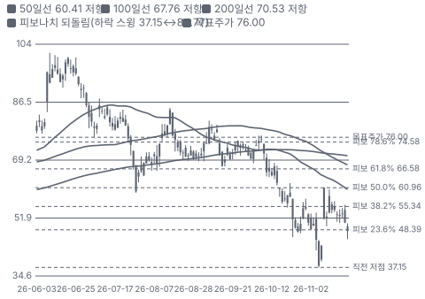

**주봉**

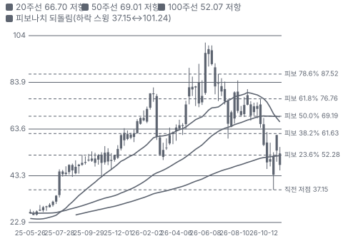

**월봉**

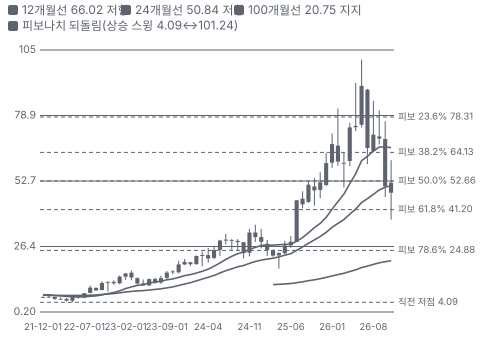

**분기 매출·EPS 실적과 컨센서스**

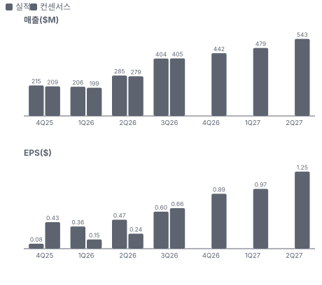

**4Q26 매출 — 지표 추세 vs 가이던스·컨센서스**

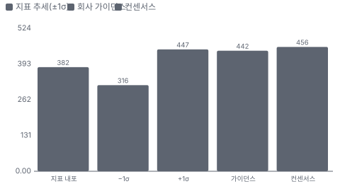

**최근 4개 분기 주가 변화 분석**

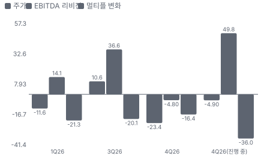

**EPS 리비전**

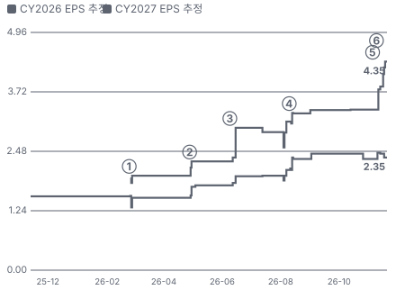

① 26-02-24 4Q25 실적, 당일 −22.8% · EPS 리비전 -
② 26-04-28 1Q26 실적, 당일 +14.4% · EPS 리비전 +15%
③ 26-06-09 Thermon 인수 종결 뒤 투자자 설명회, 당일 +18.5% · EPS 리비전 +31%
④ 26-08-10 2Q26 실적·가이던스 상향, 당일 −0.8% · EPS 리비전 +6%
⑤ 26-11-05 중간선거 뒤 이틀 −25%(원인 미확인) · EPS 리비전 +0%
⑥ 26-11-09 3Q26 실적·2027 가이던스, 당일 +19.0% · EPS 리비전 +30%

**멀티플 프리미엄(Fwd 1Y EV/EBITDA, 최근 4개 분기말 절대값 — 대상 vs 동종 중앙값)**

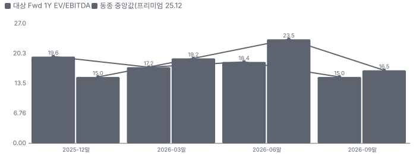

**합리적 멀티플**

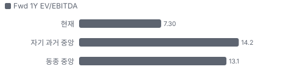

**밸류에이션 주가 시나리오**

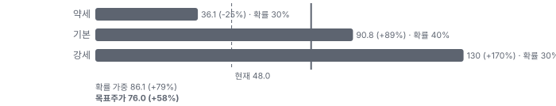

**주가별 업사이드**

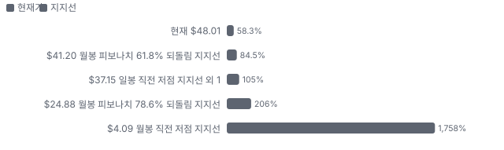
- 제품·서비스 포트폴리오

**고객 믹스(3Q26, 매출 대비)**

**공급 병목(10점, 낮을수록 병목)**

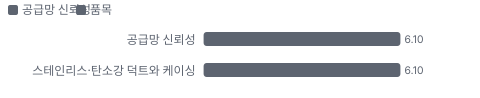

**CAPEX의 매출 대비 비중**

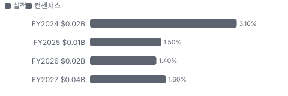

**어닝콜 변화별 주주가치 영향**

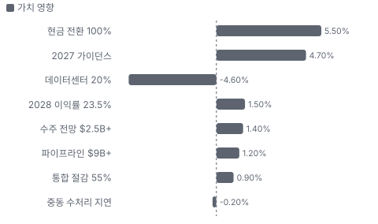

**수주·파이프라인 확실성 사다리**

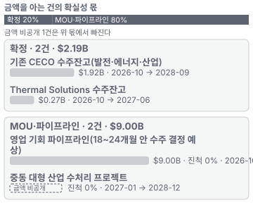

**매출 → 매출총이익 → 영업이익(매출 = 100, 최근 4분기)**

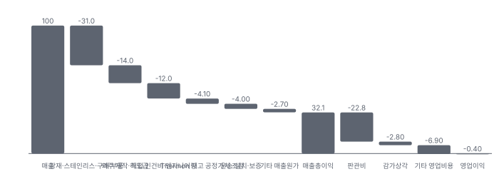

**분기 비용 비중 추이(매출 대비, 공시)**

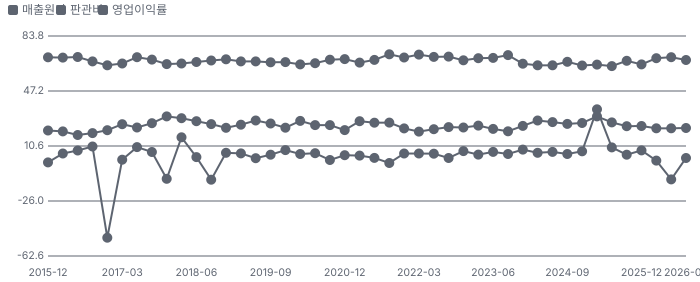

**비용 요인별 매출 대비 비중 1년 변화**

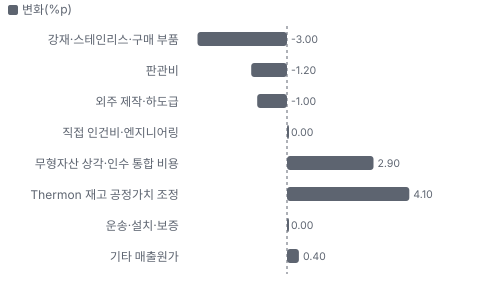

**Engineered Systems BOM 원가 몫**

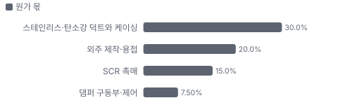

**Thermal Solutions BOM 원가 몫**

**Industrial Process Solutions BOM 원가 몫**

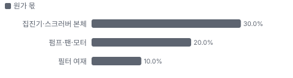

**BOM 항목 가격 +10% 시 OPM 변화**

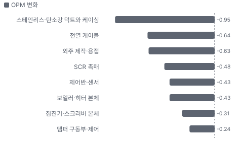

**원가 물가 vs 판매가 물가 — 최근 24개월**

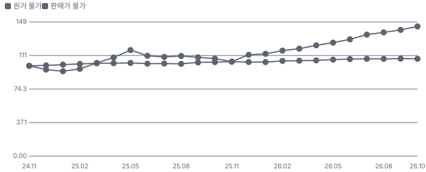

**자산 구성 — 3Q26 분기말 투하자본 \$2.66B**

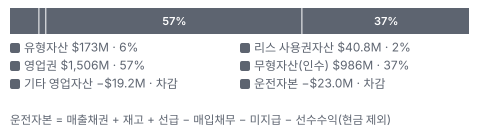

**자산별 변화율 — 최근 12개 분기(4Q23 = 0%) + 다음 4개 분기 추정**

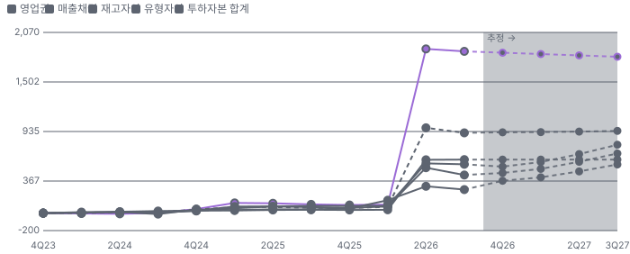

**ROIC 추이 — TTM, 최근 12개 분기 + 다음 4개 분기 추정(컨센서스 NOPAT) · 투하자본이 0 근처라 ROIC가 ±100%를 넘는 분기는 비움**

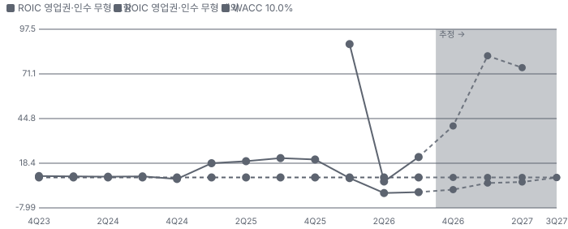

**Thermon 인수 효과 — 인수 전 EPS 대비 %, 굵은 선 = 합계 · 시너지 가치 \$0.21B(웃돈 미확인)**

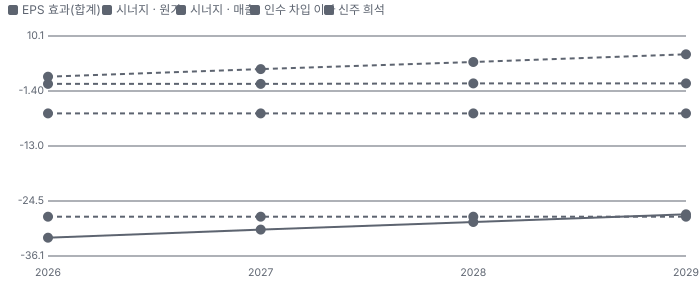

**매출 vs PPI·수출입 — 4Q22 = 100(변화율, 로그 눈금)**

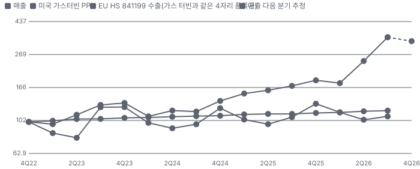

**10년 P·Q 사이클 — 추세(HP 필터) 대비 갭과 8분기 전망**

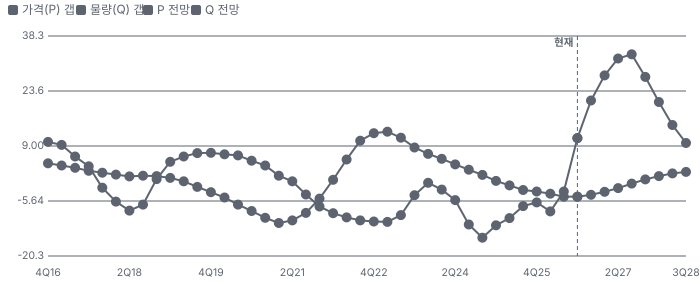

**매출 증가율의 가격·물량 분해와 8분기 전망(전년 대비)**

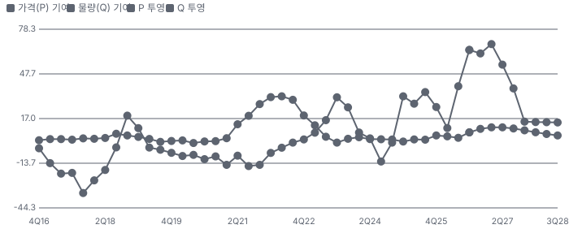

**목표주가 산정 — 약세와 기본 사이(약세 쪽 26%), 도달 확률 약 59%**

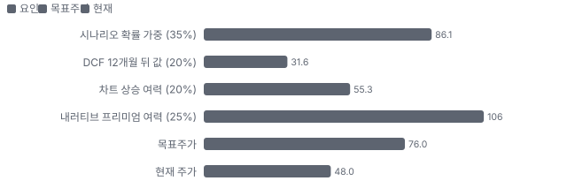

**PEG — 성장 대비 멀티플(낮을수록 성장 대비 쌈)**

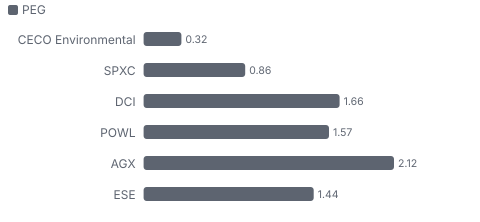

**재고 일수 — 분기별(수주 자료가 없어 수주/출하 비율 없음)**

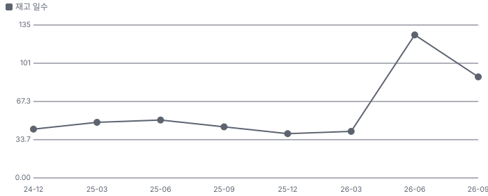

**일별 거래량 분해**

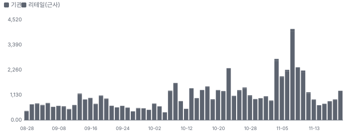

**기관 자금 흐름**

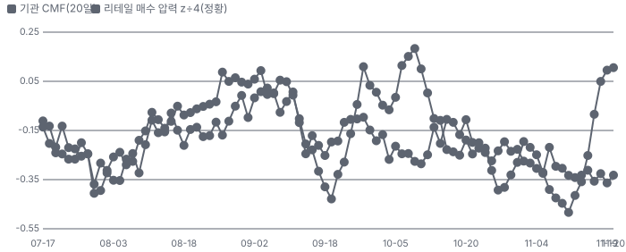

**몬테카를로**

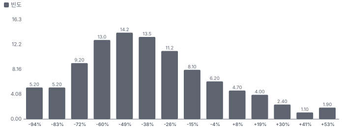

해석: 3,000번 중 452번(15%)에서 가치가 지금 주가 이상이었다. 가정을 흔들어도 지금 주가를 뒷받침하지 못하는 경우가 더 많다. 가운데 값은 0.59배이고, 열 번 중 여덟 번은 0.22~1.12배 사이에 든다.

## 내러티브

> **기업가치를 결정하는 이야기:** CECO의 값은 ① 수주잔고 \$2.19B가 2027년에 70% 넘게 매출로 바뀌는지 ② 조정 EBITDA 이익률이 3Q 17.3%에서 2027년 22.7%로 오르는지 ③ 선수금 덕분인 현금흐름이 수주가 둔화해도 버티는지 ④ 내부통제 중대 취약점과 인수 회계 소음이 걷히는지로 정해진다.

> **멀티플·EPS 프리미엄**
> **멀티플:** Fwd 1Y EV/EBITDA 7.3배로 동종 중앙 13.1배보다 44% 낮고, 자기 3년 레인지(9.6~21.8배)의 바닥 아래다. 5월 말에는 20.0배였다.
> **EPS:** FY2027 조정 EBITDA 추정은 8월 \$328M에서 11월 \$495M으로 51% 올랐고, 같은 기간 FY2027 EPS 추정은 \$3.28에서 \$4.35로 33% 올랐다.

### 투자자들은 왜 열광했나

6월 Thermon 인수 종결 뒤 투자자 설명회에 하루 +18.5%로 뛰어 6월 22일 \$99.67을 찍었다. 이후 7월 말·10월 하순 급락(원인 미확인)과 중간선거 뒤 이틀 −25%로 \$37.66까지 내렸다. 같은 기간 동종 5사도 52주 고점에서 28~67% 내려 발전·데이터센터 인프라 장비주 전체의 배수가 깎였다. 3Q 실적과 2027년 가이던스로 하루 +19% 반등했지만 가이던스가 너무 커서 믿기 어렵다는 시각이 남았다.

### 무엇이 기업가치를 바꾸나

> **구조적 체질 변화**
> **변화:** 공장 대기 오염 방지 장비 회사에서 가스 발전 배출·배기 설비와 열 추적(배관·탱크에 전열선을 감아 내용물이 얼거나 굳지 않게 온도를 지키는 장비)을 묶은 에너지 인프라 장비 회사로 바뀌었다. 매출은 1년 새 2배, 주식 수는 64% 늘었다.
> **증거:** 3Q26 10-Q — 매출 \$404.4M(전년 \$197.6M), 발행 주식 3,564만 → 5,861만 주
> **반증:** Engineered Systems(발전·에너지 설비용 배출 저감·배기·소음·분리 여과 장비 부문) 수주가 2개 분기 연속 감소

> **고부가 믹스 확장**
> **변화:** Thermon 편입과 대형 프로젝트 믹스로 조정 매출총이익률이 한 분기에 262bp 올라 36.3%가 됐다. 회사는 잔고 마진이 이보다 높다고 밝혔다.
> **증거:** 3Q26 어닝콜(2026-11-09)
> **반증:** 조정 매출총이익률이 34% 아래로

> **기술 혁신**
> **변화:** 해당 없음(새 기술이 아니라 허가 요건을 맞추는 검증된 설비의 조합이다 — 연구개발비를 따로 공시하지 않는다)
> **증거:** FY2025 10-K

> **실행 속도**
> **변화:** 해당 없음(납품 리드타임 수치 미공시 — 잔고는 12~24개월 안 인도, 3Q에 중대한 프로젝트 지연은 없었다고만 밝혔다) **납품 리드타임 미확인.** 피어 비교 미확인. 이전 대비 미확인.
> **증거:** 3Q26 10-Q·어닝콜(2026-11-09)
> **반증:** 프로젝트 지연으로 매출 인식이 밀렸다는 콜 발언

> **M&A**
> **변화:** 2026년 6월 Thermon을 \$2.26B(현금 약 \$329M + 신주 2,253만 주)에 인수했다. 3년 원가 절감 목표 \$40M 중 연 환산 \$22M을 6개월 만에 달성했다. 2020년 이후 인수는 12건이 넘는다.
> **증거:** 3Q26 10-Q 주석 14·어닝콜(2026-11-09)
> **반증:** 영업권 손상 또는 절감 목표 하향

> **정책·입법 연관성**
> **재정정책:** 해당 없음(정부 보조금·세액공제와 직접 연결되는 매출 공시 없음) FY2025 10-K 의회 동의 2/10 — 하원 1/5(논의 없음) · 상원 1/5(논의 없음).
> **행정명령:** 해당 없음(행정명령과 직접 연결되는 매출 미확인 — 회사는 선거 뒤 정책 변화를 위험 요인으로만 언급) 3Q26 어닝콜(2026-11-09) 의회 동의 2/10 — 하원 1/5(논의 없음) · 상원 1/5(논의 없음).
> **연관입법:** 해당 없음 — 발전소 배출 기준(대기청정법 인허가)이 수요의 바탕이지만 새 법안과의 연결은 확인하지 못했다 FY2025 10-K

> **고객의 지출 예산**
> **변화:** 세 부문 모두 고객의 설비 투자(CAPEX)에서 돈이 나온다. Thermal Solutions 일부는 유지·교체 예산(OPEX)이지만 비중은 공시가 없다.
> **사업별 예산:** **매출의 48%**: Engineered Systems — 고객 CAPEX(발전소·가스 인프라 건설 투자) · 동인: 가스 발전소 착공과 터빈 인도
**매출의 37%**: Thermal Solutions — 고객 혼합(공정 설비 투자와 유지·교체 예산) · 동인: 에너지·화학 공정 설비 투자와 설치 기반 교체
**매출의 15%**: Industrial Process Solutions(공장용 집진·배기 처리·유체 이송·수처리 장비 부문) — 고객 CAPEX(공장 환경 설비 투자) · 동인: 반도체·전자 공장 증설
> **증거:** 3Q26 10-Q 부문 매출
> **반증:** 유틸리티·독립 발전사의 가스 발전 건설 계획 축소

### 내러티브 근거

> 산업용 대기 오염 방지 장비 회사가 가스 발전소 배출·배기 설비와 열 추적(Thermon)을 묶은 에너지 인프라 장비 회사로 바뀌었다. 수주잔고는 1년 새 3배가 됐고 회사는 2027년 조정 EBITDA \$475~525M을 제시했다. 그런데 주가는 6월 종가 고점의 절반이다 — 시장은 가이던스를 그대로 믿지 않는다. 단계는 확산, 쏠림은 낮음이다.

> **가스 발전 건설 사이클** · 강화
> **논리:** 전력 수요 증가로 대형 가스 발전소 건설이 몰리고, 배출·배기 설비는 허가에 꼭 필요하다
> **숫자:** 9개월 수주 \$2.03B(유기 +161%), 잔고의 약 60%가 발전
> **반증:** 분기 수주 대 매출 비율이 1 아래로 2개 분기 연속
> **출처:** 3Q26 10-Q·어닝콜(2026-11-09)

> **Thermon 편입과 통합 절감** · 유지
> **논리:** 이익률 높은 열 추적 사업이 붙어 이익률과 현금흐름이 올라간다
> **숫자:** 통합 절감 연 환산 \$22M(목표 \$40M의 55%), 조정 매출총이익률 36.3%
> **반증:** 1주년(2027-06)까지 절감이 목표의 70%에 못 미치면
> **출처:** 3Q26 어닝콜(2026-11-09)

> **2027년 가이던스의 가시성** · 유지
> **논리:** 연말 잔고의 70% 이상이 2027년 매출이 되고 잔고 마진이 지금보다 높다
> **숫자:** 잔고 \$2.19B × 70% ≈ \$1.54B = 2027년 매출 가이던스 중간의 70%(계산)
> **반증:** 4Q 조정 EBITDA가 내재 범위 \$69~94M의 하단을 밑돌면
> **출처:** 3Q26 어닝콜(2026-11-09)

> **선수금이 만든 현금흐름** · 유지
> **논리:** 고객 선수금으로 차입을 빠르게 갚아 인수 여력이 다시 생긴다
> **숫자:** 3Q 조정 잉여현금흐름 \$154.4M, 초과청구 \$123.7M → \$388.1M, 순차입 배수 2.7배 → 2.0배
> **반증:** 수주가 줄어 초과청구 잔액이 2개 분기 연속 감소
> **출처:** 3Q26 10-Q

> **반대 — 한 번의 건설 사이클과 인수 회계** · 유지
> **논리:** 매출은 12~24개월 프로젝트형이고 반복 매출 비중은 공시가 없다. GAAP은 적자이고 영업권·무형자산이 총자산의 67.6%다
> **숫자:** 9개월 GAAP 순손실 \$37.2M, 영업권 \$1.51B + 무형자산 \$995M, 내부통제 중대 취약점 미해소
> **반증:** FY2026 10-K에서 애프터마켓·서비스 매출 비중 공시와 중대 취약점 해소
> **출처:** 3Q26 10-Q·FY2025 10-K

### 투자 포인트

> **이익 추정은 올랐는데 배수가 반 토막**
> **명제:** 2Q 콜 뒤 주가는 32% 내렸지만 FY2027 EPS 추정은 33% 올랐다
> **숫자:** FY2027 EPS 추정 \$3.28(8/14) → \$4.35(11/18), 주가 \$70.92(8/7) → \$48.01(11/20). Fwd 1Y EV/EBITDA 7.3배, 동종 중앙 13.1배
> **시장과 다른 점:** 시장은 2027년 가이던스를 그대로 믿지 않는다 — 지금 가격은 가이던스의 일부만 달성하는 경로를 담고 있다
> **증명:** 4Q 조정 EBITDA \$69~94M(가이던스 내재), FY2027 가이던스 재확인
> **출처:** 3Q26 8-K EX-99.1(2026-11-09)

> **잔고가 2027년 매출의 70%를 이미 덮는다**
> **명제:** 연말 잔고의 70% 이상이 2027년 매출이 되고, 나머지는 Thermon 단납기 매출이 채운다
> **숫자:** 잔고 \$2.19B × 70% ≈ \$1.54B(계산) + Thermal Solutions 분기 매출 \$148.5M의 연 환산 약 \$0.59B(계산, 잔고와 일부 겹침) — 가이던스 중간 \$2.2B
> **시장과 다른 점:** 시장은 '괴물 같은 가이던스'라 의심하지만 산술은 잔고와 맞는다 — 위험은 물량이 아니라 일정과 이익률이다
> **증명:** 연말 잔고 \$2.2B 초과, 1Q27 매출 \$480M 안팎
> **출처:** 3Q26 어닝콜(2026-11-09)·10-Q

> **가를 숫자는 이익률이다**
> **명제:** 2027년 조정 EBITDA 이익률 22.7%는 3Q 17.3%보다 5.4%p 높다
> **숫자:** 통합 절감 \$40M은 매출 \$2.2B의 약 1.8%p(계산), 나머지는 잔고 마진과 물량 효과에서 나와야 한다 — 회사는 잔고 매출총이익률이 현재보다 높다고만 밝혔다
> **시장과 다른 점:** 애널리스트 FY2027 EBITDA 추정 \$495M은 가이던스 중간과 같다 — 이익률 미달 위험은 추정에 없다
> **증명:** 4Q 조정 EBITDA 이익률 19% 이상, 조정 매출총이익률 36% 이상
> **출처:** 3Q26 어닝콜(2026-11-09)

### 모멘텀 생성·소멸 타임라인

**카탈리스트 달력 — 지난 사건의 주가 반응과 앞으로 확인할 숫자**
| 날짜 | 상태 | 구분 | 사건 | 반응·확인 | 결과에 따라 |
|---|---|---|---|---|---|
| 2026-06-09 | 완료 | 생성 | Thermon 인수 종결 뒤 투자자 설명회 | +18.5% |  |
| 2026-11-05 | 완료 | 소멸 | 중간선거 뒤 이틀 급락(원인 미확인 — 발전·데이터센터 인프라주 동반 하락) | −25.0%(2거래일) |  |
| 2026-11-09 | 완료 | 생성 | 3Q26 실적·2027년 첫 가이던스 | +19.0% |  |
| 2027-02 하순(예상) | 예정 | 확인 | 4Q26·FY2026 실적과 10-K | 4Q 조정 EBITDA \$69M 이상, 연말 잔고 \$2.2B 초과, 2027년 가이던스 유지, 중대 취약점 해소 여부 | 충족이면 기본~강세, 가이던스 하향이면 약세 |
| 2027-04 하순(예상) | 예정 | 확인 | 1Q27 실적 | 매출 \$480M 안팎, 조정 EBITDA 이익률 20% 이상 | 이익률이 20%를 넘으면 강세 경로, 18% 아래면 약세 경로 |
| 2027-01~02(예상) | 예정 | 매크로 | 가스터빈 제조사·유틸리티의 2027년 수주·설비 투자 가이던스 | 가스터빈 수주잔고와 유틸리티 가스 발전 투자 계획이 유지되는지 | 유지면 Engineered Systems 수주 환경 유지 |

### 언제 사서 언제 팔아야 할까?

**가격·조건 틀 — 가격은 밸류에이션(약세·기본·강세·목표주가)과 차트 지지 구간에서, 조건은 이벤트에서**
| 구간 | 가격 | 목표주가까지 | 약세까지 | 조건·근거 |
|---|---|---|---|---|
| 관찰 구간 | \$41~\$41 | +84% | -12% | 11월 5일 저점(\$37~38) 부근은 선거 뒤 공포와 가이던스 불신이 가장 깊게 반영된 자리다 |
| 확인 뒤 | 지금 \$48 이상에서 조건 확인 | +58% | -25% | 4Q 실적에서 조정 EBITDA 이익률 19% 이상과 2027년 가이던스 유지 |
| 무효화 | 약세 시나리오 \$36 | - | -25% | 2027년 가이던스 하향, 분기 수주 대 매출 비율 1 미만, 또는 종가 \$37.66 아래 |
| 차익 고민 1차 | \$91(기본 시나리오) | +89% | - | 목표주가 근처에서는 배수가 동종 하단까지 돌아온 것이라 추가 상승은 이익률 확인이 필요하다 |
| 차익 고민 2차 | \$130(강세 시나리오) | +170% | - | 목표주가 근처에서는 배수가 동종 하단까지 돌아온 것이라 추가 상승은 이익률 확인이 필요하다 |

최근 한 달 하루 변동이 10~19%인 날이 여섯 번이다 — 발표 직후 추격은 경계 가격·조건 틀이며 매매·비중 지시가 아니다(투자 권유 아님).

## 포트폴리오

| 제품·서비스 | 구분 | 무엇 | 쓰는 곳 | 돈 버는 방식 | Mix | Mix 변화(전 분기 대비) |
|---|---|---|---|---|---|---|
| Engineered Systems | 제품 | 가스터빈 발전소·정유·가스 설비용 배출 저감 장치, 배기 덕트·댐퍼(배기 통로를 여닫아 가스 흐름을 조절하는 대형 판), 소음기, 분리 여과 장비 | 가스 발전소, 천연가스 처리·수송, 정유·화학 | 3Q26 매출의 48% | 48% | 미확인 |
| Thermal Solutions | 제품 | 배관·탱크 열 추적 케이블과 제어기, 공정 히터·보일러(Thermon) | 에너지·화학 공정, 발전소, 한랭지 설비 | 3Q26 매출의 37% | 37% | 미확인 |
| Industrial Process Solutions | 제품 | 집진기, 스크러버(배기가스를 액체나 흡수제로 씻어 오염물질을 걸러 내는 설비), 열산화 장치(배기 속 유기 화합물을 고온으로 태워 없애는 설비), 산업용 펌프·팬, 수처리 장비 | 반도체·전자 공장, 식음료·금속·화학 공장 | 3Q26 매출의 15% | 15% | 미확인 |

## 고객

> **3Q26 최대 고객 발전 프로젝트 고객 묶음(가스·원자력 유틸리티, 산업 열·전력, 데이터센터) — 수주잔고 기준(power generation projects) 60%, 상위 3곳 100%, 집중도 집중.** 공시·회사 발표로 확인한 몫은 매출의 100%이고, 나머지 고객 몫은 추정이거나 미분해다. 2023~2025년 매출의 10%를 넘는 단일 고객은 없었다(10-K). 잔고가 3배로 커진 뒤의 고객·프로젝트 집중은 공시가 없다. 회사는 잔고를 용도별로만 밝혔다 — 발전 약 60%(그중 데이터센터 용도는 전체의 약 20%), 그 밖 에너지·산업 약 40%.

**고객별 매출 몫(3Q26)**
| 고객 | 몫 | 변화 | 근거 |
|---|---|---|---|
| 발전 프로젝트 고객 묶음(가스·원자력 유틸리티, 산업 열·전력, 데이터센터) — 수주잔고 기준(power generation projects) | 60% | +10%p | 회사 발표 |
| 에너지·산업 고객 묶음(반도체·전자, 천연가스 처리·수송, 화학, 산업 수처리) — 수주잔고 기준(energy and industrial end markets) | 40% | -10%p | 회사 발표 |

> **발전 프로젝트 고객 묶음(가스·원자력 유틸리티, 산업 열·전력, 데이터센터) — 수주잔고 기준(power generation projects)** · 회사 발표
> **사는 것:** 배출 저감·배기·소음 설비
> **추정 근거:** 개별 고객명·몫 미공시

> **에너지·산업 고객 묶음(반도체·전자, 천연가스 처리·수송, 화학, 산업 수처리) — 수주잔고 기준(energy and industrial end markets)** · 회사 발표
> **사는 것:** 집진·배기 처리, 분리 여과, 수처리, 열 추적
> **추정 근거:** 개별 고객명·몫 미공시

## 수주·파이프라인

> **2026-09-30 기준 4건.** 확정 \$2.19B, 미확정 \$9.00B. 공시 수주잔고 \$2.19B.

**수주 목록**
| 상태 | 계약 | 계약 총액 | 진척 | 기간 | 비고 |
|---|---|---|---|---|---|
| 확정 | 기존 CECO 수주잔고(발전·에너지·산업) | \$1.92B | - | 2026-10 → 2028-09 | - |
| 확정 | Thermal Solutions 수주잔고 | \$0.27B | - | 2026-10 → 2027-06 | - |
| 파이프라인 | 영업 기회 파이프라인(18~24개월 안 수주 결정 예상) | \$9.00B | 0% | 2026-10 → 2028-09 | - |
| 파이프라인 | 중동 대형 산업 수처리 프로젝트 | 금액 비공개 | 0% | 2027-01 → 2028-12 | (영업 기회 파이프라인(18~24개월 안 수주 결정 예상)에 포함) |

**실행 속도와 방해 요인**
| 항목 | 상태 | 실행 속도 | 방해 요인 |
|---|---|---|---|
| 기존 CECO 수주잔고(발전·에너지·산업) | 확정 | 12~24개월 안 인도(10-Q) | 가스터빈 인도·인허가 일정 · 고객 취소권 · 제작 협력사 납기 |
| Thermal Solutions 수주잔고 | 확정 | 단납기 — 분기 매출 \$148.5M의 약 2개 분기분(계산) | 공정 산업 설비 투자 |
| 영업 기회 파이프라인(18~24개월 안 수주 결정 예상) | 파이프라인 | 18~24개월 안 결정 | 수주 경쟁 · 고객 투자 결정 |
| 중동 대형 산업 수처리 프로젝트 | 파이프라인 | 지연 | 중동 분쟁 |

## 마진 구조

> **GPM 32.2%, OPM 2.6%.** 3Q25 대비 GPM -0.5%p, OPM -2.2%p. 변동비는 매출의 65%이고, 매출이 10% 늘면 OPM은 +3.0%p 움직인다. 3Q26 GAAP 매출총이익률 32.2%(조정 36.3%), 조정 EBITDA 이익률 17.3%(전년 11.8%). GAAP 영업이익률은 2.6%에 그친다 — Thermon 재고 공정가치 조정 \$16.7M, 무형자산 상각 \$15.3M, 인수·통합 비용 \$12.4M이 들어갔다.

> **매출 100 중 매출원가 67.9, 매출총이익 32.1(최근 4분기, 공시).** 매출원가 요인 중 강재·스테인리스·구매 부품이 매출의 31.0%로 가장 무겁고, 단가가 +10% 오르면 GPM이 -3.10%p 움직인다. 분기 회귀로 매출 1이 늘 때 매출원가는 0.68 늘고, 매출원가의 고정비 몫은 0%다.

**비용 요인 강도 — 비중·추세·충격(+10%)·탄력**
| 비용 | 구분 | 매출 대비 | 1년 변화 | 마진 기여 | 충격 시 마진 | 매출 탄력 | 고정비 몫 |
|---|---|---|---|---|---|---|---|
| 강재·스테인리스·구매 부품 | 매출원가 요인 | 31.0% | -3.0%p | +3.0%p | -3.10%p | 미확인 | 0% |
| 외주 제작·하도급 | 매출원가 요인 | 14.0% | -1.0%p | +1.0%p | -1.40%p | 미확인 | 0% |
| 직접 인건비·엔지니어링 | 매출원가 요인 | 12.0% | +0.0%p | -0.0%p | -1.20%p | 미확인 | 50% |
| Thermon 재고 공정가치 조정 | 매출원가 요인 | 4.1% | +4.1%p | -4.1%p | -0.41%p | 미확인 | 100% |
| 운송·설치·보증 | 매출원가 요인 | 4.0% | +0.0%p | -0.0%p | -0.40%p | 미확인 | 20% |
| 기타 매출원가 | 매출원가 요인 | 2.7% | +0.4%p | -0.4%p | -0.27%p | 미확인 | 50% |
| 매출원가 | 공시 항목 | 67.9% | +2.8%p | -2.8%p | -6.79%p | 0.68 | 0% |
| 판관비 | 공시 항목 | 22.8% | -3.8%p | +3.8%p | 미확인 | 0.23 | 5% |
| 기타 영업비용 | 공시 항목 | 6.9% | +14.5%p | -14.5%p | 미확인 | 0.05 | -100% |
| 감가상각 | 공시 항목 | 2.8% | +0.8%p | -0.8%p | 미확인 | 0.03 | -19% |

매출 탄력 = 분기 비용을 매출에 회귀한 기울기(매출 1당 변동비), 고정비 몫 = 절편 ÷ 평균 비용. 표본이 8분기 미만이면 미확인. 매출원가 요인 비중은 margin 재료의 추정이 섞여 있고, 공시 매출원가와의 차이는 '기타 매출원가'로 둔다.

**GPM에서 OPM까지(GAAP — 10-Q 3개월 손익, 아래는 최근 4개 분기)**
| 기간 | GPM | 연구개발 | 판관비 | 기타 | OPM |
|---|---|---|---|---|---|
| 3Q25 | 32.7% | 0.0% | 23.8% | 4.1% | 4.8% |
| 3Q26 | 32.2% | 0.0% | 22.6% | 7.0% | 2.6% |
| 2025-12 | 35.1% | - | - | - | 7.7% |
| 2026-03 | 31.0% | - | - | - | 0.9% |
| 2026-06 | 30.3% | - | - | - | -11.6% |
| 2026-09 | 32.2% | - | - | - | 2.6% |

**비용을 움직이는 요인**
| 비용 | 요인 |
|---|---|
| 강재·스테인리스·구매 부품(매출원가) | 강재 가격·할증료(계약에 물가 조항) · 근거 추정 |
| 판관비(판관비) | 인력·통합 절감(\$22M 연 환산) · 근거 공시 |
| 외주 제작·하도급(매출원가) | 제작 협력사 단가·납기 · 근거 추정 |
| 직접 인건비·엔지니어링(매출원가) | 설계 인력·프로젝트 수 · 근거 추정 |
| 무형자산 상각·인수 통합 비용(판관비) | Thermon 인수(상각 2027년 \$71.0M 예정) · 근거 공시 |
| Thermon 재고 공정가치 조정(매출원가) | 인수 회계(일회성) · 근거 공시 |
| 운송·설치·보증(매출원가) | 현장 일정 · 근거 추정 |
| 기타 매출원가(매출원가) | 기타 · 근거 추정 |

**Engineered Systems BOM — 매출의 48%, GPM 34%(추정 — 부문 매출총이익률 미공시. 전사 조정 매출총이익률 36.3%에 맞춘 배분(세 부문 가중 평균 36.8%). 부문 매출총이익률 미공시 — 부문 이익률 25.8%(전년 20.8%)), 항목 가격 +10% 시**
| 항목 | 원가 몫 | 전가 | 제품 GPM | OPM |
|---|---|---|---|---|
| 스테인리스·탄소강 덕트와 케이싱 | 25~35% | 미확인 | -2.0%p | -0.95%p |
| 외주 제작·용접 | 15~25% | 미확인 | -1.3%p | -0.63%p |
| SCR(선택적 촉매 환원 장치 — 발전소 배기가스의 질소산화물을 촉매로 줄이는 설비) 촉매 | 10~20% | 미확인 | -1.0%p | -0.48%p |
| 댐퍼 구동부·제어 | 5~10% | 미확인 | -0.5%p | -0.24%p |
| 미분해 | 27% | - | - | - |

**Thermal Solutions BOM — 매출의 37%, GPM 42%(추정 — 부문 매출총이익률 미공시. 전사 조정 매출총이익률 36.3%에 맞춘 배분(세 부문 가중 평균 36.8%). 부문 이익 \$7.1M은 재고 공정가치 조정 \$16.7M 차감 뒤 값), 항목 가격 +10% 시**
| 항목 | 원가 몫 | 전가 | 제품 GPM | OPM |
|---|---|---|---|---|
| 전열 케이블 | 25~35% | 미확인 | -1.7%p | -0.64%p |
| 제어반·센서 | 15~25% | 미확인 | -1.2%p | -0.43%p |
| 보일러·히터 본체 | 15~25% | 미확인 | -1.2%p | -0.43%p |
| 미분해 | 30% | - | - | - |

**Industrial Process Solutions BOM — 매출의 15%, GPM 33%(추정 — 부문 매출총이익률 미공시. 전사 조정 매출총이익률 36.3%에 맞춘 배분(세 부문 가중 평균 36.8%). 부문 이익률 15.2%(전년 11.3% — 계산)), 항목 가격 +10% 시**
| 항목 | 원가 몫 | 전가 | 제품 GPM | OPM |
|---|---|---|---|---|
| 집진기·스크러버 본체 | 25~35% | 미확인 | -2.0%p | -0.31%p |
| 펌프·팬·모터 | 15~25% | 미확인 | -1.3%p | -0.21%p |
| 필터 여재 | 5~15% | 미확인 | -0.7%p | -0.10%p |
| 미분해 | 40% | - | - | - |

스테인리스·탄소강 덕트와 케이싱 가격이 +10% 오르면 영업이익은 -36.6% 움직인다. 판매가 전가를 모르는 항목은 전가 0%로 계산했다.

**BOM 항목 가격을 움직이는 것**
| 항목 | 요인 |
|---|---|
| 스테인리스·탄소강 덕트와 케이싱 | 부피·중량 최대 소재 — 계약에 할증료·물가 조항(10-K), 전가율 미공시 · 근거 추정 |
| SCR 촉매 | 질소산화물 저감 핵심 소모재 · 근거 추정 |
| 외주 제작·용접 | 대형 구조물 제작 · 근거 추정 |
| 댐퍼 구동부·제어 | 구매 부품 · 근거 추정 |
| 전열 케이블 | 열 추적 핵심 자재 · 근거 추정 |
| 제어반·센서 | 온도 제어 · 근거 추정 |
| 보일러·히터 본체 | 공정 가열 장비 · 근거 추정 |
| 집진기·스크러버 본체 | 강재·수지 구조물 · 근거 추정 |
| 펌프·팬·모터 | 구매 부품 · 근거 추정 |
| 필터 여재 | 소모재 · 근거 추정 |

> **원가·판매가 물가 격차 -29.3%p** — 판매가 물가가 투입 원가 물가보다 느리게 오른다.

**투입 물가 — 미국 PPI 3·6·12개월(2026-10, 개정 반영)과 해외 전년비**
| 항목 | 미국 3개월 | 6개월 | 12개월 | 전가 못 할 때 OPM | 일본 | 한국 | 대만 |
|---|---|---|---|---|---|---|---|
| 집진기·스크러버 본체 | +6.7% | +17.0% | +32.9%* | - | 미확인 | 미확인 | 미확인 |
| 댐퍼 구동부·제어 | +0.4% | +0.3% | +6.4%* | - | 미확인 | 미확인 | 미확인 |
| 전열 케이블 | +3.4% | +7.2% | +23.9% | - | +42.6% | +19.2% | +40.1% |

별표는 품목보다 넓은 업종 지수다. 연결한 투입 원가의 미국 PPI(생산자물가지수)는 1년 새 가중 +32.9%이고, 판매가로 넘기지 못하면 GPM -10.2%p·OPM -10.2%p가 움직인다. 판매가 비교 물가(가스 터빈(출력 5,000kW 초과) PPI)는 1년 새 +3.6% — 회사 가격 변화는 미확인. 물가 지수를 붙이지 못한 매출원가 항목은 외주 제작·하도급, 직접 인건비·엔지니어링, 운송·설치·보증, Thermon 재고 공정가치 조정다(미연결).

## 자산 구성

> **3Q26 분기말 투하자본 \$2.66B** — 영업권 57%, 무형자산(인수) 37%. 최근 12개 분기(4Q23 → 3Q26) 가장 크게 늘어난 자산은 무형자산(인수, +1853%), 투하자본 합계 +919%. 3Q27 추정 투하자본 \$2.72B(+2%, 컨센서스 매출과 회전 일수·CAPEX 강도 유지 가정). 연율 감가 비율(순액 기준)은 직전 4분기 47.02% → 최근 4분기 69.72%.

**자산·운전자본 항목별 분기말 잔액 — 최근 12개 분기와 다음 4개 분기 추정**
| 항목 | 4Q23 | 3Q25 | 3Q26(최근) | 3Q27 추정 | 12개 분기 변화 | 다음 4개 분기 변화 |
|---|---|---|---|---|---|---|
| 매출채권 | \$112.7M | \$159.6M | \$415.5M | \$740.6M | +269% | +78% |
| 재고자산 | \$34.1M | \$57.7M | \$182.9M | \$266.8M | +436% | +46% |
| 선급·기타 유동자산 | \$11.8M | \$29.1M | \$103.1M | \$132.7M | +776% | +29% |
| 매입채무 | \$87.7M | \$127.6M | \$205.9M | \$372.7M | +135% | +81% |
| 미지급비용 | \$44.3M | \$60.6M | \$130.5M | \$206.6M | +195% | +58% |
| 선수수익(계약부채) | \$56.9M | \$107.4M | \$388.1M | \$550.9M | +582% | +42% |
| 유형자산 | \$26.2M | \$48.0M | \$172.9M | \$231.7M | +559% | +34% |
| 리스 사용권자산 | \$16.3M | \$27.7M | \$40.8M | \$40.8M | +151% | +0% |
| 영업권 | \$211.3M | \$292.3M | \$1,506.0M | \$1,506.0M | +613% | +0% |
| 무형자산(인수) | \$50.5M | \$101.0M | \$985.6M | \$954.5M | +1853% | -3% |

**자산 추정 동인 — 최근 4개 분기 평균(재무상태표 동인 모형)**
| 동인 | 값 | 곱하는 기준 |
|---|---|---|
| 매출채권 | 109일 | 매출 |
| 재고자산 | 58일 | 매출원가 |
| 선급·기타 유동자산 | 20일 | 매출 |
| 매입채무 | 81일 | 매출원가 |
| 미지급비용 | 31일 | 매출 |
| 선수수익(계약부채) | 81일 | 매출 |
| 유형자산 ÷ 분기 매출 | 0.38배 | CAPEX·감가 재료 없음 — 비율 유지 |
| 매출원가율 | 67.9% | 매출(최근 4개 분기) |
| 영업권·리스 사용권·기타 | 유지 | 인수·새 리스는 공시 전 모름 |
| 인수 무형자산 | 분기 \$7.8M 상각 | 최근 4개 분기 평균 상각 |

**추정 방법:** 증권사 3표 모델(손익·재무상태표·현금흐름)의 재무상태표 동인 방식이다. 운전자본은 항목별 회전 일수(매출채권·선급·미지급·선수는 매출, 재고·매입채무는 매출원가 기준)를 최근 4개 분기 평균으로 두고 컨센서스 매출에 곱한다. 유형자산은 기초 + CAPEX − 감가상각으로 굴린다(Koller·Goedhart·Wessels 『Valuation』 재무상태표 추정). 매출 경로는 ROIC 절의 컨센서스와 같다.

**유형·무형자산 항목별 가치(2025-12-31 vs 2024-12-31)**
| 구분 | 항목 | 총액 2025-12-31 | 누적상각 | 순액 | 총액 2024-12-31 | 총액 1년 변화 | 공시 내용연수 |
|---|---|---|---|---|---|---|---|
| 유형 | 유형자산 합계(항목 미분해) | \$78.2M | 총계만 공시 | 총계만 공시 | \$75.0M | +4.3% | 미확인 |
| 영업권 | 영업권 | \$288.2M | \$0.0M | \$288.2M | \$269.7M | +6.8% | 비상각 |
| 무형 | 무형자산 합계(항목 미분해) | \$180.4M | \$83.4M | \$97.0M | \$163.7M | +10.2% | 미확인 |
| 유형 합계 | 유형자산 | \$78.2M | \$30.4M | \$47.8M | \$75.0M | +4.3% | 경과율 39%(상각 대상 기준) |

**내용연수 산식(상각 대상 유형자산 = 총액 − 토지 − 건설중)**
| 기준일 | 연 감가상각 | 상각 대상 총액 | 평균 내용연수 | 경과 연수 | 잔여 연수 | 경과율 |
|---|---|---|---|---|---|---|
| 2025-12-31 | \$8.7M | \$78.2M | 9.0년 | 3.5년 | 5.5년 | 39% |
| 2024-12-31 | \$5.8M | \$75.0M | 12.9년 | 7.1년 | 5.8년 | 55% |

산식 평균 내용연수는 9.0년. 1년 전 12.9년 → 지금 9.0년.

**분기 감가 비율(감가상각 ÷ 평균 유형자산 순액)**
| 분기 | 감가상각 | 평균 유형자산(순액) | 분기 비율 | 연율 | 연율의 역수 |
|---|---|---|---|---|---|
| 3Q24 | \$3.6M | \$31.3M | 11.38% | 45.54% | 2.2년 |
| 4Q24 | \$4.0M | \$33.1M | 12.06% | 48.24% | 2.1년 |
| 1Q25 | \$5.1M | \$39.9M | 12.81% | 51.23% | 2.0년 |
| 2Q25 | \$5.0M | \$46.3M | 10.88% | 43.52% | 2.3년 |
| 3Q25 | \$8.6M | \$47.3M | 18.11% | 72.42% | 1.4년 |
| 4Q25 | \$6.2M | \$47.9M | 12.85% | 51.38% | 1.9년 |
| 1Q26 | \$6.1M | \$48.0M | 12.73% | 50.92% | 2.0년 |
| 3Q26 | \$23.4M | \$110.5M | 21.17% | 84.69% | 1.2년 |

감가상각 기준: 손익계산서 감가상각·상각비(SEC 공시 데이터, 4분기 = 연간 − 1~3분기).

최근 4분기 연율 감가 비율 69.72%, 직전 4분기 47.02%(+48%) — 경고 문턱(-10%) 안이다.

미공시·미분해: 유형자산 항목별 총액·내용연수(10-K 주석에서 모델이 채움) · 무형자산 항목(10-K 주석에서 모델이 채움) — 이 칸은 비우고 나머지로 계산했다.

### 해석 — 자산이 어디에 쌓이고 있나

- 같은 기간 4개 분기 매출은 +101% — 매출보다 빨리 늘어난 자산: 매출채권 +269%, 재고자산 +436%, 유형자산 +559%, 리스 사용권자산 +151%, 영업권 +613%, 무형자산(인수) +1853%. 이 자산의 회전율이 떨어지면 ROIC를 희석한다.
- 감가 비율이 올라갔다 — 이익을 보수적으로 잡는 쪽이다(내용연수 단축·짧은 수명 자산 증가).

## ROIC

> **TTM 3Q26 ROIC는 영업권·인수 무형 포함 1.3%, 제외 22.0%**(NOPAT 마진 1.9% × 투하자본 회전율 0.69회). 최근 12개 분기 4Q23 10.8% → 3Q26 1.3%(고점 3Q25 21.4%). 컨센서스 NOPAT으로 굴리면 3Q27 9.9%(제외 미확인) — WACC 10.0% 대비 -0.1%p. 1년 변화의 가장 큰 요인은 NOPAT 마진(-14.4%p).

**ROIC 추이(TTM)와 다음 4개 분기 추정 — NOPAT ÷ 평균 투하자본(이번 분기말·4개 분기 전)**
| 분기 | 구분 | TTM 매출 | TTM NOPAT | NOPAT 마진 | 평균 투하자본 | ROIC 포함 | ROIC 제외 |
|---|---|---|---|---|---|---|---|
| 4Q23 | 실적 | \$544.8M | \$32.1M | 5.9% | \$297.6M | 10.8% | 미확인 |
| 1Q24 | 실적 | \$558.6M | \$33.9M | 6.1% | \$318.7M | 10.6% | 미확인 |
| 2Q24 | 실적 | \$567.0M | \$34.8M | 6.1% | \$333.8M | 10.4% | 미확인 |
| 3Q24 | 실적 | \$553.1M | \$34.8M | 6.3% | \$329.1M | 10.6% | 미확인 |
| 4Q24 | 실적 | \$557.9M | \$34.1M | 6.1% | \$373.2M | 9.1% | 미확인 |
| 1Q25 | 실적 | \$608.3M | \$75.2M | 12.4% | \$408.3M | 18.4% | 미확인 |
| 2Q25 | 실적 | \$656.2M | \$82.3M | 12.5% | \$419.2M | 19.6% | 미확인 |
| 3Q25 | 실적 | \$718.3M | \$87.2M | 12.1% | \$407.7M | 21.4% | 미확인 |
| 4Q25 | 실적 | \$774.4M | \$92.6M | 12.0% | \$450.0M | 20.6% | 미확인 |
| 1Q26 | 실적 | \$803.6M | \$48.1M | 6.0% | \$499.6M | 9.6% | 88.7% |
| 2Q26 | 실적 | \$903.2M | \$13.6M | 1.5% | \$1,686.1M | 0.8% | 7.6% |
| 3Q26 | 실적 | \$1,110.0M | \$21.4M | 1.9% | \$1,598.0M | 1.3% | 22.0% |
| 4Q26 | 추정 | \$1,337.5M | \$45.3M | 3.4% | \$1,604.9M | 2.8% | 40.4% |
| 1Q27 | 추정 | \$1,610.3M | \$108.6M | 6.7% | \$1,624.2M | 6.7% | 81.8% |
| 2Q27 | 추정 | \$1,868.1M | \$204.9M | 11.0% | \$2,816.6M | 7.3% | 74.8% |
| 3Q27 | 추정 | \$2,081.3M | \$273.0M | 13.1% | \$2,751.6M | 9.9% | 미확인 |

**다음 4개 분기 NOPAT — 컨센서스(세율 25%, 리스 이자 별도)**
| 분기 | 매출 | EBITA 마진 | EBITA | NOPAT(분기) | 근거 |
|---|---|---|---|---|---|
| 4Q26 | \$442.2M | 11.8% | \$52.2M | \$39.1M | 컨센서스 매출 × EBIT 마진 FY2026(조정 − 주식보상 1.2%) |
| 1Q27 | \$478.7M | 18.9% | \$90.5M | \$67.9M | 컨센서스 매출 × EBIT 마진 FY2027(조정 − 주식보상 1.2%) |
| 2Q27 | \$542.7M | 18.9% | \$102.6M | \$76.9M | 컨센서스 매출 × EBIT 마진 FY2027(조정 − 주식보상 1.2%) |
| 3Q27 | \$617.7M | 18.9% | \$116.7M | \$87.6M | 컨센서스 매출 × EBIT 마진 FY2027(조정 − 주식보상 1.2%) |

**추정 방법:** NOPAT은 컨센서스(분기 매출 추정 × 회계연도 EBIT 마진 추정)로 잡고, 조정(비 GAAP) 마진이면 주식보상 몫을 빼서 과거 실적과 같은 기준(영업이익 + 인수 무형 상각)으로 맞췄다. 이미 발표했지만 분기 보고서(10-Q)가 아직 없는 분기는 발표 실적을 쓴다. 투하자본은 자산 구성 절의 재무상태표 동인으로 굴렸다. ROIC는 4개 분기 NOPAT을 이번 분기말과 4개 분기 전 투하자본의 평균으로 나눈다 — 추정 분기의 ROIC에는 이미 나온 실적 분기가 섞여 있다.

**투하자본 항목별 회전율과 ROIC 기여(TTM 3Q26, 평균 잔액)**
| 항목 | 투하자본 | 매출 1달러당 자본 | 회전율(매출 ÷ 항목) | 자본 몫 | 이 항목을 빼면 ROIC |
|---|---|---|---|---|---|
| 운전자본 | −\$36.1M | -0.03 | 음수(자금 원천) | -2% | 0.6% |
| 유형자산 | \$110.4M | 0.10 | 10.05회 | 7% | 0.7% |
| 리스 사용권자산 | \$34.2M | 0.03 | 32.41회 | 2% | 0.7% |
| 영업권 | \$957.3M | 0.86 | 1.16회 | 60% | 1.6% |
| 무형자산(인수) | \$543.3M | 0.49 | 2.04회 | 34% | 1.0% |
| 기타 영업자산 | −\$11.2M | -0.01 | 음수(자금 원천) | -1% | 0.6% |

**ROIC 세 가지 판**
| 판 | NOPAT | 투하자본 | ROIC | 무엇을 재나 |
|---|---|---|---|---|
| 영업권·인수 무형 포함 | \$10.2M | \$1,598.0M | 0.6% | 인수 웃돈까지 낸 돈에 대한 수익률 |
| 영업권·인수 무형 제외 | \$10.2M | \$97.4M | 10.5% | 본업 운영 수익률(동종 비교용) |
| 무형 자본화 조정(판관비 20%·5년, 연구개발 6년) | \$29.5M | \$1,687.2M | 1.7% | 비용으로 처리한 무형 투자를 자산으로 본 판 |
| 경제적 이익(포함판) | −\$149.5M | \$1,598.0M | 자본비용 10.0% | (ROIC − 자본비용) × 투하자본 |

NOPAT = (영업이익 −\$4.3M + 인수 무형 상각 + 리스 내재 이자 \$1.8M) × (1 − 세율 25%). 리스 사용권자산을 투하자본에 넣었으므로 임차료 속 이자 몫을 영업이익에 되더했다. 현금은 영업에 필요한 몫을 따로 알 수 없어 투하자본에서 뺐다. SEC 공시 데이터 자동 초안 — 운전자본 = 매출채권 + 재고 + 선급 − (매입채무 + 미지급비용 + 선수수익), 현금 제외. 손상 누계는 공시 데이터 수록분.

**ROIC 1년 변화 분해(포함판, TTM 3Q25 → TTM 3Q26)**
| 요인 | ROIC 기여 |
|---|---|
| NOPAT 마진 | -14.42%p |
| 운전자본 | -0.16%p |
| 유형자산 | -0.26%p |
| 리스 사용권자산 | +0.03%p |
| 영업권 | -2.58%p |
| 무형자산(인수) | -2.33%p |
| 기타 영업자산 | +0.00%p |
| 합계 | -19.72%p |

**무형 자본화 가정별 ROIC(2025년 지출 기준, 포함판에 더함)**
| 투자로 보는 몫 | 상각 연수 | 무형 자산 | NOPAT 조정 | 조정 ROIC |
|---|---|---|---|---|
| 판관비 20% | 2년 | \$54.8M | \$13.2M | 1.4% |
| 판관비 20% | 5년 | \$89.1M | \$19.3M | 1.7% |
| 판관비 30% | 2년 | \$82.2M | \$19.8M | 1.8% |
| 판관비 30% | 5년 | \$133.7M | \$28.9M | 2.3% |

### 해석 — 무엇이 수익성을 끌어올리고 희석하나

- 영업권: 투하자본의 60% — 빼면 ROIC 0.6% → 1.6%. 이 자산의 회전율(1.16회)이 수익성을 희석하는 주된 자리다.
- 무형자산(인수): 투하자본의 34% — 빼면 ROIC 0.6% → 1.0%. 이 자산의 회전율(2.04회)이 수익성을 희석하는 주된 자리다.
- 기타 영업자산: −\$11.2M(음수), 고객 선수금·공급사 외상이 자본을 대신 댄다 — 빼면 ROIC 0.6%로 낮아진다. 수익성을 끌어올리는 쪽이다.
- 운전자본: −\$36.1M(음수), 고객 선수금·공급사 외상이 자본을 대신 댄다 — 빼면 ROIC 0.6%로 낮아진다. 수익성을 끌어올리는 쪽이다.
- 영업권·인수 무형을 빼면 ROIC가 +9.8%p 오른다 — 과거 인수에 치른 웃돈이 주주 수익률을 그만큼 낮춘다(본업 수익률은 제외판, 인수까지 포함한 가치 창출은 포함판으로 본다).
- 1년 ROIC 개선의 최대 요인은 리스 사용권자산(+0.0%p). 반대로 깎은 최대 요인은 NOPAT 마진(-14.4%p).
- 비용으로 처리한 무형 투자를 자산으로 보면 ROIC가 +1.1%p 움직인다(무형 자산 \$89.1M). 투자를 늘리는 중이라 NOPAT이 더 커지는 쪽이다.
- 추정 경로 3Q26 1.3% → 3Q27 9.9%: NOPAT 마진 +11.2%p, 투하자본 회전율 +0.06회 — 컨센서스 매출·마진이 맞고 회전 일수·CAPEX 강도가 유지된다는 가정이다. 마진 추정이 내려가거나 재고 일수가 늘면 이 경로가 먼저 틀린다.
- ROIC(포함) − WACC = -8.7%p(3Q26) — 양수면 투하자본을 늘릴수록 가치가 쌓인다.

## 공급망 병목

> **공급망 신뢰성 6.1/10, 관리 가능.** 가장 약한 고리는 스테인리스·탄소강 덕트와 케이싱 6.1점이고, 품목 평균은 6.1점이다. 근거가 부족한 3건(외주 제작·용접 · SCR 촉매 · 전열 케이블)은 점수에서 뺐다. 공급사 이름과 인증 공급사 수를 공시하지 않는다. 회사는 원자재 부족·물가와 공급망 제약을 살핀다고만 밝혔고, 강재는 제강사·서비스센터에서 사며 계약에 할증료·물가 조항을 둔다. 지금 병목은 부품보다 대형 프로젝트를 동시에 설계·제작하는 실행 역량이다. 점수는 근거를 댈 수 있는 강재 한 품목으로만 냈고 외주 제작·촉매·전열 케이블은 공시가 부족해 점수에서 뺐다.

**병목과 마진 — 품목 가격 +10% 시 OPM**
| 품목 | 점수 | 판정 | 구분 | OPM |
|---|---|---|---|---|
| 스테인리스·탄소강 덕트와 케이싱(필수) | 6.1 | 관리 가능 | 가격 위험 | -0.95%p |

> **스테인리스·탄소강 덕트와 케이싱** · 6.1/10
> **왜:** 배기 설비 원가의 최대 몫
> **병목 요인:** 인증 공급사 2곳 · 캐파 균형 · 리드타임 미확인 · 재인증 1개월 · 1위 점유율 미확인 · 지역 집중 미확인 · 물량 확보 현물
> **풀리는 조건:** 해당 없음

**공급사**
| 품목 | 공급사 | 몫 | 근거 |
|---|---|---|---|
| 스테인리스·탄소강 덕트와 케이싱 | 미공시(제강사·서비스센터, 강재) | 미확인 | 공시 |
| 외주 제작·용접 | 미공시(제작 협력사, 대형 구조물 제작) | 미확인 | 공시 |
| SCR 촉매 | 미공시(촉매) | 미확인 | 추정 |
| 전열 케이블 | 자체 생산(Thermon, 열 추적 케이블) | 미확인 | 공시 |

**무역 통계로 본 공급 지역**
| 품목 | EU 수입처 | 일본 수입처 | EU 1위 전년비 |
|---|---|---|---|
| 스테인리스·탄소강 덕트와 케이싱 | KR(한국) 39% · TW(대만) 26% · MY(말레이시아) 15% | 大韓民国 49% · 中華人民共和国 14% | -25.9% |
| 전열 케이블 | MY 77% · KR 11% · VN(베트남) 7% | マレーシア 58% · タイ 36% | 미확인 |

## 생산능력

> **현재 명목 캐파 미확인, 가동률 미확인.** FY2025 CAPEX는 \$0.01B로 매출의 1.5%다. 공장 생산능력 수치를 공시하지 않는다. 인수 전 기준 주요 시설은 51곳(소유 4·임차 47, 13개 주·10개국)이고 설비투자는 매출의 1~2%다 — 회사는 고정 자본 부담이 작은 사업이라고 설명한다. Thermon 편입 뒤 시설 목록은 다음 10-K에서 확인한다.

**생산시설 51곳**(FY2025 10-K Item 2 Properties: 주요 시설 51곳(소유 4·임차 47) — Engineered Systems 소유 4·임차 27, Industrial Process Solutions 임차 18, 본사 임차 2. 13개 주·10개국. Thermon 인수(2026-06) 전 기준이고 시설별 이름·면적은 공시하지 않는다) — 이름·위치를 밝힌 곳 1곳, 임차 1곳. 시설별 생산능력은 공개되지 않았다 — 회사 전체 캐파만 위에 적었다.

**생산시설 51곳 — 명칭·위치·생산능력**
| 시설 | 위치 | 용도 | 생산능력 | 소유·상태 |
|---|---|---|---|---|
| 본사 | 미국 텍사스 애디슨 | 본사·관리 | 미확인 — 생산 시설 아님 | 임차 · 가동 |

공개된 증설 계획은 확인되지 않았다.

**CAPEX와 매출 대비**
| 기간 | CAPEX | 매출 | 매출 대비 | 구분 |
|---|---|---|---|---|
| FY2024 | \$0.02B | \$0.56B | 3.1% | 실적 |
| FY2025 | \$0.01B | \$0.77B | 1.5% | 실적 |
| FY2026 | \$0.02B | \$1.34B | 1.4% | 컨센서스 |
| FY2027 | \$0.04B | \$2.20B | 1.6% | 컨센서스 |

## M&A 시너지

> **Thermon 인수(2026-06-01, \$2.26B): 시너지가 다 나면 연 \$0.04B(확률 가중 이익 기여).** 세후 시너지 가치는 통합 비용을 빼고 \$0.21B. EPS 효과는 2026년 -32.2%에서 2029년 -27.3%.

**Thermon 시너지가 생기는 길**
| 종류 | 시너지 | 연 규모 | 완성 | 확률 | 어떻게 생기나 | 근거 |
|---|---|---|---|---|---|---|
| 원가 | 상장 유지·본사 중복 비용 제거와 조달 통합 | \$0.04B | 2029 | 90% | 본사·상장 비용 중복 제거, 구매 통합, 거점 정리 — 6개월 만에 연 환산 \$22M 달성 | 3Q26 어닝콜(2026-11-09) — 3년 목표 \$40M |
| 매출 | 발전·가스 여과 프로젝트에 열 추적 장비 동반 납품 | \$0.01B(이익률 25%) | 2028 | 50% | CECO가 수주 초기에 보는 프로젝트에 Thermon 제품을 사양에 넣는다 — 지금까지 약 \$2.5M 실행 | 3Q26 어닝콜(2026-11-09) — Thermon 유기 성장 +1~2%p(연 매출 약 \$0.6B 기준 계산) |

그림의 구성 요소(대상 순이익·시너지·인수 차입 이자·신주 희석)를 더하면 EPS 효과 합계다. 시너지는 세후·확률 가중이다. 시너지 가치 = 세후 이익 기여 5년 + 말기 가치(할인율 9%, 성장 0) − 통합 비용. 매출 시너지는 그 매출의 이익률만 반영하고, 모든 시너지에 실현 확률을 곱했다.

## 피터 린치 분류

> **회생주(Turnaround), 중형.** 린치 표의 기대 수익 10배, 하방 -80~100%, 위험 고. 10배 경로가 있는 분류다(고성장주·회생주·경기순환주).

**분류 근거 — 크기 먼저, 다음은 이야기 유형**
| 항목 | 값 |
|---|---|
| 크기 | 중형(시가총액 \$2.8B) |
| 장기 성장 | 66.1%(컨센서스 EPS 2년 CAGR) |
| 린치 비율((성장% + 배당%) ÷ P/E) | 6.16 — 2 이상 매력, 1 미만 비싸다 |
| PEG(P/E ÷ 성장%) | 0.16 — 1 적정, 0.5 매우 매력, 2 매우 불리 |
| 근거 | TTM 영업이익이 3년 고점 대비 음수이고 다음 해 이익 회복이 컨센서스에 있다 |
| 반대 근거 | 없음 |

- 점검: 현금과 부채 — 버틸 수 있나
- 점검: 무엇으로 돌아서나(원가 절감·사업 매각·신제품)
- 점검: 회생이 실제 숫자로 나오나
- 팔 때(점검 조건, 매매 지시 아님): 회생이 끝나 모두가 아는 회사가 되면 — 기대가 가격에 다 들어간 뒤

분류 = 피터 린치·존 로스차일드 『One Up On Wall Street』(1989)·『Beating the Street』(1993)의 6분류와 위험·보상 표를 숫자 규칙으로 옮긴 자체추론이다(config/lynch.yaml).

## 구루 교차 점검

> **여섯 관점 중 통과 2 · 미달 2 · 미확인 2.** 가장 약한 관점은 해자와 자본수익률 — 프로젝트형 매출에 반복 매출 비중 공시가 없고 인수로 부푼 자본의 수익률이 아직 낮다.

판정은 자체추론이고 숫자는 계산값이다.

> **성장 여지** · 통과
> **질문:** 5년 안에 매출이 2배가 될 자리가 있나, 10년 뒤에도 커지나
> **이유:** 가이던스 기준 매출이 FY26 \$1.34B → FY27 \$2.2B로 늘고 파이프라인이 \$9B를 넘는다
> **계산한 숫자:** 매출 경로 FY2026→FY2028 연 36.2%, 2배까지 2.2년
> **근거:** CECO 3Q26 8-K EX-99.1(2026-11-09) · 출처 목록

> **해자와 자본수익률** · 미달
> **질문:** 경쟁우위가 무엇이고, 투하자본수익률(ROIC)이 자본비용보다 높으며 유지·상승하나
> **이유:** 인수 뒤 투하자본 \$2.66B 대비 조정 EBIT \$130M이라 자본수익률이 자본비용을 밑돌고, 회사 스스로 시장이 매우 분산됐다고 쓴다
> **계산한 숫자:** ROIC -0.1% · 자본비용 10.0%

> **재투자 복리** · 미확인
> **질문:** 번 돈을 높은 수익률로 다시 넣을 곳이 있나 — 자본 배분(재투자·인수·자사주·희석) 이력은
> **이유:** 설비투자는 매출의 1~2%이고 성장 자금은 인수에 쓰인다 — 인수 자본의 수익률은 2027년 실적이 나와야 잴 수 있다
> **계산한 숫자:** 설비 재투자율 미확인 · 지속 가능 성장 미확인(근사) · 소유주 이익 수익률 -0.6%(근사)

> **사람과 문화** · 미확인
> **질문:** 경영진이 주주와 같은 배를 탔나 — 창업자·내부자 지분, 기회형 내부자 매수, 문화가 경쟁우위에 기여하나
> **이유:** CEO가 2020년부터 재임하며 첫 가이던스를 5번 중 4번 넘겼지만, 고점에서 CFO·선임 사외이사가 주식을 팔았고 내부통제 중대 취약점이 남아 있다
> **계산한 숫자:** 서류로 확인(계산 없음)

> **변화의 방향** · 통과
> **질문:** 18~24개월 뒤 이익 그림이 지금과 얼마나 다른가, 유동성 국면은 그 변화를 받쳐 주나
> **이유:** 수주·잔고·이익 추정이 모두 위를 향한다 — FY2027 EPS 추정이 석 달 새 33% 올랐다
> **계산한 숫자:** 2년 뒤 EPS +33.7%(다음 12개월 대비) · 유동성 국면 중립
> **근거:** CECO 3Q26 10-Q(2026-11-09) · 출처 목록

> **5배 경로와 시장이 모르는 이유** · 미달
> **질문:** 어떻게 5배 이상이 되나(이익 성장 × 배수 변화), 시장은 왜 아직 값을 안 매기나
> **이유:** 5배는 조정 EBITDA 약 \$1.3B가 필요해 경로가 확인되지 않는다 — 2~3배만 조건부로 열려 있다
> **계산한 숫자:** 5년에 5배 = 연 38.0% · 10배 = 연 58.5% · Fwd P/E 10.7배
> **근거:** 이 리포트의 2·3·5·10배 경로 계산

**배수별로 필요한 연 성장률 — 이익 성장과 배수 변화를 합친 속도**
| 목표 | 5년 | 7년 | 10년 |
|---|---|---|---|
| 2배 | 14.9% | 10.4% | 7.2% |
| 5배 | 38.0% | 25.8% | 17.5% |
| 10배 | 58.5%(희소) | 38.9% | 25.9% |

### 보유 규율 — 가격이 아니라 지표로 유지·종료를 가른다

- 투자 논리 지표: 분기 수주 대 매출 비율 · 수주잔고 · 조정 EBITDA 이익률 · 초과청구 잔액
- 규칙: 가격만 빠지고 수주 대 매출이 1을 넘고 잔고가 늘면 유지, 수주와 초과청구가 함께 줄거나 가이던스가 내려가면 논리가 깨진다
- 지금 주가는 일봉 780개 기간의 고점 대비 -51.8%, 그 기간 최대 낙폭은 -62.2%다 — 고점 대비 −50%를 넘어 재심사 구간이다. 가격이 아니라 위 지표로 유지·종료를 가른다.

여섯 관점은 베일리 기포드(성장 여지·5배 경로), 워렌 버핏(해자·재투자), 론 바론(사람), 피터 린치(분류·내부자), 스탠리 드러켄밀러(변화의 방향·유동성)의 질문을 옮긴 점검 틀이다. 유동성 국면은 중립(10년물 20일 -9bp · 하이일드 스프레드 20일 +12bp). 설비 재투자율은 설비투자에서 감가상각을 뺀 몫만 본 근사이고(연구개발·인수·운전자본은 빠진다), 소유주 이익 수익률은 유지 설비투자를 감가상각과 같다고 본 근사다. 점검 틀이며 매매·비중 지시가 아니다.

## 해자

> 해자는 가스 발전소가 배출 허가를 받으려면 반드시 넣어야 하는 배출 저감·배기·소음 설비의 납품 이력과, Thermon이 가져온 열 추적 설치 기반이다. 다만 회사 스스로 시장을 '매우 분산됐다'고 쓰고 점유율·반복 매출 비중을 공시하지 않아 판정은 보통 이하다.

> **허가 필수 설비의 납품 이력** · 보통
> **해자:** 가스터빈 발전소는 배출 저감·배기·소음 설비 없이는 허가 조건을 맞출 수 없고, 발주처는 납품 이력이 있는 공급사를 고른다
> **근거:** 3Q26 10-Q: Engineered Systems 매출 \$194.3M(전년 \$143.7M), 부문 이익 \$50.0M(이익률 25.8%, 전년 20.8%) · 3Q26 콜: 주문 취소율 장기 평균 0.5% 아래
> **숫자:** 9개월 수주 \$2.03B(유기 +161%)
> **깨지는 조건:** Engineered Systems 부문 이익률이 전년 수준 20.8% 아래로 돌아가면

> **Thermon 열 추적 설치 기반** · 보통
> **해자:** 공정 배관 열 추적은 한 번 깔면 같은 회사 부품·제어기로 유지·교체하는 단납기 수요가 따른다
> **근거:** 3Q26 10-Q: Thermal Solutions 매출 \$148.5M, 잔고 \$273.3M(잔고의 13%) — 회사는 Thermon 매출이 단납기·빠른 회전 주문 중심이라고 설명(3Q 콜). 인수 때 고객 관계 무형자산 \$570M(내용연수 20~25년)
> **숫자:** 유지·교체 매출 비중 미확인
> **깨지는 조건:** Thermal Solutions 분기 매출이 \$140M 아래로 2개 분기 연속

> **수주 초기 관여와 넓은 제품 묶음** · 약함
> **해자:** 프로젝트 초기에 관여해 배출·소음·여과·열 추적을 한 묶음으로 제안한다
> **근거:** 3Q26 콜: 영업 연계 매출 약 \$2.5M 실행 — 아직 작다. FY2025 10-K: 경쟁사 이름 없이 '매우 분산된 시장'
> **숫자:** 영업 연계 매출 약 \$2.5M
> **깨지는 조건:** 2027년 말까지 연계 매출이 연 \$10M에 못 미치면

## 경영진·네트워크

> Todd Gleason이 2020년 7월부터 CEO이고 2026년 6월 Thermon 인수 종결과 함께 이사회 의장을 겸한다. 2013~2026년 의장이던 Jason DeZwirek은 선임 사외이사로 남았고 인수 전 기준 최대주주(11.7%)였다. 정치·동문 연결은 공개 자료에서 확인되지 않았다.

> **Todd Gleason** · 이사회 의장 겸 CEO · 2020-07(CEO), 2026-06(의장)
> **프로필:** Scientific Analytics CEO, Pentair 수석부사장, American Standard, Honeywell Process Solutions CFO를 거쳤다(합병 위임장). 인수 전 지분 3.7%
> **비즈니스:** Honeywell·Pentair 등 공정 산업 장비 업계 경력
> **정계:** 미확인
> **동문:** 미확인
> **사모임:** 미확인

> **Peter Johansson** · 최고재무책임자(CFO) · 미확인
> **프로필:** 3Q 콜에서 수주·현금흐름·차입 설명. 2026년 6월 24일 3만 주를 약 \$96에 장내 매도(Form 4)
> **비즈니스:** 미확인
> **정계:** 미확인
> **동문:** 미확인
> **사모임:** 미확인

> **Jason DeZwirek** · 선임 사외이사(2013~2026년 의장) · 2026-06
> **프로필:** 인수 전 지분 11.7%(Icarus 7.7% 포함, 합병 위임장 2026-04-17 기준). 2026년 6월 24~25일 6.8만 주를 약 \$97에 장내 매도(Form 4)
> **비즈니스:** 미확인
> **정계:** 미확인
> **동문:** 미확인
> **사모임:** 미확인

**네트워크 정량화**
| 연결 | 강도 | 닿는 매출 | 가중 노출 | 매출 대비 | 근거 |
|---|---|---|---|---|---|
| 비즈니스: CEO의 공정 산업 장비 업계 경력과 2020년 이후 12건 넘는 인수 | 2/5 | 미확인 | 미확인 | 미확인 | 3Q26 콜: 2020년 이후 매출 연 20% 넘는 성장, 인수 12건 이상 — 연결이 매출을 만들었다고 볼 근거는 없다 https://www.sec.gov/Archives/edgar/data/3197/000110465926047714/tm2611145-7_424b3.htm |

가중 노출은 연결이 닿는 매출의 크기다. 연결이 그 매출을 만들었다는 뜻이 아니며, 인과는 공개 자료로 입증하지 못한다.

## 약세 논리 및 셀온 조건

| 약세 논리 | 근거 | 가를 자료 |
|---|---|---|
| 이익률 5%p 상승은 확인된 적이 없다 | 2027년 가이던스 중간 이익률 22.7% vs 3Q 17.3%, 4Q 내재 약 18.5%(계산). 통합 절감 \$40M 전부를 더해도 약 1.8%p다(계산). 나머지는 '잔고 마진이 지금보다 높다'는 회사 설명에 기댄다 | 4Q 조정 EBITDA 이익률과 조정 매출총이익률(2027년 2월 추정) |
| 현금흐름은 선수금이 만들었다 | 초과청구(고객 선수금) \$123.7M → \$388.1M, 9개월 증가분이 영업현금흐름 \$121.4M보다 크다(10-Q). 회사도 2027년 전환율을 50~60%로 낮춰 잡았다 | 분기별 초과청구 잔액과 수주 대 매출 비율 |
| 한 번의 건설 사이클일 수 있다 | 잔고의 약 60%가 발전이다. 매출은 12~24개월 프로젝트형이고 고객이 주문을 취소할 수 있다(10-Q). 2001~2003년 가스터빈 주문 취소 사례가 있다. 반복 매출 비중은 공시가 없다 | FY2026 10-K의 애프터마켓·서비스 매출 공시, 분기 수주 |
| 데이터센터 투자 심리 | 잔고의 약 20%가 데이터센터 용도다. 회사는 모두 일정대로라고 했지만 고객 이름·계약 조건은 공시가 없다 | 가스터빈 제조사·유틸리티의 2027년 가이던스(2027년 1~2월) |
| 인수 회계와 내부통제 | 영업권 \$1.51B + 무형자산 \$995M이 총자산의 67.6%다. 9개월 GAAP 순손실 \$37.2M, 내부통제 중대 취약점 2건 미해소(10-Q). 무형자산 상각은 2027년 \$71.0M 예정이다 | FY2026 10-K 내부통제 결론과 영업권 손상 검사 |
| 내부자와 기관이 팔았다 | 6월 \$96~97에 CFO 3만 주·선임 사외이사 6.8만 주 매도(Form 4). 3분기 기관 순감 298만 주. 낙폭 뒤 내부자 장내 매수는 없다 | Form 4, 4분기 13F(2027년 2월) |

**변이 관점.** 시장은 2027년 가이던스를 절반만 믿는 가격을 매겼다. 제 판단은 그보다 위다. 물량은 잔고가 받친다 — 잔고 \$2.19B의 70%는 약 \$1.54B이고, Thermal Solutions 분기 매출 \$148.5M을 연으로 늘리면 약 \$0.59B다(계산, 일부 겹침). 의심할 곳은 이익률이다. 컨센서스 \$495M은 가이던스 중간과 같아 이익률 미달 위험이 추정에 담겨 있지 않다. 그래서 약세 시나리오는 잔고 전환이 늦어지고 이익률이 3Q 수준 17.3%에 머무는 경로로 잡았다.

가를 자료는 하나로 모인다. 4Q 조정 EBITDA가 내재 범위 \$69~94M의 중간(\$82M, 이익률 약 18.5%)을 넘고 조정 매출총이익률이 36%를 지키면 이익률 경로가 열리고, 하단 아래면 2027년 추정이 내려간다. 공개 시점은 2027년 2월 하순(추정)이다.

중간선거 영향 0.0/10 — 연결되는 정책 채널을 찾지 못했다(정책 0단계, 선거 결과 가설). 발전소 배출 기준과 가스 발전 인허가가 수요의 바탕이지만 선거 뒤 바뀐 규칙·법안은 확인하지 못했다. 선거 뒤 이틀 급락의 원인도 미확인이다.

> **셀온 조건**
> **조건 1:** 2027년 가이던스(매출 \$2.1~2.3B, 조정 EBITDA \$475~525M)가 내려간다.
> **조건 2:** 분기 수주 대 매출 비율이 1 아래로 내려가거나 수주잔고가 줄고, 주문 취소 공시가 나온다.
> **조건 3:** 4Q 조정 EBITDA가 내재 하단 \$69M을 밑돌고 조정 매출총이익률이 34% 아래로 내려간다.
> **조건 4:** 순차입 배수가 다시 2.5배를 넘거나 영업권 손상이 나온다.
> **조건 5:** 종가가 11월 5일 저점 \$37.66을 밑돈다.

## 어닝콜 변화

**직전 콜 대비 새로 나오거나 바뀐 내용 → 가치 영향**
| 항목 | 내용 | 직전 콜 | 최신 콜 | 모델 동인 이동 | 확신도 | 가치 영향 |
|---|---|---|---|---|---|---|
| 신규 | 2027년 첫 가이던스 | 없음(10월 컨센서스 매출 \$1.78B) | 매출 \$2.1~2.3B·조정 EBITDA \$475~525M | 1년차 성장률 +10.0% | 0.8 | +4.7% |
| 업데이트 | 2026년 수주 전망 | \$2.0B 이상(2Q) | \$2.5B 초과(3Q) | 1년차 성장률 +3.0% | 0.8 | +1.4% |
| 업데이트 | 2026년 잉여현금흐름 전환율 | 조정 EBITDA의 55% 이상(2Q) | 약 100%(3Q) — 순차입 배수 2.7배 → 2.0배 | 순차입 -\$0.09B | 0.8 | +5.5% |
| 업데이트 | Thermon 통합 절감 속도 | 연 환산 \$13M(목표 \$40M의 1/3, 2Q) | 연 환산 \$22M(약 55%), 1주년까지 70% 이상 | 목표 이익률 +0.30% | 0.8 | +0.9% |
| 신규 | 2028년 예비 견해 | 언급 없음 | 두 자릿수 성장, 조정 EBITDA 이익률 약 23.5% | 목표 이익률 +0.50% | 0.5 | +1.5% |
| 업데이트 | 영업 기회 파이프라인 | \$8.5B 초과(2Q) | \$9B 초과, 몇 분기 안에 \$10B 초과 예상 | 장기 성장 수렴값 +0.50% | 0.5 | +1.2% |
| 신규 | 수주잔고의 데이터센터 몫 공개 | 미공시 | 잔고의 약 20% — 모두 일정대로 진행(회사) | 할인율(WACC) +0.20% | 0.5 | -4.6% |
| 반복 | 중동 대형 수처리 프로젝트 지연 | 지연(2Q) | 지연 계속 — 가이던스에 넣지 않음 | 1년차 성장률 -0.50% | 0.5 | -0.2% |
| **합계** | 단독 합 |  |  | 동시 적용 +10.8% |  | **+10.3%** |

**사건별 EPS 리비전**
| # | 날짜 | 구분 | 사건 | CY2026 EPS 전→후 | CY2027 EPS 전→후 | 리비전 | 주가 반응 |
|---|---|---|---|---|---|---|---|
| ① | 26-02-24 | 실적 | 4Q25 실적, 당일 −22.8% | \$1.54 → \$1.51 | - → \$1.97 | - | -22.8% |
| ② | 26-04-28 | 실적 | 1Q26 실적, 당일 +14.4% | \$1.51 → \$1.77 | \$1.97 → \$2.27 | +15.3% | +14.4% |
| ③ | 26-06-09 | 내러티브 | Thermon 인수 종결 뒤 투자자 설명회, 당일 +18.5% | \$1.77 → \$1.96 | \$2.27 → \$2.97 | +31.1% | +18.5% |
| ④ | 26-08-10 | 실적 | 2Q26 실적·가이던스 상향, 당일 −0.8% | \$2.09 → \$2.32 | \$3.10 → \$3.27 | +5.6% | -0.8% |
| ⑤ | 26-11-05 | 내러티브 | 중간선거 뒤 이틀 −25%(원인 미확인) | \$2.32 → \$2.32 | \$3.35 → \$3.35 | +0.0% | -17.0% |
| ⑥ | 26-11-09 | 실적 | 3Q26 실적·2027 가이던스, 당일 +19.0% | \$2.32 → \$2.35 | \$3.35 → \$4.35 | +29.9% | +19.0% |

**추정치 수정 폭:** 최근 30일 EPS 추정은 상향 5건·하향 2건으로 **엇갈림**(순 비율 +0.43), 90일은 상향 8건·하향 2건으로 상향 우세(+0.60)이다. 평균이 몇 % 움직였나(리비전 크기)와 달리 몇 번 같은 방향으로 고쳤나를 본다 — 수정 1건은 애널리스트 수가 그대로인 채 컨센서스가 움직인 날(지표별 하루 1건)이라 같은 날 여러 명이 고치면 1건으로 합쳐지고, 상향 + 하향이 3건 미만이면 순 비율을 쓰지 않는다.

**추정치 수정 폭 — 열린 기간(다음 분기들·올해·내년) 컨센서스 수정 건수, 최근 30·90일**
| 지표 | 30일 상향/하향 | 30일 순 비율 | 90일 상향/하향 | 90일 순 비율 | 90일 커버리지 변화 |
|---|---|---|---|---|---|
| EPS | 5 / 2 | +0.43 | 8 / 2 | +0.60 | 0 |
| 매출 | 3 / 0 | +1.00 | 3 / 0 | +1.00 | 0 |
| EBITDA | 3 / 0 | +1.00 | 4 / 0 | +1.00 | 0 |
| 전체 | 11 / 2 | +0.69 | 15 / 2 | +0.76 | 0 |

**실적 발표 예상 변동폭:** 지난 4번 실적 발표 때 주가는 하루에 평균 ±14.2%(최대 22.8%, 오른 날 2번) 움직였다.

**실적 발표 예상 변동폭 — 과거 실적 발표 다음 거래일 주가 변화**
| 분기 | 발표일 | 주가 변화 |
|---|---|---|
| 4Q25 | 2026-02-24 | -22.8% |
| 1Q26 | 2026-04-28 | +14.4% |
| 2Q26 | 2026-08-10 | -0.8% |
| 3Q26 | 2026-11-09 | +19.0% |

**해석:** 4개 구간 누적 주가 -29%, EV -25% = 선행 EBITDA 리비전 +122% × Fwd EV/EBITDA -66%. 더 크게 움직인 쪽은 **EBITDA 리비전**이다. 순차입이 있어 주가는 EV보다 크게 움직인다.

## 거시 지표 싱크로율

> **미국 가스터빈 PPI와 전사 매출 싱크로율 61%(0분기 = 약 0개월 선행, 전년 대비, 표본 40개·t 4.7·유의·신뢰 보통).** 이 지표가 내포하는 4Q26 전사 매출은 382M(±1σ 316M~447M, 나우캐스트 1개월)다. 표본 밖 검증(최근 6개 분기)에서 지표 모델 오차는 33.1%p, 기준선(직전 증가율 지속)은 22.2%p다 — **지표가 기준선을 이기지 못해(예측력 없음) 추정은 대부분 기준선이다(지표 가중 31%).** 기준선은 인수·환율 효과의 소멸을 모르므로 회사 가이던스와 차이가 크면 가이던스 쪽 설명을 먼저 본다. 가이던스는 이보다 +15.9%(범위 안), 컨센서스는 +19.4%(범위 위)다. Engineered Systems 매출은 미국 가스터빈 발전소 건설을 따라가고, 원가의 큰 몫은 스테인리스·강판 가공품이다

**지표별 싱크로율(상관계수 × 100) — 위 두 줄이 제품 연관성 × 싱크로율로 고른 PPI·수출입 세부 지표**
| 지표 | 비교 대상 | 증가율 기준 | 지표 선행 | 매출(t값) | 영업이익 | 방향 일치 | 표본·신뢰 | 표본 밖 오차(지표/기준선) | 4Q26 추정 매출 |
|---|---|---|---|---|---|---|---|---|---|
| 미국 가스터빈 PPI | 전사 매출 | 전년 대비 | 0분기(0개월) | 61%(t 4.7) | -20%(4분기) | 78% | 40·보통 | 33.1/22.2%p ✘ | +77.8% → 382M(나우캐스트 1개월) |
| EU(유럽연합) HS(국제 통일 상품 분류 코드) 841199 수출(가스 터빈과 같은 4자리 품목군) | 전사 매출 | 전년 대비 | 0분기(0개월) | 46%(t 3.0) | 28%(3분기) | 71% | 35·보통 | 35.0/22.2%p ✘ | +80.4% → 387M(지표 자기회귀 추정) |
| 미국 스테인리스·철강 압연 PPI | 전사 매출 | 전년 대비 | 4분기(12개월) | 16%(t 1.0) | -23%(3분기) | 50% | 40·보통 | 42.6/22.2%p ✘ | +83.3% → 394M(확정) |

**지표 후보 26개 — 연관성(제품 품목 일치 × 대용 감점 × 매출 비중) × 싱크로율로 고른다. 후보가 많을수록 최대 상관은 우연히 부풀 수 있다**
| 후보 | 종류 | 연관성 | 매출 분기 일치 | 싱크로율(선행) | 점수 | 출처 |
|---|---|---|---|---|---|---|
| 미국 가스터빈 PPI ✔ | PPI | 1.00 | 100% | 61%(0분기) | 0.61 | 모델 지정 |
| 미국 가스 터빈(출력 5,000kW 초과) 수입(HS 841182) | 수출입 | 0.50 | 94% | 49%(3분기) | 0.20 | 자동 |
| EU HS 841199 수출(가스 터빈과 같은 4자리 품목군) ✔ | 수출입 | 0.35 | 100% | 46%(0분기) | 0.16 | 자동 |
| 미국 스테인리스·특수강 판재(연료전지 인터커넥트·하우징) 수출(HS 721934) | 수출입 | 0.50 | 100% | 38%(4분기) | 0.15 | 자동 |
| EU HS 841191 수출(가스 터빈과 같은 4자리 품목군) | 수출입 | 0.35 | 100% | 42%(0분기) | 0.15 | 자동 |
| EU HS 841191 수입(가스 터빈과 같은 4자리 품목군) | 수출입 | 0.35 | 100% | 41%(0분기) | 0.15 | 자동 |
| EU 가스 터빈(출력 5,000kW 초과) 수출(HS 841182) | 수출입 | 0.50 | 100% | 35%(4분기) | 0.14 | 자동 |
| 미국 스테인리스·철강 압연 PPI | PPI | 1.00 | 100% | 16%(4분기) | 0.13 | 모델 지정 |
| 미국 스테인리스·특수강 판재(연료전지 인터커넥트·하우징) 수입(HS 721934) | 수출입 | 0.50 | 100% | 30%(4분기) | 0.12 | 자동 |
| 미국 HS 841112 수출(가스 터빈과 같은 4자리 품목군) | 수출입 | 0.35 | 100% | 43%(4분기) | 0.12 | 자동 |
| 미국 가스 터빈(출력 5,000kW 초과) 수출(HS 841182) | 수출입 | 0.50 | 100% | 29%(1분기) | 0.12 | 자동 |
| EU HS 841199 수입(가스 터빈과 같은 4자리 품목군) | 수출입 | 0.35 | 100% | 38%(0분기) | 0.11 | 자동 |

**선행 지표로 본 향후 분기 매출 전망(이미 나온 지표 값 기준, ±1σ)**
| 지표 | 대상 | 분기 | 지표 증가율 | 내포 매출 증가율 | 내포 매출 |
|---|---|---|---|---|---|
| 미국 스테인리스·철강 압연 PPI | 전사 매출 | 4Q26 | +10.6% | +15.0% | 247M(192M~301M) |
| 미국 스테인리스·철강 압연 PPI | 전사 매출 | 1Q27 | +18.8% | +17.3% | 242M(189M~294M) |
| 미국 스테인리스·철강 압연 PPI | 전사 매출 | 2Q27 | +11.9% | +15.4% | 329M(256M~401M) |
| 미국 스테인리스·철강 압연 PPI | 전사 매출 | 3Q27 | +24.6% | +19.0% | 481M(378M~584M) |
| EU 가스 터빈(출력 5,000kW 초과) 수출(HS 841182) | 전사 매출 | 4Q26 | +36.7% | +23.5% | 265M(215M~316M) |
| EU 가스 터빈(출력 5,000kW 초과) 수출(HS 841182) | 전사 매출 | 1Q27 | -21.0% | +12.7% | 232M(184M~280M) |
| EU 가스 터빈(출력 5,000kW 초과) 수출(HS 841182) | 전사 매출 | 2Q27 | +8.3% | +18.2% | 337M(270M~404M) |
| EU 가스 터빈(출력 5,000kW 초과) 수출(HS 841182) | 전사 매출 | 3Q27 | -14.4% | +13.9% | 461M(366M~556M) |
| EU 가스 터빈(출력 5,000kW 초과) 수입(HS 841182) | 전사 매출 | 4Q26 | +73.8% | +6.9% | 229M(177M~282M) |
| 미국 가스 터빈(출력 5,000kW 초과) 수출(HS 841182) | 전사 매출 | 4Q26 | -9.3% | +13.8% | 244M(194M~295M) |
| 미국 가스 터빈(출력 5,000kW 초과) 수입(HS 841182) | 전사 매출 | 4Q26 | +35.8% | +20.4% | 258M(211M~306M) |
| 미국 가스 터빈(출력 5,000kW 초과) 수입(HS 841182) | 전사 매출 | 1Q27 | +148.2% | +39.4% | 287M(242M~332M) |
| 미국 가스 터빈(출력 5,000kW 초과) 수입(HS 841182) | 전사 매출 | 2Q27 | +99.7% | +31.2% | 374M(311M~436M) |
| 미국 스테인리스·특수강 판재(연료전지 인터커넥트·하우징) 수출(HS 721934) | 전사 매출 | 4Q26 | -21.0% | +11.2% | 239M(189M~289M) |
| 미국 스테인리스·특수강 판재(연료전지 인터커넥트·하우징) 수출(HS 721934) | 전사 매출 | 1Q27 | -8.8% | +15.6% | 238M(190M~286M) |
| 미국 스테인리스·특수강 판재(연료전지 인터커넥트·하우징) 수출(HS 721934) | 전사 매출 | 2Q27 | -4.6% | +17.1% | 334M(268M~400M) |
| 미국 스테인리스·특수강 판재(연료전지 인터커넥트·하우징) 수출(HS 721934) | 전사 매출 | 3Q27 | +21.7% | +26.6% | 512M(418M~606M) |
| 미국 스테인리스·특수강 판재(연료전지 인터커넥트·하우징) 수입(HS 721934) | 전사 매출 | 4Q26 | -22.9% | +14.1% | 245M(194M~296M) |
| 미국 스테인리스·특수강 판재(연료전지 인터커넥트·하우징) 수입(HS 721934) | 전사 매출 | 1Q27 | -32.1% | +12.7% | 232M(183M~281M) |
| 미국 스테인리스·특수강 판재(연료전지 인터커넥트·하우징) 수입(HS 721934) | 전사 매출 | 2Q27 | -28.3% | +13.2% | 323M(255M~391M) |
| 미국 스테인리스·특수강 판재(연료전지 인터커넥트·하우징) 수입(HS 721934) | 전사 매출 | 3Q27 | -1.6% | +17.3% | 474M(378M~571M) |
| EU HS 841121 수출(가스 터빈과 같은 4자리 품목군) | 전사 매출 | 4Q26 | -0.3% | +14.4% | 246M(195M~296M) |
| EU HS 841122 수출(가스 터빈과 같은 4자리 품목군) | 전사 매출 | 4Q26 | +80.6% | +12.6% | 242M(190M~293M) |
| EU HS 841122 수출(가스 터빈과 같은 4자리 품목군) | 전사 매출 | 1Q27 | -20.5% | +22.9% | 253M(204M~302M) |
| EU HS 841122 수출(가스 터빈과 같은 4자리 품목군) | 전사 매출 | 2Q27 | -20.6% | +22.9% | 350M(282M~418M) |
| EU HS 841122 수출(가스 터빈과 같은 4자리 품목군) | 전사 매출 | 3Q27 | -28.0% | +23.6% | 500M(403M~597M) |
| EU HS 841112 수입(가스 터빈과 같은 4자리 품목군) | 전사 매출 | 4Q26 | +11.2% | +18.1% | 254M(204M~303M) |
| EU HS 841112 수입(가스 터빈과 같은 4자리 품목군) | 전사 매출 | 1Q27 | +20.1% | +22.3% | 252M(205M~299M) |
| EU HS 841112 수입(가스 터빈과 같은 4자리 품목군) | 전사 매출 | 2Q27 | +10.6% | +17.8% | 336M(270M~401M) |
| EU HS 841121 수입(가스 터빈과 같은 4자리 품목군) | 전사 매출 | 4Q26 | -17.2% | +13.9% | 245M(193M~296M) |
| EU HS 841122 수입(가스 터빈과 같은 4자리 품목군) | 전사 매출 | 4Q26 | +8.4% | +16.8% | 251M(199M~302M) |
| EU HS 841181 수입(가스 터빈과 같은 4자리 품목군) | 전사 매출 | 4Q26 | -14.5% | +11.1% | 238M(188M~289M) |
| EU HS 841181 수입(가스 터빈과 같은 4자리 품목군) | 전사 매출 | 1Q27 | +13.2% | +18.0% | 243M(194M~292M) |
| 미국 HS 841111 수출(가스 터빈과 같은 4자리 품목군) | 전사 매출 | 4Q26 | -21.4% | +14.9% | 247M(193M~300M) |
| 미국 HS 841111 수출(가스 터빈과 같은 4자리 품목군) | 전사 매출 | 1Q27 | -64.8% | +10.6% | 228M(177M~279M) |
| 미국 HS 841111 수출(가스 터빈과 같은 4자리 품목군) | 전사 매출 | 2Q27 | -87.2% | +8.3% | 309M(238M~379M) |
| 미국 HS 841111 수출(가스 터빈과 같은 4자리 품목군) | 전사 매출 | 3Q27 | -54.5% | +11.6% | 451M(351M~552M) |
| 미국 HS 841112 수출(가스 터빈과 같은 4자리 품목군) | 전사 매출 | 4Q26 | -12.7% | +9.4% | 235M(186M~284M) |
| 미국 HS 841112 수출(가스 터빈과 같은 4자리 품목군) | 전사 매출 | 1Q27 | +14.1% | +12.8% | 232M(186M~279M) |
| 미국 HS 841112 수출(가스 터빈과 같은 4자리 품목군) | 전사 매출 | 2Q27 | -2.1% | +10.7% | 316M(251M~380M) |
| 미국 HS 841112 수출(가스 터빈과 같은 4자리 품목군) | 전사 매출 | 3Q27 | -21.2% | +8.3% | 438M(346M~530M) |

지표가 k분기 앞서면 이미 발표된 지표로 k분기 뒤까지의 매출 증가율을 회귀식으로 읽는다. 표본이 작거나 t값이 2 미만이면 전망은 참고용이다.

**지표를 고른 이유**
| 지표 | 이유 |
|---|---|
| 미국 가스터빈 PPI | 가스터빈 발전 설비 수요·가격(업종 대용) |
| EU HS 841199 수출(가스 터빈과 같은 4자리 품목군) | 가스 터빈 품목 같은 4자리 |
| 미국 스테인리스·철강 압연 PPI | 배기 덕트·댐퍼·소음기 강재 원가 |

다음 분기 추정 = 지표 회귀와 기준선(직전 증가율 지속)을 표본 밖 오차의 역제곱으로 가중 결합한 값이다(예측 결합). 지표가 회귀에 쓴 범위를 벗어나면 범위 끝으로 자르고(외삽 제한), 세그먼트 추정은 나머지 사업을 기준선으로 더해 전사로 바꾼다. 싱크로율은 증가율의 상관계수이며 인과가 아니다. 지표 단위·통화는 원자료 그대로이고 나라끼리 더하지 않는다(EU 수입만 상대국 합계). ±1σ는 회귀 잔차 표준편차이고, 지표를 예측한 분기는 지표 예측 오차까지 더해 넓혔다.

## P·Q 사이클

> **10년 위치: Q형 기업(매출 갭 분산의 34%가 가격) — 가격은 추세 대비 -4.5%(수축, 10년 분위 25%), 물량은 +11.1%(확장, 분위 100%). P 프리미엄 -15%, Q 프리미엄 +11%(매출총이익이 정상(추세) 수준보다 요인별로 이만큼 높거나 낮다).** 전망으로 가격 갭은 4분기 뒤 -1.0%·8분기 뒤 +2.1%, 물량 갭은 +33.4%·+9.8%(물량은 컨센서스 몫 51%를 섞었다).

**10년 P·Q 사이클 위치·프리미엄**
| 항목 | 가격(P) | 물량(Q) |
|---|---|---|
| 추세 대비 갭(현재) | -4.5% | +11.1% |
| 사이클 시계 | 수축 | 확장 |
| 10년 분위 | 25% | 100% |
| 프리미엄(현재) | -15% | +11% |
| 프리미엄 4분기 뒤 | -4% | +33% |
| 프리미엄 8분기 뒤 | +7% | +10% |
| 갭 반감기 | 3분기 | 미확인 |
| 갭 4분기 뒤(80% 범위) | -1.0% (-5.6%~+3.8%) | +33.4% (+19.6%~+48.8%) |
| 갭 8분기 뒤(80% 범위) | +2.1% (-4.5%~+9.2%) | +9.8% (-3.0%~+24.2%) |
| 전망 모형 | 자기회귀모델(과거 2개 시점) 정상성 보정 | 자기회귀모델(과거 2개 시점) + 컨센서스(분기 컨센서스 4개 + 연간 컨센서스 성장률 FY2027→FY2028 +13%, 4분기 뒤 몫 51%) |

방법: P = 가격 지수 4분기 평균(미국 PPI 변압기·배전 기기 대용 — 회사 판매가가 아니라 업종 가격), Q = TTM 매출 ÷ P. 추세는 로그 레벨의 HP(호드릭-프레스콧 필터 — 시계열에서 추세를 떼어 내는 통계 기법) 필터(λ 1600)로 정상(mid-cycle) 수준을 잡는다. 프리미엄 = 요인별 매출총이익 증분 ÷ 정상 매출총이익(정상 GPM 32.9% = 10년 중앙값, 물량 증분 마진 32.9% = 전년 대비 ΔGP÷ΔRev 회귀, 가격은 전액 이익 반영). 표본 40개 TTM 분기. 전망: 가격 갭은 BIC(모형 차수를 고르는 정보 기준)로 차수를 고른 자기회귀모델(정상성 보정), 물량은 통계 갭 자기회귀모델과 컨센서스 매출 ÷ 가격 전망(매출 = P × Q)을 분산 역수로 섞는다(Bates·Granger 1969). 끝점 편향을 줄이려고 전망 경로를 이어 붙인 뒤 HP 필터를 다시 건다(Kaiser·Maravall 1999). 80% 범위는 예측 오차(TTM이 4분기씩 겹쳐 생기는 자기상관을 뉴이·웨스트 장기 분산으로 반영)와 애널리스트 범위에서 낸다. 모형 산출이며 가이던스가 아니다.

> **Q 사이클 — 최근 4분기 평균 가격 기여 +5.4%, 물량 기여 +34.7%(전년 대비 로그 증가율).** P 강도 4.6/10, Q 강도 8.2/10, 최근 8분기 중 88%가 같은 요인 우세(구조적). 전망으로는 8분기 안에 전환 신호가 없다(물량은 컨센서스를 섞었다).

**P·Q 사이클 정량**
| 항목 | 가격(P) | 물량(Q) |
|---|---|---|
| 최근 4분기 평균 기여 | +5.4% | +34.7% |
| 강도(0~10, 자기 이력 z) | 4.6 | 8.2 |
| 고유 주기(자기회귀모델 과거 2개 시점일 때) | 16.5분기 | 미확인 |
| 다음 4분기 투영 평균 | +10.5% | +55.4% |
| 4분기 뒤 투영(80% 범위) | +10.2% (-0.2%~+20.6%) | +37.7% (+22.5%~+53.0%) |
| 장기 평균(표본 → 기저율 수축) | +8.2% → +5.8% | +29.8% → +19.4% |
| 투영 모형 | 자기회귀모델(과거 2개 시점) | 자기회귀모델(과거 1개 시점) + 컨센서스(분기 컨센서스 4개 + 연간 컨센서스 성장률 FY2027→FY2028 +13%) |

가격 근거: 미국 PPI 변압기·배전 기기 대용 — 회사 판매가가 아니라 업종 가격. PPI를 쓰면 회사 판매가가 아니라 업종 가격 대용이다. 로그 증가율이라 가격·물량 기여의 합이 매출 증가율이다. 전망: 가격은 BIC로 차수를 고른 자기회귀모델에 이미 발표된 월간 가격을 먼저 넣고(나우캐스트), 물량은 자기회귀모델과 '컨센서스 매출 증가율 − 가격 전망'을 분산 역수로 섞는다. 장기 평균은 표본 평균을 장기 기저율(가격 연 2%·물량 연 4%) 쪽으로 줄인다 — 고성장 구간만 담긴 표본이 그 성장을 끝없이 잇지 않게. 범위는 4분기 겹친 표본의 자기상관을 반영한다. 모형 산출이며 가이던스가 아니다. 회사 판매가로 잴 수 없는 이유: 주문 설계형 프로젝트라 회사 ASP·출하량 공시가 없다 — 업종 PPI 대용으로 잰다

## 밸류에이션

> **목표주가 \$76, 업사이드 +58%.** 자리는 약세와 기본 사이(약세 쪽 26%)이고 도달 확률은 약 59%다. 기본 \$91, 강세 \$130(+170%), 약세 \$36(-25%). DCF 기준 업사이드는 기본 -41%, 강세 -8%, 약세 -61%다(WACC 10.0%).

기본은 가이던스 중간과 컨센서스이 겹치는 자리다. 약세는 가이던스를 40% 밑도는 경로로, 지금 주가가 담고 있는 수준(동종 중앙 배수로 약 \$260M)보다 조금 높다. 강세는 회사의 과거 가이던스 초과 폭을 그대로 얹은 값이다. 확률은 다음 해 매출 성장 분포로 계산했다.

DCF는 조정 EBIT 이익률에서 주식보상을 뺀 값이 장기 15%로 수렴한다고 둔다. 인수로 투하자본이 \$2.66B로 불어 자본수익률이 낮게 나오므로 DCF 값은 배수 기준 값보다 보수적이다 — 두 값의 차이는 인수 영업권이 벌어들일 이익을 얼마나 믿느냐의 차이다.

시나리오 확률: 다음 해 매출 성장 분포로 계산 — 약세 +60.8% 아래·강세 +68.2% 위 확률. 내부 관점(컨센서스 +64.5%, σ 7.9%: 범위 15.0% ÷ d2(8) × 1.5) 100% — 외부 관점 꺼짐(SEC 전 상장사 표본 없음)

> **약세 \$36 (-25%)** · 확률 30%
> **가정:** 9.2배 × EBITDA \$0.30B
> **근거:** 대형 가스 발전 프로젝트가 밀리거나 취소돼 연말 잔고의 절반 남짓만 매출이 된다. 매출 \$1.75B, 조정 EBITDA 이익률은 3Q 수준 17.3%에 머문다 — Thermon을 1년 내내 넣은 2026년 환산치 \$255~280M에서 조금 느는 수준

> **기본 \$91 (+89%)** · 확률 40%
> **가정:** 12.3배 × EBITDA \$0.49B
> **근거:** 컨센서스 \$495M — 회사 가이던스 중간 \$500M과 사실상 같다. 연말 잔고의 70%가 매출이 되고 이익률이 22%대로 오른다

> **강세 \$130 (+170%)** · 확률 30%
> **가정:** 15.3배 × EBITDA \$0.55B
> **근거:** 회사가 지난 5번 중 4번 그랬듯 첫 가이던스를 10% 넘긴다. 매출 \$2.3B, 조정 EBITDA 이익률 약 24%

**멀티플 선정 — Fwd 1Y EV/EBITDA**
| 단계 | 조정 | 근거 |
|---|---|---|
| 동종 중앙값 | 13.1배 | 범위 11.4~14.8배, 5곳 |
| 펀더멘털 | +0% | 재료 없음 |
| 해자 | -4% | 허가 필수 설비의 납품 이력 보통 · Thermon 열 추적 설치 기반 보통 · 수주 초기 관여와 넓은 제품 묶음 약함 — 점수 1.5%에서 동종 기준 5.5%를 뺌 |
| 반복 매출 | +0% | 재료 없음 |
| 수주 전환·가시성 | +3% | 잔고 커버리지 0.57 · book-to-bill 1.00 · RPO(잔여 이행 의무 — 계약했지만 아직 인식하지 않은 매출)·ACV(연간 계약 가치) 성장 − 매출 성장 1.00 → 가시성 0.85(감점 0.01) · 전환 16.3개월(동종 12) |
| 내러티브 | +5% | 단계 확산 |
| 사이클·실행 판단 | -10% | 이익의 절반 넘게가 아직 가이던스다 — 2027년 조정 EBITDA 이익률 22.7%는 3Q 실적 17.3%·4Q 내재 약 18.5%보다 4%p 넘게 높고, 내부통제 중대 취약점이 남아 있으며 반복 매출 비중을 공시하지 않는다 |
| **선정** | **12.3배** | 지금 7.3배 |

**동종 레인지**
| 회사 | Fwd 1Y EV/EBITDA | Fwd 2Y EV/EBITDA | Fwd 3Y EV/EBITDA | 성장 | 영업이익률 | ROIC |
|---|---|---|---|---|---|---|
| SPXC | 11.6 | 10.0 | 8.8 | 20% | 16% | - |
| DCI | 14.8 | 13.6 | 12.7 | 8% | 16% | - |
| POWL | 13.1 | 11.9 | 11.1 | 33% | 21% | - |
| AGX | 11.4 | 10.4 | 9.7 | 62% | 15% | - |
| ESE | 13.7 | 12.3 | 11.2 | 9% | 16% | - |
| **CECO Environmental** | 7.3 | 6.3 | 5.2 |  |  |  |

> **PEG 0.32** — Fwd 1Y P/E 10.7배를 다음 해 EPS 성장 34%로 나눈 값, 동종 중앙 1.57(성장 대비 싸다). 성장률은 Fwd 1Y·2Y P/E에서 역산한 컨센서스라 다음 해 한 해 성장만 반영하고, 성장 지속 기간은 담지 않는다.

**PEG — Fwd 1Y P/E ÷ 다음 해 EPS 성장률**
| 회사 | Fwd 1Y P/E | 다음 해 EPS 성장 | PEG |
|---|---|---|---|
| **CECO Environmental** | 10.7 | +34% | 0.32 |
| SPXC | 15.1 | +18% | 0.86 |
| DCI | 19.3 | +12% | 1.66 |
| POWL | 19.1 | +12% | 1.57 |
| AGX | 18.4 | +9% | 2.12 |
| ESE | 21.9 | +15% | 1.44 |

지금 주가가 요구하는 5년 매출 CAGR 42%, 기본 시나리오 19%. 몬테카를로 중앙값 업사이드 -41%.

> 의사결정 보조(투자자문 아님): ① 매수 매력: 5년 보유 가정 연 기대수익 +2.1% — 주주가 요구하는 수익률(자기자본비용) 11.0%보다 -8.8%p · 요구수익률을 넘을 확률 16% · 안전마진 없음(비관적 경우(하위 10%) 가치가 시총의 22%) → 정량 신호 약함 / ② 위험 예산 지표(이론): 0% — 기대수익이 요구수익률에 못 미친다(켈리 기준 — 수익·손실 확률로 계산한 이론상 최대 노출 — 0%는 참고) · 5년 뒤 나쁜 경우(하위 10%) -53% · 30% 넘게 잃을 확률 22% / ③ 상방(5년): 평균 1.11배 · 2배 이상 확률 7% · 3배 이상 0% · 10배 이상 0% · 잘 풀린 경우(상위 10%) 1.88배 이상

투입 물가 점검: 지난 1년 PPI를 BOM에 넣으면 OPM -7.79%p다(매출원가의 38% 기준).

## 매수 위치(일봉)

> **현재가 \$48.01는 '중간'(가장 가까운 일봉 지지 \$37.15에서 ATR 1.7배 위).** 이 자리에서 목표주가까지 +58.3%, 첫 일봉 저항까지 +0.8%, 다음 지지까지 하방 -22.6%, 손익비 2.6배.

**가격대별 업사이드(일봉 기준)**
| 가격대 | 가격 | 목표주가까지 | 첫 저항까지 | 다음 지지까지 | 손익비 | 근거 기법(강도) |
|---|---|---|---|---|---|---|
| 현재가 | \$48.01 | +58.3% | +0.8% | -22.6% | 2.6 | - |
| 지지 1 | \$37.15 | +104.6% | +30.3% | 미확인 | 미확인 | 120일 지그재그 저점 · 스윙 저점(1.8) |

**일봉 저항**
| 저항 | 가격 | 현재가 대비 | 근거 기법(강도) |
|---|---|---|---|
| 저항 1 | \$48.39 | +0.8% | 피보 23.6%(1.0) |
| 저항 2 | \$50.42 | +5.0% | 20일선(0.5) |
| 저항 3 | \$55.34 | +15.3% | 피보 38.2%(1.0) |

일봉만 쓴다(주봉·월봉 제외). 손익비 = 목표주가까지 업사이드 ÷ 다음 지지까지 하방. 가격대별 기대값 참고표이며 매수·매도 시점 지시가 아니다.

## 애널리스트 토론

> **토론 결론 Buy(규칙 등급 Buy).** 살아남은 반박은 '6.8배는 아직 벌지 않은 2027년 이익 기준'과 '올해 현금흐름은 선수금 덕분'이다. 그래도 잔고가 2027년 매출 가이던스의 70%를 덮고 배수가 동종의 절반이라, 가이던스의 80%만 달성해도 지금 가격은 설명된다. 4Q 이익률이 첫 확인 지점이다.

**패널 — 등급별 자리**
| 자리 | 핵심 논리 | 틀리는 조건 | 최종 투표 |
|---|---|---|---|
| Strong Buy | 2027년 조정 EBITDA 가이던스의 6.8배에 거래된다 — 동종 중앙의 절반이고, 잔고가 매출의 70%를 이미 덮는다 | 4Q 조정 EBITDA가 내재 하단 \$69M 미달 | Buy |
| Buy | 이익 추정은 올랐는데 주가만 내렸다 — 첫 가이던스를 5번 중 4번 넘긴 회사다 | 2027년 가이던스 하향 | Buy |
| Neutral | 이익률이 17.3%에서 22.7%로 한 해에 5%p 넘게 올라야 한다 — 4Q 실적과 10-K를 보기 전엔 판단을 미룬다 | 4Q 이익률 19% 이상 | Buy |
| Sell | 현금흐름은 선수금이 만들었고 GAAP은 적자다 — 수주가 꺾이면 현금이 되돌아간다 | 2027년 잉여현금흐름 전환 50% 이상 달성 | Neutral |
| Strong Sell | 프로젝트형 매출에 반복 매출 공시가 없다 — 가스 발전 건설이 한 번 꺾이면 잔고도 함께 꺾인다 | 잔고가 4개 분기 더 늘어난다 | Sell |

**투표**
| Strong Buy | Buy | Neutral | Sell | Strong Sell |
|---|---|---|---|---|
| 0 | 3 | 1 | 1 | 0 |

> **개회 · Strong Buy**
> **발언:** 가이던스의 6.8배다. 동종은 13배다.

> **개회 · Buy**
> **발언:** 2Q 콜 뒤 이익 추정은 33% 올랐는데 주가는 32% 내렸다.

> **개회 · Neutral**
> **발언:** 이익률 5%p 상승이 숫자로 확인된 적이 아직 없다.

> **개회 · Sell**
> **발언:** 3Q 현금흐름 \$154M 중 큰 몫이 고객 선수금이다.

> **개회 · Strong Sell**
> **발언:** 잔고는 건설 사이클이고 반복 매출은 공시조차 없다.

> **반박1 · Neutral → Strong Buy**
> **발언:** 6.8배는 아직 벌지 않은 2027년 EBITDA 기준이다. 최근 4개 분기 조정 EBITDA \$160M으로는 21배다.

> **반박1 · Buy → Sell**
> **발언:** 선수금은 잔고가 주는 한 되돌아가지만 회사는 2027년 수주가 20% 넘게 는다고 했고 취소율은 0.5% 아래다.

> **반박1 · Strong Buy → Strong Sell**
> **발언:** 잔고는 13개 분기 연속 늘었고 Thermon을 빼도 연초보다 2.4배다.

> **반박2 · Strong Sell → Strong Buy**
> **발언:** 2001~2003년 가스터빈 주문 취소 때도 직전까지 잔고는 늘었다. 취소율은 과거 평균일 뿐이다.

> **반박2 · Sell → Buy**
> **발언:** 2027년 잉여현금흐름 전환 가이던스는 50~60%다. 회사 스스로 올해 100%가 이어지지 않는다고 본다.

> **반박2 · Neutral → Sell**
> **발언:** 그래도 순차입 배수는 한 분기에 2.7배에서 2.0배로 내려왔다. 재무 위험은 줄었다.

> **최종 · Strong Buy** · Buy
> **발언:** 아직 벌지 않은 이익 기준이라는 지적을 받아들여 한 단계 낮춘다.

> **최종 · Buy**
> **발언:** 추정 상향과 주가 하락의 어긋남은 그대로다. 유지한다.

> **최종 · Neutral** · Buy
> **발언:** 재무 위험이 줄었고 배수가 동종의 절반인 점을 인정한다. 한 단계 올린다.

> **최종 · Sell** · Neutral
> **발언:** 차입 축소는 인정한다. 중립으로 옮긴다.

> **최종 · Strong Sell** · Sell
> **발언:** 사이클 위험은 그대로다. 한 단계만 올린다.

남은 반대 의견: Strong Sell 쪽 — 프로젝트형 매출과 가스 발전 건설 사이클 의존

패널은 등급별 논리를 대표하는 자리이고 실존 IB의 의견이 아니다.

## 커뮤니티 반응

언급 적음 — Quantral 최근 24시간·7일 언급 없음, 월간 요약 없음 — 리테일 화제 거의 없음

## 수주·출하·재고 사이클

> **수주 미공시 — 재고만 본다.** 재고 일수 89일(2024-12 43일에서) · 재고 전년 대비 +217% vs 매출(4개 분기) +55%.

**수주/출하 비율 × 재고 — 분기별**
| 분기 말 | B/B(분기) | B/B(4분기) | 재고 일수 | 재고 전년 대비 | 매출 전년 대비(4분기) |
|---|---|---|---|---|---|
| 2024-12 | - | - | 43 | +25% | +2% |
| 2025-03 | - | - | 49 | +39% | +9% |
| 2025-06 | - | - | 51 | +55% | +16% |
| 2025-09 | 1.18 | - | 45 | +53% | +30% |
| 2025-12 | - | - | 39 | +27% | +39% |
| 2026-03 | 2.18 | - | 41 | +14% | +32% |
| 2026-06 | 2.80 | - | 126 | +254% | +38% |
| 2026-09 | 1.92 | - | 89 | +217% | +55% |

B/B가 1을 넘으면 받은 주문이 내보낸 물건보다 많아 잔고가 쌓이고, 재고가 매출보다 빨리 늘면 수요보다 생산이 앞선다는 뜻이다. 둘을 함께 봐야 '주문이 많아 쌓이는 재고'와 '안 팔려 쌓이는 재고'를 가른다.

## 시장 평가

> **셀사이드(IB 애널리스트)**
> **한 줄:** 3Q 뒤 2027년 추정이 가이던스 쪽으로 크게 올랐다. 콜 질문은 잔고 마진·전환율·이익률 지속성에 몰렸다 — 숫자를 믿을 근거를 찾는 질문이다
> **애널리스트 의견:** 강력 매수 6·매수 1·보유 1 — 8명
> **목표가:** 평균 \$107(범위 \$77~127) — 지금 주가의 2.2배
> **FY2027 EPS 추정:** 8/14 \$3.28 → 11/18 \$4.35 — +33%

> **바이사이드(기관 투자자)**
> **한 줄:** 고점에서 내부자가 팔았고 3분기에 대형 기관이 줄였다. 낙폭 뒤 내부자 장내 매수는 아직 없다
> **기관 보유:** 347곳, 유통 주식의 약 90% — 3Q 순감 298만 주
> **큰 손 변화:** Fidelity −70만 주, Dimensional −63만 주, T. Rowe Price −40만 주 — 3Q 13F
> **내부자:** 6월 \$96~97에 CFO 3만 주·선임 사외이사 6.8만 주 매도, 6/1 사외이사 2만 주 매수(\$77) — Form 4
> **공매도:** 유통 주식의 약 3.4% — 낮다

> **언론·업계**
> **한 줄:** 가이던스가 너무 커서 오히려 의심을 부른다는 시각이 있다
> **주요 보도:** 3Q 실적 당일 급등 해설, 2027년 매출 최대 \$2.3B 전망 — 2026-11-09
> **투자 커뮤니티 글:** '괴물 같은 가이던스'에 투자의견을 내린 글과 텍사스 증권거래소 이전 뒤 급락에 매수한다는 글이 엇갈림 — 2026-11-08~12

## 체크리스트

| 시점 | 무엇 | 의미 |
|---|---|---|
| 2027년 1~2월 | 가스터빈 제조사·유틸리티의 2027년 수주·투자 가이던스 | Engineered Systems 수주 환경 |
| 2027년 2월 하순(추정) | 4Q26 실적 — 조정 EBITDA \$69~94M, 연말 잔고 \$2.2B 초과, 2027년 가이던스 유지 | 이익률 경로의 첫 확인 |
| 2027년 2~3월(추정) | FY2026 10-K — 내부통제 결론, 시설 목록, 고객 집중, 애프터마켓 매출 공시 | 이익의 질과 반복 매출 |
| 2027년 2월 | 4분기 13F와 Form 4 | 기관·내부자 방향 |
| 2027년 4월 하순(추정) | 1Q27 실적 — 매출 \$480M 안팎, 조정 EBITDA 이익률 20% 이상 | 가이던스 경로에 올라섰는지 |
| 2027년 6월 | Thermon 인수 1주년 — 통합 절감 목표의 70% 이상 | 인수 효과 |

## 출처
- CECO Environmental 3Q26 10-Q(2026-11-09) https://www.sec.gov/Archives/edgar/data/3197/000119312526453470/ceco-20260930.htm
- CECO Environmental 3Q26 실적 보도자료(8-K Item 2.02 EX-99.1, 2026-11-09) https://www.sec.gov/Archives/edgar/data/3197/000119312526452685/ceco-ex99_1.htm
- CECO Environmental FY2025 10-K(2026-03-02) https://www.sec.gov/Archives/edgar/data/3197/000119312526085815/ceco-20251231.htm
- Thermon 합병 종결 8-K(Item 2.01·2.03, 2026-06-01) https://www.sec.gov/Archives/edgar/data/3197/000110465926068661/tm2616015d2_8k.htm
- 합병 위임장(424B3, 2026-04-23) https://www.sec.gov/Archives/edgar/data/3197/000110465926047714/tm2611145-7_424b3.htm
- 상장 이전 8-K(Item 3.01, 2026-10-05) https://www.sec.gov/Archives/edgar/data/3197/000119312526413794/ceco-20261002.htm
- 3Q26·2Q26 어닝콜(2026-11-09·2026-08-10)
- 공개 자료 기반 분석이며 투자 권유가 아님
- 타일 대조: 목표주가 \$76·업사이드 +58%·손익비 6.9·구매 등급 Buy — 판단 문장과 같다
- 산식 대조: 기업가치 \$3.389B = 시총 \$2.814B + 차입·리스 \$0.641B − 현금 \$0.072B + 비지배지분 \$0.005B. ÷ 2027년 가이던스 중간 \$0.5B = 6.8배, ÷ 다음 4개 분기 추정 \$0.462B = 7.3배, ÷ 동종 중앙 13.1배 = 약 \$0.26B. 4Q 내재 매출 \$1.3375B − \$0.8953B = \$0.4422B, 조정 EBITDA \$212.5M − \$130.7M = \$81.8M, 이익률 18.5%. 잔고 \$2.1935B × 70% = \$1.535B
- 일봉 대조: 6/22 종가 고점 \$99.67·11/5 종가 저점 \$37.66(장중 \$37.15)·8/7 종가 \$70.92·11/20 종가 \$48.01 — 실측 일봉. 선거 뒤 이틀 \$50.21 → \$37.66 = −25.0%, 3Q 실적일 \$43.71 → \$52.00 = +19.0%
- 3Q26 어닝콜(2026-11-09) — 잔고의 약 40%. 여러 고객의 합이다
- 3Q26 어닝콜(2026-11-09) — 잔고의 약 60%(2Q 약 절반). 매출 몫이 아니라 잔고 몫이고 여러 고객의 합이다
- 3Q26 10-Q
- 3Q26 10-Q — \$2.19B − Thermon \$273.3M(계산)
- 3Q26 어닝콜(2026-11-09) — \$9B 초과, 수주율 미공시
- 3Q26 어닝콜(2026-11-09) — 가이던스에 넣지 않음
- 3Q26 10-Q 부문 설명
- FY2025 10-K — 구매 약정 \$136.3M 대부분이 미완료 계약 원가
- FY2025 10-K — 제강사·서비스센터에서 강재 조달, 할증료·물가 조항
- FY2025 10-K — 직원 약 1,540명(인수 전)
- FY2025 10-K 구매 약정
- FY2025 10-K 원재료 설명
- FY2025 10-K 제품 설명
- https://www.sec.gov/Archives/edgar/data/3197/000119312526453470/ceco-20260930.htm
- SEC 공시 데이터(10-K·10-Q) 자동 초안 — scripts/tenbagger/asset_pack.py
- https://www.sec.gov/Archives/edgar/data/3197/000119312526085815/ceco-20251231.htm
- https://www.sec.gov/Archives/edgar/data/3197/000119312526085815/ceco-20251231.htm — 구매 약정 \$136.3M(1년 미만, 2025-12-31)
- https://www.sec.gov/Archives/edgar/data/3197/000119312526085815/ceco-20251231.htm — 인증 공급사 수는 하한 추정(10-K가 제강사와 서비스센터 두 경로를 적음), 재인증 기간은 범용 강재라 1개월 안팎으로 본 추정
- 3Q26 어닝콜(2026-11-09) — 생산 증설 계획 발표는 없다
- https://www.sec.gov/Archives/edgar/data/3197/000119312526452685/ceco-ex99_1.htm

_구매 등급·목표주가 모두 규칙이 계산한 모델 값으로, 개인의 보유 종목·자금 사정을 반영하지 않는다 · 공개 자료 기반 분석이며 투자 권유가 아님 · 1차 판정, 미검증 · Chiip ten-bagger_