# 텐배거 리포트 2026-11-23 — 잔고는 1년 새 2.8배, 데이터센터 냉각 마진은 반 토막 — Munters, 수요가 아니라 실행에 걸린 가격

> 2026-11-23 · Munters(MTRS) · 기업: 스웨덴의 공기 처리 회사로, 산업용 제습기(AirTech)와 데이터센터 냉각 장비(DCT — 칠러·CRAH·CDU), 축산 기후 제어·소프트웨어(FoodTech)를 만든다

## Chiip View

목표주가 SEK 141은 지금 주가 SEK 126.9보다 11% 높고 구매 등급은 Neutral이다. 수요는 증명됐다 — 수주잔고 SEK 27.9B는 1년 새 2.8배, 최근 12개월 매출의 1.8배다. 증명되지 않은 것은 실행이다. 잔고의 82%를 만드는 데이터센터 냉각(DCT(Data Center Technologies, Munters의 데이터센터 냉각 사업부))의 조정 EBITA(무형자산 상각과 일회성 항목을 빼기 전 영업이익, Munters의 목표 지표) 이익률은 19.5%에서 9.7%로 내려왔고, 3Q 영업현금흐름은 −SEK 216M, 레버리지는 3.4배다. 선정 배수 20.6배는 동종 중앙값 17.9배에 성장 프리미엄을 얹고 실행 할인을 뺀 값으로, 기본 시나리오는 20.6배 × FY2027 EPS SEK 6.5 = SEK 134다. 목표주가 SEK 141은 기본과 강세(SEK 216) 사이 강세 쪽 9% 자리다. 약세는 SEK 71(−44%)로 손익비는 1.6이고, DCF 기준 업사이드는 기본 +1%라 지금 가격은 기본 시나리오를 거의 그대로 담고 있다. 제 판단은 '수요와 실행을 한 묶음으로 깎은 가격'이라는 것이다 — 취소는 DCT 밖에서만 나왔고 DCT 잔고는 3개 분기 연속 늘었다. 다만 마진 회복 시점을 회사가 말하지 않는 동안에는 이 차이가 가격에 들어오지 않는다. 가를 숫자는 2027년 1월 28일 4Q 실적의 DCT 이익률과 영업현금흐름이다.

## 대시보드
| 항목 | 값 | 설명 |
|---|---|---|
| 주가 | SEK 126.90 | 고점 대비 -40% · 1년 -20% |
| 시가총액 | SEK 23.16B | 완전 희석 기준 · EV SEK 30.31B |
| 업사이드 | +11% | 목표주가 SEK 141 · 다운사이드 -44% · 손익비(강세÷약세) 1.6 |
| 구매등급 | Neutral | 애널리스트 등급 미확인 |
| 멀티플 | Fwd 1Y P/E 21.2배 | 동종 중앙값 17.9배 |
| 가이던스 | 없음 | 회사가 숫자를 내지 않았다 |
| 알파 | 5.3/10 | 텐배거 가능성 점수 |
| 이벤트 | 4Q26·연간 실적 — DCT 조정 EBITA 이익률이 9.7%에서 돌아서는지, 4Q DCT 인도 규모, 영업현금흐름 | 2027-01-28 |

## 한 장 요약
- **기업가치를 결정하는 내러티브** Munters의 기업가치는 **SEK 27.9B 수주잔고가 어떤 마진으로 매출이 되느냐**에 달려 있다. 잔고의 82%가 데이터센터 냉각(DCT)인데, DCT 조정 EBITA 이익률은 1년 새 19.5%에서 9.7%로 내려왔고 3Q 영업현금흐름은 마이너스였다.
- **투자 포인트** **[잔고는 매출의 1.8배]** 수주잔고 SEK 27.9B가 2027~2028년 매출 경로를 이미 정해 놓았다 잔고 +178%, 최근 4개 분기 수주 ÷ 매출 2.08, 고객 선수금 SEK 4,094M
**[문제는 수요가 아니라 DCT 마진]** DCT 조정 EBITA 이익률이 19.5%에서 9.7%로 내려왔다 새 제품 램프·재작업·부품 부족·관세 2%p(3Q 보고서·콜)
**[현금이 먼저 시험받는다]** 레버리지 3.4배에서 재고가 4Q에도 더 는다 3Q 영업현금흐름 −SEK 216M, 재고 SEK 3,791M, 포부 1.5~2.5배
- **밸류에이션 모델로 본 주가 상방은 어디까지인가?** **목표주가 SEK 141(+11%), 기본과 강세 사이(강세 쪽 9%)다.** 강세 SEK 216(+70%)는 Fwd 1Y P/E 25.7배를 강세 EPS에 적용한 값이다. 기본 SEK 134, 약세 SEK 71. 손익비 1.6, DCF 기준 업사이드 +1%.
- **모멘텀은 어떻게 만들어지고 사라지나?** 2026-11-11 자본시장의 날 — 14% 이익률 목표 유지, ROCE(사용 자본 대비 영업이익 비율) 15% 목표 신설 → +2.2%
2026-11-20 데이터센터 인프라 업종 동반 급락(원인 미확인) → −7.8%
**2027-01-28** 4Q26·연간 실적 — 확인: DCT 조정 EBITA 이익률 9.7% 초과, 그룹 매출 SEK 4,473M 초과, 영업현금흐름 플러스
**2027년 상반기(예상)** FoodTech(Munters의 축산·식품 기후 제어·소프트웨어 사업부) 매각 결과 — 확인: 매각 계약과 대금, 순차입 ÷ 조정 EBITDA 3배 아래
**2027-01~02(예상)** 미국 하이퍼스케일러(초대형 클라우드·AI 데이터센터 운영 기업)·코로케이션(여러 임차 기업에 전산실 공간을 빌려주는 데이터센터 사업자) 2027년 CAPEX 가이던스 — 확인: 전년 대비 증가 유지
- **수주는 어디까지 왔나?** 수주잔고 SEK 27.85B
- 미국 하이퍼스케일러 맞춤 CRAH(미국) — 확정 · SEK 2.00B · 2028-03 종료 (잔고 SEK 27.9B에 포함)
- 미국 코로케이션 칠러(버지니아 생산, 미국) — 확정 · SEK 0.84B · 2027-03 종료 (잔고 SEK 27.9B에 포함)
- 미국 코로케이션 CRAH·CDU(액체 냉각 랙에 냉각수를 보내는 분배 장치)·칠러(기존 고객, 미국) — 확정 · SEK 2.10B · 2028-03 종료 (잔고 SEK 27.9B에 포함)
- 미국 코로케이션 모듈형 AI 냉각(CDU·CRAH, 미국) — 확정 · SEK 2.00B · 2028-03 종료 (잔고 SEK 27.9B에 포함)
- 그 밖의 수주잔고 — 확정 · SEK 20.91B · 2028-12 종료
잔고 SEK 27.9B의 82%(22.9B)가 DCT이고 인도는 주로 2027~2028년이다. 연도별 금액은 공시되지 않았다. 2025-12-02 발표 칠러 주문 \$82M은 2026년 인도분이라 목록에서 뺐다. 회사는 3Q부터 대형 주문을 따로 발표하지 않는다
- **누가 사 주나?** 최대 고객 DCT 대형 고객 1곳(연차보고서 Note 5의 10% 초과 고객(이름 비공개)) 14%, 상위 3곳 14%. 공시·회사 발표로 확인한 몫은 14%다.
- **마진과 공급망은 어디가 약한가?** GPM 27.7%, OPM 8.7%. OPM을 가장 흔드는 BOM(제품 원가를 이루는 부품·재료 명세) 항목은 데시칸트 로터(습기를 빨아들이는 흡습제를 입힌 회전 바퀴, 제습기의 핵심 부품)이고 가격 +10%에 -0.73%p다. 공급망 신뢰성은 3.4/10(병목 심각)이고 가장 약한 고리는 버지니아 공장 조립 라인·숙련 인력이다.
- **생산능력은 얼마나 늘어나나?** 현재 명목 캐파 100 생산 면적 천 m², 착공 이상 증설 0 생산 면적 천 m². TTM 3Q26 CAPEX는 매출의 6.0%다.
- **피터 린치라면 어느 분류인가?** **고성장주(Fast Grower) · 중형** — 기대 10~100배, 하방 -80~100%, 위험 고. 장기 EPS 성장 40%(컨센서스 EPS 2년 CAGR) — 고성장 구간(≥18%). 10배 경로가 있는 분류다. 팔 때: 성장 단계가 끝나거나(확장 여지 소진·동일 매장 성장 둔화) P/E가 성장률의 2배를 크게 넘을 때 — 50% 올랐다고 팔지 않는다(10배 경로를 자른다).
- **구루 여섯 관점으로 보면 어떤가?** **통과 1 · 미달 3 · 미확인 2**(여섯 관점). 가장 약한 관점은 해자와 자본수익률 — 수주는 늘었는데 자본수익률은 내려갔다 — 성장이 가치를 만드는지 아직 모른다. 판단 기간 5년, 그 안에 10배면 연 58.5%가 필요하다. 투자 논리 지표: DCT 조정 EBITA 이익률 · DCT 수주 ÷ 매출 · 순차입 ÷ 조정 EBITDA.
- **지금 가격은 무엇을 가정하나?** 주가 SEK 126.9는 Fwd 1Y EPS의 21.2배로 동종 5곳 중앙값 17.9배보다 높다. **지금 가격은 EPS가 FY2026 SEK 4.21에서 FY2027 SEK 6.5로 54% 느는 경로 — 곧 DCT 마진이 돌아온다는 가정을 담고 있다.** Fwd 2Y로는 15.9배다. 애널리스트 의견·목표가 데이터는 없고, EPS 추정은 신뢰도가 낮게 표시된 자체 추정이다.
- **왜 움직였나?** 1년 동안 20% 내렸고 5월 7일 종가 고점 SEK 210.6보다 40% 낮다. 2025년 말 대형 데이터센터 냉각 주문이 이어지며 올랐다가, 9월에 CEO 교체가 앞당겨진 구간에서 한 달 동안 20% 넘게 빠졌다. 3Q 실적일에는 수주를 보고 장중 11% 올랐다가 마진·현금 숫자에 종가 +4.0%로 되돌렸고, 11월 20일에는 데이터센터 인프라 업종과 함께 7.8% 내렸다.
- **3Q에서 무엇이 바뀌었나?** 좋아진 것은 수주잔고 SEK 27.9B(+178%), DCT 매출 전분기 대비 +30%, AirTech(Munters의 산업용 제습·공기 처리 사업부) 조정 EBITA 이익률 12.9%, '2027년 물량은 상당 부분 수주했다'는 발언이다. 나빠진 것은 DCT 이익률 9.7%(1년 전 19.5%), 영업현금흐름 −SEK 216M, 레버리지 3.2배 → 3.4배다. DCT 이익률이 언제 10%대 후반으로 돌아오느냐는 질문에 회사는 '중기 과제이고 시점은 말하지 않겠다'고 답했다 — 2Q의 '공급망을 풀면 도달한다'에서 물러섰다.
- **무엇이 바뀌면 판단이 바뀌나?** DCT 이익률이 2개 분기 연속 오르고 영업현금흐름이 플러스로 돌아서면 '새 공장 숙련 문제'라는 회사 설명이 확인된다. 반대로 DCT 이익률이 더 내려가거나 DCT 주문 취소가 나오면 잔고의 가치를 다시 깎아야 한다. FoodTech 매각이 성사되면 레버리지 우려가 줄어든다.
- **언제 사서 언제 팔아야 할까?** **관찰 SEK 124~SEK 124**: 목표주가까지 +14%, 약세까지 -43% — 지지 구간이 약세 시나리오 가격과 가까운 곳
**확인**: 1월 28일 DCT 이익률 반등과 영업현금흐름 플러스
**무효화**: DCT 이익률 추가 하락과 DCT 주문 취소(약세 71)
**차익 고민 1차 SEK 141(목표주가)**: 지금보다 +11%
**차익 고민 2차 SEK 216(강세 시나리오)**: 지금보다 +70%
실적일 장중 변동이 크다 — 3Q 실적일 장중 +11.4%에서 종가 +4.0%로 되돌렸다
가격·조건 틀이며 매매·비중 지시가 아니다.

## 한눈에 보기

**일봉**

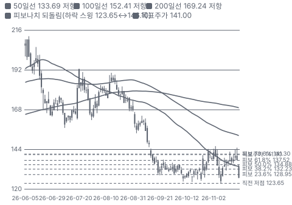

**주봉**

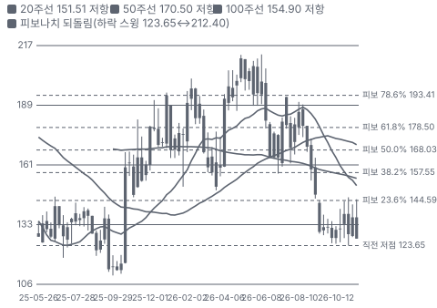

**월봉**

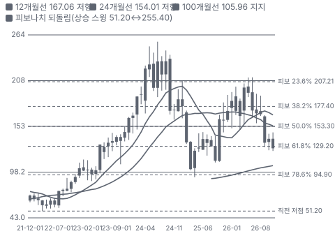

**분기 매출·EPS 실적과 컨센서스**

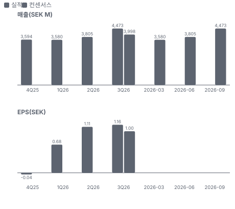

**멀티플 프리미엄(Fwd 1Y P/E 현재값 — 최근 4개 분기 추이 없음: 대상 과거 배수 없음 — 컨센서스 이력이 없어 과거 선행 배수를 못 만들고, 분기말 후행 배수도 넣지 않았다)**

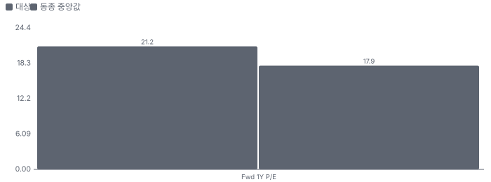

**합리적 멀티플**

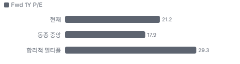

**밸류에이션 주가 시나리오**

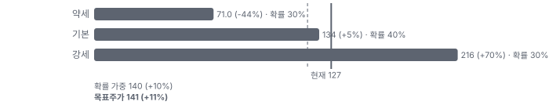

**주가별 업사이드**

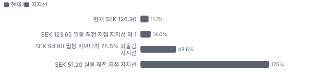
- 제품·서비스 포트폴리오

**고객 믹스(FY2025, 매출 대비)**

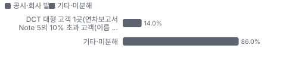

**공급 병목(10점, 낮을수록 병목)**

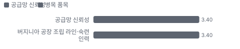

**생산능력 현재와 확충 계획(생산 면적 천 m²)**

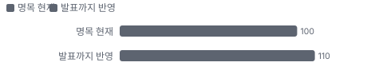

**CAPEX의 매출 대비 비중**

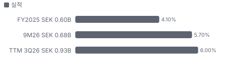

**어닝콜 변화별 주주가치 영향**

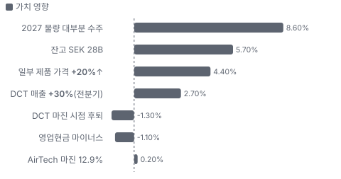

**수주·파이프라인 확실성 사다리**

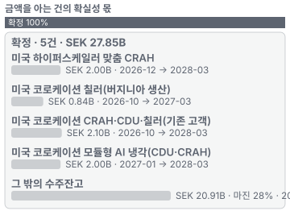

**수주/출하 비율(B/B) × 재고 일수 — 분기별**

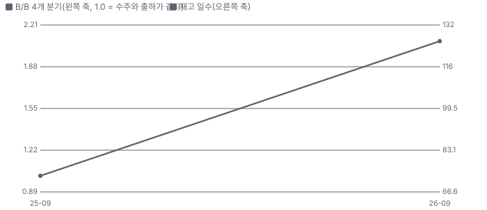

**매출 → 매출총이익 → 영업이익(매출 = 100, 최근 4분기)**

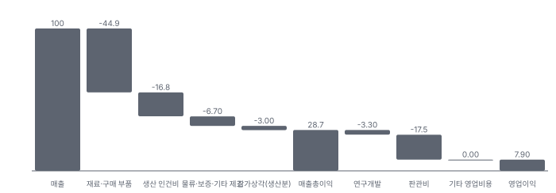

**분기 비용 비중 추이(매출 대비, 공시)**

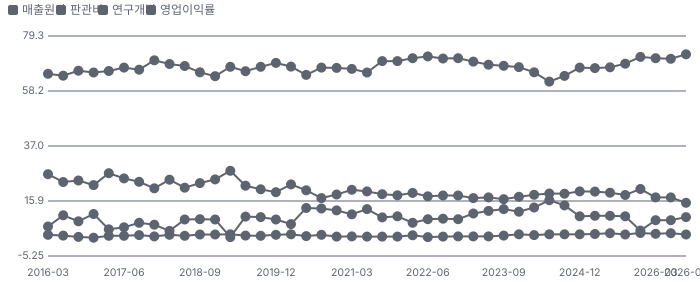

**비용 요인별 매출 대비 비중 1년 변화**

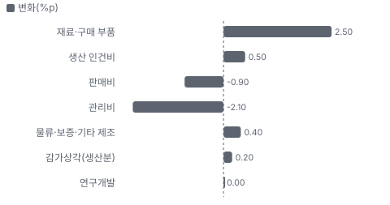

**데이터센터 냉각(DCT) BOM 원가 몫**

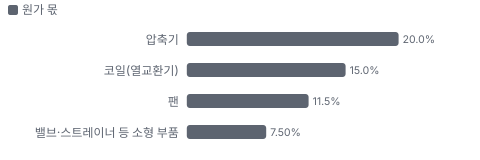

**산업용 제습·공기 처리(AirTech) BOM 원가 몫**

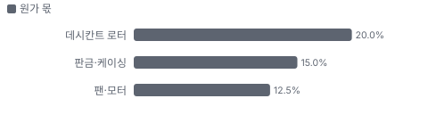

**BOM 항목 가격 +10% 시 OPM 변화**

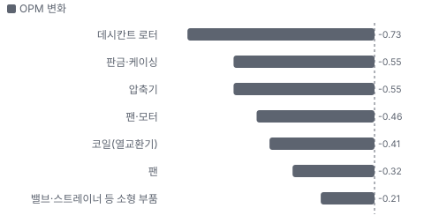

**원가 물가 vs 판매가 물가 — 최근 24개월**

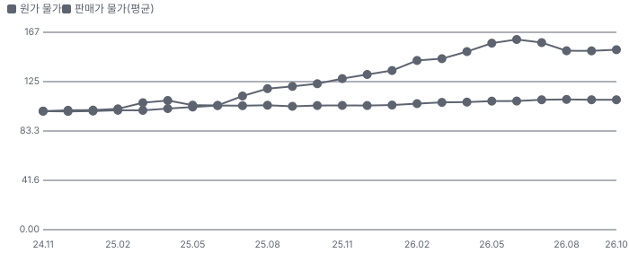

**사업별 매출 vs 물가 — 전년 대비(명목 매출 · 비교 물가 · 실질 = 물량·믹스)**

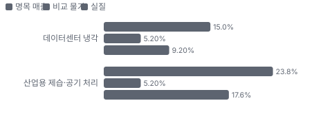

**생산시설별 면적(m², 큰 순) — 생산능력 미공시라 면적을 대용으로**

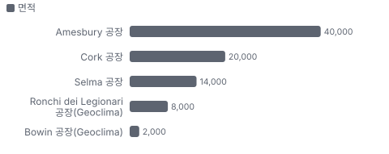

**매출 vs PPI·수출입 — 4Q22 = 100(변화율, 로그 눈금)**

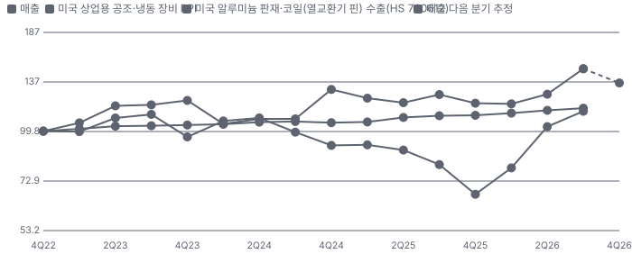

**10년 P·Q 사이클 — 추세(HP 필터) 대비 갭과 8분기 전망**

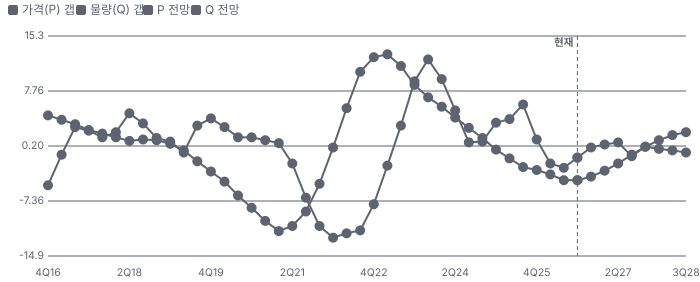

**매출 증가율의 가격·물량 분해와 8분기 전망(전년 대비)**

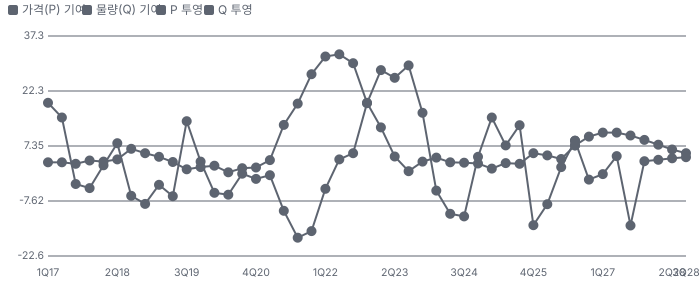

**목표주가 산정 — 기본과 강세 사이(강세 쪽 9%), 도달 확률 약 47%**

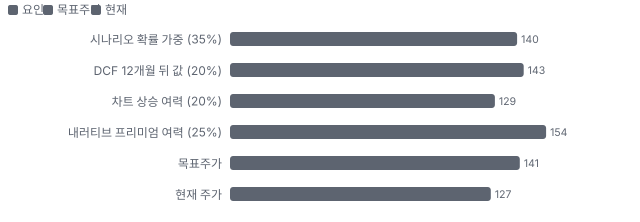

**PEG — 성장 대비 멀티플(낮을수록 성장 대비 쌈)**

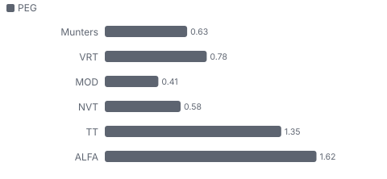

**몬테카를로**

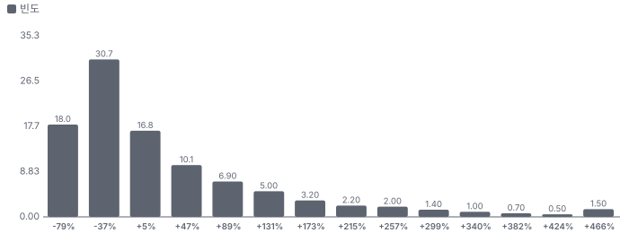

해석: 3,000번 중 1,327번(44%)에서 가치가 지금 주가 이상이었다. 지금 주가를 뒷받침하는 경우와 그렇지 않은 경우가 반반에 가깝다. 가운데 값은 0.86배이고, 열 번 중 여덟 번은 0.31~2.82배 사이에 든다.

## 내러티브

> **기업가치를 결정하는 이야기:** 12개월 매출의 51%가 산업용 제습·공기 처리(AirTech), 38%가 DCT, 12%가 축산 제어·소프트웨어(FoodTech)다. 성장은 DCT에서 나온다 — DCT 수주는 4개 분기 합 SEK 21.3B로 같은 기간 DCT 매출 5.9B의 3.6배다(계산). 이익은 반대다. 3Q 조정 EBITA SEK 546M 중 AirTech가 283M, DCT는 174M뿐이다. 회사 목표는 그룹 조정 EBITA 이익률 14% 초과이고, DCT 자료는 숙련·장기 공급 계약·자동화로 +4~6%p를 올리는 경로를 제시했다.

> **멀티플·EPS 프리미엄**
> **멀티플:** Fwd 1Y P/E 21.2배로 동종 5곳 중앙(17.9배)보다 높다 — 다만 이익이 눌린 해의 배수이고 Fwd 2Y는 15.9배다
> **EPS:** FY26 EPS 추정 SEK 4.21 → FY27 6.5(+54%) → FY28 8.3

### 투자자들은 왜 열광했나

2025년 11~12월 한 달 반 사이 대형 DCT 주문 네 건(합계 약 SEK 5.7B)이 발표되고 4Q25 수주가 SEK 11.6B로 뛰자 투자자들은 'AI 냉각 수혜주'로 다시 값을 매겼고 주가는 2026년 5월 종가 SEK 210.6까지 갔다. 그 뒤 2Q에 공급 차질로 DCT 매출이 줄고, 3Q에 매출은 사상 최대인데 마진이 더 내려가고 CEO가 바뀌면서 기대가 식었다. 지금 시장이 묻는 것은 수요가 아니라 버지니아 공장의 실행이다.

### 무엇이 기업가치를 바꾸나

> **구조적 체질 변화**
> **변화:** 제습기 회사 → 데이터센터 냉각이 잔고의 82%인 회사
> **증거:** 잔고 SEK 27.9B 중 DCT 22.9B(3Q 보고서)
> **반증:** DCT 수주 ÷ 매출 1 아래

> **고부가 믹스 확장**
> **변화:** 서비스·부품 비중 확대, 반대로 DCT 안에서는 마진 낮은 칠러 비중 확대
> **증거:** 서비스+부품 24% → 28%, DCT 이익률 19.5% → 9.7%
> **반증:** DCT 이익률 2개 분기 연속 하락

> **기술 혁신**
> **변화:** 공랭에서 액체 냉각(CDU)·고용량 칠러로 제품 확장
> **증거:** 12개월 DCT 수주의 10%가 CDU, 2026-04 모듈형 AI 냉각 SEK 2.0B 수주
> **반증:** CDU 수주 비중 정체

> **실행 속도**
> **변화:** 주문은 2027~2028년 인도분 — 버지니아 공장 가동률이 목표에 못 미친다 **납품 리드타임 6~27개월.** 피어 비교 미확인. 이전 대비 미확인.
> **증거:** 3Q 콜·대형 주문 보도자료의 인도 시기
> **반증:** 4Q DCT 매출이 3Q(SEK 1,789M)를 넘고 이익률 상승

> **M&A**
> **변화:** Geoclima(칠러) 인수로 제품 폭 확대, FoodTech는 매각 검토 — 팔리면 순차입이 준다
> **증거:** 자본시장의 날 CFO 자료 p.10, 3Q 보고서
> **반증:** FoodTech 매각 무산

> **정책·입법 연관성**
> **재정정책:** 해당 없음(수령이 확인된 것은 연구개발 보조금 SEK 16M뿐 — 버지니아 지역 인센티브 금액 미확인) 연차보고서 Note 9 반증: 해당 없음 의회 동의 2/10 — 하원 1/5(Munters 관련 세출 논의 없음) · 상원 1/5(같음).
> **행정명령:** 미국 수입 관세 — DCT 수입 부품에 붙어 3Q DCT 이익률을 약 2%p 깎았다(4Q25 4%p) 3Q 보고서 p.8 반증: 미국산 부품 구성표 완성으로 영향 0 의회 동의 2/10 — 하원 1/5(행정부 관세 조치 — 의회 의결 없음) · 상원 1/5(같음).
> **연관입법:** 해당 없음(직접 연관 입법 미확인) - 반증: 해당 없음

> **고객의 지출 예산**
> **변화:** DCT는 고객의 데이터센터 건설 CAPEX, AirTech는 공장 설비투자와 유지보수 예산이 섞인다
> **사업별 예산:** **매출의 51%**: 산업용 제습·공기 처리(AirTech) — 고객 혼합(공장 설비투자 + 유지보수(서비스 19%·부품 27%)) · 동인: 식품·제약 증설, 설치 기반 교체
**매출의 38%**: 데이터센터 냉각(DCT) — 고객 CAPEX(데이터센터 건설·냉각 설비 투자) · 동인: AI 데이터센터 증설
**매출의 12%**: 축산 제어·소프트웨어(FoodTech) — 고객 혼합(축사 설비투자 + 소프트웨어 구독) · 동인: 농장 자동화
> **증거:** 3Q 보고서 서비스·부품 비중
> **반증:** 미국 코로케이션 CAPEX 축소

### 내러티브 근거

> 제습기 회사가 AI 데이터센터 냉각 회사로 바뀐다는 이야기다. 수주잔고는 1년 새 SEK 10.0B에서 27.9B가 됐지만, 그 잔고를 만드는 DCT의 이익률은 19.5%에서 9.7%로 반 토막 났다. 시장은 '잔고가 이익으로 바뀌는가'를 의심하고 주가는 5월 종가 고점보다 40% 낮다. 동종 대비 멀티플 차이 +18% 중 회사 고유 몫은 -28%다. 단계는 확산, 쏠림은 낮음(리테일 집계 없음 — 북유럽 기관 중심, 기관 보유 약 80%)이다.

> **AI 데이터센터 냉각 수주** · 강화
> **논리:** 하이퍼스케일러·코로케이션의 AI 증설이 칠러·CRAH·CDU 주문으로 들어와 잔고가 2028년 인도분까지 찼다
> **숫자:** DCT 잔고 SEK 6.6B → 22.9B(1년), DCT 수주 ÷ 매출 2.7
> **반증:** DCT 수주 ÷ 매출이 2개 분기 연속 1 아래
> **출처:** Munters 3Q26 분기보고서(2026-10-23) https://www.munters.com/globalassets/story-page-import-images/munters-interim-report-jan-sep-20262.pdf

> **제품 폭 확대(칠러·CDU)** · 강화
> **논리:** Geoclima 인수로 칠러를 얻어 한 프로젝트에 여러 제품을 묶어 판다
> **숫자:** 12개월 DCT 수주의 49%가 칠러, 33% CRAH, 10% CDU
> **반증:** 칠러 수주 비중이 줄고 DCT 마진이 계속 한 자릿수
> **출처:** Munters 자본시장의 날 DCT 발표자료(2026-11-11) https://www.munters.com/globalassets/digizuite/36085-en-dct-presentation-cmd-2026.pdf

> **서비스·부품 반복 매출** · 유지
> **논리:** 설치 기반이 커지면서 서비스·부품 비중이 올라 이익의 질이 좋아진다
> **숫자:** 서비스+부품 24% → 28%(3Q), DCT 서비스 +41%
> **반증:** 서비스+부품 비중이 25% 아래로 후퇴
> **출처:** Munters 3Q26 분기보고서(2026-10-23) https://www.munters.com/globalassets/story-page-import-images/munters-interim-report-jan-sep-20262.pdf

> **AirTech 회복** · 강화
> **논리:** 배터리 주문 급감 뒤 식품·제약·부품으로 바닥을 지나 마진이 돌아온다
> **숫자:** 조정 EBITA 이익률 4.8%(1Q25) → 12.9%(3Q26, 취소 수수료 제외 10.4%)
> **반증:** 분기 수주가 SEK 1.7B 아래로 2개 분기 연속
> **출처:** Munters 3Q26 분기보고서(2026-10-23) https://www.munters.com/globalassets/story-page-import-images/munters-interim-report-jan-sep-20262.pdf

> **반대 내러티브 — 잔고는 늘어도 이익은 줄어든다** · 강화
> **논리:** 새 제품을 새 공장에서 만드는 비용, 옛 가격으로 받은 잔고, 관세가 겹쳐 매출이 늘수록 마진이 내려가고 현금이 묶인다
> **숫자:** DCT 조정 EBITA 이익률 22.8%(1Q25) → 9.7%(3Q26), 영업현금흐름 −SEK 216M, 레버리지 3.4배
> **반증:** 4Q26·1Q27 DCT 이익률이 2개 분기 연속 상승하고 영업현금흐름이 플러스
> **출처:** Munters 3Q26 분기보고서(2026-10-23) https://www.munters.com/globalassets/story-page-import-images/munters-interim-report-jan-sep-20262.pdf

### 투자 포인트

> **잔고는 매출의 1.8배**
> **명제:** 수주잔고 SEK 27.9B가 2027~2028년 매출 경로를 이미 정해 놓았다
> **숫자:** 잔고 +178%, 최근 4개 분기 수주 ÷ 매출 2.08, 고객 선수금 SEK 4,094M
> **시장과 다른 점:** 컨센서스 칸의 FY27 매출 SEK 17.5B(+13%)는 7~9월에 고정된 추정이라 3Q 수주를 다 담지 못했다 — 매출 쪽 위험은 시장 생각보다 작다
> **증명:** 4Q 매출이 3Q(SEK 4,473M)를 넘는지
> **출처:** Munters 3Q26 분기보고서(2026-10-23) https://www.munters.com/globalassets/story-page-import-images/munters-interim-report-jan-sep-20262.pdf

> **문제는 수요가 아니라 DCT 마진**
> **명제:** DCT 조정 EBITA 이익률이 19.5%에서 9.7%로 내려왔다
> **숫자:** 새 제품 램프·재작업·부품 부족·관세 2%p(3Q 보고서·콜)
> **시장과 다른 점:** 시장은 마진 하락을 구조적 경쟁 심화로 볼 수 있지만, 회사 설명은 새 공장 숙련과 옛 가격 잔고다 — 어느 쪽인지는 4Q·1Q 숫자가 가른다
> **증명:** 4Q26·1Q27 DCT 이익률이 2개 분기 연속 상승
> **출처:** Munters 3Q26 분기보고서(2026-10-23) https://www.munters.com/globalassets/story-page-import-images/munters-interim-report-jan-sep-20262.pdf

> **현금이 먼저 시험받는다**
> **명제:** 레버리지 3.4배에서 재고가 4Q에도 더 는다
> **숫자:** 3Q 영업현금흐름 −SEK 216M, 재고 SEK 3,791M, 포부 1.5~2.5배
> **시장과 다른 점:** FoodTech 매각이 성사되면 순차입이 한 번에 준다 — 회사가 레버리지 복귀 수단으로 명시했다
> **증명:** FoodTech 매각 계약과 4Q 영업현금흐름
> **출처:** Munters 자본시장의 날 CFO 발표자료(2026-11-11)

### 모멘텀 생성·소멸 타임라인

**카탈리스트 달력 — 지난 사건의 주가 반응과 앞으로 확인할 숫자**
| 날짜 | 상태 | 구분 | 사건 | 반응·확인 | 결과에 따라 |
|---|---|---|---|---|---|
| 2026-07-17 | 완료 | 생성 | 2Q 실적 — 수주 +140%, 수주 ÷ 매출 2.3 | +9.4% |  |
| 2026-09-14 | 완료 | 소멸 | CEO 교체 앞당김 — 9월 주가 하락 구간(8/31 → 9/18 −22.6%, 원인 미확인) | 9월 −20.5% |  |
| 2026-10-23 | 완료 | 생성 | 3Q 실적 — 잔고 SEK 27.9B, DCT 마진은 하락 | +4.0% |  |
| 2026-11-11 | 완료 | 확인 | 자본시장의 날 — 14% 이익률 목표 유지, ROCE 15% 목표 신설 | +2.2% |  |
| 2026-11-20 | 완료 | 매크로 | 데이터센터 인프라 업종 동반 급락(원인 미확인) | −7.8% |  |
| 2027-01-28 | 예정 | 확인 | 4Q26·연간 실적 | DCT 조정 EBITA 이익률 9.7% 초과, 그룹 매출 SEK 4,473M 초과, 영업현금흐름 플러스 | 셋 다 충족 → 기본~강세, DCT 이익률 추가 하락 → 약세 |
| 2027년 상반기(예상) | 예정 | 확인 | FoodTech 매각 결과 | 매각 계약과 대금, 순차입 ÷ 조정 EBITDA 3배 아래 | 성사 → 재무 위험 할인 축소, 무산 → 레버리지 우려 지속 |
| 2027-01~02(예상) | 예정 | 매크로 | 미국 하이퍼스케일러·코로케이션 2027년 CAPEX 가이던스 | 전년 대비 증가 유지 | 증가 → DCT 수주 지속, 축소 → 취소·지연 위험 |

### 언제 사서 언제 팔아야 할까?

**가격·조건 틀 — 가격은 밸류에이션(약세·기본·강세·목표주가)과 차트 지지 구간에서, 조건은 이벤트에서**
| 구간 | 가격 | 목표주가까지 | 약세까지 | 조건·근거 |
|---|---|---|---|---|
| 관찰 구간 | SEK 124~SEK 124 | +14% | -43% | 지지 구간이 약세 시나리오 가격과 가까운 곳 |
| 확인 뒤 | 지금 SEK 127 이상에서 조건 확인 | +11% | -44% | 1월 28일 DCT 이익률 반등과 영업현금흐름 플러스 |
| 무효화 | 약세 시나리오 SEK 71 | - | -44% | DCT 이익률 추가 하락과 DCT 주문 취소 |
| 차익 고민 1차 | SEK 141(목표주가) | +11% | - | 목표주가 근처에서 DCT 이익률이 아직 한 자릿수일 때 |
| 차익 고민 2차 | SEK 216(강세 시나리오) | +70% | - | 목표주가 근처에서 DCT 이익률이 아직 한 자릿수일 때 |

실적일 장중 변동이 크다 — 3Q 실적일 장중 +11.4%에서 종가 +4.0%로 되돌렸다 가격·조건 틀이며 매매·비중 지시가 아니다(투자 권유 아님).

## 포트폴리오

| 제품·서비스 | 구분 | 무엇 | 쓰는 곳 | 돈 버는 방식 | Mix | Mix 변화(전 분기 대비) |
|---|---|---|---|---|---|---|
| 산업용 제습·공기 처리(AirTech) | 제품 | 데시칸트 로터로 공기 중 습기를 빼는 산업용 제습기와 공기 처리 장비, 서비스·부품 | 식품·제약 공장, 배터리 드라이룸(습도를 극히 낮춘 배터리 생산 공간), 상업 건물 | 12개월 매출 SEK 7.8B(51%), 3Q 조정 EBITA 이익률 12.9% | 49% | -3.5%p |
| 데이터센터 냉각(DCT) | 제품 | 데이터센터 열을 식히는 칠러·CRAH·CDU·SyCool(Munters의 냉매 자연 순환식 데이터센터 냉각 장치) | 미국 하이퍼스케일러·코로케이션의 AI 데이터센터 | 12개월 매출 SEK 5.9B(38%), 3Q 조정 EBITA 이익률 9.7% | 40% | +4.4%p |
| 축산 제어·소프트웨어(FoodTech) | 서비스 | 축사 기후 컨트롤러와 농장 관리 소프트웨어(브랜드 Speria(Munters FoodTech가 매각 대상으로 떼어 낸 사업 이름)) | 육계·산란계 농장과 계열화 업체 | 12개월 매출 SEK 1.8B(12%), SaaS(구독형 소프트웨어) 연간 반복 매출 SEK 378M — 매각 검토 중 | 11% | -0.9%p |

**Mix 변화가 가장 큰 쪽은 데이터센터 냉각(DCT, +4.4%p, 전 분기 대비).** 계절성 판정: 분기 매출 계절 지수 기준 없음 → 직전 분기와 비교.

## 고객

> **FY2025 최대 고객 DCT 대형 고객 1곳(연차보고서 Note 5의 10% 초과 고객(이름 비공개)) 14%, 상위 3곳 14%, 집중도 분산.** 공시·회사 발표로 확인한 몫은 매출의 14%이고, 나머지 고객 몫은 추정이거나 미분해다. 고객 이름은 공개되지 않는다. 공시로 확인되는 단일 고객은 DCT 대형 고객 1곳뿐이고 2025년 그룹 순매출의 14%(2024년 15%)다. 나머지 86%의 고객별 몫은 공시되지 않았다. 사업부로 보면 2025년 매출의 49%가 AirTech(식품·제약·배터리·상업), 40%가 DCT(2025년 DCT 매출의 85%가 코로케이션·14%가 하이퍼스케일러), 12%가 FoodTech(육계·산란계 농장)이고, 2025년 외부 매출의 54%가 미국이다

**고객별 매출 몫(FY2025)**
| 고객 | 몫 | 변화 | 근거 |
|---|---|---|---|
| DCT 대형 고객 1곳(연차보고서 Note 5의 10% 초과 고객(이름 비공개)) | 14% | -1%p | 공시 |
| 기타·미분해 | 86% | - | - |

> **DCT 대형 고객 1곳(연차보고서 Note 5의 10% 초과 고객(이름 비공개))** · 공시
> **사는 것:** 데이터센터 냉각 장비
> **추정 근거:** 2025년 그룹 순매출의 14%, 2024년 15%(Note 5 p.145)

## 수주·파이프라인

> **2026-09-30 기준 5건.** 확정 SEK 27.85B. 공시 수주잔고 SEK 27.85B.

**수주 목록**
| 상태 | 계약 | 계약 총액 | 진척 | 기간 | 비고 |
|---|---|---|---|---|---|
| 확정 | 미국 하이퍼스케일러 맞춤 CRAH(미국) | SEK 2.00B | - | 2026-12 → 2028-03 | 2025-11-12 발표, 약 \$215M — 단일 고객 최대 — 발표 금액 기준(일부는 이미 매출로 인식됐을 수 있다) (잔고 SEK 27.9B에 포함) |
| 확정 | 미국 코로케이션 칠러(버지니아 생산, 미국) | SEK 0.84B | - | 2026-10 → 2027-03 | 2025-12-11 발표 — 발표 금액 기준(일부는 이미 매출로 인식됐을 수 있다) (잔고 SEK 27.9B에 포함) |
| 확정 | 미국 코로케이션 CRAH·CDU·칠러(기존 고객, 미국) | SEK 2.10B | - | 2026-10 → 2028-03 | 2025-12-31 발표 — 발표 금액 기준(일부는 이미 매출로 인식됐을 수 있다) (잔고 SEK 27.9B에 포함) |
| 확정 | 미국 코로케이션 모듈형 AI 냉각(CDU·CRAH, 미국) | SEK 2.00B | - | 2027-01 → 2028-03 | 2026-04-24 발표, 2Q26 수주 — 발표 금액 기준(일부는 이미 매출로 인식됐을 수 있다) (잔고 SEK 27.9B에 포함) |
| 확정 | 그 밖의 수주잔고 | SEK 20.91B | - | 2026-10 → 2028-12 | 공시 잔고 SEK 27,851M − 발표된 대형 주문 4건 SEK 6.94B(계산) |

**실행 속도와 방해 요인**
| 항목 | 상태 | 실행 속도 | 방해 요인 |
|---|---|---|---|
| 미국 하이퍼스케일러 맞춤 CRAH | 확정 | 미확인 | 부품 공급 · 고객 현장 일정 |
| 미국 코로케이션 칠러(버지니아 생산) | 확정 | 미확인 | 부품 공급 · 고객 현장 일정 |
| 미국 코로케이션 CRAH·CDU·칠러(기존 고객) | 확정 | 미확인 | 부품 공급 · 고객 현장 일정 |
| 미국 코로케이션 모듈형 AI 냉각(CDU·CRAH) | 확정 | 미확인 | 부품 공급 · 고객 현장 일정 |
| 그 밖의 수주잔고 | 확정 | 3Q 수주 ÷ 매출 1.6(DCT 2.7) | 버지니아 공장 숙련·재작업 · 코일·팬 부족 · 잔고 일부의 옛 가격 |

## 마진 구조

> **GPM 27.7%, OPM 8.7%.** 3Q25 대비 GPM -3.6%p, OPM -1.3%p. 변동비는 매출의 64%이고, 매출이 10% 늘면 OPM은 +2.4%p 움직인다. 3Q 매출총이익률은 27.6%로 1년 전 31.2%보다 3.6%p 낮다. 이익률이 높던 DCT가 새 제품(칠러·CDU·CRAH) 램프와 관세로 조정 EBITA 이익률 19.5% → 9.7%가 된 것이 원인이다. 판매·관리비 비중은 18.2% → 15.2%로 줄어 영업이익률 하락을 10.0% → 8.7%로 막았다

> **매출 100 중 매출원가 71.3, 매출총이익 28.7(최근 4분기, 공시).** 매출원가 요인 중 재료·구매 부품이 매출의 45.5%로 가장 무겁고, 단가가 +10% 오르면 GPM이 -4.55%p 움직인다. 분기 회귀로 매출 1이 늘 때 매출원가는 0.70 늘고, 매출원가의 고정비 몫은 -4%다. 매출원가 요인 비중은 요인별 공시 기간 값이라 합이 최근 4분기 매출원가를 넘어, 그림에서는 0.99배로 비례 조정했다.

**비용 요인 강도 — 비중·추세·충격(+10%)·탄력**
| 비용 | 구분 | 매출 대비 | 1년 변화 | 마진 기여 | 충격 시 마진 | 매출 탄력 | 고정비 몫 |
|---|---|---|---|---|---|---|---|
| 재료·구매 부품 | 매출원가 요인 | 45.5% | +2.5%p | -2.5%p | -4.55%p | 미확인 | 0% |
| 생산 인건비 | 매출원가 요인 | 17.0% | +0.5%p | -0.5%p | -1.70%p | 미확인 | 50% |
| 물류·보증·기타 제조 | 매출원가 요인 | 6.8% | +0.4%p | -0.4%p | -0.68%p | 미확인 | 20% |
| 감가상각(생산분) | 매출원가 요인 | 3.0% | +0.2%p | -0.2%p | -0.30%p | 미확인 | 100% |
| 매출원가 | 공시 항목 | 71.3% | +3.8%p | -3.8%p | -7.13%p | 0.70 | -4% |
| 판관비 | 공시 항목 | 17.5% | -1.7%p | +1.7%p | 미확인 | 0.14 | 26% |
| 연구개발 | 공시 항목 | 3.3% | +0.1%p | -0.1%p | 미확인 | 0.03 | -23% |
| 기타 영업비용 | 공시 항목 | -0.0% | -0.0%p | +0.0%p | 미확인 | 0.00 | 2% |

매출 탄력 = 분기 비용을 매출에 회귀한 기울기(매출 1당 변동비), 고정비 몫 = 절편 ÷ 평균 비용. 표본이 8분기 미만이면 미확인. 매출원가 요인 비중은 margin 재료의 추정이 섞여 있고, 공시 매출원가와의 차이는 '기타 매출원가'로 둔다.

**GPM에서 OPM까지(IFRS, 아래는 최근 4개 분기)**
| 기간 | GPM | 연구개발 | 판관비 | 기타 | OPM |
|---|---|---|---|---|---|
| 3Q25 | 31.3% | 3.0% | 18.2% | 0.0% | 10.0% |
| 3Q26 | 27.7% | 3.0% | 15.2% | 0.8% | 8.7% |
| 2025-12 | 28.7% | - | - | - | 4.5% |
| 2026-03 | 29.2% | - | - | - | 8.5% |
| 2026-06 | 29.4% | - | - | - | 8.5% |
| 2026-09 | 27.7% | - | - | - | 9.7% |

**비용을 움직이는 요인**
| 비용 | 요인 |
|---|---|
| 재료·구매 부품(매출원가) | 압축기·코일·팬·강재 단가, DCT 수입 부품 관세 · 근거 추정 |
| 생산 인건비(매출원가) | 버지니아 신규 인력 숙련도·재작업, 임금 · 근거 추정 |
| 판매비(판관비) | 영업 인력·수수료 · 근거 공시 |
| 관리비(판관비) | 본사·전산 시스템·AirTech 비용 절감 프로그램(절감 SEK 180M 달성, 목표 250M) · 근거 공시 |
| 물류·보증·기타 제조(매출원가) | 운송·설치·보증 충당, 관세 · 근거 추정 |
| 감가상각(생산분, 매출원가) | 신공장 리스 사용권·설비 감가상각 · 근거 추정 |
| 연구개발(연구개발) | 칠러·CDU·제습 신제품 개발 · 근거 공시 |

**데이터센터 냉각(DCT) BOM — 매출의 38%, GPM 28%(그룹 매출총이익률(3Q26) 대용 — 사업부 매출총이익 미공시. DCT 조정 EBITA 이익률은 9.7%), 항목 가격 +10% 시**
| 항목 | 원가 몫 | 전가 | 제품 GPM | OPM |
|---|---|---|---|---|
| 압축기 | 15~25% | 미확인 | -1.4%p | -0.55%p |
| 코일(열교환기) | 10~20% | 미확인 | -1.1%p | -0.41%p |
| 팬 | 8~15% | 미확인 | -0.8%p | -0.32%p |
| 밸브·스트레이너 등 소형 부품 | 5~10% | 미확인 | -0.5%p | -0.21%p |
| 미분해 | 46% | - | - | - |

**산업용 제습·공기 처리(AirTech) BOM — 매출의 51%, GPM 28%(그룹 매출총이익률 대용 — 사업부 매출총이익 미공시. AirTech 조정 EBITA 이익률 12.9%(취소 수수료 제외 10.4%)), 항목 가격 +10% 시**
| 항목 | 원가 몫 | 전가 | 제품 GPM | OPM |
|---|---|---|---|---|
| 데시칸트 로터 | 15~25% | 미확인 | -1.4%p | -0.73%p |
| 판금·케이싱 | 10~20% | 미확인 | -1.1%p | -0.55%p |
| 팬·모터 | 10~15% | 미확인 | -0.9%p | -0.46%p |
| 미분해 | 52% | - | - | - |

데시칸트 로터 가격이 +10% 오르면 영업이익은 -8.4% 움직인다. 판매가 전가를 모르는 항목은 전가 0%로 계산했다.

**BOM 항목 가격을 움직이는 것**
| 항목 | 요인 |
|---|---|
| 압축기 | 수입 부품이라 관세가 붙는다 · 근거 추정 |
| 코일(열교환기) | 알루미늄·구리 단가와 공급 부족 · 근거 추정 |
| 팬 | 유럽 대형 팬 제조사 납기 · 근거 추정 |
| 밸브·스트레이너 등 소형 부품 | 미국 현지 조달 전환 속도 · 근거 추정 |
| 데시칸트 로터 | 흡습제·기재 원가, 자체 공장 가동률 · 근거 추정 |
| 팬·모터 | 전동기 단가 · 근거 추정 |
| 판금·케이싱 | 강재·알루미늄 단가 · 근거 추정 |

> **원가·판매가 물가 격차 -18.8%p** — 판매가 물가가 투입 원가 물가보다 느리게 오른다.

**투입 물가 — 미국 PPI 3·6·12개월(2026-10, 개정 반영)**
| 항목 | 미국 3개월 | 6개월 | 12개월 | 전가 못 할 때 OPM |
|---|---|---|---|---|
| 압축기 | -0.1% | +1.8% | +4.5%* | - |
| 판금·케이싱 | -3.8% | +1.1% | +23.3%* | - |
| 밸브·스트레이너 등 소형 부품 | +0.4% | +0.3% | +6.4%* | - |

별표는 품목보다 넓은 업종 지수다. 연결한 투입 원가의 미국 PPI(생산자물가지수)는 1년 새 가중 +23.3%이고, 판매가로 넘기지 못하면 GPM -10.6%p·OPM -10.6%p가 움직인다. 판매가 비교 물가(상업용 공조·냉동 장비 PPI)는 1년 새 +4.5% — 회사 가격 변화는 미확인. 물가 지수를 붙이지 못한 매출원가 항목은 생산 인건비, 감가상각(생산분), 물류·보증·기타 제조다(미연결). 데이터센터 냉각(DCT) 매출은 2026-09 전년 대비 +15.0%이고 비교 물가 ppi:hvac_equipment의 변화 +5.2%(2026-09)를 빼면 실질 +9.2% — 물량·믹스가 성장을 이끌었다. 산업용 제습·공기 처리(AirTech) 매출은 2026-09 전년 대비 +23.8%이고 비교 물가 ppi:hvac_equipment의 변화 +5.2%(2026-09)를 빼면 실질 +17.6% — 물량·믹스가 성장을 이끌었다.

## 공급망 병목

> **공급망 신뢰성 3.4/10, 병목 심각.** 가장 약한 고리는 버지니아 공장 조립 라인·숙련 인력 3.4점이고, 품목 평균은 3.4점이다. 근거가 부족한 4건(코일(열교환기) · 팬 · 압축기 · 밸브·스트레이너 등 소형 부품)은 점수에서 뺐다. 병목은 수요가 아니라 부품과 새 공장이다. 2Q에는 팬·밸브, 3Q에는 코일이 모자랐고, 부품 하나가 빠지면 버지니아 라인의 흐름 생산이 깨져 다 만든 장비도 매출로 잡지 못한다. 회사는 '최악은 지났지만 아직 유동적'이라고 말한다.

**병목과 마진 — 품목 가격 +10% 시 OPM**
| 품목 | 점수 | 판정 | 구분 | OPM |
|---|---|---|---|---|
| 버지니아 공장 조립 라인·숙련 인력(필수) | 3.4 | 병목 심각 | 출하 차질 위험 | 미확인 |

> **버지니아 공장 조립 라인·숙련 인력** · 3.4/10
> **왜:** 새 제품 세 가지를 새 공장에서 처음 만든다 — 재작업이 마진을 깎는다
> **병목 요인:** 인증 공급사 1곳 · 캐파 빠듯 · 리드타임 미확인 · 재인증 미확인 · 1위 점유율 100% · 지역 집중 미확인 · 물량 확보 내재화
> **풀리는 조건:** 진행 중 — 200,000 sq ft(제곱피트) 추가, 운영 효율 전담팀·단기 컨설턴트 투입. 가동·수율 수치 없음

**공급사**
| 품목 | 공급사 | 몫 | 근거 |
|---|---|---|---|
| 코일(열교환기) | 미공시(외부 구매, 칠러·CRAH용 코일) | 미확인 | 회사 발표 |
| 팬 | 미공시(유럽 대형 팬 제조사, 칠러·CRAH용 팬) | 미확인 | 회사 발표 |
| 압축기 | Danfoss(칠러 압축기(콜에서 공급사 예로 언급 — 공급 비중 미확인)) | 미확인 | 회사 발표 |
| 밸브·스트레이너 등 소형 부품 | 미공시(미국 현지 공급사로 전환 중, 배관 부품) | 미확인 | 회사 발표 |
| 버지니아 공장 조립 라인·숙련 인력 | 자체 공장(버지니아, 칠러·CRAH·CDU 조립) | 미확인 | 회사 발표 |

**무역 통계로 본 공급 지역**
| 품목 | EU 수입처 | 일본 수입처 | EU 1위 전년비 |
|---|---|---|---|
| 코일(열교환기) | CN(중국) 52% · JP(일본) 25% · US 16% | 中華人民共和国 41% · タイ 17% | +86.5% |
| 압축기 | CN 69% · JP 15% · US 9% | 中華人民共和国 44% · 大韓民国 25% | +7.8% |
| 밸브·스트레이너 등 소형 부품 | CN 64% · US 26% · JP 4% | 中華人民共和国 28% · アメリカ合衆国 25% | +9.1% |

## 생산능력

> **현재 명목 캐파 100 생산 면적 천 m², 가동률 미확인.** 착공 이상 증설은 0 생산 면적 천 m², 발표까지 합치면 10 생산 면적 천 m²이다. 다 가동하면 지금보다 +10%, 착공 이상만이면 +0%다. TTM 3Q26 CAPEX는 SEK 0.93B로 매출의 6.0%다. 회사는 캐파를 대수·금액으로 밝히지 않고 면적으로만 말한다. 생산 거점은 25곳 남짓, DCT 6곳 합계 약 100,000 m²다. 버지니아 Daleville는 2026년 9월 20,000 m²를 더해 52,000 m²가 됐지만 가동률이 목표에 못 미친다(3Q 콜, 수치 비공개). 새 투자는 작다 — 이탈리아 칠러 공장 확장 약 €25M와 텍사스 코일 합작 \$9.5M

**생산시설 25곳**(자본시장의 날 CEO 자료 p.5: 약 25곳 = AirTech 13 + Clean Technologies 3 + DCT 6 + FoodTech 4(브라질 Curitiba는 중복 집계). 3Q 보고서는 '25곳 초과'. FoodTech 4곳과 일부 AirTech 거점은 위치·면적 미공시라 개수에만 센다) — 이름·위치를 밝힌 곳 10곳, 임차 2곳 · 미확인 8곳. 시설별 생산능력은 공개되지 않았다 — 회사 전체 캐파만 위에 적었다.

**생산시설 25곳 — 명칭·위치·생산능력**
| 시설 | 위치 | 용도 | 생산능력 | 소유·상태 |
|---|---|---|---|---|
| Daleville 캠퍼스 | 미국 버지니아 Daleville | DCT 전 제품·연구개발·시험 | 미확인 — 생산량 미공시 — 직원 약 600명, 2026년 증설분은 리스 · 면적 52,000 m² | 임차 · 가동 |
| Selma 공장 | 미국 텍사스 Selma | DCT CRAH·공조기 | 미확인 — 생산량 미공시 · 면적 14,000 m² | 미확인 · 가동 |
| Cork 공장 | 아일랜드 Cork | DCT 유럽용 전 제품 | 미확인 — 생산량 미공시 · 면적 20,000 m² | 미확인 · 가동 |
| Ronchi dei Legionari 공장(Geoclima) | 이탈리아 Ronchi dei Legionari | DCT 칠러·드라이쿨러 | 미확인 — 생산량 미공시 — 확장 뒤 칠러 능력 2배(회사 발표) · 면적 8,000 m² | 미확인 · 가동 |
| Bowin 공장(Geoclima) | 태국 Bowin | DCT 보조 칠러 | 미확인 — 생산량 미공시 · 면적 2,000 m² | 미확인 · 가동 |
| Curitiba 공장 | 브라질 Curitiba | 중남미용 CRAH(조직상 AirTech) | 미확인 — 면적·생산량 미공시 | 미확인 · 가동 |
| Amesbury 공장 | 미국 매사추세츠 Amesbury | AirTech 제습 주력 | 미확인 — 생산량 미공시 — 2025년 5월 개소 · 면적 40,000 m² | 임차 · 가동 |
| Tobo 공장 | 스웨덴 Tobo | AirTech 제습 로터 | 미확인 — 면적·생산량 미공시 — SEK 250M 증설 진행 중 | 미확인 · 가동 |
| Jiangyin 공장 | 중국 Jiangyin | AirTech 중국 제조 통합 | 미확인 — 면적·생산량 미공시 — 2025년 완공 | 미확인 · 가동 |
| Monterrey 공장 | 멕시코 Monterrey | AirTech 가습 매체 | 미확인 — 면적·생산량 미공시 — 증설 진행 중 | 미확인 · 가동 |

**생산능력 확충 계획**
| 계획 | 단계 | 증설 | 가동 시점 | CAPEX |
|---|---|---|---|---|
| 이탈리아 Ronchi dei Legionari 칠러 공장 확장 | 발표 | 10 생산 면적 천 m² | 2027-11 | SEK 0.28B |
| 텍사스 코일 합작(Lordan 55%·Munters 45%) | 발표 | 미확인 | 2027-11 | SEK 0.10B |
| 스웨덴 Tobo 로터 공장 증설·현대화 | 착공 | 미확인 | 2026-12 | SEK 0.25B |

남은 계획의 CAPEX 합계는 SEK 0.62B다. 금액을 아는 계획의 단위당 CAPEX는 SEK 0.03B/생산 면적 천 m²이다. 합계는 TTM 3Q26 매출의 4%다.

**증설 방해 요인**
| 계획 | 방해 요인 |
|---|---|
| 이탈리아 Ronchi dei Legionari 칠러 공장 확장 | 부지 인수·건설, 유럽 칠러 수요 |
| 텍사스 코일 합작(Lordan 55%·Munters 45%) | 합작 공장 건설·인증 — 생산 개시는 12~18개월 뒤 |
| 스웨덴 Tobo 로터 공장 증설·현대화 | 설비 설치 일정 |

**CAPEX와 매출 대비**
| 기간 | CAPEX | 매출 | 매출 대비 | 구분 |
|---|---|---|---|---|
| FY2025 | SEK 0.60B | SEK 14.71B | 4.1% | 실적 |
| 9M26 | SEK 0.68B | SEK 11.86B | 5.7% | 실적 |
| TTM 3Q26 | SEK 0.93B | SEK 15.45B | 6.0% | 실적 |

## 피터 린치 분류

> **고성장주(Fast Grower), 중형.** 린치 표의 기대 수익 10~100배, 하방 -80~100%, 위험 고. 10배 경로가 있는 분류다(고성장주·회생주·경기순환주).

**분류 근거 — 크기 먼저, 다음은 이야기 유형**
| 항목 | 값 |
|---|---|
| 크기 | 중형(시가총액 \$23.2B) |
| 장기 성장 | 40.4%(컨센서스 EPS 2년 CAGR) |
| 린치 비율((성장% + 배당%) ÷ P/E) | 1.91 — 2 이상 매력, 1 미만 비싸다 |
| PEG(P/E ÷ 성장%) | 0.52 — 1 적정, 0.5 매우 매력, 2 매우 불리 |
| 근거 | 장기 EPS 성장 40%(컨센서스 EPS 2년 CAGR) — 고성장 구간(≥18%) |
| 반대 근거 | 없음 |

- 점검: 성장을 더 이어 갈 자리(새 시장·점포·고객)가 남았나
- 점검: P/E가 성장률의 2배를 넘지 않나(PEG)
- 점검: 성장 속도가 꺾이는 2단계에 들어섰나
- 팔 때(점검 조건, 매매 지시 아님): 성장 단계가 끝나거나(확장 여지 소진·동일 매장 성장 둔화) P/E가 성장률의 2배를 크게 넘을 때 — 50% 올랐다고 팔지 않는다(10배 경로를 자른다)

분류 = 피터 린치·존 로스차일드 『One Up On Wall Street』(1989)·『Beating the Street』(1993)의 6분류와 위험·보상 표를 숫자 규칙으로 옮긴 자체추론이다(config/lynch.yaml).

## 구루 교차 점검

> **여섯 관점 중 통과 1 · 미달 3 · 미확인 2.** 가장 약한 관점은 해자와 자본수익률 — 수주는 늘었는데 자본수익률은 내려갔다 — 성장이 가치를 만드는지 아직 모른다.

판정은 자체추론이고 숫자는 계산값이다.

> **성장 여지** · 미확인
> **질문:** 5년 안에 매출이 2배가 될 자리가 있나, 10년 뒤에도 커지나
> **이유:** 추정 매출 경로는 연 12.9%로 5년 2배(연 14.9%)에 못 미치지만, 회사는 2030년 SEK 30B(연 15% 남짓)를 포부로 내걸었고 잔고가 매출의 1.8배다 — 포부에는 인수가 섞여 있어 판정을 보류한다
> **계산한 숫자:** 매출 경로 FY2026→FY2028 연 12.9%, 2배까지 5.7년
> **근거:** Munters 자본시장의 날 CEO 발표자료(2026-11-11) · 출처 목록

> **해자와 자본수익률** · 미달
> **질문:** 경쟁우위가 무엇이고, 투하자본수익률(ROIC)이 자본비용보다 높으며 유지·상승하나
> **이유:** ROIC 7.4%·회사 ROCE 9.6%로 자본비용에 못 미치고, 새 제품군 마진이 아직 증명되지 않았다
> **계산한 숫자:** ROIC 7.4% · 자본비용 9.9%
> **근거:** Munters 3Q26 분기보고서(2026-10-23) · 출처 목록

> **재투자 복리** · 미달
> **질문:** 번 돈을 높은 수익률로 다시 넣을 곳이 있나 — 자본 배분(재투자·인수·자사주·희석) 이력은
> **이유:** 영업현금흐름이 마이너스이고 레버리지 3.4배라 성장을 내부 현금으로 대지 못한다
> **계산한 숫자:** 설비 재투자율 14.7% · 지속 가능 성장 1.1%(근사) · 소유주 이익 수익률 4.1%(근사)
> **근거:** Munters 3Q26 분기보고서(2026-10-23) · 출처 목록

> **사람과 문화** · 미확인
> **질문:** 경영진이 주주와 같은 배를 탔나 — 창업자·내부자 지분, 기회형 내부자 매수, 문화가 경쟁우위에 기여하나
> **이유:** CEO 취임 두 달 — DCT 사업부장 출신이고 장기 대주주(28.3%)가 있지만 성과를 판단할 기록이 없다
> **계산한 숫자:** 서류로 확인(계산 없음)
> **근거:** CEO 교체 보도자료(2026-09)

> **변화의 방향** · 통과
> **질문:** 18~24개월 뒤 이익 그림이 지금과 얼마나 다른가, 유동성 국면은 그 변화를 받쳐 주나
> **이유:** 잔고 +178%와 2년 뒤 EPS 추정 +34%로 방향은 위다 — 단 마진 회복이 전제다
> **계산한 숫자:** 2년 뒤 EPS +33.7%(다음 12개월 대비) · 유동성 국면 중립
> **근거:** Munters 3Q26 분기보고서(2026-10-23) · 출처 목록

> **5배 경로와 시장이 모르는 이유** · 미달
> **질문:** 어떻게 5배 이상이 되나(이익 성장 × 배수 변화), 시장은 왜 아직 값을 안 매기나
> **이유:** 5배는 매출이 지금의 4배를 넘어야 해 경로가 없다 — 2배만 조건부로 열려 있다
> **계산한 숫자:** 5년에 5배 = 연 38.0% · 10배 = 연 58.5% · Fwd P/E 21.2배
> **근거:** 이 리포트의 2·3·5·10배 경로 계산

**배수별로 필요한 연 성장률 — 이익 성장과 배수 변화를 합친 속도**
| 목표 | 5년 | 7년 | 10년 |
|---|---|---|---|
| 2배 | 14.9% | 10.4% | 7.2% |
| 5배 | 38.0% | 25.8% | 17.5% |
| 10배 | 58.5%(희소) | 38.9% | 25.9% |

### 보유 규율 — 가격이 아니라 지표로 유지·종료를 가른다

- 투자 논리 지표: DCT 조정 EBITA 이익률 · DCT 수주 ÷ 매출 · 순차입 ÷ 조정 EBITDA
- 규칙: 가격만 빠지고 DCT 이익률이 오르면 유지, 이익률과 수주가 함께 꺾이면 논리가 깨진다
- 지금 주가는 일봉 760개 기간의 고점 대비 -50.0%, 그 기간 최대 낙폭은 -62.6%다 — 고점 대비 −50%를 넘어 재심사 구간이다. 가격이 아니라 위 지표로 유지·종료를 가른다.

여섯 관점은 베일리 기포드(성장 여지·5배 경로), 워렌 버핏(해자·재투자), 론 바론(사람), 피터 린치(분류·내부자), 스탠리 드러켄밀러(변화의 방향·유동성)의 질문을 옮긴 점검 틀이다. 유동성 국면은 중립(10년물 20일 -9bp · 하이일드 스프레드 20일 +12bp). 설비 재투자율은 설비투자에서 감가상각을 뺀 몫만 본 근사이고(연구개발·인수·운전자본은 빠진다), 소유주 이익 수익률은 유지 설비투자를 감가상각과 같다고 본 근사다. 점검 틀이며 매매·비중 지시가 아니다.

## 해자

> 해자는 '제습·증발 냉각 핵심 부품(데시칸트 로터·증발 패드(물을 증발시켜 공기를 식히는 냉각 매체))을 직접 만들고, 데이터센터 냉각을 SyCool·칠러·CRAH·CDU까지 넓힌 제품 폭'이다. 다만 새 제품군의 마진은 아직 증명되지 않았고, 대형 경쟁사(Vertiv·Trane)는 규모가 훨씬 크다.

> **제습·증발 냉각 핵심 부품 내재화** · 보통
> **해자:** 데시칸트 로터와 증발 패드를 자체 생산해 시스템과 부품 양쪽에서 판다 — 경쟁사가 납품하지 못할 때 주문이 몰린다
> **근거:** 2Q26 콜: AirTech 주문의 44%가 서비스·부품, 패드·로터 주문 증가(다른 업체가 납품하지 못한 수요). 3Q26 콜: 중국 배터리 공정용 부품 판매
> **숫자:** AirTech 3Q26 마진 12.9%(취소 수수료 제외 10.4%)
> **깨지는 조건:** AirTech 분기 주문이 SEK 2B 아래로 2개 분기 연속 내려가고 마진이 10% 아래

> **데이터센터 냉각 제품 폭과 대형 고객 관계** · 보통
> **해자:** SyCool·증발식에서 칠러·CRAH·CDU로 넓혀 하이퍼스케일러·코로케이션 프로젝트에 여러 제품으로 들어간다
> **근거:** 3Q26 콜: DCT 수주 ÷ 매출 2.7, 신규·기존 고객 모두 수주, 2027 물량 상당 부분 수주 완료. 계약부채(고객 선수금) SEK 4,094M(1년 전 2,109M)
> **숫자:** 그룹 수주잔고 SEK 28B = TTM 매출 15.45B의 1.8배(계산)
> **깨지는 조건:** DCT 수주 ÷ 매출이 2개 분기 연속 1 아래이고 계약부채가 줄어든다

> **설치 기반 서비스** · 보통
> **해자:** 설치한 장비의 정비·부품·개조가 반복 매출을 만든다
> **근거:** 3Q26 콜: DCT 서비스 매출 전년 대비 +41%. 2Q26 콜: AirTech 주문의 44%가 서비스·부품
> **숫자:** 미확인(그룹 서비스 매출 비중은 분기보고서 대조 전)
> **깨지는 조건:** 서비스 성장률이 장비 성장률을 2년 연속 크게 밑돈다

> **새 제품군 제조 원가 경쟁력** · 약함
> **해자:** 칠러·CDU·새 CRAH는 버지니아에서 처음 만드는 제품이라 아직 효율이 낮다
> **근거:** 3Q26 콜: DCT 마진 하락 — 믹스·부품 부족·램프업 비효율·재작업, 10%대 후반 마진은 중기 과제
> **숫자:** 미확인(DCT 분기 마진 수치는 분기보고서 대조 전)
> **깨지는 조건:** 해당 없음 — 지금이 약한 상태다. DCT 마진이 2개 분기 연속 오르면 '보통'으로 올린다

## 경영진·네트워크

> CEO가 2026년 9월에 바뀌었다. 새 CEO Stefan Aspman은 2022~2026년 DCT 사업부장이었다 — 지금 마진이 무너진 그 사업을 키운 사람이다. 최대주주는 발렌베리 계열 Wallenberg Investments Holding(28.3%)이고 이사회 의장이 그쪽 이사를 겸한다

> **Stefan Aspman** · CEO · 2026-09-14
> **프로필:** DCT 사업부장 2022~2026, 그룹 영업 혁신 총괄 2021~2022, 그 전 Sandvik 10년 이상
> **비즈니스:** Sandvik 출신 — 전 CEO Klas Forsström과 같은 회사 경력
> **정계:** 미확인
> **동문:** 미확인
> **사모임:** 미확인

> **Magnus Nicolin** · 이사회 의장 · 2022-05
> **프로필:** 전 Ansell CEO, FAM 이사 겸임(대주주로부터 비독립)
> **비즈니스:** Wallenberg Investments Holding(FAM)
> **정계:** 미확인
> **동문:** 미확인
> **사모임:** 미확인

> **Katharina Fischer** · CFO · 2023
> **프로필:** Electrolux 약 20년
> **비즈니스:** 미확인
> **정계:** 미확인
> **동문:** 미확인
> **사모임:** 미확인

**네트워크 정량화**
| 연결 | 강도 | 닿는 매출 | 가중 노출 | 매출 대비 | 근거 |
|---|---|---|---|---|---|
| 비즈니스: 최대주주 Wallenberg Investments Holding 28.3%(2026-09-30) | 4/5 | SEK 0.00B | SEK 0.00B | 0% | 주주 관계가 닿는 매출은 공시되지 않았다 — 노출 0으로 둔다. 장기 주주가 있어 레버리지 3.4배 국면에서 자본 조달 선택지가 넓다는 점만 정성으로 본다 Munters 3Q26 분기보고서(2026-10-23) https://www.munters.com/globalassets/story-page-import-images/munters-interim-report-jan-sep-20262.pdf p.10 |

가중 노출은 연결이 닿는 매출의 크기다. 연결이 그 매출을 만들었다는 뜻이 아니며, 인과는 공개 자료로 입증하지 못한다.

## 약세 논리 및 셀온 조건

| 약세 논리 | 근거 | 가를 자료 |
|---|---|---|
| DCT 마진 하락이 구조적일 수 있다 | DCT 조정 EBITA 이익률은 1Q25 22.8% → 3Q26 9.7%로 6개 분기 중 5번 내렸다. 수주의 49%가 칠러인데 칠러는 대형 경쟁사(Vertiv·Trane)가 강한 제품이다. 회사는 10%대 후반 복귀 시점을 말하지 않는다 | 4Q26·1Q27 DCT 이익률(2027-01-28, 4월) |
| 매출이 늘수록 현금이 묶인다 | 3Q 영업현금흐름 −SEK 216M, 재고 1년 새 SEK 2,046M → 3,791M, 순차입 ÷ 조정 EBITDA 3.4배(포부 1.5~2.5배). 회사는 4Q에도 재고가 더 는다고 했다 | 4Q 영업현금흐름과 레버리지, FoodTech 매각 |
| 잔고 일부는 옛 가격이다 | 일부 제품 가격이 연초보다 20% 넘게 올랐다는 것은 그 전에 받은 잔고가 낮은 가격이라는 뜻이다. 가격 조항은 원가가 일정 범위를 넘어야 발동한다(3Q 콜) | 분기 매출총이익률(3Q 27.6%) |
| 고객 집중과 취소 | DCT 대형 고객 1곳이 2025년 매출의 14%다. 2026년에 배터리 프로젝트 \$28M과 AirTech 대형 주문 1건이 취소됐다. 3Q 콜에서 이중 주문 위험을 묻는 질문이 나왔다 | DCT 잔고 추이와 취소 공시, 미국 코로케이션 CAPEX |
| 경영진 교체 | CEO가 2026년 9월에 바뀌었다. 새 CEO는 마진이 내려간 시기의 DCT 사업부장이다. AirTech·DCT 사장도 같은 날 바뀌었다 | 새 경영진의 첫 연간 계획(2027-01-28) |
| 자료 한계 | 애널리스트 의견·목표가·발표 전 컨센서스 데이터가 없다. EPS 추정은 신뢰도가 낮은 자체 추정이다. 분기별 재료비·사업부 매출총이익, 사이트별 소유 여부, 구매 약정 금액은 공시되지 않았다. 자본시장의 날 질의응답은 열람하지 못했다 | 다음 회차 북유럽 증권사 컨센서스 경로 확인 |

**변이 관점.** 시장은 Munters를 'AI 냉각 수혜주'에서 '실행에 실패한 회사'로 옮겨 놓고 수요와 실행을 한 묶음으로 깎았다. 그러나 두 숫자는 반대로 간다 — ==수주잔고는 3개 분기 연속 늘었고 취소는 DCT 밖에서 나왔다==. 가격이 틀렸는지는 수요가 아니라 버지니아 공장의 마진이 정한다. 그 답은 __1월 28일 DCT 이익률 한 줄__에 있다.

> **셀온 조건**
> **조건 1:** 4Q26 DCT 조정 EBITA 이익률이 9.7% 아래로 더 내려가고 회사가 회복 시점을 다시 미룬다(2027-01-28).
> **조건 2:** DCT 대형 주문 취소 또는 인도 연기가 공시되고 DCT 수주 ÷ 매출이 1 아래로 내려간다.
> **조건 3:** 순차입 ÷ 조정 EBITDA가 3.4배 위로 더 오르는데 FoodTech 매각이 무산된다.
> **조건 4:** 그룹 매출총이익률이 27.6%에서 2개 분기 연속 내려간다.

## 어닝콜 변화

**직전 콜 대비 새로 나오거나 바뀐 내용 → 가치 영향**
| 항목 | 내용 | 직전 콜 | 최신 콜 | 모델 동인 이동 | 확신도 | 가치 영향 |
|---|---|---|---|---|---|---|
| 업데이트 | 수주잔고 | 2Q 잔고 전년 대비 +151%, 수주 ÷ 매출 2.3 | 3Q 잔고 SEK 28B(+178%), 주문 +70%, 수주 ÷ 매출 1.6 | 성장 지속(감속 계수) +2.0% | 1.0 | +5.7% |
| 업데이트 | DCT 매출 램프 | 2Q DCT 매출 감소 — 공급 차질로 약 SEK 300M 미인식 | 3Q DCT 매출 전분기 +30%로 사상 최대, 그룹 매출 +18% | 기준연도 매출 +0.30 BSEK(십억 스웨덴 크로나) | 1.0 | +2.7% |
| 부정 | DCT 마진 회복 시점 | 2Q: 공급망을 풀면 10%대 후반에 도달해야 한다, 하반기 개선 | 3Q: 10%대 후반은 중기 과제, 시점 미제시. 3Q DCT 마진은 하락 | 목표 이익률 -0.50% | 0.8 | -1.3% |
| 업데이트 | AirTech 마진 | 2Q: 13%대 복귀까지 몇 분기 더 | 3Q 12.9%(취소 수수료 제외 10.4%), 비용 절감 SEK 180M 달성(목표 250M) | 출발 이익률 +0.30% | 1.0 | +0.2% |
| 부정 | 현금흐름·레버리지 | 2Q 영업현금흐름 SEK +573M, 레버리지 3.2배 | 3Q 영업현금흐름 SEK −216M, 레버리지 3.4배 — 재고 +654M·매출채권 +447M | 순차입 +0.25 BSEK | 1.0 | -1.1% |
| 신규 | 2027·2028 인도 가시성 | 2Q: 주문은 주로 2026·2027 인도, 일부 2028 | 3Q: 2027 물량은 상당 부분 찼고 신규 주문은 2028 인도에 가깝다 | 1년차 성장률 +2.0% | 0.8 | +8.6% |
| 신규 | 신규 주문 가격 | 2Q: 그룹 가격 인상 2.8%, 잔고 가격 반영은 약 반년 늦다 | 3Q: 일부 제품 가격이 연초보다 20% 넘게 올랐다. 잔고 일부는 예전 가격 | 장기 이익률 +0.30% | 0.5 | +4.4% |
| **합계** | 단독 합 |  |  | 동시 적용 +19.3% |  | **+19.3%** |

**실적 발표 예상 변동폭:** 지난 4번 실적 발표 때 주가는 하루에 평균 ±4.5%(최대 9.4%, 오른 날 3번) 움직였다.

**실적 발표 예상 변동폭 — 과거 실적 발표 다음 거래일 주가 변화**
| 분기 | 발표일 | 주가 변화 |
|---|---|---|
| 4Q25 | 2026-01-29 | +2.4% |
| 1Q26 | 2026-04-28 | -2.2% |
| 2Q26 | 2026-07-17 | +9.4% |
| 3Q26 | 2026-10-23 | +4.0% |

## 거시 지표 싱크로율

> **미국 상업용 공조·냉동 장비 PPI와 전사 매출 싱크로율 76%(2분기 = 약 6개월 선행, 전년 대비, 표본 39개·t 7.1·유의 아님·신뢰 보통).** 이 지표가 내포하는 4Q26 전사 매출은 4.09B(±1σ 3.73B~4.45B, 확정)다. 표본 밖 검증(최근 6개 분기)에서 지표 모델 오차는 10.7%p, 기준선(직전 증가율 지속)은 10.7%p다 — 지표가 기준선을 이겨 지표 54%·기준선 46%로 결합했다.  Munters가 파는 것은 산업·데이터센터용 공조·냉각 장비다 — 미국 상업용 공조·냉동 장비 물가와 같은 방향이어야 하고, 원가 쪽은 압축기·알루미늄(열교환기 핀) 물가를 본다

**지표별 싱크로율(상관계수 × 100) — 위 두 줄이 제품 연관성 × 싱크로율로 고른 PPI·수출입 세부 지표**
| 지표 | 비교 대상 | 증가율 기준 | 지표 선행 | 매출(t값) | 영업이익 | 방향 일치 | 표본·신뢰 | 표본 밖 오차(지표/기준선) | 4Q26 추정 매출 |
|---|---|---|---|---|---|---|---|---|---|
| 미국 상업용 공조·냉동 장비 PPI | 전사 매출 | 전년 대비 | 2분기(6개월) | 76%(t 7.1) | 53%(4분기) | 69% | 39·보통 | 10.7/10.7%p ✔ | +13.8% → 4.09B(확정) |
| 미국 알루미늄 판재·코일(열교환기 핀) 수출(HS(국제 통일 상품 분류 코드) 760612) | 전사 매출 | 전년 대비 | 3분기(9개월) | 74%(t 6.0) | 20%(4분기) | 59% | 32·보통 | 9.8/10.7%p ✔ | +9.2% → 3.93B(확정) |
| 미국 냉동·공조용 압축기 PPI | 전사 매출 | 전년 대비 | 2분기(6개월) | 76%(t 7.1) | 53%(4분기) | 69% | 39·보통 | 10.7/10.7%p ✔ | +13.8% → 4.09B(확정) |
| 미국 알루미늄 판재 PPI | 전사 매출 | 전년 대비 | 4분기(12개월) | 56%(t 4.2) | -53%(0분기) | 56% | 39·보통 | 11.5/10.7%p ✘ | +22.5% → 4.40B(확정) |

**지표 후보 27개 — 연관성(제품 품목 일치 × 대용 감점 × 매출 비중) × 싱크로율로 고른다. 후보가 많을수록 최대 상관은 우연히 부풀 수 있다**
| 후보 | 종류 | 연관성 | 매출 분기 일치 | 싱크로율(선행) | 점수 | 출처 |
|---|---|---|---|---|---|---|
| 미국 상업용 공조·냉동 장비 PPI ✔ | PPI | 1.00 | 100% | 76%(2분기) | 0.61 | 모델 지정 |
| 미국 냉동·공조용 압축기 PPI | PPI | 1.00 | 100% | 76%(2분기) | 0.61 | 모델 지정 |
| 미국 알루미늄 판재 PPI | PPI | 1.00 | 100% | 56%(4분기) | 0.45 | 모델 지정 |
| 미국 알루미늄 판재·코일(열교환기 핀) 수출(HS 760612) ✔ | 수출입 | 0.33 | 100% | 74%(3분기) | 0.25 | 자동 |
| 미국 알루미늄 판재·코일(열교환기 핀) 수입(HS 760612) | 수출입 | 0.33 | 100% | 68%(3분기) | 0.23 | 자동 |
| 미국 냉동·공조용 압축기 수입(HS 841430) | 수출입 | 0.33 | 100% | 63%(4분기) | 0.21 | 자동 |
| 미국 상업용 공조·냉동 장비 수출(HS 841582) | 수출입 | 0.33 | 100% | 62%(2분기) | 0.21 | 자동 |
| 미국 상업용 공조·냉동 장비 수입(HS 841582) | 수출입 | 0.33 | 100% | 52%(3분기) | 0.17 | 자동 |
| 미국 냉동·공조용 압축기 수출(HS 841430) | 수출입 | 0.33 | 100% | 50%(0분기) | 0.17 | 자동 |
| 미국 HS 841583 수출(상업용 공조·냉동 장비과 같은 4자리 품목군) | 수출입 | 0.23 | 100% | 69%(3분기) | 0.16 | 자동 |
| 미국 HS 841470 수출(냉동·공조용 압축기과 같은 4자리 품목군) | 수출입 | 0.23 | 100% | 61%(0분기) | 0.14 | 자동 |
| 미국 HS 841459 수출(냉동·공조용 압축기과 같은 4자리 품목군) | 수출입 | 0.23 | 100% | 55%(2분기) | 0.13 | 자동 |

**선행 지표로 본 향후 분기 매출 전망(이미 나온 지표 값 기준, ±1σ)**
| 지표 | 대상 | 분기 | 지표 증가율 | 내포 매출 증가율 | 내포 매출 |
|---|---|---|---|---|---|
| 미국 상업용 공조·냉동 장비 PPI | 전사 매출 | 4Q26 | +4.6% | +10.4% | 3.97B(3.58B~4.36B) |
| 미국 상업용 공조·냉동 장비 PPI | 전사 매출 | 1Q27 | +4.9% | +11.5% | 3.99B(3.60B~4.38B) |
| 미국 냉동·공조용 압축기 PPI | 전사 매출 | 4Q26 | +4.6% | +10.4% | 3.97B(3.58B~4.36B) |
| 미국 냉동·공조용 압축기 PPI | 전사 매출 | 1Q27 | +4.9% | +11.5% | 3.99B(3.60B~4.38B) |
| 미국 알루미늄 판재 PPI | 전사 매출 | 4Q26 | +27.9% | +28.3% | 4.61B(4.12B~5.11B) |
| 미국 알루미늄 판재 PPI | 전사 매출 | 1Q27 | +35.9% | +34.2% | 4.81B(4.31B~5.30B) |
| 미국 알루미늄 판재 PPI | 전사 매출 | 2Q27 | +46.8% | +42.3% | 5.41B(4.89B~5.94B) |
| 미국 알루미늄 판재 PPI | 전사 매출 | 3Q27 | +30.3% | +30.1% | 5.82B(5.20B~6.43B) |
| 미국 상업용 공조·냉동 장비 수출(HS 841582) | 전사 매출 | 4Q26 | +5.1% | +14.1% | 4.10B(3.60B~4.60B) |
| 미국 상업용 공조·냉동 장비 수출(HS 841582) | 전사 매출 | 1Q27 | +44.5% | +48.1% | 5.30B(4.81B~5.80B) |
| 미국 상업용 공조·냉동 장비 수입(HS 841582) | 전사 매출 | 4Q26 | -12.4% | -3.3% | 3.48B(2.93B~4.02B) |
| 미국 상업용 공조·냉동 장비 수입(HS 841582) | 전사 매출 | 1Q27 | -16.1% | -6.2% | 3.36B(2.81B~3.90B) |
| 미국 상업용 공조·냉동 장비 수입(HS 841582) | 전사 매출 | 2Q27 | -25.2% | -13.5% | 3.29B(2.71B~3.87B) |
| 미국 냉동·공조용 압축기 수입(HS 841430) | 전사 매출 | 4Q26 | -22.7% | -10.9% | 3.20B(2.70B~3.70B) |
| 미국 냉동·공조용 압축기 수입(HS 841430) | 전사 매출 | 1Q27 | -19.1% | -7.9% | 3.30B(2.80B~3.79B) |
| 미국 냉동·공조용 압축기 수입(HS 841430) | 전사 매출 | 2Q27 | -6.7% | +2.6% | 3.90B(3.38B~4.43B) |
| 미국 냉동·공조용 압축기 수입(HS 841430) | 전사 매출 | 3Q27 | -3.1% | +5.7% | 4.73B(4.11B~5.35B) |
| 미국 알루미늄 판재·코일(열교환기 핀) 수출(HS 760612) | 전사 매출 | 4Q26 | -13.7% | +1.9% | 3.66B(3.23B~4.10B) |
| 미국 알루미늄 판재·코일(열교환기 핀) 수출(HS 760612) | 전사 매출 | 1Q27 | +16.0% | +27.2% | 4.56B(4.12B~4.99B) |
| 미국 알루미늄 판재·코일(열교환기 핀) 수출(HS 760612) | 전사 매출 | 2Q27 | +40.2% | +47.9% | 5.63B(5.17B~6.09B) |
| 미국 알루미늄 판재·코일(열교환기 핀) 수입(HS 760612) | 전사 매출 | 4Q26 | +64.3% | +28.7% | 4.63B(4.16B~5.09B) |
| 미국 알루미늄 판재·코일(열교환기 핀) 수입(HS 760612) | 전사 매출 | 1Q27 | +139.0% | +51.6% | 5.43B(4.96B~5.89B) |
| 미국 알루미늄 판재·코일(열교환기 핀) 수입(HS 760612) | 전사 매출 | 2Q27 | +85.0% | +35.0% | 5.14B(4.64B~5.63B) |
| 미국 HS 841510 수출(상업용 공조·냉동 장비과 같은 4자리 품목군) | 전사 매출 | 4Q26 | -9.5% | +6.4% | 3.82B(3.23B~4.42B) |
| 미국 HS 841510 수출(상업용 공조·냉동 장비과 같은 4자리 품목군) | 전사 매출 | 1Q27 | +10.1% | +13.9% | 4.08B(3.49B~4.67B) |
| 미국 HS 841510 수출(상업용 공조·냉동 장비과 같은 4자리 품목군) | 전사 매출 | 2Q27 | -14.0% | +4.7% | 3.98B(3.35B~4.61B) |
| 미국 HS 841583 수출(상업용 공조·냉동 장비과 같은 4자리 품목군) | 전사 매출 | 4Q26 | -7.2% | +3.1% | 3.71B(3.24B~4.17B) |
| 미국 HS 841583 수출(상업용 공조·냉동 장비과 같은 4자리 품목군) | 전사 매출 | 1Q27 | +31.6% | +32.7% | 4.75B(4.28B~5.21B) |
| 미국 HS 841583 수출(상업용 공조·냉동 장비과 같은 4자리 품목군) | 전사 매출 | 2Q27 | +14.6% | +19.7% | 4.56B(4.06B~5.05B) |
| 미국 HS 841590 수출(상업용 공조·냉동 장비과 같은 4자리 품목군) | 전사 매출 | 4Q26 | -1.2% | +9.4% | 3.93B(3.39B~4.47B) |
| 미국 HS 841520 수입(상업용 공조·냉동 장비과 같은 4자리 품목군) | 전사 매출 | 4Q26 | -14.4% | +14.5% | 4.12B(3.51B~4.72B) |
| 미국 HS 841581 수입(상업용 공조·냉동 장비과 같은 4자리 품목군) | 전사 매출 | 4Q26 | +18.0% | +11.0% | 3.99B(3.36B~4.62B) |
| 미국 HS 841581 수입(상업용 공조·냉동 장비과 같은 4자리 품목군) | 전사 매출 | 1Q27 | -3.4% | +13.4% | 4.06B(3.43B~4.69B) |
| 미국 HS 841590 수입(상업용 공조·냉동 장비과 같은 4자리 품목군) | 전사 매출 | 4Q26 | -5.7% | +1.5% | 3.65B(3.11B~4.18B) |
| 미국 HS 841420 수출(냉동·공조용 압축기과 같은 4자리 품목군) | 전사 매출 | 4Q26 | +5.6% | +11.9% | 4.02B(3.42B~4.63B) |
| 미국 HS 841420 수출(냉동·공조용 압축기과 같은 4자리 품목군) | 전사 매출 | 1Q27 | -22.2% | +13.9% | 4.08B(3.48B~4.68B) |
| 미국 HS 841440 수출(냉동·공조용 압축기과 같은 4자리 품목군) | 전사 매출 | 4Q26 | -1.8% | +10.3% | 3.97B(3.38B~4.55B) |
| 미국 HS 841440 수출(냉동·공조용 압축기과 같은 4자리 품목군) | 전사 매출 | 1Q27 | +33.1% | +17.8% | 4.22B(3.63B~4.80B) |
| 미국 HS 841451 수출(냉동·공조용 압축기과 같은 4자리 품목군) | 전사 매출 | 4Q26 | -12.6% | +9.5% | 3.93B(3.30B~4.57B) |
| 미국 HS 841451 수출(냉동·공조용 압축기과 같은 4자리 품목군) | 전사 매출 | 1Q27 | -28.7% | +6.9% | 3.83B(3.19B~4.46B) |
| 미국 HS 841451 수출(냉동·공조용 압축기과 같은 4자리 품목군) | 전사 매출 | 2Q27 | +1.2% | +11.7% | 4.25B(3.57B~4.92B) |
| 미국 HS 841451 수출(냉동·공조용 압축기과 같은 4자리 품목군) | 전사 매출 | 3Q27 | +34.2% | +17.0% | 5.23B(4.44B~6.02B) |
| 미국 HS 841459 수출(냉동·공조용 압축기과 같은 4자리 품목군) | 전사 매출 | 4Q26 | +4.2% | +8.9% | 3.91B(3.38B~4.45B) |
| 미국 HS 841459 수출(냉동·공조용 압축기과 같은 4자리 품목군) | 전사 매출 | 1Q27 | +7.4% | +12.1% | 4.01B(3.48B~4.54B) |
| 미국 HS 841460 수출(냉동·공조용 압축기과 같은 4자리 품목군) | 전사 매출 | 4Q26 | -12.3% | +13.5% | 4.08B(3.45B~4.70B) |
| 미국 HS 841460 수출(냉동·공조용 압축기과 같은 4자리 품목군) | 전사 매출 | 1Q27 | -12.8% | +13.6% | 4.07B(3.45B~4.69B) |
| 미국 HS 841480 수출(냉동·공조용 압축기과 같은 4자리 품목군) | 전사 매출 | 4Q26 | +0.9% | +11.7% | 4.02B(3.40B~4.63B) |
| 미국 HS 841480 수출(냉동·공조용 압축기과 같은 4자리 품목군) | 전사 매출 | 1Q27 | -12.8% | +6.4% | 3.81B(3.20B~4.42B) |
| 미국 HS 841480 수출(냉동·공조용 압축기과 같은 4자리 품목군) | 전사 매출 | 2Q27 | -23.2% | +2.4% | 3.90B(3.25B~4.54B) |

지표가 k분기 앞서면 이미 발표된 지표로 k분기 뒤까지의 매출 증가율을 회귀식으로 읽는다. 표본이 작거나 t값이 2 미만이면 전망은 참고용이다.

**지표를 고른 이유**
| 지표 | 이유 |
|---|---|
| 미국 상업용 공조·냉동 장비 PPI | 자기 제품과 같은 품목군 가격 |
| 미국 알루미늄 판재·코일(열교환기 핀) 수출(HS 760612) | 알루미늄 판재·코일 품목 일치 |
| 미국 냉동·공조용 압축기 PPI | 칠러 핵심 원가 품목 |
| 미국 알루미늄 판재 PPI | 코일·열교환기 핀 원가 |

다음 분기 추정 = 지표 회귀와 기준선(직전 증가율 지속)을 표본 밖 오차의 역제곱으로 가중 결합한 값이다(예측 결합). 지표가 회귀에 쓴 범위를 벗어나면 범위 끝으로 자르고(외삽 제한), 세그먼트 추정은 나머지 사업을 기준선으로 더해 전사로 바꾼다. 싱크로율은 증가율의 상관계수이며 인과가 아니다. 지표 단위·통화는 원자료 그대로이고 나라끼리 더하지 않는다(EU(유럽연합) 수입만 상대국 합계). ±1σ는 회귀 잔차 표준편차이고, 지표를 예측한 분기는 지표 예측 오차까지 더해 넓혔다.

## P·Q 사이클

> **10년 위치: P형 기업(매출 갭 분산의 54%가 가격) — 가격은 추세 대비 -4.5%(수축, 10년 분위 25%), 물량은 -1.4%(회복, 분위 30%). P 프리미엄 -14%, Q 프리미엄 -1%(매출총이익이 정상(추세) 수준보다 요인별로 이만큼 높거나 낮다).** 전망으로 가격 갭은 4분기 뒤 -1.0%·8분기 뒤 +2.1%, 물량 갭은 -1.2%·-0.7%(물량은 컨센서스 몫 20%를 섞었다).

**10년 P·Q 사이클 위치·프리미엄**
| 항목 | 가격(P) | 물량(Q) |
|---|---|---|
| 추세 대비 갭(현재) | -4.5% | -1.4% |
| 사이클 시계 | 수축 | 회복 |
| 10년 분위 | 25% | 30% |
| 프리미엄(현재) | -14% | -1% |
| 프리미엄 4분기 뒤 | -3% | -1% |
| 프리미엄 8분기 뒤 | +6% | -1% |
| 갭 반감기 | 3분기 | 1분기 |
| 갭 4분기 뒤(80% 범위) | -1.0% (-5.6%~+3.8%) | -1.2% (-7.1%~+5.1%) |
| 갭 8분기 뒤(80% 범위) | +2.1% (-4.5%~+9.2%) | -0.7% (-7.2%~+6.3%) |
| 전망 모형 | 자기회귀모델(과거 2개 시점) 정상성 보정 | 자기회귀모델(과거 2개 시점) + 컨센서스(분기 컨센서스 4개 + 연간 컨센서스 성장률 FY2026→FY2027 +13%, 4분기 뒤 몫 20%) |

방법: P = 가격 지수 4분기 평균(미국 PPI 변압기·배전 기기 대용 — 회사 판매가가 아니라 업종 가격), Q = TTM 매출 ÷ P. 추세는 로그 레벨의 HP(추세와 순환을 나누는 통계 필터) 필터(λ 1600)로 정상(mid-cycle) 수준을 잡는다. 프리미엄 = 요인별 매출총이익 증분 ÷ 정상 매출총이익(정상 GPM 32.6% = 10년 중앙값, 물량 증분 마진 32.6% = 전년 대비 ΔGP÷ΔRev 회귀, 가격은 전액 이익 반영). 표본 40개 TTM 분기. 전망: 가격 갭은 BIC(모형 차수를 고르는 정보 기준)로 차수를 고른 자기회귀모델(정상성 보정), 물량은 통계 갭 자기회귀모델과 컨센서스 매출 ÷ 가격 전망(매출 = P × Q)을 분산 역수로 섞는다(Bates·Granger 1969). 끝점 편향을 줄이려고 전망 경로를 이어 붙인 뒤 HP 필터를 다시 건다(Kaiser·Maravall 1999). 80% 범위는 예측 오차(TTM이 4분기씩 겹쳐 생기는 자기상관을 뉴이·웨스트 장기 분산으로 반영)와 애널리스트 범위에서 낸다. 모형 산출이며 가이던스가 아니다.

> **P 사이클 — 최근 4분기 평균 가격 기여 +5.4%, 물량 기여 -3.1%(전년 대비 로그 증가율).** P 강도 4.6/10, Q 강도 4.1/10, 최근 8분기 중 38%가 같은 요인 우세(순환적). 다만 GPM이 전년보다 -3.6%p로 오르지 않아 원가 전가형 가격 상승일 가능성이 있다. 전망으로는 8분기 안에 전환 신호가 없다(물량은 컨센서스를 섞었다).

**P·Q 사이클 정량**
| 항목 | 가격(P) | 물량(Q) |
|---|---|---|
| 최근 4분기 평균 기여 | +5.4% | -3.1% |
| 강도(0~10, 자기 이력 z) | 4.6 | 4.1 |
| 고유 주기(자기회귀모델 과거 2개 시점일 때) | 16.3분기 | 미확인 |
| 다음 4분기 투영 평균 | +10.6% | -2.9% |
| 4분기 뒤 투영(80% 범위) | +10.2% (-0.2%~+20.7%) | -14.3% (-26.0%~-2.7%) |
| 장기 평균(표본 → 기저율 수축) | +8.4% → +5.9% | +1.6% → +2.5% |
| 투영 모형 | 자기회귀모델(과거 2개 시점) | 자기회귀모델(과거 1개 시점) + 컨센서스(분기 컨센서스 4개 + 연간 컨센서스 성장률 FY2026→FY2027 +13%) |

가격 근거: 미국 PPI 변압기·배전 기기 대용 — 회사 판매가가 아니라 업종 가격. PPI를 쓰면 회사 판매가가 아니라 업종 가격 대용이다. 로그 증가율이라 가격·물량 기여의 합이 매출 증가율이다. 전망: 가격은 BIC로 차수를 고른 자기회귀모델에 이미 발표된 월간 가격을 먼저 넣고(나우캐스트), 물량은 자기회귀모델과 '컨센서스 매출 증가율 − 가격 전망'을 분산 역수로 섞는다. 장기 평균은 표본 평균을 장기 기저율(가격 연 2%·물량 연 4%) 쪽으로 줄인다 — 고성장 구간만 담긴 표본이 그 성장을 끝없이 잇지 않게. 범위는 4분기 겹친 표본의 자기상관을 반영한다. 모형 산출이며 가이던스가 아니다. 회사 판매가로 잴 수 없는 이유: 출하 대수·단가를 공시하지 않는다 — 주문 설계 프로젝트라 같은 단위의 ASP가 없다. 업종 물가 대용으로 잰다

## 밸류에이션

> **목표주가 SEK 141, 업사이드 +11%.** 자리는 기본과 강세 사이(강세 쪽 9%)이고 도달 확률은 약 47%다. 기본 SEK 134, 강세 SEK 216(+70%), 약세 SEK 71(-44%). DCF 기준 업사이드는 기본 +1%, 강세 +103%, 약세 -50%다(WACC 9.9%).

기본 EPS는 추정 평균이고 약세·강세는 추정 범위 하단·상단(SEK 4.6·8.4)이다. 이 추정은 애널리스트 조사 값이 아니라 데이터 제공처의 자체 추정이고 신뢰도가 낮게 표시돼 있다 — 발표 뒤 수정 이력도 없다. 시나리오 확률은 다음 해 매출 성장 분포로 계산했다.

시나리오 확률: 다음 해 매출 성장 분포로 계산 — 약세 +15.8% 아래·강세 +27.5% 위 확률. 내부 관점(컨센서스 +22.0%, σ 10.5%: 추정 범위 없음 — 5% + 0.25 × |성장률|) 100% — 외부 관점 꺼짐(SEC 전 상장사 표본 없음)

> **약세 SEK 71 (-44%)** · 확률 30%
> **가정:** 15.4배 × EPS SEK 4.60
> **근거:** DCT 이익률이 10% 안팎에 머물고 재고·이자 부담이 이어져 FY2027 EPS가 추정 범위 하단에 그친다

> **기본 SEK 134 (+5%)** · 확률 40%
> **가정:** 20.6배 × EPS SEK 6.50
> **근거:** 잔고가 계획대로 인도되고 DCT 이익률이 10%대 초중반으로 돌아와 FY2027 EPS 추정 평균 SEK 6.5

> **강세 SEK 216 (+70%)** · 확률 30%
> **가정:** 25.7배 × EPS SEK 8.40
> **근거:** 버지니아 공장 숙련·장기 공급 계약으로 DCT 이익률이 +4~6%p 오르고 FoodTech 매각으로 이자 비용이 줄어 추정 범위 상단

**멀티플 선정 — Fwd 1Y P/E**
| 단계 | 조정 | 근거 |
|---|---|---|
| 동종 중앙값 | 17.9배 | 범위 14.5~22.8배, 5곳 |
| 펀더멘털 | +17% | 성장·이익률·ROIC로 본 합리적 멀티플 29.3배와의 차이의 일부만 인정(로그 차이 × 0.5, 상한 ±20%에 부드럽게 수렴) |
| 해자 | -2% | 제습·증발 냉각 핵심 부품 내재화 보통 · 데이터센터 냉각 제품 폭과 대형 고객 관계 보통 · 설치 기반 서비스 보통 · 새 제품군 제조 원가 경쟁력 약함 — 점수 3.0%에서 동종 기준 5.5%를 뺌 |
| 반복 매출 | +2% | 반복 매출 28%(동종 20%) · 서비스·부품·SaaS · 이미 반복 단계 · 기반 설치 대수 미공시 — FoodTech SaaS 연간 반복 매출 SEK 378M(1년 전 321M) |
| 수주 전환·가시성 | +3% | book-to-bill 1.00 · RPO(이미 계약됐지만 아직 매출로 잡지 않은 잔여 이행 의무)·ACV(연간 계약 가치) 성장 − 매출 성장 1.00 → 가시성 1.00 · 전환 21.6개월(동종 12) |
| 내러티브 | +5% | 단계 확산 |
| 사이클·실행 판단 | -10% | 신임 CEO 첫 분기, DCT 새 제품 마진 미증명, 레버리지 3.4배·영업현금흐름 마이너스 — 실행 할인 10%. 잔고 SEK 28B의 가시성은 규칙(수주 프리미엄)이 이미 반영한다 |
| **선정** | **20.6배** | 지금 21.2배 |

**동종 레인지**
| 회사 | Fwd 1Y P/E | Fwd 2Y P/E | Fwd 3Y P/E | 성장 | 영업이익률 | ROIC |
|---|---|---|---|---|---|---|
| VRT | 17.9 | 14.6 | 11.6 | 43% | 25% | 50% |
| MOD | 14.5 | 10.8 | 7.9 | -4% | 16% | 23% |
| NVT | 15.9 | 12.5 | 10.8 | 32% | 22% | 17% |
| TT | 22.8 | 19.5 | 17.2 | 14% | 19% | 28% |
| ALFA | 21.7 | 19.1 | 17.8 | 7% | 18% | 16% |
| **Munters** | 21.2 | 15.9 | 12.7 |  |  |  |

> **PEG 0.63** — Fwd 1Y P/E 21.2배를 다음 해 EPS 성장 34%로 나눈 값, 동종 중앙 0.78(성장 대비 싸다). 성장률은 Fwd 1Y·2Y P/E에서 역산한 컨센서스라 다음 해 한 해 성장만 반영하고, 성장 지속 기간은 담지 않는다.

**PEG — Fwd 1Y P/E ÷ 다음 해 EPS 성장률**
| 회사 | Fwd 1Y P/E | 다음 해 EPS 성장 | PEG |
|---|---|---|---|
| **Munters** | 21.2 | +34% | 0.63 |
| VRT | 17.9 | +23% | 0.78 |
| MOD | 14.5 | +35% | 0.41 |
| NVT | 15.9 | +27% | 0.58 |
| TT | 22.8 | +17% | 1.35 |
| ALFA | 21.7 | +13% | 1.62 |

지금 주가가 요구하는 5년 매출 CAGR 18%, 기본 시나리오 19%. 몬테카를로 중앙값 업사이드 -14%.

> 의사결정 보조(투자자문 아님): ① 매수 매력: 5년 보유 가정 연 기대수익 +16.9% — 주주가 요구하는 수익률(자기자본비용) 11.7%보다 +5.2%p · 요구수익률을 넘을 확률 44% · 안전마진 없음(비관적 경우(하위 10%) 가치가 시총의 31%) → 정량 신호 약함 / ② 위험 예산 지표(이론): 켈리 기준(수익·손실 확률로 계산한 이론상 최대 노출)의 1/4만 반영 10.0% (상한 10%) · 5년 뒤 나쁜 경우(하위 10%) -39% · 30% 넘게 잃을 확률 14% / ③ 상방(5년): 평균 2.18배 · 2배 이상 확률 38% · 3배 이상 22% · 10배 이상 1% · 잘 풀린 경우(상위 10%) 4.60배 이상

투입 물가 점검: 지난 1년 PPI를 BOM에 넣으면 OPM -2.62%p다(매출원가의 24% 기준).

## 매수 위치(일봉)

> **현재가 SEK 127는 '지지 근접'(가장 가까운 일봉 지지 SEK 124에서 ATR 0.4배 위).** 이 자리에서 목표주가까지 +11.1%, 첫 일봉 저항까지 +1.6%, 다음 지지까지 하방 -2.3%, 손익비 4.8배.

**가격대별 업사이드(일봉 기준)**
| 가격대 | 가격 | 목표주가까지 | 첫 저항까지 | 다음 지지까지 | 손익비 | 근거 기법(강도) |
|---|---|---|---|---|---|---|
| 현재가 | SEK 127 | +11.1% | +1.6% | -2.3% | 4.8 | - |
| 지지 1 | SEK 124 | +13.8% | +4.0% | 미확인 | 미확인 | 120일 지그재그 저점 · 스윙 저점(1.8) |

**일봉 저항**
| 저항 | 가격 | 현재가 대비 | 근거 기법(강도) |
|---|---|---|---|
| 저항 1 | SEK 129 | +1.6% | 피보 23.6%(1.0) |
| 저항 2 | SEK 133 | +4.8% | 50일선 · 피보 38.2%(2.0) |
| 저항 3 | SEK 136 | +6.9% | 20일선 · 피보 50.0%(1.5) |

일봉만 쓴다(주봉·월봉 제외). 손익비 = 목표주가까지 업사이드 ÷ 다음 지지까지 하방. 가격대별 기대값 참고표이며 매수·매도 시점 지시가 아니다.

## 애널리스트 토론

> **토론 결론 Neutral(규칙 등급 Neutral).** 잔고와 선수금이 수요와 완충을 증명한다는 반박은 살아남았고, 마진 회복 시점이 없고 영업현금흐름이 마이너스라는 반박도 살아남았다 — 방향을 가를 숫자가 1월 28일에 나온다

**패널 — 등급별 자리**
| 자리 | 핵심 논리 | 틀리는 조건 | 최종 투표 |
|---|---|---|---|
| Strong Buy | 잔고가 매출의 1.8배인데 주가는 고점의 60% — 마진만 돌아오면 Fwd 2Y P/E 15.9배는 싸다 | 1Q27까지 DCT 이익률이 10%를 넘지 못함 | Buy |
| Buy | 2027년 물량은 대부분 수주됐고 신규 주문 가격은 20% 넘게 올랐다 — 이익은 늦게 따라온다 | 4Q DCT 매출이 3Q보다 줄어듦 | Neutral |
| Neutral | 수요는 증명됐고 실행은 증명되지 않았다 — 회사가 숫자 가이던스도 마진 회복 시점도 주지 않는다 | DCT 이익률 2개 분기 연속 상승 | Neutral |
| Sell | 매출이 늘수록 현금이 묶인다 — 레버리지 3.4배에서 재고가 더 늘면 증자나 자산 매각이 필요하다 | 4Q 영업현금흐름 플러스와 레버리지 하락 | Neutral |
| Strong Sell | 잔고 일부는 옛 가격이고 고객 한 곳이 매출의 14%다 — 취소·지연이 나오면 고정비만 남는다 | DCT 취소 없이 잔고가 2개 분기 더 증가 | Sell |

**투표**
| Strong Buy | Buy | Neutral | Sell | Strong Sell |
|---|---|---|---|---|
| 0 | 1 | 3 | 1 | 0 |

> **개회 · Strong Buy**
> **발언:** 잔고가 1년 새 2.8배다. 주가는 고점에서 40% 빠졌다.

> **개회 · Buy**
> **발언:** 2027년은 이미 팔렸다. 가격도 올려 받고 있다.

> **개회 · Neutral**
> **발언:** DCT 마진이 반 토막이다. 언제 돌아오는지 회사도 말하지 않는다.

> **개회 · Sell**
> **발언:** 3Q에 현금이 빠졌다. 레버리지 3.4배다.

> **개회 · Strong Sell**
> **발언:** 취소가 이미 두 번 나왔다. 고객 한 곳이 14%다.

> **반박1 · Strong Buy → Neutral**
> **발언:** 마진이 내려간 이유는 새 공장 숙련과 관세다. 둘 다 시간이 푸는 문제고 관세 영향은 4%p에서 2%p로 줄었다.

> **반박1 · Buy → Sell**
> **발언:** 고객 선수금이 SEK 4,094M로 1년 새 두 배다. 재고는 고객 돈으로 쌓고 있다.

> **반박1 · Neutral → Strong Buy**
> **발언:** +4~6%p 경로는 회사 스스로 '예시'라고 했다. 약속이 아니다.

> **반박1 · Sell → Buy**
> **발언:** 선수금이 늘었는데도 영업현금흐름이 −216M이다. 4Q에도 재고가 더 는다고 했다.

> **반박1 · Strong Sell → Buy**
> **발언:** 가격을 20% 올린 것은 새 주문이다. 지금 인도하는 잔고는 옛 가격이다.

> **반박2 · Strong Buy → Strong Sell**
> **발언:** 취소 두 건은 배터리·AirTech다. DCT 잔고는 취소 없이 3개 분기 연속 늘었다.

> **반박2 · Buy → Neutral**
> **발언:** AirTech는 4.8%에서 12.9%까지 왔다. 이 회사는 마진을 고쳐 본 적이 있다.

> **반박2 · Neutral → Buy**
> **발언:** 12.9% 중 2.5%p는 취소 수수료다. 기초 체력은 10.4%다.

> **반박2 · Sell → Strong Buy**
> **발언:** Fwd 2Y 15.9배는 EPS가 SEK 2.91에서 8.0으로 간다는 추정 위에 있다. 그 추정의 신뢰도는 낮다.

> **반박2 · Strong Sell → Strong Buy**
> **발언:** DCT 사업을 맡았던 사람이 CEO가 됐다. 마진이 무너진 시기의 책임자다.

> **최종 · Strong Buy** · Buy
> **발언:** 실행 위험은 인정한다. 그래도 잔고의 크기가 가격보다 크다.

> **최종 · Buy** · Neutral
> **발언:** 1월 28일 DCT 마진을 보고 다시 판단한다.

> **최종 · Neutral**
> **발언:** 마진 방향이 확인될 때까지 중립.

> **최종 · Sell** · Neutral
> **발언:** 선수금이 완충이라는 점은 받아들인다.

> **최종 · Strong Sell** · Sell
> **발언:** DCT 취소가 없다는 점은 인정한다. 현금 위험은 남는다.

남은 반대 의견: 강세 측은 잔고가 매출의 1.8배인 회사를 Fwd 2Y P/E 15.9배에 두는 것 자체가 과한 할인이라고 본다

패널은 등급별 논리를 대표하는 자리이고 실존 IB의 의견이 아니다.

## 커뮤니티 반응

언급 적음 — Quantral 미수록 — 레딧·X 관심 집계 없음(ApeWisdom·텔레그램 공개 채널·딘스티커에도 언급 없음)

## 수주·출하·재고 사이클

> **수요는 강한데 재고도 쌓인다(증설·출하 대기 — 왜 쌓이는지 확인).** 최근 4개 분기 수주/출하 비율(Book-to-Bill, 수주(Order intake)) 2.08, 이번 분기 1.58 · 재고 일수 126일(2025-09 73일에서) · 재고 전년 대비 +85% vs 매출(4개 분기) +3%.

**수주/출하 비율 × 재고 — 분기별**
| 분기 말 | B/B(분기) | B/B(4분기) | 재고 일수 | 재고 전년 대비 | 매출 전년 대비(4분기) |
|---|---|---|---|---|---|
| 2025-09 | 1.10 | 1.02 | 73 | - | +13% |
| 2026-09 | 1.58 | 2.08 | 126 | +85% | +3% |

B/B(수주 ÷ 매출)가 1을 넘으면 받은 주문이 내보낸 물건보다 많아 잔고가 쌓이고, 재고가 매출보다 빨리 늘면 수요보다 생산이 앞선다는 뜻이다. 둘을 함께 봐야 '주문이 많아 쌓이는 재고'와 '안 팔려 쌓이는 재고'를 가른다.

## 시장 평가

> **셀사이드(IB 애널리스트)**
> **한 줄:** 질문은 수요가 아니라 실행에 몰렸다 — DCT 마진 회복 시점, 4Q 인도 규모, 재고와 현금, 주문 취소·이중 주문 위험. 의견 분포 데이터는 없다.
> **3Q 콜 질문 증권사:** 9곳(UBS·SEB·ABG Sundal Collier·Handelsbanken·Nordea·DNB Carnegie·Jefferies·Pareto 등)
> **의견·목표가:** 데이터 없음(미확인)
> **FY27 EPS 추정:** SEK 6.5(범위 4.6~8.4)

> **바이사이드(기관 투자자)**
> **한 줄:** 발렌베리 계열 장기 주주가 28%를 들고 있어 레버리지 3.4배 국면에서도 자금 조달 선택지가 있다. 기관 매매 변화는 미국 공시 대상이 아니라 미확인이다.
> **최대주주:** Wallenberg Investments Holding 28.3%
> **국민연금 계열:** 스웨덴 4차 국민연금기금 6.1%·스웨덴 3차 국민연금기금 2.9%
> **13F:** 해당 없음(미국 상장 아님)

> **언론·업계**
> **한 줄:** 좋은 수주 숫자에는 장 초반에 오르고 마진·현금 숫자를 보고 되돌리는 흐름이 3Q 실적일에 나왔다. 11월에는 데이터센터 인프라 업종과 함께 움직였다.
> **3Q 실적일:** +4.0%(장중 +11.4%에서 반납)
> **자본시장의 날:** +2.2%
> **11/20 업종 급락:** −7.8%

## 체크리스트

| 시점 | 무엇 | 의미 |
|---|---|---|
| 2027년 1월 28일 | 4Q26·연간 실적 — DCT 이익률, 4Q 매출(3Q SEK 4,473M 대비), 영업현금흐름, 새 정의 조정 EBITA | 마진 하락이 숙련 문제였는가 |
| 2027년 1~2월 | 미국 하이퍼스케일러·코로케이션의 2027년 CAPEX 가이던스 | DCT 수주 지속성 |
| 2027년 상반기(예상) | FoodTech 매각 계약·대금 | 레버리지 3.4배 → 포부 범위 복귀 경로 |
| 2027년 3월 8일 주 | 연차보고서 2026 — 10% 초과 고객 비중, 잔여 수행의무의 연도별 인식 | 고객 집중과 잔고 인도 시점 |
| 2027년 말(예정) | 이탈리아 칠러 공장 확장·텍사스 코일 합작 가동 | 코일 부족 해소 — 가동·수율 확인 전에는 풀렸다고 보지 않는다 |

## 출처
- 공개 자료 기반 분석이며 투자 권유가 아님
- 타일 대조: 목표주가 SEK 141·업사이드 +11%·다운사이드 −44%·손익비 1.6·구매 등급 Neutral·선정 배수 20.6배·동종 중앙값 17.9배 — 판단 문장과 같다
- 산식 대조: 기본 20.6배 × FY2027 EPS 6.5 = SEK 133.9, 강세 25.7배 × 8.4 = SEK 215.9. 잔고 27,851 ÷ 12개월 매출 15,452 = 1.80배, 잔고 10,034 → 27,851 = 2.78배. EPS 4.21 → 6.5 = +54%. 3Q 실적일 126.35 → 131.45 = +4.0%, 장중 고가 140.7 = +11.4%. 9월 167.95 → 133.55 = −20.5%
- 일봉 대조: 2026-05-07 종가 고점 SEK 210.6 · 2026-11-20 종가 SEK 126.9(고점 대비 −39.7%) · 2025-11-19 종가 SEK 158.4(1년 −19.9%) — TradingView 실측 일봉 760거래일
- 마스터 노션 자료: 미확인 Japan_Machinery__Automation__Trade_statistics__September_2026_robot_Robodrill_volume_trends.pdf (요지만, 외부 공유 금지)
- 마스터 노션 자료: 미확인 Japan_Machinery__Construction__September_2026_trade_statistics.pdf (요지만, 외부 공유 금지)
- 마스터 노션 자료: 미확인 Barclays_AI_gets_physical_The_decade_of_the_robot.pdf (요지만, 외부 공유 금지)
- 마스터 노션 자료: 미확인 Citi - Hesai (HSAI.US) - Citi China Conference 2026 Update - Humanoid Robot Actuators and 2027 Outlook - Buy.pdf (요지만, 외부 공유 금지)
- 마스터 노션 자료: 미확인 Bernstein - Japan Video Games - AI Robots Takeaways - Tracking GTA VI_compressed.pdf (요지만, 외부 공유 금지)
- 마스터 노션 자료: 미확인 Bernstein - EU Semis - Electronica 2026 Takeaways, Robots Draw Crowds, Data Centers Set the Agenda.pdf (요지만, 외부 공유 금지)
- 마스터 노션 자료: 미확인 Barclays - Tesla (TSLA) - Robotaxi and Cybercab Update, Autonomy Inflection Continues - OW.pdf (요지만, 외부 공유 금지)
- Munters 연차보고서 2025 https://www.munters.com/globalassets/story-page-import-images/munters-annual-and-sustainability-report-20252.pdf
- Munters 3Q26 분기보고서(2026-10-23) https://www.munters.com/globalassets/story-page-import-images/munters-interim-report-jan-sep-20262.pdf
- https://www.munters.com/en-se/news-media/press-releases/2025/munters-wins-840-msek-data-center-chiller-order/
- https://www.munters.com/en-se/news-media/press-releases/2025/munters-wins-record-orders-for-data-center-equipment-with-a-total-value-of-2.1-bsek
- https://www.munters.com/en-se/news-media/press-releases/2025/munters-wins-record-orders-with-a-total-value-of-215-musd-for-data-center-equipment/
- https://www.munters.com/en-se/news-media/press-releases/2026/munters-wins-order-of-bsek-2.0-for-a-modular-ai-cooling-solution
- 2025 연간 성격별 비용의 재료비 SEK 6,509M ÷ 순매출 14,712M = 44.2%(연차보고서 Note 6) — 분기 값은 미공시라 DCT 비중 확대를 반영한 추정
- 2025 연간 인건비 3,980M(27.1%) 중 생산 몫 미공시 — 추정
- Munters 3Q26 분기보고서(2026-10-23) https://www.munters.com/globalassets/story-page-import-images/munters-interim-report-jan-sep-20262.pdf p.13
- 매출원가 72.3%에서 위 세 항목을 뺀 나머지(계산)
- 분기 감가상각 SEK 209M(매출의 4.7%) 중 매출원가 배분 미공시
- 비중 미공시
- 비중 미공시 — 3Q에 가장 모자랐던 부품(3Q 콜)
- 자체 생산(스웨덴 Tobo) — 비중 미공시
- 칠러 원가의 큰 몫이라고 회사가 설명(3Q 콜) — 비중 미공시
- Munters 2Q26 어닝콜(2026-07-17) · Munters 3Q26 어닝콜(2026-10-23)
- Munters 3Q26 어닝콜(2026-10-23)
- Munters 자본시장의 날 CEO 발표자료(2026-11-11) https://www.munters.com/globalassets/digizuite/36087-en-ceo-presentation-cmd-2026.pdf
- Munters 자본시장의 날 DCT 발표자료(2026-11-11) https://www.munters.com/globalassets/digizuite/36085-en-dct-presentation-cmd-2026.pdf
- https://www.munters.com/en-se/news-media/press-releases/2025/munters-invests-in-expansion-of-the-tobo-factory/
- https://www.munters.com/en-se/news-media/press-releases/2026/munters-announces-investments-to-strengthen-data-center-supply-chain-and-capacity/
- https://www.munters.com/en-se/news-media/press-releases/2026/munters-completes-expansion-of-data-center-cooling-campus-in-daleville-virginia/
- https://www.munters.com/globalassets/digizuite/36087-en-ceo-presentation-cmd-2026.pdf
- https://www.munters.com/globalassets/story-page-import-images/munters-interim-report-jan-sep-20262.pdf

_구매 등급·목표주가 모두 규칙이 계산한 모델 값으로, 개인의 보유 종목·자금 사정을 반영하지 않는다 · 공개 자료 기반 분석이며 투자 권유가 아님 · 1차 판정, 미검증 · Chiip ten-bagger_