# 텐배거 리포트 2026-11-24 — 매출 +44%·가이던스 세 번 상향인데 주가는 고점 대비 −39% — nVent, 2027 수주 공백 공포와 Maverick 차입이 깎은 배수

> 2026-11-24 · nVent Electric(NVT) · 기업: 전기 장비 보호 인클로저와 접속재를 만드는 회사로, 데이터센터 액체 냉각(CDU)·전력 분배 장비가 성장을 이끈다

## Chiip View

목표주가 \$102는 지금 주가 \$111.92보다 9% 낮다. 이익은 빠르게 늘고 있다 — 3Q 매출 +43.7%(전부 유기적), 2026년 조정 EPS 가이던스 세 번 상향, 최근 4개 분기 주가 변화 분석에서 EPS 리비전은 +37%였다. 깎인 것은 배수(−28%)다. Fwd 1Y P/E 17.1배는 동종 중앙(19.2배)보다 11% 낮지만, 선정 배수 15.1배에는 ==수주 증가율이 매출 증가율을 두 분기째 밑도는 점·Maverick 인수 차입·내려가는 매출총이익률==이 할인으로 들어갔다. 규칙 등급은 Neutral이고 애널리스트 토론도 Neutral로 모였다. DCF(기본 −39%)가 배수 경로보다 낮은 것은 GAAP 영업이익률(무형자산 상각 차감 뒤 19~20%)과 2028년 이후 빠르게 식는 성장을 가정하기 때문이다 — 지금 가격은 5년 매출 CAGR 22%를 요구하는데 기본 시나리오는 11%다. 셀사이드 목표가 평균 \$197과의 차이는 급락 전 목표가가 아직 남아 있고, 배수가 20배 후반으로 돌아간다고 보느냐의 가정 차이다. __제가 다르게 보는 곳은 '수요'가 아니라 '수주의 시점'이다.__ 잔여 이행 의무가 세 분기째 \$2.5~2.6B에 머문 채 과반이 12개월 안에 매출로 나가므로, 2027년 하반기 숫자는 2026년 4분기~2027년 1분기 수주가 정한다. 그 답은 2027년 2월(추정) 4Q 실적의 수주·잔여 이행 의무와 FY2027 가이던스에서 나온다.

## 대시보드
| 항목 | 값 | 설명 |
|---|---|---|
| 주가 | \$111.92 | 고점 대비 -39% · 1년 +8% |
| 시가총액 | \$18.34B | 완전 희석 기준 · EV \$21.32B |
| 업사이드 | -9% | 목표주가 \$102 · 다운사이드 -37% · 손익비(강세÷약세) 0.8 |
| 구매등급 | Neutral | 애널리스트 20명: Strong Buy 18 · Buy 1 · Neutral 1 · Sell 0 · Strong Sell 0 |
| 멀티플 | Fwd 1Y P/E 17.1배 | 동종 중앙값 19.2배 |
| 가이던스 4Q26 | \$1.56B · \$1.31 | 컨센서스 \$1.59B · \$1.33 |
| 알파 | 5.2/10 | 텐배거 가능성 점수 |
| 이벤트 | 4Q26·FY2026 실적(추정 — 일정 estimated, 장 시작 전. 회사 미발표) | 2027-02-05 |

## 한 장 요약
- **기업가치를 결정하는 내러티브** **nVent는 전기 인클로저(전기·전자 장비를 넣어 보호하는 금속 함체) 회사에서 AI 데이터센터의 액체 냉각·전력 분배 회사로 바뀌었다.** 3Q26 매출 \$1.515B(+43.7%) 가운데 57%가 데이터센터·전력 유틸리티가 속한 인프라 시장이고, 회사는 2026년 조정 EPS 가이던스를 연초 \$4.00~4.15에서 \$5.36~5.39로 올렸다. 그런데 주가는 6월 22일 종가 고점 \$184.34에서 \$111.92로 39% 내려왔다 — Fwd 1Y P/E는 약 17배로 지난 36개월 범위(16.7~34.3배)의 바닥이다.
- **투자 포인트** **[이익은 올랐고 배수만 깎였다]** 3Q 콜 뒤 주가는 −19%였지만 FY2027 EPS 추정은 한 달 새 올랐다 FY2027 EPS 추정 30일 전 \$6.80 → \$7.03, 주가 \$138.15(10/29) → \$111.92(11/23)
**[잔고가 멈춘 이유가 첫 숫자]** 잔여 이행 의무가 세 분기째 \$2.5~2.6B다 — 출하가 빨라진 것인지 수주가 느려진 것인지를 4Q가 가른다 RPO(잔여 이행 의무 — 계약했지만 아직 인식하지 않은 매출) \$2.35B(12월) → \$2.591B(3월) → \$2.6B(9월), 분기 매출 \$1.067B → \$1.515B
**[Maverick이 값을 하는지]** \$1.75B(2026년 EBITDA 약 11.5배)에 산 전력 분배 회사가 4Q 매출 성장에 19%p를 얹는다 12개월 매출 약 \$527M, 신규 차입 약 \$1.65B, 추가 대가 최대 \$550M
- **밸류에이션 모델로 본 주가 상방은 어디까지인가?** **목표주가 \$102(-9%), 약세와 기본 사이(약세 쪽 11%)다.** 강세 \$145(+30%)는 Fwd 1Y P/E 18.9배를 강세 EPS에 적용한 값이다. 기본 \$106, 약세 \$70. 손익비 0.8, DCF 기준 업사이드 -39%.
- **모멘텀은 어떻게 만들어지고 사라지나?** 2026-10-30 3Q26 실적 — 가이던스 상향에도 4Q 유기적 성장 둔화·매출총이익률 하락 → −8.8%
2026-11-04 중간선거 직후 이틀 급락(데이터센터 규제 우려 — 정황, 원인 미확인) → 이틀 −23.9%
**2027-02(예상)** 4Q26·FY2026 실적과 FY2027 가이던스 — 확인: 4Q 조정 EPS \$1.30 이상, 수주 두 자릿수 성장, FY2027 조정 EPS 가이던스 중간값 \$7.0 이상
**2027-01~02(예상)** 하이퍼스케일러 2027 CAPEX 가이던스 — 확인: 전년 대비 증가 유지
- **수주는 어디까지 왔나?** 잔여 이행 의무 \$2.60B
- Maverick Power 수주잔고 — 미확정
잔여 이행 의무는 2025년 말 \$2.35B에서 2026년 3월 \$2.591B, 6월 \$2.5B, 9월 \$2.6B로 세 분기째 제자리다 — 매출이 분기 \$1.5B로 커진 만큼 잔고 대비 매출 전환은 빨라졌고, 새 수주가 그만큼 채워지고 있다. 건별 계약은 공시하지 않는다.
- **누가 사 주나?** 최대 고객 Systems Protection 고객 1곳(이름 미공시, One customer within Systems Protection) 11%, 상위 3곳 11%. 공시·회사 발표로 확인한 몫은 11%다.
- **마진과 공급망은 어디가 약한가?** GPM 35.8%, OPM 18.6%. OPM을 가장 흔드는 BOM(제품 원가를 이루는 부품·재료 명세) 항목은 강판 인클로저·프레임이고 가격 +10%에 -1.18%p다. 공급망 신뢰성은 3.5/10(병목 심각)이고 가장 약한 고리는 액체 냉각 생산 라인(자체 공장)이다.
- **생산능력은 얼마나 늘어나나?** 현재 명목 캐파 미확인, 착공 이상 증설 0 제조 공장(곳). FY2027 CAPEX는 매출의 2.7%다.
- **피터 린치라면 어느 분류인가?** **고성장주(Fast Grower) · 중형** — 기대 10~100배, 하방 -80~100%, 위험 고. 장기 EPS 성장 24%(컨센서스 EPS 2년 CAGR) — 고성장 구간(≥18%). 10배 경로가 있는 분류다. 팔 때: 성장 단계가 끝나거나(확장 여지 소진·동일 매장 성장 둔화) P/E가 성장률의 2배를 크게 넘을 때 — 50% 올랐다고 팔지 않는다(10배 경로를 자른다).
- **구루 여섯 관점으로 보면 어떤가?** **통과 3 · 미달 1 · 미확인 2**(여섯 관점). 가장 약한 관점은 재투자 복리 — 성장 자본이 인수로 나가는데 Maverick에 EBITDA 11.5배와 추가 대가를 걸었다 — 인수 수익률이 자본비용을 넘는다는 증거가 아직 없다. 판단 기간 5년, 그 안에 10배면 연 58.5%가 필요하다. 투자 논리 지표: 인프라 수직 시장 매출 YoY · 잔여 이행 의무(RPO) · 조정 영업이익률(ROS(매출 대비 영업이익률 — nVent가 쓰는 조정 영업이익률 이름)).
- **지금 가격은 무엇을 가정하나?** 주가 \$111.92는 Fwd 1Y EPS의 17.1배로 동종 중앙(19.2배)보다 11% 낮고 지난 36개월 범위의 바닥이다. **그래도 지금 가격은 5년 매출이 연 22%씩 커지는 경로를 담고 있다** — 기본 시나리오(연 11%)의 두 배다. 셀사이드 목표가 평균 \$197은 급락 전 값이 섞여 있어 기대의 증거로만 본다.
- **왜 움직였나?** 1년 동안 8% 올랐지만 6월 22일 종가 고점 대비로는 39% 낮다. 2월 수주잔고 급증과 5월·7월 실적으로 \$184까지 올랐다가, 10월 30일 3Q 실적 날 −8.8%(4Q 유기적 성장 둔화·매출총이익률 하락), 11월 4~5일 이틀 −23.9%로 밀렸다. 이틀 급락은 중간선거 직후라 데이터센터 규제 우려로 보이지만 확인된 원인은 아니다(정황). 최근 4개 분기 주가 변화 분석으로 보면 EPS 리비전은 +37%, 멀티플은 −28%다 — ==하락은 이익이 아니라 배수에서 나왔다.==
- **3Q에서 무엇이 바뀌었나?** 좋아진 것은 2026년 유기적 성장 가이던스 38~39%(직전 32~34%)와 조정 EPS \$5.36~5.39(직전 \$5.00~5.10), 조정 영업이익률 22.1%, Maverick Power 인수 종결(4Q 매출 성장에 약 19%p), 애리조나 굿이어 공장 발표다. 나빠진 것은 매출총이익률 35.8%(−1.6%p), Maverick의 10%대 중반 영업이익률로 낮아지는 4Q 증분 이익률, 인수로 늘어난 순차입 약 \$1.75B, '협력사 증설 속도가 출하 상한'이라는 새 문구다. 2Q 콜의 '2026년 데이터센터 매출 \$2B 초과' 전망은 갱신하지 않았다.
- **무엇이 바뀌면 판단이 바뀌나?** 4Q 실적에서 수주가 두 자릿수로 늘고 잔여 이행 의무가 Maverick을 더해 뚜렷이 커지며 FY2027 조정 EPS 가이던스 중간값이 \$7.0 이상이면, 수주 공백 할인이 빠져 배수 경로가 열린다. 반대로 __가이던스가 \$6.4 아래이거나 잔여 이행 의무가 줄면__ 2027년 하반기 매출 공백이 숫자로 확인돼 배수가 더 눌린다.
- **언제 사서 언제 팔아야 할까?** **관찰 \$107~\$107**: 목표주가까지 -5%, 약세까지 -34% — 11월 5일 종가 저점(\$98.38) 근처는 선거 뒤 규제 공포가 가장 깊게 반영된 자리다
**확인**: 4Q 실적에서 수주 두 자릿수 성장과 FY2027 가이던스가 컨센서스 이상
**무효화**: FY2027 가이던스가 EPS \$6.4 아래이거나 잔여 이행 의무가 \$2.3B 미만, 종가 \$98 아래(약세 \$70)
**차익 고민 2차 \$145(강세 시나리오)**: 지금보다 +30%
실적일·정책 뉴스일 하루 변동이 9~13%다 — 발표 직후 추격은 경계
가격·조건 틀이며 매매·비중 지시가 아니다.

## 한눈에 보기

**일봉**

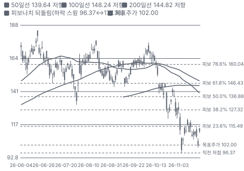

**주봉**

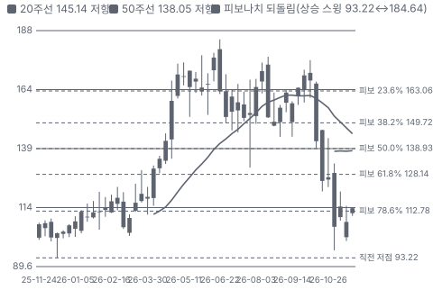

**월봉**

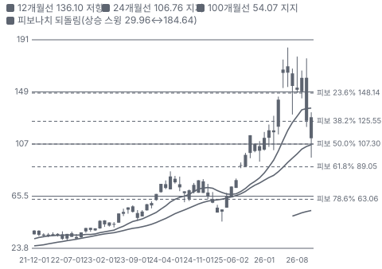

**분기 매출·EPS 실적과 컨센서스**

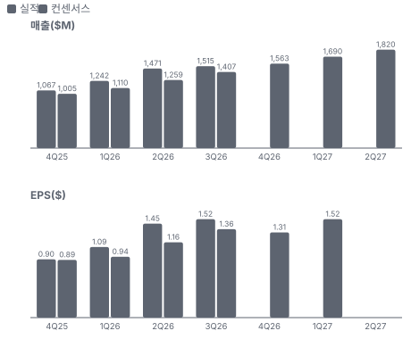

**4Q26 매출 — 지표 추세 vs 가이던스·컨센서스**

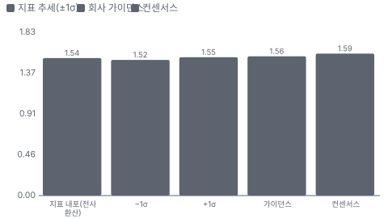

**최근 4개 분기 주가 변화 분석**

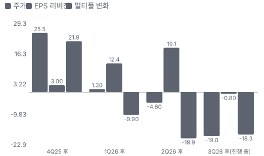

**EPS 리비전**

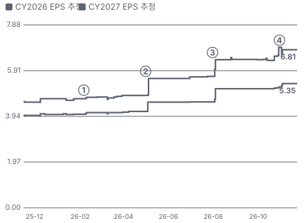

① 26-02-06 4Q25 조정 EPS \$0.90(추정 \$0.89), 당일 −1.1% · EPS 리비전 +1%
② 26-05-01 1Q26 매출 +53%·가이던스 상향, 당일 +11.2% · EPS 리비전 +15%
③ 26-07-31 2Q26 가이던스 EPS \$5.00~5.10로 상향, 당일 +6.2% · EPS 리비전 +13%
④ 26-10-30 3Q26 가이던스 EPS \$5.36~5.39로 상향, 당일 −8.8% · EPS 리비전 -1%

**멀티플 프리미엄(Fwd 1Y P/E, 최근 4개 분기말 절대값 — 대상 vs 동종 중앙값)**

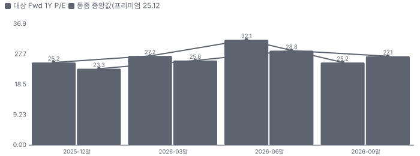

**합리적 멀티플**

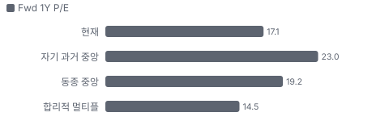

**밸류에이션 주가 시나리오**

**주가별 업사이드**

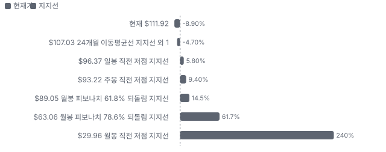
- 제품·서비스 포트폴리오

**고객 믹스(FY2025, 매출 대비)**

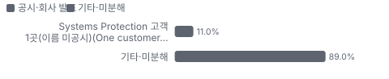

**공급 병목(10점, 낮을수록 병목)**

**CAPEX의 매출 대비 비중**

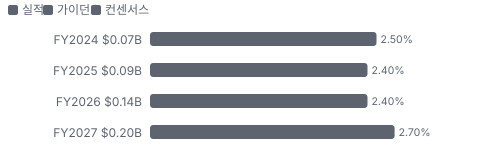

**어닝콜 변화별 주주가치 영향**

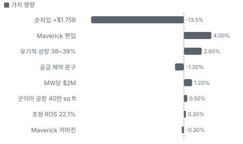

**수주·파이프라인 확실성 사다리**

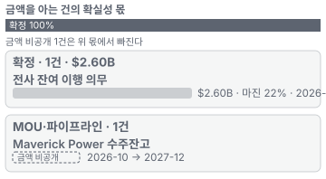

**수주/출하 비율(B/B) × 재고 일수 — 분기별**

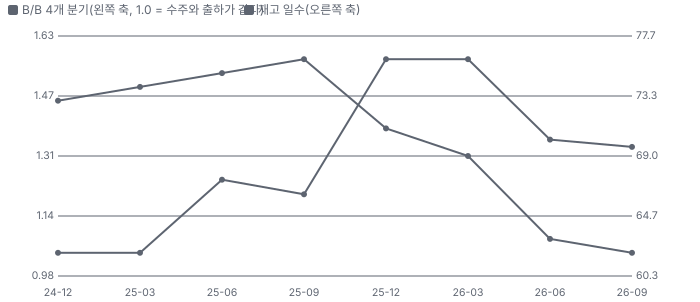

**매출 → 매출총이익 → 영업이익(매출 = 100, 최근 4분기)**

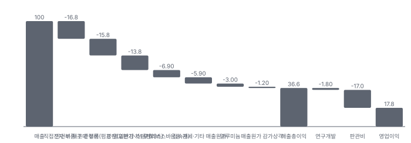

**분기 비용 비중 추이(매출 대비, 공시)**

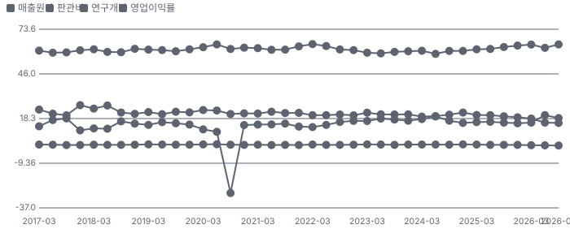

**비용 요인별 매출 대비 비중 1년 변화**

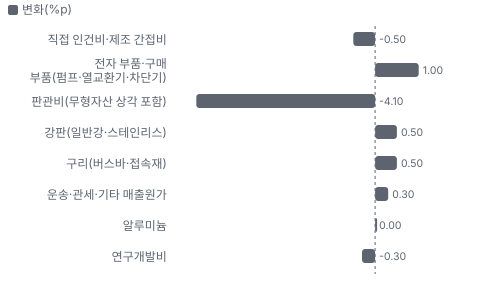

**Systems Protection BOM 원가 몫**

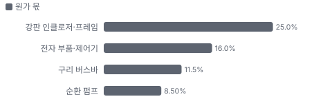

**Electrical Connections BOM 원가 몫**

**BOM 항목 가격 +10% 시 OPM 변화**

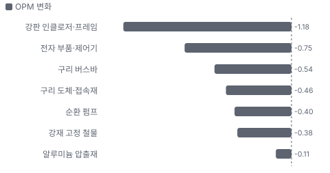

**원가 물가 vs 판매가 물가 — 최근 24개월**

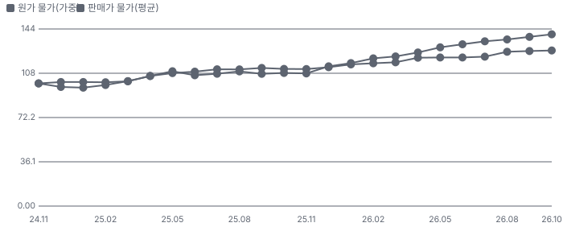

**사업별 매출 vs 물가 — 전년 대비(명목 매출 · 비교 물가 · 실질 = 물량·믹스)**

**자산 구성 — 3Q26 분기말 투하자본 \$5.429B**

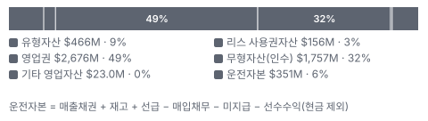

**자산별 변화율 — 최근 12개 분기(4Q23 = 0%) + 다음 4개 분기 추정**

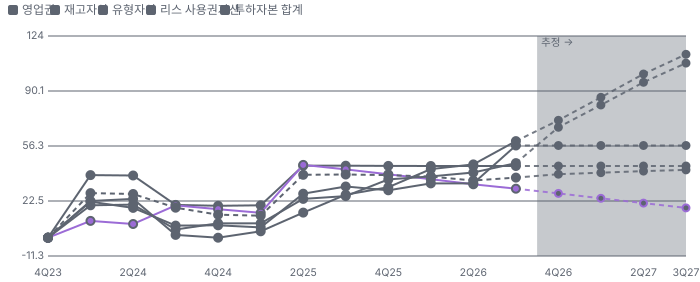

**ROIC 추이 — TTM, 최근 12개 분기 + 다음 4개 분기 추정(컨센서스 NOPAT) · 투하자본이 0 근처라 ROIC가 ±100%를 넘는 분기는 비움**

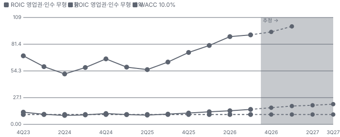

**생산시설별 면적(sq ft, 큰 순) — 생산능력 미공시라 면적을 대용으로**

**Maverick Power 인수 효과 — 인수 전 EPS 대비 %, 굵은 선 = 합계 · 시너지 가치 \$0.10B(웃돈 미확인)**

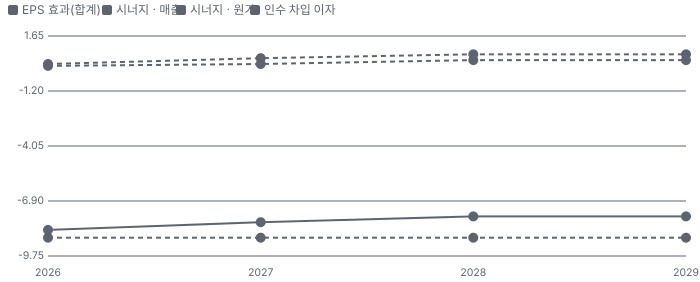

**매출 vs PPI·수출입 — 4Q22 = 100(변화율, 로그 눈금)**

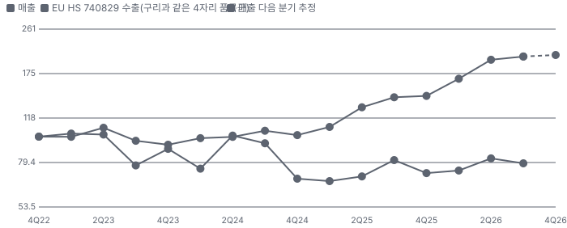

**10년 P·Q 사이클 — 추세(HP 필터) 대비 갭과 8분기 전망**

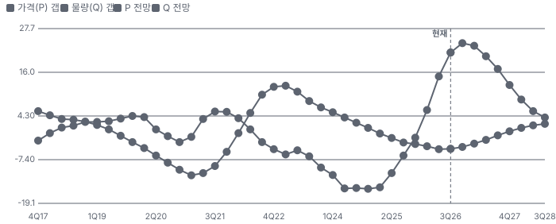

**매출 증가율의 가격·물량 분해와 8분기 전망(전년 대비)**

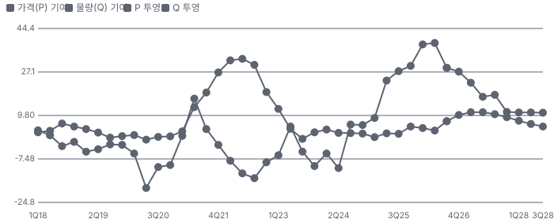

**목표주가 산정 — 약세와 기본 사이(약세 쪽 11%), 도달 확률 약 53%**

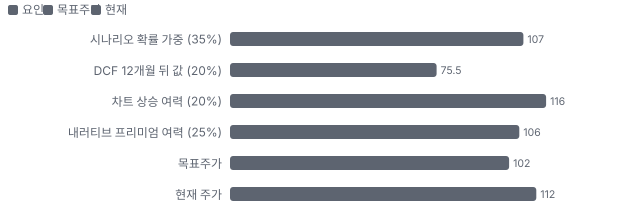

**PEG — 성장 대비 멀티플(낮을수록 성장 대비 쌈)**

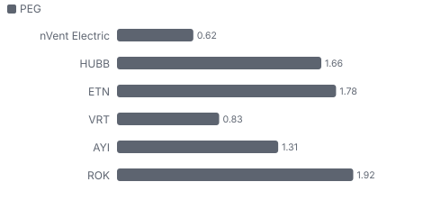

**커뮤니티 언급 수(최근 30일, 채널별)**

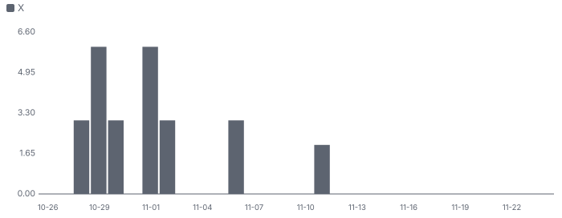

**일별 거래량 분해**

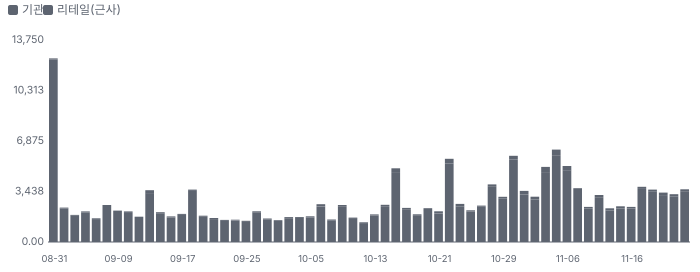

**기관 자금 흐름**

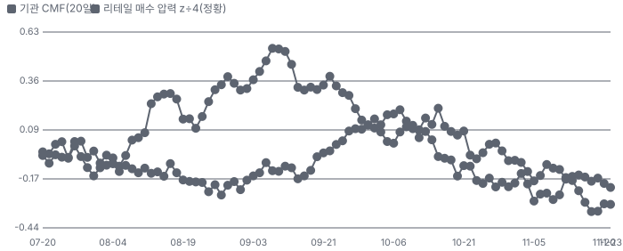

**몬테카를로**

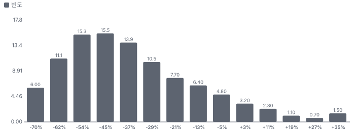

해석: 3,000번 중 250번(8%)에서 가치가 지금 주가 이상이었다. 가정을 흔들어도 지금 주가를 뒷받침하지 못하는 경우가 더 많다. 가운데 값은 0.60배이고, 열 번 중 여덟 번은 0.38~0.96배 사이에 든다.

## 내러티브

> **기업가치를 결정하는 이야기:** nVent의 값은 ① 잔여 이행 의무 \$2.6B가 2027년 매출로 바뀌는 속도와 그 뒤를 채울 신규 수주 ② 성장하면서도 조정 영업이익률 22%를 지키는지(매출총이익률은 내려가는 중) ③ \$1.75B에 산 Maverick Power가 전력 분배 매출을 얼마나 얹는지 ④ 선거 뒤 데이터센터 신규 부지 지연이 2027년 수주에 구멍을 내는지로 정해진다.

> **멀티플·EPS 프리미엄**
> **멀티플:** Fwd 1Y P/E 17.1배 — 지난 36개월 범위 16.7~34.3배의 바닥이고 전기 장비 동종 중앙값(19.2배)보다 약 11% 낮다.
> **EPS:** FY2026 EPS 컨센서스 \$5.38(+61%), FY2027 \$7.00~7.03(+30%), FY2028 \$8.30 — 90일 동안 FY2027 추정은 약 9% 올랐다.

### 투자자들은 왜 열광했나

2월 4Q 실적에서 수주잔고가 \$2.35B(+214%)로 뛰었고, 5월·7월 실적마다 매출이 컨센서스를 13~17% 웃돌며 6월 \$184까지 올랐다. 이후 7/31 2Q 실적 뒤에도 \$150~165를 지켰지만, 10/30 3Q 실적 날 −8.8%(4Q 유기적 성장 둔화·매출총이익률 하락), 11/4~5 이틀 −23.9%로 식었다(중간선거 직후 — 데이터센터 규제 우려로 보이지만 회사·보도로 확인한 원인은 아니다, 정황). 셀사이드는 이번 AI 급락의 원인으로 데이터센터 건설 지연과 선거 뒤 주·지방 규제 반대를 꼽고, 수요 붕괴가 아니라 프로젝트 지연으로 본다 — 규제가 강해지는 지역의 파이프라인 증가분 27GW 중 17GW가 대상이고 전국 영향은 2~4%라는 추정이다.

### 무엇이 기업가치를 바꾸나

> **구조적 체질 변화**
> **변화:** 인프라 수직 시장(데이터센터·전력 유틸리티) 매출 비중이 FY2023 30% → FY2025 45% → 3Q26 57%로 커졌다. 경기 민감 산업·상업 건물 매출 회사에서 데이터센터 투자 연동 회사가 됐다.
> **증거:** https://www.sec.gov/Archives/edgar/data/1720635/000162828026068596/nvt-20260930.htm
> **반증:** 인프라 비중이 50% 아래로 되돌아간다

> **고부가 믹스 확장**
> **변화:** 커지는 쪽(Systems Protection, 조정 ROS 23.1%)이 작아지는 쪽(Electrical Connections 28.2%)보다 마진이 낮다 — 매출총이익률은 37.4% → 35.8%로 내려갔고, 판관비 레버리지로 조정 영업이익률은 20.2% → 22.1%로 올랐다.
> **증거:** https://www.sec.gov/Archives/edgar/data/1720635/000162828026068391/q32026nvtpressrelease.htm
> **반증:** 조정 영업이익률이 21% 아래로

> **기술 혁신**
> **변화:** 공랭에서 액체 냉각으로 넘어가며 CDU(냉각수 분배 장치 — 서버 랙 액체 냉각 회로에 냉각수를 보내고 열을 빼는 장비)·매니폴드(냉각수를 랙 안 서버마다 나눠 보내는 분배 배관)·랙 전력 분배 제품을 칩 로드맵에 맞춰 낸다. 3Q26 신제품이 매출 성장에 약 30%p 기여했다.
> **증거:** https://www.sec.gov/Archives/edgar/data/1720635/000162828026068391/q32026nvtpressrelease.htm
> **반증:** 신제품 기여가 한 자릿수로 떨어진다

> **실행 속도**
> **변화:** 해당 없음(리드타임 수치 미공시 — 10-K는 보통 주문 뒤 90일 안에 출하하지만 인프라 쪽은 설계·제조 1년 넘는 수주가 늘고 있다고 밝혔다. 블레인 1 공장은 임차에서 가동까지 약 100영업일이 걸렸고, 회사는 협력사 증설 속도가 출하 상한이라고 설명했다)
> **증거:** https://www.sec.gov/Archives/edgar/data/1720635/000162828026008608/nvt-20251231.htm
> **반증:** 출하 지연으로 가이던스를 낮춘다

> **M&A**
> **변화:** Thermal Management를 \$1.7B에 팔고(2025-01) Trachte \$687.5M(2024-07)·Avail EPG(Avail의 전기 제품 사업부 — 인클로저·스위치기어·버스 시스템을 만든다) \$979.6M(2025-05)·Maverick Power 약 \$1.75B(2026-10)를 샀다. Maverick은 데이터센터용 저압·고압 스위치기어(전력 회로를 열고 닫아 보호하는 개폐 장치) 회사로 12개월 매출 약 \$527M이다.
> **증거:** https://www.sec.gov/Archives/edgar/data/1720635/000110465926107974/tm2625115d3_ex99-1.htm
> **반증:** Maverick 2027년 성과 연동 대가가 지급되지 않을 만큼 성장이 느리다

> **정책·입법 연관성**
> **재정정책:** 해당 없음(정부 보조금·전략 계약 공시 없음). IEEPA(국제비상경제권한법 — 미국 대통령이 관세를 매긴 근거 법) 관세 환급 약 \$20M이 9M26 매출총이익에 반영됐다 https://www.sec.gov/Archives/edgar/data/1720635/000162828026068596/nvt-20260930.htm 의회 동의 2/10 — 하원 1/5(논의 없음) · 상원 1/5(논의 없음).
> **행정명령:** 해당 없음(행정명령과 직접 연결되는 매출 없음 — 관세는 원가 요인) 의회 동의 2/10 — 하원 1/5(논의 없음) · 상원 1/5(논의 없음).
> **연관입법:** 해당 없음 — 데이터센터 규제는 주(州) 단위 법안 논의이고 연방 법안 연결은 미확인. 선거 뒤 텍사스·조지아·오하이오 등에서 신규 부지 지연 위험이 거론된다 노션 자료실 US Data Center Bills Tracker

> **고객의 지출 예산**
> **변화:** 인프라 매출은 하이퍼스케일러·코로케이션의 데이터센터 CAPEX와 전력 유틸리티 송배전 CAPEX에서, 산업·상업 매출은 공장·건물 신축과 유지보수 예산에서 나온다.
> **사업별 예산:** **매출의 57%**: 인프라(데이터센터·전력 유틸리티) — 고객 CAPEX(데이터센터 건설·냉각·전력 설비, 유틸리티 송배전 투자) · 동인: AI 데이터센터 착공과 전력망 투자
**매출의 25%**: 산업 — 고객 혼합(공장 자동화 설비 투자와 유지보수 예산) · 동인: 제조업 설비 투자·리쇼어링
**매출의 18%**: 상업·주거 — 고객 CAPEX(건물 신축·개보수 전기 공사비) · 동인: 비주거 건설
> **증거:** https://www.sec.gov/Archives/edgar/data/1720635/000162828026068596/nvt-20260930.htm
> **반증:** 하이퍼스케일러 2027 CAPEX 가이던스 하향

### 내러티브 근거

> 전기 인클로저 회사가 데이터센터 액체 냉각·전력 분배 회사로 바뀌었고 3Q 매출은 44% 늘었다. 그런데 주가는 6월 종가 고점 \$184.34에서 39% 내려와 있다 — 시장은 실적이 아니라 2027년 데이터센터 신규 발주 공백과 선거 뒤 규제, 인수로 늘어난 차입을 먼저 본다. 동종 대비 멀티플 차이 -11% 중 회사 고유 몫은 +18%다. 단계는 컨센서스, 쏠림은 중간이다.

> **AI 데이터센터 액체 냉각·전력 분배** · 유지
> **논리:** 랙 전력 밀도가 올라가며 액체 냉각(CDU·매니폴드)과 랙 전력 분배가 필수가 됐고, 인프라 수직 시장이 매출의 57%로 커졌다
> **숫자:** 3Q26 인프라 매출 \$868.2M(유기적 +70% 이상), 잔여 이행 의무 \$2.6B, 회사 전망 2026년 데이터센터 매출 \$2B 초과(2Q 콜)
> **반증:** 4Q26·1Q27 수주가 전년 같은 분기를 밑돌고 잔여 이행 의무가 \$2.3B 아래로
> **출처:** 3Q26 10-Q

> **포트폴리오 재편(M&A)** · 강화
> **논리:** 열관리 사업을 팔고 Trachte·Avail EPG·Maverick Power를 사서 데이터센터·전력 유틸리티 비중을 키웠다
> **숫자:** 2024~2026년 인수 3건 \$3.42B, FY2026 매출 성장 48~49% 중 인수 기여 10%p
> **반증:** Maverick 성장률이 전력 장비 동종보다 낮게 확인되거나 영업권 손상
> **출처:** 3Q26 10-Q 주석 5

> **가이던스 연속 상향** · 유지
> **논리:** 2026년 조정 EPS 가이던스를 \$4.00~4.15에서 \$5.36~5.39로 세 번 올렸다
> **숫자:** FY2026 유기적 성장 10~13% → 38~39%
> **반증:** FY2027 첫 가이던스가 컨센서스 EPS \$7.0을 밑돈다
> **출처:** 실적 8-K(2026-02-06·10-30)

> **반대 — 2027 발주 공백과 규제** · 강화
> **논리:** 중간선거 뒤 주(州) 단위 데이터센터 규제와 하이퍼스케일러 CAPEX 증가율 둔화로 4Q26~1Q27 냉각·전력 장비 주문이 비는 구간이 생길 수 있다
> **숫자:** 11/4~11/5 이틀 −23.9%, 4Q 유기적 성장 가이던스 26~29%(3Q 43.9%)
> **반증:** 4Q 실적에서 수주 두 자릿수 성장과 FY2027 유기적 성장 가이던스 두 자릿수
> **출처:** 실적 8-K(2026-10-30)·일봉

> **반대 — 마진과 차입** · 유지
> **논리:** 성장이 큰데 매출총이익률은 내려가고, Maverick 인수로 차입이 약 \$1.65B 늘었다
> **숫자:** 매출총이익률 37.4% → 35.8%, 신규 차입 약 \$1.65B, 성과 연동 추가 대가 최대 \$550M
> **반증:** 4Q 조정 영업이익률 21% 이상과 2027년 말 순차입/EBITDA 2배 아래
> **출처:** 3Q26 10-Q

### 투자 포인트

> **이익은 올랐고 배수만 깎였다**
> **명제:** 3Q 콜 뒤 주가는 −19%였지만 FY2027 EPS 추정은 한 달 새 올랐다
> **숫자:** FY2027 EPS 추정 30일 전 \$6.80 → \$7.03, 주가 \$138.15(10/29) → \$111.92(11/23)
> **시장과 다른 점:** 시장은 2027년 수주 공백과 규제를 할인했다 — 이익 경로는 아직 꺾이지 않았다
> **증명:** 4Q 조정 EPS \$1.30~1.33 달성과 FY2027 가이던스
> **출처:** 실적 8-K(2026-10-30)

> **잔고가 멈춘 이유가 첫 숫자**
> **명제:** 잔여 이행 의무가 세 분기째 \$2.5~2.6B다 — 출하가 빨라진 것인지 수주가 느려진 것인지를 4Q가 가른다
> **숫자:** RPO \$2.35B(12월) → \$2.591B(3월) → \$2.6B(9월), 분기 매출 \$1.067B → \$1.515B
> **시장과 다른 점:** 시장은 수요 둔화로 읽지만 3Q 수주는 회사 기준 사상 최대였다
> **증명:** 4Q 말 잔여 이행 의무(Maverick 포함) 금액과 수주 성장률
> **출처:** 3Q26 10-Q

> **Maverick이 값을 하는지**
> **명제:** \$1.75B(2026년 EBITDA 약 11.5배)에 산 전력 분배 회사가 4Q 매출 성장에 19%p를 얹는다
> **숫자:** 12개월 매출 약 \$527M, 신규 차입 약 \$1.65B, 추가 대가 최대 \$550M
> **시장과 다른 점:** 시장은 차입 증가를 먼저 봤다 — 성과 연동 대가가 붙었다는 것은 매도자도 2027~28년 성장을 걸었다는 뜻이다
> **증명:** 4Q 실적의 Maverick 매출·마진 첫 공시
> **출처:** 3Q26 10-Q 주석 5

### 모멘텀 생성·소멸 타임라인

**카탈리스트 달력 — 지난 사건의 주가 반응과 앞으로 확인할 숫자**
| 날짜 | 상태 | 구분 | 사건 | 반응·확인 | 결과에 따라 |
|---|---|---|---|---|---|
| 2026-02-06 | 완료 | 생성 | 4Q25 실적 — 수주잔고 \$2.35B(+214%)·2026 가이던스 | −1.1% |  |
| 2026-05-01 | 완료 | 생성 | 1Q26 매출 +53%·가이던스 상향 | +11.2% |  |
| 2026-07-31 | 완료 | 확인 | 2Q26 매출 +53%·가이던스 두 번째 상향·블레인 두 번째 공장 | +6.2% |  |
| 2026-10-30 | 완료 | 소멸 | 3Q26 실적 — 가이던스 상향에도 4Q 유기적 성장 둔화·매출총이익률 하락 | −8.8% |  |
| 2026-11-04 | 완료 | 소멸 | 중간선거 직후 이틀 급락(데이터센터 규제 우려 — 정황, 원인 미확인) | 이틀 −23.9% |  |
| 2027-02(예상) | 예정 | 확인 | 4Q26·FY2026 실적과 FY2027 가이던스 | 4Q 조정 EPS \$1.30 이상, 수주 두 자릿수 성장, FY2027 조정 EPS 가이던스 중간값 \$7.0 이상 | 충족이면 기본~강세, 미달이면 약세 |
| 2027-01~02(예상) | 예정 | 매크로 | 하이퍼스케일러 2027 CAPEX 가이던스 | 전년 대비 증가 유지 | 냉각·전력 수주 환경 유지 |

### 언제 사서 언제 팔아야 할까?

**가격·조건 틀 — 가격은 밸류에이션(약세·기본·강세·목표주가)과 차트 지지 구간에서, 조건은 이벤트에서**
| 구간 | 가격 | 목표주가까지 | 약세까지 | 조건·근거 |
|---|---|---|---|---|
| 관찰 구간 | \$107~\$107 | -5% | -34% | 11월 5일 종가 저점(\$98.38) 근처는 선거 뒤 규제 공포가 가장 깊게 반영된 자리다 |
| 확인 뒤 | 지금 \$112 이상에서 조건 확인 | -9% | -37% | 4Q 실적에서 수주 두 자릿수 성장과 FY2027 가이던스가 컨센서스 이상 |
| 무효화 | 약세 시나리오 \$70 | - | -37% | FY2027 가이던스가 EPS \$6.4 아래이거나 잔여 이행 의무가 \$2.3B 미만, 종가 \$98 아래 |
| 차익 고민 2차 | \$145(강세 시나리오) | +30% | - | 목표주가 근처에서는 배수 정상화가 상당 부분 반영된다 |

실적일·정책 뉴스일 하루 변동이 9~13%다 — 발표 직후 추격은 경계 가격·조건 틀이며 매매·비중 지시가 아니다(투자 권유 아님).

## 포트폴리오

| 제품·서비스 | 구분 | 무엇 | 쓰는 곳 | 돈 버는 방식 | Mix | Mix 변화(전 분기 대비) |
|---|---|---|---|---|---|---|
| Systems Protection | 제품 | 전기·전자 보호 인클로저, 데이터센터 액체 냉각(CDU·매니폴드), 컨트롤 빌딩(변전소·데이터센터 전력 제어 장비를 넣어 공장에서 조립해 보내는 건물형 함체), 스위치기어·전력 분배 | 하이퍼스케일 데이터센터, 전력 유틸리티, 공장 자동화 패널 | 3Q26 매출의 72% | 72% | -0.4%p |
| Electrical Connections | 제품 | 버스 시스템, 케이블 관리·고정, 접지·전기 접속, 전력 접속 부품 | 상업 건물 전기 공사, 전력 유틸리티, 데이터센터 전력 배선 | 3Q26 매출의 28% | 28% | +0.4%p |

**Mix 변화가 가장 큰 쪽은 Systems Protection(-0.4%p, 전 분기 대비).** 계절성 판정: 분기 매출 계절 지수 기준 없음 → 직전 분기와 비교.

## 고객

> **FY2025 최대 고객 Systems Protection 고객 1곳(이름 미공시, One customer within Systems Protection) 11%, 상위 3곳 11%, 집중도 분산.** 공시·회사 발표로 확인한 몫은 매출의 11%이고, 나머지 고객 몫은 추정이거나 미분해다. FY2025에 Systems Protection 고객 1곳이 연결 매출의 약 11%였다(이름 미공시, 2024·2023년에는 10% 초과 고객 없음). 나머지는 전기 유통사·시공사·OEM·하이퍼스케일러로 흩어져 있다. 시장별로는 3Q26 매출의 57.3%가 인프라(데이터센터·전력 유틸리티), 25.0%가 산업, 17.7%가 상업·주거다(1년 전 47.3%·30.7%·22.0%).

**고객별 매출 몫(FY2025)**
| 고객 | 몫 | 변화 | 근거 |
|---|---|---|---|
| Systems Protection 고객 1곳(이름 미공시, One customer within Systems Protection) | 11% | 미확인 | 공시 |
| 기타·미분해 | 89% | - | - |

> **Systems Protection 고객 1곳(이름 미공시, One customer within Systems Protection)** · 공시
> **사는 것:** 미공시(Systems Protection 제품 — 인클로저·액체 냉각·전력 분배)
> **추정 근거:** 이름 미공시 — 특정 회사로 옮기지 않는다

## 수주·파이프라인

> **2026-09-30 기준 2건.** 확정 \$2.60B. 공시 잔여 이행 의무 \$2.60B.

**수주 목록**
| 상태 | 계약 | 계약 총액 | 진척 | 기간 | 비고 |
|---|---|---|---|---|---|
| 확정 | 전사 잔여 이행 의무 | \$2.60B | - | 2026-10 → 2027-12 | 2025년 말 기준 Systems Protection \$2.119B·Electrical Connections \$231.0M(10-K). Maverick Power 잔고는 포함 전 |
| 파이프라인 | Maverick Power 수주잔고 | 금액 비공개 | - | 2026-10 → 2027-12 | - |

**실행 속도와 방해 요인**
| 항목 | 상태 | 실행 속도 | 방해 요인 |
|---|---|---|---|
| 전사 잔여 이행 의무 | 확정 | 약 5개월(계산 — 잔고 ÷ 3Q 월평균 매출) | 고객 데이터센터 건설 일정 · 액체 냉각 공장 증설 속도 |
| Maverick Power 수주잔고 | 파이프라인 | 미확인 | 인수 통합 |

## 마진 구조

> **GPM 35.8%, OPM 18.6%.** 3Q25 대비 GPM -1.6%p, OPM +2.9%p. 변동비는 매출의 59%이고, 매출이 10% 늘면 OPM은 +2.0%p 움직인다. 3Q26 매출총이익률 35.8%(전년 37.4%). 관세 포함 원가 상승과 증설 투자, 마진이 낮은 Systems Protection 비중 확대가 깎았다. 판관비 비중이 19.7% → 15.6%로 내려가 영업이익률은 15.8% → 18.6%(조정 20.2% → 22.1%)로 올랐다.

> **매출 100 중 매출원가 63.4, 매출총이익 36.6(최근 4분기, 공시).** 매출원가 요인 중 직접 인건비·제조 간접비이 매출의 17.0%로 가장 무겁고, 단가가 +10% 오르면 GPM이 -1.70%p 움직인다. 분기 회귀로 매출 1이 늘 때 매출원가는 0.64 늘고, 매출원가의 고정비 몫은 -5%다. 매출원가 요인 비중은 요인별 공시 기간 값이라 합이 최근 4분기 매출원가를 넘어, 그림에서는 0.99배로 비례 조정했다.

**비용 요인 강도 — 비중·추세·충격(+10%)·탄력**
| 비용 | 구분 | 매출 대비 | 1년 변화 | 마진 기여 | 충격 시 마진 | 매출 탄력 | 고정비 몫 |
|---|---|---|---|---|---|---|---|
| 직접 인건비·제조 간접비 | 매출원가 요인 | 17.0% | -0.5%p | +0.5%p | -1.70%p | 미확인 | 50% |
| 전자 부품·구매 부품(펌프·열교환기·차단기) | 매출원가 요인 | 16.0% | +1.0%p | -1.0%p | -1.60%p | 미확인 | 0% |
| 강판(일반강·스테인리스) | 매출원가 요인 | 14.0% | +0.5%p | -0.5%p | -1.40%p | 미확인 | 0% |
| 구리(버스바(큰 전류를 나르는 구리·알루미늄 막대 도체)·접속재) | 매출원가 요인 | 7.0% | +0.5%p | -0.5%p | -0.70%p | 미확인 | 0% |
| 운송·관세·기타 매출원가 | 매출원가 요인 | 6.0% | +0.3%p | -0.3%p | -0.60%p | 미확인 | 30% |
| 알루미늄 | 매출원가 요인 | 3.0% | +0.0%p | -0.0%p | -0.30%p | 미확인 | 0% |
| 매출원가 감가상각 | 매출원가 요인 | 1.2% | -0.2%p | +0.2%p | -0.12%p | 미확인 | 100% |
| 매출원가 | 공시 항목 | 63.4% | +2.0%p | -2.0%p | -6.34%p | 0.64 | -5% |
| 판관비 | 공시 항목 | 17.0% | -3.5%p | +3.5%p | 미확인 | 0.13 | 35% |
| 연구개발 | 공시 항목 | 1.8% | -0.3%p | +0.3%p | 미확인 | 0.02 | 25% |

매출 탄력 = 분기 비용을 매출에 회귀한 기울기(매출 1당 변동비), 고정비 몫 = 절편 ÷ 평균 비용. 표본이 8분기 미만이면 미확인. 매출원가 요인 비중은 margin 재료의 추정이 섞여 있고, 공시 매출원가와의 차이는 '기타 매출원가'로 둔다.

**GPM에서 OPM까지(GAAP — 분기 손익(3개월), 아래는 최근 4개 분기)**
| 기간 | GPM | 연구개발 | 판관비 | 기타 | OPM |
|---|---|---|---|---|---|
| 3Q25 | 37.4% | 2.0% | 19.7% | 0.0% | 15.8% |
| 3Q26 | 35.8% | 1.6% | 15.6% | 0.0% | 18.6% |
| 2025-12 | 36.5% | - | - | - | 15.4% |
| 2026-03 | 35.9% | - | - | - | 15.8% |
| 2026-06 | 37.9% | - | - | - | 20.4% |
| 2026-09 | 35.8% | - | - | - | 18.6% |

**비용을 움직이는 요인**
| 비용 | 요인 |
|---|---|
| 직접 인건비·제조 간접비(매출원가) | 가동률·증설 초기 비용 · 근거 추정 |
| 전자 부품·구매 부품(펌프·열교환기·차단기, 매출원가) | 부품 단가·공급 · 근거 추정 |
| 판관비(무형자산 상각 포함, 판관비) | 인력·인수 무형자산 상각 · 근거 공시 |
| 강판(일반강·스테인리스, 매출원가) | 강판 가격·관세 · 근거 추정 |
| 구리(버스바·접속재, 매출원가) | 구리 가격 · 근거 추정 |
| 운송·관세·기타 매출원가(매출원가) | 관세·물류 · 근거 추정 |
| 알루미늄(매출원가) | 알루미늄 가격 · 근거 추정 |
| 연구개발비(연구개발) | 신제품 개발 인력 · 근거 공시 |
| 매출원가 감가상각(매출원가) | 설비 투자 · 근거 공시 |

**Systems Protection BOM — 매출의 72%, GPM 35%(FY2025 세그먼트 매출 \$2.593B − 매출원가 \$1.687B(10-K 주석 15, 계산)), 항목 가격 +10% 시**
| 항목 | 원가 몫 | 전가 | 제품 GPM | OPM |
|---|---|---|---|---|
| 강판 인클로저·프레임 | 20~30% | 미확인 | -1.6%p | -1.18%p |
| 전자 부품·제어기 | 12~20% | 미확인 | -1.0%p | -0.75%p |
| 구리 버스바 | 8~15% | 미확인 | -0.7%p | -0.54%p |
| 순환 펌프 | 5~12% | 미확인 | -0.6%p | -0.40%p |
| 미분해 | 39% | - | - | - |

**Electrical Connections BOM — 매출의 28%, GPM 44%(FY2025 세그먼트 매출 \$1.3B − 매출원가 \$721.0M(10-K 주석 15, 계산)), 항목 가격 +10% 시**
| 항목 | 원가 몫 | 전가 | 제품 GPM | OPM |
|---|---|---|---|---|
| 구리 도체·접속재 | 25~35% | 미확인 | -1.7%p | -0.46%p |
| 강재 고정 철물 | 20~30% | 미확인 | -1.4%p | -0.38%p |
| 알루미늄 압출재 | 5~10% | 미확인 | -0.4%p | -0.11%p |
| 미분해 | 38% | - | - | - |

강판 인클로저·프레임 가격이 +10% 오르면 영업이익은 -6.3% 움직인다. 판매가 전가를 모르는 항목은 전가 0%로 계산했다.

**BOM 항목 가격을 움직이는 것**
| 항목 | 요인 |
|---|---|
| 강판 인클로저·프레임 | 부피 최대 소재 — 관세 노출 · 근거 추정 |
| 전자 부품·제어기 | CDU 제어·센서 · 근거 추정 |
| 구리 버스바 | 전력 분배·스위치기어 도체 · 근거 추정 |
| 순환 펌프 | 액체 냉각 핵심 구매 부품 · 근거 추정 |
| 구리 도체·접속재 | 구리 가격에 직접 노출 · 근거 추정 |
| 강재 고정 철물 | 강재 가격·관세 · 근거 추정 |
| 알루미늄 압출재 | 케이블 트레이·버스 덕트 · 근거 추정 |

> **원가·판매가 물가 격차 -15.6%p** — 판매가 물가가 투입 원가 물가보다 느리게 오른다.

**투입 물가 — 미국 PPI 3·6·12개월(2026-10, 개정 반영)과 해외 전년비**
| 항목 | 미국 3개월 | 6개월 | 12개월 | 전가 못 할 때 OPM | 일본 | 한국 | 대만 |
|---|---|---|---|---|---|---|---|
| 강재 고정 철물 | +6.7% | +17.0% | +32.9%* | - | 미확인 | 미확인 | 미확인 |
| 구리 도체·접속재 | +3.4% | +7.2% | +23.9% | - | +42.6% | +19.2% | +40.1% |
| 순환 펌프 | +0.4% | +0.3% | +6.4%* | - | 미확인 | 미확인 | 미확인 |
| 알루미늄 압출재 | -3.8% | +1.1% | +23.3%* | - | 미확인 | 미확인 | 미확인 |

별표는 품목보다 넓은 업종 지수다. 연결한 투입 원가의 미국 PPI(생산자물가지수)는 1년 새 가중 +29.1%이고, 판매가로 넘기지 못하면 GPM -7.0%p·OPM -7.0%p가 움직인다. 판매가 비교 물가(개폐기·배전반 PPI)는 1년 새 +13.5% — 회사 가격 변화는 미확인. 물가 지수를 붙이지 못한 매출원가 항목은 전자 부품·구매 부품(펌프·열교환기·차단기), 직접 인건비·제조 간접비, 매출원가 감가상각, 운송·관세·기타 매출원가다(미연결). 인클로저·액체 냉각·전력 분배 매출은 2026-09 전년 대비 +53.4%이고 비교 물가 ppi:switchgear의 변화 +12.3%(2026-09)를 빼면 실질 +36.6% — 물량·믹스가 성장을 이끌었다. 전기 접속·케이블 관리 매출은 2026-09 전년 대비 +23.2%이고 비교 물가 ppi:switchgear의 변화 +12.3%(2026-09)를 빼면 실질 +9.7% — 물량·믹스가 성장을 이끌었다.

## 자산 구성

> **3Q26 분기말 투하자본 \$5.429B** — 영업권 49%, 무형자산(인수) 32%. 최근 12개 분기(4Q23 → 3Q26) 가장 크게 늘어난 자산은 재고자산(+59%), 투하자본 합계 +37%. 3Q27 추정 투하자본 \$5.613B(+3%, 컨센서스 매출과 회전 일수·CAPEX 강도 유지 가정).

**자산·운전자본 항목별 분기말 잔액 — 최근 12개 분기와 다음 4개 분기 추정**
| 항목 | 4Q23 | 3Q25 | 3Q26(최근) | 3Q27 추정 | 12개 분기 변화 | 다음 4개 분기 변화 |
|---|---|---|---|---|---|---|
| 재고자산 | \$360.2M | \$455.2M | \$573.8M | \$765.8M | +59% | +33% |
| 선급·기타 유동자산 | \$72.5M | \$230.7M | \$312.4M | \$391.1M | +331% | +25% |
| 매입채무 | \$239.8M | \$340.7M | \$535.6M | \$659.3M | +123% | +23% |
| 유형자산 | \$319.9M | \$401.6M | \$466.3M | \$662.9M | +46% | +42% |
| 리스 사용권자산 | \$99.6M | \$130.9M | \$156.0M | \$156.0M | +57% | +0% |
| 영업권 | \$1,858.1M | \$2,678.8M | \$2,676.1M | \$2,676.1M | +44% | +0% |
| 무형자산(인수) | \$1,350.5M | \$1,916.9M | \$1,757.1M | \$1,597.5M | +30% | -9% |

**자산 추정 동인 — 최근 4개 분기 평균(재무상태표 동인 모형)**
| 동인 | 값 | 곱하는 기준 |
|---|---|---|
| 재고자산 | 57일 | 매출원가 |
| 선급·기타 유동자산 | 18일 | 매출 |
| 매입채무 | 49일 | 매출원가 |
| 유형자산 ÷ 분기 매출 | 0.34배 | CAPEX·감가 재료 없음 — 비율 유지 |
| 매출원가율 | 63.4% | 매출(최근 4개 분기) |
| 영업권·리스 사용권·기타 | 유지 | 인수·새 리스는 공시 전 모름 |
| 인수 무형자산 | 분기 \$39.9M 상각 | 최근 4개 분기 평균 상각 |

**추정 방법:** 증권사 3표 모델(손익·재무상태표·현금흐름)의 재무상태표 동인 방식이다. 운전자본은 항목별 회전 일수(매출채권·선급·미지급·선수는 매출, 재고·매입채무는 매출원가 기준)를 최근 4개 분기 평균으로 두고 컨센서스 매출에 곱한다. 유형자산은 기초 + CAPEX − 감가상각으로 굴린다(Koller·Goedhart·Wessels 『Valuation』 재무상태표 추정). 매출 경로는 ROIC 절의 컨센서스와 같다.

**유형·무형자산 항목별 가치(2025-12-31 vs 2024-12-31)**
| 구분 | 항목 | 총액 2025-12-31 | 누적상각 | 순액 | 총액 2024-12-31 | 총액 1년 변화 | 공시 내용연수 |
|---|---|---|---|---|---|---|---|
| 유형 | 유형자산 합계(항목 미분해) | \$965.1M | 총계만 공시 | 총계만 공시 | \$811.4M | +18.9% | 미확인 |
| 영업권 | 영업권 | \$2,678.0M | \$0.0M | \$2,678.0M | \$2,221.8M | +20.5% | 비상각 |
| 무형 | 무형자산 합계(항목 미분해) | \$2,522.9M | \$646.4M | \$1,876.5M | \$2,084.1M | +21.1% | 미확인 |
| 유형 합계 | 유형자산 | \$965.1M | \$530.6M | \$434.5M | \$811.4M | +18.9% | 경과율 55%(상각 대상 기준) |

**내용연수 산식(상각 대상 유형자산 = 총액 − 토지 − 건설중)**
| 기준일 | 연 감가상각 | 상각 대상 총액 | 평균 내용연수 | 경과 연수 | 잔여 연수 | 경과율 |
|---|---|---|---|---|---|---|
| 2025-12-31 | \$60.7M | \$965.1M | 15.9년 | 8.7년 | 7.2년 | 55% |
| 2024-12-31 | \$51.3M | \$811.4M | 15.8년 | 9.0년 | 6.8년 | 57% |

산식 평균 내용연수는 15.9년. 1년 전 15.8년 → 지금 15.9년.

미공시·미분해: 분기 감가상각·유형자산(순액) 9분기 · 유형자산 항목별 총액·내용연수(10-K 주석에서 모델이 채움) · 무형자산 항목(10-K 주석에서 모델이 채움) — 이 칸은 비우고 나머지로 계산했다.

### 해석 — 자산이 어디에 쌓이고 있나

- 같은 기간 4개 분기 매출은 +80%. 자산이 매출보다 빨리 쌓이지 않았다 — 회전율이 유지된다.

## ROIC

> **TTM 3Q26 ROIC는 영업권·인수 무형 포함 15.2%, 제외 90.9%**(NOPAT 마진 16.4% × 투하자본 회전율 0.93회). 최근 12개 분기 4Q23 12.4% → 3Q26 15.2%(고점 3Q26 15.2%). 컨센서스 NOPAT으로 굴리면 3Q27 20.5%(제외 미확인) — WACC 10.0% 대비 +10.5%p. 1년 변화의 가장 큰 요인은 영업권(+1.9%p).

**ROIC 추이(TTM)와 다음 4개 분기 추정 — NOPAT ÷ 평균 투하자본(이번 분기말·4개 분기 전)**
| 분기 | 구분 | TTM 매출 | TTM NOPAT | NOPAT 마진 | 평균 투하자본 | ROIC 포함 | ROIC 제외 |
|---|---|---|---|---|---|---|---|
| 4Q23 | 실적 | \$2,949.1M | \$467.3M | 15.8% | \$3,754.8M | 12.4% | 69.6% |
| 1Q24 | 실적 | \$2,940.6M | \$476.2M | 16.2% | \$4,670.6M | 10.2% | 58.6% |
| 2Q24 | 실적 | \$2,877.4M | \$473.6M | 16.5% | \$5,199.5M | 9.1% | 51.2% |
| 3Q24 | 실적 | \$2,944.4M | \$483.7M | 16.4% | \$5,024.9M | 9.6% | 57.7% |
| 4Q24 | 실적 | \$3,006.1M | \$489.5M | 16.3% | \$4,456.6M | 11.0% | 66.5% |
| 1Q25 | 실적 | \$3,083.3M | \$494.6M | 16.0% | \$4,986.2M | 9.9% | 58.1% |
| 2Q25 | 실적 | \$3,306.6M | \$516.9M | 15.6% | \$5,474.6M | 9.4% | 55.6% |
| 3Q25 | 실적 | \$3,578.6M | \$554.4M | 15.5% | \$5,311.4M | 10.4% | 63.3% |
| 4Q25 | 실적 | \$3,893.1M | \$601.0M | 15.4% | \$5,217.4M | 11.5% | 73.0% |
| 1Q26 | 실적 | \$4,325.8M | \$662.4M | 15.3% | \$5,187.2M | 12.8% | 80.1% |
| 2Q26 | 실적 | \$4,834.0M | \$779.2M | 16.1% | \$5,638.5M | 13.8% | 89.1% |
| 3Q26 | 실적 | \$5,294.9M | \$865.9M | 16.4% | \$5,679.0M | 15.2% | 90.9% |
| 4Q26 | 추정 | \$5,790.9M | \$962.5M | 16.6% | \$5,711.5M | 16.9% | 93.9% |
| 1Q27 | 추정 | \$6,238.9M | \$1,062.5M | 17.0% | \$5,712.2M | 18.6% | 99.5% |
| 2Q27 | 추정 | \$6,587.6M | \$1,100.0M | 16.7% | \$5,683.6M | 19.4% | 미확인 |
| 3Q27 | 추정 | \$7,002.7M | \$1,172.6M | 16.7% | \$5,733.4M | 20.5% | 미확인 |

**다음 4개 분기 NOPAT — 컨센서스(세율 22%, 리스 이자 별도)**
| 분기 | 매출 | EBITA 마진 | EBITA | NOPAT(분기) | 근거 |
|---|---|---|---|---|---|
| 4Q26 | \$1,562.7M | 21.0% | \$328.8M | \$256.5M | 컨센서스 매출 × EBIT 마진 FY2026 |
| 1Q27 | \$1,690.0M | 21.6% | \$364.9M | \$284.6M | 컨센서스 매출 × EBIT 마진 FY2027 |
| 2Q27 | \$1,820.0M | 21.4% | \$389.9M | \$304.1M | 컨센서스 매출 × EBIT 마진 FY2027 |
| 3Q27 | \$1,930.0M | 21.3% | \$411.0M | \$320.6M | 컨센서스 매출 × EBIT 마진 FY2027 |

**추정 방법:** NOPAT은 컨센서스(분기 매출 추정 × 회계연도 EBIT 마진 추정)로 잡고, 조정(비 GAAP) 마진이면 주식보상 몫을 빼서 과거 실적과 같은 기준(영업이익 + 인수 무형 상각)으로 맞췄다. 이미 발표했지만 분기 보고서(10-Q)가 아직 없는 분기는 발표 실적을 쓴다. 투하자본은 자산 구성 절의 재무상태표 동인으로 굴렸다. ROIC는 4개 분기 NOPAT을 이번 분기말과 4개 분기 전 투하자본의 평균으로 나눈다 — 추정 분기의 ROIC에는 이미 나온 실적 분기가 섞여 있다.

**투하자본 항목별 회전율과 ROIC 기여(TTM 3Q26, 평균 잔액)**
| 항목 | 투하자본 | 매출 1달러당 자본 | 회전율(매출 ÷ 항목) | 자본 몫 | 이 항목을 빼면 ROIC |
|---|---|---|---|---|---|
| 운전자본 | \$347.9M | 0.07 | 15.22회 | 6% | 16.1% |
| 유형자산 | \$434.0M | 0.08 | 12.20회 | 8% | 16.3% |
| 리스 사용권자산 | \$143.4M | 0.03 | 36.91회 | 3% | 15.5% |
| 영업권 | \$2,889.8M | 0.55 | 1.83회 | 51% | 30.7% |
| 무형자산(인수) | \$1,837.0M | 0.35 | 2.88회 | 32% | 22.3% |
| 기타 영업자산 | \$26.9M | 0.01 | 196.47회 | 0% | 15.1% |

**ROIC 세 가지 판**
| 판 | NOPAT | 투하자본 | ROIC | 무엇을 재나 |
|---|---|---|---|---|
| 영업권·인수 무형 포함 | \$856.1M | \$5,679.0M | 15.1% | 인수 웃돈까지 낸 돈에 대한 수익률 |
| 영업권·인수 무형 제외 | \$856.1M | \$952.2M | 89.9% | 본업 운영 수익률(동종 비교용) |
| 무형 자본화 조정(판관비 20%·5년, 연구개발 6년) | \$933.1M | \$6,274.8M | 14.9% | 비용으로 처리한 무형 투자를 자산으로 본 판 |
| 경제적 이익(포함판) | \$289.4M | \$5,679.0M | 자본비용 10.0% | (ROIC − 자본비용) × 투하자본 |

NOPAT = (영업이익 \$942.5M + 인수 무형 상각 + 리스 내재 이자 \$8.0M) × (1 − 세율 22%). 리스 사용권자산을 투하자본에 넣었으므로 임차료 속 이자 몫을 영업이익에 되더했다. 현금은 영업에 필요한 몫을 따로 알 수 없어 투하자본에서 뺐다. SEC 공시 데이터 자동 초안 — 운전자본 = 매출채권 + 재고 + 선급 − (매입채무 + 미지급비용 + 선수수익), 현금 제외. 손상 누계는 공시 데이터 수록분.

**ROIC 1년 변화 분해(포함판, TTM 3Q25 → TTM 3Q26)**
| 요인 | ROIC 기여 |
|---|---|
| NOPAT 마진 | +1.22%p |
| 운전자본 | +0.18%p |
| 유형자산 | +0.20%p |
| 리스 사용권자산 | +0.06%p |
| 영업권 | +1.94%p |
| 무형자산(인수) | +1.42%p |
| 기타 영업자산 | +0.19%p |
| 합계 | +5.22%p |

**무형 자본화 가정별 ROIC(2025년 지출 기준, 포함판에 더함)**
| 투자로 보는 몫 | 상각 연수 | 무형 자산 | NOPAT 조정 | 조정 ROIC |
|---|---|---|---|---|
| 판관비 20% | 2년 | \$433.0M | \$64.7M | 15.1% |
| 판관비 20% | 5년 | \$595.8M | \$77.0M | 14.9% |
| 판관비 30% | 2년 | \$541.2M | \$83.5M | 15.1% |
| 판관비 30% | 5년 | \$785.4M | \$101.9M | 14.8% |

### 해석 — 무엇이 수익성을 끌어올리고 희석하나

- 영업권: 투하자본의 51% — 빼면 ROIC 15.1% → 30.7%. 이 자산의 회전율(1.83회)이 수익성을 희석하는 주된 자리다.
- 무형자산(인수): 투하자본의 32% — 빼면 ROIC 15.1% → 22.3%. 이 자산의 회전율(2.88회)이 수익성을 희석하는 주된 자리다.
- 영업권·인수 무형을 빼면 ROIC가 +74.8%p 오른다 — 과거 인수에 치른 웃돈이 주주 수익률을 그만큼 낮춘다(본업 수익률은 제외판, 인수까지 포함한 가치 창출은 포함판으로 본다).
- 1년 ROIC 개선의 최대 요인은 영업권(+1.9%p).
- 비용으로 처리한 무형 투자를 자산으로 보면 ROIC가 -0.2%p 움직인다(무형 자산 \$595.8M). 투자를 늘리는 중이라 NOPAT이 더 커지는 쪽이다.
- 추정 경로 3Q26 15.2% → 3Q27 20.5%: NOPAT 마진 +0.4%p, 투하자본 회전율 +0.29회 — 컨센서스 매출·마진이 맞고 회전 일수·CAPEX 강도가 유지된다는 가정이다. 마진 추정이 내려가거나 재고 일수가 늘면 이 경로가 먼저 틀린다.
- ROIC(포함) − WACC = +5.3%p(3Q26) — 양수면 투하자본을 늘릴수록 가치가 쌓인다.

## 공급망 병목

> **공급망 신뢰성 3.5/10, 병목 심각.** 가장 약한 고리는 액체 냉각 생산 라인(자체 공장) 3.5점이고, 품목 평균은 3.5점이다. 근거가 부족한 3건(강판 인클로저·프레임 · 구리 버스바 · 전자 부품·제어기)은 점수에서 뺐다. 원재료는 공개 시장에서 복수 공급원으로 사고 단일 공급원 의존 문구가 없다. 지금 병목은 부품이 아니라 액체 냉각 공장의 증설 속도다 — 블레인 두 번째 공장은 2027년 상반기에야 생산을 시작한다.

**병목과 마진 — 품목 가격 +10% 시 OPM**
| 품목 | 점수 | 판정 | 구분 | OPM |
|---|---|---|---|---|
| 액체 냉각 생산 라인(자체 공장, 필수) | 3.5 | 병목 심각 | 출하 차질 위험 | 미확인 |

> **액체 냉각 생산 라인(자체 공장)** · 3.5/10
> **왜:** 출하 속도가 잔여 이행 의무의 매출 전환 속도를 정한다
> **병목 요인:** 인증 공급사 1곳 · 캐파 빠듯 · 리드타임 미확인 · 재인증 미확인 · 1위 점유율 미확인 · 미국 미네소타 집중 100% · 물량 확보 내재화
> **풀리는 조건:** 증설 중 — 블레인 두 번째 공장 2027년 상반기 생산 개시 예정(회사 발표), 장비 반입·가동 확인 전

**공급사**
| 품목 | 공급사 | 몫 | 근거 |
|---|---|---|---|
| 강판 인클로저·프레임 | 미공시(복수 공급원, 일반강·스테인리스 강판) | 미확인 | 공시 |
| 구리 버스바 | 미공시(복수 공급원, 구리 도체) | 미확인 | 공시 |
| 전자 부품·제어기 | 미공시(CDU 제어기·센서) | 미확인 | 공시 |
| 액체 냉각 생산 라인(자체 공장) | 자체(CDU·매니폴드 조립) | 미확인 | 회사 발표 |

**무역 통계로 본 공급 지역**
| 품목 | EU 수입처 | 일본 수입처 | EU 1위 전년비 |
|---|---|---|---|
| 강판 인클로저·프레임 | KR(한국) 39% · TW(대만) 26% · MY(말레이시아) 15% | 大韓民国 49% · 中華人民共和国 14% | -25.9% |
| 구리 버스바 | MY 77% · KR 11% · VN(베트남) 7% | マレーシア 58% · タイ 36% | 미확인 |

## 생산능력

> **현재 명목 캐파 미확인, 가동률 미확인.** 착공 이상 증설은 0 제조 공장(곳), 발표까지 합치면 0 제조 공장(곳)이다. FY2025 CAPEX는 \$0.09B로 매출의 2.4%다. 10-K는 제조 공장 49곳(Systems Protection 34·Electrical Connections 15)과 유통 시설 23곳이라는 개수만 공시하고 시설별 생산능력은 밝히지 않는다. 이름이 확인되는 증설은 미네소타 블레인 액체 냉각 공장 두 곳과 애리조나 굿이어 엔지니어드 빌딩(전력 장비를 넣어 공장에서 조립해 현장에 설치하는 건물형 구조물) 공장이다 — 블레인 2와 굿이어는 2027년 중반에 생산을 시작한다.

**생산시설 49곳**(10-K FY2025 Item 2: 제조 공장 Systems Protection 34곳(미국 + 10개국)·Electrical Connections 15곳(미국 + 4개국). 유통 시설 23곳은 세지 않았다. 전년은 24 + 14 = 38곳. Maverick Power(텍사스·애리조나 150만 sq ft, 2026-10 인수)와 2026년 신설 공장은 이 개수에 들어가기 전이다) — 이름·위치를 밝힌 곳 3곳, 임차 3곳. 시설별 생산능력은 공개되지 않았다 — 회사 전체 캐파만 위에 적었다.

**생산시설 49곳 — 명칭·위치·생산능력**
| 시설 | 위치 | 용도 | 생산능력 | 소유·상태 |
|---|---|---|---|---|
| 블레인 데이터센터 솔루션 공장 | 미국 미네소타 블레인 | 데이터센터 액체 냉각(CDU·매니폴드) 제조 | 미확인 — 시설별 생산능력 미공시 — 3Q 콜: 가동 중이고 램프 진행, 임차에서 가동까지 약 100영업일 · 면적 117,000 sq ft | 임차 · 가동 |
| 블레인 두 번째 액체 냉각 공장 | 미국 미네소타 블레인 | 데이터센터 액체 냉각 제조 | 미확인 — 2027년 상반기 생산 개시 예정(회사 발표 2026-07-31), 200명 이상 고용 · 면적 160,000 sq ft | 임차 · 계획 |
| 굿이어 엔지니어드 빌딩 공장 | 미국 애리조나 굿이어 | 컨트롤 빌딩·엔지니어드 빌딩(유틸리티·데이터센터) | 미확인 — 2027년 중반 생산 개시 예정(회사 발표 2026-10-27) · 면적 400,000 sq ft | 임차 · 계획 |

**생산능력 확충 계획**
| 계획 | 단계 | 증설 | 가동 시점 | CAPEX |
|---|---|---|---|---|
| 블레인 두 번째 액체 냉각 공장(160,000 sq ft) | 발표 | 미확인 | 2027-06 | 미확인 |
| 굿이어 엔지니어드 빌딩 공장(400,000 sq ft) | 발표 | 미확인 | 2027-06 | 미확인 |

남은 계획의 CAPEX 합계는 \$0.00B(금액 미확인 2건 제외)다. 합계는 FY2027 매출의 0%다.

**증설 방해 요인**
| 계획 | 방해 요인 |
|---|---|
| 블레인 두 번째 액체 냉각 공장(160,000 sq ft) | 설비 반입·인력 200명 이상 채용 |
| 굿이어 엔지니어드 빌딩 공장(400,000 sq ft) | 설비 반입·인력 채용, 협력사 공급 속도 |

**CAPEX와 매출 대비**
| 기간 | CAPEX | 매출 | 매출 대비 | 구분 |
|---|---|---|---|---|
| FY2024 | \$0.07B | \$3.01B | 2.5% | 실적 |
| FY2025 | \$0.09B | \$3.89B | 2.4% | 실적 |
| FY2026 | \$0.14B | \$5.78B | 2.4% | 가이던스 |
| FY2027 | \$0.20B | \$7.40B | 2.7% | 컨센서스 |

## M&A 시너지

> **Maverick Power 인수(2026-10-01, \$1.75B): 시너지가 다 나면 연 \$0.01B(확률 가중 이익 기여), 인수 배수 EV/EBITDA 11.5배 → 시너지 반영 10.7배.** 세후 시너지 가치는 통합 비용을 빼고 \$0.10B. EPS 효과는 2026년 -8.4%에서 2029년 -7.7%.

**Maverick Power 시너지가 생기는 길**
| 종류 | 시너지 | 연 규모 | 완성 | 확률 | 어떻게 생기나 | 근거 |
|---|---|---|---|---|---|---|
| 매출 | 데이터센터 고객 교차 판매 | \$0.10B(이익률 20%) | 2028 | 40% | 액체 냉각·인클로저 고객에게 저압·고압 스위치기어와 모듈형 전력 솔루션을 함께 판다 — 회사는 금액을 밝히지 않았다(추정) | 추정 — 8-K 3Q26 CEO 발언(전력 분배 플랫폼 추가) |
| 원가 | 구리·강판 조달 통합 | \$0.01B | 2028 | 40% | 같은 원재료(구리·강판)를 묶어 산다 — 회사 금액 미공개(추정) | 추정 |

그림의 구성 요소(대상 순이익·시너지·인수 차입 이자·신주 희석)를 더하면 EPS 효과 합계다. 시너지는 세후·확률 가중이다. 시너지 가치 = 세후 이익 기여 5년 + 말기 가치(할인율 9%, 성장 0) − 통합 비용. 매출 시너지는 그 매출의 이익률만 반영하고, 모든 시너지에 실현 확률을 곱했다.

## 피터 린치 분류

> **고성장주(Fast Grower), 중형.** 린치 표의 기대 수익 10~100배, 하방 -80~100%, 위험 고. 10배 경로가 있는 분류다(고성장주·회생주·경기순환주).

**분류 근거 — 크기 먼저, 다음은 이야기 유형**
| 항목 | 값 |
|---|---|
| 크기 | 중형(시가총액 \$18.1B) |
| 장기 성장 | 24.3%(컨센서스 EPS 2년 CAGR) |
| 린치 비율((성장% + 배당%) ÷ P/E) | 1.42 — 2 이상 매력, 1 미만 비싸다 |
| PEG(P/E ÷ 성장%) | 0.70 — 1 적정, 0.5 매우 매력, 2 매우 불리 |
| 근거 | 장기 EPS 성장 24%(컨센서스 EPS 2년 CAGR) — 고성장 구간(≥18%) |
| 반대 근거 | 없음 |

- 점검: 성장을 더 이어 갈 자리(새 시장·점포·고객)가 남았나
- 점검: P/E가 성장률의 2배를 넘지 않나(PEG)
- 점검: 성장 속도가 꺾이는 2단계에 들어섰나
- 팔 때(점검 조건, 매매 지시 아님): 성장 단계가 끝나거나(확장 여지 소진·동일 매장 성장 둔화) P/E가 성장률의 2배를 크게 넘을 때 — 50% 올랐다고 팔지 않는다(10배 경로를 자른다)

분류 = 피터 린치·존 로스차일드 『One Up On Wall Street』(1989)·『Beating the Street』(1993)의 6분류와 위험·보상 표를 숫자 규칙으로 옮긴 자체추론이다(config/lynch.yaml).

## 구루 교차 점검

> **여섯 관점 중 통과 3 · 미달 1 · 미확인 2.** 가장 약한 관점은 재투자 복리 — 성장 자본이 인수로 나가는데 Maverick에 EBITDA 11.5배와 추가 대가를 걸었다 — 인수 수익률이 자본비용을 넘는다는 증거가 아직 없다.

판정은 자체추론이고 숫자는 계산값이다.

> **성장 여지** · 통과
> **질문:** 5년 안에 매출이 2배가 될 자리가 있나, 10년 뒤에도 커지나
> **이유:** FY2025 매출 \$3.9B가 FY2028 컨센서스 \$8.3B로 3년에 2배를 넘고, 액체 냉각 채택은 초기 구간이다
> **계산한 숫자:** 매출 경로 FY2026→FY2028 연 19.7%, 2배까지 3.9년
> **근거:** 출처 목록

> **해자와 자본수익률** · 미확인
> **질문:** 경쟁우위가 무엇이고, 투하자본수익률(ROIC)이 자본비용보다 높으며 유지·상승하나
> **이유:** 브랜드·유통 해자는 있지만 인수 영업권이 커서 영업권 포함 ROIC는 자본비용을 크게 넘지 못한다 — 액체 냉각 해자는 아직 보통
> **계산한 숫자:** ROIC 10.4% · 자본비용 10.0%
> **근거:** 10-K FY2025

> **재투자 복리** · 미확인
> **질문:** 번 돈을 높은 수익률로 다시 넣을 곳이 있나 — 자본 배분(재투자·인수·자사주·희석) 이력은
> **이유:** CAPEX는 매출의 2%대로 가볍고 성장 자본의 대부분이 인수(\$3.42B)로 나갔다 — 인수 수익률은 아직 검증 전
> **계산한 숫자:** 설비 재투자율 0%(설비투자가 감가상각 이하 — 연구개발·인수로 하는 재투자는 이 숫자에 없다) · 소유주 이익 수익률 3.9%(근사)
> **근거:** 3Q26 10-Q 주석 5

> **사람과 문화** · 통과
> **질문:** 경영진이 주주와 같은 배를 탔나 — 창업자·내부자 지분, 기회형 내부자 매수, 문화가 경쟁우위에 기여하나
> **이유:** CEO가 분사 때부터 8년 재임하며 열관리 매각·데이터센터 재편을 실행했고 장기 성과주는 100% 상대 주주수익률 연동이다. 다만 2026년 고점 구간 경영진 매도가 약 \$27M 있었다
> **계산한 숫자:** 서류로 확인(계산 없음)
> **근거:** 출처 목록

> **변화의 방향** · 통과
> **질문:** 18~24개월 뒤 이익 그림이 지금과 얼마나 다른가, 유동성 국면은 그 변화를 받쳐 주나
> **이유:** 랙 전력 밀도 상승으로 공랭에서 액체 냉각으로 넘어가는 변화의 한가운데 있고 신제품이 성장에 약 30%p 기여한다
> **계산한 숫자:** 2년 뒤 EPS +27.4%(다음 12개월 대비) · 유동성 국면 중립
> **근거:** 출처 목록

> **5배 경로와 시장이 모르는 이유** · 미달
> **질문:** 어떻게 5배 이상이 되나(이익 성장 × 배수 변화), 시장은 왜 아직 값을 안 매기나
> **이유:** 5년 5배는 EPS 약 \$28이 필요해 근거가 없다 — 2배가 조건부인 종목이다
> **계산한 숫자:** 5년에 5배 = 연 38.0% · 10배 = 연 58.5% · Fwd P/E 17.1배
> **근거:** 필요 EPS 계산 — 주가 5배 ÷ 출구 P/E 20배

**배수별로 필요한 연 성장률 — 이익 성장과 배수 변화를 합친 속도**
| 목표 | 5년 | 7년 | 10년 |
|---|---|---|---|
| 2배 | 14.9% | 10.4% | 7.2% |
| 5배 | 38.0% | 25.8% | 17.5% |
| 10배 | 58.5%(희소) | 38.9% | 25.9% |

### 보유 규율 — 가격이 아니라 지표로 유지·종료를 가른다

- 투자 논리 지표: 인프라 수직 시장 매출 YoY · 잔여 이행 의무(RPO) · 조정 영업이익률(ROS)
- 규칙: 가격만 빠지고 세 지표가 살아 있으면 투자 논리는 유지 — 지표·점검 틀이며 매매 지시가 아니다
- 지금 주가는 일봉 251개 기간의 고점 대비 -39.3%, 그 기간 최대 낙폭은 -46.6%다.

여섯 관점은 베일리 기포드(성장 여지·5배 경로), 워렌 버핏(해자·재투자), 론 바론(사람), 피터 린치(분류·내부자), 스탠리 드러켄밀러(변화의 방향·유동성)의 질문을 옮긴 점검 틀이다. 유동성 국면은 중립(10년물 20일 -4bp · 하이일드 스프레드 20일 +38bp). 설비 재투자율은 설비투자에서 감가상각을 뺀 몫만 본 근사이고(연구개발·인수·운전자본은 빠진다), 소유주 이익 수익률은 유지 설비투자를 감가상각과 같다고 본 근사다. 점검 틀이며 매매·비중 지시가 아니다.

## 해자

> 해자는 전기 유통망에 깊이 박힌 표준 인클로저 브랜드(HOFFMAN)와, 하이퍼스케일 고객의 랙 설계에 들어간 액체 냉각 납품 이력·증설 속도다. 액체 냉각은 Vertiv 등 대형사와 위탁 제조사가 함께 들어오는 시장이라 아직 보통이다.

> **표준 인클로저 브랜드와 전기 유통망** · 보통
> **해자:** HOFFMAN·SCHROFF·ERICO·CADDY는 전기 유통사·패널 빌더가 사양으로 지정하는 브랜드다 — 수천 개 품번을 재고로 돌리는 유통 관계가 신규 진입을 늦춘다
> **근거:** 10-K FY2025: 미국·세계 인클로저·액체 냉각 선도 기재, Electrical Connections 조정 ROS 28.2%(3Q26)·세그먼트 매출총이익률 44.6%(FY2025, 계산)
> **숫자:** Electrical Connections ROS 28.2%
> **깨지는 조건:** Electrical Connections ROS가 25% 아래로 2개 분기 연속

> **하이퍼스케일 액체 냉각 납품 이력과 증설 속도** · 보통
> **해자:** 칩 세대마다 바뀌는 랙 설계에 맞춰 CDU·매니폴드를 대량으로 대 온 이력이 다음 세대 수주로 이어진다
> **근거:** 10-Q 3Q26: 인프라 매출 \$868.2M(3Q25 \$498.2M), 잔여 이행 의무 \$2.6B · 8-K 3Q26: 신제품이 성장에 약 30%p 기여 · 10-K: Systems Protection 고객 1곳이 매출의 약 11%
> **숫자:** 수주잔고 \$749.3M(2024) → \$2.35B(2025)
> **깨지는 조건:** 잔여 이행 의무가 2개 분기 연속 줄고 신제품 기여가 꺾인다

> **데이터센터 전력·냉각 묶음 공급** · 약함
> **해자:** Trachte(컨트롤 빌딩)·EPG(스위치기어·버스)·Maverick(전력 분배)을 더해 회색 공간(데이터센터에서 전력·냉각 설비가 놓이는 공간)과 흰 공간(데이터센터에서 서버 랙이 놓이는 공간)을 함께 판다
> **근거:** 10-Q 3Q26 주석 5: Maverick 12개월 매출 약 \$527M · EPG 인수 뒤 8개월 영업이익률 10.7%(계산, 무형상각 포함)
> **숫자:** 미확인 — 교차 판매 실적 미공시
> **깨지는 조건:** 인수 사업 성장률이 전력 장비 동종보다 낮게 확인

> **전환 비용** · 약함
> **해자:** 인클로저·접속재는 규격품 비중이 높아 고객이 바꾸기 어렵지 않다
> **근거:** 10-K: 대형 글로벌·지역·저가 제조사와 경쟁한다고 기재
> **숫자:** 미확인
> **깨지는 조건:** 해당 없음

## 경영진·네트워크

> Beth Wozniak이 2018년 Pentair 분사 때부터 CEO, 2023년부터 의장을 겸한다. 재임 중 열관리 사업을 팔고 데이터센터·유틸리티 쪽 인수 3건을 했다. 장기 성과주는 100% 상대 주주수익률에 연동된다. 2026년 5~8월 고점 구간에 경영진 매도가 몰렸다.

> **Beth A. Wozniak** · CEO 겸 이사회 의장 · 2018(의장 2023)
> **프로필:** Pentair Electrical 사장, Honeywell 25년(환경·연소 제어, 센싱·제어 사업부 사장). 2026-08 약 \$7.6M 매도(Form 4)
> **비즈니스:** Parker-Hannifin 이사(2025~), 전 Carrier Global 이사
> **정계:** 미확인
> **동문:** 미확인
> **사모임:** 미국전기제조업협회(NEMA(미국전기제조업협회)) 이사회 의장(2024~)

> **Gary L. Corona** · 최고재무책임자(CFO) · 2025-03
> **프로필:** Medtronic 임시 CFO·재무 수석부사장, General Mills 재무 26년
> **비즈니스:** 미확인
> **정계:** 미확인
> **동문:** 미확인
> **사모임:** 미확인

> **Sara E. Zawoyski** · Systems Protection 사장(전 CFO) · 2025-03
> **프로필:** 데이터센터 사업이 속한 세그먼트 책임자. 2026-05 \$172.49에 약 \$5.1M 매도(Form 4)
> **비즈니스:** 미확인
> **정계:** 미확인
> **동문:** 미확인
> **사모임:** 미확인

**네트워크 정량화**
| 연결 | 강도 | 닿는 매출 | 가중 노출 | 매출 대비 | 근거 |
|---|---|---|---|---|---|
| 비즈니스: CEO의 NEMA 의장직 — 전기 규격·표준 논의 참여 | 2/5 | 미확인 | 미확인 | 미확인 | 위임장(2026) 경력 기재 https://www.sec.gov/Archives/edgar/data/1720635/000110465926037751/tm261516-1_def14a.htm |

가중 노출은 연결이 닿는 매출의 크기다. 연결이 그 매출을 만들었다는 뜻이 아니며, 인과는 공개 자료로 입증하지 못한다.

## 약세 논리 및 셀온 조건

| 약세 논리 | 근거 | 가를 자료 |
|---|---|---|
| 수주가 매출을 못 따라간다 | 유기적 수주 증가율은 두 분기 연속 두 자릿수 초반인데 매출은 40%대로 늘었다. 잔여 이행 의무는 3월 \$2.591B에서 9월 \$2.6B로 제자리이고, 과반이 12개월 안에 매출로 나간다 — 2027년 하반기 매출은 지금부터의 수주가 채워야 한다. 회사는 10월 수주가 매우 강했다고 했다 | 4Q 말 잔여 이행 의무와 수주 성장률(2027년 2월 추정) |
| 선거 뒤 신규 부지 지연 | 11월 4~5일 이틀 −23.9%. 셀사이드는 건설 지연과 주·지방 규제 반대를 원인으로 꼽고 규제 대상 파이프라인을 전국의 2~4%로 추정한다 — 납기가 긴 전력·냉각 장비 발주가 먼저 멈출 수 있다는 걱정이다. 급락 원인을 회사 자료로 확인하지는 못했다(정황) | 하이퍼스케일러 2027 CAPEX 가이던스(2027년 1~2월)·주 단위 규제 법안 단계 |
| 마진이 성장을 못 따라간다 | 매출총이익률 37.4% → 35.8%. 관세 영향 연 약 \$105M, 3Q 물가 상승 약 \$60M. Maverick 영업이익률은 10%대 중반이라 4Q 증분 이익률이 20%대 초반으로 내려간다. 영업이익률 개선은 판관비 레버리지 몫이다 | 4Q 조정 영업이익률 — 회사 예고는 전년 대비 약 +60bp |
| 인수로 산 성장과 차입 | 2024~2026년 인수 3건 \$3.42B. Maverick은 2026년 EBITDA 약 11.5배에 최대 \$550M 추가 대가가 붙었고 신규 차입은 약 \$1.65B다. 영업권·무형자산은 인수 전에도 \$4.4B였다 | 4Q 실적의 Maverick 매출·마진 첫 공시, 연말 순레버리지(목표 2~2.5배) |
| 고객·사이클 집중 | 매출의 57%가 인프라 시장이고 FY2025에 고객 1곳이 매출의 약 11%였다. 대형 위탁 제조사의 랙·금속 가공 내재화 가능성도 거론된다(사실관계 미확인) | FY2026 10-K 주요 고객 공시(2027년 2월) |
| 경영진은 고점에서 팔았다 | 2026년 5~8월 \$164~172에서 임원 매도 약 \$27M. 11월 9일 이사 1명이 \$113.15에 약 \$0.34M를 샀다 | Form 4 |
| 자료 한계 | TradingView 한도로 일봉은 1년치 실측만 썼다(100주선 없음). 13F 보유 기관 증감, 수주 금액, Maverick 잔고, 데이터센터 매출 금액(3Q), 리드타임, 시설별 생산능력은 미공시·미확인이다 | FY2026 10-K·4Q 콜 |

**변이 관점.** 시장은 nVent를 'AI 전력·냉각 테마주'로 묶어 배수를 36개월 고점 34배에서 17배로 끌어내렸다. 이익 추정은 그동안에도 올랐으니 하락의 원인은 이익이 아니라 2027년 수주의 시점에 대한 의심이다. 그 의심에는 근거가 있다 — 수주 증가율은 두 분기째 매출 증가율을 밑돌고 잔고는 제자리다. 동종보다 싼 배수만으로는 부족하고, ==배수를 되돌릴 첫 숫자는 4Q 수주와 FY2027 가이던스다.==

> **셀온 조건**
> **조건 1:** 4Q26 말 잔여 이행 의무가 Maverick을 더하고도 \$2.6B 아래이고 유기적 수주가 전년 같은 분기를 밑돈다(2027년 2월 추정).
> **조건 2:** FY2027 조정 EPS 가이던스 중간값이 \$6.4 아래로 나온다 — 컨센서스 범위 하단 밖이다.
> **조건 3:** 조정 영업이익률이 21% 아래로 내려가 가격으로 원가·관세를 메운다는 설명이 깨진다.
> **조건 4:** 주가가 11월 5일 종가 저점 \$98.38을 종가로 밑돌고 전력·냉각 동종주가 함께 신저가를 만든다.

## 어닝콜 변화

**직전 콜 대비 새로 나오거나 바뀐 내용 → 가치 영향**
| 항목 | 내용 | 직전 콜 | 최신 콜 | 모델 동인 이동 | 확신도 | 가치 영향 |
|---|---|---|---|---|---|---|
| 업데이트 | FY2026 유기적 매출 성장 가이던스 | 32~34%(2Q) | 38~39%(3Q) | 1년차 성장률 +2.0% | 0.8 | +2.6% |
| 신규 | Maverick Power 인수 종결(4Q 매출 성장 기여 약 19%p) | 계약 전(2Q 콜) | 10/1 종결 — 12개월 매출 약 \$527M, 강한 두 자릿수 성장 전망 | 1년차 성장률 +3.0% | 1.0 | +4.0% |
| 부정 | 인수 차입 — 순레버리지 | 순레버리지 1.2배(2Q) | 연말 2~2.5배 목표, 성과 연동 추가 대가 최대 \$550M | 순차입 +\$1.75B | 1.0 | -13.5% |
| 부정 | Maverick 영업이익률 10%대 중반 — 4Q 증분 이익률 20%대 초반 | 증분 이익률 20%대 중반(2Q) | Maverick 포함 20%대 초반 | 출발 이익률 -0.50% | 0.8 | -0.3% |
| 업데이트 | 조정 영업이익률 | 21.9%(2Q) | 22.1%(3Q) — 물가 약 \$60M을 가격으로 거의 상쇄 | 목표 이익률 +0.20% | 0.8 | +0.3% |
| 신규 | 애리조나 굿이어 엔지니어드 빌딩 공장·연간 CAPEX 상향 | CAPEX 약 \$130M | CAPEX 약 \$140M, 2027년 중반 생산 | 성장 지속(감속 계수) +1.0% | 0.5 | +0.5% |
| 부정 | 협력사 공급 속도가 출하 상한 — 4Q 매출 전 분기 수준 | 언급 없음 | 협력사 증설 중, 4Q 가이던스에 반영 | 1년차 성장률 -1.0% | 0.8 | -1.3% |
| 신규 | MW(메가와트 — 전력 단위)당 대응 금액·800V 직류 전력 랙 | 미언급 | Maverick 편입 뒤 MW당 약 \$2M, 대응 시장 \$150B 초과(회사 추정) | 장기 성장 수렴값 +0.20% | 0.3 | +1.2% |
| **합계** | 단독 합 |  |  | 동시 적용 -8.3% |  | **-6.5%** |

**사건별 EPS 리비전**
| # | 날짜 | 구분 | 사건 | CY2026 EPS 전→후 | CY2027 EPS 전→후 | 리비전 | 주가 반응 |
|---|---|---|---|---|---|---|---|
| ① | 26-02-06 | 실적 | 4Q25 조정 EPS \$0.90(추정 \$0.89), 당일 −1.1% | \$4.03 → \$4.10 | \$4.70 → \$4.76 | +1.3% | -1.1% |
| ② | 26-05-01 | 실적 | 1Q26 매출 +53%·가이던스 상향, 당일 +11.2% | \$4.15 → \$4.55 | \$4.84 → \$5.57 | +14.9% | +11.2% |
| ③ | 26-07-31 | 실적 | 2Q26 가이던스 EPS \$5.00~5.10로 상향, 당일 +6.2% | \$4.56 → \$5.13 | \$5.66 → \$6.38 | +12.7% | +6.2% |
| ④ | 26-10-30 | 실적 | 3Q26 가이던스 EPS \$5.36~5.39로 상향, 당일 −8.8% | \$5.20 → \$5.35 | \$6.91 → \$6.81 | -1.4% | -8.8% |

**추정치 수정 폭:** 최근 30일 EPS 추정은 상향 2건·하향 1건으로 **엇갈림**(순 비율 +0.33), 90일은 상향 4건·하향 3건으로 엇갈림(+0.14)이다. 평균이 몇 % 움직였나(리비전 크기)와 달리 몇 번 같은 방향으로 고쳤나를 본다 — 수정 1건은 애널리스트 수가 그대로인 채 컨센서스가 움직인 날(지표별 하루 1건)이라 같은 날 여러 명이 고치면 1건으로 합쳐지고, 상향 + 하향이 3건 미만이면 순 비율을 쓰지 않는다.

**추정치 수정 폭 — 열린 기간(다음 분기들·올해·내년) 컨센서스 수정 건수, 최근 30·90일**
| 지표 | 30일 상향/하향 | 30일 순 비율 | 90일 상향/하향 | 90일 순 비율 | 90일 커버리지 변화 |
|---|---|---|---|---|---|
| EPS | 2 / 1 | +0.33 | 4 / 3 | +0.14 | 4 |
| 매출 | 1 / 1 | - | 2 / 1 | +0.33 | 5 |
| EBITDA | 0 / 0 | - | 0 / 1 | - | 5 |
| EBIT | 2 / 0 | - | 3 / 1 | +0.50 | 6 |
| 전체 | 5 / 2 | +0.43 | 9 / 6 | +0.20 | 20 |

**실적 발표 예상 변동폭:** 지난 4번 실적 발표 때 주가는 하루에 평균 ±6.8%(최대 11.2%, 오른 날 2번) 움직였다.

**실적 발표 예상 변동폭 — 과거 실적 발표 다음 거래일 주가 변화**
| 분기 | 발표일 | 주가 변화 |
|---|---|---|
| 4Q25 | 2026-02-06 | -1.1% |
| 1Q26 | 2026-05-01 | +11.2% |
| 2Q26 | 2026-07-31 | +6.2% |
| 3Q26 | 2026-10-30 | -8.8% |

**해석:** 4개 구간(누적) 주가 -2% = EPS 리비전 +37% × 멀티플 -28%. 더 크게 움직인 쪽은 **EPS 리비전**이다.

## 거시 지표 싱크로율

> **EU(유럽연합) HS(국제 통일 상품 분류 코드) 740829 수출(구리과 같은 4자리 품목군)와 Electrical Connections 싱크로율 62%(4분기 = 약 12개월 선행, 전년 대비, 표본 16개·t 2.9·유의·신뢰 보통).** 이 지표가 내포하는 4Q26 Electrical Connections은 405M(±1σ 389M~420M, 확정)다. 표본 밖 검증(최근 6개 분기)에서 지표 모델 오차는 11.3%p, 기준선(직전 증가율 지속)은 3.4%p다 — **지표가 기준선을 이기지 못해(예측력 없음) 추정은 대부분 기준선이다(지표 가중 11%).** 기준선은 인수·환율 효과의 소멸을 모르므로 회사 가이던스와 차이가 크면 가이던스 쪽 설명을 먼저 본다. 세그먼트 추정에 나머지 사업(직전 증가율 지속)을 더한 전사 매출은 1.54B(1.52B~1.55B)다. 가이던스는 이보다 +1.8%(범위 위), 컨센서스는 +3.6%(범위 위)다. nVent 원가의 큰 몫은 강판·구리이고, 판매가는 개폐기·배전반 같은 전기 장비 가격 흐름을 따른다

**지표별 싱크로율(상관계수 × 100) — 위 두 줄이 제품 연관성 × 싱크로율로 고른 PPI·수출입 세부 지표**
| 지표 | 비교 대상 | 증가율 기준 | 지표 선행 | 매출(t값) | 영업이익 | 방향 일치 | 표본·신뢰 | 표본 밖 오차(지표/기준선) | 4Q26 추정 매출 |
|---|---|---|---|---|---|---|---|---|---|
| EU HS 740829 수출(구리과 같은 4자리 품목군) | Electrical Connections | 전년 대비 | 4분기(12개월) | 62%(t 2.9) | 23%(1분기) | 44% | 16·보통 | 11.3/3.4%p ✘ | +22.8% → 405M(확정) |
| 미국 개폐기·배전반 PPI | Systems Protection | 전년 대비 | 4분기(12개월) | -58%(t -2.7) | 35%(1분기) | 100% | 16·보통 | 37.6/13.9%p ✘ | +48.9% → 1.10B(확정) |
| 미국 구리 PPI | Electrical Connections | 전년 대비 | 3분기(9개월) | -54%(t -2.4) | 16%(4분기) | 75% | 16·보통 | 5.2/3.4%p ✘ | +16.5% → 384M(확정) |

**지표 후보 26개 — 연관성(제품 품목 일치 × 대용 감점 × 매출 비중) × 싱크로율로 고른다. 후보가 많을수록 최대 상관은 우연히 부풀 수 있다**
| 후보 | 종류 | 연관성 | 매출 분기 일치 | 싱크로율(선행) | 점수 | 출처 |
|---|---|---|---|---|---|---|
| EU HS 740829 수출(구리과 같은 4자리 품목군) ✔ | 수출입 | 0.35 | 100% | 62%(4분기) | 0.22 | 자동 |
| EU HS 740822 수출(구리과 같은 4자리 품목군) | 수출입 | 0.35 | 100% | 60%(4분기) | 0.21 | 자동 |
| EU HS 740819 수출(구리과 같은 4자리 품목군) | 수출입 | 0.35 | 100% | 55%(3분기) | 0.15 | 자동 |
| EU HS 740821 수출(구리과 같은 4자리 품목군) | 수출입 | 0.35 | 100% | 50%(4분기) | 0.14 | 자동 |
| 미국 HS 853720 수출(개폐기·배전반과 같은 4자리 품목군) | 수출입 | 0.35 | 100% | 37%(2분기) | 0.10 | 자동 |
| EU HS 853720 수출(개폐기·배전반과 같은 4자리 품목군) | 수출입 | 0.35 | 100% | 26%(4분기) | 0.07 | 자동 |
| 미국 개폐기·배전반 PPI | PPI | 1.00 | 100% | -58%(4분기) | 0.00 | 모델 지정 |
| 미국 구리 PPI | PPI | 1.00 | 100% | -54%(3분기) | 0.00 | 모델 지정 |
| EU 개폐기·배전반 수출(HS 853710) | 수출입 | 0.50 | 100% | -72%(3분기) | 0.00 | 자동 |
| EU 개폐기·배전반 수입(HS 853710) | 수출입 | 0.50 | 100% | -45%(4분기) | 0.00 | 자동 |
| 미국 개폐기·배전반 수출(HS 853710) | 수출입 | 0.50 | 100% | -77%(1분기) | 0.00 | 자동 |
| 미국 개폐기·배전반 수입(HS 853710) | 수출입 | 0.50 | 100% | -56%(2분기) | 0.00 | 자동 |

**선행 지표로 본 향후 분기 매출 전망(이미 나온 지표 값 기준, ±1σ)**
| 지표 | 대상 | 분기 | 지표 증가율 | 내포 매출 증가율 | 내포 매출 |
|---|---|---|---|---|---|
| 미국 개폐기·배전반 PPI | Systems Protection | 4Q26 | +11.8% | +22.2% | 900M(746M~1.06B) |
| 미국 개폐기·배전반 PPI | Systems Protection | 1Q27 | +14.9% | +9.5% | 980M(792M~1.17B) |
| 미국 개폐기·배전반 PPI | Systems Protection | 2Q27 | +12.1% | +21.3% | 1.30B(1.07B~1.53B) |
| 미국 개폐기·배전반 PPI | Systems Protection | 3Q27 | +11.5% | +23.6% | 1.36B(1.13B~1.59B) |
| 미국 구리 PPI | Electrical Connections | 4Q26 | +18.0% | +4.6% | 345M(300M~389M) |
| 미국 구리 PPI | Electrical Connections | 1Q27 | +25.6% | -3.0% | 337M(290M~384M) |
| 미국 구리 PPI | Electrical Connections | 2Q27 | +24.4% | -1.8% | 392M(338M~446M) |
| EU 개폐기·배전반 수출(HS 853710) | Systems Protection | 4Q26 | +8.4% | +30.1% | 959M(827M~1.09B) |
| EU 개폐기·배전반 수출(HS 853710) | Systems Protection | 1Q27 | +3.5% | +42.4% | 1.27B(1.11B~1.43B) |
| EU 개폐기·배전반 수출(HS 853710) | Systems Protection | 2Q27 | +5.8% | +36.6% | 1.46B(1.27B~1.66B) |
| EU 개폐기·배전반 수입(HS 853710) | Systems Protection | 4Q26 | +1.6% | +36.5% | 1.01B(836M~1.18B) |
| EU 개폐기·배전반 수입(HS 853710) | Systems Protection | 1Q27 | +6.5% | +32.2% | 1.18B(977M~1.39B) |
| EU 개폐기·배전반 수입(HS 853710) | Systems Protection | 2Q27 | +9.7% | +29.5% | 1.39B(1.14B~1.64B) |
| EU 개폐기·배전반 수입(HS 853710) | Systems Protection | 3Q27 | +18.5% | +21.9% | 1.34B(1.09B~1.59B) |
| 미국 개폐기·배전반 수출(HS 853710) | Systems Protection | 4Q26 | +14.9% | +19.7% | 882M(762M~1.00B) |
| 미국 개폐기·배전반 수입(HS 853710) | Systems Protection | 4Q26 | +19.9% | +5.6% | 778M(620M~936M) |
| 미국 개폐기·배전반 수입(HS 853710) | Systems Protection | 1Q27 | +17.5% | +11.5% | 998M(806M~1.19B) |
| 일본 개폐기·배전반 PPI | Systems Protection | 4Q26 | +20.6% | -2.1% | 721M(563M~879M) |
| 일본 개폐기·배전반 PPI | Systems Protection | 1Q27 | +18.4% | +3.5% | 926M(734M~1.12B) |
| 한국 개폐기·배전반 PPI | Systems Protection | 4Q26 | +1.7% | +27.5% | 939M(778M~1.10B) |
| 한국 개폐기·배전반 PPI | Systems Protection | 1Q27 | +2.1% | +23.4% | 1.10B(908M~1.30B) |
| EU 구리 수입(HS 740811) | Electrical Connections | 4Q26 | +68.5% | +9.7% | 362M(321M~402M) |
| EU 구리 수입(HS 740811) | Electrical Connections | 1Q27 | +61.3% | +11.3% | 386M(344M~429M) |
| EU 구리 수입(HS 740811) | Electrical Connections | 2Q27 | +128.9% | -3.6% | 385M(336M~434M) |
| EU 구리 수입(HS 740811) | Electrical Connections | 3Q27 | +69.5% | +9.5% | 456M(405M~508M) |
| 미국 구리 수출(HS 740811) | Electrical Connections | 4Q26 | -32.1% | +37.0% | 451M(408M~495M) |
| 미국 구리 수출(HS 740811) | Electrical Connections | 1Q27 | -43.8% | +44.2% | 501M(455M~547M) |
| 미국 구리 수출(HS 740811) | Electrical Connections | 2Q27 | -29.1% | +35.1% | 539M(487M~592M) |
| 미국 구리 수입(HS 740811) | Electrical Connections | 4Q26 | -96.5% | +38.8% | 458M(408M~507M) |
| 미국 구리 수입(HS 740811) | Electrical Connections | 1Q27 | -95.2% | +38.6% | 481M(429M~533M) |
| 미국 구리 수입(HS 740811) | Electrical Connections | 2Q27 | -81.5% | +35.9% | 542M(482M~602M) |
| 미국 구리 수입(HS 740811) | Electrical Connections | 3Q27 | -70.5% | +33.7% | 557M(495M~620M) |
| 일본 구리 PPI | Electrical Connections | 4Q26 | +42.6% | -6.3% | 309M(263M~355M) |
| 일본 구리 PPI | Electrical Connections | 1Q27 | +55.5% | -16.7% | 289M(240M~338M) |
| 일본 구리 PPI | Electrical Connections | 2Q27 | +56.2% | -17.4% | 330M(274M~386M) |
| 한국 구리 PPI | Electrical Connections | 4Q26 | +23.9% | +6.8% | 352M(303M~401M) |
| 한국 구리 PPI | Electrical Connections | 1Q27 | +28.1% | +4.0% | 361M(310M~413M) |
| 한국 구리 PPI | Electrical Connections | 2Q27 | +28.4% | +3.8% | 414M(355M~474M) |
| 대만 구리 PPI | Electrical Connections | 4Q26 | +25.2% | -5.0% | 313M(269M~357M) |
| 대만 구리 PPI | Electrical Connections | 1Q27 | +32.5% | -13.6% | 300M(253M~346M) |
| 대만 구리 PPI | Electrical Connections | 2Q27 | +41.7% | -24.4% | 302M(248M~355M) |
| EU HS 853720 수출(개폐기·배전반과 같은 4자리 품목군) | Systems Protection | 4Q26 | +74.7% | +54.9% | 1.14B(957M~1.33B) |
| EU HS 853720 수출(개폐기·배전반과 같은 4자리 품목군) | Systems Protection | 1Q27 | +15.7% | +30.5% | 1.17B(945M~1.39B) |
| EU HS 853720 수출(개폐기·배전반과 같은 4자리 품목군) | Systems Protection | 2Q27 | +22.2% | +33.2% | 1.43B(1.16B~1.70B) |
| EU HS 853720 수출(개폐기·배전반과 같은 4자리 품목군) | Systems Protection | 3Q27 | +10.1% | +28.2% | 1.41B(1.13B~1.68B) |
| EU HS 853720 수입(개폐기·배전반과 같은 4자리 품목군) | Systems Protection | 4Q26 | +30.9% | +27.7% | 941M(767M~1.12B) |
| EU HS 853720 수입(개폐기·배전반과 같은 4자리 품목군) | Systems Protection | 1Q27 | +49.6% | +15.2% | 1.03B(819M~1.24B) |
| 일본 HS 8537 수출(개폐기·배전반과 같은 4자리 품목군) | Systems Protection | 4Q26 | +3.1% | +12.5% | 1.24B(1.12B~1.35B) |
| 미국 HS 853720 수출(개폐기·배전반과 같은 4자리 품목군) | Systems Protection | 4Q26 | -19.1% | +16.1% | 856M(679M~1.03B) |
| 미국 HS 853720 수출(개폐기·배전반과 같은 4자리 품목군) | Systems Protection | 1Q27 | -6.2% | +20.0% | 1.07B(859M~1.29B) |
| 미국 HS 853720 수입(개폐기·배전반과 같은 4자리 품목군) | Systems Protection | 4Q26 | +16.3% | +33.7% | 985M(806M~1.16B) |
| 미국 HS 853720 수입(개폐기·배전반과 같은 4자리 품목군) | Systems Protection | 1Q27 | +85.5% | +16.9% | 1.05B(829M~1.26B) |
| 미국 HS 853720 수입(개폐기·배전반과 같은 4자리 품목군) | Systems Protection | 2Q27 | +66.5% | +21.5% | 1.30B(1.04B~1.56B) |
| 미국 HS 853720 수입(개폐기·배전반과 같은 4자리 품목군) | Systems Protection | 3Q27 | +135.1% | +4.9% | 1.15B(886M~1.42B) |
| EU HS 740819 수출(구리과 같은 4자리 품목군) | Electrical Connections | 4Q26 | +25.6% | +42.7% | 470M(426M~514M) |
| EU HS 740819 수출(구리과 같은 4자리 품목군) | Electrical Connections | 1Q27 | -2.5% | +18.8% | 413M(366M~459M) |
| EU HS 740819 수출(구리과 같은 4자리 품목군) | Electrical Connections | 2Q27 | +2.3% | +22.9% | 491M(437M~544M) |
| EU HS 740821 수출(구리과 같은 4자리 품목군) | Electrical Connections | 4Q26 | +23.1% | +26.9% | 418M(373M~464M) |
| EU HS 740821 수출(구리과 같은 4자리 품목군) | Electrical Connections | 1Q27 | +23.3% | +27.0% | 441M(393M~489M) |
| EU HS 740821 수출(구리과 같은 4자리 품목군) | Electrical Connections | 2Q27 | +42.0% | +34.1% | 535M(480M~590M) |
| EU HS 740821 수출(구리과 같은 4자리 품목군) | Electrical Connections | 3Q27 | +26.2% | +28.1% | 534M(477M~592M) |
| EU HS 740822 수출(구리과 같은 4자리 품목군) | Electrical Connections | 4Q26 | +25.4% | +25.1% | 412M(370M~455M) |
| EU HS 740822 수출(구리과 같은 4자리 품목군) | Electrical Connections | 1Q27 | +7.4% | +19.6% | 415M(371M~460M) |
| EU HS 740822 수출(구리과 같은 4자리 품목군) | Electrical Connections | 2Q27 | -10.2% | +14.1% | 456M(405M~507M) |
| EU HS 740822 수출(구리과 같은 4자리 품목군) | Electrical Connections | 3Q27 | +1.9% | +17.9% | 491M(438M~545M) |
| EU HS 740829 수출(구리과 같은 4자리 품목군) | Electrical Connections | 4Q26 | +5.0% | +19.1% | 392M(351M~434M) |
| EU HS 740829 수출(구리과 같은 4자리 품목군) | Electrical Connections | 1Q27 | +9.9% | +21.0% | 420M(376M~464M) |
| EU HS 740829 수출(구리과 같은 4자리 품목군) | Electrical Connections | 2Q27 | +17.4% | +23.9% | 495M(444M~545M) |
| EU HS 740829 수출(구리과 같은 4자리 품목군) | Electrical Connections | 3Q27 | -2.9% | +16.0% | 484M(431M~536M) |

지표가 k분기 앞서면 이미 발표된 지표로 k분기 뒤까지의 매출 증가율을 회귀식으로 읽는다. 표본이 작거나 t값이 2 미만이면 전망은 참고용이다.

**지표를 고른 이유**
| 지표 | 이유 |
|---|---|
| EU HS 740829 수출(구리과 같은 4자리 품목군) | 구리 품목 같은 4자리 |
| 미국 개폐기·배전반 PPI | 인클로저·전력 분배 장비 판매가 흐름(업종 대용) |
| 미국 구리 PPI | 접속재·버스바 원가와 판매가 연동 |

다음 분기 추정 = 지표 회귀와 기준선(직전 증가율 지속)을 표본 밖 오차의 역제곱으로 가중 결합한 값이다(예측 결합). 지표가 회귀에 쓴 범위를 벗어나면 범위 끝으로 자르고(외삽 제한), 세그먼트 추정은 나머지 사업을 기준선으로 더해 전사로 바꾼다. 싱크로율은 증가율의 상관계수이며 인과가 아니다. 지표 단위·통화는 원자료 그대로이고 나라끼리 더하지 않는다(EU 수입만 상대국 합계). ±1σ는 회귀 잔차 표준편차이고, 지표를 예측한 분기는 지표 예측 오차까지 더해 넓혔다.

## P·Q 사이클

> **10년 위치: Q형 기업(매출 갭 분산의 32%가 가격) — 가격은 추세 대비 -4.5%(수축, 10년 분위 25%), 물량은 +21.3%(확장, 분위 100%). P 프리미엄 -14%, Q 프리미엄 +21%(매출총이익이 정상(추세) 수준보다 요인별로 이만큼 높거나 낮다).** 전망으로 가격 갭은 4분기 뒤 -0.9%·8분기 뒤 +2.2%, 물량 갭은 +16.9%·+3.9%(물량은 컨센서스 몫 22%를 섞었다).

**10년 P·Q 사이클 위치·프리미엄**
| 항목 | 가격(P) | 물량(Q) |
|---|---|---|
| 추세 대비 갭(현재) | -4.5% | +21.3% |
| 사이클 시계 | 수축 | 확장 |
| 10년 분위 | 25% | 100% |
| 프리미엄(현재) | -14% | +21% |
| 프리미엄 4분기 뒤 | -3% | +17% |
| 프리미엄 8분기 뒤 | +6% | +4% |
| 갭 반감기 | 3분기 | 6분기 |
| 갭 4분기 뒤(80% 범위) | -0.9% (-5.6%~+3.9%) | +16.9% (+8.1%~+26.4%) |
| 갭 8분기 뒤(80% 범위) | +2.2% (-4.5%~+9.3%) | +3.9% (-5.6%~+14.4%) |
| 전망 모형 | 자기회귀모델(과거 2개 시점) 정상성 보정 | 자기회귀모델(과거 2개 시점) 정상성 보정 + 컨센서스(분기 컨센서스 4개 + 연간 컨센서스 성장률 FY2027→FY2028 +12%, 4분기 뒤 몫 22%) |

방법: P = 가격 지수 4분기 평균(미국 PPI 변압기·배전 기기 대용 — 회사 판매가가 아니라 업종 가격), Q = TTM 매출 ÷ P. 추세는 로그 레벨의 HP(호드릭-프레스콧 필터 — 시계열에서 추세를 떼어 내는 통계 기법) 필터(λ 1600)로 정상(mid-cycle) 수준을 잡는다. 프리미엄 = 요인별 매출총이익 증분 ÷ 정상 매출총이익(정상 GPM 39.1% = 10년 중앙값, 물량 증분 마진 39.1% = 전년 대비 ΔGP÷ΔRev 회귀, 가격은 전액 이익 반영). 표본 36개 TTM 분기. 전망: 가격 갭은 BIC(모형 차수를 고르는 정보 기준)로 차수를 고른 자기회귀모델(정상성 보정), 물량은 통계 갭 자기회귀모델과 컨센서스 매출 ÷ 가격 전망(매출 = P × Q)을 분산 역수로 섞는다(Bates·Granger 1969). 끝점 편향을 줄이려고 전망 경로를 이어 붙인 뒤 HP 필터를 다시 건다(Kaiser·Maravall 1999). 80% 범위는 예측 오차(TTM이 4분기씩 겹쳐 생기는 자기상관을 뉴이·웨스트 장기 분산으로 반영)와 애널리스트 범위에서 낸다. 모형 산출이며 가이던스가 아니다.

> **Q 사이클 — 최근 4분기 평균 가격 기여 +5.4%, 물량 기여 +33.7%(전년 대비 로그 증가율).** P 강도 4.5/10, Q 강도 9.1/10, 최근 8분기 중 100%가 같은 요인 우세(구조적). 전망으로는 8분기 안에 전환 신호가 없다(물량은 컨센서스를 섞었다).

**P·Q 사이클 정량**
| 항목 | 가격(P) | 물량(Q) |
|---|---|---|
| 최근 4분기 평균 기여 | +5.4% | +33.7% |
| 강도(0~10, 자기 이력 z) | 4.5 | 9.1 |
| 고유 주기(자기회귀모델 과거 2개 시점일 때) | 16.0분기 | 미확인 |
| 다음 4분기 투영 평균 | +10.6% | +21.3% |
| 4분기 뒤 투영(80% 범위) | +10.3% (-0.7%~+21.3%) | +18.0% (+4.4%~+31.5%) |
| 장기 평균(표본 → 기저율 수축) | +8.9% → +6.0% | +10.4% → +7.8% |
| 투영 모형 | 자기회귀모델(과거 2개 시점) | 자기회귀모델(과거 1개 시점) + 컨센서스(분기 컨센서스 4개 + 연간 컨센서스 성장률 FY2027→FY2028 +12%) |

가격 근거: 미국 PPI 변압기·배전 기기 대용 — 회사 판매가가 아니라 업종 가격. PPI를 쓰면 회사 판매가가 아니라 업종 가격 대용이다. 로그 증가율이라 가격·물량 기여의 합이 매출 증가율이다. 전망: 가격은 BIC로 차수를 고른 자기회귀모델에 이미 발표된 월간 가격을 먼저 넣고(나우캐스트), 물량은 자기회귀모델과 '컨센서스 매출 증가율 − 가격 전망'을 분산 역수로 섞는다. 장기 평균은 표본 평균을 장기 기저율(가격 연 2%·물량 연 4%) 쪽으로 줄인다 — 고성장 구간만 담긴 표본이 그 성장을 끝없이 잇지 않게. 범위는 4분기 겹친 표본의 자기상관을 반영한다. 모형 산출이며 가이던스가 아니다. 회사 판매가로 잴 수 없는 이유: 제품이 수천 개 품번이라 회사 ASP·출하량 공시가 없다 — 업종 PPI 대용으로 잰다

## 밸류에이션

> **목표주가 \$102, 업사이드 -9%.** 자리는 약세와 기본 사이(약세 쪽 11%)이고 도달 확률은 약 53%다. 기본 \$106, 강세 \$145(+30%), 약세 \$70(-37%). DCF 기준 업사이드는 기본 -39%, 강세 -18%, 약세 -54%다(WACC 10.0%).

기본 EPS는 컨센서스 평균이고 약세·강세는 추정 범위의 하단(\$6.44)·상단(\$7.71) 근처다. 시나리오 확률은 다음 해 매출 성장 분포로 계산했다. DCF는 무형자산 상각을 뺀 GAAP 영업이익률과 2028년 이후 빠르게 식는 성장을 가정해 배수 경로보다 낮다 — 차이는 '데이터센터 전력·냉각 성장이 몇 년 더 20%대로 이어지느냐'의 가정 차이다. 유기적 성장에 드는 자본은 장부 회전율이 아니라 보수적인 증분 회전율(매출 ÷ 투하자본 2.5)로 잡았다.

시나리오 확률: 다음 해 매출 성장 분포로 계산 — 약세 +21.1% 아래·강세 +34.1% 위 확률. 내부 관점(컨센서스 +28.0%, σ 15.4%: 범위 25.9% ÷ d2(6) × 1.5) 100% — 외부 관점 꺼짐(SEC 전 상장사 표본 없음)

> **약세 \$70 (-37%)** · 확률 35%
> **가정:** 11.3배 × EPS \$6.20
> **근거:** 선거 뒤 신규 부지 지연으로 2027년 상반기 수주가 비고 잔고가 줄어든다. Maverick 마진이 10%대 중반에 머물고 관세·원가로 매출총이익률이 더 내려간다 — 매출 약 \$6.6B(컨센서스 하단)

> **기본 \$106 (-5%)** · 확률 30%
> **가정:** 15.1배 × EPS \$7.00
> **근거:** 컨센서스 FY2027 EPS \$7.00~7.03, 매출 \$7.4B. 잔여 이행 의무가 예정대로 출하되고 블레인 2·굿이어 공장이 2027년 중반 가동, 조정 영업이익률 약 22%

> **강세 \$145 (+30%)** · 확률 35%
> **가정:** 18.9배 × EPS \$7.70
> **근거:** 인허가를 마친 데이터센터 프로젝트가 계획대로 가고 Maverick이 강한 두 자릿수로 큰다. 전력 + 냉각 묶음 수주가 붙어 매출 약 \$8.1B(컨센서스 상단), EPS 추정 상단 \$7.71

**멀티플 선정 — Fwd 1Y P/E**
| 단계 | 조정 | 근거 |
|---|---|---|
| 동종 중앙값 | 19.2배 | 범위 15.1~25.2배, 5곳 |
| 펀더멘털 | -12% | 성장·이익률·ROIC로 본 합리적 멀티플 14.5배와의 차이의 일부만 인정(로그 차이 × 0.5, 상한 ±20%에 부드럽게 수렴) |
| 해자 | -6% | 표준 인클로저 브랜드와 전기 유통망 보통 · 하이퍼스케일 액체 냉각 납품 이력과 증설 속도 보통 · 데이터센터 전력·냉각 묶음 공급 약함 · 전환 비용 약함 — 점수 0.0%에서 동종 기준 5.5%를 뺌 |
| 반복 매출 | +0% | 재료 없음 |
| 수주 전환·가시성 | +1% | 잔고 커버리지 0.07 · book-to-bill 0.52 → 가시성 0.30 · 전환 5.1개월(동종 12) |
| 내러티브 | +0% | 단계 컨센서스 |
| 사이클·실행 판단 | -5% | 선거 뒤 데이터센터 신규 부지 지연으로 4Q26~1Q27 수주 공백 가능성이 있고, Maverick 인수로 차입이 약 \$1.65B 늘었으며 매출총이익률이 내려가는 중이다 |
| **선정** | **15.1배** | 지금 17.1배 |

**동종 레인지**
| 회사 | Fwd 1Y P/E | Fwd 2Y P/E | Fwd 3Y P/E | 성장 | 영업이익률 | ROIC |
|---|---|---|---|---|---|---|
| HUBB | 19.1 | 17.1 | 15.8 | 15% | 23% | 13% |
| ETN | 19.9 | 17.9 | 15.8 | 18% | 21% | 13% |
| VRT | 19.2 | 15.6 | 12.3 | 43% | 25% | 53% |
| AYI | 15.1 | 13.6 | 12.3 | 3% | 18% | 21% |
| ROK | 25.2 | 22.2 | 19.9 | 6% | 23% | 25% |
| **nVent Electric** | 17.1 | 13.4 | 11.6 |  |  |  |

> **PEG 0.62** — Fwd 1Y P/E 17.1배를 다음 해 EPS 성장 27%로 나눈 값, 동종 중앙 1.66(성장 대비 싸다). 성장률은 Fwd 1Y·2Y P/E에서 역산한 컨센서스라 다음 해 한 해 성장만 반영하고, 성장 지속 기간은 담지 않는다.

**PEG — Fwd 1Y P/E ÷ 다음 해 EPS 성장률**
| 회사 | Fwd 1Y P/E | 다음 해 EPS 성장 | PEG |
|---|---|---|---|
| **nVent Electric** | 17.1 | +27% | 0.62 |
| HUBB | 19.1 | +12% | 1.66 |
| ETN | 19.9 | +11% | 1.78 |
| VRT | 19.2 | +23% | 0.83 |
| AYI | 15.1 | +12% | 1.31 |
| ROK | 25.2 | +13% | 1.92 |

지금 주가가 요구하는 5년 매출 CAGR 22%, 기본 시나리오 11%. 몬테카를로 중앙값 업사이드 -40%.

> 의사결정 보조(투자자문 아님): ① 매수 매력: 5년 보유 가정 연 기대수익 +0.9% — 주주가 요구하는 수익률(자기자본비용) 10.8%보다 -9.9%p · 요구수익률을 넘을 확률 7% · 안전마진 없음(비관적 경우(하위 10%) 가치가 시총의 38%) → 정량 신호 약함 / ② 위험 예산 지표(이론): 0% — 기대수익이 요구수익률에 못 미친다(켈리 기준 — 수익·손실 확률로 계산한 이론상 최대 노출 — 0%는 참고) · 5년 뒤 나쁜 경우(하위 10%) -37% · 30% 넘게 잃을 확률 16% / ③ 상방(5년): 평균 1.05배 · 2배 이상 확률 2% · 3배 이상 0% · 10배 이상 0% · 잘 풀린 경우(상위 10%) 1.55배 이상

투입 물가 점검: 지난 1년 PPI를 BOM에 넣으면 OPM -8.93%p다(매출원가의 48% 기준).

## 매수 위치(일봉)

> **현재가 \$112는 '중간'(가장 가까운 일봉 지지 \$96.37에서 ATR 1.7배 위).** 이 자리에서 목표주가까지 -8.9%, 첫 일봉 저항까지 +3.7%, 다음 지지까지 하방 -13.9%, 손익비 -0.6배.

**가격대별 업사이드(일봉 기준)**
| 가격대 | 가격 | 목표주가까지 | 첫 저항까지 | 다음 지지까지 | 손익비 | 근거 기법(강도) |
|---|---|---|---|---|---|---|
| 현재가 | \$112 | -8.9% | +3.7% | -13.9% | -0.6 | - |
| 지지 1 | \$96.37 | +5.8% | +20.5% | 미확인 | 미확인 | 120일 지그재그 저점 · 스윙 저점(1.8) |

**일봉 저항**
| 저항 | 가격 | 현재가 대비 | 근거 기법(강도) |
|---|---|---|---|
| 저항 1 | \$116 | +3.7% | 20일선 · 피보 23.6%(1.5) |
| 저항 2 | \$127 | +13.8% | 피보 38.2%(1.0) |
| 저항 3 | \$131 | +17.0% | 120일 지그재그 저점(0.8) |

일봉만 쓴다(주봉·월봉 제외). 손익비 = 목표주가까지 업사이드 ÷ 다음 지지까지 하방. 가격대별 기대값 참고표이며 매수·매도 시점 지시가 아니다.

## 애널리스트 토론

> **토론 결론 Neutral(규칙 등급 Neutral).** 살아남은 반박은 '3Q 성장은 전부 유기적이었다'와 '2027년 하반기 매출은 지금부터의 수주가 채워야 한다'이다. 배수는 동종 중앙보다 11% 낮지만, 수주 공백 가능성·인수 차입·내려가는 매출총이익률을 반영한 선정 배수로 보면 지금 가격에 남는 여력이 크지 않다 — 2027년 2월(추정) 4Q 수주와 FY2027 가이던스 전에는 한쪽으로 기울 근거가 약하다.

**패널 — 등급별 자리**
| 자리 | 핵심 논리 | 틀리는 조건 | 최종 투표 |
|---|---|---|---|
| Strong Buy | EPS 추정은 90일 새 9% 올랐는데 주가는 고점에서 39% 빠져 Fwd P/E 17.5배다 — 성장 30%대 회사가 저성장 전기 장비주 값에 있다 | FY2027 가이던스가 EPS \$7.0 미달 | Buy |
| Buy | 잔여 이행 의무 \$2.6B와 Maverick 온기 반영이 2027년 매출을 받치고 조정 영업이익률은 22%로 올랐다 | 4Q 수주 역성장 | Neutral |
| Neutral | 잔고가 세 분기째 \$2.5~2.6B에서 멈췄고 4Q 유기적 성장은 26~29%로 느려진다 — 2027 가이던스를 봐야 한다 | 4Q 잔고 \$2.8B 이상 | Neutral |
| Sell | 인수로 큰 회사다. 영업권·무형자산이 \$4.4B이고 Maverick에 2026년 EBITDA 11.5배와 최대 \$550M 추가 대가를 걸었다 | 2027년 순차입/EBITDA 2배 아래 | Neutral |
| Strong Sell | 매출의 57%가 데이터센터 투자 사이클에 걸렸고 고객 1곳이 11%다. 선거 뒤 신규 부지가 밀리면 잔고가 줄어든다 | 하이퍼스케일러 2027 CAPEX 가이던스 상향 | Sell |

**투표**
| Strong Buy | Buy | Neutral | Sell | Strong Sell |
|---|---|---|---|---|
| 0 | 1 | 3 | 1 | 0 |

> **개회 · Strong Buy**
> **발언:** 이익 추정은 오르고 배수만 36개월 고점 34배에서 17배로 내려왔다.

> **개회 · Buy**
> **발언:** 잔고와 인수 효과만으로 2027년 매출 성장 20%대가 보인다.

> **개회 · Neutral**
> **발언:** 잔고가 더 늘지 않는다. 다음 숫자는 4Q 수주와 2027 가이던스다.

> **개회 · Sell**
> **발언:** 유기적 성장과 인수 성장을 갈라 보면 값이 싸지 않다.

> **개회 · Strong Sell**
> **발언:** 한 사이클, 한 고객군에 너무 많이 걸렸다.

> **반박1 · Neutral → Strong Buy**
> **발언:** 34배는 과열 값이다. 비교 기준은 전기 장비 동종 중앙 19.2배여야 하고 거기서는 할인이 11%뿐이다.

> **반박1 · Buy → Sell**
> **발언:** 3Q 유기적 성장이 43.9%다. 인수 기여는 0%였다 — 성장의 몸통은 유기적이다.

> **반박1 · Strong Buy → Strong Sell**
> **발언:** 셀사이드 추정으로 규제 영향은 전국 파이프라인의 2~4%다. 밀리는 것은 인허가 전 부지다.

> **반박2 · Strong Sell → Strong Buy**
> **발언:** 그다음 부지가 2027년 수주다. 잔고의 과반이 12개월 안에 매출로 나가면 2027년 하반기는 새 수주가 채워야 한다.

> **반박2 · Sell → Buy**
> **발언:** 매출총이익률은 1.6%p 내려갔다. 영업이익률 개선은 판관비 레버리지라 성장이 느려지면 되돌아간다.

> **반박2 · Neutral → Sell**
> **발언:** 순차입은 늘었지만 9개월 잉여현금흐름이 \$489M이라 2027년 말이면 약정(3.75배)과 거리가 멀다.

> **최종 · Strong Buy** · Buy
> **발언:** 수주 공백 가능성을 인정해 한 단계 낮춘다.

> **최종 · Buy** · Neutral
> **발언:** 잔고와 현금흐름은 그대로지만 2027 가이던스 전에는 배수가 돌아올 계기가 없다 — 중립으로 옮긴다.

> **최종 · Neutral**
> **발언:** 배수가 이미 동종 아래쪽이라 하방은 줄었다. 그래도 2027 가이던스 전에는 중립.

> **최종 · Sell** · Neutral
> **발언:** 유기적 성장 몫은 인정 — 중립으로 옮긴다.

> **최종 · Strong Sell** · Sell
> **발언:** 사이클 집중 위험은 그대로다. 한 단계만 올린다.

남은 반대 의견: Strong Sell 쪽 — 매출의 57%가 데이터센터·유틸리티 투자 사이클 하나에 걸렸다

패널은 등급별 논리를 대표하는 자리이고 실존 IB의 의견이 아니다.

## 커뮤니티 반응

통계: 관심 급증 0.0/10(결합 Z -3.8).

> **최근 7일 언급이 없다. X의 소수 계정이 실적 요약과 동종사 콜 읽기에서 nVent를 'AI 전력·냉각 수혜가 실제 출하로 확인되는 회사'로 다루고, 3Q 뒤에는 수요보다 출하 능력·마진·현금 전환을 가려 보자는 쪽으로 옮겨 갔다.**

**강세** — 인프라 매출이 70% 넘게 늘고 잔고가 \$2.6B라 AI 인프라 수요가 꺾였다는 걱정과 맞지 않는다 근거로 드는 것: 3Q26 실적. (X, 2026-10-31)

**약세** — 연간 가이던스는 올렸지만 유기적 성장이 3Q 44%에서 4Q 26~29%로 느려진다 근거로 드는 것: 회사 4Q 가이던스. (X, 2026-10-31)

**새 쟁점** — 대형 위탁 제조사가 랙 제조와 금속 가공을 직접 하겠다고 해 인클로저 업체에 장기 위협이 될 수 있다 근거로 드는 것: 위탁 제조사 실적 콜 읽기. (X, 2026-10-28) [사실관계 미확인]

**시장과 다른 점** — 수요가 아니라 출하 능력·마진 실현·현금 창출을 따로 봐야 한다는 시각 — 셀사이드의 '수요 강세' 요약보다 조심스럽다 근거로 드는 것: 3Q26 콜 읽기. (X, 2026-10-31)

**기대가 바뀐 시점:** 10월 말 3Q 실적 — 가이던스 상향에도 4Q 유기적 성장이 26~29%로 느려진다는 점이 함께 퍼졌다

커뮤니티 의견은 시장 기대의 증거이지 사실이 아니며, 관심 급증은 주가·펀더멘털 변화가 아니다.

## 수주·출하·재고 사이클

> **수요가 공급을 앞서고 재고는 건전하다(상향 국면).** 최근 4개 분기 수주/출하 비율(Book-to-Bill, 매출 + 잔고 증가로 계산) 1.33, 이번 분기 1.07 · 재고 일수 62일(2024-12 73일에서) · 재고 전년 대비 +26% vs 매출(4개 분기) +48%.

**수주/출하 비율 × 재고 — 분기별**
| 분기 말 | B/B(분기) | B/B(4분기) | 재고 일수 | 재고 전년 대비 | 매출 전년 대비(4분기) |
|---|---|---|---|---|---|
| 2024-12 | 1.03 | 1.04 | 73 | +0% | +2% |
| 2025-03 | 1.01 | 1.04 | 74 | -15% | +5% |
| 2025-06 | 1.71 | 1.24 | 75 | -7% | +15% |
| 2025-09 | 1.00 | 1.20 | 76 | +24% | +22% |
| 2025-12 | 2.43 | 1.57 | 71 | +31% | +30% |
| 2026-03 | 1.19 | 1.57 | 69 | +37% | +40% |
| 2026-06 | 0.94 | 1.35 | 63 | +26% | +46% |
| 2026-09 | 1.07 | 1.33 | 62 | +26% | +48% |

B/B가 1을 넘으면 받은 주문이 내보낸 물건보다 많아 잔고가 쌓이고, 재고가 매출보다 빨리 늘면 수요보다 생산이 앞선다는 뜻이다. 둘을 함께 봐야 '주문이 많아 쌓이는 재고'와 '안 팔려 쌓이는 재고'를 가른다.

## 시장 평가

> **셀사이드(IB 애널리스트)**
> **한 줄:** EPS 추정은 오르는데 목표가는 내려오기 시작했다 — 이익이 아니라 배수를 다시 재는 국면이다
> **애널리스트 의견:** 강력 매수 18·매수 1·보유 1 — 20명
> **목표가:** 평균 \$197(범위 \$125~260) — 지금 주가보다 약 76% 높다 — 급락 전 값이 섞여 있다
> **FY2027 EPS 추정:** 90일 전 \$6.45 → \$7.03 — +9%
> **의견 변경:** JPMorgan 목표가 \$155로 하향(11/11), RBC \$200 → \$208 상향(10/14) — 엇갈림

> **바이사이드(기관 투자자)**
> **한 줄:** 고점에서는 경영진이 팔았고, 40% 가까이 빠진 뒤 감사위원장이 소액을 샀다. 회사는 3분기에 지금보다 25~38% 높은 값에 자사주를 샀다
> **내부자:** 5~8월 \$164~172에서 임원 매도 약 \$27M → 11/9 이사 1명 \$113.15에 \$0.34M 매수 — 방향 전환(소액)
> **자사주:** 9M26 0.8M주 \$100.2M 매입, 신규 한도 \$500M(2026-07 개시) — 3Q 평균 매입가 \$140~154
> **미결제 잔량:** 10월 말 739주 — 의미 없음

> **언론·업계**
> **한 줄:** 보도 초점은 3Q 사상 최대 매출·수주와 Maverick Power 인수 종결
> **주요 보도:** SC26(슈퍼컴퓨팅 2026 — 미국 고성능 컴퓨팅 학회·전시)에서 액체 냉각·전력 제품 확대 전시(11/16), 투자자 행사 참가(11/23) — 회사 발표

## 체크리스트

| 시점 | 무엇 | 의미 |
|---|---|---|
| 2026년 12월~2027년 2월 | 하이퍼스케일러 4Q 실적의 2027 CAPEX 가이던스 | 냉각·전력 수주 환경 |
| 2027년 1월 | 텍사스 새 주정부 출범과 주 단위 데이터센터 규제 법안 | 신규 부지 지연 폭 |
| 2027년 2월 5일(추정) | 4Q26 실적 — 수주·잔여 이행 의무, Maverick 매출·마진, 조정 EPS \$1.30~1.33, FY2027 가이던스 | 수주 공백이 실제인지, 인수가 값을 하는지 |
| 2027년 2월(추정) | FY2026 10-K — 주요 고객 비중·시설 수·인수 매수가 배분 | 고객 집중과 영업권 |
| 2027년 중반 | 블레인 2·굿이어 공장 생산 개시 | 출하 상한이 풀리는가 |
| 2027년 매월 | 미국 구리·철강 PPI와 관세 | 원가 전가 |

## 출처
- 타일 대조: 목표주가 \$102·업사이드 −9%·손익비 0.8·구매 등급 Neutral·Fwd 1Y P/E 17.1배·동종 중앙값 19.2배·DCF 기본 −39% — 판단 문장과 같다
- 산식 대조: 인프라 비중 \$868.2M ÷ \$1.5149B = 57.3%(3Q25 \$498.2M ÷ \$1.054B = 47.3%), 산업 \$378.2M → 25.0%, 상업·주거 \$268.5M → 17.7%. 매출총이익률 \$542.9M ÷ \$1.5149B = 35.8%(3Q25 \$394.7M ÷ \$1.054B = 37.4%). 판관비 \$236.3M → 15.6%(전년 \$207.8M → 19.7%). 인수 3건 \$687.5M + \$979.6M + \$1.75B = \$3.42B. 잔고 전환 \$2.6B ÷ 월 \$505.0M = 5.1개월. 인수 뒤 순차입 = 9/30 순차입 \$1.224B + \$1.75B = \$2.974B. 2배 필요 EPS = \$111.92 × 2 ÷ 20배 = \$11.2, 2030년 EPS \$5.38 × 1.17⁴~1.20⁴ = \$10.1~11.2. 임원 매도 합 \$5.1M + \$3.4M + \$4.6M + \$1.2M + \$0.7M + \$11.3M + \$1.0M ≈ \$27M. EPG 영업이익률 \$35.6M ÷ \$331.7M = 10.7%
- 일봉 대조: 6/22 종가 고점 \$184.34(장중 고점 같은 날 \$184.64)·11/5 종가 저점 \$98.38(장중 \$96.37)·11/23 종가 \$111.92·2025-11-24 종가 \$104.10 — 실측 일봉(Easyconomics 1년). 3Q 실적(10/30 장 시작 전) 10/29 \$138.15 → 10/30 \$125.98 = −8.8%. 11/3 \$129.26 → 11/5 \$98.38 = −23.9%(11/4 −12.7%, 11/5 −12.8%). 10/29 → 11/23 = −19.0%. FY2027 EPS 추정 30일 전 \$6.80 → \$7.03 = +3.5%, 90일 전 \$6.45 → \$7.03 = +9.0%
- 마스터 노션 자료: 미확인 US_Data_Center_Bills_Tracker.xlsx (요지만, 외부 공유 금지)
- 마스터 노션 자료: 미확인 AI Capex 3.0Decelerating Growth Rates & Larger Equity .pdf (요지만, 외부 공유 금지)
- 마스터 노션 자료: 미확인 Data_Center_Watch_Strong_AI_Usage_Meets_a_LowerPriced_Model_Mix.pdf (요지만, 외부 공유 금지)
- 마스터 노션 자료: 미확인 Bernstein - AI Selloff - Which Stocks Are Overly Punished, Part 2, Fuller AI Value Chain Screen.pdf (요지만, 외부 공유 금지)
- 10-K FY2025 주석 15·위험 요인 — 연결 매출의 약 11%. 2024·2023년에는 10% 초과 고객 없음
- 3Q26 10-Q — 과반을 12개월 안에 인식 예상
- 3Q26 10-Q 주석 5 — 2026-10-01 종결, 잔고 미공시
- 10-K FY2025 원재료
- 10-K FY2025 원재료 — 몫은 추정
- 10-K FY2025 원재료(일반강·스테인리스·구리·알루미늄·전자 부품·도료) — 몫은 추정
- 10-Q 3Q26: 9M26 감가상각 \$52.1M ÷ 매출 \$4.228B(계산, 전액 매출원가로 가정)
- 10-Q 3Q26: 성장을 위한 캐파 투자가 매출총이익률을 낮췄다
- https://www.sec.gov/Archives/edgar/data/1720635/000162828026068596/nvt-20260930.htm
- 제품 구조 추정
- SEC 공시 데이터(10-K·10-Q) 자동 초안 — scripts/tenbagger/asset_pack.py
- https://s22.q4cdn.com/268397047/files/doc_news/nVent-Expands-Data-Center-Liquid-Cooling-Capacity-2026.pdf
- https://www.sec.gov/Archives/edgar/data/1720635/000162828026008608/nvt-20251231.htm
- https://www.sec.gov/Archives/edgar/data/1720635/000162828026008608/nvt-20251231.htm · 2026년분 원재료 구매 약정 \$69.8M
- 3Q26 어닝콜(2026-10-30)·회사 발표(2026-10-27)
- https://www.sec.gov/Archives/edgar/data/1720635/000110465926037751/tm261516-1_def14a.htm
- https://www.sec.gov/Archives/edgar/data/1720635/000162828026068391/q32026nvtpressrelease.htm

_구매 등급·목표주가 모두 규칙이 계산한 모델 값으로, 개인의 보유 종목·자금 사정을 반영하지 않는다 · 공개 자료 기반 분석이며 투자 권유가 아님 · 1차 판정, 미검증 · Chiip ten-bagger_