# 텐배거 리포트 2026-11-24 — 이익률은 5년 최고, 웃돈은 아직 없는 매출 값 — Rogers, Fwd 25.7배가 담은 것

> 2026-11-24 · Rogers Corp(ROG) · 기업: 고주파 회로 기판 소재·전력 반도체용 세라믹 기판·실링 폼을 만드는 미국 소재 회사 — 기지국·전기차·항공방산·산업 장비 부품의 소재 공급사

## Chiip View

3Q26 매출 \$236.1M(+9.3%), 조정 EBITDA 이익률 20.2%(전년 17.2%), 조정 EPS \$1.39로 가이던스 상단을 넘었다. 판관비와 연구개발비 합은 \$49.6M으로 1년 전(\$49.0M)과 같아 늘어난 매출의 절반이 이익으로 남았다. 그런데 지금 가격은 Fwd 1Y P/E 25.7배로 동종 중앙 19.6배보다 31% 비싸다. ==웃돈은 2027년 하반기에야 매출이 시작되는 데이터센터·배터리 신제품의 값이다.== 회복 이익만 동종 배수로 보면 \$94 안팎이고(계산), 목표주가 \$109는 그 위에 신제품 기대 일부를 얹은 자리로 현재가보다 10% 낮다 — 구매 등급은 Neutral이다. 2Q 실적 전날 이후 주가는 6.7% 내렸지만 FY2026 EPS 추정은 9.4% 올랐다 — 내린 것은 이익이 아니라 배수다. __가를 숫자는 2027년 2월 4Q 실적의 조정 EBITDA \$37M 이상과 2027년 성장 가이던스, 그리고 신제품 양산 주문이다.__ 투하자본수익률이 약 5%로 자본비용 아래인 점, 세라믹 기판 경쟁, 중국 매출 32%는 할인 요인으로 남는다.

## 대시보드
| 항목 | 값 | 설명 |
|---|---|---|
| 주가 | \$120.72 | 고점 대비 -28% · 1년 +51% |
| 시가총액 | \$2.16B | 완전 희석 기준 · EV \$1.94B |
| 업사이드 | -10% | 목표주가 \$109 · 다운사이드 -45% · 손익비(강세÷약세) 0.4 |
| 구매등급 | Neutral | 애널리스트 4명: Strong Buy 4 · Buy 0 · Neutral 0 · Sell 0 · Strong Sell 0 |
| 멀티플 | Fwd 1Y P/E 25.7배 | 동종 중앙값 19.6배 |
| 가이던스 4Q26 | \$220M · \$1.00 | 컨센서스 \$220M · \$1.00 |
| 알파 | 5.2/10 | 텐배거 가능성 점수 |
| 이벤트 | 4Q26·FY2026 실적(추정 — 전년 2/17 발표 기준, 회사 미발표) | 2027-02-16 |

## 한 장 요약
- **기업가치를 결정하는 내러티브** **Rogers는 3Q26에 조정 EBITDA 이익률 20.2%로 5년 최고를 찍었는데, 주가는 6월 고점보다 28% 낮다.** 고주파 회로 소재·전력 반도체용 세라믹 기판·실링 폼을 만드는 소재 회사로, 2025년 CEO 교체 뒤 공장을 줄이고 매출이 9% 성장으로 돌아왔다. 지금 가격은 Fwd 1Y P/E 25.7배로 동종 중앙 19.6배보다 31% 비싸다 — 이 웃돈은 아직 매출이 없는 데이터센터·배터리 신제품에 대한 값이다.
- **투자 포인트** **[영업비는 그대로, 매출만 늘었다]** 매출이 \$20M 늘 때 조정 EBITDA가 \$10.5M 늘었다 — 증분 이익률 약 52% 3Q26 매출 \$236.1M(전년 \$216.0M), 조정 EBITDA \$47.7M(전년 \$37.2M), 판관비 + 연구개발비 \$49.6M(전년 \$49.0M)
**[웃돈은 아직 매출이 없는 신제품 값이다]** Fwd 1Y P/E 25.7배는 동종 중앙 19.6배보다 31% 높다 FY2027 EPS 추정 \$4.76~4.90, 세 성장 기회 매출 목표 2028년 \$100M·2030년 \$450M, 출시 2027년 3~4분기
**[이익은 올랐는데 주가는 배수 때문에 빠졌다]** 2Q 실적 전날 이후 주가는 6.7% 내렸지만 같은 기간 FY2026 EPS 추정은 9.4% 올랐다 주가 \$129.32(7/27) → \$120.72(11/23), FY2026 EPS 추정 \$3.71(7/27 시점) → \$4.06(10/28 이후)
- **밸류에이션 모델로 본 주가 상방은 어디까지인가?** **목표주가 \$109(-10%), 기본과 강세 사이(강세 쪽 16%)다.** 강세 \$144(+19%)는 Fwd 1Y P/E 26.2배를 강세 EPS에 적용한 값이다. 기본 \$103, 약세 \$66. 손익비 0.4, DCF 기준 업사이드 -30%.
- **모멘텀은 어떻게 만들어지고 사라지나?** 2026-10-27 3Q26 실적 — 조정 EBITDA 이익률 20.2%, EPS 가이던스 상단 초과 → +5.0%
2026-11-05 중간선거 뒤 변동성 — 원인 미확인 → −10.1%
**2027-02-16(예상)** 4Q26·FY2026 실적과 1Q27 가이던스 — 확인: 4Q 조정 EBITDA \$37M 이상·매출총이익률 32.5% 이상, 1Q27 매출 가이던스 중간 \$215M 이상
**2027년 상반기(예상)** 인수 발표 가능성(회사 언급 1~2건) — 확인: 인수 금액이 순현금 \$222M 안인지, 인수 배수
**2027년 3~4분기(예상)** 데이터센터 소재·열폭주(배터리 셀 하나의 과열이 옆 셀로 번지는 현상) 방지 소재 출시 — 확인: 양산 주문 공시, 2028년 \$100M 목표 재확인
- **누가 사 주나?** 최대 고객 산업 고객 묶음(재생에너지·대중교통·일반 산업, industrial end market) 34%, 상위 3곳 78%. 공시·회사 발표로 확인한 몫은 93%다.
- **마진과 공급망은 어디가 약한가?** GPM 34.2%, OPM 12.7%. OPM을 가장 흔드는 BOM(제품 원가를 이루는 부품·재료 명세) 항목은 가공·에너지·기타이고 가격 +10%에 -1.33%p다. 공급망 신뢰성은 4.1/10(병목 주의)이고 가장 약한 고리는 구리박·구리다.
- **생산능력은 얼마나 늘어나나?** 현재 명목 캐파 미확인, 착공 이상 증설 0 시설 수. FY2027 CAPEX는 매출의 3.7%다.
- **피터 린치라면 어느 분류인가?** **경기순환주(Cyclical) · 중형** — 기대 10배, 하방 -80~100%, 위험 고. 영업이익이 적자였다가 흑자로 돌아온 순환 이력. 10배 경로가 있는 분류다. 팔 때: 재고가 쌓이고 증설이 시작되고 가격이 꺾일 때 — 정점의 낮은 P/E는 싸다는 뜻이 아니다.
- **구루 여섯 관점으로 보면 어떤가?** **통과 1 · 미달 3 · 미확인 2**(여섯 관점). 가장 약한 관점은 해자와 자본수익률 — 이익률이 회복 중이지만 자본수익률이 아직 자본비용 아래이고 세라믹 기판은 경쟁으로 영업권을 손상한 이력이 있다. 판단 기간 5년, 그 안에 10배면 연 58.5%가 필요하다. 투자 논리 지표: 분기 매출 성장률 · 조정 EBITDA 이익률 · AES(Advanced Electronics Solutions — 고주파 회로 소재·세라믹 기판·버스바를 만드는 Rogers의 부문) 매출총이익률.
- **지금 가격은 무엇을 가정하나?** Fwd 1Y P/E 25.7배는 다음 4개 분기 EPS 추정 \$4.70 기준이다. **동종 중앙 19.6배를 그대로 쓰면 지금 가격은 EPS 약 \$6.2와 맞는다 — 2028년 추정 수준의 이익을 2년 먼저 값에 넣은 셈이다.** 그 2년의 간격을 메우는 것이 아직 매출이 없는 신제품이다.
- **왜 움직였나?** 1년 동안 51% 올랐고, 6월 25일 종가 고점 \$167.09에서는 28% 내렸다. 9월 30일 Investor Day에 하루 10.7% 올랐다가 10월 하순부터 AI 부품주 조정과 11월 선거 뒤 변동성으로 11월 20일 \$109.57까지 내렸고, 23일 하루 10.2% 반등했다. 2Q 실적 전날 이후로는 주가가 6.7% 내린 반면 FY2026 EPS 추정은 9.4% 올랐다 — ==주가를 내린 것은 배수다.== 11월 급락과 반등의 개별 원인은 확인하지 못했다.
- **3Q에서 무엇이 바뀌었나?** 좋아진 것은 이익률이다. 조정 EBITDA 이익률이 2Q 17.3%에서 20.2%로 올랐고 조정 EPS \$1.39는 가이던스 상단 \$1.30을 넘었다. 새로 나온 것은 큰 디자인 수주(고객의 새 제품 설계에 소재가 채택된 것 — 양산 주문과는 다르다) 2건의 매출 시점(2027년 2~3분기)과, 성장률이 Investor Day에서 말한 연 약 5%를 앞서 9%로 가고 있다는 CEO 발언이다. 나빠진 것은 원자재다 — 공급 제약으로 매출 약 \$2M이 다음 분기로 넘어갔고 원자재 가격 상승이 4Q에도 이어진다. 4Q 가이던스는 매출 \$215~225M, 조정 EPS \$0.90~1.10이다.
- **무엇이 바뀌면 판단이 바뀌나?** 신제품의 양산 주문이나 첫 매출이 공시되면 지금 배수의 근거가 생겨 강세 쪽(\$144)이 열린다. 4Q 조정 EBITDA가 가이던스 상단 \$43M 이상이고 2027년에도 9% 안팎 성장을 가이던스로 내면 EPS 추정이 올라간다. 반대로 __매출 성장률이 5% 아래로 내려가거나 AES 매출총이익률이 30%를 밑돌면__ 배수가 동종 수준으로 내려가는 약세 경로(\$66)에 가까워진다.
- **언제 사서 언제 팔아야 할까?** **관찰 \$119~\$119**: 목표주가까지 -8%, 약세까지 -44% — 11월 20일 종가 \$109.57 부근은 선거 뒤 변동성과 AI 부품주 조정이 겹친 자리이고, 회복 이익만으로 본 가치(\$94 안팎)와 가깝다
**확인**: 4Q 실적에서 조정 EBITDA \$37M 이상과 2027년에도 성장이 이어진다는 가이던스
**무효화**: 분기 매출 성장률이 5% 아래로 내려가거나 AES 매출총이익률 30% 미만, 또는 약세 시나리오 가격 이탈(약세 \$66)
**차익 고민 2차 \$144(강세 시나리오)**: 지금보다 +19%
최근 다섯 주 동안 하루 8~10% 움직인 날이 네 번이다 — 발표 직후 추격은 경계
가격·조건 틀이며 매매·비중 지시가 아니다.

## 한눈에 보기

**일봉**

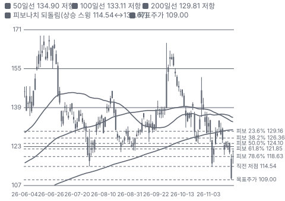

**주봉**

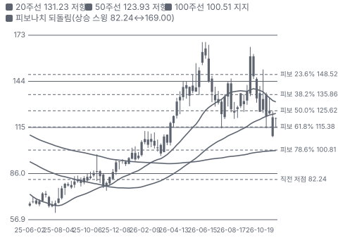

**월봉**

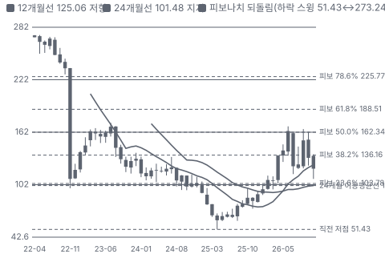

**분기 매출·EPS 실적과 컨센서스**

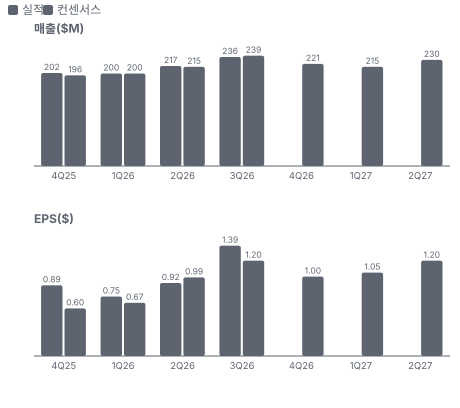

**4Q26 매출 — 지표 추세 vs 가이던스·컨센서스**

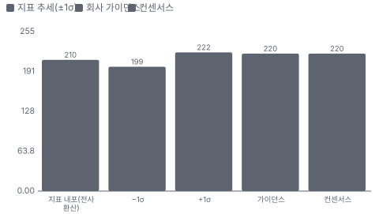

**최근 4개 분기 주가 변화 분석**

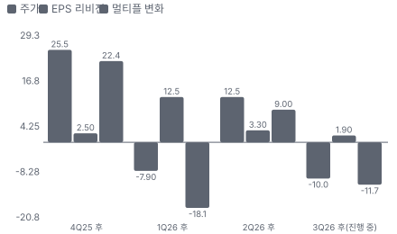

**EPS 리비전**

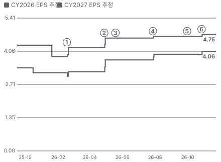

① 26-02-17 4Q25 실적, 다음 날 +3.9% · EPS 리비전 +9%
② 26-04-28 1Q26 실적, 다음 날 −1.6% · EPS 리비전 +9%
③ 26-05-19 Ali El-Haj 정식 CEO 선임(8-K) · EPS 리비전 +0%
④ 26-07-28 2Q26 실적, 다음 날 −2.0% · EPS 리비전 +2%
⑤ 26-09-30 Investor Day — 성장 기회 2028년 \$100M·2030년 \$450M, 당일 +10.7% · EPS 리비전 +0%
⑥ 26-10-27 3Q26 실적, 다음 날 +5.0% · EPS 리비전 +2%

**멀티플 프리미엄(Fwd 1Y P/E, 최근 4개 분기말 절대값 — 대상 vs 동종 중앙값)**

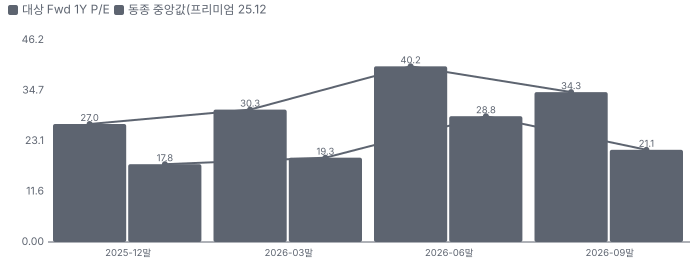

**합리적 멀티플**

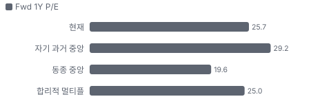

**밸류에이션 주가 시나리오**

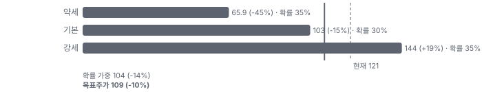

**주가별 업사이드**

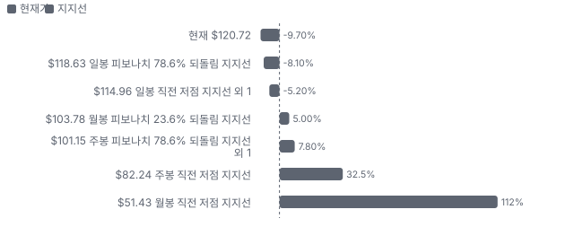
- 제품·서비스 포트폴리오

**고객 믹스(3Q26, 매출 대비)**

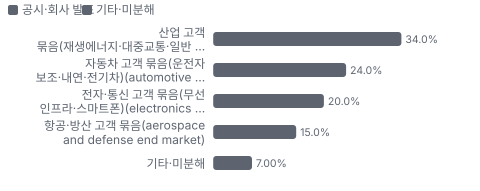

**공급 병목(10점, 낮을수록 병목)**

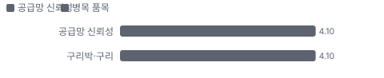

**CAPEX의 매출 대비 비중**

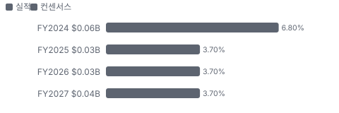

**어닝콜 변화별 주주가치 영향**

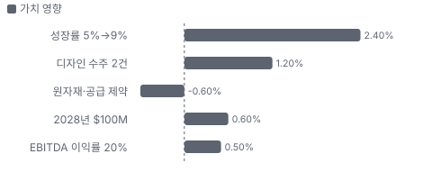

**매출 → 매출총이익 → 영업이익(매출 = 100, 최근 4분기)**

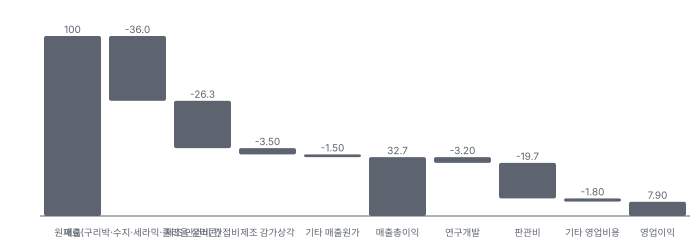

**분기 비용 비중 추이(매출 대비, 공시)**

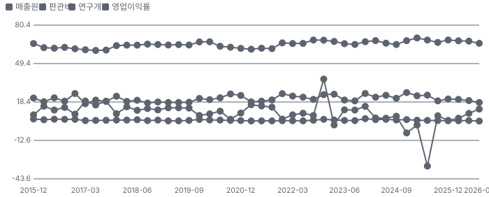

**비용 요인별 매출 대비 비중 1년 변화**

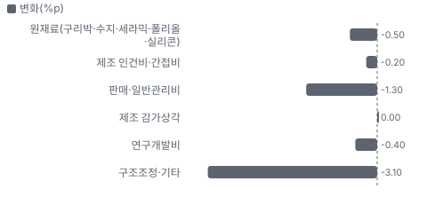

**Advanced Electronics Solutions BOM 원가 몫**

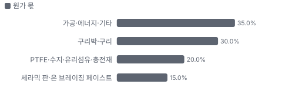

**Elastomeric Material Solutions BOM 원가 몫**

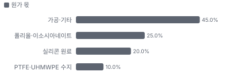

**BOM 항목 가격 +10% 시 OPM 변화**

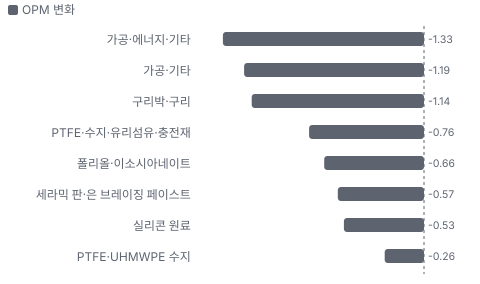

**원가 물가 vs 판매가 물가 — 최근 24개월**

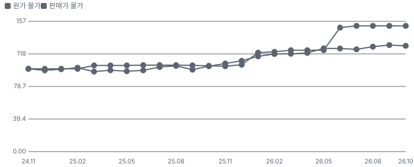

**사업별 매출 vs 물가 — 전년 대비(명목 매출 · 비교 물가 · 실질 = 물량·믹스)**

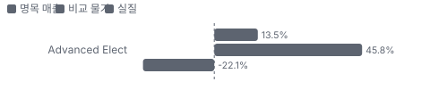

**자산 구성 — 3Q19 분기말 투하자본 \$921.5M**

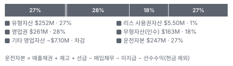

**자산별 변화율 — 최근 12개 분기(4Q16 = 0%) + 다음 4개 분기 추정**

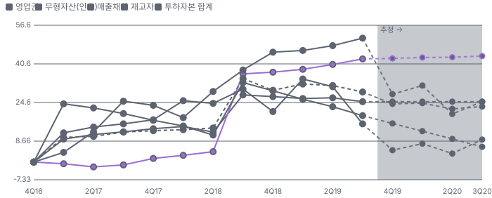

**ROIC 추이 — TTM, 최근 12개 분기 + 다음 4개 분기 추정(컨센서스 NOPAT)**

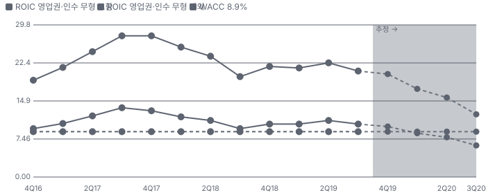

**생산시설별 면적(sq ft, 큰 순) — 생산능력 미공시라 면적을 대용으로**

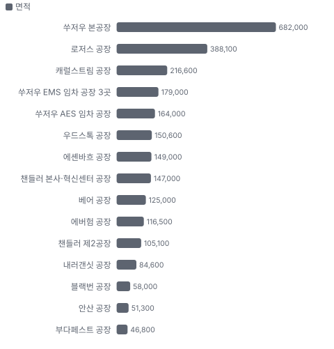

**매출 vs PPI·수출입 — 4Q22 = 100(변화율, 로그 눈금)**

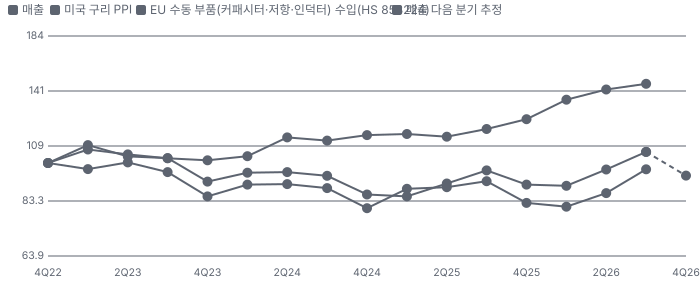

**10년 P·Q 사이클 — 추세(HP 필터) 대비 갭과 8분기 전망**

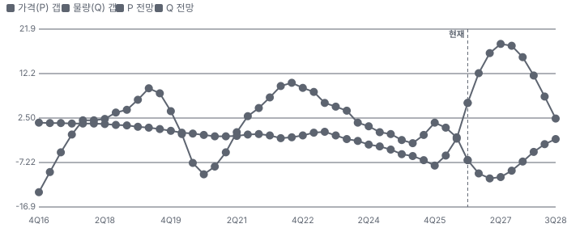

**매출 증가율의 가격·물량 분해와 8분기 전망(전년 대비)**

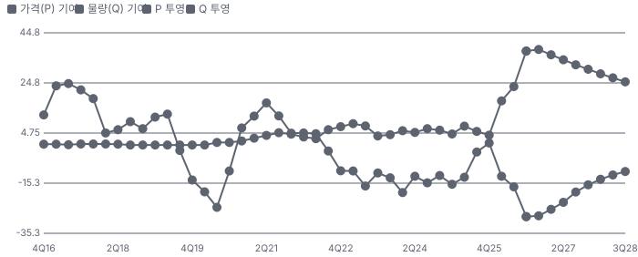

**목표주가 산정 — 기본과 강세 사이(강세 쪽 16%), 도달 확률 약 45%**

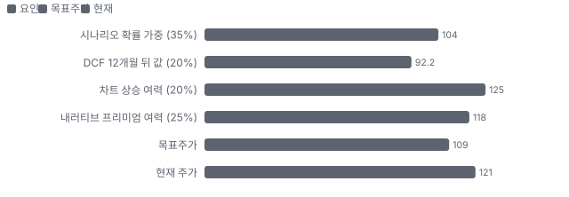

**PEG — 성장 대비 멀티플(낮을수록 성장 대비 쌈)**

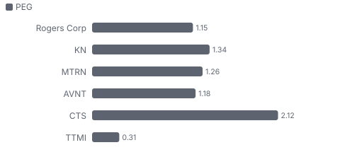

**일별 거래량 분해**

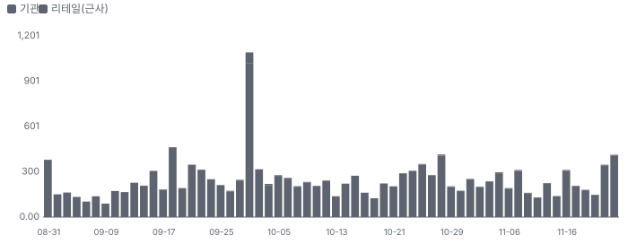

**기관 자금 흐름**

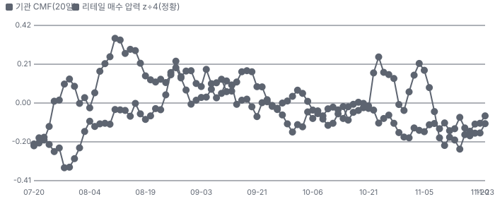

**몬테카를로**

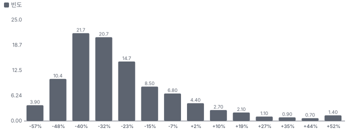

해석: 3,000번 중 364번(12%)에서 가치가 지금 주가 이상이었다. 가정을 흔들어도 지금 주가를 뒷받침하지 못하는 경우가 더 많다. 가운데 값은 0.70배이고, 열 번 중 여덟 번은 0.53~1.04배 사이에 든다.

## 내러티브

> **기업가치를 결정하는 이야기:** Rogers의 값은 ① 매출 성장 9%가 2027년에도 이어지는지 ② 늘어난 매출의 얼마가 이익으로 남는지(증분 이익률) ③ 데이터센터·배터리 신제품이 2027년 하반기에 실제 매출이 되는지로 정해진다. 첫 두 가지는 3Q 실적이 확인했고, 세 번째는 아직 샘플 단계다.

> **멀티플·EPS 프리미엄**
> **멀티플:** Fwd 1Y P/E 25.7배로 동종 중앙 19.6배보다 31% 높고, 자기 3년 범위(21.1~40.4배)에서는 아래쪽이다. 웃돈의 근거는 2년 뒤 EPS가 다음 12개월보다 22% 많다는 추정과 신제품 기대다
> **EPS:** FY2026 EPS 추정은 1년 전 \$3.39에서 \$4.06으로 20% 올랐고(2025년 8월 저점 \$2.37), FY2027은 2Q 콜 뒤 \$4.68에서 \$4.76으로 올랐다. 추정을 내는 애널리스트는 2~3명이다

### 투자자들은 왜 열광했나

9월 30일 Investor Day에서 데이터센터·배터리 안전·EMI 차폐(전자파가 새거나 들어오지 않게 막는 것) 매출 목표(2028년 \$100M·2030년 \$450M)를 내놓자 하루 +10.7%로 뛰었다. 그 뒤 AI 부품주 전반의 조정과 11월 선거 뒤 변동성으로 11월 20일 \$109.57까지 내렸다가 23일 하루 +10.2% 반등했다 — 실적이 나빠서가 아니라 배수가 줄어서 빠졌다.

### 무엇이 기업가치를 바꾸나

> **구조적 체질 변화**
> **변화:** 2025년 7월 CEO 교체 뒤 벨기에 AES 생산을 접고 독일 세라믹 공장을 줄여 고정비를 낮췄다. 판관비 비중이 19.3%에서 18.0%로 내려갔다.
> **증거:** FY2025 10-K(구조조정 \$23.4M)·3Q26 10-Q
> **반증:** 판관비 비중이 다시 20% 이상

> **고부가 믹스 확장**
> **변화:** AES 매출이 13.5% 늘어 EMS(4.3%)보다 빨리 자랐지만, AES 매출총이익률(31.0%)은 EMS(38.4%)보다 낮다 — 지금 믹스는 이익률에 중립이거나 조금 불리하다. 3Q 이익 개선분 약 \$11M은 물량과 제품 구성에서 왔다고 회사가 밝혔다.
> **증거:** 3Q26 10-Q 부문 주석·3Q26 콜
> **반증:** AES 매출총이익률 30% 아래

> **기술 혁신**
> **변화:** 고속 디지털용 라미네이트(구리박과 절연 수지를 겹쳐 눌러 만든 회로 기판 원판)는 여러 고객이 샘플을 평가 중이고, 마이크로채널 쿨러(미세한 물길을 낸 판에 냉각액을 흘려 칩의 열을 빼는 부품)는 2~3세대 시제품 단계다. 열폭주 방지 소재는 벤치마크를 끝내고 고객 샘플을 시작했다. 모두 고객 인증 전이라 제조·고객·사업 세 축 가운데 어느 것도 양산 단계가 아니다.
> **증거:** 3Q26 어닝콜(2026-10-27)
> **반증:** 2027년 3~4분기 출시 일정 지연

> **실행 속도**
> **변화:** 해당 없음(고객 납품 리드타임 수치 미공시) — 들어오는 원재료 운송은 평소 4~6주에서 일부 12주 넘게 길어졌고(2Q 콜), 3Q에는 공급 제약으로 매출 약 \$2M이 이월됐다. **납품 리드타임 미확인.** 피어 비교 미확인. 이전 대비 미확인.
> **증거:** 2Q26·3Q26 어닝콜
> **반증:** 공급 제약으로 분기 매출 이월이 \$5M 이상

> **M&A**
> **변화:** 최근 3년 인수는 없다. 회사는 인수 후보 1~2건이 몇 분기 안에 발표될 수 있다고 말했다 — 기준은 없는 역량을 더하고 중장기 재무 기여가 있는 건이다. 대상·금액은 미공개다.
> **증거:** 3Q26 어닝콜(2026-10-27)
> **반증:** 순현금을 넘는 규모의 인수를 높은 배수로 발표

> **정책·입법 연관성**
> **재정정책:** 해당 없음(정부 보조금·세액공제와 직접 연결되는 매출 공시 없음) FY2025 10-K
> **행정명령:** 해당 없음(관세·무역 제한은 위험 요인으로만 기재 — 매출 영향 수치 미공시) FY2025 10-K 위험 요인
> **연관입법:** 해당 없음 — 새 법안과의 연결은 확인하지 못했다 FY2025 10-K

> **고객의 지출 예산**
> **변화:** 두 부문 모두 고객이 만드는 제품의 부품·소재 구매비(매출원가)에서 돈이 나온다. 고객 공장 증설 투자가 아니라 고객 제품의 생산량을 따라간다 — 기지국·전기차·항공기·산업 장비 출하가 동인이다.
> **사업별 예산:** **매출의 55%**: Advanced Electronics Solutions(고주파 회로 소재·세라믹 기판·버스바를 만드는 Rogers의 보고 부문) — 고객 OPEX(고객 제품의 부품·소재 구매비(생산 물량 연동)) · 동인: 기지국·레이더·전력 모듈·데이터센터 장비 생산량
**매출의 43%**: Elastomeric Material Solutions(폴리우레탄·실리콘 폼과 불소수지 필름을 만드는 Rogers의 보고 부문) — 고객 OPEX(고객 제품의 부품·소재 구매비(생산 물량 연동)) · 동인: 자동차·항공기·휴대 기기·산업 장비 생산량
> **증거:** FY2025 10-K 사업 설명
> **반증:** 자동차·산업 최종 시장 매출 2개 분기 연속 감소

### 내러티브 근거

> 새 경영진이 원가를 줄이는 사이 매출이 9%로 돌아오며 이익률이 5년 최고가 됐다. 여기에 AI 데이터센터 소재 이야기가 얹혔지만 그 매출은 2027년 하반기에야 시작된다 — 지금 배수는 회복과 신제품을 함께 값 매긴다. 동종 대비 멀티플 차이 +31% 중 회사 고유 몫은 +3%다. 단계는 확산, 쏠림은 낮음이다.

> **가동률 회복에 따른 이익률 상승** · 강화
> **논리:** 판관비·연구개발비가 그대로인데 매출이 늘어 늘어난 매출의 큰 몫이 이익으로 떨어진다
> **숫자:** 조정 EBITDA 이익률 17.2% → 20.2%(3Q25 → 3Q26), 판관비 + 연구개발비 \$49.0M → \$49.6M
> **반증:** 조정 EBITDA 이익률이 4Q 가이던스 하단 17.2%(\$37M ÷ \$215M) 미달
> **출처:** 3Q26 8-K EX-99.1(2026-10-27)

> **새 경영진의 원가 구조 개편** · 유지
> **논리:** 이사회가 CEO를 바꾸고 벨기에·독일 공장을 줄여 고정비를 낮췄다
> **숫자:** 세라믹 사업 절감 목표 \$13M, 구조조정 비용 3Q25 \$7.1M → 3Q26 \$1.0M
> **반증:** 구조조정 비용이 다시 분기 \$5M 이상
> **출처:** 2Q26 어닝콜(2026-07-28)·3Q26 10-Q

> **AI 데이터센터 소재** · 유지
> **논리:** 고속 신호용 라미네이트와 칩 냉각용 마이크로채널 쿨러가 새 매출원이 된다
> **숫자:** 세 성장 기회 합계 매출 목표 2028년 \$100M·2030년 \$450M(회사), 지금 매출은 0에 가깝다
> **반증:** 2027년 3~4분기 출시가 밀리거나 고객 평가에서 탈락
> **출처:** 3Q26 어닝콜(2026-10-27)

> **순현금과 자사주·인수 여력** · 유지
> **논리:** 차입 없이 현금이 쌓여 자사주와 인수에 쓸 수 있다
> **숫자:** 현금·단기투자 \$236.4M(시가총액의 11%), 자사주 한도 잔액 \$39.5M
> **반증:** 비싼 값의 큰 인수 발표
> **출처:** 3Q26 10-Q

> **반대 — 세라믹 기판의 경쟁과 중국·전기차 의존** · 유지
> **논리:** 전력 반도체용 세라믹 기판은 아시아 경쟁사가 값을 내려 2025년에 영업권을 전액 손상했다. 매출의 32%가 중국 고객이다
> **숫자:** 2025년 curamik(Rogers의 전력 반도체용 세라믹 기판 상표) 영업권 손상 \$67.3M, AES 매출총이익률 31.0%(전년 31.5%)
> **반증:** AES 매출총이익률이 2개 분기 연속 33% 이상
> **출처:** FY2025 10-K·3Q26 10-Q

> **반대 — AI 부품 배수 하락** · 강화
> **논리:** 같은 업종에서 이익은 사상 최고인데 배수가 반으로 준 사례가 있다 — 신제품 매출이 없는 Rogers의 배수는 더 흔들릴 수 있다
> **숫자:** Rogers Fwd 1Y P/E 40.2배(6월 말) → 25.7배(11/23), 동종 TTM 37.4배 → 8.2배
> **반증:** 동종 Fwd 1Y P/E 중앙값이 2개 분기 연속 상승
> **출처:** 분기말 선행 배수 계산

### 투자 포인트

> **영업비는 그대로, 매출만 늘었다**
> **명제:** 매출이 \$20M 늘 때 조정 EBITDA가 \$10.5M 늘었다 — 증분 이익률 약 52%
> **숫자:** 3Q26 매출 \$236.1M(전년 \$216.0M), 조정 EBITDA \$47.7M(전년 \$37.2M), 판관비 + 연구개발비 \$49.6M(전년 \$49.0M)
> **시장과 다른 점:** FY2027 컨센서스는 매출 +\$65M에 조정 EBITDA +\$26M(증분 39%)만 넣었다 — 3Q 수준이 이어지면 추정이 낮다. 다만 회사는 4Q부터 영업비가 소폭 늘어난다고 했다
> **증명:** 4Q 조정 EBITDA \$37~43M(가이던스), 2027년 1분기 가이던스의 이익률
> **출처:** 3Q26 8-K EX-99.1(2026-10-27)

> **웃돈은 아직 매출이 없는 신제품 값이다**
> **명제:** Fwd 1Y P/E 25.7배는 동종 중앙 19.6배보다 31% 높다
> **숫자:** FY2027 EPS 추정 \$4.76~4.90, 세 성장 기회 매출 목표 2028년 \$100M·2030년 \$450M, 출시 2027년 3~4분기
> **시장과 다른 점:** 시장은 Investor Day 목표를 배수에 먼저 넣었다 — 고객 인증 통과가 확인되기 전까지는 배수가 동종 수준으로 돌아갈 위험이 실적 위험보다 크다
> **증명:** 신제품 양산 주문 또는 첫 매출 공시(2027년 하반기)
> **출처:** 3Q26 어닝콜(2026-10-27)

> **이익은 올랐는데 주가는 배수 때문에 빠졌다**
> **명제:** 2Q 실적 전날 이후 주가는 6.7% 내렸지만 같은 기간 FY2026 EPS 추정은 9.4% 올랐다
> **숫자:** 주가 \$129.32(7/27) → \$120.72(11/23), FY2026 EPS 추정 \$3.71(7/27 시점) → \$4.06(10/28 이후)
> **시장과 다른 점:** 하락은 실적이 아니라 AI 부품주 전반의 배수 축소에서 왔다 — 같은 기간 동종 배수도 내려갔다
> **증명:** 동종 Fwd 1Y P/E 중앙값의 방향, 4Q 실적 뒤 EPS 추정 수정
> **출처:** 분기말 선행 배수 계산·실측 일봉

### 모멘텀 생성·소멸 타임라인

**카탈리스트 달력 — 지난 사건의 주가 반응과 앞으로 확인할 숫자**
| 날짜 | 상태 | 구분 | 사건 | 반응·확인 | 결과에 따라 |
|---|---|---|---|---|---|
| 2026-07-28 | 완료 | 소멸 | 2Q26 실적 — 조정 EPS가 가이던스 중간 미달(공급망·공장 화재) | −2.0% |  |
| 2026-09-30 | 완료 | 생성 | Investor Day — 데이터센터·배터리·EMI 차폐 매출 목표 제시 | +10.7% |  |
| 2026-10-27 | 완료 | 확인 | 3Q26 실적 — 조정 EBITDA 이익률 20.2%, EPS 가이던스 상단 초과 | +5.0% |  |
| 2026-11-05 | 완료 | 매크로 | 중간선거 뒤 변동성 — 원인 미확인 | −10.1% |  |
| 2027-02-16(예상) | 예정 | 확인 | 4Q26·FY2026 실적과 1Q27 가이던스 | 4Q 조정 EBITDA \$37M 이상·매출총이익률 32.5% 이상, 1Q27 매출 가이던스 중간 \$215M 이상 | 웃돌면 기본 유지·EPS 상향, 밑돌면 약세 쪽 |
| 2027년 상반기(예상) | 예정 | 확인 | 인수 발표 가능성(회사 언급 1~2건) | 인수 금액이 순현금 \$222M 안인지, 인수 배수 | 작은 역량 보강형이면 중립, 큰 차입 인수면 약세 쪽 |
| 2027년 3~4분기(예상) | 예정 | 생성 | 데이터센터 소재·열폭주 방지 소재 출시 | 양산 주문 공시, 2028년 \$100M 목표 재확인 | 주문이 확인되면 강세 쪽, 밀리면 배수가 동종 수준으로 |

### 언제 사서 언제 팔아야 할까?

**가격·조건 틀 — 가격은 밸류에이션(약세·기본·강세·목표주가)과 차트 지지 구간에서, 조건은 이벤트에서**
| 구간 | 가격 | 목표주가까지 | 약세까지 | 조건·근거 |
|---|---|---|---|---|
| 관찰 구간 | \$119~\$119 | -8% | -44% | 11월 20일 종가 \$109.57 부근은 선거 뒤 변동성과 AI 부품주 조정이 겹친 자리이고, 회복 이익만으로 본 가치(\$94 안팎)와 가깝다 |
| 확인 뒤 | 지금 \$121 이상에서 조건 확인 | -10% | -45% | 4Q 실적에서 조정 EBITDA \$37M 이상과 2027년에도 성장이 이어진다는 가이던스 |
| 무효화 | 약세 시나리오 \$66 | - | -45% | 분기 매출 성장률이 5% 아래로 내려가거나 AES 매출총이익률 30% 미만, 또는 약세 시나리오 가격 이탈 |
| 차익 고민 2차 | \$144(강세 시나리오) | +19% | - | 목표주가 부근은 배수가 동종보다 높게 유지된 상태라 추가 상승은 신제품 주문 확인이 필요하다 |

최근 다섯 주 동안 하루 8~10% 움직인 날이 네 번이다 — 발표 직후 추격은 경계 가격·조건 틀이며 매매·비중 지시가 아니다(투자 권유 아님).

## 포트폴리오

| 제품·서비스 | 구분 | 무엇 | 쓰는 곳 | 돈 버는 방식 | Mix | Mix 변화(전 분기 대비) |
|---|---|---|---|---|---|---|
| Advanced Electronics Solutions | 제품 | 고주파 회로용 라미네이트, 전력 반도체용 세라믹 기판, 버스바(큰 전류를 나르는 구리 도체 판), 냉각 부품 | 기지국·레이더·전기차 전력 모듈·재생에너지 인버터·데이터센터 | 3Q26 매출의 55%, 매출총이익률 31.0% | 56% | +0.9%p |
| Elastomeric Material Solutions | 제품 | 폴리우레탄·실리콘 폼과 시트, 불소수지 필름 — 충격 흡수·밀봉·진동 차단용 | 전기차 배터리 팩, 휴대 기기, 항공기·철도, 산업 장비, 신발 | 3Q26 매출의 43%, 매출총이익률 38.4% | 44% | -0.9%p |

**Mix 변화가 가장 큰 쪽은 Elastomeric Material Solutions(-0.9%p, 전 분기 대비).** 계절성 판정: 분기 매출 계절 지수 기준 없음 → 직전 분기와 비교.

## 고객

> **3Q26 최대 고객 산업 고객 묶음(재생에너지·대중교통·일반 산업, industrial end market) 34%, 상위 3곳 78%, 집중도 보통.** 공시·회사 발표로 확인한 몫은 매출의 93%이고, 나머지 고객 몫은 추정이거나 미분해다. 고객은 약 2,800곳이고 2025년 매출의 10%를 넘는 고객은 없다(10-K). 고객 이름과 몫은 공시하지 않아 최종 시장 묶음으로 본다 — 산업 34%, 자동차 24%, 전자·통신 20%, 항공·방산 15%.

**고객별 매출 몫(3Q26)**
| 고객 | 몫 | 변화 | 근거 |
|---|---|---|---|
| 산업 고객 묶음(재생에너지·대중교통·일반 산업, industrial end market) | 34% | 미확인 | 회사 발표 |
| 자동차 고객 묶음(운전자 보조·내연·전기차, automotive end market) | 24% | -1%p | 회사 발표 |
| 전자·통신 고객 묶음(무선 인프라·스마트폰, electronics and communications end market) | 20% | 미확인 | 회사 발표 |
| 항공·방산 고객 묶음(aerospace and defense end market) | 15% | +0%p | 회사 발표 |
| 기타·미분해 | 7% | - | - |

> **산업 고객 묶음(재생에너지·대중교통·일반 산업, industrial end market)** · 회사 발표
> **사는 것:** 세라믹 기판·버스바·실링 폼
> **추정 근거:** 개별 고객명·몫 미공시

> **자동차 고객 묶음(운전자 보조·내연·전기차, automotive end market)** · 회사 발표
> **사는 것:** 레이더용 라미네이트, 전력 모듈 세라믹 기판, 배터리 팩 폼
> **추정 근거:** 개별 고객명·몫 미공시

> **전자·통신 고객 묶음(무선 인프라·스마트폰, electronics and communications end market)** · 회사 발표
> **사는 것:** 기지국 안테나·증폭기용 라미네이트, 휴대 기기 폼
> **추정 근거:** 개별 고객명·몫 미공시

> **항공·방산 고객 묶음(aerospace and defense end market)** · 회사 발표
> **사는 것:** 레이더·통신용 라미네이트, 항공기 실링 소재
> **추정 근거:** 개별 고객명·몫 미공시

## 마진 구조

> **GPM 34.2%, OPM 12.7%.** 3Q25 대비 GPM +0.7%p, OPM +5.5%p. 변동비는 매출의 51%이고, 매출이 10% 늘면 OPM은 +3.3%p 움직인다. 3Q26 매출총이익률 34.2%(전년 33.5%), GAAP 영업이익률 12.7%(전년 7.3%), 조정 EBITDA 이익률 20.2%(전년 17.2%). 판관비가 거의 그대로인데 매출이 9% 늘어 이익률이 올랐다 — 원자재 가격 상승이 공장 개선 효과를 상쇄했다고 회사가 밝혔다.

> **매출 100 중 매출원가 67.3, 매출총이익 32.7(최근 4분기, 공시).** 매출원가 요인 중 원재료(구리박·수지·세라믹·폴리올·실리콘)이 매출의 36.0%로 가장 무겁고, 단가가 +10% 오르면 GPM이 -3.60%p 움직인다. 분기 회귀로 매출 1이 늘 때 매출원가는 0.68 늘고, 매출원가의 고정비 몫은 -5%다.

**비용 요인 강도 — 비중·추세·충격(+10%)·탄력**
| 비용 | 구분 | 매출 대비 | 1년 변화 | 마진 기여 | 충격 시 마진 | 매출 탄력 | 고정비 몫 |
|---|---|---|---|---|---|---|---|
| 원재료(구리박·수지·세라믹·폴리올·실리콘) | 매출원가 요인 | 36.0% | -0.5%p | +0.5%p | -3.60%p | 미확인 | 0% |
| 제조 인건비·간접비 | 매출원가 요인 | 26.3% | -0.2%p | +0.2%p | -2.63%p | 미확인 | 60% |
| 제조 감가상각 | 매출원가 요인 | 3.5% | +0.0%p | -0.0%p | -0.35%p | 미확인 | 100% |
| 매출원가 | 공시 항목 | 67.3% | -0.8%p | +0.8%p | -6.73%p | 0.68 | -5% |
| 판관비 | 공시 항목 | 19.7% | -3.4%p | +3.4%p | 미확인 | 0.18 | 16% |
| 연구개발 | 공시 항목 | 3.2% | -0.5%p | +0.5%p | 미확인 | 0.01 | 65% |
| 기타 영업비용 | 공시 항목 | 1.8% | -11.4%p | +11.4%p | 미확인 | -0.10 | 100% |

매출 탄력 = 분기 비용을 매출에 회귀한 기울기(매출 1당 변동비), 고정비 몫 = 절편 ÷ 평균 비용. 표본이 8분기 미만이면 미확인. 매출원가 요인 비중은 margin 재료의 추정이 섞여 있고, 공시 매출원가와의 차이는 '기타 매출원가'로 둔다.

**GPM에서 OPM까지(GAAP — 10-Q 3개월 손익, 아래는 최근 4개 분기)**
| 기간 | GPM | 연구개발 | 판관비 | 기타 | OPM |
|---|---|---|---|---|---|
| 3Q25 | 33.5% | 3.4% | 19.3% | 3.5% | 7.3% |
| 3Q26 | 34.2% | 3.0% | 18.0% | 0.4% | 12.7% |
| 2025-12 | 31.5% | - | - | - | 3.5% |
| 2026-03 | 32.2% | - | - | - | 5.3% |
| 2026-06 | 32.5% | - | - | - | 9.2% |
| 2026-09 | 34.2% | - | - | - | 12.7% |

**비용을 움직이는 요인**
| 비용 | 요인 |
|---|---|
| 원재료(구리박·수지·세라믹·폴리올·실리콘, 매출원가) | 구리·은·석유화학 원료 가격(구리는 파생상품으로 일부 헤지) · 근거 추정 |
| 제조 인건비·간접비(매출원가) | 공장 가동률·공장 통합(벨기에·독일) · 근거 추정 |
| 판매·일반관리비(판관비) | 인력·경영진 교체 비용 · 근거 공시 |
| 제조 감가상각(매출원가) | 설비투자(중국 세라믹 신공장) · 근거 공시 |
| 연구개발비(연구개발) | 데이터센터·배터리 신제품 개발 · 근거 공시 |
| 구조조정·기타(기타) | 공장 통합 비용 · 근거 공시 |

**Advanced Electronics Solutions BOM — 매출의 55%, GPM 31%(공시 — 3Q26 10-Q 부문 매출총이익 \$40.3M ÷ 매출 \$130.2M(전년 31.5%)), 항목 가격 +10% 시**
| 항목 | 원가 몫 | 전가 | 제품 GPM | OPM |
|---|---|---|---|---|
| 가공·에너지·기타 | 25~45% | 미확인 | -2.4%p | -1.33%p |
| 구리박·구리 | 25~35% | 미확인 | -2.1%p | -1.14%p |
| PTFE(불소수지 — 전기 손실이 작고 열에 강한 플라스틱)·수지·유리섬유·충전재 | 15~25% | 미확인 | -1.4%p | -0.76%p |
| 세라믹 판·은 브레이징 페이스트 | 10~20% | 미확인 | -1.0%p | -0.57%p |

**Elastomeric Material Solutions BOM — 매출의 43%, GPM 38%(공시 — 3Q26 10-Q 부문 매출총이익 \$38.9M ÷ 매출 \$101.4M(전년 35.7%)), 항목 가격 +10% 시**
| 항목 | 원가 몫 | 전가 | 제품 GPM | OPM |
|---|---|---|---|---|
| 가공·기타 | 35~55% | 미확인 | -2.8%p | -1.19%p |
| 폴리올·이소시아네이트 | 20~30% | 미확인 | -1.5%p | -0.66%p |
| 실리콘 원료 | 15~25% | 미확인 | -1.2%p | -0.53%p |
| PTFE·UHMWPE(초고분자량 폴리에틸렌 — 마모에 강한 플라스틱) 수지 | 5~15% | 미확인 | -0.6%p | -0.26%p |

가공·에너지·기타 가격이 +10% 오르면 영업이익은 -10.4% 움직인다. 판매가 전가를 모르는 항목은 전가 0%로 계산했다.

**BOM 항목 가격을 움직이는 것**
| 항목 | 요인 |
|---|---|
| 구리박·구리 | 라미네이트·세라믹 기판·버스바 모두 구리가 든다 — 구리 파생상품으로 일부 헤지하고(10-Q) 가격 조정은 시장 상황에 따라 검토 중(3Q26 콜), 전가율 수치는 미공시 · 근거 추정 |
| PTFE·수지·유리섬유·충전재 | 라미네이트의 절연층 · 근거 추정 |
| 세라믹 판·은 브레이징 페이스트 | 전력 반도체용 세라믹 기판의 바탕과 접합재 · 근거 추정 |
| 가공·에너지·기타 | 적층·소성·식각 공정 · 근거 추정 |
| 폴리올·이소시아네이트 | 폴리우레탄 폼의 주원료 · 근거 추정 |
| 실리콘 원료 | 실리콘 폼·시트의 주원료 · 근거 추정 |
| PTFE·UHMWPE 수지 | 불소수지 필름·테이프의 원료 · 근거 추정 |
| 가공·기타 | 발포·압출·코팅 공정 · 근거 추정 |

> **원가·판매가 물가 격차 +22.6%p** — 판매가 물가가 투입 원가 물가보다 빠르게 오른다.

**투입 물가 — 미국 PPI 3·6·12개월(2026-10, 개정 반영)과 해외 전년비**
| 항목 | 미국 3개월 | 6개월 | 12개월 | 전가 못 할 때 OPM | 일본 | 한국 | 대만 |
|---|---|---|---|---|---|---|---|
| 구리박·구리 | +3.4% | +7.2% | +23.9% | - | +42.6% | +19.2% | +40.1% |

별표는 품목보다 넓은 업종 지수다. 연결한 투입 원가의 미국 PPI(생산자물가지수)는 1년 새 가중 +23.9%이고, 판매가로 넘기지 못하면 GPM -8.6%p·OPM -8.6%p가 움직인다. 판매가 비교 물가(인쇄회로기판 PPI)는 1년 새 +46.4% — 회사 가격 변화는 미확인. 물가 지수를 붙이지 못한 매출원가 항목은 제조 인건비·간접비, 제조 감가상각다(미연결). Advanced Electronics Solutions 매출은 2026-09 전년 대비 +13.5%이고 비교 물가 ppi:pcb의 변화 +45.8%(2026-09)를 빼면 실질 -22.1% — 성장 대부분이 가격(물가)이다.

## 자산 구성

> **3Q19 분기말 투하자본 \$921.5M** — 영업권 28%, 유형자산 27%. 최근 12개 분기(4Q16 → 3Q19) 가장 크게 늘어난 자산은 재고자산(+51%), 투하자본 합계 +29%. 3Q20 추정 투하자본 \$878.3M(-5%, 컨센서스 매출과 회전 일수·CAPEX 강도 유지 가정). 연율 감가 비율(순액 기준)은 직전 4분기 24.79% → 최근 4분기 21.13%, 직전 비율이면 감가상각이 \$9.0M 더 컸다(영업이익의 7.3%).

**자산·운전자본 항목별 분기말 잔액 — 최근 12개 분기와 다음 4개 분기 추정**
| 항목 | 4Q16 | 3Q18 | 3Q19(최근) | 3Q20 추정 | 12개 분기 변화 | 다음 4개 분기 변화 |
|---|---|---|---|---|---|---|
| 매출채권 | \$119.6M | \$155.7M | \$138.5M | \$130.7M | +16% | -6% |
| 재고자산 | \$91.1M | \$125.9M | \$137.9M | \$113.9M | +51% | -17% |
| 선급·기타 유동자산 | \$8.9M | \$12.4M | \$9.3M | \$9.6M | +5% | +3% |
| 매입채무 | \$28.4M | \$40.0M | \$38.6M | \$34.7M | +36% | -10% |
| 유형자산 | \$176.9M | \$241.5M | \$252.4M | \$254.5M | +43% | +1% |
| 리스 사용권자산 | 미확인 | 미확인 | \$5.5M | \$5.5M | 비교 불가 | +0% |
| 영업권 | \$208.4M | \$266.3M | \$260.6M | \$260.6M | +25% | +0% |
| 무형자산(인수) | \$136.7M | \$181.6M | \$162.9M | \$145.3M | +19% | -11% |

**자산 추정 동인 — 최근 4개 분기 평균(재무상태표 동인 모형)**
| 동인 | 값 | 곱하는 기준 |
|---|---|---|
| 매출채권 | 59일 | 매출 |
| 재고자산 | 82일 | 매출원가 |
| 선급·기타 유동자산 | 4일 | 매출 |
| 매입채무 | 25일 | 매출원가 |
| CAPEX 강도 | 5.3% | 매출(최근 4개 분기 합) |
| 분기 감가율 | 3.51% | 기초 유형자산 순액(무형 상각 제외 감가상각) |
| 매출원가율 | 64.6% | 매출(최근 4개 분기) |
| 영업권·리스 사용권·기타 | 유지 | 인수·새 리스는 공시 전 모름 |
| 인수 무형자산 | 분기 \$4.4M 상각 | 최근 4개 분기 평균 상각 |

**추정 방법:** 증권사 3표 모델(손익·재무상태표·현금흐름)의 재무상태표 동인 방식이다. 운전자본은 항목별 회전 일수(매출채권·선급·미지급·선수는 매출, 재고·매입채무는 매출원가 기준)를 최근 4개 분기 평균으로 두고 컨센서스 매출에 곱한다. 유형자산은 기초 + CAPEX − 감가상각으로 굴린다(Koller·Goedhart·Wessels 『Valuation』 재무상태표 추정). 매출 경로는 ROIC 절의 컨센서스와 같다.

**유형·무형자산 항목별 가치(2018-12-31 vs 2017-12-31)**
| 구분 | 항목 | 총액 2018-12-31 | 누적상각 | 순액 | 총액 2017-12-31 | 총액 1년 변화 | 공시 내용연수 |
|---|---|---|---|---|---|---|---|
| 유형 | 유형자산 합계(항목 미분해) | \$518.0M | 총계만 공시 | 총계만 공시 | \$444.4M | +16.6% | 미확인 |
| 영업권 | 영업권 | \$264.9M | \$0.0M | \$264.9M | \$237.1M | +11.7% | 비상각 |
| 무형 | 무형자산 합계(항목 미분해) | \$249.2M | \$72.2M | \$177.0M | \$219.5M | +13.5% | 미확인 |
| 유형 합계 | 유형자산 | \$518.0M | \$317.4M | \$200.6M | \$444.4M | +16.6% | 경과율 61%(상각 대상 기준) |

**내용연수 산식(상각 대상 유형자산 = 총액 − 토지 − 건설중)**
| 기준일 | 연 감가상각 | 상각 대상 총액 | 평균 내용연수 | 경과 연수 | 잔여 연수 | 경과율 |
|---|---|---|---|---|---|---|
| 2018-12-31 | \$43.3M | \$518.0M | 12.0년 | 7.3년 | 4.6년 | 61% |
| 2017-12-31 | \$37.0M | \$444.4M | 12.0년 | 7.8년 | 4.2년 | 65% |

산식 평균 내용연수는 12.0년. 1년 전 12.0년 → 지금 12.0년.

**분기 감가 비율(감가상각 ÷ 평균 유형자산 순액)**
| 분기 | 감가상각 | 평균 유형자산(순액) | 분기 비율 | 연율 | 연율의 역수 |
|---|---|---|---|---|---|
| 4Q17 | \$11.4M | \$177.2M | 6.44% | 25.77% | 3.9년 |
| 1Q18 | \$11.1M | \$180.7M | 6.15% | 24.59% | 4.1년 |
| 2Q18 | \$11.0M | \$183.1M | 5.99% | 23.97% | 4.2년 |
| 3Q18 | \$13.2M | \$213.0M | 6.21% | 24.86% | 4.0년 |
| 4Q18 | \$14.8M | \$242.1M | 6.09% | 24.37% | 4.1년 |
| 1Q19 | \$13.0M | \$243.8M | 5.32% | 21.30% | 4.7년 |
| 2Q19 | \$12.1M | \$246.6M | 4.91% | 19.65% | 5.1년 |
| 3Q19 | \$12.1M | \$250.4M | 4.82% | 19.30% | 5.2년 |

감가상각 기준: 손익계산서 감가상각·상각비(SEC 공시 데이터, 4분기 = 연간 − 1~3분기).

**감가율 하락 경고: 연율 24.79% → 21.13%(-15%).** 직전 4분기 비율을 그대로 쓰면 최근 4분기 감가상각이 \$9.0M 더 컸다(영업이익의 7.3%). 내용연수 연장·상각 끝난 자산 증가·건설중 자산 증가(믹스) 중 무엇인지는 공시 주석으로 가린다(자체추론).

미공시·미분해: 유형자산 순액 · 유형자산 항목별 총액·내용연수(10-K 주석에서 모델이 채움) · 무형자산 항목(10-K 주석에서 모델이 채움) — 이 칸은 비우고 나머지로 계산했다.

### 해석 — 자산이 어디에 쌓이고 있나

- 같은 기간 4개 분기 매출은 +18% — 매출보다 빨리 늘어난 자산: 재고자산 +51%, 유형자산 +43%. 이 자산의 회전율이 떨어지면 ROIC를 희석한다.
- 다음 4개 분기 CAPEX \$41.8M vs 감가상각 \$35.6M(최근 4개 분기 CAPEX 강도·감가율 유지) — 유형자산 3Q19 \$252.4M → 3Q20 \$254.5M. 투자가 감가보다 커서 자산이 쌓이는 국면이다.
- 감가 비율 하락으로 최근 4분기 영업이익에 \$9.0M(7.3%)가 보태졌을 수 있다 — 내용연수 변경 공시가 없으면 건설중 자산·토지 같은 비상각 자산 몫이 커진 믹스 효과일 가능성이 크다(자체추론).

## ROIC

> **TTM 3Q19 ROIC는 영업권·인수 무형 포함 10.4%, 제외 20.8%**(NOPAT 마진 11.3% × 투하자본 회전율 0.92회). 최근 12개 분기 4Q16 9.5% → 3Q19 10.4%(고점 3Q17 13.6%). 컨센서스 NOPAT으로 굴리면 3Q20 6.2%(제외 12.3%) — WACC 8.9% 대비 -2.8%p. 1년 변화의 가장 큰 요인은 NOPAT 마진(+0.6%p).

**ROIC 추이(TTM)와 다음 4개 분기 추정 — NOPAT ÷ 평균 투하자본(이번 분기말·4개 분기 전)**
| 분기 | 구분 | TTM 매출 | TTM NOPAT | NOPAT 마진 | 평균 투하자본 | ROIC 포함 | ROIC 제외 |
|---|---|---|---|---|---|---|---|
| 4Q16 | 실적 | \$656.3M | \$69.1M | 10.5% | \$728.4M | 9.5% | 19.0% |
| 1Q17 | 실적 | \$699.6M | \$80.8M | 11.5% | \$768.2M | 10.5% | 21.5% |
| 2Q17 | 실적 | \$743.5M | \$91.8M | 12.3% | \$764.0M | 12.0% | 24.6% |
| 3Q17 | 실적 | \$785.0M | \$104.7M | 13.3% | \$767.4M | 13.6% | 27.7% |
| 4Q17 | 실적 | \$821.0M | \$107.9M | 13.1% | \$827.8M | 13.0% | 27.7% |
| 1Q18 | 실적 | \$831.8M | \$102.3M | 12.3% | \$865.7M | 11.8% | 25.5% |
| 2Q18 | 실적 | \$845.1M | \$96.9M | 11.5% | \$869.5M | 11.1% | 23.7% |
| 3Q18 | 실적 | \$865.2M | \$90.2M | 10.4% | \$949.1M | 9.5% | 19.7% |
| 4Q18 | 실적 | \$879.1M | \$96.8M | 11.0% | \$933.7M | 10.4% | 21.7% |
| 1Q19 | 실적 | \$904.3M | \$98.6M | 10.9% | \$944.6M | 10.4% | 21.4% |
| 2Q19 | 실적 | \$932.5M | \$105.0M | 11.3% | \$944.8M | 11.1% | 22.4% |
| 3Q19 | 실적 | \$927.4M | \$105.2M | 11.3% | \$1,008.7M | 10.4% | 20.8% |
| 4Q19 | 추정 | \$898.3M | \$96.2M | 10.7% | \$973.3M | 9.9% | 20.2% |
| 1Q20 | 추정 | \$857.3M | \$84.8M | 9.9% | \$983.9M | 8.6% | 17.3% |
| 2Q20 | 추정 | \$805.6M | \$75.7M | 9.4% | \$973.0M | 7.8% | 15.6% |
| 3Q20 | 추정 | \$785.7M | \$59.9M | 7.6% | \$967.2M | 6.2% | 12.3% |

**다음 4개 분기 NOPAT — 컨센서스(세율 25%, 리스 이자 별도)**
| 분기 | 매출 | EBITA 마진 | EBITA | NOPAT(분기) | 근거 |
|---|---|---|---|---|---|
| 4Q19 | \$193.8M | 9.8% | \$19.0M | \$14.2M | 발표 실적 · 재무상태표 추정 |
| 1Q20 | \$198.8M | 11.0% | \$21.9M | \$16.4M | 발표 실적 · 재무상태표 추정 |
| 2Q20 | \$191.2M | 13.3% | \$25.5M | \$19.1M | 발표 실적 · 재무상태표 추정 |
| 3Q20 | \$201.9M | 6.5% | \$13.2M | \$9.9M | 발표 실적 · 재무상태표 추정 |

**추정 방법:** NOPAT은 컨센서스(분기 매출 추정 × 회계연도 EBIT 마진 추정)로 잡고, 조정(비 GAAP) 마진이면 주식보상 몫을 빼서 과거 실적과 같은 기준(영업이익 + 인수 무형 상각)으로 맞췄다. 이미 발표했지만 분기 보고서(10-Q)가 아직 없는 분기는 발표 실적을 쓴다. 투하자본은 자산 구성 절의 재무상태표 동인으로 굴렸다. ROIC는 4개 분기 NOPAT을 이번 분기말과 4개 분기 전 투하자본의 평균으로 나눈다 — 추정 분기의 ROIC에는 이미 나온 실적 분기가 섞여 있다.

**투하자본 항목별 회전율과 ROIC 기여(TTM 3Q19, 평균 잔액)**
| 항목 | 투하자본 | 매출 1달러당 자본 | 회전율(매출 ÷ 항목) | 자본 몫 | 이 항목을 빼면 ROIC |
|---|---|---|---|---|---|
| 운전자본 | \$250.6M | 0.27 | 3.70회 | 25% | 13.2% |
| 유형자산 | \$246.9M | 0.27 | 3.76회 | 24% | 13.2% |
| 리스 사용권자산 | \$2.7M | 0.00 | 339.66회 | 0% | 10.0% |
| 영업권 | \$330.7M | 0.36 | 2.80회 | 33% | 14.8% |
| 무형자산(인수) | \$172.3M | 0.19 | 5.38회 | 17% | 12.0% |
| 기타 영업자산 | \$5.4M | 0.01 | 171.95회 | 1% | 10.0% |

**ROIC 세 가지 판**
| 판 | NOPAT | 투하자본 | ROIC | 무엇을 재나 |
|---|---|---|---|---|
| 영업권·인수 무형 포함 | \$100.4M | \$1,008.7M | 10.0% | 인수 웃돈까지 낸 돈에 대한 수익률 |
| 영업권·인수 무형 제외 | \$100.4M | \$505.7M | 19.9% | 본업 운영 수익률(동종 비교용) |
| 무형 자본화 조정(판관비 20%·5년, 연구개발 6년) | \$91.5M | \$1,237.6M | 7.4% | 비용으로 처리한 무형 투자를 자산으로 본 판 |
| 경제적 이익(포함판) | \$10.2M | \$1,008.7M | 자본비용 8.9% | (ROIC − 자본비용) × 투하자본 |

NOPAT = (영업이익 \$122.7M + 인수 무형 상각 + 리스 내재 이자 \$0.1M) × (1 − 세율 25%). 리스 사용권자산을 투하자본에 넣었으므로 임차료 속 이자 몫을 영업이익에 되더했다. 현금은 영업에 필요한 몫을 따로 알 수 없어 투하자본에서 뺐다. SEC 공시 데이터 자동 초안 — 운전자본 = 매출채권 + 재고 + 선급 − (매입채무 + 미지급비용 + 선수수익), 현금 제외. 손상 누계는 공시 데이터 수록분.

**ROIC 1년 변화 분해(포함판, TTM 3Q18 → TTM 3Q19)**
| 요인 | ROIC 기여 |
|---|---|
| NOPAT 마진 | +0.63%p |
| 운전자본 | +0.07%p |
| 유형자산 | -0.23%p |
| 리스 사용권자산 | -0.03%p |
| 영업권 | +0.09%p |
| 무형자산(인수) | +0.12%p |
| 기타 영업자산 | +0.05%p |
| 합계 | +0.71%p |

**무형 자본화 가정별 ROIC(2025년 지출 기준, 포함판에 더함)**
| 투자로 보는 몫 | 상각 연수 | 무형 자산 | NOPAT 조정 | 조정 ROIC |
|---|---|---|---|---|
| 판관비 20% | 2년 | \$167.8M | −\$8.9M | 7.8% |
| 판관비 20% | 5년 | \$229.0M | −\$8.9M | 7.4% |
| 판관비 30% | 2년 | \$195.2M | −\$11.0M | 7.4% |
| 판관비 30% | 5년 | \$286.8M | −\$11.0M | 6.9% |

### 해석 — 무엇이 수익성을 끌어올리고 희석하나

- 영업권: 투하자본의 33% — 빼면 ROIC 10.0% → 14.8%. 이 자산의 회전율(2.80회)이 수익성을 희석하는 주된 자리다.
- 운전자본: 투하자본의 25% — 빼면 ROIC 10.0% → 13.2%. 이 자산의 회전율(3.70회)이 수익성을 희석하는 주된 자리다.
- 영업권·인수 무형을 빼면 ROIC가 +9.9%p 오른다 — 과거 인수에 치른 웃돈이 주주 수익률을 그만큼 낮춘다(본업 수익률은 제외판, 인수까지 포함한 가치 창출은 포함판으로 본다).
- 1년 ROIC 개선의 최대 요인은 NOPAT 마진(+0.6%p). 반대로 깎은 최대 요인은 유형자산(-0.2%p).
- 비용으로 처리한 무형 투자를 자산으로 보면 ROIC가 -2.6%p 움직인다(무형 자산 \$229.0M). 투자 증가가 상각보다 작아 NOPAT 조정이 작다.
- 추정 경로 3Q19 10.4% → 3Q20 6.2%: NOPAT 마진 -3.7%p, 투하자본 회전율 -0.11회 — 컨센서스 매출·마진이 맞고 회전 일수·CAPEX 강도가 유지된다는 가정이다. 마진 추정이 내려가거나 재고 일수가 늘면 이 경로가 먼저 틀린다.
- ROIC(포함) − WACC = +1.5%p(3Q19) — 양수면 투하자본을 늘릴수록 가치가 쌓인다.

## 공급망 병목

> **공급망 신뢰성 4.1/10, 병목 주의.** 가장 약한 고리는 구리박·구리 4.1점이고, 품목 평균은 4.1점이다. 근거가 부족한 4건(PTFE·수지·유리섬유·충전재 · 세라믹 판·은 브레이징 페이스트 · 폴리올·이소시아네이트 · 실리콘 원료)은 점수에서 뺐다. 공급사 이름과 인증 공급사 수를 공시하지 않는다. 10-K는 일부 원재료가 단일·소수 공급원이라고만 밝힌다. 2Q·3Q 콜에서 회사는 원자재 부족과 운송 지연으로 출하가 일부 밀렸다고 했다 — 3Q 매출 약 \$2M이 다음 분기로 넘어갔다.

**병목과 마진 — 품목 가격 +10% 시 OPM**
| 품목 | 점수 | 판정 | 구분 | OPM |
|---|---|---|---|---|
| 구리박·구리(필수) | 4.1 | 병목 주의 | 핵심 통제 품목 | -1.14%p |

> **구리박·구리** · 4.1/10
> **왜:** AES 전 제품에 들어가고 가격 상승이 이익률을 누른다. 인증 공급사 수는 10-K의 '단일·소수 공급원' 표현을 2곳으로 읽은 값이고, 리드타임은 2Q26 콜의 원재료 운송 기간(평소 4~6주 → 일부 12주 초과, 품목 미특정)이다. 재고 구매 약정이 \$2.9M뿐이라(FY2025 10-K) 물량은 현물에 가깝게 산다
> **병목 요인:** 인증 공급사 2곳 · 캐파 빠듯 · 리드타임 12주(평시 5주) · 재인증 미확인 · 1위 점유율 미확인 · 지역 집중 미확인 · 물량 확보 현물
> **풀리는 조건:** 회사: 구리 헤지 프로그램과 조달 계약 시점을 조정 중 — 풀리는 시점 미확인

**공급사**
| 품목 | 공급사 | 몫 | 근거 |
|---|---|---|---|
| 구리박·구리 | 미공개(구리박·구리) | 미확인 | 공시 |
| PTFE·수지·유리섬유·충전재 | 미공개(PTFE·수지·유리섬유·충전재) | 미확인 | 공시 |
| 세라믹 판·은 브레이징 페이스트 | 미공개(세라믹 판·은 브레이징 페이스트) | 미확인 | 공시 |
| 폴리올·이소시아네이트 | 미공개(폴리올·이소시아네이트) | 미확인 | 공시 |
| 실리콘 원료 | 미공개(실리콘 원료) | 미확인 | 공시 |

**무역 통계로 본 공급 지역**
| 품목 | EU 수입처 | 일본 수입처 | EU 1위 전년비 |
|---|---|---|---|
| 구리박·구리 | MY(말레이시아) 77% · KR(한국) 11% · VN(베트남) 7% | マレーシア 58% · タイ 36% | 미확인 |

## 생산능력

> **현재 명목 캐파 미확인, 가동률 미확인.** FY2025 CAPEX는 \$0.03B로 매출의 3.7%다. 생산능력과 가동률을 수치로 공시하지 않는다. 주요 시설은 25곳(제조 용도 17곳)이고 가장 큰 곳은 중국 쑤저우(소유 68.2만 제곱피트)다. 2025년에 벨기에 AES 생산을 접고 독일 세라믹 공장을 줄이면서 중국 세라믹 신공장을 올리는 중이라, 증설보다 재배치와 가동률 회복이 이익을 좌우한다.

**생산시설 25곳**(FY2025 10-K Item 2 Properties: 주요 사무·제조 시설 25곳(제조 용도 17곳, 창고·사무·혁신센터 8곳). 소유 12곳·임차 13곳) — 이름·위치를 밝힌 곳 15곳, 소유 11곳 · 임차 4곳. 시설별 생산능력은 공개되지 않았다 — 회사 전체 캐파만 위에 적었다.

**생산시설 25곳 — 명칭·위치·생산능력**
| 시설 | 위치 | 용도 | 생산능력 | 소유·상태 |
|---|---|---|---|---|
| 챈들러 본사·혁신센터 공장 | 미국 애리조나 챈들러 | AES 제조·사무·혁신센터 | 미확인 — 생산능력 미공시 — 면적만 공시 · 면적 147,000 sq ft | 소유 · 가동 |
| 챈들러 제2공장 | 미국 애리조나 챈들러 | AES 제조 | 미확인 — 생산능력 미공시 — 면적만 공시 · 면적 105,100 sq ft | 소유 · 가동 |
| 로저스 공장 | 미국 코네티컷 로저스 | 제조·사무·혁신센터(전 부문) | 미확인 — 생산능력 미공시 — 면적만 공시 · 면적 388,100 sq ft | 소유 · 가동 |
| 우드스톡 공장 | 미국 코네티컷 우드스톡 | EMS(Elastomeric Material Solutions — 폴리우레탄·실리콘 폼과 불소수지 필름을 만드는 Rogers의 부문) 제조 | 미확인 — 생산능력 미공시 — 면적만 공시 · 면적 150,600 sq ft | 소유 · 가동 |
| 캐럴스트림 공장 | 미국 일리노이 캐럴스트림 | EMS 제조 | 미확인 — 생산능력 미공시 — 면적만 공시 · 면적 216,600 sq ft | 소유 · 가동 |
| 베어 공장 | 미국 델라웨어 베어 | 제조(전 부문) | 미확인 — 생산능력 미공시 — 면적만 공시 · 면적 125,000 sq ft | 소유 · 가동 |
| 내러갠싯 공장 | 미국 로드아일랜드 내러갠싯 | EMS 제조 | 미확인 — 생산능력 미공시 — 면적만 공시 · 면적 84,600 sq ft | 소유 · 가동 |
| 에셴바흐 공장 | 독일 에셴바흐 | AES 제조(세라믹 기판) | 미확인 — 생산능력 미공시 — 면적만 공시 · 면적 149,000 sq ft | 소유 · 가동 |
| 에버험 공장 | 벨기에 에버험 | 제조·사무(전 부문, 2025년 AES 생산 종료) | 미확인 — 생산능력 미공시 — 면적만 공시 · 면적 116,500 sq ft | 소유 · 가동 |
| 부다페스트 공장 | 헝가리 부다페스트 | AES 제조 | 미확인 — 생산능력 미공시 — 면적만 공시 · 면적 46,800 sq ft | 임차 · 가동 |
| 블랙번 공장 | 영국 블랙번 | EMS 제조·창고 | 미확인 — 생산능력 미공시 — 면적만 공시 · 면적 58,000 sq ft | 소유 · 가동 |
| 쑤저우 본공장 | 중국 쑤저우 | 제조·사무·혁신센터(전 부문) | 미확인 — 생산능력 미공시 — 면적만 공시 · 면적 682,000 sq ft | 소유 · 가동 |
| 쑤저우 AES 임차 공장 | 중국 쑤저우 | AES 제조(2033년 9월까지 임차) | 미확인 — 생산능력 미공시 — 면적만 공시 · 면적 164,000 sq ft | 임차 · 가동 |
| 쑤저우 EMS 임차 공장 3곳 | 중국 쑤저우 | EMS 제조(77,000·75,000·27,000제곱피트) | 미확인 — 생산능력 미공시 — 면적만 공시 · 면적 179,000 sq ft | 임차 · 가동 |
| 안산 공장 | 한국 안산 | EMS 제조 | 미확인 — 생산능력 미공시 — 면적만 공시 · 면적 51,300 sq ft | 임차 · 가동 |

공개된 증설 계획은 확인되지 않았다.

**CAPEX와 매출 대비**
| 기간 | CAPEX | 매출 | 매출 대비 | 구분 |
|---|---|---|---|---|
| FY2024 | \$0.06B | \$0.83B | 6.8% | 실적 |
| FY2025 | \$0.03B | \$0.81B | 3.7% | 실적 |
| FY2026 | \$0.03B | \$0.87B | 3.7% | 컨센서스 |
| FY2027 | \$0.04B | \$0.94B | 3.7% | 컨센서스 |

## 피터 린치 분류

> **경기순환주(Cyclical), 중형.** 린치 표의 기대 수익 10배, 하방 -80~100%, 위험 고. 10배 경로가 있는 분류다(고성장주·회생주·경기순환주).

**분류 근거 — 크기 먼저, 다음은 이야기 유형**
| 항목 | 값 |
|---|---|
| 크기 | 중형(시가총액 \$2.1B) |
| 장기 성장 | 23.1%(컨센서스 EPS 2년 CAGR) |
| 린치 비율((성장% + 배당%) ÷ P/E) | 0.90 — 2 이상 매력, 1 미만 비싸다 |
| PEG(P/E ÷ 성장%) | 1.11 — 1 적정, 0.5 매우 매력, 2 매우 불리 |
| 근거 | 영업이익이 적자였다가 흑자로 돌아온 순환 이력 |
| 반대 근거 | 장기 성장률 23%로 고성장주 구간 — 순환 위의 성장주일 수 있다 |

- 점검: 재고·공급과 수요(가격)의 방향
- 점검: 경쟁사의 증설
- 점검: 이익 정점에서 P/E가 낮아 보이는 함정
- 점검: 부채가 바닥을 견딜 수 있나
- 팔 때(점검 조건, 매매 지시 아님): 재고가 쌓이고 증설이 시작되고 가격이 꺾일 때 — 정점의 낮은 P/E는 싸다는 뜻이 아니다

분류 = 피터 린치·존 로스차일드 『One Up On Wall Street』(1989)·『Beating the Street』(1993)의 6분류와 위험·보상 표를 숫자 규칙으로 옮긴 자체추론이다(config/lynch.yaml).

## 구루 교차 점검

> **여섯 관점 중 통과 1 · 미달 3 · 미확인 2.** 가장 약한 관점은 해자와 자본수익률 — 이익률이 회복 중이지만 자본수익률이 아직 자본비용 아래이고 세라믹 기판은 경쟁으로 영업권을 손상한 이력이 있다.

판정은 자체추론이고 숫자는 계산값이다.

> **성장 여지** · 미달
> **질문:** 5년 안에 매출이 2배가 될 자리가 있나, 10년 뒤에도 커지나
> **이유:** 컨센서스 매출 경로가 FY2026 \$0.87B → FY2028 \$1.02B로 연 8%라 5년 2배(연 15%)에 못 미친다
> **계산한 숫자:** 매출 경로 FY2026→FY2028 연 8.0%, 2배까지 9.0년
> **근거:** 컨센서스 매출 추정(2026-10-28)

> **해자와 자본수익률** · 미달
> **질문:** 경쟁우위가 무엇이고, 투하자본수익률(ROIC)이 자본비용보다 높으며 유지·상승하나
> **이유:** 투하자본 \$1.0B 대비 세후 영업이익 약 \$50M으로 수익률이 약 5%라 자본비용을 밑돈다
> **계산한 숫자:** ROIC 5.0% · 자본비용 8.9%
> **근거:** Rogers 3Q26 10-Q · 출처 목록

> **재투자 복리** · 미확인
> **질문:** 번 돈을 높은 수익률로 다시 넣을 곳이 있나 — 자본 배분(재투자·인수·자사주·희석) 이력은
> **이유:** 설비투자가 매출의 3~4%이고 남는 현금은 자사주와 인수 대기 자금으로 쌓인다 — 재투자 수익률은 신제품 매출이 나와야 잴 수 있다
> **계산한 숫자:** 설비 재투자율 0%(설비투자가 감가상각 이하 — 연구개발·인수로 하는 재투자는 이 숫자에 없다) · 소유주 이익 수익률 1.9%(근사)
> **근거:** Rogers FY2025 10-K · 출처 목록

> **사람과 문화** · 미확인
> **질문:** 경영진이 주주와 같은 배를 탔나 — 창업자·내부자 지분, 기회형 내부자 매수, 문화가 경쟁우위에 기여하나
> **이유:** CEO가 정식 선임된 지 6개월이고 2026년 3월에 임원 2명이 떠났다 — 실적은 좋아졌지만 재임 기간이 짧아 판단하기 이르다
> **계산한 숫자:** 서류로 확인(계산 없음)
> **근거:** Rogers 8-K(2026-05-19) · 출처 목록

> **변화의 방향** · 통과
> **질문:** 18~24개월 뒤 이익 그림이 지금과 얼마나 다른가, 유동성 국면은 그 변화를 받쳐 주나
> **이유:** 매출 성장률·이익률·EPS 추정이 모두 위를 향한다 — 조정 EBITDA 이익률이 1년 새 3%p 올랐다
> **계산한 숫자:** 2년 뒤 EPS +22.3%(다음 12개월 대비) · 유동성 국면 중립
> **근거:** Rogers 3Q26 8-K EX-99.1(2026-10-27) · 출처 목록

> **5배 경로와 시장이 모르는 이유** · 미달
> **질문:** 어떻게 5배 이상이 되나(이익 성장 × 배수 변화), 시장은 왜 아직 값을 안 매기나
> **이유:** 5배는 순이익 약 \$540M이 필요해 경로가 없다 — 2배만 신제품 성공을 조건으로 열려 있다
> **계산한 숫자:** 5년에 5배 = 연 38.0% · 10배 = 연 58.5% · Fwd P/E 25.7배
> **근거:** 이 리포트의 2·3·5·10배 경로 계산

**배수별로 필요한 연 성장률 — 이익 성장과 배수 변화를 합친 속도**
| 목표 | 5년 | 7년 | 10년 |
|---|---|---|---|
| 2배 | 14.9% | 10.4% | 7.2% |
| 5배 | 38.0% | 25.8% | 17.5% |
| 10배 | 58.5%(희소) | 38.9% | 25.9% |

### 보유 규율 — 가격이 아니라 지표로 유지·종료를 가른다

- 투자 논리 지표: 분기 매출 성장률 · 조정 EBITDA 이익률 · AES 매출총이익률 · 세 성장 기회 매출
- 규칙: 가격만 빠지고 매출 성장 7% 이상·조정 EBITDA 이익률 18% 이상이 유지되면 논리는 살아 있다. 성장이 5% 아래로 내려가거나 신제품 출시가 밀리면 논리를 다시 본다
- 지금 주가는 일봉 1,150개 기간의 고점 대비 -55.7%, 그 기간 최대 낙폭은 -80.7%다 — 고점 대비 −50%를 넘어 재심사 구간이다. 가격이 아니라 위 지표로 유지·종료를 가른다.

여섯 관점은 베일리 기포드(성장 여지·5배 경로), 워렌 버핏(해자·재투자), 론 바론(사람), 피터 린치(분류·내부자), 스탠리 드러켄밀러(변화의 방향·유동성)의 질문을 옮긴 점검 틀이다. 유동성 국면은 중립(10년물 20일 -4bp · 하이일드 스프레드 20일 +38bp). 설비 재투자율은 설비투자에서 감가상각을 뺀 몫만 본 근사이고(연구개발·인수·운전자본은 빠진다), 소유주 이익 수익률은 유지 설비투자를 감가상각과 같다고 본 근사다. 점검 틀이며 매매·비중 지시가 아니다.

## 해자

> 해자는 고객 제품 설계에 한 번 채택되면 그 제품 수명 동안 바꾸기 어려운 소재라는 점과 배합·공정 노하우다. 다만 지금 투하자본수익률은 약 5%로 자본비용을 밑돌아, 해자가 이익으로 증명된 상태는 아니다.

> **설계 채택 뒤 교체 비용** · 보통
> **해자:** 고주파 라미네이트·세라믹 기판·실링 폼은 고객 제품의 인증 과정에서 규격에 들어가, 양산 중에 다른 소재로 바꾸려면 재인증이 필요하다
> **근거:** FY2025 10-K: 고객 약 2,800곳, 매출의 10%를 넘는 고객 없음, 기술 영업으로 고객 설계 단계에 참여. 3Q26 콜: 드론 탐지·전기차 배터리 팩·세라믹 AMB(활성 금속 접합 — 세라믹 판에 구리를 은 합금으로 붙여 전력 반도체를 올리는 기판을 만드는 공법) 기판·데이터센터 실리콘 디자인 수주
> **숫자:** 매출총이익률 34.2%(3Q26), EMS 부문 38.4%
> **깨지는 조건:** EMS 부문 매출총이익률이 35% 아래로 2개 분기 연속

> **소재 배합·공정 노하우와 상표** · 보통
> **해자:** RO4000(Rogers의 고주파 회로용 라미네이트 제품군) 라미네이트, curamik 세라믹 기판, PORON(Rogers의 폴리우레탄 폼 상표) 폼은 수십 년 쌓은 배합과 공정으로 만든다
> **근거:** FY2025 10-K: 기술 무형자산 총액 \$79.4M·상표 \$20.1M, 연구개발비 매출의 3.5%. 다만 2025년 curamik 사업 영업권 \$67.3M을 전액 손상 처리 — 세라믹 기판은 경쟁으로 수익성이 꺾인 적이 있다
> **숫자:** AES 부문 매출총이익률 31.0%(3Q26, 전년 31.5%)
> **깨지는 조건:** AES 부문 매출총이익률 30% 아래로 하락

> **고객 근처 생산·기술 지원** · 약함
> **해자:** 미국·유럽·중국에 공장을 두고 고객 가까이서 시제품과 기술 지원을 한다
> **근거:** FY2025 10-K Item 2: 미국 6개 지역·독일·벨기에·헝가리·영국·중국 쑤저우·한국 안산. 3Q26 콜: 드론 탐지 수주에서 현지 지원이 결정 요인이었다고 언급 — 아시아 동박적층판 업체들도 같은 지역에 공장이 있다
> **숫자:** 미확인
> **깨지는 조건:** 중국 매출 비중(3Q26 32%) 하락과 함께 AES 매출 감소

## 경영진·네트워크

> 2025년 7월 이사회가 전 CEO를 해임하고 자문역이던 Ali El-Haj를 임시 CEO로 세웠고, 2026년 5월 정식 선임했다. 그 뒤 AES 사장과 최고관리책임자가 떠났다 — 실적은 좋아졌지만 경영진이 자리 잡은 지 1년 반이다.

> **Ali El-Haj** · President·CEO·이사 · 2025-07(임시), 2026-05-19(정식)
> **프로필:** 2025년 3월부터 회사 EMS 공장 성과 개선 자문역(월 \$60,000 계약) → 2025년 7월 12일 임시 CEO → 2026년 5월 19일 정식 선임. 기본급 \$750,000, 장기 주식 보상 \$5.0M(성과 연동 \$1.8M 포함). 이전 경력은 이번 회차 미확인
> **비즈니스:** 미확인
> **정계:** 미확인
> **동문:** 미확인
> **사모임:** 미확인

> **Laura Russell** · 수석부사장·CFO·재무책임자 · 미확인
> **프로필:** 2025년 지명 임원(위임장). 분기 가이던스와 원가 구조 개편을 맡는다
> **비즈니스:** 미확인
> **정계:** 미확인
> **동문:** 미확인
> **사모임:** 미확인

> **Armand F. Lauzon, Jr.** · 이사회 의장 · 미확인
> **프로필:** 2026년 위임장 주주 서한 서명자. 이사회는 2025년에 CEO 교체를 결정했다
> **비즈니스:** 미확인
> **정계:** 미확인
> **동문:** 미확인
> **사모임:** 미확인

**네트워크 정량화**
| 연결 | 강도 | 닿는 매출 | 가중 노출 | 매출 대비 | 근거 |
|---|---|---|---|---|---|
| 비즈니스: 새 CEO의 공장 운영 개선 경력(EMS 공장 자문에서 출발) | 1/5 | 미확인 | 미확인 | 미확인 | 조정 EBITDA 이익률 17.2%(3Q25) → 20.2%(3Q26) — 경영진 교체 뒤 원가 개편과 겹치지만, 연결이 매출을 만들었다고 볼 근거는 없다 https://www.sec.gov/Archives/edgar/data/84748/000008474826000055/q32026resultsannouncement.htm |

가중 노출은 연결이 닿는 매출의 크기다. 연결이 그 매출을 만들었다는 뜻이 아니며, 인과는 공개 자료로 입증하지 못한다.

## 약세 논리 및 셀온 조건

| 약세 논리 | 근거 | 가를 자료 |
|---|---|---|
| 웃돈의 근거가 아직 매출이 없는 신제품이다 | 세 성장 기회 매출 목표 2028년 \$100M·2030년 \$450M(회사). 출시는 2027년 3~4분기이고 고속 디지털 라미네이트·마이크로채널 쿨러·열폭주 방지 소재 모두 고객 샘플·평가 단계다 | 양산 주문·첫 매출 공시(2027년 하반기), 4Q 콜의 고객 평가 진척(2027년 2월) |
| 3Q 이익이 그대로 이어지지 않는다 | 4Q 가이던스 중간은 조정 EPS \$1.00·조정 EBITDA 이익률 18.2%(계산)로 3Q(\$1.39·20.2%)보다 낮다. 매출총이익률 가이던스 32.5~33.5%도 3Q 34.2% 아래다. 원자재 가격 상승이 공장 개선 절감을 상쇄했다고 회사가 밝혔다 | 4Q 매출총이익률과 조정 EBITDA(2027년 2월) |
| 자본수익률이 자본비용 아래다 | 투하자본 \$1.0B 대비 세후 영업이익 약 \$50M(TTM, 계산). 영업권 \$303M과 무형자산 \$91M이 총자산의 27%이고, 2025년에 curamik 사업 영업권 \$67.3M을 전액 손상했다 | FY2026 10-K 영업권 손상 검사와 부문 매출총이익률(2027년 2월) |
| 중국과 전기차 의존 | 3Q 매출의 32%(\$76.5M)가 중국 고객이다. 중국 세라믹 신공장은 가동 초기 비용이 이익을 깎는다(2Q 조정 EBITDA 약 \$1M 역풍). 2Q에는 전기차 매출이 전년과 같았다 | 분기 10-Q 지역별 매출, 세라믹 공장 가동률 발언 |
| 경영진이 자리 잡은 지 1년 반이다 | 2025년 7월 이사회가 CEO를 해임했고 2026년 3월 AES 사장과 최고관리책임자가 떠났다. 내부자 장내 매수는 없다 | 2027년 위임장(3월 추정), 임원 변동 8-K, Form 4 |
| 인수가 순현금 방어를 지운다 | 회사는 인수 후보 1~2건이 몇 분기 안에 발표될 수 있다고 했다. 현금 \$206M 가운데 \$137M은 해외 법인에 있다(10-Q) | 인수 공시의 금액·배수·자금 조달 |

**변이 관점.** 애널리스트 4명은 모두 강력 매수이고 목표가 평균은 \$193이다 — 회복과 신제품을 함께 값에 넣는다. 제 판단은 둘을 나눠 본다. 회복은 실적으로 확인됐다. FY2027 추정은 늘어난 매출의 39%만 이익으로 넣어 3Q 실적(52%)보다 낮으므로 EPS는 위로 열려 있다. 그러나 EPS가 강세 \$5.5까지 가도 동종 중앙 배수로는 \$108이다(계산). ==지금 가격의 5분의 1 남짓은 인증 전 신제품의 값이고, 배수가 동종보다 높게 유지되려면 주문 확인이 필요하다.==

가를 자료는 두 단계다. 먼저 2027년 2월 4Q 실적에서 조정 EBITDA가 \$37~43M 범위의 위쪽이고 2027년 성장 가이던스가 9% 안팎이면 EPS 상향 경로가 열린다. 다음은 2027년 하반기 신제품 첫 주문이다 — 이것이 확인되기 전에는 배수 상향을 판단에 넣지 않는다.

중간선거 영향 +0.3/10 — 가장 큰 채널은 관세가 입법으로 굳어질 가능성의 하락(+0.8)이다. 선거일 이후 반도체 업종 ETF의 초과 수익은 −2.7%(t값 −0.84)로 통계적으로 의미가 없다. 정책 0단계(선거 결과) 가설이며, 11월 5일 급락의 원인은 확인하지 못했다.

> **셀온 조건**
> **조건 1:** 분기 매출 성장률이 5% 아래로 내려간다.
> **조건 2:** AES 매출총이익률이 30% 아래로 내려가거나 전사 매출총이익률이 4Q 가이던스 하단 32.5%를 밑돈다.
> **조건 3:** 4Q 조정 EBITDA가 가이던스 하단 \$37M을 밑돈다.
> **조건 4:** 데이터센터 소재·열폭주 방지 소재 출시가 2027년 3~4분기에서 밀린다.
> **조건 5:** 순현금 \$222M을 넘는 규모의 인수를 높은 배수로 발표한다.
> **조건 6:** 종가가 11월 20일 종가 \$109.57을 밑돈다.

## 어닝콜 변화

**직전 콜 대비 새로 나오거나 바뀐 내용 → 가치 영향**
| 항목 | 내용 | 직전 콜 | 최신 콜 | 모델 동인 이동 | 확신도 | 가치 영향 |
|---|---|---|---|---|---|---|
| 업데이트 | 유기 성장 속도 | Investor Day(9/30) 유기 성장 연 약 5%, 2Q 성장 6.9% | 3Q 9.3%, 4Q 가이던스 중간 +9%, 2027년에도 성장 지속 예상 | 1년차 성장률 +2.0% | 0.5 | +2.4% |
| 업데이트 | 조정 EBITDA 이익률 | 2Q 17.3% | 3Q 20.2%, 4Q 가이던스 중간 18.2%(계산: \$40M ÷ \$220M) | 출발 이익률 +1.0% | 1.0 | +0.5% |
| 신규 | 큰 디자인 수주 2건의 매출 시점 | 2Q 콜: 수주 언급만, 시점 없음 | 2027년 2~3분기 매출, 1건은 4Q26부터 완만히 시작해 2Q27 정상 물량 | 1년차 성장률 +1.0% | 0.5 | +1.2% |
| 업데이트 | 세 성장 기회 매출 목표 | Investor Day(9/30): 2028년 \$100M·2030년 \$450M | 2028년 수치 재확인, 2030년은 초과가 내부 목표. 출시는 2027년 3~4분기 | 장기 성장 수렴값 +1.0% | 0.5 | +0.6% |
| 부정 | 원자재 가격·공급 제약 | 2Q: 원자재 부족·운송 지연, EPS 약 \$0.10 영향(화재 포함) | 3Q: 공급 제약으로 매출 약 \$2M 이월, 원자재 가격 상승이 운영 개선 절감을 상쇄, 4Q에도 역풍 | 목표 이익률 -0.50% | 0.8 | -0.6% |
| **합계** | 단독 합 |  |  | 동시 적용 +3.9% |  | **+4.0%** |

**사건별 EPS 리비전**
| # | 날짜 | 구분 | 사건 | CY2026 EPS 전→후 | CY2027 EPS 전→후 | 리비전 | 주가 반응 |
|---|---|---|---|---|---|---|---|
| ① | 26-02-17 | 실적 | 4Q25 실적, 다음 날 +3.9% | \$3.19 → \$3.23 | \$3.85 → \$4.22 | +9.5% | +3.9% |
| ② | 26-04-28 | 실적 | 1Q26 실적, 다음 날 −1.6% | \$3.23 → \$3.71 | \$4.22 → \$4.60 | +9.0% | -1.6% |
| ③ | 26-05-19 | 내러티브 | Ali El-Haj 정식 CEO 선임(8-K) | \$3.71 → \$3.71 | \$4.60 → \$4.60 | +0.0% | -2.2% |
| ④ | 26-07-28 | 실적 | 2Q26 실적, 다음 날 −2.0% | \$3.71 → \$3.94 | \$4.60 → \$4.67 | +1.6% | -2.0% |
| ⑤ | 26-09-30 | 내러티브 | Investor Day — 성장 기회 2028년 \$100M·2030년 \$450M, 당일 +10.7% | \$3.94 → \$3.94 | \$4.67 → \$4.67 | +0.0% | +10.7% |
| ⑥ | 26-10-27 | 실적 | 3Q26 실적, 다음 날 +5.0% | \$3.93 → \$4.06 | \$4.67 → \$4.75 | +1.7% | +5.0% |

**추정치 수정 폭:** 최근 30일 EPS 추정은 상향 1건·하향 0건으로 **표본 적음**(순 비율 -), 90일은 상향 2건·하향 0건으로 표본 적음(-)이다. 평균이 몇 % 움직였나(리비전 크기)와 달리 몇 번 같은 방향으로 고쳤나를 본다 — 수정 1건은 애널리스트 수가 그대로인 채 컨센서스가 움직인 날(지표별 하루 1건)이라 같은 날 여러 명이 고치면 1건으로 합쳐지고, 상향 + 하향이 3건 미만이면 순 비율을 쓰지 않는다.

**추정치 수정 폭 — 열린 기간(다음 분기들·올해·내년) 컨센서스 수정 건수, 최근 30·90일**
| 지표 | 30일 상향/하향 | 30일 순 비율 | 90일 상향/하향 | 90일 순 비율 | 90일 커버리지 변화 |
|---|---|---|---|---|---|
| EPS | 1 / 0 | - | 2 / 0 | - | 0 |
| 매출 | 0 / 1 | - | 1 / 1 | - | 1 |
| EBITDA | 1 / 0 | - | 1 / 0 | - | 0 |
| EBIT | 1 / 0 | - | 1 / 1 | - | 0 |
| 전체 | 3 / 1 | +0.50 | 5 / 2 | +0.43 | 1 |

**실적 발표 예상 변동폭:** 지난 4번 실적 발표 때 주가는 하루에 평균 ±3.1%(최대 5.0%, 오른 날 2번) 움직였다.

**실적 발표 예상 변동폭 — 과거 실적 발표 다음 거래일 주가 변화**
| 분기 | 발표일 | 주가 변화 |
|---|---|---|
| 4Q25 | 2026-02-17 | +3.9% |
| 1Q26 | 2026-04-28 | -1.6% |
| 2Q26 | 2026-07-28 | -2.0% |
| 3Q26 | 2026-10-27 | +5.0% |

**해석:** 4개 구간(누적) 주가 +17% = EPS 리비전 +21% × 멀티플 -4%. 더 크게 움직인 쪽은 **EPS 리비전**이다.

## 거시 지표 싱크로율

> **미국 구리 PPI와 Advanced Electronics Solutions 싱크로율 51%(4분기 = 약 12개월 선행, 전년 대비, 표본 7개·t 1.3·유의 아님·신뢰 참고용).** 이 지표가 내포하는 4Q26 Advanced Electronics Solutions은 122M(±1σ 111M~134M, 확정)다. 세그먼트 추정에 나머지 사업(직전 증가율 지속)을 더한 전사 매출은 210M(199M~222M)다. 가이던스는 이보다 +4.5%(범위 안), 컨센서스는 +4.5%(범위 안)다. AES 매출은 회로 기판·전력 모듈 수요를 따라가고, 원가의 큰 몫은 구리박이다 — 미국 PCB 가격과 구리 가격으로 견준다(업종 대용)

**지표별 싱크로율(상관계수 × 100) — 위 두 줄이 제품 연관성 × 싱크로율로 고른 PPI·수출입 세부 지표**
| 지표 | 비교 대상 | 증가율 기준 | 지표 선행 | 매출(t값) | 영업이익 | 방향 일치 | 표본·신뢰 | 표본 밖 오차(지표/기준선) | 4Q26 추정 매출 |
|---|---|---|---|---|---|---|---|---|---|
| 미국 구리 PPI | Advanced Electronics Solutions | 전년 대비 | 4분기(12개월) | 51%(t 1.3) | 21%(3분기) | 86% | 7·참고용 | 미확인 | +4.4% → 122M(확정) |
| EU(유럽연합) 수동 부품(커패시터·저항·인덕터) 수입(HS(국제 통일 상품 분류 코드) 853224) | Advanced Electronics Solutions | 전년 대비 | 3분기(9개월) | 85%(t 3.5) | 19%(1분기) | 57% | 7·참고용 | 미확인 | -6.4% → 110M(확정) |
| 미국 PCB PPI | Advanced Electronics Solutions | 전년 대비 | 3분기(9개월) | -38%(t -0.9) | -46%(3분기) | 71% | 7·참고용 | 미확인 | -3.3% → 113M(확정 · 지표 범위 밖 → 범위 끝으로 제한) |

**지표 후보 26개 — 연관성(제품 품목 일치 × 대용 감점 × 매출 비중) × 싱크로율로 고른다. 후보가 많을수록 최대 상관은 우연히 부풀 수 있다**
| 후보 | 종류 | 연관성 | 매출 분기 일치 | 싱크로율(선행) | 점수 | 출처 |
|---|---|---|---|---|---|---|
| 미국 구리 PPI ✔ | PPI | 1.00 | 100% | 51%(4분기) | 0.41 | 모델 지정 |
| EU 수동 부품(커패시터·저항·인덕터) 수입(HS 853224) ✔ | 수출입 | 0.33 | 100% | 85%(3분기) | 0.28 | 자동 |
| 일본 인쇄회로기판 PPI | PPI | 0.33 | 100% | 84%(0분기) | 0.28 | 자동 |
| EU 수동 부품(커패시터·저항·인덕터) 수출(HS 853224) | 수출입 | 0.33 | 100% | 81%(4분기) | 0.27 | 자동 |
| 미국 수동 부품(커패시터·저항·인덕터) 수출(HS 853224) | 수출입 | 0.33 | 100% | 76%(2분기) | 0.20 | 자동 |
| EU HS 740821 수출(구리과 같은 4자리 품목군) | 수출입 | 0.23 | 100% | 84%(1분기) | 0.20 | 자동 |
| EU 인쇄회로기판 수출(HS 853400) | 수출입 | 0.33 | 100% | 69%(3분기) | 0.18 | 자동 |
| EU HS 740822 수출(구리과 같은 4자리 품목군) | 수출입 | 0.23 | 100% | 78%(2분기) | 0.18 | 자동 |
| EU 인쇄회로기판 수입(HS 853400) | 수출입 | 0.33 | 100% | 66%(3분기) | 0.18 | 자동 |
| 영국 구리 PPI | PPI | 0.33 | 100% | 61%(0분기) | 0.16 | 자동 |
| 일본 구리 PPI | PPI | 0.33 | 100% | 59%(0분기) | 0.16 | 자동 |
| 한국 구리 PPI | PPI | 0.33 | 100% | 56%(0분기) | 0.15 | 자동 |

**선행 지표로 본 향후 분기 매출 전망(이미 나온 지표 값 기준, ±1σ)**
| 지표 | 대상 | 분기 | 지표 증가율 | 내포 매출 증가율 | 내포 매출 |
|---|---|---|---|---|---|
| 미국 PCB PPI | Advanced Electronics Solutions | 4Q26 | +19.3% | -39.0% | 72M(59M~84M) |
| 미국 PCB PPI | Advanced Electronics Solutions | 1Q27 | +26.3% | -60.6% | 42M(31M~54M) |
| 미국 PCB PPI | Advanced Electronics Solutions | 2Q27 | +45.5% | -119.9% | -23M(-36M~-11M) |
| 미국 구리 PPI | Advanced Electronics Solutions | 4Q26 | +7.9% | +4.4% | 122M(111M~134M) |
| 미국 구리 PPI | Advanced Electronics Solutions | 1Q27 | +18.0% | +13.6% | 122M(112M~133M) |
| 미국 구리 PPI | Advanced Electronics Solutions | 2Q27 | +25.6% | +20.4% | 141M(130M~153M) |
| 미국 구리 PPI | Advanced Electronics Solutions | 3Q27 | +24.4% | +19.3% | 155M(143M~168M) |
| EU 인쇄회로기판 수출(HS 853400) | Advanced Electronics Solutions | 4Q26 | -12.2% | -4.7% | 112M(102M~122M) |
| EU 인쇄회로기판 수출(HS 853400) | Advanced Electronics Solutions | 1Q27 | -0.9% | +29.8% | 140M(131M~149M) |
| EU 인쇄회로기판 수출(HS 853400) | Advanced Electronics Solutions | 2Q27 | +7.3% | +55.0% | 182M(172M~192M) |
| EU 인쇄회로기판 수입(HS 853400) | Advanced Electronics Solutions | 4Q26 | -0.5% | +5.3% | 124M(113M~134M) |
| EU 인쇄회로기판 수입(HS 853400) | Advanced Electronics Solutions | 1Q27 | +13.1% | +42.7% | 154M(144M~163M) |
| EU 인쇄회로기판 수입(HS 853400) | Advanced Electronics Solutions | 2Q27 | +25.3% | +76.0% | 207M(197M~217M) |
| 미국 인쇄회로기판 수출(HS 853400) | Advanced Electronics Solutions | 4Q26 | +73.1% | +37.8% | 162M(150M~173M) |
| 미국 인쇄회로기판 수출(HS 853400) | Advanced Electronics Solutions | 1Q27 | +32.9% | +18.7% | 128M(117M~138M) |
| 미국 인쇄회로기판 수출(HS 853400) | Advanced Electronics Solutions | 2Q27 | +3.0% | +4.4% | 123M(111M~134M) |
| 미국 인쇄회로기판 수입(HS 853400) | Advanced Electronics Solutions | 4Q26 | +34.7% | -7.3% | 109M(98M~120M) |
| 한국 인쇄회로기판 PPI | Advanced Electronics Solutions | 4Q26 | +0.3% | +1.4% | 119M(106M~132M) |
| 한국 인쇄회로기판 PPI | Advanced Electronics Solutions | 1Q27 | -1.5% | -5.1% | 102M(90M~114M) |
| 한국 인쇄회로기판 PPI | Advanced Electronics Solutions | 2Q27 | -0.1% | -0.1% | 117M(104M~130M) |
| 한국 인쇄회로기판 PPI | Advanced Electronics Solutions | 3Q27 | +4.5% | +16.9% | 152M(138M~167M) |
| 대만 인쇄회로기판 PPI | Advanced Electronics Solutions | 4Q26 | -2.2% | +4.6% | 123M(111M~135M) |
| 대만 인쇄회로기판 PPI | Advanced Electronics Solutions | 1Q27 | -0.8% | +1.4% | 109M(98M~120M) |
| 대만 인쇄회로기판 PPI | Advanced Electronics Solutions | 2Q27 | +6.0% | -14.3% | 101M(89M~113M) |
| 대만 인쇄회로기판 PPI | Advanced Electronics Solutions | 3Q27 | +12.0% | -28.1% | 94M(80M~107M) |
| EU 구리 수출(HS 740811) | Advanced Electronics Solutions | 4Q26 | +27.0% | -3.2% | 114M(101M~126M) |
| EU 구리 수출(HS 740811) | Advanced Electronics Solutions | 1Q27 | +18.0% | +0.9% | 109M(97M~120M) |
| EU 구리 수출(HS 740811) | Advanced Electronics Solutions | 2Q27 | +38.6% | -8.6% | 107M(95M~120M) |
| 미국 구리 수출(HS 740811) | Advanced Electronics Solutions | 4Q26 | -43.8% | +25.4% | 147M(139M~155M) |
| 미국 구리 수출(HS 740811) | Advanced Electronics Solutions | 1Q27 | -29.1% | +14.5% | 123M(116M~131M) |
| EU 수동 부품(커패시터·저항·인덕터) 수출(HS 853224) | Advanced Electronics Solutions | 4Q26 | -2.5% | +12.6% | 132M(124M~140M) |
| EU 수동 부품(커패시터·저항·인덕터) 수출(HS 853224) | Advanced Electronics Solutions | 1Q27 | +9.2% | +27.2% | 137M(130M~144M) |
| EU 수동 부품(커패시터·저항·인덕터) 수출(HS 853224) | Advanced Electronics Solutions | 2Q27 | +28.9% | +51.9% | 179M(171M~186M) |
| EU 수동 부품(커패시터·저항·인덕터) 수출(HS 853224) | Advanced Electronics Solutions | 3Q27 | +38.2% | +63.6% | 213M(204M~222M) |
| EU 수동 부품(커패시터·저항·인덕터) 수입(HS 853224) | Advanced Electronics Solutions | 4Q26 | -8.2% | -6.4% | 110M(103M~117M) |
| EU 수동 부품(커패시터·저항·인덕터) 수입(HS 853224) | Advanced Electronics Solutions | 1Q27 | -2.7% | +3.4% | 111M(105M~118M) |
| EU 수동 부품(커패시터·저항·인덕터) 수입(HS 853224) | Advanced Electronics Solutions | 2Q27 | +5.9% | +18.7% | 139M(132M~147M) |
| 미국 수동 부품(커패시터·저항·인덕터) 수출(HS 853224) | Advanced Electronics Solutions | 4Q26 | +6.8% | +8.3% | 127M(118M~136M) |
| 미국 수동 부품(커패시터·저항·인덕터) 수출(HS 853224) | Advanced Electronics Solutions | 1Q27 | +28.1% | +24.3% | 134M(126M~142M) |
| 미국 수동 부품(커패시터·저항·인덕터) 수입(HS 853224) | Advanced Electronics Solutions | 4Q26 | -85.6% | +11.3% | 131M(118M~143M) |
| EU HS 740819 수출(구리과 같은 4자리 품목군) | Advanced Electronics Solutions | 4Q26 | -8.5% | +0.2% | 118M(109M~126M) |
| EU HS 740819 수출(구리과 같은 4자리 품목군) | Advanced Electronics Solutions | 1Q27 | +25.6% | +24.3% | 134M(126M~142M) |
| EU HS 740819 수출(구리과 같은 4자리 품목군) | Advanced Electronics Solutions | 2Q27 | -2.5% | +4.4% | 123M(114M~132M) |
| EU HS 740819 수출(구리과 같은 4자리 품목군) | Advanced Electronics Solutions | 3Q27 | +2.3% | +7.8% | 140M(131M~150M) |
| EU HS 740821 수출(구리과 같은 4자리 품목군) | Advanced Electronics Solutions | 4Q26 | +26.2% | +9.3% | 128M(121M~135M) |
| EU HS 740822 수출(구리과 같은 4자리 품목군) | Advanced Electronics Solutions | 4Q26 | -10.2% | -4.9% | 112M(103M~120M) |
| EU HS 740822 수출(구리과 같은 4자리 품목군) | Advanced Electronics Solutions | 1Q27 | +1.9% | +0.3% | 108M(100M~116M) |

지표가 k분기 앞서면 이미 발표된 지표로 k분기 뒤까지의 매출 증가율을 회귀식으로 읽는다. 표본이 작거나 t값이 2 미만이면 전망은 참고용이다.

**지표를 고른 이유**
| 지표 | 이유 |
|---|---|
| 미국 구리 PPI | 구리박·세라믹 기판 구리의 원가 |
| EU 수동 부품(커패시터·저항·인덕터) 수입(HS 853224) | 수동 부품 품목 일치 |
| 미국 PCB PPI | 라미네이트가 들어가는 회로 기판의 가격·수요(업종 대용) |

다음 분기 추정 = 지표 회귀와 기준선(직전 증가율 지속)을 표본 밖 오차의 역제곱으로 가중 결합한 값이다(예측 결합). 지표가 회귀에 쓴 범위를 벗어나면 범위 끝으로 자르고(외삽 제한), 세그먼트 추정은 나머지 사업을 기준선으로 더해 전사로 바꾼다. 싱크로율은 증가율의 상관계수이며 인과가 아니다. 지표 단위·통화는 원자료 그대로이고 나라끼리 더하지 않는다(EU 수입만 상대국 합계). ±1σ는 회귀 잔차 표준편차이고, 지표를 예측한 분기는 지표 예측 오차까지 더해 넓혔다.

## P·Q 사이클

> **10년 위치: Q형 기업(매출 갭 분산의 16%가 가격) — 가격은 추세 대비 +5.8%(확장, 10년 분위 100%), 물량은 -6.7%(수축, 분위 15%). P 프리미엄 +16%, Q 프리미엄 -7%(매출총이익이 정상(추세) 수준보다 요인별로 이만큼 높거나 낮다).** 전망으로 가격 갭은 4분기 뒤 +18.3%·8분기 뒤 +2.4%, 물량 갭은 -9.0%·-2.1%(물량은 컨센서스 몫 20%를 섞었다).

**10년 P·Q 사이클 위치·프리미엄**
| 항목 | 가격(P) | 물량(Q) |
|---|---|---|
| 추세 대비 갭(현재) | +5.8% | -6.7% |
| 사이클 시계 | 확장 | 수축 |
| 10년 분위 | 100% | 15% |
| 프리미엄(현재) | +16% | -7% |
| 프리미엄 4분기 뒤 | +47% | -9% |
| 프리미엄 8분기 뒤 | +7% | -2% |
| 갭 반감기 | 8분기 | 7분기 |
| 갭 4분기 뒤(80% 범위) | +18.3% (+13.2%~+23.5%) | -9.0% (-14.5%~-3.2%) |
| 갭 8분기 뒤(80% 범위) | +2.4% (-4.0%~+9.2%) | -2.1% (-8.6%~+4.9%) |
| 전망 모형 | 자기회귀모델(과거 2개 시점) 정상성 보정 | 자기회귀모델(과거 2개 시점) + 컨센서스(분기 컨센서스 4개 + 연간 컨센서스 성장률 FY2027→FY2028 +9%, 4분기 뒤 몫 20%) |

방법: P = 가격 지수 4분기 평균(제품 PPI), Q = TTM 매출 ÷ P. 추세는 로그 레벨의 HP(호드릭-프레스콧 필터 — 시계열에서 추세를 떼어 내는 통계 기법) 필터(λ 1600)로 정상(mid-cycle) 수준을 잡는다. 프리미엄 = 요인별 매출총이익 증분 ÷ 정상 매출총이익(정상 GPM 35.0% = 10년 중앙값, 물량 증분 마진 35.0% = 전년 대비 ΔGP÷ΔRev 회귀, 가격은 전액 이익 반영). 표본 40개 TTM 분기. 전망: 가격 갭은 BIC(모형 차수를 고르는 정보 기준)로 차수를 고른 자기회귀모델(정상성 보정), 물량은 통계 갭 자기회귀모델과 컨센서스 매출 ÷ 가격 전망(매출 = P × Q)을 분산 역수로 섞는다(Bates·Granger 1969). 끝점 편향을 줄이려고 전망 경로를 이어 붙인 뒤 HP 필터를 다시 건다(Kaiser·Maravall 1999). 80% 범위는 예측 오차(TTM이 4분기씩 겹쳐 생기는 자기상관을 뉴이·웨스트 장기 분산으로 반영)와 애널리스트 범위에서 낸다. 모형 산출이며 가이던스가 아니다.

> **P 사이클 — 최근 4분기 평균 가격 기여 +20.6%, 물량 기여 -14.2%(전년 대비 로그 증가율).** P 강도 9.5/10, Q 강도 3.2/10, 최근 8분기 중 100%가 같은 요인 우세(구조적). 전망으로는 8분기 안에 전환 신호가 없다(물량은 컨센서스를 섞었다). 회사는 ASP·출하량을 공시하지 않는다 — 라미네이트가 들어가는 회로 기판의 미국 PPI를 가격 대용으로 쓴다(업종 대용)

**P·Q 사이클 정량**
| 항목 | 가격(P) | 물량(Q) |
|---|---|---|
| 최근 4분기 평균 기여 | +20.6% | -14.2% |
| 강도(0~10, 자기 이력 z) | 9.5 | 3.2 |
| 고유 주기(자기회귀모델 과거 2개 시점일 때) | 미확인 | 20.5분기 |
| 다음 4분기 투영 평균 | +35.0% | -23.9% |
| 4분기 뒤 투영(80% 범위) | +32.0% (+24.5%~+39.6%) | -18.8% (-30.1%~-7.4%) |
| 장기 평균(표본 → 기저율 수축) | -8.4% → -4.7% | -6.6% → -2.7% |
| 투영 모형 | 자기회귀모델(과거 1개 시점) · 4Q26 월간 가격 1개월 반영 | 자기회귀모델(과거 2개 시점) + 컨센서스(분기 컨센서스 4개 + 연간 컨센서스 성장률 FY2027→FY2028 +9%) |

가격 근거: 제품 PPI. PPI를 쓰면 회사 판매가가 아니라 업종 가격 대용이다. 로그 증가율이라 가격·물량 기여의 합이 매출 증가율이다. 전망: 가격은 BIC로 차수를 고른 자기회귀모델에 이미 발표된 월간 가격을 먼저 넣고(나우캐스트), 물량은 자기회귀모델과 '컨센서스 매출 증가율 − 가격 전망'을 분산 역수로 섞는다. 장기 평균은 표본 평균을 장기 기저율(가격 연 2%·물량 연 4%) 쪽으로 줄인다 — 고성장 구간만 담긴 표본이 그 성장을 끝없이 잇지 않게. 범위는 4분기 겹친 표본의 자기상관을 반영한다. 모형 산출이며 가이던스가 아니다.

## 밸류에이션

> **목표주가 \$109, 업사이드 -10%.** 자리는 기본과 강세 사이(강세 쪽 16%)이고 도달 확률은 약 45%다. 기본 \$103, 강세 \$144(+19%), 약세 \$66(-45%). DCF 기준 업사이드는 기본 -30%, 강세 -12%, 약세 -37%다(WACC 8.9%).

기본 \$103은 선정 배수 20.9배에 FY2027 EPS \$4.9를 적용한 값이다. 약세 \$66은 15.7배에 \$4.2, 강세 \$144는 26.2배에 \$5.5를 적용했다. 선정 배수는 동종 중앙 19.6배에서 출발해 성장과 내러티브 단계를 더한 값이다. 확률은 다음 해 매출 성장 분포로 계산했다 — 추정을 내는 애널리스트가 적어 약세와 강세 꼬리가 각각 35%로 넓다.

DCF 기준 업사이드는 기본 −30%로 배수 기준(−15%)보다 낮다. 차이는 자본 효율에서 온다. 투하자본 \$1.0B가 버는 세후 영업이익이 약 \$50M(수익률 약 5%, 계산)이라, 조정 EBIT 이익률이 장기 15%로 올라도 현금흐름 가치는 배수가 말하는 값에 못 미친다. ==배수는 2027~28년 이익 성장을 먼저 보고, DCF는 그 성장에 묶인 자본을 함께 본다.== 3Q 영업이익을 연으로 늘리면 수익률은 약 9%까지 올라와 있어(계산) 두 값의 간격은 좁혀지는 중이다.

시나리오 확률: 다음 해 매출 성장 분포로 계산 — 약세 +4.5% 아래·강세 +11.1% 위 확률. 내부 관점(컨센서스 +7.6%, σ 9.6%: 범위 13.2% ÷ d2(4) × 1.5) 100% — 외부 관점 꺼짐(SEC 전 상장사 표본 없음)

> **약세 \$66 (-45%)** · 확률 35%
> **가정:** 15.7배 × EPS \$4.20
> **근거:** 매출 성장이 3% 안팎으로 식고 원자재 가격과 중국 세라믹 공장 저가동으로 조정 EBIT 이익률이 올해 수준(11.7%)에 머문다 — 애널리스트 최저 추정

> **기본 \$103 (-15%)** · 확률 30%
> **가정:** 20.9배 × EPS \$4.90
> **근거:** 컨센서스 \$4.76~4.90 — 매출 +7.5%, 조정 EBIT 이익률 13.3%. 신제품 매출은 거의 넣지 않은 값

> **강세 \$144 (+19%)** · 확률 35%
> **가정:** 26.2배 × EPS \$5.50
> **근거:** 매출 +9%가 이어지고 늘어난 매출의 절반이 조정 EBITDA로 남는다(3Q 실적 수준). 신제품 첫 매출이 4분기에 붙는다

**멀티플 선정 — Fwd 1Y P/E**
| 단계 | 조정 | 근거 |
|---|---|---|
| 동종 중앙값 | 19.6배 | 범위 8.2~22.1배, 5곳 · 지금 배수를 오늘 가격으로 다시 잼(ev_ebitda_fwd 12.7 → 11.0, ev_ebitda_fwd2 10.9 → 9.4, ev_ebitda_fwd3 9.3 → 8.0) |
| 펀더멘털 | +11% | 성장·이익률·ROIC로 본 합리적 멀티플 25.0배와의 차이의 일부만 인정(로그 차이 × 0.5, 상한 ±20%에 부드럽게 수렴) |
| 해자 | -4% | 설계 채택 뒤 교체 비용 보통 · 소재 배합·공정 노하우와 상표 보통 · 고객 근처 생산·기술 지원 약함 — 점수 1.5%에서 동종 기준 5.5%를 뺌 |
| 반복 매출 | +0% | 재료 없음 |
| 수주 전환·가시성 | +0% | 재료 없음 |
| 내러티브 | +5% | 단계 확산 |
| 사이클·실행 판단 | -5% | 선행 이익의 큰 몫이 가동률 회복과 세율 하락에서 온다 — 값을 더 받게 하는 데이터센터·배터리 신제품은 아직 샘플·평가 단계라 매출이 없고, 조정 EPS는 무형자산 상각(주당 약 \$0.15/분기)을 뺀 값이다 |
| **선정** | **20.9배** | 지금 25.7배 |

**동종 레인지**
| 회사 | Fwd 1Y P/E | Fwd 2Y P/E | Fwd 3Y P/E | 성장 | 영업이익률 | ROIC |
|---|---|---|---|---|---|---|
| KN | 19.6 | 17.1 | 14.6 | 14% | 24% | 13% |
| MTRN | 22.1 | 18.8 | 17.8 | 13% | 9% | 10% |
| AVNT | 12.7 | 11.4 | 10.5 | 5% | 12% | 8% |
| CTS | 19.6 | 17.9 | 16.3 | 10% | 17% | 14% |
| TTMI | 8.2 | 6.5 | 5.0 | 70% | 18% | 17% |
| **Rogers Corp** | 25.7 | 21.0 | 16.5 |  |  |  |

> **PEG 1.15** — Fwd 1Y P/E 25.7배를 다음 해 EPS 성장 22%로 나눈 값, 동종 중앙 1.26(동종과 비슷하다). 성장률은 Fwd 1Y·2Y P/E에서 역산한 컨센서스라 다음 해 한 해 성장만 반영하고, 성장 지속 기간은 담지 않는다.

**PEG — Fwd 1Y P/E ÷ 다음 해 EPS 성장률**
| 회사 | Fwd 1Y P/E | 다음 해 EPS 성장 | PEG |
|---|---|---|---|
| **Rogers Corp** | 25.7 | +22% | 1.15 |
| KN | 19.6 | +15% | 1.34 |
| MTRN | 22.1 | +18% | 1.26 |
| AVNT | 12.7 | +11% | 1.18 |
| CTS | 19.6 | +9% | 2.12 |
| TTMI | 8.2 | +26% | 0.31 |

지금 주가가 요구하는 5년 매출 CAGR 28%, 기본 시나리오 7%. 몬테카를로 중앙값 업사이드 -30%.

> 의사결정 보조(투자자문 아님): ① 매수 매력: 5년 보유 가정 연 기대수익 +2.0% — 주주가 요구하는 수익률(자기자본비용) 8.9%보다 -7.0%p · 요구수익률을 넘을 확률 10% · 안전마진 없음(비관적 경우(하위 10%) 가치가 시총의 53%) → 정량 신호 약함 / ② 위험 예산 지표(이론): 0% — 기대수익이 요구수익률에 못 미친다(켈리 기준 — 수익·손실 확률로 계산한 이론상 최대 노출 — 0%는 참고) · 5년 뒤 나쁜 경우(하위 10%) -23% · 30% 넘게 잃을 확률 4% / ③ 상방(5년): 평균 1.10배 · 2배 이상 확률 3% · 3배 이상 0% · 10배 이상 0% · 잘 풀린 경우(상위 10%) 1.55배 이상

투입 물가 점검: 지난 1년 PPI를 BOM에 넣으면 OPM -3.74%p다(매출원가의 17% 기준).

## 매수 위치(일봉)

> **현재가 \$121는 '지지 근접'(가장 가까운 일봉 지지 \$119에서 ATR 0.3배 위).** 이 자리에서 목표주가까지 -9.7%, 첫 일봉 저항까지 +2.8%, 다음 지지까지 하방 -1.7%, 손익비 -5.6배. 손익비는 지지 1 \$119에서 -2.4배로 가장 높다(목표주가까지 -8.1%).

**가격대별 업사이드(일봉 기준)**
| 가격대 | 가격 | 목표주가까지 | 첫 저항까지 | 다음 지지까지 | 손익비 | 근거 기법(강도) |
|---|---|---|---|---|---|---|
| 현재가 | \$121 | -9.7% | +2.8% | -1.7% | -5.6 | - |
| 지지 1 | \$119 | -8.1% | +4.7% | -3.5% | -2.4 | 피보 78.6%(1.0) |
| 지지 2 | \$115 | -4.8% | +3.6% | 미확인 | 미확인 | 120일 지그재그 저점 · 스윙 저점(1.8) |

**일봉 저항**
| 저항 | 가격 | 현재가 대비 | 근거 기법(강도) |
|---|---|---|---|
| 저항 1 | \$124 | +2.8% | 120일 지그재그 저점 · 피보 50.0%(1.8) |
| 저항 2 | \$127 | +4.9% | 20일선 · 피보 38.2%(1.5) |
| 저항 3 | \$129 | +7.3% | 200일선 · 피보 23.6%(2.0) |

일봉만 쓴다(주봉·월봉 제외). 손익비 = 목표주가까지 업사이드 ÷ 다음 지지까지 하방. 가격대별 기대값 참고표이며 매수·매도 시점 지시가 아니다.

## 애널리스트 토론

> **토론 결론 Neutral(규칙 등급 Neutral).** 살아남은 반박은 '회복만의 가치는 동종 배수로 \$94 안팎이고 그 위는 매출이 없는 신제품 값'이라는 점과 '3Q 연율 수익률은 9%로 오르고 있다'는 점이다. 둘이 맞서 규칙 등급을 옮길 근거가 부족하다

**패널 — 등급별 자리**
| 자리 | 핵심 논리 | 틀리는 조건 | 최종 투표 |
|---|---|---|---|
| Strong Buy | 이익률이 5년 최고인데 주가는 고점보다 28% 낮다 — 증분 이익률 50%가 이어지면 2027년 EPS는 추정보다 높다 | 4Q 조정 EBITDA \$37M 미달 | Buy |
| Buy | 순현금 \$236M과 회복 중인 이익, 신제품은 덤이다 | 2027년 매출 성장 5% 아래 | Buy |
| Neutral | Fwd 25.7배는 회복과 신제품을 이미 담았다 — 동종보다 31% 비싸다 | 신제품 양산 주문 공시 | Neutral |
| Sell | 투하자본수익률 5%인 회사에 성장주 배수를 준다 — AES 이익률은 오히려 내려갔다 | AES 매출총이익률 33% 이상 | Neutral |
| Strong Sell | 세라믹 기판은 이미 한 번 영업권을 다 깎았고 매출의 32%가 중국이다 — 경영진도 자리 잡은 지 1년 반이다 | 중국 세라믹 신공장 흑자 전환 공시 | Sell |

**투표**
| Strong Buy | Buy | Neutral | Sell | Strong Sell |
|---|---|---|---|---|
| 0 | 2 | 2 | 1 | 0 |

> **개회 · Strong Buy**
> **발언:** 매출 9% 성장에 영업비가 그대로다. 늘어난 매출의 절반이 이익이다.

> **개회 · Buy**
> **발언:** 차입이 없고 현금이 시총의 11%다. 회복만으로도 EPS \$4.8이 보인다.

> **개회 · Neutral**
> **발언:** 좋은 분기였다. 그런데 25.7배는 그 좋은 분기를 이미 값에 넣었다.

> **개회 · Sell**
> **발언:** 자본 \$1.0B로 세후 영업이익 약 \$50M을 번다. 수익률 5%다.

> **개회 · Strong Sell**
> **발언:** 세라믹은 2025년에 영업권 \$67.3M을 전부 지웠다. 같은 사업이 다시 성장 동력이라고 한다.

> **반박1 · Strong Buy → Neutral**
> **발언:** 25.7배의 분모는 EPS \$4.7이다. 증분 이익률 50%면 2027년 EPS는 \$5.5에 가깝고 배수는 22배다.

> **반박1 · Buy → Sell**
> **발언:** 수익률 5%는 TTM 기준이다. 3Q 영업이익 \$30.1M을 연율로 보면 세후 약 \$88M, 9%에 가깝다.

> **반박1 · Neutral → Strong Buy**
> **발언:** 증분 이익률 50% 질문에 CFO는 영업비를 성장에 맞춰 조절한다고 답했다. 영업비는 4Q부터 소폭 늘어난다.

> **반박1 · Sell → Buy**
> **발언:** 3Q 조정 EPS \$1.39에는 낮아진 세율이 들어 있다. 4Q 가이던스 중간은 \$1.00이다.

> **반박1 · Strong Sell → Buy**
> **발언:** 현금 \$236M 가운데 \$137M은 해외 법인에 있다. 인수에 쓰면 순현금 방어 논리는 사라진다.

> **반박2 · Strong Buy → Sell**
> **발언:** 세율을 빼도 조정 EBITDA가 28% 늘었다. 세금이 아니라 영업에서 온 개선이다.

> **반박2 · Buy → Strong Sell**
> **발언:** 세라믹 손상은 2025년에 끝났고 절감 \$13M이 진행 중이다. 손상 뒤 자본이 줄어 수익률 분모도 작아졌다.

> **반박2 · Neutral → Buy**
> **발언:** 회복만으로 EPS \$4.8이면 동종 배수 19.6배에서 \$94다. 지금 가격은 신제품 값을 \$27쯤 얹었다.

> **반박2 · Sell → Strong Buy**
> **발언:** 원자재 가격 상승이 절감을 상쇄했다고 회사가 말했다. 4Q 매출총이익률 가이던스는 3Q보다 낮다.

> **반박2 · Strong Sell → Neutral**
> **발언:** 신제품 값 \$27도 후하다. 2028년 목표 \$100M은 매출의 10%이고 고객 인증 전이다.

> **최종 · Strong Buy** · Buy
> **발언:** 이익률 방향은 분명하다. 다만 신제품 확인 전이라 한 단계 내린다.

> **최종 · Buy** · Buy
> **발언:** 회복 이익과 순현금이 받친다. 유지한다.

> **최종 · Neutral** · Neutral
> **발언:** 배수가 동종보다 비싸지만 EPS 상향 여지를 인정한다. 유지한다.

> **최종 · Sell** · Neutral
> **발언:** 3Q 연율 수익률 9%는 인정한다. 한 단계 올린다.

> **최종 · Strong Sell** · Sell
> **발언:** 중국과 세라믹 위험은 그대로다. 한 단계만 올린다.

남은 반대 의견: Strong Sell 쪽 — 세라믹 기판 경쟁과 중국 의존, 경영진 재임 기간

패널은 등급별 논리를 대표하는 자리이고 실존 IB의 의견이 아니다.

## 커뮤니티 반응

언급 적음 — Quantral 최근 24시간·7일 언급 없음, 월간 요약 없음 — 리테일 화제 거의 없음(텔레그램 공개 채널·딘스티커 언급도 0건)

## 시장 평가

> **셀사이드(IB 애널리스트)**
> **한 줄:** 커버리지가 4명뿐이고 전원 강력 매수다. 추정을 내는 사람은 2~3명이라 컨센서스 범위가 좁게 보이는 것은 의견 일치가 아니라 표본이 작아서다
> **애널리스트 의견:** 강력 매수 4 — 4명
> **목표가:** 평균 \$193(범위 \$180~210) — 현재가 대비 +60%
> **FY2027 EPS 추정:** \$4.76~4.90 — 2Q 콜 뒤 \$4.68에서 상향
> **콜 질문 초점:** 증분 이익률 50%, 디자인 수주 시점, 인수 — 3곳 참여

> **바이사이드(기관 투자자)**
> **한 줄:** 가치 펀드가 2025년 CEO 교체 때 들어왔고(공장 재배치와 원가 절감을 근거로) 2026년 3분기에는 성장형 운용사가 늘렸다. 내부자 장내 매수는 없다
> **기관 보유:** 307곳, 유통 주식의 약 100% — 3Q 순증 93만 주
> **3분기 늘린 곳:** Franklin +42만 주, Two Sigma +20만 주, Ameriprise +19만 주 — 증가 125곳·감소 92곳
> **3분기 줄인 곳:** Capital Research −19만 주(−17%) — BlackRock 18.6% 유지
> **내부자:** 장내 매수 0건 — 최근 거래는 세금 원천징수·주식 부여뿐

> **언론·업계**
> **한 줄:** 언론 노출이 적다 — 정보가 느리게 퍼지는 종목이다
> **주요 보도:** 3Q 실적 뒤 목표가 상향 보도 — 2026-10-28
> **수집 기사:** 최근 21일 관련 기사 0건(동명이인 기사 1건 제외) — 2026-11-24

## 체크리스트

| 시점 | 무엇 | 의미 |
|---|---|---|
| 2027년 1월 | 기지국·전기차·방산 고객사의 분기 실적과 2027년 생산 계획 | 핵심 시장 물량 |
| 2027년 2월 16일(추정) | 4Q26 실적 — 조정 EBITDA \$37~43M, 매출총이익률 32.5~33.5%, 1Q27 가이던스 | 이익률 지속과 2027년 성장 |
| 2027년 2월 | FY2026 10-K — 영업권 손상 검사, 고객 집중, 시설 목록, 구매 약정 | 자본 효율과 세라믹 사업 |
| 2027년 2월 | 4분기 13F와 Form 4 | 기관·내부자 방향 |
| 2027년 3월(추정) | 위임장 — 경영진 보상 지표와 이사회 구성 | 경영진 안정 |
| 2027년 상반기 | 인수 발표 여부(회사 언급 1~2건) | 현금 쓰임새와 인수 배수 |
| 2027년 3~4분기 | 데이터센터 소재·열폭주 방지 소재 출시와 첫 주문 | 웃돈의 근거 |

## 출처
- Rogers 3Q26 10-Q(2026-10-28) https://www.sec.gov/Archives/edgar/data/84748/000008474826000057/rog-20260930.htm
- Rogers 3Q26 실적 보도자료(8-K Item 2.02 EX-99.1, 2026-10-27) https://www.sec.gov/Archives/edgar/data/84748/000008474826000055/q32026resultsannouncement.htm
- Rogers FY2025 10-K(2026-02-19) https://www.sec.gov/Archives/edgar/data/84748/000008474826000007/rog-20251231.htm
- Rogers 2026년 위임장(DEF 14A, 2026-03-24) https://www.sec.gov/Archives/edgar/data/84748/000114036126010927/ny20055473x1_def14a.htm
- CEO 선임 8-K(Item 5.02, 2026-05-19) https://www.sec.gov/Archives/edgar/data/84748/000008474826000036/rog-20260519.htm
- Rogers 2Q26 10-Q(2026-07-29) https://www.sec.gov/Archives/edgar/data/84748/000008474826000048/rog-20260630.htm
- 3Q26·2Q26 어닝콜(2026-10-27·2026-07-28)
- 공개 자료 기반 분석이며 투자 권유가 아님
- 타일 대조: 목표주가 \$109·업사이드 −10%·손익비 0.4·구매 등급 Neutral — 판단 문장과 같다
- 산식 대조: 판관비 \$42.6M + 연구개발비 \$7.0M = \$49.6M(전년 \$41.6M + \$7.4M = \$49.0M). 증분 이익률 = 조정 EBITDA 증가 \$10.5M ÷ 매출 증가 \$20.1M = 52%, FY2027 추정 = \$25.7M ÷ \$65.3M = 39%. \$4.8 × 19.6배 = \$94, \$5.5 × 19.6배 = \$108, \$120.72 ÷ 19.6배 = \$6.2. 4Q 가이던스 중간 \$40M ÷ \$220M = 18.2%. 세후 영업이익 = TTM 영업이익 \$67.9M × (1 − 27%) = \$49.6M ÷ 투하자본 \$999.9M = 5.0%, 3Q 연율 \$30.1M × 4 × 73% = \$87.9M → 8.8%. 순현금 = \$236.4M − 리스 \$14.2M = \$222.2M. (영업권 \$303.0M + 무형 \$90.7M) ÷ 총자산 \$1,459.8M = 27%. 중국 \$76.5M ÷ \$236.1M = 32.4%
- 일봉 대조: 6/25 종가 고점 \$167.09(장중 고점 6/22 \$169.00)·11/20 종가 \$109.57·11/23 종가 \$120.72·7/27 종가 \$129.32·2025-11-24 종가 \$79.98 — 실측 일봉. Investor Day 9/29 \$138.17 → 9/30 \$152.99 = +10.7%, 3Q 실적 10/27 \$134.12 → 10/28 \$140.79 = +5.0%, 11/20 → 11/23 = +10.2%. FY2026 EPS 추정 \$3.71(4/30 값, 7/27까지 유지) → \$4.06 = +9.4%
- 마스터 노션 자료: 미확인 Taiwan_CCL__Increasing_AI_customers_in_2027E_without_any_impact_on_market_share_for_existing_projects.pdf (요지만, 외부 공유 금지)
- 마스터 노션 자료: 미확인 Bernstein_-_US_Networking_-_Connecting_the_dots..._A_primer_on_networking_equipment_in_the_age_of_AI_-_8_Oct_2026.pdf (요지만, 외부 공유 금지)
- 마스터 노션 자료: 미확인 Citi - China Telecom Infrastructure - Citi China Conference 2026 - Optical Interconnect and Optical Computing Panel.pdf (요지만, 외부 공유 금지)
- 3Q26 어닝콜(2026-10-27) — 3Q 매출의 15%(2Q 15%), 한 자릿수 중반 증가. 여러 고객의 합이다
- 3Q26 어닝콜(2026-10-27) — 3Q 매출의 20%, 무선 인프라 강세·스마트폰 감소. 여러 고객의 합이다
- 3Q26 어닝콜(2026-10-27) — 3Q 매출의 24%(2Q 약 25%), 한 자릿수 후반 증가. 여러 고객의 합이다
- 3Q26 어닝콜(2026-10-27) — 3Q 매출의 34%, 전년보다 소폭 증가. 여러 고객의 합이다
- 3Q26 10-Q — \$1.0M(전년 \$7.1M 구조조정 포함 \$7.6M)
- 3Q26 10-Q — \$42.6M(전년 \$41.6M)
- 3Q26 10-Q — \$7.0M(전년 \$7.4M)
- 3Q26 10-Q 부문 주석 감가상각 \$8.2M(전년 \$7.5M)
- FY2025 10-K 원재료 목록 — 몫 미공시
- FY2025 10-K 원재료 목록·3Q26 콜(원자재 가격 상승) — 원재료 몫은 미공시라 추정
- 나머지
- 매출원가에서 원재료 추정치와 감가상각을 뺀 나머지 — FY2025 10-K 직원 약 3,000명
- SEC 공시 데이터(10-K·10-Q) 자동 초안 — scripts/tenbagger/asset_pack.py
- FY2025 10-K — 공급사 이름 미공개, 일부 원재료는 단일·소수 공급원
- https://www.sec.gov/Archives/edgar/data/84748/000008474826000007/rog-20251231.htm
- 2Q26·3Q26 어닝콜, FY2025 10-K Item 2(쑤저우 임차 164,000제곱피트 AES 제조)
- FY2025 10-K — 제조 거점 통합, 절감 목표 \$13M(2Q26 콜)
- https://www.sec.gov/Archives/edgar/data/84748/000008474826000057/rog-20260930.htm
- https://www.sec.gov/Archives/edgar/data/84748/000008474826000036/rog-20260519.htm
- https://www.sec.gov/Archives/edgar/data/84748/000008474826000055/q32026resultsannouncement.htm

_구매 등급·목표주가 모두 규칙이 계산한 모델 값으로, 개인의 보유 종목·자금 사정을 반영하지 않는다 · 공개 자료 기반 분석이며 투자 권유가 아님 · 1차 판정, 미검증 · Chiip ten-bagger_