# 텐배거 리포트 2026-11-25 — 가이던스는 두 번 올랐고 배수는 3분의 1이 됐다 — Nittobo, 독점은 T글라스까지다

> 2026-11-25 · Nittobo(3110) · 기업: 도쿄에 본사를 둔 유리섬유 회사로, AI 칩 패키지 기판과 서버 기판에 들어가는 저열팽창 T글라스·저유전 NE·NER 유리 실과 천을 일본 후쿠시마와 대만에서 만들고 단열재·체외진단 시약도 판다

## Chiip View

목표주가 ¥2,118은 지금 주가 ¥2,398.5보다 12% 낮다. 이익은 올랐고 배수가 내렸다 — 통기 영업이익 가이던스는 5월 ¥26.0B에서 8월 ¥30.0B, 11월 ¥34.0B로 두 번 올랐는데 주가는 5월 7일 종가 고점 ¥6,390에서 62% 내려왔다. 그래도 이 가격은 FY3/28 EPS ¥159(Chiip 추정)의 15.1배로 동종 6곳 중앙값 13.1배보다 높다. 선정 배수 12.6배는 동종 중앙값에 성장·이익률을 더하고 식어 가는 내러티브를 뺀 값이다. 기본 시나리오는 12.6배 × ¥159 = ¥2,003, 강세 ¥2,913, 약세 ¥1,275이고 손익비는 0.5다. 규칙 등급은 Sell이었고 애널리스트 토론이 한 단계 올려 Neutral로 모였다 — DCF 기본 가치가 지금 가격보다 9% 낮은 정도로 가깝고 가이던스가 아직 오르는 중이라는 점이 근거다. 제가 시장과 다르게 보는 곳은 독점의 범위다. 저열팽창 T글라스(열을 받아도 덜 늘어나는 저열팽창 유리섬유 — 반도체 패키지 기판 코어의 휨을 막는다)는 FY2028 3배·FY2029 3.6배 증설이 결정돼 물량 정점이 아직 멀지만, 2세대 저유전 유리는 회사가 스스로 점유율을 지키기 어렵다고 말했다 — 독점 프리미엄은 T글라스 몫에만 줄 수 있고 그 몫은 공시되지 않았다. 판단을 가를 첫 숫자는 2027년 2월 3Q 결산의 전자재료 영업이익 ¥8.6B다.

## 대시보드
| 항목 | 값 | 설명 |
|---|---|---|
| 주가 | ¥2,398 | 고점 대비 -62% · 1년 +6% |
| 시가총액 | ¥436.60B | 완전 희석 기준 · EV ¥441.59B |
| 업사이드 | -12% | 목표주가 ¥2,118 · 다운사이드 -47% · 손익비(강세÷약세) 0.5 |
| 구매등급 | Neutral | 애널리스트 등급 미확인 |
| 멀티플 | Fwd 1Y P/E 15.1배 | 동종 중앙값 13.1배 |
| 가이던스 3Q27 | ¥37.24B · ¥31.20 | 컨센서스 ¥36.79B · ¥32.45 |
| 알파 | 5.2/10 | 텐배거 가능성 점수 |
| 이벤트 | 3Q FY3/27 결산 발표(예정, 시세 원천 일정 기준 — 회사 확정 공지 전) — 전자재료 영업이익이 하반기 계획 ¥17.2B의 절반(¥8.6B)을 넘는지 | 2027-02-09 |

## 한 장 요약
- **기업가치를 결정하는 내러티브** Nittobo(3110)는 도쿄에 본사를 둔 유리섬유 회사다. 반도체 패키지 기판과 AI 서버 기판에 들어가는 스페셜 글라스(T·NE(Nittobo 저유전 유리섬유 1세대 이름)·NER(Nittobo 저유전 유리섬유 2세대 이름))가 핵심이고 전자재료가 외부 매출의 44%, 영업이익의 90%다. 1H FY3/27 매출 ¥68.5B(+19.4%)·영업이익 ¥16.2B(+71.5%)이고, 11/5 통기 가이던스를 매출 ¥143.0B·영업이익 ¥34.0B·EPS ¥131.85로 올렸다. 주가는 11/24 ¥2,398.5, 시가총액 ¥436.6B(기본 주식 기준)
- **투자 포인트** **[이익은 올랐는데 배수는 3분의 1이 됐다]** 5월 고점 뒤 가이던스가 두 번 올랐고 주가는 62% 내렸다 — 내린 것은 이익이 아니라 배수다 FY3/27 영업이익 가이던스 ¥26.0B(5월) → ¥30.0B(8월) → ¥34.0B(11월). 가이던스 EPS ¥131.85 기준 P/E는 5/7 종가에서 48.5배, 11/24 종가에서 18.2배
**[다음 변수는 물량이 아니라 판가다]** 증설 물량이 나오는 시점에 T글라스 판가를 협의한다는 답이 처음 나왔다 전자재료 영업이익률 39.0%(1H). 8월 '판가 개정은 투자와 직접 묶지 않는다' → 11월 '증설 시점에 일정 폭 협의, 요청하기 쉬운 환경'
**[독점은 T글라스까지다]** 2세대 저유전(NER)은 점유율을 지키기 어렵다고 회사가 말했고, 저열팽창 유리도 경쟁사 인증이 진행 중이다 2Q Q&A — NER 점유율 유지 어려움·저유전 가격 동결, 경쟁사 클로스 인증 진행(유입량 불투명)
- **밸류에이션 모델로 본 주가 상방은 어디까지인가?** **목표주가 ¥2,118(-12%), 기본과 강세 사이(강세 쪽 13%)다.** 강세 ¥2,913(+21%)는 Fwd 1Y P/E 15.7배를 강세 EPS에 적용한 값이다. 기본 ¥2,003, 약세 ¥1,275. 손익비 0.5, DCF 기준 업사이드 -9%.
- **모멘텀은 어떻게 만들어지고 사라지나?** 2026-08-05 1Q 결산·통기 상향 — '올해 저유전 판가 개정 계획 없음', 타사 저열팽창 유리 검토 인정 → -17.9%
2026-11-05 2Q 결산·통기 영업이익 13% 상향·T글라스 추가 증설 결정 → +3.4%
**2027-02-09(예상)** 3Q FY3/27 결산 — 확인: 전자재료 영업이익 ¥8.6B 이상, 영업이익률 23% 이상
**2027-05 중순(예상)** FY3/27 결산·FY3/28 가이던스 — 확인: FY3/28 영업이익 가이던스 +15% 이상, 판가 개정 반영 여부
**2027-07(예상)** T글라스 새 공장 출하 시작 — 확인: 출하 일정 유지와 고객 인증 완료 언급
- **마진과 공급망은 어디가 약한가?** GPM 43.9%, OPM 23.7%. OPM을 가장 흔드는 BOM(제품 원가를 이루는 부품·재료 명세) 항목은 감가상각·인건비이고 가격 +10%에 -0.84%p다. 공급망 신뢰성은 3.2/10(병목 심각)이고 가장 약한 고리는 T글라스 얀(자체 용해·방사)이다.
- **생산능력은 얼마나 늘어나나?** 현재 명목 캐파 1 배(T글라스 공급능력, FY2025 = 1), 착공 이상 증설 2 배(T글라스 공급능력, FY2025 = 1). FY3/27 CAPEX는 매출의 31.5%다.
- **피터 린치라면 어느 분류인가?** **경기순환주(Cyclical) · 대형** — 기대 10배, 하방 -80~100%, 위험 고. 순환 업종(electronics). 10배 경로가 있는 분류다. 팔 때: 재고가 쌓이고 증설이 시작되고 가격이 꺾일 때 — 정점의 낮은 P/E는 싸다는 뜻이 아니다.
- **구루 여섯 관점으로 보면 어떤가?** **통과 3 · 미달 1 · 미확인 2**(여섯 관점). 가장 약한 관점은 재투자 복리 — 증설 투자가 영업현금흐름을 넘는 구간이라 새 설비가 지금 이익률로 돌지 못하면 ROIC가 자본비용 아래로 내려간다. 판단 기간 5년, 그 안에 10배면 연 58.5%가 필요하다. 투자 논리 지표: 전자재료 영업이익(반기) · 매출총이익률 · T글라스 증설 일정(2027년 7월 출하).
- **지금 가격은 무엇을 가정하나?** 주가 ¥2,398.5는 FY3/28 EPS(Chiip 추정 ¥159)의 15.1배로 기판 소재 사슬 동종 6곳 중앙값 13.1배보다 높다. **지금 가격은 5년 동안 매출이 연 14% 느는 경로를 담고 있다** — T글라스 3배 증설이 계획대로 팔리는 정도의 기대다. 5월 고점에서는 같은 가이던스 EPS의 48배였다. 애널리스트 의견·목표가 수치는 공개 자료로 얻지 못했다.
- **왜 움직였나?** 2025년 10월 말 ¥1,750에서 2026년 5월 7일 종가 ¥6,390까지 올랐다가 11월 24일 ¥2,398.5로 62% 내려왔다. 오를 때는 'T글라스 독점과 AI 패키지 수요'였다. 내릴 때는 실적이 아니라 배수였다 — 5월 결산 다음 날 −11.1%, 8월 1Q 결산 다음 날 −17.9%, 11월에는 반도체 업종 급락일(11/5 −12.7%, 11/20 −10.6%)이 겹쳤다. 2Q 결산 다음 날은 +3.4%, 11월 24일은 기판주 동반 반등으로 +14.3%였다.
- **2Q에서 무엇이 바뀌었나?** 좋아진 것은 통기 영업이익 ¥34.0B로 상향, T글라스 추가 증설 결정, 증설 시점의 판가 협의 언급이다. 나빠진 것은 경쟁사 저열팽창 유리 인증이 진행 중이라는 인정, 2세대 저유전 유리 점유율 유지가 어렵다는 답, 저유전 가격 동결이다. '경쟁사 증설로 점유율이 바뀌나'는 질문에 회사는 '경쟁사는 아직 어려움이 있고 실제 유입량은 보기 어렵다, 선도 공급사로 남는다'고 답했다.
- **무엇이 바뀌면 판단이 바뀌나?** 3Q 전자재료 영업이익이 ¥8.6B를 넘고 2027년 5월 FY3/28 가이던스가 영업이익 +15% 이상이면 이익 정점 걱정이 줄어든다. 반대로 __경쟁사 저열팽창 유리의 양산 채택이 고객 발표로 확인되거나__ 3Q 영업이익률이 22% 아래로 내려가면 독점 프리미엄의 근거가 사라진다.
- **언제 사서 언제 팔아야 할까?** **관찰 ¥2,355~¥2,355**: 목표주가까지 -10%, 약세까지 -46% — 지금 가격 바로 아래의 일봉 지지 구간이다. 그 아래로는 11월 20일 종가 ¥2,098.5와 11월 6일 장중 저점 ¥1,930이 결산 뒤 지켜진 자리다
**확인**: 3Q 전자재료 영업이익 ¥8.6B 이상 또는 통기 가이던스 재상향, 그리고 주가가 50일선 위에서 주간 마감
**무효화**: 경쟁사 저열팽창 유리의 양산 채택이 고객 발표로 확인되거나, 3Q 영업이익률이 22% 아래로 내려간다(약세 ¥1,275)
**차익 고민 2차 ¥2,913(강세 시나리오)**: 지금보다 +21%
하루 9% 넘게 움직인 날이 최근 150거래일에 17번이다. 결산 다음 날 변동이 특히 크다(8월 −17.9%) — 가격·조건 틀이며 매매·비중 지시가 아니다
가격·조건 틀이며 매매·비중 지시가 아니다.

## 한눈에 보기

**일봉**

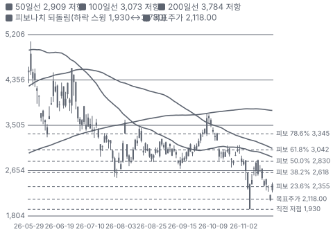

**주봉**

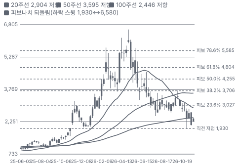

**월봉**

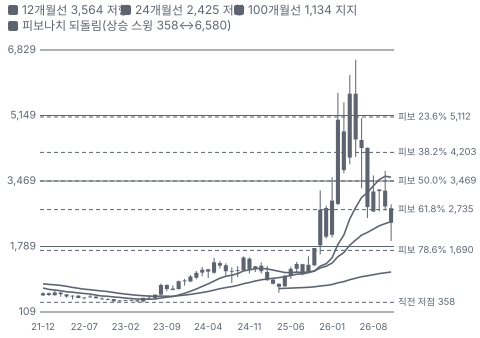

**분기 매출·EPS 실적과 컨센서스**

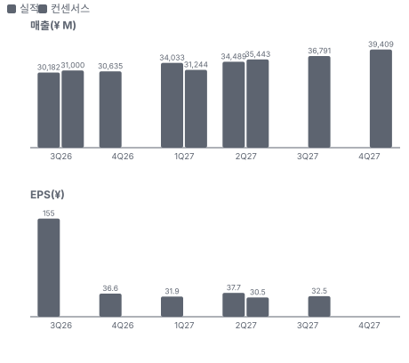

**멀티플 프리미엄(Fwd 1Y P/E 현재값 — 최근 4개 분기 추이 없음: 대상 과거 배수 없음 — 컨센서스 이력이 없어 과거 선행 배수를 못 만들고, 분기말 후행 배수도 넣지 않았다)**

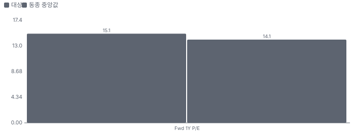

**합리적 멀티플**

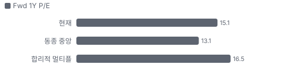

**밸류에이션 주가 시나리오**

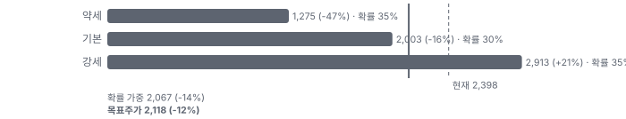

**주가별 업사이드**

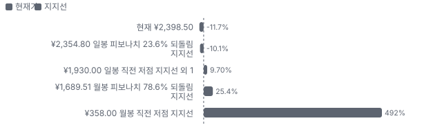
- 제품·서비스 포트폴리오

**공급 병목(10점, 낮을수록 병목)**

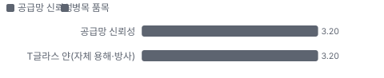

**생산능력 현재와 확충 계획(배(T글라스 공급능력, FY2025 = 1))**

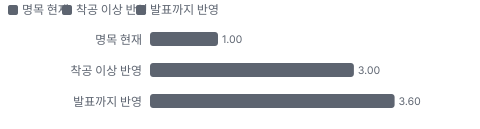

**CAPEX의 매출 대비 비중**

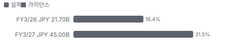

**어닝콜 변화별 주주가치 영향**

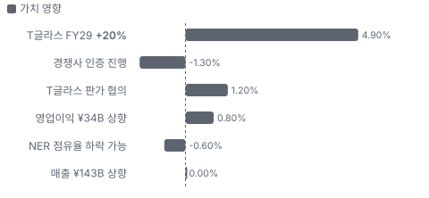

**매출 → 매출총이익 → 영업이익(매출 = 100, 최근 4분기)**

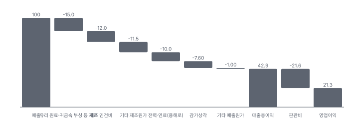

**분기 비용 비중 추이(매출 대비, 공시)**

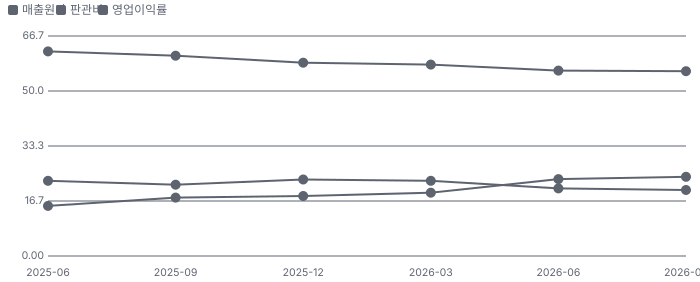

**비용 요인별 매출 대비 비중 1년 변화**

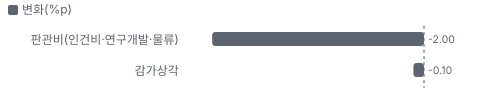

**스페셜 글라스·전자재료 유리섬유 BOM 원가 몫**

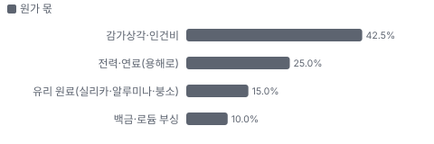

**글라스울 단열재 BOM 원가 몫**

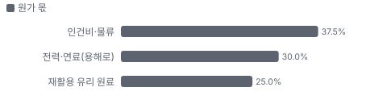

**BOM 항목 가격 +10% 시 OPM 변화**

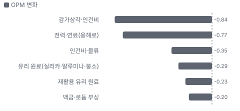

**목표주가 산정 — 기본과 강세 사이(강세 쪽 13%), 도달 확률 약 46%**

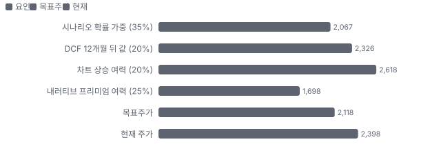

**PEG — 성장 대비 멀티플(낮을수록 성장 대비 쌈)**

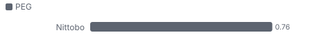

**몬테카를로**

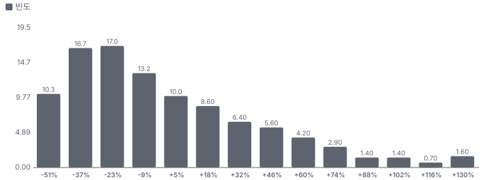

해석: 3,000번 중 1,243번(41%)에서 가치가 지금 주가 이상이었다. 지금 주가를 뒷받침하는 경우와 그렇지 않은 경우가 반반에 가깝다. 가운데 값은 0.90배이고, 열 번 중 여덟 번은 0.55~1.60배 사이에 든다.

## 내러티브

> **기업가치를 결정하는 이야기:** Fwd 1Y P/E 15.1배(FY3/28 EPS ¥159, Chiip 추정)로 기판 소재 사슬 동종 6곳 중앙값 13.1배보다 높다. 5월 고점에서는 같은 가이던스 EPS ¥131.85 기준 48배였다. 가치를 정하는 것은 ① 2027년 7월 새 공장 출하 뒤 T글라스 물량이 계획대로 느는지 ② 증설 시점의 판가 협의가 이익률로 이어지는지 ③ 경쟁사 저열팽창 유리가 실제로 양산 채택되는지다

> **멀티플·EPS 프리미엄**
> **멀티플:** Fwd 1Y P/E 15.1배, 동종 6곳 중앙값 13.1배(이비덴 17.4·아지노모토 17.4·미쓰비시가스화학 11.0·엘리트머티리얼 12.0·타이완유니온테크놀로지 8.4·유니마이크론 14.1 — 공개 시세 개요의 다음 회계연도 EPS 기준, 레조낙 49.2배는 이상치로 제외)
> **EPS:** FY3/26 영업이익 ¥20.8B → FY3/27 가이던스 ¥34.0B(+63%). EPS는 FY3/26 ¥229.47(고정자산 매각 이익 포함) → FY3/27 가이던스 ¥131.85 — 일회성 이익을 빼면 늘어난다. 상반기 EPS ¥69.52(+84%)

### 투자자들은 왜 열광했나

2026년 2월 3Q 결산과 상향 뒤 한 달 동안 ¥2,966에서 ¥5,040으로 올랐고 5월 7일 종가 ¥6,390에 닿았다 — 'T글라스 독점과 엔비디아 수요' 기대가 가장 컸던 때다. 그 뒤 5월 결산 다음 날 −11.1%, 8월 1Q 결산 다음 날 −17.9%(통기 상향에도 '올해 판가 인상 계획 없음'), 11월에는 미국 중간선거 뒤 반도체 약세와 겹쳐 11/20 ¥2,098.5까지 빠졌다. 기대가 식은 이유는 실적이 아니라 배수다

### 무엇이 기업가치를 바꾸나

> **구조적 체질 변화**
> **변화:** 범용 E글라스(가장 널리 쓰는 범용 유리섬유) 용해로(유리 원료를 녹이는 연속 가동 가마)를 줄이고 스페셜 글라스 용해로를 늘린다 — 섬유·범용 유리 회사에서 반도체 소재 회사로. 전자재료가 영업이익의 90%
> **증거:** 2Q 결산설명자료 16쪽
> **반증:** 전자재료 영업이익 비중이 2개 반기 연속 하락

> **고부가 믹스 확장**
> **변화:** T·NER 판매 증가와 E글라스 비중 하락으로 매출총이익률 38.7% → 43.9%
> **증거:** 2Q 결산단신·Q&A
> **반증:** 매출총이익률 42% 미만

> **기술 혁신**
> **변화:** 저열팽창 차세대(열팽창 계수 2.8 → 2.0ppm, 2028년 출시 계획 보도)와 초저손실 NEZ글라스(석영 유리와 경쟁하는 차세대 초저손실 유리섬유) — 석영 유리의 취급·양산 난점을 기회로 본다
> **증거:** 2Q Q&A · 회사 로드맵(결산설명자료 22쪽) · 보도 인용
> **반증:** 석영 유리 클로스(유리 실을 짠 천 — 수지를 먹여 기판의 뼈대로 쓴다)가 1.6T 스위치 기판에 표준 채택

> **실행 속도**
> **변화:** 해당 없음(주문→출하 납기를 회사가 공시하지 않는다) — T글라스는 고객이 타사를 검토할 만큼 공급이 모자란다는 정성 언급만 있다. 증설은 FY2026 용해로 설치 → 2027년 7월 출하 **납품 리드타임 미확인.** 피어 비교 미확인. 이전 대비 미확인.
> **증거:** 1Q·2Q Q&A
> **반증:** 2027년 7월 출하 일정 지연

> **M&A**
> **변화:** 해당 없음 — 최근 3년 의미 있는 인수 없음(바오텍 편입은 2019년)
> **증거:** 결산단신
> **반증:** 해당 없음

> **정책·입법 연관성**
> **재정정책:** 해당 없음(Nittobo를 겨냥한 미국·일본 재정정책 미확인). 고객 쪽 반도체 보조금은 Nittobo 매출로 바로 잇지 않는다(금지표) 미확인 반증: 해당 없음 의회 동의 2/10 — 하원 1/5(관련 논의 없음) · 상원 1/5(같음).
> **행정명령:** 해당 없음 — 유리섬유 소재가 수출통제·관세 행정명령의 직접 대상이라는 1차 자료가 없다 미확인 반증: 기판 소재를 겨냥한 통제 품목 추가 의회 동의 2/10 — 하원 1/5(관련 행정명령·법안 미확인) · 상원 1/5(같음).
> **연관입법:** 해당 없음(회사를 겨냥한 미국·일본 법안 미확인) 미확인 반증: 해당 없음

> **고객의 지출 예산**
> **변화:** 전자재료는 고객의 AI 서버·패키지 기판 생산에 따라 쓰이는 재료비(고객 CAPEX가 만든 수요의 하류), 단열재는 주택·건축 투자, 메디컬은 병원 검사 운영비
> **사업별 예산:** **매출의 44%**: 스페셜 글라스·전자재료 유리섬유 — 고객 혼합(AI 서버·패키지 기판 생산 재료비(상류는 데이터센터 CAPEX)) · 동인: AI 가속기 출하·기판 대면적화
**매출의 33%**: 복합재·산업자재·기타 — 고객 OPEX(제조사 원재료비) · 동인: 자동차·건축 생산
**매출의 12%**: 글라스울(유리를 솜처럼 뽑은 단열·흡음재) 단열재 — 고객 CAPEX(주택·건축 투자) · 동인: 일본 주택 착공·단열 기준
**매출의 11%**: 체외진단 시약(혈액 같은 검체로 병을 검사할 때 쓰는 시약) — 고객 OPEX(병원·검사 기관 검사 운영비) · 동인: 검사 건수
> **증거:** 사업 구조(결산설명자료)
> **반증:** 하이퍼스케일러 설비투자 가이던스 하향

### 내러티브 근거

> AI 칩 패키지가 커지면서 기판 휨을 막는 T글라스가 모자라고, 그 유리를 사실상 혼자 만드는 회사라는 이야기다. 이 이야기로 주가는 2025년 10월 ¥1,600에서 2026년 5월 7일 종가 ¥6,390까지 네 배가 됐다. 그 뒤 이익 가이던스는 두 번 올랐는데 주가는 11월 24일 ¥2,398.5로 62% 내려왔다 — AI 투자 지속성 걱정, 경쟁사의 저열팽창 유리 진입, 8월 '판가 인상 계획 없음' 답변이 배수를 깎았다. 동종 대비 멀티플 차이 +16% 중 회사 고유 몫은 -9%다. 단계는 소멸, 쏠림은 낮음이다.

> **T글라스 공급 부족과 증설** · 약화
> **논리:** AI 패키지 기판이 커지고 층이 늘수록 저열팽창 유리가 더 든다 — 공급을 FY2028 3배, FY2029 3.6배로 늘린다
> **숫자:** 전자재료 1H 매출 ¥37.6B(+27%)·영업이익 ¥14.7B(+63%), 증설 투자 ¥15B + ¥20B — 숫자는 좋아졌지만 주가가 고점에서 62% 내려 시장의 믿음은 약해졌다
> **반증:** 3Q 전자재료 영업이익 ¥8.6B 미만(2027년 2월)
> **출처:** https://ssl4.eir-parts.net/doc/3110/ir_material_for_fiscal_ym3/217524/00.pdf

> **가이던스 상향과 믹스 개선** · 강화
> **논리:** T·NER 비중이 늘고 범용 E글라스가 줄어 이익률이 오른다
> **숫자:** 통기 영업이익 ¥30.0B → ¥34.0B, 1H 영업이익률 23.7%(전년 16.5%)
> **반증:** 3Q 영업이익률 22% 미만
> **출처:** https://ssl4.eir-parts.net/doc/3110/ir_material_for_fiscal_ym2/213883/00.pdf

> **판가 개정 여지** · 유지
> **논리:** 증설 물량이 나오는 시점에 T글라스 판가를 협의한다 — 공급망 전반이 가격을 올리는 환경
> **숫자:** 수치 미공시 — 8월 '올해 계획 없음'에서 11월 '협의'로 바뀜
> **반증:** 2027년 5월 가이던스에 판가 효과가 없다
> **출처:** https://ssl4.eir-parts.net/doc/3110/ir_material_for_fiscal_ym3/217524/00.pdf

> **반대: 경쟁사 저열팽창 유리 진입** · 강화
> **논리:** 공급이 모자라 고객이 타사 유리를 인증하고 있다 — 독점 프리미엄이 깎인다
> **숫자:** 회사: 경쟁사 클로스 인증 진행, 유입량은 불투명. 보도: 다른 일본 유리 소재사의 시장 진출 선언(수년 내 상업화 목표)
> **반증:** FY2028까지 경쟁사 양산 채택 발표 없음
> **출처:** https://ssl4.eir-parts.net/doc/3110/ir_material_for_fiscal_ym3/217524/00.pdf

> **반대: AI 투자 지속성과 업종 디레이팅** · 유지
> **논리:** 기판·동박적층판 사슬 전체의 배수가 반년 새 절반이 됐다 — 이익이 정점이라는 걱정
> **숫자:** 종가 고점 ¥6,390(5/7) → ¥2,398.5(11/24) −62.5%, 같은 기간 가이던스 EPS는 상향
> **반증:** FY3/28 가이던스(2027년 5월)가 영업이익 +15% 이상
> **출처:** https://www.tradingview.com/symbols/TSE-3110/

> **반대: 저유전 유리 경쟁** · 강화
> **논리:** NER 시장이 넓어지며 점유율을 지키기 어렵고 가격도 못 올린다
> **숫자:** 회사: '지금 점유율 유지는 어렵다', 저유전 가격 동결
> **반증:** NER 판매량이 2개 반기 연속 두 자릿수 증가
> **출처:** https://ssl4.eir-parts.net/doc/3110/ir_material_for_fiscal_ym3/217524/00.pdf

### 투자 포인트

> **이익은 올랐는데 배수는 3분의 1이 됐다**
> **명제:** 5월 고점 뒤 가이던스가 두 번 올랐고 주가는 62% 내렸다 — 내린 것은 이익이 아니라 배수다
> **숫자:** FY3/27 영업이익 가이던스 ¥26.0B(5월) → ¥30.0B(8월) → ¥34.0B(11월). 가이던스 EPS ¥131.85 기준 P/E는 5/7 종가에서 48.5배, 11/24 종가에서 18.2배
> **시장과 다른 점:** 시장은 지금 이익을 AI 사이클의 정점으로 본다. 제 판단은 FY2028 3배·FY2029 3.6배 증설이 이미 결정·착공이라 물량 정점은 2028년 뒤라는 것이다 — 다만 그 물량이 지금 이익률로 팔린다는 근거는 아직 없다
> **증명:** 2027년 2월 3Q 결산 — 전자재료 영업이익 ¥8.6B 이상
> **출처:** https://ssl4.eir-parts.net/doc/3110/ir_material_for_fiscal_ym2/213883/00.pdf

> **다음 변수는 물량이 아니라 판가다**
> **명제:** 증설 물량이 나오는 시점에 T글라스 판가를 협의한다는 답이 처음 나왔다
> **숫자:** 전자재료 영업이익률 39.0%(1H). 8월 '판가 개정은 투자와 직접 묶지 않는다' → 11월 '증설 시점에 일정 폭 협의, 요청하기 쉬운 환경'
> **시장과 다른 점:** 영업이익 컨센서스 ¥33.2~33.4B는 가이던스 ¥34.0B보다 낮다 — 시장은 판가 효과를 넣지 않았다. 회사는 지난 두 분기 연속 가이던스를 올렸다
> **증명:** 2027년 5월 FY3/28 가이던스 — 전자재료 영업이익 +20% 이상
> **출처:** https://ssl4.eir-parts.net/doc/3110/ir_material_for_fiscal_ym3/217524/00.pdf

> **독점은 T글라스까지다**
> **명제:** 2세대 저유전(NER)은 점유율을 지키기 어렵다고 회사가 말했고, 저열팽창 유리도 경쟁사 인증이 진행 중이다
> **숫자:** 2Q Q&A — NER 점유율 유지 어려움·저유전 가격 동결, 경쟁사 클로스 인증 진행(유입량 불투명)
> **시장과 다른 점:** 강세 쪽은 스페셜 글라스 전체를 독점으로 묶어 본다. 제 판단은 독점 프리미엄을 T글라스 몫에만 줘야 한다는 것이다 — 제품별 매출은 공시되지 않아 그 몫은 미확인이다
> **증명:** 경쟁사 저열팽창 클로스의 양산 채택 발표 여부(2027년 중)
> **출처:** https://ssl4.eir-parts.net/doc/3110/ir_material_for_fiscal_ym3/217524/00.pdf

### 모멘텀 생성·소멸 타임라인

**카탈리스트 달력 — 지난 사건의 주가 반응과 앞으로 확인할 숫자**
| 날짜 | 상태 | 구분 | 사건 | 반응·확인 | 결과에 따라 |
|---|---|---|---|---|---|
| 2026-02-05 | 완료 | 생성 | 3Q FY3/26 결산·통기 상향 — 그 뒤 2월 한 달 주가 +70% | -1.6% |  |
| 2026-05-12 | 완료 | 소멸 | FY3/26 결산·FY3/27 첫 가이던스 — 5/7 종가 고점 ¥6,390 직후 | -11.1% |  |
| 2026-08-05 | 완료 | 소멸 | 1Q 결산·통기 상향 — '올해 저유전 판가 개정 계획 없음', 타사 저열팽창 유리 검토 인정 | -17.9% |  |
| 2026-11-05 | 완료 | 확인 | 2Q 결산·통기 영업이익 13% 상향·T글라스 추가 증설 결정 | +3.4% |  |
| 2027-02-09(예상) | 예정 | 확인 | 3Q FY3/27 결산 | 전자재료 영업이익 ¥8.6B 이상, 영업이익률 23% 이상 | 넘으면 통기 재상향 기대(기본~강세), 못 미치면 하반기 계획 ¥17.8B 의심(약세) |
| 2027-05 중순(예상) | 예정 | 확인 | FY3/27 결산·FY3/28 가이던스 | FY3/28 영업이익 가이던스 +15% 이상, 판가 개정 반영 여부 | 이상이면 이익 정점 걱정이 줄어 배수 회복(강세), 한 자릿수면 감가상각 부담 확인(약세) |
| 2027-07(예상) | 예정 | 확인 | T글라스 새 공장 출하 시작 | 출하 일정 유지와 고객 인증 완료 언급 | 지연되면 고객의 타사 전환이 빨라진다(약세) |
| 2027-01~02(예상) | 예정 | 매크로 | 미국 대형 클라우드 회사들의 2027년 설비투자 가이던스 | 합산 설비투자 증가율 유지 | 하향이면 기판 소재 사슬 배수가 한 번 더 깎인다 |

### 언제 사서 언제 팔아야 할까?

**가격·조건 틀 — 가격은 밸류에이션(약세·기본·강세·목표주가)과 차트 지지 구간에서, 조건은 이벤트에서**
| 구간 | 가격 | 목표주가까지 | 약세까지 | 조건·근거 |
|---|---|---|---|---|
| 관찰 구간 | ¥2,355~¥2,355 | -10% | -46% | 지금 가격 바로 아래의 일봉 지지 구간이다. 그 아래로는 11월 20일 종가 ¥2,098.5와 11월 6일 장중 저점 ¥1,930이 결산 뒤 지켜진 자리다 |
| 확인 뒤 | 지금 ¥2,398 이상에서 조건 확인 | -12% | -47% | 3Q 전자재료 영업이익 ¥8.6B 이상 또는 통기 가이던스 재상향, 그리고 주가가 50일선 위에서 주간 마감 |
| 무효화 | 약세 시나리오 ¥1,275 | - | -47% | 경쟁사 저열팽창 유리의 양산 채택이 고객 발표로 확인되거나, 3Q 영업이익률이 22% 아래로 내려간다 |
| 차익 고민 2차 | ¥2,913(강세 시나리오) | +21% | - | 목표주가 부근은 Fwd 1Y P/E가 동종 중앙값보다 뚜렷이 높아지는 자리다 — 판가 개정 수치가 나오기 전에는 그 프리미엄의 근거가 약하다 |

하루 9% 넘게 움직인 날이 최근 150거래일에 17번이다. 결산 다음 날 변동이 특히 크다(8월 −17.9%) — 가격·조건 틀이며 매매·비중 지시가 아니다 가격·조건 틀이며 매매·비중 지시가 아니다(투자 권유 아님).

## 포트폴리오

| 제품·서비스 | 구분 | 무엇 | 쓰는 곳 | 돈 버는 방식 | Mix | Mix 변화(1H 전자재료 외부 매출 ¥29,946M ÷ ¥68,522M, 전년 ¥23,418M ÷ ¥57,412M) |
|---|---|---|---|---|---|---|
| 스페셜 글라스·전자재료 유리섬유 | 제품 | 저열팽창 T글라스와 저유전 NE·NER 유리 실·천 | AI 칩 패키지 기판 코어, 서버·스위치 기판 | 얀·클로스 판매(판가 개정 협의) | 44% | +2.9%p |
| 글라스울 단열재 | 제품 | 재활용 유리로 만든 단열·흡음재 | 주택·건축·산업 단열 | 제품 판매(판가 개정 실시) | 12% | -0.4%p |
| 체외진단 시약 | 제품 | 면역·골대사 표지 검사 시약 | 병원·검사 기관 진단 | 시약 반복 판매 | 11% | -0.4%p |
| 복합재용 유리섬유 | 제품 | 플라스틱 강화용 유리섬유 | 자동차 부품·전자기기 케이스 | 제품 판매 | 11% | -0.8%p |
| 산업자재·화학·기타 | 제품 | 산업자재용 유리섬유, 기능성 폴리머, 심지, 기타 | 건축 막재·제진재·의류 | 제품 판매 | 22% | -1.3%p |

**Mix 변화가 가장 큰 쪽은 스페셜 글라스·전자재료 유리섬유(+2.9%p, 1H 전자재료 외부 매출 ¥29,946M ÷ ¥68,522M, 전년 ¥23,418M ÷ ¥57,412M).** 계절성 판정: 분기 매출 계절 지수 기준 없음 → 직전 분기와 비교.

## 마진 구조

> **GPM 43.9%, OPM 23.7%.** 1H FY3/26 대비 GPM +5.2%p, OPM +7.2%p. 변동비는 매출의 37%이고, 매출이 10% 늘면 OPM은 +3.5%p 움직인다. 1H 매출총이익률 43.9%(전년 38.7%), 판관비율 20.2%(전년 22.2%) — 영업이익률이 16.5% → 23.7%로 올랐다. 회사 분해는 스페셜 글라스 판매 증가와 판가 개정이 이익을 올리고, 증설에 따른 인건비·연구개발비·감가상각이 깎는 구조다. 전자재료 영업이익률은 39.0%(¥14.66B ÷ 내부 매출 포함 ¥37.57B)

> **매출 100 중 매출원가 57.1, 매출총이익 42.9(최근 4분기, 공시).** 매출원가 요인 중 유리 원료·귀금속 부싱(녹은 유리를 실로 뽑아내는 백금·로듐 노즐판) 등 재료이 매출의 15.0%로 가장 무겁고, 단가가 +10% 오르면 GPM이 -1.50%p 움직인다.

**비용 요인 강도 — 비중·추세·충격(+10%)·탄력**
| 비용 | 구분 | 매출 대비 | 1년 변화 | 마진 기여 | 충격 시 마진 | 매출 탄력 | 고정비 몫 |
|---|---|---|---|---|---|---|---|
| 유리 원료·귀금속 부싱 등 재료 | 매출원가 요인 | 15.0% | 미확인 | 미확인 | -1.50%p | 미확인 | 0% |
| 제조 인건비 | 매출원가 요인 | 12.0% | 미확인 | 미확인 | -1.20%p | 미확인 | 70% |
| 기타 제조원가 | 매출원가 요인 | 11.5% | 미확인 | 미확인 | -1.15%p | 미확인 | 50% |
| 전력·연료(용해로) | 매출원가 요인 | 10.0% | 미확인 | 미확인 | -1.00%p | 미확인 | 30% |
| 감가상각 | 매출원가 요인 | 7.6% | -0.1%p | +0.1%p | -0.76%p | 미확인 | 100% |
| 매출원가 | 공시 항목 | 57.1% | 미확인 | 미확인 | -5.71%p | 미확인 | 미확인 |
| 판관비 | 공시 항목 | 21.6% | 미확인 | 미확인 | 미확인 | 미확인 | 미확인 |

매출 탄력 = 분기 비용을 매출에 회귀한 기울기(매출 1당 변동비), 고정비 몫 = 절편 ÷ 평균 비용. 표본이 8분기 미만이면 미확인. 매출원가 요인 비중은 margin 재료의 추정이 섞여 있고, 공시 매출원가와의 차이는 '기타 매출원가'로 둔다.

**GPM에서 OPM까지(J-GAAP, 아래는 최근 4개 분기)**
| 기간 | GPM | 연구개발 | 판관비 | 기타 | OPM |
|---|---|---|---|---|---|
| 1H FY3/26 | 38.7% | 0.0% | 22.2% | 0.0% | 16.5% |
| 1H FY3/27 | 43.9% | 0.0% | 20.2% | 0.0% | 23.7% |
| 2025-12 | 41.4% | - | - | - | 18.2% |
| 2026-03 | 42.0% | - | - | - | 19.2% |
| 2026-06 | 43.8% | - | - | - | 23.3% |
| 2026-09 | 44.0% | - | - | - | 24.0% |

**비용을 움직이는 요인**
| 비용 | 요인 |
|---|---|
| 판관비(인건비·연구개발·물류, 판관비) | 인건비·연구개발비 증가 · 근거 공시 |
| 유리 원료·귀금속 부싱 등 재료(매출원가) | 실리카·알루미나·붕소 원료, 백금·로듐 부싱 손모 · 근거 추정 |
| 제조 인건비(매출원가) | 증설 인력 보강(회사: 인건비 증가) · 근거 추정 |
| 기타 제조원가(매출원가) | 수선·물류·외주 가공 · 근거 추정 |
| 전력·연료(용해로, 매출원가) | 전력·가스 단가(회사: 중동 정세로 전력·연료비 상승을 가이던스에 반영) · 근거 추정 |
| 감가상각(매출원가) | 증설 설비 가동(FY3/27 CAPEX 계획 ¥45B) · 근거 공시 |

**스페셜 글라스·전자재료 유리섬유 BOM — 매출의 44%, GPM 55%(추정 — 제품별 매출총이익률 미공시. 사업부 영업이익률 39.0%에 판관비 몫을 더해 역산한 범위의 가운데), 항목 가격 +10% 시**
| 항목 | 원가 몫 | 전가 | 제품 GPM | OPM |
|---|---|---|---|---|
| 감가상각·인건비 | 35~50% | 미확인 | -1.9%p | -0.84%p |
| 전력·연료(용해로) | 20~30% | 미확인 | -1.1%p | -0.49%p |
| 유리 원료(실리카·알루미나·붕소) | 10~20% | 미확인 | -0.7%p | -0.29%p |
| 백금·로듐 부싱 | 5~15% | 미확인 | -0.4%p | -0.20%p |
| 미분해 | 7% | - | - | - |

**글라스울 단열재 BOM — 매출의 12%, GPM 25%(추정 — 미공시. 사업부 영업이익률 7.7%(¥647M ÷ ¥8,426M)에 판관비 몫을 더한 값), 항목 가격 +10% 시**
| 항목 | 원가 몫 | 전가 | 제품 GPM | OPM |
|---|---|---|---|---|
| 인건비·물류 | 30~45% | 미확인 | -2.8%p | -0.35%p |
| 전력·연료(용해로) | 25~35% | 미확인 | -2.2%p | -0.28%p |
| 재활용 유리 원료 | 20~30% | 미확인 | -1.9%p | -0.23%p |
| 미분해 | 7% | - | - | - |

감가상각·인건비 가격이 +10% 오르면 영업이익은 -3.5% 움직인다. 판매가 전가를 모르는 항목은 전가 0%로 계산했다.

**BOM 항목 가격을 움직이는 것**
| 항목 | 요인 |
|---|---|
| 전력·연료(용해로) | 1,500℃대 용해로를 연속 가동한다 — 회사는 범용 제품에서 판가 개정으로 넘긴다고 했고, 스페셜 글라스는 증설 시점에 협의한다고 했다 · 근거 추정 |
| 유리 원료(실리카·알루미나·붕소) | 고유 조성(T·NE·NER)이라 원료 배합이 차별점 · 근거 추정 |
| 백금·로듐 부싱 | 녹은 유리를 실로 뽑는 노즐판 — 귀금속 손모와 리스료가 원가 · 근거 추정 |
| 감가상각·인건비 | 용해로·직기 증설이 고정비를 올린다 · 근거 추정 |
| 재활용 유리 원료 | 원료의 80% 이상이 재활용 유리 · 근거 추정 |
| 전력·연료(용해로) | 회사는 인건비·원료·전력·연료 상승에 맞춰 판가 개정을 했다고 밝혔고 그것이 1H 흑자 전환(−¥0.2B → +¥0.6B)의 원인이다 — 전가 비율은 미공시 · 근거 추정 |
| 인건비·물류 | 부피가 커 물류비 몫이 크다 · 근거 추정 |

**투입 물가 — 미국 PPI 3·6·12개월(2026-10, 개정 반영)**
| 항목 | 미국 3개월 | 6개월 | 12개월 | 전가 못 할 때 OPM |
|---|---|---|---|---|
| 전력·연료(용해로) | -6.1% | +1.8% | +0.6%* | -0.1%p |

별표는 품목보다 넓은 업종 지수다. 연결한 투입 원가의 미국 PPI(생산자물가지수)는 1년 새 가중 +0.6%이고, 판매가로 넘기지 못하면 GPM -0.1%p·OPM -0.1%p가 움직인다. 물가 지수를 붙이지 못한 매출원가 항목은 유리 원료·귀금속 부싱 등 재료, 제조 인건비, 감가상각다(미연결).

## 공급망 병목

> **공급망 신뢰성 3.2/10, 병목 심각.** 가장 약한 고리는 T글라스 얀(자체 용해·방사) 3.2점이고, 품목 평균은 3.2점이다. 근거가 부족한 3건(전력·연료(용해로) · 유리 원료(실리카·알루미나·붕소) · 클로스 직조(외부 협력))은 점수에서 뺐다. 유리섬유는 원료를 녹여 실로 뽑고 짜는 일관 공정이라 외부 부품 의존은 낮다. 약한 고리는 전력·연료(중동 정세로 단가 상승)와 직조 공정의 외부 협력(대만 난야플라스틱 협업)이다. 공급사 이름은 대부분 공시되지 않았다

**병목과 마진 — 품목 가격 +10% 시 OPM**
| 품목 | 점수 | 판정 | 구분 | OPM |
|---|---|---|---|---|
| T글라스 얀(자체 용해·방사, 필수) | 3.2 | 병목 심각 | 출하 차질 위험 | 미확인 |

> **T글라스 얀(자체 용해·방사)** · 3.2/10
> **왜:** 클로스의 원사를 스스로 만든다 — 외부 병목은 없지만 T글라스 용해로가 한 지역에 모여 있어 재해·설비 사고에 약하다. 세계 점유율 약 90%는 보도 인용값(회사 미공시)
> **병목 요인:** 인증 공급사 1곳 · 캐파 빠듯 · 리드타임 미확인 · 재인증 미확인 · 1위 점유율 90% · 일본 후쿠시마(회사 증설 도표에서 T글라스 얀은 후쿠시마에만 표시) 집중 100% · 물량 확보 내재화
> **풀리는 조건:** 2027년 7월 새 공장 출하(설비 반입·수율 확인 전)

**공급사**
| 품목 | 공급사 | 몫 | 근거 |
|---|---|---|---|
| T글라스 얀(자체 용해·방사) | Nittobo 후쿠시마 사업센터(T글라스 용해·방사(내제)) | 미확인 | 회사 발표 |
| 전력·연료(용해로) | 미공시(지역 전력·가스 회사, 용해로 전력·연료) | 미확인 | 추정 |
| 유리 원료(실리카·알루미나·붕소) | 미공시(유리 원료) | 미확인 | 추정 |
| 클로스 직조(외부 협력) | 난야플라스틱(직조 공정 협업(대만)) | 미확인 | 회사 발표 |
| 클로스 직조(외부 협력) | 바오텍(연결 자회사, 대만 타오위안 클로스) | 미확인 | 회사 발표 |

**무역 통계로 본 공급 지역**
| 품목 | EU 수입처 | 일본 수입처 | EU 1위 전년비 |
|---|---|---|---|
| 전력·연료(용해로) | US 100% | 미확인 | 미확인 |

## 생산능력

> **현재 명목 캐파 1 배(T글라스 공급능력, FY2025 = 1), 가동률 미확인.** 착공 이상 증설은 2 배(T글라스 공급능력, FY2025 = 1), 발표까지 합치면 3 배(T글라스 공급능력, FY2025 = 1)이다. 다 가동하면 지금보다 +260%, 착공 이상만이면 +200%다. FY3/26 CAPEX는 JPY 21.70B로 매출의 18.4%다. 회사는 캐파를 톤·미터로 밝히지 않고 FY2025 대비 배수로만 말한다. T글라스는 FY2028에 3배(¥15B, 새 공장 2027년 7월 출하), FY2029에 3.6배(+¥20B, 기존 공장 설비 추가·품목 전환 — 결정 끝)다. 범용 E글라스 용해로를 스페셜 글라스로 바꾸는 방식이라 전체 유리 생산량이 그만큼 느는 것은 아니다. 올해는 캐파 제약이 이어진다

**생산시설 4곳**(2Q 결산설명자료 16쪽 '스페셜 글라스 증설' 도표에 이름이 나온 전자재료 거점만 센다. 단열재(파라마운트 글라스)·메디컬(미국 원료 공장 포함)·복합재 공장은 이번 회차에 유가증권보고서 '설비의 상황'을 열지 못해 세지 않았다 — 전체 수는 미확인), 미확인 4곳. 시설별 생산능력은 공개되지 않았다 — 회사 전체 캐파만 위에 적었다.

**생산시설 4곳 — 명칭·위치·생산능력**
| 시설 | 위치 | 용도 | 생산능력 | 소유·상태 |
|---|---|---|---|---|
| 후쿠시마 사업센터 | 일본 후쿠시마현 후쿠시마시 | 얀(용해·방사) — E·NE·NER·NEZ(Nittobo 차세대 초저손실 유리섬유 이름)·T글라스, 클로스 직조·처리 | 미확인 — 시설별 캐파 미공시 — T글라스 새 용해로 FY2026 설치, FY2027 양산 | 미확인 · 증설 중 |
| 후쿠야마 사업센터 | 일본 후쿠시마현 고리야마시 | 클로스 직조·처리(초박 E·NE·NER·T) | 미확인 — 시설별 캐파 미공시 — 처리 공정 FY2027 양산 시작 | 미확인 · 증설 중 |
| 닛토보 아시아 글라스파이버 | 대만 자이 | 얀 — E글라스(범용), NE글라스(FY2024 용해로 추가) | 미확인 — 시설별 캐파 미공시 | 미확인 · 가동 |
| 바오텍 | 대만 타오위안 | 클로스 — NE·T글라스(T는 FY2023 양산), 2019년 연결 자회사 편입 | 미확인 — 시설별 캐파 미공시 | 미확인 · 가동 |

**생산능력 확충 계획**
| 계획 | 단계 | 증설 | 가동 시점 | CAPEX |
|---|---|---|---|---|
| T글라스 새 용해로·새 공장(후쿠시마) | 착공 | 2 배(T글라스 공급능력, FY2025 = 1) | 2027-07 | JPY 15.00B |
| T글라스 추가 증설(기존 공장 설비 추가·품목 전환) | 발표 | 1 배(T글라스 공급능력, FY2025 = 1) | FY2029 | JPY 20.00B |
| NER글라스(NE보다 신호 손실을 더 줄인 2세대 저유전 유리섬유 — 최신 AI 서버 기판용) 단계 증설 | 발표 | 미확인 | 미확인 | 미확인 |

남은 계획의 CAPEX 합계는 JPY 35.00B(금액 미확인 1건 제외)다. 금액을 아는 계획의 단위당 CAPEX는 JPY 13.46B/배(T글라스 공급능력, FY2025 = 1)이다. 합계는 FY3/27 매출의 24%다.

**증설 방해 요인**
| 계획 | 방해 요인 |
|---|---|
| T글라스 새 용해로·새 공장(후쿠시마) | 설비 반입·수율 안정·고객 인증 |
| T글라스 추가 증설(기존 공장 설비 추가·품목 전환) | E글라스 감산과 전환 일정 |
| NER글라스 단계 증설 | 미확인 |

**CAPEX와 매출 대비**
| 기간 | CAPEX | 매출 | 매출 대비 | 구분 |
|---|---|---|---|---|
| FY3/26 | JPY 21.70B | JPY 118.23B | 18.4% | 실적 |
| FY3/27 | JPY 45.00B | JPY 143.00B | 31.5% | 가이던스 |

## 피터 린치 분류

> **경기순환주(Cyclical), 대형.** 린치 표의 기대 수익 10배, 하방 -80~100%, 위험 고. 10배 경로가 있는 분류다(고성장주·회생주·경기순환주).

**분류 근거 — 크기 먼저, 다음은 이야기 유형**
| 항목 | 값 |
|---|---|
| 크기 | 대형(시가총액 \$436.6B) |
| 장기 성장 | 미확인%(미확인) |
| 린치 비율((성장% + 배당%) ÷ P/E) | 미확인 |
| PEG(P/E ÷ 성장%) | 미확인 |
| 근거 | 순환 업종(electronics) |
| 반대 근거 | 없음 |

- 점검: 재고·공급과 수요(가격)의 방향
- 점검: 경쟁사의 증설
- 점검: 이익 정점에서 P/E가 낮아 보이는 함정
- 점검: 부채가 바닥을 견딜 수 있나
- 팔 때(점검 조건, 매매 지시 아님): 재고가 쌓이고 증설이 시작되고 가격이 꺾일 때 — 정점의 낮은 P/E는 싸다는 뜻이 아니다

분류 = 피터 린치·존 로스차일드 『One Up On Wall Street』(1989)·『Beating the Street』(1993)의 6분류와 위험·보상 표를 숫자 규칙으로 옮긴 자체추론이다(config/lynch.yaml).

## 구루 교차 점검

> **여섯 관점 중 통과 3 · 미달 1 · 미확인 2.** 가장 약한 관점은 재투자 복리 — 증설 투자가 영업현금흐름을 넘는 구간이라 새 설비가 지금 이익률로 돌지 못하면 ROIC가 자본비용 아래로 내려간다.

판정은 자체추론이고 숫자는 계산값이다.

> **성장 여지** · 통과
> **질문:** 5년 안에 매출이 2배가 될 자리가 있나, 10년 뒤에도 커지나
> **이유:** T글라스 공급을 FY2025 대비 FY2028 3배·FY2029 3.6배로 늘리는 투자가 결정됐고 회사는 수요가 그보다 강하다고 말한다 — 다만 매출 경로 숫자는 회사가 내지 않았다
> **계산한 숫자:** 매출 경로 미확인
> **근거:** 2Q 결산설명회 주요 질의응답 · 출처 목록

> **해자와 자본수익률** · 통과
> **질문:** 경쟁우위가 무엇이고, 투하자본수익률(ROIC)이 자본비용보다 높으며 유지·상승하나
> **이유:** TTM ROIC 9.7%가 엔화 기준 자본비용 7.1%를 넘고 전자재료 영업이익률이 39%다 — 증설 중이라 투하자본이 먼저 늘어 전사 ROIC는 낮게 보인다
> **계산한 숫자:** ROIC 9.7% · 자본비용 7.1%
> **근거:** 2Q 결산단신 · 출처 목록

> **재투자 복리** · 미확인
> **질문:** 번 돈을 높은 수익률로 다시 넣을 곳이 있나 — 자본 배분(재투자·인수·자사주·희석) 이력은
> **이유:** FY3/27 CAPEX 계획 ¥45B는 영업현금흐름을 넘는다(1H 영업현금흐름 −¥1.2B, 법인세 ¥12.8B 납부 포함). 증설분의 수익률은 2027년 7월 출하 뒤에야 확인된다
> **계산한 숫자:** 설비 재투자율 82.9% · 지속 가능 성장 8.0%(근사) · 소유주 이익 수익률 4.4%(근사)
> **근거:** 2Q 결산단신 현금흐름표

> **사람과 문화** · 미확인
> **질문:** 경영진이 주주와 같은 배를 탔나 — 창업자·내부자 지분, 기회형 내부자 매수, 문화가 경쟁우위에 기여하나
> **이유:** 경영진 지분·보상 구조를 위임장·유가증권보고서로 대조하지 못했다
> **계산한 숫자:** 서류로 확인(계산 없음)
> **근거:** 미확인

> **변화의 방향** · 통과
> **질문:** 18~24개월 뒤 이익 그림이 지금과 얼마나 다른가, 유동성 국면은 그 변화를 받쳐 주나
> **이유:** 통기 가이던스를 8월과 11월 두 번 올렸고 FY3/29 EPS가 FY3/28보다 높다(Chiip 추정 +19%)
> **계산한 숫자:** 2년 뒤 EPS +19.5%(다음 12개월 대비) · 유동성 국면 중립
> **근거:** 2Q 결산단신 4쪽 · 출처 목록

> **5배 경로와 시장이 모르는 이유** · 미달
> **질문:** 어떻게 5배 이상이 되나(이익 성장 × 배수 변화), 시장은 왜 아직 값을 안 매기나
> **이유:** 5년 5배에는 연 38% 성장이 필요하다 — 시가총액 ¥437B의 설비 집약 소재 회사에는 닿기 어려운 경로다. 2배 경로는 열려 있다
> **계산한 숫자:** 5년에 5배 = 연 38.0% · 10배 = 연 58.5% · Fwd P/E 15.1배
> **근거:** 밸류에이션 계산

**배수별로 필요한 연 성장률 — 이익 성장과 배수 변화를 합친 속도**
| 목표 | 5년 | 7년 | 10년 |
|---|---|---|---|
| 2배 | 14.9% | 10.4% | 7.2% |
| 5배 | 38.0% | 25.8% | 17.5% |
| 10배 | 58.5%(희소) | 38.9% | 25.9% |

### 보유 규율 — 가격이 아니라 지표로 유지·종료를 가른다

- 투자 논리 지표: 전자재료 영업이익(반기) · 매출총이익률 · T글라스 증설 일정(2027년 7월 출하)
- 규칙: 가격만 빠지고 전자재료 영업이익과 증설 일정이 살아 있으면 투자 논리는 유지된다
- 지금 주가는 일봉 2,400개 기간의 고점 대비 -62.5%, 그 기간 최대 낙폭은 -69.8%다 — 고점 대비 −50%를 넘어 재심사 구간이다. 가격이 아니라 위 지표로 유지·종료를 가른다.

여섯 관점은 베일리 기포드(성장 여지·5배 경로), 워렌 버핏(해자·재투자), 론 바론(사람), 피터 린치(분류·내부자), 스탠리 드러켄밀러(변화의 방향·유동성)의 질문을 옮긴 점검 틀이다. 유동성 국면은 중립(10년물 20일 -8bp · 하이일드 스프레드 20일 +33bp). 설비 재투자율은 설비투자에서 감가상각을 뺀 몫만 본 근사이고(연구개발·인수·운전자본은 빠진다), 소유주 이익 수익률은 유지 설비투자를 감가상각과 같다고 본 근사다. 점검 틀이며 매매·비중 지시가 아니다.

## 해자

> 해자는 저열팽창 T글라스의 조성·품질과 고객 인증이다. 회사는 고성능 패키지 시장의 선도 공급사라고 말하고, 보도는 점유율을 약 90%로 전한다. 다만 회사 스스로 경쟁사 인증이 진행 중이고 2세대 저유전(NER)은 점유율을 지키기 어렵다고 말했다

> **저열팽창 T글라스 조성·품질** · 강함
> **해자:** 패키지 기판 코어의 휨을 막는 저CTE(열팽창 계수가 낮다는 뜻 — 온도가 변해도 치수가 덜 변한다) 유리에서 품질 우위를 갖고, 고객이 공급 부족 때문에야 타사를 검토한다
> **근거:** 2Q Q&A — '고성능 패키지 시장의 선도 공급사로 남는다', 1Q Q&A — '품질 우위는 변함없고 공급 확대가 우선'. 보도(닛케이 아시아 인용): 저열팽창 유리 클로스 점유율 약 90%
> **숫자:** 전자재료 영업이익률 39.0%(1H FY3/27), 점유율은 회사 미공시(보도 약 90%)
> **깨지는 조건:** 경쟁사 저CTE 클로스가 주요 패키지 기판에 양산 채택됐다는 고객·경쟁사 발표

> **고객 인증과 증설 리드타임** · 보통
> **해자:** 용해로 증설에 2~3년, 고객 인증에 추가 시간이 걸려 공급 부족이 빨리 풀리지 않는다
> **근거:** 증설 일정 — FY2026 용해로 설치 → 2027년 7월 출하 → FY2028 3배(2Q 결산설명자료 16쪽)
> **숫자:** 착공에서 출하까지 약 2년(회사 일정)
> **깨지는 조건:** 경쟁사 증설분이 2027년 안에 인증을 마치고 출하

> **저유전 유리 세대 교체(NE → NER → NEZ)** · 약함
> **해자:** 고유 조성으로 세대를 먼저 내지만 2세대에서는 경쟁이 붙었다
> **근거:** 2Q Q&A — 'NER 시장이 넓어져 지금 점유율 유지는 어렵다', '저유전 유리는 경쟁을 감안해 가격 유지'
> **숫자:** 점유율 미공시(미확인)
> **깨지는 조건:** NER 판매량 증가율이 시장 증가율을 2개 반기 연속 밑돈다

## 경영진·네트워크

> 대표이사 CEO는 하야시 히사노부(결산단신 표기 Hisanobu Hayashi). 경력·네트워크는 이번 회차에 위임장·유가증권보고서를 열지 못해 대조하지 못했다. 경영진 정치·동문 연결은 공개 기록으로 확인하지 못했다

> **하야시 히사노부** · 이사·대표집행임원 CEO · 2026(2월 5일 결산단신 대표자는 다다 히로유키, 5월 12일 결산단신부터 하야시 히사노부)
> **프로필:** 결산단신 대표자 표기 — 경력은 이번 회차 1차 미대조
> **비즈니스:** 미확인
> **정계:** 미확인
> **동문:** 미확인
> **사모임:** 미확인

**네트워크 정량화**
| 연결 | 강도 | 닿는 매출 | 가중 노출 | 매출 대비 | 근거 |
|---|---|---|---|---|---|
| 비즈니스: 대만 난야플라스틱과 직조 공정 협업(회사 발표) | 1/5 | ¥0.00B | ¥0.00B | 0% | 협업이 닿는 매출 몫은 미공시 https://ssl4.eir-parts.net/doc/3110/ir_material_for_fiscal_ym3/213884/00.pdf |

가중 노출은 연결이 닿는 매출의 크기다. 연결이 그 매출을 만들었다는 뜻이 아니며, 인과는 공개 자료로 입증하지 못한다.

## 약세 논리 및 셀온 조건

| 약세 논리 | 근거 | 가를 자료 |
|---|---|---|
| 저열팽창 유리의 경쟁사 진입 | 회사가 8월에는 '고객이 타사 저열팽창 유리를 검토한다', 11월에는 '경쟁사 클로스 인증이 진행된다'고 말했다. 다른 일본 유리 소재사가 시장 진출을 선언했다는 보도도 있다 | 경쟁사·기판 회사의 양산 채택 발표(2027년 중) |
| 2세대 저유전 유리는 독점이 아니다 | 회사: NER 시장이 넓어져 지금 점유율 유지는 어렵다, 저유전 가격은 경쟁을 감안해 동결 | 반기별 NER 판매 추이(결산설명자료 그림), 2027년 5월 |
| 증설이 이익률을 깎는다 | FY3/27 설비투자 계획 ¥45B는 가이던스 EBITDA ¥45.1B와 같은 크기다. 새 공장은 2027년 7월 출하라 감가상각이 매출보다 먼저 온다. 1H 영업현금흐름은 −¥1.2B였다 | FY3/28 가이던스의 감가상각·영업이익률 |
| AI 투자 지속성과 업종 배수 | 기판·동박적층판 사슬의 배수가 반년 새 절반이 됐다. Nittobo는 그 중앙값보다 아직 높다 | 2027년 1~2월 미국 대형 클라우드 회사들의 설비투자 가이던스 |
| 매출은 컨센서스를 밑돌았다 | 2Q 매출 ¥34.5B는 추정 ¥35.4B~36.8B에 못 미쳤다. 통기 매출 가이던스 ¥143.0B도 컨센서스 ¥144.7B~149.4B 아래다 | 3Q 매출 vs 추정 ¥36.8B |
| 전력·연료비 | 회사가 중동 정세에 따른 전력·연료·물류비 상승을 가이던스에 넣었다고 밝혔다. 용해로는 연속 가동이라 줄일 수 없다 | 3Q 매출총이익률(1H 43.9%) |
| 자료 한계 | 애널리스트 수·의견 분포·목표가·추정 수정 이력을 공개 자료로 얻지 못했다(컨센서스 깊이 미확인). 유가증권보고서(10% 초과 고객·지역 매출·시설 목록·구매 약정)와 2Q 발표 시각은 이번 회차에 대조하지 못했다. FY3/28 이후 EPS는 Chiip 추정이고, 동종 배수는 공개 시세 개요의 다음 회계연도 EPS 기준이라 회사마다 기간이 조금씩 다르다 | 다음 회차 유가증권보고서 대조 |

**변이 관점.** 시장은 스페셜 글라스 전체를 하나의 독점으로 묶어 올렸다가 하나로 묶어 내렸다. ==독점 프리미엄을 줄 곳은 T글라스 몫뿐이다== — 그 몫은 제품별 매출이 공시되지 않아 미확인이고, 가를 자료는 2027년 5월 결산설명자료의 반기별 스페셜 글라스 판매 그림이다.

> **셀온 조건**
> **조건 1:** 경쟁사 저열팽창 유리 클로스가 주요 패키지 기판에 양산 채택됐다고 고객이나 경쟁사가 발표한다.
> **조건 2:** 3Q 전자재료 영업이익이 ¥8.0B 아래로 나오거나 전사 영업이익률이 22% 아래로 내려간다(2027년 2월).
> **조건 3:** 통기 영업이익 가이던스 ¥34.0B를 낮춘다.
> **조건 4:** T글라스 새 공장의 2027년 7월 출하 일정이 늦어진다.
> **조건 5:** FY3/28 가이던스(2027년 5월)의 영업이익 증가율이 한 자릿수에 그친다 — 감가상각이 판가·물량 효과보다 크다는 뜻이다.

## 어닝콜 변화

**직전 콜 대비 새로 나오거나 바뀐 내용 → 가치 영향**
| 항목 | 내용 | 직전 콜 | 최신 콜 | 모델 동인 이동 | 확신도 | 가치 영향 |
|---|---|---|---|---|---|---|
| 업데이트 | 통기 영업이익 가이던스 | ¥30.0B(8월) | ¥34.0B(11/5) | 출발 이익률 +2.5% | 0.8 | +0.8% |
| 업데이트 | 통기 매출 가이던스 | ¥141.0B(8월) | ¥143.0B(11/5) | 기준연도 매출 +0.01 BJPY(¥1B) | 0.8 | +0.0% |
| 신규 | T글라스 추가 증설 | FY2028까지 3배(¥15B) | FY2029 3.6배(+¥20B, 결정 끝) | 1년차 성장률 +2.0% | 0.8 | +4.9% |
| 신규 | T글라스 판가 개정 협의 | 판가 개정은 투자와 직접 묶지 않음(8월) | 증설 물량 시점에 일정 폭 협의, 요청하기 쉬운 환경 | 목표 이익률 +1.0% | 0.5 | +1.2% |
| 부정 | NER글라스 점유율 | NER 판매량 큰 폭 증가 계획(8월) | 점유율 유지 어려움, 저유전 가격은 동결 | 목표 이익률 -0.50% | 0.5 | -0.6% |
| 부정 | 저CTE 경쟁사 인증 | 고객이 타사 저CTE 유리 검토(8월) | 경쟁사 클로스 인증 진행 — 유입량은 불투명 | 장기 성장 수렴값 -0.50% | 0.3 | -1.3% |
| **합계** | 단독 합 |  |  | 동시 적용 +5.1% |  | **+5.1%** |

**실적 발표 예상 변동폭:** 지난 4번 실적 발표 때 주가는 하루에 평균 ±8.5%(최대 17.9%, 오른 날 1번) 움직였다.

**실적 발표 예상 변동폭 — 과거 실적 발표 다음 거래일 주가 변화**
| 분기 | 발표일 | 주가 변화 |
|---|---|---|
| 3Q26 | 2026-02-05 | -1.6% |
| 4Q26 | 2026-05-12 | -11.1% |
| 1Q27 | 2026-08-05 | -17.9% |
| 2Q27 | 2026-11-05 | +3.4% |

## P·Q 사이클

> **가격·물량을 나눌 표본이 부족하다(전년 대비 2분기).** 가격 근거(미국 PPI 인쇄회로기판 대용 — 회사 판매가가 아니라 업종 가격)의 이력이 쌓이면 다시 잰다.

## 밸류에이션

> **목표주가 ¥2,118, 업사이드 -12%.** 자리는 기본과 강세 사이(강세 쪽 13%)이고 도달 확률은 약 46%다. 기본 ¥2,003, 강세 ¥2,913(+21%), 약세 ¥1,275(-47%). DCF 기준 업사이드는 기본 -9%, 강세 +39%, 약세 -35%다(WACC 7.1%).

기본 EPS ¥159는 FY3/28 Chiip 추정이다 — 동종의 선행 EPS가 다음 회계연도 기준이라 같은 해로 맞췄다. FY3/28 컨센서스가 공개되지 않아 근거가 약하다. 시나리오 확률은 다음 해 매출 성장 분포로 계산했다 — 추정 범위 자료가 없어 약세·강세 확률이 기본보다 크게 나왔다.

DCF 기본 가치는 시가총액의 91%다. 엔화 현금흐름이라 일본 10년 국채 2.72%로 할인했고(자본비용 7.1%), 장기 영업이익률은 15%로 수렴한다고 봤다. ==지금 가격이 담은 5년 매출 성장 연 14%는 기본 시나리오 연 11%보다 높다.==

시나리오 확률: 다음 해 매출 성장 분포로 계산 — 약세 +12.0% 아래·강세 +18.0% 위 확률. 내부 관점(컨센서스 +15.0%, σ 8.8%: 추정 범위 없음 — 5% + 0.25 × |성장률|) 100% — 외부 관점 꺼짐(SEC 전 상장사 표본 없음)

> **약세 ¥1,275 (-47%)** · 확률 35%
> **가정:** 9.4배 × EPS ¥135.00
> **근거:** 경쟁사 저열팽창 유리가 양산 채택되고 새 공장 감가상각이 먼저 늘어 FY3/28 영업이익이 올해 가이던스 수준(¥34~35B)에 머문다

> **기본 ¥2,003 (-16%)** · 확률 30%
> **가정:** 12.6배 × EPS ¥159.00
> **근거:** FY3/28 매출 +15%·영업이익 ¥40.8B(+20%) — T글라스 새 공장이 2027년 7월 일정대로 출하하고 이익률은 지금 수준

> **강세 ¥2,913 (+21%)** · 확률 35%
> **가정:** 15.7배 × EPS ¥185.00
> **근거:** 증설 시점의 T글라스 판가 개정이 이익률을 올리고 물량이 계획보다 빨리 나와 FY3/28 영업이익이 ¥47B(+40%)에 닿는다

**멀티플 선정 — Fwd 1Y P/E**
| 단계 | 조정 | 근거 |
|---|---|---|
| 동종 중앙값 | 13.1배 | 범위 8.4~17.4배, 6곳 · 이상치 제외 미쓰비시가스화학 ev_sales 1.0, 레조낙 pe_fwd 49.2 |
| 펀더멘털 | +11% | 성장·이익률·ROIC로 본 합리적 멀티플 16.5배와의 차이의 일부만 인정(로그 차이 × 0.5, 상한 ±20%에 부드럽게 수렴) |
| 해자 | -2% | 저열팽창 T글라스 조성·품질 강함 · 고객 인증과 증설 리드타임 보통 · 저유전 유리 세대 교체(NE → NER → NEZ) 약함 — 점수 4.0%에서 동종 기준 5.5%를 뺌 |
| 반복 매출 | -3% | 반복 매출 11%(동종 20%) · 체외진단 시약(소모품) · 이미 반복 단계 · 기반 설치 기반 미공시 |
| 수주 전환·가시성 | +0% | 가시성 재료 없음 |
| 내러티브 | -10% | 단계 소멸 |
| 사이클·실행 판단 | +0% | 조정 없음 — 경쟁사 저열팽창 유리 인증과 증설에 따른 감가상각 부담은 해자 판정(보통·약함)과 내러티브 단계(소멸)에 이미 들어 있어 다시 깎지 않는다 |
| **선정** | **12.6배** | 지금 15.1배 |

**동종 레인지**
| 회사 | Fwd 1Y P/E | 성장 | 영업이익률 | ROIC |
|---|---|---|---|---|
| 이비덴 | 17.4 | 42% | 18% | 17% |
| 아지노모토 | 17.4 | 12% | 11% | 11% |
| 미쓰비시가스화학 | 11.0 | 16% | 9% | 6% |
| 엘리트머티리얼 | 12.0 | 142% | 26% | 34% |
| 타이완유니온테크놀로지 | 8.4 | 123% | 23% | 29% |
| 유니마이크론 | 14.1 | 55% | 13% | 22% |
| **Nittobo** | 15.1 |  |  |  |

> **PEG 0.76** — Fwd 1Y P/E 15.1배를 다음 해 EPS 성장 20%로 나눈 값. 성장률은 Fwd 1Y·2Y P/E에서 역산한 컨센서스라 다음 해 한 해 성장만 반영하고, 성장 지속 기간은 담지 않는다.

**PEG — Fwd 1Y P/E ÷ 다음 해 EPS 성장률**
| 회사 | Fwd 1Y P/E | 다음 해 EPS 성장 | PEG |
|---|---|---|---|
| **Nittobo** | 15.1 | +20% | 0.76 |
| 이비덴 | 17.4 | - | - |
| 레조낙 | 49.2 | - | - |
| 아지노모토 | 17.4 | - | - |
| 미쓰비시가스화학 | 11.0 | - | - |
| 엘리트머티리얼 | 12.0 | - | - |
| 타이완유니온테크놀로지 | 8.4 | - | - |
| 유니마이크론 | 14.1 | - | - |

지금 주가가 요구하는 5년 매출 CAGR 14%, 기본 시나리오 11%. 몬테카를로 중앙값 업사이드 -10%.

> 의사결정 보조(투자자문 아님): ① 매수 매력: 5년 보유 가정 연 기대수익 +7.1% — 주주가 요구하는 수익률(자기자본비용) 7.1%보다 -0.1%p · 요구수익률을 넘을 확률 40% · 안전마진 없음(비관적 경우(하위 10%) 가치가 시총의 55%) → 정량 신호 약함 / ② 위험 예산 지표(이론): 0% — 기대수익이 요구수익률에 못 미친다(켈리 기준 — 수익·손실 확률로 계산한 이론상 최대 노출 — 100%는 참고) · 5년 뒤 나쁜 경우(하위 10%) -22% · 30% 넘게 잃을 확률 5% / ③ 상방(5년): 평균 1.41배 · 2배 이상 확률 16% · 3배 이상 2% · 10배 이상 0% · 잘 풀린 경우(상위 10%) 2.24배 이상

투입 물가 점검: 지난 1년 PPI를 BOM에 넣으면 OPM -0.05%p다(매출원가의 14% 기준).

## 매수 위치(일봉)

> **현재가 ¥2,398는 '지지 근접'(가장 가까운 일봉 지지 ¥2,355에서 ATR 0.2배 위).** 이 자리에서 목표주가까지 -11.7%, 첫 일봉 저항까지 +5.1%, 다음 지지까지 하방 -1.8%, 손익비 -6.4배. 손익비는 지지 1 ¥2,355에서 -0.6배로 가장 높다(목표주가까지 -10.1%).

**가격대별 업사이드(일봉 기준)**
| 가격대 | 가격 | 목표주가까지 | 첫 저항까지 | 다음 지지까지 | 손익비 | 근거 기법(강도) |
|---|---|---|---|---|---|---|
| 현재가 | ¥2,398 | -11.7% | +5.1% | -1.8% | -6.4 | - |
| 지지 1 | ¥2,355 | -10.1% | +7.0% | -18.0% | -0.6 | 피보 23.6%(1.0) |
| 지지 2 | ¥1,930 | +9.7% | +22.0% | 미확인 | 미확인 | 120일 지그재그 저점 · 스윙 저점(1.8) |

**일봉 저항**
| 저항 | 가격 | 현재가 대비 | 근거 기법(강도) |
|---|---|---|---|
| 저항 1 | ¥2,520 | +5.1% | 120일 지그재그 저점(0.8) |
| 저항 2 | ¥2,613 | +9.0% | 20일선 · 피보 38.2%(1.5) |
| 저항 3 | ¥2,830 | +18.0% | 피보 50.0%(1.0) |

일봉만 쓴다(주봉·월봉 제외). 손익비 = 목표주가까지 업사이드 ÷ 다음 지지까지 하방. 가격대별 기대값 참고표이며 매수·매도 시점 지시가 아니다.

## 애널리스트 토론

> **토론 결론 Neutral(규칙 등급 Sell).** 두 번의 가이던스 상향·법인세 일회성 납부·전자재료 영업이익률 39% 반박이 살아남았고, 동종보다 높은 배수·판가 수치 부재·경쟁사 인증 진행 반박도 살아남았다. 규칙 등급 Sell에서 한 단계 위 Neutral로 모였다 — DCF 기본 가치가 지금 가격과 9% 차이로 가깝고 이익 가이던스가 아직 오르는 중이라는 점이 근거다

**패널 — 등급별 자리**
| 자리 | 핵심 논리 | 틀리는 조건 | 최종 투표 |
|---|---|---|---|
| Strong Buy | 가이던스가 두 번 오른 독점 소재를 고점의 3분의 1 배수에 준다 | 3Q 전자재료 영업이익 ¥8.0B 미만 | Buy |
| Buy | 영업이익 컨센서스가 가이던스 아래다 — 판가 협의는 아직 숫자에 없다 | FY3/28 가이던스 영업이익 +10% 미만 | Buy |
| Neutral | Fwd 1Y P/E 15.1배는 동종 중앙값 13.1배보다 이미 높다. 증설 뒤 이익률은 확인되지 않았다 | 2027년 5월 가이던스에 판가 효과 반영 | Neutral |
| Sell | 매출은 컨센서스를 밑돌았고 재고와 CAPEX가 현금을 먹는다 | 하반기 매출 ¥74.5B 달성과 영업현금흐름 흑자 | Neutral |
| Strong Sell | 회사가 스스로 경쟁사 인증과 NER 점유율 하락을 말했다 — 독점 프리미엄은 끝나는 중이다 | FY2028까지 경쟁사 양산 채택 없음 | Sell |

**투표**
| Strong Buy | Buy | Neutral | Sell | Strong Sell |
|---|---|---|---|---|
| 0 | 2 | 2 | 1 | 0 |

> **개회 · Strong Buy**
> **발언:** 상반기 영업이익 ¥16.2B는 전년의 1.7배다. 그 사이 주가는 고점에서 62% 내렸다

> **개회 · Buy**
> **발언:** 하반기 순이익 계획 ¥11.3B는 상반기 ¥12.7B보다 낮다. 영업이익은 하반기가 더 큰데도 그렇다 — 보수적이다

> **개회 · Neutral**
> **발언:** 동종 6곳 중앙값은 13.1배다. 15.1배는 싼 값이 아니라 프리미엄이 남은 값이다

> **개회 · Sell**
> **발언:** 상반기에 재고가 ¥9.1B 늘고 설비에 ¥13.0B를 썼다. 현금은 ¥62.0B에서 ¥46.6B로 줄었다

> **개회 · Strong Sell**
> **발언:** 8월에는 고객이 타사 유리를 검토한다고 했고 11월에는 인증이 진행된다고 했다. 석 달 만에 한 단계 나아갔다

> **반박1 · Neutral → Strong Buy**
> **발언:** 배수가 3분의 1이 된 것은 5월의 48배가 지나쳤다는 뜻이기도 하다. 고점 대비 낙폭은 싸다는 근거가 아니다

> **반박1 · Buy → Sell**
> **발언:** 현금 감소의 큰 몫은 법인세 ¥12.8B 납부다 — 지난해 고정자산 매각 이익에 붙은 세금이라 되풀이되지 않는다

> **반박1 · Strong Buy → Strong Sell**
> **발언:** 회사는 경쟁사가 아직 어려움을 겪고 실제 유입량은 보이지 않는다고 답했다. 인증은 매출이 아니다

> **반박1 · Sell → Buy**
> **발언:** 판가 협의는 '일정 폭'이고 저유전은 동결이다. 숫자가 없는 말을 이익에 넣을 수 없다

> **반박1 · Strong Sell → Neutral**
> **발언:** 15.1배의 분모인 FY3/28 EPS ¥159는 Chiip 추정이다. 컨센서스는 공개되지 않았다

> **반박2 · Strong Buy → Neutral**
> **발언:** 동종은 고객 쪽 기판·적층판 회사다. 영업이익률 39%인 상류 소재와 13~26%인 가공 회사를 같은 배수로 볼 수 없다

> **반박2 · Neutral → Buy**
> **발언:** 가이던스가 보수적이라는 것은 과거 두 번의 상향에서 온 추정이다. 중동발 전력·연료비는 회사가 위험으로 적었다

> **반박2 · Sell → Strong Buy**
> **발언:** FY3/27 CAPEX ¥45B는 가이던스 EBITDA ¥45.1B와 같다. 잉여현금흐름은 올해 남지 않는다

> **반박2 · Buy → Strong Sell**
> **발언:** T글라스 추가 증설은 새 공장이 아니라 기존 공장 전환이다. 경쟁이 무섭다면 회사가 ¥20B를 더 넣지 않는다

> **반박2 · Strong Sell → Strong Buy**
> **발언:** 증설 3.6배가 다 팔린다는 것은 회사 계획이다. 금지표대로 투자 발표는 공급 증가가 아니고, 공급 증가는 같은 가격의 매출이 아니다

> **최종 · Strong Buy**
> **발언:** 3Q 전자재료 영업이익이 ¥8.6B를 넘으면 할인이 풀린다

> **최종 · Buy**
> **발언:** 판가 수치가 나오는 2027년 5월 가이던스가 리비전을 위로 이끈다

> **최종 · Neutral**
> **발언:** 프리미엄이 남은 가격이다. 증설 뒤 이익률 확인 전에는 규칙 등급을 옮길 근거가 약하다

> **최종 · Sell**
> **발언:** 잉여현금흐름이 돌아오는지 하반기 현금흐름에서 확인해야 한다

> **최종 · Strong Sell**
> **발언:** 경쟁사 양산 채택 발표가 나오면 배수는 동종 중앙값 아래로 간다

남은 반대 의견: Strong Sell 자리: 회사가 경쟁을 스스로 인정한 분기에 독점 프리미엄을 유지할 이유가 없다

패널은 등급별 논리를 대표하는 자리이고 실존 IB의 의견이 아니다.

## 커뮤니티 반응

언급 적음 — Quantral 미수록

## 시장 평가

> **셀사이드(IB 애널리스트)**
> **한 줄:** 영업이익 컨센서스는 가이던스보다 낮고 매출 컨센서스는 높다 — 시장은 물량을 더 보고 회사는 믹스·판가를 더 본다. 질의응답은 T글라스 증설 규모, 판가 인상이 마진으로 이어지는지, 경쟁사 증설에 몰렸다. 대만 동박적층판 업종을 다룬 IB 자료(마스터 노션, 라이선스 요지)는 3Q 마진이 사상 최고인데 12개월 선행 P/E가 6월 20배대 초반에서 10배대 초반으로 내려왔다고 정리했다 — 같은 사슬의 업종 디레이팅이 Nittobo에만 있는 일이 아니라는 시장 기대의 증거다
> **애널리스트 평가:** 약간 강세 — 수치 미공개
> **FY3/27 영업이익 컨센서스:** ¥33.2~33.4B — 가이던스 ¥34.0B 아래
> **FY3/27 매출 컨센서스:** ¥144.7~149.4B — 가이던스 ¥143.0B 위

> **바이사이드(기관 투자자)**
> **한 줄:** 13F 같은 분기 보유 변화 자료는 일본에 없어 미확인. 대량보유 보고는 이번 회차에 조회하지 못했다
> **기관 보유:** 49.6% — 공개 시세 개요
> **내부자·관계 보유:** 14.9% — 공개 시세 개요

> **언론·업계**
> **한 줄:** 일본 매체는 증설과 상향을 전했고, 시황면에서는 반도체주 가운데 변동성이 큰 종목으로 묶였다
> **보도 초점:** 반도체용 유리 ¥20B 투자·FY2029 3.6배 — 닛케이
> **보도 초점:** 경상이익 13% 상향·최고익·증배 — 시황 매체
> **시황:** 11/20 급락·11/24 급등 종목으로 언급 — 시황 매체

## 체크리스트

| 시점 | 무엇 | 의미 |
|---|---|---|
| 2026년 12월~2027년 1월 | 기판·동박적층판 회사 월매출과 미국 대형 클라우드 회사들의 2027년 설비투자 계획 | T글라스 수요의 상류 확인 |
| 2027년 2월 9일(예상) | 3Q FY3/27 결산 — 전자재료 영업이익 ¥8.6B, 영업이익률 23%, 통기 재상향 여부 | 하반기 계획 ¥17.8B의 진척 |
| 2027년 5월 중순(예상) | FY3/27 결산·FY3/28 가이던스 — 영업이익 증가율, 감가상각, 판가 개정 반영 | 이익 정점 걱정을 가른다 |
| 2027년 5월 | 결산설명자료의 반기별 스페셜 글라스 판매 그림(T·NE·NER) | 독점 몫(T글라스)의 크기 |
| 2027년 6월 | 유가증권보고서 — 주요 고객, 지역 매출, 설비 목록 | 자료 한계 해소 |
| 2027년 7월(예상) | T글라스 새 공장 출하 시작 | 증설이 공급으로 바뀌는 시점 |

## 출처
- 공개 자료 기반 분석이며 투자 권유가 아님
- 타일 대조: 목표주가 ¥2,118·업사이드 −12%·다운사이드 −47%·손익비 0.5·구매 등급 Neutral(규칙 등급 Sell)·선정 배수 12.6배·동종 중앙값 13.1배·Fwd 1Y P/E 15.1배 — 판단 문장과 같다
- 산식 대조: 기본 12.6배 × FY3/28 EPS 159 = ¥2,003, 강세 15.7배 × 185 = ¥2,913, 약세 9.4배 × 135 = ¥1,275. 1H 매출 68,522 ÷ 57,412 = +19.4%, 영업이익 16,214 ÷ 9,454 = +71.5%, 영업이익률 16,214 ÷ 68,522 = 23.7%, 전자재료 영업이익률 14,658 ÷ 37,571 = 39.0%, 매출총이익률 30,083 ÷ 68,522 = 43.9%. 가이던스 EPS 기준 P/E 6,390 ÷ 131.85 = 48.5배, 2,398.5 ÷ 131.85 = 18.2배. 5/12 5,800 → 5/13 5,158 = −11.1%, 8/5 3,555 → 8/6 2,918 = −17.9%, 11/4 2,659 → 11/5 2,321 = −12.7%, 11/5 2,321 → 11/6 2,399.5 = +3.4%, 11/19 2,348.5 → 11/20 2,098.5 = −10.6%, 11/20 2,098.5 → 11/24 2,398.5 = +14.3%
- 일봉 대조: 2026-05-07 종가 고점 ¥6,390(장중 ¥6,580) · 2026-11-24 종가 ¥2,398.5(종가 고점 대비 −62.5%) · 2025-10-31 종가 ¥1,750 — 실측 일봉 2,400거래일(실제 고가·저가, 분할 보정)
- 마스터 노션 자료: 미확인 Hardware_&_NetworkingDatacom_and_Telecom_TAM_Rises_on_800G_as_Integrated.pdf (요지만, 외부 공유 금지)
- 마스터 노션 자료: 미확인 Citi - China Telecom Infrastructure - Citi China Conference 2026 - Optical Interconnect and Optical Computing Panel.pdf (요지만, 외부 공유 금지)
- 마스터 노션 자료: 미확인 Taiwan_CCL__Increasing_AI_customers_in_2027E_without_any_impact_on_market_share_for_existing_projects.pdf (요지만, 외부 공유 금지)
- 2Q 결산설명자료 11쪽 — 비중 미공시
- 2Q 결산설명자료 12쪽
- 2Q 결산설명자료 5쪽 이익 증감 분석
- 2Q 결산설명자료 이익 증감 분석
- https://ssl4.eir-parts.net/doc/3110/ir_material_for_fiscal_ym2/213883/00.pdf
- 매출원가 56.1%에서 위 항목을 뺀 나머지
- 미확인
- 원재료·저장품 재고 ¥40.1B(결산단신) — 비중 미공시
- 유리 용해 공정 구조(회사: 전력·연료비 상승 언급)
- 유리섬유 방사 공정 구조
- 유리섬유 업계 원가 구조
- 회사 사업 소개(유리 원료의 80% 이상이 재활용 유리)
- 2Q 결산설명자료 11쪽
- https://ssl4.eir-parts.net/doc/3110/ir_material_for_fiscal_ym3/213884/00.pdf
- 2Q 결산설명자료 16쪽 · 증권사 공개 채널 글(¥15B·2027년 7월 출하)
- https://ssl4.eir-parts.net/doc/3110/ir_material_for_fiscal_ym3/210047/00.pdf
- https://ssl4.eir-parts.net/doc/3110/ir_material_for_fiscal_ym3/217524/00.pdf

_구매 등급·목표주가 모두 규칙이 계산한 모델 값으로, 개인의 보유 종목·자금 사정을 반영하지 않는다 · 공개 자료 기반 분석이며 투자 권유가 아님 · 1차 판정, 미검증 · Chiip ten-bagger_