# 텐배거 리포트 2026-11-25 — 매출은 48% 늘었는데 주주 몫 이익은 아직 없다 — Arteris, 고점에서 64% 내려도 이익 기준으로는 비싸다

> 2026-11-25 · Arteris(AIP) · 기업: 칩 안에서 연산·메모리 블록 사이로 데이터를 나르는 배선망 설계 IP와 칩 조립 자동화·보안 검증 소프트웨어를 빌려주고 수수료와 로열티를 받는 미국 반도체 설계 IP 회사

## Chiip View

3Q26 매출 \$25.8M(+48%), ACV(연간 계약 가치 — 계약의 고정 수수료를 계약 연수로 나눈 값의 합) + 로열티(고객 칩이 팔릴 때마다 개당 또는 매출 비율로 받는 사용료) \$103.8M(+39%), 최근 12개월 로열티 \$9.4M(+71%)로 성장은 확인됐고 연간 가이던스도 올랐다. 그런데 조정 영업손익이 4분기에 0에 닿는다는 말은 주식보상을 뺐다는 뜻이다. 최근 4개 분기 주식보상은 \$25.7M으로 매출의 27.6%이고, 그것을 넣은 GAAP 영업손실은 \$43.0M이다. ==이익 기준으로 재면 주가가 고점에서 64% 내린 지금도 비싸다.== 동종 선정 배수 23.3배로 지금 가격에 맞는 조정 EBITDA는 약 \$37M인데 FY2028 추정이 \$13.8M이다. 목표주가는 \$5.30으로 현재가보다 70% 낮고 DCF 기준으로도 78% 낮아 구매 등급은 Sell이다. 이 목표주가는 흑자 전환 직전의 작은 이익에 배수를 곱한 값이라 숫자 자체보다 방향으로 읽는 편이 맞다 — 매출 배수로 봐도 EV는 최근 4개 분기 매출의 8.3배로 비교 대상 6곳의 가운데 값 6.9배보다 높고, 같은 배수를 받는 Rambus는 GAAP 영업이익률이 36%다. __판단을 올릴 숫자는 주식보상 비중이 20% 아래로 내려가는 것과 잔여 이행 의무(계약은 했지만 아직 매출로 잡지 않은 금액)가 \$140M을 넘는 것이다.__ 순현금 \$111M(시가총액의 13%)과 87% 매출총이익률은 하방을 받치는 요인으로 남는다.

## 대시보드
| 항목 | 값 | 설명 |
|---|---|---|
| 주가 | \$17.48 | 고점 대비 -64% · 1년 +30% |
| 시가총액 | \$0.98B | 완전 희석 기준 · EV \$0.86B |
| 업사이드 | -70% | 목표주가 \$5.30 · 다운사이드 -87% · 손익비(강세÷약세) -0.6 |
| 구매등급 | Sell | 애널리스트 8명: Strong Buy 7 · Buy 0 · Neutral 1 · Sell 0 · Strong Sell 0 |
| 멀티플 | Fwd 1Y EV/EBITDA 178.3배 | 동종 중앙값 20.4배 |
| 가이던스 4Q26 | \$26M | 컨센서스 \$26M · \$0.01 |
| 알파 | 5.1/10 | 텐배거 가능성 점수 |
| 이벤트 | 4Q26·FY2026 실적(추정 — 전년 2/12 발표 기준, 회사 미발표) | 2027-02-11 |

## 한 장 요약
- **기업가치를 결정하는 내러티브** **Arteris는 3Q26 매출이 48% 늘고 연간 가이던스를 올렸는데, 주가는 6월 30일 종가 고점 \$48.59에서 64% 내린 \$17.48이다.** 칩 안에서 연산 블록 사이로 데이터를 나르는 배선망 설계 IP를 빌려주고 수수료와 로열티를 받는 회사다. 조정 영업손익은 4분기에 흑자 문턱에 닿지만, 매출의 4분의 1이 넘는 주식보상을 넣으면 영업손실이 \$43.0M이다.
- **투자 포인트** **[성장은 확인됐고 가이던스는 또 올랐다]** 3Q 매출 \$25.8M은 가이던스 상단 \$25M을 넘었고 연간 매출 가이던스 중간값이 \$2.5M 올랐다 3Q26 매출 +48%, ACV + 로열티 \$103.8M(+39%), 최근 12개월 로열티 \$9.4M(+71%)
**[조정 흑자 문턱과 GAAP 적자 사이가 \$32M이다]** 최근 4개 분기 조정 영업손실은 \$10.5M, GAAP 영업손실은 \$43.0M이다 — 차이의 대부분이 주식보상 \$25.7M이다 주식보상 매출의 27.6%, 3Q만 보면 36%(일회성 \$2.3M 포함), 잠재 주식 613만 주
**[회사와 CEO가 판 가격이 지금보다 높다]** 회사는 평균 \$35.53에 211만 주를 팔았고 지금 주가는 그 절반이다 ATM 순조달 \$72.0M, 현금·투자 \$120.3M, CEO 9~11월 매달 10만 주 계획 매도
- **밸류에이션 모델로 본 주가 상방은 어디까지인가?** **목표주가 \$5.30(-70%), 기본과 강세 사이(강세 쪽 27%)다.** 강세 \$7.92(-55%)는 Fwd 1Y EV/EBITDA 23.9배를 강세 EBITDA에 적용한 값이다. 기본 \$4.39, 약세 \$2.24. 손익비 의미 없음(강세가 지금 주가 아래거나 약세가 5% 안), DCF 기준 업사이드 -78%. 기본 이익이 2년 뒤 컨센서스와 맞아 2년 뒤 멀티플(동종 2년 뒤 중앙값 16.8배 ÷ 1년 뒤 20.4배)을 쓰고 1년을 자기자본비용으로 할인.
- **모멘텀은 어떻게 만들어지고 사라지나?** 2026-11-05 3Q26 실적 — 가이던스 상향, 4Q 조정 흑자 문턱 → +11.7%
2026-11-20 시장 급락 — 원인 미확인 → −12.7%
**2026-12-16** Northland Growth Conference 경영진 발표(온라인) — 확인: 2027년 성장률과 주식보상에 대한 새 CFO 발언
**2027-02-11(예상)** 4Q26·FY2026 실적과 2027년 가이던스 — 확인: ACV + 로열티 \$103M 이상, 잔여 이행 의무 \$140M 이상, 비GAAP 영업손익 0 이상, 2027년 매출 가이던스 중간 \$116M 이상
**2027-03-31** Cycuity 조건부 대가 지급 기한 — 확인: 최대 \$12.0M 가운데 지급액 — 2026년 보안 제품 수주 목표 달성 여부
- **수주는 어디까지 왔나?** 잔여 이행 의무 \$0.14B
- Cycuity 조건부 대가가 걸린 2026년 수주 목표 — 미확정
잔여 이행 의무는 1년 전보다 29% 늘었지만 직전 분기(\$135M)와는 같다. 취소 불가 몫 \$131.3M 가운데 \$69.0M(53%)이 12개월 안에 매출로 잡힌다. 로열티는 잔고에 들어 있지 않다
- **누가 사 주나?** 최대 고객 자동차·산업·소비자·통신·항공방산 고객 묶음(automotive and other verticals) 71%, 상위 3곳 100%. 공시·회사 발표로 확인한 몫은 29%다.
- **마진과 공급망은 어디가 약한가?** GPM 86.6%, OPM -43.9%. OPM을 가장 흔드는 BOM(제품 원가를 이루는 부품·재료 명세) 항목은 응용 엔지니어 인건비이고 가격 +10%에 -0.79%p다.
- **피터 린치라면 어느 분류인가?** **고성장주(Fast Grower) · 소형** — 기대 10~100배, 하방 -80~100%, 위험 고. 장기 EPS 성장 16% — 중간 성장 구간(6%~18%). 10배 경로가 있는 분류다. 팔 때: 성장 단계가 끝나거나(확장 여지 소진·동일 매장 성장 둔화) P/E가 성장률의 2배를 크게 넘을 때 — 50% 올랐다고 팔지 않는다(10배 경로를 자른다).
- **구루 여섯 관점으로 보면 어떤가?** **통과 2 · 미달 2 · 미확인 2**(여섯 관점). 가장 약한 관점은 해자와 자본수익률 — 성장과 매출총이익률은 좋지만 주식보상을 넣은 이익이 한 번도 흑자였던 적이 없고 주식 수가 계속 는다. 판단 기간 5년, 그 안에 10배면 연 58.5%가 필요하다. 투자 논리 지표: ACV + 로열티 · 잔여 이행 의무 · 최근 12개월 로열티.
- **지금 가격은 무엇을 가정하나?** 완전 희석 기준으로 지금 가격은 다음 12개월 매출의 7.7배다. **동종 선정 배수 23.3배를 그대로 쓰면 조정 EBITDA 약 \$37M과 맞는다 — FY2028 추정 \$13.8M의 2.7배다.** 시장은 2028년보다 뒤의 이익을, 그것도 주식보상을 뺀 기준으로 먼저 값에 넣고 있다.
- **왜 움직였나?** 1년 동안 30% 올랐지만 6월 30일 종가 고점 \$48.59에서는 64% 내렸다. 2분기에 AI 맞춤 칩 이야기로 석 달 만에 세 배가 됐고, 7월 1~2일 이틀 동안 28% 급락한 뒤 계속 내렸다. 급락의 원인은 확인하지 못했다 — 같은 날 CEO와 이사의 계획 매도가 신고됐고, 회사는 2분기에 평균 \$35.53에 새 주식을 팔아 \$72.0M을 조달했다. 2Q 실적 전날 이후 주가는 43% 내렸는데 같은 기간 FY2027 EPS 추정은 올랐다 — ==내린 것은 이익 추정이 아니라 배수다.== 11월 20~24일의 급등락도 개별 원인을 확인하지 못했다.
- **3Q에서 무엇이 바뀌었나?** 좋아진 것은 가이던스다. FY2026 매출 가이던스가 \$98.5~99.5M으로 중간값 \$2.5M 올랐고, 4분기 비GAAP 영업손익 가이던스는 중간값이 흑자 문턱이다. 새로 나온 것은 칩렛(큰 칩 하나를 작은 칩 여러 개로 나눠 한 패키지에 묶는 방식의 작은 칩)이 설계 착수(고객이 Arteris IP로 새 칩 설계를 시작했다고 확인한 건)의 약 10%이고 2~3년 뒤 30~35%로 본다는 CEO 발언과, 전 제품을 함께 쓰는 계약이 약 \$1.4~1.5M이라는 숫자다. 나빠진 것은 순증이다 — 잔여 이행 의무는 \$135.5M으로 전 분기와 같고, 3분기 설계 착수는 22건으로 1년 전 23건보다 적다. 3분기 주식보상은 \$9.2M으로 매출의 36%였다.
- **무엇이 바뀌면 판단이 바뀌나?** 주식보상이 매출의 20% 아래로 내려가고 GAAP 영업손실이 분기 \$5M 아래로 줄면 이익 기준 가치가 올라온다. 4분기 잔여 이행 의무가 \$140M을 넘고 2027년 매출 가이던스가 \$116M을 넘으면 3분기 정체가 일시적이었음이 확인된다. 반대로 __잔여 이행 의무가 전 분기보다 줄거나 ACV + 로열티가 가이던스 하단 \$103M에 못 미치면__ 성장 배수의 근거가 사라져 약세 쪽(\$2.24)에 가까워진다. 내부자 장내 매수나 자사주 매입은 회사 안에서 보는 값에 대한 첫 신호가 된다.
- **언제 사서 언제 팔아야 할까?** **관찰 \$16.97~\$16.97**: 목표주가까지 -69%, 약세까지 -87% — 11월 5일 종가 \$15.93과 11월 20일 종가 \$16.50 부근은 실적 직전·시장 급락 때 두 번 받친 자리다
**확인**: 4Q 실적에서 잔여 이행 의무 \$140M 이상과 비GAAP 영업손익 0 이상, 2027년 매출 가이던스 \$116M 이상
**무효화**: 잔여 이행 의무가 전 분기보다 줄거나 4Q ACV + 로열티가 \$103M 미달, 또는 약세 시나리오 가격 이탈(약세 \$2.24)
최근 4거래일 동안 −12.7%·+16.4%·−9.0%로 움직였다 — 하루 변동이 큰 소형주라 발표 직후 추격은 경계
가격·조건 틀이며 매매·비중 지시가 아니다.

## 한눈에 보기

**일봉**

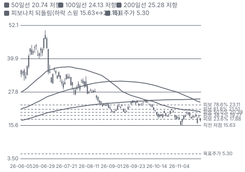

**주봉**

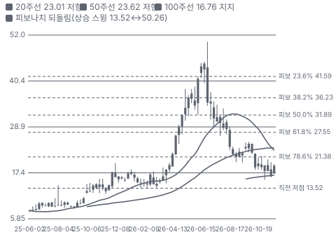

**월봉**

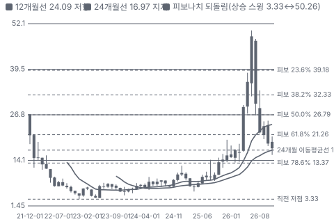

**분기 매출·EPS 실적과 컨센서스**

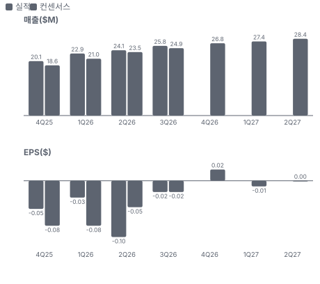

**최근 4개 분기 주가 변화 분석**

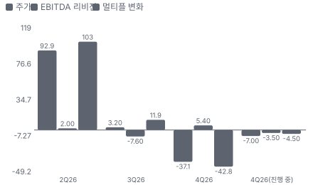

**EPS 리비전**

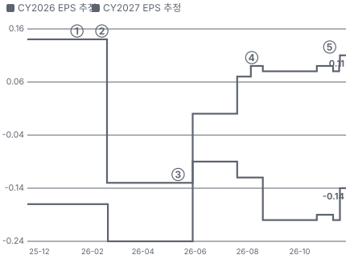

① 26-01-14 Cycuity 인수 완료(\$43.1M) — 하드웨어 보안 검증 추가 · EPS 리비전 +0%
② 26-02-12 4Q25 실적, 다음 날 −2.0% · EPS 리비전 -193%
③ 26-05-12 1Q26 실적, 다음 날 +9.6% · EPS 리비전 +0%
④ 26-08-06 2Q26 실적·ATM 증자 완료 공개, 다음 날 −5.8% · EPS 리비전 -11%
⑤ 26-11-05 3Q26 실적·연간 가이던스 상향, 다음 날 +11.7% · EPS 리비전 +23%

**멀티플 프리미엄(Fwd 1Y EV/EBITDA, 최근 4개 분기말 절대값 — 대상 vs 동종 중앙값)**

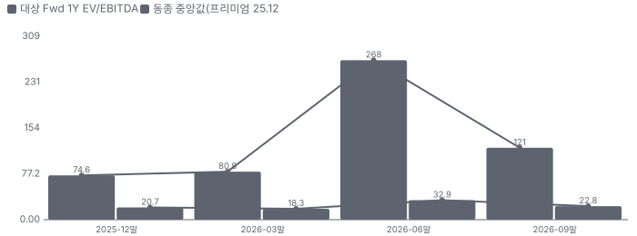

**합리적 멀티플**

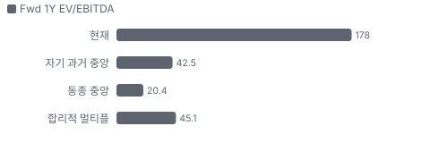

**밸류에이션 주가 시나리오**

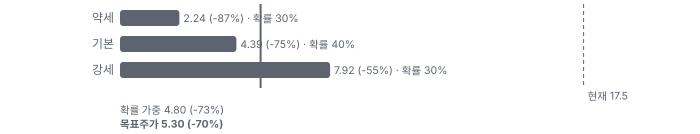

**주가별 업사이드**

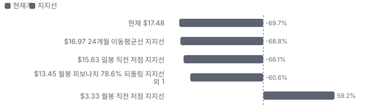
- 제품·서비스 포트폴리오

**고객 믹스(3Q26, 매출 대비)**

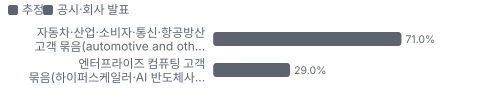

**어닝콜 변화별 주주가치 영향**

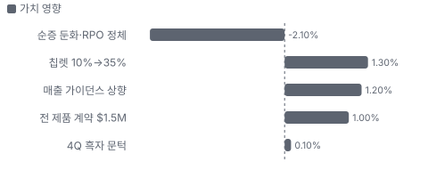

**수주·파이프라인 확실성 사다리**

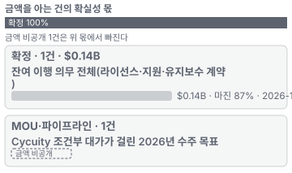

**매출 → 매출총이익 → 영업이익(매출 = 100, 최근 4분기)**

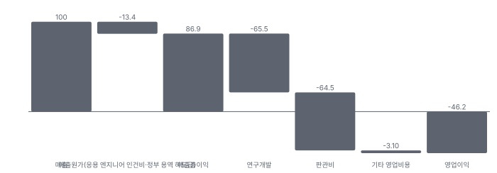

**분기 비용 비중 추이(매출 대비, 공시)**

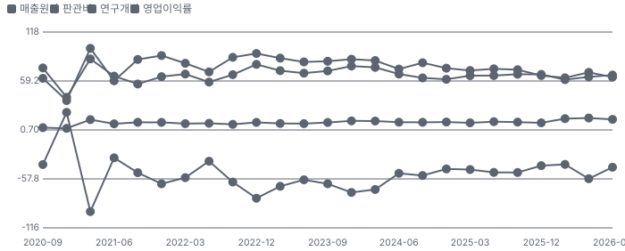

**비용 요인별 매출 대비 비중 1년 변화**

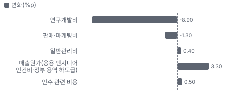

**라이선스·지원·유지보수 BOM 원가 몫**

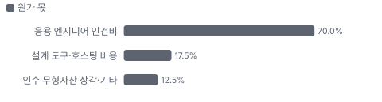

**변동 로열티 BOM 원가 몫**

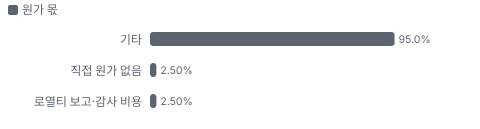

**BOM 항목 가격 +10% 시 OPM 변화**

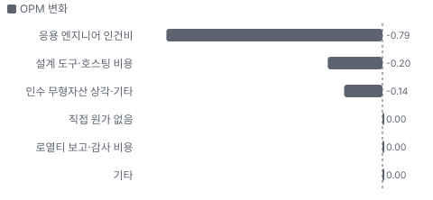

**자산 구성 — 3Q26 분기말 투하자본 \$8.8M**

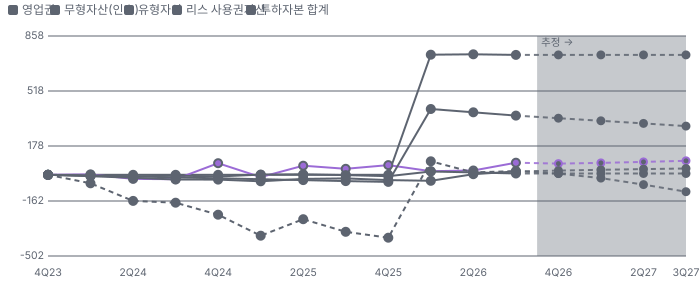

**자산별 변화율 — 최근 12개 분기(4Q23 = 0%) + 다음 4개 분기 추정**

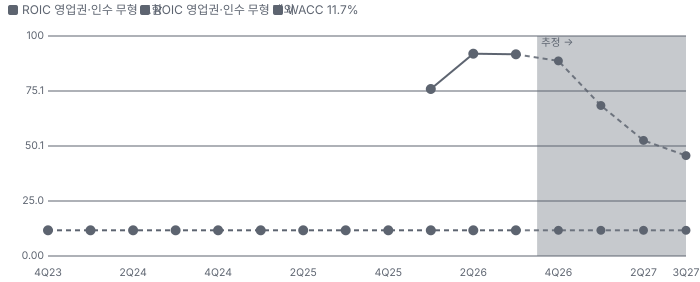

**ROIC 추이 — TTM, 최근 12개 분기 + 다음 4개 분기 추정(컨센서스 NOPAT) · 투하자본이 음수인 분기는 ROIC도 음수(고객 선수금 등 음의 운전자본이 자본을 대신 댄다) · 투하자본이 0 근처라 ROIC가 ±100%를 넘는 분기는 비움**

**매출 증가율의 가격·물량 분해와 8분기 전망(전년 대비)**

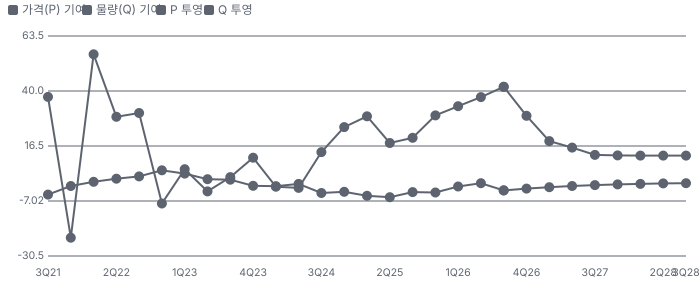

**목표주가 산정 — 기본과 강세 사이(강세 쪽 27%), 도달 확률 약 41%**

**PEG — 성장 대비 멀티플(낮을수록 성장 대비 쌈)**

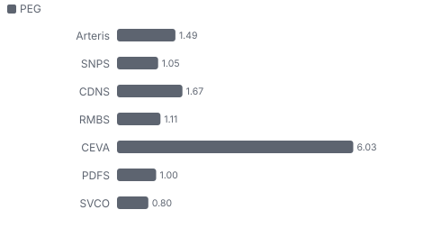

**커뮤니티 언급 수(최근 30일, 채널별)**

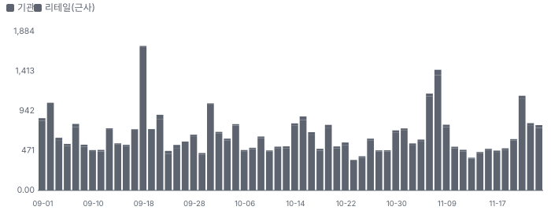

**일별 거래량 분해**

**기관 자금 흐름**

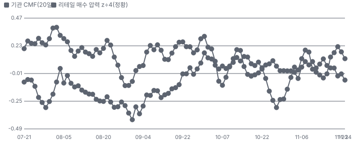

**몬테카를로**

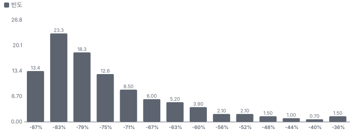

해석: 3,000번 중 2번(0%)에서 가치가 지금 주가 이상이었다. 가정을 흔들어도 지금 주가를 뒷받침하지 못하는 경우가 더 많다. 가운데 값은 0.22배이고, 열 번 중 여덟 번은 0.15~0.41배 사이에 든다.

## 내러티브

> **기업가치를 결정하는 이야기:** Arteris의 값은 ① ACV + 로열티가 분기마다 얼마나 더 쌓이는지 ② 로열티가 매출의 9%에서 얼마나 커지는지 ③ 영업비 증가율을 매출 증가율의 절반으로 묶는 모델이 지켜지는지 ④ 그 과정에서 주식보상과 새 주식이 주주 몫을 얼마나 덜어 가는지로 정해진다. 앞의 셋은 3Q에 확인됐고, 넷째가 지금 가격의 쟁점이다.

> **멀티플·EPS 프리미엄**
> **멀티플:** 완전 희석 기준 Fwd 1Y EV/EBITDA 178.3배, Fwd 2Y 68.1배, Fwd 3Y 45.8배다. 다음 4개 분기 조정 EBITDA 추정이 \$4.9M뿐이라 1년 배수는 크게 나온다 — 3년 뒤 이익으로 재도 동종(Rambus 16.1배·Synopsys 17.5배·PDF Solutions 23.3배·Cadence 30.2배)보다 높다
> **EPS:** FY2027 EPS 추정은 8월 \$0.08에서 11월 \$0.11로 올랐고 FY2026은 −\$0.20에서 −\$0.14로 손실이 줄었다. 추정 인원은 4명이다

### 투자자들은 왜 열광했나

4월 말부터 X에서 'GPU 다음은 CPU와 맞춤 칩'이라는 글이 돌았고, 5월 12일 1Q 실적 다음 날 9.6% 오르며 사상 최고가를 썼다. 3월 말 \$16.44이던 주가는 6월 30일 \$48.59까지 석 달 만에 세 배가 됐다. 회사는 그 사이 평균 \$35.53에 211만 주를 팔아 \$72.0M을 조달했다. 7월 1~2일 이틀 동안 28% 급락했고(원인은 확인하지 못했다 — 같은 날 CEO와 이사의 사전 계획 매도가 신고됐다) 그 뒤 실적이 가이던스를 넘어도 주가는 내렸다.

### 무엇이 기업가치를 바꾸나

> **구조적 체질 변화**
> **변화:** 비GAAP 영업손실이 1년 새 \$3.5M에서 \$1.2M으로 줄었고 4Q 가이던스 중간값은 흑자 문턱이다. 영업비 증가율을 매출 증가율의 절반으로 묶는 것이 회사 모델이다 — 3Q GAAP 영업비는 38% 늘어 매출 증가율 48%의 0.8배였다(인수·일회성 주식보상 포함).
> **증거:** 3Q26 어닝콜(2026-11-05) · 3Q26 10-Q
> **반증:** 2027년 분기 비GAAP 영업손익이 다시 적자

> **고부가 믹스 확장**
> **변화:** 원가가 거의 없는 로열티가 52% 늘어 매출의 8.9%가 됐다. 반대로 Cycuity의 정부 용역(매출의 4.3%)은 하도급비 때문에 매출총이익률을 89.9%에서 86.6%로 끌어내렸다.
> **증거:** 3Q26 10-Q 매출 분해
> **반증:** 매출총이익률 85% 아래

> **기술 혁신**
> **변화:** FlexGen(NoC 배선 구조를 자동으로 짜 주는 Arteris의 신형 IP)·Ncore(여러 프로세서가 캐시를 같이 쓰도록 맞춰 주는 Arteris의 NoC IP) 멀티다이(칩 여러 개를 한 패키지에 넣는 구조) 제품을 내 칩 사이 데이터 이동까지 넓혔다. AMD·Socionext와 함께 개발했다고 회사가 밝혔다 — 제품 출시는 확인됐지만 멀티다이 매출 몫은 공시하지 않는다.
> **증거:** 3Q26 어닝콜(2026-11-05)
> **반증:** 칩렛 설계 비중이 2027년 말에도 10%대에 머문다

> **실행 속도**
> **변화:** 해당 없음(납품이 아니라 사용권 제공 — 영업 주기와 구축 기간 수치 미공시). 계약 뒤 매출은 설계 기간에 걸쳐 나눠 잡히고, 잔여 이행 의무의 53%가 12개월 안에 인식된다. **납품 리드타임 미확인.** 피어 비교 미확인. 이전 대비 미확인.
> **증거:** 3Q26 10-Q
> **반증:** 12개월 안 인식 몫이 45% 아래

> **M&A**
> **변화:** 2026년 1월 Cycuity를 \$43.1M에 샀다(현금 \$15.1M·주식 \$19.0M·조건부 대가). 영업권 \$31.0M과 무형자산 \$18.1M이 생겼고, 3Q 매출 증가분 \$8.4M 가운데 얼마가 Cycuity 몫인지는 공시하지 않는다 — 전문 서비스 \$1.1M만 확인된다. 회사는 증자 자금으로 추가 소규모 인수를 하겠다고 했다.
> **증거:** 3Q26 10-Q 사업결합 주석 · 2Q26 어닝콜
> **반증:** 영업권 손상 또는 조건부 대가 미지급

> **정책·입법 연관성**
> **재정정책:** 해당 없음(미국 정부 보안 검증 용역이 매출의 4.3%뿐이고 세출 항목과의 연결은 대조하지 못했다) 3Q26 10-Q
> **행정명령:** 해당 없음(수출 통제는 위험 요인으로만 기재 — 중국 매출 24.5%에 대한 영향 수치 미공시) FY2025 10-K 위험 요인
> **연관입법:** 해당 없음 — 새 법안과의 연결은 확인하지 못했다 FY2025 10-K

> **고객의 지출 예산**
> **변화:** 수수료는 고객의 칩 설계 연구개발비에서, 로열티는 고객 칩의 제조 원가에서 나온다. 고객의 데이터센터 설비투자가 아니라 새 칩을 몇 개 설계하고 몇 개 파느냐를 따라간다.
> **사업별 예산:** **매출의 87%**: 라이선스·지원·유지보수 — 고객 OPEX(고객의 칩 설계 연구개발비(설계 IP·도구 구매)) · 동인: 새 칩·칩렛 설계 착수 건수
**매출의 9%**: 변동 로열티 — 고객 OPEX(고객 칩의 제조 원가(출하량 연동 사용료)) · 동인: Arteris IP가 든 칩의 출하량과 판매가
**매출의 4%**: 전문 서비스·기타 — 고객 OPEX(미국 정부의 반도체 보안 검증 용역비) · 동인: 국방 신뢰 반도체 프로그램 과제
> **증거:** FY2025 10-K 사업 설명·매출 인식 정책
> **반증:** 고객 설계 착수 감소

### 내러티브 근거

> AI 맞춤 칩과 칩렛이 늘수록 칩 안 데이터 이동 IP가 더 필요하다는 이야기는 애널리스트 대부분이 받아들였고, 2분기에 주가가 세 배가 됐다. 그 뒤 증자와 내부자 매도, 순증 둔화가 겹치며 64% 내렸다 — 지금 남은 질문은 성장이 아니라 주식보상을 뺀 뒤에도 이익이 남느냐다. 동종 대비 멀티플 차이 +775% 중 회사 고유 몫은 +295%다. 단계는 컨센서스, 쏠림은 낮음이다.

> **AI 맞춤 칩·칩렛 설계 증가** · 유지
> **논리:** 하이퍼스케일러와 반도체사가 추론용 맞춤 칩을 직접 설계하면서 칩 안 데이터 이동 IP를 사서 쓴다. 칩렛은 조각마다 프로젝트 수수료와 로열티가 붙는다
> **숫자:** 엔터프라이즈 컴퓨팅이 ACV + 로열티의 29%, 칩렛이 설계 착수의 약 10% → 2~3년 뒤 30~35%(회사 전망)
> **반증:** 분기 설계 착수가 2개 분기 연속 전년보다 감소(3Q 22건, 전년 23건)
> **출처:** 3Q26 어닝콜(2026-11-05)

> **로열티 누적** · 강화
> **논리:** 과거에 따낸 설계가 양산에 들어가며 로열티가 매출보다 빨리 는다
> **숫자:** 최근 12개월 로열티 \$9.4M(+71%), 3Q 변동 로열티 \$2.3M(+52%) — 아직 매출의 9%
> **반증:** 분기 로열티가 전년 대비 감소
> **출처:** 3Q26 10-Q https://www.sec.gov/Archives/edgar/data/1667011/000162828026071154/aip-20260930.htm

> **영업 레버리지** · 강화
> **논리:** 매출총이익률이 87%라 영업비 증가율을 매출 증가율의 절반으로 묶으면 이익률이 빠르게 오른다
> **숫자:** 비GAAP 영업손실 3Q25 \$3.5M → 3Q26 \$1.2M, 4Q 가이던스 −\$0.9M~+\$1.1M
> **반증:** 4Q 비GAAP 영업손실이 가이던스 하단 \$0.9M보다 크다
> **출처:** 3Q26 어닝콜(2026-11-05)

> **보안 검증 교차 판매** · 유지
> **논리:** 인수한 Cycuity의 보안 검증 제품을 기존 NoC(네트워크 온 칩 — 칩 안의 연산·메모리 블록 사이로 데이터를 나르는 배선망 설계) 고객에게 함께 판다
> **숫자:** 전 제품 계약 약 \$1.4~1.5M(NoC만 약 \$1M), Arm이 사용 확대, 전문 서비스 매출 3Q \$1.1M
> **반증:** Cycuity 조건부 대가(최대 \$12.0M)가 수주 목표 미달로 지급되지 않는다
> **출처:** 3Q26 어닝콜(2026-11-05)

> **반대 — 주식보상과 희석** · 강화
> **논리:** 조정 이익은 흑자 문턱이지만 주식보상을 넣으면 큰 적자다. 2026년에 ATM 증자와 인수로 주식이 늘었고 CEO는 계속 판다
> **숫자:** 주식보상 최근 4개 분기 \$25.7M(매출의 27.6%), GAAP 영업손실 \$43.0M, ATM 211만 주(평균 \$35.53) + 인수 110만 주, 잠재 주식 613만 주(12.3%)
> **반증:** 주식보상이 매출의 20% 아래로 2개 분기 연속
> **출처:** 3Q26 10-Q https://www.sec.gov/Archives/edgar/data/1667011/000162828026071154/aip-20260930.htm

> **반대 — 순증 둔화** · 강화
> **논리:** 계약 잔고가 한 분기 멈췄다. 인수 효과가 빠지는 2027년 성장률은 17%로 내려간다
> **숫자:** 잔여 이행 의무 2Q \$135M → 3Q \$135.5M, ACV + 로열티 순증 +\$4.3M, 매출 성장 2026년 +41% → 2027년 컨센서스 +16.5%
> **반증:** 4Q 잔여 이행 의무 \$140M 이상
> **출처:** 3Q26 10-Q https://www.sec.gov/Archives/edgar/data/1667011/000162828026071154/aip-20260930.htm

### 투자 포인트

> **성장은 확인됐고 가이던스는 또 올랐다**
> **명제:** 3Q 매출 \$25.8M은 가이던스 상단 \$25M을 넘었고 연간 매출 가이던스 중간값이 \$2.5M 올랐다
> **숫자:** 3Q26 매출 +48%, ACV + 로열티 \$103.8M(+39%), 최근 12개월 로열티 \$9.4M(+71%)
> **시장과 다른 점:** 컨센서스 FY2027 매출 \$116M은 올해보다 16.5% 많다 — ACV + 로열티가 39% 느는 회사에 견주면 낮아 보이지만, 3Q 잔고 정체를 감안하면 낮다고 단정할 수 없다
> **증명:** 4Q ACV + 로열티 \$103~107M, 잔여 이행 의무 \$140M 이상
> **출처:** 3Q26 실적 보도자료(8-K, 2026-11-05)

> **조정 흑자 문턱과 GAAP 적자 사이가 \$32M이다**
> **명제:** 최근 4개 분기 조정 영업손실은 \$10.5M, GAAP 영업손실은 \$43.0M이다 — 차이의 대부분이 주식보상 \$25.7M이다
> **숫자:** 주식보상 매출의 27.6%, 3Q만 보면 36%(일회성 \$2.3M 포함), 잠재 주식 613만 주
> **시장과 다른 점:** 애널리스트 8명 가운데 7명이 강력 매수이고 목표가 평균은 \$33이다 — 조정 이익 기준이다. 제 판단은 주식보상을 비용으로 넣은 이익이 보일 때까지 배수 상향을 넣지 않는다
> **증명:** 분기 주식보상 금액과 매출 대비 비중(10-Q 현금흐름표)
> **출처:** 3Q26 10-Q

> **회사와 CEO가 판 가격이 지금보다 높다**
> **명제:** 회사는 평균 \$35.53에 211만 주를 팔았고 지금 주가는 그 절반이다
> **숫자:** ATM 순조달 \$72.0M, 현금·투자 \$120.3M, CEO 9~11월 매달 10만 주 계획 매도
> **시장과 다른 점:** 증자로 쌓은 순현금 \$111M(시가총액의 13%)은 하방을 받치지만, 내부자 장내 매수가 0건이라 '싸다'는 신호는 회사 안에서 나오지 않았다
> **증명:** Form 4의 계획 매도 중단 또는 장내 매수, 자사주 매입 발표
> **출처:** 3Q26 10-Q · Form 4

### 모멘텀 생성·소멸 타임라인

**카탈리스트 달력 — 지난 사건의 주가 반응과 앞으로 확인할 숫자**
| 날짜 | 상태 | 구분 | 사건 | 반응·확인 | 결과에 따라 |
|---|---|---|---|---|---|
| 2026-05-12 | 완료 | 생성 | 1Q26 실적 — 사상 최고가 경신의 계기 | +9.6% |  |
| 2026-07-02 | 완료 | 소멸 | 이틀 동안 급락 — 원인 미확인, 같은 날 내부자 계획 매도 신고 | −20.0% |  |
| 2026-08-06 | 완료 | 소멸 | 2Q26 실적 — ATM 증자 \$75M 완료와 CFO 교체 공개 | −5.8% |  |
| 2026-11-05 | 완료 | 확인 | 3Q26 실적 — 가이던스 상향, 4Q 조정 흑자 문턱 | +11.7% |  |
| 2026-11-20 | 완료 | 매크로 | 시장 급락 — 원인 미확인 | −12.7% |  |
| 2026-12-16 | 예정 | 확인 | Northland Growth Conference 경영진 발표(온라인) | 2027년 성장률과 주식보상에 대한 새 CFO 발언 | 2027년 숫자 틀이 나오면 추정 범위가 좁아진다 |
| 2027-02-11(예상) | 예정 | 확인 | 4Q26·FY2026 실적과 2027년 가이던스 | ACV + 로열티 \$103M 이상, 잔여 이행 의무 \$140M 이상, 비GAAP 영업손익 0 이상, 2027년 매출 가이던스 중간 \$116M 이상 | 모두 넘으면 강세 쪽, 잔고가 또 멈추면 약세 쪽 |
| 2027-03-31 | 예정 | 확인 | Cycuity 조건부 대가 지급 기한 | 최대 \$12.0M 가운데 지급액 — 2026년 보안 제품 수주 목표 달성 여부 | 전액 지급이면 교차 판매 확인, 미지급이면 인수 논리 약화 |

### 언제 사서 언제 팔아야 할까?

**가격·조건 틀 — 가격은 밸류에이션(약세·기본·강세·목표주가)과 차트 지지 구간에서, 조건은 이벤트에서**
| 구간 | 가격 | 목표주가까지 | 약세까지 | 조건·근거 |
|---|---|---|---|---|
| 관찰 구간 | \$16.97~\$16.97 | -69% | -87% | 11월 5일 종가 \$15.93과 11월 20일 종가 \$16.50 부근은 실적 직전·시장 급락 때 두 번 받친 자리다 |
| 확인 뒤 | 지금 \$17.48 이상에서 조건 확인 | -70% | -87% | 4Q 실적에서 잔여 이행 의무 \$140M 이상과 비GAAP 영업손익 0 이상, 2027년 매출 가이던스 \$116M 이상 |
| 무효화 | 약세 시나리오 \$2.24 | - | -87% | 잔여 이행 의무가 전 분기보다 줄거나 4Q ACV + 로열티가 \$103M 미달, 또는 약세 시나리오 가격 이탈 |

최근 4거래일 동안 −12.7%·+16.4%·−9.0%로 움직였다 — 하루 변동이 큰 소형주라 발표 직후 추격은 경계 가격·조건 틀이며 매매·비중 지시가 아니다(투자 권유 아님).

## 포트폴리오

| 제품·서비스 | 구분 | 무엇 | 쓰는 곳 | 돈 버는 방식 | Mix | Mix 변화(전년 대비) |
|---|---|---|---|---|---|---|
| 라이선스·지원·유지보수 | 서비스 | NoC 배선망 IP, SoC(시스템 온 칩 — 여러 기능 블록을 한 칩에 넣은 반도체) 조립 자동화 소프트웨어, 보안 검증 소프트웨어의 사용권과 기술 지원 | AI 추론용 맞춤 칩·칩렛, 자율주행·콕핏 칩, 로봇·산업용 칩 설계 | 3Q26 매출의 87% — 설계 기간에 걸쳐 나눠 인식 | 87% | 미확인 |
| 변동 로열티 | 서비스 | Arteris IP가 든 고객 칩이 팔릴 때 받는 사용료 | 양산 중인 자동차·가전·데이터센터 칩 | 3Q26 매출의 9%, 최근 12개월 \$9.4M(+71%) | 9% | 미확인 |
| 전문 서비스·기타 | 서비스 | 미국 정부 대상 하드웨어 보안 검증 용역(Cycuity) | 국방용 반도체의 제3자 IP 보안 점검 | 3Q26 매출의 4% — 2026년에 새로 생김 | 4% | 미확인 |

## 고객

> **3Q26 최대 고객 자동차·산업·소비자·통신·항공방산 고객 묶음(automotive and other verticals) 71%, 상위 3곳 100%, 집중도 집중.** 공시·회사 발표로 확인한 몫은 매출의 29%이고, 나머지 고객 몫은 추정이거나 미분해다. 2026년 9개월 동안 매출의 10%를 넘는 고객은 없다(2025년에는 1곳이 13%). 고객 이름별 몫은 공시하지 않는다 — 회사가 밝힌 것은 엔터프라이즈 컴퓨팅이 ACV + 로열티의 평균 29%라는 것과 지역 구성(FY2025 미국 40%·중국 24.5%·한국 12%)이다.

**고객별 매출 몫(3Q26)**
| 고객 | 몫 | 변화 | 근거 |
|---|---|---|---|
| 자동차·산업·소비자·통신·항공방산 고객 묶음(automotive and other verticals) | 71% | 미확인 | 추정 |
| 엔터프라이즈 컴퓨팅 고객 묶음(하이퍼스케일러·AI 반도체사, enterprise computing vertical) | 29% | 미확인 | 회사 발표 |
| Cycuity 정부 계약 용역(하드웨어 보안 검증, U.S. government contracts) | 미확인 | 미확인 | 공시 |

> **자동차·산업·소비자·통신·항공방산 고객 묶음(automotive and other verticals)** · 추정
> **사는 것:** 자율주행·콕핏 칩, 로봇·드론 칩, 마이크로컨트롤러의 NoC IP와 통합 소프트웨어
> **추정 근거:** 분야별 몫 미공시

> **엔터프라이즈 컴퓨팅 고객 묶음(하이퍼스케일러·AI 반도체사, enterprise computing vertical)** · 회사 발표
> **사는 것:** AI 추론용 맞춤 칩·칩렛의 NoC IP(FlexGen·Ncore)
> **추정 근거:** 개별 고객명·몫 미공시 — 3Q 최대 계약은 상위 하이퍼스케일러(이름 미공개)

> **Cycuity 정부 계약 용역(하드웨어 보안 검증, U.S. government contracts)** · 공시
> **사는 것:** 하드웨어 보안 검증 용역(일부는 하도급)
> **추정 근거:** Cycuity 인수로 2026년에 새로 생긴 매출

## 수주·파이프라인

> **2026-09-30 기준 2건.** 확정 \$0.14B. 공시 잔여 이행 의무 \$0.14B. 서로 겹치는 항목은 합계에서 뺐다.

**수주 목록**
| 상태 | 계약 | 계약 총액 | 진척 | 기간 | 비고 |
|---|---|---|---|---|---|
| 확정 | 잔여 이행 의무 전체(라이선스·지원·유지보수 계약) | \$0.14B | - | 2026-10 → 2029-12 | 취소 불가 \$131.3M + 취소 가능 약 \$4.2M(계산). 끝 시점은 계약 기간 미공시라 어림 |
| 파이프라인 | Cycuity 조건부 대가가 걸린 2026년 수주 목표 | 금액 비공개 | - | - | (다른 항목과 겹칠 수 있어 합계에서 뺌) |

**실행 속도와 방해 요인**
| 항목 | 상태 | 실행 속도 | 방해 요인 |
|---|---|---|---|
| 잔여 이행 의무 전체(라이선스·지원·유지보수 계약) | 확정 | 12개월 안 \$69.0M 인식(취소 불가 \$131.3M의 53%) | 고객 설계 일정 지연·취소 · 취소 가능 계약 약 \$4.2M 포함 |
| Cycuity 조건부 대가가 걸린 2026년 수주 목표 | 파이프라인 | 2026년 말까지 수주 목표 달성 때 최대 \$12.0M 지급(2027년 3월 말까지) | 목표 수치 미공개 |

## 마진 구조

> **GPM 86.6%, OPM -43.9%.** 3Q25 대비 GPM -3.2%p, OPM +6.2%p. 변동비는 매출의 29%이고, 매출이 10% 늘면 OPM은 +10.5%p 움직인다. 3Q26 매출총이익률은 86.6%(전년 89.9%)로 내려갔다 — Cycuity의 정부 용역 하도급비가 매출원가로 들어온 탓이다. GAAP 영업손실은 매출의 43.9%(전년 50.1%)다. 영업비의 큰 몫이 주식보상으로, 3Q 주식보상 \$9.2M은 매출의 36%였다.

> **매출 100 중 매출원가 13.1, 매출총이익 86.9(최근 4분기, 공시).** 매출원가 요인 중 매출원가(응용 엔지니어 인건비·정부 용역 하도급)이 매출의 13.4%로 가장 무겁고, 단가가 +10% 오르면 GPM이 -1.34%p 움직인다. 분기 회귀로 매출 1이 늘 때 매출원가는 0.16 늘고, 매출원가의 고정비 몫은 -56%다.

**비용 요인 강도 — 비중·추세·충격(+10%)·탄력**
| 비용 | 구분 | 매출 대비 | 1년 변화 | 마진 기여 | 충격 시 마진 | 매출 탄력 | 고정비 몫 |
|---|---|---|---|---|---|---|---|
| 매출원가(응용 엔지니어 인건비·정부 용역 하도급) | 매출원가 요인 | 13.4% | +3.3%p | -3.3%p | -1.34%p | 미확인 | 70% |
| 연구개발 | 공시 항목 | 65.5% | -7.7%p | +7.7%p | 미확인 | 0.55 | 25% |
| 판관비 | 공시 항목 | 64.5% | -0.5%p | +0.5%p | 미확인 | 0.60 | 9% |
| 매출원가 | 공시 항목 | 13.1% | +3.1%p | -3.1%p | -1.31%p | 0.16 | -56% |
| 기타 영업비용 | 공시 항목 | 3.1% | 미확인 | 미확인 | 미확인 | 0.07 | -100% |

매출 탄력 = 분기 비용을 매출에 회귀한 기울기(매출 1당 변동비), 고정비 몫 = 절편 ÷ 평균 비용. 표본이 8분기 미만이면 미확인. 매출원가 요인 비중은 margin 재료의 추정이 섞여 있고, 공시 매출원가와의 차이는 '기타 매출원가'로 둔다.

**GPM에서 OPM까지(GAAP — 10-Q 3개월 손익, 아래는 최근 4개 분기)**
| 기간 | GPM | 연구개발 | 판관비 | 기타 | OPM |
|---|---|---|---|---|---|
| 3Q25 | 89.9% | 72.7% | 67.3% | 0.0% | -50.1% |
| 3Q26 | 86.6% | 63.8% | 66.3% | 0.5% | -43.9% |
| 2025-12 | 90.8% | - | - | - | -42.0% |
| 2026-03 | 85.8% | - | - | - | -40.5% |
| 2026-06 | 85.1% | - | - | - | -57.6% |
| 2026-09 | 86.6% | - | - | - | -43.9% |

**비용을 움직이는 요인**
| 비용 | 요인 |
|---|---|
| 연구개발비(연구개발) | 엔지니어 인건비·주식보상(프랑스 150명·미국 96명, 2025년 말), Cycuity 인력 · 근거 공시 |
| 판매·마케팅비(판관비) | 영업 인력·수수료, 프랑스 주식 귀속 급여세 · 근거 공시 |
| 일반관리비(판관비) | 인력·주식보상(3Q 일회성 조건 변경 \$1.5M 포함) · 근거 공시 |
| 매출원가(응용 엔지니어 인건비·정부 용역 하도급, 매출원가) | 응용 엔지니어 인원, Cycuity 정부 계약 하도급 · 근거 공시 |
| 인수 관련 비용(기타) | Cycuity 통합 · 근거 공시 |

**라이선스·지원·유지보수 BOM — 매출의 87%, GPM 87%(추정 — 전사 매출총이익률(매출 유형별 원가 미공시)), 항목 가격 +10% 시**
| 항목 | 원가 몫 | 전가 | 제품 GPM | OPM |
|---|---|---|---|---|
| 응용 엔지니어 인건비 | 60~80% | 미확인 | -0.9%p | -0.79%p |
| 설계 도구·호스팅 비용 | 10~25% | 미확인 | -0.2%p | -0.20%p |
| 인수 무형자산 상각·기타 | 5~20% | 미확인 | -0.2%p | -0.14%p |

**변동 로열티 BOM — 매출의 9%, GPM 100%(추정 — 로열티에는 직접 원가가 거의 없다), 항목 가격 +10% 시**
| 항목 | 원가 몫 | 전가 | 제품 GPM | OPM |
|---|---|---|---|---|
| 기타 | 90~100% | 미확인 | +0.0%p | +0.00%p |
| 직접 원가 없음 | 0~5% | 미확인 | +0.0%p | +0.00%p |
| 로열티 보고·감사 비용 | 0~5% | 미확인 | +0.0%p | +0.00%p |

판매가 전가를 모르는 항목은 전가 0%로 계산했다.

**BOM 항목 가격을 움직이는 것**
| 항목 | 요인 |
|---|---|
| 응용 엔지니어 인건비 | 고객 설계 지원 인력 — 계약 수수료에 묶여 있어 따로 전가하지 않는다 · 근거 추정 |
| 설계 도구·호스팅 비용 | 지원에 쓰는 설계 소프트웨어와 데이터센터 임차 · 근거 추정 |
| 인수 무형자산 상각·기타 | Cycuity 기술 자산 상각 · 근거 추정 |
| 직접 원가 없음 | 고객 칩 출하량·판매가에 연동 · 근거 추정 |
| 로열티 보고·감사 비용 | 고객 보고 검증 · 근거 추정 |
| 기타 | 배분 원가 없음 · 근거 추정 |

물가 지수를 붙이지 못한 매출원가 항목은 매출원가(응용 엔지니어 인건비·정부 용역 하도급)다(미연결).

## 자산 구성

> **3Q26 분기말 투하자본 \$8.8M** — 영업권 398%, 무형자산(인수) 204%. 최근 12개 분기(4Q23 → 3Q26) 가장 크게 늘어난 자산은 영업권(+741%), 투하자본 합계 +23%. 3Q27 추정 투하자본 −\$0.3M(-104%, 컨센서스 매출과 회전 일수·CAPEX 강도 유지 가정). 연율 감가 비율(순액 기준)은 직전 4분기 85.49% → 최근 4분기 108.21%.

**자산·운전자본 항목별 분기말 잔액 — 최근 12개 분기와 다음 4개 분기 추정**
| 항목 | 4Q23 | 3Q25 | 3Q26(최근) | 3Q27 추정 | 12개 분기 변화 | 다음 4개 분기 변화 |
|---|---|---|---|---|---|---|
| 매출채권 | \$12.0M | \$16.5M | \$21.0M | \$22.4M | +75% | +7% |
| 선급·기타 유동자산 | \$5.3M | \$5.6M | \$9.0M | \$11.3M | +72% | +25% |
| 매입채무 | \$0.2M | \$0.5M | \$1.5M | \$0.9M | +714% | -39% |
| 미지급비용 | 미확인 | \$17.2M | \$31.2M | \$33.9M | 비교 불가 | +9% |
| 선수수익(계약부채) | \$31.5M | \$46.2M | \$63.5M | \$72.8M | +101% | +15% |
| 유형자산 | \$5.7M | \$4.5M | \$6.9M | \$8.0M | +21% | +15% |
| 리스 사용권자산 | \$4.3M | \$4.2M | \$4.6M | \$4.6M | +8% | +0% |
| 영업권 | \$4.2M | \$4.2M | \$35.2M | \$35.2M | +741% | +0% |
| 무형자산(인수) | \$3.9M | \$2.4M | \$18.0M | \$15.5M | +366% | -14% |

**자산 추정 동인 — 최근 4개 분기 평균(재무상태표 동인 모형)**
| 동인 | 값 | 곱하는 기준 |
|---|---|---|
| 매출채권 | 69일 | 매출 |
| 선급·기타 유동자산 | 35일 | 매출 |
| 매입채무 | 21일 | 매출원가 |
| 미지급비용 | 105일 | 매출 |
| 선수수익(계약부채) | 225일 | 매출 |
| CAPEX 강도 | 1.5% | 매출(최근 4개 분기 합) |
| 분기 감가율 | 14.96% | 기초 유형자산 순액(무형 상각 제외 감가상각) |
| 매출원가율 | 13.1% | 매출(최근 4개 분기) |
| 영업권·리스 사용권·기타 | 유지 | 인수·새 리스는 공시 전 모름 |
| 인수 무형자산 | 분기 \$0.6M 상각 | 최근 4개 분기 평균 상각 |

**추정 방법:** 증권사 3표 모델(손익·재무상태표·현금흐름)의 재무상태표 동인 방식이다. 운전자본은 항목별 회전 일수(매출채권·선급·미지급·선수는 매출, 재고·매입채무는 매출원가 기준)를 최근 4개 분기 평균으로 두고 컨센서스 매출에 곱한다. 유형자산은 기초 + CAPEX − 감가상각으로 굴린다(Koller·Goedhart·Wessels 『Valuation』 재무상태표 추정). 매출 경로는 ROIC 절의 컨센서스와 같다.

**유형·무형자산 항목별 가치(2025-12-31 vs 2024-12-31)**
| 구분 | 항목 | 총액 2025-12-31 | 누적상각 | 순액 | 총액 2024-12-31 | 총액 1년 변화 | 공시 내용연수 |
|---|---|---|---|---|---|---|---|
| 유형 | 유형자산 합계(항목 미분해) | \$10.1M | 총계만 공시 | 총계만 공시 | \$9.1M | +11.7% | 미확인 |
| 영업권 | 영업권 | \$4.2M | \$0.0M | \$4.2M | \$4.2M | +0.0% | 비상각 |
| 무형 | 무형자산 합계(항목 미분해) | \$5.6M | \$3.5M | \$2.2M | \$5.6M | +0.0% | 미확인 |
| 유형 합계 | 유형자산 | \$10.1M | \$6.2M | \$3.9M | \$9.1M | +11.7% | 경과율 62%(상각 대상 기준) |

**내용연수 산식(상각 대상 유형자산 = 총액 − 토지 − 건설중)**
| 기준일 | 연 감가상각 | 상각 대상 총액 | 평균 내용연수 | 경과 연수 | 잔여 연수 | 경과율 |
|---|---|---|---|---|---|---|
| 2025-12-31 | \$2.5M | \$10.1M | 4.0년 | 2.5년 | 1.5년 | 62% |
| 2024-12-31 | \$2.5M | \$9.1M | 3.6년 | 2.0년 | 1.6년 | 56% |

산식 평균 내용연수는 4.0년. 1년 전 3.6년 → 지금 4.0년.

**분기 감가 비율(감가상각 ÷ 평균 유형자산 순액)**
| 분기 | 감가상각 | 평균 유형자산(순액) | 분기 비율 | 연율 | 연율의 역수 |
|---|---|---|---|---|---|
| 4Q24 | \$0.9M | \$4.0M | 21.99% | 87.95% | 1.1년 |
| 1Q25 | \$0.8M | \$3.7M | 22.65% | 90.59% | 1.1년 |
| 2Q25 | \$0.8M | \$3.9M | 21.88% | 87.52% | 1.1년 |
| 3Q25 | \$0.8M | \$4.4M | 19.27% | 77.07% | 1.3년 |
| 4Q25 | \$0.8M | \$4.2M | 20.26% | 81.03% | 1.2년 |
| 1Q26 | \$1.3M | \$3.7M | 36.06% | 144.23% | 0.7년 |
| 2Q26 | \$1.5M | \$4.8M | 31.69% | 126.75% | 0.8년 |
| 3Q26 | \$1.5M | \$6.5M | 22.80% | 91.19% | 1.1년 |

감가상각 기준: 손익계산서 감가상각·상각비(SEC 공시 데이터, 4분기 = 연간 − 1~3분기).

최근 4분기 연율 감가 비율 108.21%, 직전 4분기 85.49%(+27%) — 경고 문턱(-10%) 안이다.

미공시·미분해: 유형자산 항목별 총액·내용연수(10-K 주석에서 모델이 채움) · 무형자산 항목(10-K 주석에서 모델이 채움) — 이 칸은 비우고 나머지로 계산했다.

### 해석 — 자산이 어디에 쌓이고 있나

- 같은 기간 4개 분기 매출은 +70% — 매출보다 빨리 늘어난 자산: 영업권 +741%, 무형자산(인수) +366%. 이 자산의 회전율이 떨어지면 ROIC를 희석한다.
- 다음 4개 분기 CAPEX \$1.7M vs 감가상각 \$4.4M(최근 4개 분기 CAPEX 강도·감가율 유지) — 유형자산 3Q26 \$6.9M → 3Q27 \$8.0M. 투자가 감가보다 작아 자산이 줄어드는 국면이다.
- 감가 비율이 올라갔다 — 이익을 보수적으로 잡는 쪽이다(내용연수 단축·짧은 수명 자산 증가).

## ROIC

**ROIC 추이(TTM)와 다음 4개 분기 추정 — NOPAT ÷ 평균 투하자본(이번 분기말·4개 분기 전)**
| 분기 | 구분 | TTM 매출 | TTM NOPAT | NOPAT 마진 | 평균 투하자본 | ROIC 포함 | ROIC 제외 |
|---|---|---|---|---|---|---|---|
| 4Q23 | 실적 | \$53.7M | −\$26.9M | -50.2% | \$3.9M | 미확인 | 미확인 |
| 1Q24 | 실적 | \$53.5M | −\$27.2M | -50.9% | \$3.0M | 미확인 | 미확인 |
| 2Q24 | 실적 | \$53.3M | −\$26.3M | -49.3% | −\$0.3M | 미확인 | 미확인 |
| 3Q24 | 실적 | \$54.7M | −\$25.8M | -47.2% | −\$0.4M | 미확인 | 미확인 |
| 4Q24 | 실적 | \$57.7M | −\$24.0M | -41.7% | −\$1.7M | 미확인 | 미확인 |
| 1Q25 | 실적 | \$61.3M | −\$22.9M | -37.4% | −\$8.3M | 미확인 | 미확인 |
| 2Q25 | 실적 | \$63.2M | −\$23.5M | -37.2% | −\$8.5M | 미확인 | 미확인 |
| 3Q25 | 실적 | \$65.9M | −\$24.1M | -36.5% | −\$11.7M | 미확인 | 미확인 |
| 4Q25 | 실적 | \$70.6M | −\$25.2M | -35.7% | −\$15.7M | 미확인 | 미확인 |
| 1Q26 | 실적 | \$77.0M | −\$26.0M | -33.8% | −\$3.3M | 미확인 | 76.0% |
| 2Q26 | 실적 | \$84.6M | −\$30.0M | -35.4% | −\$2.2M | 미확인 | 92.1% |
| 3Q26 | 실적 | \$93.0M | −\$31.7M | -34.1% | −\$4.7M | 미확인 | 91.8% |
| 4Q26 | 추정 | \$99.6M | −\$31.9M | -32.1% | −\$6.5M | 미확인 | 88.8% |
| 1Q27 | 추정 | \$104.1M | −\$30.0M | -28.9% | \$9.5M | 미확인 | 68.5% |
| 2Q27 | 추정 | \$108.3M | −\$24.8M | -22.9% | \$5.5M | 미확인 | 52.6% |
| 3Q27 | 추정 | \$112.1M | −\$21.8M | -19.4% | \$4.3M | 미확인 | 45.7% |

**다음 4개 분기 NOPAT — 컨센서스(세율 21%, 리스 이자 별도)**
| 분기 | 매출 | EBITA 마진 | EBITA | NOPAT(분기) | 근거 |
|---|---|---|---|---|---|
| 4Q26 | \$26.8M | -32.1% | −\$8.6M | −\$6.8M | 컨센서스 매출 × EBIT 마진 FY2026(조정 − 주식보상 24.0%) |
| 1Q27 | \$27.4M | -22.7% | −\$6.2M | −\$4.9M | 컨센서스 매출 × EBIT 마진 FY2027(조정 − 주식보상 24.0%) |
| 2Q27 | \$28.4M | -22.7% | −\$6.4M | −\$5.1M | 컨센서스 매출 × EBIT 마진 FY2027(조정 − 주식보상 24.0%) |
| 3Q27 | \$29.5M | -22.7% | −\$6.7M | −\$5.3M | 컨센서스 매출 × EBIT 마진 FY2027(조정 − 주식보상 24.0%) |

**추정 방법:** NOPAT은 컨센서스(분기 매출 추정 × 회계연도 EBIT 마진 추정)로 잡고, 조정(비 GAAP) 마진이면 주식보상 몫을 빼서 과거 실적과 같은 기준(영업이익 + 인수 무형 상각)으로 맞췄다. 이미 발표했지만 분기 보고서(10-Q)가 아직 없는 분기는 발표 실적을 쓴다. 투하자본은 자산 구성 절의 재무상태표 동인으로 굴렸다. ROIC는 4개 분기 NOPAT을 이번 분기말과 4개 분기 전 투하자본의 평균으로 나눈다 — 추정 분기의 ROIC에는 이미 나온 실적 분기가 섞여 있다.

**투하자본 항목별 회전율과 ROIC 기여(TTM 3Q26, 평균 잔액)**
| 항목 | 투하자본 | 매출 1달러당 자본 | 회전율(매출 ÷ 항목) | 자본 몫 | 이 항목을 빼면 ROIC |
|---|---|---|---|---|---|
| 운전자본 | −\$54.1M | -0.58 | 음수(자금 원천) | 미확인 | -66.7% |
| 유형자산 | \$5.7M | 0.06 | 16.30회 | 미확인 | 미확인 |
| 리스 사용권자산 | \$4.4M | 0.05 | 21.06회 | 미확인 | 미확인 |
| 영업권 | \$19.7M | 0.21 | 4.73회 | 미확인 | 미확인 |
| 무형자산(인수) | \$10.2M | 0.11 | 9.14회 | 미확인 | 미확인 |
| 기타 영업자산 | \$9.4M | 0.10 | 9.84회 | 미확인 | 미확인 |

**ROIC 세 가지 판**
| 판 | NOPAT | 투하자본 | ROIC | 무엇을 재나 |
|---|---|---|---|---|
| 영업권·인수 무형 포함 | −\$32.9M | −\$4.7M | 미확인 | 인수 웃돈까지 낸 돈에 대한 수익률 |
| 영업권·인수 무형 제외 | −\$32.9M | −\$34.5M | 95.5% | 본업 운영 수익률(동종 비교용) |
| 무형 자본화 조정(판관비 20%·5년, 연구개발 6년) | −\$12.9M | \$146.5M | -8.8% | 비용으로 처리한 무형 투자를 자산으로 본 판 — 이력이 상각 기간보다 짧아 자산 과소 |
| 경제적 이익(포함판) | −\$32.4M | −\$4.7M | 자본비용 11.7% | (ROIC − 자본비용) × 투하자본 |

NOPAT = (영업이익 −\$43.0M + 인수 무형 상각 + 리스 내재 이자 \$0.4M) × (1 − 세율 21%). 리스 사용권자산을 투하자본에 넣었으므로 임차료 속 이자 몫을 영업이익에 되더했다. 현금은 영업에 필요한 몫을 따로 알 수 없어 투하자본에서 뺐다. SEC 공시 데이터 자동 초안 — 운전자본 = 매출채권 + 재고 + 선급 − (매입채무 + 미지급비용 + 선수수익), 현금 제외. 손상 누계는 공시 데이터 수록분.

투하자본 또는 NOPAT이 0 이하라 ROIC 분해는 비교 불가 — 경제적 이익으로 본다.

**무형 자본화 가정별 ROIC(2025년 지출 기준, 포함판에 더함)**
| 투자로 보는 몫 | 상각 연수 | 무형 자산 | NOPAT 조정 | 조정 ROIC |
|---|---|---|---|---|
| 판관비 20% | 2년 | \$151.2M | \$20.1M | -8.8% |
| 판관비 20% | 5년 | \$151.2M | \$20.1M | -8.8% |
| 판관비 30% | 2년 | \$151.2M | \$20.1M | -8.8% |
| 판관비 30% | 5년 | \$151.2M | \$20.1M | -8.8% |

### 해석 — 무엇이 수익성을 끌어올리고 희석하나

- 유형자산: 투하자본의 미확인 — 빼면 ROIC 미확인 → 미확인. 이 자산의 회전율(16.30회)이 수익성을 희석하는 주된 자리다.
- 리스 사용권자산: 투하자본의 미확인 — 빼면 ROIC 미확인 → 미확인. 이 자산의 회전율(21.06회)이 수익성을 희석하는 주된 자리다.
- 운전자본: −\$54.1M(음수), 고객 선수금·공급사 외상이 자본을 대신 댄다 — 빼면 ROIC -66.7%로 낮아진다. 수익성을 끌어올리는 쪽이다.

## 피터 린치 분류

> **고성장주(Fast Grower), 소형.** 린치 표의 기대 수익 10~100배, 하방 -80~100%, 위험 고. 10배 경로가 있는 분류다(고성장주·회생주·경기순환주).

**분류 근거 — 크기 먼저, 다음은 이야기 유형**
| 항목 | 값 |
|---|---|
| 크기 | 소형(시가총액 \$0.9B) |
| 장기 성장 | 15.6%(컨센서스 매출 2년 CAGR(EPS 없음)) |
| 린치 비율((성장% + 배당%) ÷ P/E) | 0.03 — 2 이상 매력, 1 미만 비싸다 |
| PEG(P/E ÷ 성장%) | 37.45 — 1 적정, 0.5 매우 매력, 2 매우 불리 |
| 근거 | 장기 EPS 성장 16% — 중간 성장 구간(6%~18%) |
| 반대 근거 | 소형주인데 성장이 중간이라 우량주보다 '덜 빠른 성장주'에 가깝다 |

- 점검: 성장을 더 이어 갈 자리(새 시장·점포·고객)가 남았나
- 점검: P/E가 성장률의 2배를 넘지 않나(PEG)
- 점검: 성장 속도가 꺾이는 2단계에 들어섰나
- 팔 때(점검 조건, 매매 지시 아님): 성장 단계가 끝나거나(확장 여지 소진·동일 매장 성장 둔화) P/E가 성장률의 2배를 크게 넘을 때 — 50% 올랐다고 팔지 않는다(10배 경로를 자른다)

분류 = 피터 린치·존 로스차일드 『One Up On Wall Street』(1989)·『Beating the Street』(1993)의 6분류와 위험·보상 표를 숫자 규칙으로 옮긴 자체추론이다(config/lynch.yaml).

## 구루 교차 점검

> **여섯 관점 중 통과 2 · 미달 2 · 미확인 2.** 가장 약한 관점은 해자와 자본수익률 — 성장과 매출총이익률은 좋지만 주식보상을 넣은 이익이 한 번도 흑자였던 적이 없고 주식 수가 계속 는다.

판정은 자체추론이고 숫자는 계산값이다.

> **성장 여지** · 통과
> **질문:** 5년 안에 매출이 2배가 될 자리가 있나, 10년 뒤에도 커지나
> **이유:** 컨센서스 매출 경로가 FY2026 \$99.6M → FY2028 \$133M으로 연 15.6%라 5년 2배(연 15%)를 조금 넘는다
> **계산한 숫자:** 매출 경로 FY2026→FY2028 연 15.6%, 2배까지 4.8년
> **근거:** 컨센서스 매출 추정(2026-11-06) · Arteris 3Q26 10-Q · 출처 목록

> **해자와 자본수익률** · 미달
> **질문:** 경쟁우위가 무엇이고, 투하자본수익률(ROIC)이 자본비용보다 높으며 유지·상승하나
> **이유:** GAAP 영업손실이 매출의 46%라 자본수익률을 잴 수 없다 — 매출총이익률 87%가 이익으로 이어진 적이 없다
> **계산한 숫자:** ROIC 미확인 · 자본비용 11.7%
> **근거:** Arteris 3Q26 10-Q · 출처 목록

> **재투자 복리** · 미확인
> **질문:** 번 돈을 높은 수익률로 다시 넣을 곳이 있나 — 자본 배분(재투자·인수·자사주·희석) 이력은
> **이유:** 연구개발에 매출의 64%를 쓰지만 그 수익률은 로열티가 커져야 잴 수 있다 — 지금 로열티는 매출의 9%다
> **계산한 숫자:** 설비 재투자율 미확인 · 지속 가능 성장 미확인(근사) · 소유주 이익 수익률 -6.9%(근사)
> **근거:** Arteris 3Q26 10-Q · 출처 목록

> **사람과 문화** · 미확인
> **질문:** 경영진이 주주와 같은 배를 탔나 — 창업자·내부자 지분, 기회형 내부자 매수, 문화가 경쟁우위에 기여하나
> **이유:** CEO가 20년 넘게 이끌고 약 20%를 들고 있지만 2026년 내내 계획 매도 중이고 CFO가 9월에 바뀌었다
> **계산한 숫자:** 서류로 확인(계산 없음)
> **근거:** Arteris 2026년 위임장 · 출처 목록

> **변화의 방향** · 통과
> **질문:** 18~24개월 뒤 이익 그림이 지금과 얼마나 다른가, 유동성 국면은 그 변화를 받쳐 주나
> **이유:** 매출·ACV·로열티·조정 손익이 모두 위를 향하고 연간 가이던스를 두 분기 연속 올렸다 — 다만 잔여 이행 의무는 3Q에 멈췄다
> **계산한 숫자:** 2년 뒤 EPS +391.2%(다음 12개월 대비) · 유동성 국면 중립
> **근거:** Arteris 3Q26 실적 보도자료(8-K) · 출처 목록

> **5배 경로와 시장이 모르는 이유** · 미달
> **질문:** 어떻게 5배 이상이 되나(이익 성장 × 배수 변화), 시장은 왜 아직 값을 안 매기나
> **이유:** 5배는 EBITDA 약 \$240M이 필요해 경로가 없다 — 2배만 연 17% 성장이 7년 이어질 때 열려 있다
> **계산한 숫자:** 5년에 5배 = 연 38.0% · 10배 = 연 58.5% · Fwd P/E 582.7배
> **근거:** 이 리포트의 2·3·5·10배 경로 계산

**배수별로 필요한 연 성장률 — 이익 성장과 배수 변화를 합친 속도**
| 목표 | 5년 | 7년 | 10년 |
|---|---|---|---|
| 2배 | 14.9% | 10.4% | 7.2% |
| 5배 | 38.0% | 25.8% | 17.5% |
| 10배 | 58.5%(희소) | 38.9% | 25.9% |

### 보유 규율 — 가격이 아니라 지표로 유지·종료를 가른다

- 투자 논리 지표: ACV + 로열티 · 잔여 이행 의무 · 최근 12개월 로열티 · 주식보상의 매출 대비 비중 · 비GAAP 영업손익
- 규칙: 가격만 빠지고 ACV + 로열티 성장 25% 이상·잔여 이행 의무 증가가 유지되면 논리는 살아 있다. 잔고가 2개 분기 연속 줄거나 주식보상 비중이 다시 30%를 넘으면 논리를 다시 본다
- 지금 주가는 일봉 520개 기간의 고점 대비 -64.0%, 그 기간 최대 낙폭은 -67.2%다 — 고점 대비 −50%를 넘어 재심사 구간이다. 가격이 아니라 위 지표로 유지·종료를 가른다.

여섯 관점은 베일리 기포드(성장 여지·5배 경로), 워렌 버핏(해자·재투자), 론 바론(사람), 피터 린치(분류·내부자), 스탠리 드러켄밀러(변화의 방향·유동성)의 질문을 옮긴 점검 틀이다. 유동성 국면은 중립(10년물 20일 -8bp · 하이일드 스프레드 20일 +33bp). 설비 재투자율은 설비투자에서 감가상각을 뺀 몫만 본 근사이고(연구개발·인수·운전자본은 빠진다), 소유주 이익 수익률은 유지 설비투자를 감가상각과 같다고 본 근사다. 점검 틀이며 매매·비중 지시가 아니다.

## 해자

> 해자는 한 번 칩 구조에 들어간 배선망 IP를 다음 세대에도 이어 쓰는 관성과, 새 진입자가 따라오는 데 걸리는 시간이다. 다만 가장 큰 경쟁 상대가 고객 자신의 내부 개발이고, GAAP 영업손실이 매출의 46%라 해자가 아직 이익으로 증명되지 않았다.

> **설계 고착과 후속 세대 재사용** · 보통
> **해자:** NoC IP는 칩 전체 데이터 흐름의 뼈대라 한 번 채택하면 후속 세대 설계에서도 같은 도구와 IP를 이어 쓴다
> **근거:** 3Q26 콜: 확인된 설계 착수 누적 1,000건 돌파, 상위 하이퍼스케일러가 기존 사용을 확대, 완성차 1곳이 자체 칩 후속 세대에 계속 채택. 2Q26 콜: 대형 하이퍼스케일러가 인프라 칩 시스템 IP를 Arteris로 표준화. 3Q26 10-Q: 잔여 이행 의무 \$135.5M(+29%)
> **숫자:** 잔여 이행 의무 \$135.5M = 최근 4개 분기 매출의 1.46배. 갱신율은 미공시
> **깨지는 조건:** 잔여 이행 의무가 2개 분기 연속 전 분기보다 감소

> **개발 기간이 만드는 진입 장벽** · 보통
> **해자:** 쓸 만한 NoC IP를 새로 만들어 로열티 고객을 쌓는 데 10년 가까이 걸린다는 것이 회사 주장이다
> **근거:** FY2025 10-K: 새 진입자가 성숙한 제품 개발에 3~4년, 시장 개척에 2~4년, 로열티 고객 기반에 5~7년(경영진 경험 기준). 등록·허가 특허 115건, 연구개발 인력 170명. 경영진 주장이라 판정을 낮춘다
> **숫자:** 연구개발비 3Q26 \$16.4M(매출의 64%)
> **깨지는 조건:** Arm 또는 설계 소프트웨어 대형사가 NoC IP를 묶음 판매해 Arteris 계약 단가가 내려간다

> **고객 내부 개발 대비 비용 우위** · 약함
> **해자:** 배선망을 직접 짜는 것보다 사서 쓰는 편이 싸고 빠르다는 논리다
> **근거:** FY2025 10-K: 주된 경쟁 상대는 고객의 내부 개발팀이고 대형 반도체사는 자체 팀이 있어 침투가 어렵고 오래 걸린다. 제3자 경쟁사로 Arm을 명시
> **숫자:** 미확인
> **깨지는 조건:** 주요 고객사가 내부 개발로 돌아섰다는 공시·콜 발언

## 경영진·네트워크

> 의장 겸 CEO인 Charlie Janac이 2005년부터 회사를 이끌고 지분 약 20%를 들고 있다. 그는 2026년 내내 사전 계획에 따라 주식을 팔고 있고, 9월에 CFO가 바뀌었다.

> **K. Charles Janac** · 의장·President·CEO · 2005-07(이사), 2007-08(의장)
> **프로필:** 반도체 자동화 장비사 Smart Machines를 1992년 세워 Brooks Automation에 매각, Nanomix CEO(2001~2003), Infinity Capital 사내 창업가(1999~2001). 2026년 4월 위임장 기준 실질 보유 9,209,608주(20.0%, 본인이 관리하는 Bayview Legacy 포함). 2026년 9~11월 매달 초 10만 주씩 사전 계획 매도(9/1 \$2.07M, 10/1 \$2.38M, 11/2 \$1.82M — Form 4)
> **비즈니스:** 설계 소프트웨어·반도체 장비 업계 40년 경력(위임장)
> **정계:** 미확인
> **동문:** 미확인
> **사모임:** 미확인

> **Laurent R. Moll** · COO·엔지니어링 총괄 · 2021-03
> **프로필:** Qualcomm 엔지니어링 부사장(2017~2021, 재직 2013~2021), 그 전 Arteris 최고기술책임자(2011~2013), NVIDIA 아키텍처 매니저(2008~2011)
> **비즈니스:** Qualcomm·NVIDIA 재직 이력(위임장)
> **정계:** 미확인
> **동문:** 미확인
> **사모임:** 미확인

> **Saurabh Sinha** · CFO · 2026-09-08
> **프로필:** Aeva Technologies에서 상장과 재무 운영을 맡았다(2Q26 콜 CEO 소개). 전임 Nick Hawkins는 은퇴
> **비즈니스:** 미확인
> **정계:** 미확인
> **동문:** 미확인
> **사모임:** 미확인

**네트워크 정량화**
| 연결 | 강도 | 닿는 매출 | 가중 노출 | 매출 대비 | 근거 |
|---|---|---|---|---|---|
| 비즈니스: Arm·Cadence·Synopsys·AMD·Socionext와의 제품 협업(멀티다이 제품 공동 개발, Arm의 Cycuity 사용 확대) | 2/5 | 미확인 | 미확인 | 미확인 | 협업 상대와의 매출 규모는 미공시 — 연결이 매출을 만들었다고 볼 근거는 없다 3Q26 어닝콜(2026-11-05) |

가중 노출은 연결이 닿는 매출의 크기다. 연결이 그 매출을 만들었다는 뜻이 아니며, 인과는 공개 자료로 입증하지 못한다.

## 약세 논리 및 셀온 조건

| 논리 | 근거 | 가를 자료 |
|---|---|---|
| [강세] 이익 기준 가치는 전환점에서 과소평가된다 | 매출총이익률 87%, 영업비 증가율을 매출 증가율의 절반으로 묶는 모델. 비GAAP 영업손실이 1년 새 \$3.5M에서 \$1.2M으로 줄었다. 매출 증가분 \$1M 가운데 약 \$0.9M이 매출총이익으로 남는다 | 2027년 분기별 비GAAP 영업이익률과 주식보상 비중(분기 10-Q) |
| [강세] 칩렛이 계약 단가와 로열티를 함께 올린다 | 칩렛은 설계 착수의 약 10%, 2~3년 뒤 30~35%(회사 전망). 칩렛마다 프로젝트 가격과 로열티가 붙고, 전 제품 계약은 약 \$1.4~1.5M | 2027년 설계 착수 건수와 ACV 순증, 멀티다이 제품 수주 발표 |
| [강세] 순현금과 잔고가 하방을 받친다 | 순현금 \$111M(주당 약 \$2.0), 잔여 이행 의무 \$135.5M 가운데 \$69.0M이 12개월 안에 매출이 된다 | 4Q 잔여 이행 의무(2027년 2월) |
| [약세] 조정 이익은 주식보상을 뺀 숫자다 | 주식보상 최근 4개 분기 \$25.7M(매출의 27.6%), 3Q \$9.2M(36%, 일회성 \$2.3M 포함). GAAP 영업손실 \$43.0M. 잠재 주식 613만 주(12.3%) | 분기 주식보상 금액과 희석 주식 수(10-Q 주당손실 주석) |
| [약세] 순증이 멈췄다 | 잔여 이행 의무 2Q \$135M → 3Q \$135.5M. 3Q 설계 착수 22건(전년 23건). 매출 48% 성장에는 1월 인수한 Cycuity가 들어 있고 그 몫은 미공시다. FY2027 매출 추정은 +16.5% | 4Q ACV + 로열티 \$103~107M 가이던스 대비 실적, FY2026 10-K의 인수 기여 공시 |
| [약세] 회사와 CEO가 더 높은 값에 팔았다 | ATM 증자 211만 주(평균 \$35.53, 순조달 \$72.0M). CEO는 9~11월 매달 10만 주를 계획 매도했고 내부자 장내 매수는 0건이다. CFO는 9월에 바뀌었다 | Form 4, 2027년 위임장(4월 추정), 자사주 매입 발표 여부 |
| [약세] 가장 큰 경쟁 상대는 고객 자신이다 | FY2025 10-K: 주된 경쟁은 고객 내부 개발팀, 제3자로는 Arm. 중국 고객 매출 24.5%(FY2025), 2025년에는 한 고객이 매출의 13%였다 | FY2026 10-K 고객 집중·지역 매출(2027년 2월) |

**변이 관점.** 애널리스트 8명 가운데 7명이 강력 매수이고 목표가 평균은 \$33이다 — 조정 이익과 매출 배수 기준이다. 제 판단은 주식보상을 비용으로 넣는다. 주식보상 \$25.7M은 현금이 나가지 않지만 주식 수를 늘려 주주 몫을 줄인다. 2026년 한 해에 증자 211만 주와 인수 110만 주가 더해졌고 잠재 주식이 613만 주 남아 있다. ==성장은 의심하지 않는다. 그 성장의 값을 주주가 받는지가 확인되지 않았다.==

판단이 틀렸다면 이런 경로다. 매출이 연 20% 넘게 자라고 영업비 규율이 지켜져 주식보상 비중이 2028년에 15% 아래로 내려가면, GAAP 이익률이 제 가정(6년차 12%)보다 빨리 오른다. 그 첫 신호는 2027년 2월 실적의 2027년 가이던스와 주식보상 금액이다 — 두 숫자가 그쪽을 가리키면 등급을 다시 본다.

중간선거 영향 +0.5/10 — 가장 큰 채널은 반도체 보조금·세액공제 폐지 입법 위험의 하락(+1.6)이지만 Arteris는 공장이 없는 설계 IP 회사라 직접 노출은 작다. 선거일 이후 반도체 업종 ETF의 초과 수익은 −2.7%(t값 −0.84)로 통계적으로 의미가 없다. 정책 0단계(선거 결과) 가설이다.

> **셀온 조건**
> **조건 1:** 잔여 이행 의무가 전 분기(\$135.5M)보다 줄어든다.
> **조건 2:** 4Q ACV + 로열티가 가이던스 하단 \$103M에 못 미친다.
> **조건 3:** 4Q 비GAAP 영업손실이 가이던스 하단 \$0.9M보다 크다.
> **조건 4:** 분기 주식보상이 다시 매출의 30%를 넘는다.
> **조건 5:** 새 증자 또는 주식으로 치르는 인수를 발표한다.
> **조건 6:** 종가가 11월 5일 종가 \$15.93을 밑돈다.

## 어닝콜 변화

**직전 콜 대비 새로 나오거나 바뀐 내용 → 가치 영향**
| 항목 | 내용 | 직전 콜 | 최신 콜 | 모델 동인 이동 | 확신도 | 가치 영향 |
|---|---|---|---|---|---|---|
| 업데이트 | FY2026 매출 가이던스 | \$95~98M(2Q 콜) | \$98.5~99.5M — 중간값 +\$2.5M | 기준연도 매출 +\$0.00B | 0.8 | +1.2% |
| 업데이트 | 비GAAP 영업손익 | FY 손실 \$7~10M, 3Q 가이던스 손실 \$1~3M | 3Q 손실 \$1.2M, 4Q −\$0.9M~+\$1.1M, FY 손실 \$7.2~9.2M | 출발 이익률 +0.30% | 0.8 | +0.1% |
| 신규 | 칩렛 설계 비중과 과금 구조 | 2Q 콜: 칩렛 수요 언급만, 비중 수치 없음 | 설계 착수의 약 10% → 2~3년 뒤 30~35% 이상, 칩렛마다 프로젝트 가격·로열티 | 장기 성장 수렴값 +0.50% | 0.5 | +1.3% |
| 신규 | 전 제품 계약 규모 | 미공개 | NoC IP 약 \$1M + 통합 소프트웨어·보안 \$0.40~0.45M = 약 \$1.4~1.5M | 1년차 성장률 +0.50% | 0.5 | +1.0% |
| 부정 | ACV + 로열티 순증과 잔여 이행 의무 | 2Q: ACV + 로열티 \$99.5M(+44%), 잔여 이행 의무 \$135M | 3Q: \$103.8M(+39%), 잔여 이행 의무 \$135.5M — 전 분기 대비 +\$0.5M | 1년차 성장률 -1.0% | 1.0 | -2.1% |
| **합계** | 단독 합 |  |  | 동시 적용 +1.7% |  | **+1.7%** |

**사건별 EPS 리비전**
| # | 날짜 | 구분 | 사건 | CY2026 EPS 전→후 | CY2027 EPS 전→후 | 리비전 | 주가 반응 |
|---|---|---|---|---|---|---|---|
| ① | 26-01-14 | 내러티브 | Cycuity 인수 완료(\$43.1M) — 하드웨어 보안 검증 추가 | \$-0.17 → \$-0.17 | \$0.14 → \$0.14 | +0.0% | -2.1% |
| ② | 26-02-12 | 실적 | 4Q25 실적, 다음 날 −2.0% | \$-0.17 → \$-0.24 | \$0.14 → \$-0.13 | -192.9% | -2.0% |
| ③ | 26-05-12 | 실적 | 1Q26 실적, 다음 날 +9.6% | \$-0.24 → \$-0.24 | \$-0.13 → \$-0.13 | +0.0% | +9.6% |
| ④ | 26-08-06 | 실적 | 2Q26 실적·ATM 증자 완료 공개, 다음 날 −5.8% | \$-0.12 → \$-0.20 | \$0.09 → \$0.08 | -10.7% | -5.8% |
| ⑤ | 26-11-05 | 실적 | 3Q26 실적·연간 가이던스 상향, 다음 날 +11.7% | \$-0.19 → \$-0.14 | \$0.09 → \$0.11 | +22.9% | +11.7% |

**추정치 수정 폭:** 최근 30일 EPS 추정은 상향 1건·하향 0건으로 **표본 적음**(순 비율 -), 90일은 상향 1건·하향 0건으로 표본 적음(-)이다. 평균이 몇 % 움직였나(리비전 크기)와 달리 몇 번 같은 방향으로 고쳤나를 본다 — 수정 1건은 애널리스트 수가 그대로인 채 컨센서스가 움직인 날(지표별 하루 1건)이라 같은 날 여러 명이 고치면 1건으로 합쳐지고, 상향 + 하향이 3건 미만이면 순 비율을 쓰지 않는다.

**추정치 수정 폭 — 열린 기간(다음 분기들·올해·내년) 컨센서스 수정 건수, 최근 30·90일**
| 지표 | 30일 상향/하향 | 30일 순 비율 | 90일 상향/하향 | 90일 순 비율 | 90일 커버리지 변화 |
|---|---|---|---|---|---|
| EPS | 1 / 0 | - | 1 / 0 | - | 3 |
| 매출 | 1 / 0 | - | 1 / 0 | - | 1 |
| 전체 | 2 / 0 | - | 2 / 0 | - | 4 |

**실적 발표 예상 변동폭:** 지난 4번 실적 발표 때 주가는 하루에 평균 ±7.3%(최대 11.7%, 오른 날 2번) 움직였다.

**실적 발표 예상 변동폭 — 과거 실적 발표 다음 거래일 주가 변화**
| 분기 | 발표일 | 주가 변화 |
|---|---|---|
| 4Q25 | 2026-02-12 | -2.0% |
| 1Q26 | 2026-05-12 | +9.6% |
| 2Q26 | 2026-08-06 | -5.8% |
| 3Q26 | 2026-11-05 | +11.7% |

**해석:** 4개 구간 누적 주가 +16%, EV +19% = 선행 EBITDA 리비전 -4% × Fwd EV/EBITDA +24%. 더 크게 움직인 쪽은 **멀티플**이다. 순차입이 있어 주가는 EV보다 크게 움직인다.

## P·Q 사이클

> **Q 사이클 — 최근 4분기 평균 가격 기여 -1.5%, 물량 기여 +35.6%(전년 대비 로그 증가율).** P 강도 4.3/10, Q 강도 6.8/10, 최근 8분기 중 100%가 같은 요인 우세(구조적). 전망으로는 8분기 안에 전환 신호가 없다(물량은 컨센서스를 섞었다).

**P·Q 사이클 정량**
| 항목 | 가격(P) | 물량(Q) |
|---|---|---|
| 최근 4분기 평균 기여 | -1.5% | +35.6% |
| 강도(0~10, 자기 이력 z) | 4.3 | 6.8 |
| 고유 주기(자기회귀모델 과거 2개 시점일 때) | 미확인 | 미확인 |
| 다음 4분기 투영 평균 | -0.9% | +19.1% |
| 4분기 뒤 투영(80% 범위) | -0.2% (-5.0%~+4.6%) | +12.7% (+3.5%~+21.9%) |
| 장기 평균(표본 → 기저율 수축) | +0.0% → +1.1% | +16.6% → +9.7% |
| 투영 모형 | 자기회귀모델(과거 1개 시점) | 자기회귀모델(과거 3개 시점) + 컨센서스(분기 컨센서스 4개 + 연간 컨센서스 성장률 FY2027→FY2028 +15%) |

가격 근거: 미국 PPI(생산자물가지수) 반도체·관련 소자 대용 — 회사 판매가가 아니라 업종 가격. PPI를 쓰면 회사 판매가가 아니라 업종 가격 대용이다. 로그 증가율이라 가격·물량 기여의 합이 매출 증가율이다. 전망: 가격은 BIC(모형 차수를 고르는 정보 기준)로 차수를 고른 자기회귀모델에 이미 발표된 월간 가격을 먼저 넣고(나우캐스트), 물량은 자기회귀모델과 '컨센서스 매출 증가율 − 가격 전망'을 분산 역수로 섞는다. 장기 평균은 표본 평균을 장기 기저율(가격 연 2%·물량 연 4%) 쪽으로 줄인다 — 고성장 구간만 담긴 표본이 그 성장을 끝없이 잇지 않게. 범위는 4분기 겹친 표본의 자기상관을 반영한다. 모형 산출이며 가이던스가 아니다. 회사 판매가로 잴 수 없는 이유: 가격(계약당 수수료)과 물량(설계 착수 건수)을 분기 시계열로 공시하지 않는다 — 3Q26 콜에서 NoC IP 계약 평균 약 \$1M, 3Q 설계 착수 22건만 확인된다

10년 위치·프리미엄: 구조 단절(2Q21 전후 분기 매출 급변·되돌림(재작성·분리 자료가 섞인 것으로 보임) — 그 뒤만 쓴다) 뒤 TTM 표본이 18개로 20개에 못 미쳐 10년 비교를 하지 않는다 — 단절 전후 매출은 같은 회사 범위가 아니다.

## 밸류에이션

> **목표주가 \$5.30, 업사이드 -70%.** 자리는 기본과 강세 사이(강세 쪽 27%)이고 도달 확률은 약 41%다. 기본 \$4.39, 강세 \$7.92(-55%), 약세 \$2.24(-87%). DCF 기준 업사이드는 기본 -78%, 강세 -64%, 약세 -83%다(WACC 11.7%).

기본 \$4.39는 조정 EBITDA \$8.5M에 선정 배수를 적용하고 순현금을 더한 값이다. 선정 배수는 동종 중앙에서 출발한 23.3배이고, 기본 이익이 2년 뒤 추정과 맞아 2년 뒤 배수로 낮춘 뒤 1년을 할인했다. 약세 \$2.24는 순현금(주당 약 \$2.0)에 가깝다 — 이익이 거의 없으면 남는 것은 현금뿐이라는 뜻이다. 강세 \$7.92도 현재가보다 55% 낮다.

DCF 기준 업사이드도 기본 −78%로 방향이 같다. 6년차 GAAP 영업이익률 12%, 장기 20%를 넣은 값이다. 영업비 증가율을 매출 증가율의 절반으로 묶는 회사 모델을 6년 이어도 주식보상을 비용으로 넣으면 이익률이 그 정도다(계산). ==두 방법 모두 지금 가격이 2030년대의 이익을 먼저 값에 넣었다고 말한다.==

**이 숫자의 한계.** 목표주가 \$5.30은 흑자 전환 직전의 작은 이익에 배수를 곱한 값이라 이익이 \$1M만 달라져도 크게 움직인다. 매출 배수로 보면 그림이 덜 극단적이다 — EV는 최근 4개 분기 매출의 8.3배로 비교 대상 6곳의 가운데 값 6.9배보다 21% 높다(Cadence 13.5배·Synopsys 9.2배·Rambus 8.3배·PDF Solutions 5.4배·CEVA 3.9배·Silvaco 2.9배). 다만 8배 넘게 받는 세 곳은 GAAP 영업이익률이 9~36%이고 Arteris는 −46%다. 매출 배수로도 싸지는 않다.

시나리오 확률: 다음 해 매출 성장 분포로 계산 — 약세 +13.1% 아래·강세 +21.2% 위 확률. 내부 관점(컨센서스 +17.2%, σ 8.5%: 범위 16.2% ÷ d2(8) × 1.5) 100% — 외부 관점 꺼짐(SEC 전 상장사 표본 없음)

> **약세 \$2.24 (-87%)** · 확률 30%
> **가정:** 14.4배 × EBITDA \$0.00B
> **근거:** 매출이 애널리스트 최저 추정 \$108M(+9%)에 그치고 영업비는 계획대로 늘어 조정 영업손익이 0 근처에 머문다

> **기본 \$4.39 (-75%)** · 확률 40%
> **가정:** 19.2배 × EBITDA \$0.01B
> **근거:** 매출 \$116M(+16.5%), 조정 영업이익 \$1.5M에 감가상각을 더한 값 — 두 추정(\$6.3M·\$10.2M)의 가운데

> **강세 \$7.92 (-55%)** · 확률 30%
> **가정:** 23.9배 × EBITDA \$0.02B
> **근거:** 매출이 최고 추정 \$124M(+25%)이고 늘어난 매출의 89%가 매출총이익으로 남는다 — 칩렛 계약과 로열티가 빨리 붙는 경우

**멀티플 선정 — Fwd 1Y EV/EBITDA**
| 단계 | 조정 | 근거 |
|---|---|---|
| 동종 중앙값 | 20.4배 | 범위 16.1~30.2배, 4곳 · 이상치 제외 CEVA ev_ebitda_fwd 95.1, SVCO ev_ebitda_fwd 207.2, CEVA ev_ebitda_fwd2 95.5, SVCO ev_ebitda_fwd2 150.8 · 지금 배수를 오늘 가격으로 다시 잼(ev_ebitda_fwd 89.5 → 178.3, ev_ebitda_fwd2 34.2 → 68.1, ev_ebitda_fwd3 23.0 → 45.8) |
| 펀더멘털 | +19% | 성장·이익률·ROIC로 본 합리적 멀티플 45.1배와의 차이의 일부만 인정(로그 차이 × 0.5, 상한 ±20%에 부드럽게 수렴) |
| 해자 | -4% | 설계 고착과 후속 세대 재사용 보통 · 개발 기간이 만드는 진입 장벽 보통 · 고객 내부 개발 대비 비용 우위 약함 — 점수 1.5%에서 동종 기준 5.5%를 뺌 |
| 반복 매출 | +15% | 반복 매출 96%(동종 20%) · 기간 라이선스·지원·유지보수(설계 기간에 걸쳐 인식) + 로열티 · 이미 반복 단계 · 기반 확인된 설계 착수 누적 1,000건 이상, 누적 탑재 SoC 40억 개 이상(FY2025 10-K 회사 추정) |
| 수주 전환·가시성 | -6% | 잔고 커버리지 0.41 · RPO(잔여 이행 의무 — 계약은 했지만 아직 매출로 잡지 않은 금액) 12개월 0.45 · RPO·ACV 성장 − 매출 성장 0.00 → 가시성 0.29 · 전환 15.8개월(동종 12) |
| 내러티브 | +0% | 단계 컨센서스 |
| 사이클·실행 판단 | -10% | 선행 EBITDA는 주식보상(매출의 약 4분의 1)을 뺀 조정 값이라 주주 몫 이익을 부풀린다 — 2026년 증자와 잠재 주식 12%까지 감안해 깎는다. 매출총이익률 87%와 잔여 이행 의무 \$135.5M은 이미 해자·수주 프리미엄으로 들어간다 |
| **선정** | **23.3배** | 지금 178.3배 |

**동종 레인지**
| 회사 | Fwd 1Y EV/EBITDA | Fwd 2Y EV/EBITDA | Fwd 3Y EV/EBITDA | 성장 | 영업이익률 | ROIC |
|---|---|---|---|---|---|---|
| SNPS | 17.5 | 14.7 | 12.7 | 15% | 42% | 8% |
| CDNS | 30.2 | 25.7 | 22.4 | 17% | 45% | 28% |
| RMBS | 16.1 | 14.0 | 12.5 | 18% | 47% | 44% |
| PDFS | 23.2 | 18.8 | 15.6 | 20% | 27% | 15% |
| **Arteris** | 178.3 | 68.1 | 45.8 |  |  |  |

> **PEG 1.49** — Fwd 1Y P/E 582.7배를 다음 해 EPS 성장 391%로 나눈 값, 동종 중앙 1.08(성장 대비 비싸다). 성장률은 Fwd 1Y·2Y P/E에서 역산한 컨센서스라 다음 해 한 해 성장만 반영하고, 성장 지속 기간은 담지 않는다.

**PEG — Fwd 1Y P/E ÷ 다음 해 EPS 성장률**
| 회사 | Fwd 1Y P/E | 다음 해 EPS 성장 | PEG |
|---|---|---|---|
| **Arteris** | 582.7 | +391% | 1.49 |
| SNPS | 23.1 | +22% | 1.05 |
| CDNS | 30.9 | +19% | 1.67 |
| RMBS | 19.1 | +17% | 1.11 |
| CEVA | 31.1 | +5% | 6.03 |
| PDFS | 20.1 | +20% | 1.00 |
| SVCO | 35.1 | +44% | 0.80 |

지금 주가가 요구하는 5년 매출 CAGR 58%, 기본 시나리오 13%. 몬테카를로 중앙값 업사이드 -78%.

> 의사결정 보조(투자자문 아님): ① 매수 매력: 5년 보유 가정 연 기대수익 -16.1% — 주주가 요구하는 수익률(자기자본비용) 11.7%보다 -27.9%p · 요구수익률을 넘을 확률 0% · 안전마진 없음(비관적 경우(하위 10%) 가치가 시총의 15%) → 정량 신호 약함 / ② 위험 예산 지표(이론): 0% — 기대수익이 요구수익률에 못 미친다(켈리 기준 — 수익·손실 확률로 계산한 이론상 최대 노출 — 0%는 참고) · 5년 뒤 나쁜 경우(하위 10%) -78% · 30% 넘게 잃을 확률 90% / ③ 상방(5년): 평균 0.41배 · 2배 이상 확률 0% · 3배 이상 0% · 10배 이상 0% · 잘 풀린 경우(상위 10%) 0.69배 이상

## 매수 위치(일봉)

> **현재가 \$17.48는 '중간'(가장 가까운 일봉 지지 \$15.63에서 ATR 1.1배 위).** 이 자리에서 목표주가까지 -69.7%, 첫 일봉 저항까지 +2.3%, 다음 지지까지 하방 -10.6%, 손익비 -6.6배.

**가격대별 업사이드(일봉 기준)**
| 가격대 | 가격 | 목표주가까지 | 첫 저항까지 | 다음 지지까지 | 손익비 | 근거 기법(강도) |
|---|---|---|---|---|---|---|
| 현재가 | \$17.48 | -69.7% | +2.3% | -10.6% | -6.6 | - |
| 지지 1 | \$15.63 | -66.1% | +14.4% | 미확인 | 미확인 | 120일 지그재그 저점 · 스윙 저점(1.8) |

**일봉 저항**
| 저항 | 가격 | 현재가 대비 | 근거 기법(강도) |
|---|---|---|---|
| 저항 1 | \$17.88 | +2.3% | 피보 23.6%(1.0) |
| 저항 2 | \$18.77 | +7.4% | 20일선(0.5) |
| 저항 3 | \$19.27 | +10.2% | 피보 38.2%(1.0) |

일봉만 쓴다(주봉·월봉 제외). 손익비 = 목표주가까지 업사이드 ÷ 다음 지지까지 하방. 가격대별 기대값 참고표이며 매수·매도 시점 지시가 아니다.

## 애널리스트 토론

> **토론 결론 Sell(규칙 등급 Strong Sell).** 살아남은 반박은 '조정 이익은 매출의 4분의 1인 주식보상을 뺀 숫자이고, 이익 기준과 DCF 가치가 모두 현재가에 크게 못 미친다'는 점이다. 강세 쪽의 매출 성장과 순현금은 사실이지만 주주 몫 이익으로 이어진다는 증거가 아직 없어 규칙 등급을 옮기지 않는다

**패널 — 등급별 자리**
| 자리 | 핵심 논리 | 틀리는 조건 | 최종 투표 |
|---|---|---|---|
| Strong Buy | 매출이 48% 늘고 가이던스를 올렸는데 주가는 고점의 3분의 1이다 — EV는 다음 12개월 매출의 7.7배로 Rambus의 8.3배보다 낮다 | 4Q ACV + 로열티가 가이던스 하단 \$103M 미달 | Buy |
| Buy | 매출총이익률 87%와 잔고 \$135.5M이 받치고 4분기에 조정 흑자 문턱이다 | 2027년 매출 성장 15% 아래 | Neutral |
| Neutral | 성장은 좋지만 조정 이익이 주식보상 \$25.7M을 빼고 만든 숫자다 — 주주 몫 이익은 아직 없다 | 주식보상 비중 20% 아래 | Neutral |
| Sell | 잔고가 멈췄고 2027년 성장률은 17%로 내려가는데 3년 뒤 이익 기준 EV/EBITDA도 45.8배다 | 4Q 잔여 이행 의무 \$140M 이상 | Sell |
| Strong Sell | 회사는 \$35.53에 주식을 팔았고 CEO는 매달 판다 — 내부에서 보는 값이 지금보다 높다는 증거가 없다 | 내부자 장내 매수 또는 자사주 매입 발표 | Sell |

**투표**
| Strong Buy | Buy | Neutral | Sell | Strong Sell |
|---|---|---|---|---|
| 0 | 1 | 2 | 2 | 0 |

> **개회 · Strong Buy**
> **발언:** 매출 48% 성장에 가이던스 상향이다. EV는 다음 12개월 매출의 7.7배다.

> **개회 · Buy**
> **발언:** 잔고 \$135.5M의 절반이 1년 안에 매출이 된다. 4분기에 조정 손익이 0을 넘는다.

> **개회 · Neutral**
> **발언:** 조정 손익이 0이라는 말은 주식보상 \$25.7M을 뺐다는 뜻이다. 그것을 넣으면 영업손실이 \$43.0M이다.

> **개회 · Sell**
> **발언:** 잔고가 한 분기 동안 \$0.5M 늘었다. 순증이 멈춘 분기에 가이던스 상향은 과거 계약의 인식일 뿐이다.

> **개회 · Strong Sell**
> **발언:** 회사는 \$35.53에 211만 주를 팔았고 CEO는 \$18에도 매달 10만 주를 판다.

> **반박1 · Strong Buy → Sell**
> **발언:** 잔고는 계약 시점에 따라 출렁인다. 1년 전 대비로는 29% 늘었고 ACV + 로열티는 39% 늘었다.

> **반박1 · Buy → Neutral**
> **발언:** 3Q 주식보상 \$9.2M에는 일회성 조건 변경 \$2.3M이 들어 있다. 매출이 영업비의 두 배 속도로 늘면 비중은 내려간다.

> **반박1 · Neutral → Strong Buy**
> **발언:** 6.8배는 매출 배수다. 이익으로 보면 다음 4개 분기 조정 EBITDA가 \$4.9M이라 178배다.

> **반박1 · Sell → Buy**
> **발언:** 48% 성장에는 1월에 산 Cycuity가 들어 있다. 2027년 컨센서스 성장은 16.5%다.

> **반박1 · Strong Sell → Buy**
> **발언:** 잠재 주식이 613만 주로 기본 주식의 12.3%다. 흑자가 나도 주당 몫은 그만큼 준다.

> **반박2 · Strong Buy → Strong Sell**
> **발언:** CEO 매도는 사전 계획이고 그는 여전히 약 20%를 들고 있다. 증자로 순현금 \$111M을 쌓아 추가 증자 필요가 없다.

> **반박2 · Buy → Sell**
> **발언:** 인수를 빼도 로열티는 52% 늘었고 라이선스 매출은 41% 늘었다.

> **반박2 · Neutral → Buy**
> **발언:** 일회성을 빼도 주식보상은 매출의 25%다. 영업비 증가율을 절반으로 묶어도 20% 아래는 2028년 이후다.

> **반박2 · Sell → Strong Buy**
> **발언:** 3Q 설계 착수는 22건으로 1년 전 23건보다 적다. 건수가 아니라 단가로 자란 분기다.

> **반박2 · Strong Sell → Strong Buy**
> **발언:** 약 20%를 든 사람이 고점의 3분의 1 가격에서도 팔고 있다. 계획 매도라도 멈출 수 있었다.

> **최종 · Strong Buy** · Buy
> **발언:** 성장과 순현금은 그대로다. 다만 주식보상 반박을 받아 한 단계 내린다.

> **최종 · Buy** · Neutral
> **발언:** 잔고와 로열티는 받치지만 이익 기준 가치가 현재가에 못 미친다는 점을 받아 한 단계 내린다.

> **최종 · Neutral** · Neutral
> **발언:** 주주 몫 이익이 확인될 때까지 유지한다.

> **최종 · Sell** · Sell
> **발언:** 순증 둔화는 한 분기뿐이라는 반박을 일부 받는다. 그래도 유지한다.

> **최종 · Strong Sell** · Sell
> **발언:** 순현금 \$111M은 인정한다. 한 단계 올린다.

남은 반대 의견: Buy 쪽 — 매출총이익률 87%와 영업 레버리지로 2027~28년 이익이 추정보다 빨리 오를 수 있다

패널은 등급별 논리를 대표하는 자리이고 실존 IB의 의견이 아니다.

## 커뮤니티 반응

통계: 관심 급증 0.0/10(결합 Z -0.6).

> **Quantral 최근 24시간·7일 언급 없음. 4~8월에는 X에서 'AI 맞춤 칩의 데이터 이동 병목' 이야기로 자주 언급됐지만 9월 뒤로는 내부자 매도 신고와 특허 등록 말고 글이 거의 없다.**

**채널별 내러티브와 기대 소화**
| 채널 | 주된 이야기 | 기대 | 1차 자료 대조 | 비중 |
|---|---|---|---|---|
| X | GPU 다음은 CPU·맞춤 칩 — 그 안의 데이터 이동 IP를 파는 회사 | 소진 | 확인 — 엔터프라이즈 컴퓨팅이 ACV + 로열티의 29%(2Q 콜). 다만 주가는 6월 고점에서 64% 내렸다 | 70% |
| 서브스택 | AI 텐배거 후보 목록에 든 소형 IP주 | 혼재 | 미확인 — 10배 경로는 이 리포트 사다리에서 닫힘 | 30% |

**기대가 바뀐 시점:** 5월 13일 1Q 실적 뒤 사상 최고가 글이 몰렸고, 7월 초 급락 뒤로 강세 글이 끊겼다

커뮤니티 의견은 시장 기대의 증거이지 사실이 아니며, 관심 급증은 주가·펀더멘털 변화가 아니다.

## 시장 평가

> **셀사이드(IB 애널리스트)**
> **한 줄:** 의견은 거의 전원 매수인데 11월 중순 한 증권사가 매수를 유지하며 목표가를 내렸다(보도). 추정을 내는 사람은 4명 안팎이라 평균이 한두 명의 수정에 크게 움직인다
> **애널리스트 의견:** 강력 매수 7·보유 1 — 8명
> **목표가:** 평균 \$33(범위 \$25~40) — 현재가 대비 +89%
> **FY2027 EPS 추정:** \$0.04~0.11 — 8월 \$0.08에서 상향
> **콜 질문 초점:** 전 제품 계약 규모, 칩렛 과금, ACV 순증 둔화, 영업 레버리지 — 5곳 참여

> **바이사이드(기관 투자자)**
> **한 줄:** 3분기에 주가가 반 토막 나는 동안 기관은 순매수였다. 반대로 내부자는 CEO를 포함해 2026년 내내 사전 계획 매도만 있고 장내 매수는 한 건도 없다. 펀드 레터에서는 성장형 펀드 한 곳이 AI 지출 수혜로 보유를 밝혔다(2Q26)
> **기관 보유:** 194곳, 3,328만 주(발행 주식의 67%) — 3Q 순증 264만 주
> **3분기 늘린 곳:** Qube +67만 주, Vanguard 계열 +41만 주, Morgan Stanley +34만 주 — 증가 88곳·감소 45곳
> **3분기 줄인 곳:** Goldman Sachs −45만 주, Invesco −43만 주 — Needham 7.8%·BlackRock 7.1% 유지
> **내부자:** 장내 매수 0건, CEO 매달 10만 주 계획 매도 — 9~11월 합 약 \$6.3M

> **언론·업계**
> **한 줄:** 언론 노출이 적은 소형주다
> **수집 기사:** 최근 21일 1건 — 칩렛 로열티가 성장 이야기를 바꿀 수 있다는 분석 글 — 2026-11-14
> **의견 변경 보도:** 매수 유지·목표가 하향 1건 — 2026-11-14

## 체크리스트

| 시점 | 무엇 | 의미 |
|---|---|---|
| 2026년 12월 16일 | Northland Growth Conference 경영진 발표 | 새 CFO의 2027년 틀과 주식보상 언급 |
| 2026년 12월~2027년 1월 | Form 4 — CEO 계획 매도 지속 여부 | 내부자 방향 |
| 2027년 2월 11일(추정) | 4Q26 실적 — ACV + 로열티 \$103~107M, 비GAAP 영업손익 −\$0.9M~+\$1.1M, 잔여 이행 의무, 2027년 가이던스 | 순증 재개와 흑자 전환 |
| 2027년 2월 | FY2026 10-K — 고객 집중, 지역 매출, 인수 기여, 주식보상 | 성장의 질과 희석 |
| 2027년 2월 | 4분기 13F | 기관 방향 |
| 2027년 3월 31일 | Cycuity 조건부 대가 지급(최대 \$12.0M) | 보안 제품 수주 목표 달성 |
| 2027년 4월(추정) | 위임장 — 경영진 보상 구조와 지분 | 주식보상 규율 |

## 출처
- Arteris 3Q26 10-Q(2026-11-05) https://www.sec.gov/Archives/edgar/data/1667011/000162828026071154/aip-20260930.htm
- Arteris 3Q26 실적 보도자료(8-K Item 2.02, 2026-11-05) https://www.sec.gov/Archives/edgar/data/1667011/000162828026071063/aip-20261105.htm
- Arteris FY2025 10-K(2026-02-12) https://www.sec.gov/Archives/edgar/data/1667011/000162828026007726/aip-20251231.htm
- Arteris 2026년 위임장(DEF 14A, 2026-04-21) https://www.sec.gov/Archives/edgar/data/1667011/000119312526166706/d885938ddef14a.htm
- CFO 선임 8-K(Item 5.02, 2026-08-06) https://www.sec.gov/Archives/edgar/data/1667011/000119312526336887/d148163d8k.htm
- 3Q26·2Q26 어닝콜(2026-11-05·2026-08-06)
- 공개 자료 기반 분석이며 투자 권유가 아님
- 타일 대조: 목표주가 \$5.30·업사이드 −70%·구매 등급 Sell — 판단 문장과 같다
- 산식 대조: 주식보상 \$4.611M + \$5.511M + \$6.347M + \$9.186M = \$25.655M ÷ 매출 \$92.981M = 27.6%. EV(완전 희석, 대시보드와 같음) = 시가총액 \$977M − 현금·투자 \$120M + 차입·리스 \$9M = \$866M ÷ 23.3배 = \$37.2M, ÷ FY2028 추정 \$13.8M = 2.7배. EV ÷ 다음 4개 분기 매출 \$112.1M = 7.7배. 최근 4개 분기 매출 배수 8.3배와 비교 대상 값은 같은 원천의 기본 주식 기준 값. 순현금 \$111M ÷ 완전 희석 5,587만 주 = \$2.0. 고점 대비 = \$17.48 ÷ \$48.59 − 1 = −64%, 8/5 이후 = \$17.48 ÷ \$30.93 − 1 = −43%
- 일봉 대조: TradingView NASDAQ:AIP 실측 일봉 — 종가 고점 2026-06-30 \$48.59(장중 \$50.26), 2026-07-01 \$43.81·07-02 \$35.06, 2025-11-24 \$13.45, 2026-08-05 \$30.93, 실적 반응 2/12 \$14.92 → 2/13 \$14.62, 5/12 \$32.43 → 5/13 \$35.55, 8/6 \$31.62 → 8/7 \$29.78, 11/5 \$15.93 → 11/6 \$17.80, 11/19 \$18.91 → 11/20 \$16.50 → 11/23 \$19.20 → 11/24 \$17.48
- 이미지 없음(물리 제품과 BOM이 없는 설계 IP·소프트웨어 회사라 제품 분해도 대상이 없다 — product_images ensure 결과 없음)
- 마스터 노션 자료: 미확인 DB - Palantir - Nov 3.pdf (요지만, 외부 공유 금지)
- 마스터 노션 자료: JPM 2026-10-29 JPM_Palantir_PLTR_a_Disr_2026-10-29_5462205.pdf (요지만, 외부 공유 금지)
- 2Q26 어닝콜(2026-08-06) — 최근 4개 분기 ACV + 로열티의 평균 29%. 여러 고객의 합이다
- 3Q26 10-Q — 전문 서비스·기타 매출 \$1.1M(3Q 매출의 4.3%). 위 두 묶음(ACV + 로열티 기준)과 기준이 달라 몫을 따로 더하지 않는다
- 엔터프라이즈 컴퓨팅 29%의 나머지(계산). 회사가 이름을 밝힌 채택 사례: Li Auto·SiEngine(자동차), Speedata(데이터센터), Arm(보안 검증) — 2Q26 어닝콜. 여러 고객의 합이다
- https://www.sec.gov/Archives/edgar/data/1667011/000162828026071154/aip-20260930.htm
- 3Q26 10-Q — \$0.1M
- 3Q26 10-Q — \$16.4M(전년 \$12.6M, +30%)
- 3Q26 10-Q — \$3.5M(전년 \$1.8M, +95%)
- 3Q26 10-Q — \$7.3M(전년 \$4.9M, +50%)
- 3Q26 10-Q — \$9.8M(전년 \$6.9M, +43%)
- 3Q26 10-Q — 매출원가 증가의 주된 이유로 응용 엔지니어 인원 증가를 든다. 몫 미공시
- 3Q26 10-Q — 무형자산 상각 3Q \$0.8M(일부는 영업비). 몫 미공시
- FY2025 10-K 매출 인식 정책 — 고객 칩 판매 분기에 인식
- FY2025 10-K 유형자산 주석 — 소프트웨어·기술 장비 \$8.5M. 몫 미공시
- 나머지
- 미공시
- SEC 공시 데이터(10-K·10-Q) 자동 초안 — scripts/tenbagger/asset_pack.py
- https://www.sec.gov/Archives/edgar/data/1667011/000119312526166706/d885938ddef14a.htm
- https://www.sec.gov/Archives/edgar/data/1667011/000162828026071063/aip-20261105.htm

_구매 등급·목표주가 모두 규칙이 계산한 모델 값으로, 개인의 보유 종목·자금 사정을 반영하지 않는다 · 공개 자료 기반 분석이며 투자 권유가 아님 · 1차 판정, 미검증 · Chiip ten-bagger_