# 텐배거 리포트 2026-11-25 — 가이던스는 올랐고 가격은 내려왔다 — ASM International, 2027년 €5.7B의 근거는 아직 주문이 아니다

> 2026-11-25 · ASM International(ASM) · 기업: 네덜란드 Almere의 반도체 전공정 장비 회사로, 웨이퍼 위에 원자 한 층씩 막을 쌓는 ALD 장비와 에피택시 장비를 선단 로직·파운드리와 메모리 업체에 판다

## Chiip View

목표주가 €564는 지금 주가 €637.40보다 12% 낮다. 이익은 가파르게 늘고 있다 — 3Q 매출 +45%, 조정 영업이익률 33.4%, 2027년 매출 €5.7B 초과 가이던스. 그러나 이 가격은 이미 FY2027 EPS €34.2(+41%)를 Fwd 1Y P/E 20.2배로 담고 있다. 선정 배수 17.2배는 동종 중앙(19.7배)보다 낮다 — ROIC(26.5%)와 영업이익률이 미국 대형 장비사보다 낮은 점을 깎고 해자를 조금 더한 값이다. 기본 시나리오는 17.2배 × FY2027 EPS €34.2 = €589, 강세 €850, 약세 €362이고 손익비는 0.8이다. 규칙 등급은 Sell이었고 애널리스트 토론이 한 단계 올려 Neutral로 모였다 — 현금 €1.34B와 자사주 €300M 매입, 반박되지 않은 3Q 실적이 근거다. DCF(기본 −47%)가 배수 경로보다 훨씬 낮은 것은 장기 영업이익률을 27%로 낮추고 5년 매출 성장을 연 12%로 봤기 때문이다. 제가 시장과 다르게 보는 곳은 하락의 원인이다. 3Q 실적 뒤 −14%는 ASM의 실행이 아니라 장비 업종 배수가 줄어든 결과이고, 다음 해 EPS 성장(+28%)에 견준 배수는 동종보다 싸다. 다만 2027년 숫자의 근거가 구매 주문이 아니라 고객 계획이라 그 차이를 지금 값으로 인정하기는 이르다. 판단을 가를 첫 숫자는 2027년 2월 23일 연말 수주잔고다.

## 대시보드
| 항목 | 값 | 설명 |
|---|---|---|
| 주가 | €637.40 | 고점 대비 -41% · 1년 +34% |
| 시가총액 | €31.35B | 완전 희석 기준 · EV €30.10B |
| 업사이드 | -12% | 목표주가 €564 · 다운사이드 -43% · 손익비(강세÷약세) 0.8 |
| 구매등급 | Neutral | 애널리스트 등급 미확인 |
| 멀티플 | Fwd 1Y P/E 20.2배 | 동종 중앙값 19.7배 |
| 가이던스 4Q26(2026-12 분기) | €1.23B | 컨센서스 €1.24B · €6.91 |
| 알파 | 5.2/10 | 텐배거 가능성 점수 |
| 이벤트 | 4Q26·FY26 실적 발표(확정 일정) — 연말 수주잔고와 2027년 가이던스 갱신, 콜은 2/24(추정) | 2027-02-23 |

## 한 장 요약
- **기업가치를 결정하는 내러티브** ASM의 기업가치는 **1.4nm와 DRAM에서 원자층 증착·에피택시(웨이퍼 위에 결정 방향을 맞춰 단결정 막을 기르는 공정) 층수가 얼마나 늘고, 2027년 매출 €5.7B 초과가 실제 주문으로 얼마나 빨리 확인되느냐**에 달려 있다.
- **투자 포인트** **[가이던스는 올랐고 가격은 내려왔다]** 10/27 2027년 매출 €5.7B 초과 가이던스 뒤 주가는 €743에서 €637로 내려왔다(−14%) 3Q26 실적 발표·실측 일봉
**[1.4nm는 2nm보다 큰 노드가 된다]** 1.4nm가 3Q 선단 로직 매출의 두 자릿수 비중으로 처음 잡혔고 2027년 최대 기여 노드라고 회사가 밝혔다 3Q 콜 CEO·CFO 발언
**[병목은 건물이 아니라 부품이다]** 제조 공간은 매출의 약 3배인데 CFO는 부품 공급 위험을 인정했다 3Q 콜
- **밸류에이션 모델로 본 주가 상방은 어디까지인가?** **목표주가 €564(-12%), 약세와 기본 사이(약세 쪽 11%)다.** 강세 €850(+33%)는 Fwd 1Y P/E 21.5배를 강세 EPS에 적용한 값이다. 기본 €589, 약세 €362. 손익비 0.8, DCF 기준 업사이드 -47%.
- **모멘텀은 어떻게 만들어지고 사라지나?** 2026-11-05 AI 하드웨어 업종 급락(매크로·섹터) → −7.0%
2026-11-11 자사주 €300M 매입 개시 → +7.0%
**2027-02-23** 4Q26·FY26 실적 — 연말 수주잔고, 2027년 가이던스 갱신 — 확인: 수주잔고 €1.8B 이상(2025년 말 €1,246.9M의 약 1.4배 — 2027년 성장률 +34%에 맞는 수준, 계산)
**2027-04-20** 1Q27 실적(추정 일정) — 확인: 매출 €1.30B 이상(컨센서스)
- **수주는 어디까지 왔나?** 수주잔고 EUR 1.25B(2025-12-31, 연 1회 공시)
- 2027년 고객 증설 계획(가이던스 근거) — 미확정
ASM은 수주잔고를 연 1회만 낸다. 2025년 말 잔고는 €1,246.9M로 1년 전보다 20% 적었지만, 2026년 매출은 그 뒤 분기마다 최고치를 새로 썼다 — 잔고가 평소 3~6개월치라 잔고보다 고객의 증설 계획 공유가 2027년 가이던스의 근거다.
- **마진과 공급망은 어디가 약한가?** GPM 52.0%, OPM 32.7%. OPM을 가장 흔드는 BOM(제품 원가를 이루는 부품·재료 명세) 항목은 반응 챔버·히터·서셉터이고 가격 +10%에 -1.07%p다. 공급망 신뢰성은 4.9/10(병목 주의)이고 가장 약한 고리는 가스 공급 부품(질량유량제어기·밸브)이다.
- **생산능력은 얼마나 늘어나나?** 현재 명목 캐파 14 €B(연 매출 환산), 착공 이상 증설 0 €B(연 매출 환산). FY2027 CAPEX는 매출의 5.1%다.
- **피터 린치라면 어느 분류인가?** **경기순환주(Cyclical) · 중형** — 기대 10배, 하방 -80~100%, 위험 고. 순환 업종(semicap). 10배 경로가 있는 분류다. 팔 때: 재고가 쌓이고 증설이 시작되고 가격이 꺾일 때 — 정점의 낮은 P/E는 싸다는 뜻이 아니다.
- **구루 여섯 관점으로 보면 어떤가?** **통과 3 · 미달 1 · 미확인 2**(여섯 관점). 가장 약한 관점은 성장 여지 — 2027년 숫자의 근거가 구매 주문이 아니라 고객 계획이고 FY28 추정 성장은 +13%로 꺾인다. 판단 기간 5년, 그 안에 10배면 연 58.5%가 필요하다. 투자 논리 지표: 연말 수주잔고 · 장비 매출 성장률 · 매출총이익률.
- **지금 가격은 무엇을 가정하나?** 주가 €637.4는 Fwd 1Y EPS의 20.2배로 동종 6곳 중앙(19.7배)과 거의 같다. **지금 가격은 FY2027 EPS €34.2(+41%) — 곧 2027년 매출이 회사 가이던스 하한 €5.7B를 조금 넘는 €5.85B가 된다는 경로를 담고 있다.** 애널리스트 의견·목표가 분포 데이터는 없다.
- **왜 움직였나?** 1년 동안 34% 올랐지만 6월 22일 종가 고점 €1,079보다 41% 낮다. 상반기에는 2nm 투자와 분기 매출 첫 €1B 기대로 올랐다. 하반기에는 실적이 더 좋아졌는데도 내려왔다 — 장비 업종 배수가 9월 말 30배 안팎에서 20배 안팎으로 줄었기 때문이다. 3Q 실적 다음 날은 +4.1%, 자사주 매입 개시일은 +7.0%였지만 11월 업종 급락일(11/5 −7.0%, 11/20 −7.2%, 11/24 −8.0%)이 상승분을 지웠다.
- **3Q에서 무엇이 바뀌었나?** 좋아진 것은 2027년 매출 €5.7B 초과 가이던스 신설, FY26 매출총이익률 약 51%에서 약 52%로 상향, 1.4nm 첫 매출 기여, DRAM FinFET(지느러미 모양 채널의 입체 트랜지스터)의 2027년 조기 도입, 신규 자사주 €300M이다. 나빠진 것은 부품 공급 위험 인정, 중국의 2027년 성장 기여 없음, 개발비 손상 €7M이다. '2027년이 주문으로 얼마나 덮였나'는 질문에 CFO는 '가시성은 예년보다 훨씬 좋지만 가시성이 확실성은 아니다'고 답했다.
- **무엇이 바뀌면 판단이 바뀌나?** 연말 수주잔고가 €1.8B 이상으로 나오고 2027년 가이던스가 유지되면 고객 계획이 주문으로 확인된다. 반대로 4Q 매출이 가이던스 €1.23B에 못 미치거나 2027년 가이던스가 내려가면 FY2027 추정과 배수가 함께 내려갈 수 있다.
- **언제 사서 언제 팔아야 할까?** **관찰 €611~€611**: 목표주가까지 -8%, 약세까지 -41% — 지금 가격 아래 차트 지지 구간이 약세 시나리오 가격에 가까워지는 곳
**확인**: 연말 수주잔고 €1.8B 이상과 2027년 매출 가이던스 €5.7B 초과 유지
**무효화**: 2027년 가이던스를 낮추거나 4Q 매출이 €1.23B에 못 미친다(약세 €362)
**차익 고민 2차 €850(강세 시나리오)**: 지금보다 +33%
11월에만 하루 −7~8% 움직임이 세 번 나왔다 — 업종 급락에 크게 흔들린다
가격·조건 틀이며 매매·비중 지시가 아니다.

## 한눈에 보기

**일봉**

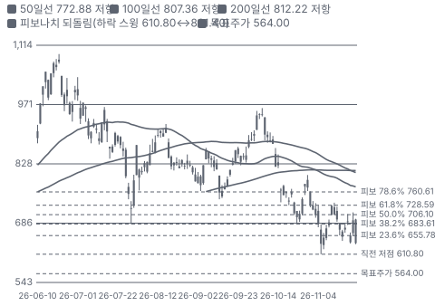

**주봉**

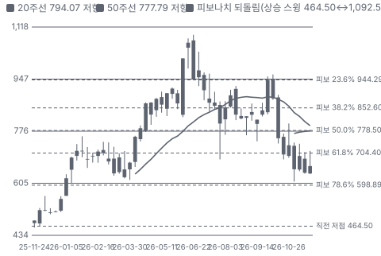

**월봉**

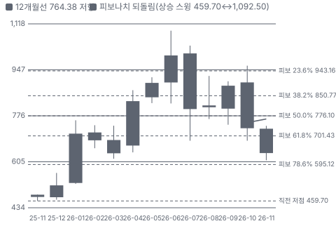

**분기 매출·EPS 실적과 컨센서스**

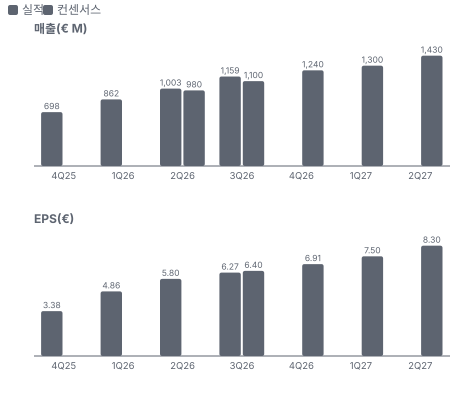

**멀티플 프리미엄(분기말 후행 P/E(대상 선행 추정 이력 없음), 최근 4개 분기말 절대값 — 대상 vs 동종 중앙값)**

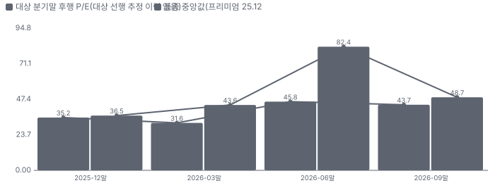

**합리적 멀티플**

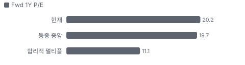

**밸류에이션 주가 시나리오**

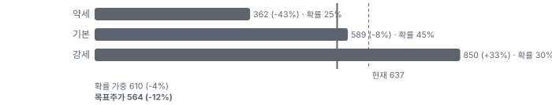

**주가별 업사이드**

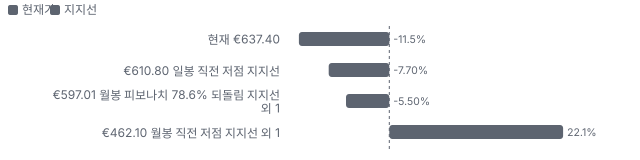
- 제품·서비스 포트폴리오

**공급 병목(10점, 낮을수록 병목)**

**생산능력 현재와 확충 계획(€B(연 매출 환산))**

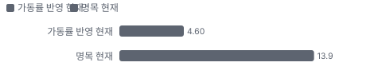

**CAPEX의 매출 대비 비중**

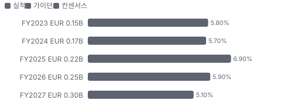

**어닝콜 변화별 주주가치 영향**

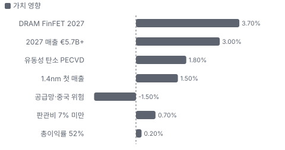

**수주·파이프라인 확실성 사다리**

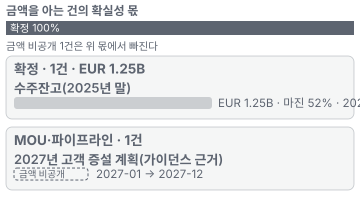

**수주/출하 비율(B/B) × 재고 일수 — 분기별 · 25-12 뒤 B/B 없음(회사가 그 뒤 분기 수주를 공시하지 않는다)**

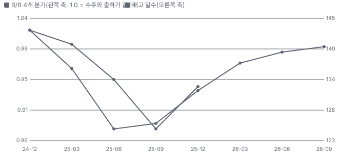

**매출 → 매출총이익 → 영업이익(매출 = 100, 최근 4분기)**

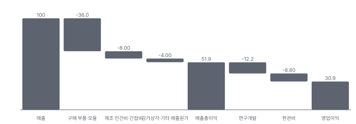

**분기 비용 비중 추이(매출 대비, 공시)**

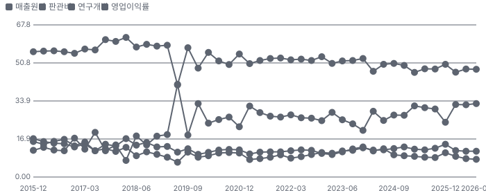

**비용 요인별 매출 대비 비중 1년 변화**

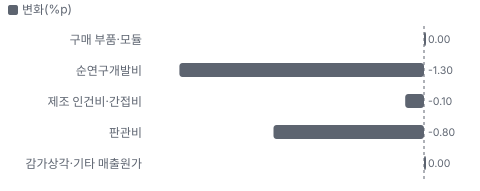

**장비 BOM 원가 몫**

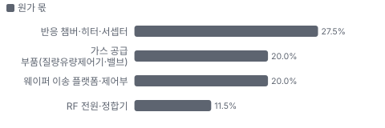

**부품·서비스 BOM 원가 몫**

**BOM 항목 가격 +10% 시 OPM 변화**

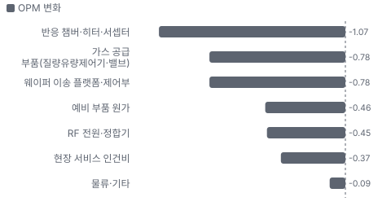

**원가 물가 vs 판매가 물가 — 최근 24개월(비교 불가 — 같은 물가 지수)**

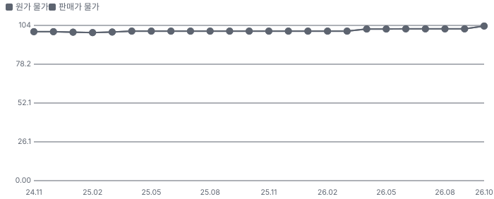

**사업별 매출 vs 물가 — 전년 대비(명목 매출 · 비교 물가 · 실질 = 물량·믹스)**

**매출 vs PPI·수출입 — 4Q22 = 100(변화율, 로그 눈금)**

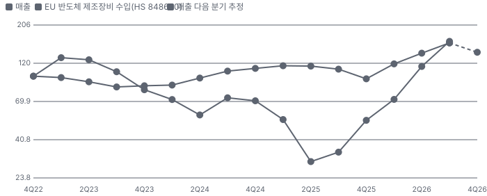

**10년 P·Q 사이클 — 추세(HP 필터) 대비 갭과 8분기 전망**

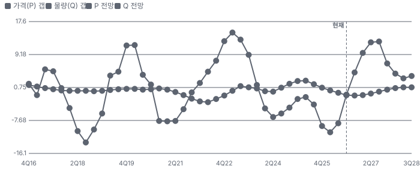

**매출 증가율의 가격·물량 분해와 8분기 전망(전년 대비)**

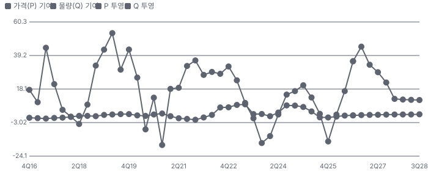

**목표주가 산정 — 약세와 기본 사이(약세 쪽 11%), 도달 확률 약 56%**

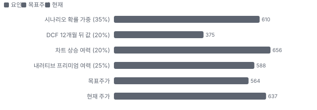

**PEG — 성장 대비 멀티플(낮을수록 성장 대비 쌈)**

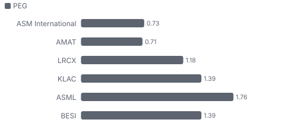

**몬테카를로**

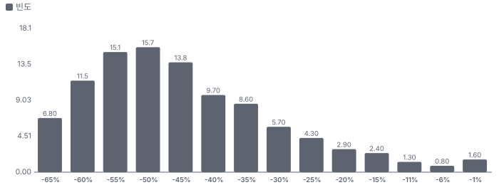

해석: 3,000번 중 40번(1%)에서 가치가 지금 주가 이상이었다. 가정을 흔들어도 지금 주가를 뒷받침하지 못하는 경우가 더 많다. 가운데 값은 0.53배이고, 열 번 중 여덟 번은 0.40~0.76배 사이에 든다.

## 내러티브

> **기업가치를 결정하는 이야기:** 웨이퍼 위에 원자 한 층씩 막을 쌓는 ALD(원자층 증착 — 원자 한 층씩 막을 쌓는 공정) 장비와 단결정 막을 기르는 에피택시 장비를 판다. 3Q 매출의 81%가 장비, 19%가 부품·서비스다. 장비 매출의 77%(1H26)가 로직·파운드리에서 나온다. 트랜지스터가 GAA(게이트가 채널 네 면을 감싸는 트랜지스터 구조)로 바뀌고 노드가 2nm에서 1.4nm로 갈수록 ALD·에피택시 공정 단계가 늘어난다는 것이 가치의 뼈대다.

> **멀티플·EPS 프리미엄**
> **멀티플:** Fwd 1Y P/E 20.2배로 동종 6곳 중앙(19.7배)과 거의 같다 — 9월 말 이후 업종 배수가 함께 줄어 프리미엄이 남아 있지 않다
> **EPS:** FY26 EPS 컨센서스 €24.3 → FY27 €34.2(+41%) → FY28 €39.6(+16%)

### 투자자들은 왜 열광했나

2026년 상반기 투자자들은 분기 매출이 처음 €1B를 넘고 2nm 투자가 이어지자 주가를 €477에서 6월 22일 종가 €1,079까지 올렸다. 하반기에는 실적이 더 좋아졌는데도 식었다 — AI 설비투자가 2028년에 꺾일 수 있다는 걱정과 대중국 수출통제 강화로 장비 업종 배수가 30배 안팎에서 20배 안팎으로 내려왔기 때문이다.

### 무엇이 기업가치를 바꾸나

> **구조적 체질 변화**
> **변화:** 틈새 ALD 장비 회사 → 선단 로직 전환마다 대응 시장이 커지는 증착 장비 회사
> **증거:** FY2021 매출 €1.73B → FY2026 가이던스 약 €4.26B, 2027년 €5.7B 초과 가이던스
> **반증:** 1.4nm에서 ALD·에피택시 채택 층이 2nm보다 늘지 않음

> **고부가 믹스 확장**
> **변화:** 1.4nm·HBM(고대역폭 메모리 — AI 가속기용 적층 DRAM)용 DRAM 비중 상승, 부품·서비스 +31%
> **증거:** 3Q 매출총이익률 52.0%, FY26 약 52%(종전 약 51%)
> **반증:** 중국 비중 하락으로 매출총이익률이 51% 아래로 내려감

> **기술 혁신**
> **변화:** 몰리브덴 ALD(배선 저항을 낮추려고 몰리브덴 금속을 원자층으로 쌓는 공정)·나노시트(GAA 트랜지스터의 얇은 판 모양 채널) 에피택시·유동성 탄소(좁고 깊은 구조 안으로 흘러 들어가 채우는 탄소 막) PECVD(플라즈마 화학 기상 증착)·광 검출기 에피택시
> **증거:** 3Q 콜: XP8 Vertos(ASM의 유동성 탄소 PECVD 장비) 양산 적용, 1.4nm 몰리브덴 ALD 수주(2Q 콜)
> **반증:** 신제품 개발비 손상이 반복됨(3Q €7M)

> **실행 속도**
> **변화:** 주문에서 출하까지 3~6개월 — 부품 부족에도 3Q 매출을 가이던스 상단으로 맞춤 **납품 리드타임 3~6개월.** 피어 중앙값 12개월보다 62% 짧다(Aixtron 12개월). 이전 대비 미확인.
> **증거:** 3Q 콜 CFO: 수주잔고는 보통 3~6개월치
> **반증:** 4Q 매출이 가이던스 €1.23B에 못 미침

> **M&A**
> **변화:** 해당 없음(최근 3년 안에 조건이 확인된 인수 없음 — 2025년 인수 지급 €157.6M은 대상 미확인)
> **증거:** 현금흐름표
> **반증:** 해당 없음

> **정책·입법 연관성**
> **재정정책:** 미국 반도체 보조금·투자 세액공제는 고객의 미국 팹 투자를 거쳐 간접 영향 — ASM 직접 수령 여부는 미확인 미국 매출 FY2025 15%, 애리조나 Scottsdale(미국 애리조나주 도시 — ASM 북미 신사옥 부지) 신사옥 건설(3Q 콜) 반증: 보조금·세액공제 축소 입법 의회 동의 2/10 — 하원 1/5(ASM 관련 세출 의결 확인 없음 — 이번 회차 미대조) · 상원 1/5(같음).
> **행정명령:** 대중국 장비 수출통제(미국 BIS(미국 상무부 산업안보국) 규칙·네덜란드 수출 허가) — 중국 매출 비중은 이번 회차 미대조 3Q 콜: 중국은 2027년 성장에 기여하지 않고 중국 매출은 이익률이 높다 반증: 증착 장비 통제 범위가 성숙 공정까지 넓어짐 의회 동의 2/10 — 하원 1/5(의회 의결 대상 아님 — 행정 규칙) · 상원 1/5(같음).
> **연관입법:** MATCH Act(동맹국 반도체 장비 수출통제를 미국 수준으로 맞추려는 미국 법안) — 회사는 영향이 있다고 보지만 크기는 추정하지 않는다. 법안 단계는 이번 회차 미대조 3Q 콜 CFO 발언 반증: 최종 문구에서 동맹국 증착 장비가 빠짐

> **고객의 지출 예산**
> **변화:** 장비는 고객 설비투자, 부품·서비스는 고객 운영 예산
> **사업별 예산:** **매출의 81%**: 장비 — 고객 CAPEX(파운드리·메모리 업체의 전공정 장비 투자(WFE)) · 동인: 2nm·1.4nm 증설, HBM용 DRAM 증설
**매출의 19%**: 부품·서비스 — 고객 OPEX(팹 운영·유지보수 예산) · 동인: 팹 가동률과 설치 대수
> **증거:** 3Q 장비 €936.4M·부품·서비스 €223.1M
> **반증:** 파운드리·메모리 업체가 2027년 설비투자 계획을 낮춤

### 내러티브 근거

> GAA 트랜지스터와 HBM이 원자층 증착 층수를 늘린다는 이야기는 이미 컨센서스다. 주가는 1년 전 €477에서 6월 €1,079까지 올랐다가 AI 설비투자 축소 우려와 수출통제 강화로 €637까지 내려왔다 — 이야기는 그대로인데 업종 배수가 줄었다. 동종 대비 멀티플 차이 +2% 중 회사 고유 몫은 +81%다. 단계는 컨센서스, 쏠림은 중간(리테일 집계 없음, 콜 질문 증권사 11곳, 기관 보유 약 65%)이다.

> **GAA 1.4nm에서 ALD·에피택시 층수 확대** · 강화
> **논리:** 2nm에서 구조 전환에 집중했던 고객이 1.4nm에서는 성능을 뽑아내려고 소재·공정 단계를 늘린다 — 대응 시장과 점유율이 함께 커진다
> **숫자:** 1.4nm가 3Q 선단 로직 매출의 두 자릿수 비중, 2027년 최대 기여 노드(회사)
> **반증:** 1.4nm 양산 투자가 2028년 뒤로 밀리거나 채택 층을 경쟁사가 가져감
> **출처:** ASM 3Q26 실적 발표(2026-10-27)·어닝콜(2026-10-28)

> **HBM·DRAM FinFET** · 강화
> **논리:** HBM용 고성능 DRAM 증설과 주변회로 FinFET 조기 도입이 메모리에서 ALD 층수를 늘린다
> **숫자:** FinFET ALD 층수 약 3배(회사), 메모리는 1H26 장비 매출의 15%
> **반증:** 2028년 DRAM 수급 완화로 메모리 증설이 줄어듦
> **출처:** ASM 3Q26 실적 발표(2026-10-27)·어닝콜(2026-10-28)

> **2027년 매출 €5.7B 조기 가이던스** · 유지
> **논리:** 2030년 목표를 3년 앞당긴다는 숫자가 2027년 추정을 받친다
> **숫자:** FY2027 매출 컨센서스 €5.85B(+37%), EPS €34.2(+41%)
> **반증:** 2027-02-23 연말 수주잔고가 2025년 말(€1,246.9M)보다 크게 늘지 않음
> **출처:** ASM 3Q26 실적 발표(2026-10-27)·어닝콜(2026-10-28)

> **AI 설비투자 축소·수출통제(반대 내러티브)** · 강화
> **논리:** 2028년 AI 투자 증가율이 꺾이거나 MATCH Act가 중국 매출을 막으면 장비 배수와 추정이 함께 내려간다
> **숫자:** 동종 Fwd 1Y P/E가 9월 말 30배 안팎에서 지금 20배 안팎으로 줄었다. 중국 장비 수입은 10월 전월 대비 −10%(IB 통관 집계 요지)
> **반증:** 대형 클라우드 업체가 2027~2028년 설비투자 계획을 올리고 수출통제 법안이 완화됨
> **출처:** IB 자료 요지(2026-11) · 동종 배수 이력

> **부품 공급망 병목** · 유지
> **논리:** 수요가 아니라 부품이 출하 상한을 정한다
> **숫자:** 제조 공간은 매출의 약 3배, 그러나 CFO가 공급 위험 인정
> **반증:** 4Q 매출이 가이던스 €1.23B에 못 미침
> **출처:** ASM 3Q26 실적 발표(2026-10-27)·어닝콜(2026-10-28)

### 투자 포인트

> **가이던스는 올랐고 가격은 내려왔다**
> **명제:** 10/27 2027년 매출 €5.7B 초과 가이던스 뒤 주가는 €743에서 €637로 내려왔다(−14%)
> **숫자:** 3Q26 실적 발표·실측 일봉
> **시장과 다른 점:** 시장은 가이던스보다 2028년 AI 설비투자와 수출통제를 값에 넣고 있다 — 회사 숫자가 아니라 업종 배수가 가격을 움직였다
> **증명:** 2027-02-23 연말 수주잔고와 2027년 가이던스 갱신
> **출처:** ASM 3Q26 실적 발표(2026-10-27)·어닝콜(2026-10-28)

> **1.4nm는 2nm보다 큰 노드가 된다**
> **명제:** 1.4nm가 3Q 선단 로직 매출의 두 자릿수 비중으로 처음 잡혔고 2027년 최대 기여 노드라고 회사가 밝혔다
> **숫자:** 3Q 콜 CEO·CFO 발언
> **시장과 다른 점:** 컨센서스 FY27 매출 €5.85B는 가이던스 하한(€5.7B)과 거의 같다 — 1.4nm 점유율 상승분이 추정에 크게 얹혀 있지 않다
> **증명:** 4Q·1Q 실적의 1.4nm 비중과 장비 매출 성장률
> **출처:** ASM 3Q26 실적 발표(2026-10-27)·어닝콜(2026-10-28)

> **병목은 건물이 아니라 부품이다**
> **명제:** 제조 공간은 매출의 약 3배인데 CFO는 부품 공급 위험을 인정했다
> **숫자:** 3Q 콜
> **시장과 다른 점:** 설비투자 부담 없이 매출이 늘 수 있다는 뜻이지만, 2027년 상한은 협력사 증산이 정한다 — 시장이 묻는 '수요'보다 '공급'이 변수다
> **증명:** 4Q 매출이 가이던스 €1.23B를 맞추는지, 재고·선급금 변화
> **출처:** ASM 3Q26 실적 발표(2026-10-27)·어닝콜(2026-10-28)

### 모멘텀 생성·소멸 타임라인

**카탈리스트 달력 — 지난 사건의 주가 반응과 앞으로 확인할 숫자**
| 날짜 | 상태 | 구분 | 사건 | 반응·확인 | 결과에 따라 |
|---|---|---|---|---|---|
| 2026-04-22 | 완료 | 생성 | 1Q26 실적 발표 다음 날 | +7.1% |  |
| 2026-06-22 | 완료 | 생성 | 종가 고점 €1,079(장비 업종 동반 상승) | 1년 저점 대비 2.3배 |  |
| 2026-07-29 | 완료 | 소멸 | 2Q26 실적 발표 다음 날(분기 매출 첫 €1B) | −4.8% |  |
| 2026-10-28 | 완료 | 생성 | 3Q26 실적·2027년 매출 €5.7B 초과 가이던스 다음 날 | +4.1% |  |
| 2026-11-05 | 완료 | 매크로 | AI 하드웨어 업종 급락(매크로·섹터) | −7.0% |  |
| 2026-11-11 | 완료 | 생성 | 자사주 €300M 매입 개시 | +7.0% |  |
| 2027-02-23 | 예정 | 확인 | 4Q26·FY26 실적 — 연말 수주잔고, 2027년 가이던스 갱신 | 수주잔고 €1.8B 이상(2025년 말 €1,246.9M의 약 1.4배 — 2027년 성장률 +34%에 맞는 수준, 계산) | 충족: 가이던스가 주문으로 확인돼 FY27 추정이 지켜진다 / 미달: 가이던스 신뢰가 깎여 추정과 배수가 함께 내려갈 수 있다 |
| 2027-04-20 | 예정 | 확인 | 1Q27 실적(추정 일정) | 매출 €1.30B 이상(컨센서스) | 충족: 분기 경로 유지 / 미달: 부품 병목이 매출을 누른다는 신호 |

### 언제 사서 언제 팔아야 할까?

**가격·조건 틀 — 가격은 밸류에이션(약세·기본·강세·목표주가)과 차트 지지 구간에서, 조건은 이벤트에서**
| 구간 | 가격 | 목표주가까지 | 약세까지 | 조건·근거 |
|---|---|---|---|---|
| 관찰 구간 | €611~€611 | -8% | -41% | 지금 가격 아래 차트 지지 구간이 약세 시나리오 가격에 가까워지는 곳 |
| 확인 뒤 | 지금 €637 이상에서 조건 확인 | -12% | -43% | 연말 수주잔고 €1.8B 이상과 2027년 매출 가이던스 €5.7B 초과 유지 |
| 무효화 | 약세 시나리오 €362 | - | -43% | 2027년 가이던스를 낮추거나 4Q 매출이 €1.23B에 못 미친다 |
| 차익 고민 2차 | €850(강세 시나리오) | +33% | - | 목표주가 근처에서 Fwd 1Y P/E가 동종 중앙보다 크게 높아질 때 |

11월에만 하루 −7~8% 움직임이 세 번 나왔다 — 업종 급락에 크게 흔들린다 가격·조건 틀이며 매매·비중 지시가 아니다(투자 권유 아님).

## 포트폴리오

| 제품·서비스 | 구분 | 무엇 | 쓰는 곳 | 돈 버는 방식 | Mix | Mix 변화(전 분기 대비) |
|---|---|---|---|---|---|---|
| 장비 | 제품 | ALD·에피택시·PECVD·수직로 증착 장비 | 선단 로직·파운드리(2nm·1.4nm), HBM용 DRAM, 전력·아날로그 팹 | 3Q26 매출의 81% — 장비 판매 | 81% | +1.6%p |
| 부품·서비스 | 서비스 | 예비 부품과 성과 기반 서비스(장비 가동 성과에 연동해 대가를 받는 서비스 계약) | 설치된 장비를 돌리는 팹 | 3Q26 매출의 19% — 반복 매출 | 19% | -1.6%p |

**Mix 변화가 가장 큰 쪽은 부품·서비스(-1.6%p, 전 분기 대비).** 계절성 판정: 분기 매출 계절 지수 기준 없음 → 직전 분기와 비교.

## 수주·파이프라인

> **2025-12-31 기준 2건.** 확정 EUR 1.25B. 공시 수주잔고(2025-12-31, 연 1회 공시) EUR 1.25B.

**수주 목록**
| 상태 | 계약 | 계약 총액 | 진척 | 기간 | 비고 |
|---|---|---|---|---|---|
| 확정 | 수주잔고(2025년 말) | EUR 1.25B | - | 2026-01 → 2026-06 | 다음 잔고 공시는 2027-02-23 |
| 파이프라인 | 2027년 고객 증설 계획(가이던스 근거) | 금액 비공개 | - | 2027-01 → 2027-12 | 확정 수주가 아니다 — 1.4nm 양산 투자와 DRAM FinFET이 핵심 |

**실행 속도와 방해 요인**
| 항목 | 상태 | 실행 속도 | 방해 요인 |
|---|---|---|---|
| 수주잔고(2025년 말) | 확정 | 주문 → 출하 3~6개월 | 부품 공급망(가스 공급 부품 등) · 현장 서비스 인력 |
| 2027년 고객 증설 계획(가이던스 근거) | 파이프라인 | 미확인 | 구매 주문 전환 전(CFO: 가시성이 확실성은 아니다) · 부품 공급 · MATCH Act 등 수출통제 |

## 마진 구조

> **GPM 52.0%, OPM 32.7%.** 2Q26 대비 GPM +0.1%p, OPM +0.5%p. 변동비는 매출의 46%이고, 매출이 10% 늘면 OPM은 +1.9%p 움직인다. 3Q 매출원가는 매출의 48.0%로 1년 전 48.1%와 같다. 이익률을 올린 것은 영업 레버리지다 — 판관비가 매출의 8.7%에서 7.9%로, 순연구개발비가 12.8%에서 11.5%로 내려갔다. 회사는 가격 인상과 부품 원가 상승이 서로 상쇄된다고 설명한다.

> **매출 100 중 매출원가 48.1, 매출총이익 51.9(최근 4분기, 공시).** 매출원가 요인 중 구매 부품·모듈이 매출의 36.0%로 가장 무겁고, 단가가 +10% 오르면 GPM이 -3.60%p 움직인다. 분기 회귀로 매출 1이 늘 때 매출원가는 0.47 늘고, 매출원가의 고정비 몫은 9%다.

**비용 요인 강도 — 비중·추세·충격(+10%)·탄력**
| 비용 | 구분 | 매출 대비 | 1년 변화 | 마진 기여 | 충격 시 마진 | 매출 탄력 | 고정비 몫 |
|---|---|---|---|---|---|---|---|
| 구매 부품·모듈 | 매출원가 요인 | 36.0% | +0.0%p | -0.0%p | -3.60%p | 미확인 | 0% |
| 제조 인건비·간접비 | 매출원가 요인 | 8.0% | -0.1%p | +0.1%p | -0.80%p | 미확인 | 50% |
| 감가상각·기타 매출원가 | 매출원가 요인 | 4.0% | +0.0%p | -0.0%p | -0.40%p | 미확인 | 80% |
| 매출원가 | 공시 항목 | 48.1% | -0.0%p | +0.0%p | -4.81%p | 0.47 | 9% |
| 연구개발 | 공시 항목 | 12.2% | -0.5%p | +0.5%p | 미확인 | 0.12 | -6% |
| 판관비 | 공시 항목 | 8.8% | -0.2%p | +0.2%p | 미확인 | 0.08 | 26% |

매출 탄력 = 분기 비용을 매출에 회귀한 기울기(매출 1당 변동비), 고정비 몫 = 절편 ÷ 평균 비용. 표본이 8분기 미만이면 미확인. 매출원가 요인 비중은 margin 재료의 추정이 섞여 있고, 공시 매출원가와의 차이는 '기타 매출원가'로 둔다.

**GPM에서 OPM까지(IFRS, 아래는 최근 4개 분기)**
| 기간 | GPM | 연구개발 | 판관비 | 기타 | OPM |
|---|---|---|---|---|---|
| 3Q25 | 51.9% | 12.8% | 8.7% | 0.0% | 30.3% |
| 2Q26 | 51.9% | 11.5% | 8.2% | 0.0% | 32.2% |
| 3Q26 | 52.0% | 11.5% | 7.9% | 0.0% | 32.7% |
| 2025-12 | 49.8% | - | - | - | 24.4% |
| 2026-03 | 53.3% | - | - | - | 32.3% |
| 2026-06 | 51.9% | - | - | - | 32.2% |
| 2026-09 | 52.0% | - | - | - | 32.7% |

**비용을 움직이는 요인**
| 비용 | 요인 |
|---|---|
| 구매 부품·모듈(매출원가) | 가스 공급 부품·챔버·RF(고주파 전원) 전원 단가와 물량, 제품·고객 믹스 · 근거 추정 |
| 순연구개발비(연구개발) | 총 연구개발 지출 − 개발비 자본화 + 상각·손상(3Q 손상 €7M) · 근거 공시 |
| 제조 인건비·간접비(매출원가) | 싱가포르·한국 공장 가동과 현장 서비스 인력(3Q 인원 +400명) · 근거 추정 |
| 판관비(판관비) | 인원·성과 연동 변동비 — 회사 기준(조정)으로는 7.6% · 근거 공시 |
| 감가상각·기타 매출원가(매출원가) | 공장·평가 장비 상각 · 근거 추정 |

**장비 BOM — 매출의 81%, GPM 52%(회사 전체 매출총이익률(3Q26) — 제품별 총이익 미공시), 항목 가격 +10% 시**
| 항목 | 원가 몫 | 전가 | 제품 GPM | OPM |
|---|---|---|---|---|
| 반응 챔버·히터·서셉터 | 20~35% | 미확인 | -1.3%p | -1.07%p |
| 가스 공급 부품(질량유량제어기·밸브) | 15~25% | 미확인 | -1.0%p | -0.78%p |
| 웨이퍼 이송 플랫폼·제어부 | 15~25% | 미확인 | -1.0%p | -0.78%p |
| RF 전원·정합기 | 8~15% | 미확인 | -0.6%p | -0.45%p |
| 미분해 | 21% | - | - | - |

**부품·서비스 BOM — 매출의 19%, GPM 52%(회사 전체 매출총이익률(3Q26)을 그대로 씀 — 부문별 총이익 미공시), 항목 가격 +10% 시**
| 항목 | 원가 몫 | 전가 | 제품 GPM | OPM |
|---|---|---|---|---|
| 예비 부품 원가 | 40~60% | 미확인 | -2.4%p | -0.46%p |
| 현장 서비스 인건비 | 30~50% | 미확인 | -1.9%p | -0.37%p |
| 물류·기타 | 5~15% | 미확인 | -0.5%p | -0.09%p |

반응 챔버·히터·서셉터 가격이 +10% 오르면 영업이익은 -3.3% 움직인다. 판매가 전가를 모르는 항목은 전가 0%로 계산했다.

**BOM 항목 가격을 움직이는 것**
| 항목 | 요인 |
|---|---|
| 가스 공급 부품(질량유량제어기·밸브) | ALD는 전구체 펄스 제어가 핵심이라 가스 부품 비중이 높다 · 근거 추정 |
| 반응 챔버·히터·서셉터 | 정밀 가공품·세라믹 단가 · 근거 추정 |
| RF 전원·정합기 | 플라즈마 ALD·PECVD에 필요 · 근거 추정 |
| 웨이퍼 이송 플랫폼·제어부 | 로봇·진공 이송·제어 전장 · 근거 추정 |
| 예비 부품 원가 | 소모성 챔버 부품 · 근거 추정 |
| 현장 서비스 인건비 | 성과 기반 서비스 계약 수행 · 근거 추정 |
| 물류·기타 | 부품 재고·운송 · 근거 추정 |

**투입 물가 — 미국 PPI 3·6·12개월(2026-10, 개정 반영)과 해외 전년비**
| 항목 | 미국 3개월 | 6개월 | 12개월 | 전가 못 할 때 OPM | 일본 | 한국 | 대만 |
|---|---|---|---|---|---|---|---|
| 예비 부품 원가 | +1.9% | +2.0% | +3.4% | - | +2.2% | +0.0% | +3.0%* |

별표는 품목보다 넓은 업종 지수다. 연결한 투입 원가의 미국 PPI(생산자물가지수)는 1년 새 가중 +3.4%이고, 판매가로 넘기지 못하면 GPM -1.2%p·OPM -1.2%p가 움직인다. 장비 가격은 +0.0%로 비교 물가(반도체 제조장비 PPI, 2026-10) +3.4%보다 3.4%p 덜 올랐다. 물가 지수를 붙이지 못한 매출원가 항목은 제조 인건비·간접비, 감가상각·기타 매출원가다(미연결). 장비 매출은 2026-09 전년 대비 +48.5%이고 비교 물가 ppi_id:PCU333242333242의 변화 +1.5%(2026-09)를 빼면 실질 +46.3% — 물량·믹스가 성장을 이끌었다.

## 자산 구성

미공시·미분해: 분기 감가상각·유형자산(순액) 9분기 · 분기 매출·영업이익 8분기 · 유형자산 항목별 총액·내용연수(10-K 주석에서 모델이 채움) · 무형자산 항목(10-K 주석에서 모델이 채움) — 이 칸은 비우고 나머지로 계산했다.

## 공급망 병목

> **공급망 신뢰성 4.9/10, 병목 주의.** 가장 약한 고리는 가스 공급 부품(질량유량제어기·밸브) 4.9점이고, 품목 평균은 4.9점이다. 근거가 부족한 3건(반응 챔버·히터·서셉터 · RF 전원·정합기 · 웨이퍼 이송 플랫폼·제어부)은 점수에서 뺐다. ASM은 부품·모듈을 협력사에서 받아 싱가포르와 한국에서 조립한다. 회사는 건물 캐파가 아니라 부품 공급망이 출하의 한계라고 말한다 — 핵심 협력사에 인력을 상주시키고 신규 협력사를 인증하는 중이며 공급사 이름과 품목별 수치는 공개하지 않는다.

**병목과 마진 — 품목 가격 +10% 시 OPM**
| 품목 | 점수 | 판정 | 구분 | OPM |
|---|---|---|---|---|
| 가스 공급 부품(질량유량제어기·밸브, 필수) | 4.9 | 병목 주의 | 핵심 통제 품목 | -0.78%p |

> **가스 공급 부품(질량유량제어기·밸브)** · 4.9/10
> **왜:** ALD 전구체 공급을 제어하는 필수 부품
> **병목 요인:** 인증 공급사 2곳 · 캐파 빠듯 · 리드타임 미확인 · 재인증 미확인 · 1위 점유율 60% · 지역 집중 미확인 · 물량 확보 복수구매
> **풀리는 조건:** 핵심 협력사 상주·신규 협력사 인증 중 — 물량 확보 확인 전

**공급사**
| 품목 | 공급사 | 몫 | 근거 |
|---|---|---|---|
| 가스 공급 부품(질량유량제어기·밸브) | 미공개(유량 제어 부품) | 미확인 | 추정 |
| 반응 챔버·히터·서셉터 | 미공개(정밀 가공·세라믹) | 미확인 | 추정 |
| RF 전원·정합기 | 미공개(플라즈마 전원) | 미확인 | 추정 |
| 웨이퍼 이송 플랫폼·제어부 | 미공개(로봇·제어 전장) | 미확인 | 추정 |

**무역 통계로 본 공급 지역**
| 품목 | EU 수입처 | 일본 수입처 | EU 1위 전년비 |
|---|---|---|---|
| 가스 공급 부품(질량유량제어기·밸브) | JP 48% · US 33% · TW(대만) 8% | 大韓民国 36% · シンガポール 25% | +892.4% |
| 반응 챔버·히터·서셉터 | JP 48% · US 33% · TW 8% | 大韓民国 36% · シンガポール 25% | +892.4% |
| RF 전원·정합기 | JP 48% · US 33% · TW 8% | 大韓民国 36% · シンガポール 25% | +892.4% |
| 웨이퍼 이송 플랫폼·제어부 | JP 48% · US 33% · TW 8% | 大韓民国 36% · シンガポール 25% | +892.4% |

## 생산능력

> **현재 명목 캐파 14 €B(연 매출 환산), 가동률 33%.** 착공 이상 증설은 0 €B(연 매출 환산), 발표까지 합치면 0 €B(연 매출 환산)이다. 다 가동하면 지금보다 +0%, 착공 이상만이면 +0%다. FY2025 CAPEX는 EUR 0.22B로 매출의 6.9%다. 회사는 제조 공간이 지금 매출의 약 3배를 감당한다고 밝혔다 — 3Q 매출 연율 €4.6B 기준 약 €13.9B(계산)다. 지난 몇 년 싱가포르·한국 공장을 먼저 늘려 둔 결과이고, 지금 설비투자의 큰 몫은 애리조나 Scottsdale 신사옥이다. 건물이 아니라 부품이 병목이므로 이 숫자를 판매 가능 물량으로 읽으면 안 된다.

**생산시설 4곳**(어닝콜에서 회사가 이름을 밝힌 거점 — 싱가포르·한국(핵심 제조), Scottsdale(건설 중), Almere 본사. 연차보고서 시설 목록은 이번 회차 미대조라 실제 거점은 더 많다), 미확인 4곳. 시설별 생산능력은 공개되지 않았다 — 회사 전체 캐파만 위에 적었다.

**생산시설 4곳 — 명칭·위치·생산능력**
| 시설 | 위치 | 용도 | 생산능력 | 소유·상태 |
|---|---|---|---|---|
| 싱가포르 제조 거점 | 싱가포르 | 장비 조립·시험(핵심 제조 거점) | 미확인 — 거점별 캐파 미공시 — 전사 합계로 '매출의 약 3배 공간'만 공시 | 미확인 · 가동 |
| 한국 제조·연구 거점 | 대한민국 경기도 화성 | 장비 조립과 연구개발(핵심 제조 거점) | 미확인 — 거점별 캐파 미공시 | 미확인 · 가동 |
| Scottsdale 신사옥 | 미국 애리조나주 Scottsdale | 북미 연구개발·기술 거점(건설 중) | 미확인 — 생산 캐파 미공시 | 미확인 · 건설 중 |
| Almere 본사 | 네덜란드 Almere | 본사·연구개발 | 미확인 — 생산 거점 아님 | 미확인 · 가동 |

**생산능력 확충 계획**
| 계획 | 단계 | 증설 | 가동 시점 | CAPEX |
|---|---|---|---|---|
| Scottsdale 신사옥(애리조나) | 착공 | 미확인 | 미확인 | 미확인 |

남은 계획의 CAPEX 합계는 EUR 0.00B(금액 미확인 1건 제외)다. 합계는 FY2027 매출의 0%다.

**증설 방해 요인**
| 계획 | 방해 요인 |
|---|---|
| Scottsdale 신사옥(애리조나) | 미확인 |

**CAPEX와 매출 대비**
| 기간 | CAPEX | 매출 | 매출 대비 | 구분 |
|---|---|---|---|---|
| FY2023 | EUR 0.15B | EUR 2.63B | 5.8% | 실적 |
| FY2024 | EUR 0.17B | EUR 2.93B | 5.7% | 실적 |
| FY2025 | EUR 0.22B | EUR 3.17B | 6.9% | 실적 |
| FY2026 | EUR 0.25B | EUR 4.25B | 5.9% | 가이던스 |
| FY2027 | EUR 0.30B | EUR 5.85B | 5.1% | 컨센서스 |

## 피터 린치 분류

> **경기순환주(Cyclical), 중형.** 린치 표의 기대 수익 10배, 하방 -80~100%, 위험 고. 10배 경로가 있는 분류다(고성장주·회생주·경기순환주).

**분류 근거 — 크기 먼저, 다음은 이야기 유형**
| 항목 | 값 |
|---|---|
| 크기 | 중형(시가총액 \$31.2B) |
| 장기 성장 | 27.7%(컨센서스 EPS 2년 CAGR) |
| 린치 비율((성장% + 배당%) ÷ P/E) | 1.37 — 2 이상 매력, 1 미만 비싸다 |
| PEG(P/E ÷ 성장%) | 0.73 — 1 적정, 0.5 매우 매력, 2 매우 불리 |
| 근거 | 순환 업종(semicap) |
| 반대 근거 | 장기 성장률 28%로 고성장주 구간 — 순환 위의 성장주일 수 있다 |

- 점검: 재고·공급과 수요(가격)의 방향
- 점검: 경쟁사의 증설
- 점검: 이익 정점에서 P/E가 낮아 보이는 함정
- 점검: 부채가 바닥을 견딜 수 있나
- 팔 때(점검 조건, 매매 지시 아님): 재고가 쌓이고 증설이 시작되고 가격이 꺾일 때 — 정점의 낮은 P/E는 싸다는 뜻이 아니다

분류 = 피터 린치·존 로스차일드 『One Up On Wall Street』(1989)·『Beating the Street』(1993)의 6분류와 위험·보상 표를 숫자 규칙으로 옮긴 자체추론이다(config/lynch.yaml).

## 구루 교차 점검

> **여섯 관점 중 통과 3 · 미달 1 · 미확인 2.** 가장 약한 관점은 성장 여지 — 2027년 숫자의 근거가 구매 주문이 아니라 고객 계획이고 FY28 추정 성장은 +13%로 꺾인다.

판정은 자체추론이고 숫자는 계산값이다.

> **성장 여지** · 통과
> **질문:** 5년 안에 매출이 2배가 될 자리가 있나, 10년 뒤에도 커지나
> **이유:** 추정 매출 경로가 FY26 €4.26B → FY28 €6.61B(연 24.5%)로 5년 2배 속도를 넘고 회사가 2027년 €5.7B 초과를 가이던스로 냈다
> **계산한 숫자:** 매출 경로 FY2026→FY2028 연 24.5%, 2배까지 3.2년
> **근거:** ASM 3Q26 실적 발표(2026-10-27) · 출처 목록

> **해자와 자본수익률** · 통과
> **질문:** 경쟁우위가 무엇이고, 투하자본수익률(ROIC)이 자본비용보다 높으며 유지·상승하나
> **이유:** ROIC 26.5%로 자본비용(10.9%)을 웃돌고 매출총이익률 52%를 유지한다 — 단 점유율 숫자는 이번 회차에 대조하지 못했다
> **계산한 숫자:** ROIC 26.5% · 자본비용 10.9%
> **근거:** ASM 3Q26 실적 발표(2026-10-27) · 출처 목록

> **재투자 복리** · 미확인
> **질문:** 번 돈을 높은 수익률로 다시 넣을 곳이 있나 — 자본 배분(재투자·인수·자사주·희석) 이력은
> **이유:** 이익을 연구개발 자본화와 자사주·배당으로 나눠 쓴다 — 재투자율과 증분 수익률을 연차보고서로 재지 못했다(계산 재투자율 0%)
> **계산한 숫자:** 설비 재투자율 0%(설비투자가 감가상각 이하 — 연구개발·인수로 하는 재투자는 이 숫자에 없다) · 소유주 이익 수익률 2.7%(근사)

> **사람과 문화** · 미확인
> **질문:** 경영진이 주주와 같은 배를 탔나 — 창업자·내부자 지분, 기회형 내부자 매수, 문화가 경쟁우위에 기여하나
> **이유:** 경영진 임기·보상 구조를 연차보고서로 대조하지 못했다 — 자본 배분(자사주 €150M 완료·€300M 신규)은 콜에서 확인
> **계산한 숫자:** 서류로 확인(계산 없음)

> **변화의 방향** · 통과
> **질문:** 18~24개월 뒤 이익 그림이 지금과 얼마나 다른가, 유동성 국면은 그 변화를 받쳐 주나
> **이유:** 2년 뒤 EPS 추정이 다음 12개월보다 27.6% 높고 1.4nm·DRAM FinFET이 2027년에 겹친다
> **계산한 숫자:** 2년 뒤 EPS +27.6%(다음 12개월 대비) · 유동성 국면 중립
> **근거:** ASM 3Q26 어닝콜(2026-10-28) · 출처 목록

> **5배 경로와 시장이 모르는 이유** · 미달
> **질문:** 어떻게 5배 이상이 되나(이익 성장 × 배수 변화), 시장은 왜 아직 값을 안 매기나
> **이유:** 5배는 증착 장비 시장 크기로 경로가 없다 — 2배만 조건부로 열려 있다
> **계산한 숫자:** 5년에 5배 = 연 38.0% · 10배 = 연 58.5% · Fwd P/E 20.2배
> **근거:** 이 리포트의 2·3·5배 경로 계산

**배수별로 필요한 연 성장률 — 이익 성장과 배수 변화를 합친 속도**
| 목표 | 5년 | 7년 | 10년 |
|---|---|---|---|
| 2배 | 14.9% | 10.4% | 7.2% |
| 5배 | 38.0% | 25.8% | 17.5% |
| 10배 | 58.5%(희소) | 38.9% | 25.9% |

### 보유 규율 — 가격이 아니라 지표로 유지·종료를 가른다

- 투자 논리 지표: 연말 수주잔고 · 장비 매출 성장률 · 매출총이익률 · 1.4nm 매출 비중
- 규칙: 가격만 빠지고 연말 잔고와 2027년 가이던스가 유지되면 논리는 그대로다. 가이던스 하향이나 총이익률 51% 아래는 논리가 깨지는 신호다
- 지금 주가는 일봉 256개 기간의 고점 대비 -40.9%, 그 기간 최대 낙폭은 -41.1%다.

여섯 관점은 베일리 기포드(성장 여지·5배 경로), 워렌 버핏(해자·재투자), 론 바론(사람), 피터 린치(분류·내부자), 스탠리 드러켄밀러(변화의 방향·유동성)의 질문을 옮긴 점검 틀이다. 유동성 국면은 중립(10년물 20일 -8bp · 하이일드 스프레드 20일 +33bp). 설비 재투자율은 설비투자에서 감가상각을 뺀 몫만 본 근사이고(연구개발·인수·운전자본은 빠진다), 소유주 이익 수익률은 유지 설비투자를 감가상각과 같다고 본 근사다. 점검 틀이며 매매·비중 지시가 아니다.

## 해자

> 해자는 선단 공정의 단일 웨이퍼 ALD에서 먼저 공정 기준 장비로 채택된 자리와, 전구체 분자를 직접 설계하는 소재 역량에서 나온다. 점유율 숫자는 회사 자료를 이번 회차에 대조하지 못해 판정을 한 단계 낮춘 항목이 있다.

> **선단 ALD 공정 기준 장비** · 강함
> **해자:** GAA 2nm에서 채택된 ALD·에피택시 공정이 1.4nm에서 층수와 점유율이 함께 늘어난다
> **근거:** 3Q 콜: 1.4nm에서 대응 시장과 점유율이 2nm보다 모두 커지고 몰리브덴 ALD 수주 확보(2Q 콜). 2026년 장비 매출 +40% 초과로 부품·서비스보다 빨리 자라 점유율 상승을 뒷받침. 매출총이익률 52%
> **숫자:** 장비 매출 3Q +48%(고정 환율(환율 변동을 뺀 성장률 기준)) · 매출총이익률 52.0%
> **깨지는 조건:** 1.4nm 양산 투자에서 ALD·에피택시 채택 층을 경쟁사가 가져간다

> **소재·전구체 설계** · 보통
> **해자:** 새 분자를 직접 설계해 공정을 만든다 — ALD 밖(PECVD)으로 확장
> **근거:** 3Q 콜: 자체 설계 분자로 만든 유동성 탄소 PECVD(XP8 Vertos)가 양산 라인에 들어갔다. 순연구개발비 매출의 11.5%(3Q)
> **숫자:** 3Q 총 연구개발 지출 €144M(+14%)
> **깨지는 조건:** 신제품이 양산 채택 뒤 반복 주문으로 이어지지 않는다(개발비 손상 반복)

> **설치 기반 부품·서비스** · 보통
> **해자:** 깔린 장비가 부품·성과 기반 서비스 매출을 만든다
> **근거:** 3Q 부품·서비스 €223.1M(+31% 고정 환율), 매출의 19.2%
> **숫자:** 부품·서비스 FY2023 €428.5M → FY2025 €715.7M
> **깨지는 조건:** 고객 팹 가동률 하락으로 부품 매출이 두 분기 연속 감소

> **시장 점유율** · 해당 없음
> **해자:** 단일 웨이퍼 ALD 점유율 숫자
> **근거:** 미확인 — 회사 Investor Day 자료를 이번 회차에 대조하지 못했다
> **숫자:** 미확인
> **깨지는 조건:** 미확인

## 경영진·네트워크

> CEO Hichem M'Saad와 CFO Paul Verhagen이 콜을 이끈다. 정계·동문 연결은 공개 자료에서 확인하지 못했다. ASM은 ASMPT 지분 24.6%를 들고 있다.

> **Hichem M'Saad** · CEO · 미확인
> **프로필:** 콜에서 스스로 PECVD 분야 15년 경력을 언급 — 1.4nm·DRAM 로드맵과 신제품을 직접 설명
> **비즈니스:** 선단 로직 고객이 2029~2030년, 1.0nm 로드맵까지 공유한다고 밝힘(3Q 콜)
> **정계:** 미확인
> **동문:** 미확인
> **사모임:** 미확인

> **Paul Verhagen** · CFO · 미확인
> **프로필:** 가이던스·자본 배분(자사주 €300M)·공급망 위험을 설명
> **비즈니스:** 협력사 확보를 위한 선급금 가능성 언급(3Q 콜)
> **정계:** 미확인
> **동문:** 미확인
> **사모임:** 미확인

**네트워크 정량화**
| 연결 | 강도 | 닿는 매출 | 가중 노출 | 매출 대비 | 근거 |
|---|---|---|---|---|---|
| 비즈니스: 선단 로직·파운드리 고객과의 조기 증설 계획 공유 | 3/5 | €0.62B | €0.37B | 10% | 로직·파운드리가 매출의 약 62%(계산) — 경영진 개인 연결이 매출을 만들었다는 뜻이 아니다 ASM 3Q26 실적 발표(2026-10-27)·어닝콜(2026-10-28) |

가중 노출은 연결이 닿는 매출의 크기다. 연결이 그 매출을 만들었다는 뜻이 아니며, 인과는 공개 자료로 입증하지 못한다.

## 약세 논리 및 셀온 조건

| 약세 논리 | 근거 | 가를 자료 |
|---|---|---|
| 2027년 가이던스는 주문이 아니다 | 수주잔고는 평소처럼 3~6개월치이고 고객은 계획을 구매 주문으로 바로 바꾸지 않는다. 2026년부터 분기 수주를 내지 않는다(3Q 콜) | 2027-02-23 연말 수주잔고(2025년 말 €1,246.9M) |
| 2028년 성장이 꺾인다 | FY2028 매출 컨센서스는 +13%로 2027년 +37%에서 크게 둔화한다. IB 메모리 전망도 2028년 DRAM 수급 완화를 본다(요지) | 2027년 하반기 Investor Day의 새 목표, 파운드리·메모리 업체의 2028 설비투자 안내 |
| 중국 믹스 하락과 수출통제 | 중국 매출은 이익률이 높은데 2027년 성장에 기여하지 않는다. MATCH Act 영향은 회사도 추정하지 않는다. 중국 매출 비중은 이번 회차에 대조하지 못했다 | 법안 최종 문구, FY26 연차보고서 지역 매출 |
| 부품 공급망이 매출 상한을 정한다 | CFO가 공급 위험을 인정했고 핵심 협력사에 인력을 상주시키고 있다. 3Q 재고는 €687.1M로 1년 전보다 26% 많다 | 4Q 매출 vs 가이던스 €1.23B, 재고·선급금 |
| DCF는 배수 경로보다 훨씬 낮다 | DCF 기본 가치는 시가총액의 53%다 — 장기 영업이익률을 27%로 낮추고 5년 매출 성장을 연 12%로 본 값이다. 지금 가격은 5년 연 33% 성장을 담고 있다 | FY27·FY28 실제 성장률과 이익률 |
| 자본화 개발비 | 무형자산 €1,063.6M(자본화 개발비 포함)이 1년 새 18% 늘었고 3Q에 손상 €7M이 나왔다 | 연차보고서 무형자산 주석 |
| 자료 한계 | 일봉은 1년치(256거래일) 실측 자료라 100주선 같은 장기 지표는 빠진다. 애널리스트 수·의견·목표가·수정 이력 데이터가 없다. 연차보고서(구매 약정·10% 초과 고객·시설 목록·중국 비중)와 4Q 가이던스 범위 폭, 2025년 인수 지급 €157.6M의 대상은 이번 회차에 대조하지 못했다 | 다음 회차 연차보고서·분기 보도자료 원문 대조 |

**변이 관점.** 시장은 회사 숫자가 아니라 업종 배수로 이 주식의 값을 매기고 있다. 3Q 실적 뒤 이익 추정은 그대로인데 주가는 14% 내려왔다. ==가격이 가이던스와 반대로 간 원인은 ASM의 실행이 아니라 2028년 AI 설비투자와 수출통제에 대한 업종 할인이다== — 다만 그 할인을 걷어낼 증거(연말 수주잔고)는 2027년 2월 23일에야 나온다.

> **셀온 조건**
> **조건 1:** 2027년 매출 가이던스(€5.7B 초과)를 낮춘다(2027년 2월 23일 확인).
> **조건 2:** 연말 수주잔고가 2025년 말 €1,246.9M 수준에 머문다 — 고객 계획이 주문으로 바뀌지 않았다는 뜻이다.
> **조건 3:** 4Q 매출이 가이던스 €1.23B에 못 미치고 회사가 부품 부족을 이유로 든다.
> **조건 4:** 매출총이익률이 51% 아래로 내려간다 — 중국 믹스 하락이 가격 인상보다 크다는 신호다.
> **조건 5:** 선단 파운드리 고객이 1.4nm 양산 투자 일정을 2028년 뒤로 미룬다고 밝힌다.

## 어닝콜 변화

**직전 콜 대비 새로 나오거나 바뀐 내용 → 가치 영향**
| 항목 | 내용 | 직전 콜 | 최신 콜 | 모델 동인 이동 | 확신도 | 가치 영향 |
|---|---|---|---|---|---|---|
| 신규 | 2027년 매출 가이던스 | 2027년은 기존 목표 범위 상단 초과(2Q 콜, 숫자 없음) | 2027년 매출 €5.7B 초과(고정 환율), 2030 목표 3년 조기 달성 | 1년차 성장률 +4.0% | 0.8 | +3.0% |
| 업데이트 | FY26 매출총이익률 | 약 51%(2Q 콜) | 약 52%(3Q 콜) — 일부 제품 가격 인상, 부품 원가는 반대 방향 | 출발 이익률 +0.80% | 0.8 | +0.2% |
| 업데이트 | 1.4nm 기여 시점과 크기 | 2026년 하반기 파일럿 라인에서 첫 기여 예상(2Q 콜) | 3Q 선단 로직 매출의 두 자릿수 비중, 2027년 최대 기여 노드(3Q 콜) | 1년차 성장률 +2.0% | 0.5 | +1.5% |
| 업데이트 | DRAM FinFET 도입 시점 | FinFET 주변회로·4F²(수직 채널을 쓰는 차세대 DRAM 셀 구조) 2028~2030년(2Q 콜) | FinFET은 6F²(현재 DRAM 셀 배치 구조)로 당겨져 2027년, ALD 층수 약 3배. 4F²는 지연 가능(3Q 콜) | 장기 성장 수렴값 +1.0% | 0.5 | +3.7% |
| 신규 | 2027년 영업비용 비율 | 2030년 목표: 순연구개발 두 자릿수 초반·판관비 7% 미만 | 같은 비율을 2027년에 적용(3Q 콜) | 목표 이익률 +1.0% | 0.8 | +0.7% |
| 부정 | 부품 공급망과 중국 | 공급망 부담 증가, 중국 성숙 로직 강세(2Q 콜) | 공급 위험 인정·협력사 상주, 중국은 2027년 성장 기여 없음, MATCH Act 영향 미정(3Q 콜) | 1년차 성장률 -2.0% | 0.5 | -1.5% |
| 신규 | PECVD 유동성 탄소 | 언급 적음 | XP8 Vertos 출시, 양산 적용 — ALD 밖으로 소재 설계 역량 확장(3Q 콜) | 장기 성장 수렴값 +0.50% | 0.3 | +1.8% |
| **합계** | 단독 합 |  |  | 동시 적용 +9.7% |  | **+9.5%** |

**실적 발표 예상 변동폭:** 지난 4번 실적 발표 때 주가는 하루에 평균 ±4.0%(최대 7.1%, 오른 날 2번) 움직였다.

**실적 발표 예상 변동폭 — 과거 실적 발표 다음 거래일 주가 변화**
| 분기 | 발표일 | 주가 변화 |
|---|---|---|
| 4Q25 | 2026-03-04 | -0.1% |
| 1Q26 | 2026-04-21 | +7.1% |
| 2Q26 | 2026-07-28 | -4.8% |
| 3Q26 | 2026-10-27 | +4.1% |

## 거시 지표 싱크로율

> **EU(유럽연합) 반도체 제조장비 수입(HS(국제 통일 상품 분류 코드) 848620)와 장비 싱크로율 74%(1분기 = 약 3개월 선행, 전년 대비, 표본 24개·t 5.1·유의·신뢰 보통).** 이 지표가 내포하는 4Q26 장비은 736M(±1σ 679M~792M, 확정 · 지표 범위 밖 → 범위 끝으로 제한)다. 표본 밖 검증(최근 6개 분기)에서 지표 모델 오차는 8.7%p, 기준선(직전 증가율 지속)은 20.4%p다 — 지표가 기준선을 이겨 지표 75%·기준선 25%로 결합했다. 세그먼트 추정에 나머지 사업(직전 증가율 지속)을 더한 전사 매출은 1.02B(960M~1.07B)다.  ASM 매출은 고객(파운드리·메모리 업체)의 전공정 장비 반입을 따라간다 — 반도체 제조장비(HS 848620) 통관과 장비 PPI를 본다. 매출의 80%가 아시아라 미국 수입은 일부만 설명한다

**지표별 싱크로율(상관계수 × 100) — 위 두 줄이 제품 연관성 × 싱크로율로 고른 PPI·수출입 세부 지표**
| 지표 | 비교 대상 | 증가율 기준 | 지표 선행 | 매출(t값) | 영업이익 | 방향 일치 | 표본·신뢰 | 표본 밖 오차(지표/기준선) | 4Q26 추정 매출 |
|---|---|---|---|---|---|---|---|---|---|
| EU 반도체 제조장비 수입(HS 848620) | 장비 | 전년 대비 | 1분기(3개월) | 74%(t 5.1) | -16%(0분기) | 71% | 24·보통 | 8.7/20.4%p ✔ | +51.7% → 736M(확정 · 지표 범위 밖 → 범위 끝으로 제한) |
| 미국 반도체 제조장비 수입 | 장비 | 전년 대비 | 0분기(0개월) | 64%(t 3.9) | 50%(1분기) | 75% | 24·보통 | 10.6/20.4%p ✔ | +40.8% → 683M(지표 자기회귀 추정) |
| 미국 반도체 제조장비 PPI | 장비 | 전년 대비 | 4분기(12개월) | -81%(t -6.5) | -30%(4분기) | 67% | 24·보통 | 10.1/20.4%p ✔ | +41.1% → 685M(확정) |

**지표 후보 25개 — 연관성(제품 품목 일치 × 대용 감점 × 매출 비중) × 싱크로율로 고른다. 후보가 많을수록 최대 상관은 우연히 부풀 수 있다**
| 후보 | 종류 | 연관성 | 매출 분기 일치 | 싱크로율(선행) | 점수 | 출처 |
|---|---|---|---|---|---|---|
| EU 반도체 제조장비 수입(HS 848620) ✔ | 수출입 | 1.00 | 100% | 74%(1분기) | 0.74 | 자동 |
| 미국 반도체 제조장비 수입 | 수출입 | 1.00 | 100% | 64%(0분기) | 0.64 | 모델 지정 |
| EU HS 848640 수입(장비과 같은 4자리 품목군) | 수출입 | 0.70 | 100% | 79%(0분기) | 0.55 | 자동 |
| 미국 반도체 제조장비 수출(HS 848620) | 수출입 | 1.00 | 100% | 54%(4분기) | 0.54 | 자동 |
| EU 반도체 제조장비 수출(HS 848620) | 수출입 | 1.00 | 100% | 53%(0분기) | 0.53 | 자동 |
| 미국 HS 848690 수출(장비과 같은 4자리 품목군) | 수출입 | 0.70 | 100% | 72%(2분기) | 0.51 | 자동 |
| EU HS 848630 수출(장비과 같은 4자리 품목군) | 수출입 | 0.70 | 100% | 67%(0분기) | 0.47 | 자동 |
| 미국 HS 848640 수입(장비과 같은 4자리 품목군) | 수출입 | 0.70 | 100% | 66%(1분기) | 0.46 | 자동 |
| EU HS 848690 수입(장비과 같은 4자리 품목군) | 수출입 | 0.70 | 100% | 61%(2분기) | 0.43 | 자동 |
| 일본 HS 8486 수출(장비과 같은 4자리 품목군) | 수출입 | 0.70 | 44% | 73%(1분기) | 0.41 | 자동 |
| 일본 HS 8486 수입(장비과 같은 4자리 품목군) | 수출입 | 0.70 | 44% | 71%(1분기) | 0.40 | 자동 |
| 미국 HS 848640 수출(장비과 같은 4자리 품목군) | 수출입 | 0.70 | 100% | 40%(0분기) | 0.23 | 자동 |

**선행 지표로 본 향후 분기 매출 전망(이미 나온 지표 값 기준, ±1σ)**
| 지표 | 대상 | 분기 | 지표 증가율 | 내포 매출 증가율 | 내포 매출 |
|---|---|---|---|---|---|
| 미국 반도체 제조장비 PPI | 장비 | 4Q26 | +0.2% | +39.3% | 676M(608M~744M) |
| 미국 반도체 제조장비 PPI | 장비 | 1Q27 | +0.8% | +35.1% | 913M(818M~1.01B) |
| 미국 반도체 제조장비 PPI | 장비 | 2Q27 | +1.5% | +30.3% | 1.03B(924M~1.15B) |
| 미국 반도체 제조장비 PPI | 장비 | 3Q27 | +1.5% | +30.0% | 1.22B(1.09B~1.35B) |
| EU 반도체 제조장비 수입(HS 848620) | 장비 | 4Q26 | +378.9% | +91.1% | 927M(849M~1.01B) |
| 미국 반도체 제조장비 수출(HS 848620) | 장비 | 4Q26 | +6.4% | +19.6% | 581M(483M~678M) |
| 미국 반도체 제조장비 수출(HS 848620) | 장비 | 1Q27 | -2.6% | +14.6% | 774M(638M~910M) |
| 미국 반도체 제조장비 수출(HS 848620) | 장비 | 2Q27 | +3.7% | +18.2% | 938M(779M~1.10B) |
| 미국 반도체 제조장비 수출(HS 848620) | 장비 | 3Q27 | +11.1% | +22.3% | 1.15B(957M~1.33B) |
| EU HS 848610 수출(장비과 같은 4자리 품목군) | 장비 | 4Q26 | -47.5% | +11.4% | 540M(426M~655M) |
| EU HS 848610 수출(장비과 같은 4자리 품목군) | 장비 | 1Q27 | -29.7% | +13.6% | 768M(608M~927M) |
| EU HS 848610 수출(장비과 같은 4자리 품목군) | 장비 | 2Q27 | -12.8% | +15.7% | 919M(732M~1.11B) |
| EU HS 848640 수출(장비과 같은 4자리 품목군) | 장비 | 4Q26 | -20.2% | +22.6% | 595M(480M~710M) |
| EU HS 848640 수출(장비과 같은 4자리 품목군) | 장비 | 1Q27 | -19.3% | +22.5% | 828M(668M~988M) |
| EU HS 848640 수출(장비과 같은 4자리 품목군) | 장비 | 2Q27 | -29.6% | +23.3% | 979M(791M~1.17B) |
| EU HS 848630 수입(장비과 같은 4자리 품목군) | 장비 | 4Q26 | +107.3% | +18.7% | 576M(464M~688M) |
| EU HS 848630 수입(장비과 같은 4자리 품목군) | 장비 | 1Q27 | +40.4% | +17.0% | 791M(634M~947M) |
| EU HS 848630 수입(장비과 같은 4자리 품목군) | 장비 | 2Q27 | +36.0% | +16.9% | 928M(744M~1.11B) |
| EU HS 848690 수입(장비과 같은 4자리 품목군) | 장비 | 4Q26 | +32.6% | +51.1% | 733M(641M~825M) |
| EU HS 848690 수입(장비과 같은 4자리 품목군) | 장비 | 1Q27 | +31.6% | +49.7% | 1.01B(884M~1.14B) |
| 일본 HS 8486 수출(장비과 같은 4자리 품목군) | 장비 | 4Q26 | +26.1% | +79.9% | 1.68B(1.51B~1.86B) |
| 일본 HS 8486 수입(장비과 같은 4자리 품목군) | 장비 | 4Q26 | +5.1% | +9.0% | 1.02B(836M~1.21B) |
| 미국 HS 848610 수출(장비과 같은 4자리 품목군) | 장비 | 4Q26 | +58.3% | +28.3% | 622M(511M~734M) |
| 미국 HS 848610 수출(장비과 같은 4자리 품목군) | 장비 | 1Q27 | -9.3% | +12.9% | 763M(608M~918M) |
| 미국 HS 848610 수출(장비과 같은 4자리 품목군) | 장비 | 2Q27 | -49.1% | +3.9% | 826M(643M~1.01B) |
| 미국 HS 848610 수출(장비과 같은 4자리 품목군) | 장비 | 3Q27 | -23.1% | +9.8% | 1.03B(813M~1.24B) |
| 미국 HS 848630 수출(장비과 같은 4자리 품목군) | 장비 | 4Q26 | -31.5% | +18.5% | 575M(474M~677M) |
| 미국 HS 848630 수출(장비과 같은 4자리 품목군) | 장비 | 1Q27 | -8.1% | +21.3% | 820M(678M~961M) |
| 미국 HS 848630 수출(장비과 같은 4자리 품목군) | 장비 | 2Q27 | +0.5% | +22.4% | 972M(806M~1.14B) |
| 미국 HS 848690 수출(장비과 같은 4자리 품목군) | 장비 | 4Q26 | +21.4% | +33.6% | 648M(568M~728M) |
| 미국 HS 848690 수출(장비과 같은 4자리 품목군) | 장비 | 1Q27 | +24.3% | +36.8% | 924M(813M~1.04B) |
| 미국 HS 848610 수입(장비과 같은 4자리 품목군) | 장비 | 4Q26 | -53.9% | +33.1% | 646M(562M~730M) |
| 미국 HS 848610 수입(장비과 같은 4자리 품목군) | 장비 | 1Q27 | -27.1% | +30.2% | 880M(763M~997M) |
| 미국 HS 848610 수입(장비과 같은 4자리 품목군) | 장비 | 2Q27 | -42.4% | +31.9% | 1.05B(910M~1.19B) |
| 미국 HS 848610 수입(장비과 같은 4자리 품목군) | 장비 | 3Q27 | +415.0% | -18.5% | 763M(601M~925M) |
| 미국 HS 848630 수입(장비과 같은 4자리 품목군) | 장비 | 4Q26 | -76.6% | +28.7% | 625M(515M~734M) |
| 미국 HS 848630 수입(장비과 같은 4자리 품목군) | 장비 | 1Q27 | -81.9% | +29.1% | 873M(720M~1.02B) |
| 미국 HS 848630 수입(장비과 같은 4자리 품목군) | 장비 | 2Q27 | -51.9% | +26.8% | 1.01B(829M~1.19B) |
| 미국 HS 848640 수입(장비과 같은 4자리 품목군) | 장비 | 4Q26 | +131.7% | +84.7% | 896M(809M~983M) |
| 미국 HS 848690 수입(장비과 같은 4자리 품목군) | 장비 | 4Q26 | +30.4% | +28.3% | 622M(510M~735M) |
| 미국 HS 848690 수입(장비과 같은 4자리 품목군) | 장비 | 1Q27 | +47.3% | +34.5% | 909M(752M~1.07B) |
| 미국 반도체 조립 장비(와이어·다이 본더) PPI | 장비 | 4Q26 | +0.2% | +39.3% | 676M(608M~744M) |
| 미국 반도체 조립 장비(와이어·다이 본더) PPI | 장비 | 1Q27 | +0.8% | +35.1% | 913M(818M~1.01B) |
| 미국 반도체 조립 장비(와이어·다이 본더) PPI | 장비 | 2Q27 | +1.5% | +30.3% | 1.03B(924M~1.15B) |
| 미국 반도체 조립 장비(와이어·다이 본더) PPI | 장비 | 3Q27 | +1.5% | +30.0% | 1.22B(1.09B~1.35B) |

지표가 k분기 앞서면 이미 발표된 지표로 k분기 뒤까지의 매출 증가율을 회귀식으로 읽는다. 표본이 작거나 t값이 2 미만이면 전망은 참고용이다.

**지표를 고른 이유**
| 지표 | 이유 |
|---|---|
| EU 반도체 제조장비 수입(HS 848620) | 장비 품목 일치 |
| 미국 반도체 제조장비 수입 | 미국 선단 로직 팹(애리조나 등) 장비 반입 |
| 미국 반도체 제조장비 PPI | 장비 판매가 물가 대용 |

다음 분기 추정 = 지표 회귀와 기준선(직전 증가율 지속)을 표본 밖 오차의 역제곱으로 가중 결합한 값이다(예측 결합). 지표가 회귀에 쓴 범위를 벗어나면 범위 끝으로 자르고(외삽 제한), 세그먼트 추정은 나머지 사업을 기준선으로 더해 전사로 바꾼다. 싱크로율은 증가율의 상관계수이며 인과가 아니다. 지표 단위·통화는 원자료 그대로이고 나라끼리 더하지 않는다(EU 수입만 상대국 합계). ±1σ는 회귀 잔차 표준편차이고, 지표를 예측한 분기는 지표 예측 오차까지 더해 넓혔다.

## P·Q 사이클

> **10년 위치: Q형 기업(매출 갭 분산의 1%가 가격) — 가격은 추세 대비 -1.2%(수축, 10년 분위 18%), 물량은 -1.1%(회복, 분위 52%). P 프리미엄 -2%, Q 프리미엄 -1%(매출총이익이 정상(추세) 수준보다 요인별로 이만큼 높거나 낮다).** 전망으로 가격 갭은 4분기 뒤 -0.3%·8분기 뒤 +0.8%, 물량 갭은 +12.5%·+3.7%(물량은 컨센서스 몫 26%를 섞었다).

**10년 P·Q 사이클 위치·프리미엄**
| 항목 | 가격(P) | 물량(Q) |
|---|---|---|
| 추세 대비 갭(현재) | -1.2% | -1.1% |
| 사이클 시계 | 수축 | 회복 |
| 10년 분위 | 18% | 52% |
| 프리미엄(현재) | -2% | -1% |
| 프리미엄 4분기 뒤 | -1% | +14% |
| 프리미엄 8분기 뒤 | +2% | +4% |
| 갭 반감기 | 4분기 | 1분기 |
| 갭 4분기 뒤(80% 범위) | -0.3% (-1.8%~+1.3%) | +12.5% (+3.9%~+21.8%) |
| 갭 8분기 뒤(80% 범위) | +0.8% (-0.9%~+2.5%) | +3.7% (-5.8%~+14.3%) |
| 전망 모형 | 자기회귀모델(과거 2개 시점) | 자기회귀모델(과거 3개 시점) + 컨센서스(분기 컨센서스 4개 + 연간 컨센서스 성장률 FY2027→FY2028 +13%, 4분기 뒤 몫 26%) |

방법: P = 가격 지수 4분기 평균(미국 PPI 반도체 제조 장비 대용 — 회사 판매가가 아니라 업종 가격), Q = TTM 매출 ÷ P. 추세는 로그 레벨의 HP(추세와 순환을 나누는 통계 필터, 호드릭-프레스콧) 필터(λ 1600)로 정상(mid-cycle) 수준을 잡는다. 프리미엄 = 요인별 매출총이익 증분 ÷ 정상 매출총이익(정상 GPM 47.9% = 10년 중앙값, 물량 증분 마진 53.1% = 전년 대비 ΔGP÷ΔRev 회귀, 가격은 전액 이익 반영). 표본 40개 TTM 분기. 전망: 가격 갭은 BIC(모형 차수를 고르는 정보 기준)로 차수를 고른 자기회귀모델(정상성 보정), 물량은 통계 갭 자기회귀모델과 컨센서스 매출 ÷ 가격 전망(매출 = P × Q)을 분산 역수로 섞는다(Bates·Granger 1969). 끝점 편향을 줄이려고 전망 경로를 이어 붙인 뒤 HP 필터를 다시 건다(Kaiser·Maravall 1999). 80% 범위는 예측 오차(TTM이 4분기씩 겹쳐 생기는 자기상관을 뉴이·웨스트 장기 분산으로 반영)와 애널리스트 범위에서 낸다. 모형 산출이며 가이던스가 아니다.

> **Q 사이클 — 최근 4분기 평균 가격 기여 +1.0%, 물량 기여 +9.9%(전년 대비 로그 증가율).** P 강도 4.1/10, Q 강도 4.3/10, 최근 8분기 중 88%가 같은 요인 우세(구조적). 전망으로는 8분기 안에 전환 신호가 없다(물량은 컨센서스를 섞었다).

**P·Q 사이클 정량**
| 항목 | 가격(P) | 물량(Q) |
|---|---|---|
| 최근 4분기 평균 기여 | +1.0% | +9.9% |
| 강도(0~10, 자기 이력 z) | 4.1 | 4.3 |
| 고유 주기(자기회귀모델 과거 2개 시점일 때) | 미확인 | 미확인 |
| 다음 4분기 투영 평균 | +1.8% | +32.3% |
| 4분기 뒤 투영(80% 범위) | +2.0% (-1.8%~+5.8%) | +22.2% (+8.7%~+35.6%) |
| 장기 평균(표본 → 기저율 수축) | +2.4% → +2.3% | +18.5% → +12.8% |
| 투영 모형 | 자기회귀모델(과거 1개 시점) | 자기회귀모델(과거 1개 시점) + 컨센서스(분기 컨센서스 4개 + 연간 컨센서스 성장률 FY2027→FY2028 +13%) |

가격 근거: 미국 PPI 반도체 제조 장비 대용 — 회사 판매가가 아니라 업종 가격. PPI를 쓰면 회사 판매가가 아니라 업종 가격 대용이다. 로그 증가율이라 가격·물량 기여의 합이 매출 증가율이다. 전망: 가격은 BIC로 차수를 고른 자기회귀모델에 이미 발표된 월간 가격을 먼저 넣고(나우캐스트), 물량은 자기회귀모델과 '컨센서스 매출 증가율 − 가격 전망'을 분산 역수로 섞는다. 장기 평균은 표본 평균을 장기 기저율(가격 연 2%·물량 연 4%) 쪽으로 줄인다 — 고성장 구간만 담긴 표본이 그 성장을 끝없이 잇지 않게. 범위는 4분기 겹친 표본의 자기상관을 반영한다. 모형 산출이며 가이던스가 아니다. 회사 판매가로 잴 수 없는 이유: 회사가 장비 출하 대수·평균 판매가를 공시하지 않는다 — 업종 장비 PPI 대용으로만 잰다

## 밸류에이션

> **목표주가 €564, 업사이드 -12%.** 자리는 약세와 기본 사이(약세 쪽 11%)이고 도달 확률은 약 56%다. 기본 €589, 강세 €850(+33%), 약세 €362(-43%). DCF 기준 업사이드는 기본 -47%, 강세 -32%, 약세 -56%다(WACC 10.9%).

기본 EPS는 컨센서스 평균이고 약세·강세는 추정 범위 하단·상단(€28.0·€39.5)이다. 시나리오 확률은 다음 해 매출 성장 분포로 계산했다.

시나리오 확률: 다음 해 매출 성장 분포로 계산 — 약세 +28.7% 아래·강세 +45.7% 위 확률. 내부 관점(컨센서스 +37.5%, σ 14.4%: 추정 범위 없음 — 5% + 0.25 × |성장률|) 100% — 외부 관점 꺼짐(SEC 전 상장사 표본 없음)

> **약세 €362 (-43%)** · 확률 25%
> **가정:** 12.9배 × EPS €28.00
> **근거:** 고객 계획이 주문으로 다 바뀌지 않거나 부품 병목·수출통제로 2027년 매출이 €5.1B(컨센서스 하단)에 머문다

> **기본 €589 (-8%)** · 확률 45%
> **가정:** 17.2배 × EPS €34.20
> **근거:** 컨센서스 FY2027 매출 €5.85B·EPS €34.2 — 회사 가이던스 €5.7B 초과와 1.4nm 양산 투자, DRAM FinFET 도입

> **강세 €850 (+33%)** · 확률 30%
> **가정:** 21.5배 × EPS €39.50
> **근거:** 1.4nm가 2nm보다 큰 노드로 확인되고 메모리·전력 회복이 겹쳐 매출 €6.55B(컨센서스 상단)

**멀티플 선정 — Fwd 1Y P/E**
| 단계 | 조정 | 근거 |
|---|---|---|
| 동종 중앙값 | 19.7배 | 범위 17.2~24.9배, 6곳 |
| 펀더멘털 | -18% | 성장·이익률·ROIC로 본 합리적 멀티플 11.1배와의 차이의 일부만 인정(로그 차이 × 0.5, 상한 ±20%에 부드럽게 수렴) |
| 해자 | +2% | 선단 ALD 공정 기준 장비 강함 · 소재·전구체 설계 보통 · 설치 기반 부품·서비스 보통 · 시장 점유율 해당 없음 — 점수 7.0%에서 동종 기준 5.5%를 뺌 |
| 반복 매출 | 0% | 반복 매출 19%(동종 20%) · 부품·서비스(성과 기반 서비스 포함) · 이미 반복 단계 · 기반 설치 대수 미공시(미확인) |
| 수주 전환·가시성 | -3% | RPO(잔여 이행 의무)·ACV(연간 계약 가치) 성장 − 매출 성장 0.00 → 가시성 0.00 · 전환 4.5개월(동종 12) |
| 내러티브 | +0% | 단계 컨센서스 |
| 사이클·실행 판단 | +0% | Fwd 1Y P/E 20.2배는 동종 6곳 중앙(19.7배)과 거의 같다. 1.4nm에서 층수와 점유율이 함께 늘어나는 구조적 성장은 프리미엄 근거지만, 2027년 가이던스가 구매 주문이 아니라 고객 계획에 기대고 중국 믹스가 줄어드는 점이 상쇄한다 — 판단 조정 없음 |
| **선정** | **17.2배** | 지금 20.2배 |

**동종 레인지**
| 회사 | Fwd 1Y P/E | Fwd 2Y P/E | Fwd 3Y P/E | 성장 | 영업이익률 | ROIC |
|---|---|---|---|---|---|---|
| AMAT | 17.2 | 13.9 | 12.1 | 36% | 36% | 47% |
| LRCX | 19.3 | 16.6 | 16.1 | 42% | 40% | 81% |
| KLAC | 20.1 | 17.6 | 16.0 | 44% | 47% | 125% |
| ASML | 22.1 | 19.6 | 14.3 | 42% | 45% | 165% |
| BESI | 24.9 | 21.1 | 19.9 | 41% | 45% | - |
| AIXA | 18.3 | 18.8 | 13.2 | 56% | 27% | 26% |
| **ASM International** | 20.2 | 15.8 | 14.3 |  |  |  |

> **PEG 0.73** — Fwd 1Y P/E 20.2배를 다음 해 EPS 성장 28%로 나눈 값, 동종 중앙 1.39(성장 대비 싸다). 성장률은 Fwd 1Y·2Y P/E에서 역산한 컨센서스라 다음 해 한 해 성장만 반영하고, 성장 지속 기간은 담지 않는다.

**PEG — Fwd 1Y P/E ÷ 다음 해 EPS 성장률**
| 회사 | Fwd 1Y P/E | 다음 해 EPS 성장 | PEG |
|---|---|---|---|
| **ASM International** | 20.2 | +28% | 0.73 |
| AMAT | 17.2 | +24% | 0.71 |
| LRCX | 19.3 | +16% | 1.18 |
| KLAC | 20.1 | +14% | 1.39 |
| ASML | 22.1 | +13% | 1.76 |
| BESI | 24.9 | +18% | 1.39 |
| AIXA | 18.3 | -3% | - |

지금 주가가 요구하는 5년 매출 CAGR 33%, 기본 시나리오 12%. 몬테카를로 중앙값 업사이드 -47%.

> 의사결정 보조(투자자문 아님): ① 매수 매력: 5년 보유 가정 연 기대수익 -2.3% — 주주가 요구하는 수익률(자기자본비용) 10.9%보다 -13.2%p · 요구수익률을 넘을 확률 1% · 안전마진 없음(비관적 경우(하위 10%) 가치가 시총의 40%) → 정량 신호 약함 / ② 위험 예산 지표(이론): 0% — 기대수익이 요구수익률에 못 미친다(켈리 기준 — 수익·손실 확률로 계산한 이론상 최대 노출 — 0%는 참고) · 5년 뒤 나쁜 경우(하위 10%) -37% · 30% 넘게 잃을 확률 22% / ③ 상방(5년): 평균 0.89배 · 2배 이상 확률 0% · 3배 이상 0% · 10배 이상 0% · 잘 풀린 경우(상위 10%) 1.23배 이상

투입 물가 점검: 지난 1년 PPI를 BOM에 넣으면 OPM -0.66%p다(매출원가의 73% 기준).

## 매수 위치(일봉)

> **현재가 €637는 '지지 근접'(가장 가까운 일봉 지지 €611에서 ATR 0.6배 위).** 이 자리에서 목표주가까지 -11.5%, 첫 일봉 저항까지 +2.9%, 다음 지지까지 하방 -4.2%, 손익비 -2.8배.

**가격대별 업사이드(일봉 기준)**
| 가격대 | 가격 | 목표주가까지 | 첫 저항까지 | 다음 지지까지 | 손익비 | 근거 기법(강도) |
|---|---|---|---|---|---|---|
| 현재가 | €637 | -11.5% | +2.9% | -4.2% | -2.8 | - |
| 지지 1 | €611 | -7.7% | +7.4% | 미확인 | 미확인 | 120일 지그재그 저점 · 스윙 저점(1.8) |

**일봉 저항**
| 저항 | 가격 | 현재가 대비 | 근거 기법(강도) |
|---|---|---|---|
| 저항 1 | €656 | +2.9% | 피보 23.6%(1.0) |
| 저항 2 | €684 | +7.2% | 120일 지그재그 저점 · 피보 38.2%(1.8) |
| 저항 3 | €693 | +8.7% | 20일선(0.5) |

일봉만 쓴다(주봉·월봉 제외). 손익비 = 목표주가까지 업사이드 ÷ 다음 지지까지 하방. 가격대별 기대값 참고표이며 매수·매도 시점 지시가 아니다.

## 애널리스트 토론

> **토론 결론 Neutral(규칙 등급 Sell).** 3Q 실적·2027년 가이던스·1.4nm 기여는 반박되지 않았다. 그러나 가이던스의 근거가 구매 주문이 아니고 분기 수주를 내지 않아, 2027-02-23 연말 수주잔고 전에는 지금 배수(동종 수준)를 넘는 값을 줄 근거가 모자란다는 데 다수가 동의했다.

**패널 — 등급별 자리**
| 자리 | 핵심 논리 | 틀리는 조건 | 최종 투표 |
|---|---|---|---|
| Strong Buy | 2027년 매출 €5.7B 초과를 회사가 넉 달 일찍 숫자로 냈는데 주가는 고점보다 41% 낮고 배수는 동종 수준이다 | 2027-02-23 연말 수주잔고가 2025년 말 수준에 머묾 | Buy |
| Buy | 1.4nm에서 층수와 점유율이 함께 늘어 FY27 EPS €34.2(+41%)가 지켜질 가능성이 높다 | FY27 EPS 추정이 €30 아래로 내려감 | Buy |
| Neutral | 이익은 좋지만 가격이 이미 FY27 +41%를 담고 있고 가이던스는 주문이 아니라 고객 계획이다 | 연말 잔고 급증 또는 2028년 수요 공백 확인 | Neutral |
| Sell | 2028년 성장률이 +13%로 꺾이는 추정에 20배는 비싸고 중국 믹스가 줄면 이익률이 내려간다 | 2028년 매출 추정이 +25% 이상으로 올라감 | Neutral |
| Strong Sell | AI 설비투자가 2028년에 멈추면 장비 주문이 먼저 꺾이고 자본화 개발비 €1.06B가 손상 위험이 된다 | 대형 클라우드 업체가 2028년 설비투자 증가를 안내함 | Sell |

**투표**
| Strong Buy | Buy | Neutral | Sell | Strong Sell |
|---|---|---|---|---|
| 0 | 2 | 2 | 1 | 0 |

> **개회 · Strong Buy**
> **발언:** 회사가 2030년 목표를 3년 당겼다. 그 숫자를 낸 뒤 주가는 오히려 내려왔다.

> **개회 · Buy**
> **발언:** FY27 EPS €34.2에 20배면 동종과 같은 값이다. 1.4nm 점유율 상승분은 값에 없다.

> **개회 · Neutral**
> **발언:** 좋은 회사와 좋은 가격은 다르다. 가이던스의 근거가 주문이 아니다.

> **개회 · Sell**
> **발언:** FY28 성장이 +13%로 꺾이는 추정에 20배를 줄 이유가 약하다.

> **개회 · Strong Sell**
> **발언:** 장비주는 주문이 꺾이기 전에 주가가 먼저 꺾인다. 지금이 그 초입일 수 있다.

> **반박1 · Strong Buy → Neutral**
> **발언:** 잔고가 3~6개월치인 것은 늘 그랬다. 그런데 올해 분기마다 가이던스 상단을 맞췄다.

> **반박1 · Buy → Sell**
> **발언:** FY28 +13%는 신뢰 등급이 낮은 컨센서스이다. 회사는 2028년도 성장한다고 했다.

> **반박1 · Neutral → Strong Buy**
> **발언:** '가시성이 확실성은 아니다'는 CFO 본인의 말이다. 분기 수주도 이제 내지 않는다.

> **반박1 · Sell → Buy**
> **발언:** 회사 발언과 추정이 다르면 추정이 올라가야 하는데, 10월 말 이후 추정은 그대로다.

> **반박1 · Strong Sell → Buy**
> **발언:** 중국이 빠지면 총이익률 52%부터 내려간다. CFO가 믹스 역풍을 인정했다.

> **반박2 · Strong Buy → Strong Sell**
> **발언:** 무형자산은 채택된 공정의 개발비다. 3Q 손상 €7M은 매출의 0.6%다.

> **반박2 · Buy → Neutral**
> **발언:** 2월 23일 잔고 공시가 그 의심을 푼다. 석 달 안에 가를 자료가 있다.

> **반박2 · Neutral → Buy**
> **발언:** 그 자료가 나오기 전까지는 판단을 올릴 근거가 없다는 뜻이기도 하다.

> **반박2 · Sell → Strong Buy**
> **발언:** 고점 대비 −41%는 싸다는 증거가 아니다. 동종 배수도 같이 내려왔다.

> **반박2 · Strong Sell → Neutral**
> **발언:** DCF 기본 가치가 시가총액의 절반 남짓이다. 배수 경로만 믿기엔 격차가 크다.

> **최종 · Strong Buy**
> **발언:** Buy로 한 단계 내린다 — 잔고 공시 전이라는 점은 인정한다.

> **최종 · Buy**
> **발언:** Buy 유지 — 1.4nm 기여가 2027년 최대라는 회사 발언을 근거로 둔다.

> **최종 · Neutral**
> **발언:** Neutral 유지 — 2월 23일 잔고와 2027년 가이던스 갱신을 본 뒤 다시 잰다.

> **최종 · Sell**
> **발언:** Neutral로 한 단계 올린다 — 현금 €1.34B와 자사주 매입이 하방을 받친다.

> **최종 · Strong Sell**
> **발언:** Sell로 한 단계 올린다 — 2028년 공백은 아직 추정이지 확인된 사실이 아니다.

남은 반대 의견: 강세 측은 1.4nm 점유율 상승이 배수에 없다고 보고, 약세 측은 2028년 성장 둔화와 중국 믹스 하락이 추정에 덜 반영됐다고 본다.

패널은 등급별 논리를 대표하는 자리이고 실존 IB의 의견이 아니다.

## 커뮤니티 반응

언급 적음 — Quantral 미수록

## 수주·출하·재고 사이클

> **수주 미공시 — 재고만 본다.** 재고 일수 140일(2024-12 143일에서) · 재고 전년 대비 +26% vs 매출(4개 분기) +13%. 2025-12 뒤 분기는 B/B를 계산할 수 없다 — 회사가 그 뒤 분기 수주를 공시하지 않는다.

**수주/출하 비율 × 재고 — 분기별**
| 분기 말 | B/B(분기) | B/B(4분기) | 재고 일수 | 재고 전년 대비 | 매출 전년 대비(4분기) |
|---|---|---|---|---|---|
| 2024-12 | 0.90 | 1.02 | 143 | +8% | +11% |
| 2025-03 | 0.99 | 1.00 | 136 | 0% | +22% |
| 2025-06 | 0.84 | 0.95 | 125 | -6% | +25% |
| 2025-09 | 0.80 | 0.88 | 126 | -1% | +19% |
| 2025-12 | 1.15 | 0.94 | 132 | -3% | +8% |
| 2026-03 | - | - | 137 | +1% | +2% |
| 2026-06 | - | - | 139 | +13% | +3% |
| 2026-09 | - | - | 140 | +26% | +13% |

B/B가 1을 넘으면 받은 주문이 내보낸 물건보다 많아 잔고가 쌓이고, 재고가 매출보다 빨리 늘면 수요보다 생산이 앞선다는 뜻이다. 둘을 함께 봐야 '주문이 많아 쌓이는 재고'와 '안 팔려 쌓이는 재고'를 가른다.

## 시장 평가

> **셀사이드(IB 애널리스트)**
> **한 줄:** 질문은 '2027년 €5.7B가 주문으로 얼마나 덮였나'와 '총이익률 52%가 더 오르나'에 몰렸다. 셀사이드는 수요보다 가시성의 질과 2028년 지속성을 묻는다.
> **콜 질문 증권사:** 11곳(BNP Paribas·Berenberg·UBS·Oddo BHF·Bank of America·Redburn Atlantic·HSBC·JP Morgan·Kepler Cheuvreux·Morgan Stanley·Deutsche Bank)
> **의견 분포·목표가 집계:** 데이터 없음
> **11월 의견 변경 보도:** AlphaValue 매수 상향(11/23 보도), Barclays 비중 확대 유지(11/9 보도)
> **IB 업종 전망(요지):** WFE 2027년 +38%·2028년 +19% 전망과, 2028년 메모리 수급 완화·AI 투자 축소 하방 시나리오가 함께 나온다

> **바이사이드(기관 투자자)**
> **한 줄:** 유럽 액티브 펀드가 AI 설비투자 수혜주를 덜어내는 흐름이 10~11월 하락과 겹친다. 회사는 자사주 €300M 매입으로 맞섰다.
> **13F 보유:** 해당 없음(미국 상장 아님)
> **기관 보유:** 약 65%(2순위 원천)
> **내부자 보유:** 약 4.7%(2순위 원천)
> **유럽 롱온리 펀드:** 3분기에 AI 설비투자 수혜주 비중을 줄였으나 아직 벤치마크보다 많다(IB 포지션 분석 요지, 2026-11-20)

> **언론·업계**
> **한 줄:** 실적과 자사주 소식에는 올랐지만 업종 급락일마다 7~8%씩 내려 상승분을 지웠다.
> **3Q 실적 반응:** 10/28 +4.1%
> **자사주 매입 개시:** 11/11 +7.0%
> **11월 급락일:** 11/5 −7.0%, 11/20 −7.2%, 11/24 −8.0%(원인 미확인)

## 체크리스트

| 시점 | 무엇 | 의미 |
|---|---|---|
| 2026년 12월~2027년 1월 | 파운드리·메모리 업체 실적의 2027 설비투자 계획과 1.4nm 일정 | 2027년 가이던스의 외부 확인 |
| 2027년 1월 | 미국·네덜란드 수출통제와 MATCH Act 진행 | 중국 매출과 이익률 믹스 |
| 2027년 2월 23일 | 4Q26·FY26 실적 — 연말 수주잔고, 4Q 매출, 2027년 가이던스 갱신 | 고객 계획이 주문으로 바뀌었는지 |
| 2027년 3~4월 | 2026 연차보고서 — 지역 매출, 주요 고객, 구매 약정, 시설 목록 | 자료 한계 해소 |
| 2027년 4월 20일(추정) | 1Q27 실적 — 매출 컨센서스 €1.30B, 1.4nm 비중 | 분기 경로와 부품 병목 |
| 2027년 하반기 | Investor Day — 새 매출·이익률 목표 | 2028년 이후 성장의 지속성 |

## 출처
- 공개 자료 기반 분석이며 투자 권유가 아님
- 타일 대조: 목표주가 €564·업사이드 −12%·다운사이드 −43%·손익비 0.8·구매 등급 Neutral(규칙 등급 Sell)·선정 배수 17.2배·동종 중앙값 19.7배·Fwd 1Y P/E 20.2배 — 판단 문장과 같다
- 산식 대조: 기본 17.2배 × FY2027 EPS 34.2 = €589, 강세 21.5배 × 39.5 = €850, 약세 12.9배 × 28.0 = €362. 3Q 매출 1,159.4 ÷ 800.0 = +44.9%, 조정 영업이익률 386.7 ÷ 1,159.4 = 33.4%, 매출총이익률 603.2 ÷ 1,159.4 = 52.0%. EPS 24.3 → 34.2 = +40.7%. 10/28 743.2 → 773.6 = +4.1%, 11/11 680.2 → 727.6 = +7.0%, 11/5 683.6 → 635.8 = −7.0%, 11/20 689.2 → 639.6 = −7.2%, 11/24 692.6 → 637.4 = −8.0%, 3Q 실적 전 743.2 → 637.4 = −14.2%. 재고 687.1 ÷ 545.6 = +25.9%, 무형자산 1,063.6 ÷ 898.0 = +18.4%
- 일봉 대조: 2026-06-22 종가 고점 €1,079.0 · 2026-11-24 종가 €637.4(고점 대비 −40.9%) · 1년 +34%(2025-11-24 종가 €476.6 기준) — 실측 일봉 256거래일(실제 고가·저가, 차트 도구 일일 한도로 대체 원천 사용)
- 마스터 노션 자료: 미확인 Bernstein - Global Semicap - China WFE Import Tracker (Oct 2026), Imports Recovering.pdf (요지만, 외부 공유 금지)
- 마스터 노션 자료: 미확인 GS - Kioxia - Looser 2028 NAND Priced In, but Low PE and 30pct+ TSR Limit Downside - Buy.pdf (요지만, 외부 공유 금지)
- 마스터 노션 자료: 미확인 GS - Memory - Strong 2027, More Moderate 2028, Downside from AI Capex Cuts, LTA Defaults and Price Declines.pdf (요지만, 외부 공유 금지)
- ASM 3Q26 실적 발표(2026-10-27)·어닝콜(2026-10-28)
- ASM FY2025 실적(회사 공시 KPI)·ASM 3Q26 실적 발표(2026-10-27)·어닝콜(2026-10-28)
- 비중 미공시
- 비중 미공시 — 3Q 인원 증가의 큰 몫이 운영·현장 서비스
- 비중 미공시 — 3Q 콜 질의에서 대표 병목 부품으로 거론
- 원가 구성 미공시
- 원가 구성 미공시 — 매출원가 48.0%에서 위 두 항목을 뺀 나머지
- 원가 구성 미공시 — 장비 업계 통상 비중
- 장비 구조상 최대 원가 — 비중 미공시
- SEC 공시 데이터(10-K·10-Q) 자동 초안 — scripts/tenbagger/asset_pack.py
- https://www.asm.com/investors
- ASM 3Q26 실적 발표(2026-10-27)·어닝콜(2026-10-28) · ASM 2Q26 실적 발표(2026-07-28)·어닝콜(2026-07-29)

_구매 등급·목표주가 모두 규칙이 계산한 모델 값으로, 개인의 보유 종목·자금 사정을 반영하지 않는다 · 공개 자료 기반 분석이며 투자 권유가 아님 · 1차 판정, 미검증 · Chiip ten-bagger_