# 텐배거 리포트 2026-11-25 — 매출 3.6배·가이던스 상회에도 고점 대비 −58% — SiTime, AI 타이밍 수요는 강한데 2027년은 TPD 웨이퍼가 정한다

> 2026-11-25 · SiTime(SITM) · 기업: AI 데이터센터·통신·차량용 MEMS 정밀 타이밍(발진기·클록) 칩을 설계하는 미국 팹리스

## Chiip View

목표주가 \$349는 지금 주가 \$378.29보다 8% 낮다(구매 등급 Neutral). 실적은 좋다 — 3Q 매출 \$298.7M(+257%)이 가이던스 상단을 넘었고 비GAAP 영업이익률은 43.4%다. 그런데도 5월 종가 고점에서 58% 내려온 것은 이익 추정이 아니라 배수가 내려와서다. 제 판단은 ==2027년 매출의 상한을 수요가 아니라 TPD(Renesas의 타이밍 제품 사업부 — SiTime이 2026년 7월 인수한 클록·버퍼 사업) 웨이퍼 물량이 정한다==는 것이다. 그래서 기본 EPS를 두 추정(\$17.9와 \$22.0) 사이인 \$20.0으로 두었고, 배수는 통합 첫해 위험과 추정 EPS 기준 차이를 감안해 동종 중앙 19.7배보다 낮은 17.1배가 적용됐다. 약세 \$198까지 −48%, 강세 \$555까지 +47%로 손익비는 1.0이다. __DCF 가치는 시가총액의 절반 수준__이라 성장이 추정대로 가지 않으면 받쳐 줄 바닥이 얕다. 2027년 2월 초(추정) 4Q 실적의 1Q27 매출 가이던스가 \$350M 이상이면 강세 쪽, 4Q 실적보다 낮으면 약세 쪽이다. 주가와 EPS는 모두 3대1 주식분할 전 기준이다.

## 대시보드
| 항목 | 값 | 설명 |
|---|---|---|
| 주가 | \$378.29 | 고점 대비 -58% · 1년 +35% |
| 시가총액 | \$11.87B | 완전 희석 기준 · EV \$12.87B |
| 업사이드 | -8% | 목표주가 \$349 · 다운사이드 -48% · 손익비(강세÷약세) 1.0 |
| 구매등급 | Neutral | 애널리스트 13명: Strong Buy 11 · Buy 2 · Neutral 0 · Sell 0 · Strong Sell 0 |
| 멀티플 | Fwd 1Y P/E 17.9배 | 동종 중앙값 19.7배 |
| 가이던스 4Q26 | \$336M · \$4.76 | 컨센서스 \$336M · \$4.76 |
| 알파 | 5.1/10 | 텐배거 가능성 점수 |
| 이벤트 | 4Q26·FY2026 실적(추정 — 전년 2/4 발표 기준, 회사 미발표) | 2027-02-03 |

## 한 장 요약
- **기업가치를 결정하는 내러티브** **SiTime은 3Q26 매출이 3.6배(+257%)로 늘고 4Q 가이던스도 올렸는데, 주가는 5월 11일 종가 고점 \$901에서 \$378로 58% 내려왔다.** 전자 기기의 박자를 맞추는 타이밍 반도체를 파는 팹리스로, AI 서버·광모듈이 빨라질수록 더 비싼 발진기(전자 기기가 박자를 맞추는 기준 주파수 신호를 만들어 내는 부품)가 더 많이 들어간다. 7월에는 Renesas의 클록(칩들이 동작 시점을 맞추는 박자 신호, 또는 그 신호를 만들고 나눠 주는 반도체) 사업(TPD)을 \$4.0B에 사서 매출 규모가 두 배가 됐다. 지금 가격은 ==이익 추정이 틀렸다기보다 AI 하드웨어 배수가 통째로 내려온 결과==이고, 남은 질문은 2027년 매출이 \$1.43B와 \$1.72B 중 어디에 가까운가다.
- **투자 포인트** **[이익 추정은 올랐고 배수가 내려왔다]** 주가 −58%의 대부분은 실적 실망이 아니라 AI 하드웨어 배수 하락이다 애널리스트 평균 FY2027 EPS \$9.69(8월 5일) → \$17.94. 애널리스트 평균 기준 Fwd 1Y P/E 46배(9월 말) → 21배(높은 쪽 추정으로는 18배). 3Q 매출 \$298.7M은 가이던스 상단 \$295M을 넘었다
**[TPD는 계획을 넘었지만 공급이 상한이다]** 2027년 매출은 수요가 아니라 TPD 웨이퍼 물량이 정한다 TPD 3Q 매출 \$86.3M(+67%) — 연환산 \$345M으로 인수 계획 \$300M을 웃돈다. 회사는 웨이퍼 제약이 2027년 내내 이어진다고 밝혔다
**[비GAAP 이익과 주주 몫 사이의 간격]** 비GAAP EPS \$4.01과 GAAP EPS \$0.14의 차이는 일회성만이 아니다 3Q 주식보상 \$35.0M(매출의 11.7%), 인수 무형 상각 \$61.8M, 인수 비용 \$21.3M. 무형 상각은 2027년 \$225M, 2028~2030년에도 해마다 약 \$200M이다. 3Q 영업현금흐름은 −\$6.6M
- **밸류에이션 모델로 본 주가 상방은 어디까지인가?** **목표주가 \$349(-8%), 기본 시나리오다.** 강세 \$555(+47%)는 Fwd 1Y P/E 21.3배를 강세 EPS에 적용한 값이다. 기본 \$341, 약세 \$198. 손익비 1.0, DCF 기준 업사이드 -46%.
- **모멘텀은 어떻게 만들어지고 사라지나?** 2026-08-06 2Q26 실적 — 3Q 가이던스 \$285~295M(TPD 첫 편입) → +26.6%
2026-11-05 3Q26 실적 — 가이던스 상회했지만 TPD 웨이퍼 제약·2027 비용 증가 언급 → −12.0%
**2026-12-07** 3대1 주식분할 반영 거래 시작 — 확인: 가치 영향 없음 — 주가·주식 수·주당 수치가 3분의 1·3배로 바뀐다
**2027-01 말(예상)** 하이퍼스케일러 4Q 실적 — 2027년 설비투자 가이던스 — 확인: 2027년 설비투자가 2026년보다 느는지
**2027-02 초(예상)** 4Q26 실적 · 1Q27 가이던스 — 확인: 4Q 매출 \$331~341M, 1Q27 가이던스 \$350M 이상인지, 비GAAP 매출총이익률 70% 유지, 영업현금흐름 흑자
- **누가 사 주나?** 최대 고객 Apple(largest consumer customer) 14%, 상위 3곳 16%. 공시·회사 발표로 확인한 몫은 2%다.
- **마진과 공급망은 어디가 약한가?** GPM 51.6%, OPM 2.8%. OPM을 가장 흔드는 BOM(제품 원가를 이루는 부품·재료 명세) 항목은 제품 원가(웨이퍼·조립·시험 외주)이고 가격 +10%에 -2.58%p다. 공급망 신뢰성은 5.6/10(병목 주의)이고 가장 약한 고리는 아날로그 회로 웨이퍼다.
- **피터 린치라면 어느 분류인가?** **경기순환주(Cyclical) · 중형** — 기대 10배, 하방 -80~100%, 위험 고. TTM 매출이 과거 고점 대비 54% 빠진 적이 있다 · 영업이익이 적자였다가 흑자로 돌아온 순환 이력. 10배 경로가 있는 분류다. 팔 때: 재고가 쌓이고 증설이 시작되고 가격이 꺾일 때 — 정점의 낮은 P/E는 싸다는 뜻이 아니다.
- **구루 여섯 관점으로 보면 어떤가?** **통과 2 · 미달 2 · 미확인 2**(여섯 관점). 가장 약한 관점은 해자와 자본수익률 — 제품 경쟁력은 숫자로 보이지만 \$4.0B 인수가에 대한 수익률은 아직 자본비용 아래다 — 영업권 \$2.0B·무형자산 \$2.2B가 재무상태표의 84%다. 판단 기간 5년, 그 안에 10배면 연 58.5%가 필요하다. 투자 논리 지표: 분기 매출 순차 성장률 · 비GAAP 매출총이익률 · TPD 웨이퍼 제약 해소 시점.
- **지금 가격은 무엇을 가정하나?** 주가 \$378.29는 Fwd 1Y EPS의 17.9배로 동종 6사 중앙값 19.7배보다 9% 낮다. 다만 이 배수의 분모는 높은 쪽 추정이고 애널리스트 평균 EPS로는 21.2배다. **그래도 지금 가격은 5년 동안 매출이 연 45%씩 느는 경로를 담고 있다** — 기본 시나리오인 연 28%보다 훨씬 가파르고, 비슷한 규모 기업 가운데 상위 4%만 해낸 속도다. 셀사이드 13명은 전원 매수이고 목표가 평균은 \$713, 최저 목표가 \$425도 지금 주가 위다 — __기대가 낮은 종목이 아니다.__
- **왜 움직였나?** 5월 11일 종가 고점 \$901.48에서 \$378.29로 58% 내렸다. **실적 발표 다음 날 반응은 네 분기 연속 +18~28%였다가 11월 5일 처음 −12.0%가 됐다** — 매출과 가이던스는 넘었지만 회사가 TPD 웨이퍼 제약이 2027년 내내 간다고 하고 2027년 영업비용 증가를 예고한 날이다. 그 앞에는 5월 중순 대주주 MegaChips의 \$312M 매각과 전환사채 \$1.35B 발행, 10월 한 달 −31%가 있었다. ==이익 추정은 이 기간에도 올랐으니 내려온 것은 배수다== — 11월 20~24일의 −10.8%·+21.5%·−13.8%도 기술주 전체와 같이 움직였다.
- **3Q에서 무엇이 바뀌었나?** 좋아진 것은 셋이다. 비GAAP 매출총이익률 눈높이가 67~68%에서 약 70%로 올랐고, 회사가 '지속 가능한 영업이익률 40%'를 새 기준으로 내놨으며, TPD 매출 \$86.3M이 인수 계획을 연환산으로 15% 웃돌았다. 여기에 처음 숫자로 나온 설계 기회 \$10B다. **나빠진 것은 공급이다** — 2Q 콜의 '몇 분기에 걸쳐 나아진다'가 '2027년 내내 제약'으로 바뀌었다. 2Q에 말한 다년 성장률 30% 안팎과 '12~18개월 선주문'은 반복하지 않았고, 4Q부터는 기존 사업과 TPD를 합쳐서만 보고한다. __'가장 큰 고객들의 2027년 전망 2~5배' 가운데 확정 주문이 얼마인지는 답하지 않았다.__
- **무엇이 바뀌면 판단이 바뀌나?** 위로는 1Q27 매출 가이던스 \$350M 이상과 TPD 제약의 상반기 해소, 4Q 영업현금흐름 흑자다 — 높은 쪽 추정(\$1.72B)이 맞다는 뜻이다. 아래로는 1Q27 가이던스가 4Q보다 낮거나, 비GAAP 매출총이익률이 68% 아래로 가거나, 하이퍼스케일러가 2027년 설비투자 가이던스를 내리는 경우다. Bosch MEMS(실리콘 웨이퍼 위에 머리카락보다 가는 기계 구조를 만드는 기술 — 여기서는 진동하는 실리콘 조각으로 기준 주파수를 만든다) 웨이퍼 계약(초기 만기 2027년 2월)의 갱신 조건도 FY2026 10-K에서 확인한다.
- **언제 사서 언제 팔아야 할까?** **관찰 \$361~\$361**: 목표주가까지 -3%, 약세까지 -45% — 11월 20일 종가 \$361.24는 3Q 실적 급락 뒤 저점권이고 11월 5일 종가 \$355.00과 겹친다 — 두 번 받친 자리다. 그 아래는 2025년 11월~2026년 3월에 오래 머문 \$340~350대다
**확인**: 4Q 실적에서 1Q27 매출 가이던스 \$350M 이상, 비GAAP 매출총이익률 70% 유지, 영업현금흐름 흑자 전환, TPD 제약 해소 시점이 1~2분기로 재확인
**무효화**: 1Q27 가이던스가 4Q보다 낮고 TPD 제약이 '2027년 하반기에도 심함'으로 바뀌거나, 하이퍼스케일러 2027년 설비투자 가이던스가 내려간다. 또는 약세 시나리오 가격 이탈(약세 \$198)
**차익 고민 2차 \$555(강세 시나리오)**: 지금보다 +47%
최근 3거래일 −10.8%·+21.5%·−13.8%로 움직였다 — 하루 변동이 큰 종목이라 실적 직후 추격은 위험하다. 12월 7일부터 분할 반영 가격으로 바뀐다
가격·조건 틀이며 매매·비중 지시가 아니다.

## 한눈에 보기

**일봉**

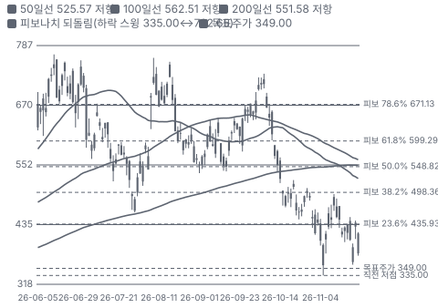

**주봉**

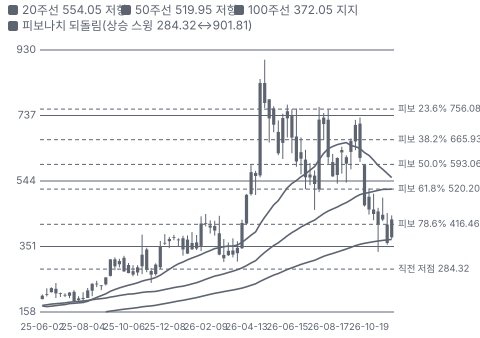

**월봉**

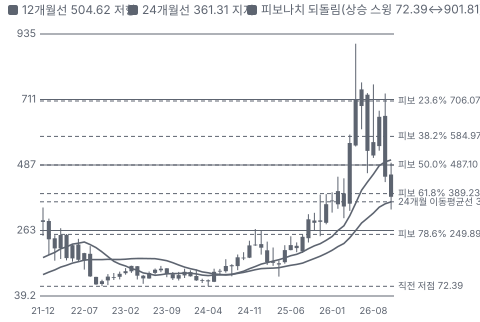

**분기 매출·EPS 실적과 컨센서스**

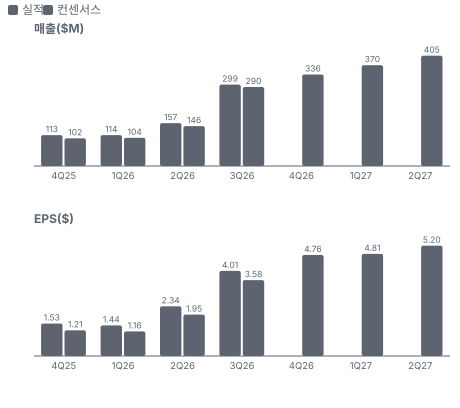

**4Q26 매출 — 지표 추세 vs 가이던스·컨센서스**

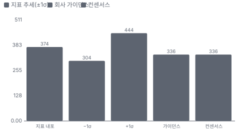

**최근 4개 분기 주가 변화 분석**

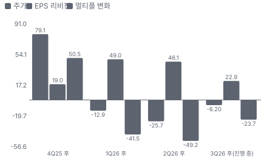

**EPS 리비전**

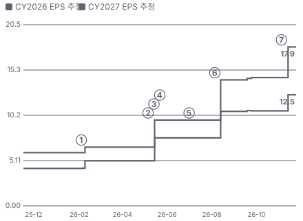

① 26-02-04 4Q25 실적 · Renesas 타이밍 사업 인수 발표 · EPS 리비전 +10%
② 26-05-06 1Q26 실적 · EPS 리비전 +46%
③ 26-05-14 대주주 MegaChips 지분 \$312M 매각(Form 4) · 실적 창과 겹침
④ 26-05-22 0% 전환사채 \$1.35B 발행(8-K) — 인수 현금 조달 · EPS 리비전 +0%
⑤ 26-07-01 TPD 인수 종결 — 3.56M주 발행 · EPS 리비전 +0%
⑥ 26-08-05 2Q26 실적 · 3Q 가이던스 \$285~295M · EPS 리비전 +47%
⑦ 26-11-04 3Q26 실적 · 4Q 가이던스 \$331~341M · 3대1 분할 · EPS 리비전 +24%

**멀티플 프리미엄(Fwd 1Y P/E, 최근 4개 분기말 절대값 — 대상 vs 동종 중앙값)**

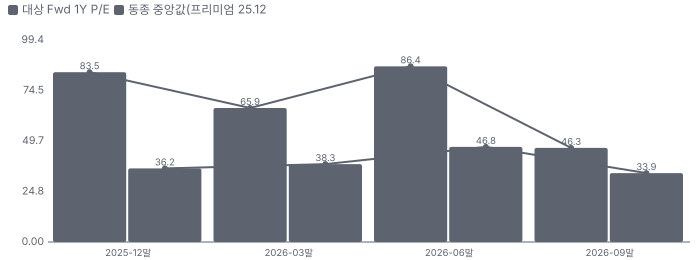

**합리적 멀티플**

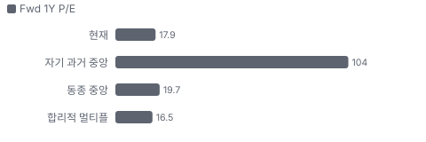

**밸류에이션 주가 시나리오**

**주가별 업사이드**

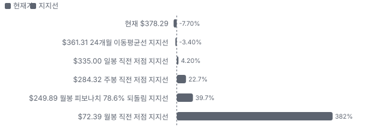
- 제품·서비스 포트폴리오

**고객 믹스(3Q26, 매출 대비)**

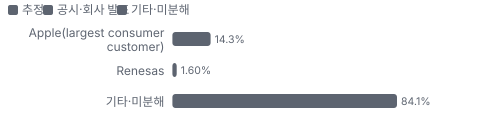

**공급 병목(10점, 낮을수록 병목)**

**어닝콜 변화별 주주가치 영향**

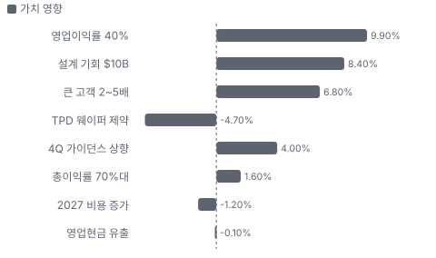

**매출 → 매출총이익 → 영업이익(매출 = 100, 최근 4분기)**

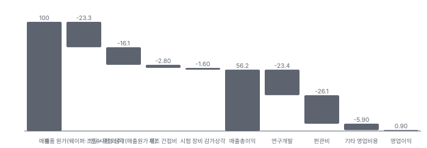

**분기 비용 비중 추이(매출 대비, 공시)**

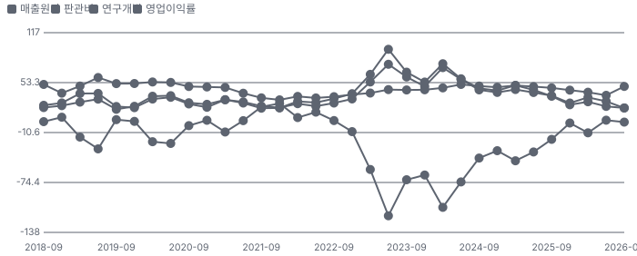

**비용 요인별 매출 대비 비중 1년 변화**

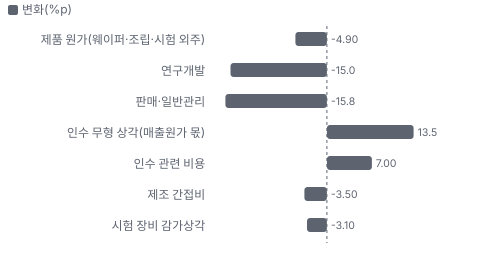

**타이밍 반도체 전체(전사) BOM 원가 몫**

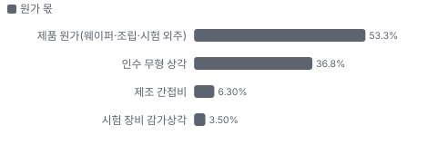

**BOM 항목 가격 +10% 시 OPM 변화**

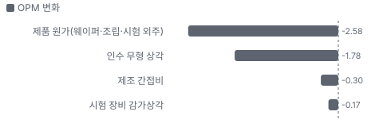

**자산 구성 — 3Q26 분기말 투하자본 \$4.57B**

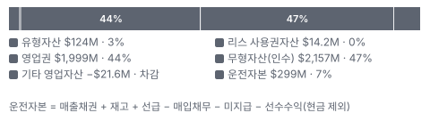

**자산별 변화율 — 최근 12개 분기(4Q23 = 0%) + 다음 4개 분기 추정**

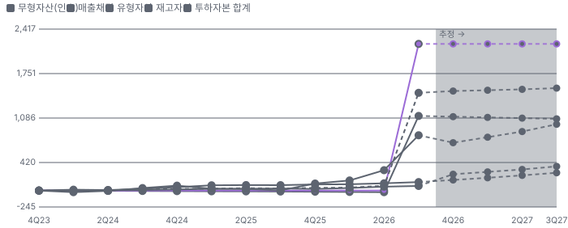

**ROIC 추이 — TTM, 최근 12개 분기 + 다음 4개 분기 추정(컨센서스 NOPAT) · 투하자본이 0 근처라 ROIC가 ±100%를 넘는 분기는 비움**

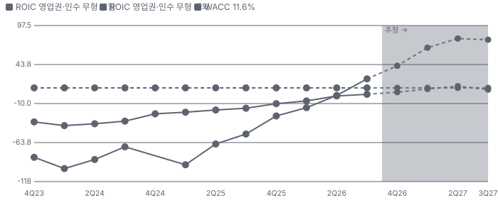

**Renesas 타이밍 사업(TPD) 인수 효과 — 인수 전 EPS 대비 %, 굵은 선 = 합계 · 시너지 가치 \$0.29B(웃돈 미확인)**

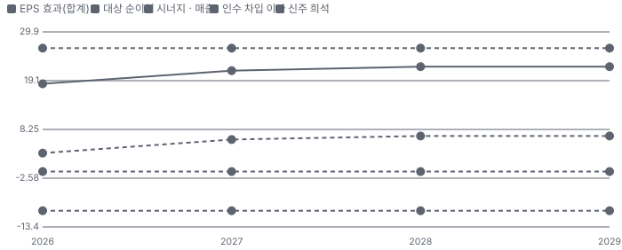

**매출 vs PPI·수출입 — 4Q22 = 100(변화율, 로그 눈금)**

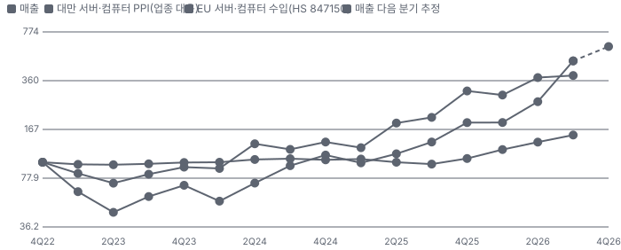

**10년 P·Q 사이클 — 추세(HP 필터) 대비 갭과 8분기 전망**

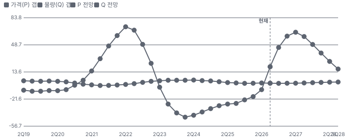

**매출 증가율의 가격·물량 분해와 8분기 전망(전년 대비)**

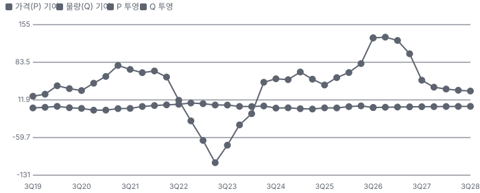

**목표주가 산정 — 기본 시나리오, 도달 확률 약 49%**

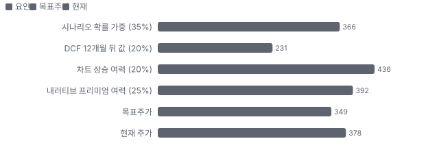

**PEG — 성장 대비 멀티플(낮을수록 성장 대비 쌈)**

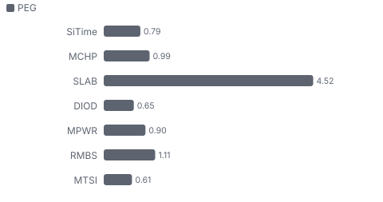

**커뮤니티 언급 수(최근 30일, 채널별)**

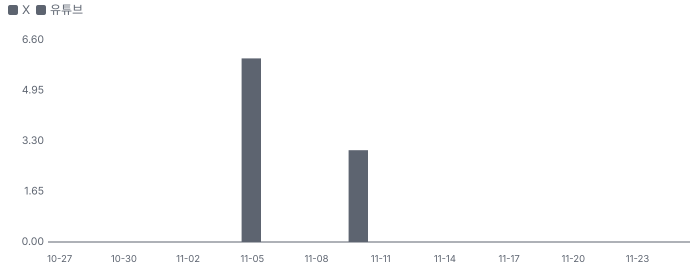

**재고 일수 — 분기별(수주 자료가 없어 수주/출하 비율 없음)**

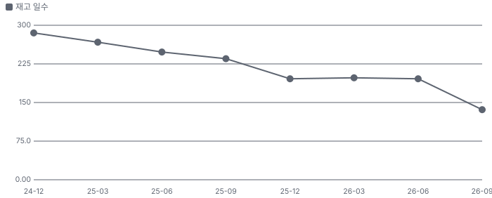

**일별 거래량 분해**

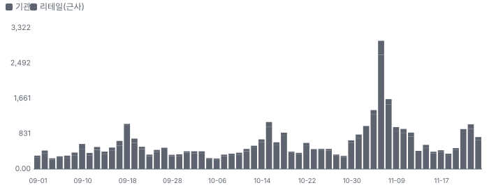

**기관 자금 흐름**

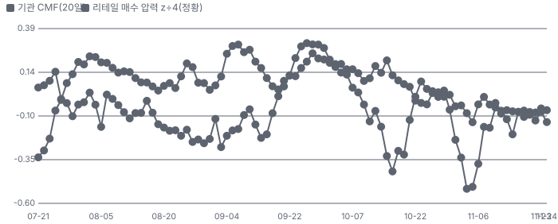

**몬테카를로**

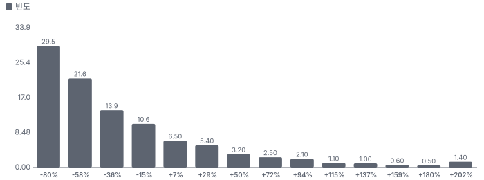

해석: 3,000번 중 696번(23%)에서 가치가 지금 주가 이상이었다. 가정을 흔들어도 지금 주가를 뒷받침하지 못하는 경우가 더 많다. 가운데 값은 0.52배이고, 열 번 중 여덟 번은 0.18~1.56배 사이에 든다.

## 내러티브

> **기업가치를 결정하는 이야기:** 값을 정하는 것은 세 가지다. ① 데이터센터·통신 매출이 2027년에도 분기마다 늘어나는가 — 회사는 가장 큰 고객들의 2027년 전망이 2~5배로 늘었다고 했지만 확정 주문 비중은 밝히지 않았다. ② TPD 웨이퍼 제약이 언제 풀리는가 — 회사는 2027년 내내 제약이라고 했다. ③ 비GAAP 매출총이익률 70%와 영업이익률 40%가 2027년 영업비용 증가를 견디는가. 셋 다 2027년 2월(추정) 4Q 실적의 1Q27 가이던스에서 처음 확인된다.

> **멀티플·EPS 프리미엄**
> **멀티플:** Fwd 1Y P/E 17.9배(높은 쪽 EPS 추정 \$21.1 기준 — 애널리스트 평균 \$17.9로는 21.2배), Fwd 2Y 14.6배, Fwd 3Y 11.3배. 동종 6사 중앙 19.7배보다 9% 낮다. 애널리스트 평균 기준으로 9월 말에는 46배였다
> **EPS:** 애널리스트 평균 FY2027 EPS는 2Q 콜 직전 \$9.69에서 \$17.94로 올랐다 — 대부분 7월에 들어온 TPD와 두 분기 연속 가이던스 상회 몫이다. 같은 기간 주가는 \$543에서 \$378로 30% 내렸다

### 투자자들은 왜 열광했나

5월 6일 1Q 실적 다음 날 +27.9%, 5월 11일 종가 \$901.48까지 올랐다 — AI 추론 인프라의 타이밍 탑재량이 학습용의 몇 배라는 설명과 TPD 인수 기대가 겹쳤다. 식은 계기는 넷이다. 5월 중순 대주주 MegaChips의 \$312M 매각과 전환사채 \$1.35B 발행, 소형 성장주 펀드들의 차익 실현(2Q 펀드 레터), 10월 한 달 −31%로 이어진 AI 하드웨어 배수 하락, 그리고 11월 4일 3Q 콜의 'TPD 웨이퍼 제약이 2027년 내내'와 '2027년 영업비용 순차 증가'다. 실적이 가이던스를 넘었는데 다음 날 −12.0%였다.

### 무엇이 기업가치를 바꾸나

> **구조적 체질 변화**
> **변화:** 비GAAP 영업이익률이 1년 새 18.5%에서 43.4%로 올랐고 회사는 '지속 가능한 40%'를 새 기준으로 내놨다. 매출의 60% 이상이 데이터센터·통신이 되면서 스마트폰 한 고객에 기대던 구조에서 벗어났다(최대 최종 고객 22% → 17% → 3Q 약 14%)
> **증거:** 3Q26 실적 보도자료(8-K EX-99.1) · FY2025 10-K · 3Q26 어닝콜(2026-11-04)
> **반증:** 비GAAP 영업이익률이 40% 아래로 내려간다

> **고부가 믹스 확장**
> **변화:** MHz 발진기(\$1~2)에서 GHz 발진기(\$6~8)와 클록으로 구성이 옮겨 가며 비GAAP 매출총이익률이 58.8%에서 70.7%로 올랐다. 10-Q는 제품 구성 효과를 +5.3%p, 매출 레버리지를 +7.4%p로 적는다
> **증거:** 3Q26 10-Q 경영진 논의 · 3Q26 어닝콜(2026-11-04)
> **반증:** 비GAAP 매출총이익률 68% 하회

> **기술 혁신**
> **변화:** 광학이 연산 칩 쪽으로 붙는 네 구조(XPO·코히런트·NPO(광 엔진을 스위치 칩 바로 옆 기판에 올리는 구조)·CPO(광 엔진을 스위치·연산 칩과 한 패키지에 넣는 구조))에서 타이밍 탑재량이 2~3배, 판매가가 최대 5배가 된다고 회사가 밝혔고 네 분야 모두 설계 채택을 확보했다. 양산 시점은 제시하지 않았다
> **증거:** 3Q26 어닝콜(2026-11-04) · 회사 보도자료(2026-11-17, 클록 2개 제품군)
> **반증:** 2027년 가이던스에 새 구조 매출이 잡히지 않는다

> **실행 속도**
> **변화:** 해당 없음(납품 리드타임 수치를 회사가 공시·콜에서 밝히지 않는다) — 10-K는 MEMS 제품을 미리 만들어 둔 뒤 고객별로 주파수를 써넣는 방식이라 리드타임이 짧다고만 적는다. TPD 쪽은 웨이퍼 제약으로 2027년 내내 수요를 다 못 댄다
> **증거:** FY2025 10-K Item 1 · 3Q26 어닝콜(2026-11-04)
> **반증:** TPD 제약이 2027년 하반기에도 '심함'으로 남는다

> **M&A**
> **변화:** 2026-07-01 Renesas 타이밍 사업을 \$4.0B(현금 \$1.5B + 3.56M주)에 인수. 3Q TPD 매출 \$86.3M(+67%)은 발표 때 계획(12개월 \$300M)을 연환산으로 15% 웃돈다. 대가로 영업권 \$1.9B·무형자산 \$2.1B가 생겨 2027년 상각만 \$225M이다
> **증거:** 3Q26 10-Q Note 2 · 인수 종결 8-K(2026-07-01)
> **반증:** TPD 매출 순차 감소 또는 영업권 손상

> **정책·입법 연관성**
> **재정정책:** 해당 없음(보조금·세액공제를 받지 않는다 — 10-K·10-Q에 CHIPS(미국 반도체지원법)·정부 지원 언급 없음) FY2025 10-K · 3Q26 10-Q
> **행정명령:** 해당 없음(관세·무역 정책은 3Q26 10-Q 위험 요인에 새로 들어갔지만 영향 수치는 공시하지 않았다 — 출하지 기준 매출의 93%가 미국 밖) 3Q26 10-Q Item 1A
> **연관입법:** 해당 없음 — 연결되는 법안을 확인하지 못했다 FY2025 10-K

> **고객의 지출 예산**
> **변화:** 매출의 약 70%가 하이퍼스케일러·AI 서버 설비투자에서 나온다 — AI 설비투자가 줄면 가장 먼저 흔들리는 구조다
> **사업별 예산:** **매출의 43%**: 데이터센터·통신용 타이밍 — 고객 CAPEX(하이퍼스케일러·통신사의 서버·스위치·광모듈 설비투자) · 동인: AI 랙 출하, 800G(초당 800기가비트를 보내는 광모듈 세대) → 1.6T(초당 1.6테라비트를 보내는 다음 세대 광모듈) 전환
**매출의 29%**: TPD 클록·버퍼(클록 신호를 약해지지 않게 여러 곳으로 복사해 보내는 반도체) — 고객 CAPEX(데이터센터·통신 장비 설비투자(TPD 매출의 80% 이상)) · 동인: 서버·네트워크 장비 출하
**매출의 17%**: 모바일·IoT(사물인터넷 — 인터넷에 연결된 소형 기기)·소비자용 타이밍 — 고객 해당 없음(스마트폰·웨어러블 제조원가(부품비) — 설비투자도 운영비도 아니다) · 동인: 스마트폰 고객의 탑재 플랫폼 수
**매출의 12%**: 차량·산업·항공방산용 타이밍 — 고객 혼합(완성차·산업 장비 부품비와 방산 조달 예산) · 동인: 차량 전장화, 방산 프로그램
> **증거:** 3Q26 어닝콜(2026-11-04) — 기존 사업 데이터센터·통신 \$127.3M + TPD \$86.3M의 80% 이상
> **반증:** 하이퍼스케일러 2027년 설비투자 가이던스 하향

### 내러티브 근거

> 'AI 데이터센터가 광학·동기화로 갈수록 정밀 타이밍 탑재량이 늘고, TPD 인수로 발진기부터 클록까지 다 가진 회사가 됐다'가 프리미엄 이야기다. 반대편에는 AI 하드웨어 사이클 고점 우려, 공급 제약, 내부자 매도가 있다. 셀사이드는 전원 매수인데 주가는 고점의 42%다. 동종 대비 멀티플 차이 -9% 중 회사 고유 몫은 +9%다. 단계는 확산, 쏠림은 중간이다.

> **AI 광학·동기화 탑재량 확대** · 강화
> **논리:** 800G → 1.6T, NPO·CPO·코히런트로 갈수록 시스템당 발진기·클록 수와 ASP가 함께 는다
> **숫자:** 코어 CED \$127.3M(+202% YoY), 10개 분기째 세 자릿수 성장(2Q 9개 분기 + 3Q). GHz 발진기(기가헤르츠대 주파수를 내는 고속 통신용 발진기) \$6~8 vs MHz(메가헤르츠 — 1초에 100만 번 진동하는 주파수 단위) \$1~2
> **반증:** CED 순차 성장이 2개 분기 연속 멈추거나 1.6T 전환에서 점유율이 늘지 않을 때
> **출처:** 3Q·2Q 어닝콜

> **TPD 인수 — 타이밍 풀 포트폴리오** · 강화
> **논리:** 발진기(SiTime) + 클록·버퍼(TPD)를 함께 팔아 고객당 탑재량과 아키텍처 영향력이 커진다
> **숫자:** TPD 3Q \$86.3M(+67%), 연환산 \$345M(계산) vs 인수 당시 \$300M. 총이익률 70.7%. 최대 고객 2027 전망 2~5배(회사)
> **반증:** TPD 매출이 순차 감소하거나 TSA(전환 서비스 계약 — 인수 뒤 일정 기간 판 쪽이 제조·시험·전산을 대신 맡아 주는 계약) 이관 중 공급 차질·고객 이탈이 공시될 때
> **출처:** 3Q·2Q 어닝콜

> **새 재무 모델 — 총이익률 70%·영업이익률 40%** · 강화
> **논리:** 믹스 개선과 규모로 이익률 계단이 한 단 올랐다
> **숫자:** 비GAAP 영업이익률 18%(1년 전) → 34%(2Q) → 43%(3Q). FY27 EPS 추정 \$14.93 → \$18.24(7일)
> **반증:** 비GAAP 총이익률 68% 하회 또는 2027년 영업비용 증가로 영업이익률 40% 하회
> **출처:** 3Q 어닝콜 · Alpha Vantage 추정 수집분

> **펀널 \$10B·2030년 새 SAM \$2.5B** · 유지
> **논리:** 반도체 고객과 설계 단계부터 묶여 2028~29년 성장이 이어진다
> **숫자:** 전체 펀널 \$10B(4배), 반도체 펀널 \$4B(8배) — 수주 아님
> **반증:** 펀널이 매출로 전환되는 비율·시점이 2027년 가이던스에 반영되지 않을 때
> **출처:** 3Q 어닝콜

> **(반대) AI 하드웨어 사이클 고점·디레이팅** · 강화
> **논리:** 수요가 좋아도 멀티플은 섹터 사이클을 따라 내려간다 — 실적 상향과 주가가 엇갈린다
> **숫자:** 5월 11일 종가 고점 \$901.48 → 11월 24일 \$378.29(−58%). 애널리스트 평균 기준 Fwd 1Y P/E는 9월 말 46배 → 지금 21배(높은 쪽 추정으로는 18배). 3Q 실적 다음 날 −12.0%, 11/20 −10.8% · 11/23 +21.5% · 11/24 −13.8%는 기술주 전체와 같이 움직였다
> **반증:** 실적 상향이 이어지는 가운데 Fwd 배수가 동종 대비 다시 벌어질 때
> **출처:** Seeking Alpha·MarketBeat 헤드라인, 소형 성장 펀드 2Q 레터(차익 실현·전량 매도)

> **(반대) 공급 제약·내부자 매도·통합 비용** · 유지
> **논리:** 웨이퍼 제약이 2027년 내내, 내부자는 매도 일변, 영업비용은 계속 는다
> **숫자:** 내부자 장내 매수 0·매도 151건, MegaChips \$312M 매각(5월). 3Q 영업현금 −\$6.6M
> **반증:** 1~2분기에 제약 해소가 확인되고 영업현금이 흑자로 돌아올 때(반대 내러티브 약화)
> **출처:** 3Q 어닝콜(Needham·Wolfe 질문) · Form 4 집계

### 투자 포인트

> **이익 추정은 올랐고 배수가 내려왔다**
> **명제:** 주가 −58%의 대부분은 실적 실망이 아니라 AI 하드웨어 배수 하락이다
> **숫자:** 애널리스트 평균 FY2027 EPS \$9.69(8월 5일) → \$17.94. 애널리스트 평균 기준 Fwd 1Y P/E 46배(9월 말) → 21배(높은 쪽 추정으로는 18배). 3Q 매출 \$298.7M은 가이던스 상단 \$295M을 넘었다
> **시장과 다른 점:** 셀사이드 13명 전원이 매수이고 목표가 평균은 \$713이라 '시장이 간과했다'고 말할 수 없다 — 가격은 2027년 AI 설비투자 둔화를 이미 넣고 있고, 그 걱정이 틀렸는지는 고객 주문 숫자로만 가려진다
> **증명:** 1Q27 매출 가이던스 \$350M 이상, 하이퍼스케일러 2027년 설비투자 가이던스 유지
> **출처:** 3Q26 실적 보도자료(8-K, 2026-11-04) · 3Q26 어닝콜(2026-11-04)

> **TPD는 계획을 넘었지만 공급이 상한이다**
> **명제:** 2027년 매출은 수요가 아니라 TPD 웨이퍼 물량이 정한다
> **숫자:** TPD 3Q 매출 \$86.3M(+67%) — 연환산 \$345M으로 인수 계획 \$300M을 웃돈다. 회사는 웨이퍼 제약이 2027년 내내 이어진다고 밝혔다
> **시장과 다른 점:** 높은 쪽 매출 추정 \$1.72B는 분기마다 9~11% 순차 성장을 가정한다. 공급 제약과 1분기 계절성을 넣으면 분기 5% 안팎이 더 그럴듯하다고 본다 — FY2027 약 \$1.55B(추정)
> **증명:** 4Q 실적에서 TPD 제약 해소 시점 재확인, 구매 약정 \$62.9M의 증가 여부(10-K)
> **출처:** 3Q26 어닝콜(2026-11-04) · 3Q26 10-Q Note 10

> **비GAAP 이익과 주주 몫 사이의 간격**
> **명제:** 비GAAP EPS \$4.01과 GAAP EPS \$0.14의 차이는 일회성만이 아니다
> **숫자:** 3Q 주식보상 \$35.0M(매출의 11.7%), 인수 무형 상각 \$61.8M, 인수 비용 \$21.3M. 무형 상각은 2027년 \$225M, 2028~2030년에도 해마다 약 \$200M이다. 3Q 영업현금흐름은 −\$6.6M
> **시장과 다른 점:** Fwd 1Y P/E 18~21배는 주식보상을 비용으로 넣으면 22~27배(계산)다. 상각은 현금이 나가지 않지만 주식보상은 주식 수를 늘린다 — 2026년 9개월 동안 원천징수 대납에 \$161M을 썼다
> **증명:** 주식보상 ÷ 매출이 10% 아래로, 4Q 영업현금흐름 흑자 전환
> **출처:** 3Q26 실적 보도자료 조정표 · 3Q26 10-Q

### 모멘텀 생성·소멸 타임라인

**카탈리스트 달력 — 지난 사건의 주가 반응과 앞으로 확인할 숫자**
| 날짜 | 상태 | 구분 | 사건 | 반응·확인 | 결과에 따라 |
|---|---|---|---|---|---|
| 2026-02-05 | 완료 | 생성 | 4Q25 실적 · Renesas 타이밍 사업 인수 발표 | +17.9% |  |
| 2026-05-07 | 완료 | 생성 | 1Q26 실적 — 5월 11일 종가 고점 \$901.48까지 상승 | +27.9% |  |
| 2026-05-14 | 완료 | 소멸 | 대주주 MegaChips \$312M 매각 · 5월 22일 전환사채 \$1.35B 발행 | 5/15~5/19 사흘 −15.4% |  |
| 2026-08-06 | 완료 | 생성 | 2Q26 실적 — 3Q 가이던스 \$285~295M(TPD 첫 편입) | +26.6% |  |
| 2026-11-05 | 완료 | 소멸 | 3Q26 실적 — 가이던스 상회했지만 TPD 웨이퍼 제약·2027 비용 증가 언급 | −12.0% |  |
| 2026-12-07 | 예정 | 확인 | 3대1 주식분할 반영 거래 시작 | 가치 영향 없음 — 주가·주식 수·주당 수치가 3분의 1·3배로 바뀐다 | 시나리오 변화 없음 |
| 2027-01 말(예상) | 예정 | 매크로 | 하이퍼스케일러 4Q 실적 — 2027년 설비투자 가이던스 | 2027년 설비투자가 2026년보다 느는지 | 늘면 기본~강세, 줄면 약세 쪽 |
| 2027-02 초(예상) | 예정 | 확인 | 4Q26 실적 · 1Q27 가이던스 | 4Q 매출 \$331~341M, 1Q27 가이던스 \$350M 이상인지, 비GAAP 매출총이익률 70% 유지, 영업현금흐름 흑자 | \$350M 이상이면 강세 쪽, \$330M 안팎이면 기본, \$320M 아래면 약세 |
| 2027-02 말(예상) | 예정 | 확인 | FY2026 10-K — Bosch 계약 갱신, 구매 약정, 고객 집중 | Bosch 공급 계약 갱신 조건, 구매 약정이 \$62.9M에서 늘었는지 | 갱신 미확인이면 공급 위험 상향 |

### 언제 사서 언제 팔아야 할까?

**가격·조건 틀 — 가격은 밸류에이션(약세·기본·강세·목표주가)과 차트 지지 구간에서, 조건은 이벤트에서**
| 구간 | 가격 | 목표주가까지 | 약세까지 | 조건·근거 |
|---|---|---|---|---|
| 관찰 구간 | \$361~\$361 | -3% | -45% | 11월 20일 종가 \$361.24는 3Q 실적 급락 뒤 저점권이고 11월 5일 종가 \$355.00과 겹친다 — 두 번 받친 자리다. 그 아래는 2025년 11월~2026년 3월에 오래 머문 \$340~350대다 |
| 확인 뒤 | 지금 \$378 이상에서 조건 확인 | -8% | -48% | 4Q 실적에서 1Q27 매출 가이던스 \$350M 이상, 비GAAP 매출총이익률 70% 유지, 영업현금흐름 흑자 전환, TPD 제약 해소 시점이 1~2분기로 재확인 |
| 무효화 | 약세 시나리오 \$198 | - | -48% | 1Q27 가이던스가 4Q보다 낮고 TPD 제약이 '2027년 하반기에도 심함'으로 바뀌거나, 하이퍼스케일러 2027년 설비투자 가이던스가 내려간다. 또는 약세 시나리오 가격 이탈 |
| 차익 고민 2차 | \$555(강세 시나리오) | +47% | - | 목표주가 부근에서는 배수가 다시 동종 중앙 위로 올라간다 — 주식보상 비중 하락과 공급 제약 해소가 확인돼야 그 위가 설명된다 |

최근 3거래일 −10.8%·+21.5%·−13.8%로 움직였다 — 하루 변동이 큰 종목이라 실적 직후 추격은 위험하다. 12월 7일부터 분할 반영 가격으로 바뀐다 가격·조건 틀이며 매매·비중 지시가 아니다(투자 권유 아님).

## 포트폴리오

| 제품·서비스 | 구분 | 무엇 | 쓰는 곳 | 돈 버는 방식 | Mix | Mix 변화(전년 대비) |
|---|---|---|---|---|---|---|
| 데이터센터·통신용 타이밍 | 제품 | AI 서버·스위치·광모듈에 들어가는 MEMS 발진기와 클록 | 광모듈·구리 케이블 약 절반, 랙(스위치·가속기 카드·서버) 약 절반 | 3Q26 매출의 43%(\$127.3M, +202%) — GHz 발진기 개당 약 \$6~8 | 43% | 미확인 |
| TPD 클록·버퍼 | 제품 | 기준 신호를 여러 갈래로 나누고 다듬는 클록 발생기·버퍼·지터(박자 신호가 미세하게 흔들리는 정도 — 작을수록 고속 통신에 유리하다) 감쇠기(Renesas에서 인수) | 서버·네트워크 장비 기판(80% 이상), 산업·차량 | 3Q26 매출의 29%(\$86.3M, +67%) — 매출총이익률 약 70%(회사) | 29% | 미확인 |
| 모바일·IoT·소비자용 타이밍 | 제품 | 스마트폰·웨어러블용 초소형 MEMS 발진기·공진기(정해진 주파수로 떨리는 소자 — 발진기 안에서 박자의 근원이 된다) | 스마트폰 모뎀 주변, AI 스마트 글라스(2027년 양산 예정) | 3Q26 매출의 17%(\$49.5M, +133%) — 그중 최대 고객 \$42.7M | 17% | 미확인 |
| 차량·산업·항공방산용 타이밍 | 제품 | 진동·온도 변화에 강한 MEMS 발진기 | 차량 전장, 산업 장비, 위성·방산 | 3Q26 매출의 12%(\$35.5M, +76%) | 12% | 미확인 |

## 고객

> **3Q26 최대 고객 Apple(largest consumer customer) 14%, 상위 3곳 16%, 집중도 분산.** 공시·회사 발표로 확인한 몫은 매출의 2%이고, 나머지 고객 몫은 추정이거나 미분해다. 이름과 몫을 함께 확인할 수 있는 고객은 둘뿐이다. 3Q26 10-Q는 최종 고객 상위 10곳이 매출의 56%(1년 전 65%), 직접 고객인 유통사 상위 3곳(Pernas·Arrow·Quantek)이 53%(1년 전 58%)라고만 밝힌다 — TPD 편입으로 집중도가 내려갔다. FY2025 기준 최대 최종 고객은 Apple(약 17%, 회사 추정)이었다

**고객별 매출 몫(3Q26)**
| 고객 | 몫 | 변화 | 근거 |
|---|---|---|---|
| Apple(largest consumer customer) | 14% | 0%p | 추정 |
| Renesas | 2% | 미확인 | 공시 |
| 기타·미분해 | 84% | - | - |

> **Apple(largest consumer customer)** · 추정
> **사는 것:** 스마트폰·웨어러블용 MEMS 발진기·공진기
> **추정 근거:** 콜은 고객 이름을 말하지 않았다 — 10-K가 밝힌 최대 최종 고객이 Apple이고 유통사 Pernas·Quantek 물량 대부분이 Apple 제품에 들어간다는 공시로 같은 고객이라고 본다(가설)

> **Renesas** · 공시
> **사는 것:** 타이밍 부품(특수관계자 매출)
> **추정 근거:** 인수 뒤 특수관계자가 된 Renesas에 대한 매출

## 마진 구조

> **GPM 51.6%, OPM 2.8%.** 3Q25 대비 GPM -1.9%p, OPM +22.0%p. 변동비는 매출의 40%이고, 매출이 10% 늘면 OPM은 +5.2%p 움직인다. 3Q26 GAAP 매출총이익률은 51.6%(1년 전 53.5%)로 내려갔지만 인수 무형 상각을 뺀 비GAAP 기준은 70.7%(1년 전 58.8%)다. 10-Q는 GAAP 기준 −1.9%p를 인수 무형 상각 −13.6%p, 재고 평가 증액 −1.0%p, 매출 레버리지 +7.4%p, 제품 구성 +5.3%p로 나눈다. 영업이익률은 연구개발·판관비가 매출의 72%에서 42%로 내려가며 −19.2%에서 +2.8%가 됐다

> **매출 100 중 매출원가 43.8, 매출총이익 56.2(최근 4분기, 공시).** 매출원가 요인 중 제품 원가(웨이퍼·조립·시험 외주)이 매출의 25.8%로 가장 무겁고, 단가가 +10% 오르면 GPM이 -2.58%p 움직인다. 분기 회귀로 매출 1이 늘 때 매출원가는 0.45 늘고, 매출원가의 고정비 몫은 -4%다. 매출원가 요인 비중은 요인별 공시 기간 값이라 합이 최근 4분기 매출원가를 넘어, 그림에서는 0.90배로 비례 조정했다.

**비용 요인 강도 — 비중·추세·충격(+10%)·탄력**
| 비용 | 구분 | 매출 대비 | 1년 변화 | 마진 기여 | 충격 시 마진 | 매출 탄력 | 고정비 몫 |
|---|---|---|---|---|---|---|---|
| 제품 원가(웨이퍼·조립·시험 외주) | 매출원가 요인 | 25.8% | -4.9%p | +4.9%p | -2.58%p | 미확인 | 5% |
| 인수 무형 상각(매출원가 몫) | 매출원가 요인 | 17.8% | +13.5%p | -13.5%p | -1.78%p | 미확인 | 100% |
| 제조 간접비 | 매출원가 요인 | 3.1% | -3.5%p | +3.5%p | -0.31%p | 미확인 | 70% |
| 시험 장비 감가상각 | 매출원가 요인 | 1.7% | -3.1%p | +3.1%p | -0.17%p | 미확인 | 100% |
| 매출원가 | 공시 항목 | 43.8% | -4.0%p | +4.0%p | -4.38%p | 0.45 | -4% |
| 판관비 | 공시 항목 | 26.1% | -14.2%p | +14.2%p | 미확인 | 0.21 | 35% |
| 연구개발 | 공시 항목 | 23.4% | -19.2%p | +19.2%p | 미확인 | 0.19 | 42% |
| 기타 영업비용 | 공시 항목 | 5.9% | +4.0%p | -4.0%p | 미확인 | 0.07 | -57% |

매출 탄력 = 분기 비용을 매출에 회귀한 기울기(매출 1당 변동비), 고정비 몫 = 절편 ÷ 평균 비용. 표본이 8분기 미만이면 미확인. 매출원가 요인 비중은 margin 재료의 추정이 섞여 있고, 공시 매출원가와의 차이는 '기타 매출원가'로 둔다.

**GPM에서 OPM까지(GAAP — 10-Q 3개월 손익, 아래는 최근 4개 분기)**
| 기간 | GPM | 연구개발 | 판관비 | 기타 | OPM |
|---|---|---|---|---|---|
| 3Q25 | 53.5% | 35.9% | 36.6% | 0.2% | -19.2% |
| 3Q26 | 51.6% | 20.9% | 20.8% | 7.1% | 2.8% |
| 2025-12 | 56.4% | - | - | - | 1.6% |
| 2026-03 | 59.0% | - | - | - | -10.9% |
| 2026-06 | 63.0% | - | - | - | 5.2% |
| 2026-09 | 51.6% | - | - | - | 2.8% |

**비용을 움직이는 요인**
| 비용 | 요인 |
|---|---|
| 제품 원가(웨이퍼·조립·시험 외주, 매출원가) | 출하량, 파운드리 웨이퍼 단가, 제품 구성(GHz 발진기·클록 비중) · 근거 공시 |
| 연구개발(연구개발) | 엔지니어 인력(TPD 편입), 주식보상 · 근거 공시 |
| 판매·일반관리(판관비) | 영업·관리 인력, 주식보상, 인수 고객관계 상각 \$8.6M · 근거 공시 |
| 인수 무형 상각(매출원가 몫, 매출원가) | TPD 기술 \$1,600M·수주잔고 \$46M 상각 — 현금이 나가지 않는 비용 · 근거 공시 |
| 인수 관련 비용(기타) | TPD 인수 자문·통합 비용, Aura 언아웃(인수 뒤 성과에 따라 나중에 더 주는 대금) 공정가치 변동 — 일회성 · 근거 공시 |
| 제조 간접비(매출원가) | 운영 인력, 재고 평가 증액 상각 \$3.0M, 물류 · 근거 공시 |
| 시험 장비 감가상각(매출원가) | 외주처에 둔 자사 시험·제조 장비(총액 \$192.8M, 3~7년 상각) · 근거 공시 |

**타이밍 반도체 전체(전사) BOM — 매출의 100%, GPM 52%(공시 — 3Q26 GAAP 매출총이익 \$154.1M ÷ 매출 \$298.7M. 제품·사업별 원가는 공시하지 않아 전사 매출원가 구성으로 쓴다), 항목 가격 +10% 시**
| 항목 | 원가 몫 | 전가 | 제품 GPM | OPM |
|---|---|---|---|---|
| 제품 원가(웨이퍼·조립·시험 외주) | 53% | 미확인 | -2.6%p | -2.58%p |
| 인수 무형 상각 | 37% | 0% | -1.8%p | -1.78%p |
| 제조 간접비 | 6% | 미확인 | -0.3%p | -0.30%p |
| 시험 장비 감가상각 | 4% | 0% | -0.2%p | -0.17%p |

제품 원가(웨이퍼·조립·시험 외주) 가격이 +10% 오르면 영업이익은 -92.5% 움직인다. 판매가 전가를 모르는 항목은 전가 0%로 계산했다.

**BOM 항목 가격을 움직이는 것**
| 항목 | 요인 |
|---|---|
| 제품 원가(웨이퍼·조립·시험 외주) | Bosch·TSMC·UMC 웨이퍼 단가와 외주 조립·시험 단가, 출하량 — 웨이퍼와 조립·시험의 내부 몫은 미공시 · 근거 공시 |
| 인수 무형 상각 | TPD 기술 \$1,600M(11년)·수주잔고 \$46M(1년) 상각 — 가격과 무관한 고정 비용, 현금 유출 없음 · 근거 공시 |
| 제조 간접비 | 운영 인력·물류·재고 평가 증액 상각 · 근거 공시 |
| 시험 장비 감가상각 | 자사 시험·제조 장비 투자(총액 \$192.8M, 3~7년) · 근거 공시 |

물가 지수를 붙이지 못한 매출원가 항목은 제품 원가(웨이퍼·조립·시험 외주), 인수 무형 상각(매출원가 몫), 제조 간접비, 시험 장비 감가상각다(미연결).

## 자산 구성

> **3Q26 분기말 투하자본 \$4.57B** — 무형자산(인수) 47%, 영업권 44%. 최근 12개 분기(4Q23 → 3Q26) 가장 크게 늘어난 자산은 영업권(+2195%), 투하자본 합계 +1463%. 3Q27 추정 투하자본 \$4.78B(+5%, 컨센서스 매출과 회전 일수·CAPEX 강도 유지 가정). 연율 감가 비율(총액 기준)은 직전 4분기 23.84% → 최근 4분기 53.47%.

**자산·운전자본 항목별 분기말 잔액 — 최근 12개 분기와 다음 4개 분기 추정**
| 항목 | 4Q23 | 3Q25 | 3Q26(최근) | 3Q27 추정 | 12개 분기 변화 | 다음 4개 분기 변화 |
|---|---|---|---|---|---|---|
| 매출채권 | \$21.9M | \$22.5M | \$202.9M | \$239.0M | +828% | +18% |
| 재고자산 | \$65.5M | \$86.7M | \$111.4M | \$303.2M | +70% | +172% |
| 선급·기타 유동자산 | \$7.6M | \$13.2M | \$19.2M | \$50.1M | +152% | +161% |
| 매입채무 | \$8.7M | \$18.9M | \$34.1M | \$81.5M | +292% | +139% |
| 유형자산 | \$54.7M | \$99.2M | \$124.5M | \$200.4M | +128% | +61% |
| 리스 사용권자산 | \$8.3M | \$4.9M | \$14.2M | \$14.2M | +72% | +0% |
| 영업권 | \$87.1M | \$87.1M | \$1,999.1M | \$1,999.1M | +2195% | +0% |
| 무형자산(인수) | \$177.1M | \$152.1M | \$2,156.8M | \$2,077.7M | +1118% | -4% |

**자산 추정 동인 — 최근 4개 분기 평균(재무상태표 동인 모형)**
| 동인 | 값 | 곱하는 기준 |
|---|---|---|
| 매출채권 | 48일 | 매출 |
| 재고자산 | 140일 | 매출원가 |
| 선급·기타 유동자산 | 10일 | 매출 |
| 매입채무 | 38일 | 매출원가 |
| CAPEX 강도 | 7.1% | 매출(최근 4개 분기 합) |
| 분기 감가율 | 6.47% | 기초 유형자산 순액(무형 상각 제외 감가상각) |
| 매출원가율 | 43.8% | 매출(최근 4개 분기) |
| 영업권·리스 사용권·기타 | 유지 | 인수·새 리스는 공시 전 모름 |
| 인수 무형자산 | 분기 \$19.8M 상각 | 최근 4개 분기 평균 상각 |

**추정 방법:** 증권사 3표 모델(손익·재무상태표·현금흐름)의 재무상태표 동인 방식이다. 운전자본은 항목별 회전 일수(매출채권·선급·미지급·선수는 매출, 재고·매입채무는 매출원가 기준)를 최근 4개 분기 평균으로 두고 컨센서스 매출에 곱한다. 유형자산은 기초 + CAPEX − 감가상각으로 굴린다(Koller·Goedhart·Wessels 『Valuation』 재무상태표 추정). 매출 경로는 ROIC 절의 컨센서스와 같다.

**유형·무형자산 항목별 가치(2025-12-31 vs 2024-12-31)**
| 구분 | 항목 | 총액 2025-12-31 | 누적상각 | 순액 | 총액 2024-12-31 | 총액 1년 변화 | 공시 내용연수 |
|---|---|---|---|---|---|---|---|
| 유형 | 유형자산 합계(항목 미분해) | \$188.2M | 총계만 공시 | 총계만 공시 | \$142.3M | +32.2% | 미확인 |
| 영업권 | 영업권 | \$87.1M | \$0.0M | \$87.1M | \$87.1M | +0.0% | 비상각 |
| 무형 | 무형자산 합계(항목 미분해) | \$175.6M | \$28.2M | \$147.4M | \$127.6M | +37.6% | 미확인 |
| 유형 합계 | 유형자산 | \$188.2M | \$83.1M | \$105.1M | \$142.3M | +32.2% | 경과율 44%(상각 대상 기준) |

**내용연수 산식(상각 대상 유형자산 = 총액 − 토지 − 건설중)**
| 기준일 | 연 감가상각 | 상각 대상 총액 | 평균 내용연수 | 경과 연수 | 잔여 연수 | 경과율 |
|---|---|---|---|---|---|---|
| 2025-12-31 | \$23.6M | \$188.2M | 8.0년 | 3.5년 | 4.5년 | 44% |
| 2024-12-31 | \$16.1M | \$142.3M | 8.8년 | 3.7년 | 5.1년 | 42% |

산식 평균 내용연수는 8.0년. 1년 전 8.8년 → 지금 8.0년.

**분기 감가 비율(감가상각 ÷ 평균 유형자산 총액)**
| 분기 | 감가상각 | 평균 유형자산(총액) | 분기 비율 | 연율 | 연율의 역수 |
|---|---|---|---|---|---|
| 4Q24 | \$8.6M | \$133.9M | 6.45% | 25.81% | 3.9년 |
| 1Q25 | \$9.0M | \$152.8M | 5.91% | 23.66% | 4.2년 |
| 2Q25 | \$9.8M | \$167.1M | 5.85% | 23.40% | 4.3년 |
| 3Q25 | \$9.9M | \$173.6M | 5.73% | 22.91% | 4.4년 |
| 4Q25 | \$11.4M | \$182.3M | 6.27% | 25.09% | 4.0년 |
| 1Q26 | \$12.4M | \$192.1M | 6.45% | 25.80% | 3.9년 |
| 2Q26 | \$13.0M | \$203.5M | 6.39% | 25.54% | 3.9년 |
| 3Q26 | \$69.8M | \$219.8M | 31.76% | 127.04% | 0.8년 |

감가상각 기준: 손익계산서 감가상각·상각비(SEC 공시 데이터, 4분기 = 연간 − 1~3분기).

최근 4분기 연율 감가 비율 53.47%, 직전 4분기 23.84%(+124%) — 경고 문턱(-10%) 안이다.

미공시·미분해: 유형자산 항목별 총액·내용연수(10-K 주석에서 모델이 채움) · 무형자산 항목(10-K 주석에서 모델이 채움) — 이 칸은 비우고 나머지로 계산했다.

### 해석 — 자산이 어디에 쌓이고 있나

- 같은 기간 4개 분기 매출은 +286% — 매출보다 빨리 늘어난 자산: 매출채권 +828%, 영업권 +2195%, 무형자산(인수) +1118%. 이 자산의 회전율이 떨어지면 ROIC를 희석한다.
- 다음 4개 분기 CAPEX \$110.5M vs 감가상각 \$39.1M(최근 4개 분기 CAPEX 강도·감가율 유지) — 유형자산 3Q26 \$124.5M → 3Q27 \$200.4M. 투자가 감가보다 커서 자산이 쌓이는 국면이다.
- 감가 비율이 올라갔다 — 이익을 보수적으로 잡는 쪽이다(내용연수 단축·짧은 수명 자산 증가).

## ROIC

> **TTM 3Q26 ROIC는 영업권·인수 무형 포함 2.7%, 제외 24.0%**(NOPAT 마진 9.9% × 투하자본 회전율 0.28회). 최근 12개 분기 4Q23 -35.3% → 3Q26 2.7%(고점 3Q26 2.7%). 컨센서스 NOPAT으로 굴리면 3Q27 9.3%(제외 78.0%) — WACC 11.6% 대비 -2.3%p.

**ROIC 추이(TTM)와 다음 4개 분기 추정 — NOPAT ÷ 평균 투하자본(이번 분기말·4개 분기 전)**
| 분기 | 구분 | TTM 매출 | TTM NOPAT | NOPAT 마진 | 평균 투하자본 | ROIC 포함 | ROIC 제외 |
|---|---|---|---|---|---|---|---|
| 4Q23 | 실적 | \$144.0M | −\$81.8M | -56.8% | \$232.0M | -35.3% | -84.1% |
| 1Q24 | 실적 | \$138.7M | −\$90.9M | -65.6% | \$225.0M | -40.4% | -99.6% |
| 2Q24 | 실적 | \$154.8M | −\$88.2M | -57.0% | \$233.0M | -37.9% | -87.1% |
| 3Q24 | 실적 | \$177.0M | −\$85.4M | -48.3% | \$250.0M | -34.2% | -69.6% |
| 4Q24 | 실적 | \$202.7M | −\$79.6M | -39.3% | \$329.5M | -24.2% | 미확인 |
| 1Q25 | 실적 | \$230.0M | −\$72.6M | -31.6% | \$331.5M | -21.9% | -94.4% |
| 2Q25 | 실적 | \$255.6M | −\$66.7M | -26.1% | \$352.2M | -18.9% | -65.7% |
| 3Q25 | 실적 | \$281.5M | −\$59.9M | -21.3% | \$362.0M | -16.5% | -52.0% |
| 4Q25 | 실적 | \$326.7M | −\$39.5M | -12.1% | \$388.4M | -10.2% | -27.1% |
| 1Q26 | 실적 | \$379.9M | −\$25.4M | -6.7% | \$399.5M | -6.4% | -15.7% |
| 2Q26 | 실적 | \$467.9M | \$2.3M | 0.5% | \$450.4M | 0.5% | 1.1% |
| 3Q26 | 실적 | \$683.0M | \$67.7M | 9.9% | \$2,479.0M | 2.7% | 24.0% |
| 4Q26 | 추정 | \$905.7M | \$145.1M | 16.0% | \$2,531.0M | 5.7% | 42.0% |
| 1Q27 | 추정 | \$1,162.1M | \$256.8M | 22.1% | \$2,556.0M | 10.0% | 67.0% |
| 2Q27 | 추정 | \$1,409.7M | \$362.5M | 25.7% | \$2,615.1M | 13.9% | 79.6% |
| 3Q27 | 추정 | \$1,561.0M | \$436.8M | 28.0% | \$4,676.5M | 9.3% | 78.0% |

**다음 4개 분기 NOPAT — 컨센서스(세율 21%, 리스 이자 별도)**
| 분기 | 매출 | EBITA 마진 | EBITA | NOPAT(분기) | 근거 |
|---|---|---|---|---|---|
| 4Q26 | \$336.0M | 31.2% | \$104.8M | \$82.8M | 컨센서스 매출 × EBIT 마진 FY2026(조정 − 주식보상 10.0%) |
| 1Q27 | \$370.0M | 36.5% | \$135.1M | \$106.7M | 컨센서스 매출 × EBIT 마진 FY2027(조정 − 주식보상 10.0%) |
| 2Q27 | \$405.0M | 36.5% | \$147.9M | \$116.8M | 컨센서스 매출 × EBIT 마진 FY2027(조정 − 주식보상 10.0%) |
| 3Q27 | \$450.0M | 36.5% | \$164.3M | \$129.8M | 컨센서스 매출 × EBIT 마진 FY2027(조정 − 주식보상 10.0%) |

**추정 방법:** NOPAT은 컨센서스(분기 매출 추정 × 회계연도 EBIT 마진 추정)로 잡고, 조정(비 GAAP) 마진이면 주식보상 몫을 빼서 과거 실적과 같은 기준(영업이익 + 인수 무형 상각)으로 맞췄다. 이미 발표했지만 분기 보고서(10-Q)가 아직 없는 분기는 발표 실적을 쓴다. 투하자본은 자산 구성 절의 재무상태표 동인으로 굴렸다. ROIC는 4개 분기 NOPAT을 이번 분기말과 4개 분기 전 투하자본의 평균으로 나눈다 — 추정 분기의 ROIC에는 이미 나온 실적 분기가 섞여 있다.

**투하자본 항목별 회전율과 ROIC 기여(TTM 3Q26, 평균 잔액)**
| 항목 | 투하자본 | 매출 1달러당 자본 | 회전율(매출 ÷ 항목) | 자본 몫 | 이 항목을 빼면 ROIC |
|---|---|---|---|---|---|
| 운전자본 | \$201.5M | 0.30 | 3.39회 | 8% | 0.8% |
| 유형자산 | \$111.9M | 0.16 | 6.10회 | 5% | 0.8% |
| 리스 사용권자산 | \$9.6M | 0.01 | 71.47회 | 0% | 0.7% |
| 영업권 | \$1,043.1M | 1.53 | 0.65회 | 42% | 1.3% |
| 무형자산(인수) | \$1,154.5M | 1.69 | 0.59회 | 47% | 1.4% |
| 기타 영업자산 | −\$41.4M | -0.06 | 음수(자금 원천) | -2% | 0.7% |

**ROIC 세 가지 판**
| 판 | NOPAT | 투하자본 | ROIC | 무엇을 재나 |
|---|---|---|---|---|
| 영업권·인수 무형 포함 | \$18.3M | \$2,479.0M | 0.7% | 인수 웃돈까지 낸 돈에 대한 수익률 |
| 영업권·인수 무형 제외 | \$18.3M | \$281.5M | 6.5% | 본업 운영 수익률(동종 비교용) |
| 무형 자본화 조정(판관비 20%·5년, 연구개발 6년) | \$79.4M | \$2,877.8M | 2.8% | 비용으로 처리한 무형 투자를 자산으로 본 판 |
| 경제적 이익(포함판) | −\$269.4M | \$2,479.0M | 자본비용 11.6% | (ROIC − 자본비용) × 투하자본 |

NOPAT = (영업이익 \$6.0M + 인수 무형 상각 + 리스 내재 이자 \$0.6M) × (1 − 세율 21%). 리스 사용권자산을 투하자본에 넣었으므로 임차료 속 이자 몫을 영업이익에 되더했다. 현금은 영업에 필요한 몫을 따로 알 수 없어 투하자본에서 뺐다. SEC 공시 데이터 자동 초안 — 운전자본 = 매출채권 + 재고 + 선급 − (매입채무 + 미지급비용 + 선수수익), 현금 제외. 손상 누계는 공시 데이터 수록분.

투하자본 또는 NOPAT이 0 이하라 ROIC 분해는 비교 불가 — 경제적 이익으로 본다.

**무형 자본화 가정별 ROIC(2025년 지출 기준, 포함판에 더함)**
| 투자로 보는 몫 | 상각 연수 | 무형 자산 | NOPAT 조정 | 조정 ROIC |
|---|---|---|---|---|
| 판관비 20% | 2년 | \$374.3M | \$56.5M | 2.6% |
| 판관비 20% | 5년 | \$398.8M | \$61.1M | 2.8% |
| 판관비 30% | 2년 | \$391.1M | \$58.9M | 2.7% |
| 판관비 30% | 5년 | \$427.8M | \$65.7M | 2.9% |

### 해석 — 무엇이 수익성을 끌어올리고 희석하나

- 무형자산(인수): 투하자본의 47% — 빼면 ROIC 0.7% → 1.4%. 이 자산의 회전율(0.59회)이 수익성을 희석하는 주된 자리다.
- 영업권: 투하자본의 42% — 빼면 ROIC 0.7% → 1.3%. 이 자산의 회전율(0.65회)이 수익성을 희석하는 주된 자리다.
- 기타 영업자산: −\$41.4M(음수), 고객 선수금·공급사 외상이 자본을 대신 댄다 — 빼면 ROIC 0.7%로 낮아진다. 수익성을 끌어올리는 쪽이다.
- 영업권·인수 무형을 빼면 ROIC가 +5.8%p 오른다 — 과거 인수에 치른 웃돈이 주주 수익률을 그만큼 낮춘다(본업 수익률은 제외판, 인수까지 포함한 가치 창출은 포함판으로 본다).
- 비용으로 처리한 무형 투자를 자산으로 보면 ROIC가 +2.0%p 움직인다(무형 자산 \$398.8M). 투자를 늘리는 중이라 NOPAT이 더 커지는 쪽이다.
- 추정 경로 3Q26 2.7% → 3Q27 9.3%: NOPAT 마진 +18.1%p, 투하자본 회전율 +0.06회 — 컨센서스 매출·마진이 맞고 회전 일수·CAPEX 강도가 유지된다는 가정이다. 마진 추정이 내려가거나 재고 일수가 늘면 이 경로가 먼저 틀린다.
- ROIC(포함) − WACC = -8.9%p(3Q26) — 양수면 투하자본을 늘릴수록 가치가 쌓인다.

## 공급망 병목

> **공급망 신뢰성 5.6/10, 병목 주의.** 가장 약한 고리는 아날로그 회로 웨이퍼 5.6점이고, 품목 평균은 5.6점이다. 근거가 부족한 3건(TPD 웨이퍼 · MEMS 공진기 웨이퍼 · 조립·시험 외주)은 점수에서 뺐다. 점수로는 두 공급사가 모두 대만에 있는 아날로그 회로 웨이퍼가 가장 약하다. 점수에 잡히지 않는 TPD 웨이퍼는 리드타임·재인증 기간 공시가 없어 계산에서 빠졌지만, 회사가 직접 2027년 내내 제약이라고 밝힌 품목이라 실제로는 여기가 출하 상한이다. 기존 사업의 MEMS 웨이퍼는 사실상 Bosch 한 곳에서 온다

**병목과 마진 — 품목 가격 +10% 시 OPM**
| 품목 | 점수 | 판정 | 구분 | OPM |
|---|---|---|---|---|
| 아날로그 회로 웨이퍼(필수) | 5.6 | 병목 주의 | 출하 차질 위험 | 미확인 |

> **아날로그 회로 웨이퍼** · 5.6/10
> **왜:** 두 곳 모두 대만이라 지역 집중이 크다
> **병목 요인:** 인증 공급사 2곳 · 캐파 균형 · 리드타임 미확인 · 재인증 미확인 · 1위 점유율 미확인 · 대만 집중 100% · 물량 확보 복수구매
> **풀리는 조건:** 미확인

**공급사**
| 품목 | 공급사 | 몫 | 근거 |
|---|---|---|---|
| TPD 웨이퍼 | Renesas(전환 서비스 계약으로 TPD 제품용 웨이퍼 캐파 제공·조립·시험·보관) | 미확인 | 공시 |
| MEMS 공진기 웨이퍼 | Bosch(MEMS 웨이퍼 주 공급(10년 계약)) | 미확인 | 공시 |
| MEMS 공진기 웨이퍼 | Teledyne(MEMS 웨이퍼 2차 공급) | 미확인 | 공시 |
| 아날로그 회로 웨이퍼 | TSMC(아날로그 CMOS(가장 널리 쓰는 반도체 회로 제조 방식) 웨이퍼) | 미확인 | 공시 |
| 아날로그 회로 웨이퍼 | UMC(아날로그 CMOS 웨이퍼) | 미확인 | 공시 |
| 조립·시험 외주 | ASE(조립·시험) | 미확인 | 공시 |
| 조립·시험 외주 | Carsem(조립·시험) | 미확인 | 공시 |
| 조립·시험 외주 | UTAC(조립·시험) | 미확인 | 공시 |

## M&A 시너지

> **Renesas 타이밍 사업(TPD) 인수(2026-07-01, \$4.01B): 시너지가 다 나면 연 \$0.04B(확률 가중 이익 기여), 인수 배수 EV/EBITDA 20.3배 → 시너지 반영 17.0배.** 세후 시너지 가치는 통합 비용을 빼고 \$0.29B. EPS 효과는 2026년 +18.4%에서 2029년 +22.2%.

**Renesas 타이밍 사업(TPD) 시너지가 생기는 길**
| 종류 | 시너지 | 연 규모 | 완성 | 확률 | 어떻게 생기나 | 근거 |
|---|---|---|---|---|---|---|
| 매출 | TPD 매출이 인수 계획을 웃돈 몫 | \$0.04B(이익률 70%) | 2027 | 80% | TPD 3Q 매출 \$86.3M을 연환산하면 \$345M — 발표 때 제시한 종결 뒤 12개월 \$300M보다 \$45M 많다(계산). 회사가 밝힌 TPD 매출총이익률 약 70%를 적용 | 3Q26 어닝콜(2026-11-04) · 인수 발표 보도자료(2026-02-04) |
| 매출 | 발진기 + 클록 교차 판매 | \$0.05B(이익률 70%) | 2028 | 40% | SiTime 발진기와 TPD 클록·버퍼를 한 설계에 함께 넣는다 — 회사는 초기 성과만 언급하고 금액을 밝히지 않았다(추정, 근거 약함) | 3Q26 어닝콜(2026-11-04) — 금액은 추정 |

그림의 구성 요소(대상 순이익·시너지·인수 차입 이자·신주 희석)를 더하면 EPS 효과 합계다. 시너지는 세후·확률 가중이다. 시너지 가치 = 세후 이익 기여 5년 + 말기 가치(할인율 9%, 성장 0) − 통합 비용. 매출 시너지는 그 매출의 이익률만 반영하고, 모든 시너지에 실현 확률을 곱했다.

## 피터 린치 분류

> **경기순환주(Cyclical), 중형.** 린치 표의 기대 수익 10배, 하방 -80~100%, 위험 고. 10배 경로가 있는 분류다(고성장주·회생주·경기순환주).

**분류 근거 — 크기 먼저, 다음은 이야기 유형**
| 항목 | 값 |
|---|---|
| 크기 | 중형(시가총액 \$11.4B) |
| 장기 성장 | 49.4%(컨센서스 EPS 2년 CAGR) |
| 린치 비율((성장% + 배당%) ÷ P/E) | 2.75 — 2 이상 매력, 1 미만 비싸다 |
| PEG(P/E ÷ 성장%) | 0.36 — 1 적정, 0.5 매우 매력, 2 매우 불리 |
| 근거 | TTM 매출이 과거 고점 대비 54% 빠진 적이 있다 · 영업이익이 적자였다가 흑자로 돌아온 순환 이력 |
| 반대 근거 | 장기 성장률 49%로 고성장주 구간 — 순환 위의 성장주일 수 있다 |

- 점검: 재고·공급과 수요(가격)의 방향
- 점검: 경쟁사의 증설
- 점검: 이익 정점에서 P/E가 낮아 보이는 함정
- 점검: 부채가 바닥을 견딜 수 있나
- 팔 때(점검 조건, 매매 지시 아님): 재고가 쌓이고 증설이 시작되고 가격이 꺾일 때 — 정점의 낮은 P/E는 싸다는 뜻이 아니다

분류 = 피터 린치·존 로스차일드 『One Up On Wall Street』(1989)·『Beating the Street』(1993)의 6분류와 위험·보상 표를 숫자 규칙으로 옮긴 자체추론이다(config/lynch.yaml).

## 구루 교차 점검

> **여섯 관점 중 통과 2 · 미달 2 · 미확인 2.** 가장 약한 관점은 해자와 자본수익률 — 제품 경쟁력은 숫자로 보이지만 \$4.0B 인수가에 대한 수익률은 아직 자본비용 아래다 — 영업권 \$2.0B·무형자산 \$2.2B가 재무상태표의 84%다.

판정은 자체추론이고 숫자는 계산값이다.

> **성장 여지** · 통과
> **질문:** 5년 안에 매출이 2배가 될 자리가 있나, 10년 뒤에도 커지나
> **이유:** 프로포마(인수한 사업을 처음부터 가지고 있었다고 가정해 다시 만든 재무 수치) FY2026 매출 약 \$1.06B에서 FY2028 추정 \$1.76~2.35B로 연 29~49% 경로다 — 5년 2배(연 15%)를 넘는다. 다만 설계 기회 \$10B는 수주가 아니다
> **계산한 숫자:** 매출 경로 FY2026→FY2028 연 61.1%, 2배까지 1.5년
> **근거:** 컨센서스 매출 추정(2026-11-06~13) · SiTime 3Q26 10-Q · 출처 목록

> **해자와 자본수익률** · 미달
> **질문:** 경쟁우위가 무엇이고, 투하자본수익률(ROIC)이 자본비용보다 높으며 유지·상승하나
> **이유:** 인수로 투하자본이 \$4.5B가 됐다 — 다음 12개월 비GAAP 영업이익에서 주식보상과 세금을 빼면 투하자본 대비 약 10%(계산)로 자본비용 11.6%에 못 미친다. 인수 전 자산만 보면 높지만 주주가 치른 값은 인수가다
> **계산한 숫자:** ROIC 0.1% · 자본비용 11.6%
> **근거:** SiTime 3Q26 10-Q(재무상태표·Note 2) · 출처 목록

> **재투자 복리** · 미확인
> **질문:** 번 돈을 높은 수익률로 다시 넣을 곳이 있나 — 자본 배분(재투자·인수·자사주·희석) 이력은
> **이유:** 연구개발에 매출의 21%를 쓰고 설비투자는 7%다 — 번 돈의 재투자처는 인수였고 그 수익률은 TPD가 계획을 얼마나 넘느냐에 달렸다. 한 분기 실적만으로는 판정할 수 없다
> **계산한 숫자:** 설비 재투자율 0%(설비투자가 감가상각 이하 — 연구개발·인수로 하는 재투자는 이 숫자에 없다) · 소유주 이익 수익률 -1.0%(근사)
> **근거:** SiTime 3Q26 10-Q · 출처 목록

> **사람과 문화** · 미확인
> **질문:** 경영진이 주주와 같은 배를 탔나 — 창업자·내부자 지분, 기회형 내부자 매수, 문화가 경쟁우위에 기여하나
> **이유:** CEO가 19년째 이끌지만 지분은 약 1%이고 2026년 장내 거래는 매도뿐이다(사전 계획·세금 원천징수 포함). 문화에 대한 1차 자료는 없다
> **계산한 숫자:** 서류로 확인(계산 없음)
> **근거:** SiTime 2026년 위임장 · 출처 목록

> **변화의 방향** · 통과
> **질문:** 18~24개월 뒤 이익 그림이 지금과 얼마나 다른가, 유동성 국면은 그 변화를 받쳐 주나
> **이유:** 매출·매출총이익률·영업이익률·가이던스가 모두 위를 향하고 컨센서스이 올랐다. 다만 영업현금흐름은 3Q에 적자였고 TPD 공급 제약이 새로 나왔다
> **계산한 숫자:** 2년 뒤 EPS +22.8%(다음 12개월 대비) · 유동성 국면 중립
> **근거:** SiTime 3Q26 실적 보도자료(8-K) · 출처 목록

> **5배 경로와 시장이 모르는 이유** · 미달
> **질문:** 어떻게 5배 이상이 되나(이익 성장 × 배수 변화), 시장은 왜 아직 값을 안 매기나
> **이유:** 5배는 매출 약 \$7.5B, 타이밍 시장(\$11B, 회사 추정)의 68%가 필요해 경로가 없다 — 2배만 연 23% 성장이 5년 이어질 때 열려 있다
> **계산한 숫자:** 5년에 5배 = 연 38.0% · 10배 = 연 58.5% · Fwd P/E 17.9배
> **근거:** 이 리포트의 2·3·5·10배 경로 계산

**배수별로 필요한 연 성장률 — 이익 성장과 배수 변화를 합친 속도**
| 목표 | 5년 | 7년 | 10년 |
|---|---|---|---|
| 2배 | 14.9% | 10.4% | 7.2% |
| 5배 | 38.0% | 25.8% | 17.5% |
| 10배 | 58.5%(희소) | 38.9% | 25.9% |

### 보유 규율 — 가격이 아니라 지표로 유지·종료를 가른다

- 투자 논리 지표: 분기 매출 순차 성장률 · 비GAAP 매출총이익률 · TPD 웨이퍼 제약 해소 시점 · 영업현금흐름 · 주식보상 ÷ 매출
- 규칙: 가격만 빠지고 분기 매출 순차 성장과 비GAAP 매출총이익률 70%가 유지되면 논리는 살아 있다. 매출이 전 분기보다 줄거나 매출총이익률이 68% 아래로 가면 다시 본다
- 지금 주가는 일봉 1,761개 기간의 고점 대비 -58.0%, 그 기간 최대 낙폭은 -78.1%다 — 고점 대비 −50%를 넘어 재심사 구간이다. 가격이 아니라 위 지표로 유지·종료를 가른다.

여섯 관점은 베일리 기포드(성장 여지·5배 경로), 워렌 버핏(해자·재투자), 론 바론(사람), 피터 린치(분류·내부자), 스탠리 드러켄밀러(변화의 방향·유동성)의 질문을 옮긴 점검 틀이다. 유동성 국면은 중립(10년물 20일 -8bp · 하이일드 스프레드 20일 +33bp). 설비 재투자율은 설비투자에서 감가상각을 뺀 몫만 본 근사이고(연구개발·인수·운전자본은 빠진다), 소유주 이익 수익률은 유지 설비투자를 감가상각과 같다고 본 근사다. 점검 틀이며 매매·비중 지시가 아니다.

## 해자

> 해자는 정밀 타이밍 성능 차이와 한 번 설계에 들어가면 10년 넘게 쓰이는 고착이다. 다만 Bosch에서 빌린 특허는 2025~2029년에 만료되고 MEMS 웨이퍼는 한 공급사에 기대고 있다

> **정밀 타이밍 성능 우위** · 강함
> **해자:** 고속 광모듈·AI 랙이 요구하는 낮은 지터·온도 안정성에서 MEMS 방식이 수정 부품을 대체하며 점유율과 판매가가 함께 오른다
> **근거:** 3Q26 기존 사업 데이터센터·통신 매출 \$127.3M(+202%), 10개 분기째 세 자릿수 성장. 800G에서 점유율이 400G의 4배 넘게 늘었다고 회사가 밝혔다(3Q 콜). 비GAAP 매출총이익률 58.8% → 70.7%(8-K EX-99.1)
> **숫자:** GHz 발진기 약 \$6~8 vs MHz 발진기(메가헤르츠대 주파수를 내는 범용 발진기) 약 \$1~2(3Q 콜 CEO)
> **깨지는 조건:** 1.6T 전환에서 점유율이 늘지 않거나 비GAAP 매출총이익률이 68% 아래로 내려간다

> **설계 채택 고착** · 보통
> **해자:** 타이밍 부품은 기판 설계에 묶여 한 번 채택되면 그 제품 수명 동안 바꾸기 어렵다
> **근거:** FY2025 10-K — 설계 주기 6개월~3년, 제품 수명 10년 이상. 다만 고객의 장기 구매 약정은 없고 주문은 통지 없이 취소·변경할 수 있다
> **숫자:** 갱신율·재채택률 미공시
> **깨지는 조건:** 상위 10개 최종 고객 비중이 2개 분기 연속 내려가면서 매출도 줄어든다

> **발진기 + 클록 묶음** · 보통
> **해자:** TPD 인수로 발진기·공진기·클록·버퍼를 한 회사가 모두 파는 구조가 됐다
> **근거:** 인수 발표 보도자료 — 클록 제품군 10배 이상 확대, TPD 고객 1만 곳 이상. 3Q TPD 매출 \$86.3M(+67%). 교차 판매 금액은 회사가 밝히지 않았다
> **숫자:** TPD 매출총이익률 약 70%(회사)
> **깨지는 조건:** TPD 매출이 전 분기보다 줄거나 전환 서비스 이관 중 고객 이탈이 공시된다

> **특허·공정 노하우** · 약함
> **해자:** MEMS 타이밍 특허와 Bosch 공정 협력
> **근거:** FY2025 10-K — 미국 등록 특허 147건(만료 2026~2043). Bosch에서 라이선스한 특허는 2025~2029년 만료. 경쟁사 Microchip·Silicon Labs도 MEMS 발진기를 판다
> **숫자:** 특허 147건
> **깨지는 조건:** Bosch 특허 만료 뒤 경쟁사가 같은 공정으로 고주파 제품을 낸다

## 경영진·네트워크

> CEO Rajesh Vashist가 2007년부터 19년째 이끈다. 지분은 약 1%이고 2026년 내내 장내 매도만 있었다. 인수 대가로 주식을 받은 Renesas가 약 11.8%를 들고 이사 지명권을 가진다

> **Rajesh Vashist** · CEO·이사회 의장 · 2007-09(CEO), 2019-11(의장)
> **프로필:** Ikanos Communications CEO·의장(1999~2006). 국립공과대(루르켈라) 공학사, Marquette대 MBA. 보유 210,696주(약 1%, 2026-03-30)
> **비즈니스:** Ikanos 출신 임원(영업·사업 총괄)이 함께 일한다. Renesas CEO가 이사 지명권 보유(선임 공시는 미확인)
> **정계:** 미확인
> **동문:** 미확인
> **사모임:** 미확인

> **Elizabeth Howe** · CFO · 2023-11
> **프로필:** HP Inc.에서 17년 — 최고감사책임자, IR 총괄, 그래픽 솔루션 사업 CFO. Stanford 공학 학·석사
> **비즈니스:** HP 재무 조직 출신
> **정계:** 미확인
> **동문:** 미확인
> **사모임:** 미확인

**네트워크 정량화**
| 연결 | 강도 | 닿는 매출 | 가중 노출 | 매출 대비 | 근거 |
|---|---|---|---|---|---|
| 비즈니스: Renesas — 인수 대가로 3,558,691주(약 11.8%, 계산)를 받은 주주이자 TPD 웨이퍼·조립·시험을 대는 공급사, 이사 지명권 보유 | 5/5 | \$0.34B | \$0.34B | 51% | TPD 3Q 매출 \$86.3M 연환산 \$345M(계산) — 이 매출의 생산이 Renesas 전환 서비스에 걸려 있다 3Q26 10-Q Note 2·12 · 인수 종결 8-K(2026-07-01) |
| 비즈니스: MegaChips — 옛 모회사이자 주요 주주(2026-03-30 13.0%), 5월 \$312M 매각 | 4/5 | 미확인 | 미확인 | 미확인 | 매출 연결은 공시에 없다 — 주식 수급(오버행) 쪽 연결이다 2026년 위임장 · Form 4(2026-05) |
| 비즈니스: Bosch — MEMS 웨이퍼 10년 공급 계약과 특허 라이선스 | 5/5 | \$0.85B | \$0.85B | 124% | 기존 사업 3Q 매출 \$212.4M 연환산 \$850M(계산) — MEMS 제품 전부가 Bosch·Teledyne 웨이퍼에 의존 FY2025 10-K Item 1 |

가중 노출은 연결이 닿는 매출의 크기다. 연결이 그 매출을 만들었다는 뜻이 아니며, 인과는 공개 자료로 입증하지 못한다.

## 약세 논리 및 셀온 조건

| 약세 논리 | 근거 | 가를 자료 |
|---|---|---|
| AI 설비투자 사이클 고점 | 매출의 약 70%가 데이터센터·통신이다(기존 사업 \$127.3M + TPD의 80% 이상). 10월 한 달 −31%와 11월 급등락은 회사 사건 없이 기술주와 같이 움직였다. 수주잔고·수주 대 출하 비율을 공시하지 않아 주문 둔화를 미리 볼 방법이 없다 | 하이퍼스케일러 2027년 설비투자 가이던스(2027년 1~2월) · 1Q27 매출 가이던스 |
| 공급이 성장을 막는다 | TPD 웨이퍼 제약이 2027년 내내 이어진다고 회사가 밝혔다. TPD 제조·시험·보관은 Renesas 전환 서비스에 기대고, 기존 사업의 MEMS 웨이퍼는 Bosch 한 곳이 주 공급원이며 계약 초기 만기가 2027년 2월이다. 구매 약정은 \$28.1M에서 \$62.9M으로 늘었다 | 4Q 콜의 TPD 제약 해소 시점 · FY2026 10-K의 Bosch 계약 갱신·구매 약정(2027년 2월 추정) |
| 비GAAP 이익이 주주 몫을 부풀린다 | 3Q GAAP EPS \$0.14, 비GAAP \$4.01. 차이는 인수 무형 상각 \$61.8M, 주식보상 \$35.0M(매출의 11.7%), 인수 비용 \$21.3M이다. 상각은 2027년 \$225M으로 이어지고, 2026년 9개월 동안 주식보상 원천징수 대납에 현금 \$161M을 썼다. 3Q 영업현금흐름은 −\$6.6M | 4Q 영업현금흐름 · 주식보상 ÷ 매출(4Q 실적) |
| 인수가를 못 번다 | 인수 대가 \$4.0B로 영업권 \$1.9B·무형자산 \$2.1B가 생겨 투하자본이 \$4.5B가 됐다. 주식보상과 세금을 뺀 다음 12개월 영업이익은 투하자본의 약 10%(계산)로 자본비용 11.6% 아래다 | TPD 매출 추이(4Q부터 합산 보고라 직접 확인 어려움) · 연말 영업권 손상 검사(FY2026 10-K) |
| 고객 한 곳과 유통사 집중 | 최대 소비자 고객 매출이 \$42.7M(3Q 매출의 14.3%)이고 FY2025 최대 최종 고객은 Apple(약 17%, 회사 추정)이다. 상위 3개 유통사가 매출의 53%. 고객의 장기 구매 약정은 없다 | FY2026 10-K 고객 집중 공시 |
| 주식 수급 | Renesas가 인수 대가로 받은 약 11.8%(계산)와 MegaChips 잔여 지분이 대기 물량이다. 내부자는 2026년 장내 매수 0건·매도 151건. 전환사채 \$1.35B는 전환가 \$1,040으로 외가격이라 2031년 만기 때 현금 상환 부담으로 남는다 | Renesas 등록권 행사 공시 · Form 4 |

**변이 관점.** 셀사이드 13명이 모두 매수이고 최저 목표가(\$425)도 지금 주가 위라서 '시장이 못 봤다'고 말할 자리는 아니다. 가격이 말하는 것은 2027년 AI 설비투자에 대한 의심이고, 그 의심을 숫자로 반박할 자료(수주잔고·확정 주문 비중)를 회사가 내지 않는다. 제가 다르게 보는 곳은 하나다 — ==2027년 매출의 상한은 수요가 아니라 TPD 웨이퍼 물량==이라, 높은 쪽 추정 \$1.72B는 닿기 어렵고 애널리스트 평균 \$1.43B는 지난 네 분기의 상회 폭(7~11%)을 넣지 않아 낮다. 그 사이 \$1.55B가 기본이다.

쟁점에 대한 회사 답변: 수요 지속성은 '2027·2028년까지 보인다'였고 근거로 잔고·설계 채택 금액을 들었지만 숫자는 내지 않았다. 확정 주문 비중을 묻는 질문에는 숫자로 답하지 않았다. 공급은 '심한 제약은 1~2분기에 풀린다'였다.

> **셀온 조건**
> **조건 1:** 1Q27 매출 가이던스가 4Q 실적보다 낮게 나온다(2027년 2월 초 추정) — 순차 성장이 멈춘다는 뜻이다.
> **조건 2:** 비GAAP 매출총이익률이 68% 아래로 내려가 '제품 구성으로 70%'라는 설명이 깨진다.
> **조건 3:** TPD 웨이퍼 제약이 '2027년 하반기에도 심함'으로 바뀌거나 Renesas 전환 서비스 이관 중 출하 차질이 공시된다.
> **조건 4:** 하이퍼스케일러 2곳 이상이 2027년 설비투자 가이던스를 내린다.
> **조건 5:** 4Q 영업현금흐름이 다시 적자다 — 3Q 적자가 회수 시차가 아니라는 뜻이다.
> **조건 6:** Bosch MEMS 웨이퍼 계약이 갱신되지 않거나 조건이 나빠진 것이 FY2026 10-K에서 확인된다.

## 어닝콜 변화

**직전 콜 대비 새로 나오거나 바뀐 내용 → 가치 영향**
| 항목 | 내용 | 직전 콜 | 최신 콜 | 모델 동인 이동 | 확신도 | 가치 영향 |
|---|---|---|---|---|---|---|
| 업데이트 | 4Q 매출 가이던스 | FY2026 매출 컨센서스 \$871M(3Q 발표 전) | 3Q 실적 \$298.7M + 4Q 가이던스 \$331~341M → FY2026 \$905.7M(계산) | 기준연도 매출 +\$0.04B | 0.8 | +4.0% |
| 업데이트 | 비GAAP 매출총이익률 | 67.1%, '앞으로 67~68%'(2Q 콜) | 70.7%, 4Q 약 70% ±1%p, '이 범위 유지' | 목표 이익률 +2.0% | 0.8 | +1.6% |
| 신규 | 지속 가능한 영업이익률 40% | 장기 목표 30%(2Q 34%로 이미 달성) | '지속 가능한 비GAAP 영업이익률 40%'(3Q 43.4%) | 장기 이익률 +3.0% | 0.5 | +9.9% |
| 신규 | 큰 고객들의 2027년 전망 | 언급 없음 | 가장 큰 고객들의 2027년 매출 전망 2~5배(설계 채택 기준, 확정 주문 비중 미공개) | 1년차 성장률 +4.0% | 0.5 | +6.8% |
| 신규 | 전체 설계 기회 | '크게 늘었다'(수치 없음) | 전체 \$10B(4배), 반도체 고객 \$4B 초과(8배, 2028~29년 매출화) | 성장 지속(감속 계수) +4.0% | 0.3 | +8.4% |
| 부정 | TPD 웨이퍼 공급 제약 | '앞으로 몇 분기에 걸쳐 나아진다'(2Q 콜) | '2027년 내내 제약', 심한 제약은 1~2분기 해소 예상 | 1년차 성장률 -3.0% | 0.8 | -4.7% |
| 부정 | 2027년 영업비용 | 3Q 영업비용 가이던스 \$80~85M | 4Q는 3Q 수준(\$81.6M), 2027년은 분기마다 순차 증가 | 목표 이익률 -1.5% | 0.8 | -1.2% |
| 부정 | 영업현금흐름 | 2Q 영업현금 +\$39.8M, 회수 기간 51일 | 3Q −\$6.6M, 회수 기간 61일(TPD 회수 시차, 회사는 4Q 회복 예상) | 순차입 +\$0.01B | 1.0 | -0.1% |
| **합계** | 단독 합 |  |  | 동시 적용 +27.8% |  | **+24.7%** |

**사건별 EPS 리비전**
| # | 날짜 | 구분 | 사건 | CY2026 EPS 전→후 | CY2027 EPS 전→후 | 리비전 | 주가 반응 |
|---|---|---|---|---|---|---|---|
| ① | 26-02-04 | 실적 | 4Q25 실적 · Renesas 타이밍 사업 인수 발표 | \$4.23 → \$5.09 | \$6.01 → \$6.63 | +10.2% | +17.9% |
| ② | 26-05-06 | 실적 | 1Q26 실적 | \$5.09 → \$7.68 | \$6.63 → \$9.69 | +46.2% | +27.9% |
| ③ | 26-05-14 | 내러티브 | 대주주 MegaChips 지분 \$312M 매각(Form 4) | \$5.09 → \$7.68 | \$6.63 → \$9.69 | 실적 창과 겹침 | -1.8% |
| ④ | 26-05-22 | 내러티브 | 0% 전환사채 \$1.35B 발행(8-K) — 인수 현금 조달 | \$7.68 → \$7.68 | \$9.69 → \$9.69 | +0.0% | +2.4% |
| ⑤ | 26-07-01 | 내러티브 | TPD 인수 종결 — 3.56M주 발행 | \$7.68 → \$7.68 | \$9.69 → \$9.69 | +0.0% | -5.6% |
| ⑥ | 26-08-05 | 실적 | 2Q26 실적 · 3Q 가이던스 \$285~295M | \$7.68 → \$10.67 | \$9.69 → \$14.22 | +46.8% | +26.6% |
| ⑦ | 26-11-04 | 실적 | 3Q26 실적 · 4Q 가이던스 \$331~341M · 3대1 분할 | \$10.73 → \$12.54 | \$14.49 → \$17.94 | +23.8% | -12.0% |

**추정치 수정 폭:** 최근 30일 EPS 추정은 상향 1건·하향 0건으로 **표본 적음**(순 비율 -), 90일은 상향 1건·하향 0건으로 표본 적음(-)이다. 평균이 몇 % 움직였나(리비전 크기)와 달리 몇 번 같은 방향으로 고쳤나를 본다 — 수정 1건은 애널리스트 수가 그대로인 채 컨센서스가 움직인 날(지표별 하루 1건)이라 같은 날 여러 명이 고치면 1건으로 합쳐지고, 상향 + 하향이 3건 미만이면 순 비율을 쓰지 않는다.

**추정치 수정 폭 — 열린 기간(다음 분기들·올해·내년) 컨센서스 수정 건수, 최근 30·90일**
| 지표 | 30일 상향/하향 | 30일 순 비율 | 90일 상향/하향 | 90일 순 비율 | 90일 커버리지 변화 |
|---|---|---|---|---|---|
| EPS | 1 / 0 | - | 1 / 0 | - | 2 |
| 매출 | 3 / 0 | +1.00 | 3 / 0 | +1.00 | 3 |
| EBITDA | 1 / 0 | - | 1 / 0 | - | 0 |
| EBIT | 2 / 0 | - | 2 / 0 | - | 2 |
| 전체 | 7 / 0 | +1.00 | 7 / 0 | +1.00 | 7 |

**실적 발표 예상 변동폭:** 지난 4번 실적 발표 때 주가는 하루에 평균 ±21.1%(최대 27.9%, 오른 날 3번) 움직였다.

**실적 발표 예상 변동폭 — 과거 실적 발표 다음 거래일 주가 변화**
| 분기 | 발표일 | 주가 변화 |
|---|---|---|
| 4Q25 | 2026-02-04 | +17.9% |
| 1Q26 | 2026-05-06 | +27.9% |
| 2Q26 | 2026-08-05 | +26.6% |
| 3Q26 | 2026-11-04 | -12.0% |

**해석:** 4개 구간(누적) 주가 +9% = EPS 리비전 +219% × 멀티플 -66%. 더 크게 움직인 쪽은 **EPS 리비전**이다.

## 거시 지표 싱크로율

> **EU(유럽연합) 서버·컴퓨터 수입(HS(국제 통일 상품 분류 코드) 847150)와 전사 매출 싱크로율 57%(0분기 = 약 0개월 선행, 전년 대비, 표본 29개·t 3.6·유의·신뢰 보통).** 이 지표가 내포하는 4Q26 전사 매출은 374M(±1σ 304M~444M, 지표 자기회귀 추정)다. 표본 밖 검증(최근 6개 분기)에서 지표 모델 오차는 104.3%p, 기준선(직전 증가율 지속)은 41.7%p다 — **지표가 기준선을 이기지 못해(예측력 없음) 추정은 대부분 기준선이다(지표 가중 18%).** 기준선은 인수·환율 효과의 소멸을 모르므로 회사 가이던스와 차이가 크면 가이던스 쪽 설명을 먼저 본다. 가이던스는 이보다 -10.1%(범위 안), 컨센서스는 -10.0%(범위 안)다. 매출의 60% 이상이 AI 서버·광모듈·스위치에 들어가므로 대만 서버 수출과 같이 움직여야 한다. 다만 3Q26부터 TPD 인수로 매출이 한 번에 뛰어 상관이 왜곡된다

**지표별 싱크로율(상관계수 × 100) — 위 두 줄이 제품 연관성 × 싱크로율로 고른 PPI·수출입 세부 지표**
| 지표 | 비교 대상 | 증가율 기준 | 지표 선행 | 매출(t값) | 영업이익 | 방향 일치 | 표본·신뢰 | 표본 밖 오차(지표/기준선) | 4Q26 추정 매출 |
|---|---|---|---|---|---|---|---|---|---|
| 대만 서버·컴퓨터 PPI(업종 대용) | 전사 매출 | 전년 대비 | 0분기(0개월) | 67%(t 3.8) | -34%(3분기) | 74% | 19·보통 | 77.0/41.7%p ✘ | +224.1% → 367M(나우캐스트 1개월 · 지표 범위 밖 → 범위 끝으로 제한) |
| EU 서버·컴퓨터 수입(HS 847150) | 전사 매출 | 전년 대비 | 0분기(0개월) | 57%(t 3.6) | 12%(1분기) | 69% | 29·보통 | 104.3/41.7%p ✘ | +230.0% → 374M(지표 자기회귀 추정) |
| 미국 반도체 PPI | 전사 매출 | 전년 대비 | 3분기(9개월) | -57%(t -3.6) | 11%(2분기) | 7% | 29·보통 | 63.5/41.7%p ✘ | +201.2% → 341M(확정) |

**지표 후보 15개 — 연관성(제품 품목 일치 × 대용 감점 × 매출 비중) × 싱크로율로 고른다. 후보가 많을수록 최대 상관은 우연히 부풀 수 있다**
| 후보 | 종류 | 연관성 | 매출 분기 일치 | 싱크로율(선행) | 점수 | 출처 |
|---|---|---|---|---|---|---|
| EU 서버·컴퓨터 수입(HS 847150) ✔ | 수출입 | 0.50 | 100% | 57%(0분기) | 0.28 | 자동 |
| EU 서버·컴퓨터 수출(HS 847150) | 수출입 | 0.50 | 100% | 56%(0분기) | 0.28 | 자동 |
| 대만 서버·컴퓨터 PPI(업종 대용) ✔ | PPI | 0.30 | 100% | 67%(0분기) | 0.20 | 자동 |
| 미국 서버·컴퓨터 수입(HS 847150) | 수출입 | 0.50 | 100% | 49%(2분기) | 0.19 | 자동 |
| 미국 서버·컴퓨터 수출(HS 847150) | 수출입 | 0.50 | 100% | 47%(2분기) | 0.19 | 자동 |
| 미국 개별 반도체(MOSFET(전류를 켜고 끄는 가장 흔한 트랜지스터)·트랜지스터·다이오드) 수출(HS 854129) | 수출입 | 0.50 | 100% | 42%(0분기) | 0.17 | 자동 |
| 미국 반도체 PPI | PPI | 1.00 | 100% | -57%(3분기) | 0.00 | 모델 지정 |
| 미국 서버·컴퓨터 PPI | PPI | 0.50 | 100% | -40%(4분기) | 0.00 | 자동 |
| EU 개별 반도체(MOSFET·트랜지스터·다이오드) 수출(HS 854129) | 수출입 | 0.50 | 100% | -75%(4분기) | 0.00 | 자동 |
| EU 개별 반도체(MOSFET·트랜지스터·다이오드) 수입(HS 854129) | 수출입 | 0.50 | 100% | -63%(4분기) | 0.00 | 자동 |
| 미국 개별 반도체(MOSFET·트랜지스터·다이오드) 수입(HS 854129) | 수출입 | 0.50 | 100% | -58%(4분기) | 0.00 | 자동 |
| EU 서버·컴퓨터 PPI(업종 대용) | PPI | 0.30 | 100% | -66%(3분기) | 0.00 | 자동 |

**선행 지표로 본 향후 분기 매출 전망(이미 나온 지표 값 기준, ±1σ)**
| 지표 | 대상 | 분기 | 지표 증가율 | 내포 매출 증가율 | 내포 매출 |
|---|---|---|---|---|---|
| 미국 반도체 PPI | 전사 매출 | 4Q26 | -0.8% | +32.6% | 150M(90M~211M) |
| 미국 반도체 PPI | 전사 매출 | 1Q27 | +0.6% | +16.1% | 132M(71M~193M) |
| 미국 반도체 PPI | 전사 매출 | 2Q27 | -2.5% | +52.9% | 241M(157M~325M) |
| 미국 서버·컴퓨터 수출(HS 847150) | 전사 매출 | 4Q26 | +76.2% | +81.4% | 206M(141M~270M) |
| 미국 서버·컴퓨터 수출(HS 847150) | 전사 매출 | 1Q27 | +27.0% | +46.4% | 166M(101M~231M) |
| 미국 서버·컴퓨터 수입(HS 847150) | 전사 매출 | 4Q26 | +113.0% | +95.6% | 222M(157M~286M) |
| 미국 서버·컴퓨터 수입(HS 847150) | 전사 매출 | 1Q27 | +112.9% | +95.6% | 222M(158M~287M) |
| 미국 서버·컴퓨터 PPI | 전사 매출 | 4Q26 | +0.1% | +45.7% | 165M(98M~232M) |
| 미국 서버·컴퓨터 PPI | 전사 매출 | 1Q27 | +1.0% | +39.2% | 158M(90M~226M) |
| 미국 서버·컴퓨터 PPI | 전사 매출 | 2Q27 | +0.7% | +41.4% | 223M(129M~316M) |
| 미국 서버·컴퓨터 PPI | 전사 매출 | 3Q27 | +2.7% | +27.2% | 380M(202M~558M) |
| EU 개별 반도체(MOSFET·트랜지스터·다이오드) 수출(HS 854129) | 전사 매출 | 4Q26 | +6.7% | +64.2% | 186M(137M~235M) |
| EU 개별 반도체(MOSFET·트랜지스터·다이오드) 수출(HS 854129) | 전사 매출 | 1Q27 | +8.5% | +58.8% | 180M(131M~229M) |
| EU 개별 반도체(MOSFET·트랜지스터·다이오드) 수출(HS 854129) | 전사 매출 | 2Q27 | +14.2% | +42.0% | 223M(155M~292M) |
| EU 개별 반도체(MOSFET·트랜지스터·다이오드) 수출(HS 854129) | 전사 매출 | 3Q27 | +18.7% | +28.6% | 384M(255M~513M) |
| EU 개별 반도체(MOSFET·트랜지스터·다이오드) 수입(HS 854129) | 전사 매출 | 4Q26 | +19.4% | +28.7% | 146M(89M~203M) |
| EU 개별 반도체(MOSFET·트랜지스터·다이오드) 수입(HS 854129) | 전사 매출 | 1Q27 | -3.9% | +74.2% | 198M(141M~255M) |
| EU 개별 반도체(MOSFET·트랜지스터·다이오드) 수입(HS 854129) | 전사 매출 | 2Q27 | +13.7% | +39.9% | 220M(141M~300M) |
| EU 개별 반도체(MOSFET·트랜지스터·다이오드) 수입(HS 854129) | 전사 매출 | 3Q27 | +6.2% | +54.4% | 461M(310M~612M) |
| 미국 개별 반도체(MOSFET·트랜지스터·다이오드) 수입(HS 854129) | 전사 매출 | 4Q26 | -26.5% | +100.2% | 227M(167M~286M) |
| 미국 개별 반도체(MOSFET·트랜지스터·다이오드) 수입(HS 854129) | 전사 매출 | 1Q27 | -15.1% | +80.3% | 205M(145M~265M) |
| 미국 개별 반도체(MOSFET·트랜지스터·다이오드) 수입(HS 854129) | 전사 매출 | 2Q27 | +9.9% | +36.9% | 215M(133M~298M) |
| 미국 개별 반도체(MOSFET·트랜지스터·다이오드) 수입(HS 854129) | 전사 매출 | 3Q27 | +23.8% | +12.7% | 337M(179M~494M) |
| EU 서버·컴퓨터 PPI(업종 대용) | 전사 매출 | 4Q26 | -2.1% | +71.3% | 194M(139M~249M) |
| EU 서버·컴퓨터 PPI(업종 대용) | 전사 매출 | 1Q27 | +2.2% | +21.4% | 138M(82M~193M) |
| EU 서버·컴퓨터 PPI(업종 대용) | 전사 매출 | 2Q27 | +6.3% | -26.2% | 116M(39M~193M) |
| 영국 서버·컴퓨터 PPI(업종 대용) | 전사 매출 | 4Q26 | +0.3% | +92.0% | 217M(163M~272M) |
| 영국 서버·컴퓨터 PPI(업종 대용) | 전사 매출 | 1Q27 | +2.5% | +29.7% | 147M(92M~202M) |
| 영국 서버·컴퓨터 PPI(업종 대용) | 전사 매출 | 2Q27 | +3.1% | +12.4% | 177M(101M~253M) |
| 일본 개별 반도체(MOSFET·트랜지스터·다이오드) PPI(업종 대용) | 전사 매출 | 4Q26 | -0.9% | +117.9% | 247M(199M~294M) |
| 일본 개별 반도체(MOSFET·트랜지스터·다이오드) PPI(업종 대용) | 전사 매출 | 1Q27 | +1.0% | +86.7% | 212M(164M~260M) |
| 일본 개별 반도체(MOSFET·트랜지스터·다이오드) PPI(업종 대용) | 전사 매출 | 2Q27 | +2.5% | +61.4% | 254M(188M~320M) |
| 일본 개별 반도체(MOSFET·트랜지스터·다이오드) PPI(업종 대용) | 전사 매출 | 3Q27 | +1.9% | +71.0% | 511M(386M~636M) |
| EU 개별 반도체(MOSFET·트랜지스터·다이오드) PPI(업종 대용) | 전사 매출 | 4Q26 | -2.1% | +71.3% | 194M(139M~249M) |
| EU 개별 반도체(MOSFET·트랜지스터·다이오드) PPI(업종 대용) | 전사 매출 | 1Q27 | +2.2% | +21.4% | 138M(82M~193M) |
| EU 개별 반도체(MOSFET·트랜지스터·다이오드) PPI(업종 대용) | 전사 매출 | 2Q27 | +6.3% | -26.2% | 116M(39M~193M) |

지표가 k분기 앞서면 이미 발표된 지표로 k분기 뒤까지의 매출 증가율을 회귀식으로 읽는다. 표본이 작거나 t값이 2 미만이면 전망은 참고용이다.

**지표를 고른 이유**
| 지표 | 이유 |
|---|---|
| 대만 서버·컴퓨터 PPI(업종 대용) | 서버·컴퓨터 ↔ 서버·컴퓨터 생산자물가 — 품목보다 넓은 업종 지수 |
| EU 서버·컴퓨터 수입(HS 847150) | 서버·컴퓨터 품목 일치 |
| 미국 반도체 PPI | 반도체 판매가 흐름 — 회사 판매가 대용(업종 지수) |

다음 분기 추정 = 지표 회귀와 기준선(직전 증가율 지속)을 표본 밖 오차의 역제곱으로 가중 결합한 값이다(예측 결합). 지표가 회귀에 쓴 범위를 벗어나면 범위 끝으로 자르고(외삽 제한), 세그먼트 추정은 나머지 사업을 기준선으로 더해 전사로 바꾼다. 싱크로율은 증가율의 상관계수이며 인과가 아니다. 지표 단위·통화는 원자료 그대로이고 나라끼리 더하지 않는다(EU 수입만 상대국 합계). ±1σ는 회귀 잔차 표준편차이고, 지표를 예측한 분기는 지표 예측 오차까지 더해 넓혔다.

## P·Q 사이클

> **10년 위치: Q형 기업(매출 갭 분산의 0%가 가격) — 가격은 추세 대비 -1.0%(회복, 10년 분위 33%), 물량은 +20.3%(확장, 분위 77%). P 프리미엄 -2%, Q 프리미엄 +24%(매출총이익이 정상(추세) 수준보다 요인별로 이만큼 높거나 낮다).** 전망으로 가격 갭은 4분기 뒤 -0.7%·8분기 뒤 +0.5%, 물량 갭은 +59.5%·+17.4%(물량은 컨센서스 몫 49%를 섞었다). 이익이 사이클 덕에 정상보다 높다 — 지금 이익에 높은 멀티플을 함께 주면 사이클을 두 번 세는 셈이다(IB는 정상 이익에 멀티플을 건다).

**10년 P·Q 사이클 위치·프리미엄**
| 항목 | 가격(P) | 물량(Q) |
|---|---|---|
| 추세 대비 갭(현재) | -1.0% | +20.3% |
| 사이클 시계 | 회복 | 확장 |
| 10년 분위 | 33% | 77% |
| 프리미엄(현재) | -2% | +24% |
| 프리미엄 4분기 뒤 | -2% | +71% |
| 프리미엄 8분기 뒤 | +1% | +21% |
| 갭 반감기 | 5분기 | 미확인 |
| 갭 4분기 뒤(80% 범위) | -0.7% (-2.6%~+1.3%) | +59.5% (+24.6%~+104.1%) |
| 갭 8분기 뒤(80% 범위) | +0.5% (-2.1%~+3.1%) | +17.4% (-11.4%~+55.6%) |
| 전망 모형 | 자기회귀모델(과거 2개 시점) | 자기회귀모델(과거 2개 시점) 정상성 보정 + 컨센서스(분기 컨센서스 4개 + 연간 컨센서스 성장률 FY2027→FY2028 +37%, 4분기 뒤 몫 49%) |

방법: P = 가격 지수 4분기 평균(미국 PPI 반도체·관련 소자 대용 — 회사 판매가가 아니라 업종 가격), Q = TTM 매출 ÷ P. 추세는 로그 레벨의 HP 필터(λ 1600)로 정상(mid-cycle) 수준을 잡는다. 프리미엄 = 요인별 매출총이익 증분 ÷ 정상 매출총이익(정상 GPM 54.1% = 10년 중앙값, 물량 증분 마진 64.6% = 전년 대비 ΔGP÷ΔRev 회귀, 가격은 전액 이익 반영). 표본 30개 TTM 분기. 전망: 가격 갭은 BIC(모형 차수를 고르는 정보 기준)로 차수를 고른 자기회귀모델(정상성 보정), 물량은 통계 갭 자기회귀모델과 컨센서스 매출 ÷ 가격 전망(매출 = P × Q)을 분산 역수로 섞는다(Bates·Granger 1969). 끝점 편향을 줄이려고 전망 경로를 이어 붙인 뒤 HP 필터를 다시 건다(Kaiser·Maravall 1999). 80% 범위는 예측 오차(TTM이 4분기씩 겹쳐 생기는 자기상관을 뉴이·웨스트 장기 분산으로 반영)와 애널리스트 범위에서 낸다. 모형 산출이며 가이던스가 아니다.

> **Q 사이클 — 최근 4분기 평균 가격 기여 -1.5%, 물량 기여 +82.3%(전년 대비 로그 증가율).** P 강도 5.0/10, Q 강도 7.0/10, 최근 8분기 중 100%가 같은 요인 우세(구조적). 전망으로는 8분기 안에 전환 신호가 없다(물량은 컨센서스를 섞었다).

**P·Q 사이클 정량**
| 항목 | 가격(P) | 물량(Q) |
|---|---|---|
| 최근 4분기 평균 기여 | -1.5% | +82.3% |
| 강도(0~10, 자기 이력 z) | 5.0 | 7.0 |
| 고유 주기(자기회귀모델 과거 2개 시점일 때) | 미확인 | 16.7분기 |
| 다음 4분기 투영 평균 | -1.5% | +101.3% |
| 4분기 뒤 투영(80% 범위) | -1.0% (-5.9%~+3.9%) | +49.4% (+17.0%~+81.8%) |
| 장기 평균(표본 → 기저율 수축) | -1.3% → +0.2% | +55.5% → +29.6% |
| 투영 모형 | 자기회귀모델(과거 1개 시점) | 자기회귀모델(과거 2개 시점) + 컨센서스(분기 컨센서스 4개 + 연간 컨센서스 성장률 FY2027→FY2028 +37%) |

가격 근거: 미국 PPI 반도체·관련 소자 대용 — 회사 판매가가 아니라 업종 가격. PPI를 쓰면 회사 판매가가 아니라 업종 가격 대용이다. 로그 증가율이라 가격·물량 기여의 합이 매출 증가율이다. 전망: 가격은 BIC로 차수를 고른 자기회귀모델에 이미 발표된 월간 가격을 먼저 넣고(나우캐스트), 물량은 자기회귀모델과 '컨센서스 매출 증가율 − 가격 전망'을 분산 역수로 섞는다. 장기 평균은 표본 평균을 장기 기저율(가격 연 2%·물량 연 4%) 쪽으로 줄인다 — 고성장 구간만 담긴 표본이 그 성장을 끝없이 잇지 않게. 범위는 4분기 겹친 표본의 자기상관을 반영한다. 모형 산출이며 가이던스가 아니다. 회사 판매가로 잴 수 없는 이유: 회사가 분기 출하량과 판매가를 공시하지 않는다 — FY2025 10-K는 매출 +61% 가운데 출하량이 +14%이고 나머지는 제품 구성에 따른 판매가 상승이라고만 밝혔다. 3Q26부터 TPD가 들어와 매출이 한 번에 90% 뛰었으므로 그 뒤 분해는 인수 효과가 섞인다

## 밸류에이션

> **목표주가 \$349, 업사이드 -8%.** 자리는 기본 시나리오이고 도달 확률은 약 49%다. 기본 \$341, 강세 \$555(+47%), 약세 \$198(-48%). DCF 기준 업사이드는 기본 -46%, 강세 +17%, 약세 -75%다(WACC 11.6%).

기본 EPS \$20.0은 컨센서스 값이 아니라 제 추정이다. 애널리스트 평균 \$17.94는 4Q 가이던스 연환산 \$19.0보다 낮아 2027년에 이익이 줄어든다는 뜻이고, 높은 쪽 \$22.0은 분기마다 9~11% 성장을 가정해 공급 제약을 덜 넣었다. 시나리오 확률은 다음 해 매출 성장 분포로 계산한 값이다.

**DCF와의 차이.** DCF 기본 시나리오 가치는 시가총액의 0.52배로 배수 경로보다 훨씬 낮다. 원인은 넷이다. DCF는 주식보상(매출의 10%)을 비용으로 빼고, 세율 21%를 처음부터 적용하며(회사는 이월결손금과 손금 인정 영업권으로 당분간 세금이 거의 없다), 자본비용이 11.6%(베타 1.59)이고, 11년차 이후 성장에는 가치를 주지 않는다. 배수 경로는 이 넷을 뺀 비GAAP EPS에 동종 배수를 곱한다. __두 값의 간격이 이 종목의 위험 크기다__ — 성장이 추정대로 가지 않으면 받쳐 줄 현금흐름 가치가 얕다.

시나리오 확률: 다음 해 매출 성장 분포로 계산 — 약세 +47.5% 아래·강세 +78.8% 위 확률. 내부 관점(컨센서스 +62.7%, σ 40.3%: 범위 62.5% ÷ d2(5) × 1.5) 100% — 외부 관점 꺼짐(SEC 전 상장사 표본 없음)

> **약세 \$198 (-48%)** · 확률 35%
> **가정:** 12.8배 × EPS \$15.50
> **근거:** 하이퍼스케일러 설비투자가 2027년에 꺾이고 TPD 제약이 하반기까지 간다. 매출 약 \$1.30B(4Q 가이던스 연환산 \$1.34B 아래), 영업비용 증가로 비GAAP 영업이익률 38% — EPS 추정 범위 하단 근처

> **기본 \$341 (-10%)** · 확률 30%
> **가정:** 17.1배 × EPS \$20.00
> **근거:** 4Q 가이던스 \$336M에서 분기 5% 안팎 순차 성장(1분기는 계절성으로 제자리), 매출 약 \$1.55B, 비GAAP 영업이익률 44%, 희석 주식 약 33M주(추정). 두 EPS 추정(\$17.9와 \$22.0) 사이다

> **강세 \$555 (+47%)** · 확률 35%
> **가정:** 21.3배 × EPS \$26.00
> **근거:** TPD 제약이 상반기에 풀리고 큰 고객들의 전망이 주문으로 바뀐다. 매출 약 \$1.85B(높은 쪽 추정 \$1.72B 위), 비GAAP 영업이익률 47% — EPS 추정 범위 상단 \$28 아래

**멀티플 선정 — Fwd 1Y P/E**
| 단계 | 조정 | 근거 |
|---|---|---|
| 동종 중앙값 | 19.7배 | 범위 12.1~47.6배, 6곳 · 이상치 제외 SLAB ev_ebitda_fwd 87.1, SLAB ev_ebitda_fwd2 77.8, SLAB ev_ebitda_fwd3 58.1, DIOD ev_sales 2.2 · 지금 배수를 오늘 가격으로 다시 잼(ev_ebitda_fwd 25.4 → 15.5, ev_ebitda_fwd2 18.9 → 11.5, ev_ebitda_fwd3 13.8 → 8.4) |
| 펀더멘털 | -8% | 성장·이익률·ROIC로 본 합리적 멀티플 16.5배와의 차이의 일부만 인정(로그 차이 × 0.5, 상한 ±20%에 부드럽게 수렴) |
| 해자 | +0% | 정밀 타이밍 성능 우위 강함 · 설계 채택 고착 보통 · 발진기 + 클록 묶음 보통 · 특허·공정 노하우 약함 — 점수 5.5%에서 동종 기준 5.5%를 뺌 |
| 반복 매출 | +0% | 재료 없음 |
| 수주 전환·가시성 | +0% | 재료 없음 |
| 내러티브 | +5% | 단계 확산 |
| 사이클·실행 판단 | -10% | 배수의 분모인 다음 12개월 EPS 추정(\$21.1)이 애널리스트 평균(\$17.9)보다 18% 높고 회사 4Q 가이던스(\$4.76)와도 주식 수 기준이 어긋난다 — 같은 배수를 높은 쪽 EPS에 곱하면 값이 부풀어 10% 낮춘다. 여기에 TPD 통합 첫해(웨이퍼 제약 2027년 내내, Renesas 전환 서비스 의존)와 비GAAP EPS가 빼는 주식보상(3Q 매출의 11.7%)이 겹친다 |
| **선정** | **17.1배** | 지금 17.9배 |

**동종 레인지**
| 회사 | Fwd 1Y P/E | Fwd 2Y P/E | Fwd 3Y P/E | 성장 | 영업이익률 | ROIC |
|---|---|---|---|---|---|---|
| MCHP | 14.2 | 12.4 | 11.7 | 23% | 38% | 14% |
| SLAB | 47.6 | 43.1 | 32.9 | 19% | 17% | 17% |
| DIOD | 12.1 | 10.2 | 9.1 | 28% | 14% | 8% |
| MPWR | 27.4 | 21.0 | 16.4 | 62% | 41% | 46% |
| RMBS | 19.1 | 16.3 | 14.3 | 18% | 47% | 46% |
| MTSI | 20.2 | 15.2 | 12.9 | 49% | 41% | 34% |
| **SiTime** | 17.9 | 14.6 | 11.3 |  |  |  |

> **PEG 0.79** — Fwd 1Y P/E 17.9배를 다음 해 EPS 성장 23%로 나눈 값, 동종 중앙 0.95(성장 대비 싸다). 성장률은 Fwd 1Y·2Y P/E에서 역산한 컨센서스라 다음 해 한 해 성장만 반영하고, 성장 지속 기간은 담지 않는다.

**PEG — Fwd 1Y P/E ÷ 다음 해 EPS 성장률**
| 회사 | Fwd 1Y P/E | 다음 해 EPS 성장 | PEG |
|---|---|---|---|
| **SiTime** | 17.9 | +23% | 0.79 |
| MCHP | 14.2 | +14% | 0.99 |
| SLAB | 47.6 | +11% | 4.52 |
| DIOD | 12.1 | +19% | 0.65 |
| MPWR | 27.4 | +30% | 0.90 |
| RMBS | 19.1 | +17% | 1.11 |
| MTSI | 20.2 | +33% | 0.61 |

지금 주가가 요구하는 5년 매출 CAGR 43%, 기본 시나리오 28%. 몬테카를로 중앙값 업사이드 -48%.

> 의사결정 보조(투자자문 아님): ① 매수 매력: 5년 보유 가정 연 기대수익 +4.6% — 주주가 요구하는 수익률(자기자본비용) 12.2%보다 -7.6%p · 요구수익률을 넘을 확률 22% · 안전마진 없음(비관적 경우(하위 10%) 가치가 시총의 18%) → 정량 신호 약함 / ② 위험 예산 지표(이론): 0% — 기대수익이 요구수익률에 못 미친다(켈리 기준 — 수익·손실 확률로 계산한 이론상 최대 노출 — 0%는 참고) · 5년 뒤 나쁜 경우(하위 10%) -68% · 30% 넘게 잃을 확률 40% / ③ 상방(5년): 평균 1.25배 · 2배 이상 확률 18% · 3배 이상 7% · 10배 이상 0% · 잘 풀린 경우(상위 10%) 2.67배 이상

## 매수 위치(일봉)

> **현재가 \$378는 '지지 근접'(가장 가까운 일봉 지지 \$335에서 ATR 0.9배 위).** 이 자리에서 목표주가까지 -7.7%, 첫 일봉 저항까지 +13.8%, 다음 지지까지 하방 -11.4%, 손익비 -0.7배.

**가격대별 업사이드(일봉 기준)**
| 가격대 | 가격 | 목표주가까지 | 첫 저항까지 | 다음 지지까지 | 손익비 | 근거 기법(강도) |
|---|---|---|---|---|---|---|
| 현재가 | \$378 | -7.7% | +13.8% | -11.4% | -0.7 | - |
| 지지 1 | \$335 | +4.2% | +28.5% | 미확인 | 미확인 | 120일 지그재그 저점 · 스윙 저점(1.8) |

**일봉 저항**
| 저항 | 가격 | 현재가 대비 | 근거 기법(강도) |
|---|---|---|---|
| 저항 1 | \$430 | +13.8% | 20일선(0.5) |
| 저항 2 | \$436 | +15.2% | 피보 23.6%(1.0) |
| 저항 3 | \$459 | +21.3% | 120일 지그재그 저점(0.8) |

일봉만 쓴다(주봉·월봉 제외). 손익비 = 목표주가까지 업사이드 ÷ 다음 지지까지 하방. 가격대별 기대값 참고표이며 매수·매도 시점 지시가 아니다.

## 애널리스트 토론

> **토론 결론 Neutral(규칙 등급 Neutral).** 규칙 등급 Neutral을 유지한다. 살아남은 반박은 둘이다 — 배수 18배는 높은 쪽 EPS 기준이라 애널리스트 평균으로는 21배라는 점, 그리고 '2~5배' 전망의 확정 주문 비중이 공개되지 않았다는 점이다. 반대로 DCF의 세율 21% 가정이 보수적이라는 반박도 받아들여져 Sell 쪽으로 옮기지 않았다

**패널 — 등급별 자리**
| 자리 | 핵심 논리 | 틀리는 조건 | 최종 투표 |
|---|---|---|---|
| Strong Buy | 매출 3.6배·영업이익률 43%인 회사가 다음 12개월 이익의 18~21배다 — 동종 중앙 아래로 내려온 것은 처음이다 | 1Q27 매출 가이던스가 4Q 실적보다 낮다 | Buy |
| Buy | 이익 추정은 오르고 배수만 내려왔다 — 공급 제약이 풀리는 2027년 상반기가 확인 시점이다 | TPD 매출이 전 분기보다 줄어든다 | Buy |
| Neutral | 수요는 강하지만 2027년 매출 추정이 \$1.43B와 \$1.72B로 갈리고 공급이 상한이다 — 1Q27 가이던스 전에는 어느 쪽인지 알 수 없다 | 1Q27 가이던스 \$360M 이상이면 Buy 쪽, \$320M 아래면 Sell 쪽 | Neutral |
| Sell | 비GAAP 이익은 주식보상과 연 \$200M대 상각을 뺀 숫자다 — 주주 몫 기준으로는 싸지 않고 매출의 70%가 AI 설비투자에 걸려 있다 | 4Q 영업현금흐름이 비GAAP 순이익의 70% 이상으로 돌아온다 | Neutral |
| Strong Sell | \$4.0B 인수를 사이클 고점에서 했다 — 영업권·무형자산이 자산의 84%이고 DCF 가치는 시가총액의 절반이다 | 2027년 매출이 \$1.7B를 넘고 영업권 손상 징후가 없다 | Sell |

**투표**
| Strong Buy | Buy | Neutral | Sell | Strong Sell |
|---|---|---|---|---|
| 0 | 2 | 2 | 1 | 0 |

> **개회 · Strong Buy**
> **발언:** 3Q 매출은 가이던스 상단을 넘었고 4Q도 순차 성장이다. 영업이익률 43%인 회사가 다음 12개월 이익의 18~21배다.

> **개회 · Buy**
> **발언:** 애널리스트 평균 FY2027 EPS는 석 달 새 \$9.69에서 \$17.94가 됐다. 같은 기간 주가는 30% 내렸다 — 내려온 것은 배수다.

> **개회 · Neutral**
> **발언:** 2027년 매출 추정이 \$1.43B와 \$1.72B로 20% 갈린다. 회사는 TPD 웨이퍼가 2027년 내내 모자란다고 했다.

> **개회 · Sell**
> **발언:** GAAP EPS는 \$0.14다. 주식보상이 매출의 11.7%이고 3Q 영업현금흐름은 적자였다.

> **개회 · Strong Sell**
> **발언:** DCF 기본 가치는 시가총액의 절반이다. 지금 가격은 5년 동안 매출이 연 45%씩 느는 경로를 담고 있다.

> **반박1 · Strong Buy → Strong Sell**
> **발언:** DCF는 세율 21%와 주식보상 10%를 다 넣은 값이다. 회사는 이월결손금과 손금 인정되는 영업권 \$1.9B로 몇 년간 세금을 거의 내지 않는다.

> **반박1 · Buy → Sell**
> **발언:** 3Q 영업현금 적자는 TPD 매출채권 회수 시차다. 회수 기간이 51일에서 61일로 늘었고 회사는 4Q 초에 회수했다고 했다.

> **반박1 · Neutral → Strong Buy**
> **발언:** 18배는 높은 쪽 EPS \$21.1 기준이다. 애널리스트 평균 \$17.9로는 21배이고 주식보상을 넣으면 22~27배다.

> **반박1 · Sell → Buy**
> **발언:** EPS 추정 상향의 큰 몫은 7월에 TPD가 들어온 효과다. 그 대가로 주식 3.56M주와 전환사채 \$1.35B가 나갔다.

> **반박1 · Strong Sell → Neutral**
> **발언:** 추정 범위 하단 \$1.40B는 4Q 가이던스 연환산 \$1.34B와 거의 같다. 2027년에 성장이 멈춘다는 가정이 이미 범위 안에 있다.

> **반박2 · Strong Buy → Neutral**
> **발언:** 지난 네 분기 매출은 매번 추정을 7~11% 넘었다. 낮은 쪽 추정은 그 패턴을 넣지 않았다.

> **반박2 · Buy → Strong Sell**
> **발언:** 인수가 \$4.0B의 62%는 주가 \$704 때 발행한 주식이다. 그 주식은 지금 \$378이라 Renesas가 손실을 지고 있고 회사가 낸 현금은 \$1.5B다.

> **반박2 · Neutral → Sell**
> **발언:** 무형 상각 연 \$200M대는 현금이 나가지 않는다. 다만 주식보상은 주식 수를 늘리므로 그 몫은 Sell의 지적이 맞다.

> **반박2 · Sell → Strong Buy**
> **발언:** '2~5배'는 설계 채택 기준이고 확정 주문 비중을 묻는 질문에 회사는 숫자로 답하지 않았다. 수주잔고도 공시하지 않는다.

> **반박2 · Strong Sell → Buy**
> **발언:** 내부자는 2026년에 한 주도 사지 않았고 MegaChips는 \$780에 \$312M을 팔았다. Bosch 계약은 2027년 2월이 초기 만기다.

> **최종 · Strong Buy** · Buy
> **발언:** 공급 제약과 주식보상 지적을 받아들인다. 1Q27 가이던스 전까지는 Buy로 낮춘다.

> **최종 · Buy** · Buy
> **발언:** 배수는 동종 아래이고 추정은 오르는 중이다. 다만 확인 숫자가 2월에야 나온다.

> **최종 · Neutral** · Neutral
> **발언:** 수요와 공급 어느 쪽도 숫자로 확정되지 않았다. 유지한다.

> **최종 · Sell** · Neutral
> **발언:** 영업현금 적자가 회수 시차라는 설명은 4Q 숫자로 확인하면 된다. 그때까지 한 단계 올린다.

> **최종 · Strong Sell** · Sell
> **발언:** DCF와 내부자 매도는 그대로다. 다만 세금 가정이 보수적이라는 반박은 맞다.

남은 반대 의견: Strong Buy 쪽 — 지난 네 분기 매출이 매번 추정을 7~11% 넘었으므로 낮은 쪽 추정이 틀릴 가능성이 높다

패널은 등급별 논리를 대표하는 자리이고 실존 IB의 의견이 아니다.

## 커뮤니티 반응

통계: 관심 급증 0.0/10(결합 Z -0.8).

> **최근 7일 언급이 없고 2월 이후 추적된 사람 글이 25건뿐이다(X 23 · 유튜브 1 · 레딧 1). 내용은 'AI 인프라의 숨은 타이밍 수혜주' 강세 논지가 대부분이고, 3Q 콜 뒤에는 공급 제약을 짚는 경계 글이 붙었다.**

**채널별 내러티브와 기대 소화**
| 채널 | 주된 이야기 | 기대 | 1차 자료 대조 | 비중 |
|---|---|---|---|---|
| X | GPU·광모듈·스위치마다 타이밍이 들어간다 — 눈에 덜 띄는 AI 인프라 수혜주, TPD로 규모까지 갖췄다 | 상향 | 확인(CED +202%·TPD +67%는 3Q 콜과 일치). '프로포마 매출 약 \$880M'은 회사 자료에서 미확인 | 70% |
| X | 3Q 콜의 공급 제약 발언(TPD 웨이퍼, 2027년까지)을 AI 거래의 경계 신호로 읽음 | 하향 | 확인(3Q 콜 CEO 답변과 일치) | 15% |
| 유튜브 | 정밀 타이밍의 사실상 독점 공급자, 시스템당 탑재량 증가 | 상향 | 과장('독점'은 아님 — 10-K 경쟁사에 Microchip·Silicon Labs·쿼츠(수정 — 기존 타이밍 부품의 재료) 업체, 부모가 10-K로 확인) | 100% |
| 레딧 | 저점 매수 뒤 장기 보유 인증 글, 댓글은 '디지털이 이미 쿼츠를 대체하지 않았나'는 의문 | 혼재 | 미확인(개인 수익 인증) | 100% |

**기대가 바뀐 시점:** 5월 1Q 실적(5/6) 뒤 '추론 인프라는 학습보다 타이밍 탑재가 2~4배'라는 콜 발언이 X에서 퍼지며 기대가 올라갔고, 7월 TPD 인수 종결로 '규모' 이야기가 더해졌다. 11/4 3Q 콜 뒤에는 실적 호조와 공급 제약 경계가 함께 돌았고 이후 언급이 끊겼다.

커뮤니티 의견은 시장 기대의 증거이지 사실이 아니며, 관심 급증은 주가·펀더멘털 변화가 아니다.

## 수주·출하·재고 사이클

> **수주 미공시 — 재고만 본다.** 재고 일수 136일(2024-12 285일에서) · 재고 전년 대비 +28% vs 매출(4개 분기) +143%.

**수주/출하 비율 × 재고 — 분기별**
| 분기 말 | B/B(분기) | B/B(4분기) | 재고 일수 | 재고 전년 대비 | 매출 전년 대비(4분기) |
|---|---|---|---|---|---|
| 2024-12 | - | - | 285 | +17% | +41% |
| 2025-03 | - | - | 267 | +11% | +66% |
| 2025-06 | - | - | 248 | +19% | +65% |
| 2025-09 | - | - | 235 | +21% | +59% |
| 2025-12 | - | - | 196 | +6% | +61% |
| 2026-03 | - | - | 198 | +10% | +65% |
| 2026-06 | - | - | 196 | +24% | +83% |
| 2026-09 | - | - | 136 | +28% | +143% |

B/B가 1을 넘으면 받은 주문이 내보낸 물건보다 많아 잔고가 쌓이고, 재고가 매출보다 빨리 늘면 수요보다 생산이 앞선다는 뜻이다. 둘을 함께 봐야 '주문이 많아 쌓이는 재고'와 '안 팔려 쌓이는 재고'를 가른다.

## 시장 평가

> **셀사이드(IB 애널리스트)**
> **한 줄:** 셀사이드는 거의 전원 매수 쪽이고 3Q 뒤 추정을 일제히 올렸다. 주가 하락 국면에서 목표가를 내린 곳은 헤드라인 기준 UBS 1곳뿐이다 — 기대가 낮지 않아 '시장이 간과했다'는 말은 성립하기 어렵다.
> **3Q 콜 질문 증권사:** 8곳 — Stifel·Needham·Roth Capital·StoneX·Rosenblatt·Goldman Sachs·Wolfe Research·Morgan Stanley — 2Q보다 넓어짐(Rosenblatt 신규)
> **의견 변경(헤드라인):** 개시 2 · 목표가 하향 1 · 재확인 2 — Rosenblatt 개시 Buy(10/20)·재확인(11/23), Needham 개시(11/5), UBS 목표가 \$650 하향(11/6, 이전 값 미확인), Stifel Buy 재확인(11/14)
> **의견 분포(2026-11-20):** Strong Buy 11 · Buy 2 · Hold 0 — 목표가 평균 \$713(중앙 \$650, 범위 \$425~900, 13명, 2026-11-23) — 지금 주가 \$378은 최저 목표가보다도 낮다
> **FY2027 EPS 추정:** \$17.9(평균) ~ \$22.0 — 애널리스트 5명 평균 \$17.94(범위 \$16.26~18.80), 다른 집계 12명 평균 \$18.24. 3Q 실적 뒤 일주일 사이 \$14.9대에서 일제히 상향
> **질문 초점 이동:** TPD 규모·보고 방식 → 공급 제약·확정 주문 비중·2027 비용 — 기대의 중심이 '인수가 큰가'에서 '수요를 다 실어 낼 수 있나'로 이동

> **바이사이드(기관 투자자)**
> **한 줄:** 기관 수는 늘었고 Fidelity가 15%까지 올렸다. 그러나 소형 성장주 펀드들은 급등 뒤 차익을 실현했고(레터에 명시), 내부자는 1년 내내 팔기만 했다. 장기 논지는 유지, 밸류에이션 부담은 인정 — 두 신호가 함께 있다.
> **13F 보유 기관(3Q26):** 552곳 — 증가 226 · 감소 176 · 순증 +0.99M주(보유 23.5M주)
> **최대 순매수:** Fidelity +575K주(지분 15.0%) — Invesco +462K(+134%), Whale Rock +187K(+33%), ClearBridge +122K, Vanguard +111K
> **최대 순매도:** Jane Street −195K — AllianceBernstein −166K(−50%), Artisan −161K(−33%), T. Rowe Price −145K(−22%), Goldman Sachs −131K
> **내부자 장내 거래:** 매수 0 · 매도 151건(이력 302건 중) — 최근: CEO 12,000주 \$7.2M(9/9), 법무책임자 3,000주 \$1.9M(9/11), 기술책임자 1,374주(10/2, 사전 계획), 8월 이사 3명 매도. 11/20·8/20은 원천징수(세금)라 매도 신호 아님
> **대주주 매각:** MegaChips(10% 주주) \$312M 매각(5/14, 주당 \$779.50) — 창업 초기 모회사의 지분 축소 — 수급 부담이었던 사건
> **펀드 레터:** 레터 51건 · 투자자 16 · 펀드 29(3Q20~3Q26) — 3Q26: Artisan 3개 펀드 '최고 확신 프랜차이즈'(그러나 13F는 −33%), Baron Technology 추가. 2Q26: TimesSquare·다른 소형 성장 펀드 '116% 급등 뒤 차익 실현', Next Century 전량 매도(밸류에이션), Osterweis '정밀 타이밍은 AI 인프라에서 저평가된 부분'

> **언론·업계**
> **한 줄:** 언론은 최근 급등락을 섹터 흐름으로 설명한다. 회사 고유 재료는 3Q 실적·분할·신제품 보도자료다.
> **11/23~24 주가 급변 기사:** +19%(11/23) → −12%(11/24) — '기술주 반등'·'기술주 전반 조정'으로 설명 — 회사 고유 사건 아님(헤드라인)
> **회사 보도자료:** 11/17 데이터센터 대역폭 업그레이드용 클록 2개 제품군(\$2B 기회, 회사 주장) — 11/23 투자자 콘퍼런스 참가 공지
> **분석 기사 논조:** '시장이 이익 잠재력을 간과'(11/24) vs '같은 AI 붐, 다른 사이클'(11/10) — 제목만 확인 — 본문 미확인
> **주식분할:** 3대1, 12/7 분할 반영 거래

## 체크리스트

| 시점 | 무엇 | 의미 |
|---|---|---|
| 2026년 12월 3~7일 | 3대1 주식분할 기준일·분할 반영 거래 | 가치 영향 없음 — 주가·주당 수치 기준이 바뀐다 |
| 2027년 1월 말~2월 초 | 하이퍼스케일러 4Q 실적의 2027년 설비투자 가이던스 | 매출의 약 70%가 걸린 수요 |
| 2027년 2월 3일(추정) | 4Q26 실적 — 매출 \$331~341M, 1Q27 가이던스, 비GAAP 매출총이익률 약 70%, 영업현금흐름 | 2027년 매출이 \$1.43B와 \$1.72B 중 어디에 가까운지 |
| 2027년 2월 말(추정) | FY2026 10-K — Bosch 계약 갱신, 구매 약정, 고객 집중, 영업권 손상 검사 | 공급 위험과 인수가 회수 |
| 2027년 1~2분기 | TPD 웨이퍼 '심한 제약' 해소 여부 | 출하 상한이 풀리는가 |
| 2027년 중 | 1.6T 광모듈·NPO·CPO 양산에서의 탑재량 | 판매가 상승이 이어지는가 |

## 출처
- 타일 대조: 목표주가 \$349·업사이드 −8%·다운사이드 −48%·손익비 1.0·구매 등급 Neutral·Fwd 1Y P/E 17.9배·동종 중앙값 19.7배·선정 배수 17.1배·기본 \$341·약세 \$198·강세 \$555·DCF 기준 업사이드 −46%·4Q26 가이던스 \$336M·\$4.76·완전 희석 시가총액 \$11.87B — 판단 문장과 같다
- 산식 대조: 데이터센터·통신 \$127.3M ÷ \$298.671M = 42.6%, TPD \$86.3M → 28.9%, 모바일·IoT·소비자 \$49.5M → 16.6%, 차량·산업·항공방산 \$35.5M → 11.9%(합 \$298.6M). 최대 소비자 고객 \$42.7M ÷ \$298.671M = 14.3%. GAAP 매출총이익률 \$154.118M ÷ \$298.671M = 51.6%(3Q25 \$44.717M ÷ \$83.567M = 53.5%). 비GAAP 영업이익률 \$129.481M ÷ \$298.671M = 43.4%. 주식보상 \$35.021M ÷ \$298.671M = 11.7%. TPD 연환산 \$86.3M × 4 = \$345.2M(계획 \$300M 대비 +15%). FY2026 보고 매출 = \$113.567M + \$157.432M + \$298.671M + \$336M = \$905.7M, 프로포마 = \$721.3M + \$336M = \$1,057.3M. Renesas 지분 3,558,691 ÷ 30,209,731 = 11.8%. Fwd 1Y P/E \$378.29 ÷ \$21.1 = 17.9배, 애널리스트 평균 \$378.29 ÷ (\$4.764 + \$4.15 + \$4.302 + \$4.644 = \$17.86) = 21.2배. 주식보상 반영 P/E = 완전 희석 시총 \$11.87B ÷ (비GAAP 순이익 \$585~692M − 주식보상 약 \$150M) = 21.9~27.3배
- 일봉 대조: 5/11 종가 고점 \$901.48(장중 고점 같은 날 \$901.81)·2025-11-25 종가 \$286.64·11/24 종가 \$378.29 — TradingView 실측 일봉. 실적 반응(모두 장 마감 뒤 발표, 접수 16:09~16:16 ET): 2/4 \$347.96 → 2/5 \$410.29 = +17.9%, 5/6 \$623.33 → 5/7 \$797.31 = +27.9%, 8/5 \$543.12 → 8/6 \$687.50 = +26.6%, 11/4 \$403.27 → 11/5 \$355.00 = −12.0%. 9/30 \$652.03 → 10/30 \$447.06 = −31.4%. 8/5 → 11/24 = −30.3%. 11/20 −10.8%(\$361.24)·11/23 +21.5%(\$438.82)·11/24 −13.8%. 5/14 \$820.21 → 5/19 \$693.66 = −15.4%
- 3대1 주식분할(기준일 2026-12-03, 분할 반영 거래 2026-12-07) 전 기준 — 이 리포트의 주가·주식 수·EPS는 모두 분할 전 값이다
- 마스터 노션 자료: 미확인 US_Data_Center_Bills_Tracker.xlsx (요지만, 외부 공유 금지)
- 마스터 노션 자료: 미확인 Data_Center_Watch_Strong_AI_Usage_Meets_a_LowerPriced_Model_Mix.pdf (요지만, 외부 공유 금지)
- 마스터 노션 자료: 미확인 Bernstein - Global Semicap - China WFE Import Tracker (Oct 2026), Imports Recovering.pdf (요지만, 외부 공유 금지)
- 마스터 노션 자료: 미확인 GS - Kioxia - Looser 2028 NAND Priced In, but Low PE and 30pct+ TSR Limit Downside - Buy.pdf (요지만, 외부 공유 금지)
- 3Q26 10-Q Note 12 — Renesas 매출 \$4.7M ÷ \$298.7M(계산) https://www.sec.gov/Archives/edgar/data/1451809/000145180926000077/sitm-20260930.htm
- 3Q26 어닝콜(2026-11-04) — 최대 소비자 고객 매출 \$42.7M ÷ 3Q 매출 \$298.7M(계산), 2Q는 \$22.8M ÷ \$157.4M. FY2025 10-K는 최대 최종 고객을 Apple(약 17%)로 밝힌다 https://www.sec.gov/Archives/edgar/data/1451809/000145180926000012/sitm-20251231.htm
- 3Q26 10-Q Note 9 — \$5.1M(1년 전 \$4.1M)
- 3Q26 10-Q Note 9 — \$53.2M(1년 전 \$3.6M)
- 3Q26 10-Q Note 9 — \$77.0M(1년 전 \$25.7M)
- 3Q26 10-Q Note 9 — \$9.2M(1년 전 \$5.5M)
- 3Q26 10-Q Note 9(매출원가 구성) https://www.sec.gov/Archives/edgar/data/1451809/000145180926000077/sitm-20260930.htm
- 3Q26 8-K EX-99.1
- SEC 공시 데이터(10-K·10-Q) 자동 초안 — scripts/tenbagger/asset_pack.py
- 3Q26 10-Q Note 2·10
- 3Q26 어닝콜(2026-11-04) · 3Q26 10-Q
- FY2025 10-K
- FY2025 10-K Item 1
- FY2025 10-K Item 1 Manufacturing
- FY2025 10-K Item 1 Manufacturing · 3Q26 10-Q Note 10
- https://www.sec.gov/Archives/edgar/data/1451809/000145180926000077/sitm-20260930.htm
- https://www.sec.gov/Archives/edgar/data/1451809/000145180926000026/sitm-20260414.htm
- https://www.sec.gov/Archives/edgar/data/1451809/000145180926000076/sitm-q326x8kxexx991.htm

_구매 등급·목표주가 모두 규칙이 계산한 모델 값으로, 개인의 보유 종목·자금 사정을 반영하지 않는다 · 공개 자료 기반 분석이며 투자 권유가 아님 · 1차 판정, 미검증 · Chiip ten-bagger_