# 텐배거 리포트 2026-11-25 — 분기 최대 이익·가이던스 상향에도 1년 새 −31% — Vistra, 2027년까지는 정해졌고 값은 2028년 텍사스가 정한다

> 2026-11-25 · Vistra(VST) · 기업: 원전·가스·석탄 발전소 약 50GW와 약 500만 소매 고객을 가진 미국 최대 독립 발전·전력 소매 회사

## Chiip View

목표주가 \$128은 지금 주가 \$120.72보다 6% 높다(구매 등급 Neutral). 실적은 좋다 — 3Q 조정 EBITDA가 \$2.38B으로 50% 늘었고, 2026년 가이던스를 올렸으며, 2027년 \$7.7~8.5B를 새로 내놨다. 2027년 발전량의 약 98%는 이미 헤지했다. 그런데도 1년 새 31% 내린 것은 이익이 아니라 배수가 내려와서다. 제 판단은 ==시장이 깎은 것은 2027년이 아니라 2028년 이후의 텍사스==라는 것이다 — 2028년 물량의 22%와 그 뒤 전부가 내려가는 ERCOT(텍사스 전력망 운영 기관) 선도 가격에 열려 있고, 주지사 교체 뒤 데이터센터 접속 심사가 가스 발전소 계약 시점을 흔든다. 그래서 기본 EBITDA는 가이던스 중간 \$8.1B 그대로 두었고, 배수는 텍사스 노출과 차입을 감안해 동종 중앙 9.9배보다 낮은 8.5배가 적용됐다. 약세 \$67까지 −44%, 강세 \$191까지 +58%다. __차입이 커서 EBITDA 배수 한 칸에 주가가 크게 움직인다__ — 인수와 우선주 상환을 넣은 순차입은 약 \$24.3B(프로포마, 계산)다. 12월 10일 ERCOT 대형 부하 일괄 심사와 2027년 2월 말(예상) 4Q 실적의 2028년 헤지 언급이 다음 갈림길이다.

## 대시보드
| 항목 | 값 | 설명 |
|---|---|---|
| 주가 | \$120.72 | 고점 대비 -33% · 1년 -31% |
| 시가총액 | \$40.97B | 완전 희석 기준 · EV \$60.32B |
| 업사이드 | +6% | 목표주가 \$128 · 다운사이드 -44% · 손익비(강세÷약세) 1.3 |
| 구매등급 | Neutral | 애널리스트 20명: Strong Buy 18 · Buy 0 · Neutral 2 · Sell 0 · Strong Sell 0 |
| 멀티플 | Fwd 1Y EV/EBITDA 8.5배 | 동종 중앙값 9.9배 |
| 가이던스 FY2027 | EBITDA \$8.10B | 컨센서스 EBITDA \$7.93B |
| 알파 | 5.1/10 | 텐배거 가능성 점수 |
| 이벤트 | ERCOT 대형 부하 일괄 심사(Batch Zero) 갱신 — 12/15 우선주 B 상환, 12/17 텍사스 PUC 회의. 다음 실적은 4Q26(2027-02 말 예상, 지난해 2/27) | 2026-12-10 |

## 한 장 요약
- **기업가치를 결정하는 내러티브** Vistra의 값은 **2028년 이후 텍사스 전력 가격과, 남은 원전·가스 용량을 얼마에 장기 계약으로 묶느냐**로 정해진다. 2026·2027년 이익은 헤지로 거의 정해져 있어 논쟁거리가 아니다.
- **투자 포인트** **[2027년까지는 정해졌다]** 2026·2027년 예상 발전량의 약 100%·98%가 헤지돼 조정 EBITDA \$7.3B → \$8.1B(가이던스 중간)는 전력 가격과 거의 무관하다 3Q26 8-K: 2026 \$7,100~7,500M(상향·축소), 2027 \$7,700~8,500M 신규, 조정 FCFbG(성장 투자 전 잉여현금흐름) 2027 \$4,300~5,100M
**[할인은 2028년 이후에 걸려 있다]** 프로포마 기업가치 약 \$66.7B는 2027년 조정 EBITDA의 8.2배, 조정 FCFbG 수익률은 약 11.5%다 — 1년 전 약 11.5배에서 내려온 몫은 2028년 이후 ERCOT 가격과 텍사스 정치의 할인이다 2028년 헤지 약 78%(ERCOT는 그보다 낮다), 3Q 콜의 ERCOT 선도 가격 하락 인정
**[주식 수가 줄어든다]** 약정 뒤 남는 현금 연 약 \$2B와 최소 \$1B 자사주를 합쳐 연 약 \$3B를 사면 지금 시가총액의 약 7%씩 주식이 줄어든다 자사주 승인 잔액 약 \$2.5B(2028년 말까지), 2026년 11/2까지 약 \$1B 매입, 주당 조정 FCFbG 2025년 약 \$10.50 → 2027년 약 \$14(콜)
- **밸류에이션 모델로 본 주가 상방은 어디까지인가?** **목표주가 \$128(+6%), 기본 시나리오다.** 강세 \$191(+58%)는 Fwd 1Y EV/EBITDA 10.7배를 강세 EBITDA에 적용한 값이다. 기본 \$128, 약세 \$67. 손익비 1.3, DCF 기준 업사이드 -13%.
- **모멘텀은 어떻게 만들어지고 사라지나?** 2026-11-04 중간선거 다음 날 — 텍사스 주지사 교체, 데이터센터 규제 우려 → −13.8%(11/3 \$139.59 → 11/4 \$120.29), 11/5 \$112.89로 52주 종가 저점
2026-11-06 3Q26 실적 — 2026 가이던스 상향·2027 신규·자사주 승인 확대 → +10.6%(11/5 \$112.89 → 11/6 \$124.80)
**2026-12-10** ERCOT 대형 부하 일괄 심사(Batch Zero(ERCOT의 대형 전력 수요처 첫 일괄 접속 심사)) 갱신 — 확인: 심사 일정 확정 여부와 통과 물량
**2026-12-17** 텍사스 PUC(텍사스 공공유틸리티위원회) 회의 — 데이터센터 감사 결과·765kV 송전망 — 확인: 감사 종료와 접속 기준
**2027-01 중순(예상)** 텍사스 새 주지사 취임·주 의회 회기 시작 — 확인: 데이터센터 유예·접속 규칙 법안 발의 여부
- **수주는 어디까지 왔나?** 잔여 이행 의무 \$7.89B(고정 용량 수익만, 2025-12-31)
- PJM(미국 동부 13개 주 전력망 운영 기관) 2028/29 용량 낙찰 10,924MW — 확정 · 금액 비공개 · 2029-05 종료
- AWS — Comanche Peak(텍사스 원자력 발전소, 2,400MW) 1,200MW 20년 — 확정 · 금액 비공개 · 2047-12 종료
- Meta — Perry(오하이오 원자력 발전소)·Davis-Besse(오하이오 원자력 발전소) 2,176MW 20년 — 확정 · 금액 비공개 · 2047-12 종료
- New Era — Odessa(텍사스 가스 복합화력 발전소) 가스 207MW 20년 — 확정 · 금액 비공개 · 미확인 종료
- Meta — 원전 업레이트(기존 원자로 출력 증강) 433MW 20년 — 미확정
- Beaver Valley(펜실베이니아 원자력 발전소)·Comanche Peak 2차 물량 — 미확정
공시 잔고는 고정 용량 수익 \$7.9B뿐이다(2025년 말) — 에너지 판매와 변동 대가 계약은 빠져 있어 AWS·Meta 계약 금액은 여기에 다 들어 있지 않다. 건별 금액은 어느 문서에도 없다.
- **마진과 공급망은 어디가 약한가?** GPM 38.2%, OPM 26.9%. OPM을 가장 흔드는 BOM(제품 원가를 이루는 부품·재료 명세) 항목은 도매 전력 조달(자사 발전 포함)이고 가격 +10%에 -4.41%p다. 공급망 신뢰성은 1.0/10(병목 심각)이고 가장 약한 고리는 ERCOT 대형 부하 접속 심사다.
- **생산능력은 얼마나 늘어나나?** 현재 명목 캐파 43,641 MW(메가와트), 착공 이상 증설 600 MW. FY2027 CAPEX는 매출의 15.2%다.
- **피터 린치라면 어느 분류인가?** **경기순환주(Cyclical) · 중형** — 기대 10배, 하방 -80~100%, 위험 고. 영업이익이 적자였다가 흑자로 돌아온 순환 이력. 10배 경로가 있는 분류다. 팔 때: 재고가 쌓이고 증설이 시작되고 가격이 꺾일 때 — 정점의 낮은 P/E는 싸다는 뜻이 아니다.
- **구루 여섯 관점으로 보면 어떤가?** **통과 2 · 미달 1 · 미확인 3**(여섯 관점). 가장 약한 관점은 변화의 방향 — 가장 약한 고리는 텍사스다 — 2028년 이후 열린 물량의 가격과 데이터센터 접속 속도를 회사가 정하지 못한다. 판단 기간 5년, 그 안에 10배면 연 58.5%가 필요하다. 투자 논리 지표: 조정 FCFbG(주당) · 2028년 헤지 비율과 헤지 가격 · 장기 계약 누계 MW.
- **지금 가격은 무엇을 가정하나?** 주가 \$120.72는 Fwd 1Y EV/EBITDA 8.5배로 동종 5사 중앙값 9.9배보다 14% 낮다. 이 배수는 Cogentrix 인수와 우선주 상환을 넣은 프로포마 순차입 기준이다 — 9월 말 재무상태표만 쓰면 7.0배로 더 싸 보이지만 인수 대금이 빠진 숫자다. **지금 가격은 5년 동안 매출이 연 7.1%씩 느는 경로를 담고 있다** — 기본 시나리오인 연 4.1%보다 높다. 셀사이드 20명 중 18명이 Strong Buy이고 최저 목표가 \$141도 지금 주가 위다 — __기대가 낮은 종목이 아니라 가격만 먼저 내려온 종목이다.__
- **왜 움직였나?** 1월 15일 52주 종가 고점 \$180.18에서 33%, 1년 전보다 31% 내렸다. **가장 큰 하루는 중간선거 다음 날인 11월 4일의 −13.8%다** — 텍사스 주지사가 바뀌며 데이터센터 규제 우려가 번졌고 이튿날 \$112.89로 52주 종가 저점을 찍었다. 11월 6일 3Q 실적 날에는 가이던스 상향으로 +10.6% 올랐다. 2Q 실적 전날 이후로 보면 주가는 15% 내렸는데 FY2027 EPS 추정은 3% 내리는 데 그쳤다 — ==내려온 것은 대부분 배수다.== ERCOT 선도 가격 하락과 금리 재인상 국면이 같은 방향으로 눌렀다.
- **3Q에서 무엇이 바뀌었나?** 좋아진 것은 넷이다. 2026년 조정 EBITDA 가이던스가 \$6.8~7.6B에서 \$7.1~7.5B로 올랐고, 2027년 \$7.7~8.5B와 조정 FCFbG \$4.3~5.1B가 처음 나왔으며, 자사주 승인 잔액이 약 \$1.2B에서 약 \$2.5B로 늘었고, Cogentrix 인수가 10월 30일 끝났다. 회사는 주당 조정 FCFbG가 2027년 약 \$14에서 2030년까지 약 70% 느는 경로도 처음 제시했다. **나빠진 것은 텍사스다** — 2Q 콜에서 '날씨 탓의 일시적 약세'라던 ERCOT 선도 가격을 3Q에는 '부하 연결 지연 탓'으로 설명을 바꿨다. __데이터센터 유예 입법 가능성을 묻는 질문에는 '너무 먼 이야기'라고만 답했다.__
- **무엇이 바뀌면 판단이 바뀌나?** 위로는 12월 10일 ERCOT 일괄 심사 일정 확정, 남은 원전 물량(Beaver Valley·Comanche Peak 2차)의 장기 계약, 4Q 실적에서 2028년 헤지 가격이 2027년 수준 이상으로 나오는 경우다. 아래로는 텍사스 데이터센터 유예 법안이 위원회를 넘거나, 2027년 조정 EBITDA 가이던스가 \$7.7B 아래로 내려가거나, 순차입이 조정 EBITDA의 3배를 넘는 경우다. PJM 용량 가격 상한 연장 논의도 본다.
- **언제 사서 언제 팔아야 할까?** **관찰 \$120~\$120**: 목표주가까지 +7%, 약세까지 -44% — 52주 종가 저점 \$112.89(11/5)는 선거 충격이 가장 컸던 날의 가격이라 차트 지지와 심리 저점이 겹친다
**확인**: 12/10 ERCOT 일괄 심사 일정 확정과 4Q 실적에서 2027년 가이던스 유지
**무효화**: 텍사스 데이터센터 유예 법안이 위원회를 통과하거나 2027년 조정 EBITDA 가이던스가 \$7.7B 아래로 내려간다(약세 \$67)
**차익 고민 1차 \$128(목표주가·기본 시나리오)**: 지금보다 +6%
**차익 고민 2차 \$191(강세 시나리오)**: 지금보다 +58%
최근 120거래일에 하루 6% 넘는 움직임이 11번이다 — 정책 일정(12/10·12/17) 직후 추격을 경계한다
가격·조건 틀이며 매매·비중 지시가 아니다.

## 한눈에 보기

**일봉**

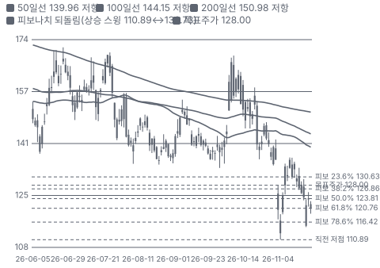

**주봉**

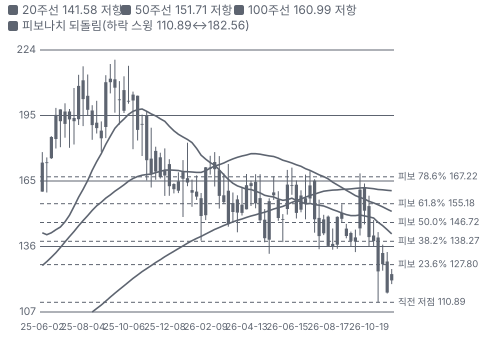

**월봉**

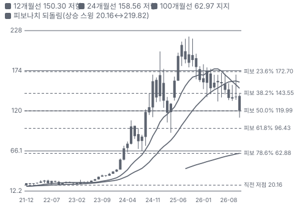

**분기 매출·EPS 실적과 컨센서스**

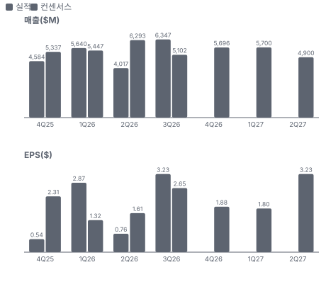

**4Q26 매출 — 지표 추세 vs 가이던스·컨센서스**

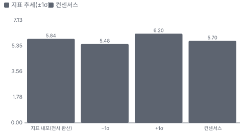

**최근 4개 분기 주가 변화 분석**

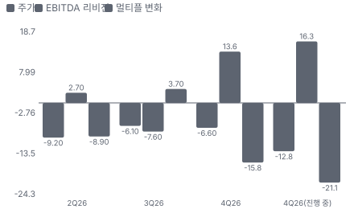

**EPS 리비전**

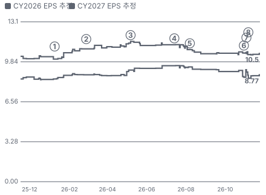

① 26-01-09 Meta 20년 원전 PPA 2,609MW 발표 · EPS 리비전 +5%
② 26-02-27 4Q25 실적 · EPS 리비전 +3%
③ 26-05-07 1Q26 실적 · EPS 리비전 -0%
④ 26-07-14 PJM 용량 경매 \$325/MW-day · EPS 리비전 -1%
⑤ 26-08-07 2Q26 실적 — 가이던스 유지 · EPS 리비전 -2%
⑥ 26-10-30 Cogentrix 인수 완료 · EPS 리비전 +0%
⑦ 26-11-03 중간선거 — 텍사스 주지사 교체 · EPS 리비전 -2%
⑧ 26-11-06 3Q26 실적 — 2027 가이던스 \$7.7~8.5B · EPS 리비전 +0%

**멀티플 프리미엄(Fwd 1Y EV/EBITDA, 최근 4개 분기말 절대값 — 대상 vs 동종 중앙값)**

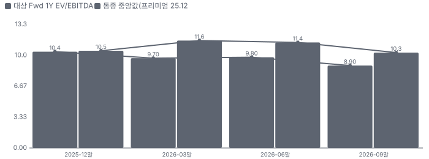

**합리적 멀티플**

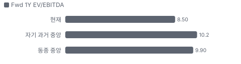

**밸류에이션 주가 시나리오**

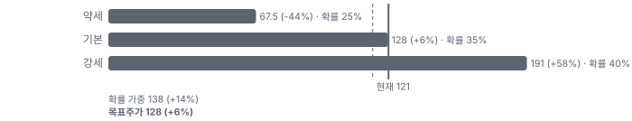

**주가별 업사이드**

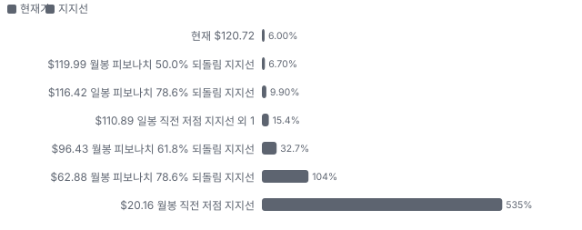
- 제품·서비스 포트폴리오

**공급 병목(10점, 낮을수록 병목)**

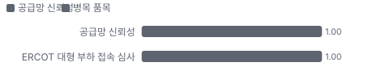

**생산능력 현재와 확충 계획(MW)**

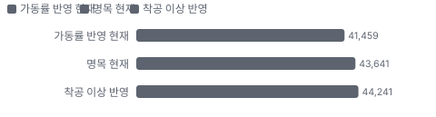

**CAPEX의 매출 대비 비중**

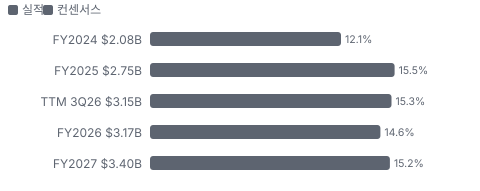

**어닝콜 변화별 주주가치 영향**

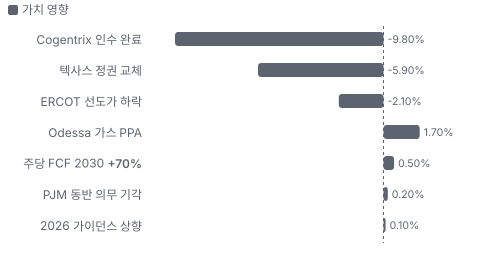

**수주·파이프라인 확실성 사다리**

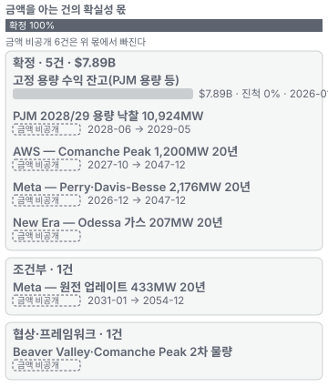

**매출 → 매출총이익 → 영업이익(매출 = 100, 최근 4분기)**

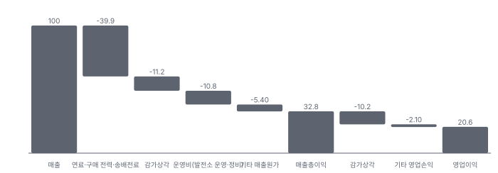

**분기 비용 비중 추이(매출 대비, 공시)**

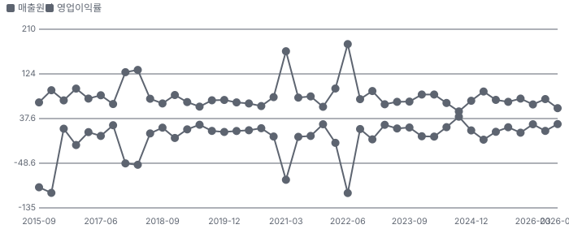

**비용 요인별 매출 대비 비중 1년 변화**

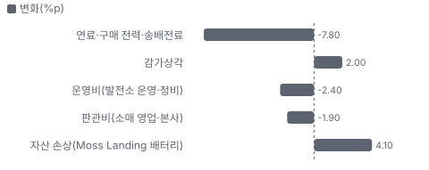

**소매 전력(Retail) BOM 원가 몫**

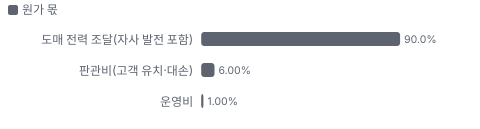

**텍사스 발전 BOM 원가 몫**

**동부 발전 BOM 원가 몫**

**BOM 항목 가격 +10% 시 OPM 변화**

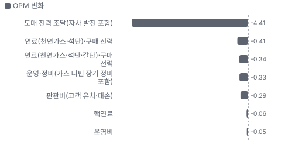

**원가 물가 vs 판매가 물가 — 최근 24개월**

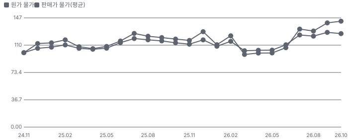

**사업별 매출 vs 물가 — 전년 대비(명목 매출 · 비교 물가 · 실질 = 물량·믹스)**

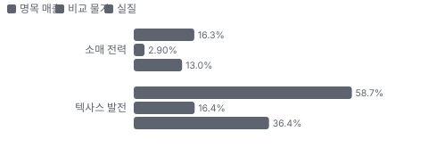

**자산 구성 — 3Q26 분기말 투하자본 \$26.61B**

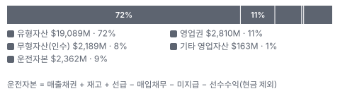

**자산별 변화율 — 최근 12개 분기(4Q23 = 0%) + 다음 4개 분기 추정**

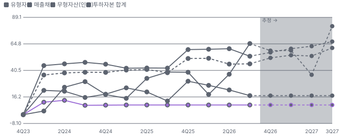

**ROIC 추이 — TTM, 최근 12개 분기 + 다음 4개 분기 추정(컨센서스 NOPAT)**

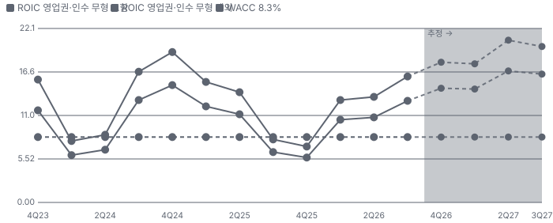

**시설별 생산능력(MW, 큰 순)**

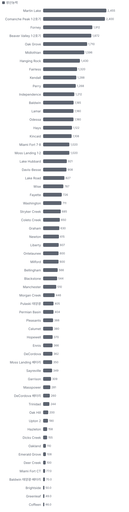

**Cogentrix Energy(가스 10기 약 5,500MW) 인수 효과 — 인수 전 EPS 대비 %, 굵은 선 = 합계 · 시너지 가치 \$4.71B(웃돈 미확인)**

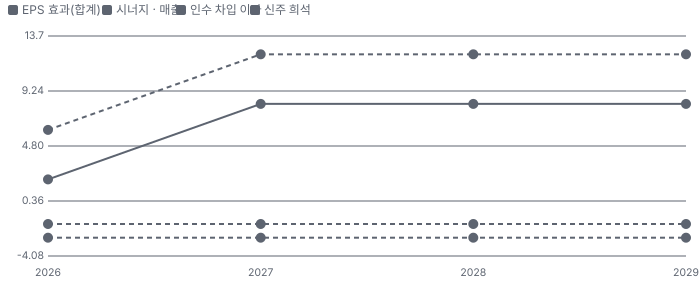

**Lotus Infrastructure(가스 7기 2,600MW) 인수 효과 — 인수 전 EPS 대비 %, 굵은 선 = 합계 · 시너지 가치 \$2.04B(웃돈 미확인)**

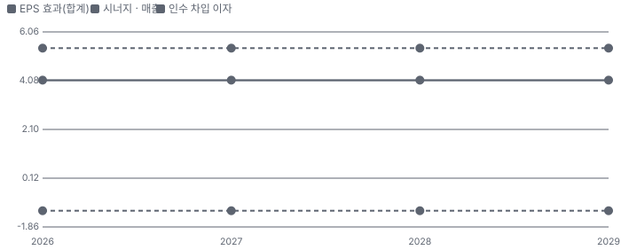

**매출 vs PPI·수출입 — 4Q22 = 100(변화율, 로그 눈금)**

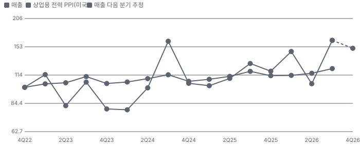

**목표주가 산정 — 기본 시나리오, 도달 확률 약 57%**

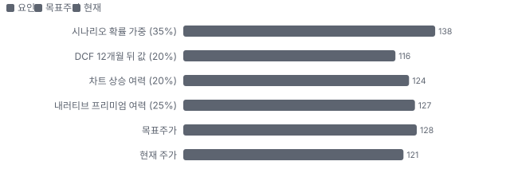

**커뮤니티 언급 수(최근 30일, 채널별)**

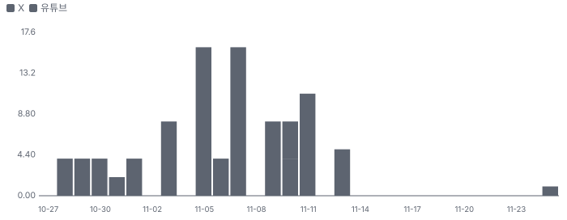

**커뮤니티 게시 수(월, 최근 4개월 — 이번 달은 진행 중)**

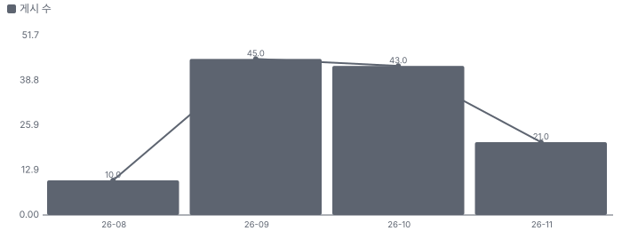
- 재고 일수 — 분기별(수주 자료가 없어 수주/출하 비율 없음) · 재고가 매출원가의 1% 안팎이라 재고 사이클의 뜻은 작다

**일별 거래량 분해**

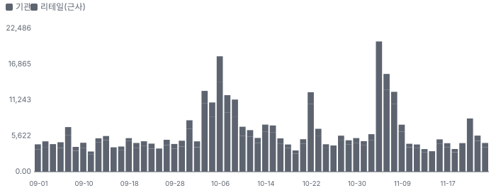

**기관 자금 흐름**

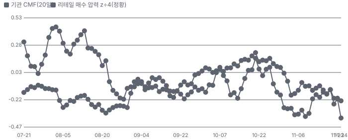

**몬테카를로**

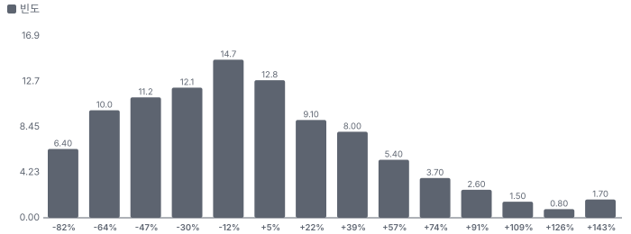

해석: 3,000번 중 1,281번(43%)에서 가치가 지금 주가 이상이었다. 지금 주가를 뒷받침하는 경우와 그렇지 않은 경우가 반반에 가깝다. 가운데 값은 0.91배이고, 열 번 중 여덟 번은 0.33~1.66배 사이에 든다.

## 내러티브

> **기업가치를 결정하는 이야기:** 기업가치는 세 층이다. ① 헤지된 2026~2027년 현금흐름 — 조정 EBITDA \$7.3B → \$8.1B(가이던스 중간), 조정 FCFbG \$4.5B → \$4.7B. ② 장기 계약 층 — AWS·Meta·New Era·Microsoft 합 4GW 초과와 PJM 용량 수입(2028/29년 10,924MW × \$325/MW-day)이 2027년 말부터 도매 가격 노출을 고정 수입으로 바꾼다. ③ 열린 층 — 2028년 발전량의 22%와 그 뒤 전부가 ERCOT·PJM 선도 가격에 열려 있고, 여기에 텍사스 정치(주지사 교체, 부하 접속 심사)가 얹힌다. 주가가 1년 새 31% 내린 것은 ①이 아니라 ③의 할인이다.

> **멀티플·EPS 프리미엄**
> **멀티플:** Fwd 1Y EV/EBITDA는 8.5배로 동종 5사 중앙값 9.9배보다 14% 낮다(인수·우선주 상환을 넣은 프로포마 순차입 기준). 9월 말 재무상태표만 쓰면 7.0배지만 Cogentrix 인수 대금이 빠진 숫자다. 1년 전에는 약 11.5배였다(IB 요지).
> **EPS:** EPS 추정은 2Q 콜 뒤 내려왔다 — FY2026 \$9.41 → \$8.77(−6.7%), FY2027 \$10.84 → \$10.52(−3.0%). 같은 기간 회사의 조정 EBITDA 가이던스는 올랐다. GAAP EPS가 미실현 헤지 손익으로 흔들려 EPS보다 EBITDA·FCF가 기준이다.

### 투자자들은 왜 열광했나

2024~2025년 '전력이 AI의 병목'이라는 이야기로 2025년 9월 22일 종가 \$217.92까지 올랐다. 식은 계기는 셋이다 — ERCOT 선도 가격 하락(태양광·배터리 증설, 부하 접속 지연), 11월 3일 중간선거 뒤 텍사스 주지사 교체로 번진 데이터센터 규제 우려(11/4 하루 −13.8%), 금리 재인상 국면. 실적은 식지 않았다 — 3Q 조정 EBITDA는 \$2.38B으로 50% 늘었다.

### 무엇이 기업가치를 바꾸나

> **구조적 체질 변화**
> **변화:** 텍사스 한 주의 전력 가격에 기대던 회사에서 원전·가스 약 50GW를 여러 시장에 둔 회사로. 발전 이익의 텍사스 몫이 2018년 초 100%에서 40% 조금 아래로 내려왔고, 2026·2027년 발전량은 거의 다 헤지했다
> **증거:** 3Q 콜·3Q26 8-K(헤지 2026 약 100%·2027 약 98%·2028 약 78%)
> **반증:** 2028년 헤지 가격이 2027년보다 낮게 채워져 2028년 조정 EBITDA 가이던스가 2027년 아래로 나온다

> **고부가 믹스 확장**
> **변화:** 도매 시장에 팔던 원전·가스 전력을 하이퍼스케일러 20년 계약으로 옮긴다 — AWS 1,200MW, Meta 2,609MW, New Era 207MW, Microsoft 405MW로 장기 계약 누계 4GW 초과
> **증거:** 10-Q MD&A·3Q26 8-K(계약 가격은 미공시)
> **반증:** Beaver Valley·Comanche Peak 2차 물량 계약이 2027년 말까지 없다

> **기술 혁신**
> **변화:** 새 기술이 아니라 기존 설비의 출력 증강이다 — PJM 원전 3곳 업레이트 433MW(2031~2034), 석탄의 가스 전환(Coleto Creek(텍사스 석탄 발전소, 가스 전환 중) 최대 600MW·Miami Fort 검토), 기존 가스 설비 개량 여름 +500MW 이상
> **증거:** 10-Q MD&A·8-K 2026-01-09
> **반증:** NRC(원자력규제위원회) 승인 지연으로 업레이트 첫 물량이 2031년을 넘긴다

> **실행 속도**
> **변화:** 이미 계통에 연결된 설비를 계약하므로 신규 건설보다 빠르다. 계약 발표에서 첫 인도까지 Meta 운영분 약 12개월(2026-01 → 2026년 말), AWS 약 26개월(2025-09 → 4Q27). 가스 발전소 계약은 ERCOT 부하 접속 심사가 시점을 정한다 **납품 리드타임 12~26개월.** 피어 비교 미확인. 이전 대비 미확인.
> **증거:** 10-Q MD&A
> **반증:** AWS 인도 시작이 4Q27을 넘기거나 Meta 전량 인도가 2027년 말을 넘긴다

> **M&A**
> **변화:** Energy Harbor(2024)·Lotus(2025-10, 2,600MW)·Cogentrix(2026-10, 약 5,500MW)로 12GW 넘게 샀다. Cogentrix는 kW당 약 \$729 — 회사는 평균 선행 EBITDA 7배 미만에 샀다고 말한다
> **증거:** 8-K 2026-11-05·3Q 콜
> **반증:** Cogentrix 편입 뒤 2027년 조정 EBITDA가 가이던스 하단 \$7.7B에 못 미친다

> **정책·입법 연관성**
> **재정정책:** 기존 원전 생산세액공제(45U(기존 원전 생산세액공제), 2024~2032, 최대 \$15/MWh)가 전력 가격이 낮을 때 원전 수입의 바닥이 된다 — FY2024 \$545M·FY2025 \$220M, 2026년 9개월 \$162M 인식. 재무부의 총수입 정의 지침이 아직 없어 추정이 바뀔 수 있다 3Q26 10-Q 주석 5 반증: 세액공제 조기 종료 입법 또는 불리한 총수입 지침 의회 동의 10/10 — 하원 5/5(IRA(2022)로 입법·시행 중 — 이번 회기 폐지 법안 통과 기록 없음) · 상원 5/5(같음).
> **행정명령:** 해당 없음(이유: 회사 실적에 직접 닿는 것은 연방 행정명령이 아니라 텍사스 주 정부 조치다 — 8월 주지사 지시 데이터센터 감사, 11/13 환경 허가 심사 재개, 12/10 ERCOT 일괄 심사) 3Q 콜 반증: 해당 없음
> **연관입법:** 연방 인허가 개혁 법안이 상원 토론 종결 표결을 넘었다(하원 미의결) — 송전·가스관 인허가가 빨라지면 신규 발전 진입도 쉬워져 기존 설비 희소성에는 양면이다. PJM에서는 FERC(연방 에너지규제위원회)가 신규 부하의 발전 동반 의무안을 기각했다 3Q 콜(FERC 결정)·의회 표결 기록(법안 번호 미확인) 반증: 하원 부결 또는 회기 종료

> **고객의 지출 예산**
> **변화:** 소매 고객은 전기요금(운영비·가계 지출), 하이퍼스케일러는 전력 구매 계약(데이터센터 운영비)이다. 데이터센터 건설 자체는 고객 설비투자지만 Vistra가 받는 돈은 가동 뒤 20년 동안의 전력 요금이다
> **사업별 예산:** **매출의 50%**: 소매 전력(Retail) — 고객 OPEX(가정·기업 전기요금) · 동인: 고객 수·날씨·소매 단가
**매출의 30%**: 텍사스 발전 — 고객 OPEX(도매 전력 구매·데이터센터 전력 요금(AWS)) · 동인: ERCOT 전력 가격·부하 접속 속도
**매출의 19%**: 동부 발전 — 고객 OPEX(도매 전력·용량 구매, 데이터센터 전력 요금(Meta)) · 동인: PJM 전력·용량 가격
**매출의 1%**: 서부 발전 — 고객 OPEX(캘리포니아 용량 계약) · 동인: 용량 계약 갱신
> **증거:** 10-Q MD&A·10-K Item 1
> **반증:** 하이퍼스케일러가 자가발전으로 돌아서 계통 전력 계약을 줄인다

### 내러티브 근거

> '전력이 AI의 병목'이라는 이야기는 셀사이드 20명 중 18명이 Strong Buy일 만큼 컨센서스가 됐지만, 가격은 그 이야기를 덜 믿는다 — 1년 새 주가 −31%, 선행 EV/EBITDA는 약 11.5배에서 7~8배로 내려왔다. 식힌 것은 실적이 아니라 텍사스 정치·ERCOT 선도 가격·금리다. 단계는 컨센서스, 쏠림은 중간이다.

> **기존 발전 설비의 희소성(전력이 AI 병목)** · 유지
> **논리:** 새 발전소는 장비·접속 대기로 수년이 걸려, 이미 연결된 원전·가스 설비의 값이 오른다
> **숫자:** PJM 최근 두 용량 경매(미래 발전 가능 용량을 미리 사 두는 경매)가 상한에서 끝나고도 6.6·6.8GW 부족(IB 요지), 9월 TX 판매 +9.2%·OH +17.4%(EIA(미국 에너지정보청))
> **반증:** PJM 용량 가격 상한 연장·하향, 신규 가스 발전 대량 낙찰
> **출처:** 3Q26 10-Q(PJM 2028/29 경매 \$325/MW-day)·EIA

> **하이퍼스케일러 장기 계약(원전·가스)으로 이익 가시성 상승** · 유지
> **논리:** 도매 가격에 열려 있던 전력을 20년 고정 계약으로 바꾸면 이익 가시성이 올라 배수가 오른다
> **숫자:** AWS 1,200MW·Meta 2,609MW·New Era 207MW·Microsoft 405MW(10-Q) — 가격은 미공시. Meta 계약의 FCFbG 증분은 운영분 약 8~10%, 업레이트분 약 5~7%(8-K 2026-01-09)
> **반증:** 가스 자산 계약이 접속 지연으로 2027년 이후로 밀림
> **출처:** https://www.sec.gov/Archives/edgar/data/1692819/000169281926000025/vistra-20260930.htm

> **자본 환원 — 2030년 주당 FCF 목표와 연 약 \$3B 자사주 가정** · 강화
> **논리:** 헤지된 현금흐름으로 주식 수를 줄여 주당 FCF를 키운다
> **숫자:** 주당 조정 FCFbG 2025년 약 \$10.50 → 2027년 약 \$14 → 2027~2030년 약 70% 성장 경로(콜, 연 약 \$3B 자사주 가정). 자사주 승인 잔액 약 \$2.5B(시가총액의 6.1%, 계산)
> **반증:** ERCOT 선도 가격 추가 하락으로 목표 전제 붕괴, Cogentrix 인수 차입으로 환원 축소
> **출처:** 3Q26 어닝콜(2026-11-06)

> **(반대) 텍사스 정치·접속 지연 — 승인된 부하도 통전이 막혔다** · 약화
> **논리:** 텍사스 정권 교체와 접속 심사가 가스 발전소 계약 시점을 늦춘다
> **숫자:** ERCOT Batch Zero 191.8GW가 12/10 결정을 대기, 대형 부하 신청 약 474GW(IB 요지), 8월 주 감사로 접속 일부 중단
> **반증:** 12/10 ERCOT·12/17 PUC에서 일괄 심사 일정 확정, 1월 새 주지사가 유예를 실행하지 않음
> **출처:** 3Q26 어닝콜(2026-11-06)

> **(반대) ERCOT 가격 약세 — 태양광·배터리 증설이 낮 시간 가격을 누른다** · 약화
> **논리:** 태양광·배터리가 낮 시간 가격을 눌러 2028년 이후 열린 물량의 값이 내려간다
> **숫자:** 회사도 3Q 콜에서 ERCOT 선도 가격 하락을 인정했다. FY2027 EPS 컨센서스 \$10.84 → \$10.52(8/10 → 11/23)
> **반증:** 2027~2028년 ERCOT 선도 스파크 스프레드(전력 가격에서 가스 연료비를 뺀 발전 마진) 반등, 헤지 비율 공시로 노출 축소 확인
> **출처:** 3Q26 어닝콜(2026-11-06)

> **(반대) 금리 재인상 국면 — 차입 큰 발전사의 자본비용** · 약화
> **논리:** 순차입이 조정 EBITDA의 약 2.8배인 회사라 금리가 오르면 할인율과 이자비용이 함께 오른다
> **숫자:** 12월 25bp 인상 확률 약 92%(IB 요지), VIX 26.6, 나스닥 100 20거래일 −11.6%
> **반증:** 12월 연준 동결 또는 장기 금리 하락
> **출처:** https://www.sec.gov/Archives/edgar/data/1692819/000169281926000023/vistra-20260930xearningsre.htm

### 투자 포인트

> **2027년까지는 정해졌다**
> **명제:** 2026·2027년 예상 발전량의 약 100%·98%가 헤지돼 조정 EBITDA \$7.3B → \$8.1B(가이던스 중간)는 전력 가격과 거의 무관하다
> **숫자:** 3Q26 8-K: 2026 \$7,100~7,500M(상향·축소), 2027 \$7,700~8,500M 신규, 조정 FCFbG 2027 \$4,300~5,100M
> **시장과 다른 점:** EPS 컨센서스는 석 달째 내려오는데(FY2027 \$10.84 → \$10.52) 회사 EBITDA 가이던스는 올랐다 — GAAP EPS의 헤지 평가 잡음 탓으로 본다
> **증명:** 4Q26 실적(2027-02 말 예상)에서 2026년 조정 EBITDA \$7.1~7.5B 달성과 2027년 범위 유지
> **출처:** https://www.sec.gov/Archives/edgar/data/1692819/000169281926000023/vistra-20260930xearningsre.htm

> **할인은 2028년 이후에 걸려 있다**
> **명제:** 프로포마 기업가치 약 \$66.7B는 2027년 조정 EBITDA의 8.2배, 조정 FCFbG 수익률은 약 11.5%다 — 1년 전 약 11.5배에서 내려온 몫은 2028년 이후 ERCOT 가격과 텍사스 정치의 할인이다
> **숫자:** 2028년 헤지 약 78%(ERCOT는 그보다 낮다), 3Q 콜의 ERCOT 선도 가격 하락 인정
> **시장과 다른 점:** 셀사이드는 선거 뒤 급락을 프로젝트 이연으로 보지만, 가격은 이연이 아니라 열린 물량의 단가 하락을 넣고 있다
> **증명:** 12/10 ERCOT 일괄 심사 갱신·12/17 PUC 회의, 4Q 실적의 2028년 헤지 비율·가격 언급
> **출처:** 3Q26 어닝콜(2026-11-06)

> **주식 수가 줄어든다**
> **명제:** 약정 뒤 남는 현금 연 약 \$2B와 최소 \$1B 자사주를 합쳐 연 약 \$3B를 사면 지금 시가총액의 약 7%씩 주식이 줄어든다
> **숫자:** 자사주 승인 잔액 약 \$2.5B(2028년 말까지), 2026년 11/2까지 약 \$1B 매입, 주당 조정 FCFbG 2025년 약 \$10.50 → 2027년 약 \$14(콜)
> **시장과 다른 점:** 주가가 내릴수록 같은 돈으로 더 많이 산다 — 다만 연 \$3B는 회사의 단순 가정이지 약속이 아니고, 성장 투자로 돌리면 경로가 달라진다
> **증명:** 4Q26 자사주 매입액(3Q \$208M보다 늘어나는지)과 순차입 ÷ 조정 EBITDA 2.8배 유지
> **출처:** 3Q26 어닝콜(2026-11-06)

### 모멘텀 생성·소멸 타임라인

**카탈리스트 달력 — 지난 사건의 주가 반응과 앞으로 확인할 숫자**
| 날짜 | 상태 | 구분 | 사건 | 반응·확인 | 결과에 따라 |
|---|---|---|---|---|---|
| 2025-09-22 | 완료 | 생성 | 종가 고점 \$217.92 — AWS Comanche Peak 계약 공표(2025-09) | 사상 최고 종가 |  |
| 2026-01-09 | 완료 | 생성 | Meta 20년 원전 계약 2,609MW 발표 | 1/15 52주 종가 고점 \$180.18 |  |
| 2026-11-04 | 완료 | 소멸 | 중간선거 다음 날 — 텍사스 주지사 교체, 데이터센터 규제 우려 | −13.8%(11/3 \$139.59 → 11/4 \$120.29), 11/5 \$112.89로 52주 종가 저점 |  |
| 2026-11-06 | 완료 | 생성 | 3Q26 실적 — 2026 가이던스 상향·2027 신규·자사주 승인 확대 | +10.6%(11/5 \$112.89 → 11/6 \$124.80) |  |
| 2026-12-10 | 예정 | 확인 | ERCOT 대형 부하 일괄 심사(Batch Zero) 갱신 | 심사 일정 확정 여부와 통과 물량 | 일정이 확정되면 가스 발전소 계약 재개 쪽(기본~강세), 다시 밀리면 약세 쪽 |
| 2026-12-17 | 예정 | 확인 | 텍사스 PUC 회의 — 데이터센터 감사 결과·765kV 송전망 | 감사 종료와 접속 기준 | 기준이 높아져도 회사 프로젝트가 통과하면 기본, 유예 논의가 나오면 약세 |
| 2027-01 중순(예상) | 예정 | 매크로 | 텍사스 새 주지사 취임·주 의회 회기 시작 | 데이터센터 유예·접속 규칙 법안 발의 여부 | 유예 법안이 위원회를 넘으면 약세 시나리오 확률을 올린다 |
| 2027-02 말(예상) | 예정 | 확인 | 4Q26 실적 | 2026년 조정 EBITDA \$7.1~7.5B, 2027년 \$7.7~8.5B 유지, 2028년 헤지 비율·신규 장기 계약 | 2027년 범위 유지 + 신규 계약이면 강세 쪽, 범위 하향이면 약세 쪽 |

### 언제 사서 언제 팔아야 할까?

**가격·조건 틀 — 가격은 밸류에이션(약세·기본·강세·목표주가)과 차트 지지 구간에서, 조건은 이벤트에서**
| 구간 | 가격 | 목표주가까지 | 약세까지 | 조건·근거 |
|---|---|---|---|---|
| 관찰 구간 | \$120~\$120 | +7% | -44% | 52주 종가 저점 \$112.89(11/5)는 선거 충격이 가장 컸던 날의 가격이라 차트 지지와 심리 저점이 겹친다 |
| 확인 뒤 | 지금 \$121 이상에서 조건 확인 | +6% | -44% | 12/10 ERCOT 일괄 심사 일정 확정과 4Q 실적에서 2027년 가이던스 유지 |
| 무효화 | 약세 시나리오 \$67 | - | -44% | 텍사스 데이터센터 유예 법안이 위원회를 통과하거나 2027년 조정 EBITDA 가이던스가 \$7.7B 아래로 내려간다 |
| 차익 고민 1차 | \$128(목표주가·기본 시나리오) | +6% | - | 목표주가 부근에서는 2028년 헤지 가격이 확인되기 전까지 남은 가격 위험을 다시 잰다 |
| 차익 고민 2차 | \$191(강세 시나리오) | +58% | - | 목표주가 부근에서는 2028년 헤지 가격이 확인되기 전까지 남은 가격 위험을 다시 잰다 |

최근 120거래일에 하루 6% 넘는 움직임이 11번이다 — 정책 일정(12/10·12/17) 직후 추격을 경계한다 가격·조건 틀이며 매매·비중 지시가 아니다(투자 권유 아님).

## 포트폴리오

| 제품·서비스 | 구분 | 무엇 | 쓰는 곳 | 돈 버는 방식 | Mix | Mix 변화(전년 대비) |
|---|---|---|---|---|---|---|
| 소매 전력(Retail) | 서비스 | TXU Energy·Ambit·Dynegy·Energy Harbor 등 브랜드로 가정·기업에 전기와 가스를 판다 | 16개 주와 워싱턴 DC의 약 500만 고객(텍사스 약 260만) | 고객 수 × 사용량 × 소매 단가 − 도매 조달비. 자체 발전이 조달 가격 변동을 막아 준다 | 50% | -2.7%p |
| 텍사스 발전 | 제품 | 텍사스의 원전(Comanche Peak 2,400MW)·가스·석탄·태양광·배터리 약 19,900MW가 만든 전력 | ERCOT 도매 시장, 자사 소매, AWS(Comanche Peak 1,200MW 20년 계약) | 발전량 × 실현 전력 가격(헤지 가격) − 연료비. 텍사스는 용량 시장이 없어 전력 가격이 전부다 | 30% | +6.7%p |
| 동부 발전 | 제품 | PJM·뉴잉글랜드·뉴욕·중서부의 원전 3곳(4,048MW)·가스·석탄 약 22,300MW가 만든 전력과 용량 | PJM 용량 시장·도매 시장, Meta(Perry·Davis-Besse 등 2,609MW 20년 계약), Microsoft(Pulaski 태양광) | 발전량 × 실현 가격 + 용량 수입(PJM 2028/29 경매 10,924MW × \$325/MW-day) − 연료비 | 19% | -3.3%p |
| 서부 발전 | 제품 | 캘리포니아 Moss Landing(캘리포니아 가스 발전·배터리 단지) 가스 복합화력 1,020MW와 배터리(350MW는 가동 중단) | CAISO(캘리포니아 전력망 운영 기관) 도매 시장·용량 계약 | 용량 계약 수입 + 전력 판매 | 1% | -0.7%p |

**Mix 변화가 가장 큰 쪽은 텍사스 발전(+6.7%p, 전년 대비).** 계절성 판정: 분기 매출 계절 지수 기준 있음 → 전년 같은 분기와 비교.

## 수주·파이프라인

> **2026-09-30 기준 7건.** 확정 \$7.89B. 공시 잔여 이행 의무(고정 용량 수익만, 2025-12-31) \$7.89B.

**수주 목록**
| 상태 | 계약 | 계약 총액 | 진척 | 기간 | 비고 |
|---|---|---|---|---|---|
| 확정 | 고정 용량 수익 잔고(PJM 용량 등) | \$7.89B | 0% | 2026-01 → 2045-12 | - |
| 확정 | PJM 2028/29 용량 낙찰 10,924MW | 금액 비공개 | - | 2028-06 → 2029-05 | - |
| 확정 | AWS — Comanche Peak 1,200MW 20년 | 금액 비공개 | - | 2027-10 → 2047-12 | - |
| 확정 | Meta — Perry·Davis-Besse 2,176MW 20년 | 금액 비공개 | - | 2026-12 → 2047-12 | - |
| 확정 | New Era — Odessa 가스 207MW 20년 | 금액 비공개 | - | 미확인 → 미확인 | - |
| 조건부 | Meta — 원전 업레이트 433MW 20년 | 금액 비공개 | - | 2031-01 → 2054-12 | - |
| 협상 | Beaver Valley·Comanche Peak 2차 물량 | 금액 비공개 | - | 미확인 → 미확인 | - |

**실행 속도와 방해 요인**
| 항목 | 상태 | 실행 속도 | 방해 요인 |
|---|---|---|---|
| 고정 용량 수익 잔고(PJM 용량 등) | 확정 | 계획대로(계획 3%, -3%p) | 용량 가격 상한 논의 |
| PJM 2028/29 용량 낙찰 10,924MW | 확정 | 미확인 | 설비 가동 의무 |
| AWS — Comanche Peak 1,200MW 20년 | 확정 | 미확인 | 텍사스 데이터센터 규제 · 데이터센터 건설 일정 |
| Meta — Perry·Davis-Besse 2,176MW 20년 | 확정 | 미확인 | 인도 일정 |
| New Era — Odessa 가스 207MW 20년 | 확정 | 미확인 | ERCOT 부하 접속 |
| Meta — 원전 업레이트 433MW 20년 | 조건부 | 미확인 | NRC 승인 · 업레이트 투자비(미공시) |
| Beaver Valley·Comanche Peak 2차 물량 | 협상 | 미확인 | 고객 결정 · 텍사스·PJM 규칙 |

## 마진 구조

> **GPM 38.2%, OPM 26.9%.** 3Q25 대비 GPM +8.3%p, OPM +6.0%p. 변동비는 매출의 44%이고, 매출이 10% 늘면 OPM은 +2.6%p 움직인다. 가장 큰 비용은 연료·구매 전력·송배전료로 3Q26 매출의 39.9%(3Q25 47.7%)다. 매출에 미실현 헤지 손익이 섞여 분기 이익률은 흔들린다 — 3Q26 영업이익률 26.9%에는 미실현 이익이 들어 있고, Moss Landing 배터리 손상 \$269M이 반대로 깎았다. 회사 기준 지표는 조정 EBITDA다(3Q \$2.38B).

> **매출 100 중 매출원가 67.2, 매출총이익 32.8(최근 4분기, 공시).** 매출원가 요인 중 연료·구매 전력·송배전료이 매출의 39.9%로 가장 무겁고, 단가가 +10% 오르면 GPM이 -3.99%p 움직인다.

**비용 요인 강도 — 비중·추세·충격(+10%)·탄력**
| 비용 | 구분 | 매출 대비 | 1년 변화 | 마진 기여 | 충격 시 마진 | 매출 탄력 | 고정비 몫 |
|---|---|---|---|---|---|---|---|
| 연료·구매 전력·송배전료 | 매출원가 요인 | 39.9% | -7.8%p | +7.8%p | -3.99%p | 미확인 | 10% |
| 감가상각 | 매출원가 요인 | 11.2% | +2.0%p | -2.0%p | -1.12%p | 미확인 | 100% |
| 운영비(발전소 운영·정비) | 매출원가 요인 | 10.8% | -2.4%p | +2.4%p | -1.08%p | 미확인 | 80% |
| 매출원가 | 공시 항목 | 67.2% | -8.6%p | +8.6%p | -6.72%p | 미확인 | 미확인 |
| 감가상각 | 공시 항목 | 10.2% | -1.8%p | +1.8%p | 미확인 | 0.07 | 44% |

매출 탄력 = 분기 비용을 매출에 회귀한 기울기(매출 1당 변동비), 고정비 몫 = 절편 ÷ 평균 비용. 표본이 8분기 미만이면 미확인. 매출원가 요인 비중은 margin 재료의 추정이 섞여 있고, 공시 매출원가와의 차이는 '기타 매출원가'로 둔다.

**GPM에서 OPM까지(GAAP, 아래는 최근 4개 분기)**
| 기간 | GPM | 연구개발 | 판관비 | 기타 | OPM |
|---|---|---|---|---|---|
| 3Q25 | 29.9% | 0.0% | 8.9% | 0.1% | 20.9% |
| 3Q26 | 38.2% | 0.0% | 7.1% | 4.2% | 26.9% |
| 2025-12 | 23.8% | - | - | - | 10.3% |
| 2026-03 | 35.2% | - | - | - | 26.6% |
| 2026-06 | 24.8% | - | - | - | 13.8% |
| 2026-09 | 42.3% | - | - | - | 26.9% |

**비용을 움직이는 요인**
| 비용 | 요인 |
|---|---|
| 연료·구매 전력·송배전료(매출원가) | 가스·석탄·핵연료 단가 × 발전량, 소매용 도매 전력 구매, 송배전 요금 · 근거 공시 |
| 감가상각(매출원가) | Lotus 인수 설비 3개월분, Moss Landing 350MW 관련(3Q26 \$711M vs \$460M) · 근거 공시 |
| 운영비(발전소 운영·정비, 매출원가) | 계획 정비 일정·인건비·장기 정비 계약 · 근거 공시 |
| 판관비(소매 영업·본사, 판관비) | 소매 고객 유치·대손·본사 인건비 · 근거 공시 |
| 자산 손상(Moss Landing 배터리, 기타) | 350MW 배터리 재가동 미정 — 일회성 · 근거 공시 |

**소매 전력(Retail) BOM — 매출의 50%, GPM 2%(매출총이익 미공시 — 3Q26 소매 조정 EBITDA \$98M ÷ 세그먼트 매출 \$4.81B = 2%로 대신(계산, 1·3분기는 조달비 계절성으로 낮다. 9M26은 \$939M ÷ \$12.11B = 7.8%)), 항목 가격 +10% 시**
| 항목 | 원가 몫 | 전가 | 제품 GPM | OPM |
|---|---|---|---|---|
| 도매 전력 조달(자사 발전 포함) | 90% | 미확인 | -8.8%p | -4.41%p |
| 판관비(고객 유치·대손) | 6% | 0% | -0.6%p | -0.29%p |
| 운영비 | 1% | 0% | -0.1%p | -0.05%p |
| 미분해 | 3% | - | - | - |

**텍사스 발전 BOM — 매출의 30%, GPM 43%(매출총이익 미공시 — 3Q26 조정 EBITDA \$1.23B ÷ 세그먼트 매출 \$2.85B = 43%로 대신(계산, 매출에 미실현 헤지 이익 \$818M 포함)), 항목 가격 +10% 시**
| 항목 | 원가 몫 | 전가 | 제품 GPM | OPM |
|---|---|---|---|---|
| 연료(천연가스·석탄·갈탄)·구매 전력 | 20% | 미확인 | -1.1%p | -0.34%p |
| 운영·정비(가스 터빈 장기 정비 포함) | 9% | 0% | -0.5%p | -0.15%p |
| 핵연료 | 1~4% | 0% | -0.1%p | -0.04%p |
| 미분해 | 68% | - | - | - |

**동부 발전 BOM — 매출의 19%, GPM 53%(매출총이익 미공시 — 3Q26 조정 EBITDA \$979M ÷ 세그먼트 매출 \$1.83B = 53%로 대신(계산, 매출에 미실현 헤지 손실 \$293M 포함)), 항목 가격 +10% 시**
| 항목 | 원가 몫 | 전가 | 제품 GPM | OPM |
|---|---|---|---|---|
| 연료(천연가스·석탄)·구매 전력 | 46% | 미확인 | -2.2%p | -0.41%p |
| 운영·정비(가스 터빈 장기 정비 포함) | 20% | 0% | -0.9%p | -0.18%p |
| 핵연료 | 1~4% | 0% | -0.1%p | -0.02%p |
| 미분해 | 31% | - | - | - |

도매 전력 조달(자사 발전 포함) 가격이 +10% 오르면 영업이익은 -16.4% 움직인다. 판매가 전가를 모르는 항목은 전가 0%로 계산했다.

**BOM 항목 가격을 움직이는 것**
| 항목 | 요인 |
|---|---|
| 도매 전력 조달(자사 발전 포함) | 3Q26 소매 세그먼트 연료·구매 전력비 \$4.33B ÷ 매출 \$4.81B · 근거 공시 |
| 판관비(고객 유치·대손) | 소매 판관비 \$288M ÷ \$4.81B · 근거 공시 |
| 운영비 | 소매 운영비 \$47M ÷ \$4.81B · 근거 공시 |
| 연료(천연가스·석탄·갈탄)·구매 전력 | 3Q26 텍사스 연료·구매 전력비 \$566M ÷ \$2.85B · 근거 공시 |
| 핵연료 | 전사 핵연료 상각 3Q26 \$125M ÷ 발전 세 세그먼트 매출 \$4.82B = 2.6%(계산) — 세그먼트별 미공시라 범위로 쓴다 · 근거 추정 |
| 운영·정비(가스 터빈 장기 정비 포함) | 텍사스 운영비 \$248M ÷ \$2.85B · 근거 공시 |
| 연료(천연가스·석탄)·구매 전력 | 3Q26 동부 연료·구매 전력비 \$850M ÷ \$1.83B · 근거 공시 |
| 운영·정비(가스 터빈 장기 정비 포함) | 동부 운영비 \$370M ÷ \$1.83B · 근거 공시 |

> **원가·판매가 물가 격차 -9.8%p** — 판매가 물가가 투입 원가 물가보다 느리게 오른다.

**투입 물가 — 미국 PPI 3·6·12개월(2026-10, 개정 반영)**
| 항목 | 미국 3개월 | 6개월 | 12개월 | 전가 못 할 때 OPM |
|---|---|---|---|---|
| 도매 전력 조달(자사 발전 포함) | +8.0% | +43.0% | +20.2%* | - |
| 연료(천연가스·석탄)·구매 전력 | -0.4% | -3.1% | -6.1%* | - |
| 핵연료 | 미확인 | 미확인 | 미확인 | - |
| 운영·정비(가스 터빈 장기 정비 포함) | +0.1% | +1.7% | +3.6%* | - |

별표는 품목보다 넓은 업종 지수다. 연결한 투입 원가의 미국 PPI(생산자물가지수)는 1년 새 가중 +20.2%이고, 판매가로 넘기지 못하면 GPM -8.1%p·OPM -8.1%p가 움직인다. 텍사스 발전 가격은 +10.0%로 비교 물가(발전 도매 전력(발전업) PPI, 2026-10) +20.2%보다 10.2%p 덜 올랐다. 물가 지수를 붙이지 못한 매출원가 항목은 운영비(발전소 운영·정비), 감가상각다(미연결). 소매 전력(Retail) 매출은 2026-09 전년 대비 +16.3%이고 비교 물가 ppi:commercial_power의 변화 +2.9%(2026-09)를 빼면 실질 +13.0% — 물량·믹스가 성장을 이끌었다. 텍사스 발전 매출은 2026-09 전년 대비 +58.7%이고 비교 물가 ppi:power_generation의 변화 +16.4%(2026-09)를 빼면 실질 +36.4% — 물량·믹스가 성장을 이끌었다.

## 자산 구성

> **3Q26 분기말 투하자본 \$26.61B** — 유형자산 72%, 영업권 11%. 최근 12개 분기(4Q23 → 3Q26) 가장 크게 늘어난 자산은 매출채권(+65%), 투하자본 합계 +47%. 3Q27 추정 투하자본 \$29.26B(+10%, 컨센서스 매출과 회전 일수·CAPEX 강도 유지 가정). 연율 감가 비율(순액 기준)은 직전 4분기 11.50% → 최근 4분기 10.77%, 직전 비율이면 감가상각이 \$140.7M 더 컸다(영업이익의 3.3%).

**자산·운전자본 항목별 분기말 잔액 — 최근 12개 분기와 다음 4개 분기 추정**
| 항목 | 4Q23 | 3Q25 | 3Q26(최근) | 3Q27 추정 | 12개 분기 변화 | 다음 4개 분기 변화 |
|---|---|---|---|---|---|---|
| 매출채권 | \$1.67B | \$2.33B | \$2.76B | \$3.03B | +65% | +10% |
| 선급·기타 유동자산 | \$364.0M | \$647.0M | \$1.10B | \$1.03B | +203% | -6% |
| 매입채무 | \$1.15B | \$1.36B | \$1.50B | \$1.97B | +31% | +31% |
| 유형자산 | \$12.43B | \$17.73B | \$19.09B | \$20.75B | +54% | +9% |
| 영업권 | \$2.58B | \$2.81B | \$2.81B | \$2.81B | +9% | +0% |
| 무형자산(인수) | \$1.86B | \$2.10B | \$2.19B | \$2.19B | +17% | +0% |

**자산 추정 동인 — 최근 4개 분기 평균(재무상태표 동인 모형)**
| 동인 | 값 | 곱하는 기준 |
|---|---|---|
| 매출채권 | 43일 | 매출 |
| 재고자산 | 18일 | 매출 |
| 선급·기타 유동자산 | 14일 | 매출 |
| 매입채무 | 28일 | 매출 |
| CAPEX 강도 | 15.3% | 매출(최근 4개 분기 합) |
| 분기 감가율 | 2.72% | 기초 유형자산 순액(무형 상각 제외 감가상각) |
| 영업권·리스 사용권·기타 | 유지 | 인수·새 리스는 공시 전 모름 |
| 인수 무형자산 | 분기 \$0.0M 상각 | 최근 4개 분기 평균 상각 |

**추정 방법:** 증권사 3표 모델(손익·재무상태표·현금흐름)의 재무상태표 동인 방식이다. 운전자본은 항목별 회전 일수(매출채권·선급·미지급·선수는 매출, 재고·매입채무는 매출원가 기준)를 최근 4개 분기 평균으로 두고 컨센서스 매출에 곱한다. 유형자산은 기초 + CAPEX − 감가상각으로 굴린다(Koller·Goedhart·Wessels 『Valuation』 재무상태표 추정). 매출 경로는 ROIC 절의 컨센서스와 같다.

**유형·무형자산 항목별 가치(2023-12-31 vs 2022-12-31)**
| 구분 | 항목 | 총액 2023-12-31 | 누적상각 | 순액 | 총액 2022-12-31 | 총액 1년 변화 | 공시 내용연수 |
|---|---|---|---|---|---|---|---|
| 유형 | 유형자산 합계(항목 미분해) | \$18.03B | 총계만 공시 | 총계만 공시 | \$17.34B | +3.9% | 미확인 |
| 영업권 | 영업권 | \$2.58B | \$0.0M | \$2.58B | \$2.58B | +0.0% | 비상각 |
| 무형 | 무형자산 합계(항목 미분해) | \$2.94B | \$2.41B | \$523.0M | \$2.86B | +2.5% | 미확인 |
| 유형 합계 | 유형자산 | \$18.03B | \$6.66B | \$11.37B | \$17.34B | +3.9% | 경과율 37%(상각 대상 기준) |

**내용연수 산식(상각 대상 유형자산 = 총액 − 토지 − 건설중)**
| 기준일 | 연 감가상각 | 상각 대상 총액 | 평균 내용연수 | 경과 연수 | 잔여 연수 | 경과율 |
|---|---|---|---|---|---|---|
| 2023-12-31 | \$1.67B | \$18.03B | 10.8년 | 4.0년 | 6.8년 | 37% |
| 2022-12-31 | \$1.34B | \$17.34B | 12.9년 | 4.3년 | 8.6년 | 33% |

산식 평균 내용연수는 10.8년. 1년 전 12.9년 → 지금 10.8년.

**분기 감가 비율(감가상각 ÷ 평균 유형자산 순액)**
| 분기 | 감가상각 | 평균 유형자산(순액) | 분기 비율 | 연율 | 연율의 역수 |
|---|---|---|---|---|---|
| 4Q24 | \$537.0M | \$18.28B | 2.94% | 11.75% | 8.5년 |
| 1Q25 | \$522.0M | \$17.94B | 2.91% | 11.64% | 8.6년 |
| 2Q25 | \$541.0M | \$17.73B | 3.05% | 12.21% | 8.2년 |
| 3Q25 | \$460.0M | \$17.73B | 2.59% | 10.38% | 9.6년 |
| 4Q25 | \$463.0M | \$18.79B | 2.46% | 9.86% | 10.1년 |
| 1Q26 | \$484.0M | \$19.86B | 2.44% | 9.75% | 10.3년 |
| 2Q26 | \$445.0M | \$19.91B | 2.24% | 8.94% | 11.2년 |
| 3Q26 | \$711.0M | \$19.52B | 3.64% | 14.57% | 6.9년 |

감가상각 기준: 손익계산서 감가상각·상각비(SEC 공시 데이터, 4분기 = 연간 − 1~3분기).

최근 4분기 연율 감가 비율 10.77%, 직전 4분기 11.50%(-6%) — 경고 문턱(-10%) 안이다.

미공시·미분해: 유형자산 항목별 총액·내용연수(10-K 주석에서 모델이 채움) · 무형자산 항목(10-K 주석에서 모델이 채움) — 이 칸은 비우고 나머지로 계산했다.

### 해석 — 자산이 어디에 쌓이고 있나

- 같은 기간 4개 분기 매출은 +27% — 매출보다 빨리 늘어난 자산: 매출채권 +65%, 유형자산 +54%. 이 자산의 회전율이 떨어지면 ROIC를 희석한다.
- 다음 4개 분기 CAPEX \$3.49B vs 감가상각 \$2.14B(최근 4개 분기 CAPEX 강도·감가율 유지) — 유형자산 3Q26 \$19.09B → 3Q27 \$20.75B. 투자가 감가보다 커서 자산이 쌓이는 국면이다.

## ROIC

> **TTM 3Q26 ROIC는 영업권·인수 무형 포함 12.9%, 제외 16.0%**(NOPAT 마진 16.2% × 투하자본 회전율 0.80회). 최근 12개 분기 4Q23 11.7% → 3Q26 12.9%(고점 4Q24 14.9%). 컨센서스 NOPAT으로 굴리면 3Q27 16.3%(제외 19.8%) — WACC 8.3% 대비 +8.0%p. 1년 변화의 가장 큰 요인은 NOPAT 마진(+5.1%p).

**ROIC 추이(TTM)와 다음 4개 분기 추정 — NOPAT ÷ 평균 투하자본(이번 분기말·4개 분기 전)**
| 분기 | 구분 | TTM 매출 | TTM NOPAT | NOPAT 마진 | 평균 투하자본 | ROIC 포함 | ROIC 제외 |
|---|---|---|---|---|---|---|---|
| 4Q23 | 실적 | \$14.78B | \$2.10B | 14.2% | \$18.01B | 11.7% | 15.6% |
| 1Q24 | 실적 | \$13.41B | \$1.28B | 9.5% | \$21.30B | 6.0% | 7.8% |
| 2Q24 | 실적 | \$14.06B | \$1.45B | 10.3% | \$21.63B | 6.7% | 8.6% |
| 3Q24 | 실적 | \$16.27B | \$2.84B | 17.4% | \$21.83B | 13.0% | 16.6% |
| 4Q24 | 실적 | \$17.22B | \$3.23B | 18.7% | \$21.67B | 14.9% | 19.1% |
| 1Q25 | 실적 | \$18.10B | \$3.06B | 16.9% | \$25.16B | 12.2% | 15.3% |
| 2Q25 | 실적 | \$18.51B | \$2.83B | 15.3% | \$25.39B | 11.2% | 14.0% |
| 3Q25 | 실적 | \$17.19B | \$1.61B | 9.4% | \$25.17B | 6.4% | 8.0% |
| 4Q25 | 실적 | \$17.74B | \$1.51B | 8.5% | \$26.34B | 5.7% | 7.1% |
| 1Q26 | 실적 | \$19.45B | \$2.78B | 14.3% | \$26.55B | 10.5% | 13.0% |
| 2Q26 | 실적 | \$19.21B | \$2.81B | 14.7% | \$26.12B | 10.8% | 13.4% |
| 3Q26 | 실적 | \$20.59B | \$3.34B | 16.2% | \$25.88B | 12.9% | 16.0% |
| 4Q26 | 추정 | \$21.70B | \$4.00B | 18.4% | \$27.56B | 14.5% | 17.8% |
| 1Q27 | 추정 | \$21.76B | \$3.99B | 18.3% | \$27.78B | 14.4% | 17.6% |
| 2Q27 | 추정 | \$22.64B | \$4.56B | 20.1% | \$27.24B | 16.7% | 20.6% |
| 3Q27 | 추정 | \$22.80B | \$4.55B | 20.0% | \$27.93B | 16.3% | 19.8% |

**다음 4개 분기 NOPAT — 컨센서스(세율 21%, 리스 이자 별도)**
| 분기 | 매출 | EBITA 마진 | EBITA | NOPAT(분기) | 근거 |
|---|---|---|---|---|---|
| 4Q26 | \$5.70B | 22.9% | \$1.31B | \$1.03B | 컨센서스 매출 × EBIT 마진 FY2026(조정 − 주식보상 0.6%) |
| 1Q27 | \$5.70B | 26.1% | \$1.48B | \$1.17B | 컨센서스 매출 × EBIT 마진 FY2027(조정 − 주식보상 0.6%) |
| 2Q27 | \$4.90B | 26.1% | \$1.28B | \$1.01B | 컨센서스 매출 × EBIT 마진 FY2027(조정 − 주식보상 0.6%) |
| 3Q27 | \$6.50B | 26.1% | \$1.69B | \$1.34B | 컨센서스 매출 × EBIT 마진 FY2027(조정 − 주식보상 0.6%) |

**추정 방법:** NOPAT은 컨센서스(분기 매출 추정 × 회계연도 EBIT 마진 추정)로 잡고, 조정(비 GAAP) 마진이면 주식보상 몫을 빼서 과거 실적과 같은 기준(영업이익 + 인수 무형 상각)으로 맞췄다. 이미 발표했지만 분기 보고서(10-Q)가 아직 없는 분기는 발표 실적을 쓴다. 투하자본은 자산 구성 절의 재무상태표 동인으로 굴렸다. ROIC는 4개 분기 NOPAT을 이번 분기말과 4개 분기 전 투하자본의 평균으로 나눈다 — 추정 분기의 ROIC에는 이미 나온 실적 분기가 섞여 있다.

**투하자본 항목별 회전율과 ROIC 기여(TTM 3Q26, 평균 잔액)**
| 항목 | 투하자본 | 매출 1달러당 자본 | 회전율(매출 ÷ 항목) | 자본 몫 | 이 항목을 빼면 ROIC |
|---|---|---|---|---|---|
| 운전자본 | \$2.47B | 0.12 | 8.33회 | 10% | 14.3% |
| 유형자산 | \$18.41B | 0.89 | 1.12회 | 71% | 44.8% |
| 리스 사용권자산 | \$0.0M | 0.00 | 음수(자금 원천) | 0% | 12.9% |
| 영업권 | \$2.81B | 0.14 | 7.33회 | 11% | 14.5% |
| 무형자산(인수) | \$2.14B | 0.10 | 9.61회 | 8% | 14.1% |
| 기타 영업자산 | \$44.5M | 0.00 | 462.65회 | 0% | 13.0% |

**ROIC 세 가지 판**
| 판 | NOPAT | 투하자본 | ROIC | 무엇을 재나 |
|---|---|---|---|---|
| 영업권·인수 무형 포함 | \$3.35B | \$25.88B | 12.9% | 인수 웃돈까지 낸 돈에 대한 수익률 |
| 영업권·인수 무형 제외 | \$3.35B | \$20.92B | 16.0% | 본업 운영 수익률(동종 비교용) |
| 무형 자본화 조정(판관비 20%·5년, 연구개발 6년) | \$3.44B | \$26.77B | 12.9% | 비용으로 처리한 무형 투자를 자산으로 본 판 |
| 경제적 이익(포함판) | \$1.20B | \$25.88B | 자본비용 8.3% | (ROIC − 자본비용) × 투하자본 |

NOPAT = (영업이익 \$4.23B + 인수 무형 상각 + 리스 내재 이자 \$2.7M) × (1 − 세율 21%). 리스 사용권자산을 투하자본에 넣었으므로 임차료 속 이자 몫을 영업이익에 되더했다. 현금은 영업에 필요한 몫을 따로 알 수 없어 투하자본에서 뺐다. SEC 공시 데이터 자동 초안 — 운전자본 = 매출채권 + 재고 + 선급 − (매입채무 + 미지급비용 + 선수수익), 현금 제외. 손상 누계는 공시 데이터 수록분.

**ROIC 1년 변화 분해(포함판, TTM 3Q25 → TTM 3Q26)**
| 요인 | ROIC 기여 |
|---|---|
| NOPAT 마진 | +5.11%p |
| 운전자본 | +0.18%p |
| 유형자산 | +1.07%p |
| 리스 사용권자산 | +0.02%p |
| 영업권 | +0.18%p |
| 무형자산(인수) | +0.13%p |
| 기타 영업자산 | -0.17%p |
| 합계 | +6.53%p |

**무형 자본화 가정별 ROIC(2025년 지출 기준, 포함판에 더함)**
| 투자로 보는 몫 | 상각 연수 | 무형 자산 | NOPAT 조정 | 조정 ROIC |
|---|---|---|---|---|
| 판관비 20% | 2년 | \$502.9M | \$51.9M | 12.9% |
| 판관비 20% | 5년 | \$892.6M | \$95.9M | 12.9% |
| 판관비 30% | 2년 | \$754.3M | \$77.8M | 12.9% |
| 판관비 30% | 5년 | \$1.34B | \$143.8M | 12.8% |

### 해석 — 무엇이 수익성을 끌어올리고 희석하나

- 유형자산: 투하자본의 71% — 빼면 ROIC 12.9% → 44.8%. 이 자산의 회전율(1.12회)이 수익성을 희석하는 주된 자리다.
- 영업권: 투하자본의 11% — 빼면 ROIC 12.9% → 14.5%. 이 자산의 회전율(7.33회)이 수익성을 희석하는 주된 자리다.
- 영업권·인수 무형을 빼면 ROIC가 +3.1%p 오른다 — 과거 인수에 치른 웃돈이 주주 수익률을 그만큼 낮춘다(본업 수익률은 제외판, 인수까지 포함한 가치 창출은 포함판으로 본다).
- 1년 ROIC 개선의 최대 요인은 NOPAT 마진(+5.1%p). 반대로 깎은 최대 요인은 기타 영업자산(-0.2%p).
- 비용으로 처리한 무형 투자를 자산으로 보면 ROIC가 -0.1%p 움직인다(무형 자산 \$892.6M). 투자를 늘리는 중이라 NOPAT이 더 커지는 쪽이다.
- 추정 경로 3Q26 12.9% → 3Q27 16.3%: NOPAT 마진 +3.7%p, 투하자본 회전율 +0.02회 — 컨센서스 매출·마진이 맞고 회전 일수·CAPEX 강도가 유지된다는 가정이다. 마진 추정이 내려가거나 재고 일수가 늘면 이 경로가 먼저 틀린다.
- ROIC(포함) − WACC = +4.6%p(3Q26) — 양수면 투하자본을 늘릴수록 가치가 쌓인다.

## 공급망 병목

> **공급망 신뢰성 1.0/10, 병목 심각.** 가장 약한 고리는 ERCOT 대형 부하 접속 심사 1.0점이고, 품목 평균은 1.0점이다. 근거가 부족한 4건(핵연료(우라늄·농축·가공) · 천연가스·가스관 수송 · 가스 터빈·장기 정비 · NRC 업레이트 승인)은 점수에서 뺐다. 연료는 막혀 있지 않다 — 핵연료는 2030년 재장전분까지 계약했고 가스는 현물·단기 계약으로 산다. 병목은 물건이 아니라 '부하 접속'과 '신규 설비 장비'다. 텍사스에서는 데이터센터가 계통에 붙는 심사가, 신규 발전에서는 터빈·인력이 시점을 정한다.

**병목과 마진 — 품목 가격 +10% 시 OPM**
| 품목 | 점수 | 판정 | 구분 | OPM |
|---|---|---|---|---|
| ERCOT 대형 부하 접속 심사(필수) | 1.0 | 병목 심각 | 출하 차질 위험 | 미확인 |

> **ERCOT 대형 부하 접속 심사** · 1.0/10
> **왜:** 데이터센터가 계통에 붙어야 가스 발전소 장기 계약이 성사된다
> **병목 요인:** 인증 공급사 1곳 · 캐파 부족 · 리드타임 미확인 · 재인증 미확인 · 1위 점유율 100% · 미국 텍사스 집중 100% · 물량 확보 미확인
> **풀리는 조건:** 11/13 환경 허가 심사 재개(IB 요지). 12/10 일괄 심사 갱신·12/17 PUC 회의 전이라 '풀렸다'고 보지 않는다

**공급사**
| 품목 | 공급사 | 몫 | 근거 |
|---|---|---|---|
| 핵연료(우라늄·농축·가공) | 미확인(10-K는 '다양한 글로벌 핵연료 주기 공급사'라고만 쓴다, 우라늄·변환·농축·가공) | 미확인 | 공시 |
| 천연가스·가스관 수송 | 미확인(현물·단기 계약 조합, 가스 구매·수송·저장) | 미확인 | 공시 |
| 가스 터빈·장기 정비 | 미확인(10-K는 상대방 이름을 밝히지 않는다, 터빈 장기 정비 계약) | 미확인 | 공시 |
| ERCOT 대형 부하 접속 심사 | ERCOT·텍사스 PUC·TCEQ(부하 접속 심사·환경 허가) | 미확인 | 회사 발표 |
| NRC 업레이트 승인 | NRC(출력 증강 인허가) | 미확인 | 공시 |

**무역 통계로 본 공급 지역**
| 품목 | EU 수입처 | 일본 수입처 | EU 1위 전년비 |
|---|---|---|---|
| 핵연료(우라늄·농축·가공) | CN(중국) 90% · US 8% · KR(한국) 1% | フランス 84% · 英国 8% | 미확인 |
| 가스 터빈·장기 정비 | US 94% · JP 4% · VN(베트남) 1% | アメリカ合衆国 100% | +54.6% |

## 생산능력

> **현재 명목 캐파 43,641 MW, 가동률 95%.** 착공 이상 증설은 600 MW, 발표까지 합치면 -2,035 MW이다. 다 가동하면 지금보다 -5%, 착공 이상만이면 +1%다. TTM 3Q26 CAPEX는 \$3.15B로 매출의 15.3%다. 2025년 말 43,641MW(가스 62%·석탄 20%·원전 15%)에 Cogentrix 약 5,500MW를 더하고 매각 754MW를 빼면 약 48,900MW(단순 합산, 추정)다 — 회사는 콜에서 약 50GW라고 말한다. 늘리는 길은 신규 건설이 아니라 인수·업레이트·석탄의 가스 전환이고, 석탄 3,928MW는 2027~2028년에 은퇴한다.

**생산시설 72곳**(10-K Item 2 Properties 표 62행(2025-12-31, 같은 부지의 다른 기술은 따로 센다) − 매각 3기(Casco Bay·Beaver Falls·Syracuse, 10/8) + 신규 태양광 3곳(Pulaski·Deer Creek·Newton) + Cogentrix 10기(이름·개별 용량 미공시 — 수에만 센다) = 72(계산). 전 시설 소유) — 이름·위치를 밝힌 곳 60곳, 소유 60곳.

**생산시설 72곳 — 명칭·위치·생산능력**
| 시설 | 위치 | 용도 | 생산능력 | 소유·상태 |
|---|---|---|---|---|
| Comanche Peak 1·2호기 | 미국 텍사스 Glen Rose | 원자력 | 2,400 MW | 소유 · 가동 |
| Martin Lake(텍사스 석탄 발전소) | 미국 텍사스 Tatum | 석탄 | 2,455 MW | 소유 · 가동 |
| Oak Grove | 미국 텍사스 Franklin | 석탄(갈탄) | 1,710 MW | 소유 · 가동 |
| Coleto Creek | 미국 텍사스 Goliad | 석탄 → 가스 전환 | 650 MW | 소유 · 증설 중 |
| Forney | 미국 텍사스 | 가스 복합화력 | 1,912 MW | 소유 · 가동 |
| Midlothian | 미국 텍사스 | 가스 복합화력 | 1,596 MW | 소유 · 가동 |
| Lamar | 미국 텍사스 Paris | 가스 복합화력 | 1,180 MW | 소유 · 가동 |
| Odessa | 미국 텍사스 | 가스 복합화력 | 1,180 MW | 소유 · 가동 |
| Hays | 미국 텍사스 San Marcos | 가스 복합화력 | 1,122 MW | 소유 · 가동 |
| Wise | 미국 텍사스 Poolville | 가스 복합화력 | 787 MW | 소유 · 가동 |
| Ennis | 미국 텍사스 | 가스 복합화력 | 366 MW | 소유 · 가동 |
| Lake Hubbard | 미국 텍사스 Dallas | 가스 증기터빈 | 921 MW | 소유 · 가동 |
| Stryker Creek | 미국 텍사스 Rusk | 가스 증기터빈 | 685 MW | 소유 · 가동 |
| Graham | 미국 텍사스 | 가스 증기터빈 | 630 MW | 소유 · 가동 |
| Trinidad | 미국 텍사스 | 가스 증기터빈 | 244 MW | 소유 · 가동 |
| Morgan Creek | 미국 텍사스 Colorado City | 가스 피커(수요가 몰릴 때만 도는 첨두 발전소) | 446 MW | 소유 · 가동 |
| Permian Basin | 미국 텍사스 Monahans | 가스 피커 | 404 MW | 소유 · 가동 |
| DeCordova(텍사스 가스 피커·배터리 단지) | 미국 텍사스 Granbury | 가스 피커 | 362 MW | 소유 · 가동 |
| DeCordova 배터리 | 미국 텍사스 Granbury | 배터리 저장 | 260 MW | 소유 · 가동 |
| Oak Hill | 미국 텍사스 Rusk County | 태양광 | 200 MW | 소유 · 가동 |
| Upton 2 | 미국 텍사스 Upton County | 태양광·배터리 | 190 MW | 소유 · 가동 |
| Emerald Grove | 미국 텍사스 Crane County | 태양광 | 108 MW | 소유 · 가동 |
| Brightside | 미국 텍사스 Live Oak County | 태양광 | 50 MW | 소유 · 가동 |
| Beaver Valley 1·2호기 | 미국 펜실베이니아 Shippingport | 원자력 | 1,872 MW | 소유 · 가동 |
| Perry | 미국 오하이오 Perry | 원자력 | 1,268 MW | 소유 · 가동 |
| Davis-Besse | 미국 오하이오 Oak Harbor | 원자력 | 908 MW | 소유 · 가동 |
| Hanging Rock | 미국 오하이오 Ironton | 가스 복합화력 | 1,430 MW | 소유 · 가동 |
| Fairless | 미국 펜실베이니아 Fairless Hills | 가스 복합화력 | 1,320 MW | 소유 · 가동 |
| Kendall | 미국 일리노이 Minooka | 가스 복합화력 | 1,288 MW | 소유 · 가동 |
| Fayette | 미국 펜실베이니아 Masontown | 가스 복합화력 | 726 MW | 소유 · 가동 |
| Washington | 미국 오하이오 Beverly | 가스 복합화력 | 711 MW | 소유 · 가동 |
| Liberty | 미국 펜실베이니아 Eddystone | 가스 복합화력 | 607 MW | 소유 · 가동 |
| Ontelaunee | 미국 펜실베이니아 Reading | 가스 복합화력 | 600 MW | 소유 · 가동 |
| Hopewell | 미국 버지니아 | 가스 복합화력 | 370 MW | 소유 · 가동 |
| Sayreville | 미국 뉴저지 | 가스 복합화력 | 349 MW | 소유 · 가동 |
| Garrison | 미국 델라웨어 Dover | 가스 복합화력 | 309 MW | 소유 · 가동 |
| Pleasants | 미국 웨스트버지니아 Saint Marys | 가스 피커 | 388 MW | 소유 · 가동 |
| Calumet | 미국 일리노이 Chicago | 가스 피커 | 380 MW | 소유 · 가동 |
| Hazleton | 미국 펜실베이니아 | 가스 피커 | 158 MW | 소유 · 가동 |
| Dicks Creek | 미국 오하이오 Monroe | 가스 피커 | 155 MW | 소유 · 가동 |
| Kincaid | 미국 일리노이 | 석탄 | 1,108 MW | 소유 · 매각·폐쇄 예정 |
| Miami Fort 7·8 | 미국 오하이오 North Bend | 석탄(은퇴 뒤 가스 전환 의향) | 1,020 MW | 소유 · 매각·폐쇄 예정 |
| Miami Fort CT(가스 단순사이클 터빈) | 미국 오하이오 | 중유 피커 | 77 MW | 소유 · 가동 |
| Baldwin | 미국 일리노이 | 석탄 | 1,185 MW | 소유 · 매각·폐쇄 예정 |
| Newton | 미국 일리노이 | 석탄 | 615 MW | 소유 · 매각·폐쇄 예정 |
| Baldwin 태양광·배터리 | 미국 일리노이 | 태양광·배터리 | 70 MW | 소유 · 가동 |
| Coffeen | 미국 일리노이 | 태양광·배터리 | 46 MW | 소유 · 가동 |
| Independence | 미국 뉴욕 Oswego | 가스 복합화력 | 1,212 MW | 소유 · 가동 |
| Lake Road | 미국 코네티컷 Dayville | 가스 복합화력 | 827 MW | 소유 · 가동 |
| Milford | 미국 코네티컷 | 가스 복합화력 | 600 MW | 소유 · 가동 |
| Bellingham | 미국 매사추세츠 | 가스 복합화력 | 566 MW | 소유 · 가동 |
| Blackstone | 미국 매사추세츠 | 가스 복합화력 | 544 MW | 소유 · 가동 |
| Manchester | 미국 로드아일랜드 Providence | 가스 복합화력 | 510 MW | 소유 · 가동 |
| Masspower | 미국 매사추세츠 Indian Orchard | 가스 복합화력 | 281 MW | 소유 · 가동 |
| Moss Landing 1·2 | 미국 캘리포니아 | 가스 복합화력 | 1,020 MW | 소유 · 가동 |
| Moss Landing 배터리 | 미국 캘리포니아 | 배터리 저장 | 350 MW | 소유 · 가동 중단 |
| Oakland | 미국 캘리포니아 | 중유 피커 | 110 MW | 소유 · 가동 |
| Greenleaf | 미국 캘리포니아 Yuba City | 가스 피커 | 49 MW | 소유 · 가동 |
| Pulaski 태양광 | 미국 일리노이 | 태양광(Microsoft 계약) | 405 MW | 소유 · 가동 |
| Deer Creek | 미국 캘리포니아 | 태양광 50MW·배터리 50MW | 100 MW | 소유 · 가동 |

**생산능력 확충 계획**
| 계획 | 단계 | 증설 | 가동 시점 | CAPEX |
|---|---|---|---|---|
| Coleto Creek 가스 전환 | 착공 | 600 MW | 2026-12 | 미확인 |
| 서부 텍사스 가스 피커 | 인허가 | 860 MW | 2028-12 | 미확인 |
| PJM 원전 업레이트(Meta 계약) | 발표 | 433 MW | 2034-12 | 미확인 |
| 석탄 은퇴(Baldwin·Kincaid·Newton·Miami Fort) | 발표 | -3,928 MW | 2028-03 | 미확인 |

남은 계획의 CAPEX 합계는 \$0.00B(금액 미확인 4건 제외)다. 합계는 FY2027 매출의 0%다.

**증설 방해 요인**
| 계획 | 방해 요인 |
|---|---|
| Coleto Creek 가스 전환 | 미확인 |
| 서부 텍사스 가스 피커 | 터빈·인력 리드타임(10-Q), 총사업비 미공시 |
| PJM 원전 업레이트(Meta 계약) | NRC 승인·엔지니어링 평가 |
| 석탄 은퇴(Baldwin·Kincaid·Newton·Miami Fort) | 계통 사정에 따라 변경 가능, 가스 전환 검토 중 |

**CAPEX와 매출 대비**
| 기간 | CAPEX | 매출 | 매출 대비 | 구분 |
|---|---|---|---|---|
| FY2024 | \$2.08B | \$17.22B | 12.1% | 실적 |
| FY2025 | \$2.75B | \$17.74B | 15.5% | 실적 |
| TTM 3Q26 | \$3.15B | \$20.59B | 15.3% | 실적 |
| FY2026 | \$3.17B | \$21.70B | 14.6% | 컨센서스 |
| FY2027 | \$3.40B | \$22.40B | 15.2% | 컨센서스 |

## M&A 시너지

> **Cogentrix Energy(가스 10기 약 5,500MW) 인수(2026-10-30, \$4.00B): 시너지가 다 나면 연 \$0.56B(확률 가중 이익 기여).** 세후 시너지 가치는 통합 비용을 빼고 \$4.71B. EPS 효과는 2026년 +2.1%에서 2029년 +8.2%.

**Cogentrix Energy(가스 10기 약 5,500MW) 시너지가 생기는 길**
| 종류 | 시너지 | 연 규모 | 완성 | 확률 | 어떻게 생기나 | 근거 |
|---|---|---|---|---|---|---|
| 매출 | PJM·뉴잉글랜드 가스 설비 편입(용량 수입·헤지 통합) | \$0.70B(이익률 100%) | 2027 | 80% | 회사가 2Q 콜에서 Cogentrix와 Meta 계약이 2027년 조정 EBITDA에 약 \$0.7B를 더할 수 있다고 말했다 — 두 건의 합이고 인수 몫만 따로 밝히지 않아 상한으로 본다(추정) | 회사 발표(2Q·3Q 콜) — 인수 몫은 추정 |

> **Lotus Infrastructure(가스 7기 2,600MW) 인수(2025-10-22, \$2.03B): 시너지가 다 나면 연 \$0.24B(확률 가중 이익 기여).** 세후 시너지 가치는 통합 비용을 빼고 \$2.04B. EPS 효과는 2026년 +4.1%에서 2029년 +4.1%.

**Lotus Infrastructure(가스 7기 2,600MW) 시너지가 생기는 길**
| 종류 | 시너지 | 연 규모 | 완성 | 확률 | 어떻게 생기나 | 근거 |
|---|---|---|---|---|---|---|
| 매출 | 인수 발전소 이익 기여 | \$0.27B(이익률 100%) | 2026 | 90% | kW당 약 \$782에 산 설비의 EBITDA — 회사가 말한 평균 인수 배수 7배 미만으로 역산(\$2.03B ÷ 7.5 ≈ \$270M, 추정) | 추정 — 회사는 Lotus 단독 EBITDA를 밝히지 않았다 |

그림의 구성 요소(대상 순이익·시너지·인수 차입 이자·신주 희석)를 더하면 EPS 효과 합계다. 시너지는 세후·확률 가중이다. 시너지 가치 = 세후 이익 기여 5년 + 말기 가치(할인율 9%, 성장 0) − 통합 비용. 매출 시너지는 그 매출의 이익률만 반영하고, 모든 시너지에 실현 확률을 곱했다.

## 피터 린치 분류

> **경기순환주(Cyclical), 중형.** 린치 표의 기대 수익 10배, 하방 -80~100%, 위험 고. 10배 경로가 있는 분류다(고성장주·회생주·경기순환주).

**분류 근거 — 크기 먼저, 다음은 이야기 유형**
| 항목 | 값 |
|---|---|
| 크기 | 중형(시가총액 \$41.0B) |
| 장기 성장 | 3.4%(컨센서스 매출 2년 CAGR(EPS 없음)) |
| 린치 비율((성장% + 배당%) ÷ P/E) | 0.41 — 2 이상 매력, 1 미만 비싸다 |
| PEG(P/E ÷ 성장%) | 2.46 — 1 적정, 0.5 매우 매력, 2 매우 불리 |
| 근거 | 영업이익이 적자였다가 흑자로 돌아온 순환 이력 |
| 반대 근거 | 없음 |

- 점검: 재고·공급과 수요(가격)의 방향
- 점검: 경쟁사의 증설
- 점검: 이익 정점에서 P/E가 낮아 보이는 함정
- 점검: 부채가 바닥을 견딜 수 있나
- 팔 때(점검 조건, 매매 지시 아님): 재고가 쌓이고 증설이 시작되고 가격이 꺾일 때 — 정점의 낮은 P/E는 싸다는 뜻이 아니다

분류 = 피터 린치·존 로스차일드 『One Up On Wall Street』(1989)·『Beating the Street』(1993)의 6분류와 위험·보상 표를 숫자 규칙으로 옮긴 자체추론이다(config/lynch.yaml).

## 구루 교차 점검

> **여섯 관점 중 통과 2 · 미달 1 · 미확인 3.** 가장 약한 관점은 변화의 방향 — 가장 약한 고리는 텍사스다 — 2028년 이후 열린 물량의 가격과 데이터센터 접속 속도를 회사가 정하지 못한다.

판정은 자체추론이고 숫자는 계산값이다.

> **성장 여지** · 미달
> **질문:** 5년 안에 매출이 2배가 될 자리가 있나, 10년 뒤에도 커지나
> **이유:** 매출 추정 경로는 FY2026 → FY2028 연 3.4%로 5년 2배에 못 미친다 — 성장은 매출이 아니라 자사주로 키우는 주당 FCF(2027년 약 \$14 → 2030년 약 +70%, 회사 경로)에서 나온다
> **계산한 숫자:** 매출 경로 FY2026→FY2028 연 3.4%, 2배까지 20.7년
> **근거:** 출처 목록

> **해자와 자본수익률** · 미확인
> **질문:** 경쟁우위가 무엇이고, 투하자본수익률(ROIC)이 자본비용보다 높으며 유지·상승하나
> **이유:** 원전·기존 접속 설비의 희소성은 분명하지만 TTM 영업이익에는 미실현 헤지 이익이 섞여 자본수익률이 자본비용을 꾸준히 넘는지 한 사이클로 확인하지 못했다
> **계산한 숫자:** ROIC 13.0% · 자본비용 8.3%
> **근거:** 3Q26 10-Q

> **재투자 복리** · 통과
> **질문:** 번 돈을 높은 수익률로 다시 넣을 곳이 있나 — 자본 배분(재투자·인수·자사주·희석) 이력은
> **이유:** 인수(12GW 초과, kW당 약 \$729~782)와 평균 약 \$39 자사주 매입으로 주당 가치를 키웠다 — 투자 허들은 레버리지 기준 10%대 중반
> **계산한 숫자:** 설비 재투자율 31.5% · 지속 가능 성장 4.1%(근사) · 소유주 이익 수익률 7.8%(근사)
> **근거:** 출처 목록

> **사람과 문화** · 통과
> **질문:** 경영진이 주주와 같은 배를 탔나 — 창업자·내부자 지분, 기회형 내부자 매수, 문화가 경쟁우위에 기여하나
> **이유:** 대표가 2026년 8~9월 \$135 안팎에서 장내 매수했고 2021년 이후 주식 수를 약 1.72억 주 줄였다. 다만 9~10월 CFO·소매 사장의 매도가 있다
> **계산한 숫자:** 서류로 확인(계산 없음)
> **근거:** SEC Form 4 · 출처 목록

> **변화의 방향** · 미확인
> **질문:** 18~24개월 뒤 이익 그림이 지금과 얼마나 다른가, 유동성 국면은 그 변화를 받쳐 주나
> **이유:** 수요는 느는데(9월 텍사스 판매 +9.2%) 텍사스 정권 교체·접속 심사·ERCOT 선도 가격 하락이 같은 시기에 왔다 — 방향이 갈린다
> **계산한 숫자:** 2년 뒤 EPS -21.1%(다음 12개월 대비) · 유동성 국면 중립
> **근거:** 3Q26 어닝콜·EIA

> **5배 경로와 시장이 모르는 이유** · 미확인
> **질문:** 어떻게 5배 이상이 되나(이익 성장 × 배수 변화), 시장은 왜 아직 값을 안 매기나
> **이유:** 조정 FCFbG 수익률 약 11.5%(2027년 중간 \$4.7B ÷ 시가총액 \$41.0B, 계산)는 싸 보이지만 2028년 이후 가격 가정에 달려 있어 5년 2배 경로를 숫자로 확인하지 못했다
> **계산한 숫자:** 5년에 5배 = 연 38.0% · 10배 = 연 58.5% · Fwd P/E 8.4배
> **근거:** 출처 목록

**배수별로 필요한 연 성장률 — 이익 성장과 배수 변화를 합친 속도**
| 목표 | 5년 | 7년 | 10년 |
|---|---|---|---|
| 2배 | 14.9% | 10.4% | 7.2% |
| 5배 | 38.0% | 25.8% | 17.5% |
| 10배 | 58.5%(희소) | 38.9% | 25.9% |

이 리포트의 판단 기간은 5년, 기대 배수는 2배다 — 연 14.9%가 필요하다.

### 보유 규율 — 가격이 아니라 지표로 유지·종료를 가른다

- 투자 논리 지표: 조정 FCFbG(주당) · 2028년 헤지 비율과 헤지 가격 · 장기 계약 누계 MW · 순차입 ÷ 조정 EBITDA
- 규칙: 가격만 빠지고 가이던스·헤지·계약 지표가 살아 있으면 유지, 2028년 가이던스가 2027년 아래면 다시 잰다
- 지금 주가는 일봉 2,400개 기간의 고점 대비 -44.6%, 그 기간 최대 낙폭은 -54.0%다.

여섯 관점은 베일리 기포드(성장 여지·5배 경로), 워렌 버핏(해자·재투자), 론 바론(사람), 피터 린치(분류·내부자), 스탠리 드러켄밀러(변화의 방향·유동성)의 질문을 옮긴 점검 틀이다. 유동성 국면은 중립(10년물 20일 -8bp · 하이일드 스프레드 20일 +33bp). 설비 재투자율은 설비투자에서 감가상각을 뺀 몫만 본 근사이고(연구개발·인수·운전자본은 빠진다), 소유주 이익 수익률은 유지 설비투자를 감가상각과 같다고 본 근사다. 점검 틀이며 매매·비중 지시가 아니다.

## 해자

> 해자는 '이미 계통에 연결돼 돌고 있는 원전·가스 설비'와 '발전과 소매를 함께 가진 구조'다. 새 설비가 들어오기 어려운 동안만 유효하고, 텍사스에서는 태양광·배터리 증설이 이미 낮 시간 가격을 누르고 있다.

> **가동 중인 원전 4곳 6기(6,448MW)** · 강함
> **해자:** 새 원전은 10년 안에 지을 수 없고, 24시간 무탄소 전력을 대량으로 줄 수 있는 설비는 한정돼 있다
> **근거:** 10-K Item 2: Comanche Peak 2,400MW·Beaver Valley 1,872MW·Perry 1,268MW·Davis-Besse 908MW. 10-Q: AWS 1,200MW·Meta 2,609MW 20년 계약, Perry 면허 2046년까지 갱신
> **숫자:** 원전 6,448MW 중 장기 계약 3,376MW(52%, 업레이트 433MW 제외 계산)
> **깨지는 조건:** 남은 원전 물량(Beaver Valley·Comanche Peak 2차) 계약이 2027년 말까지 없거나 계약 가격이 도매 선도 가격 수준으로 확인된다

> **발전·소매 통합** · 보통
> **해자:** 약 500만 소매 고객이 자체 발전의 자연 헤지다 — 도매 가격이 내리면 소매 마진이, 오르면 발전 마진이 받친다
> **근거:** FY2025 조정 EBITDA: Retail \$1.62B·발전(Texas+East+West) \$4.36B(10-K). 2026·2027년 예상 발전량 약 100%·98% 헤지(8-K)
> **숫자:** FY2025 조정 EBITDA \$5.84B 중 소매 28%(계산)
> **깨지는 조건:** 소매 조정 EBITDA가 2개 연도 연속 줄거나 고객 수가 감소로 돌아선다

> **규모와 인수 실행(약 50GW)** · 보통
> **해자:** 투자등급 조달과 운영 규모로 가스 설비를 신규 건설비보다 싸게 산다
> **근거:** Cogentrix 약 5,500MW를 kW당 약 \$729에 인수(3Q 콜), S&P·Fitch BBB-(10-Q). 화력 상업 가동률 약 95%(3Q26 8-K)
> **숫자:** 인수 누계 12GW 초과(콜)
> **깨지는 조건:** 인수 자산의 EBITDA가 가이던스에 못 미쳐 순차입/조정 EBITDA가 3배를 넘는다

> **텍사스 도매 가격 방어력** · 약함
> **해자:** ERCOT은 용량 시장이 없어 태양광·배터리가 늘면 가스·석탄 설비의 값이 깎인다
> **근거:** 3Q 콜: ERCOT 선도 가격 하락 인정, 2028년 ERCOT 물량은 전사 78%보다 덜 헤지. 3Q26 Moss Landing 배터리 350MW 손상 \$269M(10-Q)
> **숫자:** 발전 이익의 텍사스 몫 40% 조금 아래(콜)
> **깨지는 조건:** 해당 없음 — 약점 항목

## 경영진·네트워크

> Jim Burke(CEO, 2022~)는 TXU Energy 사장 출신으로 소매와 발전을 모두 운영해 본 내부 승진 경영자다. 2021년 11월 이후 자사주 약 \$6.7B를 평균 약 \$39에 사들였고, 대표 본인이 2026년 8~9월 장내에서 샀다. 업계 단체 직책(원자력 협회 부의장)이 원전 정책에 닿는 공개 연결이다.

> **James A. (Jim) Burke** · President·CEO · 2022-08
> **프로필:** 직전 President·CFO(2020-12~)·COO(2016-10~). 전신 Energy Future Holdings EVP(수석부사장), TXU Energy 사장·CEO(2005~). 초기 Deloitte·Coca-Cola·Reliant Energy·Gexa Energy. Tulane 경제학 학사·MBA
> **비즈니스:** Nuclear Energy Institute 부의장, Electric Power Supply Association 부의장, INPO(원전 운영 협회) 이사(위임장)
> **정계:** 미확인(공개 공직 이력 없음)
> **동문:** Tulane
> **사모임:** 미확인

> **Scott B. Helm** · 이사회 의장 · 2017-10
> **프로필:** 개인 투자자. Energy Capital Partners 창립 파트너, Orion Power EVP·CFO, Goldman Sachs 출신. Washington University 경영학 학사
> **비즈니스:** 발전 자산 사모펀드·인수 금융 경력
> **정계:** 미확인
> **동문:** Washington University(St. Louis)
> **사모임:** 미확인

> **Kristopher E. Moldovan** · EVP·CFO · 2022-08
> **프로필:** 2006년 입사, Treasurer(2017~2022). 전 Gibson Dunn 변호사. Illinois 공학 학사, Duke 법학
> **비즈니스:** 자금 조달·신용등급(2025-12 투자등급 진입)
> **정계:** 미확인
> **동문:** Illinois·Duke
> **사모임:** 미확인

**네트워크 정량화**
| 연결 | 강도 | 닿는 매출 | 가중 노출 | 매출 대비 | 근거 |
|---|---|---|---|---|---|
| 비즈니스: 하이퍼스케일러 장기 전력 계약(AWS·Meta·Microsoft·New Era, 4GW 초과) | 5/5 | 미확인 | 미확인 | 미확인 | 계약 금액 미공시 — 인도는 2026년 말부터 3Q26 10-Q MD&A |
| 비즈니스: 원전 업계 단체(NEI(미국 원자력 협회) 부의장·INPO 이사) — 원전 세액공제·면허 갱신 정책 창구 | 4/5 | \$0.22B | \$0.18B | 1% | FY2025 원전 생산세액공제 인식액 \$220M 위임장·10-Q 주석 5 |
| 정계: 텍사스 에너지 기금 대출 \$583M 약정(주 정부 프로그램) — 연결이 대출을 만들었다는 뜻이 아니다 | 4/5 | \$0.58B | \$0.47B | 2% | 대출 약정액(잔액 \$236M) 3Q26 10-Q |
| 동문: 미확인 | 0/5 | 미확인 | 미확인 | 미확인 | 공개 자료 없음 미확인 |

가중 노출은 연결이 닿는 매출의 크기다. 연결이 그 매출을 만들었다는 뜻이 아니며, 인과는 공개 자료로 입증하지 못한다.

## 약세 논리 및 셀온 조건

| 약세 논리 | 근거 | 가를 자료 |
|---|---|---|
| 2028년 이후 ERCOT 가격 | 2028년 예상 발전량 헤지는 약 78%이고 텍사스는 그보다 낮다. 회사가 3Q 콜에서 ERCOT 선도 가격 하락을 인정했고 원인을 2Q의 '날씨'에서 '부하 연결 지연'으로 바꿨다. 텍사스는 용량 시장이 없어 전력 가격이 전부다 | 4Q 실적의 2028년 헤지 비율·가격(2027년 2월 말 예상) · 2028년 가이던스(2027년 11월 예상) |
| 텍사스 정치와 부하 접속 | 주지사 교체 뒤 주 의회가 2027년 1월에 열린다. 회사도 승인된 부하가 감사·환경 허가 보류로 연결되지 못한다고 말했다. 가스 발전소 계약은 접속 절차가 시점을 정한다 | 12/10 ERCOT 일괄 심사 갱신 · 12/17 PUC 회의 · 1월 회기의 유예 법안 발의 여부 |
| 차입과 금리 | 9월 말 순차입 \$19.4B에 인수 현금 \$2.2B·인수 차입 상환 \$1.7B·우선주 A 상환 \$1.0B를 더하면 약 \$24.3B(프로포마, 계산)다. 구매·서비스 약정도 \$9.8B로 1년 새 \$1.9B 늘었다. 할인율이 50bp 오르면 DCF 가치가 15% 줄어든다 | 4Q 재무상태표의 순차입 ÷ 조정 EBITDA(회사 발언 약 2.8배) · 12월 연준 결정 |
| 자사주 가정 | 주당 FCF 70% 성장 경로는 연 약 \$3B 자사주를 가정하지만 약속은 최소 \$1B다. 승인 잔액 \$2.5B를 2028년 말까지 쓰면 연 약 \$1.2B 속도다. 3Q 매입은 \$208M으로 1Q \$379M보다 줄었다 | 4Q 자사주 매입액 · Helix(KKR 디지털 인프라 펀드) 펀드 납입(\$1B 약정) 시점 |
| PJM 규칙 | 2028/29 용량 경매가 상한 \$325/MW-day에서 끝났다 — 상한이 연장·하향되면 동부 용량 수입(10,924MW)의 상방이 막힌다 | PJM 신뢰도 보완 조달 일정(2027년) · 다음 용량 경매 규칙 |
| 설비 사고·손상 | Moss Landing 배터리 화재(2025년 1월)로 누계 손상이 \$800M을 넘었고 3Q26에도 \$269M을 더 깎았다. Martin Lake 1호기는 화재로 14개월 멈췄다 | FY2026 10-K 손상·보험 주석 |

**변이 관점.** 셀사이드 20명 중 18명이 매수이고 최저 목표가(\$141)도 지금 주가 위라서 '시장이 못 봤다'고 말할 자리는 아니다. 가격이 말하는 것은 2028년 이후 텍사스에 대한 의심이고, 회사는 그 의심을 숫자로 반박할 자료(계약 가격, 2028년 헤지 가격)를 내지 않는다. 제가 다르게 보는 곳은 하나다 — ==셀사이드는 선거 뒤 하락을 프로젝트 '이연'으로 읽지만, 가격은 열린 물량의 '단가 하락'을 넣고 있다.== 이연이면 배수가 돌아오고 단가 하락이면 지금 배수가 맞다. 가를 자료는 4Q 실적의 2028년 헤지 가격이다.

쟁점에 대한 회사 답변: 전력 가격은 '2030년 전망이 선도 곡선 그대로이며 ERCOT 회복을 가정하지 않았다'였다. 텍사스 규제는 '유예는 입법이 필요하고, 기준을 높여 대기열을 걸러내는 방향이며 회사 프로젝트는 그 기준을 넘는다'였다. 계약 시점은 '협의는 어느 때보다 바쁘다'였고 시점은 밝히지 않았다.

> **셀온 조건**
> **조건 1:** 2027년 조정 EBITDA 가이던스가 \$7.7B 아래로 내려간다 — 헤지 98%인 해의 하향은 운영이나 인수 자산의 문제라는 뜻이다.
> **조건 2:** 텍사스 데이터센터 유예·접속 제한 법안이 주 의회 위원회를 통과한다.
> **조건 3:** 4Q 실적에서 2028년 헤지 가격이 2027년보다 낮다고 확인되거나 2028년 조정 EBITDA 전망이 2027년 아래로 제시된다.
> **조건 4:** 순차입 ÷ 조정 EBITDA가 3배를 넘거나 신용등급 전망이 부정적으로 바뀐다.
> **조건 5:** AWS Comanche Peak 인도 시작이 4Q27을 넘기거나 Meta 운영분 전량 인도가 2027년 말을 넘긴다.
> **조건 6:** PJM 용량 가격 상한이 \$325/MW-day 아래로 내려가는 규칙이 확정된다.

## 어닝콜 변화

**직전 콜 대비 새로 나오거나 바뀐 내용 → 가치 영향**
| 항목 | 내용 | 직전 콜 | 최신 콜 | 모델 동인 이동 | 확신도 | 가치 영향 |
|---|---|---|---|---|---|---|
| 업데이트 | 2026 조정 EBITDA 가이던스 | \$6.8~7.6B(중간 \$7.2B), '중간값 이상' 자신 | \$7.1~7.5B(중간 \$7.3B), FCFbG \$4.3~4.7B | 출발 이익률 +0.50% | 0.8 | +0.1% |
| 업데이트 | 2027 조정 EBITDA | 중간값 기회 \$7.4~7.8B(Cogentrix·Meta 제외, 하단 쪽) + 두 거래 약 \$0.7B 추가 가능 | 정식 가이던스 \$7.7~8.5B(중간 \$8.1B, 두 거래 포함), FCFbG \$4.3~5.1B | 목표 이익률 — | 0.8 | +0.0% |
| 업데이트 | Cogentrix 인수 | 인수 대기(2027 범위에서 제외) | 10/30 완료 — 약 5,500MW, 현금 약 \$2.2B + 인수 차입 \$1.7B 상환 + 보통주 500만 주. 2027 가이던스에 포함 | 순차입 +\$3.90B | 1.0 | -9.8% |
| 신규 | 주당 FCF 경로 | 언급 없음(가용 현금 \$10B 배분 틀) | 2025 약 \$10.50 → 2027 약 \$14 → 2027~2030 약 70% 성장, 선도 곡선·연 약 \$3B 자사주 가정 | 성장 지속(감속 계수) +3.0% | 0.5 | +0.5% |
| 부정 | ERCOT 선도가격 | 최근 약해짐 — 날씨·부하의 일시적 변동으로 설명 | 계속 하락 — 채굴장 전환, 데이터센터 감사·인허가 보류 탓. 2028년 ERCOT는 전사 78%보다 훨씬 덜 헤지 | 1년차 성장률 -1.0% | 0.3 | -2.1% |
| 부정 | 텍사스 정책 불확실성 | 주지사 지시 감사로 검토 '두어 달' 정지, 모라토리엄 아님 | 주지사 교체·상하원 구도 갈림, 감사 12월 중순 마무리 기대, 모라토리엄 입법은 '너무 먼 이야기'라고 답함 | 할인율(WACC) +0.20% | 0.3 | -5.9% |
| 신규 | 기존 가스 발전소 PPA(장기 전력 구매 계약) | 기존 자산 PPA 협상 중(원전 중심) | Odessa PPA 발표, 장기 PPA 누계 4GW 초과. Beaver Valley·Comanche Peak 2차 물량은 미계약 | 장기 이익률 +0.30% | 0.5 | +1.7% |
| 업데이트 | 자사주·레버리지 | 승인 잔액 약 \$1.2B(2027 말까지), 2곳 투자등급 | 승인 잔액 약 \$2.5B(2028 말까지), 순차입/조정 EBITDA 약 2.8배, 목표 BBB(투자등급 하단 신용등급)·Baa2 | 순차입 — | 1.0 | +0.0% |
| 업데이트 | PJM 규칙 | 신규 부하 발전 동반 의무안·RBP(9월 예정) 불확실 | FERC가 동반 의무안 기각, RBP(PJM 신뢰도 보완 조달) 내년으로 연기 — 양자 계약 여지 커짐 | 성장 지속(감속 계수) +1.0% | 0.3 | +0.2% |
| 반복 | 부하 성장·투자 허들 | ERCOT 4~6%·PJM 2~3%(2030까지), 레버리지 기준 10%대 중반 수익률 | 같음. Comanche Peak 2027년 말 가동 목표(2Q) → 착공 확인(3Q) | 장기 성장 수렴값 — | 0.5 | +0.0% |
| **합계** | 단독 합 |  |  | 동시 적용 -14.3% |  | **-15.3%** |

**사건별 EPS 리비전**
| # | 날짜 | 구분 | 사건 | CY2026 EPS 전→후 | CY2027 EPS 전→후 | 리비전 | 주가 반응 |
|---|---|---|---|---|---|---|---|
| ① | 26-01-09 | 내러티브 | Meta 20년 원전 PPA 2,609MW 발표 | \$8.43 → \$8.73 | \$10.06 → \$10.58 | +5.2% | +10.5% |
| ② | 26-02-27 | 실적 | 4Q25 실적 | \$8.77 → \$8.79 | \$10.90 → \$11.19 | +2.7% | -1.7% |
| ③ | 26-05-07 | 실적 | 1Q26 실적 | \$9.16 → \$9.30 | \$11.37 → \$11.33 | -0.3% | -2.7% |
| ④ | 26-07-14 | 내러티브 | PJM 용량 경매 \$325/MW-day | \$9.52 → \$9.48 | \$11.24 → \$11.15 | -0.8% | +1.1% |
| ⑤ | 26-08-07 | 실적 | 2Q26 실적 — 가이던스 유지 | \$9.42 → \$9.23 | \$10.84 → \$10.63 | -2.0% | -0.6% |
| ⑥ | 26-10-30 | 내러티브 | Cogentrix 인수 완료 | \$8.63 → \$9.19 | \$10.56 → \$10.60 | +0.3% | -2.7% |
| ⑦ | 26-11-03 | 내러티브 | 중간선거 — 텍사스 주지사 교체 | \$9.19 → \$8.74 | \$10.60 → \$10.43 | -1.6% | -13.8% |
| ⑧ | 26-11-06 | 실적 | 3Q26 실적 — 2027 가이던스 \$7.7~8.5B | \$8.74 → \$8.70 | \$10.43 → \$10.45 | +0.2% | +10.6% |

**추정치 수정 폭:** 최근 30일 EPS 추정은 상향 3건·하향 6건으로 **엇갈림**(순 비율 -0.33), 90일은 상향 6건·하향 7건으로 엇갈림(-0.08)이다. 평균이 몇 % 움직였나(리비전 크기)와 달리 몇 번 같은 방향으로 고쳤나를 본다 — 수정 1건은 애널리스트 수가 그대로인 채 컨센서스가 움직인 날(지표별 하루 1건)이라 같은 날 여러 명이 고치면 1건으로 합쳐지고, 상향 + 하향이 3건 미만이면 순 비율을 쓰지 않는다.

**추정치 수정 폭 — 열린 기간(다음 분기들·올해·내년) 컨센서스 수정 건수, 최근 30·90일**
| 지표 | 30일 상향/하향 | 30일 순 비율 | 90일 상향/하향 | 90일 순 비율 | 90일 커버리지 변화 |
|---|---|---|---|---|---|
| EPS | 3 / 6 | -0.33 | 6 / 7 | -0.08 | 0 |
| 매출 | 4 / 4 | +0.00 | 5 / 9 | -0.29 | 1 |
| EBITDA | 3 / 0 | +1.00 | 5 / 2 | +0.43 | 3 |
| EBIT | 2 / 0 | - | 4 / 2 | +0.33 | 2 |
| 전체 | 12 / 10 | +0.09 | 20 / 20 | +0.00 | 6 |

**실적 발표 예상 변동폭:** 지난 4번 실적 발표 때 주가는 하루에 평균 ±3.9%(최대 10.6%, 오른 날 1번) 움직였다.

**실적 발표 예상 변동폭 — 과거 실적 발표 다음 거래일 주가 변화**
| 분기 | 발표일 | 주가 변화 |
|---|---|---|
| 4Q25 | 2026-02-27 | -1.7% |
| 1Q26 | 2026-05-07 | -2.7% |
| 2Q26 | 2026-08-07 | -0.6% |
| 3Q26 | 2026-11-06 | +10.6% |

**해석:** 4개 구간 누적 주가 -31%, EV -21% = 선행 EBITDA 리비전 +25% × Fwd EV/EBITDA -37%. 더 크게 움직인 쪽은 **멀티플**이다. 순차입이 있어 주가는 EV보다 크게 움직인다.

## 거시 지표 싱크로율

> **상업용 전력 PPI(미국)와 소매 전력(Retail) 싱크로율 47%(0분기 = 약 0개월 선행, 전년 대비, 표본 16개·t 2.0·유의 아님·신뢰 보통).** 이 지표가 내포하는 4Q26 소매 전력(Retail)은 3.84B(±1σ 3.48B~4.20B, 나우캐스트 1개월)다. 표본 밖 검증(최근 6개 분기)에서 지표 모델 오차는 6.6%p, 기준선(직전 증가율 지속)은 14.5%p다 — 지표가 기준선을 이겨 지표 72%·기준선 28%로 결합했다. 세그먼트 추정에 나머지 사업(직전 증가율 지속)을 더한 전사 매출은 5.84B(5.48B~6.20B)다. 컨센서스는 -2.4%(범위 안)다. 매출은 도매 전력 가격(발전)과 소매 전기요금(소매)을 따라간다. 다만 2026·2027년 발전량이 거의 다 헤지돼 있어 현물 지표와의 동행은 약할 수 있다

**지표별 싱크로율(상관계수 × 100) — 위 두 줄이 제품 연관성 × 싱크로율로 고른 PPI·수출입 세부 지표**
| 지표 | 비교 대상 | 증가율 기준 | 지표 선행 | 매출(t값) | 영업이익 | 방향 일치 | 표본·신뢰 | 표본 밖 오차(지표/기준선) | 4Q26 추정 매출 |
|---|---|---|---|---|---|---|---|---|---|
| 상업용 전력 PPI(미국) | 소매 전력(Retail) | 전년 대비 | 0분기(0개월) | 47%(t 2.0) | -29%(0분기) | 88% | 16·보통 | 6.6/14.5%p ✔ | +9.7% → 3.84B(나우캐스트 1개월) |
| 발전업 PPI(미국) | 텍사스 발전 | 전년 대비 | 3분기(9개월) | -19%(t -0.7) | 17%(1분기) | 38% | 16·보통 | 394.2/721.7%p ✔ | +95.6% → 3.04B(확정) |

**지표 후보 4개 — 연관성(제품 품목 일치 × 대용 감점 × 매출 비중) × 싱크로율로 고른다. 후보가 많을수록 최대 상관은 우연히 부풀 수 있다**
| 후보 | 종류 | 연관성 | 매출 분기 일치 | 싱크로율(선행) | 점수 | 출처 |
|---|---|---|---|---|---|---|
| 상업용 전력 PPI(미국) ✔ | PPI | 1.00 | 100% | 47%(0분기) | 0.37 | 모델 지정 |
| 발전업 PPI(미국) | PPI | 1.00 | 100% | -19%(3분기) | 0.00 | 모델 지정 |
| 미국 발전 도매 전력(발전업) 수출(HS(국제 통일 상품 분류 코드) 271600) | 수출입 | 1.00 | 100% | -53%(3분기) | 0.00 | 자동 |
| 미국 발전 도매 전력(발전업) 수입(HS 271600) | 수출입 | 1.00 | 100% | -30%(2분기) | 0.00 | 자동 |

**선행 지표로 본 향후 분기 매출 전망(이미 나온 지표 값 기준, ±1σ)**
| 지표 | 대상 | 분기 | 지표 증가율 | 내포 매출 증가율 | 내포 매출 |
|---|---|---|---|---|---|
| 발전업 PPI(미국) | 텍사스 발전 | 4Q26 | -2.2% | +114.7% | 3.34B(-2.71B~9.39B) |
| 발전업 PPI(미국) | 텍사스 발전 | 1Q27 | -7.2% | +133.0% | 6.96B(-4.66B~18.57B) |
| 발전업 PPI(미국) | 텍사스 발전 | 2Q27 | +8.8% | +74.9% | 2.48B(-3.03B~7.99B) |
| 미국 발전 도매 전력(발전업) 수출(HS 271600) | 텍사스 발전 | 4Q26 | +43.4% | +76.7% | 2.75B(-2.46B~7.96B) |
| 미국 발전 도매 전력(발전업) 수출(HS 271600) | 텍사스 발전 | 1Q27 | -15.7% | +287.5% | 11.58B(1.57B~21.58B) |
| 미국 발전 도매 전력(발전업) 수출(HS 271600) | 텍사스 발전 | 2Q27 | -43.8% | +387.5% | 6.91B(2.16B~11.66B) |
| 미국 발전 도매 전력(발전업) 수입(HS 271600) | 텍사스 발전 | 4Q26 | +26.9% | -16.1% | 1.30B(-4.57B~7.18B) |
| 미국 발전 도매 전력(발전업) 수입(HS 271600) | 텍사스 발전 | 1Q27 | +33.1% | -39.7% | 1.80B(-9.48B~13.08B) |

지표가 k분기 앞서면 이미 발표된 지표로 k분기 뒤까지의 매출 증가율을 회귀식으로 읽는다. 표본이 작거나 t값이 2 미만이면 전망은 참고용이다.

**지표를 고른 이유**
| 지표 | 이유 |
|---|---|
| 상업용 전력 PPI(미국) | 기업 고객 전기요금 흐름 |
| 발전업 PPI(미국) | 도매 전력 가격 흐름 |

다음 분기 추정 = 지표 회귀와 기준선(직전 증가율 지속)을 표본 밖 오차의 역제곱으로 가중 결합한 값이다(예측 결합). 지표가 회귀에 쓴 범위를 벗어나면 범위 끝으로 자르고(외삽 제한), 세그먼트 추정은 나머지 사업을 기준선으로 더해 전사로 바꾼다. 싱크로율은 증가율의 상관계수이며 인과가 아니다. 지표 단위·통화는 원자료 그대로이고 나라끼리 더하지 않는다(EU(유럽연합) 수입만 상대국 합계). ±1σ는 회귀 잔차 표준편차이고, 지표를 예측한 분기는 지표 예측 오차까지 더해 넓혔다.

## 밸류에이션

> **목표주가 \$128, 업사이드 +6%.** 자리는 기본 시나리오이고 도달 확률은 약 57%다. 기본 \$128, 강세 \$191(+58%), 약세 \$67(-44%). DCF 기준 업사이드는 기본 -13%, 강세 +32%, 약세 -61%다(WACC 8.3%).

2027년은 헤지로 범위가 좁다 — 세 시나리오의 EBITDA 차이는 12%뿐이고, 주가 차이는 대부분 배수에서 나온다. 순차입이 커서 EBITDA 배수 한 칸이 주가 약 \$24(계산)에 해당한다. 시나리오 확률은 다음 해 매출 성장 분포로 계산한 값이다.

**DCF와의 차이.** DCF 기본 시나리오 가치는 시가총액의 0.87배로 배수 경로(목표주가 +6%)보다 낮다. 원인은 셋이다. DCF는 매출 성장 연 4.1%에 장기 영업이익률 21%를 넣어 2028년 이후 장기 계약의 이익 기여를 따로 주지 않고, 자본비용 8.3%(베타 1.16)에 금리 10년물 4.92%를 그대로 쓰며, 발전사를 매출 × 이익률로 근사한다. 배수 경로는 헤지된 2027년 EBITDA에 동종 배수를 곱한다. __두 값이 모두 지금 주가 근처라는 점이 결론이다__ — 싸 보이는 배수만큼 크게 벌어진 가격은 아니다.

시나리오 확률: 다음 해 매출 성장 분포로 계산 — 약세 +1.0% 아래·강세 +8.0% 위 확률. 내부 관점(컨센서스 +6.0%, σ 7.0%: 범위 17.5% ÷ d2(20) × 1.5) 100% — 외부 관점 꺼짐(SEC 전 상장사 표본 없음)

> **약세 \$67 (-44%)** · 확률 25%
> **가정:** 6.4배 × EBITDA \$7.60B
> **근거:** 가이던스 하단 \$7.7B를 조금 밑돈다 — 헤지 밖 2%와 소매 마진, Cogentrix 편입 초기 부진. 더 큰 것은 배수다: 텍사스 유예 논의와 ERCOT 선도 가격 추가 하락으로 2028년 이익이 2027년 아래로 보이기 시작한다

> **기본 \$128 (+6%)** · 확률 35%
> **가정:** 8.5배 × EBITDA \$8.10B
> **근거:** 회사 가이던스 \$7.7~8.5B의 중간값. 2027년 발전량의 약 98%가 헤지됐고 Cogentrix와 Meta 운영분 인도가 들어 있다. 컨센서스 \$7.93B보다 조금 높다

> **강세 \$191 (+58%)** · 확률 40%
> **가정:** 10.7배 × EBITDA \$8.50B
> **근거:** 가이던스 상단. ERCOT 일괄 심사가 풀려 가스 발전소 장기 계약이 이어지고, 남은 원전 물량 계약이 발표돼 배수가 동종 독립 발전사 수준으로 돌아온다

**멀티플 선정 — Fwd 1Y EV/EBITDA**
| 단계 | 조정 | 근거 |
|---|---|---|
| 동종 중앙값 | 9.9배 | 범위 8.5~13.3배, 5곳 · 이상치 제외 NRG ev_sales 1.2 · 지금 배수를 오늘 가격으로 다시 잼(ev_ebitda_fwd 7.0 → 8.5, ev_ebitda_fwd2 6.6 → 8.0, ev_ebitda_fwd3 6.1 → 7.4) |
| 펀더멘털 | +0% | 재료 없음 |
| 해자 | +0% | 가동 중인 원전 4곳 6기(6,448MW) 강함 · 발전·소매 통합 보통 · 규모와 인수 실행(약 50GW) 보통 · 텍사스 도매 가격 방어력 약함 — 점수 5.5%에서 동종 기준 5.5%를 뺌 |
| 반복 매출 | +0% | 재료 없음 |
| 수주 전환·가시성 | -8% | 잔고 커버리지 0.00 · RPO(잔여 이행 의무) 12개월 0.00 → 가시성 0.00 |
| 내러티브 | +0% | 단계 컨센서스 |
| 사이클·실행 판단 | -10% | 동종 5사 가운데 둘(PSEG·Entergy)은 규제 유틸리티라 중앙값을 끌어올린다 — 독립 발전사 셋(Constellation·NRG·Talen)만 보면 8.5~9.9배다. 발전 이익의 40% 가까이가 용량 시장 없는 텍사스이고 주 정치가 계약 시점을 흔든다 |
| **선정** | **8.5배** | 지금 8.5배 |

**동종 레인지**
| 회사 | Fwd 1Y EV/EBITDA | Fwd 2Y EV/EBITDA | Fwd 3Y EV/EBITDA | 성장 | 영업이익률 | ROIC |
|---|---|---|---|---|---|---|
| CEG | 9.6 | 9.5 | 8.5 | 38% | 18% | - |
| NRG | 8.5 | 8.3 | 7.6 | 17% | 8% | - |
| TLN | 9.9 | 9.0 | 7.8 | 75% | 2% | - |
| PEG | 13.3 | 11.8 | 11.4 | 5% | 22% | - |
| ETR | 12.3 | 10.7 | 9.6 | 10% | 25% | - |
| **Vistra** | 8.5 | 8.0 | 7.4 |  |  |  |

지금 주가가 요구하는 5년 매출 CAGR 7%, 기본 시나리오 4%. 몬테카를로 중앙값 업사이드 -9%.

> 의사결정 보조(투자자문 아님): ① 매수 매력: 5년 보유 가정 연 기대수익 +8.8% — 주주가 요구하는 수익률(자기자본비용) 10.3%보다 -1.5%p · 요구수익률을 넘을 확률 39% · 안전마진 없음(비관적 경우(하위 10%) 가치가 시총의 33%) → 정량 신호 약함 / ② 위험 예산 지표(이론): 0% — 기대수익이 요구수익률에 못 미친다(켈리 기준 — 수익·손실 확률로 계산한 이론상 최대 노출 — 62%는 참고) · 5년 뒤 나쁜 경우(하위 10%) -43% · 30% 넘게 잃을 확률 15% / ③ 상방(5년): 평균 1.52배 · 2배 이상 확률 25% · 3배 이상 4% · 10배 이상 0% · 잘 풀린 경우(상위 10%) 2.54배 이상

투입 물가 점검: 지난 1년 PPI를 BOM에 넣으면 OPM -8.58%p다(매출원가의 89% 기준).

## 매수 위치(일봉)

> **현재가 \$121는 '지지 근접'(가장 가까운 일봉 지지 \$116에서 ATR 0.6배 위).** 이 자리에서 목표주가까지 +6.0%, 첫 일봉 저항까지 +2.6%, 다음 지지까지 하방 -3.6%, 손익비 1.7배. 손익비는 지지 1 \$116에서 2.1배로 가장 높다(목표주가까지 +9.9%).

**가격대별 업사이드(일봉 기준)**
| 가격대 | 가격 | 목표주가까지 | 첫 저항까지 | 다음 지지까지 | 손익비 | 근거 기법(강도) |
|---|---|---|---|---|---|---|
| 현재가 | \$121 | +6.0% | +2.6% | -3.6% | 1.7 | - |
| 지지 1 | \$116 | +9.9% | +6.3% | -4.7% | 2.1 | 피보 78.6%(1.0) |
| 지지 2 | \$111 | +15.4% | +5.0% | 미확인 | 미확인 | 120일 지그재그 저점 · 스윙 저점(1.8) |

**일봉 저항**
| 저항 | 가격 | 현재가 대비 | 근거 기법(강도) |
|---|---|---|---|
| 저항 1 | \$124 | +2.6% | 피보 50.0%(1.0) |
| 저항 2 | \$127 | +5.1% | 피보 38.2%(1.0) |
| 저항 3 | \$130 | +7.7% | 20일선 · 피보 23.6%(1.5) |

일봉만 쓴다(주봉·월봉 제외). 손익비 = 목표주가까지 업사이드 ÷ 다음 지지까지 하방. 가격대별 기대값 참고표이며 매수·매도 시점 지시가 아니다.

## 애널리스트 토론

> **토론 결론 Neutral(규칙 등급 Neutral).** 2027년까지의 이익 가시성(헤지 98%)과 확정 용량 수입은 숫자로 확인됐다. 살아남은 반박은 둘이다 — 연 \$3B 자사주가 약속이 아니라는 점, 2028년 이후 열린 물량의 가격

**패널 — 등급별 자리**
| 자리 | 핵심 논리 | 틀리는 조건 | 최종 투표 |
|---|---|---|---|
| Strong Buy | 2027년 조정 FCFbG 수익률 약 11.5%에 주식 수를 해마다 약 7%씩 줄이는 회사를 EBITDA 8배에 살 수 있다 | 2027년 조정 FCFbG 가이던스가 \$4.3B 아래로 내려간다 | Buy |
| Buy | 2026·2027년 이익은 헤지로 정해졌고 장기 계약 4GW 초과가 2027년 말부터 인도된다 | AWS 인도 시작이 4Q27을 넘긴다 | Buy |
| Neutral | 싼 것은 맞지만 2028년 이후 열린 물량의 가격을 회사가 정하지 못한다 | 2028년 헤지 가격이 2027년 수준 이상으로 공개된다 | Neutral |
| Sell | 프로포마 순차입 약 \$24B에 금리 재인상 국면이다 — DCF 기대수익이 자기자본비용에 못 미친다 | 순차입 ÷ 조정 EBITDA가 2.5배 아래로 내려간다 | Neutral |
| Strong Sell | 텍사스 정권 교체로 데이터센터 접속이 막히면 '전력 병목' 이야기의 절반이 사라진다 | 12/10 ERCOT 일괄 심사 일정이 확정되고 유예 법안이 발의되지 않는다 | Sell |

**투표**
| Strong Buy | Buy | Neutral | Sell | Strong Sell |
|---|---|---|---|---|
| 0 | 2 | 2 | 1 | 0 |

> **개회 · Strong Buy**
> **발언:** 시가총액 \$41.0B에 2027년 조정 FCFbG 중간값이 \$4.7B다. 수익률 11.5%인 회사가 그 현금으로 자기 주식을 산다

> **개회 · Buy**
> **발언:** 3분기 조정 EBITDA가 \$2.38B으로 50% 늘었고 2026년 가이던스 중간값이 \$7.2B에서 \$7.3B로 올랐다. 2027년 물량의 98%는 이미 팔았다

> **개회 · Neutral**
> **발언:** 2027년까지는 동의한다. 문제는 그 뒤다 — 2028년 물량의 22%와 텍사스 대부분이 내려가는 선도 가격에 열려 있다

> **개회 · Sell**
> **발언:** 인수와 우선주 상환을 넣으면 순차입이 약 \$24B다. 화면의 EV/EBITDA 7.0배는 인수 전 숫자이고 실제는 8배가 넘는다

> **개회 · Strong Sell**
> **발언:** 선거 다음 날 13.8% 빠진 이유는 그대로다. 주지사가 바뀌었고 주 의회 회기가 1월에 열린다

> **반박1 · Strong Buy → Sell**
> **발언:** 8.2배로 잡아도 동종 독립 발전사 8.5~9.9배 아래다. 차입은 투자등급이고 회전한도는 \$5.5B로 늘었다

> **반박1 · Buy → Strong Sell**
> **발언:** Comanche Peak 계약은 원전이고 이미 착공했다. 회사는 유예가 입법이 필요한 먼 이야기라고 답했다

> **반박1 · Neutral → Strong Buy**
> **발언:** 연 \$3B 자사주는 회사의 단순 가정이지 약속이 아니다. 승인 잔액은 \$2.5B이고 2028년 말까지 쓴다고 했다 — 연 \$1.2B 속도다

> **반박1 · Sell → Buy**
> **발언:** 헤지는 2027년까지다. 2028년 가이던스가 2027년 아래로 나오면 8배는 싼 배수가 아니다

> **반박1 · Strong Sell → Buy**
> **발언:** '먼 이야기'는 회사 말이다. 승인된 부하가 연결되지 못한다는 것은 회사가 인정한 사실이다

> **반박2 · Strong Buy → Neutral**
> **발언:** 자사주 속도는 인정한다. 그래도 최소 \$1B와 배당 \$0.3B는 약속이고, 주가가 내릴수록 같은 돈으로 더 많이 산다

> **반박2 · Buy → Sell**
> **발언:** PJM 2028/29 용량 경매 10,924MW × \$325/MW-day는 이미 확정이다 — 연 약 \$1.3B(계산)가 2028년 이익의 바닥이다

> **반박2 · Neutral → Strong Sell**
> **발언:** 11/13에 환경 허가 심사가 재개됐다. 막힌 것이 아니라 늦어지는 쪽 증거가 하나 생겼다 — 12/10이 다음 확인이다

> **반박2 · Sell → Strong Buy**
> **발언:** 장기 금리가 50bp 오르면 DCF 가치가 15% 깎인다. 12월 금리 인상 확률이 높은 국면에서 듀레이션이 긴 자산이다

> **반박2 · Strong Sell → Neutral**
> **발언:** 허가 재개는 자가발전 프로젝트에 유리한 소식이다 — 계통 전력을 파는 Vistra에는 양면이다

> **최종 · Strong Buy** · Buy
> **발언:** 자사주 속도 반박을 받아들여 한 단계 내린다

> **최종 · Buy**
> **발언:** 2027년까지의 가시성과 확정 용량 수입으로 유지한다

> **최종 · Neutral**
> **발언:** 12/10 심사와 2028년 헤지 가격을 보기 전에는 유지한다

> **최종 · Sell** · Neutral
> **발언:** 용량 수입 바닥은 인정한다. 금리·차입 우려는 남는다

> **최종 · Strong Sell** · Sell
> **발언:** 유예 법안이 실제로 발의되기 전까지는 한 단계 올린다

남은 반대 의견: Strong Sell 자리는 텍사스 부하 접속이 '지연'이 아니라 '축소'일 수 있다는 점을 끝까지 남겼다

패널은 등급별 논리를 대표하는 자리이고 실존 IB의 의견이 아니다.

## 커뮤니티 반응

통계: 관심 급증 0.0/10(결합 Z -3.7), 최근 7일 신뢰 가중 감성 +0.70, 최근 언급 1건.

> **커뮤니티는 '전력이 AI의 병목이고 주가는 2027년 이익의 14배 안팎'이라는 저평가 논지를 유지하지만, 11/6 3Q 콜 뒤에는 텍사스 부하 접속 지연과 ERCOT 가격 약세를 짚는 약세 글이 처음으로 눈에 띄게 늘었다. 월간 점수는 83(8~9월) → 79(10월) → 77(11월 진행 중)로 식는 중이고, 최근 7일 점수는 50(Weak)이다.**

**강세** — 전력이 AI 확장의 제약인데 주가는 2027년 이익의 약 14배이고, 대표와 유명 투자자·정치인이 산 가격보다 낮다는 저가 매수 논지 근거로 드는 것: 2027년 EPS 컨센서스 대비 주가, 내부자 매수 공시(8~9월)와 의원 거래 공개. (X, 2026-11-02) [사실관계 미확인]

**강세** — 3Q 조정 EBITDA가 약 50% 늘어 \$2.378B로 분기 최대였다는 실적 요약과, 5년 목표가 \$420~450 같은 장기 낙관 근거로 드는 것: 회사 3Q 실적 수치(조정 EBITDA는 회사 발표와 일치) — 목표가는 개인 의견. (X, 2026-11-13)

**약세** — 3Q 콜에서 경영진이 부하 접속 절차가 특히 가스 발전 자산 계약의 시점 제약이라고 말했고, 승인된 부하가 텍사스 감사·환경 허가 보류로 통전되지 못하고 있다는 'AI 거래 부정 신호' 해석 근거로 드는 것: 11/6 콜 발언 발췌(전문 대조 필요). (X, 2026-11-06) [사실관계 미확인]

**새 쟁점** — 동종사 콜 읽기 — ERCOT 전력 가격이 태양광·배터리 증설로 계획보다 약 40% 낮고, PJM은 용량 가격 상한 연장 논의가 변수라는 지적 근거로 드는 것: NRG 11/9 콜·Exelon 3Q 콜 요약 글. (X, 2026-11-11) [사실관계 미확인]

**시장과 다른 점** — IB는 선거 뒤 급락을 과잉 반응(프로젝트 이연)으로 보는데, 커뮤니티 일부는 접속 지연·자가발전 확산을 구조적 약점으로 읽는다 — 같은 사실을 '늦어진다'와 '깎인다'로 다르게 해석 근거로 드는 것: IB 요지 재인용 글과 유틸리티 콜 요약 글의 대비. (X, 2026-11-09) [사실관계 미확인]

**기대가 바뀐 시점:** 2026-11-06 3Q 콜 — 그전(8~10월)은 내부자·유명인 매수와 CEG–Google 계약 낙수 기대로 강세 일색이었고, 콜 뒤 처음으로 경영진 발언을 근거로 한 약세 글(접속 지연·통전 보류)이 묶음으로 나왔다. 월간 점수 83 → 79 → 77.

커뮤니티 의견은 시장 기대의 증거이지 사실이 아니며, 관심 급증은 주가·펀더멘털 변화가 아니다.

## 수주·출하·재고 사이클

> **수주 미공시 — 재고만 본다.** 재고 전년 대비 +1% vs 매출(4개 분기) +20%.

**수주/출하 비율 × 재고 — 분기별**
| 분기 말 | B/B(분기) | B/B(4분기) | 재고 일수 | 재고 전년 대비 | 매출 전년 대비(4분기) |
|---|---|---|---|---|---|
| 2024-12 | - | - | - | +31% | +17% |
| 2025-03 | - | - | - | -2% | +35% |
| 2025-06 | - | - | - | +0% | +32% |
| 2025-09 | - | - | - | +2% | +6% |
| 2025-12 | - | - | - | +5% | +3% |
| 2026-03 | - | - | - | +7% | +7% |
| 2026-06 | - | - | - | +8% | +4% |
| 2026-09 | - | - | - | +1% | +20% |

B/B가 1을 넘으면 받은 주문이 내보낸 물건보다 많아 잔고가 쌓이고, 재고가 매출보다 빨리 늘면 수요보다 생산이 앞선다는 뜻이다. 둘을 함께 봐야 '주문이 많아 쌓이는 재고'와 '안 팔려 쌓이는 재고'를 가른다.

## 시장 평가

> **셀사이드(IB 애널리스트)**
> **한 줄:** 의견은 매수 일색이고 최저 목표가 \$141도 지금 주가 위다. 그러나 EPS 추정은 석 달째 내려오는 중이다. IB 요지(마스터 노션, 라이선스): 선행 EBITDA 약 8배면 계약·헤지 밖 가치에 값이 거의 없다는 시각, 프로젝트는 2028년에서 2029년으로 밀리는 것이지 취소가 아니라는 틀. 3Q 콜 질문은 2030년 주당 FCF 가정, 텍사스 모라토리엄 위험, 2028~2029년 헤지에 몰렸다.
> **애널리스트 의견(20명):** Strong Buy 18 · Hold 2
> **목표가 평균:** \$194.21 (범위 \$141~255, 19명, 11/23 기준)
> **FY2027 EPS 추정:** \$10.84 → \$10.52(8/10 → 11/23)
> **FY2026 EPS 추정:** \$9.41 → \$8.77

> **바이사이드(기관 투자자)**
> **한 줄:** 기관 수는 늘린 쪽이 많지만 주식 수로는 순매도다. 대표가 8~9월 \$135 안팎에서 세 차례 약 \$1.2M어치 장내 매수했고(Form 4), 9~10월에는 CFO와 소매 사장이 \$150~165에서 팔았다 — 방향이 갈린다.
> **13F 보유 기관(3Q26):** 1,354곳 — 늘린 곳 542·줄인 곳 460
> **기관 순증감:** −5.46M주(보유 265.5M주의 −2.0%)
> **내부자 장내 거래:** 매수 5건 · 매도 70건
> **기관 보유 비율:** 88.4%

> **언론·업계**
> **한 줄:** 강세·약세 제목이 공존한다.
> **주요 제목:** '사상 최대 실적에도 14% 하락' · 'AI 붕괴를 가격에 넣었다'(제목만 확인)

## 체크리스트

| 시점 | 무엇 | 의미 |
|---|---|---|
| 2026년 12월 10일 | ERCOT 대형 부하 일괄 심사 갱신 | 가스 발전소 장기 계약이 다시 움직이는가 |
| 2026년 12월 15일 | 우선주 B \$1.0B 상환 | 우선주가 차입으로 바뀐다 — 순차입 확인 |
| 2026년 12월 17일 | 텍사스 PUC 회의 — 데이터센터 감사 결과, 765kV 송전망 | 접속 기준이 어디까지 높아지는가 |
| 2027년 1월 중순(예상) | 텍사스 새 주지사 취임·주 의회 회기 시작 | 유예·접속 규칙 법안 발의 여부 |
| 2027년 2월 말(예상) | 4Q26 실적 — 2026년 조정 EBITDA \$7.1~7.5B, 2027년 범위, 2028년 헤지, 자사주 매입액 | 2028년 이후 단가와 자사주 속도 |
| 2027년 2월 말(예상) | FY2026 10-K — Cogentrix 매수가 배분, 구매 약정, 손상 | 인수 자산의 값과 약정 증가 |
| 2027년 중 | 남은 원전 물량(Beaver Valley·Comanche Peak 2차) 계약, PJM 신뢰도 보완 조달 | 장기 계약 층이 더 두꺼워지는가 |
| 2027년 4분기 | AWS Comanche Peak 인도 시작 | 20년 계약의 첫 현금 |

## 출처
- 타일 대조: 목표주가 \$128·업사이드 +6%·다운사이드 −44%·구매 등급 Neutral·Fwd 1Y EV/EBITDA 지금 8.5배·선정 배수 8.5배·동종 중앙값 9.9배·기본 \$128·약세 \$67·강세 \$191·DCF 기준 업사이드 −13%·FY2027 가이던스 EBITDA \$8.10B·완전 희석 시가총액 \$40.97B — 판단 문장과 같다
- 산식 대조: 2026 가이던스 중간 (7,100 + 7,500) ÷ 2 = \$7.30B, 직전 (6,800 + 7,600) ÷ 2 = \$7.20B, 2027 (7,700 + 8,500) ÷ 2 = \$8.10B. 3Q 조정 EBITDA \$2.38B ÷ \$1.58B = +50.4%. 프로포마 순차입 = (22,095 − 2,743) + 1,000 + 2,200 + 1,700 = \$24.25B, 남은 우선주 \$1.48B, 기업가치 = 40,972 + 24,252 + 1,476 = \$66.70B ÷ 8,100 = 8.2배. 9월 말 순차입 22,095 − 2,743 = \$19.35B. 구매 약정 9,770 − 7,860 = \$1.91B 증가. 승인 잔액 \$2.5B ÷ 약 2.1년 = 연 약 \$1.2B. 2028년 열린 물량 100 − 78 = 22%. 주가 8/6 \$141.38 → 11/24 \$120.72 = −14.6%, FY2027 EPS 추정 \$10.844 → \$10.521 = −3.0%. Moss Landing 손상 누계 = 약 \$400M + \$155M + \$269M = 약 \$824M. 배수 한 칸 = \$8.1B ÷ 완전 희석 주식 342.2M주 = 약 \$23.7
- 일봉 대조: 1/15 종가 고점 \$180.18(장중 고점 같은 날 \$182.56)·2025-11-24 종가 \$175.14·11/24 종가 \$120.72·11/5 종가 저점 \$112.89 — TradingView 실측 일봉. 11/3 \$139.59 → 11/4 \$120.29 = −13.8%. 3Q 실적(8-K 접수 11/6 07:01 ET 장전): 11/5 \$112.89 → 11/6 \$124.80 = +10.6%. 사상 최고 종가 2025-09-22 \$217.92
- 라이선스 자료 요지 포함 — 외부 공유 금지
- 마스터 노션 자료: 미확인 Citi - US Utilities - Texas Data Center Permits Resume, Better Outlook for BTM, Campus and WLPUN Projects.pdf (요지만, 외부 공유 금지)
- 마스터 노션 자료: 미확인 Nomura - Global ESS Batteries - AIDC Power and Storage Catch-Up Leads Next Structural Growth Cycle (Anchor Report).pdf (요지만, 외부 공유 금지)
- 마스터 노션 자료: 미확인 MS - NA Midstream and Renewables Infra - Midstream Selloff Stabilizes, Dip-Buying Returns.pdf (요지만, 외부 공유 금지)
- 3Q26 어닝콜(2026-11-06)
- https://www.sec.gov/Archives/edgar/data/1692819/000169281926000006/vistra-20251231.htm
- https://www.sec.gov/Archives/edgar/data/1692819/000169281926000023/vistra-20260930xearningsre.htm
- https://www.sec.gov/Archives/edgar/data/1692819/000169281926000025/vistra-20260930.htm
- SEC 공시 데이터(10-K·10-Q) 자동 초안 — scripts/tenbagger/asset_pack.py
- https://www.sec.gov/Archives/edgar/data/1692819/000162828026019029/vistra-20260318.htm

_구매 등급·목표주가 모두 규칙이 계산한 모델 값으로, 개인의 보유 종목·자금 사정을 반영하지 않는다 · 공개 자료 기반 분석이며 투자 권유가 아님 · 1차 판정, 미검증 · Chiip ten-bagger_