# 텐배거 리포트 2026-11-26 — 이익은 2.3배, 주가는 4분의 1 — Fujikura, 값에 든 것은 내년 감익이다

> 2026-11-26 · Fujikura(5803) · 기업: 도쿄에 본사를 둔 전선·광케이블 회사로, 데이터센터에 들어가는 초다심 광케이블(SWR·WTC)과 커넥터·배선 부품을 일본·미국 등에서 만들어 팔고 자동차 하네스·전력 케이블·연성 기판도 만든다

## Chiip View

목표주가 ¥1,682는 지금 주가 ¥2,077보다 19% 낮다. 올해 영업이익 계획은 전년의 2.3배인데 주가는 5월 13일 종가 고점 ¥7,855에서 74% 내려왔다 — 값에 든 것은 올해 이익이 아니라 내년 감익이다. 상반기 영업이익 ¥235.0B 가운데 ¥63.2B는 갑자기 받은 단납기(주문에서 납품까지 기간이 짧다는 뜻) 대형 안건이고 ¥8.8B는 관세 환급이며, 하반기 계획은 ¥194.0B다. 제 판단은 FY3/28 영업이익 ¥355B(−17%), EPS ¥164다. 이 가격은 그 EPS의 12.7배로 동종 6곳 중앙값 11.4배보다 높고, 선정 배수 9.3배는 무너진 내러티브 단계를 20% 깎은 값이다. ==대형 안건과 환급을 빼도 상반기 영업이익은 전년의 1.8배다== — 본업이 버티는지는 2027년 2월 3Q 정보통신 영업이익(¥88.7B)이 가른다. 규칙 등급은 Sell이고 토론에서 한 단계 올려 Neutral이다. 손익비는 0.3이다.

## 대시보드
| 항목 | 값 | 설명 |
|---|---|---|
| 주가 | ¥2,077 | 고점 대비 -74% · 1년 -38% |
| 시가총액 | ¥3,439.92B | 완전 희석 기준 · EV ¥3,302.58B |
| 업사이드 | -19% | 목표주가 ¥1,682 · 다운사이드 -61% · 손익비(강세÷약세) 0.3 |
| 구매등급 | Neutral | 애널리스트 등급 미확인 |
| 멀티플 | Fwd 1Y P/E 12.7배 | 동종 중앙값 11.4배 |
| 가이던스 3Q27 | ¥450.25B · ¥44.00 | 컨센서스 ¥452.70B · ¥51.68 |
| 알파 | 5.0/10 | 텐배거 가능성 점수 |
| 이벤트 | 3Q FY3/27 결산 발표(예상 — 지난해 3Q 발표일 기준, 회사 확정 공지 전) — 정보통신 영업이익이 하반기 계획 ¥177.4B의 절반(¥88.7B)을 넘는지 | 2027-02-09 |

## 한 장 요약
- **기업가치를 결정하는 내러티브** Fujikura(5803)는 도쿄에 본사를 둔 전선·광케이블 회사다. 데이터센터에 들어가는 초다심 광케이블(한 가닥에 광섬유 수천 심이 들어간 케이블)과 배선 부품을 파는 정보통신이 매출의 67%, 영업이익의 93%를 낸다. 주가는 5월 고점에서 74% 내렸는데 올해 영업이익 계획은 전년의 2.3배다 — 시장은 그 이익의 일부가 한 번뿐이라고 본다
- **투자 포인트** **[올해 이익은 정점이고 내년은 내려온다]** 상반기 영업이익의 30%가 되풀이되기 어려운 항목이다 상반기 영업이익 ¥235.0B 가운데 단납기 대형 안건 ¥63.2B와 관세 환급 ¥8.8B. 하반기 영업이익 계획 ¥194.0B(이익률 21.5%). 회사: 하반기에 확실한 새 대형 안건은 없다
**[안건을 빼도 본업 이익률은 올랐다]** 대형 안건과 환급을 뺀 상반기 영업이익도 전년의 1.8배다 상반기 영업이익 ¥235.0B − ¥63.2B − ¥8.8B = ¥163.0B(전년 ¥90.2B). 가격 인상·품종 구성 +¥14.1B, 일부 고객 약 25% 인상, 북미 정보통신 매출 +52%
**[증설은 가격 하락과 같이 온다]** 최대 ¥300B 증설의 효과는 2030년부터이고 회사도 그때의 가격 경쟁을 전제로 한다 일본 약 ¥40B + 미국 최대 ¥260B, 미국은 부지 선정 중. 회사: 새 공장은 수급이 풀려 가격 경쟁이 심해져도 버틸 원가 경쟁력이 목표
- **밸류에이션 모델로 본 주가 상방은 어디까지인가?** **목표주가 ¥1,682(-19%), 기본과 강세 사이(강세 쪽 16%)다.** 강세 ¥2,488(+20%)는 Fwd 1Y P/E 11.6배를 강세 EPS에 적용한 값이다. 기본 ¥1,525, 약세 ¥802. 손익비 0.3, DCF 기준 업사이드 -17%.
- **모멘텀은 어떻게 만들어지고 사라지나?** 2026-11-10 2Q 결산 — 매출 상향·영업이익 소폭 하향·배당 ¥80 → +0.3%
2026-11-25 국내 대형 증권사 투자판단 하향·FY3/28 감익 예상 → -14.7%
**2027-02 초(예상)** 3Q FY3/27 결산 — 확인: 정보통신 영업이익 ¥88.7B 이상, 통기 가이던스 유지
**2027-05 중순(예상)** FY3/27 결산·FY3/28 첫 가이던스 — 확인: 영업이익 가이던스 ¥355B
**2027년 중** 미국 새 공장 부지·투자 확정 — 확인: 부지, 가동 시점, 지원 조건
- **수주는 어디까지 왔나?** - 단납기 대형 안건(미국 외) — 확정 · 금액 비공개 · 2027-03 종료
- 핵융합용 초전도 선재(미국) — 확정 · 금액 비공개
- 영국 핵융합 선재(영국) — 미확정
- Proxima 선재(독일) — 미확정
회사는 수주잔고를 공시하지 않는다. 상반기 영업이익에 ¥63.2B를 보탠 단납기 대형 안건은 올해 안은 이어지지만 하반기에 확실히 잡힌 새 대형 안건은 없다(8월 답변)
- **마진과 공급망은 어디가 약한가?** GPM 37.2%, OPM 27.1%. OPM을 가장 흔드는 BOM(제품 원가를 이루는 부품·재료 명세) 항목은 광섬유·모재(광섬유를 뽑아내기 전의 유리 막대)이고 가격 +10%에 -1.36%p다. 공급망 신뢰성은 4.2/10(병목 주의)이고 가장 약한 고리는 광섬유·모재다.
- **생산능력은 얼마나 늘어나나?** 현재 명목 캐파 1 배(광섬유·광케이블 생산능력, 2026년 3월 = 1), 착공 이상 증설 0 배(광섬유·광케이블 생산능력, 2026년 3월 = 1). FY3/26 CAPEX는 매출의 3.4%다.
- **피터 린치라면 어느 분류인가?** 분류 미확인 — 장기 성장률 자료가 없다
- **구루 여섯 관점으로 보면 어떤가?** **통과 1 · 미달 2 · 미확인 3**(여섯 관점). 가장 약한 관점은 변화의 방향 — 이익이 내려가는 방향이라는 점이 가장 약하다 — 값이 싸도 추정이 내려가는 동안은 배수가 잘 오르지 않는다. 판단 기간 5년, 그 안에 10배면 연 58.5%가 필요하다. 투자 논리 지표: 정보통신 영업이익(반기) · 북미 정보통신 매출 · 미국 새 공장 일정.
- **지금 가격은 무엇을 가정하나?** 주가 ¥2,077은 FY3/28 EPS(Chiip 추정 ¥164)의 12.7배, 회사 가이던스 EPS ¥196.86의 10.6배다. **지금 가격은 5년 동안 매출이 연 6% 느는 경로를 담고 있다** — 기본 시나리오(연 −1%)보다 높다. 5월 고점에서는 같은 가이던스 EPS의 39.9배였다. FY3/28 컨센서스와 애널리스트 의견 분포는 공개 자료로 얻지 못했다 — 10월 목표주가 집계(¥7,184~7,388)는 급락 전 값이다.
- **왜 움직였나?** 2025년 11월 ¥2,900 안팎에서 2026년 5월 13일 종가 ¥7,855까지 올랐다가 11월 26일 ¥2,077로 74% 내려왔다. 오를 때는 'AI 데이터센터 광섬유 부족'이었다. 내릴 때는 이익이 아니라 이익의 지속성이었다 — 5월 첫 가이던스에 −19.1%, 중기 계획에 −16.9%, 11월 25일 투자판단 하향에 −14.7%다. 그 사이 6월·8월 상향에는 +15.7%, +12.8%로 반등했지만 고점을 넘지 못했다. 2Q 결산일은 +0.3%였다.
- **2Q에서 무엇이 바뀌었나?** 좋아진 것은 통기 매출 ¥1,768B로 상향, 배당 ¥80, 모로코 공장의 WTC(SWR을 얇은 테이프로 감싸 넣은 초다심 광케이블) 생산 시작, 핵융합용 초전도 선재 장기 공급 계약이다. 나빠진 것은 통기 영업이익 ¥432B → ¥429B, 하반기 이익률 21.5%(상반기 27.1%), 외부 조달 광섬유 원가 상승이다. **상반기 영업이익 가운데 단납기 대형 안건 몫 ¥63.2B가 처음 숫자로 나왔다.** '그 안건이 내년에도 이어지나'는 질문에 회사는 8월에 '올해 안은 이어지지만 그 뒤는 고객 투자 계획에 달려 전망을 내기 어렵다'고 답했고 11월 자료도 그대로다.
- **무엇이 바뀌면 판단이 바뀌나?** 3Q 정보통신 영업이익이 ¥88.7B를 넘고 2027년 5월 FY3/28 가이던스 영업이익이 ¥355B 이상이면 감익 폭이 값에 든 것보다 얕다는 뜻이다. 반대로 __FY3/28 가이던스 영업이익이 ¥300B 아래이거나__ 북미 정보통신 매출이 전년 대비 줄면 본업 이익률까지 내려간다는 뜻이다.
- **언제 사서 언제 팔아야 할까?** **관찰 ¥2,014~¥2,014**: 목표주가까지 -17%, 약세까지 -60% — 지금 가격이 52주 종가 저점(11/25 ¥2,062.5) 바로 위다. 아래 지지 구간은 급락 전 긴 횡보가 없어 얇다 — 2025년 가을 거래대(¥2,400 안팎)는 이미 깨졌다
**확인**: 3Q 정보통신 영업이익 ¥88.7B 이상 또는 FY3/28 가이던스 영업이익 ¥355B 이상, 그리고 주가가 50일선 위에서 주간 마감
**무효화**: FY3/28 가이던스 영업이익이 ¥300B 아래이거나, 북미 정보통신 매출이 전년 대비 줄어든다(약세 ¥802)
**차익 고민 2차 ¥2,488(강세 시나리오)**: 지금보다 +20%
하루 8% 넘게 움직인 날이 최근 150거래일에 22번이다. 결산·투자판단 변경 다음 날 변동이 특히 크다 — 가격·조건 틀이며 매매·비중 지시가 아니다
가격·조건 틀이며 매매·비중 지시가 아니다.

## 한눈에 보기

**일봉**

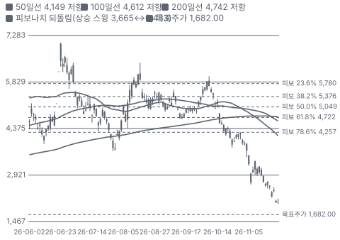

**주봉**

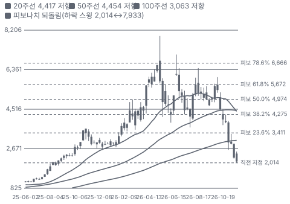

**월봉**

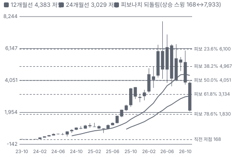

**분기 매출·EPS 실적과 컨센서스**

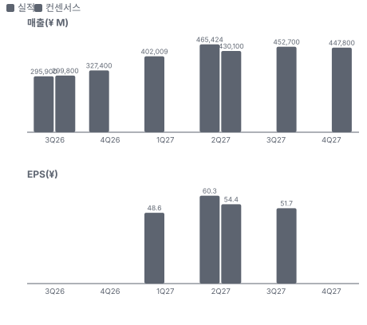

**멀티플 프리미엄(Fwd 1Y P/E 현재값 — 최근 4개 분기 추이 없음: 동종 분기말 배수가 0곳뿐)**

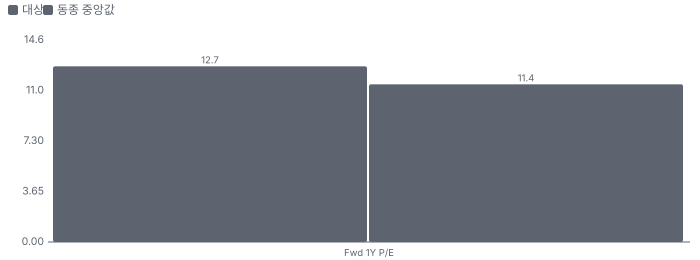

**합리적 멀티플**

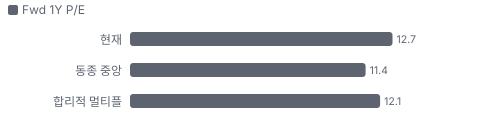

**밸류에이션 주가 시나리오**

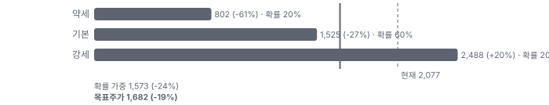

**주가별 업사이드**

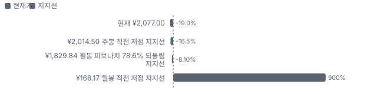
- 제품·서비스 포트폴리오

**공급 병목(10점, 낮을수록 병목)**

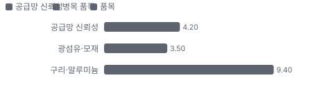

**생산능력 현재와 확충 계획(배(광섬유·광케이블 생산능력, 2026년 3월 = 1))**

**CAPEX의 매출 대비 비중**

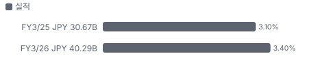

**어닝콜 변화별 주주가치 영향**

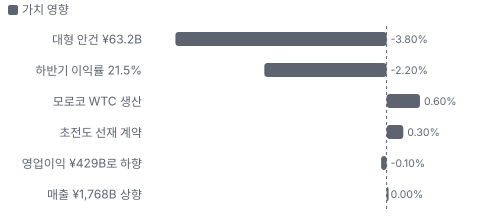

**수주·파이프라인 확실성 사다리**

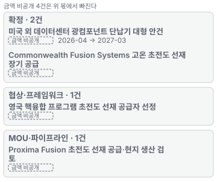

**비용 요인별 매출 대비 비중 1년 변화**

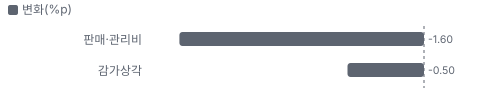

**정보통신 BOM 원가 몫**

**에너지 BOM 원가 몫**

**BOM 항목 가격 +10% 시 OPM 변화**

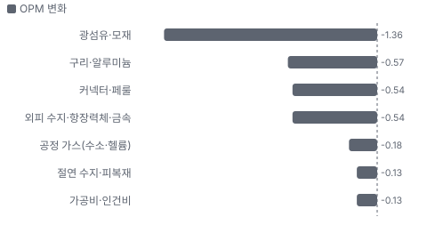

**매출 증가율의 가격·물량 분해와 8분기 전망(전년 대비)**

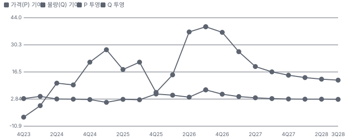

**목표주가 산정 — 기본과 강세 사이(강세 쪽 16%), 도달 확률 약 43%**

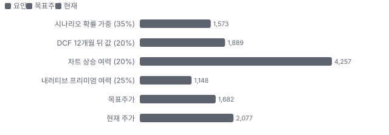

**몬테카를로**

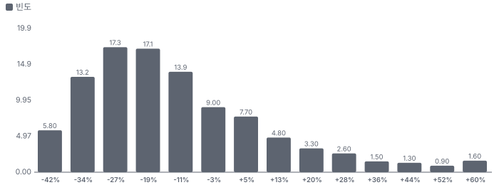

해석: 3,000번 중 722번(24%)에서 가치가 지금 주가 이상이었다. 가정을 흔들어도 지금 주가를 뒷받침하지 못하는 경우가 더 많다. 가운데 값은 0.83배이고, 열 번 중 여덟 번은 0.65~1.19배 사이에 든다.

## 내러티브

> **기업가치를 결정하는 이야기:** Fwd 1Y P/E 12.7배(FY3/28 EPS ¥164, Chiip 추정)다. 회사 가이던스 EPS ¥196.86으로는 10.6배다. 5월 13일 종가에서는 같은 가이던스 EPS 기준 39.9배였다. 가치를 정하는 것은 FY3/28 이익이 올해보다 얼마나 내려가느냐다 — 상반기 영업이익 ¥235.0B 가운데 ¥63.2B가 단납기 대형 안건, ¥8.8B가 관세 환급이다

> **멀티플·EPS 프리미엄**
> **멀티플:** Fwd 1Y P/E 12.7배, 동종 6곳 중앙값 11.4배(후루카와전기 9.9·스미토모전기 12.9·SWCC 9.3·Belden 9.9·Amphenol 20.2·Corning 22.0 — 일본 3사는 선행 추정을 확인하지 못해 후행 P/E 대용)
> **EPS:** FY3/26 EPS ¥94.93 → FY3/27 가이던스 ¥196.86(+107%). FY3/28은 컨센서스 미확인 — 11/25 국내 대형 증권사가 영업 감익 예상으로 바꿨다

### 투자자들은 왜 열광했나

2월 3Q 결산과 3월 ¥300B 증산 결의, 4월 시가총액 ¥10T 돌파를 거쳐 5월 13일 종가 ¥7,855에 닿았다 — '광섬유 부족의 최대 수혜'가 가장 뜨거웠던 때다. 5월 14일 첫 가이던스(수소 조달 제약 반영)에 −19.1%, 5월 19일 중기 계획에 −16.9%로 꺾였고 6월·8월 상향에 반등했지만 고점을 넘지 못했다. 10월 15일 −12.7%, 11월 5~6일 −19.5%, 11월 25일 투자판단 하향에 −14.7%로 내려와 52주 종가 저점 ¥2,062.5를 찍었다

### 무엇이 기업가치를 바꾸나

> **구조적 체질 변화**
> **변화:** 전선 회사에서 데이터센터 광배선 회사로 — 정보통신이 영업이익의 93%. 전선 판매 자회사 두 곳과 중국 모재 합작 지분을 판다
> **증거:** 2Q 결산단신 9쪽 · 2Q 토픽스 8쪽
> **반증:** 정보통신 영업이익 비중이 2개 반기 연속 하락

> **고부가 믹스 확장**
> **변화:** 모자란 광섬유를 초다심·공기압 포설형 품종과 광컴포넌트(데이터센터 안 배선 부품 묶음 — 커넥터 붙은 케이블, 패치 코드, 패치 패널, 접속 카세트)에 돌려 정보통신 이익률 24.3% → 37.4%
> **증거:** 2Q 결산설명자료 8쪽 · 1Q 질의응답 Q6·Q8
> **반증:** 하반기 정보통신 영업이익률 28% 미만(회사 계획 29.4%)

> **기술 혁신**
> **변화:** MT(여러 가닥 광섬유를 한 번에 잇는 기존 다심 커넥터 규격)에서 MMC(MT보다 작아 같은 면적에 더 많이 꽂는 다심 커넥터 규격) 커넥터로 전환, 새 공장은 반복 투자가 아니라 새 제조 기술로 생산성을 높인다는 계획. 핵융합용 고온 초전도 선재(전기 저항 없이 큰 전류를 흘리는 테이프형 전선 — 핵융합로 자석에 쓴다)
> **증거:** 2Q 토픽스 3·5쪽 · 1Q 질의응답 Q11
> **반증:** 새 공장 가동 시점 추가 지연

> **실행 속도**
> **변화:** 해당 없음(납기 수치 미공시) — 회사는 고객이 가격보다 납기를 우선하는 환경에서 단납기 대응이 수주와 고수익으로 이어졌다고만 말한다 **납품 리드타임 미확인.** 피어 비교 미확인. 이전 대비 미확인.
> **증거:** 1Q 질의응답 Q3·Q11
> **반증:** 단납기 안건 후속 수주 없음

> **M&A**
> **변화:** 해당 없음(인수 없음) — 2026년에 매각 3건을 결정해 사업을 줄이는 쪽이다
> **증거:** 2Q 토픽스 8쪽
> **반증:** 해당 없음

> **정책·입법 연관성**
> **재정정책:** 3월 ¥300B 증산 투자가 일본의 대미 투자 틀과 맞물린다는 2차 요약이 있다 — 회사 자료로는 확인하지 못했다(정황). 보조금·세제 수령은 미확인 미확인 반증: 미국 새 공장 부지 발표에 지원 조건이 없다 의회 동의 2/10 — 하원 1/5(이 회사를 겨냥한 미국 세출 논의 미확인) · 상원 1/5(같음).
> **행정명령:** IEEPA(미국 국제긴급경제권한법 — 이 법에 따른 관세 일부가 환급됐다) 관세 환급 ¥8.8B를 상반기에 잡았고 하반기는 제도 불확실로 넣지 않았다. 통상법 301조 새 관세 영향은 가이던스에 반영(8월). 관세 충당금 ¥13.4B 2Q 결산설명자료 7·16쪽 · 1Q 결산설명자료 16쪽 · 2Q 결산단신 3쪽 반증: 301조 관세율 인상 또는 환급 재개 의회 동의 2/10 — 하원 1/5(관세 입법 고착 법안의 의결 기록 미확인) · 상원 1/5(같음).
> **연관입법:** 해당 없음(회사를 겨냥한 미국·일본 법안 미확인). 회사는 미국 중간선거 결과의 영향을 지켜본다고 적었다 2Q 토픽스 3쪽 반증: 해당 없음

> **고객의 지출 예산**
> **변화:** 매출의 3분의 2가 고객의 데이터센터·통신망 설비투자에서 나온다
> **사업별 예산:** **매출의 67%**: 정보통신 — 고객 CAPEX(데이터센터 건설·통신망 설비투자(배선·공사)) · 동인: 대형 클라우드와 통신사의 설비투자, AI 데이터센터 간 연결
**매출의 12%**: 자동차 — 고객 해당 없음(완성차 생산 원가(부품 구매)) · 동인: 유럽 차종 증산
**매출의 10%**: 에너지 — 고객 CAPEX(전력망·건물 설비투자) · 동인: 일본 전력·건설 수요와 구리값
**매출의 9%**: 일렉트로닉스 — 고객 해당 없음(스마트폰·HDD 부품 구매) · 동인: 스마트폰 품종 구성, HDD는 데이터센터 수요
> **증거:** 2Q 결산단신 9~10쪽
> **반증:** 북미 대형 클라우드 설비투자 계획 하향

### 내러티브 근거

> AI 데이터센터가 광섬유를 빨아들이고 그 초다심 케이블을 가장 잘 만드는 일본 회사라는 이야기였다. 이 이야기로 주가는 2025년 11월 ¥2,900대에서 2026년 5월 13일 종가 ¥7,855까지 올랐고, 지금은 ¥2,077로 고점에서 74% 내려왔다. 이익은 그 사이 두 번 넘게 올랐다 — 무너진 것은 이익이 아니라 '이 이익이 이어진다'는 믿음이다. 동종 대비 멀티플 차이 +11% 중 회사 고유 몫은 +5%다. 단계는 붕괴, 쏠림은 낮음이다.

> **AI 데이터센터 광섬유 부족** · 약화
> **논리:** 데이터센터 안팎 배선이 초다심 광케이블로 바뀌고 광섬유가 모자란다
> **숫자:** 정보통신 1H 매출 ¥581.5B(+92%)·영업이익 ¥217.7B(+195%)
> **반증:** 북미 정보통신 매출이 전년 대비 감소
> **출처:** https://ssl4.eir-parts.net/doc/5803/tdnet/2909047/00.pdf

> **단납기 대형 안건은 한 번이다(반대 내러티브)** · 강화
> **논리:** 상반기 이익의 큰 몫이 갑자기 받은 안건 하나에서 나왔고 내년에는 빠진다
> **숫자:** 상반기 영업이익 기여 ¥63.2B(상반기 영업이익의 27%), 하반기 영업이익 계획 ¥194.0B
> **반증:** FY3/28 가이던스 영업이익이 FY3/27 ¥429B 이상
> **출처:** https://ssl4.eir-parts.net/doc/5803/ir_material_for_fiscal_ym/217565/00.pdf

> **가격 인상과 품종 구성** · 유지
> **논리:** 모자란 광섬유를 비싼 품종에 돌리고 같은 제품 값도 올린다
> **숫자:** 가격 인상·품종 구성 효과 +¥14.1B(1H), 일부 고객 약 25% 인상
> **반증:** 하반기 정보통신 영업이익률 28% 미만
> **출처:** https://ssl4.eir-parts.net/doc/5803/ir_material_for_fiscal_ym/210980/00.pdf

> **일·미 증설 최대 ¥300B** · 유지
> **논리:** 생산능력을 약 3배로 늘려 2030년대 수요를 받는다
> **숫자:** 일본 약 ¥40B + 미국 최대 ¥260B, 효과는 2030년부터(보도)
> **반증:** 미국 부지 확정이 2027년 상반기를 넘긴다
> **출처:** https://ssl4.eir-parts.net/doc/5803/ir_material_for_fiscal_ym/217564/00.pdf

> **증설이 끝나면 가격이 내려간다(반대 내러티브)** · 유지
> **논리:** 업계가 함께 늘리면 광섬유 부족 프리미엄이 사라진다
> **숫자:** 회사: 새 공장은 가격 경쟁이 심해져도 버틸 원가 경쟁력이 목표(1Q 질의응답 Q11)
> **반증:** 세계 광섬유 가격이 2027년에도 상승
> **출처:** https://ssl4.eir-parts.net/doc/5803/ir_material_for_fiscal_ym/210980/00.pdf

> **핵융합용 초전도 선재** · 유지
> **논리:** 핵융합 업체들이 자석용 선재를 장기 계약으로 산다
> **숫자:** 장기 공급 계약 1건(1만 km 초과), 선재 증설 6~8배 — 매출 미공시
> **반증:** 계약 고객의 건설 일정 지연 공시
> **출처:** https://ssl4.eir-parts.net/doc/5803/ir_material_for_fiscal_ym/217564/00.pdf

### 투자 포인트

> **올해 이익은 정점이고 내년은 내려온다**
> **명제:** 상반기 영업이익의 30%가 되풀이되기 어려운 항목이다
> **숫자:** 상반기 영업이익 ¥235.0B 가운데 단납기 대형 안건 ¥63.2B와 관세 환급 ¥8.8B. 하반기 영업이익 계획 ¥194.0B(이익률 21.5%). 회사: 하반기에 확실한 새 대형 안건은 없다
> **시장과 다른 점:** 주가 ¥2,077은 가이던스 EPS의 10.6배다. 시장은 이미 감익을 값에 넣었다 — 제 판단은 FY3/28 영업이익 ¥355B(−17%)이고, 값에 든 감익이 그보다 깊은지가 쟁점이다
> **증명:** 2027년 5월 FY3/28 가이던스 — 영업이익 ¥355B 이상
> **출처:** https://ssl4.eir-parts.net/doc/5803/ir_material_for_fiscal_ym/217565/00.pdf

> **안건을 빼도 본업 이익률은 올랐다**
> **명제:** 대형 안건과 환급을 뺀 상반기 영업이익도 전년의 1.8배다
> **숫자:** 상반기 영업이익 ¥235.0B − ¥63.2B − ¥8.8B = ¥163.0B(전년 ¥90.2B). 가격 인상·품종 구성 +¥14.1B, 일부 고객 약 25% 인상, 북미 정보통신 매출 +52%
> **시장과 다른 점:** 하향 쪽은 이익 전체를 일회성으로 묶는다. 제 판단은 광섬유 부족이 새 공장 가동(2030년) 전까지 풀리기 어려워 본업 이익률은 버틴다는 것이다 — 다만 외부 조달 원가가 오르는 중이다
> **증명:** 2027년 2월 3Q 결산 — 정보통신 영업이익 ¥88.7B 이상
> **출처:** https://ssl4.eir-parts.net/doc/5803/tdnet/2909047/00.pdf

> **증설은 가격 하락과 같이 온다**
> **명제:** 최대 ¥300B 증설의 효과는 2030년부터이고 회사도 그때의 가격 경쟁을 전제로 한다
> **숫자:** 일본 약 ¥40B + 미국 최대 ¥260B, 미국은 부지 선정 중. 회사: 새 공장은 수급이 풀려 가격 경쟁이 심해져도 버틸 원가 경쟁력이 목표
> **시장과 다른 점:** 강세 쪽은 생산능력 3배를 이익 3배로 읽는다. 제 판단은 물량이 느는 만큼 부족 프리미엄이 줄어 장기 영업이익률은 17% 안팎이라는 것이다
> **증명:** 미국 새 공장 부지·가동 시점 발표(2027년 중)
> **출처:** https://ssl4.eir-parts.net/doc/5803/ir_material_for_fiscal_ym/210980/00.pdf

### 모멘텀 생성·소멸 타임라인

**카탈리스트 달력 — 지난 사건의 주가 반응과 앞으로 확인할 숫자**
| 날짜 | 상태 | 구분 | 사건 | 반응·확인 | 결과에 따라 |
|---|---|---|---|---|---|
| 2026-03-13 | 완료 | 생성 | SWR(광섬유를 거미줄처럼 띄엄띄엄 붙인 리본 — 둥글게 말려 케이블에 빽빽이 들어간다)·WTC 증산 최대 ¥300B 투자 결의 | +3.2% |  |
| 2026-05-14 | 완료 | 소멸 | FY3/26 결산·FY3/27 첫 가이던스 — 전날 종가 고점 ¥7,855 | -19.1% |  |
| 2026-05-19 | 완료 | 소멸 | 2028 중기 경영 계획 발표 | -16.9% |  |
| 2026-06-19 | 완료 | 생성 | 6/18 통기 상향(대형 안건 상반기 수주분 반영) 다음 날 | +15.7% |  |
| 2026-08-07 | 완료 | 생성 | 1Q 결산·통기 재상향(영업이익 ¥432B) | +12.8% |  |
| 2026-11-10 | 완료 | 확인 | 2Q 결산 — 매출 상향·영업이익 소폭 하향·배당 ¥80 | +0.3% |  |
| 2026-11-25 | 완료 | 소멸 | 국내 대형 증권사 투자판단 하향·FY3/28 감익 예상 | -14.7% |  |
| 2027-02 초(예상) | 예정 | 확인 | 3Q FY3/27 결산 | 정보통신 영업이익 ¥88.7B 이상, 통기 가이던스 유지 | 넘으면 기본 시나리오, 밑돌면 약세 쪽으로 |
| 2027-05 중순(예상) | 예정 | 확인 | FY3/27 결산·FY3/28 첫 가이던스 | 영업이익 가이던스 ¥355B | ¥429B 이상이면 강세, ¥300B 아래면 약세 |
| 2027년 중 | 예정 | 확인 | 미국 새 공장 부지·투자 확정 | 부지, 가동 시점, 지원 조건 | 확정되면 장기 물량 가시성, 미뤄지면 외부 조달 의존 연장 |
| 2027-01 하순~02 초 | 예정 | 매크로 | 북미 대형 클라우드 4분기 실적·2027년 설비투자 계획 | 설비투자 계획이 전년 대비 늘어나는지 | 줄면 북미 정보통신 매출 가정을 내린다 |

### 언제 사서 언제 팔아야 할까?

**가격·조건 틀 — 가격은 밸류에이션(약세·기본·강세·목표주가)과 차트 지지 구간에서, 조건은 이벤트에서**
| 구간 | 가격 | 목표주가까지 | 약세까지 | 조건·근거 |
|---|---|---|---|---|
| 관찰 구간 | ¥2,014~¥2,014 | -17% | -60% | 지금 가격이 52주 종가 저점(11/25 ¥2,062.5) 바로 위다. 아래 지지 구간은 급락 전 긴 횡보가 없어 얇다 — 2025년 가을 거래대(¥2,400 안팎)는 이미 깨졌다 |
| 확인 뒤 | 지금 ¥2,077 이상에서 조건 확인 | -19% | -61% | 3Q 정보통신 영업이익 ¥88.7B 이상 또는 FY3/28 가이던스 영업이익 ¥355B 이상, 그리고 주가가 50일선 위에서 주간 마감 |
| 무효화 | 약세 시나리오 ¥802 | - | -61% | FY3/28 가이던스 영업이익이 ¥300B 아래이거나, 북미 정보통신 매출이 전년 대비 줄어든다 |
| 차익 고민 2차 | ¥2,488(강세 시나리오) | +20% | - | 목표주가 부근은 Fwd 1Y P/E가 동종 중앙값보다 뚜렷이 높아지는 자리다 — 대형 안건 후속이 숫자로 확인되기 전에는 그 프리미엄의 근거가 약하다 |

하루 8% 넘게 움직인 날이 최근 150거래일에 22번이다. 결산·투자판단 변경 다음 날 변동이 특히 크다 — 가격·조건 틀이며 매매·비중 지시가 아니다 가격·조건 틀이며 매매·비중 지시가 아니다(투자 권유 아님).

## 포트폴리오

| 제품·서비스 | 구분 | 무엇 | 쓰는 곳 | 돈 버는 방식 | Mix | Mix 변화(전 분기 대비) |
|---|---|---|---|---|---|---|
| 정보통신 | 제품 | 초다심 광케이블(SWR·WTC), 커넥터, 광컴포넌트, 융착 접속기(광섬유 두 가닥을 녹여 잇는 장비), 통신 공사 | 데이터센터 안팎 배선, 통신사 망 | 제품 판매 + 공사(단납기는 고수익) | 68% | +2.4%p |
| 자동차 | 제품 | 자동차용 와이어 하네스(자동차 안 전선 다발)와 전장 부품 | 완성차 배선 | 차종별 납품(영업이익률 1.7%) | 11% | -2.7%p |
| 에너지 | 제품 | 전력 케이블·산업 전선 | 일본 전력망·건물 | 구리값 연동 판매 | 10% | -0.6%p |
| 일렉트로닉스 | 제품 | 연성 기판(휘어지는 인쇄 회로 기판), 커넥터, HDD 부품 | 스마트폰·HDD | 부품 판매 | 10% | +1.0%p |
| 부동산 | 서비스 | 옛 공장 터 재개발 임대 | 오피스·상업 시설 | 임대료(영업이익률 47%) | 1% | -0.1%p |

**Mix 변화가 가장 큰 쪽은 자동차(-2.7%p, 전 분기 대비).** 계절성 판정: 분기 매출 계절 지수 기준 없음 → 직전 분기와 비교.

## 수주·파이프라인

> **2026-11-10 기준 4건.** 확정 JPY 0.00B.

**수주 목록**
| 상태 | 계약 | 계약 총액 | 진척 | 기간 | 비고 |
|---|---|---|---|---|---|
| 확정 | 미국 외 데이터센터 광컴포넌트 단납기 대형 안건(미국 외) | 금액 비공개 | - | 2026-04 → 2027-03 | - |
| 확정 | Commonwealth Fusion Systems 고온 초전도 선재 장기 공급(미국) | 금액 비공개 | - | - | - |
| 프레임워크 | 영국 핵융합 프로그램 초전도 선재 공급자 선정(영국) | 금액 비공개 | - | - | - |
| MOU(계약 전 단계의 기본 합의서) | Proxima Fusion 초전도 선재 공급·현지 생산 검토(독일) | 금액 비공개 | - | - | - |

**실행 속도와 방해 요인**
| 항목 | 상태 | 실행 속도 | 방해 요인 |
|---|---|---|---|
| 미국 외 데이터센터 광컴포넌트 단납기 대형 안건 | 확정 | 미확인 | 고객 투자 계획에 따라 후속 수주 불확실 · 하반기 확실한 새 대형 안건 없음(8월 답변) |
| Commonwealth Fusion Systems 고온 초전도 선재 장기 공급 | 확정 | 미확인 | 상용 핵융합로 건설 일정 · 선재 증설(2022년도 대비 6~8배) 램프 |
| 영국 핵융합 프로그램 초전도 선재 공급자 선정 | 프레임워크 | 미확인 | 개별 발주 금액·물량 미공개 |
| Proxima Fusion 초전도 선재 공급·현지 생산 검토 | MOU | 미확인 | 기본 합의 단계 — 계약·물량 없음 |

## 마진 구조

> **GPM 37.2%, OPM 27.1%.** 1H FY3/26 대비 GPM +9.3%p, OPM +11.0%p. 변동비는 매출의 51%이고, 매출이 10% 늘면 OPM은 +2.0%p 움직인다. 1H 매출총이익률 37.2%(전년 27.9%), 판관비율 10.1%(전년 11.7%) — 영업이익률이 16.1% → 27.1%로 올랐다. 회사 분해로는 영업이익 증가 ¥144.8B 가운데 단납기 대형 안건 ¥63.2B, 매출 증가의 한계이익 ¥55.1B, 가격 인상·품종 구성 ¥14.1B, 환율 ¥20.3B, 관세 환급 ¥8.8B, 고정비 −¥17.4B다. 비용 항목별 몫은 회사가 내지 않아 추정이다

**GPM에서 OPM까지(J-GAAP, 아래는 최근 4개 분기)**
| 기간 | GPM | 연구개발 | 판관비 | 기타 | OPM |
|---|---|---|---|---|---|
| 1H FY3/26 | 27.9% | 0.0% | 11.7% | 0.0% | 16.1% |
| 1H FY3/27 | 37.2% | 0.0% | 10.1% | 0.0% | 27.1% |
| 2025-06 | 27.4% | - | - | - | 15.3% |
| 2025-09 | 28.3% | - | - | - | 16.9% |
| 2026-06 | 37.1% | - | - | - | 26.1% |
| 2026-09 | 37.3% | - | - | - | 28.0% |

**마진을 결정하는 비용 요인 — 비용 +10% 시 OPM**
| 비용 | 매출 대비 | 변화 | 고정비 | OPM |
|---|---|---|---|---|
| 기타 제조 원가 | 20.3% | 미확인 | 30% | -2.03%p |
| 구리·알루미늄 등 금속 | 17.0% | 미확인 | 0% | -1.70%p |
| 광섬유·모재·케이블 외부 조달 | 12.0% | 미확인 | 0% | -1.20%p |
| 제조 인건비 | 12.0% | 미확인 | 60% | -1.20%p |
| 판매·관리비 | 10.1% | -1.6%p | 70% | -1.01%p |
| 감가상각 | 1.6% | -0.5%p | 100% | -0.16%p |

**비용을 움직이는 요인**
| 비용 | 요인 |
|---|---|
| 기타 제조 원가(매출원가) | 수소·헬륨 같은 공정 가스, 전력, 커넥터 부품, 물류, 관세 · 근거 추정 |
| 구리·알루미늄 등 금속(매출원가) | 구리 기준가 ¥2,278천/톤(전년 ¥1,461천) — 에너지·자동차 전선은 판가에 연동 · 근거 추정 |
| 광섬유·모재·케이블 외부 조달(매출원가) | 새 공장이 설 때까지 외부 조달 의존, 세계 광섬유 가격 상승세(1Q 질의응답) · 근거 추정 |
| 제조 인건비(매출원가) | 직원 약 5만 명(하네스·연성 기판 조립 비중 큼) · 근거 추정 |
| 판매·관리비(판관비) | 인건비·연구개발·물류 · 근거 공시 |
| 감가상각(매출원가) | 1H ¥13.5B(전년 ¥11.6B) — 일·미 새 공장 가동 뒤 증가 · 근거 공시 |

**정보통신 BOM — 매출의 67%, GPM 46%(추정 — 사업부 매출총이익률 미공시. 사업부 영업이익률 37.4%에 판관비 몫(전사 10%의 일부)을 더한 범위의 가운데), 항목 가격 +10% 시**
| 항목 | 원가 몫 | 전가 | 제품 GPM | OPM |
|---|---|---|---|---|
| 광섬유·모재 | 30~45% | 미확인 | -2.0%p | -1.36%p |
| 커넥터·페룰(여러 가닥 광섬유의 끝을 정렬해 잡는 커넥터 핵심 부품) | 10~20% | 미확인 | -0.8%p | -0.54%p |
| 외피 수지·항장력체·금속 | 10~20% | 미확인 | -0.8%p | -0.54%p |
| 공정 가스(수소·헬륨) | 2~8% | 미확인 | -0.3%p | -0.18%p |
| 미분해 | 27% | - | - | - |

**에너지 BOM — 매출의 10%, GPM 20%(추정 — 미공시. 사업부 영업이익률 11.6%에 판관비 몫을 더한 값), 항목 가격 +10% 시**
| 항목 | 원가 몫 | 전가 | 제품 GPM | OPM |
|---|---|---|---|---|
| 구리·알루미늄 | 60~75% | 미확인 | -5.4%p | -0.57%p |
| 절연 수지·피복재 | 10~20% | 미확인 | -1.2%p | -0.13%p |
| 가공비·인건비 | 10~20% | 미확인 | -1.2%p | -0.13%p |
| 미분해 | 2% | - | - | - |

광섬유·모재 가격이 +10% 오르면 영업이익은 -5.0% 움직인다. 판매가 전가를 모르는 항목은 전가 0%로 계산했다.

**BOM 항목 가격을 움직이는 것**
| 항목 | 요인 |
|---|---|
| 광섬유·모재 | 일부 고객이 약 25% 인상을 받아들였지만(1Q 질의응답 Q8) 계약 연동 조항은 확인하지 못했다. 광케이블 원가의 가장 큰 몫. 세계 광섬유 가격이 오르는 중이라 외부 조달이 늘수록 원가가 오른다 · 근거 추정 |
| 커넥터·페룰 | MT에서 MMC로 넘어가는 다심 커넥터 — 페룰은 지분법 회사가 만든다 · 근거 추정 |
| 공정 가스(수소·헬륨) | 광섬유 모재를 만들 때 쓴다 — 5월에는 부족이 생산 제약 위험이었다 · 근거 추정 |
| 외피 수지·항장력체·금속 | 케이블 외피와 보강재 · 근거 추정 |
| 구리·알루미늄 | 회사는 구리값 상승과 판가 개선으로 증수·증익이라고 썼다(전가 비율 미공시). 전선 원가의 대부분 · 근거 추정 |
| 절연 수지·피복재 | 절연·외피 · 근거 추정 |
| 가공비·인건비 | 신선·연선·압출 가공 · 근거 추정 |

**투입 물가 — 미국 PPI 3·6·12개월(2026-10, 개정 반영)과 해외 전년비**
| 항목 | 미국 3개월 | 6개월 | 12개월 | 전가 못 할 때 OPM | 일본 | 한국 | 대만 |
|---|---|---|---|---|---|---|---|
| 광섬유·모재 | 미확인 | 미확인 | 미확인* | - | 미확인 | 미확인 | 미확인 |
| 커넥터·페룰 | +0.9% | +2.8% | +4.4%* | - | 미확인 | 미확인 | 미확인 |
| 구리·알루미늄 | +3.4% | +7.2% | +23.9% | - | +42.6% | +19.2% | +40.1% |

별표는 품목보다 넓은 업종 지수다. 연결한 투입 원가의 미국 PPI(생산자물가지수)는 1년 새 가중 +23.9%이고, 판매가로 넘기지 못하면 GPM -4.1%p·OPM -4.1%p가 움직인다. 물가 지수를 붙이지 못한 매출원가 항목은 광섬유·모재·케이블 외부 조달, 제조 인건비, 감가상각다(미연결).

## 공급망 병목

> **공급망 신뢰성 4.2/10, 병목 주의.** 가장 약한 고리는 광섬유·모재 3.5점이고, 품목 평균은 5.3점이다. 근거가 부족한 3건(외부 조달 광섬유·광케이블 · 공정 가스(수소·헬륨) · 커넥터·페룰)은 점수에서 뺐다. 약한 고리는 광섬유다. 사쿠라 공장이 거의 풀 가동이라 새 공장이 설 때까지 외부 조달로 메운다 — 회사는 외부 조달을 상방이자 위험이라고 말했다. 5월의 수소 부족은 사용량 절감과 압축 수소 조달로 눌렀다. 공급사 이름은 회사가 밝히지 않는다. 회사가 리드타임·재인증·점유율을 내지 않아 외부 조달·수소·페룰은 병목 점수에 넣을 요인이 모자라다 — 점수는 자체 광섬유와 구리만 반영한다

**병목과 마진 — 품목 가격 +10% 시 OPM**
| 품목 | 점수 | 판정 | 구분 | OPM |
|---|---|---|---|---|
| 광섬유·모재(필수) | 3.5 | 병목 심각 | 핵심 통제 품목 | -1.36%p |
| 구리·알루미늄(필수) | 9.4 | 병목 낮음 | 가격 위험 | -0.57%p |

> **광섬유·모재** · 3.5/10
> **왜:** 자체 생산분이다 — 한 사업소에 모여 있고 거의 풀 가동이라 광케이블 매출의 상한을 정한다. 모자란 몫은 아래 외부 조달로 메운다
> **병목 요인:** 인증 공급사 1곳 · 캐파 빠듯 · 리드타임 미확인 · 재인증 미확인 · 1위 점유율 미확인 · 일본 지바현 사쿠라(회사 자료에 이름이 나온 자체 광섬유 거점 기준) 집중 100% · 물량 확보 내재화
> **풀리는 조건:** 일·미 새 공장(일본 2030년 12월 가동 예정 보도, 미국은 부지 선정 중) — 장비 반입·가동 확인 전

> **구리·알루미늄** · 9.4/10
> **왜:** 에너지·자동차 전선 원가. 거래소에서 사고파는 상품이라 공급원은 여럿이고(5곳 이상으로 셌다 — 추정) 재인증이 필요 없다
> **병목 요인:** 인증 공급사 5곳 · 캐파 여유 · 리드타임 미확인 · 재인증 0개월 · 1위 점유율 미확인 · 지역 집중 미확인 · 물량 확보 복수구매
> **풀리는 조건:** 해당 없음

**공급사**
| 품목 | 공급사 | 몫 | 근거 |
|---|---|---|---|
| 광섬유·모재 | Fujikura 사쿠라 사업소(광섬유 모재·광섬유·SWR·WTC(내제)) | 미확인 | 회사 발표 |
| 외부 조달 광섬유·광케이블 | 미공시(복수 외부 공급사, 광섬유·광케이블 외부 조달) | 미확인 | 회사 발표 |
| 공정 가스(수소·헬륨) | 미공시(모재 공정용 수소) | 미확인 | 추정 |
| 커넥터·페룰 | US Conec(다심 커넥터 페룰(지분법 적용 회사)) | 미확인 | 회사 발표 |
| 구리·알루미늄 | 미공시(전선용 금속) | 미확인 | 추정 |

**무역 통계로 본 공급 지역**
| 품목 | EU 수입처 | 일본 수입처 | EU 1위 전년비 |
|---|---|---|---|
| 광섬유·모재 | CN(중국) 53% · US 35% · VN(베트남) 5% | 中華人民共和国 46% · ベトナム 20% | -7.1% |
| 커넥터·페룰 | CN 65% · US 20% · TW(대만) 7% | 中華人民共和国 36% · アメリカ合衆国 21% | +13.9% |
| 구리·알루미늄 | MY(말레이시아) 77% · KR(한국) 11% · VN 7% | マレーシア 58% · タイ 36% | 미확인 |

## 생산능력

> **현재 명목 캐파 1 배(광섬유·광케이블 생산능력, 2026년 3월 = 1), 가동률 미확인.** 착공 이상 증설은 0 배(광섬유·광케이블 생산능력, 2026년 3월 = 1), 발표까지 합치면 0 배(광섬유·광케이블 생산능력, 2026년 3월 = 1)이다. 다 가동하면 지금보다 +0%, 착공 이상만이면 +0%다. FY3/26 CAPEX는 JPY 40.29B로 매출의 3.4%다. 회사는 캐파를 심 km·톤으로 밝히지 않는다. 3월 이사회가 SWR·WTC 증산에 최대 ¥300B(일본 약 ¥40B + 미국 최대 ¥260B)를 결의했고 목표는 지금의 약 3배다(2차 요약·보도 — 이사회 공시 원문은 이번 회차 미열람). 효과는 2030년부터라 그때까지는 기존 설비 생산성 개선과 외부 조달이 물량을 정한다

**생산시설 4곳**(2Q 토픽스·1Q 질의응답에 이름이 나온 광섬유·광케이블 거점만 센다(가동 2곳 + 계획 2곳). 에너지·자동차·일렉트로닉스 공장은 유가증권보고서 설비 항목을 이번 회차에 열지 못해 세지 않았다(미확인)), 미확인 4곳. 시설별 생산능력은 공개되지 않았다 — 회사 전체 캐파만 위에 적었다.

**생산시설 4곳 — 명칭·위치·생산능력**
| 시설 | 위치 | 용도 | 생산능력 | 소유·상태 |
|---|---|---|---|---|
| 사쿠라 사업소 | 일본 지바현 사쿠라시 | 광섬유 모재·광섬유·SWR·WTC | 미확인 — 시설별 캐파 미공시 — 새 공장이 지난해부터 가동해 거의 풀 가동(1Q 질의응답) | 미확인 · 가동 |
| Fujikura Automotive Morocco Tangier | 모로코 탕헤르 | 자동차 하네스 + WTC(2026년 8월부터) | 미확인 — 시설별 캐파 미공시 | 미확인 · 가동 |
| 사쿠라 사업소 새 공장 | 일본 지바현 사쿠라시 | 광섬유·광케이블 증산 | 미확인 — 미공시 — 2030년 12월 가동 예정(보도) | 미확인 · 계획 |
| 미국 새 공장(준비 회사 Fujikura Optical Cable Systems) | 미국(부지 선정 중) | 광섬유·광케이블 증산 | 미확인 — 미공시 — 준비 회사 2026년 6월 설립 | 미확인 · 계획 |

**생산능력 확충 계획**
| 계획 | 단계 | 증설 | 가동 시점 | CAPEX |
|---|---|---|---|---|
| 사쿠라 사업소 새 공장(일본) | 발표 | 미확인 | 2030-12 | JPY 40.00B |
| 미국 새 공장(Fujikura Optical Cable Systems) | 발표 | 미확인 | 미확인 | JPY 260.00B |
| 고온 초전도 선재 증설(2022년도 대비 6~8배) | 착공 | 미확인 | 미확인 | JPY 11.60B |

남은 계획의 CAPEX 합계는 JPY 311.60B다. 합계는 FY3/26 매출의 26%다.

**증설 방해 요인**
| 계획 | 방해 요인 |
|---|---|
| 사쿠라 사업소 새 공장(일본) | 건설·장비 반입·수율 안정(가동 시점은 보도 기준) |
| 미국 새 공장(Fujikura Optical Cable Systems) | 부지 선정 중(8월), 인허가·건설 |
| 고온 초전도 선재 증설(2022년도 대비 6~8배) | 핵융합 고객 일정 |

**CAPEX와 매출 대비**
| 기간 | CAPEX | 매출 | 매출 대비 | 구분 |
|---|---|---|---|---|
| FY3/25 | JPY 30.67B | JPY 979.38B | 3.1% | 실적 |
| FY3/26 | JPY 40.29B | JPY 1,182.36B | 3.4% | 실적 |

## 피터 린치 분류

분류 미확인 — 장기 성장률 자료가 없다

## 구루 교차 점검

> **여섯 관점 중 통과 1 · 미달 2 · 미확인 3.** 가장 약한 관점은 변화의 방향 — 이익이 내려가는 방향이라는 점이 가장 약하다 — 값이 싸도 추정이 내려가는 동안은 배수가 잘 오르지 않는다.

판정은 자체추론이고 숫자는 계산값이다.

> **성장 여지** · 미확인
> **질문:** 5년 안에 매출이 2배가 될 자리가 있나, 10년 뒤에도 커지나
> **이유:** 생산능력 약 3배 계획은 있지만 효과가 2030년부터이고, FY3/28은 대형 안건이 빠져 매출이 줄 수 있다 — 5년 매출 경로를 회사가 내지 않았다
> **계산한 숫자:** 매출 경로 미확인
> **근거:** 2Q 토픽스 · 출처 목록

> **해자와 자본수익률** · 통과
> **질문:** 경쟁우위가 무엇이고, 투하자본수익률(ROIC)이 자본비용보다 높으며 유지·상승하나
> **이유:** TTM 영업이익 ¥333.5B ÷ 투하자본 ¥589.9B로 세후 ROIC가 약 43%다 — 다만 공급 부족 프리미엄이 들어 있어 정상 수준은 이보다 낮다
> **계산한 숫자:** ROIC 42.7% · 자본비용 10.2%
> **근거:** 2Q 결산단신 · 출처 목록

> **재투자 복리** · 미확인
> **질문:** 번 돈을 높은 수익률로 다시 넣을 곳이 있나 — 자본 배분(재투자·인수·자사주·희석) 이력은
> **이유:** 최대 ¥300B를 다시 넣을 곳은 있지만 그 공장의 수익률은 2030년 뒤에야 확인된다. 회사도 가격 경쟁을 전제로 한다
> **계산한 숫자:** 설비 재투자율 4.8% · 지속 가능 성장 2.0%(근사) · 소유주 이익 수익률 7.3%(근사)
> **근거:** 1Q 결산설명회 질의응답 요지 · 출처 목록

> **사람과 문화** · 미확인
> **질문:** 경영진이 주주와 같은 배를 탔나 — 창업자·내부자 지분, 기회형 내부자 매수, 문화가 경쟁우위에 기여하나
> **이유:** 경영진 지분·보상 구조를 유가증권보고서·주총 소집 통지로 대조하지 못했다
> **계산한 숫자:** 서류로 확인(계산 없음)
> **근거:** 미확인

> **변화의 방향** · 미달
> **질문:** 18~24개월 뒤 이익 그림이 지금과 얼마나 다른가, 유동성 국면은 그 변화를 받쳐 주나
> **이유:** 하반기 영업이익 계획이 상반기보다 17% 낮고 FY3/28 EPS는 올해 가이던스보다 낮다고 본다(Chiip 추정 −17%)
> **계산한 숫자:** 2년 뒤 EPS +4.9%(다음 12개월 대비) · 유동성 국면 긴축
> **근거:** 2Q 결산설명자료 · 출처 목록

> **5배 경로와 시장이 모르는 이유** · 미달
> **질문:** 어떻게 5배 이상이 되나(이익 성장 × 배수 변화), 시장은 왜 아직 값을 안 매기나
> **이유:** 5년 5배에는 연 38% 성장이 필요하다 — 시가총액 ¥3.4T의 전선 회사에는 닿기 어려운 경로다. 2배 경로는 FY3/28 이익이 버티면 열린다
> **계산한 숫자:** 5년에 5배 = 연 38.0% · 10배 = 연 58.5% · Fwd P/E 12.7배
> **근거:** 밸류에이션 계산

**배수별로 필요한 연 성장률 — 이익 성장과 배수 변화를 합친 속도**
| 목표 | 5년 | 7년 | 10년 |
|---|---|---|---|
| 2배 | 14.9% | 10.4% | 7.2% |
| 5배 | 38.0% | 25.8% | 17.5% |
| 10배 | 58.5%(희소) | 38.9% | 25.9% |

### 보유 규율 — 가격이 아니라 지표로 유지·종료를 가른다

- 투자 논리 지표: 정보통신 영업이익(반기) · 북미 정보통신 매출 · 미국 새 공장 일정
- 규칙: 가격만 빠지고 정보통신 영업이익이 하반기 계획을 지키면 투자 논리는 유지된다
- 지금 주가는 일봉 760개 기간의 고점 대비 -73.6%, 그 기간 최대 낙폭은 -73.7%다 — 고점 대비 −50%를 넘어 재심사 구간이다. 가격이 아니라 위 지표로 유지·종료를 가른다.

여섯 관점은 베일리 기포드(성장 여지·5배 경로), 워렌 버핏(해자·재투자), 론 바론(사람), 피터 린치(분류·내부자), 스탠리 드러켄밀러(변화의 방향·유동성)의 질문을 옮긴 점검 틀이다. 유동성 국면은 긴축(10년물 20일 -9bp · 하이일드 스프레드 20일 +54bp). 설비 재투자율은 설비투자에서 감가상각을 뺀 몫만 본 근사이고(연구개발·인수·운전자본은 빠진다), 소유주 이익 수익률은 유지 설비투자를 감가상각과 같다고 본 근사다. 점검 틀이며 매매·비중 지시가 아니다.

## 해자

> 해자는 초다심 광케이블 제품군과 케이블·커넥터·융착 접속기·공사를 한꺼번에 파는 묶음이다. 다만 지금 이익의 상당 부분은 공급 부족과 단납기 프리미엄에서 온다 — 회사 스스로 새 공장의 목적을 '수급이 풀려 가격 경쟁이 심해져도 버틸 원가'라고 말했다

> **초다심 광케이블 제품군(SWR·WTC)** · 강함
> **해자:** 좁은 관로에 더 많은 광섬유를 넣는 케이블에서 고부가 품종을 계속 낸다
> **근거:** 1Q 질의응답 Q8·Q11 — 한정된 광섬유를 초다심·공기압 포설형 WTC 같은 고부가 품종에 돌려 평균 단가 상승, 일부 고객 약 25% 인상 수용. 정보통신 영업이익률 37.4%(1H FY3/27, 2Q 결산단신)
> **숫자:** 정보통신 영업이익률 24.3% → 37.4%(1H), 가격 인상·품종 구성 효과 +¥14.1B(1H)
> **깨지는 조건:** 정보통신 영업이익률이 2개 반기 연속 30% 아래

> **케이블·커넥터·접속기·공사 일괄 공급** · 보통
> **해자:** 공사까지 같이 맡아 고객의 공기를 줄인다
> **근거:** 1Q 질의응답 Q11 — 광케이블·커넥터·융착 접속기·통신 공사를 묶어 제공, 고객이 가격보다 납기를 우선하는 상황. 2Q 토픽스 3쪽 — 대형 데이터센터 공사 사업 확대
> **숫자:** 북미 정보통신 매출 ¥341.1B(1H, +52%)
> **깨지는 조건:** 북미 정보통신 매출이 전년 대비 감소

> **단납기 대응** · 약함
> **해자:** 급한 수요를 짧은 납기로 받아 고수익을 낸다
> **근거:** 회사: 단납기 대형 안건은 갑자기 받은 것이고 후속 전망은 제시하기 어렵다(1Q 질의응답 Q3). 상반기 영업이익 기여 ¥63.2B(2Q 결산설명자료 7쪽)
> **숫자:** 하반기 영업이익 계획 ¥194.0B(상반기 ¥235.0B)
> **깨지는 조건:** FY3/28 가이던스에 같은 규모 안건이 없다

> **페룰 지분(US Conec)** · 보통
> **해자:** 다심 커넥터 핵심 부품 회사를 지분법으로 갖고 있다
> **근거:** 1Q 질의응답 Q12 — 페룰 수요 강세로 지분법 이익 증가. 1H 지분법 이익 ¥10,506M(전년 ¥4,173M, 2Q 결산단신 5쪽)
> **숫자:** FY3/27 지분법 이익 계획 ¥23.3B
> **깨지는 조건:** 지분법 이익이 반기 기준 감소

## 경영진·네트워크

> 대표이사 사장 CEO는 오카다 나오키, 대표이사 CFO는 이지마 가즈히토다(1Q 질의응답 요지 등단자). 경력·보상·네트워크는 이번 회차에 유가증권보고서·주총 소집 통지를 열지 못해 대조하지 못했다. 정치·동문 연결은 공개 기록 미확인이다

> **오카다 나오키** · 대표이사 사장 CEO · 미확인
> **프로필:** 결산단신 대표자 표기 — 경력은 이번 회차 1차 미대조. 11월 업계지 인터뷰에서 '단납기 대응'을 강조했다(제목 기준)
> **비즈니스:** 미확인
> **정계:** 미확인
> **동문:** 미확인
> **사모임:** 미확인

> **이지마 가즈히토** · 대표이사 CFO · 미확인
> **프로필:** 1Q 결산설명회 등단자 — 경력 미대조
> **비즈니스:** 미확인
> **정계:** 미확인
> **동문:** 미확인
> **사모임:** 미확인

**네트워크 정량화**
| 연결 | 강도 | 닿는 매출 | 가중 노출 | 매출 대비 | 근거 |
|---|---|---|---|---|---|
| 비즈니스: 핵융합 기업들과의 초전도 선재 공급·출자 관계(장기 공급 계약 1건, MOU 1건, 출자 2건) | 1/5 | ¥0.00B | ¥0.00B | 0% | 초전도 사업 매출은 미공시 https://ssl4.eir-parts.net/doc/5803/ir_material_for_fiscal_ym/217564/00.pdf |
| 비즈니스: US Conec 지분법 관계 — 다심 커넥터 페룰 | 2/5 | ¥0.00B | ¥0.00B | 0% | 지분법 이익 1H ¥10.5B(매출 아님) https://ssl4.eir-parts.net/doc/5803/tdnet/2909047/00.pdf |

가중 노출은 연결이 닿는 매출의 크기다. 연결이 그 매출을 만들었다는 뜻이 아니며, 인과는 공개 자료로 입증하지 못한다.

## 약세 논리 및 셀온 조건

| 약세 논리 | 근거 | 가를 자료 |
|---|---|---|
| 대형 안건은 한 번이다 | 상반기 영업이익 ¥235.0B 가운데 ¥63.2B가 갑자기 받은 단납기 안건이다. 회사: 하반기에 확실한 새 대형 안건은 없다 | 2027년 5월 FY3/28 가이던스 |
| 하반기 이익률이 새 기준이다 | 하반기 영업이익 계획 ¥194.0B(이익률 21.5%). 미국 납입 비중 상승, 외부 조달 광섬유 증가, 관세 환급 없음, 환율 가정 ¥156 | 3Q 영업이익률(2027년 2월) |
| 광섬유 부족은 사이클이다 | 정보통신 영업이익률은 FY3/24 약 13%에서 1H FY3/27 37.4%로 올랐다. 회사도 새 공장의 목적을 가격 경쟁을 버틸 원가라고 말한다 | 세계 광섬유 가격 추이, 동종사 증설 발표(2027년) |
| 외부 조달은 원가다 | 새 공장 가동(일본 2030년 12월 예정 보도)까지 외부 조달에 의존한다. 세계 광섬유 가격은 상승세다 | 하반기 정보통신 영업이익률(계획 29.4%) |
| AI 설비투자 지속성 | 북미 매출이 45.5%다. 나스닥 100은 20거래일에 12.6% 내렸고 회사도 미국 중간선거 결과의 영향을 지켜본다고 적었다 | 2027년 1~2월 북미 대형 클라우드 설비투자 계획 |
| 자료 한계 | FY3/28 컨센서스·주요 고객·시설별 캐파를 확인하지 못했다(유가증권보고서 미열람). 2Q 설명회 질의응답 요지는 아직 게시 전이다 | 회사 2Q 질의응답 요지 게시, 2027년 6월 유가증권보고서 |

**변이 관점.** 시장은 올해 이익을 통째로 정점으로 본다. ==대형 안건과 환급을 뺀 상반기 영업이익 ¥163.0B는 전년의 1.8배다== — 본업이 버티는지 가를 자료는 2027년 2월 3Q 정보통신 영업이익(하반기 계획의 절반 ¥88.7B)이다. 엔고가 깎는 몫은 따로 봐야 한다(1엔당 영업이익 약 ¥3.6B).

> **셀온 조건**
> **조건 1:** FY3/28 가이던스(2027년 5월) 영업이익이 ¥300B 아래로 나온다.
> **조건 2:** 3Q 정보통신 영업이익이 ¥80B 아래이거나 통기 영업이익 예상 ¥429B를 다시 낮춘다(2027년 2월).
> **조건 3:** 북미 정보통신 매출이 전년 대비 줄어든다.
> **조건 4:** 북미 대형 클라우드 회사들이 2027년 설비투자 계획을 낮춘다.
> **조건 5:** 미국 새 공장 부지 확정이 2027년 상반기를 넘기거나 투자 규모를 줄인다.

## 어닝콜 변화

**직전 콜 대비 새로 나오거나 바뀐 내용 → 가치 영향**
| 항목 | 내용 | 직전 콜 | 최신 콜 | 모델 동인 이동 | 확신도 | 가치 영향 |
|---|---|---|---|---|---|---|
| 업데이트 | 통기 영업이익 가이던스 | ¥432B(8/7) | ¥429B(11/10) | 출발 이익률 -0.35% | 0.8 | -0.1% |
| 업데이트 | 통기 매출 가이던스 | ¥1,755B(8/7) | ¥1,768B(11/10) | 기준연도 매출 +0.01 BJPY(¥1B) | 0.8 | +0.0% |
| 부정 | 하반기 이익률(미국 비중·외부 조달·환급 없음) | 하반기 영업이익 ¥234.0B(8월 계획) | ¥194.0B(이익률 21.5%, 상반기 27.1%) | 목표 이익률 -2.0% | 0.8 | -2.2% |
| 신규 | 단납기 대형 안건의 이익 몫 공개 | 금액 비공개(8월) | 상반기 영업이익 기여 ¥63.2B | 1년차 성장률 -3.0% | 0.5 | -3.8% |
| 신규 | 모로코 WTC 생산·일미 새 공장 추진 | 미국 새 공장 부지 선정 중(8월) | 모로코 8월 생산 시작, 일·미 새 공장 건설 추진 | 장기 성장 수렴값 +0.20% | 0.5 | +0.6% |
| 신규 | 핵융합용 초전도 선재 장기 공급 계약 | 공급자 선정·협업 단계 | 장기 공급 계약(1만 km 초과, 금액 비공개) | 장기 성장 수렴값 +0.10% | 0.5 | +0.3% |
| **합계** | 단독 합 |  |  | 동시 적용 -5.2% |  | **-5.3%** |

**실적 발표 예상 변동폭:** 지난 4번 실적 발표 때 주가는 하루에 평균 ±8.5%(최대 19.1%, 오른 날 2번) 움직였다.

**실적 발표 예상 변동폭 — 과거 실적 발표 다음 거래일 주가 변화**
| 분기 | 발표일 | 주가 변화 |
|---|---|---|
| 3Q26 | 2026-02-09 | -2.0% |
| 4Q26 | 2026-05-14 | -19.1% |
| 1Q27 | 2026-08-07 | +12.8% |
| 2Q27 | 2026-11-10 | +0.3% |

## P·Q 사이클

> **Q 사이클 — 최근 4분기 평균 가격 기여 +5.4%, 물량 기여 +24.4%(전년 대비 로그 증가율).** P 강도 7.1/10, Q 강도 6.1/10, 최근 8분기 중 100%가 같은 요인 우세(구조적). 전망으로는 8분기 안에 전환 신호가 없다(물량은 컨센서스를 섞었다).

**P·Q 사이클 정량**
| 항목 | 가격(P) | 물량(Q) |
|---|---|---|
| 최근 4분기 평균 기여 | +5.4% | +24.4% |
| 강도(0~10, 자기 이력 z) | 7.1 | 6.1 |
| 고유 주기(자기회귀모델 과거 2개 시점일 때) | 미확인 | 미확인 |
| 다음 4분기 투영 평균 | +4.0% | +24.8% |
| 4분기 뒤 투영(80% 범위) | +3.1% (+0.4%~+5.8%) | +16.6% (+0.3%~+33.0%) |
| 장기 평균(표본 → 기저율 수축) | +4.2% → +2.7% | +30.5% → +12.2% |
| 투영 모형 | 자기회귀모델(과거 1개 시점) | 자기회귀모델(과거 1개 시점) + 컨센서스(분기 컨센서스 2개) |

가격 근거: 미국 PPI 변압기·배전 기기 대용 — 회사 판매가가 아니라 업종 가격. PPI를 쓰면 회사 판매가가 아니라 업종 가격 대용이다. 로그 증가율이라 가격·물량 기여의 합이 매출 증가율이다. 전망: 가격은 BIC(모형 차수를 고르는 정보 기준)로 차수를 고른 자기회귀모델에 이미 발표된 월간 가격을 먼저 넣고(나우캐스트), 물량은 자기회귀모델과 '컨센서스 매출 증가율 − 가격 전망'을 분산 역수로 섞는다. 장기 평균은 표본 평균을 장기 기저율(가격 연 2%·물량 연 4%) 쪽으로 줄인다 — 고성장 구간만 담긴 표본이 그 성장을 끝없이 잇지 않게. 범위는 4분기 겹친 표본의 자기상관을 반영한다. 모형 산출이며 가이던스가 아니다. 회사 판매가로 잴 수 없는 이유: 회사가 광섬유·광케이블 출하량과 평균 단가를 공시하지 않는다. 1Q 질의응답에서 일부 고객 약 25% 인상을 말했지만 전체 가격·물량 분해 재료가 없다

10년 위치·프리미엄: TTM 표본 13개로 20개에 못 미친다 — quarters.js로 분기 44개를 다시 받으면 나온다.

## 밸류에이션

> **목표주가 ¥1,682, 업사이드 -19%.** 자리는 기본과 강세 사이(강세 쪽 16%)이고 도달 확률은 약 43%다. 기본 ¥1,525, 강세 ¥2,488(+20%), 약세 ¥802(-61%). DCF 기준 업사이드는 기본 -17%, 강세 +15%, 약세 -28%다(WACC 10.2%).

기본 EPS ¥164는 FY3/28 Chiip 추정이다 — 매출 ¥1,700B, 영업이익 ¥355B, 지분법 이익 ¥20B, 세율 25%. FY3/28 컨센서스를 확인하지 못해 근거가 약하다. 회사 하반기 계획(영업이익 ¥194.0B)을 1년으로 늘리면 ¥388B이고, 여기서 대형 안건 축소분을 더 뺐다. 시나리오 확률은 다음 해 매출 성장 분포로 계산했다.

DCF 기준 업사이드는 기본 −17%다. 엔화 현금흐름에 자본비용 10.2%를 썼고 장기 영업이익률은 17%로 수렴한다고 봤다 — 일·미 증설로 광섬유 부족이 풀린 뒤의 값이다. ==배수로 본 기본 가격 ¥1,525와 DCF가 같은 방향을 가리킨다.== 약세 ¥802는 EPS ¥115에 7.0배, 강세 ¥2,488은 EPS ¥214에 11.6배다.

시나리오 확률: 다음 해 매출 성장 분포로 계산 — 약세 -9.0% 아래·강세 +1.0% 위 확률. 내부 관점(컨센서스 -4.0%, σ 6.0%: 추정 범위 없음 — 5% + 0.25 × |성장률|) 100% — 외부 관점 꺼짐(SEC 전 상장사 표본 없음)

> **약세 ¥802 (-61%)** · 확률 20%
> **가정:** 7.0배 × EPS ¥115.00
> **근거:** 대형 안건이 끝나고 후속이 없으며 외부 조달 원가와 미국 비중 상승으로 FY3/28 영업이익이 ¥250B(−42%)로 내려간다

> **기본 ¥1,525 (-27%)** · 확률 60%
> **가정:** 9.3배 × EPS ¥164.00
> **근거:** FY3/28 매출 ¥1,700B(−4%)·영업이익 ¥355B(−17%) — 대형 안건은 줄지만 하반기 이익률 21.5% 수준과 북미 수요가 유지된다

> **강세 ¥2,488 (+20%)** · 확률 20%
> **가정:** 11.6배 × EPS ¥214.00
> **근거:** 미국 외 데이터센터에서 후속 대형 안건이 이어지고 가격 인상이 외부 조달 원가를 덮어 FY3/28 영업이익이 ¥460B(+7%)에 닿는다

**멀티플 선정 — Fwd 1Y P/E**
| 단계 | 조정 | 근거 |
|---|---|---|
| 동종 중앙값 | 11.4배 | 범위 9.3~22.0배, 6곳 · 이상치 제외 SWCC ev_sales 0.3, Corning ev_sales 5.3, Amphenol ev_sales 5.8 |
| 펀더멘털 | +3% | 성장·이익률·ROIC로 본 합리적 멀티플 12.1배와의 차이의 일부만 인정(로그 차이 × 0.5, 상한 ±20%에 부드럽게 수렴) |
| 해자 | +0% | 초다심 광케이블 제품군(SWR·WTC) 강함 · 케이블·커넥터·접속기·공사 일괄 공급 보통 · 단납기 대응 약함 · 페룰 지분(US Conec) 보통 — 점수 5.5%에서 동종 기준 5.5%를 뺌 |
| 반복 매출 | -6% | 반복 매출 1%(동종 20%) · 부동산 임대 · 이미 반복 단계 · 기반 옛 후카가와 공장 터 재개발 임대 |
| 수주 전환·가시성 | +0% | 가시성 재료 없음 |
| 내러티브 | -20% | 단계 붕괴 |
| 사이클·실행 판단 | +0% | 조정 없음 — 단납기 대형 안건의 일회성과 하반기 이익률 하락은 시나리오 EPS(FY3/28 기본 ¥164, 가이던스 ¥196.86보다 낮음)에 이미 넣어 배수에서 다시 깎지 않는다 |
| **선정** | **9.3배** | 지금 12.7배 |

**동종 레인지**
| 회사 | Fwd 1Y P/E | 성장 | 영업이익률 | ROIC |
|---|---|---|---|---|
| 후루카와전기 | 9.9 | 18% | 7% | 11% |
| 스미토모전기 | 12.9 | 17% | 9% | 11% |
| SWCC | 9.3 | 24% | 11% | 20% |
| Corning | 22.0 | 18% | 17% | 11% |
| Amphenol | 20.2 | 65% | 29% | 24% |
| Belden | 9.9 | 38% | 9% | 5% |
| **Fujikura** | 12.7 |  |  |  |

지금 주가가 요구하는 5년 매출 CAGR 6%, 기본 시나리오 -1%. 몬테카를로 중앙값 업사이드 -17%.

> 의사결정 보조(투자자문 아님): ① 매수 매력: 5년 보유 가정 연 기대수익 +5.7% — 주주가 요구하는 수익률(자기자본비용) 10.2%보다 -4.5%p · 요구수익률을 넘을 확률 17% · 안전마진 없음(비관적 경우(하위 10%) 가치가 시총의 65%) → 정량 신호 약함 / ② 위험 예산 지표(이론): 0% — 기대수익이 요구수익률에 못 미친다(켈리 기준 — 수익·손실 확률로 계산한 이론상 최대 노출 — 51%는 참고) · 5년 뒤 나쁜 경우(하위 10%) -6% · 30% 넘게 잃을 확률 0% / ③ 상방(5년): 평균 1.32배 · 2배 이상 확률 6% · 3배 이상 0% · 10배 이상 0% · 잘 풀린 경우(상위 10%) 1.81배 이상

투입 물가 점검: 지난 1년 PPI를 BOM에 넣으면 OPM -3.88%p다(매출원가의 26% 기준).

## 매수 위치(일봉)

> **현재가 ¥2,077는 '지지선 미확인'.** 이 자리에서 목표주가까지 -19.0%, 첫 일봉 저항까지 +45.6%, 다음 지지까지 하방 미확인.

**가격대별 업사이드(일봉 기준)**
| 가격대 | 가격 | 목표주가까지 | 첫 저항까지 | 다음 지지까지 | 손익비 | 근거 기법(강도) |
|---|---|---|---|---|---|---|
| 현재가 | ¥2,077 | -19.0% | +45.6% | 미확인 | 미확인 | - |

**일봉 저항**
| 저항 | 가격 | 현재가 대비 | 근거 기법(강도) |
|---|---|---|---|
| 저항 1 | ¥3,025 | +45.6% | 20일선(0.5) |
| 저항 2 | ¥3,665 | +76.5% | 120일 지그재그 저점 · 스윙 저점(1.8) |
| 저항 3 | ¥3,888 | +87.2% | 120일 지그재그 저점(0.8) |

일봉만 쓴다(주봉·월봉 제외). 손익비 = 목표주가까지 업사이드 ÷ 다음 지지까지 하방. 가격대별 기대값 참고표이며 매수·매도 시점 지시가 아니다.

## 애널리스트 토론

> **토론 결론 Neutral(규칙 등급 Sell).** 본업 영업이익 1.8배·통기 정보통신 하향 ¥7B·새 공장 2030년 가동 반박이 살아남았고, 분모에 든 대형 안건·내년 공백·외부 조달 원가 반박도 살아남았다. 값은 내려왔지만 5월 가이던스 전에는 내년 이익을 가를 자료가 없다

**패널 — 등급별 자리**
| 자리 | 핵심 논리 | 틀리는 조건 | 최종 투표 |
|---|---|---|---|
| Strong Buy | 이익이 2.3배가 된 회사를 고점의 4분의 1 값, 가이던스 EPS의 10.6배에 준다 | FY3/28 가이던스 영업이익 ¥300B 미만 | Buy |
| Buy | 대형 안건과 환급을 빼도 상반기 영업이익은 전년의 1.8배다 | 3Q 정보통신 영업이익 ¥88.7B 미만 | Buy |
| Neutral | 싸 보이는 배수의 분모가 내려가는 중이다 — 내년 이익을 회사도 말하지 못한다 | FY3/28 가이던스가 증익 | Neutral |
| Sell | 하반기 이익률 21.5%가 새 기준이고 외부 조달 원가는 오른다 | 하반기 영업이익률 24% 이상 | Neutral |
| Strong Sell | 광섬유 부족은 사이클이고 업계 증설이 끝나면 이익률은 예전으로 돌아간다 | 2027년에도 세계 광섬유 가격 상승 | Sell |

**투표**
| Strong Buy | Buy | Neutral | Sell | Strong Sell |
|---|---|---|---|---|
| 0 | 2 | 2 | 1 | 0 |

> **개회 · Strong Buy**
> **발언:** 가이던스 순이익 ¥326B에 시가총액 ¥3.44T다. 순현금까지 있는 회사가 10.6배다

> **개회 · Buy**
> **발언:** 한 번뿐인 ¥72B를 빼도 상반기 영업이익은 ¥163B다. 본업이 1.8배가 됐다

> **개회 · Neutral**
> **발언:** 하반기 계획은 상반기보다 ¥41B 낮다. 방향이 아래인 동안 배수는 근거가 약하다

> **개회 · Sell**
> **발언:** 8월에 ¥218B라던 하반기 정보통신 이익이 ¥177B가 됐다. 석 달 만에 19% 내렸다

> **개회 · Strong Sell**
> **발언:** 정보통신 이익률 37%는 부족이 만든 숫자다. 3년 전에는 13%였다

> **반박1 · Neutral → Strong Buy**
> **발언:** 10.6배의 분모 ¥196.86에 대형 안건이 들어 있다. 내년 EPS ¥164로는 12.7배이고 동종 중앙값 11.4배보다 높다

> **반박1 · Buy → Sell**
> **발언:** 하반기 하향 ¥41B 가운데 ¥34B는 상반기로 당겨 잡힌 몫이다. 통기 정보통신 이익은 ¥402B에서 ¥395B로 ¥7B만 내렸다

> **반박1 · Strong Buy → Strong Sell**
> **발언:** 새 공장은 2030년 12월에야 돈다. 그때까지 4년은 부족이 이어진다는 뜻이다

> **반박1 · Sell → Buy**
> **발언:** ¥163B에도 환율 ¥20B가 들어 있다. 하반기 가정은 ¥156이고 1엔에 ¥3.6B다

> **반박1 · Strong Sell → Neutral**
> **발언:** 중립은 방향을 모른다는 말이다. 회사가 후속 안건이 없다고 했으면 방향은 정해졌다

> **반박2 · Strong Buy → Neutral**
> **발언:** 동종 중앙값 11.4배에서 일본 3사는 후행 값이다. 미국 3곳의 선행 값은 9.9~22.0배다

> **반박2 · Neutral → Buy**
> **발언:** 당겨 잡힌 몫이라는 해석이 맞다면 내년에는 그 안건 전체가 빠진다. 올해 통기가 지켜진 것과 내년은 다른 문제다

> **반박2 · Sell → Strong Buy**
> **발언:** 4년 부족이면 외부 조달 4년이다. 회사가 하반기 원가 상승 이유로 든 것이 바로 그 외부 조달이다

> **반박2 · Buy → Strong Sell**
> **발언:** 13% 시절에는 초다심 품종과 광컴포넌트 비중이 작았다. 가격 인상·품종 효과는 상반기에만 ¥14B다

> **반박2 · Strong Sell → Buy**
> **발언:** 일부 고객 25% 인상은 고객이 급할 때 받은 값이다. 납기가 풀리면 가장 먼저 되돌아간다

> **최종 · Strong Buy** · Buy
> **발언:** 분모가 대형 안건을 품고 있다는 점은 받아들인다. 그래도 내년 EPS ¥164에 12.7배는 순현금 회사에 과하지 않다

> **최종 · Buy**
> **발언:** 본업 1.8배는 살아남았다. 환율 몫은 깎아야 한다

> **최종 · Neutral**
> **발언:** 5월 가이던스 전까지 내년 이익은 누구도 모른다. 값은 내려왔고 방향은 아래다

> **최종 · Sell** · Neutral
> **발언:** 통기 하향이 ¥7B뿐이라는 반박은 맞다. 그러나 내년 공백은 그대로다

> **최종 · Strong Sell** · Sell
> **발언:** 증설 뒤 이익률 복귀는 4년 뒤의 일이라는 점은 인정한다. 그 전에 대형 안건 공백이 먼저 온다

남은 반대 의견: Strong Sell 자리: 회사가 후속 안건이 없다고 말한 이상 감익은 정해졌고 일부 고객 25% 인상도 되돌아간다

패널은 등급별 논리를 대표하는 자리이고 실존 IB의 의견이 아니다.

## 커뮤니티 반응

언급 적음 — Quantral에 미국 예탁증권만 있고 최근 24시간·7일 언급과 월간 요약이 없다

## 시장 평가

> **셀사이드(IB 애널리스트)**
> **한 줄:** 8월 질의응답의 질문은 대형 안건이 무엇이고 내년에도 이어지는지에 몰렸고 회사는 전망을 내지 못했다. 11월 25일 하향은 그 질문에 시장이 스스로 '이어지지 않는다'고 답한 것이다. 10월 목표주가 집계는 아직 고쳐지지 않은 값이라 기대의 증거로 쓰기 어렵다
> **투자판단 변경:** 국내 대형 증권사 하향 — FY3/28 영업 감익 예상으로 수정 — '프리미엄 평가 어렵다'(제목)
> **목표주가 집계:** ¥7,184~7,388 — 10월 값 — 급락 전(지금 주가의 3.5배라 낡았다)
> **다음 분기 추정:** 매출 ¥452.7B·EPS ¥51.68 — 회사 하반기 가이던스 절반(¥450.3B·¥44.0)보다 높다

> **바이사이드(기관 투자자)**
> **한 줄:** 13F 같은 분기 보유 변화 자료는 일본에 없어 미확인. 대량보유 보고는 이번 회차에 조회하지 못했다
> **기관 보유:** 51.7% — 공개 시세 개요
> **내부자·관계 보유:** 0.5% — 공개 시세 개요

> **언론·업계**
> **한 줄:** 일본 매체에서 이 종목은 AI 투자 우려의 대표 종목이 됐다. 제목 기준이며 본문은 열지 않았다
> **보도 초점:** 닛케이 평균 급락의 진원으로 지목 — 'AI 우려'
> **보도 초점:** 목표주가 하향 도미노 경고 — 닛케이 칼럼(제목)
> **보도 초점:** 엔고로 영업이익 예상 하향·배당 ¥80 — 통신사(제목)

## 체크리스트

| 시점 | 무엇 | 의미 |
|---|---|---|
| 2026년 12월 | 회사 2Q 결산설명회 질의응답 요지 게시 — 대형 안건 후속과 하반기 이익률에 대한 답 | 8월 답변이 바뀌었는지 |
| 2027년 1월 하순~2월 초 | 북미 대형 클라우드 회사들의 2027년 설비투자 계획 | 북미 정보통신 매출의 상류 |
| 2027년 2월 초(예상) | 3Q FY3/27 결산 — 정보통신 영업이익 ¥88.7B, 영업이익률 21.5%, 통기 유지 여부 | 하반기 계획 ¥194.0B의 진척 |
| 2027년 5월 중순(예상) | FY3/27 결산·FY3/28 첫 가이던스 — 영업이익 ¥355B, 대형 안건 가정 | 감익 폭을 가른다 |
| 2027년 6월 | 유가증권보고서 — 주요 고객, 설비 목록, 임원 보상 | 자료 한계 해소 |
| 2027년 중 | 미국 새 공장 부지·가동 시점·지원 조건 발표 | 외부 조달 의존이 언제 끝나는지 |

## 출처
- 공개 자료 기반 분석이며 투자 권유가 아님
- 타일 대조: 목표주가 ¥1,682·업사이드 −19%·다운사이드 −61%·손익비 0.3·구매 등급 Neutral(규칙 등급 Sell)·선정 배수 9.3배·동종 중앙값 11.4배·Fwd 1Y P/E 12.7배 — 판단 문장과 같다
- 산식 대조: 기본 9.3배 × FY3/28 EPS 164 = ¥1,525, 강세 11.6배 × 214 = ¥2,488, 약세 7.0배 × 115 = ¥802. 1H 매출 867,433 ÷ 558,994 = +55.2%, 영업이익 235,013 ÷ 90,171 = +160.6%, 영업이익률 235,013 ÷ 867,433 = 27.1%, 정보통신 영업이익률 217,652 ÷ 581,600 = 37.4%. 하반기 계획 194.0 ÷ 235.0 = −17%, 이익률 194.0 ÷ 900.5 = 21.5%. 본업 235.0 − 63.2 − 8.8 = ¥163.0B ÷ 90.2 = 1.8배. 가이던스 EPS 기준 P/E 2,077 ÷ 196.86 = 10.6배, 7,855 ÷ 196.86 = 39.9배. 통기 영업이익 429 ÷ 188.7 = 2.3배
- 일봉 대조: 2026-05-13 종가 고점 ¥7,855(장중 고점은 5/14 ¥7,933) · 2026-11-26 종가 ¥2,077(종가 고점 대비 −73.6%) · 2026-11-25 52주 종가 저점 ¥2,062.5 — 실측 일봉 760거래일(실제 고가·저가, 분할 보정)
- 자료 한계: FY3/28 컨센서스·애널리스트 수 미확인(데이터 검증 9.4/10 — 컨센서스 깊이·동종 배수 이력 경고). 동종 일본 3사는 후행 P/E 대용. 2Q 결산설명회 질의응답 요지는 11/26 현재 미게시
- 마스터 노션 자료: 미확인 US_Data_Center_Bills_Tracker.xlsx (요지만, 외부 공유 금지)
- 마스터 노션 자료: 미확인 JPM - AIDC Energy Storage - Expert Call, Behind-the-Meter Power Supports BESS.pdf (요지만, 외부 공유 금지)
- 마스터 노션 자료: 미확인 Bernstein - Global Semis - Power Discretes Primer, Powering the World.pdf (요지만, 외부 공유 금지)
- 마스터 노션 자료: 미확인 Data_Center_Watch_Strong_AI_Usage_Meets_a_LowerPriced_Model_Mix.pdf (요지만, 외부 공유 금지)
- 2Q 결산설명자료 7·16쪽 https://ssl4.eir-parts.net/doc/5803/ir_material_for_fiscal_ym/217565/00.pdf · 1Q 질의응답 Q3 https://ssl4.eir-parts.net/doc/5803/ir_material_for_fiscal_ym/210980/00.pdf
- 2Q 토픽스 4쪽 https://ssl4.eir-parts.net/doc/5803/ir_material_for_fiscal_ym/217564/00.pdf
- 2Q 토픽스 5쪽 https://ssl4.eir-parts.net/doc/5803/ir_material_for_fiscal_ym/217564/00.pdf
- 2Q 토픽스 6쪽 https://ssl4.eir-parts.net/doc/5803/ir_material_for_fiscal_ym/217564/00.pdf
- 1Q 질의응답 Q12 — 페룰 수요 강세(지분법 회사 US Conec)
- 1Q 질의응답 Q9 — 새 공장 완성까지 외부 조달 의존
- 2Q 결산단신 5쪽 — ¥87,464M ÷ ¥867,433M
- 2Q 결산단신 7쪽 현금흐름표
- 2Q 결산설명자료 5·7쪽 — 비중 미공시
- 2Q 결산설명자료 9쪽 — 수소 공급 제약 대응
- 2Q 토픽스 2쪽 — 비중 미공시
- 데이터 파일 2쪽 직원 수 — 비중 미공시
- 미확인
- 잔여 — 1H 매출원가율 62.8%에서 위 항목을 뺀 값
- 전선 업계 원가 구조 · 2Q 결산단신 2쪽(구리값 상승으로 증수)
- https://ssl4.eir-parts.net/doc/5803/ir_material_for_fiscal_ym/210980/00.pdf
- https://ssl4.eir-parts.net/doc/5803/ir_material_for_fiscal_ym/217564/00.pdf
- https://ssl4.eir-parts.net/doc/5803/ir_material_for_fiscal_ym/217565/00.pdf
- 1Q 질의응답 Q10 https://ssl4.eir-parts.net/doc/5803/ir_material_for_fiscal_ym/210980/00.pdf · 금액 상한은 보도 인용
- 2Q 토픽스 3쪽(일·미 새 공장 건설 추진) https://ssl4.eir-parts.net/doc/5803/ir_material_for_fiscal_ym/217564/00.pdf · 가동 시점·금액은 보도 인용
- 2Q 토픽스 5쪽 — FY2024부터 ¥6.0B, FY2026부터 ¥5.6B https://ssl4.eir-parts.net/doc/5803/ir_material_for_fiscal_ym/217564/00.pdf
- https://ssl4.eir-parts.net/doc/5803/tdnet/2909047/00.pdf

_구매 등급·목표주가 모두 규칙이 계산한 모델 값으로, 개인의 보유 종목·자금 사정을 반영하지 않는다 · 공개 자료 기반 분석이며 투자 권유가 아님 · 1차 판정, 미검증 · Chiip ten-bagger_