# 텐배거 리포트 2026-11-26 — 수주는 두 배, 실적은 아직 — Lasertec, 2월 결산이 가이던스를 가른다

> 2026-11-26 · Lasertec(6920) · 기업: 요코하마에 본사를 둔 반도체 검사 장비 회사로, EUV 노광에 쓰는 마스크의 결함을 EUV 빛으로 찾는 장비를 사실상 혼자 공급하고 생산은 협력사에 맡긴다

## Chiip View

목표주가 ¥24,417은 지금 주가 ¥30,550보다 20% 낮다. 수주는 좋아졌고 가격은 그보다 앞서 있다 — 회사는 FY6/27 수주 전망을 ¥300~400B에서 ¥400~500B로 올렸고 선수금(고객이 장비 값을 미리 낸 돈)은 석 달 새 ¥44.2B에서 ¥87.0B로 늘었다. 그런데 1Q 영업이익 ¥15.8B는 통기 가이던스 ¥125.0B의 12.6%이고, 이 가격은 선행 EPS ¥1,092의 28.0배로 장비 동종 6곳 중앙값 17.0배보다 65% 높다. 선정 배수 20.3배는 동종 중앙값에 독점 해자·서비스 반복 매출·내러티브를 더한 값이다. 구매 등급은 Neutral(규칙 등급 Sell에서 토론으로 한 단계 위) — 수주 전망과 선수금이 받치지만 그 수주가 매출로 바뀌는 숫자는 2027년 2월 2Q 결산에서야 나온다. 손익비는 0.1이다(강세 +8%, 약세 −55%).

## 대시보드
| 항목 | 값 | 설명 |
|---|---|---|
| 주가 | ¥30,550 | 고점 대비 -47% · 1년 +4% |
| 시가총액 | ¥2,740.54B | 완전 희석 기준 · EV ¥2,629.77B |
| 업사이드 | -20% | 목표주가 ¥24,417 · 다운사이드 -55% · 손익비(강세÷약세) 0.1 |
| 구매등급 | Neutral | 애널리스트 등급 미확인 |
| 멀티플 | Fwd 1Y P/E 28.0배 | 동종 중앙값 17.0배 |
| 가이던스 FY6/27 | ¥290.00B · ¥1003.30 | 컨센서스 ¥301.08B · ¥1111.30 |
| 알파 | 5.4/10 | 텐배거 가능성 점수 |
| 이벤트 | 2Q FY6/27 결산 발표(예정, 시세 원천 일정 기준 — 회사 확정 공지 전) — 10~12월 매출 ¥79.6B 컨센서스와 통기 가이던스 유지 여부 | 2027-02-01 |

## 한 장 요약
- **기업가치를 결정하는 내러티브** Lasertec(6920)은 요코하마에 본사를 둔 반도체 검사 장비 회사다. EUV(극자외선 — 파장 13.5nm의 빛으로 가장 가는 회로를 그리는 노광 기술) 노광에 쓰는 마스크의 결함을 EUV 빛으로 찾는 장비를 양산 공급하는 사실상 유일한 회사이고, 생산을 협력사에 맡겨 영업이익률이 40%대다. FY6/26 매출은 ¥230.5B(−8.3%)였고 FY6/27은 ¥290.0B(+25.8%)를 예상한다. 1Q는 매출 ¥40.4B(−25.5%)·영업이익 ¥15.8B(−41.0%)로 부진했지만 수주 전망을 ¥400~500B로 올렸다
- **투자 포인트** **[수주는 두 배, 매출은 아직]** 수주 전망이 FY6/26 실적의 1.7~2.1배인데 올해 매출 가이던스는 +25.8%다 — 차이는 FY6/28로 넘어간다 수주 FY6/26 ¥237.5B → FY6/27 전망 ¥400~500B. ACTIS(노광과 같은 EUV 빛으로 패턴 마스크의 결함을 찾는 Lasertec 검사 장비) 리드타임 약 14개월. 선수금 ¥44.2B → ¥87.0B
**[프리미엄은 독점 값, 할인은 검수(고객이 설치된 장비의 성능을 확인하고 인수하는 절차 — 이때 매출로 잡힌다) 값]** 동종보다 65% 높은 배수는 독점과 이익률로 설명되지만 분기 변동성이 그 배수를 흔든다 Fwd 1Y P/E 28.0배 vs 동종 중앙값 17.0배. 분기 매출 ¥40B~¥92B, 결산 다음 날 반응 −14.0%·+0.6%·−13.5%·+8.0%
**[가이던스 미달 위험은 2월에 갈린다]** 2Q(10~12월) 매출 컨센서스 ¥79.6B는 1Q의 두 배다 — 여기서 밀리면 통기 가이던스가 흔들린다 1Q 영업이익 ¥15.8B, 통기 ¥125.0B의 12.6%. 남은 세 분기 분기 평균 ¥36.4B 필요. 지난해 2Q는 ¥36.3B였다
- **밸류에이션 모델로 본 주가 상방은 어디까지인가?** **목표주가 ¥24,417(-20%), 기본과 강세 사이(강세 쪽 20%)다.** 강세 ¥33,060(+8%)는 Fwd 1Y P/E 25.4배를 강세 EPS에 적용한 값이다. 기본 ¥22,216, 약세 ¥13,733. 손익비 0.1, DCF 기준 업사이드 -50%.
- **모멘텀은 어떻게 만들어지고 사라지나?** 2026-10-30 1Q FY6/27 결산 — 감익이지만 수주 전망 ¥400~500B로 상향 → +8.0%
2026-11-05 11월 반도체·AI주 급락 구간(11/5·11/16·11/25, 개별 원인 미확인) → -14.2%
**2027-02-01(예상)** 2Q FY6/27 결산 — 확인: 매출 ¥79.6B·영업이익 ¥36B 이상, 수주 전망 ¥400~500B 유지, 선수금 ¥87B 이상
**2027-01~02(예상)** 주요 파운드리·메모리 회사의 2027년 설비투자 가이던스 — 확인: EUV 공정 투자 증가 유지
**2027-04 말(예상)** 3Q FY6/27 결산 — 확인: A300(차세대 고해상도 EUV 노광기용 마스크를 검사하는 ACTIS 기종) 수주 여부와 통기 가이던스 유지
- **수주는 어디까지 왔나?** 수주잔고 JPY 322.96B(FY6/26 말)
- FY6/27 신규 수주 전망 — 미확정
회사는 수주를 연간으로만 공개한다. FY6/27 수주 전망 ¥400~500B는 가이던스이고 확정 수주가 아니다
- **마진과 공급망은 어디가 약한가?** GPM 59.5%, OPM 39.1%. OPM을 가장 흔드는 BOM(제품 원가를 이루는 부품·재료 명세) 항목은 현지 서비스 엔지니어 인건비이고 가격 +10%에 -0.79%p다.
- **생산능력은 얼마나 늘어나나?** 현재 명목 캐파 1 배(장비 생산능력 지수, FY6/26 = 1), 착공 이상 증설 0 배(장비 생산능력 지수, FY6/26 = 1). FY6/26 CAPEX는 매출의 0.8%다.
- **피터 린치라면 어느 분류인가?** **경기순환주(Cyclical) · 중형** — 기대 10배, 하방 -80~100%, 위험 고. 순환 업종(semicap). 10배 경로가 있는 분류다. 팔 때: 재고가 쌓이고 증설이 시작되고 가격이 꺾일 때 — 정점의 낮은 P/E는 싸다는 뜻이 아니다.
- **구루 여섯 관점으로 보면 어떤가?** **통과 3 · 미달 1 · 미확인 2**(여섯 관점). 가장 약한 관점은 재투자 복리 — 틈새 독점이라 번 돈을 같은 수익률로 다시 넣을 곳이 없다 — 성장은 고객의 EUV 투자에 달려 있고 회사가 정하지 못한다. 판단 기간 5년, 그 안에 10배면 연 58.5%가 필요하다. 투자 논리 지표: 연간 수주(전망 ¥400~500B) · 선수금 잔액 · 서비스 매출 증가율.
- **지금 가격은 무엇을 가정하나?** 주가 ¥30,550은 선행 EPS ¥1,092의 28.0배로 장비 동종 6곳 중앙값 17.0배보다 65% 높다. **지금 가격은 5년 동안 매출이 연 26% 느는 경로를 담고 있다** — 수주 전망 ¥400~500B가 그대로 매출이 되고 그 뒤에도 성장이 이어진다는 기대다. 6월 고점에서는 가이던스 EPS의 57배였다. 애널리스트 수와 의견 분포는 공개 자료로 얻지 못했다.
- **왜 움직였나?** 2025년 11월 ¥26,000대에서 2026년 6월 22일 종가 ¥57,490까지 올랐다가 11월 26일 ¥30,550으로 47% 내려왔다. 오를 때는 수주 회복과 DRAM으로 넓어지는 EUV 검사 수요였다. 내릴 때는 세 가지가 겹쳤다 — 8월 FY6/27 가이던스가 시장 예상 평균에 못 미쳐 다음 날 −13.5%, 10월 1Q 감익, 11월 반도체·AI주 급락(11/5 −14.2%, 11/16 −12.8%, 11/25 −11.7%). 1Q 결산 다음 거래일은 수주 전망 상향으로 +8.0%였다.
- **1Q에서 무엇이 바뀌었나?** 좋아진 것은 수주 전망 상향(¥300~400B에서 ¥400~500B), 선수금 두 배(¥87.0B), 서비스 매출 +31.2%다. 나빠진 것은 영업이익률 39.1%(전년 49.3%)와 판관비 36% 증가다. 통기 가이던스는 그대로다. '수주가 언제 검수·매출로 바뀌나'에 대한 회사 답은 설명회 질의응답을 얻지 못해 **회사 답변 없음**으로 둔다.
- **무엇이 바뀌면 판단이 바뀌나?** 2Q 매출이 ¥79.6B를 넘고 수주 전망과 통기 가이던스가 유지되면 가이던스 미달 걱정이 줄어 강세 쪽으로 간다. 반대로 __통기 가이던스를 낮추거나 수주 전망을 ¥400B 아래로 되돌리면__ 동종보다 높은 배수의 근거가 사라진다.
- **언제 사서 언제 팔아야 할까?** **관찰 ¥29,340~¥29,340**: 목표주가까지 -17%, 약세까지 -53% — 지금 가격 아래 일봉 지지 구간이다. 11월 25일 장중 저점 ¥29,040과 2025년 11월 19일 종가 저점 ¥26,330이 그 아래 자리다
**확인**: 2Q 매출 ¥79.6B 이상과 수주 전망 유지, 그리고 주가가 50일선 위에서 주간 마감
**무효화**: 통기 가이던스를 낮추거나 수주 전망을 ¥400B 아래로 되돌린다(약세 ¥13,733)
**차익 고민 2차 ¥33,060(강세 시나리오)**: 지금보다 +8%
하루 8% 넘게 움직인 날이 최근 150거래일에 21번이다. 결산 다음 날 변동이 특히 크다(1월 −14.0%, 8월 −13.5%) — 가격·조건 틀이며 매매·비중 지시가 아니다
가격·조건 틀이며 매매·비중 지시가 아니다.

## 한눈에 보기

**일봉**

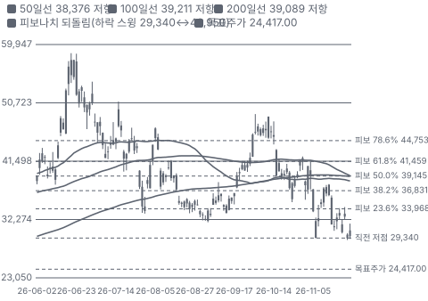

**주봉**

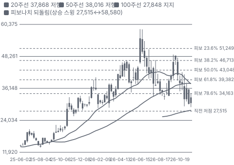

**월봉**

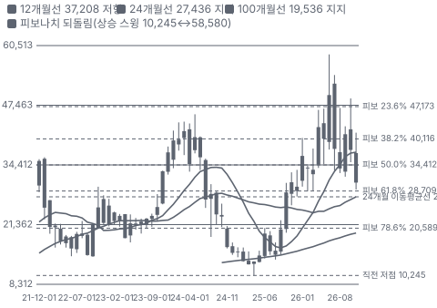

**분기 매출·EPS 실적과 컨센서스**

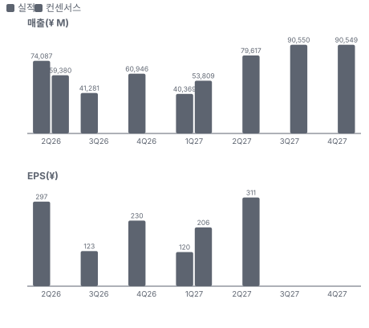

**멀티플 프리미엄(분기말 후행 P/E(대상 선행 추정 이력 없음), 최근 4개 분기말 절대값 — 대상 vs 동종 중앙값)**

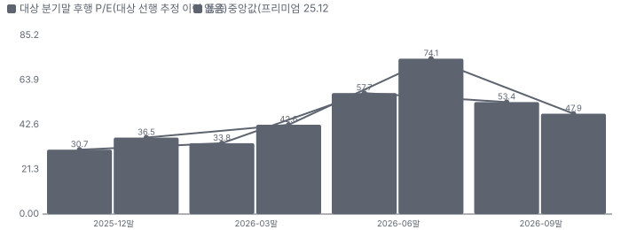

**합리적 멀티플**

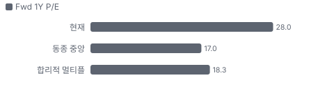

**밸류에이션 주가 시나리오**

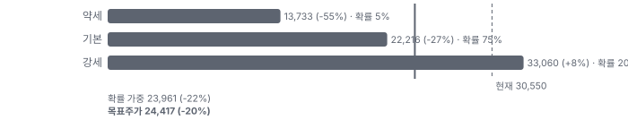

**주가별 업사이드**

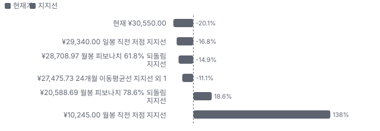
- 제품·서비스 포트폴리오

**생산능력 현재와 확충 계획(배(장비 생산능력 지수, FY6/26 = 1))**

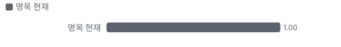

**CAPEX의 매출 대비 비중**

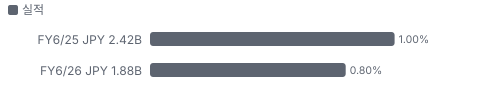

**어닝콜 변화별 주주가치 영향**

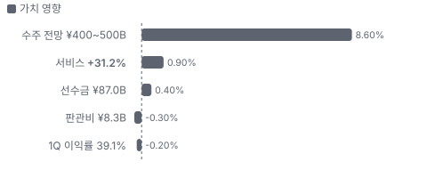

**수주·파이프라인 확실성 사다리**

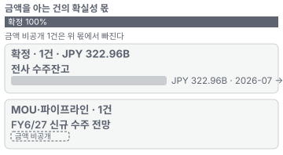

**비용 요인별 매출 대비 비중 1년 변화**

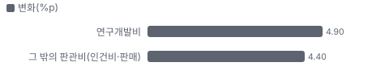

**반도체 관련 장비 BOM 원가 몫**

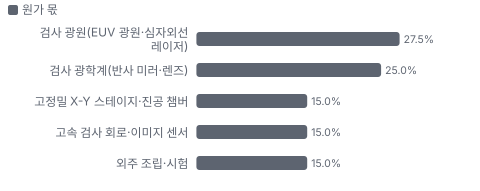

**서비스 BOM 원가 몫**

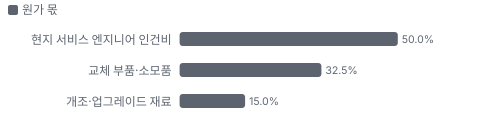

**BOM 항목 가격 +10% 시 OPM 변화**

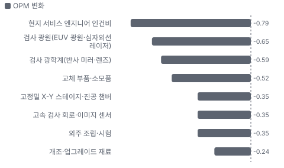

**매출 증가율의 가격·물량 분해와 8분기 전망(전년 대비)**

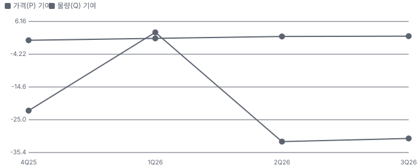

**목표주가 산정 — 기본과 강세 사이(강세 쪽 20%), 도달 확률 약 48%**

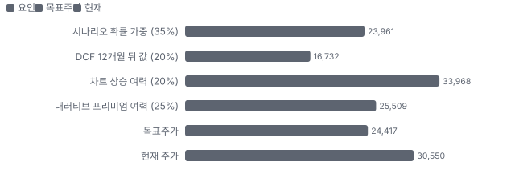

**PEG — 성장 대비 멀티플(낮을수록 성장 대비 쌈)**

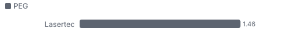

**몬테카를로**

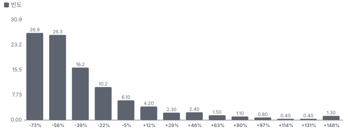

해석: 3,000번 중 470번(16%)에서 가치가 지금 주가 이상이었다. 가정을 흔들어도 지금 주가를 뒷받침하지 못하는 경우가 더 많다. 가운데 값은 0.50배이고, 열 번 중 여덟 번은 0.27~1.21배 사이에 든다.

## 내러티브

> **기업가치를 결정하는 이야기:** Fwd 1Y P/E 28.0배로 장비 동종 6곳 중앙값 17.0배보다 65% 높다. 6월 고점에서는 가이던스 EPS의 57배였다. 프리미엄의 근거는 독점 지위와 40%대 이익률이고, 깎이는 이유는 분기 실적이 검수 시점에 따라 두 배씩 흔들린다는 점이다. 지금 가격이 맞으려면 수주 ¥400~500B가 FY6/28 매출로 바뀌어야 한다

> **멀티플·EPS 프리미엄**
> **멀티플:** Fwd 1Y P/E 28.0배, 동종 6곳 중앙값 17.0배(KLA 18.9·ASML 20.6·Applied Materials 12.7·Lam Research 15.1·Onto Innovation 13.4·디스코 31.0 — 공개 시세 개요의 선행 EPS 기준이라 회사마다 기간이 조금 다르다)
> **EPS:** EPS는 FY6/25 ¥938.6 → FY6/26 ¥863.0 → FY6/27 가이던스 ¥1,003.3(+16.3%), 컨센서스 ¥1,111. 1Q EPS ¥119.72는 컨센서스 ¥206.16을 42% 밑돌았다

### 투자자들은 왜 열광했나

2025년 11월 ¥26,000대에서 2026년 6월 22일 종가 ¥57,490까지 두 배가 됐다 — 수주가 바닥을 지나 돌아오고 DRAM까지 EUV 검사 수요가 넓어진다는 기대였다. 8월 FY6/27 가이던스가 시장 예상 평균에 못 미쳐 다음 날 −13.5%, 10월 30일 1Q 감익, 11월 반도체주 급락이 이어져 지금은 고점보다 47% 낮다. 식은 것은 수주가 아니라 '올해 이익이 따라오느냐'에 대한 믿음이다

### 무엇이 기업가치를 바꾸나

> **구조적 체질 변화**
> **변화:** 장비만 팔던 회사에서 서비스가 TTM 매출의 28.8%인 회사로 — 장비 매출이 17.2% 준 FY6/26에도 서비스는 36.5% 늘었다
> **증거:** https://www.lasertec.co.jp/ir/plan/message.html
> **반증:** 서비스 매출 증가율 두 분기 연속 한 자릿수

> **고부가 믹스 확장**
> **변화:** A150(ACTIS의 현 주력 기종) → A200HiT(A150보다 검사 속도를 3배로 올린 ACTIS 신기종) → A300으로 갈수록 단가가 오른다. 다만 회사는 기종 구성 변화로 FY6/27 매출총이익률이 내려간다고 본다(영업이익률 45.7% → 43.1%)
> **증거:** https://media.rakuten-sec.net/articles/-/53216
> **반증:** FY6/27 영업이익률이 가이던스 43.1% 아래

> **기술 혁신**
> **변화:** FY6/26에 신제품 네 개 — 검사 속도 3배인 ACTIS A200HiT, 마스크 원판 검사 MAGICS(회로를 그리기 전 마스크 원판의 결함을 찾는 Lasertec 검사 장비) M9750/M9751, 심자외선 MATRICS(심자외선 레이저로 마스크 결함을 찾는 Lasertec 검사 장비 — 한 세대 앞 기술) X712, 화합물 반도체용 현미경 OPTELICS(Lasertec 레이저 현미경 제품군) UXM(화합물 반도체 웨이퍼 속 결함을 입체로 보는 레이저 현미경 기종)
> **증거:** https://www.lasertec.co.jp/ir/plan/message.html
> **반증:** A200HiT 고객 평가 탈락

> **실행 속도**
> **변화:** ACTIS는 수주에서 출하까지 약 14개월이다 — 수주가 늘어도 매출은 한 해 뒤에 온다 **납품 리드타임 14개월.** 피어 비교 미확인. 이전 대비 미확인.
> **증거:** https://media.rakuten-sec.net/articles/-/53216
> **반증:** 리드타임이 더 길어진다는 회사 언급

> **M&A**
> **변화:** 해당 없음 — 최근 3년 인수가 확인되지 않았다
> **증거:** 회사 연혁
> **반증:** 해당 없음

> **정책·입법 연관성**
> **재정정책:** 해당 없음(Lasertec을 겨냥한 미국·일본 재정정책 미확인). 고객 쪽 반도체 보조금은 Lasertec 매출로 바로 잇지 않는다 미확인 반증: 해당 없음 의회 동의 2/10 — 하원 1/5(관련 논의 없음) · 상원 1/5(같음).
> **행정명령:** 미국의 대중국 반도체 장비 수출통제가 넓어지면 중국 매출(몫 미확인)이 영향을 받는다 — 회사는 상하이·난징·베이징 등 8곳에 거점이 있다. 통제 대상 품목 해당 여부는 원문 미확인 https://www.lasertec.co.jp/en/company/agent.html 반증: 마스크 검사 장비를 겨냥한 통제 품목 추가 의회 동의 2/10 — 하원 1/5(관련 법안 미확인) · 상원 1/5(같음).
> **연관입법:** 해당 없음(회사를 겨냥한 미국·일본 법안 미확인) 미확인 반증: 해당 없음

> **고객의 지출 예산**
> **변화:** 장비는 고객의 설비투자, 서비스는 고객의 운영비에서 나온다
> **사업별 예산:** **매출의 59%**: 반도체 관련 장비 — 고객 CAPEX(선단 로직·메모리 회사의 EUV 공정 설비투자(마스크숍·팹)) · 동인: EUV 노광 층 수·새 공정 노드 투자
**매출의 40%**: 서비스 — 고객 OPEX(팹 운영·유지보수비) · 동인: 설치 대수·가동률
**매출의 1%**: 기타 제품 — 고객 CAPEX(디스플레이·연구 장비 투자) · 동인: 디스플레이 투자·연구 예산
> **증거:** https://www.lasertec.co.jp/ir/plan/message.html
> **반증:** 주요 파운드리·메모리 회사의 설비투자 가이던스 하향

### 내러티브 근거

> EUV 노광이 늘면 마스크 검사가 늘고, 그 검사를 EUV 빛으로 하는 장비는 이 회사만 만든다는 이야기다. FY6/26에는 수주 공백으로 매출이 줄었고, 지금은 AI 투자가 선단 로직과 DRAM의 EUV 층을 늘려 수주가 돌아온다는 이야기로 바뀌었다. 주가는 6월 고점에서 47% 내려와 있다 — 수주는 올랐는데 매출과 이익은 아직 따라오지 않았고, 11월 반도체주 급락이 겹쳤다. 동종 대비 멀티플 차이 +65% 중 회사 고유 몫은 +53%다. 단계는 확산, 쏠림은 보통이다.

> **수주 회복** · 강화
> **논리:** 수주가 FY6/25 ¥105.2B에서 FY6/26 ¥237.5B로 돌아왔고 회사는 FY6/27 ¥400~500B를 본다
> **숫자:** 수주 전망 ¥300~400B → ¥400~500B, 선수금 ¥44.2B → ¥87.0B
> **반증:** 2Q 결산(2027년 2월)에서 수주 전망을 낮추거나 선수금이 줄어든다
> **출처:** https://www.vlsi.kr/ja/why-lasertec-stock-rose-after-q1-earnings-ja/

> **EUV 층 증가와 고NA(개구수 — 렌즈가 빛을 모으는 능력, 클수록 더 가는 회로를 그린다) 전환** · 유지
> **논리:** 선단 로직에 더해 DRAM이 EUV 층을 늘리고, 차세대 노광기용 마스크 검사(A300)로 단가가 오른다
> **숫자:** ACTIS 수주 FY6/25 −¥10.5B → FY6/26 ¥62.0B. A300 수주는 회사 예상 단계(미확정)
> **반증:** A300 수주가 FY6/27 안에 나오지 않는다
> **출처:** https://media.rakuten-sec.net/articles/-/53216

> **서비스 매출 누적** · 강화
> **논리:** 깔린 장비가 늘어 서비스가 장비 사이클을 메운다
> **숫자:** 서비스 FY6/26 ¥58.65B(+36.5%), 1Q ¥16.0B(+31.2%), TTM 매출의 28.8%
> **반증:** 서비스 증가율 두 분기 연속 한 자릿수
> **출처:** https://www.lasertec.co.jp/ir/plan/message.html

> **검수 지연과 가이던스 미달 위험** · 강화
> **논리:** 1Q 영업이익 진척률이 12.6%다 — 남은 세 분기에 분기 평균 ¥36.4B를 벌어야 한다
> **숫자:** 1Q 매출 ¥40.4B vs 컨센서스 ¥53.8B(−25.0%), EPS ¥119.72 vs ¥206.16
> **반증:** 2Q 매출이 컨센서스 ¥79.6B를 넘는다
> **출처:** https://kabutan.jp/news/?b=k202610300246

> **AI 투자 지속성 논쟁(반대 내러티브)** · 강화
> **논리:** 11월 반도체·AI주 급락 — 고객 설비투자가 2028년에 꺾이면 수주 전망도 내려간다
> **숫자:** 11월 하루 −10% 넘는 날 세 번(11/5 −14.2%, 11/16 −12.8%, 11/25 −11.7%)
> **반증:** 2027년 1~2월 주요 파운드리·메모리 회사의 설비투자 가이던스가 늘어난다
> **출처:** TradingView 일봉

### 투자 포인트

> **수주는 두 배, 매출은 아직**
> **명제:** 수주 전망이 FY6/26 실적의 1.7~2.1배인데 올해 매출 가이던스는 +25.8%다 — 차이는 FY6/28로 넘어간다
> **숫자:** 수주 FY6/26 ¥237.5B → FY6/27 전망 ¥400~500B. ACTIS 리드타임 약 14개월. 선수금 ¥44.2B → ¥87.0B
> **시장과 다른 점:** 시장은 1Q 감익과 진척률 12.6%를 보고 올해 이익을 깎는다. 제 판단은 올해가 아니라 FY6/28이 논점이라는 것이다 — 수주가 전망 하단만 채워도 FY6/28 매출은 ¥360B대가 가능하다. 다만 회사가 수주를 연간으로만 내 분기 확인이 안 된다
> **증명:** 2027년 2월 2Q 결산 — 수주 전망 유지와 선수금 추가 증가
> **출처:** https://www.vlsi.kr/ja/why-lasertec-stock-rose-after-q1-earnings-ja/

> **프리미엄은 독점 값, 할인은 검수 값**
> **명제:** 동종보다 65% 높은 배수는 독점과 이익률로 설명되지만 분기 변동성이 그 배수를 흔든다
> **숫자:** Fwd 1Y P/E 28.0배 vs 동종 중앙값 17.0배. 분기 매출 ¥40B~¥92B, 결산 다음 날 반응 −14.0%·+0.6%·−13.5%·+8.0%
> **시장과 다른 점:** 배수만 보면 비싸다. 서비스가 TTM 매출의 28.8%로 커져 변동이 줄어드는 방향이라는 점은 배수에 덜 반영됐다고 본다 — 반대로 고객이 몇 곳뿐이라 한 곳의 투자 연기가 곧 가이던스 미달이다
> **증명:** FY6/27 서비스 매출 ¥70B 이상
> **출처:** https://www.lasertec.co.jp/ir/plan/message.html

> **가이던스 미달 위험은 2월에 갈린다**
> **명제:** 2Q(10~12월) 매출 컨센서스 ¥79.6B는 1Q의 두 배다 — 여기서 밀리면 통기 가이던스가 흔들린다
> **숫자:** 1Q 영업이익 ¥15.8B, 통기 ¥125.0B의 12.6%. 남은 세 분기 분기 평균 ¥36.4B 필요. 지난해 2Q는 ¥36.3B였다
> **시장과 다른 점:** 컨센서스 EPS ¥1,111은 가이던스 ¥1,003보다 높다 — 시장은 미달이 아니라 초과를 넣고 있다. 1Q를 본 뒤에도 경상이익 예상 하향 폭은 주당 1% 안쪽이다
> **증명:** 2Q 매출 ¥79.6B·영업이익 ¥36B 이상
> **출처:** https://kabutan.jp/news/?b=k202610300246

### 모멘텀 생성·소멸 타임라인

**카탈리스트 달력 — 지난 사건의 주가 반응과 앞으로 확인할 숫자**
| 날짜 | 상태 | 구분 | 사건 | 반응·확인 | 결과에 따라 |
|---|---|---|---|---|---|
| 2026-01-30 | 완료 | 소멸 | 2Q FY6/26 결산·통기 상향 — 매출이 추정을 넘었는데도 다음 날 급락 | -14.0% |  |
| 2026-04-30 | 완료 | 생성 | 3Q FY6/26 결산 — 이후 6월 22일 종가 고점 ¥57,490까지 상승 | +0.6% |  |
| 2026-08-06 | 완료 | 소멸 | FY6/26 결산·FY6/27 첫 가이던스 — 순이익 예상이 시장 예상 평균 하회 | -13.5% |  |
| 2026-10-30 | 완료 | 생성 | 1Q FY6/27 결산 — 감익이지만 수주 전망 ¥400~500B로 상향 | +8.0% |  |
| 2026-11-05 | 완료 | 매크로 | 11월 반도체·AI주 급락 구간(11/5·11/16·11/25, 개별 원인 미확인) | -14.2% |  |
| 2027-02-01(예상) | 예정 | 확인 | 2Q FY6/27 결산 | 매출 ¥79.6B·영업이익 ¥36B 이상, 수주 전망 ¥400~500B 유지, 선수금 ¥87B 이상 | 채우면 가이던스 미달 걱정이 줄어든다(기본~강세), 못 채우면 통기 하향 위험이 가격에 들어온다(약세) |
| 2027-01~02(예상) | 예정 | 매크로 | 주요 파운드리·메모리 회사의 2027년 설비투자 가이던스 | EUV 공정 투자 증가 유지 | 하향이면 수주 전망이 먼저 깎인다 |
| 2027-04 말(예상) | 예정 | 확인 | 3Q FY6/27 결산 | A300 수주 여부와 통기 가이던스 유지 | A300 수주가 확인되면 FY6/28 단가 상승 경로가 열린다 |
| 2027-08 초(예상) | 예정 | 확인 | FY6/27 결산·FY6/28 가이던스 | FY6/27 수주 실적 ¥400B 이상, FY6/28 매출 가이던스 +20% 이상 | 수주가 매출로 바뀌는지의 첫 확인 |

### 언제 사서 언제 팔아야 할까?

**가격·조건 틀 — 가격은 밸류에이션(약세·기본·강세·목표주가)과 차트 지지 구간에서, 조건은 이벤트에서**
| 구간 | 가격 | 목표주가까지 | 약세까지 | 조건·근거 |
|---|---|---|---|---|
| 관찰 구간 | ¥29,340~¥29,340 | -17% | -53% | 지금 가격 아래 일봉 지지 구간이다. 11월 25일 장중 저점 ¥29,040과 2025년 11월 19일 종가 저점 ¥26,330이 그 아래 자리다 |
| 확인 뒤 | 지금 ¥30,550 이상에서 조건 확인 | -20% | -55% | 2Q 매출 ¥79.6B 이상과 수주 전망 유지, 그리고 주가가 50일선 위에서 주간 마감 |
| 무효화 | 약세 시나리오 ¥13,733 | - | -55% | 통기 가이던스를 낮추거나 수주 전망을 ¥400B 아래로 되돌린다 |
| 차익 고민 2차 | ¥33,060(강세 시나리오) | +8% | - | 목표주가 부근은 Fwd 1Y P/E가 다시 30배대 중반으로 올라가는 자리다 — 수주가 매출로 바뀌는 숫자가 나오기 전에는 그 프리미엄의 근거가 약하다 |

하루 8% 넘게 움직인 날이 최근 150거래일에 21번이다. 결산 다음 날 변동이 특히 크다(1월 −14.0%, 8월 −13.5%) — 가격·조건 틀이며 매매·비중 지시가 아니다 가격·조건 틀이며 매매·비중 지시가 아니다(투자 권유 아님).

## 포트폴리오

| 제품·서비스 | 구분 | 무엇 | 쓰는 곳 | 돈 버는 방식 | Mix | Mix 변화(전년 대비) |
|---|---|---|---|---|---|---|
| 반도체 관련 장비 | 제품 | EUV·심자외선 마스크 검사 장비, 마스크 원판 검사 장비, 웨이퍼 검사 장비 | 선단 로직·메모리 회사의 마스크숍과 양산 팹 | 장비 판매(고객 검수 때 매출) | 59% | -18.0%p |
| 서비스 | 서비스 | 설치한 장비의 유지보수·부품 교체·개조 | 고객 팹 옆 현지 법인이 맡는다 | 서비스 계약·부품 판매(반복 매출) | 40% | +17.1%p |
| 기타 제품 | 제품 | 평판디스플레이 마스크 검사 장비, 레이저 현미경 | 디스플레이 회사, 연구소·소재 회사 | 장비 판매 | 1% | +0.9%p |

**Mix 변화가 가장 큰 쪽은 반도체 관련 장비(-18.0%p, 전년 대비).** 계절성 판정: 분기 매출 계절 지수 기준 있음 → 전년 같은 분기와 비교.

## 수주·파이프라인

> **2026-06-30 기준 2건.** 확정 JPY 322.96B. 공시 수주잔고(FY6/26 말) JPY 322.96B. 서로 겹치는 항목은 합계에서 뺐다.

**수주 목록**
| 상태 | 계약 | 계약 총액 | 진척 | 기간 | 비고 |
|---|---|---|---|---|---|
| 확정 | 전사 수주잔고 | JPY 322.96B | - | 2026-07 → 2027-12 | 반도체 관련 장비 ¥301.3B · 기타 제품 ¥4.3B · 서비스 ¥17.3B. ACTIS 리드타임 약 14개월 |
| 파이프라인 | FY6/27 신규 수주 전망 | 금액 비공개 | - | - | 회사 전망 ¥400~500B(8월 ¥300~400B). 선수금이 석 달에 ¥44.2B → ¥87.0B로 늘었다 (다른 항목과 겹칠 수 있어 합계에서 뺌) |

**실행 속도와 방해 요인**
| 항목 | 상태 | 실행 속도 | 방해 요인 |
|---|---|---|---|
| 전사 수주잔고 | 확정 | 미확인 | 고객 검수 시점 · 협력사 조립 능력 |
| FY6/27 신규 수주 전망 | 파이프라인 | 미확인 | A200HiT 고객 평가 · A300 수주 시점 · 고객 설비투자 계획 |

## 마진 구조

> **GPM 59.5%, OPM 39.1%.** 1Q FY6/26 대비 GPM -1.0%p, OPM -10.3%p. 변동비는 매출의 36%이고, 매출이 10% 늘면 OPM은 +2.3%p 움직인다. 1Q 매출총이익률 59.5%(전년 60.6%)는 거의 그대로인데 판관비가 ¥6.08B에서 ¥8.27B로 늘고 매출이 25.5% 줄어 영업이익률이 49.3%에서 39.1%로 내려갔다. 이익률을 정하는 것은 원가가 아니라 검수 물량이다 — 판관비는 분기마다 비슷하게 나가는데 장비 매출은 검수 때 한꺼번에 잡힌다

**GPM에서 OPM까지(J-GAAP)**
| 기간 | GPM | 연구개발 | 판관비 | 기타 | OPM |
|---|---|---|---|---|---|
| 1Q FY6/26 | 60.6% | 0.0% | 11.2% | 0.0% | 49.3% |
| 1Q FY6/27 | 59.5% | 0.0% | 20.5% | 0.0% | 39.1% |

**마진을 결정하는 비용 요인 — 비용 +10% 시 OPM**
| 비용 | 매출 대비 | 변화 | 고정비 | OPM |
|---|---|---|---|---|
| 외주 제조·부품(광학계·광원·스테이지) | 30.0% | 미확인 | 0% | -3.00%p |
| 연구개발비 | 12.4% | +4.9%p | 100% | -1.24%p |
| 서비스 원가·기타 매출원가 | 10.5% | 미확인 | 60% | -1.05%p |
| 그 밖의 판관비(인건비·판매) | 8.1% | +4.4%p | 80% | -0.81%p |

**비용을 움직이는 요인**
| 비용 | 요인 |
|---|---|
| 외주 제조·부품(광학계·광원·스테이지, 매출원가) | 장비 출하 대수와 기종 구성(ACTIS는 건별 채산 차이) · 근거 추정 |
| 연구개발비(판관비) | A200HiT·A300·차세대 검사 장비 개발 · 근거 추정 |
| 서비스 원가·기타 매출원가(매출원가) | 현지 서비스 인력·교체 부품 · 근거 추정 |
| 그 밖의 판관비(인건비·판매, 판관비) | 인력 1,335명, 해외 법인 5곳 · 근거 추정 |

**반도체 관련 장비 BOM — 매출의 59%, GPM 60%(추정 — 품목별 매출총이익률 미공시. 전사 59.5%와 같다고 둠), 항목 가격 +10% 시**
| 항목 | 원가 몫 | 전가 | 제품 GPM | OPM |
|---|---|---|---|---|
| 검사 광원(EUV 광원·심자외선 레이저) | 20~35% | 미확인 | -1.1%p | -0.65%p |
| 검사 광학계(반사 미러·렌즈) | 20~30% | 미확인 | -1.0%p | -0.59%p |
| 고정밀 X-Y 스테이지·진공 챔버 | 10~20% | 미확인 | -0.6%p | -0.35%p |
| 고속 검사 회로·이미지 센서 | 10~20% | 미확인 | -0.6%p | -0.35%p |
| 외주 조립·시험 | 10~20% | 미확인 | -0.6%p | -0.35%p |
| 미분해 | 2% | - | - | - |

**서비스 BOM — 매출의 40%, GPM 60%(추정 — 미공시. 전사와 같다고 둠), 항목 가격 +10% 시**
| 항목 | 원가 몫 | 전가 | 제품 GPM | OPM |
|---|---|---|---|---|
| 현지 서비스 엔지니어 인건비 | 40~60% | 미확인 | -2.0%p | -0.79%p |
| 교체 부품·소모품 | 25~40% | 미확인 | -1.3%p | -0.52%p |
| 개조·업그레이드 재료 | 10~20% | 미확인 | -0.6%p | -0.24%p |
| 미분해 | 2% | - | - | - |

현지 서비스 엔지니어 인건비 가격이 +10% 오르면 영업이익은 -2.0% 움직인다. 판매가 전가를 모르는 항목은 전가 0%로 계산했다.

**BOM 항목 가격을 움직이는 것**
| 항목 | 요인 |
|---|---|
| 검사 광원(EUV 광원·심자외선 레이저) | EUV 빛을 장비 안에서 만들어야 해 장비에서 가장 비싼 모듈로 본다(추정) · 근거 추정 |
| 검사 광학계(반사 미러·렌즈) | EUV는 렌즈를 통과하지 못해 다층막 반사 미러를 쓴다 · 근거 추정 |
| 고정밀 X-Y 스테이지·진공 챔버 | 결함 좌표를 나노미터 단위로 내야 한다 · 근거 추정 |
| 고속 검사 회로·이미지 센서 | 검사 속도가 장비 값을 정한다 · 근거 추정 |
| 외주 조립·시험 | 팹라이트(생산을 대부분 외부 협력사에 맡기고 개발에 집중하는 방식) — 조립을 협력사가 한다 · 근거 추정 |
| 현지 서비스 엔지니어 인건비 | 고객 팹 옆에 상주한다 · 근거 추정 |
| 교체 부품·소모품 | 광원·광학 부품 교체 · 근거 추정 |
| 개조·업그레이드 재료 | 설치 장비 성능 개선 · 근거 추정 |

**투입 물가 — 미국 PPI 3·6·12개월(2026-10, 개정 반영)**
| 항목 | 미국 3개월 | 6개월 | 12개월 | 전가 못 할 때 OPM |
|---|---|---|---|---|
| 검사 광원(EUV 광원·심자외선 레이저) | -0.7% | -5.7% | -2.7%* | - |
| 검사 광학계(반사 미러·렌즈) | 미확인 | 미확인 | 미확인* | - |

별표는 품목보다 넓은 업종 지수다. 지난 1년 투입 물가를 판매가 전가 뒤 원가에 넣으면 OPM은 +0.17%p 움직인다(매출원가의 16% 기준). 물가 지수를 붙이지 못한 매출원가 항목은 외주 제조·부품(광학계·광원·스테이지), 서비스 원가·기타 매출원가다(미연결).

## 생산능력

> **현재 명목 캐파 1 배(장비 생산능력 지수, FY6/26 = 1), 가동률 미확인.** FY6/26 CAPEX는 JPY 1.88B로 매출의 0.8%다. 회사는 생산능력을 대수로 밝히지 않는다. 생산을 협력사에 맡겨 자체 설비투자가 매출의 1% 안팎이고, 능력을 가늠할 숫자는 수주잔고 ¥323.0B와 ACTIS 리드타임 약 14개월뿐이다. 수주 전망 ¥400~500B를 소화하려면 협력사 조립 능력이 함께 늘어야 한다 — 증설 계획과 단계는 공개 자료로 확인하지 못했다

**생산시설 2곳**(회사 사이트 '오시는 길'에 이름이 나온 국내 거점 2곳. 해외 법인 5곳(미국·한국·대만·중국·싱가포르)은 판매·서비스 거점이라 생산시설로 세지 않았다. 유가증권보고서 설비 항목은 미열람), 미확인 2곳. 시설별 생산능력은 공개되지 않았다 — 회사 전체 캐파만 위에 적었다.

**생산시설 2곳 — 명칭·위치·생산능력**
| 시설 | 위치 | 용도 | 생산능력 | 소유·상태 |
|---|---|---|---|---|
| 본사 | 일본 가나가와현 요코하마시 고호쿠구 신요코하마 2-10-1 | 본사·개발 | 미확인 — 시설별 생산능력 미공시 — 생산은 협력사 외주 | 미확인 · 가동 |
| Lasertec Innovation Park | 일본 가나가와현 요코하마시 고호쿠구 도리야마초 555 | 개발·조립·시험(용도는 회사 사이트에 설명 없음 — 추정) | 미확인 — 시설별 생산능력 미공시 | 미확인 · 가동 |

공개된 증설 계획은 확인되지 않았다.

**CAPEX와 매출 대비**
| 기간 | CAPEX | 매출 | 매출 대비 | 구분 |
|---|---|---|---|---|
| FY6/25 | JPY 2.42B | JPY 251.48B | 1.0% | 실적 |
| FY6/26 | JPY 1.88B | JPY 230.49B | 0.8% | 실적 |

## 피터 린치 분류

> **경기순환주(Cyclical), 중형.** 린치 표의 기대 수익 10배, 하방 -80~100%, 위험 고. 10배 경로가 있는 분류다(고성장주·회생주·경기순환주).

**분류 근거 — 크기 먼저, 다음은 이야기 유형**
| 항목 | 값 |
|---|---|
| 크기 | 중형(시가총액 \$17.2B) |
| 장기 성장 | 미확인%(미확인) |
| 린치 비율((성장% + 배당%) ÷ P/E) | 미확인 |
| PEG(P/E ÷ 성장%) | 미확인 |
| 근거 | 순환 업종(semicap) |
| 반대 근거 | 없음 |

- 점검: 재고·공급과 수요(가격)의 방향
- 점검: 경쟁사의 증설
- 점검: 이익 정점에서 P/E가 낮아 보이는 함정
- 점검: 부채가 바닥을 견딜 수 있나
- 팔 때(점검 조건, 매매 지시 아님): 재고가 쌓이고 증설이 시작되고 가격이 꺾일 때 — 정점의 낮은 P/E는 싸다는 뜻이 아니다

분류 = 피터 린치·존 로스차일드 『One Up On Wall Street』(1989)·『Beating the Street』(1993)의 6분류와 위험·보상 표를 숫자 규칙으로 옮긴 자체추론이다(config/lynch.yaml).

## 구루 교차 점검

> **여섯 관점 중 통과 3 · 미달 1 · 미확인 2.** 가장 약한 관점은 재투자 복리 — 틈새 독점이라 번 돈을 같은 수익률로 다시 넣을 곳이 없다 — 성장은 고객의 EUV 투자에 달려 있고 회사가 정하지 못한다.

판정은 자체추론이고 숫자는 계산값이다.

> **성장 여지** · 통과
> **질문:** 5년 안에 매출이 2배가 될 자리가 있나, 10년 뒤에도 커지나
> **이유:** 수주가 FY6/26 ¥237.5B에서 FY6/27 전망 ¥400~500B로 늘고 EUV 검사 수요가 선단 로직에서 DRAM으로 넓어진다 — 다만 수주 전망은 가이던스이고 확정이 아니다
> **계산한 숫자:** 매출 경로 미확인
> **근거:** FY6/26 업적 보고  · 1Q 해설 · 출처 목록

> **해자와 자본수익률** · 통과
> **질문:** 경쟁우위가 무엇이고, 투하자본수익률(ROIC)이 자본비용보다 높으며 유지·상승하나
> **이유:** TTM 영업이익 ¥94.3B에 투하자본 ¥128.7B — 세후로도 자본수익률이 50% 안팎이고 영업이익률은 40%대다
> **계산한 숫자:** ROIC 51.3% · 자본비용 9.3%
> **근거:** 株探 실적·재무 표 · 출처 목록

> **재투자 복리** · 미확인
> **질문:** 번 돈을 높은 수익률로 다시 넣을 곳이 있나 — 자본 배분(재투자·인수·자사주·희석) 이력은
> **이유:** 설비투자가 매출의 1% 안팎이라 이익을 사업에 다시 넣을 곳이 연구개발뿐이다(¥16.3B → ¥20.0B). 남는 현금은 배당(성향 35% 목표)과 현금 보유로 간다 — 재투자 복리가 아니라 현금 창출형이다
> **계산한 숫자:** 설비 재투자율 0%(설비투자가 감가상각 이하 — 연구개발·인수로 하는 재투자는 이 숫자에 없다) · 소유주 이익 수익률 2.4%(근사)
> **근거:** FY6/26 업적 보고 · 출처 목록

> **사람과 문화** · 미확인
> **질문:** 경영진이 주주와 같은 배를 탔나 — 창업자·내부자 지분, 기회형 내부자 매수, 문화가 경쟁우위에 기여하나
> **이유:** 사장이 2024년 7월에 바뀌었다. 경영진 지분·보상 구조는 유가증권보고서를 열지 못해 대조하지 못했다
> **계산한 숫자:** 서류로 확인(계산 없음)
> **근거:** 미확인

> **변화의 방향** · 통과
> **질문:** 18~24개월 뒤 이익 그림이 지금과 얼마나 다른가, 유동성 국면은 그 변화를 받쳐 주나
> **이유:** 수주 전망을 석 달 만에 올렸고 선수금이 두 배가 됐다. FY6/27 EPS 가이던스 +16.3%, 그 뒤 해도 수주가 받친다 — 다만 1Q 실적은 컨센서스를 크게 밑돌았다
> **계산한 숫자:** 2년 뒤 EPS +19.0%(다음 12개월 대비) · 유동성 국면 긴축
> **근거:** 1Q 결산 속보 · 출처 목록

> **5배 경로와 시장이 모르는 이유** · 미달
> **질문:** 어떻게 5배 이상이 되나(이익 성장 × 배수 변화), 시장은 왜 아직 값을 안 매기나
> **이유:** 5년 5배에는 시가총액 ¥13.7T가 필요하다 — 마스크 검사라는 틈새의 크기로는 닿기 어렵다. 2배 경로는 수주가 매출로 바뀌면 열려 있다
> **계산한 숫자:** 5년에 5배 = 연 38.0% · 10배 = 연 58.5% · Fwd P/E 28.0배
> **근거:** 밸류에이션 계산

**배수별로 필요한 연 성장률 — 이익 성장과 배수 변화를 합친 속도**
| 목표 | 5년 | 7년 | 10년 |
|---|---|---|---|
| 2배 | 14.9% | 10.4% | 7.2% |
| 5배 | 38.0% | 25.8% | 17.5% |
| 10배 | 58.5%(희소) | 38.9% | 25.9% |

### 보유 규율 — 가격이 아니라 지표로 유지·종료를 가른다

- 투자 논리 지표: 연간 수주(전망 ¥400~500B) · 선수금 잔액 · 서비스 매출 증가율 · 영업이익률(가이던스 43.1%)
- 규칙: 가격만 빠지고 수주 전망과 선수금이 살아 있으면 투자 논리는 유지된다. 수주 전망을 낮추면 다시 본다
- 지금 주가는 일봉 523개 기간의 고점 대비 -46.9%, 그 기간 최대 낙폭은 -59.0%다.

여섯 관점은 베일리 기포드(성장 여지·5배 경로), 워렌 버핏(해자·재투자), 론 바론(사람), 피터 린치(분류·내부자), 스탠리 드러켄밀러(변화의 방향·유동성)의 질문을 옮긴 점검 틀이다. 유동성 국면은 긴축(10년물 20일 -9bp · 하이일드 스프레드 20일 +54bp). 설비 재투자율은 설비투자에서 감가상각을 뺀 몫만 본 근사이고(연구개발·인수·운전자본은 빠진다), 소유주 이익 수익률은 유지 설비투자를 감가상각과 같다고 본 근사다. 점검 틀이며 매매·비중 지시가 아니다.

## 해자

> 해자는 EUV 빛으로 마스크 패턴을 직접 검사하는 장비를 양산 공급하는 사실상 유일한 회사라는 점과, 깔린 장비가 만드는 서비스 매출이다. 영업이익률 40%대가 그 결과다. 약점은 고객이 몇 곳뿐이고 매출이 검수 시점에 묶여 있다는 것이다

> **EUV 액티닉(실제 노광에 쓰는 것과 같은 파장의 빛으로 검사하는 방식) 마스크 검사의 사실상 독점** · 강함
> **해자:** 노광과 같은 EUV 파장으로 패턴 마스크 결함을 찾는 장비(ACTIS)를 양산 라인에 공급한다 — 회사는 진입한 틈새에서 점유율 100%를 지향한다고 밝힌다
> **근거:** 회사 전략 '글로벌 니치에서 100% 점유율 지향' https://www.lasertec.co.jp/en/ir/plan/strategy.html. ACTIS 매출 FY6/25 ¥114.8B → FY6/26 ¥70.5B, 수주 −¥10.5B → ¥62.0B(회사 자료 집계 https://media.rakuten-sec.net/articles/-/53216)
> **숫자:** 영업이익률 FY6/25 48.9% → FY6/26 45.7% → FY6/27 가이던스 43.1%
> **깨지는 조건:** 경쟁사의 EUV 패턴 마스크 검사 장비가 양산 팹에 채택됐다는 고객·경쟁사 발표

> **설치 기반 서비스** · 강함
> **해자:** 깔린 장비가 늘수록 유지보수 매출이 쌓인다 — 장비 매출이 줄어든 해에도 서비스는 늘었다
> **근거:** 서비스 매출 FY6/24 ¥28.97B → FY6/25 ¥42.96B → FY6/26 ¥58.65B(+36.5%), 1Q FY6/27 ¥16.0B(+31.2%) https://www.lasertec.co.jp/ir/plan/message.html
> **숫자:** TTM 매출의 28.8%
> **깨지는 조건:** 서비스 매출 증가율이 두 분기 연속 한 자릿수

> **팹라이트 자본 효율** · 보통
> **해자:** 생산을 맡기고 개발에 집중해 설비투자가 매출의 1% 안팎이다
> **근거:** 투자활동 현금흐름 FY6/26 −¥1.9B vs 영업현금흐름 ¥48.5B(株探 현금흐름 표). 인력의 70%가 엔지니어(회사 전략)
> **숫자:** TTM 영업이익 ¥94.3B ÷ 투하자본 ¥128.7B
> **깨지는 조건:** 협력사 병목으로 납기가 밀려 수주가 매출로 바뀌지 못한다

## 경영진·네트워크

> 사장은 2024년 7월에 바뀌었다. 센도다 데쓰야 사장은 2008년 입사한 기술·영업 출신이고, 15년 동안 사장이던 오카바야시 오사무가 회장으로 남아 있다. 정계·동문·사모임 연결은 공개 기록에서 확인하지 못했다

> **센도다 데쓰야** · 대표이사 사장·CEO · 2024-07
> **프로필:** 2008년 입사 → 2020년 기술2부장 → 2022년 집행임원·솔루션영업1부장 → 2023년 이사 부사장·영업 총괄 → 2024년 7월 대표이사 사장
> **비즈니스:** 미국·한국·대만·중국·싱가포르 법인 이사 겸직(2024년 9월~)
> **정계:** 미확인
> **동문:** 미확인
> **사모임:** 미확인

> **오카바야시 오사무** · 이사 회장·집행임원 · 2024-07(사장 재임 2009-07~2024-07)
> **프로필:** 2001년 입사 → 2003년 이사 → 미국·한국 법인 사장 → 2009년 대표이사 사장 → 2024년 회장. 경영기획·컴플라이언스·품질·기술관리 담당
> **비즈니스:** 대만 법인 회장(2026년 9월~)·중국 법인 회장(2026년 11월~)
> **정계:** 미확인
> **동문:** 미확인
> **사모임:** 미확인

**네트워크 정량화**
| 연결 | 강도 | 닿는 매출 | 가중 노출 | 매출 대비 | 근거 |
|---|---|---|---|---|---|
| 비즈니스: 경영진이 해외 법인 5곳 이사·회장을 겸직한다 — 고객 팹 옆 서비스 거점(대만 4곳·한국 3곳·미국 7곳·중국 8곳) | 5/5 | ¥62.45B | ¥62.45B | 29% | 현지 법인이 맡는 서비스 매출 TTM 전체(¥62.5B)를 노출로 잡았다 https://www.lasertec.co.jp/en/company/agent.html |

가중 노출은 연결이 닿는 매출의 크기다. 연결이 그 매출을 만들었다는 뜻이 아니며, 인과는 공개 자료로 입증하지 못한다.

## 약세 논리 및 셀온 조건

| 약세 논리 | 근거 | 가를 자료 |
|---|---|---|
| 통기 가이던스 미달 | 1Q 영업이익 ¥15.8B는 통기 ¥125.0B의 12.6%다. 남은 세 분기에 분기 평균 ¥36.4B가 필요한데 지난해 가장 좋았던 분기가 ¥36.3B였다 | 2Q 결산(2027년 2월 1일 예상) — 매출 ¥79.6B·영업이익 ¥36B |
| 수주 전망은 확정이 아니다 | ¥400~500B는 회사 전망이다. 회사는 수주를 연간으로만 공개하고, FY6/25 4분기에는 ACTIS 취소가 있었다(증권사 리포트 추정) | 2Q·3Q 결산의 수주 전망 유지 여부와 선수금 잔액 |
| 이익률이 2년째 내려간다 | 영업이익률 FY6/25 48.9% → FY6/26 45.7% → FY6/27 가이던스 43.1%. 1Q 판관비는 ¥6.08B에서 ¥8.27B로 36% 늘었다 | 2Q 판관비와 매출총이익률(1Q 59.5%) |
| 동종보다 65% 높은 배수 | Fwd 1Y P/E 28.0배, 장비 동종 6곳 중앙값 17.0배. 1Q처럼 매출이 컨센서스를 25% 밑도는 분기가 나오면 배수가 먼저 깎인다 | 2Q 매출 vs 컨센서스 |
| 고객 설비투자와 AI 투자 지속성 | 11월에 하루 10% 넘게 내린 날이 세 번이다. 고객이 2028년 투자를 줄이면 수주 전망부터 내려간다. 업종 자료에서도 유럽 메모리 투자자들의 걱정이 2028년 데이터센터 지연과 설비투자 지속성에 모였다 | 2027년 1~2월 주요 파운드리·메모리 회사의 설비투자 가이던스 |
| 경쟁 진입 | EUV 패턴 마스크 검사는 지금 사실상 독점이지만 최대 공정 제어 장비사가 같은 시장을 겨냥해 왔다 — 양산 채택 여부는 미확인 | 경쟁사·고객의 양산 채택 발표 |
| 자료 한계 | 회사 결산단신(일본 상장사가 분기마다 내는 실적 속보 공시)·결산설명자료·유가증권보고서 원문은 접근이 막힌 호스트에 있어 열지 못했다. 실적 숫자는 결산단신 기반 표와 회사 사이트 업적 보고로, 수주 전망·선수금·판관비는 그 자료를 인용한 해설로 확인했다. 주요 고객·지역 매출·구매 약정·잠재 주식·시설 소유는 미확인이다. 설명회 질의응답도 얻지 못했다. 애널리스트 수·의견 분포·추정 범위는 공개 자료로 얻지 못했고(컨센서스 깊이 미확인), 2Y·3Y EPS는 Chiip 추정이다. 동종 배수는 공개 시세 개요의 선행 EPS 기준이라 회사마다 기간이 조금 다르다 | 다음 회차 유가증권보고서·결산설명자료 대조 |

**변이 관점.** 시장은 1Q 감익과 진척률을 보고 올해 이익을 깎고 있다. ==제 판단은 논점이 올해 가이던스가 아니라 FY6/28 매출이라는 것이다== — 수주가 전망 하단만 채워도 리드타임 14개월 뒤 매출이 받는다. 다만 그 기대는 동종보다 65% 높은 배수에 이미 들어 있고, 수주는 연간으로만 공개된다. 가를 자료는 2027년 2월 2Q 결산의 선수금 잔액과 수주 전망이다.

> **셀온 조건**
> **조건 1:** 통기 가이던스(영업이익 ¥125.0B)를 낮춘다.
> **조건 2:** FY6/27 수주 전망을 ¥400B 아래로 되돌리거나 선수금이 ¥87.0B에서 줄어든다.
> **조건 3:** 2Q 매출이 ¥70B 아래로 나온다(2027년 2월) — 컨센서스 ¥79.6B와 지난해 2Q ¥74.1B를 모두 밑도는 값이다.
> **조건 4:** 경쟁사의 EUV 패턴 마스크 검사 장비가 양산 팹에 채택됐다고 고객이나 경쟁사가 발표한다.
> **조건 5:** 주요 고객이 2027년 EUV 공정 설비투자를 줄인다고 밝힌다.

## 어닝콜 변화

**직전 콜 대비 새로 나오거나 바뀐 내용 → 가치 영향**
| 항목 | 내용 | 직전 콜 | 최신 콜 | 모델 동인 이동 | 확신도 | 가치 영향 |
|---|---|---|---|---|---|---|
| 업데이트 | FY6/27 수주 전망 | ¥300~400B(8월) | ¥400~500B(10/30) | 1년차 성장률 +4.0% | 0.8 | +8.6% |
| 신규 | 선수금 잔액 | ¥44.2B(6월 말) | ¥87.0B(9월 말) | 순차입 -5.00 BJPY(¥1B) | 1.0 | +0.4% |
| 부정 | 1Q 영업이익률 | 49.3%(전년 1Q)·44.4%(직전 분기) | 39.1% | 출발 이익률 -1.0% | 1.0 | -0.2% |
| 부정 | 판관비 증가 | ¥6.08B(전년 1Q) | ¥8.27B | 목표 이익률 -0.50% | 0.5 | -0.3% |
| 업데이트 | 서비스 매출 | ¥12.2B(전년 1Q) | ¥16.0B | 장기 이익률 +0.50% | 1.0 | +0.9% |
| 반복 | 통기 가이던스 | 매출 ¥290.0B·영업이익 ¥125.0B | 같음 | 기준연도 매출 — | 0.8 | +0.0% |
| **합계** | 단독 합 |  |  | 동시 적용 +9.5% |  | **+9.4%** |

**실적 발표 예상 변동폭:** 지난 4번 실적 발표 때 주가는 하루에 평균 ±9.0%(최대 14.0%, 오른 날 2번) 움직였다.

**실적 발표 예상 변동폭 — 과거 실적 발표 다음 거래일 주가 변화**
| 분기 | 발표일 | 주가 변화 |
|---|---|---|
| 2Q26 | 2026-01-30 | -14.0% |
| 3Q26 | 2026-04-30 | +0.6% |
| 4Q26 | 2026-08-06 | -13.5% |
| 1Q27 | 2026-10-30 | +8.0% |

## P·Q 사이클

> **P 사이클 — 최근 4분기 평균 가격 기여 +1.0%, 물량 기여 -20.5%(전년 대비 로그 증가율).** P 강도 5.0/10, Q 강도 5.0/10, 최근 8분기 중 75%가 같은 요인 우세(구조적). 다만 GPM이 전년보다 -1.0%p로 오르지 않아 원가 전가형 가격 상승일 가능성이 있다.

**P·Q 사이클 정량**
| 항목 | 가격(P) | 물량(Q) |
|---|---|---|
| 최근 4분기 평균 기여 | +1.0% | -20.5% |
| 강도(0~10, 자기 이력 z) | 5.0 | 5.0 |
| 고유 주기(자기회귀모델 과거 2개 시점일 때) | 미확인 | 미확인 |
| 다음 4분기 투영 평균 | 미확인 | 미확인 |

가격 근거: 미국 PPI(생산자물가지수) 반도체 제조 장비 대용 — 회사 판매가가 아니라 업종 가격. PPI를 쓰면 회사 판매가가 아니라 업종 가격 대용이다. 로그 증가율이라 가격·물량 기여의 합이 매출 증가율이다. 전망: 가격은 BIC(모형 차수를 고르는 정보 기준)로 차수를 고른 자기회귀모델에 이미 발표된 월간 가격을 먼저 넣고(나우캐스트), 물량은 자기회귀모델과 '컨센서스 매출 증가율 − 가격 전망'을 분산 역수로 섞는다. 장기 평균은 표본 평균을 장기 기저율(가격 연 2%·물량 연 4%) 쪽으로 줄인다 — 고성장 구간만 담긴 표본이 그 성장을 끝없이 잇지 않게. 범위는 4분기 겹친 표본의 자기상관을 반영한다. 모형 산출이며 가이던스가 아니다. 회사 판매가로 잴 수 없는 이유: 회사가 장비 출하 대수와 평균 단가를 공시하지 않는다. 기종별 단가 차이(A150 → A200HiT → A300)가 커서 업종 PPI로 대신 재면 뜻이 달라진다

10년 위치·프리미엄: 구조 단절(3Q25 전후 분기 매출 급변·되돌림(재작성·분리 자료가 섞인 것으로 보임) — 그 뒤만 쓴다) 뒤 TTM 표본이 1개로 20개에 못 미쳐 10년 비교를 하지 않는다 — 단절 전후 매출은 같은 회사 범위가 아니다.

## 밸류에이션

> **목표주가 ¥24,417, 업사이드 -20%.** 자리는 기본과 강세 사이(강세 쪽 20%)이고 도달 확률은 약 48%다. 기본 ¥22,216, 강세 ¥33,060(+8%), 약세 ¥13,733(-55%). DCF 기준 업사이드는 기본 -50%, 강세 -18%, 약세 -74%다(WACC 9.3%).

기본 EPS ¥1,092는 공개 시세 개요의 선행 EPS다 — 동종과 같은 기준으로 맞췄다. 회사 가이던스 ¥1,003.3보다 높고 FY6/27 컨센서스 ¥1,111보다 낮다. 시나리오 확률(약세 5%·기본 75%·강세 20%)은 다음 해 매출 성장 분포로 계산했다 — 추정 범위 자료가 없어 분포 폭은 근사다. 확률 가중 주가는 ¥23,961로 목표주가 ¥24,417과 비슷하다.

DCF 기본 가치는 지금 주가보다 50% 낮다(자본비용 9.3%). DCF 기본은 5년 매출 성장을 연 8%로 잡았는데 ==지금 가격은 연 26%를 요구한다.== 수주 전망 ¥400~500B가 FY6/28 매출로 바뀌면 기본 가정이 낮은 것이 되고, 수주가 한 해로 끝나면 가격이 높은 것이 된다 — 그 차이를 가르는 것이 FY6/27 연간 수주 실적이다. 시나리오 주가는 배수 기준이라 DCF보다 높다. 시장이 독점 장비사에 주는 배수를 일부 인정했기 때문이다.

시나리오 확률: 다음 해 매출 성장 분포로 계산 — 약세 -1.5% 아래·강세 +18.5% 위 확률. 내부 관점(컨센서스 +12.0%, σ 8.0%: 추정 범위 없음 — 5% + 0.25 × |성장률|) 100% — 외부 관점 꺼짐(SEC 전 상장사 표본 없음)

> **약세 ¥13,733 (-55%)** · 확률 5%
> **가정:** 15.3배 × EPS ¥900.00
> **근거:** 검수가 밀려 FY6/27 EPS가 가이던스 ¥1,003을 10% 밑돈다 — 2Q 매출이 컨센서스 ¥79.6B에 못 미치고 판관비 증가가 이어진다

> **기본 ¥22,216 (-27%)** · 확률 75%
> **가정:** 20.3배 × EPS ¥1092.00
> **근거:** 선행 EPS ¥1,092 — 통기 가이던스를 조금 넘고 수주가 전망 하단 ¥400B를 채운다

> **강세 ¥33,060 (+8%)** · 확률 20%
> **가정:** 25.4배 × EPS ¥1300.00
> **근거:** 수주가 전망 상단으로 가고 A200HiT·A300 검수가 앞당겨져 선행 EPS가 ¥1,300에 닿는다

**멀티플 선정 — Fwd 1Y P/E**
| 단계 | 조정 | 근거 |
|---|---|---|
| 동종 중앙값 | 17.0배 | 범위 12.7~31.0배, 6곳 |
| 펀더멘털 | +4% | 성장·이익률·ROIC로 본 합리적 멀티플 18.3배와의 차이의 일부만 인정(로그 차이 × 0.5, 상한 ±20%에 부드럽게 수렴) |
| 해자 | +4% | EUV 액티닉 마스크 검사의 사실상 독점 강함 · 설치 기반 서비스 강함 · 팹라이트 자본 효율 보통 — 점수 9.5%에서 동종 기준 5.5%를 뺌 |
| 반복 매출 | +9% | 반복 매출 29%(동종 20%) · 설치 장비 유지보수·개조 서비스 · 이미 반복 단계 · 기반 설치 대수 미공시 — 누적 출하가 늘수록 커진다 |
| 수주 전환·가시성 | -2% | book-to-bill 0.46 → 가시성 0.46 · 전환 13.4개월(동종 12) |
| 내러티브 | +5% | 단계 확산 |
| 사이클·실행 판단 | +0% | 조정 없음 — 검수 시점에 따라 분기 실적이 크게 흔들리는 점과 수주 전망 상향은 해자 판정과 내러티브 단계에 이미 들어 있다 |
| **선정** | **20.3배** | 지금 28.0배 |

**동종 레인지**
| 회사 | Fwd 1Y P/E | 성장 | 영업이익률 | ROIC |
|---|---|---|---|---|
| KLA | 18.9 | 29% | 43% | 66% |
| ASML | 20.6 | 55% | 39% | - |
| Applied Materials | 12.7 | 53% | 33% | 30% |
| Lam Research | 15.1 | 54% | 37% | 49% |
| Onto Innovation | 13.4 | 88% | 23% | 11% |
| 디스코 | 31.0 | 36% | 44% | 25% |
| **Lasertec** | 28.0 |  |  |  |

> **PEG 1.46** — Fwd 1Y P/E 28.0배를 다음 해 EPS 성장 19%로 나눈 값. 성장률은 Fwd 1Y·2Y P/E에서 역산한 컨센서스라 다음 해 한 해 성장만 반영하고, 성장 지속 기간은 담지 않는다.

**PEG — Fwd 1Y P/E ÷ 다음 해 EPS 성장률**
| 회사 | Fwd 1Y P/E | 다음 해 EPS 성장 | PEG |
|---|---|---|---|
| **Lasertec** | 28.0 | +19% | 1.46 |
| KLA | 18.9 | - | - |
| ASML | 20.6 | - | - |
| Applied Materials | 12.7 | - | - |
| Lam Research | 15.1 | - | - |
| Onto Innovation | 13.4 | - | - |
| 디스코 | 31.0 | - | - |

지금 주가가 요구하는 5년 매출 CAGR 26%, 기본 시나리오 8%. 몬테카를로 중앙값 업사이드 -50%.

> 의사결정 보조(투자자문 아님): ① 매수 매력: 5년 보유 가정 연 기대수익 -0.4% — 주주가 요구하는 수익률(자기자본비용) 9.3%보다 -9.7%p · 요구수익률을 넘을 확률 14% · 안전마진 없음(비관적 경우(하위 10%) 가치가 시총의 27%) → 정량 신호 약함 / ② 위험 예산 지표(이론): 0% — 기대수익이 요구수익률에 못 미친다(켈리 기준 — 수익·손실 확률로 계산한 이론상 최대 노출 — 0%는 참고) · 5년 뒤 나쁜 경우(하위 10%) -63% · 30% 넘게 잃을 확률 47% / ③ 상방(5년): 평균 0.98배 · 2배 이상 확률 8% · 3배 이상 2% · 10배 이상 0% · 잘 풀린 경우(상위 10%) 1.83배 이상

투입 물가 점검: 지난 1년 PPI를 BOM에 넣으면 OPM +0.17%p다(매출원가의 16% 기준).

## 매수 위치(일봉)

> **현재가 ¥30,550는 '지지 근접'(가장 가까운 일봉 지지 ¥29,340에서 ATR 0.4배 위).** 이 자리에서 목표주가까지 -20.1%, 첫 일봉 저항까지 +4.2%, 다음 지지까지 하방 -4.0%, 손익비 -5.1배.

**가격대별 업사이드(일봉 기준)**
| 가격대 | 가격 | 목표주가까지 | 첫 저항까지 | 다음 지지까지 | 손익비 | 근거 기법(강도) |
|---|---|---|---|---|---|---|
| 현재가 | ¥30,550 | -20.1% | +4.2% | -4.0% | -5.1 | - |
| 지지 1 | ¥29,340 | -16.8% | +8.5% | 미확인 | 미확인 | 120일 지그재그 저점 · 스윙 저점(1.8) |

**일봉 저항**
| 저항 | 가격 | 현재가 대비 | 근거 기법(강도) |
|---|---|---|---|
| 저항 1 | ¥31,840 | +4.2% | 120일 지그재그 저점(0.8) |
| 저항 2 | ¥33,200 | +8.7% | 120일 지그재그 저점(0.8) |
| 저항 3 | ¥33,968 | +11.2% | 피보 23.6%(1.0) |

일봉만 쓴다(주봉·월봉 제외). 손익비 = 목표주가까지 업사이드 ÷ 다음 지지까지 하방. 가격대별 기대값 참고표이며 매수·매도 시점 지시가 아니다.

## 애널리스트 토론

> **토론 결론 Neutral(규칙 등급 Sell).** 수주 전망 상향·선수금 두 배·보수적이던 가이던스 이력이 살아남았고, 동종보다 65% 높은 배수·진척률 12.6%·분기 수주 미공개도 살아남았다. 2월 2Q 결산이 둘을 가른다

**패널 — 등급별 자리**
| 자리 | 핵심 논리 | 틀리는 조건 | 최종 투표 |
|---|---|---|---|
| Strong Buy | 수주가 두 배가 되는 독점 장비사를 고점의 절반 값에 준다 | 수주 전망 하향 | Buy |
| Buy | 선수금이 석 달에 두 배 — 수주가 실제로 들어오고 있다 | 2Q 선수금 감소 | Buy |
| Neutral | 수주는 좋지만 동종보다 65% 비싼 배수에 이미 들어 있다 | 2Q 매출 ¥79.6B 초과와 통기 상향 | Neutral |
| Sell | 진척률 12.6%로는 통기 가이던스가 위험하다 | 2Q 영업이익 ¥36B 이상 | Neutral |
| Strong Sell | 고객 몇 곳의 설비투자에 묶인 회사가 AI 투자 정점 논쟁 속에 28배다 | 주요 고객의 2027년 설비투자 가이던스 상향 | Sell |

**투표**
| Strong Buy | Buy | Neutral | Sell | Strong Sell |
|---|---|---|---|---|
| 0 | 2 | 2 | 1 | 0 |

> **개회 · Strong Buy**
> **발언:** 수주 전망 하단 ¥400B만 해도 지난해의 1.7배다. 리드타임 14개월이면 FY6/28 매출이 받는다

> **개회 · Buy**
> **발언:** 전망은 말이지만 선수금 ¥87.0B는 돈이다. 석 달 새 ¥42.8B가 들어왔다

> **개회 · Neutral**
> **발언:** 좋은 소식은 11월 2일 +8.0%에 반영됐다. 28배는 동종 여섯 곳 가운데 디스코 다음으로 높다

> **개회 · Sell**
> **발언:** 남은 세 분기에 분기 평균 ¥36.4B를 벌어야 한다. 지난해 가장 좋았던 분기가 ¥36.3B였다

> **개회 · Strong Sell**
> **발언:** 회사가 수주를 분기로 내지 않는다. 확인할 수 없는 전망에 28배를 주는 셈이다

> **반박1 · Neutral → Strong Buy**
> **발언:** 고점 대비 낙폭은 싸다는 근거가 아니다. 6월의 57배가 지나쳤다는 뜻이기도 하다

> **반박1 · Sell → Buy**
> **발언:** 선수금은 취소되면 돌려준다. FY6/25 4분기에 ACTIS 취소가 실제로 있었다

> **반박1 · Strong Buy → Sell**
> **발언:** FY6/26에도 1월에 가이던스를 올렸고 실제는 그보다 ¥10.5B 더 나왔다. 이 회사 가이던스는 보수적이었다

> **반박1 · Buy → Strong Sell**
> **발언:** 분기 수주는 없어도 선수금과 영업현금흐름이 분기마다 나온다. 볼 숫자는 있다

> **반박1 · Strong Sell → Neutral**
> **발언:** 중립이 가장 위험하다. 가이던스가 깎이면 이익과 배수가 함께 내려간다

> **반박2 · Strong Buy → Neutral**
> **발언:** 동종은 식각·증착 장비다. 경쟁자가 없는 검사 장비와 같은 배수로 볼 수 없다

> **반박2 · Neutral → Buy**
> **발언:** 가이던스가 보수적이라는 것은 지난해 한 번의 경험이다. 올해는 판관비가 36% 늘었다

> **반박2 · Sell → Strong Buy**
> **발언:** FY6/27 영업이익률 가이던스가 43.1%로 2년 연속 내려간다. 독점이면 이익률이 왜 내려가나

> **반박2 · Buy → Sell**
> **발언:** 연구개발비를 ¥16.3B에서 ¥20.0B로 늘려서다. 신기종 두 개를 동시에 내는 해의 비용이다

> **반박2 · Strong Sell → Strong Buy**
> **발언:** 고객이 2028년 투자를 줄이면 수주 전망부터 내려간다. 11월 주가가 그 걱정을 말한다

> **최종 · Strong Buy**
> **발언:** 한 단계 내려 Buy. 수주는 맞지만 2월 결산 전에는 진척률 반박을 넘지 못한다

> **최종 · Buy**
> **발언:** Buy 유지. 선수금과 현금흐름이 수주를 받친다

> **최종 · Neutral**
> **발언:** Neutral 유지. 배수와 수주가 서로를 상쇄한다

> **최종 · Sell**
> **발언:** 한 단계 올려 Neutral. 가이던스 이력과 선수금 반박은 인정한다

> **최종 · Strong Sell**
> **발언:** 한 단계 올려 Sell. 설비투자 가이던스가 나오는 1~2월까지는 낮게 본다

남은 반대 의견: Strong Sell 자리: 확인할 수 없는 연간 수주 전망에 독점 프리미엄을 줄 수 없다

패널은 등급별 논리를 대표하는 자리이고 실존 IB의 의견이 아니다.

## 커뮤니티 반응

언급 적음 — Quantral 미수록

## 시장 평가

> **셀사이드(IB 애널리스트)**
> **한 줄:** 컨센서스는 가이던스보다 높다 — 시장은 수주 전망 상향이 올해 매출로도 이어진다고 본다. 다만 FY6/27 경상이익 예상은 11월 둘째·셋째 주 연속으로 조금씩 내려갔다(−0.9%, −0.5%). 애널리스트 수와 의견 분포는 공개 자료로 얻지 못했다. 업종 자료(마스터 노션, 라이선스 요지): 중국의 10월 광학 공정제어 장비 수입이 전년보다 91% 늘어 검사·계측 수요가 살아 있다는 방증이 있고, 유럽 메모리 투자자 면담에서는 2028년 데이터센터 지연과 클라우드 회사의 설비투자 지속성 걱정이 컸다 — 둘 다 업종 단서이고 Lasertec 매출로 바로 잇지 않는다
> **목표주가(미국계 대형 증권):** ¥52,000 — 강세 유지, 11/17 ¥53,000에서 하향
> **목표주가(일본 증권사 리서치):** ¥58,000 — 유지
> **FY6/27 매출 컨센서스:** ¥301.1B — 가이던스 ¥290.0B 위
> **FY6/27 EPS 컨센서스:** ¥1,111 — 가이던스 ¥1,003 위

> **바이사이드(기관 투자자)**
> **한 줄:** 분기 보유 변화 자료는 일본에 없어 미확인. 대량보유 보고는 이번 회차에 조회하지 못했다. 신용 매수 잔고가 매도 잔고의 5.91배다(株探, 11/26)
> **기관 보유:** 59.6% — 공개 시세 개요
> **내부자·관계 보유:** 9.0% — 공개 시세 개요

> **언론·업계**
> **한 줄:** 일본 매체는 1Q 경상이익 46% 감소와 수주 전망 상향을 함께 전했다. 8월에는 FY6/27 순이익 예상이 시장 예상 평균에 못 미쳤다는 제목이 나왔다
> **보도 초점:** 수주 전망 상향 vs 1Q 감익 — 11/2 +8.0%

## 체크리스트

| 시점 | 무엇 | 의미 |
|---|---|---|
| 2027년 1~2월 | 주요 파운드리·메모리 회사의 2027년 설비투자 가이던스 | 수주 전망 ¥400~500B의 상류 확인 |
| 2027년 2월 1일(예상) | 2Q FY6/27 결산 — 매출 ¥79.6B, 영업이익 ¥36B, 수주 전망 유지, 선수금 | 통기 가이던스 진척과 수주의 실체 |
| 2027년 4월 말(예상) | 3Q FY6/27 결산 — A300 수주 여부, 판관비 추이 | FY6/28 단가 상승 경로 |
| 2027년 8월 초(예상) | FY6/27 결산·FY6/28 가이던스 — 연간 수주 실적, 기종별 매출·수주 | 수주가 매출로 바뀌는지의 첫 확인 |
| 2027년 9월 | 유가증권보고서 — 주요 고객, 지역 매출, 설비 | 자료 한계 해소 |

## 출처
- 공개 자료 기반 분석이며 투자 권유가 아님
- 타일 대조: 목표주가 ¥24,417·업사이드 −20%·다운사이드 −55%·손익비 0.1·구매 등급 Neutral(규칙 등급 Sell)·선정 배수 20.3배·동종 중앙값 17.0배·Fwd 1Y P/E 28.0배 — 판단 문장과 같다
- 산식 대조: 기본 20.34배 × 선행 EPS 1,092 = ¥22,216, 강세 25.43배 × 1,300 = ¥33,060, 약세 15.26배 × 900 = ¥13,733. 확률 가중 0.05 × 13,733 + 0.75 × 22,216 + 0.20 × 33,060 = ¥23,961. 1Q 매출 40,369 ÷ 54,171 = −25.5%, 영업이익 15,769 ÷ 26,728 = −41.0%, 영업이익률 15,769 ÷ 40,369 = 39.1%, 진척률 15,769 ÷ 125,000 = 12.6%, 매출총이익률 24,035 ÷ 40,369 = 59.5%, 판관비 8,266 ÷ 6,079 = +36%, 서비스 62,455 ÷ 216,683 = 28.8%, 배수 프리미엄 28.0 ÷ 17.0 = +65%, 고점 P/E 57,490 ÷ 1,003.3 = 57.3배
- 일봉 대조: 2026-06-22 종가 고점 ¥57,490(장중 고점 6/19 ¥58,580) · 2026-11-26 종가 ¥30,550(종가 고점 대비 −46.9%) · 2025-11-19 종가 저점 ¥26,330 — 실측 일봉 523거래일(실제 고가·저가)
- 마스터 노션 자료: 미확인 HSBC - Global Memory - European Roadshow Feedback, Demand Worries Rise, Supply Stays Tight.pdf (요지만, 외부 공유 금지)
- 마스터 노션 자료: 미확인 Bernstein - Global Semis - Power Discretes Primer, Powering the World.pdf (요지만, 외부 공유 금지)
- 마스터 노션 자료: 미확인 Bernstein - Global Semicap - China WFE Import Tracker (Oct 2026), Imports Recovering.pdf (요지만, 외부 공유 금지)
- https://www.vlsi.kr/ja/why-lasertec-stock-rose-after-q1-earnings-ja/
- FY6/27 계획 ¥20.0B ÷ 4 = 분기 ¥5.0B ÷ 1Q 매출 ¥40.4B. 전년은 FY6/26 ¥16.29B ÷ 4 ÷ ¥54.2B(8월 결산 리포트 https://media.rakuten-sec.net/articles/-/53216)
- 매출원가 40.5%에서 위 항목을 뺀 나머지 — 비중 미공시
- 장비 유지보수 구조
- 판관비 20.5%에서 연구개발비 추정을 뺀 나머지
- 해외 법인 거점 https://www.lasertec.co.jp/en/company/agent.html
- 회사 전략(생산 외주, 팹라이트) https://www.lasertec.co.jp/en/ir/plan/strategy.html — 비중 미공시
- 회사 전략(생산을 제3자에 맡긴다) https://www.lasertec.co.jp/en/ir/plan/strategy.html
- 회사 제품 설명(MAGICS에 고정밀 X-Y 스테이지 탑재) https://www.lasertec.co.jp/ir/plan/message.html
- 회사 제품 설명(고속 검사 회로 기술) https://www.lasertec.co.jp/ir/plan/message.html
- 회사 제품 설명(광학 설계 최적화로 A150 대비 검사 속도 3배) https://www.lasertec.co.jp/ir/plan/message.html
- 회사 제품 설명(액티닉 = 노광과 같은 EUV 빛으로 검사, MATRICS는 266nm 레이저) https://www.lasertec.co.jp/ir/plan/message.html
- https://www.lasertec.co.jp/en/company/profile/access.html
- https://www.lasertec.co.jp/en/ir/plan/strategy.html
- https://www.lasertec.co.jp/ir/plan/message.html
- https://kabutan.jp/stock/finance?code=6920
- https://kabutan.jp/news/?b=k202610300246

_구매 등급·목표주가 모두 규칙이 계산한 모델 값으로, 개인의 보유 종목·자금 사정을 반영하지 않는다 · 공개 자료 기반 분석이며 투자 권유가 아님 · 1차 판정, 미검증 · Chiip ten-bagger_