# 텐배거 리포트 2026-11-26 — 이익은 두 배, 주가는 고점의 절반 — Advanced Energy, 11배는 정점 이익률이 이어진다는 전제의 배수다

> 2026-11-26 · Advanced Energy Industries(AEIS) · 기업: 반도체 식각·증착 장비용 플라즈마 전원과 AI 서버 전원장치를 설계·제조하는 미국 전력 변환 회사

## Chiip View

목표주가 \$193는 지금 주가 \$197.03과 거의 같다(구매 등급 Neutral). **실적은 좋다** — 3Q 매출 \$696.4M(+50%)과 비GAAP EPS \$3.65가 가이던스 상단을 넘었고, 회사는 2026년 성장 전망을 약 40%로, 2027년 방향을 30% 안팎으로 올렸다. 그런데도 5월 종가 고점에서 49% 내려온 것은 이익 추정이 아니라 배수가 내려와서다. 7월 말 이후 2027년 EPS 추정은 43% 올랐고, 같은 EPS 기준 P/E는 25.1배에서 11.9배가 됐다.

==11배는 싸 보이지만 영업이익률 24%가 이어진다는 전제의 배수다.== 이 회사의 GAAP 영업이익률은 2024년 2.5%, 2025년 9.3%였다. 매출의 83%가 반도체 장비와 AI 서버라는 같은 설비투자 사이클에 걸려 있고, 고객 3곳이 매출의 54%이며 장기 구매 약정이 없다. 이익률이 사이클 평균(15%)으로 돌아간다고 보는 DCF는 지금 가격보다 25% 낮다.

제 관점이 시장과 다른 곳은 '싸다'의 근거다. 셀사이드 13명 중 12명이 매수이고 목표가 평균은 \$377이라 시장이 못 봤다고 말할 자리는 아니다. 다만 실적 뒤 이익 추정을 올리면서 목표가는 내렸다 — 배수 하락을 이미 받아들였다는 뜻이다. __가를 숫자는 1Q27 매출 가이던스 \$760M과 4분기 영업현금흐름이다__ — 9개월 비GAAP 순이익 \$345M 가운데 잉여현금흐름은 \$28M뿐이다.

## 대시보드
| 항목 | 값 | 설명 |
|---|---|---|
| 주가 | \$197.03 | 고점 대비 -49% · 1년 -4% |
| 시가총액 | \$8.11B | 완전 희석 기준 · EV \$7.96B |
| 업사이드 | -2% | 목표주가 \$193 · 다운사이드 -45% · 손익비(강세÷약세) 0.9 |
| 구매등급 | Neutral | 애널리스트 13명: Strong Buy 10 · Buy 2 · Neutral 1 · Sell 0 · Strong Sell 0 |
| 멀티플 | Fwd 1Y P/E 11.0배 | 동종 중앙값 14.6배 |
| 가이던스 4Q26 | \$735M · \$3.90 | 컨센서스 \$740M · \$3.94 |
| 알파 | 5.1/10 | 텐배거 가능성 점수 |
| 이벤트 | 4Q26·FY2026 실적(추정 — 전년 2/10 발표 기준, 회사 미발표) | 2027-02-09 |

## 한 장 요약
- **기업가치를 결정하는 내러티브** **Advanced Energy는 3Q26 매출이 50% 늘고 이익이 두 배가 됐는데, 주가는 5월 종가 고점 \$389.05에서 \$197.03으로 49% 내려왔다.** ==이익 추정은 올랐고 배수가 내려왔다== — 다음 12개월 이익 대비 배수가 4월 말 46배에서 11배가 됐다. 지금 가격이 묻는 것은 2027년 이익이 사이클 고점인가다.
- **투자 포인트** **[이익 추정은 올랐고 배수가 절반 아래가 됐다]** 7월 말 이후 주가 −32%는 실적 실망이 아니라 배수 하락이다 애널리스트 평균 FY2027 EPS \$11.54(7월 30일) → \$16.52(11월 6일), 같은 EPS 기준 P/E 25.1배 → 11.9배. 3Q 매출 +50%, 4Q 가이던스 \$735M
**[두 다리가 같은 사이클에 서 있다]** 반도체 장비 46%와 데이터센터 37%는 분산이 아니라 같은 AI 설비투자의 두 단면이다 3Q 반도체 \$322.2M(+64%)·데이터센터 \$256.2M(+49%), 상위 고객 3곳 54%(FY2025), 고객 장기 구매 약정 없음(10-K)
**[이익이 현금으로 바뀌는 속도]** 9개월 비GAAP 순이익 \$345M 가운데 영업현금은 \$146M, 설비투자를 빼면 \$28M이다 재고 \$411.2M → \$645.7M(9개월 +\$234M), 9M26 영업현금흐름 \$145.7M, 설비투자 \$117.2M. 2Q 콜의 '2026년 잉여현금흐름은 2025년 이상'은 3Q 콜에서 반복되지 않았다
- **밸류에이션 모델로 본 주가 상방은 어디까지인가?** **목표주가 \$193(-2%), 기본과 강세 사이(강세 쪽 6%)다.** 강세 \$276(+40%)는 Fwd 1Y P/E 13.8배를 강세 EPS에 적용한 값이다. 기본 \$188, 약세 \$108. 손익비 0.9, DCF 기준 업사이드 -25%.
- **모멘텀은 어떻게 만들어지고 사라지나?** 2026-11-03 3Q26 실적 · 2026년 성장 40%·2027년 30% 안팎 → +9.6%
2026-11-05 이틀 연속 급락(11/4 −11.1%, 11/5 −12.2%) — 회사 공시 없음, 실적 상승분 반납 → -12.2%
**2027-01 말(예상)** 장비사·하이퍼스케일러 4분기 실적과 2027년 설비투자 가이던스 — 확인: 장비 시장 2027년 성장 전망과 하이퍼스케일러 설비투자 가이던스 방향
**2027-02 초(예상)** 4Q26 실적 · 1Q27 가이던스 — 확인: 4Q 매출 \$735M 이상, 1Q27 가이던스 \$760M 이상인지, 매출총이익률 42% 이상, 영업현금흐름과 재고일수
**2027-02 말(예상)** FY2026 10-K — 고객 집중·구매 약정 — 확인: 10% 초과 고객 수와 몫(FY2025 23%·19%·12%), 공급사 구매 약정 서술
- **누가 사 주나?** 최대 고객 10% 초과 고객 1 23%, 상위 3곳 54%. 공시·회사 발표로 확인한 몫은 54%다.
- **마진과 공급망은 어디가 약한가?** GPM 41.5%, OPM 20.6%. OPM을 가장 흔드는 BOM(제품 원가를 이루는 부품·재료 명세) 항목은 전력 반도체·IC(집적회로 — 여러 소자를 한 칩에 넣은 반도체)이고 가격 +10%에 -1.44%p다. 공급망 신뢰성은 4.4/10(병목 주의)이고 가장 약한 고리는 전력 반도체·IC이다.
- **생산능력은 얼마나 늘어나나?** 현재 명목 캐파 미확인, 착공 이상 증설 0 연 매출 환산(\$B). FY2027 CAPEX는 매출의 6.9%다.
- **피터 린치라면 어느 분류인가?** **경기순환주(Cyclical) · 중형** — 기대 10배, 하방 -80~100%, 위험 고. TTM 매출이 과거 고점 대비 21% 빠진 적이 있다. 10배 경로가 있는 분류다. 팔 때: 재고가 쌓이고 증설이 시작되고 가격이 꺾일 때 — 정점의 낮은 P/E는 싸다는 뜻이 아니다.
- **구루 여섯 관점으로 보면 어떤가?** **통과 4 · 미달 1 · 미확인 1**(여섯 관점). 가장 약한 관점은 해자와 자본수익률 — 수익률 22%는 두 사이클이 동시에 올라온 해의 숫자다 — 2024년에는 분기 영업이익이 적자였던 적도 있다(3Q24 −\$11.0M). 사이클 전체 평균으로는 통과가 불확실하다. 판단 기간 5년, 그 안에 10배면 연 58.5%가 필요하다. 투자 논리 지표: 분기 매출 순차 성장률 · 비GAAP 매출총이익률 · 재고일수.
- **지금 가격은 무엇을 가정하나?** 주가 \$197.03은 Fwd 1Y EPS의 11.0배로 동종 6사 중앙값 14.6배보다 25% 낮다. 분모를 애널리스트 분기 추정 합으로 바꾸면 13.1배다. **그래도 지금 가격은 5년 동안 매출이 연 22%씩 느는 경로를 담고 있다** — 기본 시나리오인 연 13%보다 높다. 배수는 낮지만 가격이 담은 성장은 낮지 않다. 영업이익률이 지금 수준(24%)에 머문다고 보면 싸고, 사이클 평균(15%)으로 돌아간다고 보면 비싸다.
- **왜 움직였나?** 5월 1일 종가 고점 \$389.05에서 \$197.03으로 49% 내렸고 1년 수익률은 −4%다. **7월 말 이후 주가는 32% 내렸는데 같은 기간 2027년 EPS 추정은 43% 올랐다** — 하락은 전부 배수다. 최근 네 번의 실적 발표 다음 날 반응은 +10.7%, −10.7%, +15.2%, +9.6%였고, 11월 3일 상승분은 이틀 급락으로 모두 사라졌다. 급락일에 회사 공시는 없었고 반도체 업종 전체가 AI 설비투자 우려로 함께 내렸다.
- **3Q에서 무엇이 바뀌었나?** 올라간 것은 넷이다. 2026년 성장 전망이 30%대 초중반에서 약 40%로, 2027년 방향이 20% 이상에서 30% 안팎으로 올랐다. 4분기 매출총이익률 가이던스가 42~42.5%로 한 분기 앞당겨졌고, 태국 공장이 예정보다 한 분기 먼저 매출을 냈다. 새로 나온 것은 하이퍼스케일 주요 고객이 2곳이라는 것, 2차 고객군이 2029년까지 연 \$300M 이상이 될 수 있다는 것, 식각용 신형 전원이 주요 자리를 수주했다는 것이다. **나빠진 것도 있다** — 회사가 IC·PCB·특수 세라믹 공급 제약을 일부 막지 못해 전망에 넣었다고 했고, '2026년 잉여현금흐름은 2025년 이상'이라는 말은 사라졌다. 2027년 성장에 대해 CFO는 수요는 30%보다 강할 수 있지만 부품 공급이 불확실해 구체 가이던스는 어렵다고 답했다.
- **무엇이 바뀌면 판단이 바뀌나?** 위로는 1Q27 매출 가이던스 \$760M 이상, 4분기 영업현금흐름이 순이익을 따라오는 것, 장비사와 하이퍼스케일러의 2027년 투자 가이던스 유지다 — 영업이익률 24%가 사이클 정점이 아니라는 뜻이다. 아래로는 1Q27 가이던스가 4분기 실적보다 낮거나, 매출총이익률이 42% 아래로 가거나, 10% 초과 고객의 주문 조정이 나오는 경우다. __재고일수가 144일에서 더 늘면서 가이던스가 내려가면 약세 시나리오로 본다.__
- **언제 사서 언제 팔아야 할까?** **관찰 \$191~\$194**: 목표주가까지 +0%, 약세까지 -44% — 11월 5일 종가 \$185.66과 장중 \$178.37이 52주 저점이다. 지금 \$197.03은 그 위 6%에 있고 50일선(\$245)·200일선(\$304) 모두 아래다
**확인**: 4분기 실적에서 1Q27 가이던스 \$760M 이상, 매출총이익률 42% 이상, 재고일수 하락
**무효화**: 1Q27 가이던스가 4분기 실적보다 낮거나, 회사가 2027년 성장 방향을 30%에서 내리거나, 10% 초과 고객의 주문 조정이 공시된다(약세 \$108)
**차익 고민 2차 \$276(강세 시나리오)**: 지금보다 +40%
11월에만 하루 ±10% 넘게 움직인 날이 다섯 번이다(−11.1%·−12.2%·+11.3%·−10.4%·+12.6% 등) — 구간은 종가 기준으로 본다
가격·조건 틀이며 매매·비중 지시가 아니다.

## 한눈에 보기

**일봉**

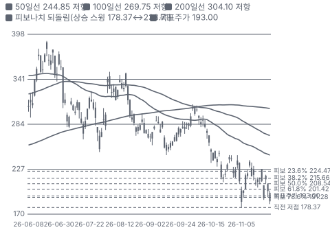

**주봉**

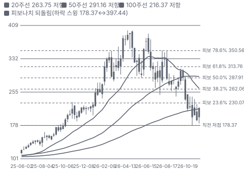

**월봉**

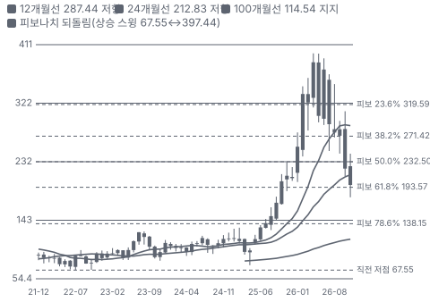

**분기 매출·EPS 실적과 컨센서스**

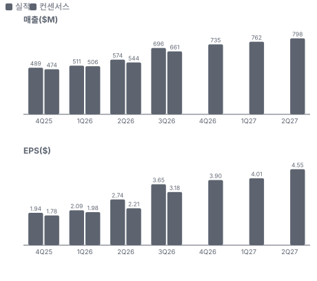

**4Q26 매출 — 지표 추세 vs 가이던스·컨센서스**

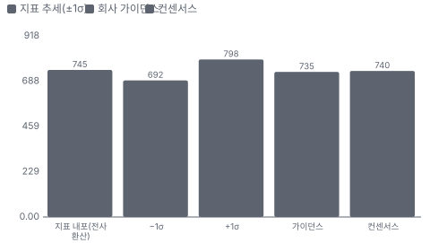

**최근 4개 분기 주가 변화 분석**

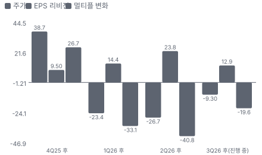

**EPS 리비전**

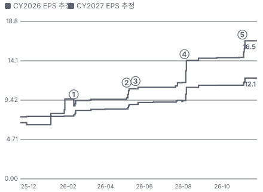

① 26-02-10 4Q25 실적 · 1Q 가이던스 \$500M · EPS 리비전 -2%
② 26-05-04 1Q26 실적 · 2Q 가이던스 \$540M · EPS 리비전 +13%
③ 26-05-18 0% 전환사채 \$1.15B 발행 · 2028 전환사채 교환 · 실적 창과 겹침
④ 26-08-03 2Q26 실적 · 2026년 성장 전망 30%대 초중반 · EPS 리비전 +23%
⑤ 26-11-02 3Q26 실적 · 2026년 성장 40%·2027년 30% 안팎 · EPS 리비전 +14%

**멀티플 프리미엄(Fwd 1Y P/E, 최근 4개 분기말 절대값 — 대상 vs 동종 중앙값)**

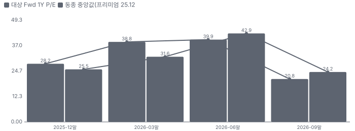

**합리적 멀티플**

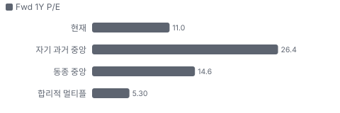

**밸류에이션 주가 시나리오**

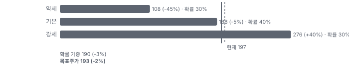

**주가별 업사이드**

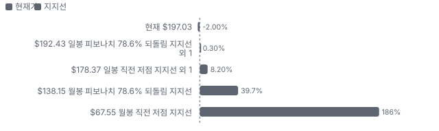
- 제품·서비스 포트폴리오

**고객 믹스(FY2025, 매출 대비)**

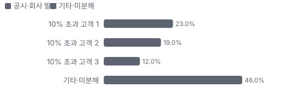

**공급 병목(10점, 낮을수록 병목)**

**CAPEX의 매출 대비 비중**

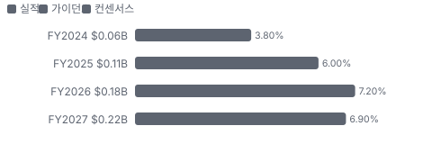

**어닝콜 변화별 주주가치 영향**

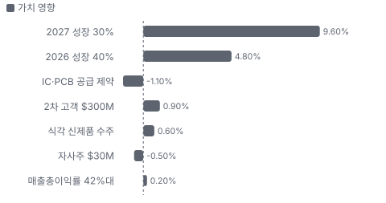

**매출 → 매출총이익 → 영업이익(매출 = 100, 최근 4분기)**

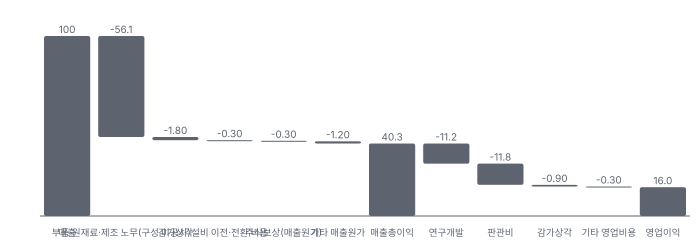

**분기 비용 비중 추이(매출 대비, 공시)**

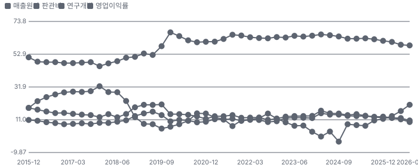

**비용 요인별 매출 대비 비중 1년 변화**

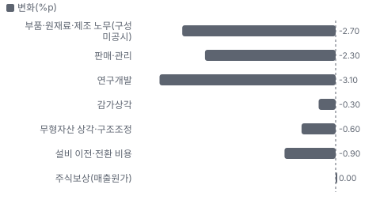

**반도체 장비 BOM 원가 몫**

**데이터센터 컴퓨팅 BOM 원가 몫**

**BOM 항목 가격 +10% 시 OPM 변화**

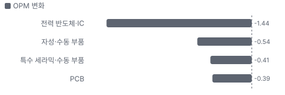

**원가 물가 vs 판매가 물가 — 최근 24개월**

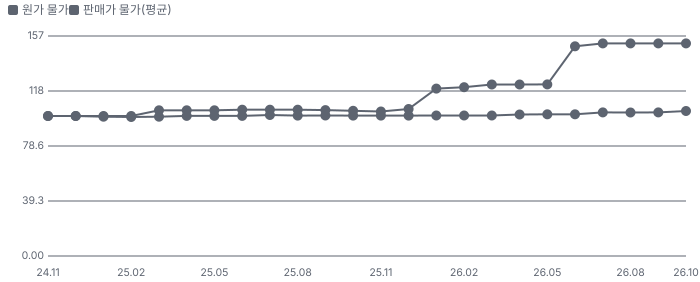

**사업별 매출 vs 물가 — 전년 대비(명목 매출 · 비교 물가 · 실질 = 물량·믹스)**

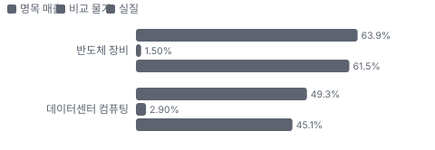

**자산 구성 — 3Q26 분기말 투하자본 \$1.65B**

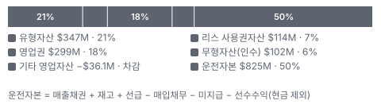

**자산별 변화율 — 최근 12개 분기(4Q23 = 0%) + 다음 4개 분기 추정**

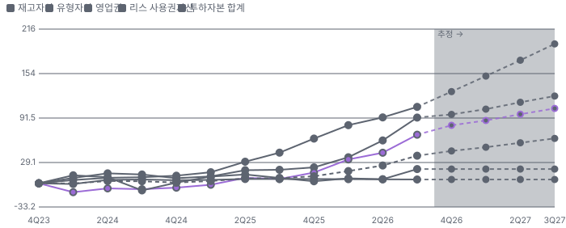

**ROIC 추이 — TTM, 최근 12개 분기 + 다음 4개 분기 추정(컨센서스 NOPAT)**

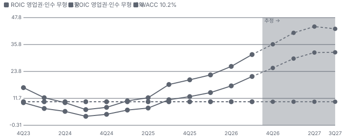

**생산시설별 면적(sq ft, 큰 순) — 생산능력 미공시라 면적을 대용으로**

**매출 vs PPI·수출입 — 4Q22 = 100(변화율, 로그 눈금)**

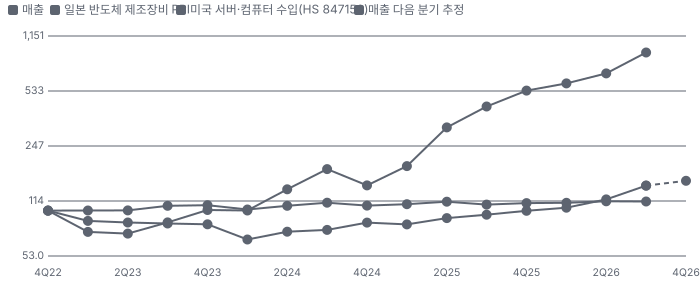

**10년 P·Q 사이클 — 추세(HP 필터) 대비 갭과 8분기 전망**

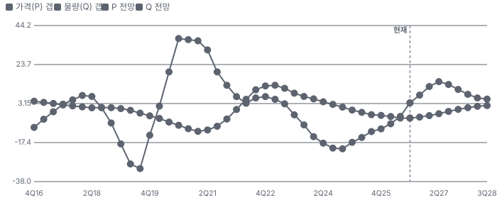

**매출 증가율의 가격·물량 분해와 8분기 전망(전년 대비)**

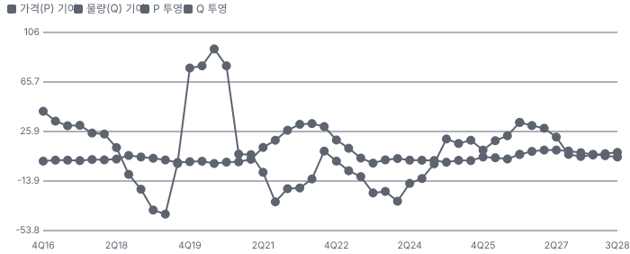

**목표주가 산정 — 기본과 강세 사이(강세 쪽 6%), 도달 확률 약 48%**

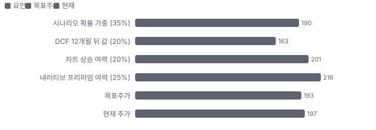

**PEG — 성장 대비 멀티플(낮을수록 성장 대비 쌈)**

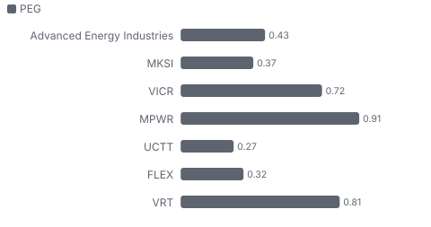

**커뮤니티 언급 수(최근 30일, 채널별)**

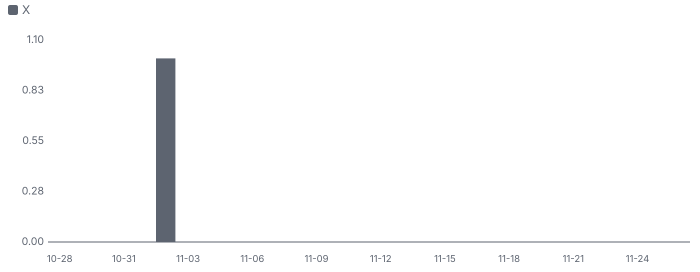

**재고 일수 — 분기별(수주 자료가 없어 수주/출하 비율 없음)**

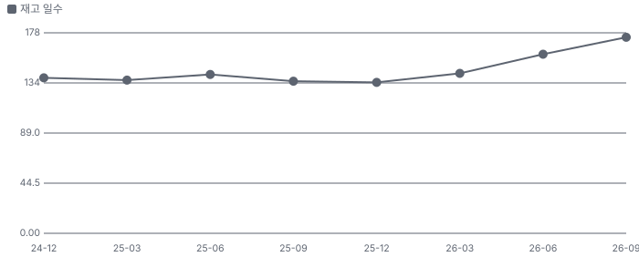

**일별 거래량 분해**

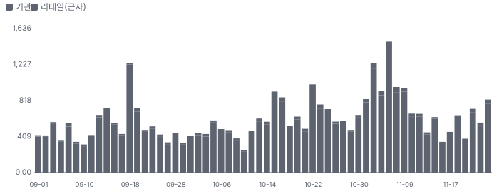

**기관 자금 흐름**

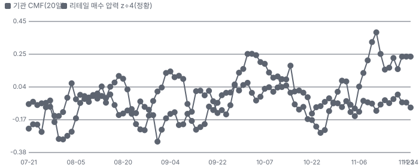

**몬테카를로**

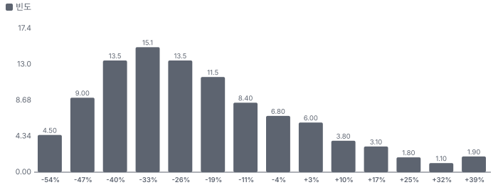

해석: 3,000번 중 515번(17%)에서 가치가 지금 주가 이상이었다. 가정을 흔들어도 지금 주가를 뒷받침하지 못하는 경우가 더 많다. 가운데 값은 0.75배이고, 열 번 중 여덟 번은 0.54~1.10배 사이에 든다.

## 내러티브

> **기업가치를 결정하는 이야기:** 값을 정하는 것은 세 가지다. ① 반도체 장비(매출의 46%)와 AI 서버 전원(37%)이 2027년에도 함께 느는가 — 회사는 '30% 안팎'을 말했고 부품 공급이 상한이라고 했다. ② 매출총이익률이 42%에서 43% 위로 가는가. ③ 이익이 현금으로 바뀌는가 — 재고가 9개월에 \$234M 늘어 잉여현금흐름은 \$28M뿐이다.

> **멀티플·EPS 프리미엄**
> **멀티플:** Fwd 1Y P/E 11.0배 — 동종 중앙 14.6배(Monolithic Power 27.6 · Vicor 23.9 · Vertiv 18.7 · Flex 10.4 · MKS 8.7 · Ultra Clean 6.3)보다 낮고 자기 3년 범위 16~46배의 아래다. 분모를 애널리스트 분기 추정 합(\$15.1)으로 바꾸면 13.1배다
> **EPS:** 애널리스트 평균 FY2027 EPS는 2Q 콜 직전 \$11.54에서 \$16.52로 올랐다 — 네 분기 연속 매출·EPS가 추정을 넘었다(3Q EPS \$3.65 vs 추정 \$3.04~3.18)

### 투자자들은 왜 열광했나

2월 4Q 실적 다음 날 +10.7%, 5월 1일 종가 \$389.05(4월 21일 장중 \$397.44)까지 1년 새 두 배가 됐다 — '반도체 장비 + AI 서버 전원 이중 수혜'에 배수 46배가 붙었다. 식은 것은 5월부터다. 1Q 실적 다음 날 −10.7%, 전환사채 \$1.15B 발행, 그리고 11월 실적 상향 뒤 이틀 급락(−11.1%·−12.2%)으로 실적 상승분을 모두 반납했다. 급락일에 회사 고유 공시는 없었다 — 반도체 업종 전체가 AI 설비투자 우려로 같이 내렸다.

### 무엇이 기업가치를 바꾸나

> **구조적 체질 변화**
> **변화:** 비GAAP 영업이익률이 1년 새 16.8%에서 24.4%로 올랐다. 중국 중산 공장을 닫고 필리핀·멕시코·태국으로 모았으며 회사는 4분기 가이던스가 2030년 목표 모델을 3년 앞선 속도라고 했다
> **증거:** 3Q26 실적 보도자료(8-K EX-99.1) · FY2025 10-K · 3Q26 어닝콜
> **반증:** 비GAAP 영업이익률이 22% 아래로 내려간다

> **고부가 믹스 확장**
> **변화:** 3Q26 매출총이익률 개선 가운데 약 2.0%p가 제품 구성 효과다(10-Q). 산업·의료에서 범용 제품을 정리했고 신제품 비중이 는다
> **증거:** 3Q26 10-Q Item 2 · 3Q26 어닝콜
> **반증:** 매출총이익률이 42% 아래로 내려간다

> **기술 혁신**
> **변화:** 식각·증착용 신형 플라즈마 전원(eVerest(Advanced Energy의 차세대 RF 플라즈마 전원 제품군)·eVoS(이온 에너지를 직접 제어하는 Advanced Energy의 바이어스 전원 제품군)·NavX(Advanced Energy의 차세대 고속 매칭 네트워크 제품군))이 3분기에 주요 자리를 수주했다 — 도체 식각(실리콘·금속 같은 전도성 막을 깎는 식각 공정) 2027년, 유전체 식각(산화막 같은 절연막을 깊게 깎는 식각 공정 — 메모리 고단화에서 비중이 크다) 2028년 램프. 서버 쪽은 800V 전력 분배 보드(랙에 800V 직류로 들어온 전기를 받아 낮은 전압으로 나눠 주는 Advanced Energy의 모듈형 장치)와 액체 냉각 전원을 공개했다
> **증거:** 3Q26 어닝콜
> **반증:** 2027년 반도체 매출에서 신제품 비중 10%가 확인되지 않는다

> **실행 속도**
> **변화:** 해당 없음(납품 리드타임 수치를 회사가 공시·콜에서 밝히지 않는다) — 회사는 대형 장비 고객에게 적기 공급 보관함(고객 공장 옆 보관함에 부품을 채워 두고 고객이 꺼내 쓴 만큼 매출로 잡는 납품 방식)으로 납품하고 상한에 가깝지 않다고 했다. 서버 전원은 고객 거점 재고가 모자라 항공 운송 중이다 **납품 리드타임 미확인.** 피어 비교 미확인. 이전 대비 미확인.
> **증거:** 3Q26 어닝콜
> **반증:** 부품 제약으로 분기 매출이 가이던스 하단을 밑돈다

> **M&A**
> **변화:** 해당 없음(최근 3년 인수는 2024년 6월 Airity \$19.6M뿐, 실적 기여 미미) — CEO는 인수를 계속 찾는다고 했고 현금 \$1.42B와 미사용 한도 \$600M이 있다
> **증거:** FY2025 10-K Note 2 · 3Q26 10-Q

> **정책·입법 연관성**
> **재정정책:** 해당 없음(보조금·세액공제를 받지 않는다 — 10-K·10-Q에 CHIPS(미국 반도체지원법)·정부 지원 언급 없음) FY2025 10-K · 3Q26 10-Q
> **행정명령:** 해당 없음(관세는 2분기에 환급이 들어와 매출총이익률에 +1.2%p 일회성 효과가 있었을 뿐, 지속 영향 수치는 공시되지 않았다) 2Q26 어닝콜 요약 · 3Q26 10-Q Item 2
> **연관입법:** 해당 없음 — 연결되는 법안을 확인하지 못했다 FY2025 10-K

> **고객의 지출 예산**
> **변화:** 매출의 83%가 반도체 팹과 데이터센터의 설비투자에서 나온다 — 설비투자가 줄면 가장 먼저 흔들리는 구조다
> **사업별 예산:** **매출의 46%**: 반도체 장비 — 고객 CAPEX(반도체 제조사의 전공정 장비 투자(장비사를 거쳐 들어온다)) · 동인: 첨단 로직·메모리 증설, 식각·증착 공정 수 증가
**매출의 37%**: 데이터센터 컴퓨팅 — 고객 CAPEX(하이퍼스케일러의 서버·랙 설비투자) · 동인: AI 랙 출하와 랙당 전력 증가
**매출의 13%**: 산업·의료 — 고객 혼합(의료기기·산업 장비 제조사의 부품비와 설비투자) · 동인: 재고 정상화, 신규 설계 채택
**매출의 4%**: 통신·네트워킹 — 고객 CAPEX(통신사·네트워크 장비 투자) · 동인: AI 네트워크 장비
> **증거:** 3Q26 10-Q Note 2 시장별 매출
> **반증:** 장비사 또는 하이퍼스케일러의 2027년 설비투자 가이던스 하향

### 내러티브 근거

> 'AI가 반도체 장비와 서버 전원을 동시에 키운다 — 두 시장에 다 파는 전력 변환 회사'라는 이야기다. 실적은 이야기대로 가고 있다(3Q 매출 +50%, EPS 2.1배). 식은 것은 배수다 — 4월 말 다음 12개월 이익의 46배에서 지금 11배. 동종 대비 멀티플 차이 -25% 중 회사 고유 몫은 +106%다. 단계는 확산, 쏠림은 중간이다.

> **반도체 장비 투자 상승기** · 강화
> **논리:** 첨단 로직·메모리 증설로 식각·증착 장비가 늘고 장비당 플라즈마 전원 탑재도 는다
> **숫자:** 3Q 반도체 매출 \$322.2M(+64% YoY), 하반기 성장 전망 '50%' → '60% 이상'
> **반증:** 장비사 2027년 가이던스가 내려가거나 반도체 매출이 두 분기 연속 순차 감소
> **출처:** 3Q 어닝콜 · 3Q26 10-Q

> **AI 서버 전원 고출력화** · 강화
> **논리:** 랙 전력이 커질수록 고출력·고효율 전원의 단가와 수량이 는다
> **숫자:** 3Q 데이터센터 매출 \$256.2M(+49% YoY, +34% QoQ), 2026년 성장 전망 50%대 후반
> **반증:** 하이퍼스케일 주요 고객 2곳 중 한 곳이 프로그램을 미루거나 이원화 비중을 높인다
> **출처:** 3Q 어닝콜

> **이익률 구조 개선** · 강화
> **논리:** 중국 공장 폐쇄·공장 통합·신제품 구성으로 매출총이익률이 37%대에서 42%대로 올라왔고 43% 이상을 본다
> **숫자:** 비GAAP 매출총이익률 39.1% → 42.1%, 영업이익률 16.8% → 24.4%(1년)
> **반증:** 매출총이익률이 42% 아래로 내려간다
> **출처:** 3Q26 8-K EX-99.1

> **증설과 신제품(태국·800V·2차 고객군)** · 유지
> **논리:** 생산능력 \$5B와 새 고객·새 전압 구조가 2028년 이후 성장을 잇는다
> **숫자:** 2차 고객군 연 \$300M 이상(2029년까지, 경영진 목표), 800V 보드 효율 98%
> **반증:** 2027년 가이던스에 2차 고객군·800V 매출이 잡히지 않는다
> **출처:** 3Q 어닝콜

> **(반대) 사이클 고점·고객 집중·현금 전환** · 강화
> **논리:** 두 설비투자 사이클이 같이 꺾이면 매출과 이익이 함께 빠진다 — 고객 3곳이 54%, 장기 약정 없음, 재고가 9개월에 \$234M 늘었다
> **숫자:** Fwd 1Y P/E 46배(4월 말) → 11배, 9M26 잉여현금흐름 \$28M(계산), 내부자 매수 0. 지금 주가를 동종 중앙 14.6배로 나누면 내재 EPS \$13.5 — 2027년 추정 \$17.9보다 25% 낮다(계산)
> **반증:** 4분기 영업현금흐름이 순이익을 따라오고 2027년 가이던스가 30% 성장을 확인할 때(반대 내러티브 약화)
> **출처:** 3Q26 8-K EX-99.1 · FY2025 10-K · Form 4 집계

### 투자 포인트

> **이익 추정은 올랐고 배수가 절반 아래가 됐다**
> **명제:** 7월 말 이후 주가 −32%는 실적 실망이 아니라 배수 하락이다
> **숫자:** 애널리스트 평균 FY2027 EPS \$11.54(7월 30일) → \$16.52(11월 6일), 같은 EPS 기준 P/E 25.1배 → 11.9배. 3Q 매출 +50%, 4Q 가이던스 \$735M
> **시장과 다른 점:** 셀사이드 13명 가운데 12명이 매수이고 목표가 평균이 \$377이라 '시장이 간과했다'고 말할 수 없다. 다른 점은 질문의 자리다 — 지금 가격은 2027년 EPS \$17~19가 고점이라고 가정한다
> **증명:** 1분기 가이던스 \$760M 이상, 하이퍼스케일러 2027년 설비투자 가이던스 유지
> **출처:** 3Q26 실적 보도자료(8-K, 2026-11-02) · 컨센서스 집계

> **두 다리가 같은 사이클에 서 있다**
> **명제:** 반도체 장비 46%와 데이터센터 37%는 분산이 아니라 같은 AI 설비투자의 두 단면이다
> **숫자:** 3Q 반도체 \$322.2M(+64%)·데이터센터 \$256.2M(+49%), 상위 고객 3곳 54%(FY2025), 고객 장기 구매 약정 없음(10-K)
> **시장과 다른 점:** 시장은 '반도체 + 데이터센터 이중 수혜'로 프리미엄을 줬다가 한꺼번에 거뒀다. 하락 국면에서는 두 매출이 같이 빠질 수 있다는 점이 배수 할인의 실체다
> **증명:** 장비사 2027년 가이던스(1월)와 하이퍼스케일러 설비투자 가이던스가 엇갈리는지
> **출처:** 3Q26 10-Q Note 2 · FY2025 10-K

> **이익이 현금으로 바뀌는 속도**
> **명제:** 9개월 비GAAP 순이익 \$345M 가운데 영업현금은 \$146M, 설비투자를 빼면 \$28M이다
> **숫자:** 재고 \$411.2M → \$645.7M(9개월 +\$234M), 9M26 영업현금흐름 \$145.7M, 설비투자 \$117.2M. 2Q 콜의 '2026년 잉여현금흐름은 2025년 이상'은 3Q 콜에서 반복되지 않았다
> **시장과 다른 점:** 재고는 공급 제약 국면의 무기이지만 수요가 꺾이면 평가손이 된다 — 회사도 10-K에 그 위험을 적었다
> **증명:** 4분기 영업현금흐름과 재고일수(144일)가 내려오는지
> **출처:** 3Q26 8-K EX-99.1 현금흐름표 · 3Q 콜

### 모멘텀 생성·소멸 타임라인

**카탈리스트 달력 — 지난 사건의 주가 반응과 앞으로 확인할 숫자**
| 날짜 | 상태 | 구분 | 사건 | 반응·확인 | 결과에 따라 |
|---|---|---|---|---|---|
| 2026-02-11 | 완료 | 생성 | 4Q25 실적 · 1분기 가이던스 \$500M | +10.7% |  |
| 2026-05-05 | 완료 | 소멸 | 1Q26 실적 — 가이던스 중간을 넘겼지만 종가 고점(\$389.05) 직후 | -10.7% |  |
| 2026-05-18 | 완료 | 소멸 | 0% 전환사채 \$1.15B 발행 | -4.5% |  |
| 2026-08-04 | 완료 | 생성 | 2Q26 실적 · 2026년 성장 전망 상향 | +15.2% |  |
| 2026-11-03 | 완료 | 생성 | 3Q26 실적 · 2026년 성장 40%·2027년 30% 안팎 | +9.6% |  |
| 2026-11-05 | 완료 | 소멸 | 이틀 연속 급락(11/4 −11.1%, 11/5 −12.2%) — 회사 공시 없음, 실적 상승분 반납 | -12.2% |  |
| 2027-01 말(예상) | 예정 | 매크로·섹터 | 장비사·하이퍼스케일러 4분기 실적과 2027년 설비투자 가이던스 | 장비 시장 2027년 성장 전망과 하이퍼스케일러 설비투자 가이던스 방향 | 둘 다 유지면 2027년 30% 성장 가정이 살고, 한쪽이 내려가면 낮은 쪽 EPS(\$16.5)로 본다 |
| 2027-02 초(예상) | 예정 | 확인 | 4Q26 실적 · 1Q27 가이던스 | 4Q 매출 \$735M 이상, 1Q27 가이던스 \$760M 이상인지, 매출총이익률 42% 이상, 영업현금흐름과 재고일수 | \$760M 이상이면 강세 쪽, \$735~760M이면 기본, \$735M 아래면 약세 |
| 2027-02 말(예상) | 예정 | 확인 | FY2026 10-K — 고객 집중·구매 약정 | 10% 초과 고객 수와 몫(FY2025 23%·19%·12%), 공급사 구매 약정 서술 | 최대 고객 몫이 더 커졌으면 집중 할인을 유지한다 |

### 언제 사서 언제 팔아야 할까?

**가격·조건 틀 — 가격은 밸류에이션(약세·기본·강세·목표주가)과 차트 지지 구간에서, 조건은 이벤트에서**
| 구간 | 가격 | 목표주가까지 | 약세까지 | 조건·근거 |
|---|---|---|---|---|
| 관찰 구간 | \$191~\$194 | +0% | -44% | 11월 5일 종가 \$185.66과 장중 \$178.37이 52주 저점이다. 지금 \$197.03은 그 위 6%에 있고 50일선(\$245)·200일선(\$304) 모두 아래다 |
| 확인 뒤 | 지금 \$197 이상에서 조건 확인 | -2% | -45% | 4분기 실적에서 1Q27 가이던스 \$760M 이상, 매출총이익률 42% 이상, 재고일수 하락 |
| 무효화 | 약세 시나리오 \$108 | - | -45% | 1Q27 가이던스가 4분기 실적보다 낮거나, 회사가 2027년 성장 방향을 30%에서 내리거나, 10% 초과 고객의 주문 조정이 공시된다 |
| 차익 고민 2차 | \$276(강세 시나리오) | +40% | - | 목표주가 부근에서는 배수가 동종 중앙 위로 올라간다 — 두 사이클이 함께 꺾일 위험과 전환사채 희석(전환가 \$508.78)은 그때도 남는다 |

11월에만 하루 ±10% 넘게 움직인 날이 다섯 번이다(−11.1%·−12.2%·+11.3%·−10.4%·+12.6% 등) — 구간은 종가 기준으로 본다 가격·조건 틀이며 매매·비중 지시가 아니다(투자 권유 아님).

## 포트폴리오

| 제품·서비스 | 구분 | 무엇 | 쓰는 곳 | 돈 버는 방식 | Mix | Mix 변화(전 분기 대비) |
|---|---|---|---|---|---|---|
| 반도체 장비 | 제품 | 식각·증착 장비 안에서 플라즈마를 만드는 고주파·직류 전원과 정합 장치 | 식각·증착·이온 주입·검사·시험 장비 | 3Q26 매출의 46%(\$322.2M, +64%) — 서비스 포함 | 46% | -2.2%p |
| 데이터센터 컴퓨팅 | 제품 | AI 서버 랙에 전기를 바꿔 넣는 전원장치와 파워셸프(여러 서버 전원장치를 한 선반에 묶어 랙 전체에 전기를 공급하는 장치) | 하이퍼스케일러 서버·스토리지 랙 | 3Q26 매출의 37%(\$256.2M, +49%) — 주요 고객 2곳 | 37% | +3.4%p |
| 산업·의료 | 제품 | 의료 영상·분석 장비·산업 설비·방산에 들어가는 정밀 전원 | 의료기기·시험 계측·로봇·항공방산 | 3Q26 매출의 13%(\$90.5M, +27%) — 절반이 유통 채널 | 13% | -0.9%p |
| 통신·네트워킹 | 제품 | 무선 기지국·네트워크 장비용 전원 | 통신 장비·네트워크 스위치 | 3Q26 매출의 4%(\$27.5M, +15%) | 4% | -0.3%p |

**Mix 변화가 가장 큰 쪽은 데이터센터 컴퓨팅(+3.4%p, 전 분기 대비).** 계절성 판정: 분기 매출 계절 지수 기준 없음 → 직전 분기와 비교.

## 고객

> **FY2025 최대 고객 10% 초과 고객 1 23%, 상위 3곳 54%, 집중도 분산.** 공시·회사 발표로 확인한 몫은 매출의 54%이고, 나머지 고객 몫은 추정이거나 미분해다. 10-K는 10% 넘는 고객을 이름 없이 몫만 공시한다 — FY2025 세 곳이 23%·19%·12%로 합계 54%(FY2024 두 곳 26%·11%). 세 번째 고객이 2025년에 새로 10%를 넘었고 같은 해 데이터센터 매출이 두 배가 됐다. CEO는 3Q 콜에서 하이퍼스케일 주요 고객이 2곳이라고 처음 밝혔다.

**고객별 매출 몫(FY2025)**
| 고객 | 몫 | 변화 | 근거 |
|---|---|---|---|
| 10% 초과 고객 1 | 23% | -3%p | 공시 |
| 10% 초과 고객 2 | 19% | +8%p | 공시 |
| 10% 초과 고객 3 | 12% | 미확인 | 공시 |
| 기타·미분해 | 46% | - | - |

> **10% 초과 고객 1** · 공시
> **사는 것:** 미공시 — 이름·구매 품목을 밝히지 않음

> **10% 초과 고객 2** · 공시
> **사는 것:** 미공시 — 이름·구매 품목을 밝히지 않음

> **10% 초과 고객 3** · 공시
> **사는 것:** 미공시 — FY2024에는 10% 미만이었다

## 마진 구조

> **GPM 41.5%, OPM 20.6%.** 3Q25 대비 GPM +3.9%p, OPM +9.9%p. 3Q26 GAAP 매출총이익률은 41.5%(1년 전 37.6%), 영업이익률은 20.6%(1년 전 10.6%)다. 매출이 50% 느는 동안 영업비용은 17%만 늘었다. 회사는 매출총이익률 개선의 약 2.0%p가 제품 구성, 나머지가 물량이라고 밝혔다. 매출원가의 부품·노무 구성은 공시하지 않는다.

> **매출 100 중 매출원가 59.7, 매출총이익 40.3(최근 4분기, 공시).** 매출원가 요인 중 부품·원재료·제조 노무(구성 미공시)이 매출의 56.1%로 가장 무겁고, 단가가 +10% 오르면 GPM이 -5.62%p 움직인다. 분기 회귀로 매출 1이 늘 때 매출원가는 0.67 늘고, 매출원가의 고정비 몫은 -10%다.

**비용 요인 강도 — 비중·추세·충격(+10%)·탄력**
| 비용 | 구분 | 매출 대비 | 1년 변화 | 마진 기여 | 충격 시 마진 | 매출 탄력 | 고정비 몫 |
|---|---|---|---|---|---|---|---|
| 부품·원재료·제조 노무(구성 미공시) | 매출원가 요인 | 56.1% | -2.7%p | +2.7%p | -5.62%p | 미확인 | 미확인 |
| 감가상각 | 매출원가 요인 | 1.8% | -0.3%p | +0.3%p | -0.18%p | 미확인 | 100% |
| 설비 이전·전환 비용 | 매출원가 요인 | 0.3% | -0.9%p | +0.9%p | -0.03%p | 미확인 | 100% |
| 주식보상(매출원가) | 매출원가 요인 | 0.3% | +0.0%p | -0.0%p | -0.03%p | 미확인 | 100% |
| 매출원가 | 공시 항목 | 59.7% | -3.0%p | +3.0%p | -5.97%p | 0.67 | -10% |
| 판관비 | 공시 항목 | 11.8% | -1.9%p | +1.9%p | 미확인 | 0.11 | 22% |
| 연구개발 | 공시 항목 | 11.2% | -2.0%p | +2.0%p | 미확인 | 0.11 | 0% |
| 감가상각 | 공시 항목 | 0.9% | -0.4%p | +0.4%p | 미확인 | 0.01 | 1% |
| 기타 영업비용 | 공시 항목 | 0.3% | -0.2%p | +0.2%p | 미확인 | 0.00 | 49% |

매출 탄력 = 분기 비용을 매출에 회귀한 기울기(매출 1당 변동비), 고정비 몫 = 절편 ÷ 평균 비용. 표본이 8분기 미만이면 미확인. 매출원가 요인 비중은 margin 재료의 추정이 섞여 있고, 공시 매출원가와의 차이는 '기타 매출원가'로 둔다.

**GPM에서 OPM까지(GAAP — 10-Q 3개월 손익, 아래는 최근 4개 분기)**
| 기간 | GPM | 연구개발 | 판관비 | 기타 | OPM |
|---|---|---|---|---|---|
| 3Q25 | 37.6% | 12.8% | 12.9% | 1.4% | 10.6% |
| 3Q26 | 41.5% | 9.6% | 10.6% | 0.7% | 20.6% |
| 2025-12 | 38.6% | - | - | - | 11.6% |
| 2026-03 | 39.3% | - | - | - | 13.4% |
| 2026-06 | 41.1% | - | - | - | 16.6% |
| 2026-09 | 41.5% | - | - | - | 20.6% |

**비용을 움직이는 요인**
| 비용 | 요인 |
|---|---|
| 부품·원재료·제조 노무(구성 미공시, 매출원가) | 출하량, IC·PCB·특수 세라믹 단가, 공장 가동률, 제품 구성 · 근거 공시 |
| 판매·관리(판관비) | 인건비·주식보상·변동 성과급 · 근거 공시 |
| 연구개발(연구개발) | 신제품 프로그램·엔지니어 인건비 · 근거 공시 |
| 감가상각(매출원가) | 공장 증설·태국 신공장·전사 시스템 투자 · 근거 공시 |
| 무형자산 상각·구조조정(기타) | 과거 인수 무형자산 내용연수 만료 · 근거 공시 |
| 설비 이전·전환 비용(매출원가) | 중국 중산 공장 폐쇄·공장 통합 · 근거 공시 |
| 주식보상(매출원가, 매출원가) | 주가·부여 규모 · 근거 공시 |

**반도체 장비 BOM — 매출의 46%, GPM 42%(회사 전체 GAAP 매출총이익률 — 시장별 이익률 미공시), 항목 가격 +10% 시**
| 항목 | 원가 몫 | 전가 | 제품 GPM | OPM |
|---|---|---|---|---|
| 전력 반도체·IC | 20~35% | 미확인 | -1.6%p | -0.74%p |
| 특수 세라믹·수동 부품 | 10~20% | 미확인 | -0.9%p | -0.41%p |
| PCB | 5~12% | 미확인 | -0.5%p | -0.23%p |
| 기구·냉각·조립 노무 | 미확인 | 미확인 | 미확인 | 미확인 |
| 미분해 | 49% | - | - | - |

**데이터센터 컴퓨팅 BOM — 매출의 37%, GPM 42%(회사 전체 GAAP 매출총이익률 — 시장별 이익률 미공시), 항목 가격 +10% 시**
| 항목 | 원가 몫 | 전가 | 제품 GPM | OPM |
|---|---|---|---|---|
| 전력 반도체·IC | 25~40% | 미확인 | -1.9%p | -0.70%p |
| 자성·수동 부품 | 20~30% | 미확인 | -1.5%p | -0.54%p |
| PCB | 5~10% | 미확인 | -0.4%p | -0.16%p |
| 기구·방열·조립 노무 | 미확인 | 미확인 | 미확인 | 미확인 |
| 미분해 | 35% | - | - | - |

전력 반도체·IC 가격이 +10% 오르면 영업이익은 -7.0% 움직인다. 판매가 전가를 모르는 항목은 전가 0%로 계산했다.

**BOM 항목 가격을 움직이는 것**
| 항목 | 요인 |
|---|---|
| 전력 반도체·IC | RF(고주파 — 플라즈마를 만드는 데 쓰는 무선 주파수대 전력) 전력 트랜지스터·컨트롤러 수급 — AI 서버와 같은 부품을 두고 경쟁한다 · 근거 추정 |
| PCB | 고다층 기판 리드타임과 단가 · 근거 추정 |
| 특수 세라믹·수동 부품 | 진공 커패시터·절연 세라믹은 공급사가 적다 · 근거 추정 |
| 기구·냉각·조립 노무 | 구리·알루미늄 가공품과 동남아 공장 인건비 · 근거 추정 |
| 전력 반도체·IC | SiC(실리콘 카바이드 — 고전압·고효율 전력 반도체 소재)·GaN(질화갈륨 — 고주파·고효율 전력 반도체 소재) 스위치와 컨트롤러 — 고출력으로 갈수록 몫이 커진다 · 근거 추정 |
| 자성·수동 부품 | 트랜스·인덕터·커패시터 — 구리·페라이트 가격 · 근거 추정 |
| PCB | 대전류 후동 기판 · 근거 추정 |
| 기구·방열·조립 노무 | 팬·방열판·액체 냉각판과 조립 인건비, 항공 운송비 · 근거 추정 |

> **원가·판매가 물가 격차 -43.2%p** — 판매가 물가가 투입 원가 물가보다 느리게 오른다.

**투입 물가 — 미국 PPI 3·6·12개월(2026-10, 개정 반영)과 해외 전년비**
| 항목 | 미국 3개월 | 6개월 | 12개월 | 전가 못 할 때 OPM | 일본 | 한국 | 대만 |
|---|---|---|---|---|---|---|---|
| 전력 반도체·IC | -0.7% | -5.7% | -2.7%* | - | +1.6%* | 미확인 | 미확인 |
| PCB | +0.0% | +24.0% | +46.4% | - | +11.5% | +1.7% | +12.1% |
| 자성·수동 부품 | 미확인 | 미확인 | 미확인 | - | 미확인 | 미확인 | 미확인 |

별표는 품목보다 넓은 업종 지수다. 연결한 투입 원가의 미국 PPI(생산자물가지수)는 1년 새 가중 +46.4%이고, 판매가로 넘기지 못하면 GPM -26.1%p·OPM -26.1%p가 움직인다. 판매가 비교 물가(반도체 제조장비 PPI)는 1년 새 +3.4% — 회사 가격 변화는 미확인. 물가 지수를 붙이지 못한 매출원가 항목은 감가상각, 설비 이전·전환 비용, 주식보상(매출원가)다(미연결). 반도체 장비 매출은 2026-09 전년 대비 +63.9%이고 비교 물가 ppi:semicap의 변화 +1.5%(2026-09)를 빼면 실질 +61.5% — 물량·믹스가 성장을 이끌었다. 데이터센터 컴퓨팅 매출은 2026-09 전년 대비 +49.3%이고 비교 물가 ppi:server의 변화 +2.9%(2026-09)를 빼면 실질 +45.1% — 물량·믹스가 성장을 이끌었다.

## 자산 구성

> **3Q26 분기말 투하자본 \$1.65B** — 운전자본 50%, 유형자산 21%. 최근 12개 분기(4Q23 → 3Q26) 가장 크게 늘어난 자산은 유형자산(+107%), 투하자본 합계 +39%. 3Q27 추정 투하자본 \$1.94B(+17%, 컨센서스 매출과 회전 일수·CAPEX 강도 유지 가정). 연율 감가 비율(순액 기준)은 직전 4분기 31.41% → 최근 4분기 21.69%, 직전 비율이면 감가상각이 \$29.0M 더 컸다(영업이익의 8.0%).

**자산·운전자본 항목별 분기말 잔액 — 최근 12개 분기와 다음 4개 분기 추정**
| 항목 | 4Q23 | 3Q25 | 3Q26(최근) | 3Q27 추정 | 12개 분기 변화 | 다음 4개 분기 변화 |
|---|---|---|---|---|---|---|
| 매출채권 | \$282.4M | \$299.5M | \$474.8M | \$578.7M | +68% | +22% |
| 재고자산 | \$336.1M | \$399.7M | \$645.7M | \$747.2M | +92% | +16% |
| 선급·기타 유동자산 | \$48.8M | \$44.9M | \$68.1M | \$88.4M | +40% | +30% |
| 매입채무 | \$141.8M | \$194.7M | \$363.2M | \$427.9M | +156% | +18% |
| 유형자산 | \$167.7M | \$239.8M | \$347.3M | \$495.1M | +107% | +43% |
| 리스 사용권자산 | \$95.4M | \$102.6M | \$114.5M | \$114.5M | +20% | +0% |
| 영업권 | \$283.8M | \$300.7M | \$299.1M | \$299.1M | +5% | +0% |
| 무형자산(인수) | \$161.5M | \$123.1M | \$102.3M | \$81.4M | -37% | -20% |

**자산 추정 동인 — 최근 4개 분기 평균(재무상태표 동인 모형)**
| 동인 | 값 | 곱하는 기준 |
|---|---|---|
| 매출채권 | 64일 | 매출 |
| 재고자산 | 137일 | 매출원가 |
| 선급·기타 유동자산 | 10일 | 매출 |
| 매입채무 | 79일 | 매출원가 |
| CAPEX 강도 | 6.8% | 매출(최근 4개 분기 합) |
| 분기 감가율 | 3.84% | 기초 유형자산 순액(무형 상각 제외 감가상각) |
| 매출원가율 | 59.7% | 매출(최근 4개 분기) |
| 영업권·리스 사용권·기타 | 유지 | 인수·새 리스는 공시 전 모름 |
| 인수 무형자산 | 분기 \$5.2M 상각 | 최근 4개 분기 평균 상각 |

**추정 방법:** 증권사 3표 모델(손익·재무상태표·현금흐름)의 재무상태표 동인 방식이다. 운전자본은 항목별 회전 일수(매출채권·선급·미지급·선수는 매출, 재고·매입채무는 매출원가 기준)를 최근 4개 분기 평균으로 두고 컨센서스 매출에 곱한다. 유형자산은 기초 + CAPEX − 감가상각으로 굴린다(Koller·Goedhart·Wessels 『Valuation』 재무상태표 추정). 매출 경로는 ROIC 절의 컨센서스와 같다.

**유형·무형자산 항목별 가치(2025-12-31 vs 2024-12-31)**
| 구분 | 항목 | 총액 2025-12-31 | 누적상각 | 순액 | 총액 2024-12-31 | 총액 1년 변화 | 공시 내용연수 |
|---|---|---|---|---|---|---|---|
| 유형 | 건물·기계·장비 | \$241.4M | 총계만 공시 | 총계만 공시 | \$196.6M | +22.8% | 5~25년 |
| 유형 | 소프트웨어 | \$40.7M | 총계만 공시 | 총계만 공시 | \$35.6M | +14.3% | 3~10년 |
| 유형 | 컴퓨터·집기·차량 | \$31.0M | 총계만 공시 | 총계만 공시 | \$26.0M | +19.2% | 3~5년 |
| 유형 | 임차 개량 | \$101.0M | 총계만 공시 | 총계만 공시 | \$93.0M | +8.6% | 2~10년 |
| 유형 | 건설중인 자산 | \$82.5M | \$0.0M | \$82.5M | \$35.4M | +133.1% | 비상각 |
| 영업권 | 영업권 | \$300.8M | \$0.0M | \$300.8M | \$296.0M | +1.6% | 비상각 |
| 무형 | 기술 | \$101.8M | \$78.2M | \$23.6M | \$99.9M | +1.9% | 미확인 |
| 무형 | 고객 관계 | \$171.4M | \$86.3M | \$85.1M | \$168.9M | +1.5% | 미확인 |
| 무형 | 상표·기타 | \$27.3M | \$18.3M | \$9.0M | \$27.1M | +0.7% | 미확인 |
| 유형 합계 | 유형자산 | \$496.6M | \$223.8M | \$272.8M | \$386.6M | +28.5% | 경과율 54%(상각 대상 기준) |

**내용연수 산식(상각 대상 유형자산 = 총액 − 토지 − 건설중)**
| 기준일 | 연 감가상각 | 상각 대상 총액 | 평균 내용연수 | 경과 연수 | 잔여 연수 | 경과율 |
|---|---|---|---|---|---|---|
| 2025-12-31 | \$39.8M | \$414.1M | 10.4년 | 5.6년 | 4.8년 | 54% |
| 2024-12-31 | \$42.5M | \$351.2M | 8.3년 | 4.7년 | 3.5년 | 57% |

산식 평균 내용연수는 10.4년이며, 공시 범위의 총액 가중 중간값 11.1년(가중 범위 3.9~18.4년)과 가깝다. 1년 전 8.3년 → 지금 10.4년. 건설중인자산이 \$35.4M → \$82.5M로 늘어 감가상각 없는 자산 몫이 커졌다(순액 기준 감가 비율을 끌어내린다).

**분기 감가 비율(감가상각 ÷ 평균 유형자산 순액)**
| 분기 | 감가상각 | 평균 유형자산(순액) | 분기 비율 | 연율 | 연율의 역수 |
|---|---|---|---|---|---|
| 4Q24 | \$16.7M | \$183.7M | 9.09% | 36.36% | 2.8년 |
| 1Q25 | \$16.1M | \$189.7M | 8.49% | 33.95% | 2.9년 |
| 2Q25 | \$15.6M | \$206.1M | 7.57% | 30.28% | 3.3년 |
| 3Q25 | \$15.1M | \$229.1M | 6.59% | 26.36% | 3.8년 |
| 4Q25 | \$15.2M | \$256.3M | 5.93% | 23.72% | 4.2년 |
| 1Q26 | \$15.8M | \$288.6M | 5.48% | 21.90% | 4.6년 |
| 2Q26 | \$16.5M | \$313.5M | 5.26% | 21.06% | 4.7년 |
| 3Q26 | \$17.2M | \$335.0M | 5.14% | 20.54% | 4.9년 |

감가상각 기준: 손익계산서 감가상각·상각비(SEC 공시 데이터, 4분기 = 연간 − 1~3분기).

**감가율 하락 경고: 연율 31.41% → 21.69%(-31%).** 직전 4분기 비율을 그대로 쓰면 최근 4분기 감가상각이 \$29.0M 더 컸다(영업이익의 8.0%). 내용연수 연장·상각 끝난 자산 증가·건설중 자산 증가(믹스) 중 무엇인지는 공시 주석으로 가린다(자체추론).

미공시·미분해: 유형자산 항목별 누적상각(합계 \$223.8M만 공시) · 무형자산 내용연수 범위(가중평균 잔여 기간만 공시 — 기술 6.6년·고객 관계 7.7년·상표 3.6년) — 이 칸은 비우고 나머지로 계산했다.

### 해석 — 자산이 어디에 쌓이고 있나

- 같은 기간 4개 분기 매출은 +54% — 매출보다 빨리 늘어난 자산: 매출채권 +68%, 재고자산 +92%, 유형자산 +107%. 이 자산의 회전율이 떨어지면 ROIC를 희석한다.
- 다음 4개 분기 CAPEX \$212.9M vs 감가상각 \$61.8M(최근 4개 분기 CAPEX 강도·감가율 유지) — 유형자산 3Q26 \$347.3M → 3Q27 \$495.1M. 투자가 감가보다 커서 자산이 쌓이는 국면이다.
- 감가 비율 하락으로 최근 4분기 영업이익에 \$29.0M(8.0%)가 보태졌을 수 있다 — 내용연수 변경 공시가 없으면 건설중 자산·토지 같은 비상각 자산 몫이 커진 믹스 효과일 가능성이 크다(자체추론).

## ROIC

> **TTM 3Q26 ROIC는 영업권·인수 무형 포함 21.5%, 제외 31.3%**(NOPAT 마진 14.5% × 투하자본 회전율 1.49회). 최근 12개 분기 4Q23 9.8% → 3Q26 21.5%(고점 3Q26 21.5%). 컨센서스 NOPAT으로 굴리면 3Q27 32.3%(제외 42.8%) — WACC 10.2% 대비 +22.2%p. 1년 변화의 가장 큰 요인은 NOPAT 마진(+8.2%p).

**ROIC 추이(TTM)와 다음 4개 분기 추정 — NOPAT ÷ 평균 투하자본(이번 분기말·4개 분기 전)**
| 분기 | 구분 | TTM 매출 | TTM NOPAT | NOPAT 마진 | 평균 투하자본 | ROIC 포함 | ROIC 제외 |
|---|---|---|---|---|---|---|---|
| 4Q23 | 실적 | \$1,655.8M | \$125.1M | 7.6% | \$1,277.8M | 9.8% | 16.5% |
| 1Q24 | 실적 | \$1,558.3M | \$92.2M | 5.9% | \$1,278.8M | 7.2% | 12.0% |
| 2Q24 | 실적 | \$1,507.7M | \$77.6M | 5.1% | \$1,306.9M | 5.9% | 9.8% |
| 3Q24 | 실적 | \$1,471.9M | \$42.6M | 2.9% | \$1,147.4M | 3.7% | 6.7% |
| 4Q24 | 실적 | \$1,482.0M | \$58.2M | 3.9% | \$1,260.7M | 4.6% | 7.7% |
| 1Q25 | 실적 | \$1,559.1M | \$82.5M | 5.3% | \$1,272.4M | 6.5% | 10.6% |
| 2Q25 | 실적 | \$1,635.7M | \$97.3M | 5.9% | \$1,314.3M | 7.4% | 12.0% |
| 3Q25 | 실적 | \$1,724.8M | \$146.3M | 8.5% | \$1,314.4M | 11.1% | 17.9% |
| 4Q25 | 실적 | \$1,798.8M | \$165.5M | 9.2% | \$1,319.6M | 12.5% | 20.0% |
| 1Q26 | 실적 | \$1,905.2M | \$197.3M | 10.4% | \$1,375.0M | 14.3% | 22.2% |
| 2Q26 | 실적 | \$2,037.8M | \$250.4M | 12.3% | \$1,444.2M | 17.3% | 26.0% |
| 3Q26 | 실적 | \$2,270.9M | \$329.0M | 14.5% | \$1,528.0M | 21.5% | 31.3% |
| 4Q26 | 추정 | \$2,516.5M | \$399.8M | 15.9% | \$1,583.0M | 25.3% | 35.9% |
| 1Q27 | 추정 | \$2,767.5M | \$488.5M | 17.6% | \$1,657.3M | 29.5% | 41.0% |
| 2Q27 | 추정 | \$2,991.4M | \$561.7M | 18.8% | \$1,742.2M | 32.2% | 43.8% |
| 3Q27 | 추정 | \$3,125.8M | \$601.5M | 19.2% | \$1,859.7M | 32.3% | 42.8% |

**다음 4개 분기 NOPAT — 컨센서스(세율 16%, 리스 이자 별도)**
| 분기 | 매출 | EBITA 마진 | EBITA | NOPAT(분기) | 근거 |
|---|---|---|---|---|---|
| 4Q26 | \$735.0M | 19.9% | \$146.3M | \$122.9M | 컨센서스 매출 × EBIT 마진 FY2026(조정 − 주식보상 3.0%) |
| 1Q27 | \$762.0M | 23.5% | \$179.1M | \$150.4M | 컨센서스 매출 × EBIT 마진 FY2027(조정 − 주식보상 3.0%) |
| 2Q27 | \$798.0M | 23.5% | \$187.5M | \$157.5M | 컨센서스 매출 × EBIT 마진 FY2027(조정 − 주식보상 3.0%) |
| 3Q27 | \$830.8M | 23.5% | \$195.2M | \$164.0M | 컨센서스 매출 × EBIT 마진 FY2027(조정 − 주식보상 3.0%) |

**추정 방법:** NOPAT은 컨센서스(분기 매출 추정 × 회계연도 EBIT 마진 추정)로 잡고, 조정(비 GAAP) 마진이면 주식보상 몫을 빼서 과거 실적과 같은 기준(영업이익 + 인수 무형 상각)으로 맞췄다. 이미 발표했지만 분기 보고서(10-Q)가 아직 없는 분기는 발표 실적을 쓴다. 투하자본은 자산 구성 절의 재무상태표 동인으로 굴렸다. ROIC는 4개 분기 NOPAT을 이번 분기말과 4개 분기 전 투하자본의 평균으로 나눈다 — 추정 분기의 ROIC에는 이미 나온 실적 분기가 섞여 있다.

**투하자본 항목별 회전율과 ROIC 기여(TTM 3Q26, 평균 잔액)**
| 항목 | 투하자본 | 매출 1달러당 자본 | 회전율(매출 ÷ 항목) | 자본 몫 | 이 항목을 빼면 ROIC |
|---|---|---|---|---|---|
| 운전자본 | \$687.4M | 0.30 | 3.30회 | 45% | 39.3% |
| 유형자산 | \$293.6M | 0.13 | 7.74회 | 19% | 26.7% |
| 리스 사용권자산 | \$108.5M | 0.05 | 20.92회 | 7% | 23.3% |
| 영업권 | \$363.2M | 0.16 | 6.25회 | 24% | 28.3% |
| 무형자산(인수) | \$112.7M | 0.05 | 20.15회 | 7% | 23.3% |
| 기타 영업자산 | −\$37.4M | -0.02 | 음수(자금 원천) | -2% | 21.1% |

**ROIC 세 가지 판**
| 판 | NOPAT | 투하자본 | ROIC | 무엇을 재나 |
|---|---|---|---|---|
| 영업권·인수 무형 포함 | \$330.1M | \$1,528.0M | 21.6% | 인수 웃돈까지 낸 돈에 대한 수익률 |
| 영업권·인수 무형 제외 | \$330.1M | \$1,052.1M | 31.4% | 본업 운영 수익률(동종 비교용) |
| 무형 자본화 조정(판관비 20%·5년, 연구개발 6년) | \$400.4M | \$2,381.3M | 16.8% | 비용으로 처리한 무형 투자를 자산으로 본 판 |
| 경제적 이익(포함판) | \$174.9M | \$1,528.0M | 자본비용 10.2% | (ROIC − 자본비용) × 투하자본 |

NOPAT = (영업이익 \$363.2M + 인수 무형 상각 + 리스 내재 이자 \$7.6M) × (1 − 세율 16%). 리스 사용권자산을 투하자본에 넣었으므로 임차료 속 이자 몫을 영업이익에 되더했다. 현금은 영업에 필요한 몫을 따로 알 수 없어 투하자본에서 뺐다. SEC 공시 데이터 자동 초안 — 운전자본 = 매출채권 + 재고 + 선급 − (매입채무 + 미지급비용 + 선수수익), 현금 제외. 손상 누계는 공시 데이터 수록분.

**ROIC 1년 변화 분해(포함판, TTM 3Q25 → TTM 3Q26)**
| 요인 | ROIC 기여 |
|---|---|
| NOPAT 마진 | +8.24%p |
| 운전자본 | +0.39%p |
| 유형자산 | -0.16%p |
| 리스 사용권자산 | +0.15%p |
| 영업권 | +1.13%p |
| 무형자산(인수) | +0.63%p |
| 기타 영업자산 | -0.16%p |
| 합계 | +10.23%p |

**무형 자본화 가정별 ROIC(2025년 지출 기준, 포함판에 더함)**
| 투자로 보는 몫 | 상각 연수 | 무형 자산 | NOPAT 조정 | 조정 ROIC |
|---|---|---|---|---|
| 판관비 20% | 2년 | \$788.2M | \$67.6M | 17.2% |
| 판관비 20% | 5년 | \$853.4M | \$70.3M | 16.8% |
| 판관비 30% | 2년 | \$823.7M | \$69.5M | 17.0% |
| 판관비 30% | 5년 | \$921.4M | \$73.7M | 16.5% |

### 해석 — 무엇이 수익성을 끌어올리고 희석하나

- 운전자본: 투하자본의 45% — 빼면 ROIC 21.6% → 39.3%. 이 자산의 회전율(3.30회)이 수익성을 희석하는 주된 자리다.
- 영업권: 투하자본의 24% — 빼면 ROIC 21.6% → 28.3%. 이 자산의 회전율(6.25회)이 수익성을 희석하는 주된 자리다.
- 기타 영업자산: −\$37.4M(음수), 고객 선수금·공급사 외상이 자본을 대신 댄다 — 빼면 ROIC 21.1%로 낮아진다. 수익성을 끌어올리는 쪽이다.
- 영업권·인수 무형을 빼면 ROIC가 +9.8%p 오른다 — 과거 인수에 치른 웃돈이 주주 수익률을 그만큼 낮춘다(본업 수익률은 제외판, 인수까지 포함한 가치 창출은 포함판으로 본다).
- 1년 ROIC 개선의 최대 요인은 NOPAT 마진(+8.2%p). 반대로 깎은 최대 요인은 유형자산(-0.2%p).
- 비용으로 처리한 무형 투자를 자산으로 보면 ROIC가 -4.8%p 움직인다(무형 자산 \$853.4M). 투자를 늘리는 중이라 NOPAT이 더 커지는 쪽이다.
- 추정 경로 3Q26 21.5% → 3Q27 32.3%: NOPAT 마진 +4.8%p, 투하자본 회전율 +0.19회 — 컨센서스 매출·마진이 맞고 회전 일수·CAPEX 강도가 유지된다는 가정이다. 마진 추정이 내려가거나 재고 일수가 늘면 이 경로가 먼저 틀린다.
- ROIC(포함) − WACC = +11.4%p(3Q26) — 양수면 투하자본을 늘릴수록 가치가 쌓인다.

## 공급망 병목

> **공급망 신뢰성 4.4/10, 병목 주의.** 가장 약한 고리는 전력 반도체·IC 4.4점이고, 품목 평균은 4.4점이다. 근거가 부족한 2건(PCB · 특수 세라믹·수동 부품)은 점수에서 뺐다. 회사는 공급사 이름을 공시하지 않는다. 3Q 콜에서 CEO가 제약 품목을 IC·PCB·특수 세라믹으로 특정했고, 일부는 막지 못해 4분기와 2027년 전망에 넣었다고 했다. 대응은 전략 재고다 — 부품·원재료 재고가 9개월 새 \$313.6M에서 \$513.5M으로 늘었다.

**병목과 마진 — 품목 가격 +10% 시 OPM**
| 품목 | 점수 | 판정 | 구분 | OPM |
|---|---|---|---|---|
| 전력 반도체·IC(필수) | 4.4 | 병목 주의 | 핵심 통제 품목 | -1.44%p |

> **전력 반도체·IC** · 4.4/10
> **왜:** AI 서버와 반도체 장비가 같은 전력 반도체·컨트롤러를 두고 경쟁한다 — 10-Q도 AI 수요가 일부 부품의 리드타임과 가격을 올린다고 적었다. 인증 공급사 수 2는 회사가 2Q 콜에서 이원화로 대응한다고 한 것을 최소값으로 옮긴 추정이고, 1위 점유율 17.7%는 전력 반도체(개별 소자·모듈) 시장의 Infineon 몫(2023년, Omdia 집계를 Infineon이 인용)이다
> **병목 요인:** 인증 공급사 2곳 · 캐파 부족 · 리드타임 미확인 · 재인증 미확인 · 1위 점유율 18% · 지역 집중 미확인 · 물량 확보 복수구매
> **풀리는 조건:** 미확인 — 회사는 전략 재고와 분기 말 증산 능력으로 대응하고, 막지 못할 몫은 전망에 반영했다고 함

**공급사**
| 품목 | 공급사 | 몫 | 근거 |
|---|---|---|---|
| 전력 반도체·IC | 미공개(전력 스위치·컨트롤러·드라이버 IC) | 미확인 | 추정 |
| PCB | 미공개(고다층·후동 기판) | 미확인 | 추정 |
| 특수 세라믹·수동 부품 | 미공개(진공 커패시터·절연 세라믹·자성 부품) | 미확인 | 추정 |

## 생산능력

> **현재 명목 캐파 미확인, 가동률 미확인.** 착공 이상 증설은 0 연 매출 환산(\$B), 발표까지 합치면 0 연 매출 환산(\$B)이다. FY2025 CAPEX는 \$0.11B로 매출의 6.0%다. 회사는 생산능력을 매출 환산으로 말한다 — 2028년 말 \$5B 이상(3Q 콜). 지금 매출 속도는 연 \$2.8B(3Q × 4)다. 새 태국 공장(단층 500,000 sq ft)이 3분기부터 매출을 내기 시작했고 필리핀·말레이시아·멕시코 공장도 늘리고 있다. 시설별 생산능력과 가동률은 공시하지 않는다.

**생산시설 8곳**(FY2025 10-K Item 2 주요 시설 가운데 제조 용도 8곳(가동 종료한 중국 중산 제외, 계획 중이던 태국 방콕 포함). 이 밖에 북미·유럽·아시아에 소규모 시설이 더 있다고만 공시), 임차 7곳 · 소유 1곳. 시설별 생산능력은 공개되지 않았다 — 회사 전체 캐파만 위에 적었다.

**생산시설 8곳 — 명칭·위치·생산능력**
| 시설 | 위치 | 용도 | 생산능력 | 소유·상태 |
|---|---|---|---|---|
| 방콕 공장 | 태국 방콕 | 제조(데이터센터·반도체용 전원) | 미확인 — 시설별 생산능력 미공시 — 3Q 콜: 단층 500,000 sq ft, 회사 최대 공장이 될 것 · 면적 500,000 sq ft | 임차 · 증설 중 |
| 로사리오 공장 | 필리핀 로사리오 | 제조 | 미확인 — 시설별 생산능력 미공시 — 2025년 증설(10-K) | 소유 · 가동 |
| 산타로사 공장 | 필리핀 산타로사 | 제조 | 미확인 — 시설별 생산능력 미공시 | 임차 · 가동 |
| 페낭 공장 | 말레이시아 페낭 | 제조·물류 | 미확인 — 시설별 생산능력 미공시 | 임차 · 가동 |
| 멕시칼리 공장 | 멕시코 멕시칼리 | 제조 | 미확인 — 시설별 생산능력 미공시 — 2025년 증설(10-K) | 임차 · 가동 |
| 리틀햄프턴 공장 | 영국 리틀햄프턴 | 제조·서비스·연구개발 | 미확인 — 시설별 생산능력 미공시 — 소량 특수 제조 | 임차 · 가동 |
| 록포트 공장 | 미국 뉴욕주 록포트 | 제조·서비스·연구개발 | 미확인 — 시설별 생산능력 미공시 — 소량 특수 제조 | 임차 · 가동 |
| 밴쿠버 공장 | 미국 워싱턴주 밴쿠버 | 제조·연구개발 | 미확인 — 시설별 생산능력 미공시 — 소량 특수 제조 | 임차 · 가동 |

**생산능력 확충 계획**
| 계획 | 단계 | 증설 | 가동 시점 | CAPEX |
|---|---|---|---|---|
| 전사 생산능력 \$5B 이상(2028년 말) | 장비 반입 | 미확인 | 2028-12 | 미확인 |

남은 계획의 CAPEX 합계는 \$0.00B(금액 미확인 1건 제외)다. 합계는 FY2027 매출의 0%다.

**증설 방해 요인**
| 계획 | 방해 요인 |
|---|---|
| 전사 생산능력 \$5B 이상(2028년 말) | 부품 공급(IC·PCB·특수 세라믹), 엔지니어링 인력 |

**CAPEX와 매출 대비**
| 기간 | CAPEX | 매출 | 매출 대비 | 구분 |
|---|---|---|---|---|
| FY2024 | \$0.06B | \$1.48B | 3.8% | 실적 |
| FY2025 | \$0.11B | \$1.80B | 6.0% | 실적 |
| FY2026 | \$0.18B | \$2.52B | 7.2% | 가이던스 |
| FY2027 | \$0.22B | \$3.19B | 6.9% | 컨센서스 |

## 피터 린치 분류

> **경기순환주(Cyclical), 중형.** 린치 표의 기대 수익 10배, 하방 -80~100%, 위험 고. 10배 경로가 있는 분류다(고성장주·회생주·경기순환주).

**분류 근거 — 크기 먼저, 다음은 이야기 유형**
| 항목 | 값 |
|---|---|
| 크기 | 중형(시가총액 \$8.0B) |
| 장기 성장 | 27.2%(컨센서스 EPS 2년 CAGR) |
| 린치 비율((성장% + 배당%) ÷ P/E) | 2.47 — 2 이상 매력, 1 미만 비싸다 |
| PEG(P/E ÷ 성장%) | 0.40 — 1 적정, 0.5 매우 매력, 2 매우 불리 |
| 근거 | TTM 매출이 과거 고점 대비 21% 빠진 적이 있다 |
| 반대 근거 | 장기 성장률 27%로 고성장주 구간 — 순환 위의 성장주일 수 있다 |

- 점검: 재고·공급과 수요(가격)의 방향
- 점검: 경쟁사의 증설
- 점검: 이익 정점에서 P/E가 낮아 보이는 함정
- 점검: 부채가 바닥을 견딜 수 있나
- 팔 때(점검 조건, 매매 지시 아님): 재고가 쌓이고 증설이 시작되고 가격이 꺾일 때 — 정점의 낮은 P/E는 싸다는 뜻이 아니다

분류 = 피터 린치·존 로스차일드 『One Up On Wall Street』(1989)·『Beating the Street』(1993)의 6분류와 위험·보상 표를 숫자 규칙으로 옮긴 자체추론이다(config/lynch.yaml).

## 구루 교차 점검

> **여섯 관점 중 통과 4 · 미달 1 · 미확인 1.** 가장 약한 관점은 해자와 자본수익률 — 수익률 22%는 두 사이클이 동시에 올라온 해의 숫자다 — 2024년에는 분기 영업이익이 적자였던 적도 있다(3Q24 −\$11.0M). 사이클 전체 평균으로는 통과가 불확실하다.

판정은 자체추론이고 숫자는 계산값이다.

> **성장 여지** · 통과
> **질문:** 5년 안에 매출이 2배가 될 자리가 있나, 10년 뒤에도 커지나
> **이유:** FY2026 매출 약 \$2.52B에서 FY2028 추정 \$3.56~3.85B로 연 19~24% 성장 경로이고 회사는 2028년 말 생산능력을 \$5B 이상으로 잡는다
> **계산한 숫자:** 매출 경로 FY2026→FY2028 연 21.3%, 2배까지 3.6년
> **근거:** 컨센서스 매출 추정(2026-11) · 3Q26 어닝콜 · 3Q26 10-Q · 출처 목록

> **해자와 자본수익률** · 통과
> **질문:** 경쟁우위가 무엇이고, 투하자본수익률(ROIC)이 자본비용보다 높으며 유지·상승하나
> **이유:** 최근 4개 분기 비GAAP 영업이익에서 주식보상과 세금(16%)을 뺀 이익 \$342M을 투하자본 \$1.57B로 나누면 약 22%다(계산) — 다만 사이클 고점 구간의 수익률이다
> **계산한 숫자:** ROIC 19.4% · 자본비용 10.2%
> **근거:** 3Q26 8-K EX-99.1 · 출처 목록

> **재투자 복리** · 통과
> **질문:** 번 돈을 높은 수익률로 다시 넣을 곳이 있나 — 자본 배분(재투자·인수·자사주·희석) 이력은
> **이유:** 설비투자가 매출의 6.8%(최근 4개 분기 \$154.7M)로 2년 새 두 배가 넘었고 연구개발에 매출의 10%를 쓴다 — 번 돈을 태국 신공장과 신제품에 넣는다
> **계산한 숫자:** 설비 재투자율 29.5% · 지속 가능 성장 5.7%(근사) · 소유주 이익 수익률 2.9%(근사)
> **근거:** 3Q26 8-K EX-99.1 현금흐름표 · FY2025 10-K · 출처 목록

> **사람과 문화** · 미확인
> **질문:** 경영진이 주주와 같은 배를 탔나 — 창업자·내부자 지분, 기회형 내부자 매수, 문화가 경쟁우위에 기여하나
> **이유:** CEO는 반도체 제조 경력이 길지만 임원·이사 지분은 1.3%이고 2026년 장내 거래는 매도뿐이다(대부분 사전 계획)
> **계산한 숫자:** 서류로 확인(계산 없음)
> **근거:** 2026년 위임장 · 출처 목록

> **변화의 방향** · 통과
> **질문:** 18~24개월 뒤 이익 그림이 지금과 얼마나 다른가, 유동성 국면은 그 변화를 받쳐 주나
> **이유:** 매출·매출총이익률·영업이익률·가이던스가 모두 위를 향하고 2027년 EPS 추정이 석 달 새 43% 올랐다. 주가만 반대로 갔다
> **계산한 숫자:** 2년 뒤 EPS +25.4%(다음 12개월 대비) · 유동성 국면 긴축
> **근거:** 3Q26 실적 보도자료(8-K) · 출처 목록

> **5배 경로와 시장이 모르는 이유** · 미달
> **질문:** 어떻게 5배 이상이 되나(이익 성장 × 배수 변화), 시장은 왜 아직 값을 안 매기나
> **이유:** 5배는 매출 약 \$9.9B가 필요해 회사 생산능력 목표 \$5B의 두 배다 — 경로가 없다. 2배만 조건부로 열려 있다
> **계산한 숫자:** 5년에 5배 = 연 38.0% · 10배 = 연 58.5% · Fwd P/E 11.0배
> **근거:** 이 리포트의 2·3·5·10배 경로 계산

**배수별로 필요한 연 성장률 — 이익 성장과 배수 변화를 합친 속도**
| 목표 | 5년 | 7년 | 10년 |
|---|---|---|---|
| 2배 | 14.9% | 10.4% | 7.2% |
| 5배 | 38.0% | 25.8% | 17.5% |
| 10배 | 58.5%(희소) | 38.9% | 25.9% |

### 보유 규율 — 가격이 아니라 지표로 유지·종료를 가른다

- 투자 논리 지표: 분기 매출 순차 성장률 · 비GAAP 매출총이익률 · 재고일수 · 영업현금흐름 · 10% 초과 고객 몫
- 규칙: 가격만 빠지고 분기 매출 순차 성장과 매출총이익률 42% 이상이 유지되면 논리는 살아 있다. 매출이 전 분기보다 줄거나 재고일수가 늘면서 가이던스가 내려가면 다시 본다
- 지금 주가는 일봉 1,800개 기간의 고점 대비 -49.4%, 그 기간 최대 낙폭은 -54.4%다.

여섯 관점은 베일리 기포드(성장 여지·5배 경로), 워렌 버핏(해자·재투자), 론 바론(사람), 피터 린치(분류·내부자), 스탠리 드러켄밀러(변화의 방향·유동성)의 질문을 옮긴 점검 틀이다. 유동성 국면은 긴축(10년물 20일 -9bp · 하이일드 스프레드 20일 +54bp). 설비 재투자율은 설비투자에서 감가상각을 뺀 몫만 본 근사이고(연구개발·인수·운전자본은 빠진다), 소유주 이익 수익률은 유지 설비투자를 감가상각과 같다고 본 근사다. 점검 틀이며 매매·비중 지시가 아니다.

## 해자

> 해자는 장비 공정에 한 번 들어가면 여러 해 쓰이는 설계 고착과, 수요가 몰릴 때 물량을 대는 제조 대응력이다. 다만 서버 전원은 고객이 이원화하는 시장이고(10-K), 점유율 수치는 공시되지 않는다.

> **장비 공정 설계 고착** · 보통
> **해자:** 플라즈마 전원은 식각·증착 장비의 공정 조건과 함께 인증돼 장비 세대가 바뀔 때까지 교체가 어렵다
> **근거:** FY2025 10-K — 장비사용 신제품은 수명이 여러 해. 3Q26 반도체 매출 \$322.2M(+64% YoY, 최고치), 3분기 첨단 공정용 플라즈마 전원 수주 여러 건(3Q 콜)
> **숫자:** 2027년 반도체 매출의 10% 이상이 신제품(3Q 콜 CEO) — 점유율 수치는 미공시
> **깨지는 조건:** 신제품 램프가 2027년에 잡히지 않거나 반도체 매출 성장이 장비 시장 성장을 밑돈다

> **제조 대응력·공급망** · 보통
> **해자:** 부품이 모자란 국면에서 전략 재고와 증설로 고객 상향 요구를 맞춰 자리를 더 얻는다
> **근거:** 부품·원재료 재고 \$513.5M(9개월 전 \$313.6M, 3Q26 10-Q Note 3), 태국 신공장 500,000 sq ft 가동 시작·데이터센터 고객 2곳 인증(3Q 콜), 3Q 매출이 가이던스 상단을 \$36M 넘음
> **숫자:** 생산능력 2028년 말 연 \$5B 이상(회사 목표) vs 3Q 매출 연환산 \$2.79B
> **깨지는 조건:** 재고일수가 144일에서 더 늘면서 매출 순차 성장이 멈춘다

> **서버 전원 전력 밀도·효율** · 약함
> **해자:** 고출력 AI 랙용 전원에서 밀도와 효율로 차별화한다
> **근거:** 800V 전력 분배 보드 효율 98%·350W/in³(3Q 콜 CEO). 그러나 FY2025 10-K는 고객이 전원을 이원·다원화하고 경쟁사가 Delta Electronics·Lite-On·Flex라고 적는다
> **숫자:** 데이터센터 매출 \$256.2M(+49% YoY) — 하이퍼스케일 주요 고객 2곳에 집중
> **깨지는 조건:** 800V 세대에서 채택 발표가 경쟁사로 간다

> **설치 기반 서비스** · 약함
> **해자:** 깔린 장비의 수리·교정이 사이클과 무관한 매출을 만든다
> **근거:** 서비스·기타 매출 3Q26 \$49.8M(+4.6% YoY, 매출의 7.2%) — 3Q26 10-Q Note 2
> **숫자:** 서비스 성장 연 한 자릿수 중반~10%(3Q 콜 CFO)
> **깨지는 조건:** 서비스 매출이 전년보다 준다

## 경영진·네트워크

> CEO Steve Kelley가 2021년 3월부터 이끈다 — Amkor CEO(2013~2020)와 Cree 최고운영책임자를 지낸 반도체 제조 경영자다. 임원·이사 전체 지분은 1.3%이고 2026년 장내 거래는 매도뿐이다(대부분 사전 계획).

> **Stephen D. Kelley** · 사장·CEO·이사 · 2021-03
> **프로필:** Amkor Technology 사장·CEO(2013-05~2020-06), Cree 최고운영책임자(2008~2011), GlobalFoundries 대주주 투자회사 고문. Texas Instruments·Philips·National Semiconductor·Motorola 사업 책임자. MIT 화학공학 학사, 산타클라라대 법학박사
> **비즈니스:** Onto Innovation 이사(2023-01~). 지분 141,530주(1% 미만). 2026-03-10 사전 계획 매도 \$15.8M(Form 4)
> **정계:** 미확인
> **동문:** MIT·산타클라라대
> **사모임:** 미확인

> **Grant H. Beard** · 이사회 의장 · 미확인
> **프로필:** 사모펀드 Blue Point Capital 고문, Wynnchurch Industries 회장·CEO(2016~2017), Constar International CEO(2010~2012)
> **비즈니스:** 사모펀드 운영 파트너 경력 — 지분 66,120주
> **정계:** 미확인
> **동문:** 미확인
> **사모임:** 미확인

**네트워크 정량화**
| 연결 | 강도 | 닿는 매출 | 가중 노출 | 매출 대비 | 근거 |
|---|---|---|---|---|---|
| 비즈니스: CEO의 반도체 후공정·장비 업계 경력(Amkor CEO, Onto Innovation 이사) — 시험·번인 장비용 전원 수주가 이어지는 영역 | 2/5 | \$1.29B | \$0.52B | 23% | 반도체 장비 매출 3Q \$322.2M 연환산 \$1.29B(계산) — 경력이 닿는 시장 크기이며 연결이 매출을 만들었다는 뜻이 아니다 2026년 위임장 · 3Q26 10-Q Note 2 · 3Q 콜(시험 장비 수주 2건) |
| 정계: 미확인 — 연방 로비 공시(하원 분기 집계)에 회사 이름이 없다 | 0/5 | \$0.00B | \$0.00B | 0% | 로비 공시 없음(2026-11-22 조회) 하원 로비 공시 집계 |

가중 노출은 연결이 닿는 매출의 크기다. 연결이 그 매출을 만들었다는 뜻이 아니며, 인과는 공개 자료로 입증하지 못한다.

## 약세 논리 및 셀온 조건

| 약세 논리 | 근거 | 가를 자료 |
|---|---|---|
| 두 사이클이 함께 정점 | 매출의 83%가 반도체 장비(46%)와 데이터센터(37%)다. GAAP 영업이익률은 2024년 2.5%에서 최근 분기 20.6%로 올랐다 — 정점의 낮은 P/E일 수 있다. IB 업종 리포트 요지는 설비투자가 20% 줄면 AI 반도체 EPS가 35~40% 깎인다고 계산한다(기대의 증거) | 장비사·하이퍼스케일러의 2027년 설비투자 가이던스(2027년 1월 말~2월 초) |
| 고객 주문 조정 | 고객 3곳이 매출의 54%(FY2025)이고 장기 구매 약정이 없다. 대형 장비 고객에게는 적기 공급 보관함으로 납품해 고객 재고가 회사 숫자에 바로 보이지 않는다. 수주잔고도 공시하지 않는다 | 1Q27 매출 가이던스(2027년 2월 초 추정) · FY2026 10-K 고객 집중(2월 말 추정) |
| 이익이 현금이 되지 않는다 | 9개월 비GAAP 순이익 \$345.4M, 영업현금흐름 \$145.7M, 설비투자 \$117.2M — 잉여현금흐름 \$28M. 재고가 \$411.2M에서 \$645.7M으로 늘었다. '잉여현금흐름은 2025년 이상'이라는 2Q 발언이 3Q 콜에서 사라졌다 | 4Q 영업현금흐름·재고일수(2027년 2월 초 추정) |
| 부품이 성장의 상한 | CEO가 IC·PCB·특수 세라믹 제약을 일부 막지 못해 4분기·2027년 전망에 넣었다고 했다. 서버 전원은 항공으로 실어 보낸다. 미국 PCB 생산자물가는 10월 전년 대비 +46%다 | 4Q 매출총이익률(가이던스 42~42.5%) · 1Q27 가이던스(2027년 2월 초 추정) |
| 서버 전원은 이원화 시장 | 10-K는 고객이 전원을 이원·다원화하고 경쟁사가 Delta Electronics·Lite-On·Flex라고 적는다. 하이퍼스케일 주요 고객은 2곳뿐이고 800V 세대 채택은 정해지지 않았다 | FY2026 10-K 고객 공시(2027년 2월 말 추정) · 800V 제품 채택 발표(2027년 중) |
| 내부자 매도와 전환사채 | 최근 공개된 내부자 장내 거래는 매수 0건·매도 51건이다. CEO는 3월 \$316.62에 \$15.8M을, 사외이사 한 명은 급락 뒤 11월 17일 \$208.73에 팔았다. 전환사채 \$1.15B는 전환가 \$508.78로 외가격이라 2031년 만기 현금 상환 부담으로 남는다 | Form 4(수시) · 4분기 자사주 매입 규모(2027년 2월 초 추정) |

**변이 관점.** 셀사이드는 거의 전원 매수이고 최저 목표가(\$245)도 지금 주가 위라서 '시장이 못 봤다'고 말할 자리는 아니다. 가격이 말하는 것은 2027년 이익률에 대한 의심이고, 그 의심을 숫자로 반박할 자료(수주잔고·고객 재고)를 회사가 내지 않는다. 제가 다르게 보는 것은 방향이 아니라 근거다 — 싸다는 주장은 배수 11배에서 나오는데 그 배수는 이익률이 유지될 때만 싸다.

쟁점에 대한 회사 답변: 2027년 성장은 '방향으로 30% 안팎, 수요는 더 강할 수 있으나 공급이 불확실'이었다. 고객 재고는 '보관함 상한에 가깝지 않고, 조정을 피하려 조심한다'였다. 2028년에 대해서는 반도체와 데이터센터 모두 성장하는 해로 본다고 했지만 숫자는 내지 않았다. 현금흐름 목표를 묻는 질문은 없었다.

> **셀온 조건**
> **조건 1:** 1Q27 매출 가이던스가 4Q 실적보다 낮게 나온다(2027년 2월 초 추정) — 순차 성장이 멈춘다는 뜻이다.
> **조건 2:** 비GAAP 매출총이익률이 42% 아래로 내려가 '43% 넘는 수준이 보인다'는 설명이 깨진다.
> **조건 3:** 회사가 2027년 성장 방향을 30% 안팎에서 내리거나, 10% 초과 고객의 주문 조정을 밝힌다.
> **조건 4:** 장비사와 하이퍼스케일러가 함께 2027년 설비투자 가이던스를 내린다.
> **조건 5:** 재고일수가 144일에서 더 늘고 4분기 영업현금흐름이 순이익의 절반에 못 미친다.
> **조건 6:** 800V 세대 전원 채택 발표가 경쟁사로 간다.

## 어닝콜 변화

**직전 콜 대비 새로 나오거나 바뀐 내용 → 가치 영향**
| 항목 | 내용 | 직전 콜 | 최신 콜 | 모델 동인 이동 | 확신도 | 가치 영향 |
|---|---|---|---|---|---|---|
| 업데이트 | 2026년 매출 성장 전망 | '30%대 초중반'(2Q 콜) — 중간 33.5%면 약 \$2.40B | '약 40%' — 1~3분기 실적 + 4분기 가이던스 = \$2.5165B(계산) | 기준연도 매출 +\$0.12B | 0.8 | +4.8% |
| 업데이트 | 2027년 성장 방향 | '20% 이상'(2Q 콜) | '30% 안팎', 수요는 더 강할 수 있으나 공급이 변수 | 1년차 성장률 +8.0% | 0.5 | +9.6% |
| 업데이트 | 매출총이익률 경로 | 2026년 말 42%, 2027년 말 43%(2Q 콜) | 4Q 가이던스 42~42.5%, 2027년 말 43%는 유지 — '43% 넘는 수준이 보인다', 증분 이익률 40%대 후반 | 출발 이익률 +0.40% | 0.8 | +0.2% |
| 신규 | 2차 고객군 매출 잠재력 | 수치 없음 | 2029년까지 연 \$300M 이상 가능 — 2027년 전망에는 거의 미반영 | 장기 성장 수렴값 +0.30% | 0.5 | +0.9% |
| 신규 | 반도체 신제품 수주 | 신제품(eVerest·eVoS·NavX) 평가 진행 | 3분기 주요 자리 수주 — 도체 식각 2027년·유전체 식각 2028년 램프, 2027년 반도체 매출의 10% 이상 | 목표 이익률 +0.50% | 0.5 | +0.6% |
| 부정 | 부품 공급 제약 | 전략 재고와 이원화로 대응(2Q 콜) | IC·PCB·특수 세라믹이 제약, 일부는 못 막아 4분기·2027년 전망에 반영, 서버 전원 항공 운송 | 1년차 성장률 -1.0% | 0.5 | -1.1% |
| 업데이트 | 태국 공장 가동 | 4분기에 첫 매출 예정(2Q 콜) | 3분기부터 매출 발생, 데이터센터 고객 2곳 인증 — 2028년 말 생산능력 \$5B 이상은 유지 | 매출÷투하자본 — | 0.8 | +0.0% |
| 신규 | 자사주 매입 재개 | 전환사채 상환 통지로 중단(6월) | 10월 약 \$30M 매입(평균 \$240.77) | 순차입 +\$0.03B | 1.0 | -0.5% |
| **합계** | 단독 합 |  |  | 동시 적용 +14.8% |  | **+14.4%** |

**사건별 EPS 리비전**
| # | 날짜 | 구분 | 사건 | CY2026 EPS 전→후 | CY2027 EPS 전→후 | 리비전 | 주가 반응 |
|---|---|---|---|---|---|---|---|
| ① | 26-02-10 | 실적 | 4Q25 실적 · 1Q 가이던스 \$500M | \$7.52 → \$8.20 | \$9.56 → \$9.37 | -2.1% | +10.7% |
| ② | 26-05-04 | 실적 | 1Q26 실적 · 2Q 가이던스 \$540M | \$8.36 → \$8.91 | \$9.52 → \$10.78 | +13.3% | -10.7% |
| ③ | 26-05-18 | 내러티브 | 0% 전환사채 \$1.15B 발행 · 2028 전환사채 교환 | \$8.91 → \$9.14 | \$10.78 → \$10.96 | 실적 창과 겹침 | -4.5% |
| ④ | 26-08-03 | 실적 | 2Q26 실적 · 2026년 성장 전망 30%대 초중반 | \$9.35 → \$10.94 | \$11.54 → \$14.18 | +22.8% | +15.2% |
| ⑤ | 26-11-02 | 실적 | 3Q26 실적 · 2026년 성장 40%·2027년 30% 안팎 | \$11.21 → \$12.06 | \$14.54 → \$16.52 | +13.7% | +9.6% |

**추정치 수정 폭:** 최근 30일 EPS 추정은 상향 4건·하향 0건으로 **상향 우세**(순 비율 +1.00), 90일은 상향 4건·하향 0건으로 상향 우세(+1.00)이다. 평균이 몇 % 움직였나(리비전 크기)와 달리 몇 번 같은 방향으로 고쳤나를 본다 — 수정 1건은 애널리스트 수가 그대로인 채 컨센서스가 움직인 날(지표별 하루 1건)이라 같은 날 여러 명이 고치면 1건으로 합쳐지고, 상향 + 하향이 3건 미만이면 순 비율을 쓰지 않는다.

**추정치 수정 폭 — 열린 기간(다음 분기들·올해·내년) 컨센서스 수정 건수, 최근 30·90일**
| 지표 | 30일 상향/하향 | 30일 순 비율 | 90일 상향/하향 | 90일 순 비율 | 90일 커버리지 변화 |
|---|---|---|---|---|---|
| EPS | 4 / 0 | +1.00 | 4 / 0 | +1.00 | 2 |
| 매출 | 3 / 0 | +1.00 | 3 / 0 | +1.00 | 2 |
| EBITDA | 4 / 1 | +0.60 | 4 / 1 | +0.60 | 1 |
| EBIT | 5 / 0 | +1.00 | 5 / 0 | +1.00 | 1 |
| 전체 | 16 / 1 | +0.88 | 16 / 1 | +0.88 | 6 |

**실적 발표 예상 변동폭:** 지난 4번 실적 발표 때 주가는 하루에 평균 ±11.5%(최대 15.2%, 오른 날 3번) 움직였다.

**실적 발표 예상 변동폭 — 과거 실적 발표 다음 거래일 주가 변화**
| 분기 | 발표일 | 주가 변화 |
|---|---|---|
| 4Q25 | 2026-02-10 | +10.7% |
| 1Q26 | 2026-05-04 | -10.7% |
| 2Q26 | 2026-08-03 | +15.2% |
| 3Q26 | 2026-11-02 | +9.6% |

**해석:** 4개 구간(누적) 주가 -29% = EPS 리비전 +75% × 멀티플 -60%. 더 크게 움직인 쪽은 **EPS 리비전**이다.

## 거시 지표 싱크로율

> **미국 서버·컴퓨터 수입(HS(국제 통일 상품 분류 코드) 847150)와 데이터센터 컴퓨팅 싱크로율 82%(0분기 = 약 0개월 선행, 전년 대비, 표본 16개·t 5.3·유의·신뢰 보통).** 이 지표가 내포하는 4Q26 데이터센터 컴퓨팅은 275M(±1σ 222M~328M, 지표 자기회귀 추정)다. 표본 밖 검증(최근 6개 분기)에서 지표 모델 오차는 37.4%p, 기준선(직전 증가율 지속)은 24.7%p다 — **지표가 기준선을 이기지 못해(예측력 없음) 추정은 대부분 기준선이다(지표 가중 37%).** 기준선은 인수·환율 효과의 소멸을 모르므로 회사 가이던스와 차이가 크면 가이던스 쪽 설명을 먼저 본다. 세그먼트 추정에 나머지 사업(직전 증가율 지속)을 더한 전사 매출은 745M(692M~798M)다. 가이던스는 이보다 -1.3%(범위 안), 컨센서스는 -0.6%(범위 안)다. 매출의 46%가 반도체 장비사, 37%가 AI 서버 전원이라 반도체 장비 가격 지수·대만 서버 수출과 같이 움직일 것으로 본다. 출하지 기준 멕시코 비중(26%)이 커서 서버 조립 거점 이동도 섞여 있다

**지표별 싱크로율(상관계수 × 100) — 위 두 줄이 제품 연관성 × 싱크로율로 고른 PPI·수출입 세부 지표**
| 지표 | 비교 대상 | 증가율 기준 | 지표 선행 | 매출(t값) | 영업이익 | 방향 일치 | 표본·신뢰 | 표본 밖 오차(지표/기준선) | 4Q26 추정 매출 |
|---|---|---|---|---|---|---|---|---|---|
| 일본 반도체 제조장비 PPI | 반도체 장비 | 전년 대비 | 2분기(6개월) | 39%(t 1.6) | 33%(3분기) | 75% | 16·보통 | 27.1/16.8%p ✘ | +48.1% → 313M(확정) |
| 미국 서버·컴퓨터 수입(HS 847150) | 데이터센터 컴퓨팅 | 전년 대비 | 0분기(0개월) | 82%(t 5.3) | 29%(2분기) | 88% | 16·보통 | 37.4/24.7%p ✘ | +54.5% → 275M(지표 자기회귀 추정) |
| 미국 반도체 제조장비 PPI | 반도체 장비 | 전년 대비 | 3분기(9개월) | -77%(t -4.6) | 32%(0분기) | 50% | 16·보통 | 17.2/16.8%p ✘ | +46.9% → 311M(확정) |

**지표 후보 24개 — 연관성(제품 품목 일치 × 대용 감점 × 매출 비중) × 싱크로율로 고른다. 후보가 많을수록 최대 상관은 우연히 부풀 수 있다**
| 후보 | 종류 | 연관성 | 매출 분기 일치 | 싱크로율(선행) | 점수 | 출처 |
|---|---|---|---|---|---|---|
| 미국 서버·컴퓨터 수입(HS 847150) ✔ | 수출입 | 0.50 | 100% | 82%(0분기) | 0.41 | 자동 |
| EU(유럽연합) 서버·컴퓨터 수출(HS 847150) | 수출입 | 0.50 | 100% | 81%(2분기) | 0.40 | 자동 |
| 미국 서버·컴퓨터 수출(HS 847150) | 수출입 | 0.50 | 100% | 78%(3분기) | 0.39 | 자동 |
| 미국 반도체 제조장비 수입(HS 848620) | 수출입 | 0.50 | 100% | 68%(0분기) | 0.34 | 자동 |
| 미국 반도체 제조장비 수출(HS 848620) | 수출입 | 0.50 | 100% | 66%(1분기) | 0.33 | 자동 |
| EU 서버·컴퓨터 수입(HS 847150) | 수출입 | 0.50 | 100% | 66%(0분기) | 0.33 | 자동 |
| EU 반도체 제조장비 수입(HS 848620) | 수출입 | 0.50 | 100% | 69%(0분기) | 0.28 | 자동 |
| EU HS 848630 수출(반도체 제조장비과 같은 4자리 품목군) | 수출입 | 0.35 | 100% | 70%(0분기) | 0.25 | 자동 |
| EU 반도체 제조장비 수출(HS 848620) | 수출입 | 0.50 | 100% | 61%(0분기) | 0.24 | 자동 |
| EU HS 848690 수입(반도체 제조장비과 같은 4자리 품목군) | 수출입 | 0.35 | 100% | 64%(1분기) | 0.22 | 자동 |
| 일본 HS 8486 수출(반도체 제조장비과 같은 4자리 품목군) | 수출입 | 0.35 | 44% | 57%(0분기) | 0.16 | 자동 |
| 일본 반도체 제조장비 PPI ✔ | PPI | 0.50 | 100% | 39%(2분기) | 0.16 | 자동 |

**선행 지표로 본 향후 분기 매출 전망(이미 나온 지표 값 기준, ±1σ)**
| 지표 | 대상 | 분기 | 지표 증가율 | 내포 매출 증가율 | 내포 매출 |
|---|---|---|---|---|---|
| 미국 반도체 제조장비 PPI | 반도체 장비 | 4Q26 | +0.8% | +27.3% | 269M(236M~302M) |
| 미국 반도체 제조장비 PPI | 반도체 장비 | 1Q27 | +1.5% | +22.8% | 269M(235M~304M) |
| 미국 반도체 제조장비 PPI | 반도체 장비 | 2Q27 | +1.5% | +22.5% | 341M(298M~384M) |
| EU 서버·컴퓨터 수출(HS 847150) | 데이터센터 컴퓨팅 | 4Q26 | +139.3% | +204.0% | 541M(481M~601M) |
| EU 서버·컴퓨터 수출(HS 847150) | 데이터센터 컴퓨팅 | 1Q27 | +161.8% | +238.3% | 657M(591M~723M) |
| 미국 서버·컴퓨터 수출(HS 847150) | 데이터센터 컴퓨팅 | 4Q26 | +189.2% | +182.4% | 502M(439M~566M) |
| 미국 서버·컴퓨터 수출(HS 847150) | 데이터센터 컴퓨팅 | 1Q27 | +76.2% | +67.1% | 325M(255M~394M) |
| 미국 서버·컴퓨터 수출(HS 847150) | 데이터센터 컴퓨팅 | 2Q27 | +27.0% | +16.9% | 224M(155M~292M) |
| 미국 서버·컴퓨터 PPI | 데이터센터 컴퓨팅 | 4Q26 | +0.1% | +59.5% | 284M(195M~373M) |
| 미국 서버·컴퓨터 PPI | 데이터센터 컴퓨팅 | 1Q27 | +1.0% | +45.9% | 283M(186M~381M) |
| 미국 서버·컴퓨터 PPI | 데이터센터 컴퓨팅 | 2Q27 | +0.7% | +50.5% | 288M(192M~384M) |
| 미국 서버·컴퓨터 PPI | 데이터센터 컴퓨팅 | 3Q27 | +2.7% | +20.8% | 309M(181M~438M) |
| 미국 반도체 제조장비 수출(HS 848620) | 반도체 장비 | 4Q26 | +11.1% | +33.7% | 283M(244M~322M) |
| 일본 반도체 제조장비 PPI | 반도체 장비 | 4Q26 | +0.6% | +2.3% | 216M(168M~264M) |
| 일본 반도체 제조장비 PPI | 반도체 장비 | 1Q27 | +4.5% | +12.1% | 246M(196M~296M) |
| EU HS 848610 수출(반도체 제조장비과 같은 4자리 품목군) | 반도체 장비 | 4Q26 | -12.8% | +16.4% | 246M(207M~285M) |
| EU HS 848640 수출(반도체 제조장비과 같은 4자리 품목군) | 반도체 장비 | 4Q26 | -20.2% | +15.2% | 244M(195M~292M) |
| EU HS 848640 수출(반도체 제조장비과 같은 4자리 품목군) | 반도체 장비 | 1Q27 | -19.3% | +15.0% | 252M(202M~303M) |
| EU HS 848640 수출(반도체 제조장비과 같은 4자리 품목군) | 반도체 장비 | 2Q27 | -29.6% | +16.9% | 325M(261M~389M) |
| EU HS 848690 수출(반도체 제조장비과 같은 4자리 품목군) | 반도체 장비 | 4Q26 | +10.3% | +6.3% | 225M(175M~274M) |
| EU HS 848610 수입(반도체 제조장비과 같은 4자리 품목군) | 반도체 장비 | 4Q26 | -40.4% | +20.2% | 254M(216M~293M) |
| EU HS 848630 수입(반도체 제조장비과 같은 4자리 품목군) | 반도체 장비 | 4Q26 | -35.1% | +11.8% | 237M(187M~286M) |
| EU HS 848630 수입(반도체 제조장비과 같은 4자리 품목군) | 반도체 장비 | 1Q27 | +107.3% | +6.2% | 233M(182M~284M) |
| EU HS 848630 수입(반도체 제조장비과 같은 4자리 품목군) | 반도체 장비 | 2Q27 | +40.4% | +8.8% | 303M(238M~368M) |
| EU HS 848630 수입(반도체 제조장비과 같은 4자리 품목군) | 반도체 장비 | 3Q27 | +36.0% | +9.0% | 351M(276M~426M) |
| EU HS 848640 수입(반도체 제조장비과 같은 4자리 품목군) | 반도체 장비 | 4Q26 | -13.6% | +14.1% | 241M(198M~285M) |
| EU HS 848640 수입(반도체 제조장비과 같은 4자리 품목군) | 반도체 장비 | 1Q27 | +70.5% | -11.6% | 194M(149M~239M) |
| EU HS 848640 수입(반도체 제조장비과 같은 4자리 품목군) | 반도체 장비 | 2Q27 | +62.8% | -9.3% | 252M(196M~309M) |
| EU HS 848690 수입(반도체 제조장비과 같은 4자리 품목군) | 반도체 장비 | 4Q26 | +31.6% | +43.6% | 304M(264M~344M) |
| 미국 HS 848610 수출(반도체 제조장비과 같은 4자리 품목군) | 반도체 장비 | 4Q26 | -9.3% | -0.5% | 211M(164M~257M) |
| 미국 HS 848610 수출(반도체 제조장비과 같은 4자리 품목군) | 반도체 장비 | 1Q27 | -49.1% | -15.3% | 186M(138M~234M) |
| 미국 HS 848610 수출(반도체 제조장비과 같은 4자리 품목군) | 반도체 장비 | 2Q27 | -23.1% | -5.6% | 263M(201M~324M) |
| 미국 HS 848630 수출(반도체 제조장비과 같은 4자리 품목군) | 반도체 장비 | 4Q26 | -53.2% | +12.1% | 237M(183M~292M) |
| 미국 HS 848630 수출(반도체 제조장비과 같은 4자리 품목군) | 반도체 장비 | 1Q27 | -31.5% | +9.9% | 241M(185M~298M) |
| 미국 HS 848630 수출(반도체 제조장비과 같은 4자리 품목군) | 반도체 장비 | 2Q27 | -8.1% | +7.6% | 299M(228M~371M) |
| 미국 HS 848630 수출(반도체 제조장비과 같은 4자리 품목군) | 반도체 장비 | 3Q27 | +0.5% | +6.7% | 344M(261M~427M) |
| 미국 HS 848640 수출(반도체 제조장비과 같은 4자리 품목군) | 반도체 장비 | 4Q26 | +27.0% | -2.6% | 206M(156M~256M) |
| 미국 HS 848640 수출(반도체 제조장비과 같은 4자리 품목군) | 반도체 장비 | 1Q27 | -7.1% | +9.4% | 240M(188M~291M) |
| 미국 HS 848640 수출(반도체 제조장비과 같은 4자리 품목군) | 반도체 장비 | 2Q27 | +8.8% | +3.8% | 289M(224M~354M) |

지표가 k분기 앞서면 이미 발표된 지표로 k분기 뒤까지의 매출 증가율을 회귀식으로 읽는다. 표본이 작거나 t값이 2 미만이면 전망은 참고용이다.

**지표를 고른 이유**
| 지표 | 이유 |
|---|---|
| 일본 반도체 제조장비 PPI | 반도체 제조장비 ↔ 반도체 제조장비 생산자물가 |
| 미국 서버·컴퓨터 수입(HS 847150) | 서버·컴퓨터 품목 일치 |
| 미국 반도체 제조장비 PPI | 고객(식각·증착 장비사)의 판매가 흐름 — 업종 지수 대용 |

다음 분기 추정 = 지표 회귀와 기준선(직전 증가율 지속)을 표본 밖 오차의 역제곱으로 가중 결합한 값이다(예측 결합). 지표가 회귀에 쓴 범위를 벗어나면 범위 끝으로 자르고(외삽 제한), 세그먼트 추정은 나머지 사업을 기준선으로 더해 전사로 바꾼다. 싱크로율은 증가율의 상관계수이며 인과가 아니다. 지표 단위·통화는 원자료 그대로이고 나라끼리 더하지 않는다(EU 수입만 상대국 합계). ±1σ는 회귀 잔차 표준편차이고, 지표를 예측한 분기는 지표 예측 오차까지 더해 넓혔다.

## P·Q 사이클

> **10년 위치: Q형 기업(매출 갭 분산의 0%가 가격) — 가격은 추세 대비 -4.5%(수축, 10년 분위 25%), 물량은 +3.5%(확장, 분위 65%). P 프리미엄 -12%, Q 프리미엄 +4%(매출총이익이 정상(추세) 수준보다 요인별로 이만큼 높거나 낮다).** 전망으로 가격 갭은 4분기 뒤 -1.0%·8분기 뒤 +2.1%, 물량 갭은 +13.2%·+5.5%(물량은 컨센서스 몫 86%를 섞었다).

**10년 P·Q 사이클 위치·프리미엄**
| 항목 | 가격(P) | 물량(Q) |
|---|---|---|
| 추세 대비 갭(현재) | -4.5% | +3.5% |
| 사이클 시계 | 수축 | 확장 |
| 10년 분위 | 25% | 65% |
| 프리미엄(현재) | -12% | +4% |
| 프리미엄 4분기 뒤 | -3% | +13% |
| 프리미엄 8분기 뒤 | +6% | +6% |
| 갭 반감기 | 3분기 | 미확인 |
| 갭 4분기 뒤(80% 범위) | -1.0% (-5.6%~+3.8%) | +13.2% (+5.2%~+21.9%) |
| 갭 8분기 뒤(80% 범위) | +2.1% (-4.5%~+9.2%) | +5.5% (-3.1%~+14.8%) |
| 전망 모형 | 자기회귀모델(과거 2개 시점) 정상성 보정 | 자기회귀모델(과거 2개 시점) + 컨센서스(분기 컨센서스 4개 + 연간 컨센서스 성장률 FY2027→FY2028 +16%, 4분기 뒤 몫 86%) |

방법: P = 가격 지수 4분기 평균(미국 PPI 변압기·배전 기기 대용 — 회사 판매가가 아니라 업종 가격), Q = TTM 매출 ÷ P. 추세는 로그 레벨의 HP(호드릭-프레스콧 필터 — 시계열에서 추세를 떼어 내는 통계 기법) 필터(λ 1600)로 정상(mid-cycle) 수준을 잡는다. 프리미엄 = 요인별 매출총이익 증분 ÷ 정상 매출총이익(정상 GPM 37.6% = 10년 중앙값, 물량 증분 마진 38.1% = 전년 대비 ΔGP÷ΔRev 회귀, 가격은 전액 이익 반영). 표본 40개 TTM 분기. 전망: 가격 갭은 BIC(모형 차수를 고르는 정보 기준)로 차수를 고른 자기회귀모델(정상성 보정), 물량은 통계 갭 자기회귀모델과 컨센서스 매출 ÷ 가격 전망(매출 = P × Q)을 분산 역수로 섞는다(Bates·Granger 1969). 끝점 편향을 줄이려고 전망 경로를 이어 붙인 뒤 HP 필터를 다시 건다(Kaiser·Maravall 1999). 80% 범위는 예측 오차(TTM이 4분기씩 겹쳐 생기는 자기상관을 뉴이·웨스트 장기 분산으로 반영)와 애널리스트 범위에서 낸다. 모형 산출이며 가이던스가 아니다.

> **Q 사이클 — 최근 4분기 평균 가격 기여 +5.4%, 물량 기여 +21.3%(전년 대비 로그 증가율).** P 강도 4.6/10, Q 강도 5.7/10, 최근 8분기 중 88%가 같은 요인 우세(구조적). 전망으로는 4분기 뒤(3Q27) P 사이클로 전환(물량은 컨센서스를 섞었다).

**P·Q 사이클 정량**
| 항목 | 가격(P) | 물량(Q) |
|---|---|---|
| 최근 4분기 평균 기여 | +5.4% | +21.3% |
| 강도(0~10, 자기 이력 z) | 4.6 | 5.7 |
| 고유 주기(자기회귀모델 과거 2개 시점일 때) | 16.5분기 | 11.4분기 |
| 다음 4분기 투영 평균 | +10.5% | +22.0% |
| 4분기 뒤 투영(80% 범위) | +10.2% (-0.2%~+20.6%) | +7.5% (-4.3%~+19.2%) |
| 장기 평균(표본 → 기저율 수축) | +8.2% → +5.8% | +9.0% → +7.1% |
| 투영 모형 | 자기회귀모델(과거 2개 시점) | 자기회귀모델(과거 2개 시점) + 컨센서스(분기 컨센서스 4개 + 연간 컨센서스 성장률 FY2027→FY2028 +16%) |

가격 근거: 미국 PPI 변압기·배전 기기 대용 — 회사 판매가가 아니라 업종 가격. PPI를 쓰면 회사 판매가가 아니라 업종 가격 대용이다. 로그 증가율이라 가격·물량 기여의 합이 매출 증가율이다. 전망: 가격은 BIC로 차수를 고른 자기회귀모델에 이미 발표된 월간 가격을 먼저 넣고(나우캐스트), 물량은 자기회귀모델과 '컨센서스 매출 증가율 − 가격 전망'을 분산 역수로 섞는다. 장기 평균은 표본 평균을 장기 기저율(가격 연 2%·물량 연 4%) 쪽으로 줄인다 — 고성장 구간만 담긴 표본이 그 성장을 끝없이 잇지 않게. 범위는 4분기 겹친 표본의 자기상관을 반영한다. 모형 산출이며 가이던스가 아니다. 회사 판매가로 잴 수 없는 이유: 회사가 출하량과 평균 판매가를 공시하지 않는다 — 3Q26 10-Q는 매출총이익률 개선 가운데 제품 구성 효과가 약 2.0%p라고만 밝혔다. 가격·물량 분해는 업종 지수 대용으로 본다

## 밸류에이션

> **목표주가 \$193, 업사이드 -2%.** 자리는 기본과 강세 사이(강세 쪽 6%)이고 도달 확률은 약 48%다. 기본 \$188, 강세 \$276(+40%), 약세 \$108(-45%). DCF 기준 업사이드는 기본 -25%, 강세 -1%, 약세 -40%다(WACC 10.2%).

기본 EPS \$17.0은 컨센서스 값이 아니라 제 추정이다. 컨센서스은 \$16.5(8명)와 \$17.9(12명)로 갈린다. 회사가 말한 '30% 안팎' 성장을 그대로 넣으면 \$18 위가 나오지만, 회사가 부품 공급을 직접 변수로 꼽아 25% 성장으로 덜었다. 시나리오 확률은 다음 해 매출 성장 분포로 계산한 값이다.

**핵심 변수는 2027년 영업이익률이다.** 매출 \$3.15B에서 영업이익률 1%p는 EPS 약 \$0.64다(계산 — 세율 16%, 41.2M주). 기본과 약세의 EPS 차이 약 \$4 가운데 절반은 매출, 절반은 이익률에서 나온다(계산).

**DCF와의 차이.** DCF 기본 가치는 지금 가격보다 25% 낮고, 배수로 낸 기본 \$188보다도 낮다. 원인은 셋이다.
**이익률**: DCF는 영업이익률이 장기 15%로 내려간다고 본다 — 이 회사의 GAAP 영업이익률은 2024년 2.5%, 2025년 9.3%였다.
**재투자**: 매출 \$1을 늘리는 데 투하자본 약 \$0.69가 든다고 가정한다 — 재고와 태국 공장 투자가 무겁다.
**주식보상**: 매출의 3%를 비용으로 뺀다.
배수 경로는 2027년 한 해 이익에 11.0배를 붙인 값이라 정점 이익이 이어진다는 전제를 깔고 있다. ==두 값의 차이가 곧 '이익률이 유지되는가'라는 질문의 크기다.==

시나리오 확률: 다음 해 매출 성장 분포로 계산 — 약세 +22.9% 아래·강세 +31.2% 위 확률. 내부 관점(컨센서스 +26.9%, σ 7.6%: 범위 16.5% ÷ d2(12) × 1.5) 100% — 외부 관점 꺼짐(SEC 전 상장사 표본 없음)

> **약세 \$108 (-45%)** · 확률 30%
> **가정:** 8.3배 × EPS \$13.00
> **근거:** 반도체 장비와 AI 서버 투자가 2027년 하반기에 함께 꺾인다. 매출 약 \$2.75B(+9%, 추정 범위 하단 \$2.99B 아래), 비GAAP 영업이익률 22% — 지금 주가를 동종 중앙 배수로 나눈 내재 EPS \$13.5 근처다

> **기본 \$188 (-5%)** · 확률 40%
> **가정:** 11.0배 × EPS \$17.00
> **근거:** 회사가 말한 '30% 안팎'에서 부품 제약만큼 덜어 매출 약 \$3.15B(+25%), 비GAAP 영업이익률 약 26%, 주식 수 41.2M주. 두 EPS 추정(\$16.5와 \$17.9) 사이다

> **강세 \$276 (+40%)** · 확률 30%
> **가정:** 13.8배 × EPS \$20.00
> **근거:** 부품 제약이 풀려 수요만큼 출하하고 신제품·2차 고객군이 일찍 매출이 된다. 매출 약 \$3.35B(+33%), 비GAAP 영업이익률 28.5% — 컨센서스 상단 \$19.0 위

**멀티플 선정 — Fwd 1Y P/E**
| 단계 | 조정 | 근거 |
|---|---|---|
| 동종 중앙값 | 14.6배 | 범위 6.3~27.6배, 6곳 · 이상치 제외 MPWR ev_sales 15.3, UCTT ev_sales 0.9, FLEX ev_sales 0.9 · 지금 배수를 오늘 가격으로 다시 잼(ev_ebitda_fwd 10.2 → 9.2, ev_ebitda_fwd2 8.3 → 7.5, ev_ebitda_fwd3 7.2 → 6.5) |
| 펀더멘털 | -20% | 성장·이익률·ROIC로 본 합리적 멀티플 5.3배와의 차이의 일부만 인정(로그 차이 × 0.5, 상한 ±20%에 부드럽게 수렴) |
| 해자 | -6% | 장비 공정 설계 고착 보통 · 제조 대응력·공급망 보통 · 서버 전원 전력 밀도·효율 약함 · 설치 기반 서비스 약함 — 점수 0.0%에서 동종 기준 5.5%를 뺌 |
| 반복 매출 | -4% | 반복 매출 7%(동종 20%) · 설치 기반 서비스(수리·교정·개조·중고 장비) · 이미 반복 단계 · 기반 미확인(설치 대수 미공시) |
| 수주 전환·가시성 | +0% | 재료 없음 |
| 내러티브 | +5% | 단계 확산 |
| 사이클·실행 판단 | +0% | 조정 없음 — 두 설비투자 사이클에 대한 할인은 펀더멘털 단계(장기 영업이익률 15% 수렴)에, 이익 추정이 갈리는 문제는 시나리오 EPS(기본 \$17.0)에 이미 들어 있어 한 번 더 깎지 않는다 |
| **선정** | **11.0배** | 지금 11.0배 |

**동종 레인지**
| 회사 | Fwd 1Y P/E | Fwd 2Y P/E | Fwd 3Y P/E | 성장 | 영업이익률 | ROIC |
|---|---|---|---|---|---|---|
| MKSI | 8.7 | 7.0 | 5.4 | 34% | 29% | 18% |
| VICR | 23.9 | 18.0 | 14.2 | 46% | 35% | 42% |
| MPWR | 27.6 | 21.2 | 16.5 | 62% | 41% | 49% |
| UCTT | 6.3 | 5.1 | 4.0 | 48% | 10% | 18% |
| FLEX | 10.4 | 7.8 | 5.8 | 33% | 8% | 26% |
| VRT | 18.7 | 15.2 | 12.1 | 43% | 25% | 59% |
| **Advanced Energy Industries** | 11.0 | 8.8 | 7.4 |  |  |  |

> **PEG 0.43** — Fwd 1Y P/E 11.0배를 다음 해 EPS 성장 25%로 나눈 값, 동종 중앙 0.55(성장 대비 싸다). 성장률은 Fwd 1Y·2Y P/E에서 역산한 컨센서스라 다음 해 한 해 성장만 반영하고, 성장 지속 기간은 담지 않는다.

**PEG — Fwd 1Y P/E ÷ 다음 해 EPS 성장률**
| 회사 | Fwd 1Y P/E | 다음 해 EPS 성장 | PEG |
|---|---|---|---|
| **Advanced Energy Industries** | 11.0 | +25% | 0.43 |
| MKSI | 8.7 | +24% | 0.37 |
| VICR | 23.9 | +33% | 0.72 |
| MPWR | 27.6 | +30% | 0.91 |
| UCTT | 6.3 | +23% | 0.27 |
| FLEX | 10.4 | +33% | 0.32 |
| VRT | 18.7 | +23% | 0.81 |

지금 주가가 요구하는 5년 매출 CAGR 22%, 기본 시나리오 13%. 몬테카를로 중앙값 업사이드 -25%.

> 의사결정 보조(투자자문 아님): ① 매수 매력: 5년 보유 가정 연 기대수익 +4.3% — 주주가 요구하는 수익률(자기자본비용) 10.2%보다 -5.8%p · 요구수익률을 넘을 확률 15% · 안전마진 없음(비관적 경우(하위 10%) 가치가 시총의 54%) → 정량 신호 약함 / ② 위험 예산 지표(이론): 0% — 기대수익이 요구수익률에 못 미친다(켈리 기준 — 수익·손실 확률로 계산한 이론상 최대 노출 — 0%는 참고) · 5년 뒤 나쁜 경우(하위 10%) -15% · 30% 넘게 잃을 확률 2% / ③ 상방(5년): 평균 1.24배 · 2배 이상 확률 3% · 3배 이상 0% · 10배 이상 0% · 잘 풀린 경우(상위 10%) 1.72배 이상

투입 물가 점검: 지난 1년 PPI를 BOM에 넣으면 OPM -1.61%p다(매출원가의 48% 기준).

## 매수 위치(일봉)

> **현재가 \$197는 '지지 근접'(가장 가까운 일봉 지지 \$191에서 ATR 0.3배 위).** 이 자리에서 목표주가까지 -2.0%, 첫 일봉 저항까지 +2.2%, 다음 지지까지 하방 -2.9%, 손익비 -0.7배. 손익비는 지지 1 \$191에서 0.1배로 가장 높다(목표주가까지 +0.9%).

**가격대별 업사이드(일봉 기준)**
| 가격대 | 가격 | 목표주가까지 | 첫 저항까지 | 다음 지지까지 | 손익비 | 근거 기법(강도) |
|---|---|---|---|---|---|---|
| 현재가 | \$197 | -2.0% | +2.2% | -2.9% | -0.7 | - |
| 지지 1 | \$191 | +0.9% | +5.3% | -6.8% | 0.1 | 피보 78.6%(1.0) |
| 지지 2 | \$178 | +8.2% | +7.2% | 미확인 | 미확인 | 120일 지그재그 저점 · 스윙 저점(1.8) |

**일봉 저항**
| 저항 | 가격 | 현재가 대비 | 근거 기법(강도) |
|---|---|---|---|
| 저항 1 | \$201 | +2.2% | 피보 61.8%(1.0) |
| 저항 2 | \$209 | +5.8% | 피보 50.0%(1.0) |
| 저항 3 | \$215 | +9.0% | 20일선 · 피보 38.2%(1.5) |

일봉만 쓴다(주봉·월봉 제외). 손익비 = 목표주가까지 업사이드 ÷ 다음 지지까지 하방. 가격대별 기대값 참고표이며 매수·매도 시점 지시가 아니다.

## 애널리스트 토론

> **토론 결론 Neutral(규칙 등급 Neutral).** 규칙 등급 Neutral을 유지한다. 매수 쪽의 가장 강한 논거(이익 두 배, 배수 11배)는 두 가지 반박을 넘지 못했다 — 11배는 영업이익률 24%가 이어진다는 전제이고 이 회사의 이익률은 2년 전 한 자릿수였으며, 9개월 순이익 \$345M 가운데 잉여현금흐름은 \$28M이다. 매도 쪽의 '2024년 적자 회사' 논거는 구조조정과 공장 통합으로 약해졌다. 방향은 위, 가격은 중립이다.

**패널 — 등급별 자리**
| 자리 | 핵심 논리 | 틀리는 조건 | 최종 투표 |
|---|---|---|---|
| Strong Buy | 매출 +50%·영업이익률 24%인 회사가 다음 12개월 이익의 11배다 — 동종 중앙 14.6배 아래이고 자기 3년 범위의 바닥이다 | 1Q27 가이던스가 4분기 실적보다 낮다 | Buy |
| Buy | 실적과 가이던스는 위를 향하고 태국 공장이 가동을 시작했다 — 배수 회복 없이도 이익 성장만큼은 오른다 | 매출총이익률이 42% 아래로 내려간다 | Buy |
| Neutral | 싸 보이는 배수는 2027년 이익이 고점일 수 있다는 가격이다 — 두 사이클이 같은 방향이라 틀리면 한꺼번에 틀린다 | 장비사와 하이퍼스케일러가 모두 2027년 투자 가이던스를 올린다 | Neutral |
| Sell | 이익이 현금으로 바뀌지 않는다 — 9개월 잉여현금흐름 \$28M, 재고는 \$234M 늘었다 | 4분기 영업현금흐름이 \$150M을 넘고 재고일수가 내려간다 | Neutral |
| Strong Sell | 2024년 분기 영업적자가 났던 회사다 — 사이클이 꺾이면 재고와 태국 공장 고정비가 이익을 지운다 | 2027년 가이던스가 30% 성장을 숫자로 확인한다 | Sell |

**투표**
| Strong Buy | Buy | Neutral | Sell | Strong Sell |
|---|---|---|---|---|
| 0 | 2 | 2 | 1 | 0 |

> **개회 · Strong Buy**
> **발언:** 3분기 매출은 가이던스 상단을 \$36M 넘었고 4분기도 순차 성장이다. 이익이 두 배가 된 회사가 다음 12개월 이익의 11배라면 가격이 이미 큰 폭의 감익을 넣고 있다.

> **개회 · Buy**
> **발언:** 매출총이익률이 1년에 3%p 올랐고 회사는 43% 위를 본다. 배수가 그대로여도 2027년 EPS가 \$17~19면 지금 가격은 낮다.

> **개회 · Neutral**
> **발언:** 문제는 2027년 숫자의 확신도다. 추정이 \$16.5와 \$19.0으로 갈리고 회사도 부품 공급 때문에 구체 가이던스를 못 준다고 했다.

> **개회 · Sell**
> **발언:** 순이익 \$345M에 잉여현금흐름 \$28M이다. 재고를 쌓아 만든 매출 대응력은 수요가 꺾이는 순간 평가손으로 돌아온다.

> **개회 · Strong Sell**
> **발언:** 이 회사는 2년 전 분기 영업적자를 냈다. 지금 이익률은 두 사이클이 겹친 해의 숫자이고 그 위에 공장과 전환사채를 얹었다.

> **반박1 · Strong Buy → Strong Sell**
> **발언:** 3Q24 적자에는 구조조정 비용 \$28.5M이 들어 있다. 그 구조조정으로 중국 공장을 닫았고 지금 매출총이익률 42%가 그 결과다 — 같은 회사가 아니다.

> **반박1 · Buy → Sell**
> **발언:** 재고 증가분 \$234M 가운데 \$200M이 부품·원재료다. 완제품이 아니라 IC·PCB 같은 제약 부품이라 다음 분기 매출로 나간다. 회사는 재고 회전이 2.5회에서 유지된다고 했다.

> **반박1 · Neutral → Strong Buy**
> **발언:** 11배는 높은 쪽 EPS \$17.9 기준이다. 분기 추정 합 \$15.1로는 13배이고, 주식보상을 비용으로 넣으면 더 높다. 동종 중앙 14.6배와 차이가 크지 않다.

> **반박1 · Sell → Buy**
> **발언:** 매출총이익률 42.1%에는 물량 효과가 들어 있다. 회사가 말한 증분 이익률 40%대 후반은 매출이 줄 때도 같은 기울기로 작동한다.

> **반박1 · Strong Sell → Neutral**
> **발언:** 고객 3곳이 54%이고 약정이 없다. 한 곳이 주문을 미루면 '2027년 30%'는 분기 하나로 무너진다. 중립이 아니라 하방을 봐야 한다.

> **반박2 · Strong Buy → Neutral**
> **발언:** 13배로 계산해도 2027년 이익이 37% 넘게 느는 회사다. 그리고 반도체 고객은 2027년 전체 예측을 부품 단위로 줬다고 CEO가 말했다 — 가시성은 과거 사이클보다 높다.

> **반박2 · Buy → Strong Sell**
> **발언:** 고객 집중은 맞다. 다만 회사는 보관함 상한에 가깝지 않다고 했고 서버 전원은 항공으로 실어 보낼 만큼 모자란다. 재고 조정 신호는 아직 숫자에 없다.

> **반박2 · Neutral → Sell**
> **발언:** 현금 전환은 약점이지만 설비투자 \$155M은 태국 공장 한 번의 투자다. 2027년에도 높다고 했으니 2027년 영업현금흐름이 가를 것이다 — 지금 매도 근거로는 이르다.

> **반박2 · Sell → Strong Buy**
> **발언:** 고객 예측은 주문이 아니다. 10-K는 고객이 출하 전에 취소·연기할 수 있다고 적는다. 2022~2023년에도 예측은 있었다.

> **반박2 · Strong Sell → Buy**
> **발언:** 내부자가 1년 동안 한 주도 사지 않았다. CEO는 \$316에, 이사는 급락 뒤 \$209에도 팔았다. 회사가 \$241에 자사주를 산 것과 반대 방향이다.

> **최종 · Strong Buy**
> **발언:** 배수 기준이 갈린다는 지적과 평균 회귀 논리는 받아들인다. 그래도 실적 방향이 위이고 두 기준 모두 자기 범위의 바닥이다. 한 단계 내려 매수로 둔다.

> **최종 · Buy**
> **발언:** 현금 전환과 내부자 매도는 살아남은 반박이다. 실적 방향이 위인 한 매수이되 4분기 영업현금흐름을 조건으로 단다.

> **최종 · Neutral**
> **발언:** 11배는 영업이익률 24%가 이어진다는 전제의 배수다. 2년 전 한 자릿수였던 이익률이 장기 15%로 돌아간다고 보면 지금 가격은 싸지 않다. 확인할 숫자가 두 달 뒤에 나온다 — 중립을 유지한다.

> **최종 · Sell**
> **발언:** 구조조정 비용 지적은 맞다 — 2024년과 같은 회사는 아니다. 가격이 이미 절반이라 매도 논거는 약해졌다. 현금 전환이 확인될 때까지 중립으로 올린다.

> **최종 · Strong Sell**
> **발언:** 가격이 이미 절반이라 추가 하락 논거는 약해졌다. 사이클 논리는 유지하되 한 단계 물러선다.

남은 반대 의견: Buy 쪽 — 반도체 고객이 2027년 전체 예측을 부품 단위로 줬고 서버 전원은 항공으로 실어 보낼 만큼 모자란다. 1Q27 가이던스가 \$760M을 넘으면 중립은 너무 낮다

패널은 등급별 논리를 대표하는 자리이고 실존 IB의 의견이 아니다.

## 커뮤니티 반응

통계: 관심 급증 0.0/10(결합 Z -4.0).

> **최근 7일 추적된 글이 없고, 지난 1년 사람이 쓴 글은 X 5건뿐이다. 나머지 신호는 내부자 매도 신고·특허 등록·의원 거래 신고다. 내용은 'AI 전력 공급망 수혜주'라는 묶음 언급이 대부분이고 회사만 깊게 다룬 글은 드물다.**

**채널별 내러티브와 기대 소화**
| 채널 | 주된 이야기 | 기대 | 1차 자료 대조 | 비중 |
|---|---|---|---|---|
| X | 메모리 다음은 전력 — AI 클러스터를 켜는 데 필요한 전력 장치 묶음의 하나로 언급 | 상향 | 확인(데이터센터 매출 +49%, 3Q 실적). 개별 수주 주장은 없음 | 60% |
| X | 서버 전원장치 리드타임이 16~32주로 길어졌다는 언급(4월) | 혼재 | 미확인(회사는 리드타임 수치를 공시하지 않는다 — 3Q 콜은 부품 제약과 항공 운송만 확인) | 20% |
| X | 실적 상회와 가이던스 상향 — 반도체 장비 부품주 강세 논지(2월) | 상향 | 확인(4Q25 실적 보도자료) | 20% |

**기대가 바뀐 시점:** 월간 요약이 없을 만큼 언급이 얇다 — 기대가 바뀐 시점을 커뮤니티 글로는 특정할 수 없다. 3월 말 급락장에서 '전력 공급주를 담겠다'는 글이, 11월 급락 뒤에는 글이 없다

커뮤니티 의견은 시장 기대의 증거이지 사실이 아니며, 관심 급증은 주가·펀더멘털 변화가 아니다.

## 수주·출하·재고 사이클

> **수주 미공시 — 재고만 본다.** 재고 일수 174일(2024-12 138일에서) · 재고 전년 대비 +62% vs 매출(4개 분기) +32%.

**수주/출하 비율 × 재고 — 분기별**
| 분기 말 | B/B(분기) | B/B(4분기) | 재고 일수 | 재고 전년 대비 | 매출 전년 대비(4분기) |
|---|---|---|---|---|---|
| 2024-12 | - | - | 138 | +7% | -10% |
| 2025-03 | - | - | 136 | +2% | +0% |
| 2025-06 | - | - | 141 | +4% | +8% |
| 2025-09 | - | - | 135 | +6% | +17% |
| 2025-12 | - | - | 134 | +14% | +21% |
| 2026-03 | - | - | 142 | +24% | +22% |
| 2026-06 | - | - | 159 | +35% | +25% |
| 2026-09 | - | - | 174 | +62% | +32% |

B/B가 1을 넘으면 받은 주문이 내보낸 물건보다 많아 잔고가 쌓이고, 재고가 매출보다 빨리 늘면 수요보다 생산이 앞선다는 뜻이다. 둘을 함께 봐야 '주문이 많아 쌓이는 재고'와 '안 팔려 쌓이는 재고'를 가른다.

## 시장 평가

> **셀사이드(IB 애널리스트)**
> **한 줄:** 셀사이드는 거의 전원 매수 쪽이고 실적 뒤 이익 추정을 올렸다. 그런데 목표가는 내렸다 — 추정 상향과 목표가 하향이 같은 날 나온 것은 적용 배수를 낮췄다는 뜻이다. 기대가 낮지 않으므로 '시장이 간과했다'고 쓸 수 없다.
> **3Q 콜 질문 증권사:** 11곳 — TD Cowen·Cantor Fitzgerald·Seaport·Citi·Needham·Morgan Stanley·KeyBanc·SIG·Baird·Stifel·Steelhead
> **의견 분포(2026-11-24):** Strong Buy 10 · Buy 2 · Hold 1 — 목표가 평균 \$377(중앙 \$385, 범위 \$245~535, 13명) — 지금 주가 \$197은 최저 목표가보다 낮다
> **목표가 조정(11/3):** 하향 3건 — Baird \$410 → \$330(Outperform) · Morgan Stanley \$375 → \$368(Overweight) · Citigroup \$460 → \$450(Buy) — 의견은 모두 유지
> **FY2027 EPS 추정:** \$16.5 ~ \$19.0 — 8명 평균 \$16.52(11월 6일), 12명 평균 \$17.93(범위 \$17.04~19.01). 7월 말 \$11.54에서 상향
> **IB 업종 리포트 요지(11/6~17):** 반도체주 무차별 매도 — 원인은 AI 설비투자 우려 — 한 곳은 반도체 지수가 6월 22일 고점에서 약 38% 내렸고 설비투자가 20% 줄면 AI 반도체 EPS가 35~40% 깎인다고 계산. 다른 곳은 중간선거 뒤 데이터센터 사업 약 5GW가 2028년에서 2029년으로 밀린다고 가정(취소가 아닌 이연). 장비 투자 전망은 2027년 +38%로 유지
> **질문 초점 이동:** 수요 크기 → 2027년 성장률·공급 제약·고객 재고 — 기대의 중심이 '얼마나 느나'에서 '부품이 따라오나, 고객이 재고를 쌓고 있지 않나'로 이동

> **바이사이드(기관 투자자)**
> **한 줄:** 액티브 성장주 펀드는 고점 부근에서 덜어 냈고 그 자리를 계량 펀드가 채웠다. 내부자는 1년 동안 한 번도 사지 않았다 — 급락 뒤에도 매수 신고가 없다.
> **13F 보유 기관(3Q26):** 635곳 — 늘린 곳 274 · 줄인 곳 207, 보유 주식 합계는 순감 78만 주
> **크게 늘린 곳:** Ameriprise +64만 주 · AQR +44만 주 · D. E. Shaw +36만 주 — 계량·대형 운용사 중심의 매수
> **크게 줄인 곳:** Invesco −74만 주 · Fidelity −74만 주 · Franklin −41만 주 — 소형 성장주 펀드의 차익 실현 — Baron은 2분기에 \$375에서 보유분 약 60%를 팔았다고 밝힘
> **펀드 레터 논조:** 2Q까지 강세 → 3Q 혼재 — 3분기 레터 한 곳은 'AI 거래 열기가 식으며 손실 기여'라고 적었다
> **내부자 장내 거래:** 매수 0 · 매도 51건 — CEO \$15.8M(3월, \$316.62)·COO \$7.8M(8월, \$315.48) 등 대부분 사전 계획 매도. 11월 17일 사외이사 \$417K 매도(\$208.73)

> **언론·업계**
> **한 줄:** 매체 논조는 '성장 대비 싸다'로 모인다. 급락을 설명하는 회사 고유 기사는 없다.
> **투자 매체 글(11월):** 2건 — 11/14 '합리적인 가격의 강한 성장', 11/25 '작은 전력 부품, 더 큰 이익' — 제목만 확인
> **회사 고유 뉴스:** 3Q 실적·OCP(오픈 컴퓨트 프로젝트 — 데이터센터 하드웨어 표준을 공개하는 업계 단체) 전시 — 급락일(11/4·5·20)에 회사 공시는 없었다

## 체크리스트

| 시점 | 무엇 | 의미 |
|---|---|---|
| 2027년 1월 말~2월 초 | 장비사·하이퍼스케일러 4Q 실적의 2027년 설비투자 가이던스 | 매출의 83%가 걸린 수요 — 두 사이클이 같은 방향인지 |
| 2027년 2월 9일(추정) | 4Q26 실적 — 매출 \$735M ± \$25M, 1Q27 가이던스, 매출총이익률 42~42.5%, 영업현금흐름·재고일수 | 2027년 EPS가 \$16.5와 \$19.0 중 어디에 가까운지, 이익이 현금이 되는지 |
| 2027년 2월 말(추정) | FY2026 10-K — 10% 초과 고객 수와 몫, 공급사 구매 약정 | 고객 집중(FY2025 23%·19%·12%)이 더 커졌는지 |
| 2027년 상반기 | 태국 공장의 반도체 고객 인증과 가동률 | 생산능력 \$5B 목표의 첫 단계 |
| 2027년 중 | 식각용 신형 전원 램프 — 반도체 매출의 신제품 비중 10% | 장비 시장보다 빨리 크는지 |
| 수시 | 내부자 거래 신고와 자사주 매입 | 회사와 경영진의 가격 판단 |

## 출처
- 타일 대조: 목표주가 \$193·업사이드 −2%·다운사이드 −45%·손익비 0.9·구매 등급 Neutral·Fwd 1Y P/E 11.0배·동종 중앙값 14.6배·선정 배수 11.0배·기본 \$188·약세 \$108·강세 \$276·DCF 기준 업사이드 −25%·4Q26 가이던스 \$735M·\$3.90
- 산식 대조: 반도체 장비 \$322.2M ÷ \$696.4M = 46.3%, 데이터센터 \$256.2M → 36.8%(합 83.1%), 산업·의료 \$90.5M → 13.0%, 통신·네트워킹 \$27.5M → 3.9%. 주가 7/31 \$289.52 → 11/25 \$197.03 = −31.9%, FY2027 EPS 추정 \$11.543 → \$16.521 = +43.1%, P/E 25.1배 → 11.9배. 9M26 영업현금흐름 \$145.7M − 설비투자 \$117.2M = \$28.5M. FY2024 GAAP 영업이익 \$36.6M ÷ 매출 \$1,482.0M = 2.5%, FY2025 \$168.0M ÷ \$1,798.8M = 9.3%. 11.0배 ÷ 14.6배 − 1 = −25%, \$197.03 ÷ 14.6배 = \$13.5
- 일봉 대조: 5/1 종가 고점 \$389.05(장중 고점 4/21 \$397.44)·11/5 종가 저점 \$185.66(장중 \$178.37)·2025-11-25 종가 \$205.92·11/25 종가 \$197.03 — TradingView 실측 일봉. 실적 반응(모두 장 마감 뒤 발표): 2/10 \$279.04 → 2/11 \$308.77(+10.7%), 5/4 \$387.03 → 5/5 \$345.63(−10.7%), 8/3 \$296.38 → 8/4 \$341.39(+15.2%), 11/2 \$217.19 → 11/3 \$238.10(+9.6%)
- 라이선스 자료 요지 포함(IB 업종 리포트 3건, 마스터 노션 자료실) — 외부 공유 금지
- 마스터 노션 자료: 미확인 MS - Semicap - 4Q26 WFE Spending Update, Little Change.pdf (요지만, 외부 공유 금지)
- 마스터 노션 자료: 미확인 US Semis BOA 11 9.pdf (요지만, 외부 공유 금지)
- 마스터 노션 자료: 미확인 us semis amd boa.pdf (요지만, 외부 공유 금지)
- FY2025 10-K Note 3 Significant Customers https://www.sec.gov/Archives/edgar/data/927003/000110465926014731/aeis-20251231x10k.htm
- 3Q 콜 — 감가상각 \$12.2M(매출원가·영업비용 배분은 미공시, 전액 매출원가로 둠). 1년 전 \$9.5M(계산)
- 3Q26 10-Q — \$67.1M(1년 전 \$59.1M)
- 3Q26 10-Q — \$73.8M(1년 전 \$59.8M)
- 3Q26 10-Q — 상각 \$5.0M, 구조조정 0(1년 전 \$5.6M + \$0.7M)
- 3Q26 8-K EX-99.1 — 매출원가 \$407.3M에서 감가상각·주식보상·이전 비용을 뺀 잔액 \$391.0M(계산)
- 3Q26 8-K EX-99.1 조정표 — \$2.0M(1년 전 \$1.3M)
- 3Q26 8-K EX-99.1 조정표 — \$2.1M(1년 전 \$5.5M)
- 회사 미공시
- 회사 미공시 — 고주파 전원 장치의 일반적인 원가 구조 범위(자체추론). 3Q 콜에서 IC가 제약 품목이라고 확인
- 회사 미공시 — 서버 전원장치의 일반적인 원가 구조 범위(자체추론). 3Q 콜에서 IC가 제약 품목이라고 확인
- 회사 미공시 — 자체추론 범위
- 회사 미공시 — 자체추론 범위. 3Q 콜에서 PCB가 제약 품목이라고 확인
- 회사 미공시 — 자체추론 범위. 3Q 콜에서 특수 세라믹이 제약 품목이라고 확인
- FY2025 10-K Note 4(유형자산)·Note 5(무형자산) + 3Q26 10-Q, 분기 이력은 SEC 공시 데이터(scripts/tenbagger/asset_pack.py)
- 3Q26 어닝콜 · 3Q26 10-Q Item 2 · 2Q26 어닝콜 요약 · Infineon 보도자료(Omdia 2023년 점유율) https://infineon.com/cms/en/about-infineon/press/market-news/2018/INFIPC201808-076.html
- 3Q26 어닝콜 · FY2025 10-K
- 3Q26 어닝콜 · TrendForce(2023년 지역별 PCB 생산 비중) https://www.trendforce.com/news/?p=1648
- FY2025 10-K Item 1 Manufacturing
- FY2025 10-K Item 1 Manufacturing — 일부 핵심 부품은 단일·소수 공급사
- 3Q26 어닝콜(2026-11-02)
- 3Q26 어닝콜(2026-11-02) — 2027년에도 높은 설비투자 지속, 장비는 3~6개월이면 확보
- 3Q26 어닝콜(2026-11-02) — 3분기 매출 발생, 데이터센터 고객 2곳 인증 완료
- https://www.sec.gov/Archives/edgar/data/927003/000110465926014731/aeis-20251231x10k.htm
- https://www.sec.gov/Archives/edgar/data/927003/000092700326000039/aeis-20260930x10q.htm
- https://www.sec.gov/Archives/edgar/data/927003/000092700326000037/aeis-ex99d1.htm
- https://www.sec.gov/Archives/edgar/data/927003/000110465926035159/aeis-20260507xdef14a.htm

_구매 등급·목표주가 모두 규칙이 계산한 모델 값으로, 개인의 보유 종목·자금 사정을 반영하지 않는다 · 공개 자료 기반 분석이며 투자 권유가 아님 · 1차 판정, 미검증 · Chiip ten-bagger_