# 텐배거 리포트 2026-11-26 — 잔고는 6.7배, 현금은 −\$130M — Babcock & Wilcox, 한 고객의 대금 \$148M이 판단을 가른다

> 2026-11-26 · Babcock & Wilcox(BW) · 기업: 발전소·공장용 보일러와 환경 설비를 만들고 부품·시공·정비를 파는 미국 회사 — 2026년부터 데이터센터 자가 발전소 건설로 넓혔다

## Chiip View

3Q 매출 \$290.8M(+109%), 수주잔고 \$2.51B(+571%)이고 회사는 2027년 조정 EBITDA 목표 \$125~140M을 처음 냈다. 기업가치 \$0.91B(우선주 \$191.7M 포함)는 다음 4개 분기 추정의 6.9배로 동종 중앙 9.8배보다 30% 낮다. 싸 보이지만 ==잔고의 87%와 매출채권 \$147.8M이 Base Electron 한 곳이다.== 매출이 두 배가 되는 동안 9개월 영업현금흐름은 −\$130.3M이었고 3Q 매출총이익률은 15.4%로 내려왔다. 보통주 앞에는 우선주·차입·리스에 연금 부족 \$153.0M까지 있어 영업 가치가 조금만 흔들려도 주가는 크게 움직인다. __4Q에 그 대금이 들어와 영업현금흐름이 플러스로 도는지가 첫 확인 지점이다.__ 데이터센터 밖 \$200M 넘는 두 번째 수주가 그다음이다.

## 대시보드
| 항목 | 값 | 설명 |
|---|---|---|
| 주가 | \$3.74 | 고점 대비 -83% · 1년 -37% |
| 시가총액 | \$0.55B | 완전 희석 기준 · EV \$0.92B |
| 업사이드 | -1% | 목표주가 \$3.70 · 다운사이드 -90% · 손익비(강세÷약세) 0.7 |
| 구매등급 | Neutral | 애널리스트 5명: Strong Buy 3 · Buy 1 · Neutral 1 · Sell 0 · Strong Sell 0 |
| 멀티플 | Fwd 1Y EV/EBITDA 6.9배 | 동종 중앙값 9.8배 |
| 가이던스 4Q26 | EBITDA \$37M | 컨센서스 \$295M · \$0.06 · EBITDA \$26M |
| 알파 | 5.1/10 | 텐배거 가능성 점수 |
| 이벤트 | 4Q26·FY2026 실적(추정 — 전년 3/4 발표 기준, 회사 미발표) | 2027-03-04 |

## 한 장 요약
- **기업가치를 결정하는 내러티브** **B&W는 150년 된 보일러 회사다. 2026년 2월 1.2GW 데이터센터 발전소 한 건(\$2.4B)을 따내 잔고가 6.7배가 됐고, 주가는 5월 \$21.85까지 올랐다가 지금 \$3.74다.** 매출은 두 배가 됐지만 3Q 매출총이익률은 15.4%로 내려왔고 9개월 영업현금흐름은 −\$130.3M이다. 기업가치는 2027년 조정 EBITDA 목표 중간값의 6.9배다.
- **투자 포인트** **[배수는 프리미엄을 다 반납했다]** 6개월 새 Fwd 1Y EV/EBITDA가 25.0배에서 6.9배가 됐다 5월 말 25.0배 → 10월 말 4.6배 → 지금 6.9배, 동종 중앙 9.8배. 같은 기간 FY2027 매출 추정은 오히려 +6.2%
**[진짜 쟁점은 수주가 아니라 현금이다]** 매출은 두 배인데 9개월 영업현금흐름은 −\$130.3M이다 매출채권 \$118.4M → \$260.0M, 그중 Base Electron \$147.8M. 선수금은 \$112.0M → \$58.8M
**[데이터센터 밖 두 번째 수주가 이야기를 바꾼다]** 유틸리티·제조업 파이프라인 \$10B에서 첫 계약이 나와야 한 고객 할인이 풀린다 회사: \$200~400M급 여러 건이 최종 협상, 4Q26~1Q27 발표 기대. 3Q 수주는 \$227.9M으로 매출을 밑돌았다
- **밸류에이션 모델로 본 주가 상방은 어디까지인가?** **목표주가 \$3.70(-1%), 기본과 강세 사이(강세 쪽 20%)다.** 강세 \$5.97(+60%)는 Fwd 1Y EV/EBITDA 7.8배를 강세 EBITDA에 적용한 값이다. 기본 \$3.12, 약세 \$0.37. 손익비 0.7, DCF 기준 업사이드 +397%.
- **모멘텀은 어떻게 만들어지고 사라지나?** 2026-11-03 중간선거 — 데이터센터 규제 쪽 주지사 당선 → 이틀 −26.7%
2026-11-09 3Q26 실적·2027년 목표 첫 제시 → +18.2%(다음 날)
**2026-12~2027-01(예상)** 유틸리티·제조업 대형 수주 발표 — 확인: \$200M 넘는 계약 공시가 나오는지
**2027-03 초(예상)** 4Q26·FY2026 실적 — 확인: 4Q 조정 EBITDA \$24.5M 이상, 영업현금흐름 +\$100M 이상, 내부통제 취약점 해소 여부
**2027년 상반기(예상)** 노스다코타 현장 착공 — 확인: 인허가 완료와 착공 공시, 분기 Base Electron 매출 \$100M 이상
- **수주는 어디까지 왔나?** 수주잔고 \$2.51B
- Base Electron 1.2GW(미국 노스다코타) — 확정 · \$2.19B · 진척 9% · 2030-06 종료
- 기타 잔고 — 확정 · \$0.32B
- 비데이터센터 대형 수주 — 미확정
- 유틸리티·산업 발전 파이프라인 — 미확정
- 데이터센터 발전 파이프라인 — 미확정
잔고 \$2.51B 중 약 \$2.19B(87%)가 Base Electron 한 건이고, 인식은 2026년 10%·2027년 28%·이후 62%다
- **누가 사 주나?** 최대 고객 Base Electron(Base Electron, Inc.(Applied Digital이 뒤에 있는 독립 발전사)) 25%, 상위 3곳 25%. 공시·회사 발표로 확인한 몫은 25%다.
- **마진과 공급망은 어디가 약한가?** GPM 15.4%, OPM 4.7%. OPM을 가장 흔드는 BOM(제품 원가를 이루는 부품·재료 명세) 항목은 현장 숙련 인력(용접·배관·전기)이고 가격 +10%에 -1.96%p다. 공급망 신뢰성은 5.6/10(병목 주의)이고 가장 약한 고리는 증기터빈 발전기 세트다.
- **생산능력은 얼마나 늘어나나?** 현재 명목 캐파 미확인, 착공 이상 증설 0 시설 수. FY2027 CAPEX는 매출의 2.2%다.
- **피터 린치라면 어느 분류인가?** **경기순환주(Cyclical) · 소형** — 기대 10배, 하방 -80~100%, 위험 고. TTM 매출이 과거 고점 대비 70% 빠진 적이 있다 · 영업이익이 적자였다가 흑자로 돌아온 순환 이력. 10배 경로가 있는 분류다. 팔 때: 재고가 쌓이고 증설이 시작되고 가격이 꺾일 때 — 정점의 낮은 P/E는 싸다는 뜻이 아니다.
- **구루 여섯 관점으로 보면 어떤가?** **통과 0 · 미달 2 · 미확인 4**(여섯 관점). 가장 약한 관점은 사람과 문화 — 지배 구조와 내부통제 — 숫자를 믿을 바탕이 약하다. 판단 기간 5년, 그 안에 10배면 연 58.5%가 필요하다. 투자 논리 지표: 분기 영업현금흐름 · Base Electron 매출채권 잔액 · 분기 수주 대 매출 비율.
- **지금 가격은 무엇을 가정하나?** 기업가치 \$0.92B는 다음 4개 분기 조정 EBITDA 추정의 6.9배이고 동종 6사 중앙은 9.8배다. **동종 중앙 배수를 그대로 쓰면 지금 가격은 조정 EBITDA가 약 \$93M, 곧 2026년 목표 중간(\$92.5M)에서 늘지 않는 경로와 맞는다.** 2027년 목표 \$125~140M을 시장은 값에 넣지 않았다.
- **왜 움직였나?** 5월 15일 종가 고점 \$21.85에서 83% 내렸다. 2Q 실적 발표일 이후로는 58% 내렸는데 같은 기간 FY2027 매출 추정은 6% 올랐다 — ==주가를 내린 것은 이익 추정이 아니라 배수다.== 배수는 5월 말 25.0배에서 6.9배가 됐다. 중간선거 뒤 이틀 동안 27% 빠졌고(원인 미확인), Argan·Primoris도 52주 고점에서 65~73% 내려 '데이터센터 전력' 묶음 전체의 배수가 깎였다. 3Q 실적 다음 날에는 18% 올랐다.
- **3Q에서 무엇이 바뀌었나?** 좋아진 것은 2027년 조정 EBITDA 목표(\$125~140M) 첫 제시와 6.5% 채권 전액 상환이다. 나빠진 것은 셋이다. 3Q 수주 \$227.9M이 매출을 밑돌아 잔고가 줄었고, 시공 인력 문제가 두 분기째 이익률을 눌렀고, 매출채권이 \$260.0M으로 불어 3Q 한 분기 영업현금흐름이 −\$130.6M이었다. 말도 바뀌었다 — 2Q의 '두 번째 데이터센터 프로젝트' 대신 유틸리티·제조업 수주를 앞세웠다.
- **무엇이 바뀌면 판단이 바뀌나?** 4Q 영업현금흐름이 +\$100M 이상이고 \$200M 넘는 비데이터센터 수주가 공시되면 한 고객 할인이 풀리는 경로가 열린다. 반대로 __연말에도 Base Electron 매출채권이 줄지 않거나 2027년 목표가 내려가면__ '잔고는 있지만 현금이 안 되는 회사'라는 약세 논리가 힘을 얻는다.
- **언제 사서 언제 팔아야 할까?** **관찰 \$3.06~\$3.06**: 목표주가까지 +21%, 약세까지 -88% — 11월 5일 저점(\$3.10) 부근은 선거 뒤 공포가 가장 깊게 반영된 자리다
**확인**: 4Q 영업현금흐름 플러스 전환과 \$200M 넘는 두 번째 수주 공시
**무효화**: Base Electron 매출채권이 연말에도 줄지 않거나, 2027년 목표 하향, 또는 종가 \$3.10 아래(약세 \$0.37)
**차익 고민 2차 \$5.97(강세 시나리오)**: 지금보다 +60%
하루 평균 변동이 약 10%이고 11월에만 ±15% 넘는 날이 다섯 번이다 — 발표 직후 추격은 경계
가격·조건 틀이며 매매·비중 지시가 아니다.

## 한눈에 보기

**일봉**

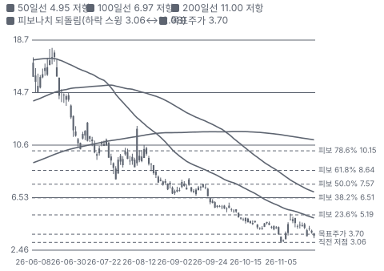

**주봉**

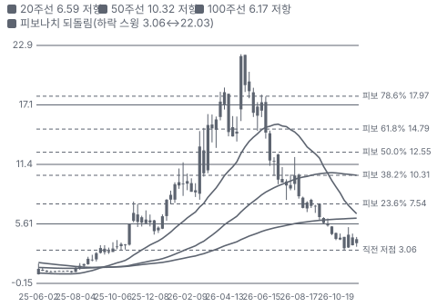

**월봉**

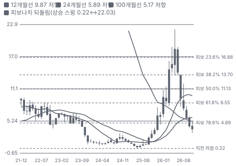

**분기 매출·EPS 실적과 컨센서스**

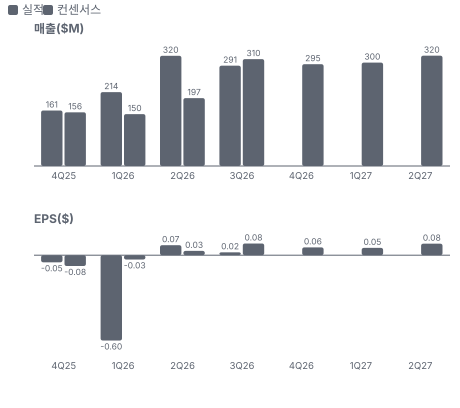

**최근 4개 분기 주가 변화 분석**

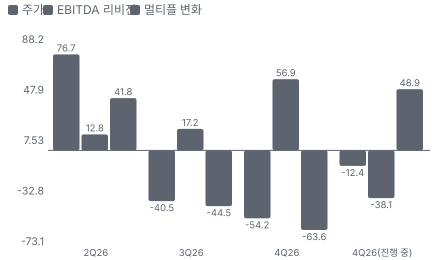

**EPS 리비전**

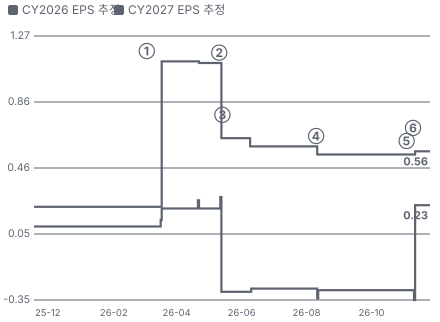

① 26-03-04 4Q25 실적·Base Electron 본계약, 당일 +45.7% · EPS 리비전 +405%
② 26-05-11 1Q26 실적, 당일 +30.1% · EPS 리비전 -42%
③ 26-05-14 보통주 1,240만 주 공모(순 \$218.2M) 가격 결정 — 5/15 종가 \$21.85가 1년 고점 · 실적 창과 겹침
④ 26-08-10 2Q26 실적·2026년 조정 EBITDA 목표 상향, 다음 날 +3.5% · EPS 리비전 -8%
⑤ 26-11-03 중간선거 — 데이터센터 규제 강화 쪽 주지사 당선, 11/5까지 −26.7% · EPS 리비전 +0%
⑥ 26-11-09 3Q26 실적·2027년 조정 EBITDA 목표 첫 제시, 다음 날 +18.2% · EPS 리비전 +4%

**멀티플 프리미엄(Fwd 1Y EV/EBITDA, 최근 4개 분기말 절대값 — 대상 vs 동종 중앙값)**

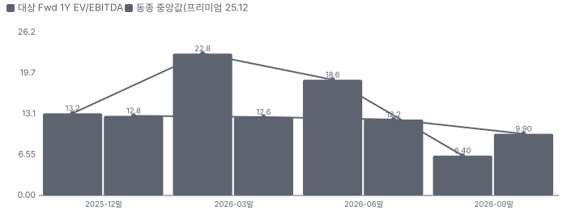

**합리적 멀티플**

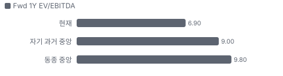

**밸류에이션 주가 시나리오**

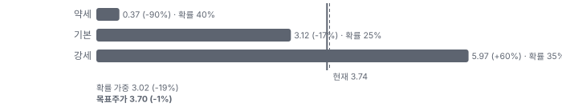

**주가별 업사이드**

- 제품·서비스 포트폴리오

**고객 믹스(9개월(2026년 1~9월), 매출 대비)**

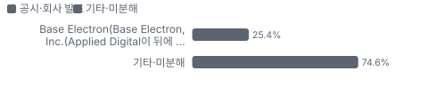

**공급 병목(10점, 낮을수록 병목)**

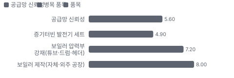

**CAPEX의 매출 대비 비중**

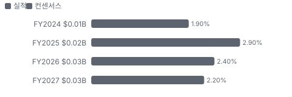

**어닝콜 변화별 주주가치 영향**

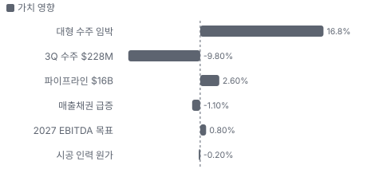

**수주·파이프라인 확실성 사다리**

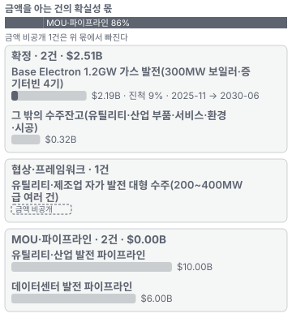

**매출 → 매출총이익 → 영업이익(매출 = 100, 최근 4분기)**

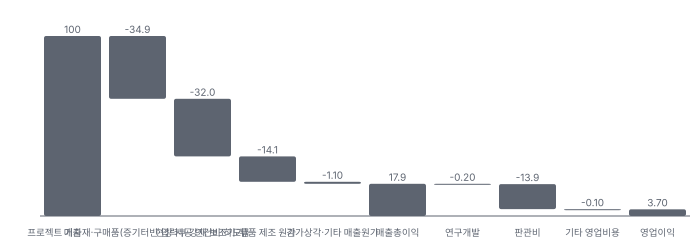

**분기 비용 비중 추이(매출 대비, 공시)**

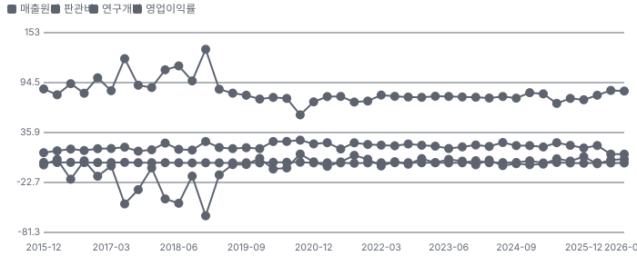

**비용 요인별 매출 대비 비중 1년 변화**

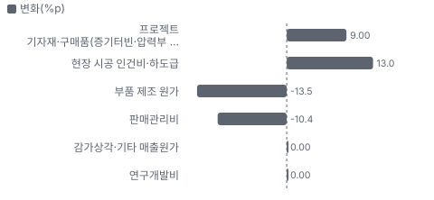

**Projects BOM 원가 몫**

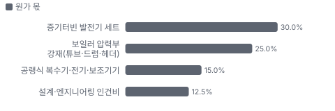

**Construction BOM 원가 몫**

**Parts BOM 원가 몫**

**BOM 항목 가격 +10% 시 OPM 변화**

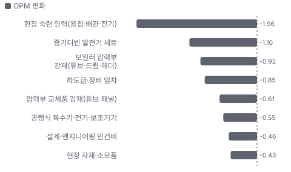

**원가 물가 vs 판매가 물가 — 최근 24개월**

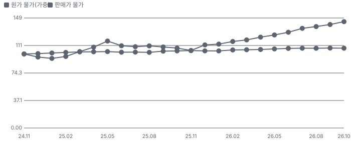

**자산 구성 — 3Q26 분기말 투하자본 \$264.1M**

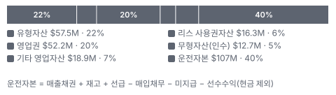

**자산별 변화율 — 최근 12개 분기(4Q23 = 0%) + 다음 4개 분기 추정**

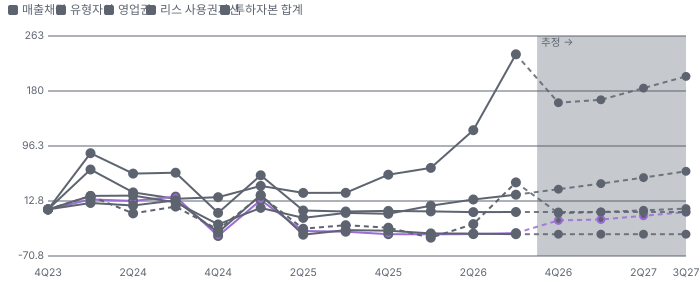

**ROIC 추이 — TTM, 최근 12개 분기 + 다음 4개 분기 추정(컨센서스 NOPAT)**

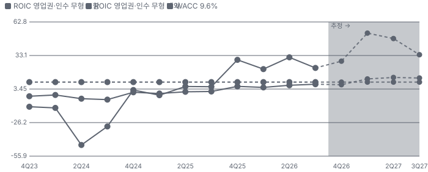

**매출 vs PPI·수출입 — 4Q22 = 100(변화율, 로그 눈금)**

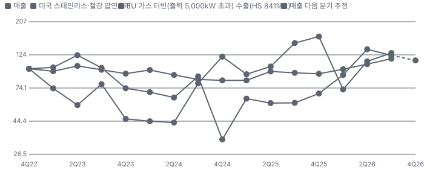

**매출 증가율의 가격·물량 분해와 8분기 전망(전년 대비)**

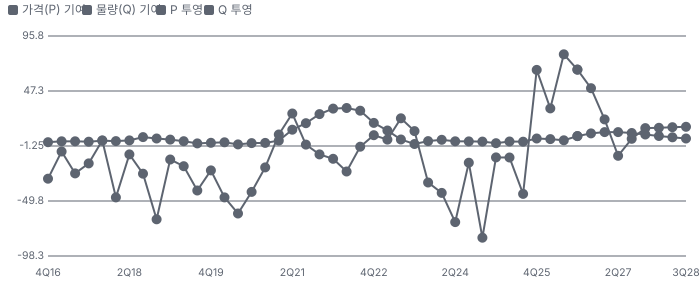

**목표주가 산정 — 기본과 강세 사이(강세 쪽 20%), 도달 확률 약 41%**

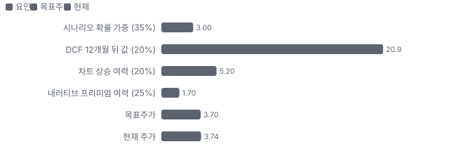

**재고 일수 — 분기별(수주 자료가 없어 수주/출하 비율 없음)**

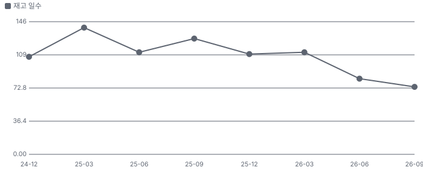

**일별 거래량 분해**

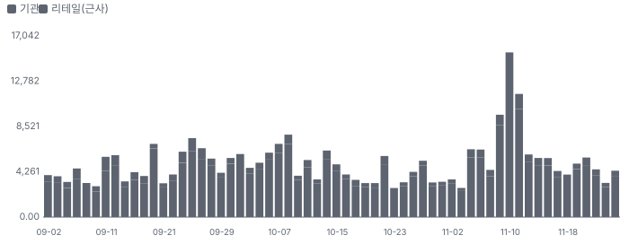

**기관 자금 흐름**

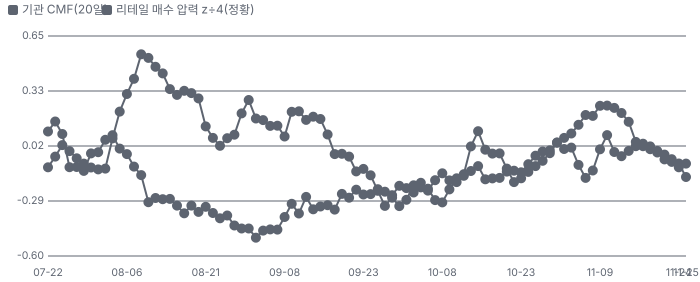

**몬테카를로**

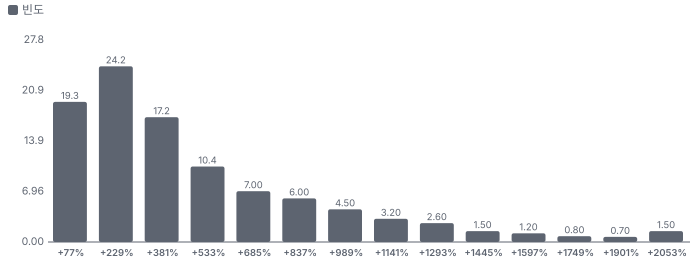

해석: 3,000번 중 2,970번(99%)에서 가치가 지금 주가 이상이었다. 가정을 흔들어도 지금 주가를 뒷받침하는 경우가 더 많다. 가운데 값은 4.57배이고, 열 번 중 여덟 번은 1.97~12.35배 사이에 든다.

## 내러티브

> **기업가치를 결정하는 이야기:** B&W의 값은 ① Base Electron이 밀린 대금 \$147.8M을 내고 2027년 초 현장 착공에 들어가는지 ② 데이터센터가 아닌 유틸리티·제조업에서 \$200M 넘는 두 번째 수주가 나오는지 ③ 시공 인력 문제 없이 2027년 조정 EBITDA \$125~140M을 내는지에 달려 있다. 보통주 앞에 우선주 \$191.7M과 연금 부족 \$153.0M이 있어 영업 가치가 조금만 흔들려도 주가는 크게 움직인다.

> **멀티플·EPS 프리미엄**
> **멀티플:** Fwd 1Y EV/EBITDA 6.9배로 동종 중앙 9.8배보다 30% 낮다. 6개월 전 25.0배에서 내려왔다 — 배수는 이미 데이터센터 프리미엄을 다 반납했다
> **EPS:** 2Q 콜 뒤 FY2027 매출 추정은 6.2% 올랐는데 주가는 58% 내렸다. FY2026 조정 EBITDA 추정은 \$89.1M에서 \$81.7M으로 내려 회사 목표 하단에 붙었다

### 투자자들은 왜 열광했나

3월 4일 Base Electron 본계약과 함께 하루 +45.7%, 5월 11일 1Q 실적에 +30.1% 올랐고 5월 15일 종가 \$21.85가 1년 고점이다. 회사는 그 주에 주당 \$18.50로 1,243만 주를 팔았다. 이후 2Q부터 시공 인력 문제로 이익률이 눌렸고, 3Q에는 수주가 매출을 밑돌고 매출채권이 불었다. 11월 3일 중간선거에서 데이터센터 규제 쪽 주지사가 당선되자 이틀 새 26.7% 더 빠졌다. 같은 기간 Argan·Primoris도 고점 대비 65~73% 내렸다 — 회사만의 문제가 아니라 '데이터센터 전력' 묶음 전체가 무너졌다.

### 무엇이 기업가치를 바꾸나

> **구조적 체질 변화**
> **변화:** 부품·정비 중심(2025년 9개월 매출의 43%)에서 대형 발전 프로젝트·시공 중심(2026년 9개월 78%)으로 바뀌었다. 매출은 커졌지만 이익률은 낮아지고 한 고객 의존이 생겼다
> **증거:** 3Q26 10-Q 매출 유형 — 9개월 Projects(보일러·발전소·환경 설비를 설계·제작해 납품하는 B&W의 매출 유형) \$363.2M·Construction(발전소 현장 시공·정비를 묶은 B&W의 매출 유형) \$276.6M·Parts(깔려 있는 보일러의 교체 부품을 파는 B&W의 매출 유형) \$185.2M
> **반증:** Base Electron 외 대형 수주 없이 2027년을 넘기면

> **고부가 믹스 확장**
> **변화:** 해당 없음(반대 방향 — 이익률 높은 부품 비중이 44%에서 20%로 내려갔다)
> **증거:** 3Q26 10-Q — 3Q 매출총이익률 15.4%(전년 24.0%)
> **반증:** 매출총이익률이 2개 분기 연속 18% 이상으로 돌아오면 이 판단을 거둔다

> **기술 혁신**
> **변화:** 보일러와 증기터빈을 먼저 세우고 가스터빈을 나중에 붙이는 방식으로 가스터빈 단독보다 3~5년 빨리 전기를 낸다고 회사는 말한다. BrightLoop(연료를 금속 산화물 입자와 반응시켜 증기·수소를 만들고 이산화탄소를 따로 뽑아내는 B&W 자체 공정)는 2027년 말 상업 규모 가동 목표다
> **증거:** 2Q26 어닝콜(2026-08-10)·3Q26 어닝콜 — 회사 주장이고 가동 실적은 아직 없다
> **반증:** 첫 발전소 상업 가동이 2030년을 넘기면

> **실행 속도**
> **변화:** 회사 목표는 유닛 인도 18~20개월, Siemens Energy 증기터빈은 예약 뒤 12~14개월이다. 다만 첫 발전소 상업 가동 목표가 10-K의 2028년에서 10-Q의 2030년으로 바뀌었다 **납품 리드타임 18~20개월.** 피어 비교 미확인. 이전 대비 미확인.
> **증거:** 3Q26 어닝콜·2Q26 어닝콜·3Q26 10-Q 주석 6
> **반증:** 현장 착공이 2027년 상반기를 넘기면

> **M&A**
> **변화:** 해당 없음(최근 3년 인수 없음 — 2025년 Vølund·Diamond Power를 팔아 \$187.5M을 받았다)
> **증거:** 3Q26 10-Q

> **정책·입법 연관성**
> **재정정책:** 해당 없음(연방 보조금·세액공제와 직접 연결되는 매출 공시 없음 — 웨스트버지니아주의 BrightLoop 탕감 조건부 대출 \$5.0M뿐) FY2025 10-K 주석 15 의회 동의 2/10 — 하원 1/5(논의 없음) · 상원 1/5(논의 없음).
> **행정명령:** 해당 없음(행정명령과 직접 연결되는 매출 미확인 — 회사는 석탄 발전소 수명 연장 흐름을 수요 배경으로만 말한다) 3Q26 어닝콜(2026-11-09) 의회 동의 2/10 — 하원 1/5(논의 없음) · 상원 1/5(논의 없음).
> **연관입법:** 해당 없음 — 영향은 연방 입법보다 주 정부 쪽이다. 11월 선거에서 텍사스·오하이오·조지아에 데이터센터 규제 강화 쪽 주지사가 당선됐고 데이터센터 제한 주민투표 38건 중 37건이 통과했다(IB 자료 요지). 회사 매출과의 직접 연결은 확인하지 못했다 3Q26 어닝콜 — 회사는 데이터센터를 받아들이는 주로 수요가 옮겨 간다고 했다

> **고객의 지출 예산**
> **변화:** 프로젝트·시공은 고객의 발전소 건설 투자(CAPEX), 부품은 발전소 정비 예산(OPEX)에서 나온다
> **사업별 예산:** **매출의 42%**: Projects — 고객 CAPEX(발전소·자가 발전(전력망에 기대지 않고 수요처 부지에 발전소를 지어 직접 쓰는 방식) 건설 투자) · 동인: 데이터센터·유틸리티·제조업 신규 발전
**매출의 37%**: Construction — 고객 CAPEX(발전소 건설·개조 공사) · 동인: 현장 착공과 숙련 인력
**매출의 20%**: Parts — 고객 OPEX(발전소 정비·교체 예산) · 동인: 석탄·가스 발전소 가동률과 정기 정비
> **증거:** 3Q26 10-Q 매출 유형
> **반증:** 유틸리티·데이터센터 개발사의 발전 투자 계획 축소

### 내러티브 근거

> '보일러 회사가 AI 데이터센터 자가 발전의 수혜주가 된다'는 이야기로 5월 \$21.85까지 갔다가, 데이터센터 규제·AI 투자 의심·현금 유출이 겹치며 \$3.74로 돌아왔다. 남은 이야기는 유틸리티·산업용 기저 발전과 부품이다. 단계는 붕괴, 쏠림은 낮음이다.

> **데이터센터 자가 발전** · 약화
> **논리:** 가스터빈 납기가 긴 동안 보일러 + 증기터빈이 몇 년 빨리 전기를 낸다
> **숫자:** Base Electron \$2.4B, 데이터센터 파이프라인 \$6B 초과
> **반증:** Base Electron 현장 착공이 2027년 상반기를 넘기면
> **출처:** 3Q26 10-Q·어닝콜(2026-11-09)

> **기저 발전 부품·정비** · 유지
> **논리:** 석탄·가스 발전소를 더 오래, 더 세게 돌리면 부품·정비 주문이 는다
> **숫자:** 3Q 부품·서비스 수주 분기 최대, Parts 매출은 9개월 +1.2%
> **반증:** 4Q Parts 매출이 전년 4Q보다 줄면
> **출처:** 3Q26 10-Q

> **재무 정상화** · 약화
> **논리:** 계속기업 의문을 벗고 채권을 갚아 차입이 가장 낮다
> **숫자:** 6.5% 채권 \$61.8M 전액 상환, 차입·채권 \$166.4M
> **반증:** 4Q 영업현금흐름이 다시 마이너스면
> **출처:** 3Q26 8-K EX-99.1

> **유틸리티·산업 대형 수주** · 강화
> **논리:** 데이터센터가 아니어도 200~400MW급 자가 발전 수요가 있다
> **숫자:** 유틸리티·산업 파이프라인 \$10B 초과, 계약은 아직 0건
> **반증:** 1Q27까지 \$200M 넘는 수주 발표가 없으면
> **출처:** 3Q26 어닝콜(2026-11-09)

> **반대 내러티브 — 한 고객·현금 유출·앞선 청구권** · 강화
> **논리:** 잔고의 87%가 신생 개발사 한 곳이고 대금이 밀리며, 보통주 앞에 우선주·연금·채권이 쌓여 있다
> **숫자:** 매출채권 \$147.8M, 9개월 영업현금흐름 −\$130.3M, 우선주 \$191.7M·연금 부족 \$153.0M
> **반증:** 4Q에 매출채권이 회수돼 영업현금흐름이 +\$100M 이상이면
> **출처:** 3Q26 10-Q

### 투자 포인트

> **배수는 프리미엄을 다 반납했다**
> **명제:** 6개월 새 Fwd 1Y EV/EBITDA가 25.0배에서 6.9배가 됐다
> **숫자:** 5월 말 25.0배 → 10월 말 4.6배 → 지금 6.9배, 동종 중앙 9.8배. 같은 기간 FY2027 매출 추정은 오히려 +6.2%
> **시장과 다른 점:** 시장은 2027년 목표를 믿지 않는 가격을 매겼다. 저는 목표의 75%가 잔고와 단납기 부품으로 덮인다는 점에서 '전부 불신'은 지나치다고 본다 — 다만 그 잔고의 대부분이 한 고객이다
> **증명:** 4Q 조정 EBITDA \$24.5M 이상(목표 하단 내재)
> **출처:** 3Q26 8-K EX-99.1(2026-11-09)

> **진짜 쟁점은 수주가 아니라 현금이다**
> **명제:** 매출은 두 배인데 9개월 영업현금흐름은 −\$130.3M이다
> **숫자:** 매출채권 \$118.4M → \$260.0M, 그중 Base Electron \$147.8M. 선수금은 \$112.0M → \$58.8M
> **시장과 다른 점:** 애널리스트 목표가(평균 \$16.25)는 EBITDA 배수로 매긴다. 저는 대금 회수가 확인되기 전에는 EBITDA를 현금으로 보지 않는다
> **증명:** 4Q 영업현금흐름 +\$100M 이상, 연말 Base Electron 매출채권 \$50M 이하
> **출처:** 3Q26 10-Q 주석 6

> **데이터센터 밖 두 번째 수주가 이야기를 바꾼다**
> **명제:** 유틸리티·제조업 파이프라인 \$10B에서 첫 계약이 나와야 한 고객 할인이 풀린다
> **숫자:** 회사: \$200~400M급 여러 건이 최종 협상, 4Q26~1Q27 발표 기대. 3Q 수주는 \$227.9M으로 매출을 밑돌았다
> **시장과 다른 점:** 시장은 이 회사를 데이터센터 종목으로만 본다. 경영진은 3Q부터 비데이터센터를 앞세웠다 — 계약 전에는 주장일 뿐이다
> **증명:** \$200M 넘는 수주 공시(8-K)
> **출처:** 3Q26 어닝콜(2026-11-09)

### 모멘텀 생성·소멸 타임라인

**카탈리스트 달력 — 지난 사건의 주가 반응과 앞으로 확인할 숫자**
| 날짜 | 상태 | 구분 | 사건 | 반응·확인 | 결과에 따라 |
|---|---|---|---|---|---|
| 2026-03-04 | 완료 | 생성 | 4Q25 실적·Base Electron \$2.4B 본계약 | +45.7% |  |
| 2026-05-11 | 완료 | 생성 | 1Q26 실적 — 매출 +44% 서프라이즈 | +30.1% |  |
| 2026-05-14 | 완료 | 소멸 | \$18.50 보통주 공모 1,243만 주 | 5/15 고점 뒤 6월 말까지 −35% |  |
| 2026-08-10 | 완료 | 소멸 | 2Q26 실적 — 시공 인력 문제 첫 언급 | +3.5%(다음 날), 9월 말까지 −34% |  |
| 2026-11-03 | 완료 | 매크로 | 중간선거 — 데이터센터 규제 쪽 주지사 당선 | 이틀 −26.7% |  |
| 2026-11-09 | 완료 | 생성 | 3Q26 실적·2027년 목표 첫 제시 | +18.2%(다음 날) |  |
| 2026-12~2027-01(예상) | 예정 | 확인 | 유틸리티·제조업 대형 수주 발표 | \$200M 넘는 계약 공시가 나오는지 | 나오면 기본~강세 경로, 1Q27까지 없으면 약세 경로 |
| 2027-03 초(예상) | 예정 | 확인 | 4Q26·FY2026 실적 | 4Q 조정 EBITDA \$24.5M 이상, 영업현금흐름 +\$100M 이상, 내부통제 취약점 해소 여부 | 셋 다 맞으면 강세 경로, 현금흐름이 마이너스면 약세 경로 |
| 2027년 상반기(예상) | 예정 | 확인 | 노스다코타 현장 착공 | 인허가 완료와 착공 공시, 분기 Base Electron 매출 \$100M 이상 | 착공이 밀리면 2027년 잔고 인식 \$706M이 함께 밀린다 |

### 언제 사서 언제 팔아야 할까?

**가격·조건 틀 — 가격은 밸류에이션(약세·기본·강세·목표주가)과 차트 지지 구간에서, 조건은 이벤트에서**
| 구간 | 가격 | 목표주가까지 | 약세까지 | 조건·근거 |
|---|---|---|---|---|
| 관찰 구간 | \$3.06~\$3.06 | +21% | -88% | 11월 5일 저점(\$3.10) 부근은 선거 뒤 공포가 가장 깊게 반영된 자리다 |
| 확인 뒤 | 지금 \$3.74 이상에서 조건 확인 | -1% | -90% | 4Q 영업현금흐름 플러스 전환과 \$200M 넘는 두 번째 수주 공시 |
| 무효화 | 약세 시나리오 \$0.37 | - | -90% | Base Electron 매출채권이 연말에도 줄지 않거나, 2027년 목표 하향, 또는 종가 \$3.10 아래 |
| 차익 고민 2차 | \$5.97(강세 시나리오) | +60% | - | 목표주가 근처는 배수가 동종 하단까지 돌아온 자리라 그 위는 대금 회수와 이익률 확인이 필요하다 |

하루 평균 변동이 약 10%이고 11월에만 ±15% 넘는 날이 다섯 번이다 — 발표 직후 추격은 경계 가격·조건 틀이며 매매·비중 지시가 아니다(투자 권유 아님).

## 포트폴리오

| 제품·서비스 | 구분 | 무엇 | 쓰는 곳 | 돈 버는 방식 | Mix | Mix 변화(전 분기 대비) |
|---|---|---|---|---|---|---|
| Projects | 서비스 | 보일러·증기터빈 발전소와 환경 설비를 설계·제작해 납품 | 데이터센터 자가 발전, 유틸리티·산업 발전소 | 3Q26 매출의 42% | 42% | 미확인 |
| Construction | 서비스 | 발전소 현장에서 보일러를 세우고 고치는 시공·정비 | 신규 발전소 건설, 기존 발전소 개조 | 3Q26 매출의 37% | 37% | 미확인 |
| Parts | 제품 | 깔려 있는 보일러의 교체 부품 | 석탄·가스 발전소, 산업 보일러 정기 정비 | 3Q26 매출의 20% | 20% | 미확인 |

## 고객

> **9개월(2026년 1~9월) 최대 고객 Base Electron(Base Electron, Inc.(Applied Digital이 뒤에 있는 독립 발전사)) 25%, 상위 3곳 25%, 집중도 분산.** 공시·회사 발표로 확인한 몫은 매출의 25%이고, 나머지 고객 몫은 추정이거나 미분해다. Base Electron 한 곳이 9개월 매출의 25.4%, 매출채권의 57%, 수주잔고의 87%다. 나머지 74.6%는 전력 유틸리티·산업·지자체 고객 여럿의 합이고 개별 몫은 공시되지 않는다. 2025년에는 10%를 넘는 고객이 1곳(이름 미공시)이었고 2023~24년에는 없었다

**고객별 매출 몫(9개월(2026년 1~9월))**
| 고객 | 몫 | 변화 | 근거 |
|---|---|---|---|
| Base Electron(Base Electron, Inc.(Applied Digital이 뒤에 있는 독립 발전사)) | 25% | +25%p | 공시 |
| 기타·미분해 | 75% | - | - |

> **Base Electron(Base Electron, Inc.(Applied Digital이 뒤에 있는 독립 발전사))** · 공시
> **사는 것:** 300MW 가스 보일러·증기터빈 발전소 4기 설계·제작·설치
> **추정 근거:** Applied Digital의 지급 보증 여부는 공시에 없다

## 수주·파이프라인

> **2026-09-30 기준 5건.** 확정 \$2.51B. 공시 수주잔고 \$2.51B. 서로 겹치는 항목은 합계에서 뺐다.

**수주 목록**
| 상태 | 계약 | 계약 총액 | 진척 | 기간 | 비고 |
|---|---|---|---|---|---|
| 확정 | Base Electron 1.2GW 가스 발전(300MW 보일러·증기터빈 4기, 미국 노스다코타) | \$2.19B | 9% | 2025-11 → 2030-06 | 계약 총액 \$2.4B 중 이미 인식한 \$0.21B를 뺀 남은 잔고다. 2025-11 부분 착수 지시(Applied Digital), 2026-02-26 본계약. 현장 착공 2027년 초 예정, 상업 가동 목표는 10-Q 기준 2030년(10-K는 2028년) |
| 확정 | 그 밖의 수주잔고(유틸리티·산업 부품·서비스·환경·시공) | \$0.32B | - | - | 잔고 \$2.51B에서 Base Electron 남은 잔고 \$2.19B를 뺀 값(계산) |
| 협상 | 유틸리티·제조업 자가 발전 대형 수주(200~400MW급 여러 건) | 금액 비공개 | - | - | 회사는 건당 \$200~500M라고 했다 — 건수·합계 미공시 |
| 파이프라인 | 유틸리티·산업 발전 파이프라인 | \$10.00B | - | - | (다른 항목과 겹칠 수 있어 합계에서 뺌) |
| 파이프라인 | 데이터센터 발전 파이프라인 | \$6.00B | - | - | (다른 항목과 겹칠 수 있어 합계에서 뺌) |

**실행 속도와 방해 요인**
| 항목 | 상태 | 실행 속도 | 방해 요인 |
|---|---|---|---|
| Base Electron 1.2GW 가스 발전(300MW 보일러·증기터빈 4기) | 확정 | 지연(계획 18%, -9%p), 이대로면 2035-06 완료, 60개월 지연 | 현장 인허가 마무리와 가스 배관 · 숙련 시공 인력 · 고객 대금 회수(매출채권 \$147.8M) · 데이터센터 규제·여론 |
| 그 밖의 수주잔고(유틸리티·산업 부품·서비스·환경·시공) | 확정 | 부품·서비스는 대부분 1년 안 인식 | 시공 인력 |
| 유틸리티·제조업 자가 발전 대형 수주(200~400MW급 여러 건) | 협상 | 미확인 | 최종 계약 조건(위험·보증 배분) · 고객 승인 |
| 유틸리티·산업 발전 파이프라인 | 파이프라인 | 미확인 | 36개월 안 결정 가능성이 있는 미계약 기회 |
| 데이터센터 발전 파이프라인 | 파이프라인 | 미확인 | 주 정부 규제·주민 반발 · 개발사 자금 조달 |

## 마진 구조

> **GPM 15.4%, OPM 4.7%.** 3Q25 대비 GPM -8.5%p, OPM +2.3%p. 변동비는 매출의 81%이고, 매출이 10% 늘면 OPM은 +1.3%p 움직인다. 3Q26 매출총이익률 15.4%(전년 24.0%), 영업이익률 4.7%(전년 2.4%), 조정 EBITDA 이익률 6.1%(전년 6.8%). 매출이 두 배가 됐지만 늘어난 몫이 이익률 낮은 대형 프로젝트와 시공이라 매출총이익은 \$33.4M → \$44.8M에 그쳤다

> **매출 100 중 매출원가 82.1, 매출총이익 17.9(최근 4분기, 공시).** 매출원가 요인 중 프로젝트 기자재·구매품(증기터빈·압력부(보일러에서 고압 증기를 담는 튜브·드럼·헤더) 강재·보조기기)이 매출의 36.0%로 가장 무겁고, 단가가 +10% 오르면 GPM이 -3.60%p 움직인다. 분기 회귀로 매출 1이 늘 때 매출원가는 0.98 늘고, 매출원가의 고정비 몫은 -14%다. 매출원가 요인 비중은 요인별 공시 기간 값이라 합이 최근 4분기 매출원가를 넘어, 그림에서는 0.97배로 비례 조정했다.

**비용 요인 강도 — 비중·추세·충격(+10%)·탄력**
| 비용 | 구분 | 매출 대비 | 1년 변화 | 마진 기여 | 충격 시 마진 | 매출 탄력 | 고정비 몫 |
|---|---|---|---|---|---|---|---|
| 프로젝트 기자재·구매품(증기터빈·압력부 강재·보조기기) | 매출원가 요인 | 36.0% | +9.0%p | -9.0%p | -3.60%p | 미확인 | 0% |
| 현장 시공 인건비·하도급 | 매출원가 요인 | 33.0% | +13.0%p | -13.0%p | -3.30%p | 미확인 | 0% |
| 부품 제조 원가 | 매출원가 요인 | 14.5% | -13.5%p | +13.5%p | -1.45%p | 미확인 | 30% |
| 감가상각·기타 매출원가 | 매출원가 요인 | 1.1% | +0.0%p | -0.0%p | -0.11%p | 미확인 | 100% |
| 매출원가 | 공시 항목 | 82.1% | +5.1%p | -5.1%p | -8.21%p | 0.98 | -14% |
| 판관비 | 공시 항목 | 13.9% | -7.2%p | +7.2%p | 미확인 | 0.10 | 44% |
| 연구개발 | 공시 항목 | 0.2% | -0.6%p | +0.6%p | 미확인 | 0.01 | -6% |
| 기타 영업비용 | 공시 항목 | 0.1% | +0.4%p | -0.4%p | 미확인 | 0.05 | -68% |

매출 탄력 = 분기 비용을 매출에 회귀한 기울기(매출 1당 변동비), 고정비 몫 = 절편 ÷ 평균 비용. 표본이 8분기 미만이면 미확인. 매출원가 요인 비중은 margin 재료의 추정이 섞여 있고, 공시 매출원가와의 차이는 '기타 매출원가'로 둔다.

**GPM에서 OPM까지(GAAP — 10-Q 3개월 손익, 아래는 최근 4개 분기)**
| 기간 | GPM | 연구개발 | 판관비 | 기타 | OPM |
|---|---|---|---|---|---|
| 3Q25 | 24.0% | 0.2% | 20.9% | 0.4% | 2.4% |
| 3Q26 | 15.4% | 0.2% | 10.5% | -0.0% | 4.7% |
| 2025-12 | 25.6% | - | - | - | 7.6% |
| 2026-03 | 20.3% | - | - | - | -0.8% |
| 2026-06 | 14.6% | - | - | - | 3.7% |
| 2026-09 | 15.4% | - | - | - | 4.7% |

**비용을 움직이는 요인**
| 비용 | 요인 |
|---|---|
| 프로젝트 기자재·구매품(증기터빈·압력부 강재·보조기기, 매출원가) | 터빈 제작 단가, 탄소강·합금강 가격 · 근거 추정 |
| 현장 시공 인건비·하도급(매출원가) | 용접·배관·전기 숙련공 임금과 체재비 · 근거 추정 |
| 부품 제조 원가(매출원가) | 강재, 공장 가동률 · 근거 추정 |
| 판매관리비(판관비) | 인건비·주식 보상 · 근거 공시 |
| 감가상각·기타 매출원가(매출원가) | 설비·리스 · 근거 추정 |
| 연구개발비(연구개발) | BrightLoop 개발 · 근거 공시 |

**Projects BOM — 매출의 42%, GPM 13%(추정 — 유형별 이익률 미공시. 전사 15.4%에 맞춘 배분), 항목 가격 +10% 시**
| 항목 | 원가 몫 | 전가 | 제품 GPM | OPM |
|---|---|---|---|---|
| 증기터빈 발전기 세트 | 25~35% | 미확인 | -2.6%p | -1.10%p |
| 보일러 압력부 강재(튜브·드럼·헤더) | 20~30% | 미확인 | -2.2%p | -0.92%p |
| 공랭식 복수기(터빈을 돌리고 나온 증기를 물 대신 공기로 식혀 다시 물로 만드는 장치)·전기·보조기기 | 10~20% | 미확인 | -1.3%p | -0.55%p |
| 설계·엔지니어링 인건비 | 10~15% | 미확인 | -1.1%p | -0.46%p |
| 미분해 | 18% | - | - | - |

**Construction BOM — 매출의 37%, GPM 9%(추정 — 인력 문제가 난 유형), 항목 가격 +10% 시**
| 항목 | 원가 몫 | 전가 | 제품 GPM | OPM |
|---|---|---|---|---|
| 현장 숙련 인력(용접·배관·전기) | 50~65% | 미확인 | -5.2%p | -1.96%p |
| 하도급·장비 임차 | 20~30% | 미확인 | -2.3%p | -0.85%p |
| 현장 자재·소모품 | 10~15% | 미확인 | -1.1%p | -0.43%p |
| 미분해 | 5% | - | - | - |

**Parts BOM — 매출의 20%, GPM 29%(추정 — 애프터마켓이 가장 높다고 가정), 항목 가격 +10% 시**
| 항목 | 원가 몫 | 전가 | 제품 GPM | OPM |
|---|---|---|---|---|
| 압력부 교체품 강재(튜브·패널) | 35~50% | 미확인 | -3.0%p | -0.61%p |
| 가공·제조 인건비 | 20~30% | 미확인 | -1.8%p | -0.36%p |
| 구매 부품(밸브·버너 부품) | 15~25% | 미확인 | -1.4%p | -0.29%p |
| 미분해 | 12% | - | - | - |

현장 숙련 인력(용접·배관·전기) 가격이 +10% 오르면 영업이익은 -41.3% 움직인다. 판매가 전가를 모르는 항목은 전가 0%로 계산했다.

**BOM 항목 가격을 움직이는 것**
| 항목 | 요인 |
|---|---|
| 증기터빈 발전기 세트 | 보일러 다음으로 큰 구매품 — Base Electron 계약은 실비 + 마크업(10-Q) · 근거 추정 |
| 보일러 압력부 강재(튜브·드럼·헤더) | 자체·외주 제작의 주재료 · 근거 추정 |
| 공랭식 복수기·전기·보조기기 | 발전소 부대 설비 · 근거 추정 |
| 설계·엔지니어링 인건비 | 주문 설계 · 근거 추정 |
| 현장 숙련 인력(용접·배관·전기) | 부족이 원가를 올린 항목 — 새 계약은 변동 단가로 바꾸는 중(2Q26 어닝콜) · 근거 추정 |
| 하도급·장비 임차 | 현장 시공 · 근거 추정 |
| 현장 자재·소모품 | 용접재·비계 · 근거 추정 |
| 압력부 교체품 강재(튜브·패널) | 교체 부품의 주재료 · 근거 추정 |
| 가공·제조 인건비 | 자체 공장 · 근거 추정 |
| 구매 부품(밸브·버너 부품) | 외부 조달 · 근거 추정 |

> **원가·판매가 물가 격차 -29.3%p** — 판매가 물가가 투입 원가 물가보다 느리게 오른다.

**투입 물가 — 미국 PPI 3·6·12개월(2026-10, 개정 반영)**
| 항목 | 미국 3개월 | 6개월 | 12개월 | 전가 못 할 때 OPM |
|---|---|---|---|---|
| 증기터빈 발전기 세트 | +0.1% | +1.7% | +3.6%* | - |
| 압력부 교체품 강재(튜브·패널) | +6.7% | +17.0% | +32.9%* | - |
| 구매 부품(밸브·버너 부품) | +0.4% | +0.3% | +6.4%* | - |

별표는 품목보다 넓은 업종 지수다. 연결한 투입 원가의 미국 PPI(생산자물가지수)는 1년 새 가중 +32.9%이고, 판매가로 넘기지 못하면 GPM -16.6%p·OPM -16.6%p가 움직인다. 판매가 비교 물가(가스 터빈(출력 5,000kW 초과) PPI)는 1년 새 +3.6% — 회사 가격 변화는 미확인. 물가 지수를 붙이지 못한 매출원가 항목은 현장 시공 인건비·하도급, 감가상각·기타 매출원가다(미연결).

## 자산 구성

> **3Q26 분기말 투하자본 \$264.1M** — 운전자본 40%, 유형자산 22%. 최근 12개 분기(4Q23 → 3Q26) 가장 크게 늘어난 자산은 매출채권(+236%), 투하자본 합계 +41%. 3Q27 추정 투하자본 \$189.4M(-28%, 컨센서스 매출과 회전 일수·CAPEX 강도 유지 가정). 연율 감가 비율(총액 기준)은 직전 4분기 7.24% → 최근 4분기 7.60%.

**자산·운전자본 항목별 분기말 잔액 — 최근 12개 분기와 다음 4개 분기 추정**
| 항목 | 4Q23 | 3Q25 | 3Q26(최근) | 3Q27 추정 | 12개 분기 변화 | 다음 4개 분기 변화 |
|---|---|---|---|---|---|---|
| 매출채권 | \$77.5M | \$97.1M | \$260.0M | \$234.0M | +236% | -10% |
| 재고자산 | \$97.6M | \$64.6M | \$62.5M | \$93.6M | -36% | +50% |
| 선급·기타 유동자산 | \$42.2M | \$26.8M | \$37.2M | \$58.0M | -12% | +56% |
| 매입채무 | \$83.2M | \$75.6M | \$162.9M | \$174.3M | +96% | +7% |
| 미지급비용 | \$51.1M | \$29.3M | \$31.3M | \$53.0M | -39% | +69% |
| 선수수익(계약부채) | \$52.1M | \$75.8M | \$58.8M | \$140.2M | +13% | +138% |
| 유형자산 | \$47.0M | \$44.5M | \$57.5M | \$74.2M | +22% | +29% |
| 리스 사용권자산 | \$26.1M | \$17.9M | \$16.3M | \$16.3M | -38% | +0% |
| 영업권 | \$54.3M | \$52.6M | \$52.2M | \$52.2M | -4% | +0% |
| 무형자산(인수) | \$22.1M | \$15.8M | \$12.7M | \$9.7M | -43% | -23% |

**자산 추정 동인 — 최근 4개 분기 평균(재무상태표 동인 모형)**
| 동인 | 값 | 곱하는 기준 |
|---|---|---|
| 매출채권 | 63일 | 매출 |
| 재고자산 | 31일 | 매출원가 |
| 선급·기타 유동자산 | 16일 | 매출 |
| 매입채무 | 57일 | 매출원가 |
| 미지급비용 | 14일 | 매출 |
| 선수수익(계약부채) | 38일 | 매출 |
| CAPEX 강도 | 2.3% | 매출(최근 4개 분기 합) |
| 분기 감가율 | 3.98% | 기초 유형자산 순액(무형 상각 제외 감가상각) |
| 매출원가율 | 82.1% | 매출(최근 4개 분기) |
| 영업권·리스 사용권·기타 | 유지 | 인수·새 리스는 공시 전 모름 |
| 인수 무형자산 | 분기 \$0.7M 상각 | 최근 4개 분기 평균 상각 |

**추정 방법:** 증권사 3표 모델(손익·재무상태표·현금흐름)의 재무상태표 동인 방식이다. 운전자본은 항목별 회전 일수(매출채권·선급·미지급·선수는 매출, 재고·매입채무는 매출원가 기준)를 최근 4개 분기 평균으로 두고 컨센서스 매출에 곱한다. 유형자산은 기초 + CAPEX − 감가상각으로 굴린다(Koller·Goedhart·Wessels 『Valuation』 재무상태표 추정). 매출 경로는 ROIC 절의 컨센서스와 같다.

**유형·무형자산 항목별 가치(2022-12-31 vs 2021-12-31)**
| 구분 | 항목 | 총액 2022-12-31 | 누적상각 | 순액 | 총액 2021-12-31 | 총액 1년 변화 | 공시 내용연수 |
|---|---|---|---|---|---|---|---|
| 유형 | 유형자산 합계(항목 미분해) | \$200.8M | 총계만 공시 | 총계만 공시 | \$190.2M | +5.6% | 미확인 |
| 영업권 | 영업권 | \$84.2M | \$0.0M | \$84.2M | \$116.5M | -27.7% | 비상각 |
| 무형 | 무형자산 합계(항목 미분해) | \$103.7M | \$53.7M | \$50.0M | \$90.6M | +14.5% | 미확인 |
| 유형 합계 | 유형자산 | \$200.8M | \$140.3M | \$60.5M | \$190.2M | +5.6% | 경과율 70%(상각 대상 기준) |

**내용연수 산식(상각 대상 유형자산 = 총액 − 토지 − 건설중)**
| 기준일 | 연 감가상각 | 상각 대상 총액 | 평균 내용연수 | 경과 연수 | 잔여 연수 | 경과율 |
|---|---|---|---|---|---|---|
| 2022-12-31 | \$11.0M | \$200.8M | 18.3년 | 12.8년 | 5.5년 | 70% |
| 2021-12-31 | \$9.7M | \$190.2M | 19.6년 | 13.7년 | 5.9년 | 70% |

산식 평균 내용연수는 18.3년. 1년 전 19.6년 → 지금 18.3년.

**분기 감가 비율(감가상각 ÷ 평균 유형자산 총액)**
| 분기 | 감가상각 | 평균 유형자산(총액) | 분기 비율 | 연율 | 연율의 역수 |
|---|---|---|---|---|---|
| 4Q24 | \$3.0M | \$157.1M | 1.89% | 7.57% | 13.2년 |
| 1Q25 | \$2.5M | \$147.5M | 1.68% | 6.71% | 14.9년 |
| 2Q25 | \$2.3M | \$151.4M | 1.54% | 6.16% | 16.2년 |
| 3Q25 | \$2.9M | \$136.6M | 2.16% | 8.63% | 11.6년 |
| 4Q25 | \$2.4M | \$138.8M | 1.72% | 6.87% | 14.6년 |
| 1Q26 | \$2.5M | \$141.9M | 1.76% | 7.05% | 14.2년 |
| 2Q26 | \$2.5M | \$147.6M | 1.70% | 6.80% | 14.7년 |
| 3Q26 | \$3.2M | \$128.3M | 2.48% | 9.92% | 10.1년 |

감가상각 기준: 손익계산서 감가상각·상각비(SEC 공시 데이터, 4분기 = 연간 − 1~3분기).

최근 4분기 연율 감가 비율 7.60%, 직전 4분기 7.24%(+5%) — 경고 문턱(-10%) 안이다.

미공시·미분해: 유형자산 항목별 총액·내용연수(10-K 주석에서 모델이 채움) · 무형자산 항목(10-K 주석에서 모델이 채움) — 이 칸은 비우고 나머지로 계산했다.

### 해석 — 자산이 어디에 쌓이고 있나

- 같은 기간 4개 분기 매출은 +248%. 자산이 매출보다 빨리 쌓이지 않았다 — 회전율이 유지된다.
- 다음 4개 분기 CAPEX \$29.0M vs 감가상각 \$10.1M(최근 4개 분기 CAPEX 강도·감가율 유지) — 유형자산 3Q26 \$57.5M → 3Q27 \$74.2M. 투자가 감가보다 커서 자산이 쌓이는 국면이다.

## ROIC

> **TTM 3Q26 ROIC는 영업권·인수 무형 포함 7.7%, 제외 22.1%**(NOPAT 마진 3.1% × 투하자본 회전율 2.50회). 최근 12개 분기 4Q23 -2.9% → 3Q26 7.7%(고점 3Q26 7.7%). 컨센서스 NOPAT으로 굴리면 3Q27 13.2%(제외 33.8%) — WACC 9.6% 대비 +3.7%p. 1년 변화의 가장 큰 요인은 NOPAT 마진(+3.9%p).

**ROIC 추이(TTM)와 다음 4개 분기 추정 — NOPAT ÷ 평균 투하자본(이번 분기말·4개 분기 전)**
| 분기 | 구분 | TTM 매출 | TTM NOPAT | NOPAT 마진 | 평균 투하자본 | ROIC 포함 | ROIC 제외 |
|---|---|---|---|---|---|---|---|
| 4Q23 | 실적 | \$587.4M | −\$11.2M | -1.9% | \$387.2M | -2.9% | -12.2% |
| 1Q24 | 실적 | \$510.5M | −\$7.8M | -1.5% | \$427.7M | -1.8% | -13.2% |
| 2Q24 | 실적 | \$370.4M | −\$20.5M | -5.5% | \$398.3M | -5.1% | -46.0% |
| 3Q24 | 실적 | \$283.6M | −\$23.6M | -8.3% | \$396.3M | -5.9% | -29.6% |
| 4Q24 | 실적 | \$604.5M | \$2.3M | 0.4% | \$349.2M | 0.6% | 2.6% |
| 1Q25 | 실적 | \$588.8M | −\$2.1M | -0.4% | \$416.6M | -0.5% | -2.0% |
| 2Q25 | 실적 | \$576.2M | \$3.6M | 0.6% | \$344.8M | 1.0% | 5.7% |
| 3Q25 | 실적 | \$562.8M | \$4.5M | 0.8% | \$359.6M | 1.3% | 5.5% |
| 4Q25 | 실적 | \$587.7M | \$18.7M | 3.2% | \$323.3M | 5.8% | 29.3% |
| 1Q26 | 실적 | \$653.5M | \$17.6M | 2.7% | \$357.4M | 4.9% | 21.1% |
| 2Q26 | 실적 | \$834.4M | \$22.3M | 2.7% | \$329.6M | 6.8% | 31.5% |
| 3Q26 | 실적 | \$985.9M | \$30.2M | 3.1% | \$394.0M | 7.7% | 22.1% |
| 4Q26 | 추정 | \$1,120.0M | \$25.2M | 2.2% | \$346.6M | 7.3% | 28.1% |
| 1Q27 | 추정 | \$1,205.6M | \$41.4M | 3.4% | \$334.1M | 12.4% | 52.9% |
| 2Q27 | 추정 | \$1,205.9M | \$48.6M | 4.0% | \$355.7M | 13.7% | 48.1% |
| 3Q27 | 추정 | \$1,255.1M | \$55.3M | 4.4% | \$417.5M | 13.2% | 33.8% |

**다음 4개 분기 NOPAT — 컨센서스(세율 25%, 리스 이자 별도)**
| 분기 | 매출 | EBITA 마진 | EBITA | NOPAT(분기) | 근거 |
|---|---|---|---|---|---|
| 4Q26 | \$295.1M | 2.1% | \$6.2M | \$4.6M | 컨센서스 매출 × EBIT 마진 FY2026(조정 − 주식보상 2.0%) |
| 1Q27 | \$300.0M | 6.9% | \$20.7M | \$15.5M | 컨센서스 매출 × EBIT 마진 FY2027(조정 − 주식보상 2.0%) |
| 2Q27 | \$320.0M | 6.9% | \$22.1M | \$16.6M | 컨센서스 매출 × EBIT 마진 FY2027(조정 − 주식보상 2.0%) |
| 3Q27 | \$340.0M | 6.9% | \$23.5M | \$17.6M | 컨센서스 매출 × EBIT 마진 FY2027(조정 − 주식보상 2.0%) |

**추정 방법:** NOPAT은 컨센서스(분기 매출 추정 × 회계연도 EBIT 마진 추정)로 잡고, 조정(비 GAAP) 마진이면 주식보상 몫을 빼서 과거 실적과 같은 기준(영업이익 + 인수 무형 상각)으로 맞췄다. 이미 발표했지만 분기 보고서(10-Q)가 아직 없는 분기는 발표 실적을 쓴다. 투하자본은 자산 구성 절의 재무상태표 동인으로 굴렸다. ROIC는 4개 분기 NOPAT을 이번 분기말과 4개 분기 전 투하자본의 평균으로 나눈다 — 추정 분기의 ROIC에는 이미 나온 실적 분기가 섞여 있다.

**투하자본 항목별 회전율과 ROIC 기여(TTM 3Q26, 평균 잔액)**
| 항목 | 투하자본 | 매출 1달러당 자본 | 회전율(매출 ÷ 항목) | 자본 몫 | 이 항목을 빼면 ROIC |
|---|---|---|---|---|---|
| 운전자본 | \$57.2M | 0.06 | 17.25회 | 15% | 9.0% |
| 유형자산 | \$51.0M | 0.05 | 19.34회 | 13% | 8.8% |
| 리스 사용권자산 | \$17.1M | 0.02 | 57.73회 | 4% | 8.0% |
| 영업권 | \$243.1M | 0.25 | 4.06회 | 62% | 20.0% |
| 무형자산(인수) | \$14.2M | 0.01 | 69.43회 | 4% | 8.0% |
| 기타 영업자산 | \$11.5M | 0.01 | 85.92회 | 3% | 7.9% |

**ROIC 세 가지 판**
| 판 | NOPAT | 투하자본 | ROIC | 무엇을 재나 |
|---|---|---|---|---|
| 영업권·인수 무형 포함 | \$30.2M | \$394.0M | 7.7% | 인수 웃돈까지 낸 돈에 대한 수익률 |
| 영업권·인수 무형 제외 | \$30.2M | \$136.7M | 22.1% | 본업 운영 수익률(동종 비교용) |
| 무형 자본화 조정(판관비 20%·5년, 연구개발 6년) | \$24.8M | \$484.4M | 5.1% | 비용으로 처리한 무형 투자를 자산으로 본 판 |
| 경제적 이익(포함판) | −\$7.5M | \$394.0M | 자본비용 9.6% | (ROIC − 자본비용) × 투하자본 |

NOPAT = (영업이익 \$36.1M + 인수 무형 상각 + 리스 내재 이자 \$1.3M) × (1 − 세율 25%). 리스 사용권자산을 투하자본에 넣었으므로 임차료 속 이자 몫을 영업이익에 되더했다. 현금은 영업에 필요한 몫을 따로 알 수 없어 투하자본에서 뺐다. SEC 공시 데이터 자동 초안 — 운전자본 = 매출채권 + 재고 + 선급 − (매입채무 + 미지급비용 + 선수수익), 현금 제외. 손상 누계는 공시 데이터 수록분.

**ROIC 1년 변화 분해(포함판, TTM 3Q25 → TTM 3Q26)**
| 요인 | ROIC 기여 |
|---|---|
| NOPAT 마진 | +3.89%p |
| 운전자본 | -0.45%p |
| 유형자산 | +0.27%p |
| 리스 사용권자산 | +0.20%p |
| 영업권 | +1.72%p |
| 무형자산(인수) | +0.16%p |
| 기타 영업자산 | +0.02%p |
| 합계 | +5.82%p |

**무형 자본화 가정별 ROIC(2022년 지출 기준, 포함판에 더함)**
| 투자로 보는 몫 | 상각 연수 | 무형 자산 | NOPAT 조정 | 조정 ROIC |
|---|---|---|---|---|
| 판관비 20% | 2년 | \$48.4M | −\$3.1M | 6.1% |
| 판관비 20% | 5년 | \$90.3M | −\$5.4M | 5.1% |
| 판관비 30% | 2년 | \$66.6M | −\$4.1M | 5.7% |
| 판관비 30% | 5년 | \$129.5M | −\$7.6M | 4.3% |

### 해석 — 무엇이 수익성을 끌어올리고 희석하나

- 영업권: 투하자본의 62% — 빼면 ROIC 7.7% → 20.0%. 이 자산의 회전율(4.06회)이 수익성을 희석하는 주된 자리다.
- 운전자본: 투하자본의 15% — 빼면 ROIC 7.7% → 9.0%. 이 자산의 회전율(17.25회)이 수익성을 희석하는 주된 자리다.
- 영업권·인수 무형을 빼면 ROIC가 +14.4%p 오른다 — 과거 인수에 치른 웃돈이 주주 수익률을 그만큼 낮춘다(본업 수익률은 제외판, 인수까지 포함한 가치 창출은 포함판으로 본다).
- 1년 ROIC 개선의 최대 요인은 NOPAT 마진(+3.9%p). 반대로 깎은 최대 요인은 운전자본(-0.5%p).
- 비용으로 처리한 무형 투자를 자산으로 보면 ROIC가 -2.5%p 움직인다(무형 자산 \$90.3M). 투자 증가가 상각보다 작아 NOPAT 조정이 작다.
- 추정 경로 3Q26 7.7% → 3Q27 13.2%: NOPAT 마진 +1.3%p, 투하자본 회전율 +0.50회 — 컨센서스 매출·마진이 맞고 회전 일수·CAPEX 강도가 유지된다는 가정이다. 마진 추정이 내려가거나 재고 일수가 늘면 이 경로가 먼저 틀린다.
- ROIC(포함) − WACC = -1.9%p(3Q26) — 양수면 투하자본을 늘릴수록 가치가 쌓인다.

## 공급망 병목

> **공급망 신뢰성 5.6/10, 병목 주의.** 가장 약한 고리는 증기터빈 발전기 세트 4.9점이고, 품목 평균은 6.6점이다. 근거가 부족한 1건(현장 숙련 인력(용접·배관·전기))은 점수에서 뺐다. 가장 약한 고리는 부품이 아니라 사람이다 — 용접·배관·전기 숙련공이 모자라 두 분기 연속 시공 원가가 올랐다. 증기터빈은 Siemens Energy에서 받고, 강재는 단일 공급원이 없다

**병목과 마진 — 품목 가격 +10% 시 OPM**
| 품목 | 점수 | 판정 | 구분 | OPM |
|---|---|---|---|---|
| 증기터빈 발전기 세트(필수) | 4.9 | 병목 주의 | 핵심 통제 품목 | -1.10%p |
| 보일러 압력부 강재(튜브·드럼·헤더, 필수) | 7.2 | 관리 가능 | 가격 위험 | -0.92%p |
| 보일러 제작(자체·외주 공장, 필수) | 8.0 | 병목 낮음 | 일반 | 미확인 |

> **증기터빈 발전기 세트** · 4.9/10
> **왜:** 보일러 외 최대 구매품. 제작 예약(12~14개월 뒤 첫 인도)을 물량 확보로 봤고, 다른 터빈 제작사로 바꾸는 데 1년쯤 걸린다고 어림했다(추정)
> **병목 요인:** 인증 공급사 1곳 · 캐파 균형 · 리드타임 미확인 · 재인증 12개월 · 1위 점유율 미확인 · 지역 집중 미확인 · 물량 확보 장기계약
> **풀리는 조건:** 예약만 확인 — 인도 전

> **보일러 압력부 강재(튜브·드럼·헤더)** · 7.2/10
> **왜:** 보일러 주재료. 범용 탄소강·합금강이라 공급사 교체는 석 달 안팎으로 어림했다(추정)
> **병목 요인:** 인증 공급사 3곳 · 캐파 균형 · 리드타임 미확인 · 재인증 3개월 · 1위 점유율 미확인 · 지역 집중 미확인 · 물량 확보 현물
> **풀리는 조건:** 해당 없음

> **보일러 제작(자체·외주 공장)** · 8.0/10
> **왜:** 납기 결정. 자체 공장과 외부 제작사를 함께 쓴다 — 외부 제작사 추가 인증은 반년쯤으로 어림했다(추정)
> **병목 요인:** 인증 공급사 3곳 · 캐파 균형 · 리드타임 미확인 · 재인증 6개월 · 1위 점유율 미확인 · 지역 집중 미확인 · 물량 확보 내재화
> **풀리는 조건:** 해당 없음

**공급사**
| 품목 | 공급사 | 몫 | 근거 |
|---|---|---|---|
| 현장 숙련 인력(용접·배관·전기) | 건설 노조 인력(보일러 제작공·배관공·전기공, 현장 시공) | 미확인 | 회사 발표 |
| 증기터빈 발전기 세트 | Siemens Energy(증기터빈) | 미확인 | 회사 발표 |
| 보일러 압력부 강재(튜브·드럼·헤더) | 미공시(탄소강·합금강 공급사 다수, 강재) | 미확인 | 공시 |
| 보일러 제작(자체·외주 공장) | 자체 공장(멕시코 과달루페·캔자스 채누트·캐나다 다트머스)과 외부 제작사(압력부 제작) | 미확인 | 회사 발표 |

**무역 통계로 본 공급 지역**
| 품목 | EU 수입처 | 일본 수입처 | EU 1위 전년비 |
|---|---|---|---|
| 증기터빈 발전기 세트 | US 94% · JP 4% · VN(베트남) 1% | アメリカ合衆国 100% | +54.6% |
| 보일러 압력부 강재(튜브·드럼·헤더) | KR(한국) 39% · TW(대만) 26% · MY(말레이시아) 15% | 大韓民国 49% · 中華人民共和国 14% | -25.9% |

## 생산능력

> **현재 명목 캐파 미확인, 가동률 미확인.** 착공 이상 증설은 0 시설 수, 발표까지 합치면 0 시설 수이다. FY2025 CAPEX는 \$0.02B로 매출의 2.9%다. 주요 시설 11곳이 모두 임차다. 생산 시설은 3곳(캔자스 채누트·캐나다 다트머스·멕시코 과달루페)이고 생산능력 수치는 공시하지 않는다. 오하이오 매실런에는 BrightLoop 상업 규모 설비를 짓고 있다

**생산시설 11곳**(FY2025 10-K Item 2 Properties: 주요 시설 11곳(모두 임차) — 생산 3곳, 건설 중 생산 시설 1곳, 사무·창고·현장 사무소 7곳) — 이름·위치를 밝힌 곳 7곳, 임차 7곳. 시설별 생산능력은 공개되지 않았다 — 회사 전체 캐파만 위에 적었다.

**생산시설 11곳 — 명칭·위치·생산능력**
| 시설 | 위치 | 용도 | 생산능력 | 소유·상태 |
|---|---|---|---|---|
| 채누트 공장 | 미국 캔자스 채누트 | 제조 | 미확인 — 시설별 생산능력 미공시 | 임차 · 가동 |
| 다트머스 공장 | 캐나다 노바스코샤 다트머스 | 제조 | 미확인 — 시설별 생산능력 미공시 | 임차 · 가동 |
| 과달루페 공장 | 멕시코 누에보레온 과달루페 | 사무·제조 | 미확인 — 시설별 생산능력 미공시 | 임차 · 가동 |
| 매실런 BrightLoop 설비 | 미국 오하이오 매실런 | 생산(건설 중) | 미확인 — 상업 규모 실증 설비 — 생산능력 미공시 | 임차 · 건설 중 |
| 애크런 본사 | 미국 오하이오 애크런 | 본사·관리 | 미확인 — 생산 시설 아님 | 임차 · 가동 |
| 코플리 창고·서비스 센터 | 미국 오하이오 코플리 | 창고·서비스 | 미확인 — 생산 시설 아님 | 임차 · 가동 |
| 케임브리지 사무소·창고 | 캐나다 온타리오 케임브리지 | 사무·창고 | 미확인 — 생산 시설 아님 | 임차 · 가동 |

**생산능력 확충 계획**
| 계획 | 단계 | 증설 | 가동 시점 | CAPEX |
|---|---|---|---|---|
| 매실런 BrightLoop 상업 규모 설비 | 착공 | 미확인 | 2027-12 | 미확인 |

남은 계획의 CAPEX 합계는 \$0.00B(금액 미확인 1건 제외)다. 합계는 FY2027 매출의 0%다.

**증설 방해 요인**
| 계획 | 방해 요인 |
|---|---|
| 매실런 BrightLoop 상업 규모 설비 | 기술 성숙도 실증 전 — 2027년 말 가동 목표 |

**CAPEX와 매출 대비**
| 기간 | CAPEX | 매출 | 매출 대비 | 구분 |
|---|---|---|---|---|
| FY2024 | \$0.01B | \$0.58B | 1.9% | 실적 |
| FY2025 | \$0.02B | \$0.59B | 2.9% | 실적 |
| FY2026 | \$0.03B | \$1.12B | 2.4% | 컨센서스 |
| FY2027 | \$0.03B | \$1.35B | 2.2% | 컨센서스 |

## 피터 린치 분류

> **경기순환주(Cyclical), 소형.** 린치 표의 기대 수익 10배, 하방 -80~100%, 위험 고. 10배 경로가 있는 분류다(고성장주·회생주·경기순환주).

**분류 근거 — 크기 먼저, 다음은 이야기 유형**
| 항목 | 값 |
|---|---|
| 크기 | 소형(시가총액 \$0.5B) |
| 장기 성장 | 86.4%(컨센서스 EPS 2년 CAGR) |
| 린치 비율((성장% + 배당%) ÷ P/E) | 6.74 — 2 이상 매력, 1 미만 비싸다 |
| PEG(P/E ÷ 성장%) | 0.15 — 1 적정, 0.5 매우 매력, 2 매우 불리 |
| 근거 | TTM 매출이 과거 고점 대비 70% 빠진 적이 있다 · 영업이익이 적자였다가 흑자로 돌아온 순환 이력 |
| 반대 근거 | 장기 성장률 86%로 고성장주 구간 — 순환 위의 성장주일 수 있다 |

- 점검: 재고·공급과 수요(가격)의 방향
- 점검: 경쟁사의 증설
- 점검: 이익 정점에서 P/E가 낮아 보이는 함정
- 점검: 부채가 바닥을 견딜 수 있나
- 팔 때(점검 조건, 매매 지시 아님): 재고가 쌓이고 증설이 시작되고 가격이 꺾일 때 — 정점의 낮은 P/E는 싸다는 뜻이 아니다

분류 = 피터 린치·존 로스차일드 『One Up On Wall Street』(1989)·『Beating the Street』(1993)의 6분류와 위험·보상 표를 숫자 규칙으로 옮긴 자체추론이다(config/lynch.yaml).

## 구루 교차 점검

> **여섯 관점 중 통과 0 · 미달 2 · 미확인 4.** 가장 약한 관점은 사람과 문화 — 지배 구조와 내부통제 — 숫자를 믿을 바탕이 약하다.

판정은 자체추론이고 숫자는 계산값이다.

> **성장 여지** · 미확인
> **질문:** 5년 안에 매출이 2배가 될 자리가 있나, 10년 뒤에도 커지나
> **이유:** 잔고는 TTM 매출의 2.5배지만 87%가 한 건이고 파이프라인 \$16B는 미계약이라 5년 매출 경로를 숫자로 대기 어렵다
> **계산한 숫자:** 매출 경로 FY2026→FY2028 연 30.2%, 2배까지 2.6년
> **근거:** BW 3Q26 10-Q · 출처 목록

> **해자와 자본수익률** · 미달
> **질문:** 경쟁우위가 무엇이고, 투하자본수익률(ROIC)이 자본비용보다 높으며 유지·상승하나
> **이유:** TTM 영업이익 \$36.1M은 투하자본 \$285.6M의 12.6%로 세후로는 자본비용 언저리이고, 매출총이익률은 24%에서 15%로 내려왔다
> **계산한 숫자:** ROIC 9.6% · 자본비용 9.6%

> **재투자 복리** · 미확인
> **질문:** 번 돈을 높은 수익률로 다시 넣을 곳이 있나 — 자본 배분(재투자·인수·자사주·희석) 이력은
> **이유:** 설비투자는 매출의 2%이고 성장 자금은 운전자본에 묶인다 — 프로젝트 자본의 수익률은 Base Electron이 끝나야 잴 수 있다
> **계산한 숫자:** 설비 재투자율 44.5% · 지속 가능 성장 4.3%(근사) · 소유주 이익 수익률 1.5%(근사)

> **사람과 문화** · 미달
> **질문:** 경영진이 주주와 같은 배를 탔나 — 창업자·내부자 지분, 기회형 내부자 매수, 문화가 경쟁우위에 기여하나
> **이유:** CEO가 최대 주주 쪽 출신이고 자금 조달마다 그쪽에 수수료가 나간다. 내부통제 중대 취약점(재무보고 내부통제의 중요한 결함, SEC 공시 의무) 3건이 남아 있고, \$18.50에 증자한 뒤 \$9.7에 자사주를 샀다
> **계산한 숫자:** 서류로 확인(계산 없음)

> **변화의 방향** · 미확인
> **질문:** 18~24개월 뒤 이익 그림이 지금과 얼마나 다른가, 유동성 국면은 그 변화를 받쳐 주나
> **이유:** 매출·잔고는 위를 향하지만 이익률과 현금흐름은 아래를 향한다 — 방향이 갈린다
> **계산한 숫자:** 2년 뒤 EPS -45.7%(다음 12개월 대비) · 유동성 국면 긴축

> **5배 경로와 시장이 모르는 이유** · 미확인
> **질문:** 어떻게 5배 이상이 되나(이익 성장 × 배수 변화), 시장은 왜 아직 값을 안 매기나
> **이유:** 5배는 5월 고점 아래지만 조정 EBITDA 약 \$390M이 필요해 경로가 확인되지 않는다
> **계산한 숫자:** 5년에 5배 = 연 38.0% · 10배 = 연 58.5% · Fwd P/E 12.8배
> **근거:** 이 리포트의 2·3·5·10배 경로 계산

**배수별로 필요한 연 성장률 — 이익 성장과 배수 변화를 합친 속도**
| 목표 | 5년 | 7년 | 10년 |
|---|---|---|---|
| 2배 | 14.9% | 10.4% | 7.2% |
| 5배 | 38.0% | 25.8% | 17.5% |
| 10배 | 58.5%(희소) | 38.9% | 25.9% |

### 보유 규율 — 가격이 아니라 지표로 유지·종료를 가른다

- 투자 논리 지표: 분기 영업현금흐름 · Base Electron 매출채권 잔액 · 분기 수주 대 매출 비율 · 매출총이익률
- 규칙: 가격만 빠지고 대금이 회수되고 수주가 매출을 넘으면 유지, 매출채권이 계속 불거나 2027년 목표가 내려가면 논리가 깨진다
- 지금 주가는 일봉 2,880개 기간의 고점 대비 -98.4%, 그 기간 최대 낙폭은 -99.9%다 — 고점 대비 −50%를 넘어 재심사 구간이다. 가격이 아니라 위 지표로 유지·종료를 가른다.

여섯 관점은 베일리 기포드(성장 여지·5배 경로), 워렌 버핏(해자·재투자), 론 바론(사람), 피터 린치(분류·내부자), 스탠리 드러켄밀러(변화의 방향·유동성)의 질문을 옮긴 점검 틀이다. 유동성 국면은 긴축(10년물 20일 -9bp · 하이일드 스프레드 20일 +54bp). 설비 재투자율은 설비투자에서 감가상각을 뺀 몫만 본 근사이고(연구개발·인수·운전자본은 빠진다), 소유주 이익 수익률은 유지 설비투자를 감가상각과 같다고 본 근사다. 점검 틀이며 매매·비중 지시가 아니다.

## 해자

> 해자는 150년 넘게 깔린 보일러 설치 기반에서 나오는 부품·정비 수요와, 유틸리티급 보일러를 설계·보증할 수 있는 몇 안 되는 회사라는 이력이다. 다만 이익률과 자본수익률로는 아직 확인되지 않는다

> **설치 기반 애프터마켓** · 보통
> **해자:** 깔려 있는 보일러는 원 제작사의 압력부·부품을 다시 찾는다 — 석탄·가스 발전소 수명 연장이 수요를 늘린다
> **근거:** 3Q26 10-Q: Parts 매출 9개월 \$185.2M(전년 \$183.0M). 3Q26 어닝콜: 부품·서비스 수주 분기 최대
> **숫자:** Parts 9개월 +1.2% — 수주는 늘었지만 매출은 아직 제자리
> **깨지는 조건:** 2027년 상반기 Parts 매출이 전년보다 줄면

> **유틸리티급 보일러 설계·납품 이력** · 보통
> **해자:** 300MW급 보일러를 설계·제작·보증할 수 있는 북미 회사가 적어 대형 자가 발전 수주에서 후보가 좁다
> **근거:** 3Q26 10-Q: Base Electron 계약 \$2.4B(300MW 4기). FY2025 10-K 경쟁사 — GE Vernova·Mitsubishi Power·Doosan·Babcock Power 등
> **숫자:** 잔고 \$2.51B(+571%)
> **깨지는 조건:** \$200M 넘는 두 번째 발전 수주가 1Q27까지 나오지 않으면

> **BrightLoop 화학적 순환 기술** · 약함
> **해자:** 연료에서 증기·수소를 만들며 이산화탄소를 따로 뽑아내는 자체 기술
> **근거:** 3Q26 어닝콜: 상업 규모 설비 2027년 말 가동 목표, 의미 있는 매출은 2029년. FY2025 10-K: 연구개발비 \$1.5M
> **숫자:** 매출 기여 0
> **깨지는 조건:** 매실런 가동이 2028년으로 밀리면

## 경영진·네트워크

> Kenneth Young이 2018년 11월부터 CEO, 2020년 9월부터 회장이다. 최대 주주 B. Riley(약 19%)의 사장을 2024년 9월까지 겸했고, 회사는 자금 조달 때마다 B. Riley에 수수료를 낸다

> **Kenneth M. Young** · 회장 겸 CEO · 2018-11(CEO), 2020-09(회장)
> **프로필:** 전 B. Riley Financial 사장(2018-07~2024-09), 전 Lightbridge Communications CEO(2008~2016)
> **비즈니스:** B. Riley 계열 — 2024년 9월까지 CEO 용역을 B. Riley 계열사 컨설팅 계약으로 제공. 전 Globalstar·Orion Energy Systems 이사
> **정계:** 미확인
> **동문:** 미확인
> **사모임:** 미확인

> **Cameron Frymyer** · CFO · 2025-01
> **프로필:** 1997년 입사 내부 승진
> **비즈니스:** 미확인
> **정계:** 미확인
> **동문:** 미확인
> **사모임:** 미확인

> **Philip D. Moeller** · 사외이사 · 2020
> **프로필:** 전 연방에너지규제위원회 위원, 전 에디슨전기협회 부사장
> **비즈니스:** 전력 유틸리티 업계 단체 경력
> **정계:** 전 연방에너지규제위원회 위원(공직)
> **동문:** 미확인
> **사모임:** 미확인

**네트워크 정량화**
| 연결 | 강도 | 닿는 매출 | 가중 노출 | 매출 대비 | 근거 |
|---|---|---|---|---|---|
| 비즈니스: 최대 주주 B. Riley — 지분 약 19%, 이사 지명권, 공모 주관·자문 | 4/5 | 미확인 | 미확인 | 미확인 | 3Q26 10-Q 관련 당사자: 5월 공모 인수 수수료 \$11.8M, 자문 계약 9개월 \$5.0M, ATM 수수료 \$1.3M. 매출이 아니라 자금 조달 통로다 — 연결이 매출을 만들었다고 볼 근거는 없다 https://www.sec.gov/Archives/edgar/data/1630805/000163080526000082/bw-20260930.htm |
| 정계: 전 연방에너지규제위원회 위원이 이사회에 있다 | 2/5 | 미확인 | 미확인 | 미확인 | 유틸리티 고객과 규제 이해에 닿지만 특정 수주와의 연결은 공개 자료에 없다 https://www.sec.gov/Archives/edgar/data/1630805/000110465926042128/tm261491-4_def14a.htm |

가중 노출은 연결이 닿는 매출의 크기다. 연결이 그 매출을 만들었다는 뜻이 아니며, 인과는 공개 자료로 입증하지 못한다.

## 약세 논리 및 셀온 조건

| 약세 논리 | 근거 | 가를 자료 |
|---|---|---|
| 한 고객이 잔고의 87%다 | Base Electron 미인식분 \$2.19B ÷ 잔고 \$2.51B(계산). 9개월 매출의 25.4%, 매출채권의 57%(\$147.8M). Applied Digital의 지급 보증은 공시에 없다 | FY2026 10-K의 고객 집중·매출채권 주석(2027년 3월 추정) |
| 이익이 현금이 되지 않는다 | 9개월 영업현금흐름 −\$130.3M. 매출채권 +\$152.9M, 선수금 −\$53.2M(10-Q). CFO는 4Q 회수를 예상했다 | 4Q 영업현금흐름과 연말 매출채권(2027년 3월 추정) |
| 늘어난 매출의 이익률이 낮다 | 3Q 매출총이익률 15.4%(전년 24.0%). Base Electron 계약의 \$2.0B는 실비 + 마크업이고 마크업률은 미공시. 시공 인력 문제가 2Q·3Q 연속 | 4Q 매출총이익률, 인력 문제가 난 프로젝트의 연말 종료 여부 |
| 보통주 앞 청구권이 두껍다 | 우선주 \$191.7M(연 배당 \$14.9M) + 차입 \$202.5M + 리스 \$44.7M + 연금 부족 \$153.0M(2026년 납입 \$27.0M 예정) = \$591.9M으로 기본 주식 시총 \$544M보다 크다. 보증보험(시공사가 계약을 이행하지 못할 때 보험사가 발주처에 물어 주는 보증) \$245.2M, 제한 현금 \$57.7M | 연말 연금 재측정과 신용 약정 준수(FY2026 10-K) |
| 첫 발전소 일정이 밀렸다 | 상업 가동 목표가 FY2025 10-K의 2028년에서 3Q26 10-Q의 2030년으로 바뀌었다. 현장 착공은 2027년 초 예정이고 인허가가 일부 남았다 | 착공 공시와 분기 Base Electron 매출(1Q27) |
| 데이터센터 규제와 취소 | 선거에서 텍사스·오하이오·조지아에 규제 강화 쪽 주지사가 당선됐고 제한 주민투표 38건 중 37건이 통과했다(IB 견해). 납기가 긴 현장 맞춤 전력 장비는 취소·지연에 더 노출된다(IB 견해) | 노스다코타 인허가 완료, 데이터센터 파이프라인 \$6B의 계약 전환 |
| 지배 구조와 내부통제 | 내부통제 중대 취약점 3건, 감사인 부적정 의견(FY2025 10-K). 최대 주주 B. Riley에 9개월 동안 인수·자문·판매 수수료 \$18.1M. \$18.50에 증자한 뒤 평균 \$9.7에 자사주 \$37.9M 매입 | FY2026 10-K 내부통제 결론 |

**변이 관점.** 시장은 2027년 목표를 값에 넣지 않았다. 제 판단은 그보다 조금 위다. 목표의 약 75%가 잔고와 단납기 부품으로 덮인다는 CFO 답변이 있고, 2027년 잔고 인식 예정 \$706M은 계약이다. 다만 그 계약의 대부분이 대금이 밀린 한 고객이라 '전부 불신'도 '그대로 신뢰'도 아니다. 애널리스트 목표가 평균 \$16.25는 EBITDA 배수로 매긴 값인데, 저는 회수가 확인되기 전에는 EBITDA를 현금으로 보지 않는다.

회사 답변도 확인했다. 현금흐름 질문에 CFO는 매출채권이 3Q 말 시점 문제이고 4Q에 들어온다고 답했다. 대형 수주가 깨질 위험을 묻자 CEO는 서명 전에는 약속할 수 없지만 여러 건이 최종 승인 단계라고 답했다. 둘 다 숫자가 아니라 전망이다.

가를 자료는 둘이다. 첫째, 4Q 영업현금흐름과 연말 Base Electron 매출채권(2027년 3월 초 추정). 둘째, \$200M 넘는 수주 공시(회사 기대 4Q26~1Q27). 둘 다 맞으면 기본~강세, 첫째가 틀리면 약세다.

중간선거 영향 0.0/10 — 연결되는 연방 정책 채널을 찾지 못했다(정책 0단계, 선거 결과 가설). 영향은 주 정부 쪽이다. 선거 뒤 이틀 급락의 원인은 미확인이고, 회사는 데이터센터를 받아들이는 주로 수요가 옮겨 간다고만 했다.

> **셀온 조건**
> **조건 1:** 연말 Base Electron 매출채권이 \$100M 이상으로 남거나 4Q 영업현금흐름이 마이너스다.
> **조건 2:** 2027년 조정 EBITDA 목표(\$125~140M)가 내려가거나 2026년 실적이 목표 하단 \$80M을 밑돈다.
> **조건 3:** 노스다코타 현장 착공이 2027년 상반기를 넘기거나 계약 조건 변경·취소 공시가 나온다.
> **조건 4:** 1Q27까지 \$200M 넘는 두 번째 수주 공시가 없고 분기 수주가 다시 매출을 밑돈다.
> **조건 5:** 신용 약정 위반, 우선주 배당 중단, 또는 주당 \$5 아래 증자 공시가 나온다.
> **조건 6:** 종가가 11월 5일 저점 \$3.10을 밑돈다.

## 어닝콜 변화

**직전 콜 대비 새로 나오거나 바뀐 내용 → 가치 영향**
| 항목 | 내용 | 직전 콜 | 최신 콜 | 모델 동인 이동 | 확신도 | 가치 영향 |
|---|---|---|---|---|---|---|
| 신규 | 2027년 조정 EBITDA 목표 첫 제시 | 없음(8월 컨센서스 2026년 \$89.1M) | \$125~140M | 목표 이익률 +0.50% | 0.5 | +0.8% |
| 업데이트 | 파이프라인 \$14B → \$16B 초과, 비데이터센터 \$10B 초과 | \$14B 초과(4~6GW) | \$16B 초과(유틸리티·산업 \$10B, 데이터센터 \$6B) | 장기 성장 수렴값 +1.0% | 0.3 | +2.6% |
| 부정 | 분기 수주가 매출을 밑돌아 잔고가 줄었다 | 상반기 수주 \$2.7B(Base Electron \$2.4B 포함) | 3Q 수주 \$227.9M, 매출 \$290.8M | 1년차 성장률 -2.0% | 1.0 | -9.8% |
| 부정 | 시공 인력 문제가 두 분기째 매출총이익률을 눌렀다 | 2Q — 한 프로젝트, 일회성이라고 설명 | 3Q — 같은 프로젝트, 연말 종료 예정. 3Q 매출총이익률 15.4% | 출발 이익률 -0.50% | 1.0 | -0.2% |
| 부정 | Base Electron 매출채권 \$147.8M 미회수, 9개월 영업현금흐름 −\$130.3M | 2Q 말 영업현금흐름 상반기 +\$0.4M | 3Q 한 분기 −\$130.6M, 회사는 4Q 회수를 예상 | 순차입 +\$0.03B | 0.3 | -1.1% |
| 신규 | \$200~400M급 비데이터센터 수주 여러 건이 최종 협상 | 언급 없음(2Q는 두 번째 데이터센터 프로젝트) | 4Q26~1Q27 발표 기대, 2028~29년 기여가 더 크다 | 1년차 성장률 +3.0% | 0.3 | +16.8% |
| **합계** | 단독 합 |  |  | 동시 적용 +7.4% |  | **+9.2%** |

**사건별 EPS 리비전**
| # | 날짜 | 구분 | 사건 | CY2026 EPS 전→후 | CY2027 EPS 전→후 | 리비전 | 주가 반응 |
|---|---|---|---|---|---|---|---|
| ① | 26-03-04 | 실적 | 4Q25 실적·Base Electron 본계약, 당일 +45.7% | \$0.10 → \$0.21 | \$0.22 → \$1.11 | +404.5% | +45.7% |
| ② | 26-05-11 | 실적 | 1Q26 실적, 당일 +30.1% | \$0.21 → \$-0.30 | \$1.10 → \$0.64 | -41.8% | +30.1% |
| ③ | 26-05-14 | 내러티브 | 보통주 1,240만 주 공모(순 \$218.2M) 가격 결정 — 5/15 종가 \$21.85가 1년 고점 | \$-0.30 → \$-0.30 | \$0.64 → \$0.64 | 실적 창과 겹침 | +9.7% |
| ④ | 26-08-10 | 실적 | 2Q26 실적·2026년 조정 EBITDA 목표 상향, 다음 날 +3.5% | \$-0.28 → \$-0.29 | \$0.59 → \$0.54 | -8.5% | +3.5% |
| ⑤ | 26-11-03 | 내러티브 | 중간선거 — 데이터센터 규제 강화 쪽 주지사 당선, 11/5까지 −26.7% | \$-0.29 → \$-0.29 | \$0.54 → \$0.54 | +0.0% | +3.9% |
| ⑥ | 26-11-09 | 실적 | 3Q26 실적·2027년 조정 EBITDA 목표 첫 제시, 다음 날 +18.2% | \$-0.29 → \$0.23 | \$0.54 → \$0.56 | +3.7% | +18.2% |

**추정치 수정 폭:** 최근 30일 EPS 추정은 상향 1건·하향 1건으로 **표본 적음**(순 비율 -), 90일은 상향 1건·하향 1건으로 표본 적음(-)이다. 평균이 몇 % 움직였나(리비전 크기)와 달리 몇 번 같은 방향으로 고쳤나를 본다 — 수정 1건은 애널리스트 수가 그대로인 채 컨센서스가 움직인 날(지표별 하루 1건)이라 같은 날 여러 명이 고치면 1건으로 합쳐지고, 상향 + 하향이 3건 미만이면 순 비율을 쓰지 않는다.

**추정치 수정 폭 — 열린 기간(다음 분기들·올해·내년) 컨센서스 수정 건수, 최근 30·90일**
| 지표 | 30일 상향/하향 | 30일 순 비율 | 90일 상향/하향 | 90일 순 비율 | 90일 커버리지 변화 |
|---|---|---|---|---|---|
| EPS | 1 / 1 | - | 1 / 1 | - | 0 |
| 매출 | 1 / 0 | - | 1 / 0 | - | 0 |
| EBITDA | 0 / 1 | - | 0 / 1 | - | 0 |
| EBIT | 0 / 1 | - | 0 / 1 | - | 0 |
| 전체 | 2 / 3 | -0.20 | 2 / 3 | -0.20 | 0 |

**실적 발표 예상 변동폭:** 지난 4번 실적 발표 때 주가는 하루에 평균 ±24.4%(최대 45.7%, 오른 날 4번) 움직였다.

**실적 발표 예상 변동폭 — 과거 실적 발표 다음 거래일 주가 변화**
| 분기 | 발표일 | 주가 변화 |
|---|---|---|
| 4Q25 | 2026-03-04 | +45.7% |
| 1Q26 | 2026-05-11 | +30.1% |
| 2Q26 | 2026-08-10 | +3.5% |
| 3Q26 | 2026-11-09 | +18.2% |

**해석:** 4개 구간 누적 주가 -58%, EV -45% = 선행 EBITDA 리비전 +28% × Fwd EV/EBITDA -57%. 더 크게 움직인 쪽은 **멀티플**이다. 순차입이 있어 주가는 EV보다 크게 움직인다.

## 거시 지표 싱크로율

> **미국 스테인리스·철강 압연 PPI와 전사 매출 싱크로율 39%(2분기 = 약 6개월 선행, 전년 대비, 표본 40개·t 2.6·유의 아님·신뢰 보통).** 이 지표가 내포하는 4Q26 전사 매출은 269M(±1σ 158M~380M, 확정)다. 표본 밖 검증(최근 6개 분기)에서 지표 모델 오차는 67.7%p, 기준선(직전 증가율 지속)은 55.2%p다 — **지표가 기준선을 이기지 못해(예측력 없음) 추정은 대부분 기준선이다(지표 가중 43%).** 기준선은 인수·환율 효과의 소멸을 모르므로 회사 가이던스와 차이가 크면 가이던스 쪽 설명을 먼저 본다.  대형 발전 프로젝트 매출은 미국 발전 설비 투자와 터빈 가격을 따라가고, 원가의 큰 몫은 강재다

**지표별 싱크로율(상관계수 × 100) — 위 두 줄이 제품 연관성 × 싱크로율로 고른 PPI·수출입 세부 지표**
| 지표 | 비교 대상 | 증가율 기준 | 지표 선행 | 매출(t값) | 영업이익 | 방향 일치 | 표본·신뢰 | 표본 밖 오차(지표/기준선) | 4Q26 추정 매출 |
|---|---|---|---|---|---|---|---|---|---|
| 미국 스테인리스·철강 압연 PPI | 전사 매출 | 전년 대비 | 2분기(6개월) | 39%(t 2.6) | 22%(3분기) | 57% | 40·보통 | 67.7/55.2%p ✘ | +67.0% → 269M(확정) |
| EU(유럽연합) 가스 터빈(출력 5,000kW 초과) 수출(HS(국제 통일 상품 분류 코드) 841182) | 전사 매출 | 전년 대비 | 4분기(12개월) | 46%(t 2.8) | -39%(1분기) | 52% | 31·보통 | 71.6/55.2%p ✘ | +69.9% → 274M(확정) |
| 미국 가스터빈 PPI | 전사 매출 | 전년 대비 | 4분기(12개월) | 21%(t 1.3) | -22%(3분기) | 62% | 40·보통 | 71.3/55.2%p ✘ | +67.6% → 270M(확정) |

**지표 후보 26개 — 연관성(제품 품목 일치 × 대용 감점 × 매출 비중) × 싱크로율로 고른다. 후보가 많을수록 최대 상관은 우연히 부풀 수 있다**
| 후보 | 종류 | 연관성 | 매출 분기 일치 | 싱크로율(선행) | 점수 | 출처 |
|---|---|---|---|---|---|---|
| 미국 스테인리스·철강 압연 PPI ✔ | PPI | 1.00 | 100% | 39%(2분기) | 0.31 | 모델 지정 |
| 미국 가스 터빈(출력 5,000kW 초과) 수입(HS 841182) | 수출입 | 0.50 | 94% | 59%(3분기) | 0.30 | 자동 |
| 일본 HS 8411 수출(가스 터빈과 같은 4자리 품목군) | 수출입 | 0.35 | 44% | 70%(1분기) | 0.20 | 자동 |
| EU 가스 터빈(출력 5,000kW 초과) 수출(HS 841182) ✔ | 수출입 | 0.50 | 100% | 46%(4분기) | 0.18 | 자동 |
| 미국 가스터빈 PPI | PPI | 1.00 | 100% | 21%(4분기) | 0.17 | 모델 지정 |
| 일본 HS 8411 수입(가스 터빈과 같은 4자리 품목군) | 수출입 | 0.35 | 44% | 48%(0분기) | 0.13 | 자동 |
| 미국 가스 터빈(출력 5,000kW 초과) 수출(HS 841182) | 수출입 | 0.50 | 100% | 33%(4분기) | 0.13 | 자동 |
| 미국 HS 841112 수출(가스 터빈과 같은 4자리 품목군) | 수출입 | 0.35 | 100% | 36%(2분기) | 0.10 | 자동 |
| 미국 스테인리스·특수강 판재(연료전지 인터커넥트·하우징) 수출(HS 721934) | 수출입 | 0.50 | 100% | 25%(1분기) | 0.10 | 자동 |
| 미국 스테인리스·특수강 판재(연료전지 인터커넥트·하우징) 수입(HS 721934) | 수출입 | 0.50 | 100% | 24%(3분기) | 0.10 | 자동 |
| EU HS 841191 수입(가스 터빈과 같은 4자리 품목군) | 수출입 | 0.35 | 100% | 29%(0분기) | 0.08 | 자동 |
| EU HS 841111 수출(가스 터빈과 같은 4자리 품목군) | 수출입 | 0.35 | 100% | 29%(0분기) | 0.08 | 자동 |

**선행 지표로 본 향후 분기 매출 전망(이미 나온 지표 값 기준, ±1σ)**
| 지표 | 대상 | 분기 | 지표 증가율 | 내포 매출 증가율 | 내포 매출 |
|---|---|---|---|---|---|
| 미국 가스터빈 PPI | 전사 매출 | 4Q26 | +4.3% | +8.5% | 175M(108M~242M) |
| 미국 가스터빈 PPI | 전사 매출 | 1Q27 | +3.0% | +4.1% | 223M(134M~312M) |
| 미국 가스터빈 PPI | 전사 매출 | 2Q27 | +3.9% | +7.2% | 343M(210M~476M) |
| 미국 가스터빈 PPI | 전사 매출 | 3Q27 | +4.9% | +10.7% | 322M(201M~443M) |
| 미국 스테인리스·철강 압연 PPI | 전사 매출 | 4Q26 | +11.9% | +11.6% | 180M(116M~243M) |
| 미국 스테인리스·철강 압연 PPI | 전사 매출 | 1Q27 | +24.6% | +25.8% | 270M(186M~354M) |
| EU 가스 터빈(출력 5,000kW 초과) 수출(HS 841182) | 전사 매출 | 4Q26 | +36.7% | +19.6% | 193M(126M~259M) |
| EU 가스 터빈(출력 5,000kW 초과) 수출(HS 841182) | 전사 매출 | 1Q27 | -21.0% | -6.6% | 200M(112M~289M) |
| EU 가스 터빈(출력 5,000kW 초과) 수출(HS 841182) | 전사 매출 | 2Q27 | +8.3% | +6.7% | 341M(209M~473M) |
| EU 가스 터빈(출력 5,000kW 초과) 수출(HS 841182) | 전사 매출 | 3Q27 | -14.4% | -3.6% | 280M(161M~400M) |
| EU 가스 터빈(출력 5,000kW 초과) 수입(HS 841182) | 전사 매출 | 4Q26 | +73.8% | -5.9% | 151M(79M~224M) |
| 미국 가스 터빈(출력 5,000kW 초과) 수출(HS 841182) | 전사 매출 | 4Q26 | -15.4% | -4.4% | 154M(83M~224M) |
| 미국 가스 터빈(출력 5,000kW 초과) 수출(HS 841182) | 전사 매출 | 1Q27 | -2.7% | +3.7% | 222M(128M~316M) |
| 미국 가스 터빈(출력 5,000kW 초과) 수출(HS 841182) | 전사 매출 | 2Q27 | -1.0% | +4.7% | 335M(195M~475M) |
| 미국 가스 터빈(출력 5,000kW 초과) 수출(HS 841182) | 전사 매출 | 3Q27 | -9.3% | -0.6% | 289M(162M~417M) |
| 미국 가스 터빈(출력 5,000kW 초과) 수입(HS 841182) | 전사 매출 | 4Q26 | +35.8% | +10.0% | 177M(115M~239M) |
| 미국 가스 터빈(출력 5,000kW 초과) 수입(HS 841182) | 전사 매출 | 1Q27 | +148.2% | +52.8% | 328M(245M~410M) |
| 미국 가스 터빈(출력 5,000kW 초과) 수입(HS 841182) | 전사 매출 | 2Q27 | +99.7% | +34.4% | 430M(307M~552M) |
| 미국 스테인리스·특수강 판재(연료전지 인터커넥트·하우징) 수출(HS 721934) | 전사 매출 | 4Q26 | +21.7% | +15.1% | 185M(115M~256M) |
| 미국 스테인리스·특수강 판재(연료전지 인터커넥트·하우징) 수입(HS 721934) | 전사 매출 | 4Q26 | -32.1% | -2.9% | 156M(83M~229M) |
| 미국 스테인리스·특수강 판재(연료전지 인터커넥트·하우징) 수입(HS 721934) | 전사 매출 | 1Q27 | -28.3% | -2.1% | 210M(113M~307M) |
| 미국 스테인리스·특수강 판재(연료전지 인터커넥트·하우징) 수입(HS 721934) | 전사 매출 | 2Q27 | -1.6% | +4.0% | 332M(188M~477M) |
| EU HS 841112 수출(가스 터빈과 같은 4자리 품목군) | 전사 매출 | 4Q26 | +36.4% | -2.8% | 156M(85M~228M) |
| EU HS 841112 수출(가스 터빈과 같은 4자리 품목군) | 전사 매출 | 1Q27 | +8.8% | +12.6% | 241M(146M~337M) |
| EU HS 841112 수출(가스 터빈과 같은 4자리 품목군) | 전사 매출 | 2Q27 | +28.5% | +1.6% | 325M(182M~467M) |
| EU HS 841112 수출(가스 터빈과 같은 4자리 품목군) | 전사 매출 | 3Q27 | +22.6% | +4.9% | 305M(175M~435M) |
| EU HS 841122 수출(가스 터빈과 같은 4자리 품목군) | 전사 매출 | 4Q26 | +80.6% | -4.8% | 153M(83M~224M) |
| EU HS 841122 수출(가스 터빈과 같은 4자리 품목군) | 전사 매출 | 1Q27 | -20.5% | +16.4% | 250M(156M~344M) |
| EU HS 841122 수출(가스 터빈과 같은 4자리 품목군) | 전사 매출 | 2Q27 | -20.6% | +16.4% | 372M(232M~513M) |
| EU HS 841122 수출(가스 터빈과 같은 4자리 품목군) | 전사 매출 | 3Q27 | -28.0% | +18.0% | 343M(215M~471M) |
| EU HS 841181 수출(가스 터빈과 같은 4자리 품목군) | 전사 매출 | 4Q26 | +3.0% | +6.6% | 172M(99M~244M) |
| EU HS 841199 수출(가스 터빈과 같은 4자리 품목군) | 전사 매출 | 4Q26 | +6.7% | +5.6% | 170M(96M~244M) |
| EU HS 841199 수출(가스 터빈과 같은 4자리 품목군) | 전사 매출 | 1Q27 | +11.2% | +3.2% | 221M(123M~319M) |
| EU HS 841199 수출(가스 터빈과 같은 4자리 품목군) | 전사 매출 | 2Q27 | +6.7% | +5.6% | 337M(191M~484M) |
| EU HS 841199 수출(가스 터빈과 같은 4자리 품목군) | 전사 매출 | 3Q27 | +1.2% | +8.5% | 315M(183M~448M) |
| EU HS 841111 수입(가스 터빈과 같은 4자리 품목군) | 전사 매출 | 4Q26 | +4.5% | +3.5% | 167M(96M~238M) |
| EU HS 841112 수입(가스 터빈과 같은 4자리 품목군) | 전사 매출 | 4Q26 | +10.6% | +3.4% | 167M(95M~238M) |
| EU HS 841121 수입(가스 터빈과 같은 4자리 품목군) | 전사 매출 | 4Q26 | -1.3% | +5.4% | 170M(97M~243M) |
| EU HS 841121 수입(가스 터빈과 같은 4자리 품목군) | 전사 매출 | 1Q27 | -17.2% | +10.0% | 236M(139M~333M) |
| EU HS 841122 수입(가스 터빈과 같은 4자리 품목군) | 전사 매출 | 4Q26 | +18.9% | +6.5% | 171M(99M~244M) |
| EU HS 841122 수입(가스 터빈과 같은 4자리 품목군) | 전사 매출 | 1Q27 | +8.4% | +4.1% | 223M(126M~320M) |
| EU HS 841181 수입(가스 터빈과 같은 4자리 품목군) | 전사 매출 | 4Q26 | -14.5% | +18.2% | 190M(119M~262M) |
| EU HS 841181 수입(가스 터빈과 같은 4자리 품목군) | 전사 매출 | 1Q27 | +13.2% | +4.9% | 225M(130M~320M) |
| EU HS 841199 수입(가스 터빈과 같은 4자리 품목군) | 전사 매출 | 4Q26 | -2.5% | +15.3% | 186M(116M~256M) |
| EU HS 841199 수입(가스 터빈과 같은 4자리 품목군) | 전사 매출 | 1Q27 | +6.1% | +4.8% | 225M(132M~318M) |
| EU HS 841199 수입(가스 터빈과 같은 4자리 품목군) | 전사 매출 | 2Q27 | +13.3% | -4.0% | 307M(168M~446M) |
| EU HS 841199 수입(가스 터빈과 같은 4자리 품목군) | 전사 매출 | 3Q27 | +17.6% | -9.2% | 264M(137M~390M) |
| 일본 HS 8411 수출(가스 터빈과 같은 4자리 품목군) | 전사 매출 | 4Q26 | -3.1% | +7.8% | 314M(257M~371M) |
| 미국 HS 841111 수출(가스 터빈과 같은 4자리 품목군) | 전사 매출 | 4Q26 | -64.8% | +34.2% | 216M(144M~288M) |
| 미국 HS 841111 수출(가스 터빈과 같은 4자리 품목군) | 전사 매출 | 1Q27 | -87.2% | +42.7% | 306M(210M~401M) |
| 미국 HS 841111 수출(가스 터빈과 같은 4자리 품목군) | 전사 매출 | 2Q27 | -54.5% | +30.3% | 416M(274M~559M) |
| 미국 HS 841112 수출(가스 터빈과 같은 4자리 품목군) | 전사 매출 | 4Q26 | -2.1% | -6.6% | 150M(81M~220M) |
| 미국 HS 841112 수출(가스 터빈과 같은 4자리 품목군) | 전사 매출 | 1Q27 | -21.2% | -10.4% | 192M(100M~284M) |

지표가 k분기 앞서면 이미 발표된 지표로 k분기 뒤까지의 매출 증가율을 회귀식으로 읽는다. 표본이 작거나 t값이 2 미만이면 전망은 참고용이다.

**지표를 고른 이유**
| 지표 | 이유 |
|---|---|
| 미국 스테인리스·철강 압연 PPI | 보일러 압력부 강재 원가 |
| EU 가스 터빈(출력 5,000kW 초과) 수출(HS 841182) | 가스 터빈 품목 일치 |
| 미국 가스터빈 PPI | 발전 설비 수요·가격(업종 대용) |

다음 분기 추정 = 지표 회귀와 기준선(직전 증가율 지속)을 표본 밖 오차의 역제곱으로 가중 결합한 값이다(예측 결합). 지표가 회귀에 쓴 범위를 벗어나면 범위 끝으로 자르고(외삽 제한), 세그먼트 추정은 나머지 사업을 기준선으로 더해 전사로 바꾼다. 싱크로율은 증가율의 상관계수이며 인과가 아니다. 지표 단위·통화는 원자료 그대로이고 나라끼리 더하지 않는다(EU 수입만 상대국 합계). ±1σ는 회귀 잔차 표준편차이고, 지표를 예측한 분기는 지표 예측 오차까지 더해 넓혔다.

## P·Q 사이클

> **Q 사이클 — 최근 4분기 평균 가격 기여 +5.4%, 물량 기여 +60.9%(전년 대비 로그 증가율).** P 강도 4.6/10, Q 강도 9.2/10, 최근 8분기 중 50%가 같은 요인 우세(순환적). 전망으로는 3분기 뒤(2Q27) P 사이클로 전환(물량은 컨센서스를 섞었다).

**P·Q 사이클 정량**
| 항목 | 가격(P) | 물량(Q) |
|---|---|---|
| 최근 4분기 평균 기여 | +5.4% | +60.9% |
| 강도(0~10, 자기 이력 z) | 4.6 | 9.2 |
| 고유 주기(자기회귀모델 과거 2개 시점일 때) | 16.5분기 | 미확인 |
| 다음 4분기 투영 평균 | +10.5% | +16.8% |
| 4분기 뒤 투영(80% 범위) | +10.2% (-0.2%~+20.6%) | +5.1% (-8.5%~+18.7%) |
| 장기 평균(표본 → 기저율 수축) | +8.2% → +5.8% | -9.3% → -4.6% |
| 투영 모형 | 자기회귀모델(과거 2개 시점) | 자기회귀모델(과거 1개 시점) + 컨센서스(분기 컨센서스 4개 + 연간 컨센서스 성장률 FY2027→FY2028 +41%) |

가격 근거: 미국 PPI 변압기·배전 기기 대용 — 회사 판매가가 아니라 업종 가격. PPI를 쓰면 회사 판매가가 아니라 업종 가격 대용이다. 로그 증가율이라 가격·물량 기여의 합이 매출 증가율이다. 전망: 가격은 BIC(모형 차수를 고르는 정보 기준)로 차수를 고른 자기회귀모델에 이미 발표된 월간 가격을 먼저 넣고(나우캐스트), 물량은 자기회귀모델과 '컨센서스 매출 증가율 − 가격 전망'을 분산 역수로 섞는다. 장기 평균은 표본 평균을 장기 기저율(가격 연 2%·물량 연 4%) 쪽으로 줄인다 — 고성장 구간만 담긴 표본이 그 성장을 끝없이 잇지 않게. 범위는 4분기 겹친 표본의 자기상관을 반영한다. 모형 산출이며 가이던스가 아니다. 회사 판매가로 잴 수 없는 이유: 주문 설계형 프로젝트·시공·부품이라 회사 ASP·출하량 공시가 없다 — 업종 PPI 대용으로 잰다

10년 위치·프리미엄: 구조 단절(1Q25 전후 분기 매출 급변·되돌림(재작성·분리 자료가 섞인 것으로 보임) — 그 뒤만 쓴다) 뒤 TTM 표본이 3개로 20개에 못 미쳐 10년 비교를 하지 않는다 — 단절 전후 매출은 같은 회사 범위가 아니다.

## 밸류에이션

> **목표주가 \$3.70, 업사이드 -1%.** 자리는 기본과 강세 사이(강세 쪽 20%)이고 도달 확률은 약 41%다. 기본 \$3.12, 강세 \$5.97(+60%), 약세 \$0.37(-90%). DCF 기준 업사이드는 기본 +397%, 강세 +813%, 약세 +183%다(WACC 9.6%).

기본은 회사 목표 중간과 컨센서스이 겹치는 자리다. 약세는 목표를 32% 밑도는 경로이고, 동종 중앙 배수로 본 지금 주가의 내포 수준과 같다. 확률은 다음 해 매출 성장 분포로 계산했다 — 추정 표본이 4명뿐이라 분포가 넓다.

DCF는 조정 EBIT 이익률에서 주식 보상을 뺀 값이 장기 15%로 수렴한다고 둔다. 지금 이익률(TTM 영업이익률 3.7%)과 차이가 커서 DCF 값은 먼 미래의 이익률 가정에 크게 기댄다. 배수 기준 값과 다르면 그 차이는 장기 이익률을 얼마나 믿느냐의 차이다 — 저는 배수 기준 값에 더 무게를 둔다.

시나리오 확률: 다음 해 매출 성장 분포로 계산 — 약세 +17.0% 아래·강세 +26.2% 위 확률. 내부 관점(컨센서스 +20.5%, σ 13.5%: 범위 18.5% ÷ d2(4) × 1.5) 100% — 외부 관점 꺼짐(SEC 전 상장사 표본 없음)

> **약세 \$0.37 (-90%)** · 확률 40%
> **가정:** 4.7배 × EBITDA \$0.09B
> **근거:** Base Electron 현장 착공이 2027년 하반기로 밀리고 두 번째 대형 수주가 없다. 조정 EBITDA는 2026년 목표 중간 \$92.5M 언저리에 머문다 — 지금 주가가 담고 있는 수준

> **기본 \$3.12 (-17%)** · 확률 25%
> **가정:** 6.3배 × EBITDA \$0.13B
> **근거:** 회사 목표 중간 \$132.5M — 컨센서스 \$135.1M과 거의 같다. 잔고 중 2027년 인식 예정 \$706M에 연 \$200M 안팎 단납기 부품·서비스, 일부 신규 수주가 붙는다

> **강세 \$5.97 (+60%)** · 확률 35%
> **가정:** 7.8배 × EBITDA \$0.16B
> **근거:** 4Q26~1Q27에 \$200~400M급 수주가 두 건 넘게 계약되고 시공 인력 문제가 끝난다. 회사가 '보수적으로 잡았다'고 한 목표 상단 \$140M을 14% 넘긴다

**멀티플 선정 — Fwd 1Y EV/EBITDA**
| 단계 | 조정 | 근거 |
|---|---|---|
| 동종 중앙값 | 9.8배 | 범위 6.3~14.3배, 6곳 · 이상치 제외 MTRX ev_sales 0.1 |
| 펀더멘털 | +0% | 재료 없음 |
| 해자 | -4% | 설치 기반 애프터마켓 보통 · 유틸리티급 보일러 설계·납품 이력 보통 · BrightLoop 화학적 순환 기술 약함 — 점수 1.5%에서 동종 기준 5.5%를 뺌 |
| 반복 매출 | +1% | 반복 매출 22%(동종 20%) · 설치 기반 애프터마켓 부품(Parts) · 이미 반복 단계 · 기반 설치 대수 미공시 — 타사 제작 설비까지 부품·정비를 공급(10-K) |
| 수주 전환·가시성 | -11% | 잔고 커버리지 0.31 · book-to-bill 1.00 · RPO(잔여 이행 의무 — 계약했지만 아직 인식하지 않은 매출)·ACV(연간 계약 가치) 성장 − 매출 성장 1.00 → 가시성 0.15(감점 0.62) · 전환 25.9개월(동종 12) |
| 내러티브 | -20% | 단계 붕괴 |
| 사이클·실행 판단 | -15% | 매출의 4분의 1과 잔고의 87%가 신생 데이터센터 전력 개발사 한 곳(Base Electron)이고 그 고객 매출채권 \$147.8M이 아직 들어오지 않았다. 9개월 영업현금흐름 −\$130.3M, 우선주·연금까지 앞선 청구권이 두껍다 — 동종보다 낮은 배수가 맞다 |
| **선정** | **6.3배** | 지금 6.9배 |

**동종 레인지**
| 회사 | Fwd 1Y EV/EBITDA | Fwd 2Y EV/EBITDA | Fwd 3Y EV/EBITDA | 성장 | 영업이익률 | ROIC |
|---|---|---|---|---|---|---|
| AGX | 11.5 | 10.5 | 9.7 | 62% | 15% | - |
| PRIM | 8.8 | 7.5 | 6.5 | -10% | 2% | - |
| CECO | 9.0 | 7.7 | 6.4 | 105% | 9% | - |
| MTRX | 14.3 | 10.5 | 6.9 | -6% | 0% | - |
| AMRC | 10.6 | 8.6 | 7.7 | 12% | 9% | - |
| PSIX | 6.3 | 5.9 | 5.3 | 12% | 16% | - |
| **Babcock & Wilcox** | 6.9 | 5.2 | 3.7 |  |  |  |

지금 주가가 요구하는 5년 매출 CAGR -12%, 기본 시나리오 17%. 몬테카를로 중앙값 업사이드 +357%.

> 의사결정 보조(투자자문 아님): ① 매수 매력: 5년 보유 가정 연 기대수익 +57.7% — 주주가 요구하는 수익률(자기자본비용) 12.7%보다 +45.0%p · 요구수익률을 넘을 확률 99% · 안전마진 49%(비관적 경우(하위 10%) 가치 = 시총의 1.97배) → 정량 신호 강함 / ② 위험 예산 지표(이론): 켈리 기준(수익·손실 확률로 계산한 이론상 최대 노출)의 1/4만 반영 10.0% (상한 10%) · 5년 뒤 나쁜 경우(하위 10%) +230% · 30% 넘게 잃을 확률 0% / ③ 상방(5년): 평균 9.75배 · 2배 이상 확률 99% · 3배 이상 93% · 10배 이상 35% · 잘 풀린 경우(상위 10%) 19.69배 이상

투입 물가 점검: 지난 1년 PPI를 BOM에 넣으면 OPM -5.62%p다(매출원가의 35% 기준).

## 매수 위치(일봉)

> **현재가 \$3.74는 '중간'(가장 가까운 일봉 지지 \$3.06에서 ATR 1.2배 위).** 이 자리에서 목표주가까지 -1.1%, 첫 일봉 저항까지 +9.9%, 다음 지지까지 하방 -18.0%, 손익비 -0.1배.

**가격대별 업사이드(일봉 기준)**
| 가격대 | 가격 | 목표주가까지 | 첫 저항까지 | 다음 지지까지 | 손익비 | 근거 기법(강도) |
|---|---|---|---|---|---|---|
| 현재가 | \$3.74 | -1.1% | +9.9% | -18.0% | -0.1 | - |
| 지지 1 | \$3.06 | +20.7% | +34.0% | 미확인 | 미확인 | 120일 지그재그 저점 · 스윙 저점(1.8) |

**일봉 저항**
| 저항 | 가격 | 현재가 대비 | 근거 기법(강도) |
|---|---|---|---|
| 저항 1 | \$4.11 | +9.9% | 20일선(0.5) |
| 저항 2 | \$4.95 | +32.3% | 50일선(1.0) |
| 저항 3 | \$5.19 | +38.8% | 피보 23.6%(1.0) |

일봉만 쓴다(주봉·월봉 제외). 손익비 = 목표주가까지 업사이드 ÷ 다음 지지까지 하방. 가격대별 기대값 참고표이며 매수·매도 시점 지시가 아니다.

## 애널리스트 토론

> **토론 결론 Neutral(규칙 등급 Neutral).** 살아남은 반박은 '6.9배는 아직 벌지 않은 이익 기준'과 '회수 예상은 말뿐이고 보증이 없다'이다. 가격은 싸지만 판단을 가를 자료(4Q 현금흐름·두 번째 수주)가 아직 없다

**패널 — 등급별 자리**
| 자리 | 핵심 논리 | 틀리는 조건 | 최종 투표 |
|---|---|---|---|
| Strong Buy | 2027년 목표의 6.9배이고 잔고가 TTM 매출의 2.5배다 — 경영진과 최대 주주가 \$4대에서 샀다 | 4Q 영업현금흐름 마이너스 | Buy |
| Buy | 배수는 프리미엄을 다 반납했다 — 대금 회수만 확인되면 동종 수준으로 돌아간다 | Base Electron 매출채권이 연말에도 \$100M 이상 | Buy |
| Neutral | 싸 보이지만 이익의 질이 낮다 — 한 고객, 실비 정산 계약, 시공 인력 문제 | 두 번째 \$200M 넘는 수주 발표 | Neutral |
| Sell | 보통주 앞 청구권이 시총의 1.4배다 — 영업 가치가 20% 줄면 보통주 가치는 그 두 배 넘게 줄어든다 | 4Q 잉여현금흐름 +\$80M 이상 | Neutral |
| Strong Sell | 주당 \$18.50에 증자하고 \$9.7에 자사주를 사고 내부통제 취약점 3건을 안고 있다 — 자본 배분과 통제를 믿기 어렵다 | FY2026 10-K에서 중대 취약점 해소 | Sell |

**투표**
| Strong Buy | Buy | Neutral | Sell | Strong Sell |
|---|---|---|---|---|
| 0 | 2 | 2 | 1 | 0 |

> **개회 · Strong Buy**
> **발언:** 2027년 목표의 6.9배다. 동종은 9.8배다.

> **개회 · Buy**
> **발언:** 배수가 25배에서 7배로 내렸다. 나쁜 소식은 가격에 들어 있다.

> **개회 · Neutral**
> **발언:** 매출은 두 배인데 매출총이익은 \$33M에서 \$45M이다. 늘어난 매출의 질을 봐야 한다.

> **개회 · Sell**
> **발언:** 시총 \$544M 앞에 우선주·차입·리스·연금이 \$590M 넘게 있다.

> **개회 · Strong Sell**
> **발언:** \$18.50에 팔고 \$9.7에 샀다. 지금 \$3.74다.

> **반박1 · Neutral → Strong Buy**
> **발언:** 6.9배는 아직 벌지 않은 2027년 목표 기준이다. 최근 4개 분기 조정 EBITDA \$72M으로는 12.7배다.

> **반박1 · Sell → Buy**
> **발언:** 회수 예상은 CFO의 말이다. Applied Digital의 지급 보증은 공시에 없다.

> **반박1 · Strong Buy → Sell**
> **발언:** 채권 \$62M을 다 갚았고 2030년 채권 외 만기가 없다. 연금은 해마다 \$27M씩 붓는 장기 부채다.

> **반박2 · Buy → Strong Sell**
> **발언:** 자사주 평균가는 나빴지만 그 돈은 증자 대금의 6분의 1이다. 나머지는 채권 상환과 운전자본에 갔다.

> **반박2 · Strong Sell → Strong Buy**
> **발언:** 내부자 매수는 다 합쳐 \$1M이다. CEO는 8월에 \$2.75M 유지 보너스를 받았다.

> **반박2 · Neutral → Sell**
> **발언:** 앞선 청구권은 맞지만 2027년 잔고 인식분 \$706M이 계약으로 있다. 0으로 볼 수는 없다.

> **최종 · Strong Buy**
> **발언:** 대금이 들어오면 가장 먼저 반응할 자리다. Buy로 내린다.

> **최종 · Buy**
> **발언:** 4Q 현금흐름 확인 전까지는 조건부다.

> **최종 · Neutral**
> **발언:** 싸지만 확인할 것이 셋이다 — 회수, 두 번째 수주, 이익률.

> **최종 · Sell**
> **발언:** 회수가 확인되면 Neutral까지는 올린다.

> **최종 · Strong Sell**
> **발언:** 통제 취약점이 풀리기 전에는 숫자를 그대로 믿지 않는다. Sell로 올린다.

남은 반대 의견: Strong Sell 쪽 — 내부통제 중대 취약점과 자본 배분

패널은 등급별 논리를 대표하는 자리이고 실존 IB의 의견이 아니다.

## 커뮤니티 반응

통계: 관심 급증 0.0/10(결합 Z -0.5).

> **최근 7일 추적 채널 언급이 없다. 눈에 띄는 것은 11월 11~16일 CEO·CFO·이사 3명과 최대 주주의 장내 매수 6건(약 \$1.0M)뿐이다**

언급 적음 — 풀이할 만한 논지가 모이지 않았다.

**기대가 바뀐 시점:** 3월에는 대주주 이름을 근거로 한 강세 글이 있었으나 8월 이후 글이 끊겼다

커뮤니티 의견은 시장 기대의 증거이지 사실이 아니며, 관심 급증은 주가·펀더멘털 변화가 아니다.

## 수주·출하·재고 사이클

> **수주 미공시 — 재고만 본다.** 재고 일수 74일(2024-12 107일에서) · 재고 전년 대비 +22% vs 매출(4개 분기) +95%.

**수주/출하 비율 × 재고 — 분기별**
| 분기 말 | B/B(분기) | B/B(4분기) | 재고 일수 | 재고 전년 대비 | 매출 전년 대비(4분기) |
|---|---|---|---|---|---|
| 2024-12 | - | - | 107 | -7% | -36% |
| 2025-03 | - | - | 139 | -19% | -32% |
| 2025-06 | - | - | 112 | -31% | -21% |
| 2025-09 | - | - | 127 | -38% | -28% |
| 2025-12 | - | - | 110 | -3% | -3% |
| 2026-03 | - | - | 112 | -14% | +11% |
| 2026-06 | - | - | 83 | +11% | +45% |
| 2026-09 | - | - | 74 | +22% | +95% |

B/B가 1을 넘으면 받은 주문이 내보낸 물건보다 많아 잔고가 쌓이고, 재고가 매출보다 빨리 늘면 수요보다 생산이 앞선다는 뜻이다. 둘을 함께 봐야 '주문이 많아 쌓이는 재고'와 '안 팔려 쌓이는 재고'를 가른다.

## 시장 평가

> **셀사이드(IB 애널리스트)**
> **한 줄:** 커버리지는 소형 증권사 4~5곳뿐이고 목표가는 주가 급락을 따라오지 못했다. 콜 질문은 2027년 목표의 가시성·현금흐름·대형 수주의 확실성에 몰렸다 — 숫자를 믿을 근거를 찾는 질문이다
> **애널리스트 의견:** 강력 매수 3·매수 1·보유 1 — 5명
> **목표가:** 평균 \$16.25(범위 \$10~25) — 지금 주가의 4.3배
> **FY2027 매출 추정:** 8/12 \$1.27B → 11/11 \$1.35B — +6.2%

> **바이사이드(기관 투자자)**
> **한 줄:** 3분기에 성장주 펀드가 크게 줄였고 Wellington·Value Aligned는 늘렸다. 급락 뒤 경영진과 최대 주주가 함께 샀지만 금액은 작다
> **기관 보유(3Q26 13F):** 198곳, 1억 2,298만 주 — 순 −460만 주
> **최대 매도:** Hood River −858만 주, Ameriprise −595만 주 — —
> **내부자 장내 매수:** 11/11~16 6건 약 \$1.0M — CEO·CFO·이사 3명·B. Riley
> **공매도:** 유통 주식의 13.1% — —

> **언론·업계**
> **한 줄:** 원인 사건을 다룬 보도는 수집되지 않았다
> **주요 보도:** 최근 21일 수집 3건(시세 페이지) — —

## 체크리스트

| 시점 | 무엇 | 의미 |
|---|---|---|
| 2026년 12월~2027년 1월 | 유틸리티·제조업 대형 수주 공시(8-K) — \$200M 넘는 계약 | 한 고객 할인이 풀리는 첫 신호 |
| 2026년 12월 18일 | 우선주 배당 기준일(12월 31일 지급) | 앞선 청구권 이행 |
| 2027년 2월 | 4분기 13F와 Form 4 | 기관·내부자 방향 |
| 2027년 3월 초(추정) | 4Q26 실적 — 조정 EBITDA \$24.5M 이상, 영업현금흐름 +\$100M 이상, 매출채권 감소 | 이익이 현금이 되는지 |
| 2027년 3월(추정) | FY2026 10-K — 내부통제 결론, 고객 집중, 연금 재측정, 발전소 가동 목표 연도 | 이익의 질과 지배 구조 |
| 2027년 상반기 | 노스다코타 현장 착공, 분기 Base Electron 매출 \$100M 이상 | 2027년 잔고 인식 \$706M의 실행 |
| 2027년 말 | 매실런 BrightLoop 설비 가동 | 2029년 이후 선택지 |

## 출처
- Babcock & Wilcox 3Q26 실적 보도자료(8-K Item 2.02 EX-99.1, 2026-11-09) https://www.sec.gov/Archives/edgar/data/1630805/000163080526000080/e-2026q3earningsrelease.htm
- Babcock & Wilcox 3Q26 10-Q(2026-11-09) https://www.sec.gov/Archives/edgar/data/1630805/000163080526000082/bw-20260930.htm
- Babcock & Wilcox FY2025 10-K(2026-03-16) https://www.sec.gov/Archives/edgar/data/1630805/000163080526000018/bw-20251231.htm
- 2026 위임장(DEF 14A, 2026-04-13) https://www.sec.gov/Archives/edgar/data/1630805/000110465926042128/tm261491-4_def14a.htm
- 보통주 공모 인수 계약 8-K(Item 1.01, 2026-05-18) https://www.sec.gov/Archives/edgar/data/1630805/000110465926063192/tm2614762d1_8k.htm
- 자사주 매입 승인·채권 상환 통지 8-K(Item 7.01·8.01, 2026-07-13) https://www.sec.gov/Archives/edgar/data/1630805/000110465926082840/tm2620294d1_8k.htm
- 3Q26·2Q26 어닝콜(2026-11-09·2026-08-10)
- 라이선스 자료 요지 포함 — 외부 공유 금지
- 공개 자료 기반 분석이며 투자 권유가 아님
- 산식 대조: 기업가치(기본 주식) \$0.912B = 시총 \$0.544B + 차입 \$0.2025B + 리스 \$0.0447B + 우선주 \$0.1917B − 현금 \$0.0712B. ÷ 동종 중앙 9.8배 = 약 \$0.093B. 4Q 내재 조정 EBITDA = \$80~105M − \$55.5M = \$24.5~49.5M. Base Electron 미인식 = \$2.4B − \$0.2095B = \$2.1905B, ÷ \$2.51B = 87%. 앞선 청구권 = \$191.7M + \$202.5M + \$44.7M + \$153.0M = \$591.9M. B. Riley 수수료 = \$11.8M + \$5.0M + \$1.3M = \$18.1M
- 일봉 대조: 5/15 종가 고점 \$21.85·11/5 종가 저점 \$3.10·8/10 종가 \$8.88·11/25 종가 \$3.74 — 실측 일봉. 선거 뒤 이틀 \$4.23 → \$3.10 = −26.7%, 3Q 실적(11/9 장 마감 뒤) \$3.79 → \$4.48 = +18.2%
- 타일 대조: 목표주가 \$3.70·업사이드 −1%·손익비 0.7·구매 등급 Neutral — 판단 문장과 같다
- 마스터 노션 자료: 미확인 US_Data_Center_Bills_Tracker.xlsx (요지만, 외부 공유 금지)
- 마스터 노션 자료: 미확인 JPM - AIDC Energy Storage - Expert Call, Behind-the-Meter Power Supports BESS.pdf (요지만, 외부 공유 금지)
- 마스터 노션 자료: 미확인 Bernstein - Global Semis - Power Discretes Primer, Powering the World.pdf (요지만, 외부 공유 금지)
- 마스터 노션 자료: 미확인 Data_Center_Watch_Strong_AI_Usage_Meets_a_LowerPriced_Model_Mix.pdf (요지만, 외부 공유 금지)
- 3Q26 10-Q 주석 6 — 9개월 \$209.5M ÷ \$824.9M(계산). 3Q만은 \$77.8M ÷ \$290.8M = 26.8%
- 3Q26 10-Q 주석 6·14, 3Q26 어닝콜
- 3Q26 8-K EX-99.1 — \$10B 초과
- 3Q26 8-K EX-99.1 — \$6B 초과
- 3Q26 어닝콜(2026-11-09)
- 잔고 \$2,510.0M − Base Electron 미인식분 \$2,190.5M(계산)
- 2Q26 어닝콜 — Siemens Energy 증기터빈
- 3Q26 10-Q — \$0.6M
- 3Q26 10-Q — \$30.5M(전년 \$29.1M)
- 3Q26 10-Q — 감가상각 \$3.2M
- 3Q26 10-Q 매출 유형(Construction 37%)·어닝콜 인력 부족 설명
- 3Q26 10-Q 매출 유형(Parts 20%)
- 3Q26 10-Q 매출 유형(Projects 42%)에 원가율을 어림 — 항목별 원가 미공시
- 3Q26 어닝콜
- 3Q26 어닝콜 — 제작 진행 품목
- FY2025 10-K
- FY2025 10-K — 노조원 약 300명
- FY2025 10-K — 부품·액세서리
- FY2025 10-K 원재료
- FY2025 10-K 원재료 — 탄소강·합금강
- SEC 공시 데이터(10-K·10-Q) 자동 초안 — scripts/tenbagger/asset_pack.py
- 2Q26 어닝콜
- 2Q26 어닝콜(2026-08-10)
- 2Q26 어닝콜·FY2025 10-K Item 2
- 3Q26 10-Q 위험 요인·어닝콜
- https://www.sec.gov/Archives/edgar/data/1630805/000163080526000018/bw-20251231.htm
- 3Q26 어닝콜(2026-11-09) — 반응기 제작 거의 완료, 11월 기초 공사·연말 철골 시작
- https://www.sec.gov/Archives/edgar/data/1630805/000163080526000082/bw-20260930.htm

_구매 등급·목표주가 모두 규칙이 계산한 모델 값으로, 개인의 보유 종목·자금 사정을 반영하지 않는다 · 공개 자료 기반 분석이며 투자 권유가 아님 · 1차 판정, 미검증 · Chiip ten-bagger_