# 텐배거 리포트 2026-11-26 — 계약 한 건이 기업가치의 45% — Firefly Aerospace, 그런데 주가는 계약 전보다 20% 높을 뿐이다

> 2026-11-26 · Firefly Aerospace(FLY) · 기업: 달 착륙선과 소형 발사체를 만들고 국방 미사일 경보 소프트웨어를 파는 미국 우주·방산 회사 — 매출 대부분이 NASA와 국방 계약이다

## Chiip View

3Q 매출 \$110.7M(+260%), 수주잔고 \$1.67B이고 11월 6일 AST SpaceMobile과 약 \$1.3B짜리 로켓 엔진 기술·공급 계약을 맺었다. 완전 희석 기준 기업가치 \$2.88B의 45%에 이르는 계약이다. 그런데 주가는 계약 전 종가보다 20% 높을 뿐이다. ==시장이 계약을 깎아 보는 데는 이유가 있다 — 대가 지급은 마일스톤 조건이고, 약 30%는 값이 흔들리는 AST 주식이며, 3년 뒤에는 끝나는 매출이다.== 계약 뒤 FY2027 매출 추정은 31% 올랐지만 이익 추정은 따라오지 않았고, 회사는 2027년 현금 소진이 늘어난다고 했다. 본업인 발사는 올해 9월까지 한 번 쐈고 매출의 4%다. __AST 현금 대가가 실제로 들어오는지와 Alpha(Firefly의 소형 발사체 — 저궤도에 약 1톤을 올린다) 개량형 첫 비행(1Q27)이 첫 확인 지점이다.__ 4Q 실적에서 나올 2027년 매출 안내가 그다음이다. 규칙 계산 목표주가는 \$14.70으로 지금보다 19% 낮고 구매 등급은 Neutral이다 — 약세와 기본 시나리오 사이다.

## 대시보드
| 항목 | 값 | 설명 |
|---|---|---|
| 주가 | \$18.14 | 고점 대비 -69% · 1년 +5% |
| 시가총액 | \$3.34B | 완전 희석 기준 · EV \$2.88B |
| 업사이드 | -19% | 목표주가 \$14.70 · 다운사이드 -41% · 손익비(강세÷약세) 0.7 |
| 구매등급 | Neutral | 애널리스트 13명: Strong Buy 8 · Buy 0 · Neutral 5 · Sell 0 · Strong Sell 0 |
| 멀티플 | EV/매출 7.9배 | 동종 중앙값 5.1배 |
| 가이던스 4Q26 | \$136M | 컨센서스 \$140M · \$-0.43 |
| 알파 | 5.0/10 | 텐배거 가능성 점수 |
| 이벤트 | 4Q26·FY2026 실적(추정 — 전년 3/19 발표 기준, 회사 미발표) | 2027-03-18 |

## 한 장 요약
- **기업가치를 결정하는 내러티브** **Firefly는 달 착륙에 성공한 착륙선(Blue Ghost(Firefly의 달 착륙선)), 소형 발사체(Alpha), 국방 미사일 경보 소프트웨어(SciTec)를 가진 우주·방산 회사다. 11월 6일 AST SpaceMobile에 로켓 엔진 설계 사용권과 엔진 36기를 약 \$1.3B에 넘기는 계약을 맺었다.** 3Q 매출은 \$110.7M(+260%), 수주잔고는 \$1.67B인데 9개월 잉여현금흐름은 −\$270.5M이다. 주가는 5월 26일 종가 \$58.81에서 69% 내린 \$18.14다.
- **투자 포인트** **[계약 한 건이 기업가치의 45%다]** AST 계약 대가 약 \$1.3B는 완전 희석 기준 기업가치 \$2.88B의 45%다 라이선스 약 \$800M(현금 \$400M + AST 주식 1,000만~1,400만 주), 용역 \$250M, 엔진 36기 \$250M. 지급은 마일스톤 조건(10-Q 주석 19)
**[매출 추정은 올랐는데 이익 추정은 내렸다]** FY2027 매출 추정 +31%, 같은 해 EPS 추정은 −\$1.49 → −\$1.65 매출 추정 8/14 \$692M → 11/24 \$905M. EPS 추정은 9/16 이후 갱신 없음. 회사: 2027년 현금 소진은 늘어난다
**[발사 회사인지는 2027년에 가려진다]** 지금 매출의 96%는 달 임무와 국방 소프트웨어이고 발사는 4%다 Launch(Alpha 발사와 발사 시설 용역을 묶은 Firefly의 매출 유형) 3Q 매출 \$4.7M, 2026년 9월까지 Alpha 발사 1회, Flight 8은 1Q27로 연기, 다회 발사 계약(여러 번의 발사를 한꺼번에 약정한 계약 — 개별 임무 일정은 나중에 정한다) 잔고 \$400.3M
- **밸류에이션 모델로 본 주가 상방은 어디까지인가?** **목표주가 \$14.70(-19%), 약세와 기본 사이(약세 쪽 12%)다.** 강세 \$23.08(+27%)는 EV/매출 4.2배를 강세 매출에 적용한 값이다. 기본 \$15.24, 약세 \$10.69. 손익비 0.7, DCF 기준 업사이드 -42%.
- **모멘텀은 어떻게 만들어지고 사라지나?** 2026-11-06 AST SpaceMobile 엔진 IP·공급 계약 체결 → +36.8%
2026-11-10 3Q26 실적·가이던스 하단 상향 → +12.3%(다음 날), 이후 11월 25일까지 −31.8%
**2026-12-11** 미국 임시 예산 만료 — 확인: 국방·NASA 본예산 또는 연장 여부
**2027년 1분기(회사 계획)** Alpha Flight 8 — Block II(제작 속도와 신뢰성을 높인 Alpha 개량형) 첫 비행 — 확인: 발사 성공과 탑재체 궤도 투입
**2027-03 중순(추정)** 4Q26·FY2026 실적 — 확인: 4Q 매출 \$130.8M 이상, 2027년 매출 안내, AST 현금 수령, 2027년 Alpha 발사 목표
- **수주는 어디까지 왔나?** 수주잔고 \$1.67B + 9월 말 이후 신규(AST 계약) 약 \$1.30B
- 잔고(일정 확정분) — 확정 · \$1.27B
- 다회 발사 계약 — 확정 · \$0.40B
- AST 엔진 계약 — 미확정
- Synspective 최대 10회(일본) — 미확정
- NITE-STAR IDIQ(상한액만 정하고 개별 발주를 따로 내는 미국 정부 계약 방식) — 미확정
- CLPS(NASA가 민간 착륙선에 달 화물 수송을 맡기는 계약 제도) 2.0 IDIQ — 미확정
공시 잔고 \$1.67B에 11월 6일 체결한 AST 계약 약 \$1.3B가 더해진다. 잔고 중 \$0.40B는 임무 일정이 잡히지 않은 다회 발사 계약이고, 계약상 남은 이행 의무는 \$0.55B다
- **누가 사 주나?** 최대 고객 Customer 1(Customer 1(10-Q)) 29%, 상위 3곳 71%. 공시·회사 발표로 확인한 몫은 71%다.
- **마진과 공급망은 어디가 약한가?** GPM 22.9%, OPM -91.8%. OPM을 가장 흔드는 BOM(제품 원가를 이루는 부품·재료 명세) 항목은 국방 소프트웨어·분석 인건비이고 가격 +10%에 -2.55%p다. 공급망 신뢰성은 2.4/10(병목 심각)이고 가장 약한 고리는 발사장·발사 기회다.
- **생산능력은 얼마나 늘어나나?** 현재 명목 캐파 미확인, 착공 이상 증설 0 Alpha 발사체 연 생산(기). FY2027 CAPEX는 매출의 14.3%다.
- **피터 린치라면 어느 분류인가?** **고성장주(Fast Grower) · 중형** — 기대 10~100배, 하방 -80~100%, 위험 고. 장기 EPS 성장 61%(컨센서스 매출 2년 CAGR(EPS 없음)) — 고성장 구간(≥18%). 10배 경로가 있는 분류다. 팔 때: 성장 단계가 끝나거나(확장 여지 소진·동일 매장 성장 둔화) P/E가 성장률의 2배를 크게 넘을 때 — 50% 올랐다고 팔지 않는다(10배 경로를 자른다).
- **구루 여섯 관점으로 보면 어떤가?** **통과 1 · 미달 1 · 미확인 4**(여섯 관점). 가장 약한 관점은 해자와 자본수익률 — 아직 한 해도 이익을 낸 적이 없다 — 해자가 숫자로 확인되지 않는다. 판단 기간 5년, 그 안에 10배면 연 58.5%가 필요하다. 투자 논리 지표: 분기 수주잔고 · 분기 영업현금흐름(AST 현금 수령 포함) · 연간 Alpha 발사 횟수.
- **지금 가격은 무엇을 가정하나?** 완전 희석 기준 기업가치 약 \$2.88B는 최근 4개 분기 매출의 7.9배이고 동종 중앙은 5.1배다. **동종 중앙 배수를 그대로 쓰면 지금 가격은 매출 약 \$560M과 맞는다 — 올해 가이던스(\$445M)와 2027년 추정 하단(\$700M)의 중간쯤이라, AST 매출을 절반쯤만 값에 넣은 가격이다.** 반대로 현금흐름 할인으로 거꾸로 풀면 5년 매출 연 54% 성장을 담고 있다. 적자가 길어 어느 잣대를 쓰느냐에 따라 싸게도 비싸게도 보인다.
- **왜 움직였나?** 5월 26일 종가 고점 \$58.81에서 69% 내렸다. 5월 말 주당 \$48 공모(기존 주주 매출 800만 주 포함)와 6월 우주 종목 동반 급락이 겹쳤다. 2Q 실적 발표일 이후로는 31% 내렸는데 그사이 FY2027 매출 추정은 31% 올랐다 — ==주가를 내린 것은 매출 추정이 아니라 배수다.== 11월 6일 AST 계약 체결일에 37%, 3Q 실적 다음 날 12% 올랐지만 그 뒤 2주 동안 32% 내려 계약 전 종가보다 20% 높은 자리다.
- **3Q에서 무엇이 바뀌었나?** 좋아진 것은 넷이다. AST 계약(약 \$1.3B, 매출은 2027년부터), 2026년 매출 가이던스 하단 상향(새 범위 \$440~450M), 수주잔고 \$1.67B로 증가, 매출총이익률 22.9%로 개선. 나빠진 것은 셋이다. Alpha Flight 8이 1Q27로 밀렸고, 조정 EBITDA 적자가 \$69.5M으로 커졌고, 회사가 2027년 현금 소진이 늘어난다고 예고했다(규모는 밝히지 않았다).
- **무엇이 바뀌면 판단이 바뀌나?** AST 현금 대가 \$400M 수령이 공시되고, 4Q 실적에서 2027년 매출 안내가 \$800M 이상으로 나오고, Flight 8이 1Q27에 성공하면 강세 경로가 열린다. 반대로 __AST 대가가 밀리거나 Flight 8이 실패·재연기되거나 수주잔고가 줄면__ '계약은 크지만 본업은 아직 증명되지 않은 회사'라는 약세 논리가 힘을 얻는다.
- **언제 사서 언제 팔아야 할까?** **관찰 \$17.13~\$17.13**: 목표주가까지 -14%, 약세까지 -38% — 11월 5일 종가 \$15.18은 AST 계약 전 가격이다 — 그 근처는 계약의 값을 0으로 치는 자리다
**확인**: AST 현금 대가 수령 공시와 Flight 8 발사 성공
**무효화**: AST 계약 조건 변경·지급 지연, Flight 8 실패, 또는 종가 \$15.18 아래(약세 \$10.69)
**차익 고민 2차 \$23.08(강세 시나리오)**: 지금보다 +27%
하루 평균 변동이 약 11.5%이고 11월에만 ±10% 넘는 날이 다섯 번이다 — 발표 직후 추격은 경계
가격·조건 틀이며 매매·비중 지시가 아니다.

## 한눈에 보기

**일봉**

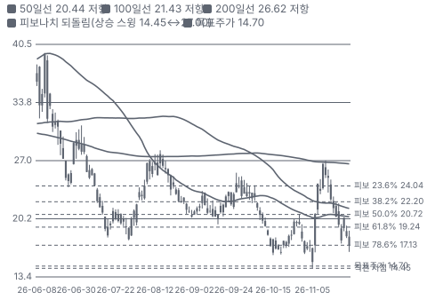

**주봉**

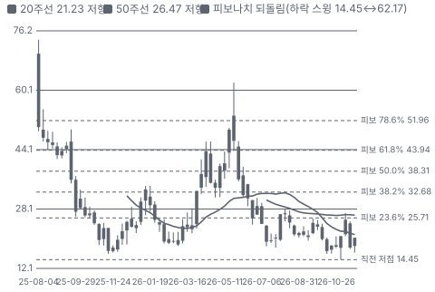

**월봉**

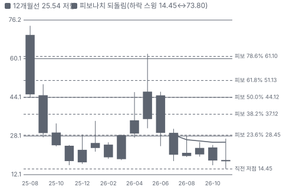

**분기 매출·EPS 실적과 컨센서스**

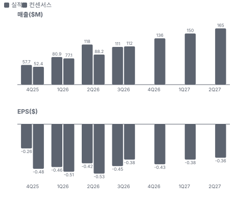

**4Q26 매출 — 지표 추세 vs 가이던스·컨센서스**

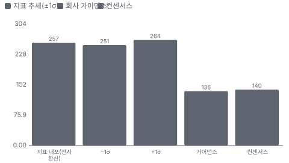

**최근 4개 분기 주가 변화 분석**

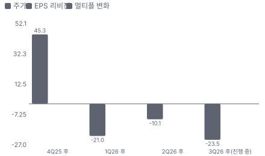

**EPS 리비전**

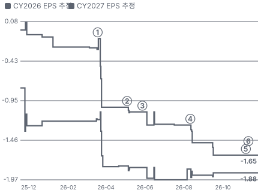

① 26-03-19 4Q25 실적, 다음 날 +1.1% · EPS 리비전 +265%
② 26-05-04 1Q26 실적, 다음 날 −5.5% · EPS 리비전 +6%
③ 26-05-28 보통주 1,200만 주 공모가 \$48.00 결정 — 5/26 종가 \$58.81이 1년 고점 · EPS 리비전 +16%
④ 26-08-11 2Q26 실적(매출 \$117.7M), 다음 날 +0.7% · EPS 리비전 +18%
⑤ 26-11-06 AST SpaceMobile 엔진 IP·공급 계약 체결(약 \$1.3B), 당일 +36.8% · EPS 리비전 +0%
⑥ 26-11-10 3Q26 실적·2026년 매출 가이던스 하단 상향, 다음 날 +12.3% · EPS 리비전 +0%

**밸류에이션 주가 시나리오**

**주가별 업사이드**

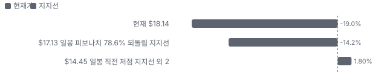
- 제품·서비스 포트폴리오

**고객 믹스(3Q26(7~9월), 매출 대비)**

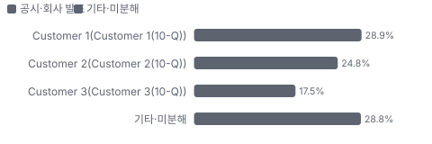

**공급 병목(10점, 낮을수록 병목)**

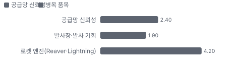

**CAPEX의 매출 대비 비중**

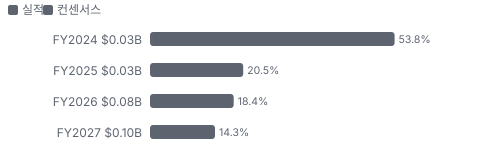

**어닝콜 변화별 주주가치 영향**

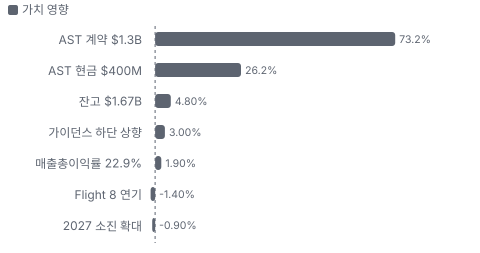

**수주·파이프라인 확실성 사다리**

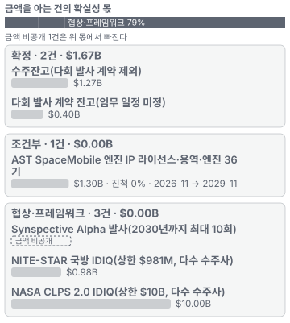

**매출 → 매출총이익 → 영업이익(매출 = 100, 최근 4분기)**

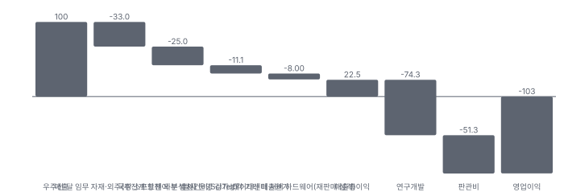

**분기 비용 비중 추이(매출 대비, 공시)**

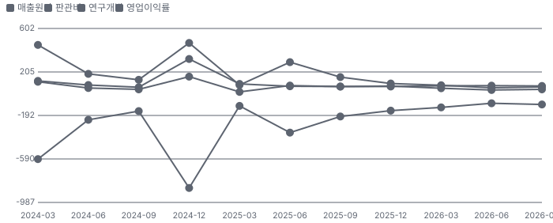

**비용 요인별 매출 대비 비중 1년 변화**

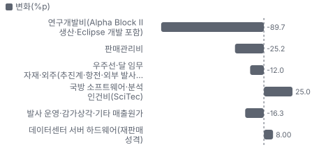

**Spacecraft Solutions BOM 원가 몫**

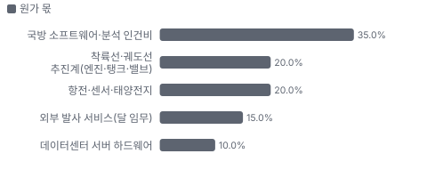

**Launch BOM 원가 몫**

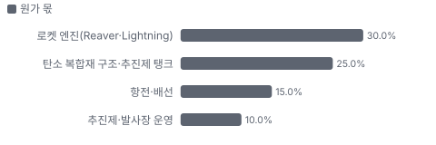

**BOM 항목 가격 +10% 시 OPM 변화**

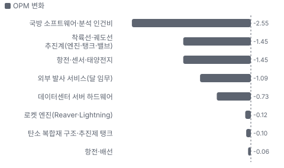

**원가 물가 vs 판매가 물가 — 최근 24개월**

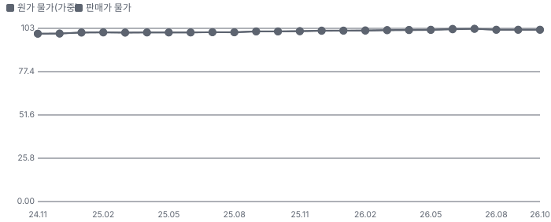

**사업별 매출 vs 물가 — 전년 대비(명목 매출 · 비교 물가 · 실질 = 물량·믹스)**

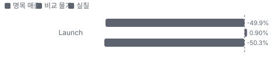

**자산 구성 — 3Q26 분기말 투하자본 \$696.4M**

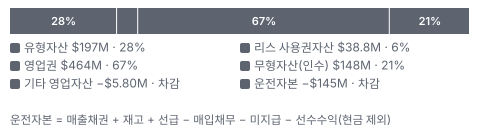

**자산별 변화율 — 최근 7개 분기(4Q24 = 0%) + 다음 4개 분기 추정**

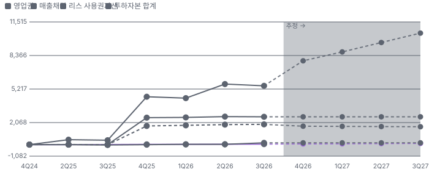

**ROIC 추이 — TTM, 최근 3개 분기 + 다음 4개 분기 추정(컨센서스 NOPAT) · 투하자본이 0 근처라 ROIC가 ±100%를 넘는 분기는 비움**

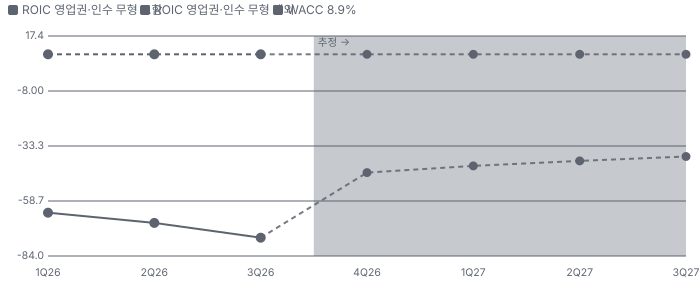

**매출 vs PPI·수출입 — 1Q24 = 100(변화율, 로그 눈금)**

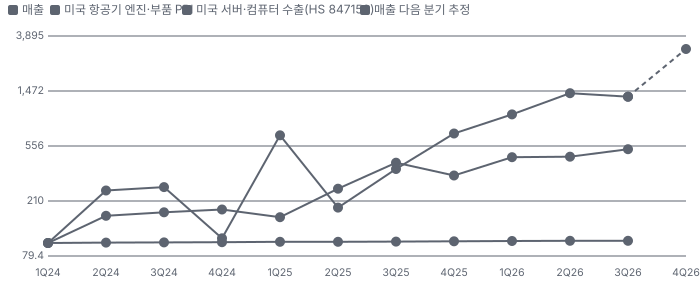

**목표주가 산정 — 약세와 기본 사이(약세 쪽 12%), 도달 확률 약 54%**

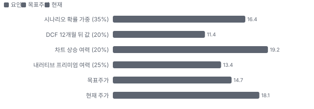

**커뮤니티 언급 수(최근 30일, 채널별)**

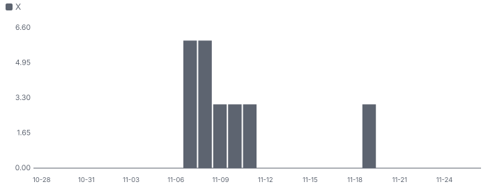

**커뮤니티 게시 수(월, 최근 7개월 — 이번 달은 진행 중)**

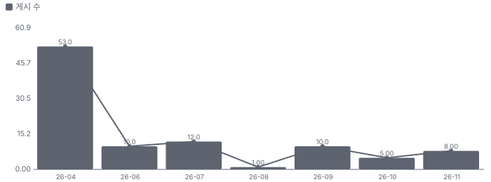

**일별 거래량 분해**

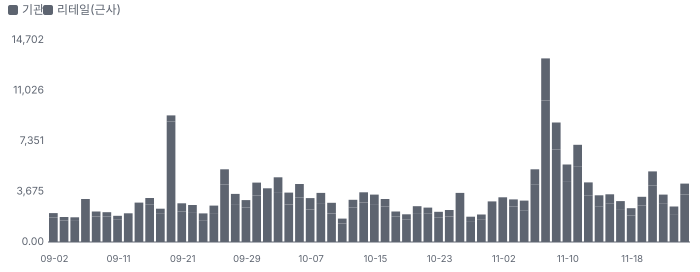

**기관 자금 흐름**

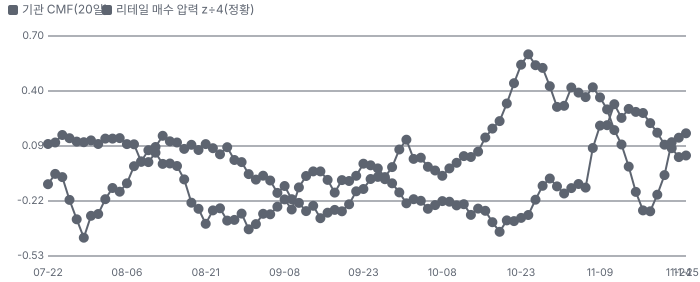

**몬테카를로**

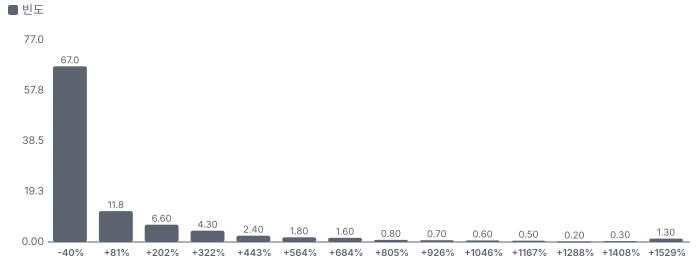

해석: 3,000번 중 1,098번(37%)에서 가치가 지금 주가 이상이었다. 가정을 흔들어도 지금 주가를 뒷받침하지 못하는 경우가 더 많다. 가운데 값은 0.50배이고, 열 번 중 여덟 번은 0.09~5.02배 사이에 든다.

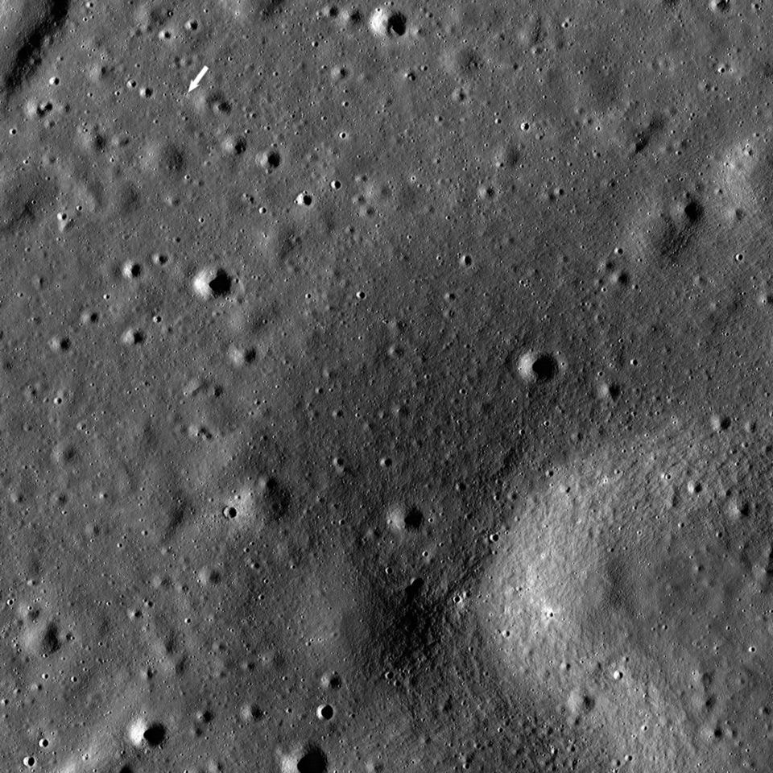
**Spacecraft Solutions** — 달 궤도선이 찍은 Blue Ghost 착륙 지점(NASA)
_사진: NASA/GSFC/Arizona State University · Public domain · Wikimedia Commons_

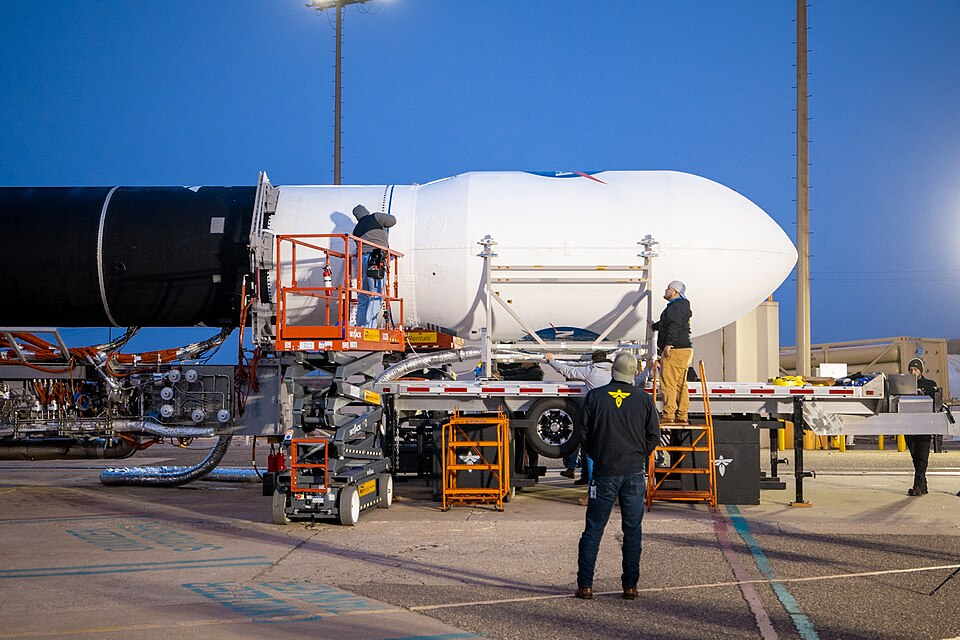
**Launch** — Alpha 로켓에 탑재체를 결합하는 모습(NASA)
_사진: NASA Kennedy Space Center / Firefly Aerospace · Public domain · Wikimedia Commons_

## 내러티브

> **기업가치를 결정하는 이야기:** Firefly의 값은 ① AST 대가(현금 \$400M과 AST 주식)가 마일스톤대로 들어와 2027년부터 매출로 잡히는지 ② Alpha 개량형(Block II)이 1Q27에 뜨고 발사 빈도가 올라가는지 ③ 2027년에 늘어날 현금 소진이 유동성 \$839.7M 안에서 관리되는지에 달려 있다. 지금 매출의 96%는 발사가 아니라 달 임무와 국방 소프트웨어다.

> **멀티플·EPS 프리미엄**
> **멀티플:** 완전 희석 기준 기업가치 \$2.88B는 최근 4개 분기 매출의 7.9배다. Rocket Lab(28.6배)을 뺀 동종 5사 중앙 5.1배(2.5~9.2배)보다 50% 넘게 높다. 다음 4개 분기 매출 추정(\$631M~\$758M)으로는 3.8~4.6배다 — AST 매출이 붙는 2027년 숫자를 얼마나 믿느냐에 따라 싸게도 비싸게도 보인다
> **EPS:** 2Q 콜 뒤 FY2027 매출 추정은 \$692M에서 \$905M으로 31% 올랐는데 주가는 31% 내렸다. FY2027 EPS 추정은 −\$1.49에서 −\$1.65로 오히려 나빠진 채 9월 중순 이후 갱신되지 않았다

### 투자자들은 왜 열광했나

2025년 8월 상장 첫날 종가가 \$60.35였다. 11월 21일 \$16.78까지 내렸다가 2026년 5월 26일 \$58.81까지 다시 올랐다. 회사는 이틀 뒤 주당 \$48.00에 1,200만 주(신주 400만·기존 주주 800만)를 팔았고, 6월에는 우주 종목 전체가 급락했다. 11월 5일 \$15.18이 상장 뒤 최저 종가다. 다음 날 AST 계약으로 하루 +36.8%, 3Q 실적 다음 날 +12.3% 올라 \$26.61까지 갔다가 2주 만에 \$18.14로 내려왔다 — 계약 전 종가보다 20% 높은 자리다. 같은 기간 Rocket Lab·Intuitive Machines·Planet Labs도 52주 고점에서 69~80% 내려와 있다. 회사만의 문제가 아니라 우주 묶음 전체의 배수가 깎였다.

### 무엇이 기업가치를 바꾸나

> **구조적 체질 변화**
> **변화:** 발사 회사에서 우주선·국방 소프트웨어 회사로 바뀌었다. Spacecraft Solutions(달 착륙선·궤도선 임무와 국방 소프트웨어를 묶은 Firefly의 매출 유형)가 매출의 69%(3Q25)에서 96%(3Q26)가 됐다 — SciTec 편입과 달 임무 5건 동시 진행이 원인이다
> **증거:** 3Q26 10-Q 매출 유형 — Spacecraft Solutions \$106.0M·Launch \$4.7M
> **반증:** 2027년에도 Launch 매출 비중이 10% 아래면 '발사 회사' 프리미엄의 근거가 약해진다

> **고부가 믹스 확장**
> **변화:** AST에 넘기는 엔진 설계 사용권은 추가 원가가 작은 매출이다. 회사는 전사 이익률이 오른다고 했지만 수치는 내지 않았다
> **증거:** 3Q26 어닝콜(2026-11-10) — CFO 답변. 3Q 매출총이익률 22.9%(2Q 20.3%)
> **반증:** 2027년 상반기 매출총이익률이 25% 아래에 머물면

> **기술 혁신**
> **변화:** Alpha 엔진의 탭오프 사이클(연소실 가스 일부를 뽑아 터보펌프를 돌리는 로켓 엔진 방식)을 키운 Miranda(Eclipse 1단에 쓰는 Firefly의 로켓 엔진) 엔진이 인증 시험에 들어갔다(연소 시험 175회 이상·누적 4,230초). Alpha는 제작 속도를 높인 Block II로 넘어간다
> **증거:** 3Q26 어닝콜 — 회사 발표이고 Block II·Eclipse(Firefly와 Northrop Grumman이 함께 만드는 재사용 중형 발사체) 비행 실적은 아직 없다
> **반증:** Block II 첫 비행 실패 또는 Miranda 인증 지연

> **실행 속도**
> **변화:** 해당 없음(주문에서 발사까지의 납기를 회사가 공시하지 않아 잴 수 없다) — 확인되는 것은 일정이다. Alpha Flight 8이 4Q26에서 1Q27로 밀렸고(국가안보 고객 요청), 월 1기 생산을 목표로 하지만 2026년 9월까지 발사는 1회다 **납품 리드타임 미확인.** 피어 비교 미확인. 이전 대비 미확인.
> **증거:** 3Q26 어닝콜·FY2025 10-K
> **반증:** 2027년에 4회 이상 발사하면 이 판단을 거둔다

> **M&A**
> **변화:** 2025년 10월 SciTec을 \$547.0M(현금 \$277.4M + 주식 \$269.6M)에 사서 국방 소프트웨어로 넓혔다. 9개월 Spacecraft Solutions 매출 증가(+247%)의 주된 원인이다. 2026년 6월에는 자율 항법 카메라 회사 Space-ng를 주식으로 샀다
> **증거:** FY2025 10-K 주석 3·3Q26 10-Q
> **반증:** 영업권 \$463.6M 손상 인식

> **정책·입법 연관성**
> **재정정책:** 국방·NASA 세출에 매출이 달려 있다. 상원 세출위 FY27 국방 세출안은 미사일·요격체 조달을 늘리고 저·중궤도 미사일 경보 위성 개발비 일부를 깎았다(IB 자료 요지 — 의결 기록은 대조하지 못했다). 임시 예산은 12월 11일 만료다 FY2025 10-K 위험 요인 — 정부 고객 잔고는 향후 예산에 달려 있다 반증: 임시 예산이 2027년까지 이어져 신규 사업 착수가 막히면 의회 동의 4/10 — 하원 1/5(하원 FY27 국방 세출 단계 미확인) · 상원 3/5(상원 세출위 안이 나왔다는 IB 자료 요지 — 의결 기록 미대조라 위원회 통과로 올리지 않았다).
> **행정명령:** 해당 없음(행정명령과 직접 연결되는 매출을 공시로 확인하지 못했다) FY2025 10-K 의회 동의 2/10 — 하원 1/5(논의 없음) · 상원 1/5(논의 없음).
> **연관입법:** 해당 없음 — NASA 달 수송 계약(CLPS 2.0, 상한 \$10B)은 입법이 아니라 조달 계약이다. 로비 공시: 회사 3Q 지출 \$50K, 외부 로비 회사 \$40K(쟁점: 예산·국방) 3Q26 어닝콜·로비 공시(lda.gov, 2026-10-20)

> **고객의 지출 예산**
> **변화:** 매출 대부분이 정부 예산이다 — NASA 탐사 예산과 국방 연구개발·조달 예산. 발사는 위성 사업자의 위성군 구축 투자와 국방 발사 조달에서 나온다
> **사업별 예산:** **매출의 96%**: Spacecraft Solutions — 고객 혼합(NASA 탐사·과학 예산, 국방 연구개발·조달 예산) · 동인: 달 임무 발주와 미사일 경보 프로그램 예산
**매출의 4%**: Launch — 고객 CAPEX(위성 사업자의 위성군 구축 투자, 국방 발사 조달) · 동인: Alpha 발사 횟수
> **증거:** FY2025 10-K 고객 설명·3Q26 10-Q 매출 유형
> **반증:** 임시 예산 장기화로 신규 발주가 밀리면

### 내러티브 근거

> '달 착륙에 성공한 발사·우주선 회사가 엔진 기술까지 판다'는 이야기와 '2028년까지 적자인데 지배 주주가 주식을 판다'는 이야기가 맞선다. AST 계약으로 오른 몫의 대부분을 2주 만에 반납했다. 단계는 소멸, 쏠림은 보통이다.

> **엔진 기술 수익화** · 강화
> **논리:** 로켓 엔진 설계 사용권을 팔아 희석 없이 증설 자금을 얻는다
> **숫자:** AST 계약 약 \$1.3B — 라이선스 약 \$800M(현금 \$400M + AST 주식), 용역 \$250M, 엔진 \$250M
> **반증:** 1Q27 실적까지 현금 대가 수령이 확인되지 않으면
> **출처:** 3Q26 10-Q 주석 19·3Q26 어닝콜(2026-11-10)

> **달·국가안보 수주잔고** · 유지
> **논리:** 달 착륙 이력과 미사일 경보 소프트웨어로 정부 수주가 쌓인다
> **숫자:** 수주잔고 \$1.674B(1년 전 \$1.278B, +31%), 2026년 가이던스 \$440~450M
> **반증:** 잔고가 2개 분기 연속 줄거나 잔여 이행 의무(계약했지만 아직 매출로 잡지 않은 금액, 회계 기준)가 \$500M 아래로 내려가면
> **출처:** 3Q26 10-Q

> **발사 공급 부족** · 유지
> **논리:** 중형 발사체가 모자라 Alpha·Eclipse의 값이 오른다
> **숫자:** Alpha 2026년 1~9월 발사 1회, Launch 3Q 매출 \$4.7M, Eclipse 미비행
> **반증:** Flight 8이 1Q27에 뜨지 못하거나 2027년 발사가 3회 이하면
> **출처:** 3Q26 10-Q·어닝콜

> **우주 섹터 기준점** · 약화
> **논리:** SpaceX 상장으로 우주 기업 전체가 다시 평가받는다
> **숫자:** 동종 6사 주가가 52주 고점 대비 65~80% 아래(11/25 종가 기준)
> **반증:** 동종 묶음이 함께 반등하면 이 판단을 거둔다
> **출처:** Easyconomics 회사 개요(2026-11-25)

> **반대 내러티브 — 적자·소진·구주 매출** · 강화
> **논리:** 2028년까지 적자이고 2027년 소진이 늘며, 지배 주주가 판다
> **숫자:** 9개월 잉여현금흐름 −\$270.5M, FY2028 EPS 추정 −\$0.85, AE Industrial Partners 36.7%
> **반증:** 2027년 분기 잉여현금흐름이 AST 현금 유입으로 플러스가 되면
> **출처:** 3Q26 10-Q·2026 위임장

### 투자 포인트

> **계약 한 건이 기업가치의 45%다**
> **명제:** AST 계약 대가 약 \$1.3B는 완전 희석 기준 기업가치 \$2.88B의 45%다
> **숫자:** 라이선스 약 \$800M(현금 \$400M + AST 주식 1,000만~1,400만 주), 용역 \$250M, 엔진 36기 \$250M. 지급은 마일스톤 조건(10-Q 주석 19)
> **시장과 다른 점:** 시장은 계약 발표에 37% 올렸다가 대부분 되돌렸다. 저는 되돌림이 지나치다고 보지 않는다 — 대가의 약 30%는 값이 흔들리는 AST 주식이고 연도별 인식 금액이 공개되지 않았다
> **증명:** 1Q27 실적까지 현금 대가 수령과 2027년 AST 매출 인식 금액 공개
> **출처:** 3Q26 10-Q 주석 19·3Q26 어닝콜(2026-11-10)

> **매출 추정은 올랐는데 이익 추정은 내렸다**
> **명제:** FY2027 매출 추정 +31%, 같은 해 EPS 추정은 −\$1.49 → −\$1.65
> **숫자:** 매출 추정 8/14 \$692M → 11/24 \$905M. EPS 추정은 9/16 이후 갱신 없음. 회사: 2027년 현금 소진은 늘어난다
> **시장과 다른 점:** 애널리스트 목표가 평균 \$36.08은 매출 배수로 매긴 값이다. 저는 AST 매출이 2030년에 빠진다는 점과 이익 추정이 따라오지 않는 점을 더 무겁게 본다
> **증명:** 4Q 실적의 2027년 매출·현금 소진 안내, 갱신된 EPS 추정
> **출처:** 컨센서스 이력·3Q26 어닝콜

> **발사 회사인지는 2027년에 가려진다**
> **명제:** 지금 매출의 96%는 달 임무와 국방 소프트웨어이고 발사는 4%다
> **숫자:** Launch 3Q 매출 \$4.7M, 2026년 9월까지 Alpha 발사 1회, Flight 8은 1Q27로 연기, 다회 발사 계약 잔고 \$400.3M
> **시장과 다른 점:** 커뮤니티는 '다음 Rocket Lab'으로 부른다. 숫자로는 아직 국방·달 임무 계약 회사다 — 발사 배수를 받으려면 발사 횟수가 먼저 나와야 한다
> **증명:** Flight 8 발사와 4Q 실적에서 제시할 2027년 Alpha 발사 목표
> **출처:** 3Q26 10-Q·어닝콜

### 모멘텀 생성·소멸 타임라인

**카탈리스트 달력 — 지난 사건의 주가 반응과 앞으로 확인할 숫자**
| 날짜 | 상태 | 구분 | 사건 | 반응·확인 | 결과에 따라 |
|---|---|---|---|---|---|
| 2026-03-19 | 완료 | 생성 | 4Q25 실적 — SciTec 편입 첫 분기 | +1.1%(다음 날), 5월 26일까지 +156% |  |
| 2026-05-28 | 완료 | 소멸 | 주당 \$48.00 보통주 1,200만 주 공모(구주 800만) | 5/26 고점 \$58.81 뒤 6월 25일까지 −58% |  |
| 2026-08-11 | 완료 | 생성 | 2Q26 실적 — 매출 \$117.7M, 추정 대비 +31% | +0.7%(다음 날) |  |
| 2026-11-05 | 완료 | 매크로 | 상장 뒤 최저 종가 \$15.18 — 원인 미확인 | −11.6% |  |
| 2026-11-06 | 완료 | 생성 | AST SpaceMobile 엔진 IP·공급 계약 체결 | +36.8% |  |
| 2026-11-10 | 완료 | 생성 | 3Q26 실적·가이던스 하단 상향 | +12.3%(다음 날), 이후 11월 25일까지 −31.8% |  |
| 2026-12-11 | 예정 | 매크로 | 미국 임시 예산 만료 | 국방·NASA 본예산 또는 연장 여부 | 장기 연장이면 신규 사업 착수가 밀린다 |
| 2027년 1분기(회사 계획) | 예정 | 확인 | Alpha Flight 8 — Block II 첫 비행 | 발사 성공과 탑재체 궤도 투입 | 성공이면 2027년 발사 빈도 경로가 열리고, 실패·연기면 다회 발사 계약 잔고 인식이 밀린다 |
| 2027-03 중순(추정) | 예정 | 확인 | 4Q26·FY2026 실적 | 4Q 매출 \$130.8M 이상, 2027년 매출 안내, AST 현금 수령, 2027년 Alpha 발사 목표 | 2027년 매출 안내가 \$800M 이상이고 현금 수령이 확인되면 기본~강세 경로, 안내가 \$700M 아래면 약세 경로 |
| 2027년(회사 계획) | 예정 | 확인 | Blue Ghost Mission 2 발사 | 달 뒷면 착륙 성공 | 실패하면 달 착륙 이력의 프리미엄이 깎인다 |

### 언제 사서 언제 팔아야 할까?

**가격·조건 틀 — 가격은 밸류에이션(약세·기본·강세·목표주가)과 차트 지지 구간에서, 조건은 이벤트에서**
| 구간 | 가격 | 목표주가까지 | 약세까지 | 조건·근거 |
|---|---|---|---|---|
| 관찰 구간 | \$17.13~\$17.13 | -14% | -38% | 11월 5일 종가 \$15.18은 AST 계약 전 가격이다 — 그 근처는 계약의 값을 0으로 치는 자리다 |
| 확인 뒤 | 지금 \$18.14 이상에서 조건 확인 | -19% | -41% | AST 현금 대가 수령 공시와 Flight 8 발사 성공 |
| 무효화 | 약세 시나리오 \$10.69 | - | -41% | AST 계약 조건 변경·지급 지연, Flight 8 실패, 또는 종가 \$15.18 아래 |
| 차익 고민 2차 | \$23.08(강세 시나리오) | +27% | - | 목표주가 근처는 2027년 매출 추정을 그대로 믿는 자리라 그 위는 이익 추정 개선이 필요하다 |

하루 평균 변동이 약 11.5%이고 11월에만 ±10% 넘는 날이 다섯 번이다 — 발표 직후 추격은 경계 가격·조건 틀이며 매매·비중 지시가 아니다(투자 권유 아님).

## 포트폴리오

| 제품·서비스 | 구분 | 무엇 | 쓰는 곳 | 돈 버는 방식 | Mix | Mix 변화(전년 대비) |
|---|---|---|---|---|---|---|
| Spacecraft Solutions | 서비스 | 달 착륙선·궤도선 임무와 국방 미사일 경보 소프트웨어 | NASA 달 화물 수송, 우주군 미사일 경보·우주 감시 | 3Q26 매출의 96% | 96% | +26.4%p |
| Launch | 서비스 | 소형 발사체 Alpha로 위성을 궤도에 올리는 발사 서비스 | 국방 신속 발사, 극초음속 시험, 상업 위성 | 3Q26 매출의 4% | 4% | -26.4%p |

**Mix 변화가 가장 큰 쪽은 Spacecraft Solutions(+26.4%p, 전년 대비).** 계절성 판정: 분기 매출 계절 지수 기준 있음 → 전년 같은 분기와 비교.

## 고객

> **3Q26(7~9월) 최대 고객 Customer 1(Customer 1(10-Q)) 29%, 상위 3곳 71%, 집중도 보통.** 공시·회사 발표로 확인한 몫은 매출의 71%이고, 나머지 고객 몫은 추정이거나 미분해다. 10%를 넘는 고객 3곳이 3Q 매출의 71.2%다(28.9%·24.8%·17.5%). 이름은 공시되지 않는다. 9개월로는 32.4%·18.7%·16.9%로 68.0%다. 2025년에는 상위 5곳이 매출의 86%를 넘었다. 10-K가 꼽는 주요 계약 상대는 NASA, 미국 우주군, 우주개발청, 국가정찰국, Northrop Grumman, Lockheed Martin, L3Harris다

**고객별 매출 몫(3Q26(7~9월))**
| 고객 | 몫 | 변화 | 근거 |
|---|---|---|---|
| Customer 1(Customer 1(10-Q)) | 29% | 미확인 | 공시 |
| Customer 2(Customer 2(10-Q)) | 25% | -40%p | 공시 |
| Customer 3(Customer 3(10-Q)) | 18% | 미확인 | 공시 |
| 기타·미분해 | 29% | - | - |

> **Customer 1(Customer 1(10-Q))** · 공시
> **사는 것:** 미공시
> **추정 근거:** 2025년 4분기 SciTec 편입 뒤 새로 10%를 넘었다 — 어느 기관인지는 공시에 없다

> **Customer 2(Customer 2(10-Q))** · 공시
> **사는 것:** 미공시
> **추정 근거:** 전년 9개월 78.0%였던 고객이다. NASA CLPS 달 임무 매출 비중으로 보면 NASA일 가능성이 있으나 공시로 확인되지 않는다(추정)

> **Customer 3(Customer 3(10-Q))** · 공시
> **사는 것:** 미공시
> **추정 근거:** 전년 같은 기간은 10% 미만

## 수주·파이프라인

> **2026-09-30 기준 6건.** 확정 \$1.67B. 공시 수주잔고 \$1.67B. 서로 겹치는 항목은 합계에서 뺐다.

**수주 목록**
| 상태 | 계약 | 계약 총액 | 진척 | 기간 | 비고 |
|---|---|---|---|---|---|
| 확정 | 수주잔고(다회 발사 계약 제외) | \$1.27B | - | - | 잔고 \$1.674B − 다회 발사 계약 잔고 \$400.3M(계산). NASA CLPS 달 임무 4건, SciTec 국방 소프트웨어, Elytra(Firefly의 궤도 이동·서비스 우주선) 임무가 들어 있다. 3Q 신규에는 지상 레이더 디지털화 1단계 \$94M, NASA MoonFall 임무 Elytra 하도급 \$75M이 들어 있다(3Q26 어닝콜) |
| 확정 | 다회 발사 계약 잔고(임무 일정 미정) | \$0.40B | - | - | Lockheed Martin(5년 최대 25회)·L3Harris(최대 20회 + 3회) 등 — 발사 시점에 매출 인식. 고객 해지권이 있다 |
| 조건부 | AST SpaceMobile 엔진 IP 라이선스·용역·엔진 36기 | \$1.30B | 0% | 2026-11 → 2029-11 | 체결된 계약이지만 대가 지급이 마일스톤 조건이라 조건부로 뒀다. 라이선스 약 \$800M(현금 \$400M + AST 주식), 용역 \$250M, Miranda 27기·Vira(Eclipse 상단에 쓰는 Firefly의 진공용 로켓 엔진) 9기 납품 \$250M. 9월 말 잔고에는 없다 (신규 \$1.3B에 포함) |
| 프레임워크 | Synspective Alpha 발사(2030년까지 최대 10회, 일본) | 금액 비공개 | - | - | '최대' 횟수 — 확정 임무 수 미공시 |
| 프레임워크 | NITE-STAR 국방 IDIQ(상한 \$981M, 다수 수주사) | \$0.98B | - | - | 상한액은 매출이 아니다 — 개별 발주액 미공시 (다른 항목과 겹칠 수 있어 합계에서 뺌) |
| 프레임워크 | NASA CLPS 2.0 IDIQ(상한 \$10B, 다수 수주사) | \$10.00B | - | - | 상한액은 매출이 아니다. CLPS 1.0 미결 입찰 최소 3건(달 뒷면·남극, 달 영상, 착륙 임무) (다른 항목과 겹칠 수 있어 합계에서 뺌) |

**실행 속도와 방해 요인**
| 항목 | 상태 | 실행 속도 | 방해 요인 |
|---|---|---|---|
| 수주잔고(다회 발사 계약 제외) | 확정 | 잔여 이행 의무 \$549.3M의 37.4%가 12개월 안 인식 | 정부 예산·임시 예산 · 고객 사정에 따른 일정 변경 |
| 다회 발사 계약 잔고(임무 일정 미정) | 확정 | 미확인 | Alpha 발사 빈도 · Block II 첫 비행 결과 |
| AST SpaceMobile 엔진 IP 라이선스·용역·엔진 36기 | 조건부 | 미확인 | 대가 지급이 마일스톤 조건 · AST 주식 1,000만~1,400만 주의 가격 변동과 보호예수 · 엔진 납품(2년 차부터) 생산 능력 |
| Synspective Alpha 발사(2030년까지 최대 10회) | 프레임워크 | 미확인 | 개별 임무 확정 · 발사장 가용성 |
| NITE-STAR 국방 IDIQ(상한 \$981M, 다수 수주사) | 프레임워크 | 미확인 | 개별 발주 경쟁 |
| NASA CLPS 2.0 IDIQ(상한 \$10B, 다수 수주사) | 프레임워크 | 미확인 | 개별 임무 경쟁 입찰 · NASA 예산 |

## 마진 구조

> **GPM 22.9%, OPM -91.8%.** 3Q25 대비 GPM -4.7%p, OPM +110.3%p. 변동비는 매출의 95%이고, 매출이 10% 늘면 OPM은 +8.8%p 움직인다. 3Q26 매출총이익률 22.9%(전년 27.6%), GAAP 영업이익률 −91.8%(전년 −202.1%)다. 매출이 3.6배가 되는 동안 연구개발비는 \$48.8M → \$76.0M, 판관비는 \$21.9M → \$50.9M으로 늘었다. Alpha는 '기술적 실현 가능성' 판정 전이라 발사체 제작비가 재고가 아니라 연구개발비로 처리된다 — 영업손실의 큰 몫이 사실상 발사체 생산비다

> **매출 100 중 매출원가 77.5, 매출총이익 22.5(최근 4분기, 공시).** 매출원가 요인 중 우주선·달 임무 자재·외주(추진계·항전·외부 발사)이 매출의 33.0%로 가장 무겁고, 단가가 +10% 오르면 GPM이 -3.30%p 움직인다. 분기 회귀로 매출 1이 늘 때 매출원가는 0.73 늘고, 매출원가의 고정비 몫은 13%다.

**비용 요인 강도 — 비중·추세·충격(+10%)·탄력**
| 비용 | 구분 | 매출 대비 | 1년 변화 | 마진 기여 | 충격 시 마진 | 매출 탄력 | 고정비 몫 |
|---|---|---|---|---|---|---|---|
| 우주선·달 임무 자재·외주(추진계·항전·외부 발사) | 매출원가 요인 | 33.0% | -12.0%p | +12.0%p | -3.30%p | 미확인 | 0% |
| 국방 소프트웨어·분석 인건비(SciTec) | 매출원가 요인 | 25.0% | +25.0%p | -25.0%p | -2.50%p | 미확인 | 20% |
| 발사 운영·감가상각·기타 매출원가 | 매출원가 요인 | 11.1% | -16.3%p | +16.3%p | -1.11%p | 미확인 | 60% |
| 데이터센터 서버 하드웨어(재판매 성격) | 매출원가 요인 | 8.0% | +8.0%p | -8.0%p | -0.80%p | 미확인 | 0% |
| 매출원가 | 공시 항목 | 77.5% | -27.4%p | +27.4%p | -7.75%p | 0.73 | 13% |
| 연구개발 | 공시 항목 | 74.3% | -92.1%p | +92.1%p | 미확인 | 0.35 | 67% |
| 판관비 | 공시 항목 | 51.3% | -4.4%p | +4.4%p | 미확인 | 0.39 | 27% |

매출 탄력 = 분기 비용을 매출에 회귀한 기울기(매출 1당 변동비), 고정비 몫 = 절편 ÷ 평균 비용. 표본이 8분기 미만이면 미확인. 매출원가 요인 비중은 margin 재료의 추정이 섞여 있고, 공시 매출원가와의 차이는 '기타 매출원가'로 둔다.

**GPM에서 OPM까지(GAAP — 10-Q 3개월 손익, 아래는 최근 4개 분기)**
| 기간 | GPM | 연구개발 | 판관비 | 기타 | OPM |
|---|---|---|---|---|---|
| 3Q25 | 27.6% | 158.4% | 71.2% | 0.0% | -202.1% |
| 3Q26 | 22.9% | 68.7% | 46.0% | 0.0% | -91.8% |
| 2025-12 | 27.7% | - | - | - | -148.4% |
| 2026-03 | 21.6% | - | - | - | -118.3% |
| 2026-06 | 20.3% | - | - | - | -80.9% |
| 2026-09 | 22.9% | - | - | - | -91.8% |

**비용을 움직이는 요인**
| 비용 | 요인 |
|---|---|
| 연구개발비(Alpha Block II 생산·Eclipse 개발 포함, 연구개발) | Alpha 생산 속도, Eclipse·Miranda 개발, 주식 보상 · 근거 공시 |
| 판매관리비(판관비) | 인건비·주식 보상·무형자산 상각·상장사 비용 · 근거 공시 |
| 우주선·달 임무 자재·외주(추진계·항전·외부 발사, 매출원가) | 임무 진행률, 외부 발사 서비스 가격 · 근거 추정 |
| 국방 소프트웨어·분석 인건비(SciTec, 매출원가) | 기술 인력 단가, 원가가산·고정가 계약 비중 · 근거 추정 |
| 발사 운영·감가상각·기타 매출원가(매출원가) | 발사 횟수, 설비 감가상각 · 근거 추정 |
| 데이터센터 서버 하드웨어(재판매 성격, 매출원가) | 서버 가격 · 근거 추정 |

**Spacecraft Solutions BOM — 매출의 96%, GPM 24%(추정 — 유형별 이익률 미공시. 전사 22.9%에 맞춘 배분), 항목 가격 +10% 시**
| 항목 | 원가 몫 | 전가 | 제품 GPM | OPM |
|---|---|---|---|---|
| 국방 소프트웨어·분석 인건비 | 30~40% | 미확인 | -2.7%p | -2.55%p |
| 착륙선·궤도선 추진계(엔진·탱크·밸브) | 15~25% | 미확인 | -1.5%p | -1.45%p |
| 항전·센서·태양전지 | 15~25% | 미확인 | -1.5%p | -1.45%p |
| 외부 발사 서비스(달 임무) | 10~20% | 미확인 | -1.1%p | -1.09%p |
| 데이터센터 서버 하드웨어 | 5~15% | 미확인 | -0.8%p | -0.73%p |

**Launch BOM — 매출의 4%, GPM 5%(추정 — 발사체 제작비 대부분이 연구개발비로 처리돼 유형별 이익률은 뜻이 작다), 항목 가격 +10% 시**
| 항목 | 원가 몫 | 전가 | 제품 GPM | OPM |
|---|---|---|---|---|
| 로켓 엔진(Reaver(Alpha 1단에 쓰는 로켓 엔진)·Lightning(Alpha 상단에 쓰는 진공용 로켓 엔진)) | 25~35% | 미확인 | -2.8%p | -0.12%p |
| 탄소 복합재 구조·추진제 탱크 | 20~30% | 미확인 | -2.4%p | -0.10%p |
| 항전·배선 | 10~20% | 미확인 | -1.4%p | -0.06%p |
| 추진제·발사장 운영 | 5~15% | 미확인 | -1.0%p | -0.04%p |
| 미분해 | 20% | - | - | - |

판매가 전가를 모르는 항목은 전가 0%로 계산했다.

**BOM 항목 가격을 움직이는 것**
| 항목 | 요인 |
|---|---|
| 국방 소프트웨어·분석 인건비 | 원가가산 계약은 전가되고 고정가 계약은 전가되지 않는다 — 비중 미공시 · 근거 추정 |
| 착륙선·궤도선 추진계(엔진·탱크·밸브) | 임무마다 새로 제작 · 근거 추정 |
| 항전·센서·태양전지 | 방사선 내성 부품은 공급사가 적다 · 근거 추정 |
| 외부 발사 서비스(달 임무) | Eclipse가 뜨기 전에는 달 임무를 타사 로켓에 싣는다 · 근거 추정 |
| 데이터센터 서버 하드웨어 | 이익률이 낮은 품목 · 근거 추정 |
| 로켓 엔진(Reaver·Lightning) | 발사체에서 가장 비싼 부분, 자체 제작 · 근거 추정 |
| 탄소 복합재 구조·추진제 탱크 | 자체 제작 · 근거 추정 |
| 항전·배선 | 내재화 진행 중 · 근거 추정 |
| 추진제·발사장 운영 | 발사 1회마다 발생 · 근거 추정 |

**투입 물가 — 미국 PPI 3·6·12개월(2026-10, 개정 반영)과 해외 전년비**
| 항목 | 미국 3개월 | 6개월 | 12개월 | 전가 못 할 때 OPM | 대만 |
|---|---|---|---|---|---|
| 착륙선·궤도선 추진계(엔진·탱크·밸브) | +0.4% | +0.3% | +6.4%* | - | 미확인 |
| 데이터센터 서버 하드웨어 | +0.0% | +3.0% | +3.1% | - | +57.2%* |
| 로켓 엔진(Reaver·Lightning) | -0.5% | +0.1% | +0.9%* | - | 미확인 |

별표는 품목보다 넓은 업종 지수다. 연결한 투입 원가의 미국 PPI(생산자물가지수)는 1년 새 가중 +1.1%이고, 판매가로 넘기지 못하면 GPM -0.2%p·OPM -0.9%p가 움직인다. 판매가 비교 물가(터보제트·터보프롭 엔진 부분품 PPI)는 1년 새 +0.9% — 회사 가격 변화는 미확인. 물가 지수를 붙이지 못한 매출원가 항목은 우주선·달 임무 자재·외주(추진계·항전·외부 발사), 국방 소프트웨어·분석 인건비(SciTec), 발사 운영·감가상각·기타 매출원가다(미연결). Launch 매출은 2026-09 전년 대비 -49.9%이고 비교 물가 ppi:jet_engine_parts의 변화 +0.9%(2026-09)를 빼면 실질 -50.3% — 물가를 빼면 줄었다 — 물량이 빠진다.

## 자산 구성

> **3Q26 분기말 투하자본 \$696.4M** — 영업권 67%, 유형자산 28%. 최근 7개 분기(4Q24 → 3Q26) 가장 크게 늘어난 자산은 매출채권(+5519%), 투하자본 합계 +1903%. 3Q27 추정 투하자본 \$618.6M(-11%, 컨센서스 매출과 회전 일수·CAPEX 강도 유지 가정).

**자산·운전자본 항목별 분기말 잔액 — 최근 12개 분기와 다음 4개 분기 추정**
| 항목 | 4Q24 | 3Q25 | 3Q26(최근) | 3Q27 추정 | 7개 분기 변화 | 다음 4개 분기 변화 |
|---|---|---|---|---|---|---|
| 매출채권 | \$1.0M | \$5.1M | \$56.4M | \$106.1M | +5519% | +88% |
| 선급·기타 유동자산 | \$52.4M | \$14.3M | \$79.7M | \$103.8M | +52% | +30% |
| 매입채무 | \$37.6M | \$30.4M | \$66.8M | \$101.2M | +78% | +51% |
| 미지급비용 | \$14.4M | \$20.2M | \$43.4M | \$99.1M | +201% | +128% |
| 선수수익(계약부채) | \$108.1M | \$95.2M | \$171.2M | \$299.4M | +58% | +75% |
| 유형자산 | \$135.6M | \$142.6M | \$197.4M | \$291.8M | +46% | +48% |
| 리스 사용권자산 | \$14.6M | \$9.9M | \$38.8M | \$38.8M | +166% | +0% |
| 영업권 | \$17.1M | \$17.1M | \$463.6M | \$463.6M | +2612% | +0% |
| 무형자산(인수) | \$0.0M | 미확인 | \$147.7M | \$119.8M | 비교 불가 | -19% |

**자산 추정 동인 — 최근 4개 분기 평균(재무상태표 동인 모형)**
| 동인 | 값 | 곱하는 기준 |
|---|---|---|
| 매출채권 | 54일 | 매출 |
| 선급·기타 유동자산 | 53일 | 매출 |
| 매입채무 | 66일 | 매출원가 |
| 미지급비용 | 50일 | 매출 |
| 선수수익(계약부채) | 152일 | 매출 |
| CAPEX 강도 | 18.7% | 매출(최근 4개 분기 합) |
| 분기 감가율 | 3.77% | 기초 유형자산 순액(무형 상각 제외 감가상각) |
| 매출원가율 | 77.5% | 매출(최근 4개 분기) |
| 영업권·리스 사용권·기타 | 유지 | 인수·새 리스는 공시 전 모름 |
| 인수 무형자산 | 분기 \$7.0M 상각 | 최근 4개 분기 평균 상각 |

**추정 방법:** 증권사 3표 모델(손익·재무상태표·현금흐름)의 재무상태표 동인 방식이다. 운전자본은 항목별 회전 일수(매출채권·선급·미지급·선수는 매출, 재고·매입채무는 매출원가 기준)를 최근 4개 분기 평균으로 두고 컨센서스 매출에 곱한다. 유형자산은 기초 + CAPEX − 감가상각으로 굴린다(Koller·Goedhart·Wessels 『Valuation』 재무상태표 추정). 매출 경로는 ROIC 절의 컨센서스와 같다.

**유형·무형자산 항목별 가치(2025-12-31 vs 2024-12-31)**
| 구분 | 항목 | 총액 2025-12-31 | 누적상각 | 순액 | 총액 2024-12-31 | 총액 1년 변화 | 공시 내용연수 |
|---|---|---|---|---|---|---|---|
| 유형 | 유형자산 합계(항목 미분해) | \$205.8M | 총계만 공시 | 총계만 공시 | \$161.3M | +27.6% | 미확인 |
| 영업권 | 영업권 | \$450.1M | \$0.0M | \$450.1M | \$17.1M | +2532.7% | 비상각 |
| 유형 합계 | 유형자산 | \$205.8M | \$42.1M | \$163.7M | \$161.3M | +27.6% | 경과율 20%(상각 대상 기준) |

**내용연수 산식(상각 대상 유형자산 = 총액 − 토지 − 건설중)**
| 기준일 | 연 감가상각 | 상각 대상 총액 | 평균 내용연수 | 경과 연수 | 잔여 연수 | 경과율 |
|---|---|---|---|---|---|---|
| 2025-12-31 | \$17.1M | \$205.8M | 12.0년 | 2.5년 | 9.6년 | 20% |
| 2024-12-31 | \$12.5M | \$161.3M | 12.9년 | 2.1년 | 10.8년 | 16% |

산식 평균 내용연수는 12.0년. 1년 전 12.9년 → 지금 12.0년.

**분기 감가 비율(감가상각 ÷ 평균 유형자산 총액)**
| 분기 | 감가상각 | 평균 유형자산(총액) | 분기 비율 | 연율 | 연율의 역수 |
|---|---|---|---|---|---|
| 2Q25 | \$3.9M | \$166.8M | 2.35% | 9.40% | 10.6년 |
| 3Q25 | \$5.6M | \$175.7M | 3.20% | 12.80% | 7.8년 |
| 4Q25 | \$9.6M | \$192.4M | 5.00% | 19.99% | 5.0년 |
| 1Q26 | \$15.9M | \$211.0M | 7.55% | 30.20% | 3.3년 |
| 2Q26 | \$14.0M | \$226.9M | 6.15% | 24.60% | 4.1년 |
| 3Q26 | \$13.3M | \$246.4M | 5.40% | 21.58% | 4.6년 |

감가상각 기준: 손익계산서 감가상각·상각비(SEC 공시 데이터, 4분기 = 연간 − 1~3분기).

미공시·미분해: 유형자산 항목별 총액·내용연수(10-K 주석에서 모델이 채움) · 무형자산 항목(10-K 주석에서 모델이 채움) — 이 칸은 비우고 나머지로 계산했다.

### 해석 — 자산이 어디에 쌓이고 있나

- 다음 4개 분기 CAPEX \$118.1M vs 감가상각 \$34.7M(최근 4개 분기 CAPEX 강도·감가율 유지) — 유형자산 3Q26 \$197.4M → 3Q27 \$291.8M. 투자가 감가보다 커서 자산이 쌓이는 국면이다.

## ROIC

> **TTM 3Q26 ROIC는 영업권·인수 무형 포함 -75.6%, 제외 미확인**(NOPAT 마진 -75.0% × 투하자본 회전율 1.01회). 최근 3개 분기 1Q26 -64.1% → 3Q26 -75.6%(고점 1Q26 -64.1%). 컨센서스 NOPAT으로 굴리면 3Q27 -38.2%(제외 미확인) — WACC 8.9% 대비 -47.1%p.

**ROIC 추이(TTM)와 다음 4개 분기 추정 — NOPAT ÷ 평균 투하자본(이번 분기말·4개 분기 전)**
| 분기 | 구분 | TTM 매출 | TTM NOPAT | NOPAT 마진 | 평균 투하자본 | ROIC 포함 | ROIC 제외 |
|---|---|---|---|---|---|---|---|
| 1Q26 | 실적 | \$184.9M | −\$223.9M | -121.1% | \$349.5M | -64.1% | 미확인 |
| 2Q26 | 실적 | \$287.0M | −\$249.9M | -87.1% | \$363.5M | -68.8% | 미확인 |
| 3Q26 | 실적 | \$366.9M | −\$275.1M | -75.0% | \$363.6M | -75.6% | 미확인 |
| 4Q26 | 추정 | \$445.0M | −\$292.3M | -65.7% | \$640.6M | -45.6% | 미확인 |
| 1Q27 | 추정 | \$514.1M | −\$274.7M | -53.4% | \$647.0M | -42.5% | 미확인 |
| 2Q27 | 추정 | \$561.4M | −\$263.5M | -46.9% | \$656.0M | -40.2% | 미확인 |
| 3Q27 | 추정 | \$630.8M | −\$251.2M | -39.8% | \$657.5M | -38.2% | 미확인 |

**다음 4개 분기 NOPAT — 컨센서스(세율 21%, 리스 이자 별도)**
| 분기 | 매출 | EBITA 마진 | EBITA | NOPAT(분기) | 근거 |
|---|---|---|---|---|---|
| 4Q26 | \$135.8M | -75.0% | −\$101.8M | −\$80.4M | 컨센서스 매출 × EBIT 마진 FY2026(조정 − 주식보상 7.0%) |
| 1Q27 | \$150.0M | -44.3% | −\$66.5M | −\$52.5M | 컨센서스 매출 × EBIT 마진 FY2027(조정 − 주식보상 7.0%) |
| 2Q27 | \$165.0M | -44.3% | −\$73.1M | −\$57.7M | 컨센서스 매출 × EBIT 마진 FY2027(조정 − 주식보상 7.0%) |
| 3Q27 | \$180.0M | -44.3% | −\$79.7M | −\$63.0M | 컨센서스 매출 × EBIT 마진 FY2027(조정 − 주식보상 7.0%) |

**추정 방법:** NOPAT은 컨센서스(분기 매출 추정 × 회계연도 EBIT 마진 추정)로 잡고, 조정(비 GAAP) 마진이면 주식보상 몫을 빼서 과거 실적과 같은 기준(영업이익 + 인수 무형 상각)으로 맞췄다. 이미 발표했지만 분기 보고서(10-Q)가 아직 없는 분기는 발표 실적을 쓴다. 투하자본은 자산 구성 절의 재무상태표 동인으로 굴렸다. ROIC는 4개 분기 NOPAT을 이번 분기말과 4개 분기 전 투하자본의 평균으로 나눈다 — 추정 분기의 ROIC에는 이미 나온 실적 분기가 섞여 있다.

**투하자본 항목별 회전율과 ROIC 기여(TTM 3Q26, 평균 잔액)**
| 항목 | 투하자본 | 매출 1달러당 자본 | 회전율(매출 ÷ 항목) | 자본 몫 | 이 항목을 빼면 ROIC |
|---|---|---|---|---|---|
| 운전자본 | −\$135.9M | -0.37 | 음수(자금 원천) | -37% | -58.6% |
| 유형자산 | \$170.0M | 0.46 | 2.16회 | 47% | -151.1% |
| 리스 사용권자산 | \$24.4M | 0.07 | 15.05회 | 7% | -86.2% |
| 영업권 | \$240.4M | 0.66 | 1.53회 | 66% | -237.3% |
| 무형자산(인수) | \$73.9M | 0.20 | 4.97회 | 20% | -101.0% |
| 기타 영업자산 | −\$9.1M | -0.02 | 음수(자금 원천) | -2% | -78.5% |

**ROIC 세 가지 판**
| 판 | NOPAT | 투하자본 | ROIC | 무엇을 재나 |
|---|---|---|---|---|
| 영업권·인수 무형 포함 | −\$292.5M | \$363.6M | -80.4% | 인수 웃돈까지 낸 돈에 대한 수익률 |
| 영업권·인수 무형 제외 | −\$292.5M | \$49.4M | 미확인 | 본업 운영 수익률(동종 비교용) |
| 무형 자본화 조정(판관비 20%·5년, 연구개발 6년) | −\$122.2M | \$797.5M | -15.3% | 비용으로 처리한 무형 투자를 자산으로 본 판 — 이력이 상각 기간보다 짧아 자산 과소 |
| 경제적 이익(포함판) | −\$324.8M | \$363.6M | 자본비용 8.9% | (ROIC − 자본비용) × 투하자본 |

NOPAT = (영업이익 −\$378.0M + 인수 무형 상각 + 리스 내재 이자 \$1.9M) × (1 − 세율 21%). 리스 사용권자산을 투하자본에 넣었으므로 임차료 속 이자 몫을 영업이익에 되더했다. 현금은 영업에 필요한 몫을 따로 알 수 없어 투하자본에서 뺐다. SEC 공시 데이터 자동 초안 — 운전자본 = 매출채권 + 재고 + 선급 − (매입채무 + 미지급비용 + 선수수익), 현금 제외. 손상 누계는 공시 데이터 수록분.

투하자본 또는 NOPAT이 0 이하라 ROIC 분해는 비교 불가 — 경제적 이익으로 본다.

**무형 자본화 가정별 ROIC(2025년 지출 기준, 포함판에 더함)**
| 투자로 보는 몫 | 상각 연수 | 무형 자산 | NOPAT 조정 | 조정 ROIC |
|---|---|---|---|---|
| 판관비 20% | 2년 | \$426.2M | \$165.1M | -16.1% |
| 판관비 20% | 5년 | \$433.9M | \$170.3M | -15.3% |
| 판관비 30% | 2년 | \$437.7M | \$169.8M | -15.3% |
| 판관비 30% | 5년 | \$449.2M | \$177.7M | -14.1% |

### 해석 — 무엇이 수익성을 끌어올리고 희석하나

- 영업권: 투하자본의 66% — 빼면 ROIC -80.4% → -237.3%. 이 자산의 회전율(1.53회)이 수익성을 희석하는 주된 자리다.
- 유형자산: 투하자본의 47% — 빼면 ROIC -80.4% → -151.1%. 이 자산의 회전율(2.16회)이 수익성을 희석하는 주된 자리다.
- 기타 영업자산: −\$9.1M(음수), 고객 선수금·공급사 외상이 자본을 대신 댄다 — 빼면 ROIC -78.5%로 낮아진다. 수익성을 끌어올리는 쪽이다.
- 운전자본: −\$135.9M(음수), 고객 선수금·공급사 외상이 자본을 대신 댄다 — 빼면 ROIC -58.6%로 낮아진다. 수익성을 끌어올리는 쪽이다.
- 비용으로 처리한 무형 투자를 자산으로 보면 ROIC가 +65.1%p 움직인다(무형 자산 \$433.9M). 투자를 늘리는 중이라 NOPAT이 더 커지는 쪽이다.
- 추정 경로 3Q26 -75.6% → 3Q27 -38.2%: NOPAT 마진 +35.1%p, 투하자본 회전율 -0.05회 — 컨센서스 매출·마진이 맞고 회전 일수·CAPEX 강도가 유지된다는 가정이다. 마진 추정이 내려가거나 재고 일수가 늘면 이 경로가 먼저 틀린다.
- ROIC(포함) − WACC = -84.5%p(3Q26) — 양수면 투하자본을 늘릴수록 가치가 쌓인다.

## 공급망 병목

> **공급망 신뢰성 2.4/10, 병목 심각.** 가장 약한 고리는 발사장·발사 기회 1.9점이고, 품목 평균은 3.1점이다. 근거가 부족한 3건(외부 발사 서비스(달 임무) · 탄소 복합재 구조·추진제 탱크 · 항전·방사선 내성 전자부품)은 점수에서 뺐다. 가장 약한 고리는 부품이 아니라 발사 자체다. Alpha는 2026년 9월까지 한 번(Flight 7) 발사했고 Block II 첫 비행은 1Q27로 밀렸다. 달 임무는 Eclipse가 뜨기 전까지 타사 로켓에 싣는다. 엔진·복합재 구조는 자체 제작이고, 10-K는 일부 부품이 단일 공급원이라고 적는다(이름 미공시)

**병목과 마진 — 품목 가격 +10% 시 OPM**
| 품목 | 점수 | 판정 | 구분 | OPM |
|---|---|---|---|---|
| 발사장·발사 기회(필수) | 1.9 | 병목 심각 | 출하 차질 위험 | 미확인 |
| 로켓 엔진(Reaver·Lightning, 필수) | 4.2 | 병목 주의 | 출하 차질 위험 | -0.12%p |

> **발사장·발사 기회** · 1.9/10
> **왜:** 발사가 늦으면 Launch 매출과 다회 발사 계약 잔고 \$400.3M 인식이 밀린다. 가동 발사장이 한 곳이라 1위 몫을 100%로 봤다
> **병목 요인:** 인증 공급사 1곳 · 캐파 부족 · 리드타임 미확인 · 재인증 미확인 · 1위 점유율 100% · 미국 캘리포니아 집중 100% · 물량 확보 장기계약
> **풀리는 조건:** 월롭스·에스랑에 건설 중 — 가동 전

> **로켓 엔진(Reaver·Lightning)** · 4.2/10
> **왜:** AST용 Miranda 27기·Vira 9기 납품이 같은 설비에 얹힌다 — 자체 발사체와 생산 능력을 나눠 쓴다
> **병목 요인:** 인증 공급사 1곳 · 캐파 균형 · 리드타임 미확인 · 재인증 미확인 · 1위 점유율 100% · 미국 텍사스 집중 100% · 물량 확보 내재화
> **풀리는 조건:** 새 시험 베이는 계획 단계

**공급사**
| 품목 | 공급사 | 몫 | 근거 |
|---|---|---|---|
| 발사장·발사 기회 | 밴덴버그 우주군 기지(임차 발사장, Alpha 발사장) | 미확인 | 공시 |
| 외부 발사 서비스(달 임무) | 타사 중대형 로켓 사업자(Blue Ghost·Elytra 발사) | 미확인 | 보도 |
| 로켓 엔진(Reaver·Lightning) | 자체 제작(Rocket Ranch(텍사스 브릭스에 있는 Firefly의 발사체 제조·엔진 시험 단지))(엔진 제작·연소 시험) | 미확인 | 공시 |
| 탄소 복합재 구조·추진제 탱크 | 자체 제작(자동 섬유 적층) — 탄소섬유 원재료 공급사 미공시(구조·탱크) | 미확인 | 공시 |
| 항전·방사선 내성 전자부품 | 미공시(일부 단일 공급원, 항전 부품) | 미확인 | 공시 |

**무역 통계로 본 공급 지역**
| 품목 | EU 수입처 | 일본 수입처 | EU 1위 전년비 |
|---|---|---|---|
| 로켓 엔진(Reaver·Lightning) | US 85% · CN(중국) 6% · JP 5% | アメリカ合衆国 66% · 英国 10% | +28.7% |

## 생산능력

> **현재 명목 캐파 미확인, 가동률 미확인.** 착공 이상 증설은 0 Alpha 발사체 연 생산(기), 발표까지 합치면 0 Alpha 발사체 연 생산(기)이다. FY2025 CAPEX는 \$0.03B로 매출의 20.5%다. 이름이 확인되는 시설은 8곳이다. 생산은 텍사스 브릭스의 Rocket Ranch(200에이커, 생산 면적 약 20만 제곱피트, 시험대 6기)와 시더파크의 Hive(우주선)에 몰려 있다. 회사는 Alpha를 월 1기 만드는 체제로 넓히는 중이라고 적지만 지금 생산량은 공시하지 않는다. 실제 발사는 2026년 9월까지 1회다

**생산시설 8곳**(FY2025 10-K 사업·위험 요인·리스 주석과 3Q26 10-Q에 이름이 나온 시설 — Item 2 시설 표는 확인하지 못했다), 미확인 4곳 · 임차 4곳. 시설별 생산능력은 공개되지 않았다 — 회사 전체 캐파만 위에 적었다.

**생산시설 8곳 — 명칭·위치·생산능력**
| 시설 | 위치 | 용도 | 생산능력 | 소유·상태 |
|---|---|---|---|---|
| Rocket Ranch | 미국 텍사스 브릭스 | 발사체 제조·엔진 시험 | 미확인 — 200에이커, 생산 면적 약 20만 제곱피트, 시험대 6기 — 연 생산 기수 미공시 | 미확인 · 가동 |
| Hive 우주선 시설 | 미국 텍사스 시더파크 | 우주선·소프트웨어·항전, 임무 관제 | 미확인 — 클린룸 확장 뒤 착륙선·궤도선 최대 12기 동시 통합(3Q26 어닝콜) | 미확인 · 가동 |
| 본사 | 미국 텍사스 리앤더 | 본사·관리 | 미확인 — 생산 시설 아님 — 2025-10 신규 사무실 임차 계약 44,576제곱피트 | 임차 · 가동 |
| 밴덴버그 발사장 | 미국 캘리포니아 밴덴버그 우주군 기지 | Alpha 발사 | 미확인 — 연 발사 가능 횟수 미공시 | 임차 · 가동 |
| 월롭스 발사장 | 미국 버지니아 월롭스섬 | Alpha·Eclipse 발사(건설 중) | 미확인 — 건설 중 | 임차 · 건설 중 |
| 에스랑에 발사장 | 스웨덴 에스랑에 우주센터 | Alpha 발사(건설 중) | 미확인 — 건설 중 | 임차 · 건설 중 |
| SciTec 콜로라도 시설 | 미국 콜로라도 | 국방 소프트웨어·데이터 처리 | 미확인 — 생산 시설 아님 | 미확인 · 가동 |
| SciTec 뉴저지 시설 | 미국 뉴저지 | 국방 소프트웨어·센서 | 미확인 — 생산 시설 아님 | 미확인 · 가동 |

**생산능력 확충 계획**
| 계획 | 단계 | 증설 | 가동 시점 | CAPEX |
|---|---|---|---|---|
| Alpha 월 1기 생산 체제(목표 연 12기) | 착공 | 미확인 | 미확인 | 미확인 |
| Rocket Ranch 신규 시험 베이·Eclipse 생산 설비 | 발표 | 미확인 | 미확인 | 미확인 |
| 월롭스·에스랑에 발사장 | 착공 | 미확인 | 미확인 | 미확인 |

남은 계획의 CAPEX 합계는 \$0.00B(금액 미확인 3건 제외)다. 합계는 FY2027 매출의 0%다.

**증설 방해 요인**
| 계획 | 방해 요인 |
|---|---|
| Alpha 월 1기 생산 체제(목표 연 12기) | Block II 첫 비행(1Q27) 결과, 발사장 가용성 |
| Rocket Ranch 신규 시험 베이·Eclipse 생산 설비 | AST 대가 수령(마일스톤 조건), 인력 채용 |
| 월롭스·에스랑에 발사장 | 인허가·건설 일정 |

**CAPEX와 매출 대비**
| 기간 | CAPEX | 매출 | 매출 대비 | 구분 |
|---|---|---|---|---|
| FY2024 | \$0.03B | \$0.06B | 53.8% | 실적 |
| FY2025 | \$0.03B | \$0.16B | 20.5% | 실적 |
| FY2026 | \$0.08B | \$0.45B | 18.4% | 컨센서스 |
| FY2027 | \$0.10B | \$0.70B | 14.3% | 컨센서스 |

## 피터 린치 분류

> **고성장주(Fast Grower), 중형.** 린치 표의 기대 수익 10~100배, 하방 -80~100%, 위험 고. 10배 경로가 있는 분류다(고성장주·회생주·경기순환주).

**분류 근거 — 크기 먼저, 다음은 이야기 유형**
| 항목 | 값 |
|---|---|
| 크기 | 중형(시가총액 \$3.1B) |
| 장기 성장 | 60.8%(컨센서스 매출 2년 CAGR(EPS 없음)) |
| 린치 비율((성장% + 배당%) ÷ P/E) | 미확인 |
| PEG(P/E ÷ 성장%) | 미확인 |
| 근거 | 장기 EPS 성장 61%(컨센서스 매출 2년 CAGR(EPS 없음)) — 고성장 구간(≥18%) |
| 반대 근거 | 성장 61%는 오래 지속되기 어렵다(린치: 50% 성장은 오래 못 간다) |

- 점검: 성장을 더 이어 갈 자리(새 시장·점포·고객)가 남았나
- 점검: P/E가 성장률의 2배를 넘지 않나(PEG)
- 점검: 성장 속도가 꺾이는 2단계에 들어섰나
- 팔 때(점검 조건, 매매 지시 아님): 성장 단계가 끝나거나(확장 여지 소진·동일 매장 성장 둔화) P/E가 성장률의 2배를 크게 넘을 때 — 50% 올랐다고 팔지 않는다(10배 경로를 자른다)

분류 = 피터 린치·존 로스차일드 『One Up On Wall Street』(1989)·『Beating the Street』(1993)의 6분류와 위험·보상 표를 숫자 규칙으로 옮긴 자체추론이다(config/lynch.yaml).

## 구루 교차 점검

> **여섯 관점 중 통과 1 · 미달 1 · 미확인 4.** 가장 약한 관점은 해자와 자본수익률 — 아직 한 해도 이익을 낸 적이 없다 — 해자가 숫자로 확인되지 않는다.

판정은 자체추론이고 숫자는 계산값이다.

> **성장 여지** · 통과
> **질문:** 5년 안에 매출이 2배가 될 자리가 있나, 10년 뒤에도 커지나
> **이유:** 잔고 \$1.67B에 AST 계약 약 \$1.3B가 더해져 2028년까지 매출 추정이 연 60% 넘게 는다 — 다만 그 일부는 3년짜리 계약이다
> **계산한 숫자:** 매출 경로 FY2026→FY2028 연 60.8%, 2배까지 1.5년
> **근거:** FLY 3Q26 10-Q · 출처 목록

> **해자와 자본수익률** · 미달
> **질문:** 경쟁우위가 무엇이고, 투하자본수익률(ROIC)이 자본비용보다 높으며 유지·상승하나
> **이유:** TTM 영업손실 \$378.0M으로 투하자본 \$681.0M 대비 수익률이 크게 마이너스이고 매출총이익률도 22.9%다
> **계산한 숫자:** ROIC -43.9% · 자본비용 8.9%

> **재투자 복리** · 미확인
> **질문:** 번 돈을 높은 수익률로 다시 넣을 곳이 있나 — 자본 배분(재투자·인수·자사주·희석) 이력은
> **이유:** 설비투자는 매출의 19%인데 Alpha·Eclipse 설비의 수익률은 발사 빈도가 올라야 잴 수 있다
> **계산한 숫자:** 설비 재투자율 미확인 · 지속 가능 성장 미확인(근사) · 소유주 이익 수익률 -10.1%(근사)

> **사람과 문화** · 미확인
> **질문:** 경영진이 주주와 같은 배를 탔나 — 창업자·내부자 지분, 기회형 내부자 매수, 문화가 경쟁우위에 기여하나
> **이유:** CEO는 취임 2년이고 사모펀드 지배 주주가 고점에서 구주를 팔았다. 상장 관련 집단소송이 계류 중이다 — 좋다고도 나쁘다고도 단정할 자료가 모자란다
> **계산한 숫자:** 서류로 확인(계산 없음)

> **변화의 방향** · 미확인
> **질문:** 18~24개월 뒤 이익 그림이 지금과 얼마나 다른가, 유동성 국면은 그 변화를 받쳐 주나
> **이유:** 매출 추정과 가이던스는 위를 향하지만 이익 추정은 내려가 있고 유동성 국면은 긴축이다 — 방향이 갈린다
> **계산한 숫자:** 2년 뒤 EPS 미확인(다음 12개월 대비) · 유동성 국면 긴축

> **5배 경로와 시장이 모르는 이유** · 미확인
> **질문:** 어떻게 5배 이상이 되나(이익 성장 × 배수 변화), 시장은 왜 아직 값을 안 매기나
> **이유:** 5배는 매출 약 \$3.0B가 필요해 경로가 확인되지 않는다
> **계산한 숫자:** 5년에 5배 = 연 38.0% · 10배 = 연 58.5%
> **근거:** 이 리포트의 2·3·5·10배 경로 계산

**배수별로 필요한 연 성장률 — 이익 성장과 배수 변화를 합친 속도**
| 목표 | 5년 | 7년 | 10년 |
|---|---|---|---|
| 2배 | 14.9% | 10.4% | 7.2% |
| 5배 | 38.0% | 25.8% | 17.5% |
| 10배 | 58.5%(희소) | 38.9% | 25.9% |

### 보유 규율 — 가격이 아니라 지표로 유지·종료를 가른다

- 투자 논리 지표: 분기 수주잔고 · 분기 영업현금흐름(AST 현금 수령 포함) · 연간 Alpha 발사 횟수 · 매출총이익률
- 규칙: 가격만 빠지고 잔고가 늘며 발사 횟수가 올라가면 유지, AST 대가가 밀리거나 잔고가 2개 분기 연속 줄면 논리가 깨진다
- 지금 주가는 일봉 329개 기간의 고점 대비 -69.9%, 그 기간 최대 낙폭은 -74.9%다 — 고점 대비 −50%를 넘어 재심사 구간이다. 가격이 아니라 위 지표로 유지·종료를 가른다.

여섯 관점은 베일리 기포드(성장 여지·5배 경로), 워렌 버핏(해자·재투자), 론 바론(사람), 피터 린치(분류·내부자), 스탠리 드러켄밀러(변화의 방향·유동성)의 질문을 옮긴 점검 틀이다. 유동성 국면은 긴축(10년물 20일 -9bp · 하이일드 스프레드 20일 +54bp). 설비 재투자율은 설비투자에서 감가상각을 뺀 몫만 본 근사이고(연구개발·인수·운전자본은 빠진다), 소유주 이익 수익률은 유지 설비투자를 감가상각과 같다고 본 근사다. 점검 틀이며 매매·비중 지시가 아니다.

## 해자

> 해자는 세 가지에서 찾을 수 있다 — 달 착륙을 실제로 해낸 이력, 외부가 값을 치른 로켓 엔진 기술, 운용 중인 국방 미사일 경보 소프트웨어 프로그램. 다만 셋 다 아직 이익과 자본수익률로는 확인되지 않는다

> **달 착륙 실증 이력** · 보통
> **해자:** 착륙에 성공한 이력이 있어 NASA 달 임무 입찰에서 앞선다
> **근거:** FY2025 10-K: Blue Ghost 첫 임무가 발사 전 목표를 100% 달성, 이후 CLPS 발주 4건 추가. 3Q26 어닝콜: 달 임무 5건 동시 진행, CLPS 2.0 참여
> **숫자:** Spacecraft Solutions 9개월 매출 \$281.9M(+247%, SciTec 포함)
> **깨지는 조건:** Blue Ghost Mission 2(2027년)가 실패하거나 CLPS 1.0 미결 입찰 3건을 모두 놓치면

> **탭오프 사이클 엔진 기술** · 보통
> **해자:** 외부 회사가 엔진 설계 사용권에 큰돈을 냈다 — 기술 가치를 제3자가 매긴 셈이다
> **근거:** 3Q26 10-Q 주석 19: AST 계약 대가 약 \$1.3B. 3Q26 어닝콜: Miranda 연소 시험 175회 이상·누적 4,230초, 회사가 소유권 유지
> **숫자:** 라이선스 약 \$800M — 완전 희석 기준 기업가치 \$2.88B의 28%(계산)
> **깨지는 조건:** Miranda 인증이 늦어져 Eclipse 첫 단 인도가 2027년을 넘기면. 라이선스는 AST가 엔진을 직접 만들 길도 연다

> **운용 중인 국방 미사일 경보 소프트웨어** · 보통
> **해자:** 이미 운용 중인 프로그램의 데이터·알고리즘을 인접 프로그램으로 옮겨 수주한다
> **근거:** 3Q26 어닝콜: 미사일 경보 프로그램 총 계약 가치 \$800M 초과, 지상 레이더 디지털화 1단계 \$94M 수주
> **숫자:** SciTec 인수가 \$547.0M, 영업권 \$463.6M(3Q26 10-Q) — SciTec 단독 매출·이익 미공시
> **깨지는 조건:** 지상 레이더 후속 단계나 NITE-STAR 개별 발주가 2027년 상반기까지 없으면

> **1톤급 액체 발사체** · 약함
> **해자:** 미국에서 1,000kg급 액체 궤도 발사체를 가진 유일한 회사라고 회사는 말한다
> **근거:** FY2025 10-K: 누적 발사 7회, 계약 발사 30회 초과. 2025-04-29 비행 이상, 2025-09-29 시험대 사고. 3Q26 10-Q: 2026년 Flight 7 성공
> **숫자:** Launch 3Q 매출 \$4.7M(매출의 4.3%)
> **깨지는 조건:** Flight 8이 1Q27에 뜨고 2027년에 4회 이상 발사하면 판정을 올린다

## 경영진·네트워크

> Jason Kim이 2024년 10월부터 CEO다. 사모펀드 AE Industrial Partners가 3월 말 기준 36.7%를 쥔 지배 주주이고 이사 지명권이 있다. 이사회 의장도 그쪽 사람이다

> **Jason Kim** · CEO·이사 · 2024-10
> **프로필:** 전 Millennium Space Systems CEO(2020-12~2024-09), Raytheon·Northrop Grumman 근무, 미 공군 복무(1999~2006)
> **비즈니스:** 방산·우주 업계 경력
> **정계:** 미확인
> **동문:** 미 공군사관학교 전기공학 학사
> **사모임:** 미확인

> **Kirk Konert** · 이사회 의장 · 2022-03
> **프로필:** AE Industrial Partners 매니징 파트너(2023-12~)
> **비즈니스:** BigBear.ai·Redwire·York Space Systems 등 이사
> **정계:** 미확인
> **동문:** 미확인
> **사모임:** 미확인

> **Darren Ma** · CFO · 미확인
> **프로필:** 미확인
> **비즈니스:** 미확인
> **정계:** 미확인
> **동문:** 미확인
> **사모임:** 미확인

> **Thomas Zurbuchen** · 사외이사 · 2025
> **프로필:** 전 NASA 과학임무국 책임자(2016-10~2022-12), 전 미시간대 교수
> **비즈니스:** Schindler Group 이사
> **정계:** 전 NASA 고위직(공직)
> **동문:** 미확인
> **사모임:** 미확인

**네트워크 정량화**
| 연결 | 강도 | 닿는 매출 | 가중 노출 | 매출 대비 | 근거 |
|---|---|---|---|---|---|
| 비즈니스: 지배 주주 AE Industrial Partners — 3월 말 36.7%, 이사 지명권, 5월 공모에서 구주 800만 주 매출 | 4/5 | 미확인 | 미확인 | 미확인 | 2026 위임장·2026-05 투자설명서. 의장이 이사로 있는 Redwire·York Space Systems는 같은 운용사 계열이다 — 거래 매출은 공시로 확인되지 않는다. 연결이 매출을 만들었다고 볼 근거는 없다 https://www.sec.gov/Archives/edgar/data/1860160/000119312526249159/d104612d424b4.htm |
| 비즈니스: Northrop Grumman — Eclipse 공동 개발, \$50M 지분 투자 | 3/5 | 미확인 | 미확인 | 미확인 | FY2025 10-K. CEO가 Northrop Grumman에서 일한 이력이 있다. Eclipse는 아직 매출 전 단계다 https://www.sec.gov/Archives/edgar/data/1860160/000119312526116309/fly-20251231.htm |
| 정계: 전 NASA 과학임무국 책임자가 이사회에 있다 | 2/5 | 미확인 | 미확인 | 미확인 | NASA CLPS 고객 이해에 닿지만 특정 수주와의 연결은 공개 자료에 없다 https://www.sec.gov/Archives/edgar/data/1860160/000119312526161474/fly-20260417.htm |

가중 노출은 연결이 닿는 매출의 크기다. 연결이 그 매출을 만들었다는 뜻이 아니며, 인과는 공개 자료로 입증하지 못한다.

## 약세 논리 및 셀온 조건

| 약세 논리 | 근거 | 가를 자료 |
|---|---|---|
| AST 대가는 조건부이고 3년 뒤 끝난다 | 대가 약 \$1.3B는 회사 추정 가치이고 지급은 마일스톤 조건(10-Q 주석 19). 약 \$400M은 AST 주식 1,000만~1,400만 주다. AST는 길게는 엔진을 직접 만든다(CEO 답변) | 현금 대가 수령 공시와 2027년 AST 매출 인식 금액(4Q 실적, 2027년 3월 추정) |
| 이익이 따라오지 않는다 | 3Q GAAP 영업손실 \$101.6M, 조정 EBITDA −\$69.5M. 9개월 잉여현금흐름 −\$270.5M. FY2028 EPS 추정 −\$0.85. 회사: 2027년 현금 소진 증가 | 2027년 분기 영업현금흐름과 4Q 실적의 소진 안내 |
| 발사는 아직 증명되지 않았다 | 2026년 9월까지 Alpha 발사 1회, Launch 3Q 매출 \$4.7M. Flight 8은 1Q27로 연기. 2025년 4월 비행 이상·9월 시험대 사고. Eclipse 첫 발사 시점 미확정 | Flight 8 발사 결과(1Q27)와 2027년 Alpha 발사 목표(4Q 실적) |
| 고객이 몰려 있고 정부 예산에 달렸다 | 주요 고객 3곳이 3Q 매출의 71.2%. 2025년 상위 5곳이 86% 초과. 임시 예산은 12월 11일 만료이고 상원 세출안은 저·중궤도 미사일 경보 위성 개발비를 깎았다(IB 견해) | FY2026 10-K 고객 집중 주석과 FY27 국방 본예산(2027년 상반기) |
| 지배 주주가 판다 | AE Industrial Partners 36.7%(3월 말). 5월 공모 1,200만 주 중 800만 주가 기존 주주 매출이었다. 미가득 RSU 516만 주·옵션 760만 주 | 13D·Form 4와 추가 매출 신고서 |
| 인수 자산이 크다 | 영업권 \$463.6M·무형자산 \$147.7M으로 자기자본의 53%. SciTec 단독 매출·이익은 공시되지 않는다 | FY2026 10-K 손상 검사(2027년 3월 추정) |
| 잔고의 질 | 잔고 \$1.67B 중 \$0.40B는 임무 일정이 없는 다회 발사 계약이고 고객 해지권이 있다. 회계상 잔여 이행 의무는 \$549.3M으로 1년 전보다 24% 줄었다 | 분기 잔여 이행 의무와 다회 발사 계약의 임무 확정 |

**변이 관점.** 시장은 AST 계약을 반긴 뒤 대부분 되돌렸다. 저는 그 되돌림이 틀렸다고 보지 않는다. 계약의 값은 크지만 현금 \$400M이 들어오기 전에는 숫자가 아니라 약속이고, 매출 추정만 오르고 이익 추정은 내려가 있다. 애널리스트 목표가 평균 \$36.08은 2027년 매출에 배수를 곱한 값인데, 저는 그 매출의 일부가 2030년에 빠진다는 점을 더 무겁게 본다. 다만 '계약 전 가격'까지 돌아갈 근거도 약하다 — 잔고와 유동성이 받치고 있다.

회사 답변도 확인했다. AST가 엔진을 직접 만들면 무엇을 잃느냐는 질문에 CEO는 회사의 사업 모델은 바뀌지 않고 AST는 길게는 엔진을 자체 제작한다고 답했다 — 첫 3회분 뒤의 엔진 매출은 없다는 뜻이다. AST 로켓이 늦어지면 매출이 밀리느냐는 질문에 CFO는 라이선스·용역은 3년에 걸쳐, 엔진은 인도 때 잡으므로 영향이 없다고 답했다. 2027년 현금 소진을 묻자 늘어난다고만 했다. 숫자는 없었다.

가를 자료는 셋이다. 첫째, AST 현금 대가 수령과 2027년 매출 안내(4Q 실적, 2027년 3월 중순 추정). 둘째, Flight 8 발사(1Q27, 회사 계획). 셋째, 분기 수주잔고. 셋 다 맞으면 기본~강세, 첫째가 틀리면 약세다.

중간선거 영향 −0.9/10 — 가장 큰 채널은 국방 예산(증가 속도 둔화 가능)이고 방산 업종은 선거 뒤 −1.0%로 거의 움직이지 않았다. 정책 0단계(선거 결과) 가설이다. 중형 발사 공급이 모자란다는 업계 패널 의견(IB 견해)은 Alpha·Eclipse에 유리한 배경이지만, 발사 횟수로 확인되기 전에는 배경일 뿐이다.

> **셀온 조건**
> **조건 1:** AST 계약 조건 변경·지급 지연 공시가 나오거나 1Q27 실적까지 현금 대가 수령이 확인되지 않는다.
> **조건 2:** Alpha Flight 8이 실패하거나 2Q27 이후로 다시 밀린다.
> **조건 3:** 4Q 실적의 2027년 매출 안내가 \$700M 아래이거나 2026년 매출이 가이던스 하단 \$440M을 밑돈다.
> **조건 4:** 수주잔고가 2개 분기 연속 줄거나 잔여 이행 의무가 \$500M 아래로 내려간다.
> **조건 5:** 주당 \$20 아래에서 신주 발행 또는 지배 주주 추가 매출 신고가 나온다.
> **조건 6:** 종가가 11월 5일 저점 \$15.18을 밑돈다.

## 어닝콜 변화

**직전 콜 대비 새로 나오거나 바뀐 내용 → 가치 영향**
| 항목 | 내용 | 직전 콜 | 최신 콜 | 모델 동인 이동 | 확신도 | 가치 영향 |
|---|---|---|---|---|---|---|
| 신규 | AST SpaceMobile 엔진 IP·공급·용역 계약 약 \$1.3B(3년) | 없음 | 라이선스 약 \$800M + 용역 \$250M + 엔진 \$250M, 2027년부터 매출 | 1년차 성장률 +20.0% | 0.8 | +73.2% |
| 신규 | AST 대가 중 현금 \$400M(마일스톤 조건) | 없음 | 현금 \$400M + AST 주식 1,000만~1,400만 주 | 순차입 -\$0.40B | 0.8 | +26.2% |
| 업데이트 | 2026년 매출 가이던스 하단 상향 | \$420~450M | \$440~450M | 1년차 성장률 +1.0% | 0.8 | +3.0% |
| 업데이트 | 수주잔고 \$1.47B → \$1.67B | \$1.468B(6월 말) | \$1.674B(9월 말), 3Q 신규 \$300M 초과 | 장기 성장 수렴값 +1.0% | 1.0 | +4.8% |
| 부정 | Alpha Flight 8이 4Q26에서 1Q27로 이동 | 4Q26 발사 예정 | 1Q27(국가안보 고객 요청) | 1년차 성장률 -0.50% | 1.0 | -1.4% |
| 부정 | 2027년 현금 소진 확대 예고 | 언급 없음 | AST 수행용 연구개발·설비 투자로 소진 증가(규모 미제시) | 출발 이익률 -3.0% | 0.5 | -0.9% |
| 업데이트 | GAAP 매출총이익률 20.3% → 22.9% | 2Q 20.3%(이익률 낮은 서버 구매 포함) | 3Q 22.9% | 목표 이익률 +0.50% | 0.5 | +1.9% |
| **합계** | 단독 합 |  |  | 동시 적용 +197.2% |  | **+106.8%** |

**사건별 EPS 리비전**
| # | 날짜 | 구분 | 사건 | CY2026 EPS 전→후 | CY2027 EPS 전→후 | 리비전 | 주가 반응 |
|---|---|---|---|---|---|---|---|
| ① | 26-03-19 | 실적 | 4Q25 실적, 다음 날 +1.1% | \$-1.19 → \$-1.80 | \$-0.28 → \$-1.03 | +264.8% | +1.1% |
| ② | 26-05-04 | 실적 | 1Q26 실적, 다음 날 −5.5% | \$-1.79 → \$-1.81 | \$-1.03 → \$-1.09 | +6.3% | -5.5% |
| ③ | 26-05-28 | 내러티브 | 보통주 1,200만 주 공모가 \$48.00 결정 — 5/26 종가 \$58.81이 1년 고점 | \$-1.81 → \$-1.95 | \$-1.09 → \$-1.26 | +15.8% | -13.8% |
| ④ | 26-08-11 | 실적 | 2Q26 실적(매출 \$117.7M), 다음 날 +0.7% | \$-1.83 → \$-1.91 | \$-1.26 → \$-1.49 | +17.9% | +0.7% |
| ⑤ | 26-11-06 | 내러티브 | AST SpaceMobile 엔진 IP·공급 계약 체결(약 \$1.3B), 당일 +36.8% | \$-1.88 → \$-1.88 | \$-1.65 → \$-1.65 | +0.0% | +36.8% |
| ⑥ | 26-11-10 | 실적 | 3Q26 실적·2026년 매출 가이던스 하단 상향, 다음 날 +12.3% | \$-1.88 → \$-1.88 | \$-1.65 → \$-1.65 | +0.0% | +12.3% |

**추정치 수정 폭:** 최근 30일 EPS 추정은 상향 0건·하향 0건으로 **표본 적음**(순 비율 -), 90일은 상향 0건·하향 1건으로 표본 적음(-)이다. 평균이 몇 % 움직였나(리비전 크기)와 달리 몇 번 같은 방향으로 고쳤나를 본다 — 수정 1건은 애널리스트 수가 그대로인 채 컨센서스가 움직인 날(지표별 하루 1건)이라 같은 날 여러 명이 고치면 1건으로 합쳐지고, 상향 + 하향이 3건 미만이면 순 비율을 쓰지 않는다.

**추정치 수정 폭 — 열린 기간(다음 분기들·올해·내년) 컨센서스 수정 건수, 최근 30·90일**
| 지표 | 30일 상향/하향 | 30일 순 비율 | 90일 상향/하향 | 90일 순 비율 | 90일 커버리지 변화 |
|---|---|---|---|---|---|
| EPS | 0 / 0 | - | 0 / 1 | - | 1 |
| 매출 | 4 / 0 | +1.00 | 5 / 0 | +1.00 | 1 |
| EBITDA | 1 / 2 | -0.33 | 2 / 2 | +0.00 | 2 |
| EBIT | 1 / 1 | - | 2 / 1 | +0.33 | 2 |
| 전체 | 6 / 3 | +0.33 | 9 / 4 | +0.38 | 6 |

**실적 발표 예상 변동폭:** 지난 4번 실적 발표 때 주가는 하루에 평균 ±4.9%(최대 12.3%, 오른 날 3번) 움직였다.

**실적 발표 예상 변동폭 — 과거 실적 발표 다음 거래일 주가 변화**
| 분기 | 발표일 | 주가 변화 |
|---|---|---|
| 4Q25 | 2026-03-19 | +1.1% |
| 1Q26 | 2026-05-04 | -5.5% |
| 2Q26 | 2026-08-11 | +0.7% |
| 3Q26 | 2026-11-10 | +12.3% |

**해석:** 4개 구간 모두 선행 EPS가 적자·0 근처라 EPS 리비전 × 멀티플로 나눌 수 없다 — 주가만 표시했다.

## 거시 지표 싱크로율

> **미국 항공기 엔진·부품 PPI와 Launch 싱크로율 79%(1분기 = 약 3개월 선행, 전년 대비, 표본 6개·t 2.6·유의 아님·신뢰 참고용).** 이 지표가 내포하는 4Q26 Launch은 9M(±1σ 2M~16M, 확정)다. 세그먼트 추정에 나머지 사업(직전 증가율 지속)을 더한 전사 매출은 257M(251M~264M)다. 가이던스는 이보다 -47.2%(범위 아래), 컨센서스는 -45.4%(범위 아래)다. 매출은 정부·대형 고객 계약의 진행률을 따라가 물가·무역 지표와의 연결이 약하다. 원가 쪽 지표만 붙였다

**지표별 싱크로율(상관계수 × 100) — 위 두 줄이 제품 연관성 × 싱크로율로 고른 PPI·수출입 세부 지표**
| 지표 | 비교 대상 | 증가율 기준 | 지표 선행 | 매출(t값) | 영업이익 | 방향 일치 | 표본·신뢰 | 표본 밖 오차(지표/기준선) | 4Q26 추정 매출 |
|---|---|---|---|---|---|---|---|---|---|
| 미국 항공기 엔진·부품 PPI | Launch | 전년 대비 | 1분기(3개월) | 79%(t 2.6) | -58%(2분기) | 67% | 6·참고용 | 미확인 | +20.3% → 9M(확정) |
| 미국 서버·컴퓨터 수출(HS(국제 통일 상품 분류 코드) 847150) | Spacecraft Solutions | 전년 대비 | 1분기(3개월) | 93%(t 5.1) | 42%(0분기) | 83% | 6·참고용 | 미확인 | -401.4% → -151M(확정) |
| 미국 서버 PPI | Spacecraft Solutions | 전년 대비 | 2분기(6개월) | -67%(t -1.8) | -73%(2분기) | 83% | 6·참고용 | 미확인 | +575.8% → 338M(확정) |

**지표 후보 26개 — 연관성(제품 품목 일치 × 대용 감점 × 매출 비중) × 싱크로율로 고른다. 후보가 많을수록 최대 상관은 우연히 부풀 수 있다**
| 후보 | 종류 | 연관성 | 매출 분기 일치 | 싱크로율(선행) | 점수 | 출처 |
|---|---|---|---|---|---|---|
| 미국 항공기 엔진·부품 PPI ✔ | PPI | 1.00 | 100% | 79%(1분기) | 0.63 | 모델 지정 |
| 미국 서버·컴퓨터 수출(HS 847150) ✔ | 수출입 | 0.50 | 100% | 93%(1분기) | 0.46 | 자동 |
| 미국 터보제트·터보프롭 엔진 부분품 수입(HS 841191) | 수출입 | 0.50 | 100% | 86%(4분기) | 0.43 | 자동 |
| EU(유럽연합) 서버·컴퓨터 수출(HS 847150) | 수출입 | 0.50 | 100% | 83%(0분기) | 0.42 | 자동 |
| 미국 서버·컴퓨터 수입(HS 847150) | 수출입 | 0.50 | 100% | 68%(2분기) | 0.27 | 자동 |
| EU 터보제트·터보프롭 엔진 부분품 수출(HS 841191) | 수출입 | 0.50 | 100% | 65%(3분기) | 0.26 | 자동 |
| EU 서버·컴퓨터 수입(HS 847150) | 수출입 | 0.50 | 100% | 62%(2분기) | 0.25 | 자동 |
| EU HS 841181 수입(터보제트·터보프롭 엔진 부분품과 같은 4자리 품목군) | 수출입 | 0.35 | 100% | 76%(0분기) | 0.21 | 자동 |
| EU HS 841199 수입(터보제트·터보프롭 엔진 부분품과 같은 4자리 품목군) | 수출입 | 0.35 | 100% | 76%(3분기) | 0.21 | 자동 |
| EU HS 841122 수출(터보제트·터보프롭 엔진 부분품과 같은 4자리 품목군) | 수출입 | 0.35 | 100% | 64%(0분기) | 0.18 | 자동 |
| EU HS 841121 수입(터보제트·터보프롭 엔진 부분품과 같은 4자리 품목군) | 수출입 | 0.35 | 100% | 63%(3분기) | 0.18 | 자동 |
| EU HS 841182 수입(터보제트·터보프롭 엔진 부분품과 같은 4자리 품목군) | 수출입 | 0.35 | 100% | 46%(1분기) | 0.13 | 자동 |

**선행 지표로 본 향후 분기 매출 전망(이미 나온 지표 값 기준, ±1σ)**
| 지표 | 대상 | 분기 | 지표 증가율 | 내포 매출 증가율 | 내포 매출 |
|---|---|---|---|---|---|
| 미국 항공기 엔진·부품 PPI | Launch | 4Q26 | +1.4% | +20.3% | 9M(2M~16M) |
| 미국 서버 PPI | Spacecraft Solutions | 4Q26 | +0.7% | +575.8% | 338M(161M~515M) |
| 미국 서버 PPI | Spacecraft Solutions | 1Q27 | +2.7% | -96.0% | 3M(-237M~242M) |
| EU 터보제트·터보프롭 엔진 부분품 수출(HS 841191) | Launch | 4Q26 | +1.0% | -139.2% | -3M(-11M~5M) |
| EU 터보제트·터보프롭 엔진 부분품 수출(HS 841191) | Launch | 1Q27 | +17.6% | +200.7% | 40M(25M~54M) |
| EU 터보제트·터보프롭 엔진 부분품 수출(HS 841191) | Launch | 2Q27 | +19.2% | +232.2% | 31M(21M~42M) |
| EU 터보제트·터보프롭 엔진 부분품 수입(HS 841191) | Launch | 4Q26 | +12.2% | +90.8% | 15M(5M~24M) |
| EU 터보제트·터보프롭 엔진 부분품 수입(HS 841191) | Launch | 1Q27 | +31.0% | -108.0% | -1M(-18M~16M) |
| 미국 터보제트·터보프롭 엔진 부분품 수출(HS 841191) | Launch | 4Q26 | +51.4% | +36.6% | 10M(1M~20M) |
| 미국 터보제트·터보프롭 엔진 부분품 수출(HS 841191) | Launch | 1Q27 | +33.4% | +89.6% | 25M(8M~42M) |
| 미국 터보제트·터보프롭 엔진 부분품 수입(HS 841191) | Launch | 4Q26 | -7.0% | -31.5% | 5M(-0M~11M) |
| 미국 터보제트·터보프롭 엔진 부분품 수입(HS 841191) | Launch | 1Q27 | -1.0% | +37.0% | 18M(8M~28M) |
| 미국 터보제트·터보프롭 엔진 부분품 수입(HS 841191) | Launch | 2Q27 | +18.8% | +260.3% | 34M(27M~41M) |
| 미국 터보제트·터보프롭 엔진 부분품 수입(HS 841191) | Launch | 3Q27 | +8.7% | +146.2% | 12M(8M~15M) |
| EU 서버·컴퓨터 수입(HS 847150) | Spacecraft Solutions | 4Q26 | +104.2% | +574.1% | 337M(151M~523M) |
| EU 서버·컴퓨터 수입(HS 847150) | Spacecraft Solutions | 1Q27 | +92.9% | +496.4% | 403M(151M~655M) |
| 미국 서버·컴퓨터 수출(HS 847150) | Spacecraft Solutions | 4Q26 | +27.0% | -401.4% | -151M(-238M~-63M) |
| 미국 서버·컴퓨터 수입(HS 847150) | Spacecraft Solutions | 4Q26 | +113.0% | +277.0% | 188M(14M~363M) |
| 미국 서버·컴퓨터 수입(HS 847150) | Spacecraft Solutions | 1Q27 | +112.9% | +276.8% | 255M(19M~491M) |
| EU HS 841111 수출(터보제트·터보프롭 엔진 부분품과 같은 4자리 품목군) | Launch | 4Q26 | +4.0% | +102.9% | 16M(6M~25M) |
| EU HS 841111 수출(터보제트·터보프롭 엔진 부분품과 같은 4자리 품목군) | Launch | 1Q27 | +56.6% | +35.8% | 18M(2M~34M) |
| EU HS 841112 수출(터보제트·터보프롭 엔진 부분품과 같은 4자리 품목군) | Launch | 4Q26 | +8.8% | +145.5% | 19M(10M~28M) |
| EU HS 841112 수출(터보제트·터보프롭 엔진 부분품과 같은 4자리 품목군) | Launch | 1Q27 | +28.5% | +38.8% | 18M(3M~34M) |
| EU HS 841112 수출(터보제트·터보프롭 엔진 부분품과 같은 4자리 품목군) | Launch | 2Q27 | +22.6% | +71.0% | 16M(5M~27M) |
| EU HS 841121 수출(터보제트·터보프롭 엔진 부분품과 같은 4자리 품목군) | Launch | 4Q26 | +68.5% | +130.1% | 18M(7M~28M) |
| EU HS 841121 수출(터보제트·터보프롭 엔진 부분품과 같은 4자리 품목군) | Launch | 1Q27 | -0.3% | +51.3% | 20M(2M~38M) |
| EU HS 841181 수출(터보제트·터보프롭 엔진 부분품과 같은 4자리 품목군) | Launch | 4Q26 | +9.1% | +135.1% | 18M(8M~28M) |
| EU HS 841181 수출(터보제트·터보프롭 엔진 부분품과 같은 4자리 품목군) | Launch | 1Q27 | -22.7% | +198.8% | 40M(22M~57M) |
| EU HS 841181 수출(터보제트·터보프롭 엔진 부분품과 같은 4자리 품목군) | Launch | 2Q27 | +7.1% | +139.2% | 22M(10M~35M) |
| EU HS 841181 수출(터보제트·터보프롭 엔진 부분품과 같은 4자리 품목군) | Launch | 3Q27 | +3.0% | +147.4% | 12M(6M~18M) |
| EU HS 841182 수출(터보제트·터보프롭 엔진 부분품과 같은 4자리 품목군) | Launch | 4Q26 | -21.0% | +161.8% | 20M(10M~30M) |
| EU HS 841182 수출(터보제트·터보프롭 엔진 부분품과 같은 4자리 품목군) | Launch | 1Q27 | +8.3% | +136.5% | 31M(14M~48M) |
| EU HS 841182 수출(터보제트·터보프롭 엔진 부분품과 같은 4자리 품목군) | Launch | 2Q27 | -14.4% | +156.1% | 24M(12M~36M) |
| EU HS 841199 수출(터보제트·터보프롭 엔진 부분품과 같은 4자리 품목군) | Launch | 4Q26 | +1.2% | +186.0% | 22M(14M~30M) |
| EU HS 841111 수입(터보제트·터보프롭 엔진 부분품과 같은 4자리 품목군) | Launch | 4Q26 | +11.7% | +86.0% | 14M(4M~24M) |
| EU HS 841111 수입(터보제트·터보프롭 엔진 부분품과 같은 4자리 품목군) | Launch | 1Q27 | +8.0% | +91.4% | 25M(8M~43M) |
| EU HS 841111 수입(터보제트·터보프롭 엔진 부분품과 같은 4자리 품목군) | Launch | 2Q27 | -26.0% | +141.8% | 23M(10M~35M) |
| EU HS 841111 수입(터보제트·터보프롭 엔진 부분품과 같은 4자리 품목군) | Launch | 3Q27 | +4.5% | +96.6% | 9M(3M~16M) |
| EU HS 841112 수입(터보제트·터보프롭 엔진 부분품과 같은 4자리 품목군) | Launch | 4Q26 | +10.6% | +111.5% | 16M(7M~26M) |
| EU HS 841121 수입(터보제트·터보프롭 엔진 부분품과 같은 4자리 품목군) | Launch | 4Q26 | -1.4% | +52.1% | 12M(3M~20M) |
| EU HS 841121 수입(터보제트·터보프롭 엔진 부분품과 같은 4자리 품목군) | Launch | 1Q27 | -1.3% | +52.3% | 20M(5M~35M) |
| EU HS 841121 수입(터보제트·터보프롭 엔진 부분품과 같은 4자리 품목군) | Launch | 2Q27 | -17.2% | +4.9% | 10M(-1M~20M) |
| EU HS 841122 수입(터보제트·터보프롭 엔진 부분품과 같은 4자리 품목군) | Launch | 4Q26 | +5.4% | +200.1% | 23M(19M~27M) |
| EU HS 841122 수입(터보제트·터보프롭 엔진 부분품과 같은 4자리 품목군) | Launch | 1Q27 | +18.9% | +120.6% | 29M(22M~37M) |
| EU HS 841122 수입(터보제트·터보프롭 엔진 부분품과 같은 4자리 품목군) | Launch | 2Q27 | +8.4% | +182.6% | 27M(21M~32M) |
| EU HS 841182 수입(터보제트·터보프롭 엔진 부분품과 같은 4자리 품목군) | Launch | 4Q26 | +73.8% | +251.8% | 27M(17M~37M) |
| EU HS 841199 수입(터보제트·터보프롭 엔진 부분품과 같은 4자리 품목군) | Launch | 4Q26 | +6.1% | +93.0% | 15M(8M~22M) |
| EU HS 841199 수입(터보제트·터보프롭 엔진 부분품과 같은 4자리 품목군) | Launch | 1Q27 | +13.3% | +162.3% | 35M(22M~47M) |
| EU HS 841199 수입(터보제트·터보프롭 엔진 부분품과 같은 4자리 품목군) | Launch | 2Q27 | +17.6% | +203.8% | 29M(20M~37M) |
| 일본 HS 8411 수출(터보제트·터보프롭 엔진 부분품과 같은 4자리 품목군) | Launch | 4Q26 | -3.1% | -2.1% | 5M(2M~7M) |

지표가 k분기 앞서면 이미 발표된 지표로 k분기 뒤까지의 매출 증가율을 회귀식으로 읽는다. 표본이 작거나 t값이 2 미만이면 전망은 참고용이다.

**지표를 고른 이유**
| 지표 | 이유 |
|---|---|
| 미국 항공기 엔진·부품 PPI | 로켓 엔진·구조 부품 원가(업종 대용) |
| 미국 서버·컴퓨터 수출(HS 847150) | 서버·컴퓨터 품목 일치 |
| 미국 서버 PPI | 국방 데이터센터 하드웨어 원가 |

다음 분기 추정 = 지표 회귀와 기준선(직전 증가율 지속)을 표본 밖 오차의 역제곱으로 가중 결합한 값이다(예측 결합). 지표가 회귀에 쓴 범위를 벗어나면 범위 끝으로 자르고(외삽 제한), 세그먼트 추정은 나머지 사업을 기준선으로 더해 전사로 바꾼다. 싱크로율은 증가율의 상관계수이며 인과가 아니다. 지표 단위·통화는 원자료 그대로이고 나라끼리 더하지 않는다(EU 수입만 상대국 합계). ±1σ는 회귀 잔차 표준편차이고, 지표를 예측한 분기는 지표 예측 오차까지 더해 넓혔다.

## 밸류에이션

> **목표주가 \$14.70, 업사이드 -19%.** 자리는 약세와 기본 사이(약세 쪽 12%)이고 도달 확률은 약 54%다. 기본 \$15.24, 강세 \$23.08(+27%), 약세 \$10.69(-41%). DCF 기준 업사이드는 기본 -42%, 강세 +203%, 약세 -81%다(WACC 8.9%). DCF 주의: 계속가치가 기업가치의 207% — 1~10년 현금흐름 합이 크게 음수라 먼 미래 가정에 민감하다.

기본을 컨센서스 범위의 아래쪽에 둔 이유는 하나다. 회사가 AST 계약의 연도별 매출을 밝히지 않았다. 확률은 다음 해 매출 성장 분포로 계산했고, 추정 범위가 \$570M에서 \$830M까지 넓어 약세와 강세 확률이 비슷하게 나온다.

DCF는 5년차에 손익분기, 장기 영업이익률 15%를 가정한다. 10년 동안의 현금흐름 합이 음수라 값의 전부가 그 뒤의 가정에서 나온다 — DCF 신뢰 점검은 '주의'다. 그래서 DCF는 시나리오 주가보다 크게 낮게 나오고, 그 차이는 '언제 흑자가 되느냐'를 얼마나 믿느냐의 차이다. 저는 이 종목에서 DCF 값보다 매출 배수와 계약 확인 사건에 더 무게를 둔다.

선행 이익 배수는 쓸 수 없다. 다음 4개 분기 EPS와 조정 EBITDA가 모두 적자이고 동종 6사도 같아 EV/매출로만 견줬다. 동종 선행 배수 이력은 이번 회차에 받지 못했다 — 미확인이다.

시나리오 확률: 다음 해 매출 성장 분포로 계산 — 약세 +42.7% 아래·강세 +71.9% 위 확률. 내부 관점(컨센서스 +57.3%, σ 34.6%: 범위 58.4% ÷ d2(6) × 1.5) 100% — 외부 관점 꺼짐(SEC 전 상장사 표본 없음)

> **약세 \$10.69 (-41%)** · 확률 35%
> **가정:** 2.5배 × 매출 \$600M
> **근거:** AST 마일스톤이 밀려 라이선스·용역 매출이 2027년 하반기에야 잡히고, Flight 8이 다시 밀려 발사 매출이 붙지 않는다. 매출은 올해 가이던스에서 35% 느는 데 그친다

> **기본 \$15.24 (-16%)** · 확률 30%
> **가정:** 3.4배 × 매출 \$700M
> **근거:** 달·국방 잔고가 올해 속도로 매출로 바뀌고 AST 매출이 연중 고르게 붙는다. 컨센서스 범위 \$700M~\$905M의 하단이다 — 연도별 AST 인식 금액이 공개되지 않아 낮은 쪽에 뒀다

> **강세 \$23.08 (+27%)** · 확률 35%
> **가정:** 4.2배 × 매출 \$905M
> **근거:** AST 현금 대가가 일찍 들어와 라이선스 매출이 앞당겨 잡히고, Alpha가 2027년에 4회 이상 발사한다. AST 계약 뒤 올라간 애널리스트 평균 수준이다

**멀티플 선정 — EV/매출**
| 단계 | 조정 | 근거 |
|---|---|---|
| 동종 중앙값 | 5.1배 | 범위 2.5~9.2배, 5곳 · 이상치 제외 RKLB ev_sales 28.6 |
| 펀더멘털 | +0% | 재료 없음 |
| 해자 | -2% | 달 착륙 실증 이력 보통 · 탭오프 사이클 엔진 기술 보통 · 운용 중인 국방 미사일 경보 소프트웨어 보통 · 1톤급 액체 발사체 약함 — 점수 3.0%에서 동종 기준 5.5%를 뺌 |
| 반복 매출 | +0% | 재료 없음 |
| 수주 전환·가시성 | -12% | 잔고 커버리지 0.00 · RPO(잔여 이행 의무 — 계약했지만 아직 인식하지 않은 매출) 12개월 0.15 · RPO·ACV(연간 계약 가치) 성장 − 매출 성장 0.00 → 가시성 0.05 · 전환 45.4개월(동종 12) |
| 내러티브 | -10% | 단계 소멸 |
| 사이클·실행 판단 | -10% | 동종보다 조금 낮은 배수가 맞다고 본다. 2027~2029년 매출에는 AST 한 건의 3년짜리 라이선스·용역·엔진 매출이 들어가 2030년에 빠지고, 본업인 발사는 2026년에 Alpha 1회 발사에 그쳤으며 Eclipse 첫 발사 시점을 회사가 확정하지 않았다. 지배 주주(AE Industrial Partners)의 구주 매출도 남아 있다 |
| **선정** | **3.4배** | 지금 7.9배 |

**동종 레인지**
| 회사 | EV/매출 | 성장 | 영업이익률 | ROIC |
|---|---|---|---|---|
| PL | 9.2 | 58% | -23% | -34% |
| VOYG | 6.8 | 124% | -84% | -22% |
| BKSY | 5.1 | 118% | -24% | -10% |
| LUNR | 3.5 | 414% | -16% | -27% |
| RDW | 2.5 | 5% | -38% | -11% |
| **Firefly Aerospace** | 7.9 |  |  |  |

지금 주가가 요구하는 5년 매출 CAGR 54%, 기본 시나리오 39%. 몬테카를로 중앙값 업사이드 -50%.

> 의사결정 보조(투자자문 아님): ① 매수 매력: 5년 보유 가정 연 기대수익 +22.9% — 주주가 요구하는 수익률(자기자본비용) 8.9%보다 +14.1%p · 요구수익률을 넘을 확률 37% · 안전마진 없음(비관적 경우(하위 10%) 가치가 시총의 9%) → 정량 신호 약함 / ② 위험 예산 지표(이론): 켈리 기준(수익·손실 확률로 계산한 이론상 최대 노출)의 1/4만 반영 7.8% (상한 10%) · 5년 뒤 나쁜 경우(하위 10%) -85% · 30% 넘게 잃을 확률 47% / ③ 상방(5년): 평균 2.81배 · 2배 이상 확률 32% · 3배 이상 24% · 10배 이상 7% · 잘 풀린 경우(상위 10%) 7.56배 이상

투입 물가 점검: 지난 1년 PPI를 BOM에 넣으면 OPM -1.16%p다(매출원가의 30% 기준).

## 매수 위치(일봉)

> **현재가 \$18.14는 '지지 근접'(가장 가까운 일봉 지지 \$17.71에서 ATR 0.2배 위).** 이 자리에서 목표주가까지 -19.0%, 첫 일봉 저항까지 +6.1%, 다음 지지까지 하방 -2.4%, 손익비 -8.0배. 손익비는 지지 2 \$17.13에서 -0.9배로 가장 높다(목표주가까지 -14.2%).

**가격대별 업사이드(일봉 기준)**
| 가격대 | 가격 | 목표주가까지 | 첫 저항까지 | 다음 지지까지 | 손익비 | 근거 기법(강도) |
|---|---|---|---|---|---|---|
| 현재가 | \$18.14 | -19.0% | +6.1% | -2.4% | -8.0 | - |
| 지지 1 | \$17.71 | -17.0% | +8.6% | -3.3% | -5.2 | 120일 지그재그 저점(0.8) |
| 지지 2 | \$17.13 | -14.2% | +3.4% | -15.7% | -0.9 | 피보 78.6%(1.0) |
| 지지 3 | \$14.45 | +1.8% | +18.6% | 미확인 | 미확인 | 120일 지그재그 저점 · 스윙 저점(1.8) |

**일봉 저항**
| 저항 | 가격 | 현재가 대비 | 근거 기법(강도) |
|---|---|---|---|
| 저항 1 | \$19.24 | +6.1% | 피보 61.8%(1.0) |
| 저항 2 | \$20.38 | +12.4% | 20일선 · 50일선(1.5) |
| 저항 3 | \$20.72 | +14.2% | 피보 50.0%(1.0) |

일봉만 쓴다(주봉·월봉 제외). 손익비 = 목표주가까지 업사이드 ÷ 다음 지지까지 하방. 가격대별 기대값 참고표이며 매수·매도 시점 지시가 아니다.

## 애널리스트 토론

> **토론 결론 Neutral(규칙 등급 Sell).** 살아남은 반박은 '\$1.3B는 추정 가치이고 지급은 조건부'와 '오른 것은 매출 추정뿐이고 이익 추정은 나빠졌다'이다. 계약의 값은 크지만 판단을 가를 자료(현금 수령, 2027년 가이던스, Flight 8)가 아직 없다

**패널 — 등급별 자리**
| 자리 | 핵심 논리 | 틀리는 조건 | 최종 투표 |
|---|---|---|---|
| Strong Buy | 계약 대가 \$1.3B가 기업가치의 45%다 — 현금과 주식 \$800M만 받아도 남는 사업의 값은 잔고 \$1.67B보다 작다 | AST 현금 대가 수령 지연 | Buy |
| Buy | 매출 추정은 31% 올랐는데 주가는 계약 전보다 20% 높을 뿐이다 | 2027년 매출 가이던스가 \$700M 아래 | Buy |
| Neutral | 매출은 커지지만 이익이 따라오지 않는다 — 2028년까지 적자 추정이고 2027년 소진은 더 는다 | 2027년 분기 영업현금흐름 플러스 | Neutral |
| Sell | AST 매출은 3년 뒤 끝나고 본업인 발사는 올해 한 번 쐈다 | 2027년 Alpha 4회 이상 발사 | Neutral |
| Strong Sell | 지배 주주가 \$48에 팔았고 주요 고객 3곳이 매출의 71%다 — 정부 예산과 구주 매출 두 위험이 겹친다 | 지배 주주 보호예수 연장 또는 추가 매출 없음 공시 | Sell |

**투표**
| Strong Buy | Buy | Neutral | Sell | Strong Sell |
|---|---|---|---|---|
| 0 | 2 | 2 | 1 | 0 |

> **개회 · Strong Buy**
> **발언:** 기업가치 \$2.88B에 계약 하나가 \$1.3B다. 잔고는 \$1.67B다.

> **개회 · Buy**
> **발언:** 매출 추정이 31% 오르는 동안 주가는 계약 전보다 20% 높을 뿐이다.

> **개회 · Neutral**
> **발언:** 매출 \$110.7M에 영업손실 \$101.6M이다. 흑자 해가 추정에 없다.

> **개회 · Sell**
> **발언:** 발사 매출은 분기 \$4.7M이다. 발사 회사 값을 줄 근거가 없다.

> **개회 · Strong Sell**
> **발언:** 가장 잘 아는 주주가 \$48에 800만 주를 팔았다. 지금 \$18.14다.

> **반박1 · Neutral → Strong Buy**
> **발언:** \$1.3B는 회사 추정 가치이고 지급은 마일스톤 조건이다. 그중 약 \$400M은 값이 흔들리는 AST 주식이다.

> **반박1 · Sell → Buy**
> **발언:** 오른 매출 추정은 AST 한 건이다. 같은 기간 EPS 추정은 −\$1.49에서 −\$1.65로 내려갔다.

> **반박1 · Strong Buy → Sell**
> **발언:** 영업손실의 큰 몫은 연구개발비로 처리되는 Alpha 제작비다. 양산 판정이 나면 재고로 넘어간다.

> **반박2 · Buy → Strong Sell**
> **발언:** 구주 매출은 5월 고점의 일이다. \$18에서 파는지는 다른 문제이고 3월 말 지분은 36.7%로 여전히 크다.

> **반박2 · Strong Sell → Strong Buy**
> **발언:** 양산 판정이 나도 현금은 똑같이 나간다. 9개월 잉여현금흐름이 −\$270.5M이다.

> **반박2 · Neutral → Sell**
> **발언:** AST 매출이 3년짜리인 것은 맞다. 다만 그 3년 동안 받는 돈으로 Eclipse 설비를 짓는다 — 0으로 볼 수는 없다.

> **최종 · Strong Buy**
> **발언:** 현금 수령이 확인되기 전에는 Buy로 내린다.

> **최종 · Buy**
> **발언:** 4Q 실적에서 2027년 가이던스를 보고 판단한다.

> **최종 · Neutral**
> **발언:** 확인할 것이 셋이다 — AST 현금, Flight 8, 2027년 소진 규모.

> **최종 · Sell**
> **발언:** Flight 8이 뜨면 Neutral까지 올린다.

> **최종 · Strong Sell**
> **발언:** 구주 매출 위험이 풀리기 전에는 Sell을 유지한다.

남은 반대 의견: Strong Sell 쪽 — 지배 주주 구주 매출과 정부 고객 집중

패널은 등급별 논리를 대표하는 자리이고 실존 IB의 의견이 아니다.

## 커뮤니티 반응

통계: 관심 급증 0.0/10(결합 Z -1.1), 최근 7일 신뢰 가중 감성 +0.75.

> **AST 계약 직후 며칠 강세 글이 늘었다가 다시 조용해졌다. 최근 24시간 언급은 없고 7일 점수는 50(Weak)이다**

**강세** — 계약금 현금 \$400M이 들어오면 현금이 \$900M을 넘고 미인출 한도까지 있어 증설에 충분하다 근거로 드는 것: 6월 말 현금 \$635M에서 한 분기 소진을 빼고 \$400M을 더한 어림. (X, 2026-11-07) [사실관계 미확인]

**강세** — 잔고가 사상 최대이고 클린룸 확장으로 달 착륙선을 한꺼번에 더 만들 수 있다 근거로 드는 것: 3Q 잔고 \$1.7B·매출 +259%, 최대 12기 동시 조립. (X, 2026-11-11)

**강세** — Miranda 엔진은 이미 날아 본 엔진을 키운 것이라 경쟁사 새 엔진보다 성숙하다 근거로 드는 것: 연소 시험 175회 이상. (X, 2026-11-08) [사실관계 미확인]

**약세** — 우주 종목은 개인 투자자 비중과 빚 투자가 높고 공매도 표적이 돼 있다 근거로 드는 것: 우주 묶음 전체의 급락. (X, 2026-07-16) [사실관계 미확인]

**시장과 다른 점** — 커뮤니티는 '저평가'를 되풀이하지만 이익이 언제 나는지는 거의 다루지 않는다 근거로 드는 것: 컨센서스은 2028년까지 적자. (X, 2026-10-22)

**기대가 바뀐 시점:** 4월(53건)이 정점이었다. 6월 우주 종목 급락 뒤에는 '할인 매수' 글이 주류가 됐고, 11월 6일 AST 계약으로 다시 늘었다가 2주 만에 잦아들었다

커뮤니티 의견은 시장 기대의 증거이지 사실이 아니며, 관심 급증은 주가·펀더멘털 변화가 아니다.

## 시장 평가

> **셀사이드(IB 애널리스트)**
> **한 줄:** AST 계약 뒤 매출 추정은 크게 올랐지만 이익 추정은 따라오지 않았다. 콜 질문은 AST 매출 인식 방식, 2027년 현금 소진, Alpha 발사 횟수, 'AST가 엔진을 직접 만들면 무엇을 잃나'에 몰렸다 — 계약의 질을 묻는 질문이다
> **애널리스트 의견:** 강력 매수 8·보유 5 — 13명
> **목표가:** 평균 \$36.08(범위 \$25~54) — 지금 주가의 2.0배
> **FY2027 매출 추정:** 8/14 \$692M → 11/24 \$905M — +30.7%
> **FY2027 EPS 추정:** 8/14 −\$1.49 → 9/16 −\$1.65 — 이후 갱신 없음

> **바이사이드(기관 투자자)**
> **한 줄:** 가장 큰 주주가 5월 고점 근처에서 주식을 팔았다. 3분기 13F 기관별 증감은 이번 회차에 받지 못했다(데이터 채널 막힘) — 기관 수급 방향은 미확인이다
> **지배 주주:** AE Industrial Partners 36.7% — 이사 지명권
> **5월 공모:** 주당 \$48.00, 1,200만 주 — 신주 400만·구주 800만
> **기관·내부자 보유:** 기관 61.9%·내부자 13.3% — —
> **공매도:** 유통 주식의 12.5% — —

> **언론·업계**
> **한 줄:** '발사 병목의 수혜' 논지의 분석 글이 있으나 본문은 확인하지 않았다
> **주요 보도:** 최근 21일 수집 5건 — 주가 급변 2·분석 글 2·실적 일정 1

## 체크리스트

| 시점 | 무엇 | 의미 |
|---|---|---|
| 2026년 12월 11일 | 미국 임시 예산 만료 — 국방·NASA 본예산 또는 연장 | 신규 사업 착수 시점 |
| 2026년 4분기(회사 예상) | NASA 달 뒷면·남극 임무 입찰 결과 | 달 착륙 이력의 수주 전환 |
| 2027년 1분기(회사 계획) | Alpha Flight 8 — 개량형 첫 비행 | 발사 빈도 경로 |
| 2027년 2월 | 4분기 13F와 Form 4 | 기관·지배 주주 방향 |
| 2027년 3월 중순(추정) | 4Q26 실적 — 4Q 매출 \$130.8M 이상, 2027년 매출 안내, AST 현금 수령, 2027년 Alpha 발사 목표 | 계약이 숫자가 되는지 |
| 2027년 3월(추정) | FY2026 10-K — 고객 집중, 영업권 손상 검사, AST 계약의 회계 처리 | 이익의 질 |
| 2027년(회사 계획) | Blue Ghost Mission 2 발사 | 달 임무 반복 수행 |
| 2027년 중 | Miranda 엔진 인증과 Eclipse 첫 단 인도 | 중형 발사체 일정 |

## 출처
- Firefly Aerospace 3Q26 실적 보도자료(8-K Item 2.02 EX-99.1, 2026-11-10) https://www.sec.gov/Archives/edgar/data/1860160/000186016026000030/fly-ex99_1.htm
- Firefly Aerospace 3Q26 10-Q(2026-11-10) https://www.sec.gov/Archives/edgar/data/1860160/000186016026000031/fly-20260930.htm
- Firefly Aerospace FY2025 10-K(2026-03-19) https://www.sec.gov/Archives/edgar/data/1860160/000119312526116309/fly-20251231.htm
- 2026 위임장(DEF 14A, 2026-04-17) https://www.sec.gov/Archives/edgar/data/1860160/000119312526161474/fly-20260417.htm
- 보통주 공모 투자설명서(424B4, 2026-05-28) https://www.sec.gov/Archives/edgar/data/1860160/000119312526249159/d104612d424b4.htm
- 3Q26 어닝콜(2026-11-10), 직전 2Q26 어닝콜(2026-08-11)은 수치만 대조
- 라이선스 자료 요지 포함 — 외부 공유 금지
- 공개 자료 기반 분석이며 투자 권유가 아님
- 이미지 없음(월 이미지 예산 한도에 가까워 생성하지 않았다)
- 산식 대조: 기업가치(완전 희석) \$2.88B = 완전 희석 시총 \$3.34B + 어음·리스 \$0.072B − 현금·단기투자 \$0.535B(기본 주식으로는 시총 \$3.11B·기업가치 \$2.65B). ÷ 최근 4개 분기 매출 \$0.3669B = 7.9배. ÷ 동종 중앙 5.1배 = 약 \$0.56B. AST \$1.3B ÷ \$2.88B = 45%, 라이선스 중 주식 약 \$0.4B ÷ \$1.3B = 약 30%. 4Q 내재 매출 = \$440~450M − \$309.2M = \$130.8~140.8M. 영업권·무형 \$611.3M ÷ 자기자본 \$1.144B = 53%. 잔여 이행 의무 \$549.3M ÷ 1년 전 \$723.1M − 1 = −24%
- 일봉 대조: 5/26 종가 고점 \$58.81·11/5 종가 저점 \$15.18·8/11 종가 \$26.36·11/25 종가 \$18.14 — 실측 일봉. 11/6 \$15.18 → \$20.76 = +36.8%, 3Q 실적(11/10 장 마감 뒤) \$23.70 → \$26.61 = +12.3%, 11/11 \$26.61 → 11/25 \$18.14 = −31.8%
- 타일 대조: 목표주가 \$14.70·업사이드 −19%·손익비 0.7·구매 등급 Neutral·EV/매출 7.9배·동종 중앙값 5.1배 — 판단 문장과 같다
- 마스터 노션 자료: 미확인 MS - SpaceX (SPCX) - SpaceXonomics, One Starship Launch = \$400m Revenue, 20-Week Payback.pdf (요지만, 외부 공유 금지)
- 마스터 노션 자료: 미확인 JPM - US Defense - Senators Prioritize Munitions, a Step Toward the FY27 Defense Budget.pdf (요지만, 외부 공유 금지)
- 마스터 노션 자료: 미확인 2026-11-20 2026_11_20_ASTS_OQ_Deutsche_Bank_Global_Space_Defense_Tech_Summit.pdf (요지만, 외부 공유 금지)
- 3Q26 10-Q 주석 2 — 3Q 17.5%, 9개월 16.9%
- 3Q26 10-Q 주석 2 — 3Q 24.8%(전년 64.9%), 9개월 18.7%(전년 78.0%)
- 3Q26 10-Q 주석 2 — 3Q 28.9%, 9개월 32.4%. 전년 같은 기간은 10% 미만
- 3Q26 10-Q — \$400.3M(2025년 말 \$344.8M)
- 3Q26 10-Q 잔고 표
- 3Q26 10-Q 주석 19·3Q26 어닝콜(2026-11-10)
- 3Q26 어닝콜(2026-11-10)
- 3Q26 10-Q — \$50.9M(전년 \$21.9M)
- 3Q26 10-Q — \$76.0M(전년 \$48.8M)
- 3Q26 10-Q — SciTec은 2025-10-31 편입, 계약은 고정가·시간재료·원가가산 혼합
- 3Q26 10-Q — 감가상각·상각 3Q \$13.3M(전사)
- 3Q26 10-Q — 매출원가는 매출 증가와 같이 늘었다고만 설명, 항목별 원가 미공시
- 3Q26 10-Q 매출 설명 — SciTec 편입이 증가의 주된 원인
- 3Q26 어닝콜
- 3Q26 어닝콜 — 2Q에 이익률 낮은 서버 구매가 믹스를 눌렀다는 설명
- 3Q26 어닝콜 — 항전·배선 공급 라인 확대
- FY2025 10-K
- FY2025 10-K — 1차 구조와 탱크 모두 탄소 복합재, 자동 섬유 적층
- FY2025 10-K — Blue Ghost·Elytra 자체 설계·조립
- FY2025 10-K — 발사장 임차
- FY2025 10-K — 자체 탭오프 사이클 엔진
- NASA CLPS 임무 공개 자료 — Blue Ghost Mission 1은 타사 로켓으로 발사
- SEC 공시 데이터(10-K·10-Q) 자동 초안 — scripts/tenbagger/asset_pack.py
- 3Q26 어닝콜·FY2025 10-K
- FY2025 10-K 위험 요인
- FY2025 10-K·3Q26 10-Q
- NASA CLPS 임무 공개 자료(Blue Ghost Mission 1)
- https://www.sec.gov/Archives/edgar/data/1860160/000119312526116309/fly-20251231.htm
- 3Q26 10-Q — 건설 중
- 3Q26 어닝콜 — 조립 공간 4배, 착륙선·궤도선 최대 12기 동시 통합
- 3Q26 어닝콜(2026-11-10) — AST 계약 자금으로 투자 계획
- FY2025 10-K — 생산 면적을 약 20만 제곱피트로 두 배로 늘렸고 월 1기 제조 공정으로 확장 중
- https://www.sec.gov/Archives/edgar/data/1860160/000186016026000031/fly-20260930.htm

_구매 등급·목표주가 모두 규칙이 계산한 모델 값으로, 개인의 보유 종목·자금 사정을 반영하지 않는다 · 공개 자료 기반 분석이며 투자 권유가 아님 · 1차 판정, 미검증 · Chiip ten-bagger_