# 텐배거 리포트 2026-11-27 — 매출은 43% 늘고 주가는 고점의 3분의 1 — AMSC, 잔고는 쌓이는데 주당이익이 따라오지 않는다

> 2026-11-27 · American Superconductor(AMSC) · 기업: 전력망 전압 보상 장치·변압기·산업용 전원과 해군 함정용 선박 보호 시스템, 풍력 터빈 제어 장치를 만드는 미국 전력 장비 회사

## Chiip View

목표주가 \$16은 지금 주가 \$21.23보다 25% 낮다(구매 등급 Sell). **사업은 나빠지지 않았다** — 9월 분기 매출 \$94.0M(+43%), 12개월 수주잔고 \$319.5M, 현금·제한 현금 \$181.9M에 차입이 없다. 문제는 가격이다. 5월 종가 고점에서 64% 내렸는데도 다음 12개월 이익의 26.2배로 동종 중앙 19.0배보다 38% 높고, 강세 시나리오 가격 \$22도 지금 주가와 5% 차이다.

==매출이 43% 느는 동안 주당이익은 \$0.20에서 \$0.19가 됐다.== 인수와 증자로 주식 수가 늘었고 매출총이익률이 31.0%에서 28.2%로 내려왔다. 이익 추정은 애널리스트 2명이 만들고 석 달째 내려오는 중이다 — FY2026 EPS \$1.04에서 \$0.77. 영업권을 뺀 자본수익률은 약 6%다(계산).

제 관점이 시장과 다른 곳은 방향이 아니라 근거의 두께다. 셀사이드 6명 중 5명이 Strong Buy이고 최저 목표가가 \$48이라 시장이 못 봤다고 말할 자리는 아니다. 다만 그 목표가를 받치는 이익 추정은 얇고 내려오고 있다. __가를 숫자는 12월 분기 수주다__ — \$100M을 넘고 매출이 \$90M에 닿으면 가이던스 하향이 인도 시점 이동이었다는 회사 설명이 서고, 수주가 다시 매출을 밑돌면 둔화로 읽는다.

## 대시보드
| 항목 | 값 | 설명 |
|---|---|---|
| 주가 | \$21.23 | 고점 대비 -64% · 1년 -31% |
| 시가총액 | \$1.04B | 완전 희석 기준 · EV \$0.88B |
| 업사이드 | -25% | 목표주가 \$16 · 다운사이드 -58% · 손익비(강세÷약세) 0.1 |
| 구매등급 | Sell | 애널리스트 6명: Strong Buy 5 · Buy 0 · Neutral 1 · Sell 0 · Strong Sell 0 |
| 멀티플 | Fwd 1Y P/E 26.2배 | 동종 중앙값 19.0배 |
| 가이던스 3Q FY2026(12월 분기) | \$80M · \$0.15 | 컨센서스 \$83M · \$0.16 |
| 알파 | 4.9/10 | 텐배거 가능성 점수 |
| 이벤트 | 3Q FY2026 실적(추정 — 전년 2/4 발표 기준, 회사 미발표) | 2027-02-03 |

## 한 장 요약
- **기업가치를 결정하는 내러티브** **AMSC는 9월 분기 매출이 43% 늘었는데, 주가는 5월 11일 종가 고점 \$58.72에서 \$21.23으로 64% 내려왔다.** ==매출은 늘었고 주당이익 추정과 배수가 함께 내려왔다== — FY2026 EPS 추정은 석 달 새 \$1.04에서 \$0.77로, 다음 12개월 이익 대비 배수는 4월 말 60배에서 26배가 됐다. 그래도 동종 중앙 19.0배보다 높다.
- **투자 포인트** **[매출은 늘었는데 이익 추정이 내려왔다]** 주가 −36%(8월 5일 이후)의 대부분은 배수 하락이고, 나머지는 EPS 추정 하향이다 FY2027 EPS 추정 \$1.435 → \$1.305(−9%), 같은 기간 주가 \$32.94 → \$21.23(−36%). 9월 분기 매출 +43%, 비GAAP EPS \$0.19(1년 전 \$0.20) — 주식 수가 늘고 이익률이 내려와 주당이익은 제자리다
**[잔고가 다음 1년 매출의 83%를 덮는다]** 분기 매출은 흔들려도 12개월 잔고는 석 달마다 늘고 있다 12개월 잔여 이행 의무 \$253.5M(2025-12) → \$282.4M → \$301.8M → \$319.5M(2026-09). 다음 4개 분기 애널리스트 매출 합 \$386.7M의 83%
**[인수가 매출을 키우고 이익률을 낮췄다]** Comtrafo(2025년 12월 인수한 브라질 변압기 제조사)는 매출과 현금흐름을 더했지만 매출총이익률을 31%에서 28%로 낮췄고 주식 수를 5% 늘렸다 Comtrafo 대가 \$202.9M(신주 2.4M주 포함), 영업권 \$122.7M. 9월 분기 매출총이익률 28.2%(1년 전 31.0%). 조건부 대가(인수 뒤 실적 목표를 채우면 판 쪽에 더 주기로 한 돈) 부채 \$39.5M → \$30.5M(평가 이익 — 목표 달성 기대가 낮아졌다는 뜻일 수 있다)
- **밸류에이션 모델로 본 주가 상방은 어디까지인가?** **목표주가 \$16(-25%), 기본과 강세 사이(강세 쪽 16%)다.** 강세 \$22(+5%)는 Fwd 1Y P/E 20.4배를 강세 EPS에 적용한 값이다. 기본 \$15, 약세 \$9. 손익비 0.1, DCF 기준 업사이드 -42%. 기본 이익이 2년 뒤 컨센서스와 맞아 2년 뒤 멀티플(동종 2년 뒤 중앙값 16.5배 ÷ 1년 뒤 19.0배)을 쓰고 1년을 자기자본비용으로 할인.
- **모멘텀은 어떻게 만들어지고 사라지나?** 2026-08-06 1Q FY2026 실적 — 수주 \$130M 초과에도 EPS 추정 하향 → -0.1%
2026-11-05 2Q FY2026 실적 — 3Q 가이던스 하한 \$80M → -8.7%
**2027-02 초(예상)** 3Q FY2026 실적 · 4Q 가이던스 — 확인: 매출 \$90M 이상(가이던스 하한 \$80M, 애널리스트 평균 \$82.7M), 수주 \$100M 이상, 매출총이익률 28% 이상
**2027-05 말(예상)** 4Q FY2026 실적 · FY2026 10-K — 확인: 12개월 잔고 \$320M 이상, 조건부 대가 평가 방향, 10% 초과 고객 몫
**2027년 상반기** 미국 재생에너지 세액공제·전력망 접속 정책 — 확인: 세액공제 축소 입법 여부, 접속 대기 사업의 일정
- **수주는 어디까지 왔나?** 잔여 이행 의무 \$0.42B
- 북미 전력회사(광산 증설) \$25M(북미) — 확정 · 금액 비공개 (잔고 \$423.1M에 포함)
- 미 해군 상륙함 선박 보호 시스템(미국) — 확정 · 금액 비공개 (잔고 \$423.1M에 포함)
- 브라질산 변압기 북미 추가 사업(북미) — 미확정
잔고의 76%(\$319.5M)가 12개월 안에 매출이 된다 — 다음 4개 분기 애널리스트 매출 합 \$386.7M의 83%다(계산). 9월 분기 수주는 \$95M 초과로 매출과 비슷했다
- **누가 사 주나?** 최대 고객 그 밖의 전력회사·발전 사업자·산업체 66%, 상위 3곳 91%. 공시·회사 발표로 확인한 몫은 25%다.
- **마진과 공급망은 어디가 약한가?** GPM 28.2%, OPM 5.7%. OPM을 가장 흔드는 BOM(제품 원가를 이루는 부품·재료 명세) 항목은 구리 권선·전기강판이고 가격 +10%에 -1.90%p다. 공급망 신뢰성은 4.7/10(병목 주의)이고 가장 약한 고리는 전력 반도체다.
- **생산능력은 얼마나 늘어나나?** 현재 명목 캐파 미확인, 착공 이상 증설 0 제조 면적(sq ft). FY2026 CAPEX는 매출의 6.0%다.
- **피터 린치라면 어느 분류인가?** **경기순환주(Cyclical) · 소형** — 기대 10배, 하방 -80~100%, 위험 고. TTM 매출이 과거 고점 대비 44% 빠진 적이 있다 · 영업이익이 적자였다가 흑자로 돌아온 순환 이력. 10배 경로가 있는 분류다. 팔 때: 재고가 쌓이고 증설이 시작되고 가격이 꺾일 때 — 정점의 낮은 P/E는 싸다는 뜻이 아니다.
- **구루 여섯 관점으로 보면 어떤가?** **통과 1 · 미달 3 · 미확인 2**(여섯 관점). 가장 약한 관점은 변화의 방향 — 이익 추정 하향의 일부는 주식 수 증가와 세금 정상화(평가충당금 환입(쓸 수 없다고 보고 깎아 뒀던 이연법인세 자산을 다시 자산으로 잡으며 생기는 비현금 이익) 뒤 세금 비용 인식) 때문이다 — 영업 쪽 방향은 매출총이익률이 26.3%에서 28.2%로 오른 데서 보듯 나쁘지 않다. 판단 기간 5년, 그 안에 10배면 연 58.5%가 필요하다. 투자 논리 지표: 분기 수주와 수주 ÷ 매출 · 12개월 잔여 이행 의무 · 매출총이익률.
- **지금 가격은 무엇을 가정하나?** 주가 \$21.23은 Fwd 1Y EPS의 26.2배로 동종 5사 중앙값 19.0배보다 38% 높다. 분모를 애널리스트 분기 추정 합으로 바꾸면 21.3배다. **고점에서 64% 내렸지만 배수로는 아직 동종보다 비싸다** — 가격은 2028년 3월 끝나는 해에 주당이익 \$1.3이 나온다는 추정을 담고 있고, 그 추정은 석 달째 내려오는 중이다. 받쳐 주는 것은 현금이다. 현금과 제한 현금 \$181.9M이 시가총액의 18%이고 차입이 없다.
- **왜 움직였나?** 5월 11일 종가 고점 \$58.72에서 \$21.23으로 64% 내렸고 11월 20일 종가 \$19.28이 52주 저점이다. **8월 5일 이후 주가는 36% 내렸는데 같은 기간 내후년 EPS 추정은 9% 내렸다** — 하락의 큰 몫은 배수이고 나머지가 이익 추정이다. 최근 네 번의 실적 발표 다음 날 반응은 −6.0%, −2.6%, −0.1%, −8.7%로 네 번 모두 내렸다. 매출은 네 번 모두 추정을 넘었다. 6~7월 낙폭의 직접 원인은 확인하지 못했다 — 회사 공시는 6월 초 경영진의 사전 계획 매도 신고뿐이다.
- **9월 분기에서 무엇이 바뀌었나?** 나아진 것은 셋이다. 12개월 수주잔고가 \$301.8M에서 \$319.5M으로 늘었고, 매출총이익률이 26.3%에서 28.2%로 올랐으며, 분기 영업현금흐름 \$32.7M으로 현금이 \$29M 늘었다. 새로 나온 것은 브라질에서 만든 송전급 변압기를 텍사스 사업에 처음 인도했다는 것이다 — 회사는 북미 진입을 빨라야 2028년으로 봤었다. **나빠진 것은 둘이다** — 분기 수주가 \$130M 초과에서 \$95M 초과로 내려왔고, 다음 분기 매출 가이던스 하한이 \$85M에서 \$80M으로 내려왔다. CEO는 고객 요청으로 두 분기 연속 납품을 앞당겨 12월 분기 몫이 비었다고 설명했고, 하반기 전체는 강하다고 했다. 연간 숫자는 주지 않았다.
- **무엇이 바뀌면 판단이 바뀌나?** 위로는 12월 분기 매출 \$90M 이상과 수주 \$100M 이상, 매출총이익률 30% 회복, 비GAAP 주당이익이 분기 \$0.25를 넘는 것이다 — 인도 시점 이동이라는 회사 설명이 맞았다는 뜻이다. 아래로는 12월 분기 매출이 하한 \$80M을 밑돌거나, 수주가 두 분기 연속 매출을 밑돌거나, Inox Wind 주문이 줄어드는 경우다. __12개월 수주잔고가 \$300M 아래로 내려가면 약세 시나리오로 본다.__
- **언제 사서 언제 팔아야 할까?** **관찰 \$19~\$19**: 목표주가까지 -14%, 약세까지 -52% — 11월 20일 종가 \$19.28과 11월 25일 장중 \$18.70이 52주 저점이다. 지금 \$21.23은 그 위 10%에 있고 50일선(\$26.81)·200일선(\$34.72) 모두 아래다
**확인**: 12월 분기 매출 \$90M 이상·수주 \$100M 이상, 비GAAP EPS \$0.17 이상, FY2027 EPS 추정이 \$1.3 아래로 더 내려가지 않는 것
**무효화**: 12월 분기 매출이 가이던스 하한 \$80M을 밑돌거나, 12개월 잔고가 \$300M 아래로 내려가거나, Inox Wind 주문 축소가 공시된다(약세 \$9)
**차익 고민 2차 \$22(강세 시나리오)**: 지금보다 +5%
실적 다음 날 −38.5%(2025년 11월)·−8.7%(2026년 11월)처럼 실적일 변동이 크다 — 구간은 종가 기준으로 본다
가격·조건 틀이며 매매·비중 지시가 아니다.

## 한눈에 보기

**일봉**

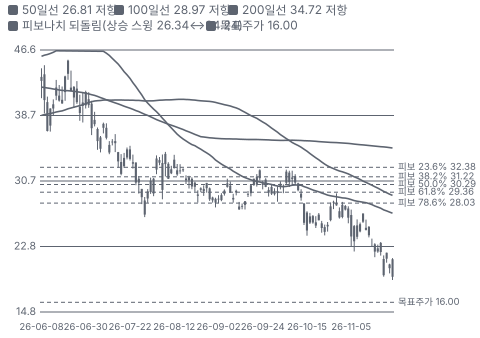

**주봉**

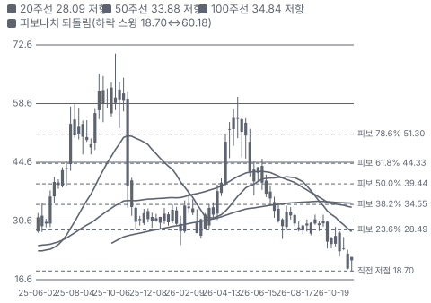

**월봉**

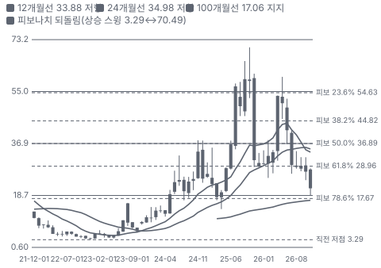

**분기 매출·EPS 실적과 컨센서스**

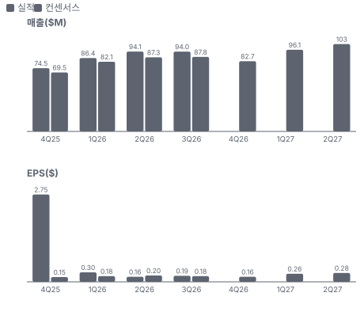

**4Q26 매출 — 지표 추세 vs 가이던스·컨센서스**

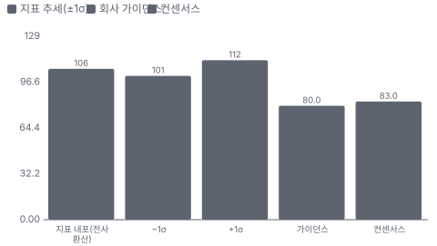

**최근 4개 분기 주가 변화 분석**

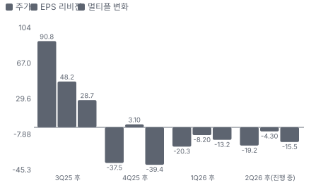

**EPS 리비전**

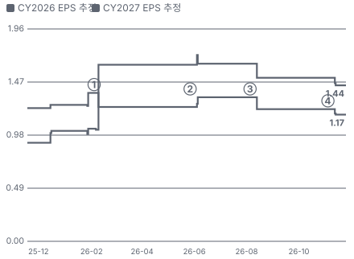

① 26-02-04 3Q FY2025 실적 · 평가충당금 환입 \$113M · EPS 리비전 -10%
② 26-05-27 4Q FY2025 실적 · 1Q 가이던스 \$85M 초과 · EPS 리비전 +8%
③ 26-08-05 1Q FY2026 실적 · 수주 \$130M 초과 · EPS 리비전 -8%
④ 26-11-04 2Q FY2026 실적 · 3Q 가이던스 \$80M 초과 · EPS 리비전 -4%

**멀티플 프리미엄(Fwd 1Y P/E, 최근 4개 분기말 절대값 — 대상 vs 동종 중앙값)**

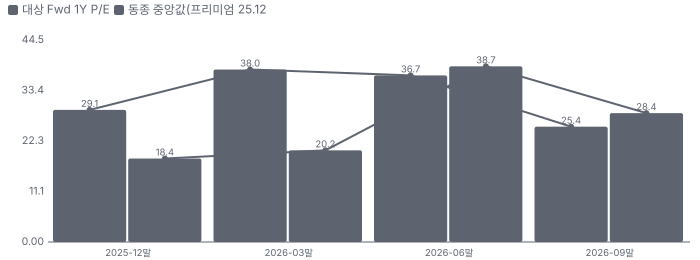

**합리적 멀티플**

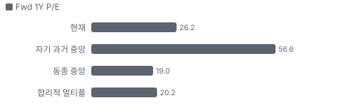

**밸류에이션 주가 시나리오**

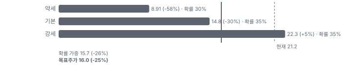

**주가별 업사이드**

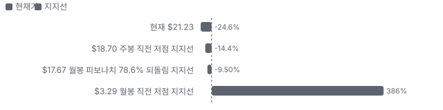
- 제품·서비스 포트폴리오

**고객 믹스(FY2025(2026년 3월 끝)·2Q FY2026, 매출 대비)**

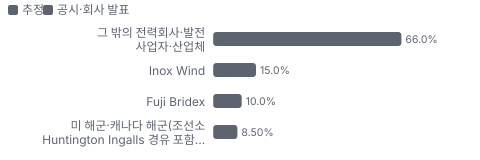

**공급 병목(10점, 낮을수록 병목)**

**CAPEX의 매출 대비 비중**

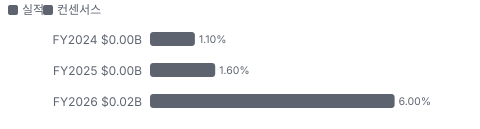

**어닝콜 변화별 주주가치 영향**

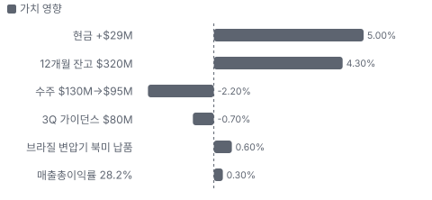

**수주·파이프라인 확실성 사다리**

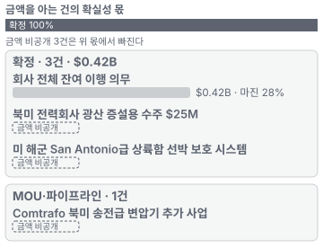

**매출 → 매출총이익 → 영업이익(매출 = 100, 최근 4분기)**

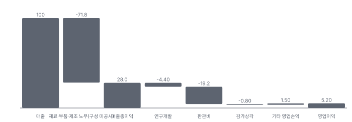

**분기 비용 비중 추이(매출 대비, 공시)**

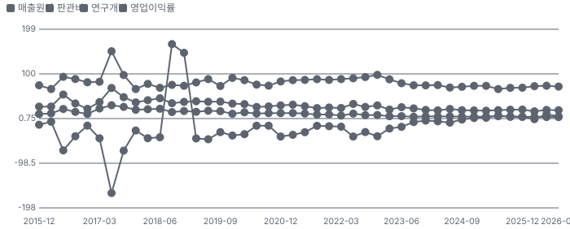

**비용 요인별 매출 대비 비중 1년 변화**

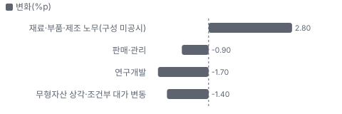

**전력망 BOM 원가 몫**

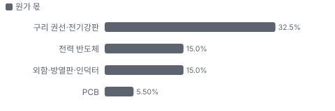

**풍력 BOM 원가 몫**

**BOM 항목 가격 +10% 시 OPM 변화**

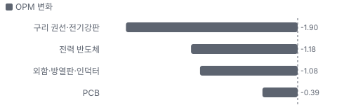

**원가 물가 vs 판매가 물가 — 최근 24개월**

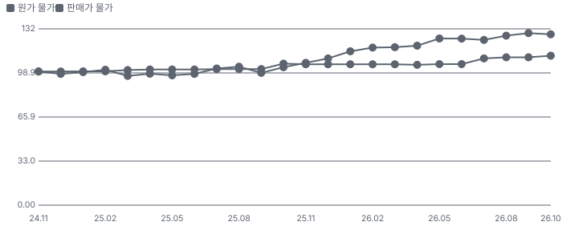

**사업별 매출 vs 물가 — 전년 대비(명목 매출 · 비교 물가 · 실질 = 물량·믹스)**

**자산 구성 — 4Q19 분기말 투하자본 \$21.2M**

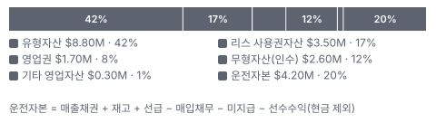

**자산별 변화율 — 최근 12개 분기(2Q16 = 0%) + 다음 4개 분기 추정**

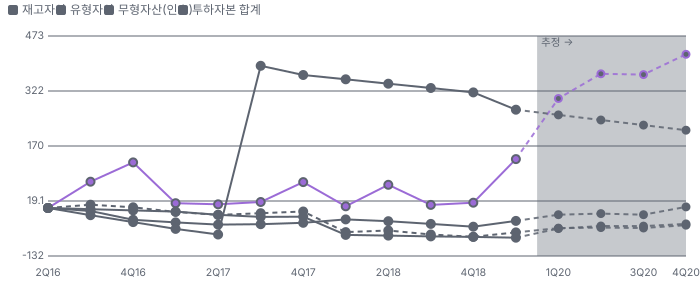

**ROIC 추이 — TTM, 최근 12개 분기 + 다음 4개 분기 추정(컨센서스 NOPAT) · 투하자본이 0 근처라 ROIC가 ±100%를 넘는 분기는 비움**

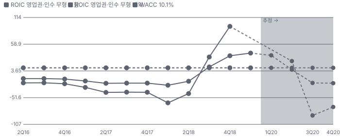

**생산시설별 면적(sq ft, 큰 순) — 생산능력 미공시라 면적을 대용으로**

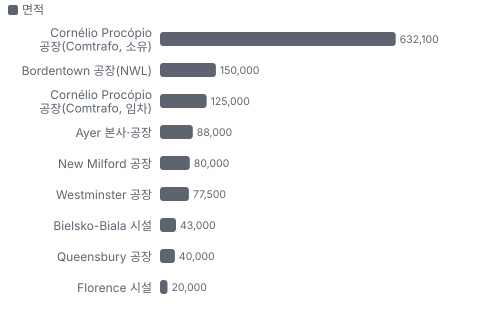

**Comtrafo 인수 효과 — 인수 전 EPS 대비 %, 굵은 선 = 합계 · 시너지 가치 \$0.01B(웃돈 미확인)**

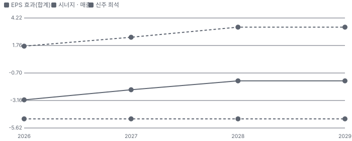

**NWL(Megatran Industries) 인수 효과 — 인수 전 EPS 대비 %, 굵은 선 = 합계 · 시너지 가치 \$0.00B(웃돈 미확인)**

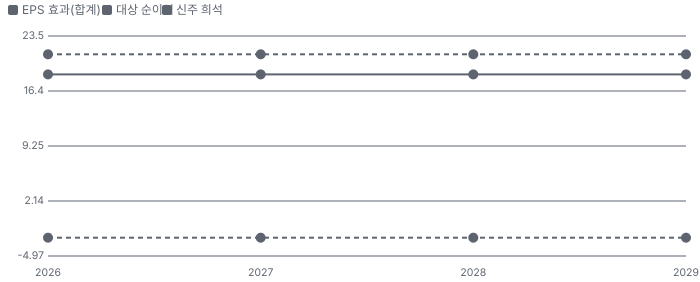

**매출 vs PPI·수출입 — 4Q22 = 100(변화율, 로그 눈금)**

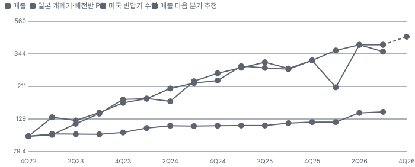

**10년 P·Q 사이클 — 추세(HP 필터) 대비 갭과 8분기 전망**

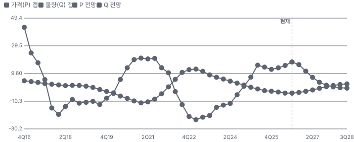

**매출 증가율의 가격·물량 분해와 8분기 전망(전년 대비)**

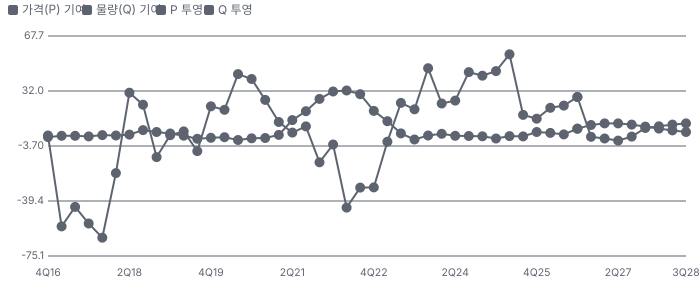

**목표주가 산정 — 기본과 강세 사이(강세 쪽 16%), 도달 확률 약 47%**

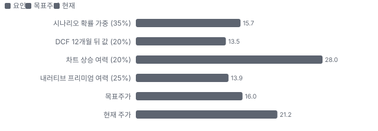

**PEG — 성장 대비 멀티플(낮을수록 성장 대비 쌈)**

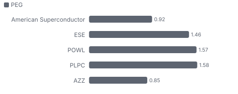

**재고 일수 — 분기별(수주 자료가 없어 수주/출하 비율 없음)**

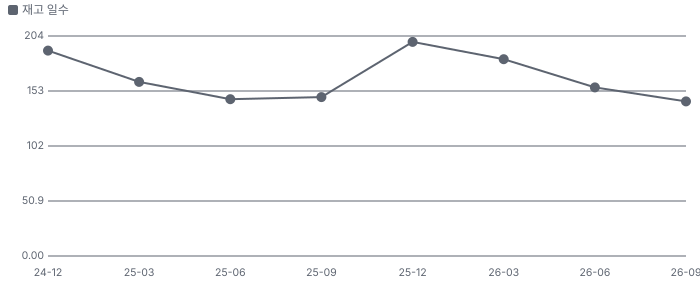

**일별 거래량 분해**

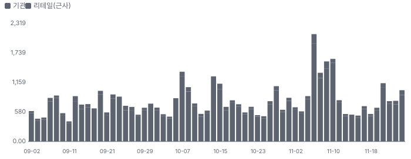

**기관 자금 흐름**

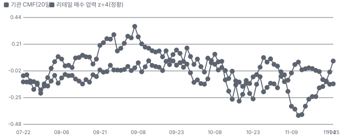

**몬테카를로**

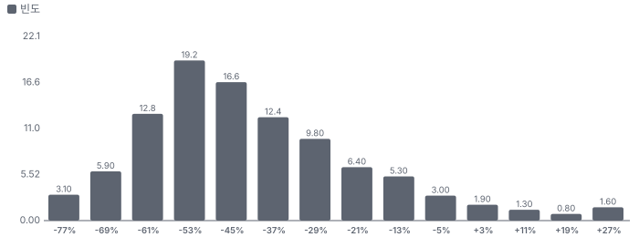

해석: 3,000번 중 157번(5%)에서 가치가 지금 주가 이상이었다. 가정을 흔들어도 지금 주가를 뒷받침하지 못하는 경우가 더 많다. 가운데 값은 0.55배이고, 열 번 중 여덟 번은 0.36~0.88배 사이에 든다.

## 내러티브

> **기업가치를 결정하는 이야기:** 값을 정하는 것은 세 가지다. ① 분기 수주가 \$100M 위에서 이어져 12개월 잔고 \$320M이 매출로 바뀌는가 — 9월 분기 수주는 \$95M 초과로 매출과 비슷했다. ② 매출총이익률이 28%에서 30%대로 돌아오는가 — 인수한 변압기 사업의 가동률에 달렸다. ③ 현금 \$170M이 어디에 쓰이는가 — 회사는 추가 인수를 열어 두고 있다.

> **멀티플·EPS 프리미엄**
> **멀티플:** Fwd 1Y P/E 26.2배 — 동종 중앙 19.0배(ESCO 22.2 · Allient 19.0 · Powell 19.0 · Preformed Line Products 17.9 · AZZ 16.3)보다 38% 높다. 자기 3년 범위(24~320배, 흑자 전환 초기 포함)에서는 아래쪽이다. 분모를 애널리스트 분기 추정 합(\$0.995)으로 바꾸면 21.3배다
> **EPS:** 애널리스트 평균 FY2026 EPS는 1Q 콜 직전 \$1.035에서 \$0.77로, FY2027은 \$1.435에서 \$1.305로 내려왔다. 매출은 네 분기 연속 추정을 넘었지만 EPS는 두 번 넘고 한 번 밑돌았다(2025년 12월 분기는 세금 환입으로 비교 불가)

### 투자자들은 왜 열광했나

2025년 4월 저점(\$14 안팎)에서 10월 15일 종가 \$66.68까지 올랐다 — 'AI 전력 수요 + 전력망 현대화'에 흑자 전환이 겹쳤다. 2025년 11월 6일 실적 다음 날 하루에 −38.5%(\$59.42 → \$36.55) 내렸고, 2026년 4~5월 다시 \$58.72까지 갔다가 6월부터 식었다. 식은 이유로 확인되는 것은 셋이다 — 6월 초 경영진의 사전 계획 매도, 8월·11월 두 번의 EPS 추정 하향, 11월 가이던스 하한 하향(\$85M → \$80M). 6~7월 낙폭의 직접 원인은 확인하지 못했다(회사 공시 없음).

### 무엇이 기업가치를 바꾸나

> **구조적 체질 변화**
> **변화:** 풍력 부품 회사에서 전력망 장비 회사로 바뀌었다 — Grid 비중 82%. 비GAAP 기준 3년 연속, GAAP 기준 2년 연속 흑자이고 차입이 없다
> **증거:** 1Q FY2026 어닝콜 · 2Q FY2026 10-Q
> **반증:** 분기 GAAP 영업이익이 적자로 돌아간다

> **고부가 믹스 확장**
> **변화:** 반대 방향이다 — 이익률이 낮은 변압기(Comtrafo)가 들어와 매출총이익률이 1년 새 31.0%에서 28.2%로 내려왔다. 회사는 30%대 복귀를 말한다
> **증거:** 2Q FY2026 실적 보도자료(계산) · 2Q FY2026 어닝콜(2026-11-05)
> **반증:** 매출총이익률이 두 분기 연속 28% 아래

> **기술 혁신**
> **변화:** 해당 없음(이번 콜에 새 제품·기술 발표가 없다) — 초전도 선박 보호 시스템은 기존 사업이고, 커뮤니티가 기대하는 초전도 전선 매출은 공시되지 않는다
> **증거:** 2Q FY2026 어닝콜(2026-11-05) · FY2025 10-K

> **실행 속도**
> **변화:** 해당 없음(주문에서 인도까지 리드타임 수치를 회사가 공시·콜에서 밝히지 않는다) — 고객이 계약 납기보다 빨리 달라고 해 두 분기 연속 가이던스를 약 \$10M씩 넘겼다 **납품 리드타임 미확인.** 피어 비교 미확인. 이전 대비 미확인.
> **증거:** 2Q FY2026 어닝콜(2026-11-05)
> **반증:** 12월 분기 매출이 가이던스 하한 \$80M을 밑돈다

> **M&A**
> **변화:** 2024년 8월 NWL(\$61.4M), 2025년 12월 Comtrafo(\$202.9M)를 샀다. Comtrafo 뒤 세 분기 영업현금흐름이 \$58M을 넘었고 CEO는 다음 인수를 열어 뒀다 — 현금 \$170M
> **증거:** Comtrafo 종결 8-K · 2Q FY2026 어닝콜(2026-11-05)
> **반증:** 조건부 대가 부채가 계속 줄어든다(Comtrafo 실적이 목표에 못 미친다는 뜻)

> **정책·입법 연관성**
> **재정정책:** 미 해군·캐나다 해군 조달 예산에 군 매출(10% 미만)이 달려 있다 — 10-K는 정부 계약이 연간 세출에 좌우된다고 적는다. 계약 금액은 공시하지 않는다 FY2025 10-K 위험 요인 반증: 함정 건조 예산 삭감 의회 동의 2/10 — 하원 1/5(이 회사에 닿는 세출 항목·법안 번호를 1차 자료로 확인하지 못했다) · 상원 1/5(이 회사에 닿는 세출 항목·법안 번호를 1차 자료로 확인하지 못했다).
> **행정명령:** 해당 없음 — 이 회사 매출에 직접 닿는 행정명령을 1차 자료로 확인하지 못했다(커뮤니티의 '국방물자생산법 수혜' 주장은 회사 자료에 없다) FY2025 10-K · 2Q FY2026 10-Q
> **연관입법:** 재생에너지 세액공제 축소 여부가 접속 설비 수요에 닿는다 — 9월 분기 수주의 25% 이상이 재생에너지다. 법안 단계는 확인하지 못했다 2Q FY2026 어닝콜(2026-11-05) 반증: 세액공제 축소 입법

> **고객의 지출 예산**
> **변화:** 매출 대부분이 고객의 설비투자에서 나온다 — 발전·송전 사업자의 접속 설비, 산업체 증설, 해군 함정 건조, 풍력 터빈 생산
> **사업별 예산:** **매출의 82%**: 전력망 — 고객 CAPEX(전력회사·발전 사업자·산업체의 변전·접속 설비 투자, 해군 함정 건조 예산) · 동인: 재생에너지 접속, 산업 부하 증설, 미국 변압기 부족
**매출의 18%**: 풍력 — 고객 CAPEX(터빈 제조사의 부품 구매(터빈 생산 대수에 연동)) · 동인: 인도 풍력 설치
> **증거:** FY2025 10-K · 2Q FY2026 어닝콜(2026-11-05)
> **반증:** 전력회사·발전 사업자의 접속 사업이 미뤄진다

### 내러티브 근거

> 'AI·재생에너지가 전력망을 바꾸고, 그 장비를 파는 작은 회사'라는 이야기였다. 매출은 이야기대로 늘었다(+43%). 식은 것은 두 가지다 — 주당이익 추정이 석 달 새 내려왔고(FY2026 \$1.04 → \$0.77), 다음 12개월 이익 대비 배수가 4월 말 60배에서 26배가 됐다. 동종 대비 멀티플 차이 +38% 중 회사 고유 몫은 +30%다. 단계는 소멸, 쏠림은 낮음이다.

> **전력망 투자 확대** · 약화
> **논리:** 재생에너지 접속·산업 부하 증가로 전압 보상 장치와 변압기 수요가 는다
> **숫자:** Grid 매출 \$76.7M(+41% YoY), 상반기 수주 약 \$230M(1년 전의 두 배 이상), 12개월 잔고 \$319.5M — 다만 9월 분기 수주는 \$95M 초과로 전 분기 \$130M 초과에서 내려왔다
> **반증:** 분기 수주가 두 분기 연속 매출을 밑돈다
> **출처:** 2Q FY2026 어닝콜(2026-11-05) · 2Q FY2026 10-Q

> **인수로 넓힌 제품군** · 유지
> **논리:** NWL(전원·변압기)과 Comtrafo(변압기)를 붙여 변전소 한 곳에 파는 품목을 늘린다
> **숫자:** Comtrafo 인수 뒤 세 분기 영업현금흐름 \$58M 초과, 변압기 북미 첫 인도(165MVA)
> **반증:** 매출총이익률이 28% 아래에 머문다
> **출처:** 2Q FY2026 어닝콜(2026-11-05)

> **해군 함정 채택** · 유지
> **논리:** 미 해군·캐나다 해군 함정에 선박 보호 시스템이 계속 들어간다
> **숫자:** 군 매출 비중 10% 미만(9월 분기)
> **반증:** 후속 함 발주 공백
> **출처:** FY2025 10-K · 2Q FY2026 어닝콜(2026-11-05)

> **인도 풍력(Inox)** · 강화
> **논리:** Inox Wind의 터빈 설치가 늘면 전기 제어 시스템(풍력 터빈의 발전기 출력과 날개 각도를 제어하는 전력 변환·제어 장치 묶음) 출하가 는다
> **숫자:** Wind 매출 \$17.4M(+51% YoY), Inox가 분기 매출의 18%
> **반증:** Inox 주문이 줄거나 대금 회수가 늦어진다
> **출처:** 2Q FY2026 10-Q

> **(반대) 분기 변동·낮은 이익률·얇은 커버리지** · 강화
> **논리:** 매출은 인도 시점에 따라 흔들리고, 인수로 매출총이익률이 31%에서 28%로 내려왔으며, 이익 추정은 2명이 만든다 — 배수 26배를 받칠 근거가 얇다
> **숫자:** Fwd 1Y P/E 60배(4월 말) → 26배, FY2026 EPS 추정 \$1.04 → \$0.77, 3Q 가이던스 하한 \$80M(2Q 실적 −15%), 공매도 10.2%
> **반증:** 12월 분기 매출이 \$90M을 넘고 수주가 \$100M을 넘는다(반대 내러티브 약화)
> **출처:** 2Q FY2026 실적 보도자료 · 컨센서스 집계

### 투자 포인트

> **매출은 늘었는데 이익 추정이 내려왔다**
> **명제:** 주가 −36%(8월 5일 이후)의 대부분은 배수 하락이고, 나머지는 EPS 추정 하향이다
> **숫자:** FY2027 EPS 추정 \$1.435 → \$1.305(−9%), 같은 기간 주가 \$32.94 → \$21.23(−36%). 9월 분기 매출 +43%, 비GAAP EPS \$0.19(1년 전 \$0.20) — 주식 수가 늘고 이익률이 내려와 주당이익은 제자리다
> **시장과 다른 점:** 셀사이드 6명 중 5명이 Strong Buy이고 목표가 평균이 \$52.6이라 '시장이 간과했다'고 말할 수 없다. 다른 점은 숫자의 두께다 — 목표가를 받치는 추정은 2명이 만들고 석 달째 내려오는 중이다
> **증명:** 12월 분기 비GAAP EPS가 가이던스 하한 \$0.15를 얼마나 넘는지, FY2027 추정이 \$1.3에서 멈추는지
> **출처:** 2Q FY2026 실적 보도자료 · 컨센서스 집계

> **잔고가 다음 1년 매출의 83%를 덮는다**
> **명제:** 분기 매출은 흔들려도 12개월 잔고는 석 달마다 늘고 있다
> **숫자:** 12개월 잔여 이행 의무 \$253.5M(2025-12) → \$282.4M → \$301.8M → \$319.5M(2026-09). 다음 4개 분기 애널리스트 매출 합 \$386.7M의 83%
> **시장과 다른 점:** 시장은 3Q 가이던스 하한 하향을 수요 둔화로 읽었다(다음 날 −8.7%). 잔고 숫자는 인도 시점 이동이라는 회사 설명과 맞는다 — 다만 9월 분기 수주가 \$95M로 내려온 것은 설명되지 않았다
> **증명:** 12월 분기 수주 \$100M 이상, 12개월 잔고 \$320M 이상 유지
> **출처:** 10-Q 잔여 이행 의무 주석 4건

> **인수가 매출을 키우고 이익률을 낮췄다**
> **명제:** Comtrafo는 매출과 현금흐름을 더했지만 매출총이익률을 31%에서 28%로 낮췄고 주식 수를 5% 늘렸다
> **숫자:** Comtrafo 대가 \$202.9M(신주 2.4M주 포함), 영업권 \$122.7M. 9월 분기 매출총이익률 28.2%(1년 전 31.0%). 조건부 대가 부채 \$39.5M → \$30.5M(평가 이익 — 목표 달성 기대가 낮아졌다는 뜻일 수 있다)
> **시장과 다른 점:** 회사는 변압기 북미 진입이 예정보다 2년 빠르다고 강조한다. 조건부 대가 부채가 두 분기 연속 줄어든 것은 그 낙관과 방향이 다르다 — 어느 쪽인지는 Comtrafo 실적이 따로 공시되지 않아 가릴 수 없다
> **증명:** 조건부 대가 평가 변동의 방향, 매출총이익률 30% 회복 여부
> **출처:** 2Q FY2026 10-Q · Comtrafo 종결 8-K

### 모멘텀 생성·소멸 타임라인

**카탈리스트 달력 — 지난 사건의 주가 반응과 앞으로 확인할 숫자**
| 날짜 | 상태 | 구분 | 사건 | 반응·확인 | 결과에 따라 |
|---|---|---|---|---|---|
| 2026-02-05 | 완료 | 소멸 | 3Q FY2025 실적 — 세금 환입으로 순이익 \$117.8M, 다음 분기 가이던스 \$80M 초과 | -6.0% |  |
| 2026-05-11 | 완료 | 생성 | 52주 종가 고점 \$58.72 — 4월 이후 AI 전력주 묶음 강세 | 4월 초 대비 약 +70% |  |
| 2026-06-02 | 완료 | 소멸 | CEO·CFO 사전 계획 매도 신고 \$5.2M, 6월 한 달 −18.5% | -18.5%(6월) |  |
| 2026-08-06 | 완료 | 소멸 | 1Q FY2026 실적 — 수주 \$130M 초과에도 EPS 추정 하향 | -0.1% |  |
| 2026-11-05 | 완료 | 소멸 | 2Q FY2026 실적 — 3Q 가이던스 하한 \$80M | -8.7% |  |
| 2027-02 초(예상) | 예정 | 확인 | 3Q FY2026 실적 · 4Q 가이던스 | 매출 \$90M 이상(가이던스 하한 \$80M, 애널리스트 평균 \$82.7M), 수주 \$100M 이상, 매출총이익률 28% 이상 | 셋 다 넘으면 기본~강세 쪽, 매출이 \$80M대 초반이고 수주가 매출을 밑돌면 약세 쪽으로 본다 |
| 2027-05 말(예상) | 예정 | 확인 | 4Q FY2026 실적 · FY2026 10-K | 12개월 잔고 \$320M 이상, 조건부 대가 평가 방향, 10% 초과 고객 몫 | 잔고가 줄면 FY2027 매출 추정 \$432M이 내려간다 |
| 2027년 상반기 | 예정 | 매크로 | 미국 재생에너지 세액공제·전력망 접속 정책 | 세액공제 축소 입법 여부, 접속 대기 사업의 일정 | 재생에너지 수주 비중(25% 이상)이 줄면 수주 ÷ 매출이 1 아래로 간다 |

### 언제 사서 언제 팔아야 할까?

**가격·조건 틀 — 가격은 밸류에이션(약세·기본·강세·목표주가)과 차트 지지 구간에서, 조건은 이벤트에서**
| 구간 | 가격 | 목표주가까지 | 약세까지 | 조건·근거 |
|---|---|---|---|---|
| 관찰 구간 | \$19~\$19 | -14% | -52% | 11월 20일 종가 \$19.28과 11월 25일 장중 \$18.70이 52주 저점이다. 지금 \$21.23은 그 위 10%에 있고 50일선(\$26.81)·200일선(\$34.72) 모두 아래다 |
| 확인 뒤 | 지금 \$21 이상에서 조건 확인 | -25% | -58% | 12월 분기 매출 \$90M 이상·수주 \$100M 이상, 비GAAP EPS \$0.17 이상, FY2027 EPS 추정이 \$1.3 아래로 더 내려가지 않는 것 |
| 무효화 | 약세 시나리오 \$9 | - | -58% | 12월 분기 매출이 가이던스 하한 \$80M을 밑돌거나, 12개월 잔고가 \$300M 아래로 내려가거나, Inox Wind 주문 축소가 공시된다 |
| 차익 고민 2차 | \$22(강세 시나리오) | +5% | - | 목표주가가 지금 주가 아래라 차익 고민보다 약세 논리 점검이 먼저다. 주가가 강세 시나리오 가격 부근으로 오르면 Fwd 1Y P/E가 다시 동종 중앙을 넘는다 — 추정 2명·분기 변동·고객 집중은 그때도 남는다 |

실적 다음 날 −38.5%(2025년 11월)·−8.7%(2026년 11월)처럼 실적일 변동이 크다 — 구간은 종가 기준으로 본다 가격·조건 틀이며 매매·비중 지시가 아니다(투자 권유 아님).

## 포트폴리오

| 제품·서비스 | 구분 | 무엇 | 쓰는 곳 | 돈 버는 방식 | Mix | Mix 변화(전년 대비) |
|---|---|---|---|---|---|---|
| 전력망 | 제품 | 전력망 전압을 잡는 무효전력 보상 장치, 변압기·정류기·산업용 전원, 해군 함정의 선박 보호 시스템 | 전력회사 변전소, 풍력·태양광 접속, 광산·반도체 공장, 해군 함정 | 9월 분기 매출의 82%(\$76.7M, +41%) | 82% | -1.0%p |
| 풍력 | 제품 | 풍력 터빈의 전기 제어 시스템과 터빈 설계 라이선스 | 인도 Inox Wind 등 터빈 제조사 | 9월 분기 매출의 18%(\$17.4M, +51%) | 18% | +1.0%p |

**Mix 변화가 가장 큰 쪽은 전력망(-1.0%p, 전년 대비).** 계절성 판정: 분기 매출 계절 지수 기준 있음 → 전년 같은 분기와 비교.

## 고객

> **FY2025(2026년 3월 끝)·2Q FY2026 최대 고객 그 밖의 전력회사·발전 사업자·산업체 66%, 상위 3곳 91%, 집중도 집중.** 공시·회사 발표로 확인한 몫은 매출의 25%이고, 나머지 고객 몫은 추정이거나 미분해다. 10% 넘는 고객은 두 곳이다 — 인도 풍력 터빈사 Inox Wind 15%(Wind 부문 거의 전부), 아시아 유통 고객 Fuji Bridex 10%. 9월 분기에는 Inox가 18%로 올랐다. 나머지 75%는 전력회사·발전 사업자·산업체·해군에 흩어져 있고 회사는 시장별 비중만 말한다(9월 분기: 전통·재생 에너지 절반 이상, 전력회사·소재 각 약 20%, 군 10% 미만).

**고객별 매출 몫(FY2025(2026년 3월 끝)·2Q FY2026)**
| 고객 | 몫 | 변화 | 근거 |
|---|---|---|---|
| 그 밖의 전력회사·발전 사업자·산업체 | 66% | 미확인 | 추정 |
| Inox Wind | 15% | +1%p | 공시 |
| Fuji Bridex | 10% | 미확인 | 공시 |
| 미 해군·캐나다 해군(조선소 Huntington Ingalls 경유 포함) | 7~10% | 미확인 | 추정 |

> **그 밖의 전력회사·발전 사업자·산업체** · 추정
> **사는 것:** 무효전력 보상 장치·변압기·정류기·산업용 전원
> **추정 근거:** 100%에서 위 세 묶음을 뺀 나머지(계산) — 10-K가 이름을 든 고객은 Capital Power·Targa Resources·Micron·SSE·Copel 등

> **Inox Wind** · 공시
> **사는 것:** 풍력 터빈 전기 제어 시스템(2MW·3MW급) — Wind 부문 매출의 대부분

> **Fuji Bridex** · 공시
> **사는 것:** Grid 부문 제품 — 품목 미공시(FY2024에는 10% 미만)

> **미 해군·캐나다 해군(조선소 Huntington Ingalls 경유 포함)** · 추정
> **사는 것:** 선박 보호 시스템
> **추정 근거:** CEO가 9월 분기 군 매출을 '10% 조금 못 미친다', 6월 분기 '거의 10%'라고 말했다 — 군 매출 전체를 해군 고객 몫으로 본 범위

## 수주·파이프라인

> **2026-09-30 기준 4건.** 확정 \$0.42B. 공시 잔여 이행 의무 \$0.42B. 서로 겹치는 항목은 합계에서 뺐다.

**수주 목록**
| 상태 | 계약 | 계약 총액 | 진척 | 기간 | 비고 |
|---|---|---|---|---|---|
| 확정 | 회사 전체 잔여 이행 의무 | \$0.42B | - | - | - |
| 확정 | 북미 전력회사 광산 증설용 수주 \$25M(북미) | 금액 비공개 | - | - | 1Q FY2026 콜에서 공개한 \$25M 수주 — 잔고 \$423.1M 안에 들어 있어 합계에 따로 더하지 않는다. 고객 이름·인도 일정 미공시 (잔고 \$423.1M에 포함) |
| 확정 | 미 해군 San Antonio급 상륙함 선박 보호 시스템(미국) | 금액 비공개 | - | - | 2022년 1월 첫 인도, 2025년 추가 인도 — 계약 금액은 공시하지 않는다 (잔고 \$423.1M에 포함) |
| 파이프라인 | Comtrafo 북미 송전급 변압기 추가 사업(북미) | 금액 비공개 | - | - | CEO가 '비슷한 규모 사업을 추가로 진행 중'이라고만 말했다 — 수주가 아니다 (다른 항목과 겹칠 수 있어 합계에서 뺌) |

**실행 속도와 방해 요인**
| 항목 | 상태 | 실행 속도 | 방해 요인 |
|---|---|---|---|
| 회사 전체 잔여 이행 의무 | 확정 | 분기 매출 약 \$94M, 분기 수주 \$95M~130M | 고객 인도 일정(분기 간 이동) · Comtrafo 공장 인력·가동률 |
| 북미 전력회사 광산 증설용 수주 \$25M | 확정 | 미확인 | 인도 일정 미공시 |
| 미 해군 San Antonio급 상륙함 선박 보호 시스템 | 확정 | 미확인 | 연간 국방 세출 · 조선소 건조 일정 |
| Comtrafo 북미 송전급 변압기 추가 사업 | 파이프라인 | 미확인 | 수주 미확정 · 브라질 → 미국 물류·관세 |

## 마진 구조

> **GPM 28.2%, OPM 5.7%.** 2Q25 대비 GPM -2.8%p, OPM +1.2%p. 9월 분기 매출총이익률은 28.2%(1년 전 31.0%, 전 분기 26.3%), GAAP 영업이익률은 5.7%(1년 전 4.5%)다. 매출이 43% 느는 동안 연구개발비는 그대로였고 판관비는 36% 늘었다. 매출총이익률이 1년 전보다 낮은 것은 이익률이 낮은 Comtrafo 변압기가 들어왔기 때문이고, 전 분기보다 오른 것은 그 공장 가동률이 올랐기 때문이다(회사 설명). 매출원가의 재료·노무 구성은 공시하지 않는다.

> **매출 100 중 매출원가 72.0, 매출총이익 28.0(최근 4분기, 공시).** 매출원가 요인 중 재료·부품·제조 노무(구성 미공시)이 매출의 71.8%로 가장 무겁고, 단가가 +10% 오르면 GPM이 -7.18%p 움직인다. 분기 회귀로 매출 1이 늘 때 매출원가는 0.68 늘고, 매출원가의 고정비 몫은 12%다.

**비용 요인 강도 — 비중·추세·충격(+10%)·탄력**
| 비용 | 구분 | 매출 대비 | 1년 변화 | 마진 기여 | 충격 시 마진 | 매출 탄력 | 고정비 몫 |
|---|---|---|---|---|---|---|---|
| 재료·부품·제조 노무(구성 미공시) | 매출원가 요인 | 71.8% | +2.8%p | -2.8%p | -7.18%p | 미확인 | 미확인 |
| 매출원가 | 공시 항목 | 72.0% | +1.7%p | -1.7%p | -7.20%p | 0.68 | 12% |
| 판관비 | 공시 항목 | 19.2% | -0.1%p | +0.1%p | 미확인 | 0.15 | 41% |
| 연구개발 | 공시 항목 | 4.4% | -1.0%p | +1.0%p | 미확인 | 0.02 | 81% |
| 감가상각 | 공시 항목 | 0.8% | +0.2%p | -0.2%p | 미확인 | 0.01 | 38% |

매출 탄력 = 분기 비용을 매출에 회귀한 기울기(매출 1당 변동비), 고정비 몫 = 절편 ÷ 평균 비용. 표본이 8분기 미만이면 미확인. 매출원가 요인 비중은 margin 재료의 추정이 섞여 있고, 공시 매출원가와의 차이는 '기타 매출원가'로 둔다.

**GPM에서 OPM까지(GAAP — 10-Q 3개월 손익, 아래는 최근 4개 분기)**
| 기간 | GPM | 연구개발 | 판관비 | 기타 | OPM |
|---|---|---|---|---|---|
| 2Q25 | 31.0% | 5.7% | 20.4% | 0.5% | 4.5% |
| 2Q26 | 28.2% | 4.0% | 19.4% | -0.9% | 5.7% |
| 2025-12 | 30.7% | - | - | - | 4.5% |
| 2026-03 | 27.3% | - | - | - | -0.6% |
| 2026-06 | 26.3% | - | - | - | 10.5% |
| 2026-09 | 28.2% | - | - | - | 5.7% |

**비용을 움직이는 요인**
| 비용 | 요인 |
|---|---|
| 재료·부품·제조 노무(구성 미공시, 매출원가) | 구리·전기강판·전력 반도체 단가, 브라질 공장 가동률, 제품 구성(변압기 비중) · 근거 공시 |
| 판매·관리(판관비) | Comtrafo 편입 인력, 주식보상(분기 \$6.5M) · 근거 공시 |
| 연구개발(연구개발) | 엔지니어 인건비 · 근거 공시 |
| 무형자산 상각·조건부 대가 변동(기타) | Comtrafo 실적 목표 달성 가능성 재평가(비현금) · 근거 공시 |

**전력망 BOM — 매출의 82%, GPM 28%(회사 전체 매출총이익률 — 부문별 이익률 미공시), 항목 가격 +10% 시**
| 항목 | 원가 몫 | 전가 | 제품 GPM | OPM |
|---|---|---|---|---|
| 구리 권선·전기강판 | 25~40% | 미확인 | -2.3%p | -1.90%p |
| 전력 반도체 | 10~20% | 미확인 | -1.1%p | -0.88%p |
| 외함·방열판·인덕터 | 10~20% | 미확인 | -1.1%p | -0.88%p |
| PCB | 3~8% | 미확인 | -0.4%p | -0.32%p |
| 미분해 | 32% | - | - | - |

**풍력 BOM — 매출의 18%, GPM 28%(회사 전체 매출총이익률 — 부문별 이익률 미공시), 항목 가격 +10% 시**
| 항목 | 원가 몫 | 전가 | 제품 GPM | OPM |
|---|---|---|---|---|
| 전력 반도체 | 15~30% | 미확인 | -1.6%p | -0.30%p |
| 외함·방열판·인덕터 | 10~20% | 미확인 | -1.1%p | -0.20%p |
| PCB | 3~8% | 미확인 | -0.4%p | -0.07%p |
| 미분해 | 57% | - | - | - |

구리 권선·전기강판 가격이 +10% 오르면 영업이익은 -33.4% 움직인다. 판매가 전가를 모르는 항목은 전가 0%로 계산했다.

**BOM 항목 가격을 움직이는 것**
| 항목 | 요인 |
|---|---|
| 전력 반도체 | 무효전력 보상 장치·정류기의 스위칭 소자 · 근거 추정 |
| 구리 권선·전기강판 | 변압기(Comtrafo·NWL) 원가의 가장 큰 덩어리 · 근거 추정 |
| 외함·방열판·인덕터 | 스테인리스강 관세가 위험 요인으로 적혀 있다 · 근거 추정 |
| PCB | 제어 보드 · 근거 추정 |
| 전력 반도체 | 터빈 변환기의 스위칭 소자 · 근거 추정 |
| 외함·방열판·인덕터 | 변환기 함체와 냉각 · 근거 추정 |

> **원가·판매가 물가 격차 -18.3%p** — 판매가 물가가 투입 원가 물가보다 느리게 오른다.

**투입 물가 — 미국 PPI 3·6·12개월(2026-10, 개정 반영)과 해외 전년비**
| 항목 | 미국 3개월 | 6개월 | 12개월 | 전가 못 할 때 OPM | 일본 | 한국 | 대만 |
|---|---|---|---|---|---|---|---|
| 전력 반도체 | -0.7% | -5.7% | -2.7%* | - | +1.6%* | 미확인 | 미확인 |
| 구리 권선·전기강판 | +3.4% | +7.2% | +23.9% | - | +42.6% | +19.2% | +40.1% |
| PCB | +0.0% | +24.0% | +46.4% | - | +11.5% | +1.7% | +12.1% |

별표는 품목보다 넓은 업종 지수다. 연결한 투입 원가의 미국 PPI(생산자물가지수)는 1년 새 가중 +23.9%이고, 판매가로 넘기지 못하면 GPM -17.1%p·OPM -17.1%p가 움직인다. 판매가 비교 물가(변압기 PPI)는 1년 새 +5.6% — 회사 가격 변화는 미확인. 전력망 매출은 2026-09 전년 대비 +41.1%이고 비교 물가 ppi:transformer의 변화 +8.6%(2026-09)를 빼면 실질 +29.9% — 물량·믹스가 성장을 이끌었다.

## 자산 구성

> **4Q19 분기말 투하자본 \$21.2M** — 유형자산 42%, 운전자본 20%. 최근 12개 분기(2Q16 → 4Q19) 가장 크게 늘어난 자산은 무형자산(인수, +270%), 투하자본 합계 -67%. 4Q20 추정 투하자본 \$33.9M(+60%, 컨센서스 매출과 회전 일수·CAPEX 강도 유지 가정). 연율 감가 비율(순액 기준)은 직전 4분기 14.75% → 최근 4분기 11.82%, 직전 비율이면 감가상각이 \$2.5M 더 컸다(영업이익의 7.5%).

**자산·운전자본 항목별 분기말 잔액 — 최근 12개 분기와 다음 4개 분기 추정**
| 항목 | 2Q16 | 1Q18 | 4Q19(최근) | 4Q20 추정 | 12개 분기 변화 | 다음 4개 분기 변화 |
|---|---|---|---|---|---|---|
| 매출채권 | \$7.0M | \$7.4M | \$16.5M | \$36.8M | +134% | +123% |
| 재고자산 | \$28.9M | \$19.8M | \$18.6M | \$29.7M | -36% | +60% |
| 선급·기타 유동자산 | \$4.1M | \$2.9M | \$3.7M | \$10.9M | -9% | +193% |
| 매입채무 | \$7.7M | \$3.1M | \$7.3M | \$7.5M | -4% | +2% |
| 미지급비용 | \$17.0M | \$9.5M | \$12.0M | \$34.2M | -29% | +184% |
| 선수수익(계약부채) | 미확인 | \$13.5M | \$15.2M | \$36.6M | 비교 불가 | +140% |
| 유형자산 | \$48.3M | \$12.5M | \$8.8M | \$27.1M | -82% | +207% |
| 리스 사용권자산 | 미확인 | 미확인 | \$3.5M | \$3.5M | 비교 불가 | +0% |
| 영업권 | 미확인 | \$1.7M | \$1.7M | \$1.7M | 비교 불가 | +0% |
| 무형자산(인수) | \$0.7M | \$3.2M | \$2.6M | \$2.2M | +270% | -15% |

**자산 추정 동인 — 최근 4개 분기 평균(재무상태표 동인 모형)**
| 동인 | 값 | 곱하는 기준 |
|---|---|---|
| 매출채권 | 142일 | 매출 |
| 재고자산 | 138일 | 매출원가 |
| 선급·기타 유동자산 | 42일 | 매출 |
| 매입채무 | 35일 | 매출원가 |
| 미지급비용 | 132일 | 매출 |
| 선수수익(계약부채) | 141일 | 매출 |
| 유형자산 ÷ 분기 매출 | 1.15배 | CAPEX·감가 재료 없음 — 비율 유지 |
| 매출원가율 | 102.6% | 매출(최근 4개 분기) |
| 영업권·리스 사용권·기타 | 유지 | 인수·새 리스는 공시 전 모름 |
| 인수 무형자산 | 분기 \$0.1M 상각 | 최근 4개 분기 평균 상각 |

**추정 방법:** 증권사 3표 모델(손익·재무상태표·현금흐름)의 재무상태표 동인 방식이다. 운전자본은 항목별 회전 일수(매출채권·선급·미지급·선수는 매출, 재고·매입채무는 매출원가 기준)를 최근 4개 분기 평균으로 두고 컨센서스 매출에 곱한다. 유형자산은 기초 + CAPEX − 감가상각으로 굴린다(Koller·Goedhart·Wessels 『Valuation』 재무상태표 추정). 매출 경로는 ROIC 절의 컨센서스와 같다.

**유형·무형자산 항목별 가치(2021-03-31 vs 2020-03-31)**
| 구분 | 항목 | 총액 2021-03-31 | 누적상각 | 순액 | 총액 2020-03-31 | 총액 1년 변화 | 공시 내용연수 |
|---|---|---|---|---|---|---|---|
| 유형 | 유형자산 합계(항목 미분해) | \$51.4M | 총계만 공시 | 총계만 공시 | \$48.6M | +5.7% | 미확인 |
| 영업권 | 영업권 | \$34.6M | \$0.0M | \$34.6M | \$1.7M | +1914.8% | 비상각 |
| 유형 합계 | 유형자산 | \$51.4M | \$42.4M | \$9.0M | \$48.6M | +5.7% | 경과율 83%(상각 대상 기준) |

**내용연수 산식(상각 대상 유형자산 = 총액 − 토지 − 건설중)**
| 기준일 | 연 감가상각 | 상각 대상 총액 | 평균 내용연수 | 경과 연수 | 잔여 연수 | 경과율 |
|---|---|---|---|---|---|---|
| 2021-03-31 | \$4.4M | \$51.4M | 11.7년 | 9.6년 | 2.0년 | 83% |
| 2020-03-31 | \$3.1M | \$48.6M | 15.7년 | 12.9년 | 2.8년 | 82% |

산식 평균 내용연수는 11.7년. 1년 전 15.7년 → 지금 11.7년.

**분기 감가 비율(감가상각 ÷ 평균 유형자산 순액)**
| 분기 | 감가상각 | 평균 유형자산(순액) | 분기 비율 | 연율 | 연율의 역수 |
|---|---|---|---|---|---|
| 4Q24 | \$1.6M | \$38.6M | 4.12% | 16.48% | 6.1년 |
| 1Q25 | \$1.6M | \$38.5M | 4.10% | 16.38% | 6.1년 |
| 2Q25 | \$1.2M | \$38.5M | 3.19% | 12.75% | 7.8년 |
| 3Q25 | \$1.3M | \$38.7M | 3.35% | 13.39% | 7.5년 |
| 4Q25 | \$1.8M | \$63.2M | 2.83% | 11.32% | 8.8년 |
| 1Q26 | \$3.2M | \$88.6M | 3.61% | 14.45% | 6.9년 |
| 2Q26 | \$2.6M | \$94.3M | 2.81% | 11.23% | 8.9년 |
| 3Q26 | \$2.6M | \$99.8M | 2.59% | 10.35% | 9.7년 |

감가상각 기준: 손익계산서 감가상각·상각비(SEC 공시 데이터, 4분기 = 연간 − 1~3분기). 분기 유형자산 총액이 없어 순액 기준.

**감가율 하락 경고: 연율 14.75% → 11.82%(-20%).** 직전 4분기 비율을 그대로 쓰면 최근 4분기 감가상각이 \$2.5M 더 컸다(영업이익의 7.5%). 내용연수 연장·상각 끝난 자산 증가·건설중 자산 증가(믹스) 중 무엇인지는 공시 주석으로 가린다(자체추론).

미공시·미분해: 유형자산 항목별 총액·내용연수(10-K 주석에서 모델이 채움) · 무형자산 항목(10-K 주석에서 모델이 채움) — 이 칸은 비우고 나머지로 계산했다.

### 해석 — 자산이 어디에 쌓이고 있나

- 같은 기간 4개 분기 매출은 -39% — 매출보다 빨리 늘어난 자산: 매출채권 +134%, 무형자산(인수) +270%. 이 자산의 회전율이 떨어지면 ROIC를 희석한다.
- 감가 비율 하락으로 최근 4분기 영업이익에 \$2.5M(7.5%)가 보태졌을 수 있다 — 내용연수 변경 공시가 없으면 건설중 자산·토지 같은 비상각 자산 몫이 커진 믹스 효과일 가능성이 크다(자체추론).

## ROIC

> **TTM 4Q19 ROIC는 영업권·인수 무형 포함 40.5%, 제외 미확인**(NOPAT 마진 62.6% × 투하자본 회전율 0.65회). 최근 12개 분기 2Q16 -12.2% → 4Q19 40.5%(고점 4Q19 40.5%). 컨센서스 NOPAT으로 굴리면 4Q20 -21.7%(제외 -70.9%) — WACC 10.1% 대비 -31.8%p.

**ROIC 추이(TTM)와 다음 4개 분기 추정 — NOPAT ÷ 평균 투하자본(이번 분기말·4개 분기 전)**
| 분기 | 구분 | TTM 매출 | TTM NOPAT | NOPAT 마진 | 평균 투하자본 | ROIC 포함 | ROIC 제외 |
|---|---|---|---|---|---|---|---|
| 2Q16 | 실적 | \$85.6M | −\$14.4M | -16.8% | \$118.2M | -12.2% | -21.1% |
| 3Q16 | 실적 | \$85.1M | −\$14.6M | -17.2% | \$119.9M | -12.2% | -20.9% |
| 4Q16 | 실적 | \$86.5M | −\$15.2M | -17.6% | \$116.3M | -13.1% | -22.9% |
| 1Q17 | 실적 | \$75.2M | −\$19.4M | -25.8% | \$113.4M | -17.1% | -30.4% |
| 2Q17 | 실적 | \$70.8M | −\$23.6M | -33.4% | \$107.4M | -22.0% | -40.7% |
| 3Q17 | 실적 | \$63.3M | −\$24.1M | -38.1% | \$111.8M | -21.6% | -40.2% |
| 4Q17 | 실적 | \$51.1M | −\$24.0M | -46.9% | \$111.0M | -21.6% | -40.4% |
| 1Q18 | 실적 | \$48.4M | −\$23.0M | -47.6% | \$88.6M | -26.0% | -62.3% |
| 2Q18 | 실적 | \$52.1M | −\$15.5M | -29.7% | \$87.4M | -17.7% | -43.1% |
| 3Q18 | 실적 | \$55.9M | \$10.2M | 18.3% | \$85.4M | 12.0% | 32.5% |
| 4Q18 | 실적 | \$55.1M | \$29.7M | 53.8% | \$84.8M | 35.0% | 95.7% |
| 4Q19 | 실적 | \$45.5M | \$28.5M | 62.6% | \$70.4M | 40.5% | 미확인 |
| 1Q20 | 추정 | \$51.1M | \$27.2M | 53.3% | \$75.6M | 35.9% | 미확인 |
| 2Q20 | 추정 | \$57.4M | \$4.6M | 8.0% | \$72.6M | 6.3% | 24.0% |
| 3Q20 | 추정 | \$64.4M | −\$14.8M | -23.1% | \$70.1M | -21.2% | -88.4% |
| 4Q20 | 추정 | \$84.1M | −\$16.6M | -19.7% | \$76.5M | -21.7% | -70.9% |

**다음 4개 분기 NOPAT — 컨센서스(세율 21%, 리스 이자 별도)**
| 분기 | 매출 | EBITA 마진 | EBITA | NOPAT(분기) | 근거 |
|---|---|---|---|---|---|
| 1Q20 | \$18.1M | -33.4% | −\$6.1M | −\$4.8M | 발표 실적 · 재무상태표 추정 |
| 2Q20 | \$21.2M | -14.7% | −\$3.1M | −\$2.5M | 발표 실적 · 재무상태표 추정 |
| 3Q20 | \$21.1M | -14.7% | −\$3.1M | −\$2.5M | 발표 실적 · 재무상태표 추정 |
| 4Q20 | \$23.6M | -38.8% | −\$9.2M | −\$7.2M | 발표 실적 · 재무상태표 추정 |

**추정 방법:** NOPAT은 컨센서스(분기 매출 추정 × 회계연도 EBIT 마진 추정)로 잡고, 조정(비 GAAP) 마진이면 주식보상 몫을 빼서 과거 실적과 같은 기준(영업이익 + 인수 무형 상각)으로 맞췄다. 이미 발표했지만 분기 보고서(10-Q)가 아직 없는 분기는 발표 실적을 쓴다. 투하자본은 자산 구성 절의 재무상태표 동인으로 굴렸다. ROIC는 4개 분기 NOPAT을 이번 분기말과 4개 분기 전 투하자본의 평균으로 나눈다 — 추정 분기의 ROIC에는 이미 나온 실적 분기가 섞여 있다.

**투하자본 항목별 회전율과 ROIC 기여(TTM 4Q19, 평균 잔액)**
| 항목 | 투하자본 | 매출 1달러당 자본 | 회전율(매출 ÷ 항목) | 자본 몫 | 이 항목을 빼면 ROIC |
|---|---|---|---|---|---|
| 운전자본 | \$4.1M | 0.09 | 11.14회 | 6% | 44.0% |
| 유형자산 | \$10.7M | 0.23 | 4.26회 | 15% | 48.9% |
| 리스 사용권자산 | \$1.7M | 0.04 | 26.05회 | 2% | 42.5% |
| 영업권 | \$50.7M | 1.11 | 0.90회 | 72% | 148.1% |
| 무형자산(인수) | \$2.9M | 0.06 | 15.52회 | 4% | 43.3% |
| 기타 영업자산 | \$0.3M | 0.01 | 170.80회 | 0% | 41.6% |

**ROIC 세 가지 판**
| 판 | NOPAT | 투하자본 | ROIC | 무엇을 재나 |
|---|---|---|---|---|
| 영업권·인수 무형 포함 | \$29.2M | \$70.4M | 41.5% | 인수 웃돈까지 낸 돈에 대한 수익률 |
| 영업권·인수 무형 제외 | \$29.2M | \$16.8M | 미확인 | 본업 운영 수익률(동종 비교용) |
| 무형 자본화 조정(판관비 20%·5년, 연구개발 6년) | \$43.2M | \$134.6M | 32.1% | 비용으로 처리한 무형 투자를 자산으로 본 판 — 이력이 상각 기간보다 짧아 자산 과소 |
| 경제적 이익(포함판) | \$22.1M | \$70.4M | 자본비용 10.1% | (ROIC − 자본비용) × 투하자본 |

NOPAT = (영업이익 \$33.7M + 인수 무형 상각 + 리스 내재 이자 \$0.2M) × (1 − 세율 21%). 리스 사용권자산을 투하자본에 넣었으므로 임차료 속 이자 몫을 영업이익에 되더했다. 현금은 영업에 필요한 몫을 따로 알 수 없어 투하자본에서 뺐다. SEC 공시 데이터 자동 초안 — 운전자본 = 매출채권 + 재고 + 선급 − (매입채무 + 미지급비용 + 선수수익), 현금 제외. 손상 누계는 공시 데이터 수록분.

투하자본 또는 NOPAT이 0 이하라 ROIC 분해는 비교 불가 — 경제적 이익으로 본다.

**무형 자본화 가정별 ROIC(2026년 지출 기준, 포함판에 더함)**
| 투자로 보는 몫 | 상각 연수 | 무형 자산 | NOPAT 조정 | 조정 ROIC |
|---|---|---|---|---|
| 판관비 20% | 2년 | \$54.4M | \$11.7M | 32.8% |
| 판관비 20% | 5년 | \$64.2M | \$14.0M | 32.1% |
| 판관비 30% | 2년 | \$62.3M | \$13.8M | 32.4% |
| 판관비 30% | 5년 | \$77.0M | \$17.1M | 31.4% |

### 해석 — 무엇이 수익성을 끌어올리고 희석하나

- 영업권: 투하자본의 72% — 빼면 ROIC 41.5% → 148.1%. 이 자산의 회전율(0.90회)이 수익성을 희석하는 주된 자리다.
- 유형자산: 투하자본의 15% — 빼면 ROIC 41.5% → 48.9%. 이 자산의 회전율(4.26회)이 수익성을 희석하는 주된 자리다.
- 비용으로 처리한 무형 투자를 자산으로 보면 ROIC가 -9.4%p 움직인다(무형 자산 \$64.2M). 투자를 늘리는 중이라 NOPAT이 더 커지는 쪽이다.
- 추정 경로 4Q19 40.5% → 4Q20 -21.7%: NOPAT 마진 -82.4%p, 투하자본 회전율 +0.45회 — 컨센서스 매출·마진이 맞고 회전 일수·CAPEX 강도가 유지된다는 가정이다. 마진 추정이 내려가거나 재고 일수가 늘면 이 경로가 먼저 틀린다.
- ROIC(포함) − WACC = +30.4%p(4Q19) — 양수면 투하자본을 늘릴수록 가치가 쌓인다.

## 공급망 병목

> **공급망 신뢰성 4.7/10, 병목 주의.** 가장 약한 고리는 전력 반도체 4.7점이고, 품목 평균은 4.7점이다. 근거가 부족한 3건(구리 권선·전기강판 · 외함·방열판·인덕터 · PCB)은 점수에서 뺐다. 회사는 공급사 이름을 공시하지 않는다. 10-K는 일부 재료·부품을 단일 또는 소수 공급사에 의존하고, 인증된 공급사가 적다고만 적는다. 핵심 부품으로 IGBT(큰 전류를 빠르게 켜고 끄는 전력 반도체 스위치)·방열판·인덕터·외함·변압기·PCB를, 원재료로 니켈·은·이트륨·구리·황동·스테인리스강을 든다. 콜에서 공급 부족을 말한 적은 없다 — 지금 병목은 부품보다 브라질 공장 인력과 고객 인도 일정이다.

**병목과 마진 — 품목 가격 +10% 시 OPM**
| 품목 | 점수 | 판정 | 구분 | OPM |
|---|---|---|---|---|
| 전력 반도체(필수) | 4.7 | 병목 주의 | 핵심 통제 품목 | -1.18%p |

> **전력 반도체** · 4.7/10
> **왜:** 무효전력 보상 장치·정류기·풍력 변환기에 모두 들어가는 스위칭 소자다. 10-K가 '단일 또는 소수 공급사' 의존 품목으로 적어 인증 공급사 수를 보수적으로 1로 뒀다(이름·개수 미공시). 1위 점유율 17.7%는 전력 반도체(개별 소자·모듈) 시장의 Infineon 몫(2023년, Omdia 집계를 Infineon이 인용)이고 이 회사 조달처 비중이 아니다. 물량 확보는 장기 공급 계약 공시가 없어 주문 단위 구매로 봤다(10-K 주석 18은 구매 약정을 서술로만 적는다)
> **병목 요인:** 인증 공급사 1곳 · 캐파 균형 · 리드타임 미확인 · 재인증 미확인 · 1위 점유율 18% · 지역 집중 미확인 · 물량 확보 현물
> **풀리는 조건:** 미확인

**공급사**
| 품목 | 공급사 | 몫 | 근거 |
|---|---|---|---|
| 전력 반도체 | 미공개(IGBT 모듈) | 미확인 | 추정 |
| 구리 권선·전기강판 | 미공개(변압기 권선·철심 재료) | 미확인 | 추정 |
| 외함·방열판·인덕터 | 미공개(함체·냉각·자성 부품) | 미확인 | 추정 |
| PCB | 미공개(제어 보드) | 미확인 | 추정 |

**무역 통계로 본 공급 지역**
| 품목 | EU 수입처 | 일본 수입처 | EU 1위 전년비 |
|---|---|---|---|
| 전력 반도체 | CN(중국) 33% · MY(말레이시아) 30% · JP(일본 통계 표기) 21% | マレーシア 25% · 中華人民共和国 19% | -0.5% |
| 구리 권선·전기강판 | MY 77% · KR(한국) 11% · VN(베트남) 7% | マレーシア 58% · タイ 36% | 미확인 |
| PCB | CN 85% · TW(대만) 4% · KR 4% | 中華人民共和国 62% · 台湾 11% | +32.0% |

## 생산능력

> **현재 명목 캐파 미확인, 가동률 미확인.** FY2025 CAPEX는 \$0.00B로 매출의 1.6%다. 회사는 생산능력과 가동률을 숫자로 공시하지 않는다. 10-K가 밝히는 것은 시설 9곳의 면적(합계 약 125.6만 sq ft)이고, 그 60%가 브라질 Comtrafo 두 곳이다. 콜은 Comtrafo가 늘어난 잔고를 소화하려 직접 인력을 늘렸고 9월 분기에 가동률이 올랐다고만 말했다. 실제 출하 속도는 분기 매출 약 \$94M이다.

**생산시설 9곳**(FY2025 10-K Item 2 주요 시설 9곳(모두 Grid 부문, Ayer는 본사 겸용). 이 밖에 호주·오스트리아·인도·미국·영국에 연구·영업·서비스 임차 공간 약 72,000 sq ft), 임차 4곳 · 소유 5곳. 시설별 생산능력은 공개되지 않았다 — 회사 전체 캐파만 위에 적었다.

**생산시설 9곳 — 명칭·위치·생산능력**
| 시설 | 위치 | 용도 | 생산능력 | 소유·상태 |
|---|---|---|---|---|
| Ayer 본사·공장 | 미국 매사추세츠 Ayer | 본사·제조 | 미확인 — 시설별 생산능력 미공시(10-K Item 2는 면적만 밝힌다) · 면적 88,000 sq ft | 임차 · 가동 |
| Westminster 공장 | 미국 매사추세츠 Westminster | 제조 | 미확인 — 시설별 생산능력 미공시(10-K Item 2는 면적만 밝힌다) · 면적 77,500 sq ft | 임차 · 가동 |
| Bordentown 공장(NWL) | 미국 뉴저지 Bordentown | 변압기·전원 제조 | 미확인 — 시설별 생산능력 미공시(10-K Item 2는 면적만 밝힌다) · 면적 150,000 sq ft | 소유 · 가동 |
| New Milford 공장 | 미국 코네티컷 New Milford | 제조 | 미확인 — 시설별 생산능력 미공시(10-K Item 2는 면적만 밝힌다) · 면적 80,000 sq ft | 소유 · 가동 |
| Queensbury 공장 | 미국 뉴욕 Queensbury | 제조 | 미확인 — 시설별 생산능력 미공시(10-K Item 2는 면적만 밝힌다) · 면적 40,000 sq ft | 소유 · 가동 |
| Florence 시설 | 미국 뉴저지 Florence | 제조 | 미확인 — 시설별 생산능력 미공시(10-K Item 2는 면적만 밝힌다) · 면적 20,000 sq ft | 소유 · 가동 |
| Bielsko-Biala 시설 | 폴란드 실레시아 Bielsko-Biala | 제조 | 미확인 — 시설별 생산능력 미공시(10-K Item 2는 면적만 밝힌다) · 면적 43,000 sq ft | 임차 · 가동 |
| Cornélio Procópio 공장(Comtrafo, 소유) | 브라질 파라나 Cornélio Procópio | 변압기 제조 | 미확인 — 시설별 생산능력 미공시(10-K Item 2는 면적만 밝힌다) · 면적 632,100 sq ft | 소유 · 증설 중 |
| Cornélio Procópio 공장(Comtrafo, 임차) | 브라질 파라나 Cornélio Procópio | 변압기 제조 | 미확인 — 시설별 생산능력 미공시(10-K Item 2는 면적만 밝힌다) · 면적 125,000 sq ft | 임차 · 가동 |

공개된 증설 계획은 확인되지 않았다.

**CAPEX와 매출 대비**
| 기간 | CAPEX | 매출 | 매출 대비 | 구분 |
|---|---|---|---|---|
| FY2024 | \$0.00B | \$0.22B | 1.1% | 실적 |
| FY2025 | \$0.00B | \$0.30B | 1.6% | 실적 |
| FY2026 | \$0.02B | \$0.37B | 6.0% | 컨센서스 |

## M&A 시너지

> **Comtrafo 인수(2025-12-05, \$0.20B): 시너지가 다 나면 연 \$0.00B(확률 가중 이익 기여), 인수 배수 EV/EBITDA 20.3배 → 시너지 반영 17.4배.** 세후 시너지 가치는 통합 비용을 빼고 \$0.01B. EPS 효과는 2026년 -3.1%에서 2029년 -1.4%.

**Comtrafo 시너지가 생기는 길**
| 종류 | 시너지 | 연 규모 | 완성 | 확률 | 어떻게 생기나 | 근거 |
|---|---|---|---|---|---|---|
| 매출 | 브라질산 변압기의 북미 판매 | \$0.02B(이익률 28%) | 2028 | 30% | AMSC의 북미 전력회사·발전 사업자 고객에게 Comtrafo 송전급 변압기를 함께 판다 — 2026년 텍사스 사업에 165MVA 한 대를 처음 인도했다 | 추정 — 회사는 시너지 금액을 밝히지 않았다. 규모는 '비슷한 사업 추가 진행' 발언에서 연 몇 대 수준으로 가정한 값이고 이익률은 회사 전체 매출총이익률을 썼다(2Q FY2026 어닝콜(2026-11-05)) |

> **NWL(Megatran Industries) 인수(2024-08-01, \$0.06B): 시너지가 다 나면 연 \$0.00B(확률 가중 이익 기여).** 세후 시너지 가치는 통합 비용을 빼고 \$0.00B. EPS 효과는 2026년 +18.5%에서 2029년 +18.5%.

**NWL(Megatran Industries) 시너지가 생기는 길**
| 종류 | 시너지 | 연 규모 | 완성 | 확률 | 어떻게 생기나 | 근거 |
|---|---|---|---|---|---|---|

그림의 구성 요소(대상 순이익·시너지·인수 차입 이자·신주 희석)를 더하면 EPS 효과 합계다. 시너지는 세후·확률 가중이다. 시너지 가치 = 세후 이익 기여 5년 + 말기 가치(할인율 9%, 성장 0) − 통합 비용. 매출 시너지는 그 매출의 이익률만 반영하고, 모든 시너지에 실현 확률을 곱했다.

## 피터 린치 분류

> **경기순환주(Cyclical), 소형.** 린치 표의 기대 수익 10배, 하방 -80~100%, 위험 고. 10배 경로가 있는 분류다(고성장주·회생주·경기순환주).

**분류 근거 — 크기 먼저, 다음은 이야기 유형**
| 항목 | 값 |
|---|---|
| 크기 | 소형(시가총액 \$1.0B) |
| 장기 성장 | 38.4%(컨센서스 EPS 3년 CAGR) |
| 린치 비율((성장% + 배당%) ÷ P/E) | 1.47 — 2 이상 매력, 1 미만 비싸다 |
| PEG(P/E ÷ 성장%) | 0.68 — 1 적정, 0.5 매우 매력, 2 매우 불리 |
| 근거 | TTM 매출이 과거 고점 대비 44% 빠진 적이 있다 · 영업이익이 적자였다가 흑자로 돌아온 순환 이력 |
| 반대 근거 | 장기 성장률 38%로 고성장주 구간 — 순환 위의 성장주일 수 있다 |

- 점검: 재고·공급과 수요(가격)의 방향
- 점검: 경쟁사의 증설
- 점검: 이익 정점에서 P/E가 낮아 보이는 함정
- 점검: 부채가 바닥을 견딜 수 있나
- 팔 때(점검 조건, 매매 지시 아님): 재고가 쌓이고 증설이 시작되고 가격이 꺾일 때 — 정점의 낮은 P/E는 싸다는 뜻이 아니다

분류 = 피터 린치·존 로스차일드 『One Up On Wall Street』(1989)·『Beating the Street』(1993)의 6분류와 위험·보상 표를 숫자 규칙으로 옮긴 자체추론이다(config/lynch.yaml).

## 구루 교차 점검

> **여섯 관점 중 통과 1 · 미달 3 · 미확인 2.** 가장 약한 관점은 변화의 방향 — 이익 추정 하향의 일부는 주식 수 증가와 세금 정상화(평가충당금 환입 뒤 세금 비용 인식) 때문이다 — 영업 쪽 방향은 매출총이익률이 26.3%에서 28.2%로 오른 데서 보듯 나쁘지 않다.

판정은 자체추론이고 숫자는 계산값이다.

> **성장 여지** · 통과
> **질문:** 5년 안에 매출이 2배가 될 자리가 있나, 10년 뒤에도 커지나
> **이유:** TTM 매출 \$349M에서 FY2029 추정 \$590M으로 연 14~19% 성장 경로이고 잔고 \$423M이 앞의 1년을 덮는다 — 다만 먼 해 추정은 1명이다
> **계산한 숫자:** 매출 경로 FY2026→FY2029 연 17.2%, 2배까지 4.4년
> **근거:** 컨센서스 매출 추정(2026-11) · 2Q FY2026 10-Q · 출처 목록

> **해자와 자본수익률** · 미달
> **질문:** 경쟁우위가 무엇이고, 투하자본수익률(ROIC)이 자본비용보다 높으며 유지·상승하나
> **이유:** GAAP 영업이익 \$18.0M에 세금 21%를 떼면 \$14.2M, 투하자본 \$419M으로 나누면 약 3.4%다(계산) — 영업권을 빼도(\$243M) 5.9%로 자본비용에 못 미친다
> **계산한 숫자:** ROIC 3.4% · 자본비용 10.1%
> **근거:** 2Q FY2026 10-Q · 출처 목록

> **재투자 복리** · 미확인
> **질문:** 번 돈을 높은 수익률로 다시 넣을 곳이 있나 — 자본 배분(재투자·인수·자사주·희석) 이력은
> **이유:** 설비투자는 매출의 4.9%(\$17.0M)로 작고 성장 자본은 인수에 쓴다 — 두 인수의 투자수익률은 Comtrafo 실적이 따로 공시되지 않아 잴 수 없다
> **계산한 숫자:** 설비 재투자율 48.8% · 지속 가능 성장 1.7%(근사) · 소유주 이익 수익률 -0.5%(근사)
> **근거:** Comtrafo 종결 8-K · 출처 목록

> **사람과 문화** · 미확인
> **질문:** 경영진이 주주와 같은 배를 탔나 — 창업자·내부자 지분, 기회형 내부자 매수, 문화가 경쟁우위에 기여하나
> **이유:** CEO가 15년 재임하며 회사를 흑자로 돌렸지만 임원·이사 지분은 3.6%이고 2025~2026년 장내 거래는 매도뿐이다
> **계산한 숫자:** 서류로 확인(계산 없음)
> **근거:** 2026년 위임장 · 출처 목록

> **변화의 방향** · 미달
> **질문:** 18~24개월 뒤 이익 그림이 지금과 얼마나 다른가, 유동성 국면은 그 변화를 받쳐 주나
> **이유:** 매출과 잔고는 위를 향하지만 주당이익 추정은 석 달 새 FY2026 −26%, FY2027 −9%로 내려왔다 — 이익의 방향이 아래다
> **계산한 숫자:** 2년 뒤 EPS +28.4%(다음 12개월 대비) · 유동성 국면 긴축
> **근거:** 컨센서스 집계 · 2Q FY2026 실적 보도자료 · 출처 목록

> **5배 경로와 시장이 모르는 이유** · 미달
> **질문:** 어떻게 5배 이상이 되나(이익 성장 × 배수 변화), 시장은 왜 아직 값을 안 매기나
> **이유:** 5배는 EPS 약 \$4.8이 필요한데 가장 먼 추정이 \$2.04다 — 경로가 없다. 2배만 조건부로 열려 있다
> **계산한 숫자:** 5년에 5배 = 연 38.0% · 10배 = 연 58.5% · Fwd P/E 26.2배
> **근거:** 이 리포트의 2·3·5·10배 경로 계산

**배수별로 필요한 연 성장률 — 이익 성장과 배수 변화를 합친 속도**
| 목표 | 5년 | 7년 | 10년 |
|---|---|---|---|
| 2배 | 14.9% | 10.4% | 7.2% |
| 5배 | 38.0% | 25.8% | 17.5% |
| 10배 | 58.5%(희소) | 38.9% | 25.9% |

### 보유 규율 — 가격이 아니라 지표로 유지·종료를 가른다

- 투자 논리 지표: 분기 수주와 수주 ÷ 매출 · 12개월 잔여 이행 의무 · 매출총이익률 · 비GAAP 주당이익 · Inox Wind 매출 몫
- 규칙: 12개월 잔고가 \$300M 위에서 늘고 매출총이익률이 28% 이상이면 논리는 살아 있다. 수주가 두 분기 연속 매출을 밑돌거나 매출총이익률이 다시 26%대로 내려가면 다시 본다
- 지금 주가는 일봉 760개 기간의 고점 대비 -68.2%, 그 기간 최대 낙폭은 -71.1%다 — 고점 대비 −50%를 넘어 재심사 구간이다. 가격이 아니라 위 지표로 유지·종료를 가른다.

여섯 관점은 베일리 기포드(성장 여지·5배 경로), 워렌 버핏(해자·재투자), 론 바론(사람), 피터 린치(분류·내부자), 스탠리 드러켄밀러(변화의 방향·유동성)의 질문을 옮긴 점검 틀이다. 유동성 국면은 긴축(10년물 20일 -9bp · 하이일드 스프레드 20일 +54bp). 설비 재투자율은 설비투자에서 감가상각을 뺀 몫만 본 근사이고(연구개발·인수·운전자본은 빠진다), 소유주 이익 수익률은 유지 설비투자를 감가상각과 같다고 본 근사다. 점검 틀이며 매매·비중 지시가 아니다.

## 해자

> 해자는 좁다. 미 해군 함정에 설계로 들어간 초전도 선박 보호 시스템과, 전력망 접속 조건을 맞춰 주는 무효전력 보상 장치의 설치 실적이 전부다. 변압기와 산업용 전원은 WEG·Hammond 같은 큰 회사와 가격으로 겨루는 사업이고, 풍력은 고객 한 곳에 묶여 있다. 영업권을 뺀 자본수익률도 아직 한 자릿수다.

> **함정 설계 채택(선박 보호 시스템)** · 보통
> **해자:** 함급 설계에 한 번 들어가면 같은 급의 후속 함에 계속 들어간다 — 구리 방식보다 가볍다는 것이 채택 이유
> **근거:** FY2025 10-K — San Antonio급 상륙함에 설계 채택, 2022년 1월 첫 인도·2025년 추가 인도. 9월 분기 군 매출 10% 미만(콜)
> **숫자:** 군 매출 분기 약 \$7~9M(매출의 10% 미만 — 계산 범위). 계약 금액·점유율 미공시
> **깨지는 조건:** 후속 함 발주가 끊기거나 다른 함급으로 넓어지지 않는다

> **전력망 접속 설치 실적(무효전력 보상 장치)** · 보통
> **해자:** 풍력·태양광·산업 부하가 전력망 접속 기준을 맞추려면 전압 보상 장치가 필요하고, 전력회사는 설치 실적이 있는 공급사를 고른다
> **근거:** 잔여 이행 의무 \$423.1M(2Q FY2026 10-Q), 상반기 수주 약 \$230M(콜). 10-K가 꼽는 경쟁사는 ABB·Hitachi·Ingeteam·Mitsubishi·Siemens
> **숫자:** 12개월 잔고 \$319.5M — 석 달 새 +\$17.7M. 점유율 미공시
> **깨지는 조건:** 수주 ÷ 매출이 두 분기 연속 1 아래로 내려간다

> **변압기·산업용 전원 납기** · 약함
> **해자:** 미국 변압기 부족 국면에서 브라질 공장의 납기가 무기가 된다
> **근거:** 텍사스 사업에 165MVA 변압기 인도(콜) — 한 건이다. 경쟁사 Friem·Dynapower·Nidec·Hammond·WEG(10-K)
> **숫자:** 미확인 — 납기·가격 우위 수치 없음
> **깨지는 조건:** 북미 추가 사업이 수주로 이어지지 않는다

## 경영진·네트워크

> CEO Daniel McGahn이 2011년부터 이끌고 2018년부터 의장을 겸한다 — 중국 고객의 기술 탈취 뒤 회사를 풍력 부품사에서 전력망 장비사로 바꾼 사람이다. 임원·이사 지분은 3.6%이고, 2025~2026년 장내 거래는 매도뿐이다(대부분 사전 계획).

> **Daniel P. McGahn** · 의장·사장·CEO · 2011-06(의장 2018-07)
> **프로필:** 2006년 12월 입사, 2009년 12월 사장. 앞서 Konarka Technologies(2003~2006)
> **비즈니스:** 지분 1,171,060주(2.4%). 2026-06-02 사전 계획 매도 \$3.7M 등 2026년 6월 매도 합계 약 \$5.3M(Form 4)
> **정계:** 미확인 — 개인 기록은 확인하지 못했다. 회사는 국방·세출 쟁점으로 연방 로비를 신고한다
> **동문:** 미확인
> **사모임:** 미확인

> **John W. Kosiba, Jr.** · 수석부사장·CFO·재무책임자 · 2017-04
> **프로필:** 2010년 6월 재무 운영 담당으로 입사
> **비즈니스:** 지분 346,352주(1% 미만). 2026년 6월 사전 계획 매도 약 \$2.3M(Form 4)
> **정계:** 미확인
> **동문:** 미확인
> **사모임:** 미확인

**네트워크 정량화**
| 연결 | 강도 | 닿는 매출 | 가중 노출 | 매출 대비 | 근거 |
|---|---|---|---|---|---|
| 정계: 연방 로비 신고 — 2026년 3분기 회사 직접 \$50K, 외부 로비 회사 두 곳 \$40K(쟁점: 국방, 예산·세출) | 1/5 | \$0.03B | \$0.01B | 2% | 군 매출이 닿는 크기 — TTM 매출 \$349M × 군 비중 약 9%(계산, 콜의 '10% 미만'). 로비가 매출을 만들었다는 뜻이 아니다 로비 공시(lda.gov, 2026-10 신고 3건) · 2Q FY2026 어닝콜(2026-11-05) |
| 비즈니스: 미확인 — 경영진의 다른 상장사 이사회 겸직은 위임장에서 확인하지 못했다 | 0/5 | \$0.00B | \$0.00B | 0% | 근거 없음 2026년 위임장 |

가중 노출은 연결이 닿는 매출의 크기다. 연결이 그 매출을 만들었다는 뜻이 아니며, 인과는 공개 자료로 입증하지 못한다.

## 약세 논리 및 셀온 조건

| 약세 논리 | 근거 | 가를 자료 |
|---|---|---|
| 매출이 늘어도 주당이익이 늘지 않는다 | 9월 분기 매출 +43%, 비GAAP EPS \$0.19(1년 전 \$0.20). 인수로 주식 수가 늘었고(Comtrafo 신주 2.4M주, 2025년 6월 증자 4.7M주) 매출총이익률이 31.0%에서 28.2%로 내려왔다. 주식보상이 매출의 5.5%다 | 12월 분기 비GAAP EPS와 매출총이익률(2027년 2월 초 추정) |
| 수주 둔화 | 분기 수주가 \$130M 초과에서 \$95M 초과로 내려와 매출과 비슷해졌다. 회사는 가이던스 하향을 인도 시점으로 설명했지만 수주 감소는 설명하지 않았다 | 12월 분기 수주와 12개월 수주잔고(2027년 2월 초 추정) |
| 얇은 추정 위의 프리미엄 배수 | Fwd 1Y P/E 26.2배는 동종 중앙 19.0배보다 38% 높다. 추정을 내는 애널리스트는 2명이고 FY2026 EPS 추정은 \$1.04에서 \$0.77로 내려왔다 | 실적 뒤 추정 수정 방향(2027년 2월) |
| 고객 한 곳과 인도 풍력 | Inox Wind가 9월 분기 매출의 18%다(FY2025 15%). 풍력 부문은 이 고객의 터빈 생산 일정에 묶여 있다 | 10-Q 주요 고객 주석(분기마다) · FY2026 10-K(2027년 5월 말 추정) |
| 인수 사업의 성적을 볼 수 없다 | Comtrafo 실적은 따로 공시되지 않는다. 조건부 대가 부채가 \$39.5M에서 \$30.5M으로 줄었다 — 판 쪽에 줄 돈의 기대값이 내려갔다는 뜻이다. 영업권 \$176.3M이 자기자본의 30%다 | 조건부 대가 평가 변동(분기마다) · 영업권 손상 검사(FY2026 10-K) |
| 경영진 매도와 공매도 | 2026년 내부자 장내 거래는 매도 9건·매수 0건(6월, 약 \$7.8M — 대부분 사전 계획)이다. 공매도 잔고는 유동 주식의 10.2%(기준일 미확인) | Form 4(수시) |

**변이 관점.** 셀사이드 6명 중 5명이 Strong Buy이고 최저 목표가(\$48)가 지금 주가의 두 배를 넘어 '시장이 못 봤다'고 말할 자리는 아니다. 가격이 말하는 것은 그 목표가를 받치는 이익 추정에 대한 의심이다. 제가 다르게 보는 것은 근거의 두께다 — 잔고와 현금은 하방을 설명하지만, 매출이 43% 느는 동안 주당이익이 제자리였다는 사실이 상방의 근거를 비워 둔다.

쟁점에 대한 회사 답변: 다음 분기 가이던스가 낮은 이유는 '두 분기 연속 납품을 약 \$10M씩 앞당겨 12월 분기에 채울 물량이 없을 수 있다'였다. 이익률은 '매출총이익률 30%대 복귀는 가능하고, 개선은 비GAAP 순이익률에서 더 크게 날 것'이었다. 수주가 내려온 이유는 질문도 답도 없었다 — 회사 답변 없음.

> **셀온 조건**
> **조건 1:** 12월 분기 매출이 가이던스 하한 \$80M을 밑돈다(2027년 2월 초 추정) — 인도 시점 이동이라는 설명이 깨진다.
> **조건 2:** 분기 수주가 두 분기 연속 매출을 밑돌거나 12개월 수주잔고가 \$300M 아래로 내려간다.
> **조건 3:** 매출총이익률이 다시 26%대로 내려가 '30%대 복귀' 설명이 깨진다.
> **조건 4:** Inox Wind 주문 축소나 대금 회수 지연이 공시된다.
> **조건 5:** Comtrafo 영업권 손상이나 조건부 대가의 추가 대폭 감액이 나온다.
> **조건 6:** 현금 \$170M을 쓰는 인수가 다시 신주 발행을 동반한다.

## 어닝콜 변화

**직전 콜 대비 새로 나오거나 바뀐 내용 → 가치 영향**
| 항목 | 내용 | 직전 콜 | 최신 콜 | 모델 동인 이동 | 확신도 | 가치 영향 |
|---|---|---|---|---|---|---|
| 부정 | 다음 분기 매출 가이던스 하한 | 2Q 가이던스 '\$85M 초과'(실적 \$94.0M) | 3Q 가이던스 '\$80M 초과' — 애널리스트 평균은 \$92.2M에서 \$82.7M으로 | 기준연도 매출 -\$0.00B | 0.8 | -0.7% |
| 업데이트 | 12개월 수주잔고 | \$301.8M(2026-06-30) | \$319.5M(2026-09-30), 전체 \$423.1M | 1년차 성장률 +2.0% | 1.0 | +4.3% |
| 부정 | 분기 수주 | \$130M 초과(6월 분기) | \$95M 초과(9월 분기) — 상반기 약 \$230M | 1년차 성장률 -1.0% | 1.0 | -2.2% |
| 업데이트 | 매출총이익률 | 26.3%(6월 분기) | 28.2%(9월 분기) — Comtrafo 공장 가동률 상승 | 출발 이익률 +0.50% | 1.0 | +0.3% |
| 신규 | Comtrafo 북미 진입 | 북미 납품은 빨라야 2028년(회사 종전 예상) | 2026년 안에 텍사스 사업에 165MVA 변압기 인도·시운전, 비슷한 규모 사업 추가 진행 | 장기 성장 수렴값 +0.50% | 0.5 | +0.6% |
| 업데이트 | 현금 | 현금·제한 현금 \$153.1M(2026-06-30) | \$181.9M(2026-09-30) — 분기 영업현금흐름 \$32.7M | 순차입 -\$0.03B | 1.0 | +5.0% |
| 반복 | 이익률 목표 | 비GAAP 순이익률 10%대 초반 목표(종전) | 같은 목표를 '가능성이 높아졌다'고 반복 — 매출총이익률은 30%대 복귀 | 목표 이익률 — | 0.5 | +0.0% |
| **합계** | 단독 합 |  |  | 동시 적용 +7.6% |  | **+7.3%** |

**사건별 EPS 리비전**
| # | 날짜 | 구분 | 사건 | CY2026 EPS 전→후 | CY2027 EPS 전→후 | 리비전 | 주가 반응 |
|---|---|---|---|---|---|---|---|
| ① | 26-02-04 | 실적 | 3Q FY2025 실적 · 평가충당금 환입 \$113M | \$1.04 → \$1.63 | \$1.37 → \$1.24 | -9.8% | -6.0% |
| ② | 26-05-27 | 실적 | 4Q FY2025 실적 · 1Q 가이던스 \$85M 초과 | \$1.63 → \$1.64 | \$1.24 → \$1.33 | +7.9% | -2.6% |
| ③ | 26-08-05 | 실적 | 1Q FY2026 실적 · 수주 \$130M 초과 | \$1.64 → \$1.51 | \$1.33 → \$1.22 | -8.3% | -0.1% |
| ④ | 26-11-04 | 실적 | 2Q FY2026 실적 · 3Q 가이던스 \$80M 초과 | \$1.51 → \$1.44 | \$1.22 → \$1.17 | -4.3% | -8.7% |

**추정치 수정 폭:** 최근 30일 EPS 추정은 상향 0건·하향 2건으로 **표본 적음**(순 비율 -), 90일은 상향 0건·하향 2건으로 표본 적음(-)이다. 평균이 몇 % 움직였나(리비전 크기)와 달리 몇 번 같은 방향으로 고쳤나를 본다 — 수정 1건은 애널리스트 수가 그대로인 채 컨센서스가 움직인 날(지표별 하루 1건)이라 같은 날 여러 명이 고치면 1건으로 합쳐지고, 상향 + 하향이 3건 미만이면 순 비율을 쓰지 않는다.

**추정치 수정 폭 — 열린 기간(다음 분기들·올해·내년) 컨센서스 수정 건수, 최근 30·90일**
| 지표 | 30일 상향/하향 | 30일 순 비율 | 90일 상향/하향 | 90일 순 비율 | 90일 커버리지 변화 |
|---|---|---|---|---|---|
| EPS | 0 / 2 | - | 0 / 2 | - | 0 |
| 매출 | 1 / 1 | - | 1 / 1 | - | 0 |
| EBITDA | 0 / 1 | - | 0 / 1 | - | 0 |
| EBIT | 1 / 1 | - | 1 / 1 | - | 0 |
| 전체 | 2 / 5 | -0.43 | 2 / 5 | -0.43 | 0 |

**실적 발표 예상 변동폭:** 지난 4번 실적 발표 때 주가는 하루에 평균 ±4.3%(최대 8.7%, 오른 날 0번) 움직였다.

**실적 발표 예상 변동폭 — 과거 실적 발표 다음 거래일 주가 변화**
| 분기 | 발표일 | 주가 변화 |
|---|---|---|
| 3Q25 | 2026-02-04 | -6.0% |
| 4Q25 | 2026-05-27 | -2.6% |
| 1Q26 | 2026-08-05 | -0.1% |
| 2Q26 | 2026-11-04 | -8.7% |

**해석:** 4개 구간(누적) 주가 -23% = EPS 리비전 +34% × 멀티플 -43%. 더 크게 움직인 쪽은 **멀티플**이다.

## 거시 지표 싱크로율

> **미국 변압기 수입과 전력망 싱크로율 62%(1분기 = 약 3개월 선행, 전년 대비, 표본 8개·t 1.9·유의 아님·신뢰 낮음).** 이 지표가 내포하는 4Q26 전력망은 89M(±1σ 83M~95M, 확정)다. 표본 밖 검증(최근 3개 분기)에서 지표 모델 오차는 22.7%p, 기준선(직전 증가율 지속)은 10.5%p다 — **지표가 기준선을 이기지 못해(예측력 없음) 추정은 대부분 기준선이다(지표 가중 10%).** 기준선은 인수·환율 효과의 소멸을 모르므로 회사 가이던스와 차이가 크면 가이던스 쪽 설명을 먼저 본다. 세그먼트 추정에 나머지 사업(직전 증가율 지속)을 더한 전사 매출은 106M(101M~112M)다. 가이던스는 이보다 -24.7%(범위 아래), 컨센서스는 -22.1%(범위 아래)다. 매출의 82%가 변압기·무효전력 보상 장치·산업용 전원이라 미국 변압기·배전 기기 가격과 수입 흐름을 같이 본다. 다만 분기 매출은 사업 인도 시점에 좌우돼 지표와의 동행은 약할 수 있다

**지표별 싱크로율(상관계수 × 100) — 위 두 줄이 제품 연관성 × 싱크로율로 고른 PPI·수출입 세부 지표**
| 지표 | 비교 대상 | 증가율 기준 | 지표 선행 | 매출(t값) | 영업이익 | 방향 일치 | 표본·신뢰 | 표본 밖 오차(지표/기준선) | 4Q26 추정 매출 |
|---|---|---|---|---|---|---|---|---|---|
| 일본 개폐기·배전반 PPI | 전력망 | 전년 대비 | 2분기(6개월) | 81%(t 3.4) | -43%(4분기) | 100% | 8·낮음 | 5.9/10.5%p ✔ | +72.3% → 109M(확정 · 지표 범위 밖 → 범위 끝으로 제한) |
| 미국 변압기 수입 | 전력망 | 전년 대비 | 1분기(3개월) | 62%(t 1.9) | -47%(4분기) | 88% | 8·낮음 | 22.7/10.5%p ✘ | +41.0% → 89M(확정) |
| 미국 변압기 PPI | 전력망 | 전년 대비 | 1분기(3개월) | -53%(t -1.5) | 22%(0분기) | 100% | 8·낮음 | 71.8/10.5%p ✘ | +40.1% → 89M(확정) |
| 미국 개폐기·배전반 PPI | 전력망 | 전년 대비 | 1분기(3개월) | -79%(t -3.1) | 12%(2분기) | 100% | 8·낮음 | 23.1/10.5%p ✘ | +39.6% → 88M(확정) |

**지표 후보 27개 — 연관성(제품 품목 일치 × 대용 감점 × 매출 비중) × 싱크로율로 고른다. 후보가 많을수록 최대 상관은 우연히 부풀 수 있다**
| 후보 | 종류 | 연관성 | 매출 분기 일치 | 싱크로율(선행) | 점수 | 출처 |
|---|---|---|---|---|---|---|
| 미국 변압기 수입 ✔ | 수출입 | 1.00 | 100% | 62%(1분기) | 0.49 | 모델 지정 |
| 일본 개폐기·배전반 PPI ✔ | PPI | 0.50 | 100% | 81%(2분기) | 0.41 | 자동 |
| 한국 개폐기·배전반 PPI | PPI | 0.50 | 100% | 76%(2분기) | 0.38 | 자동 |
| 일본 변압기 PPI | PPI | 0.50 | 100% | 75%(2분기) | 0.38 | 자동 |
| EU(유럽연합) HS(국제 통일 상품 분류 코드) 850422 수출(변압기과 같은 4자리 품목군) | 수출입 | 0.35 | 100% | 89%(2분기) | 0.31 | 자동 |
| EU 변압기 수입(HS 850423) | 수출입 | 0.50 | 100% | 72%(3분기) | 0.29 | 자동 |
| EU HS 850433 수출(변압기과 같은 4자리 품목군) | 수출입 | 0.35 | 100% | 74%(2분기) | 0.26 | 자동 |
| EU 변압기 수출(HS 850423) | 수출입 | 0.50 | 100% | 63%(2분기) | 0.25 | 자동 |
| 미국 개폐기·배전반 수출(HS 853710) | 수출입 | 0.50 | 100% | 62%(1분기) | 0.25 | 자동 |
| 미국 변압기 수입(HS 850423) | 수출입 | 0.50 | 100% | 62%(1분기) | 0.25 | 자동 |
| EU HS 850450 수출(변압기과 같은 4자리 품목군) | 수출입 | 0.35 | 100% | 71%(2분기) | 0.20 | 자동 |
| EU HS 850421 수출(변압기과 같은 4자리 품목군) | 수출입 | 0.35 | 100% | 65%(0분기) | 0.18 | 자동 |

**선행 지표로 본 향후 분기 매출 전망(이미 나온 지표 값 기준, ±1σ)**
| 지표 | 대상 | 분기 | 지표 증가율 | 내포 매출 증가율 | 내포 매출 |
|---|---|---|---|---|---|
| 미국 변압기 PPI | 전력망 | 4Q26 | +8.3% | -2.5% | 62M(48M~75M) |
| 미국 개폐기·배전반 PPI | 전력망 | 4Q26 | +11.5% | +32.8% | 84M(74M~94M) |
| 미국 변압기 수입 | 전력망 | 4Q26 | +30.1% | +40.1% | 89M(76M~101M) |
| EU 변압기 수출(HS 850423) | 전력망 | 4Q26 | +106.5% | +128.3% | 144M(132M~157M) |
| EU 변압기 수출(HS 850423) | 전력망 | 1Q27 | -6.0% | +38.8% | 102M(88M~117M) |
| EU 변압기 수입(HS 850423) | 전력망 | 4Q26 | +24.9% | +24.5% | 79M(67M~90M) |
| EU 변압기 수입(HS 850423) | 전력망 | 1Q27 | +35.6% | +27.9% | 94M(81M~107M) |
| EU 변압기 수입(HS 850423) | 전력망 | 2Q27 | +38.8% | +28.9% | 98M(85M~112M) |
| 미국 변압기 수입(HS 850423) | 전력망 | 4Q26 | +30.1% | +40.1% | 89M(76M~101M) |
| 일본 변압기 PPI | 전력망 | 4Q26 | +0.9% | +17.0% | 74M(63M~85M) |
| 일본 변압기 PPI | 전력망 | 1Q27 | +0.5% | +14.7% | 85M(72M~97M) |
| 한국 변압기 PPI | 전력망 | 4Q26 | +9.5% | +35.3% | 85M(75M~95M) |
| 한국 변압기 PPI | 전력망 | 1Q27 | +9.9% | +34.0% | 99M(87M~110M) |
| 한국 변압기 PPI | 전력망 | 2Q27 | +12.9% | +23.9% | 95M(83M~107M) |
| 한국 변압기 PPI | 전력망 | 3Q27 | +15.8% | +14.5% | 88M(76M~100M) |
| EU 개폐기·배전반 수출(HS 853710) | 전력망 | 4Q26 | +5.8% | +30.9% | 83M(72M~94M) |
| EU 개폐기·배전반 수입(HS 853710) | 전력망 | 4Q26 | +1.6% | +40.4% | 89M(78M~99M) |
| EU 개폐기·배전반 수입(HS 853710) | 전력망 | 1Q27 | +6.5% | +26.0% | 93M(81M~105M) |
| EU 개폐기·배전반 수입(HS 853710) | 전력망 | 2Q27 | +9.7% | +16.8% | 89M(77M~102M) |
| EU 개폐기·배전반 수입(HS 853710) | 전력망 | 3Q27 | +18.5% | -8.9% | 70M(57M~82M) |
| 미국 개폐기·배전반 수출(HS 853710) | 전력망 | 4Q26 | +14.9% | +64.6% | 104M(91M~117M) |
| 미국 개폐기·배전반 수입(HS 853710) | 전력망 | 4Q26 | +5.1% | +51.4% | 96M(82M~109M) |
| 미국 개폐기·배전반 수입(HS 853710) | 전력망 | 1Q27 | +19.9% | -29.3% | 52M(36M~68M) |
| 미국 개폐기·배전반 수입(HS 853710) | 전력망 | 2Q27 | +17.5% | -16.2% | 64M(47M~80M) |
| 일본 개폐기·배전반 PPI | 전력망 | 4Q26 | +20.6% | +97.3% | 125M(115M~134M) |
| 일본 개폐기·배전반 PPI | 전력망 | 1Q27 | +18.4% | +88.4% | 139M(128M~150M) |
| 한국 개폐기·배전반 PPI | 전력망 | 4Q26 | +1.7% | +49.2% | 94M(84M~105M) |
| 한국 개폐기·배전반 PPI | 전력망 | 1Q27 | +2.1% | +54.7% | 114M(102M~126M) |
| EU HS 850422 수출(변압기과 같은 4자리 품목군) | 전력망 | 4Q26 | -0.1% | +17.6% | 74M(67M~82M) |
| EU HS 850422 수출(변압기과 같은 4자리 품목군) | 전력망 | 1Q27 | -33.2% | -6.7% | 69M(60M~77M) |
| EU HS 850431 수출(변압기과 같은 4자리 품목군) | 전력망 | 4Q26 | +1.5% | +39.3% | 88M(75M~101M) |
| EU HS 850431 수출(변압기과 같은 4자리 품목군) | 전력망 | 1Q27 | +14.8% | +68.5% | 124M(109M~139M) |
| EU HS 850431 수출(변압기과 같은 4자리 품목군) | 전력망 | 2Q27 | +20.5% | +80.8% | 138M(123M~153M) |
| EU HS 850432 수출(변압기과 같은 4자리 품목군) | 전력망 | 4Q26 | +23.6% | +48.8% | 94M(83M~105M) |
| EU HS 850432 수출(변압기과 같은 4자리 품목군) | 전력망 | 1Q27 | -54.9% | +100.4% | 148M(135M~160M) |
| EU HS 850432 수출(변압기과 같은 4자리 품목군) | 전력망 | 2Q27 | -24.4% | +80.4% | 138M(125M~151M) |
| EU HS 850432 수출(변압기과 같은 4자리 품목군) | 전력망 | 3Q27 | +4.7% | +61.3% | 124M(111M~137M) |
| EU HS 850433 수출(변압기과 같은 4자리 품목군) | 전력망 | 4Q26 | +20.9% | +43.7% | 91M(80M~102M) |
| EU HS 850433 수출(변압기과 같은 4자리 품목군) | 전력망 | 1Q27 | +13.3% | +38.3% | 102M(89M~115M) |
| EU HS 850434 수출(변압기과 같은 4자리 품목군) | 전력망 | 4Q26 | +24.7% | +42.9% | 90M(76M~105M) |
| EU HS 850440 수출(변압기과 같은 4자리 품목군) | 전력망 | 4Q26 | +4.4% | -20.3% | 50M(38M~63M) |
| EU HS 850440 수출(변압기과 같은 4자리 품목군) | 전력망 | 1Q27 | +10.0% | -71.3% | 21M(7M~35M) |
| EU HS 850450 수출(변압기과 같은 4자리 품목군) | 전력망 | 4Q26 | +23.5% | +73.6% | 110M(98M~121M) |
| EU HS 850450 수출(변압기과 같은 4자리 품목군) | 전력망 | 1Q27 | +24.2% | +74.7% | 129M(115M~142M) |
| EU HS 850490 수출(변압기과 같은 4자리 품목군) | 전력망 | 4Q26 | +6.1% | +48.1% | 94M(80M~107M) |
| EU HS 850410 수입(변압기과 같은 4자리 품목군) | 전력망 | 4Q26 | +0.0% | +30.1% | 82M(67M~97M) |
| EU HS 850410 수입(변압기과 같은 4자리 품목군) | 전력망 | 1Q27 | -9.5% | +38.3% | 102M(85M~119M) |
| EU HS 850410 수입(변압기과 같은 4자리 품목군) | 전력망 | 2Q27 | +17.0% | +15.6% | 88M(70M~106M) |
| EU HS 850410 수입(변압기과 같은 4자리 품목군) | 전력망 | 3Q27 | +10.8% | +20.8% | 93M(75M~111M) |
| EU HS 850421 수입(변압기과 같은 4자리 품목군) | 전력망 | 4Q26 | -5.6% | +55.8% | 98M(85M~112M) |
| EU HS 850421 수입(변압기과 같은 4자리 품목군) | 전력망 | 1Q27 | +2.7% | +47.5% | 109M(93M~125M) |
| EU HS 850421 수입(변압기과 같은 4자리 품목군) | 전력망 | 2Q27 | -33.0% | +83.4% | 140M(123M~157M) |

지표가 k분기 앞서면 이미 발표된 지표로 k분기 뒤까지의 매출 증가율을 회귀식으로 읽는다. 표본이 작거나 t값이 2 미만이면 전망은 참고용이다.

**지표를 고른 이유**
| 지표 | 이유 |
|---|---|
| 일본 개폐기·배전반 PPI | 개폐기·배전반 ↔ 개폐기·배전반 생산자물가 |
| 미국 변압기 수입 | 미국 변압기 부족을 메우는 수입 흐름 — Comtrafo 북미 진입과 같은 방향 |
| 미국 변압기 PPI | 변압기·전원 장치 판매가 흐름 — 업종 지수 대용 |
| 미국 개폐기·배전반 PPI | 변전소 장비 수요·가격 흐름 — 업종 지수 대용 |

다음 분기 추정 = 지표 회귀와 기준선(직전 증가율 지속)을 표본 밖 오차의 역제곱으로 가중 결합한 값이다(예측 결합). 지표가 회귀에 쓴 범위를 벗어나면 범위 끝으로 자르고(외삽 제한), 세그먼트 추정은 나머지 사업을 기준선으로 더해 전사로 바꾼다. 싱크로율은 증가율의 상관계수이며 인과가 아니다. 지표 단위·통화는 원자료 그대로이고 나라끼리 더하지 않는다(EU 수입만 상대국 합계). ±1σ는 회귀 잔차 표준편차이고, 지표를 예측한 분기는 지표 예측 오차까지 더해 넓혔다.

## P·Q 사이클

> **10년 위치: Q형 기업(매출 갭 분산의 0%가 가격) — 가격은 추세 대비 -4.5%(수축, 10년 분위 25%), 물량은 +17.9%(확장, 분위 85%). P 프리미엄 -26%, Q 프리미엄 +31%(매출총이익이 정상(추세) 수준보다 요인별로 이만큼 높거나 낮다).** 전망으로 가격 갭은 4분기 뒤 -1.0%·8분기 뒤 +2.1%, 물량 갭은 +3.3%·-0.9%(물량은 컨센서스 몫 81%를 섞었다).

**10년 P·Q 사이클 위치·프리미엄**
| 항목 | 가격(P) | 물량(Q) |
|---|---|---|
| 추세 대비 갭(현재) | -4.5% | +17.9% |
| 사이클 시계 | 수축 | 확장 |
| 10년 분위 | 25% | 85% |
| 프리미엄(현재) | -26% | +31% |
| 프리미엄 4분기 뒤 | -5% | +6% |
| 프리미엄 8분기 뒤 | +10% | -1% |
| 갭 반감기 | 3분기 | 3분기 |
| 갭 4분기 뒤(80% 범위) | -1.0% (-5.6%~+3.8%) | +3.3% (-3.8%~+11.0%) |
| 갭 8분기 뒤(80% 범위) | +2.1% (-4.5%~+9.2%) | -0.9% (-8.8%~+7.7%) |
| 전망 모형 | 자기회귀모델(과거 2개 시점) 정상성 보정 | 자기회귀모델(과거 2개 시점) + 컨센서스(분기 컨센서스 4개 + 연간 컨센서스 성장률 FY2026→FY2027 +18%, 4분기 뒤 몫 81%) |

방법: P = 가격 지수 4분기 평균(미국 PPI 변압기·배전 기기 대용 — 회사 판매가가 아니라 업종 가격), Q = TTM 매출 ÷ P. 추세는 로그 레벨의 HP(시계열을 추세와 순환으로 가르는 통계 필터) 필터(λ 1600)로 정상(mid-cycle) 수준을 잡는다. 프리미엄 = 요인별 매출총이익 증분 ÷ 정상 매출총이익(정상 GPM 20.0% = 10년 중앙값, 물량 증분 마진 34.6% = 전년 대비 ΔGP÷ΔRev 회귀, 가격은 전액 이익 반영). 표본 40개 TTM 분기. 전망: 가격 갭은 BIC(모형 차수를 고르는 정보 기준)로 차수를 고른 자기회귀모델(정상성 보정), 물량은 통계 갭 자기회귀모델과 컨센서스 매출 ÷ 가격 전망(매출 = P × Q)을 분산 역수로 섞는다(Bates·Granger 1969). 끝점 편향을 줄이려고 전망 경로를 이어 붙인 뒤 HP 필터를 다시 건다(Kaiser·Maravall 1999). 80% 범위는 예측 오차(TTM이 4분기씩 겹쳐 생기는 자기상관을 뉴이·웨스트 장기 분산으로 반영)와 애널리스트 범위에서 낸다. 모형 산출이며 가이던스가 아니다.

> **Q 사이클 — 최근 4분기 평균 가격 기여 +5.4%, 물량 기여 +21.4%(전년 대비 로그 증가율).** P 강도 4.6/10, Q 강도 5.9/10, 최근 8분기 중 100%가 같은 요인 우세(구조적). 전망으로는 1분기 뒤(4Q26) P 사이클로 전환(물량은 컨센서스를 섞었다).

**P·Q 사이클 정량**
| 항목 | 가격(P) | 물량(Q) |
|---|---|---|
| 최근 4분기 평균 기여 | +5.4% | +21.4% |
| 강도(0~10, 자기 이력 z) | 4.6 | 5.9 |
| 고유 주기(자기회귀모델 과거 2개 시점일 때) | 16.5분기 | 미확인 |
| 다음 4분기 투영 평균 | +10.5% | +1.4% |
| 4분기 뒤 투영(80% 범위) | +10.2% (-0.2%~+20.6%) | +2.4% (-9.1%~+13.9%) |
| 장기 평균(표본 → 기저율 수축) | +8.2% → +5.8% | +15.9% → +11.3% |
| 투영 모형 | 자기회귀모델(과거 2개 시점) | 자기회귀모델(과거 2개 시점) + 컨센서스(분기 컨센서스 4개 + 연간 컨센서스 성장률 FY2026→FY2027 +18%) |

가격 근거: 미국 PPI 변압기·배전 기기 대용 — 회사 판매가가 아니라 업종 가격. PPI를 쓰면 회사 판매가가 아니라 업종 가격 대용이다. 로그 증가율이라 가격·물량 기여의 합이 매출 증가율이다. 전망: 가격은 BIC로 차수를 고른 자기회귀모델에 이미 발표된 월간 가격을 먼저 넣고(나우캐스트), 물량은 자기회귀모델과 '컨센서스 매출 증가율 − 가격 전망'을 분산 역수로 섞는다. 장기 평균은 표본 평균을 장기 기저율(가격 연 2%·물량 연 4%) 쪽으로 줄인다 — 고성장 구간만 담긴 표본이 그 성장을 끝없이 잇지 않게. 범위는 4분기 겹친 표본의 자기상관을 반영한다. 모형 산출이며 가이던스가 아니다. 회사 판매가로 잴 수 없는 이유: 회사가 출하량·평균 판매가를 공시하지 않고, 인수(NWL·Comtrafo)로 매출 구성이 두 번 바뀌어 가격·물량 분해가 사업 변화와 섞인다 — 업종 지수 대용으로만 본다

## 밸류에이션

> **목표주가 \$16, 업사이드 -25%.** 자리는 기본과 강세 사이(강세 쪽 16%)이고 도달 확률은 약 47%다. 기본 \$15, 강세 \$22(+5%), 약세 \$9(-58%). DCF 기준 업사이드는 기본 -42%, 강세 -33%, 약세 -53%다(WACC 10.1%).

기본 EPS \$1.00은 애널리스트 분기 추정 합과 같은 값이다 — 따로 올리거나 내릴 근거를 찾지 못했다. 추정을 내는 애널리스트는 가까운 분기 2명, 먼 분기 1명이다. 시나리오 확률은 다음 해 매출 성장 분포로 계산한 값(약세 30·기본 25·강세 45%)에서 강세 10%p를 기본으로 옮겼다 — 가이던스 하한이 내려왔고 EPS 추정이 석 달째 내려오고 있어서다.

**핵심 변수는 비GAAP 순이익률이다.** 매출 \$387M에서 순이익률 1%p는 EPS 약 \$0.08이다(계산 — 주식 수 48.5M주). 9월 분기 순이익률은 9.7%였고 회사는 10%대 초반을 말한다. 약세와 강세의 EPS 차이 \$0.40 가운데 약 \$0.25가 이익률에서, 나머지가 매출에서 나온다(계산).

**세금 환입을 걷어 낸 이익.** 2025년 12월 분기 비GAAP EPS \$2.75에는 이연법인세 평가충당금 환입 \$113.1M이 들어 있다 — 현금이 아니고 되풀이되지 않는다. 이를 빼면 그 분기는 약 \$0.23, 최근 4개 분기 합은 약 \$0.88이다(계산). 후행 P/E 7배처럼 보이는 숫자는 이 환입 때문이다.

시나리오 확률: 다음 해 매출 성장 분포로 계산 — 약세 +16.6% 아래·강세 +18.3% 위 확률. 내부 관점(컨센서스 +18.1%, σ 3.0%: 범위 3.3% ÷ d2(4) × 1.5) 100% — 외부 관점 꺼짐(SEC 전 상장사 표본 없음) · 모델 조정: 계산 확률(약세 30·기본 25·강세 45%)에서 강세 10%p를 기본으로 옮겼다 — 계산은 매출 추정 범위만 보는데, 이 범위는 4명의 것이고 회사가 다음 분기 가이던스 하한을 \$85M에서 \$80M으로 내렸으며 EPS 추정이 석 달째 내려오고 있다

> **약세 \$9 (-58%)** · 확률 30%
> **가정:** 12.3배 × EPS \$0.80
> **근거:** 분기 매출이 가이던스 하한 근처(\$80M대)에 머물고 수주가 매출을 밑돈다. 매출 약 \$350M, 비GAAP 순이익률 약 11% — 회사 가이던스 하한을 옮긴 추정 \$0.81과 같은 자리다

> **기본 \$15 (-30%)** · 확률 35%
> **가정:** 16.4배 × EPS \$1.00
> **근거:** 12개월 잔고 \$320M이 일정대로 매출이 되고 분기 수주가 \$100M 안팎을 유지한다. 매출 약 \$387M, 비GAAP 순이익률 약 12% — 애널리스트 분기 추정 합 \$0.995와 같다

> **강세 \$22 (+5%)** · 확률 35%
> **가정:** 20.4배 × EPS \$1.20
> **근거:** 납품 앞당김이 이어지고 변압기 북미 사업이 수주가 된다. 매출 약 \$410M, 매출총이익률 30%, 비GAAP 순이익률 약 14%

**멀티플 선정 — Fwd 1Y P/E**
| 단계 | 조정 | 근거 |
|---|---|---|
| 동종 중앙값 | 19.0배 | 범위 16.3~22.2배, 5곳 |
| 펀더멘털 | +3% | 성장·이익률·ROIC로 본 합리적 멀티플 20.2배와의 차이의 일부만 인정(로그 차이 × 0.5, 상한 ±20%에 부드럽게 수렴) |
| 해자 | -4% | 함정 설계 채택(선박 보호 시스템) 보통 · 전력망 접속 설치 실적(무효전력 보상 장치) 보통 · 변압기·산업용 전원 납기 약함 — 점수 1.5%에서 동종 기준 5.5%를 뺌 |
| 반복 매출 | +0% | 재료 없음 |
| 수주 전환·가시성 | +0% | 잔고 커버리지 0.76 · book-to-bill 0.76 · RPO(수주했지만 아직 매출로 잡지 않은 계약 금액) 12개월 0.91 · RPO·ACV(연간 계약 가치) 성장 − 매출 성장 0.00 → 가시성 0.61 · 전환 14.5개월(동종 12) |
| 내러티브 | -10% | 단계 소멸 |
| 사이클·실행 판단 | +10% | +10% — P/E는 순현금을 보지 않는다. 현금·제한 현금 \$181.9M에서 조건부 대가 부채 \$30.5M을 뺀 약 \$151M이 시가총액의 15%이고 차입이 없다(동종 5곳 가운데 4곳은 순차입). 일부는 인수와 이행 보증에 묶여 있어 15%가 아니라 10%만 얹었다 |
| **선정** | **18.8배** | 지금 26.2배 |

**동종 레인지**
| 회사 | Fwd 1Y P/E | Fwd 2Y P/E | Fwd 3Y P/E | 성장 | 영업이익률 | ROIC |
|---|---|---|---|---|---|---|
| ESE | 22.2 | 19.3 | 17.0 | 57% | 21% | 14% |
| POWL | 19.0 | 17.0 | 15.6 | 27% | 22% | - |
| PLPC | 17.9 | 16.1 | 14.5 | 10% | 12% | 15% |
| ALNT | 19.0 | - | - | 13% | 12% | 12% |
| AZZ | 16.3 | 13.7 | 12.4 | 12% | 17% | 12% |
| **American Superconductor** | 26.2 | 20.4 | 15.7 |  |  |  |

> **PEG 0.92** — Fwd 1Y P/E 26.2배를 다음 해 EPS 성장 28%로 나눈 값, 동종 중앙 1.51(성장 대비 싸다). 성장률은 Fwd 1Y·2Y P/E에서 역산한 컨센서스라 다음 해 한 해 성장만 반영하고, 성장 지속 기간은 담지 않는다.

**PEG — Fwd 1Y P/E ÷ 다음 해 EPS 성장률**
| 회사 | Fwd 1Y P/E | 다음 해 EPS 성장 | PEG |
|---|---|---|---|
| **American Superconductor** | 26.2 | +28% | 0.92 |
| ESE | 22.2 | +15% | 1.46 |
| POWL | 19.0 | +12% | 1.57 |
| PLPC | 17.9 | +11% | 1.58 |
| ALNT | 19.0 | - | - |
| AZZ | 16.3 | +19% | 0.85 |

지금 주가가 요구하는 5년 매출 CAGR 39%, 기본 시나리오 15%. 몬테카를로 중앙값 업사이드 -45%.

> 의사결정 보조(투자자문 아님): ① 매수 매력: 5년 보유 가정 연 기대수익 -2.1% — 주주가 요구하는 수익률(자기자본비용) 10.1%보다 -12.2%p · 요구수익률을 넘을 확률 4% · 안전마진 없음(비관적 경우(하위 10%) 가치가 시총의 36%) → 정량 신호 약함 / ② 위험 예산 지표(이론): 0% — 기대수익이 요구수익률에 못 미친다(켈리 기준 — 수익·손실 확률로 계산한 이론상 최대 노출 — 0%는 참고) · 5년 뒤 나쁜 경우(하위 10%) -47% · 30% 넘게 잃을 확률 30% / ③ 상방(5년): 평균 0.90배 · 2배 이상 확률 1% · 3배 이상 0% · 10배 이상 0% · 잘 풀린 경우(상위 10%) 1.35배 이상

투입 물가 점검: 지난 1년 PPI를 BOM에 넣으면 OPM -7.17%p다(매출원가의 48% 기준).

## 매수 위치(일봉)

> **현재가 \$21.23는 '지지선 미확인'.** 이 자리에서 목표주가까지 -24.6%, 첫 일봉 저항까지 +13.1%, 다음 지지까지 하방 미확인.

**가격대별 업사이드(일봉 기준)**
| 가격대 | 가격 | 목표주가까지 | 첫 저항까지 | 다음 지지까지 | 손익비 | 근거 기법(강도) |
|---|---|---|---|---|---|---|
| 현재가 | \$21.23 | -24.6% | +13.1% | 미확인 | 미확인 | - |

**일봉 저항**
| 저항 | 가격 | 현재가 대비 | 근거 기법(강도) |
|---|---|---|---|
| 저항 1 | \$24.00 | +13.1% | 20일선(0.5) |
| 저항 2 | \$26.34 | +24.1% | 120일 지그재그 저점 · 스윙 저점(1.8) |
| 저항 3 | \$26.81 | +26.3% | 50일선(1.0) |

일봉만 쓴다(주봉·월봉 제외). 손익비 = 목표주가까지 업사이드 ÷ 다음 지지까지 하방. 가격대별 기대값 참고표이며 매수·매도 시점 지시가 아니다.

## 애널리스트 토론

> **토론 결론 Sell(규칙 등급 Sell).** 규칙 등급 Sell을 유지한다. 매수 쪽의 가장 강한 논거(늘어나는 잔고, 무차입, 시가총액의 18%인 현금)는 하방을 설명하지만 상방을 설명하지 못했다 — 매출이 43% 느는 동안 주당이익이 제자리였고 추정은 석 달째 내려온다. 순현금을 배수에 10% 얹어도 강세 시나리오 가격이 지금 주가와 5% 차이다. 매도 쪽의 자본수익률 논거는 인수 첫해라는 반박에 일부 약해졌지만 결론을 바꾸지는 못했다.

**패널 — 등급별 자리**
| 자리 | 핵심 논리 | 틀리는 조건 | 최종 투표 |
|---|---|---|---|
| Strong Buy | 매출 +43%, 무차입, 현금이 시가총액의 17%인 회사가 고점에서 64% 내려왔다 — 잔고는 분기마다 늘고 있다 | 12개월 잔고가 줄어든다 | Buy |
| Buy | 가이던스 하향은 인도 시점 이동이고 매출총이익률은 바닥을 지났다 | 12월 분기 매출이 \$80M을 밑돈다 | Neutral |
| Neutral | 방향은 나쁘지 않지만 26배는 동종보다 비싸고 추정은 2명이 만든다 | FY2027 EPS 추정이 다시 \$1.4 위로 오른다 | Sell |
| Sell | 매출이 43% 늘었는데 주당이익은 제자리다 — 인수가 주주 몫을 늘리지 못했다 | 비GAAP EPS가 두 분기 연속 \$0.25를 넘는다 | Sell |
| Strong Sell | 영업권을 뺀 자본수익률이 6%인 회사다 — 고객 한 곳이 18%, 영업권이 자기자본의 30%다 | GAAP 영업이익률이 10%를 넘는다 | Strong Sell |

**투표**
| Strong Buy | Buy | Neutral | Sell | Strong Sell |
|---|---|---|---|---|
| 0 | 1 | 1 | 2 | 1 |

> **개회 · Strong Buy**
> **발언:** 잔고가 석 달마다 \$20M씩 늘고 현금이 한 분기에 \$29M 쌓였다. 가격은 그 반대로 갔다.

> **개회 · Buy**
> **발언:** 3분기 가이던스는 하한이고, 이 회사는 두 분기 연속 하한을 \$9M 넘겼다. 매출총이익률도 올라오기 시작했다.

> **개회 · Neutral**
> **발언:** 성장은 인정한다. 다만 다음 12개월 이익의 26배는 동종보다 38% 비싸고, 그 이익 추정이 내려오는 중이다.

> **개회 · Sell**
> **발언:** 매출 +43%에 주당이익 −5%다. 주식 수가 늘고 이익률이 내려온 결과이고, 이것이 인수의 성적표다.

> **개회 · Strong Sell**
> **발언:** 세금 환입을 빼면 지난 1년 비GAAP EPS는 \$0.88이다. 주가 \$21은 그 24배이고 GAAP으로는 영업이익률이 5%다.

> **반박1 · Strong Buy → Sell**
> **발언:** Sell에게 — 주당이익이 제자리인 것은 세금 때문이다. 평가충당금을 환입한 뒤로 세금 비용을 인식한다. 영업현금흐름은 상반기에만 \$48.7M이다.

> **반박1 · Buy → Neutral**
> **발언:** Neutral에게 — 26배의 분모에는 가이던스 하한을 옮긴 12월 분기 \$0.15가 들어 있다. 애널리스트 분기 추정으로 바꾸면 21배다.

> **반박1 · Neutral → Buy**
> **발언:** Buy에게 — 21배도 동종 중앙 위다. 그리고 수주가 \$130M에서 \$95M로 내려온 것은 인도 시점으로 설명되지 않는다.

> **반박1 · Sell → Strong Buy**
> **발언:** Strong Buy에게 — 현금흐름의 상당 부분은 고객 선수금이다. 이연수익이 \$110M이고 대형 사업 수금이 몰린 분기였다고 회사가 말했다.

> **반박1 · Strong Sell → Buy**
> **발언:** Buy에게 — 하한을 넘긴 두 분기는 앞당긴 매출이었다. 회사 스스로 12월 분기에는 채울 물량이 없을 수 있다고 했다.

> **반박2 · Strong Buy → Strong Sell**
> **발언:** Strong Sell에게 — 자본수익률이 낮은 것은 인수 첫해이기 때문이다. Comtrafo 뒤 세 분기 영업현금흐름 \$58M은 인수 현금 \$88M의 3분의 2다.

> **반박2 · Buy → Sell**
> **발언:** Sell에게 — 주식보상 5.5%는 맞다. 그래도 비GAAP 순이익률 목표 10%대 초반이 실현되면 FY2027 EPS \$1.3은 보수적이다.

> **반박2 · Neutral → Strong Buy**
> **발언:** Strong Buy와 Strong Sell 모두에게 — 판단을 가를 숫자는 12월 분기 수주 하나다. \$100M 위면 잔고 논리가, 아래면 둔화 논리가 선다.

> **반박2 · Sell → Strong Buy**
> **발언:** Strong Buy에게 — 조건부 대가 부채가 두 분기 연속 줄었다. 판 쪽에 줄 돈이 줄었다는 것은 Comtrafo가 목표에 못 미친다는 평가다.

> **반박2 · Strong Sell → Neutral**
> **발언:** Neutral에게 — 중립이라기엔 추정 하향이 세 번 연속이다. 얇은 커버리지에서 하향이 멈췄다는 근거가 없다.

> **최종 · Strong Buy**
> **발언:** Buy로 한 단계 내린다. 잔고와 현금은 그대로지만 강세 시나리오 가격이 지금 주가와 5% 차이라는 계산은 반박하지 못했다.

> **최종 · Buy**
> **발언:** Neutral. 12월 분기가 하한을 넘으면 추정 하향은 멈춘다 — 그래도 26배를 더 올릴 근거는 그 뒤에야 나온다.

> **최종 · Neutral**
> **발언:** Sell로 옮긴다. 배수는 동종보다 38% 높고 이익의 방향은 아래다. 현금을 배수에 얹어 줘도 목표주가가 지금 주가 아래다.

> **최종 · Sell**
> **발언:** Sell. 현금과 잔고가 하방을 받치는 것은 맞지만 주당이익이 늘어난다는 증거가 없다.

> **최종 · Strong Sell**
> **발언:** Strong Sell. 영업권을 뺀 수익률이 자본비용을 넘기 전에는 프리미엄 배수의 근거가 없다.

남은 반대 의견: Buy 쪽 — 12개월 잔고가 다음 1년 매출 추정의 83%를 덮고 현금이 시가총액의 18%다. 12월 분기 수주가 \$100M을 넘고 추정 하향이 멈추면 Sell은 너무 낮다

패널은 등급별 논리를 대표하는 자리이고 실존 IB의 의견이 아니다.

## 커뮤니티 반응

통계: 관심 급증 0.0/10(결합 Z -0.7).

> **최근 7일·24시간 추적된 글이 없다. 지난 1년의 글은 4~5월 급등기에 몰려 있었고('AI 전력망 수혜주', 초전도 전선 기대), 6월 급락 뒤에는 유튜브 한 곳의 '실적은 실망이지만 장기 보유' 정도만 남았다.**

**채널별 내러티브와 기대 소화**
| 채널 | 주된 이야기 | 기대 | 1차 자료 대조 | 비중 |
|---|---|---|---|---|
| X | AI 전력 병목 수혜주 묶음(전력망 현대화) — 4~5월, 9월 | 상향 | 확인(전력망 매출 +41%) — 다만 회사는 데이터센터 매출 비중을 밝히지 않는다 | 40% |
| X | 초전도 전선 수요(핵융합·데이터센터)로 더 오른다는 기대 | 상향 | 과장 — 회사 매출은 전력전자·변압기 중심이고 초전도 전선 매출은 공시되지 않는다. 특정 빅테크와의 연결 주장은 1차 자료에 없다 | 20% |
| 유튜브 | 4월 신규 매수 추천 → 6월 급락 때 추가 매수 → 10월 '가이던스·실적 실망, 장기 보유' | 혼재 | 확인(주가 급락·가이던스 하한 하향) | 25% |
| 서브스택 | '10배 포트폴리오' 편입 종목으로 주간 언급 | 소진 | 미확인(근거 수치 없음) | 15% |

**기대가 바뀐 시점:** 기대가 꺾인 시점은 2026년 6월이다 — 5월 11일 종가 고점 \$58.72 뒤 6월 초 경영진 사전 계획 매도 신고와 함께 내려왔고, 7월 이후 글이 거의 끊겼다

커뮤니티 의견은 시장 기대의 증거이지 사실이 아니며, 관심 급증은 주가·펀더멘털 변화가 아니다.

## 수주·출하·재고 사이클

> **수주 미공시 — 재고만 본다.** 재고 일수 143일(2024-12 190일에서) · 재고 전년 대비 +30% vs 매출(4개 분기) +31%.

**수주/출하 비율 × 재고 — 분기별**
| 분기 말 | B/B(분기) | B/B(4분기) | 재고 일수 | 재고 전년 대비 | 매출 전년 대비(4분기) |
|---|---|---|---|---|---|
| 2024-12 | - | - | 190 | +69% | +46% |
| 2025-03 | - | - | 161 | +70% | +53% |
| 2025-06 | - | - | 145 | +59% | +64% |
| 2025-09 | - | - | 147 | +6% | +51% |
| 2025-12 | - | - | 198 | +41% | +41% |
| 2026-03 | - | - | 182 | +46% | +34% |
| 2026-06 | - | - | 156 | +37% | +26% |
| 2026-09 | - | - | 143 | +30% | +31% |

B/B가 1을 넘으면 받은 주문이 내보낸 물건보다 많아 잔고가 쌓이고, 재고가 매출보다 빨리 늘면 수요보다 생산이 앞선다는 뜻이다. 둘을 함께 봐야 '주문이 많아 쌓이는 재고'와 '안 팔려 쌓이는 재고'를 가른다.

## 시장 평가

> **셀사이드(IB 애널리스트)**
> **한 줄:** 셀사이드는 여전히 거의 전원 매수지만 커버리지가 얇고(추정 2명) 숫자는 내려오는 중이다. 질문의 초점은 수요가 아니라 '분기 매출이 왜 내려가나'와 '이익률이 언제 30%로 돌아오나'로 옮겨 갔다.
> **2Q 콜 질문 증권사:** 3곳 — Craig-Hallum · Oppenheimer · Clear Street(전 분기에는 Roth 포함 4곳)
> **의견 분포:** Strong Buy 5 · Hold 1 — 목표가 평균 \$52.6(범위 \$48~60, 5명) — 지금 주가 \$21.23은 최저 목표가의 절반 아래다
> **목표가 조정(11/6):** 하향 1건 — Oppenheimer \$71 → \$52(Outperform 유지)
> **FY2026 EPS 추정:** \$1.04 → \$0.77 — 6월 초 \$1.035, 8월 \$0.86, 11월 \$0.77 — 2명 평균. FY2027은 \$1.435 → \$1.305
> **IB 업종 리포트 요지(10~11월):** 전력 수요 전망은 유지, 데이터센터 일정은 이연 가정 — 미국 전력 수요·데이터센터 용량 전망을 올린 자료가 여럿이고, 중간선거 뒤 일부 데이터센터 사업이 1년쯤 밀린다고 본 자료도 있다 — 이 회사를 직접 다룬 자료는 없다

> **바이사이드(기관 투자자)**
> **한 줄:** 기관은 3분기에 조금 더 샀고 펀드 레터 논조도 꺾이지 않았다. 반대로 경영진은 고점 부근에서 팔았고 공매도 잔고가 유동 주식의 10%다 — 바이사이드 안에서 의견이 갈린다.
> **13F 보유 기관(3Q26):** 264곳 — 늘린 곳 119 · 줄인 곳 66, 보유 주식 합계 순증 15만 주
> **상위 보유:** BlackRock 9.2% · Vanguard 4.2% · Barrow Hanley 3.8% — BlackRock +36만 주, Barrow Hanley +12만 주
> **펀드 레터:** 강세 유지·비중 축소 — 3분기 레터 한 곳은 전력 수요 수혜 논리를 유지하되 변동성을 이유로 비중을 줄였다고 적었다
> **내부자 장내 거래(2026년):** 매수 0 · 매도 9건 — 6월 2~11일 CEO·CFO·이사 매도 약 \$7.8M — 대부분 사전 계획
> **공매도:** 유동 주식의 10.2% — 숏 커버 일수 5.3일

> **언론·업계**
> **한 줄:** 급락을 설명하는 회사 고유 기사는 실적 가이던스뿐이다.
> **회사 고유 뉴스(11월):** 2분기 실적뿐 — 11/20 52주 저점 날 회사 공시는 없었다
> **애널리스트 헤드라인:** 2건 — 목표가 하향 관련

## 체크리스트

| 시점 | 무엇 | 의미 |
|---|---|---|
| 2027년 2월 3일(추정) | 12월 분기 실적 — 매출 \$80M 초과 가이던스, 비GAAP EPS \$0.15 초과, 수주, 12개월 수주잔고, 매출총이익률 | 가이던스 하향이 인도 시점 이동이었는지, 수주가 \$100M 위로 돌아왔는지 |
| 2027년 2월 | 실적 뒤 컨센서스 수정 | FY2027 EPS 추정 \$1.3이 바닥인지 |
| 2027년 5월 말(추정) | 3월 분기 실적 · FY2026 10-K — 10% 초과 고객 몫, 영업권 손상 검사, 조건부 대가 | 고객 집중과 인수 사업의 성적 |
| 2027년 상반기 | Comtrafo 변압기의 북미 추가 수주 발표 | 북미 진입이 한 건으로 끝나는지 사업이 되는지 |
| 2027년 상반기 | 미국 재생에너지 세액공제·전력망 접속 정책 | 수주의 25% 이상인 재생에너지 수요 |
| 수시 | 내부자 거래 신고, 인수 발표와 자금 조달 방식 | 경영진의 가격 판단과 주식 수 증가 여부 |

## 출처
- 타일 대조: 목표주가 \$16·업사이드 −25%·다운사이드 −58%·손익비 0.1·구매 등급 Sell·Fwd 1Y P/E 26.2배·동종 중앙값 19.0배·선정 배수 18.8배·기본 \$15·약세 \$9·강세 \$22·DCF 기준 업사이드 −42%·12월 분기 가이던스 \$80M 초과·\$0.15 초과
- 산식 대조: 매출 \$94.038M ÷ \$65.862M − 1 = +42.8%. 주가 5/11 \$58.72 → 11/25 \$21.23 = −63.8%, 8/5 \$32.94 → \$21.23 = −35.5%, FY2027 EPS 추정 \$1.435 → \$1.305 = −9.1%. 26.17배 ÷ 19.02배 − 1 = +37.6%, \$21.23 ÷ \$0.995 = 21.3배. 현금·제한 현금 \$181.9M ÷ 시가총액 \$1,028.7M = 17.7%. 12개월 잔고 \$319.5M ÷ 다음 4개 분기 추정 매출 \$386.7M = 82.6%. 비GAAP 순이익 \$9.1M ÷ \$94.0M = 9.7%. GAAP 영업이익 \$18.0M × 0.79 ÷ (투하자본 \$419.4M − 영업권 \$176.3M) = 5.9%. 2025년 12월 분기 비GAAP 순이익 \$123.5M − 평가충당금 환입 \$113.1M = \$10.4M
- 일봉 대조: 5/11 종가 고점 \$58.72(장중 \$60.18)·11/20 종가 저점 \$19.28·11/25 장중 저점 \$18.70·실적 반응 2/4 \$27.61 → 2/5 \$25.95(−6.0%), 5/27 \$52.68 → 5/28 \$51.33(−2.6%), 8/5 \$32.94 → 8/6 \$32.90(−0.1%), 11/4 \$26.26 → 11/5 \$23.98(−8.7%) — 네 번 모두 장 마감 뒤 발표(8-K 접수 시각 확인)·2025-11-05 \$59.42 → 11/6 \$36.55(−38.5%)
- 커뮤니티·기대 자료(사실이 아니라 시장 반응의 증거): 커뮤니티 신호 집계, 로비 공시(lda.gov), 13F·Form 4 집계, IB 업종 리포트 요지(라이선스 자료 요지 포함 — 외부 공유 금지)
- 마스터 노션 자료: 미확인 US_Data_Center_Bills_Tracker.xlsx (요지만, 외부 공유 금지)
- 마스터 노션 자료: 미확인 JPM - AIDC Energy Storage - Expert Call, Behind-the-Meter Power Supports BESS.pdf (요지만, 외부 공유 금지)
- 마스터 노션 자료: 미확인 Bernstein - Global Semis - Power Discretes Primer, Powering the World.pdf (요지만, 외부 공유 금지)
- 마스터 노션 자료: 미확인 Data_Center_Watch_Strong_AI_Usage_Meets_a_LowerPriced_Model_Mix.pdf (요지만, 외부 공유 금지)
- 2Q FY2026 어닝콜(2026-11-05)
- FY2025 10-K https://www.sec.gov/Archives/edgar/data/880807/000143774926018542/amsc20260331_10k.htm
- FY2025 10-K 주요 고객 주석 https://www.sec.gov/Archives/edgar/data/880807/000143774926018542/amsc20260331_10k.htm
- 1Q FY2026 어닝콜(2026-08-06)
- 2Q FY2026 10-Q 잔여 이행 의무 주석 https://www.sec.gov/Archives/edgar/data/880807/000143774926034936/amsc20260930_10q.htm
- 2Q FY2026 10-Q — \$18.3M(1년 전 \$13.4M)
- 2Q FY2026 10-Q — \$3.8M(1년 전 \$3.7M)
- 2Q FY2026 10-Q — 매출원가 \$67.5M(1년 전 \$45.4M)
- 2Q FY2026 실적 보도자료 조정표 — 상각 \$0.5M(영업비용 몫), 평가 이익 \$1.3M
- 회사 미공시 — 10-K 부품 목록 — 몫은 전력 변환 장치의 일반적인 원가 범위(자체추론, 근거 약함)
- 회사 미공시 — 10-K 부품 목록(방열판·인덕터·외함) — 몫은 전력 변환 장치의 일반적인 원가 범위(자체추론, 근거 약함)
- 회사 미공시 — 10-K 원재료 목록(구리·황동·스테인리스강)과 변압기의 일반적인 재료비 범위(자체추론)
- 회사 미공시 — 10-K가 핵심 부품으로 IGBT를 든다. 몫은 전력 변환 장치의 일반적인 원가 범위(자체추론)
- 회사 미공시 — 몫은 전력 변환 장치의 일반적인 원가 범위(자체추론, 근거 약함)
- 회사 미공시 — 전력 변환기의 일반적인 원가 범위(자체추론)
- SEC 공시 데이터(10-K·10-Q) 자동 초안 — scripts/tenbagger/asset_pack.py
- FY2025 10-K — 공급사 이름을 밝히지 않는다
- FY2025 10-K 사업·위험 요인 https://www.sec.gov/Archives/edgar/data/880807/000143774926018542/amsc20260331_10k.htm
- FY2025 10-K 사업·위험 요인·주석 18 · 2Q FY2026 어닝콜 · Infineon 보도자료(Omdia 2023년 점유율) https://infineon.com/cms/en/about-infineon/press/market-news/2018/INFIPC201808-076.html
- 1Q·2Q FY2026 어닝콜 — 직접 인력 투입, 가동률 상승
- 2Q FY2026 어닝콜(2026-11-05) · FY2025 10-K Item 2
- https://www.sec.gov/Archives/edgar/data/880807/000143774926018542/amsc20260331_10k.htm
- https://www.sec.gov/Archives/edgar/data/880807/000143774926034936/amsc20260930_10q.htm
- https://www.sec.gov/Archives/edgar/data/880807/000119312525314153/d24846d8k.htm
- https://www.sec.gov/Archives/edgar/data/880807/000119312526275809/d129644ddef14a.htm
- https://www.sec.gov/Archives/edgar/data/880807/000143774926034935/ex_1006437.htm

_구매 등급·목표주가 모두 규칙이 계산한 모델 값으로, 개인의 보유 종목·자금 사정을 반영하지 않는다 · 공개 자료 기반 분석이며 투자 권유가 아님 · 1차 판정, 미검증 · Chiip ten-bagger_