# 텐배거 리포트 2026-11-27 — 이익은 분기마다 두 배, 주가는 고점 대비 −77% — Ichor, 추정은 올랐고 배수가 무너졌다

> 2026-11-27 · Ichor Holdings(ICHR) · 기업: 반도체 장비사에 가스 공급 시스템과 정밀 부품을 만들어 파는 미국 장비 부품 회사

## Chiip View

작성 중

## 대시보드
| 항목 | 값 | 설명 |
|---|---|---|
| 주가 | \$25.64 | 고점 대비 -77% · 1년 +58% |
| 시가총액 | \$0.99B | 완전 희석 기준 · EV \$0.93B |
| 업사이드 | +1% | 목표주가 \$26 · 다운사이드 -57% · 손익비(강세÷약세) 1.2 |
| 구매등급 | Neutral | 애널리스트 9명: Strong Buy 7 · Buy 1 · Neutral 1 · Sell 0 · Strong Sell 0 |
| 멀티플 | Fwd 1Y P/E 8.0배 | 동종 중앙값 15.3배 |
| 가이던스 4Q26 | \$355M · \$0.70 | 컨센서스 \$355M · \$0.70 |
| 알파 | 4.9/10 | 텐배거 가능성 점수 |
| 이벤트 | 4Q26·FY2026 실적(추정 — 전년 2/9 발표 기준, 회사 미확정) | 2027-02-08 |

## 한 장 요약
- **기업가치를 결정하는 내러티브** **Ichor는 반도체 장비 안에서 공정 가스를 정밀하게 나르는 가스 공급 시스템을 만들어 Applied Materials와 Lam Research에 판다.** 3Q26 매출은 37% 늘었고 조정 EPS는 \$0.63으로 가이던스 상단을 넘었다. 그런데 주가는 ==6월 말 \$112에서 \$25.64로 77% 내렸다==. 이익 추정은 올랐고 배수만 54배에서 8배로 무너졌다.
- **투자 포인트** **[이익 추정은 올랐고 배수가 무너졌다]** 8월 초 이후 주가 하락의 전부가 배수 축소다 — 그 사이 실적과 추정은 올랐다 2026-08-03 종가 \$80.23 → 11-25 \$25.64(−68%), 같은 기간 FY2027 EPS 추정 \$2.71 → \$3.48(+29%). Fwd 1Y P/E는 6월 말 54배 → 8배
**[막는 것은 수요가 아니라 부품이다]** 매출 성장률이 둔해진 까닭은 밸브·피팅·유량 제어기 공급이고, 회사는 이를 자체 부품(Ichor가 직접 설계·제조하는 밸브·피팅·유량 제어기)으로 바꾸며 이익률을 올리고 있다 4Q 가이던스에서 덜어 낸 약 \$10M의 절반이 부품 제약(회사 답변). 자체 부품 비중 25% → 30% 초과, 조정 매출총이익률 14.1% → 16.0%
**[현금이 나가며 크는 회사다]** 이익은 늘지만 영업현금흐름은 3개 분기째 적자이고 그 구멍을 증자로 메웠다 1~3Q 영업현금흐름 합 −\$47.6M, 재고 \$231.8M → \$330.2M. 2분기 248만 주를 평균 \$80.70에 발행해 \$195M 조달, 현금 \$213.5M
- **밸류에이션 모델로 본 주가 상방은 어디까지인가?** **목표주가 \$26(+1%), 약세와 기본 사이(약세 쪽 11%)다.** 강세 \$43(+67%)는 Fwd 1Y P/E 10.2배를 강세 EPS에 적용한 값이다. 기본 \$28, 약세 \$11. 손익비 1.2, DCF 기준 업사이드 -2%.
- **모멘텀은 어떻게 만들어지고 사라지나?** 2026-11-02 3Q26 실적 — 4Q 매출 가이던스가 추정 하회, 목표가 하향 5건 → −0.8%(사흘 뒤 종가 \$28.03)
2026-11-20~24 기술주·반도체 장비주 동반 급락(업종 사건) → −15.1%(11/20), −16.5%(11/24)
**2027-02 초(예상)** 4Q26 실적·1Q27 가이던스, FY2026 10-K — 확인: 4Q 매출 \$355M 이상, 매출총이익률 16.5% 이상, 1Q27 가이던스가 4Q 위, 영업현금흐름 방향
**2027-01~02(예상)** 고객 장비사(Lam Research·Applied Materials) 실적과 2027년 장비 투자 전망(섹터 사건) — 확인: 2027년 식각·증착 장비 출하 전망이 유지되는지
- **누가 사 주나?** 최대 고객 Applied Materials 39%, 상위 3곳 76%. 공시·회사 발표로 확인한 몫은 76%다.
- **마진과 공급망은 어디가 약한가?** GPM 15.8%, OPM 6.9%. OPM을 가장 흔드는 BOM(제품 원가를 이루는 부품·재료 명세) 항목은 유량 제어기이고 가격 +10%에 -1.92%p다. 공급망 신뢰성은 5.1/10(병목 주의)이고 가장 약한 고리는 유량 제어기다.
- **생산능력은 얼마나 늘어나나?** 현재 명목 캐파 미확인, 착공 이상 증설 2 연 매출 \$B 환산. FY27 CAPEX는 매출의 3.5%다.
- **피터 린치라면 어느 분류인가?** **경기순환주(Cyclical) · 소형** — 기대 10배, 하방 -80~100%, 위험 고. 순환 업종(semicap) · TTM 매출이 과거 고점 대비 39% 빠진 적이 있다 · 영업이익이 적자였다가 흑자로 돌아온 순환 이력. 10배 경로가 있는 분류다. 팔 때: 재고가 쌓이고 증설이 시작되고 가격이 꺾일 때 — 정점의 낮은 P/E는 싸다는 뜻이 아니다.
- **구루 여섯 관점으로 보면 어떤가?** **통과 2 · 미달 1 · 미확인 3**(여섯 관점). 가장 약한 관점은 해자와 자본수익률 — 이익이 느는 까닭이 물량과 자체 부품 전환인데, 사이클이 꺾이면 2023~2025년처럼 다시 영업적자로 돌아갈 수 있다 — 3년 연속 GAAP 순손실(2023~2025)을 낸 회사다. 판단 기간 5년, 그 안에 10배면 연 58.5%가 필요하다. 투자 논리 지표: 조정 매출총이익률(16% 위 유지와 분기별 개선) · 가스 시스템 안 자체 부품 비중(4Q 말 35% 목표) · 분기 영업현금흐름 흑자 전환.
- **지금 가격은 무엇을 가정하나?** 주가 \$25.64는 Fwd 1Y EPS의 8.0배로 동종 5사 중앙값(약 15배)의 절반이다. **싸 보이지만 이 사업에 맞는 배수도 그 근처다** — 매출총이익률 16%와 투하자본수익률 1.8%인 회사에 동종 중앙값을 줄 근거가 없다. 지금 가격은 2027년 이익 추정이 대체로 실현되되 배수는 회복되지 않는 경우를 가정한다. 시장이 의심하는 것은 3분기 실적이 아니라 2027년 장비 투자가 이어질지와 이 회사 이익이 현금으로 바뀔지다.
- **왜 움직였나?** 6월 30일 종가 고점 \$112.28에서 77% 내렸다. 같은 기간 이익 추정은 올랐으므로 하락은 전부 배수 축소다. 계기는 넷이다. 2분기에 주식 248만 주를 평균 \$80.70에 발행했고, 8월 2분기 매출이 추정에 못 미쳐 다음 날 −11.2%였으며, 11월 4분기 매출 가이던스가 추정을 밑돌아 목표가 하향이 5건 나왔다. 10~11월에는 반도체 장비주 전체의 배수가 내려왔다. 11월 20일 −15.1%와 24일 −16.5%는 업종 동반 하락으로 보도됐고 회사 고유 악재는 확인하지 못했다.
- **3Q에서 무엇이 바뀌었나?** 좋아진 것은 셋이다. 조정 매출총이익률 16.0%가 계획보다 한 분기 빨랐고, 가스 시스템 안 자체 부품 비중이 30%를 넘었으며, 회사가 2027년 매 분기 성장과 매출의 2배가 넘는 이익 성장이라는 윤곽을 처음 내놨다. 나빠진 것도 셋이다. 4분기 매출 가이던스 중간값 \$355M은 순차 성장 8%로 2분기 콜의 '10% 넘는 성장'에서 물러났고, 부품 공급 제약이 이어지며, 분기 영업현금흐름 적자가 −\$28.8M으로 커졌다.
- **무엇이 바뀌면 판단이 달라지나?** 위로는 4분기 매출이 \$355M을 넘고 1분기 가이던스가 그보다 높으며 영업현금흐름이 흑자로 돌아설 때다. 아래로는 __1분기 가이던스가 4분기보다 낮거나 매출총이익률이 16% 아래로 돌아갈 때__다. 고객 장비사가 2027년 출하 전망을 낮추면 이 회사 추정도 함께 내려간다.
- **언제 사서 언제 팔아야 할까?** **관찰 \$16~\$16**: 목표주가까지 +60%, 약세까지 -32% — 지금 주가 아래에서 차트가 잡는 다음 지지 구간이다. 주가는 11월 25일 장중 저점 \$23.56 바로 위에 있고 그 아래로는 2025년 하반기 거래대(\$14~23)가 남는다
**확인**: 4Q 실적에서 매출 \$355M 이상, 매출총이익률 16.5% 이상, 1Q27 순차 성장 가이던스
**무효화**: 1Q27 가이던스가 4Q보다 낮거나 매출총이익률이 16% 아래로 돌아가거나 고객 장비사가 2027년 출하 전망을 낮춘다(약세 \$11)
**차익 고민 1차 \$28(기본 시나리오)**: 지금보다 +8%
**차익 고민 2차 \$43(강세 시나리오)**: 지금보다 +67%
전형적 일일 변동폭이 약 9%이고 11월 20·24일 하루 −15%·−16%가 나왔다. 공매도 잔고는 유통 주식의 약 12%다
가격·조건 틀이며 매매·비중 지시가 아니다.

## 한눈에 보기

**일봉**

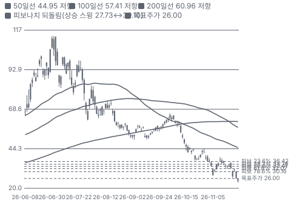

**주봉**

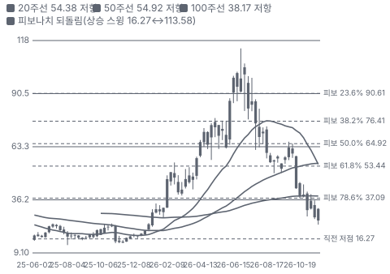

**월봉**

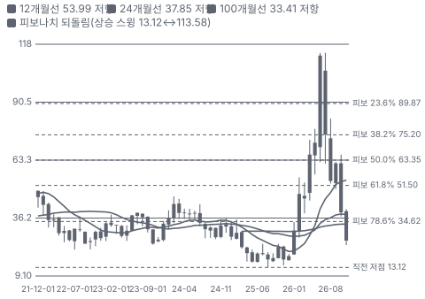

**분기 매출·EPS 실적과 컨센서스**

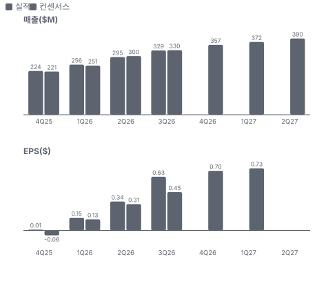

**4Q26 매출 — 지표 추세 vs 가이던스·컨센서스**

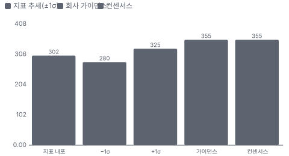

**최근 4개 분기 주가 변화 분석**

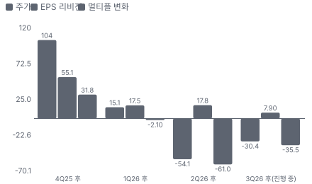

**EPS 리비전**

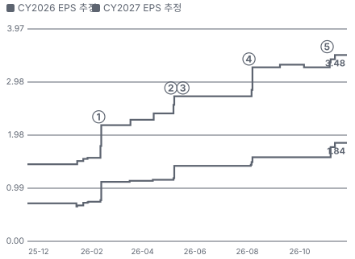

① 26-02-09 4Q25 실적 — 다음 날 +32.7% · EPS 리비전 +39%
② 26-05-04 1Q26 실적 — 다음 날 −2.8% · EPS 리비전 +14%
③ 26-05-18 \$200M 시장가 유상증자 등록(8-K·424B5) — 2분기에 248만 주를 평균 \$80.70에 모두 발행 · 실적 창과 겹침
④ 26-08-03 2Q26 실적 — 다음 날 −11.2% · EPS 리비전 +20%
⑤ 26-11-02 3Q26 실적 — 다음 날 −0.8%, 사흘 뒤 종가 \$28.03 · EPS 리비전 +7%

**멀티플 프리미엄(Fwd 1Y P/E, 최근 4개 분기말 절대값 — 대상 vs 동종 중앙값)**

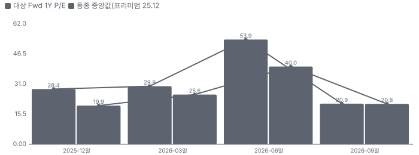

**합리적 멀티플**

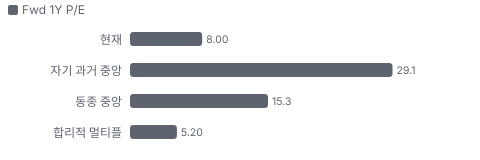

**밸류에이션 주가 시나리오**

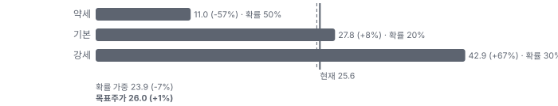

**주가별 업사이드**

- 제품·서비스 포트폴리오

**고객 믹스(FY2025, 매출 대비)**

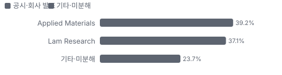

**공급 병목(10점, 낮을수록 병목)**

**CAPEX의 매출 대비 비중**

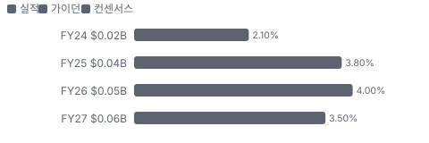

**어닝콜 변화별 주주가치 영향**

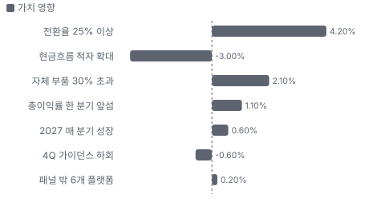

**매출 → 매출총이익 → 영업이익(매출 = 100, 최근 4분기)**

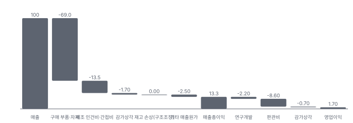

**분기 비용 비중 추이(매출 대비, 공시)**

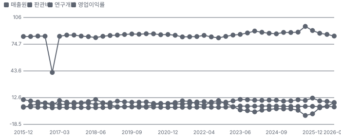

**비용 요인별 매출 대비 비중 1년 변화**

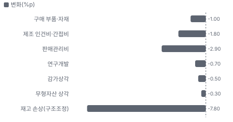

**가스 공급 시스템 BOM 원가 몫**

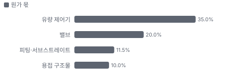

**BOM 항목 가격 +10% 시 OPM 변화**

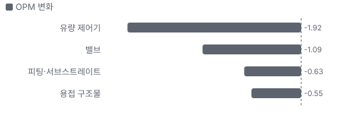

**자산 구성 — 3Q26 분기말 투하자본 \$842.4M**

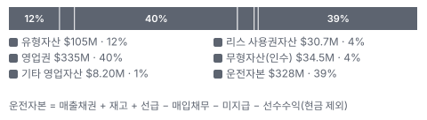

**자산별 변화율 — 최근 12개 분기(4Q23 = 0%) + 다음 4개 분기 추정**

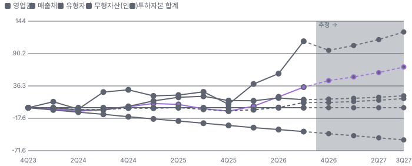

**ROIC 추이 — TTM, 최근 12개 분기 + 다음 4개 분기 추정(컨센서스 NOPAT)**

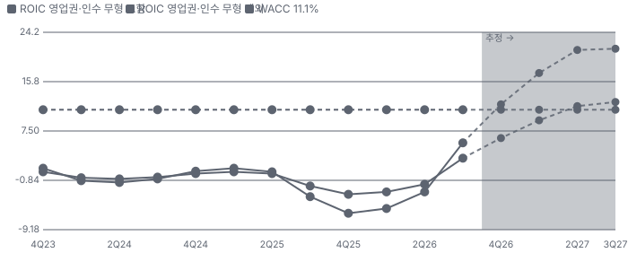

**생산시설별 면적(제곱피트, 큰 순) — 생산능력 미공시라 면적을 대용으로**

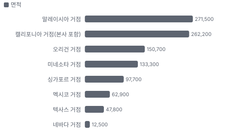

**매출 vs PPI·수출입 — 4Q22 = 100(변화율, 로그 눈금)**

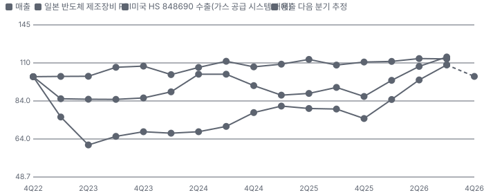

**10년 P·Q 사이클 — 추세(HP 필터) 대비 갭과 8분기 전망**

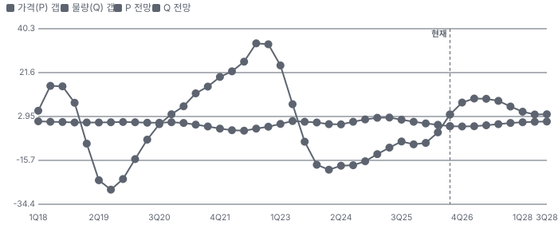

**매출 증가율의 가격·물량 분해와 8분기 전망(전년 대비)**

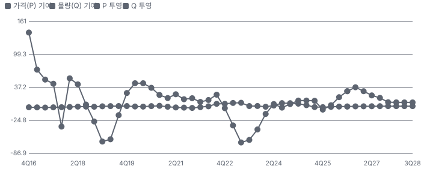

**목표주가 산정 — 약세와 기본 사이(약세 쪽 11%), 도달 확률 약 44%**

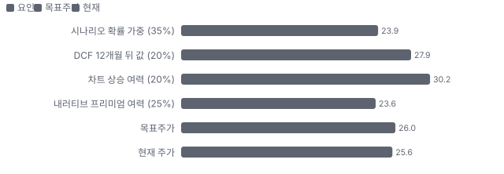

**PEG — 성장 대비 멀티플(낮을수록 성장 대비 쌈)**

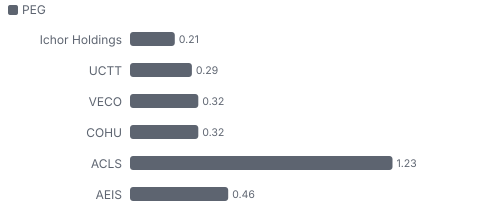

**재고 일수 — 분기별(수주 자료가 없어 수주/출하 비율 없음)**

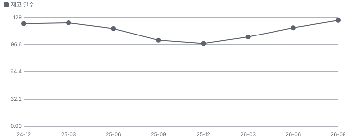

**일별 거래량 분해**

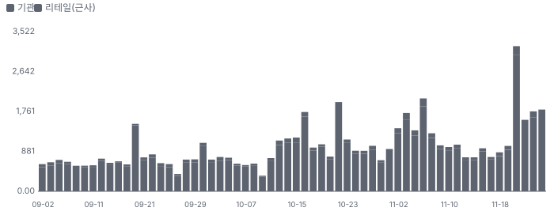

**기관 자금 흐름**

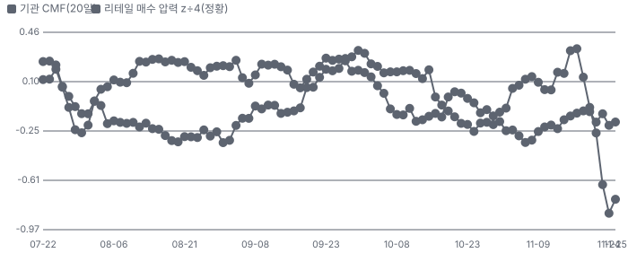

**몬테카를로**

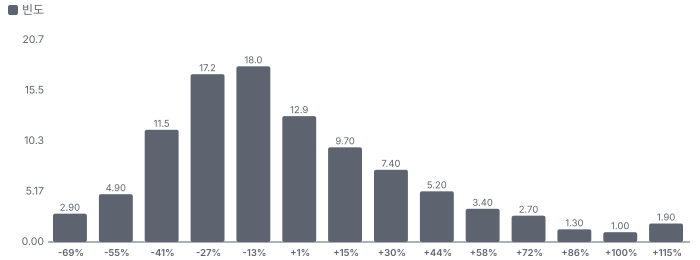

해석: 3,000번 중 1,192번(40%)에서 가치가 지금 주가 이상이었다. 가정을 흔들어도 지금 주가를 뒷받침하지 못하는 경우가 더 많다. 가운데 값은 0.90배이고, 열 번 중 여덟 번은 0.56~1.52배 사이에 든다.

## 내러티브

> **기업가치를 결정하는 이야기:** 값을 정하는 것은 세 가지다. ① 고객 두 곳의 식각·증착 장비 출하가 2027년에도 매 분기 느는가. ② 자체 부품 비중이 올라 매출총이익률이 16%에서 계속 오르는가. ③ 늘어난 이익이 현금으로 바뀌는가. 지금 가격은 ①을 믿지 않는다.

> **멀티플·EPS 프리미엄**
> **멀티플:** Fwd 1Y P/E 8.0배는 동종 5사 중앙값(약 15배)의 절반이다. 직접 경쟁사 Ultra Clean(6.7배)과 같은 묶음으로 값이 매겨져 있고, 두 회사 모두 고객 집중과 낮은 이익률 때문에 업종에서 가장 낮은 배수를 받는다.
> **EPS:** FY2027 EPS 추정은 1월 \$1.50에서 \$3.48로 올랐다. 근거는 물량 증가와 추가 매출의 25% 이상 매출총이익 전환이다. 이 추정이 실현되면 배수 회복만으로 주가가 움직이지만, 회사가 직접 낸 숫자는 4Q 한 분기뿐이다.

### 투자자들은 왜 열광했나

2월 9일 4Q25 실적 다음 날 +32.7%로 시작해 6월 한 달에만 57% 올랐다. 메모리 증설이 장비·부품사로 흘러간다는 논리와 흑자 전환이 겹쳤다. 식은 까닭도 분명하다. 5월 증자, 8월 2Q 매출 미달(−11.2%), 11월 4Q 매출 가이던스 미달, 그리고 10~11월 업종 전체의 배수 붕괴다.

### 무엇이 기업가치를 바꾸나

> **구조적 체질 변화**
> **변화:** 2025년 거점 통합 구조조정을 마치고 조정 영업이익률이 4Q25 1.2%에서 3Q26 8.6%로 올랐다. 회사는 추가 매출의 매출총이익 전환율 기준을 25% 이상으로 높였다.
> **증거:** 3Q26 실적 보도자료(8-K EX-99.1) · 3Q26 10-Q 구조조정 주석
> **반증:** 조정 영업이익률이 8% 아래로 돌아간다

> **고부가 믹스 확장**
> **변화:** 가스 시스템 안 자체 부품 비중이 2Q 25%에서 3Q 30%를 넘었고 4Q 말 약 35%가 목표다. 가스 패널(장비 한 대에 들어가는 가스 배관·밸브·유량 제어기 묶음) 밖 6개 장비 플랫폼에서도 부품을 수주했다.
> **증거:** 3Q26 어닝콜(2026-11-02)
> **반증:** 4Q 말 자체 부품 비중이 35%에 못 미친다

> **기술 혁신**
> **변화:** 선단 식각 장비는 압력 기반 유량 제어기를 쓴다. 회사는 자체 유량 제어 제품 인증을 진행 중이나 양산 매출 시점은 밝히지 않았다.
> **증거:** 3Q26 어닝콜 — 게이트 올 어라운드와 선단 DRAM용 식각 장비 설명
> **반증:** 자체 유량 제어 제품이 2027년에도 고객 인증을 못 받는다

> **실행 속도**
> **변화:** 해당 없음(주문에서 출하까지 납기를 회사도 경쟁사도 공시하지 않는다) — 회사는 3Q 분기 안 매출 선형성이 전 분기보다 좋아졌다고만 했고, 2Q에는 분기 말 부품 부족으로 일부 출하가 다음 주로 넘어갔다 **납품 리드타임 미확인.** 피어 비교 미확인. 이전 대비 미확인.
> **증거:** 2Q·3Q26 어닝콜
> **반증:** 분기 말 출하 이월이 다시 생긴다

> **M&A**
> **변화:** 해당 없음(최근 3년 인수 없음 — 영업권 \$335.4M은 과거 인수분이다)
> **증거:** FY2025 10-K · 3Q26 10-Q

> **정책·입법 연관성**
> **재정정책:** 해당 없음(회사에 직접 닿는 재정 지출이 없다 — 정부 보조금·전략 계약 공시 없음) FY2025 10-K · 3Q26 10-Q 의회 동의 2/10 — 하원 1/5(해당 지출 없음) · 상원 1/5(해당 지출 없음).
> **행정명령:** 해당 없음(회사에 직접 닿는 행정명령을 1차 자료로 확인하지 못했다 — 10-K는 관세와 보복 무역 정책을 위험으로만 적는다) FY2025 10-K 위험 요인 의회 동의 2/10 — 하원 1/5(대통령 조치라 표결 없음) · 상원 1/5(대통령 조치라 표결 없음).
> **연관입법:** 해당 없음(회사가 받는 세액공제·보조금이 없다. 반도체 투자 세액공제는 고객 팹 착공 일정을 통한 간접 효과이고 연장 여부는 이번에 확인하지 못했다) FY2025 10-K

> **고객의 지출 예산**
> **변화:** 매출 대부분이 반도체 제조사의 설비투자에서 나온다. 반도체 제조사가 장비를 사고, 장비사가 이 회사의 가스 시스템을 산다.
> **사업별 예산:** 비중 미확인: 가스 공급 시스템·부품(반도체 장비용) — 고객 CAPEX(반도체 제조사의 웨이퍼 팹 장비 투자 → 장비사의 부품 구매) · 동인: 식각·증착 장비 출하, 선단 로직·메모리 증설
비중 미확인: 상업 우주·방산 부품 — 고객 혼합(발사체·위성 제조사의 생산 예산) · 동인: 고객 생산 일정 — 4Q에 일부 이연
> **증거:** FY2025 10-K 주요 고객 표 · 사업 설명
> **반증:** 메모리·파운드리 회사가 2027년 설비투자 계획을 낮춘다

### 내러티브 근거

> 반도체 장비 상승기에 가스 공급 시스템 물량이 늘고 자체 부품으로 이익률이 오른다는 이야기는 실적으로 확인되는 중인데, 주가는 6월 말 고점에서 77% 내렸다. 시장은 2027년 추정 자체를 믿지 않는다. 동종 대비 멀티플 차이 -48% 중 회사 고유 몫은 +56%다. 단계는 소멸, 쏠림은 낮음이다.

> **장비 투자 상승 사이클** · 약화
> **논리:** 선단 로직과 메모리 증설로 식각·증착 장비 출하가 늘고, 그 장비마다 들어가는 가스 공급 시스템 물량이 따라 는다
> **숫자:** 매출 4Q25 \$223.6M → 3Q26 \$328.7M(+47%), FY2027 매출 추정 +31% — 실적은 늘었지만 가격은 이 이야기를 믿지 않는다
> **반증:** 분기 매출이 순차 감소하거나 고객 장비사가 2027년 출하 전망을 낮춘다
> **출처:** 3Q26 8-K EX-99.1 · 컨센서스

> **자체 부품 내재화로 이익률 상승** · 강화
> **논리:** 사 오던 밸브·피팅·유량 제어기를 자체 제품으로 바꾸면 같은 매출에서 남는 돈이 늘고 공급 제약도 줄어든다
> **숫자:** 자체 부품 비중 25% → 30% 초과, 조정 매출총이익률 14.1% → 16.0%, 4Q 가이던스 16.5%
> **반증:** 매출총이익률이 16% 아래로 돌아가거나 4Q 말 자체 부품 비중이 35%에 못 미친다
> **출처:** 3Q26 어닝콜(2026-11-02)

> **부품 공급 제약** · 유지
> **논리:** 수요가 있어도 밸브·피팅·유량 제어기가 모자라 출하를 못 한다 — 성장 시점이 밀린다
> **숫자:** 4Q 매출 가이던스 \$355M이 콜 전 추정 \$364.6M을 약 \$10M 밑돈다, 목표가 하향 5건
> **반증:** 4Q 매출이 가이던스 상단 \$365M을 넘는다
> **출처:** 3Q26 어닝콜 · 컨센서스 이력

> **AI 투자 지속성 의심과 업종 배수 붕괴** · 강화
> **논리:** 데이터센터 건설 지연과 클라우드 사업자 현금흐름 걱정으로 2027~2028년 장비 투자 추정 자체가 의심받는다 — 추정이 올라도 배수가 더 크게 내려간다
> **숫자:** 동종 5사 Fwd 1Y P/E 9월 말 14~41배 → 지금 7~17배, 이 회사 21배 → 8배. 나스닥 100 20거래일 −12.6%
> **반증:** 고객 장비사가 2027년 전망을 유지하고 동종 배수가 9월 말 수준으로 돌아온다
> **출처:** 동종 배수 이력 · 시장 국면 지표 · 증권사 요지

> **이익이 현금으로 바뀌지 않는다** · 유지
> **논리:** 램프 구간에 재고와 매출채권이 이익보다 빨리 늘어 현금이 나가고, 그 자금을 증자로 댔다
> **숫자:** 1~3Q 영업현금흐름 −\$47.6M, 재고 +\$98M, 2분기 증자 \$195M
> **반증:** 분기 영업현금흐름이 흑자로 돌아선다
> **출처:** 3Q26 10-Q 현금흐름표

### 투자 포인트

> **이익 추정은 올랐고 배수가 무너졌다**
> **명제:** 8월 초 이후 주가 하락의 전부가 배수 축소다 — 그 사이 실적과 추정은 올랐다
> **숫자:** 2026-08-03 종가 \$80.23 → 11-25 \$25.64(−68%), 같은 기간 FY2027 EPS 추정 \$2.71 → \$3.48(+29%). Fwd 1Y P/E는 6월 말 54배 → 8배
> **시장과 다른 점:** 애널리스트 9명 중 8명이 매수이고 목표가 평균이 \$67라 '시장이 놓쳤다'고 볼 수 없다. 가격이 말하는 것은 둘 중 하나다 — 2027년 추정이 깎이거나, 실현돼도 이 사업에는 8배가 맞다. 동종 5사 배수도 함께 내려왔다
> **증명:** 4Q 매출이 \$355M 이상이고 1Q27 가이던스가 그보다 높은지(2027-02 초)
> **출처:** 8-K EX-99.1(2026-11-02) · 컨센서스 이력

> **막는 것은 수요가 아니라 부품이다**
> **명제:** 매출 성장률이 둔해진 까닭은 밸브·피팅·유량 제어기 공급이고, 회사는 이를 자체 부품으로 바꾸며 이익률을 올리고 있다
> **숫자:** 4Q 가이던스에서 덜어 낸 약 \$10M의 절반이 부품 제약(회사 답변). 자체 부품 비중 25% → 30% 초과, 조정 매출총이익률 14.1% → 16.0%
> **시장과 다른 점:** 증권사는 부품 제약을 '시점 지연'으로 보고 목표가만 낮췄다. 저는 2Q 콜의 '10% 넘는 순차 성장' 발언이 한 분기 만에 +8%로 내려온 점을 더 무겁게 본다 — 회사 전망의 정확도가 시험받는 중이다
> **증명:** 4Q 말 자체 부품 비중 35%, 4Q 매출총이익률 16.5%
> **출처:** 3Q26 어닝콜(2026-11-02)

> **현금이 나가며 크는 회사다**
> **명제:** 이익은 늘지만 영업현금흐름은 3개 분기째 적자이고 그 구멍을 증자로 메웠다
> **숫자:** 1~3Q 영업현금흐름 합 −\$47.6M, 재고 \$231.8M → \$330.2M. 2분기 248만 주를 평균 \$80.70에 발행해 \$195M 조달, 현금 \$213.5M
> **시장과 다른 점:** 낮은 P/E만 보면 싸지만 EV에는 순현금 \$62M이 들어가 있고 그 현금은 운전자본으로 쓰이는 중이다
> **증명:** 분기 영업현금흐름 흑자 전환 시점 — 4Q 10-K(2027-02)
> **출처:** 3Q26 10-Q 현금흐름표 · 2Q26 어닝콜

### 모멘텀 생성·소멸 타임라인

**카탈리스트 달력 — 지난 사건의 주가 반응과 앞으로 확인할 숫자**
| 날짜 | 상태 | 구분 | 사건 | 반응·확인 | 결과에 따라 |
|---|---|---|---|---|---|
| 2026-02-09 | 완료 | 생성 | 4Q25 실적 — 흑자 전환 전망과 2026년 램프 | +32.7% |  |
| 2026-05-04 | 완료 | 유지 | 1Q26 실적 | −2.8% |  |
| 2026-05-18 | 완료 | 소멸 | \$200M 시장가 유상증자 등록 — 2분기 안에 전량 발행 | −3.0%(공시 다음 날 5/19) |  |
| 2026-06-30 | 완료 | 생성 | 종가 고점 \$112.28(장중 고점은 7월 1일 \$113.58) | 6월 한 달 +57% |  |
| 2026-08-03 | 완료 | 소멸 | 2Q26 실적 — 매출이 추정에 못 미침, 부품 부족 언급 | −11.2% |  |
| 2026-11-02 | 완료 | 소멸 | 3Q26 실적 — 4Q 매출 가이던스가 추정 하회, 목표가 하향 5건 | −0.8%(사흘 뒤 종가 \$28.03) |  |
| 2026-11-20~24 | 완료 | 소멸 | 기술주·반도체 장비주 동반 급락(업종 사건) | −15.1%(11/20), −16.5%(11/24) |  |
| 2027-02 초(예상) | 예정 | 확인 | 4Q26 실적·1Q27 가이던스, FY2026 10-K | 4Q 매출 \$355M 이상, 매출총이익률 16.5% 이상, 1Q27 가이던스가 4Q 위, 영업현금흐름 방향 | 모두 맞으면 기본~강세, 1Q27 가이던스가 4Q 아래면 약세 |
| 2027-01~02(예상) | 예정 | 확인 | 고객 장비사(Lam Research·Applied Materials) 실적과 2027년 장비 투자 전망(섹터 사건) | 2027년 식각·증착 장비 출하 전망이 유지되는지 | 전망 하향이면 이 회사 2027년 추정도 내려간다 |

### 언제 사서 언제 팔아야 할까?

**가격·조건 틀 — 가격은 밸류에이션(약세·기본·강세·목표주가)과 차트 지지 구간에서, 조건은 이벤트에서**
| 구간 | 가격 | 목표주가까지 | 약세까지 | 조건·근거 |
|---|---|---|---|---|
| 관찰 구간 | \$16~\$16 | +60% | -32% | 지금 주가 아래에서 차트가 잡는 다음 지지 구간이다. 주가는 11월 25일 장중 저점 \$23.56 바로 위에 있고 그 아래로는 2025년 하반기 거래대(\$14~23)가 남는다 |
| 확인 뒤 | 지금 \$26 이상에서 조건 확인 | +1% | -57% | 4Q 실적에서 매출 \$355M 이상, 매출총이익률 16.5% 이상, 1Q27 순차 성장 가이던스 |
| 무효화 | 약세 시나리오 \$11 | - | -57% | 1Q27 가이던스가 4Q보다 낮거나 매출총이익률이 16% 아래로 돌아가거나 고객 장비사가 2027년 출하 전망을 낮춘다 |
| 차익 고민 1차 | \$28(기본 시나리오) | +8% | - | 목표주가 부근은 배수가 동종 중앙값 근처로 돌아온 상태다 — 그 위는 2028년 추정 실현이 필요하다 |
| 차익 고민 2차 | \$43(강세 시나리오) | +67% | - | 목표주가 부근은 배수가 동종 중앙값 근처로 돌아온 상태다 — 그 위는 2028년 추정 실현이 필요하다 |

전형적 일일 변동폭이 약 9%이고 11월 20·24일 하루 −15%·−16%가 나왔다. 공매도 잔고는 유통 주식의 약 12%다 가격·조건 틀이며 매매·비중 지시가 아니다(투자 권유 아님).

## 포트폴리오

| 제품·서비스 | 구분 | 무엇 | 쓰는 곳 | 돈 버는 방식 | Mix | Mix 변화(추정 — 사업별 매출 미공시) |
|---|---|---|---|---|---|---|
| 가스 공급 시스템 | 제품 | 식각·증착 장비 안에서 공정 가스를 정해진 양만큼 나르고 제어하는 배관·밸브·유량 제어기 묶음 | 식각, 화학 기상 증착, 물리 기상 증착, 에피, 노광 장비 | 주력 제품(매출 비중 미공시, 추정 약 65%) — 자체 부품 비중 30% 초과 | 65% | 미확인 |
| 자체 부품·정밀 가공품 | 제품 | 밸브·피팅·서브스트레이트(밸브와 유량 제어기를 얹는 금속 블록)·유량 제어 제품과 정밀 가공·용접 부품 | 자사 가스 시스템에 넣거나 장비사에 따로 판다 — 가스 패널 밖 부위 포함 | 매출 비중 미공시 — 시스템보다 매출 1달러당 이익 기여가 크다(회사) | 미확인 | 미확인 |
| 케미컬 공급 시스템 | 제품 | 연마·도금·세정 공정에서 액체 약품을 섞어 공급하는 장치 | 화학적 기계 연마, 전기 도금, 습식 세정 장비 | 매출 비중 미공시 | 미확인 | 미확인 |
| 상업 우주·방산 부품 | 제품 | 전자빔·레이저 용접, 진공 브레이징으로 만드는 정밀 부품 | 발사체·위성, 방산 장비 | 매출 비중 미공시 — 4Q에 일부 물량이 이연됐다 | 미확인 | 미확인 |

## 고객

> **FY2025 최대 고객 Applied Materials 39%, 상위 3곳 76%, 집중도 집중.** 공시·회사 발표로 확인한 몫은 매출의 76%이고, 나머지 고객 몫은 추정이거나 미분해다. 장비사 두 곳이 매출의 76%다. Applied Materials 39.2%, Lam Research 37.1%(FY2025 10-K). 나머지 24%는 고객별 몫이 공시되지 않는다 — ASML은 2023년 10.6%였고 2024·2025년에는 10% 아래다. 분기 보고서에는 고객별 매출이 없어 2026년 몫은 확인하지 못했다.

**고객별 매출 몫(FY2025)**
| 고객 | 몫 | 변화 | 근거 |
|---|---|---|---|
| Applied Materials | 39% | +4%p | 공시 |
| Lam Research | 37% | -1%p | 공시 |
| 기타·미분해 | 24% | - | - |

> **Applied Materials** · 공시
> **사는 것:** 식각·증착 장비용 가스 공급 시스템과 부품

> **Lam Research** · 공시
> **사는 것:** 식각·증착 장비용 가스 공급 시스템과 부품

## 마진 구조

> **GPM 15.8%, OPM 6.9%.** 3Q25 대비 GPM +11.2%p, OPM +15.1%p. 변동비는 매출의 77%이고, 매출이 10% 늘면 OPM은 +1.4%p 움직인다. 3Q26 GAAP 매출총이익률은 15.8%(1년 전 4.6%), 영업이익률은 6.9%(1년 전 −8.1%)다. 매출원가가 매출의 84%를 차지하고 그 대부분이 사 오는 부품이라, 마진은 자체 부품 비중과 물량에 달려 있다. 1년 전 수치에는 구조조정 재고 손상이 들어 있다.

> **매출 100 중 매출원가 86.7, 매출총이익 13.3(최근 4분기, 공시).** 매출원가 요인 중 구매 부품·자재이 매출의 69.0%로 가장 무겁고, 단가가 +10% 오르면 GPM이 -6.90%p 움직인다. 분기 회귀로 매출 1이 늘 때 매출원가는 0.81 늘고, 매출원가의 고정비 몫은 4%다.

**비용 요인 강도 — 비중·추세·충격(+10%)·탄력**
| 비용 | 구분 | 매출 대비 | 1년 변화 | 마진 기여 | 충격 시 마진 | 매출 탄력 | 고정비 몫 |
|---|---|---|---|---|---|---|---|
| 구매 부품·자재 | 매출원가 요인 | 69.0% | -1.0%p | +1.0%p | -6.90%p | 미확인 | 0% |
| 제조 인건비·간접비 | 매출원가 요인 | 13.5% | -1.8%p | +1.8%p | -1.35%p | 미확인 | 50% |
| 감가상각 | 매출원가 요인 | 1.7% | -0.5%p | +0.5%p | -0.17%p | 미확인 | 100% |
| 재고 손상(구조조정) | 매출원가 요인 | 0.0% | -7.8%p | +7.8%p | -0.00%p | 미확인 | 0% |
| 매출원가 | 공시 항목 | 86.7% | -3.5%p | +3.5%p | -8.67%p | 0.81 | 4% |
| 판관비 | 공시 항목 | 8.6% | -0.6%p | +0.6%p | 미확인 | 0.06 | 15% |
| 연구개발 | 공시 항목 | 2.2% | -0.2%p | +0.2%p | 미확인 | 0.02 | 13% |
| 감가상각 | 공시 항목 | 0.7% | -0.2%p | +0.2%p | 미확인 | 0.01 | 56% |

매출 탄력 = 분기 비용을 매출에 회귀한 기울기(매출 1당 변동비), 고정비 몫 = 절편 ÷ 평균 비용. 표본이 8분기 미만이면 미확인. 매출원가 요인 비중은 margin 재료의 추정이 섞여 있고, 공시 매출원가와의 차이는 '기타 매출원가'로 둔다.

**GPM에서 OPM까지(GAAP — 10-Q 3개월 손익, 아래는 최근 4개 분기)**
| 기간 | GPM | 연구개발 | 판관비 | 기타 | OPM |
|---|---|---|---|---|---|
| 3Q25 | 4.6% | 2.5% | 9.4% | 0.9% | -8.1% |
| 3Q26 | 15.8% | 1.8% | 6.6% | 0.6% | 6.9% |
| 2025-12 | 9.4% | - | - | - | -6.2% |
| 2026-03 | 12.6% | - | - | - | 0.8% |
| 2026-06 | 13.9% | - | - | - | 2.4% |
| 2026-09 | 15.8% | - | - | - | 6.9% |

**비용을 움직이는 요인**
| 비용 | 요인 |
|---|---|
| 구매 부품·자재(매출원가) | 유량 제어기·밸브·피팅 구매 단가, 자체 부품 비중 · 근거 추정 |
| 제조 인건비·간접비(매출원가) | 제조 인력(연초 대비 +40%), 가동률 · 근거 추정 |
| 판매관리비(판관비) | 인력, 2025년 구조조정 비용 소멸 · 근거 공시 |
| 연구개발(연구개발) | 자체 부품 개발 · 근거 공시 |
| 감가상각(매출원가) | 가공 장비 투자, 내용연수(2025년 CNC(컴퓨터 수치 제어 가공) 장비 7년 → 10년) · 근거 공시 |
| 무형자산 상각(기타) | 과거 인수 고객관계·기술 · 근거 공시 |
| 재고 손상(구조조정, 매출원가) | 거점 통합 구조조정(2025년) · 근거 추정 |

**가스 공급 시스템 BOM — 매출의 65%, GPM 16%(추정 — 제품별 이익률 미공시라 전사 GAAP 매출총이익률 15.8%를 대용으로 쓴다. 회사는 부품이 시스템보다 매출 1달러당 이익 기여가 크다고 말하므로 시스템 자체는 이보다 낮을 수 있다), 항목 가격 +10% 시**
| 항목 | 원가 몫 | 전가 | 제품 GPM | OPM |
|---|---|---|---|---|
| 유량 제어기 | 30~40% | 미확인 | -2.9%p | -1.92%p |
| 밸브 | 15~25% | 미확인 | -1.7%p | -1.09%p |
| 피팅·서브스트레이트 | 8~15% | 미확인 | -1.0%p | -0.63%p |
| 용접 구조물(가스 배관을 용접해 만든 조립품) | 8~12% | 미확인 | -0.8%p | -0.55%p |
| 미분해 | 24% | - | - | - |

유량 제어기 가격이 +10% 오르면 영업이익은 -27.6% 움직인다. 판매가 전가를 모르는 항목은 전가 0%로 계산했다.

**BOM 항목 가격을 움직이는 것**
| 항목 | 요인 |
|---|---|
| 유량 제어기 | 가장 비싼 구매 부품 — 자체 제품으로 바꾸면 이익률이 오른다 · 근거 추정 |
| 밸브 | 공급이 가장 빠듯한 품목이고 자체 생산 전환 대상 · 근거 추정 |
| 피팅·서브스트레이트 | 자체 가공으로 돌리는 품목 · 근거 추정 |
| 용접 구조물 | 내재화가 끝난 품목 · 근거 추정 |

**투입 물가 — 미국 PPI 3·6·12개월(2026-10, 개정 반영)과 해외 전년비**
| 항목 | 미국 3개월 | 6개월 | 12개월 | 전가 못 할 때 OPM | 일본 | 한국 | 대만 |
|---|---|---|---|---|---|---|---|
| 유량 제어기 | +1.9% | +2.0% | +3.4% | - | +2.2% | +0.0% | +3.0%* |
| 밸브 | +0.4% | +0.3% | +6.4%* | - | 미확인 | 미확인 | 미확인 |
| 용접 구조물 | +6.7% | +17.0% | +32.9%* | - | 미확인 | 미확인 | 미확인 |

별표는 품목보다 넓은 업종 지수다. 연결한 투입 원가의 미국 PPI(생산자물가지수)는 1년 새 가중 +6.4%이고, 판매가로 넘기지 못하면 GPM -4.4%p·OPM -4.4%p가 움직인다. 물가 지수를 붙이지 못한 매출원가 항목은 제조 인건비·간접비, 감가상각, 재고 손상(구조조정)다(미연결).

## 자산 구성

> **3Q26 분기말 투하자본 \$842.4M** — 영업권 40%, 운전자본 39%. 최근 12개 분기(4Q23 → 3Q26) 가장 크게 늘어난 자산은 매출채권(+111%), 투하자본 합계 +9%. 3Q27 추정 투하자본 \$893.9M(+6%, 컨센서스 매출과 회전 일수·CAPEX 강도 유지 가정). 연율 감가 비율(총액 기준)은 직전 4분기 15.20% → 최근 4분기 14.11%, 직전 비율이면 감가상각이 \$2.5M 더 컸다(영업이익의 13.6%).

**자산·운전자본 항목별 분기말 잔액 — 최근 12개 분기와 다음 4개 분기 추정**
| 항목 | 4Q23 | 3Q25 | 3Q26(최근) | 3Q27 추정 | 12개 분기 변화 | 다음 4개 분기 변화 |
|---|---|---|---|---|---|---|
| 매출채권 | \$66.7M | \$84.4M | \$140.6M | \$150.9M | +111% | +7% |
| 재고자산 | \$245.9M | \$241.7M | \$330.2M | \$412.9M | +34% | +25% |
| 선급·기타 유동자산 | \$8.8M | \$6.4M | \$18.5M | \$15.9M | +110% | -14% |
| 매입채무 | \$60.5M | \$92.6M | \$136.0M | \$168.8M | +125% | +24% |
| 미지급비용 | \$14.9M | \$18.3M | \$25.0M | \$29.1M | +68% | +16% |
| 유형자산 | \$92.8M | \$110.4M | \$105.2M | \$111.1M | +13% | +6% |
| 리스 사용권자산 | \$36.6M | \$37.1M | \$30.7M | \$30.7M | -16% | +0% |
| 영업권 | \$335.4M | \$335.4M | \$335.4M | \$335.4M | +0% | +0% |
| 무형자산(인수) | \$57.3M | \$42.5M | \$34.5M | \$26.6M | -40% | -23% |

**자산 추정 동인 — 최근 4개 분기 평균(재무상태표 동인 모형)**
| 동인 | 값 | 곱하는 기준 |
|---|---|---|
| 매출채권 | 33일 | 매출 |
| 재고자산 | 105일 | 매출원가 |
| 선급·기타 유동자산 | 4일 | 매출 |
| 매입채무 | 43일 | 매출원가 |
| 미지급비용 | 6일 | 매출 |
| CAPEX 강도 | 2.6% | 매출(최근 4개 분기 합) |
| 분기 감가율 | 5.74% | 기초 유형자산 순액(무형 상각 제외 감가상각) |
| 매출원가율 | 86.7% | 매출(최근 4개 분기) |
| 영업권·리스 사용권·기타 | 유지 | 인수·새 리스는 공시 전 모름 |
| 인수 무형자산 | 분기 \$2.0M 상각 | 최근 4개 분기 평균 상각 |

**추정 방법:** 증권사 3표 모델(손익·재무상태표·현금흐름)의 재무상태표 동인 방식이다. 운전자본은 항목별 회전 일수(매출채권·선급·미지급·선수는 매출, 재고·매입채무는 매출원가 기준)를 최근 4개 분기 평균으로 두고 컨센서스 매출에 곱한다. 유형자산은 기초 + CAPEX − 감가상각으로 굴린다(Koller·Goedhart·Wessels 『Valuation』 재무상태표 추정). 매출 경로는 ROIC 절의 컨센서스와 같다.

**유형·무형자산 항목별 가치(2025-12-26 vs 2024-12-27)**
| 구분 | 항목 | 총액 2025-12-26 | 누적상각 | 순액 | 총액 2024-12-27 | 총액 1년 변화 | 공시 내용연수 |
|---|---|---|---|---|---|---|---|
| 유형 | 유형자산 합계(항목 미분해) | \$223.4M | 총계만 공시 | 총계만 공시 | \$195.3M | +14.4% | 미확인 |
| 영업권 | 영업권 | \$335.4M | \$0.0M | \$335.4M | \$335.4M | +0.0% | 비상각 |
| 무형 | 무형자산 합계(항목 미분해) | \$82.6M | \$42.2M | \$40.4M | \$84.2M | -1.9% | 미확인 |
| 유형 합계 | 유형자산 | \$223.4M | \$119.5M | \$103.9M | \$195.3M | +14.4% | 경과율 53%(상각 대상 기준) |

**내용연수 산식(상각 대상 유형자산 = 총액 − 토지 − 건설중)**
| 기준일 | 연 감가상각 | 상각 대상 총액 | 평균 내용연수 | 경과 연수 | 잔여 연수 | 경과율 |
|---|---|---|---|---|---|---|
| 2025-12-26 | \$23.5M | \$223.4M | 9.5년 | 5.1년 | 4.4년 | 53% |
| 2024-12-27 | \$21.0M | \$195.3M | 9.3년 | 4.8년 | 4.5년 | 51% |

산식 평균 내용연수는 9.5년. 1년 전 9.3년 → 지금 9.5년.

**분기 감가 비율(감가상각 ÷ 평균 유형자산 총액)**
| 분기 | 감가상각 | 평균 유형자산(총액) | 분기 비율 | 연율 | 연율의 역수 |
|---|---|---|---|---|---|
| 4Q24 | \$8.0M | \$190.6M | 4.19% | 16.74% | 6.0년 |
| 1Q25 | \$8.1M | \$202.3M | 3.98% | 15.94% | 6.3년 |
| 2Q25 | \$8.0M | \$213.6M | 3.74% | 14.98% | 6.7년 |
| 3Q25 | \$7.4M | \$220.9M | 3.35% | 13.40% | 7.5년 |
| 4Q25 | \$10.0M | \$223.6M | 4.49% | 17.96% | 5.6년 |
| 1Q26 | \$7.7M | \$225.4M | 3.40% | 13.58% | 7.4년 |
| 2Q26 | \$7.2M | \$232.1M | 3.10% | 12.41% | 8.1년 |
| 3Q26 | \$7.5M | \$237.1M | 3.16% | 12.65% | 7.9년 |

감가상각 기준: 손익계산서 감가상각·상각비(SEC 공시 데이터, 4분기 = 연간 − 1~3분기).

최근 4분기 연율 감가 비율 14.11%, 직전 4분기 15.20%(-7%) — 경고 문턱(-10%) 안이다.

미공시·미분해: 유형자산 항목별 총액·내용연수(10-K 주석에서 모델이 채움) · 무형자산 항목(10-K 주석에서 모델이 채움) — 이 칸은 비우고 나머지로 계산했다.

### 해석 — 자산이 어디에 쌓이고 있나

- 같은 기간 4개 분기 매출은 +35% — 매출보다 빨리 늘어난 자산: 매출채권 +111%. 이 자산의 회전율이 떨어지면 ROIC를 희석한다.
- 다음 4개 분기 CAPEX \$40.0M vs 감가상각 \$24.6M(최근 4개 분기 CAPEX 강도·감가율 유지) — 유형자산 3Q26 \$105.2M → 3Q27 \$111.1M. 투자가 감가보다 커서 자산이 쌓이는 국면이다.

## ROIC

> **TTM 3Q26 ROIC는 영업권·인수 무형 포함 2.9%, 제외 5.5%**(NOPAT 마진 2.1% × 투하자본 회전율 1.38회). 최근 12개 분기 4Q23 0.6% → 3Q26 2.9%(고점 3Q26 2.9%). 컨센서스 NOPAT으로 굴리면 3Q27 12.4%(제외 21.4%) — WACC 11.1% 대비 +1.3%p.

**ROIC 추이(TTM)와 다음 4개 분기 추정 — NOPAT ÷ 평균 투하자본(이번 분기말·4개 분기 전)**
| 분기 | 구분 | TTM 매출 | TTM NOPAT | NOPAT 마진 | 평균 투하자본 | ROIC 포함 | ROIC 제외 |
|---|---|---|---|---|---|---|---|
| 4Q23 | 실적 | \$811.1M | \$4.9M | 0.6% | \$811.5M | 0.6% | 1.2% |
| 1Q24 | 실적 | \$786.6M | −\$3.6M | -0.5% | \$817.5M | -0.4% | -0.9% |
| 2Q24 | 실적 | \$804.9M | −\$4.7M | -0.6% | \$791.9M | -0.6% | -1.2% |
| 3Q24 | 실적 | \$819.2M | −\$2.4M | -0.3% | \$787.0M | -0.3% | -0.6% |
| 4Q24 | 실적 | \$849.0M | \$2.6M | 0.3% | \$772.9M | 0.3% | 0.7% |
| 1Q25 | 실적 | \$892.1M | \$4.7M | 0.5% | \$769.5M | 0.6% | 1.2% |
| 2Q25 | 실적 | \$929.2M | \$2.4M | 0.3% | \$764.5M | 0.3% | 0.6% |
| 3Q25 | 실적 | \$957.3M | −\$13.4M | -1.4% | \$753.9M | -1.8% | -3.6% |
| 4Q25 | 실적 | \$947.7M | −\$23.9M | -2.5% | \$752.0M | -3.2% | -6.4% |
| 1Q26 | 실적 | \$959.3M | −\$21.2M | -2.2% | \$759.0M | -2.8% | -5.6% |
| 2Q26 | 실적 | \$1,013.8M | −\$11.5M | -1.1% | \$777.9M | -1.5% | -2.8% |
| 3Q26 | 실적 | \$1,103.2M | \$23.4M | 2.1% | \$799.1M | 2.9% | 5.5% |
| 4Q26 | 추정 | \$1,236.8M | \$49.9M | 4.0% | \$788.6M | 6.3% | 12.0% |
| 1Q27 | 추정 | \$1,352.7M | \$74.7M | 5.5% | \$802.8M | 9.3% | 17.3% |
| 2Q27 | 추정 | \$1,447.9M | \$96.7M | 6.7% | \$825.3M | 11.7% | 21.2% |
| 3Q27 | 추정 | \$1,532.2M | \$107.6M | 7.0% | \$868.2M | 12.4% | 21.4% |

**다음 4개 분기 NOPAT — 컨센서스(세율 17%, 리스 이자 별도)**
| 분기 | 매출 | EBITA 마진 | EBITA | NOPAT(분기) | 근거 |
|---|---|---|---|---|---|
| 4Q26 | \$357.2M | 5.7% | \$20.3M | \$16.8M | 컨센서스 매출 × EBIT 마진 FY2026(조정 − 주식보상 1.4%) |
| 1Q27 | \$372.0M | 9.2% | \$34.1M | \$28.3M | 컨센서스 매출 × EBIT 마진 FY2027(조정 − 주식보상 1.4%) |
| 2Q27 | \$390.0M | 9.2% | \$35.7M | \$29.7M | 컨센서스 매출 × EBIT 마진 FY2027(조정 − 주식보상 1.4%) |
| 3Q27 | \$413.0M | 9.2% | \$37.8M | \$31.4M | 컨센서스 매출 × EBIT 마진 FY2027(조정 − 주식보상 1.4%) |

**추정 방법:** NOPAT은 컨센서스(분기 매출 추정 × 회계연도 EBIT 마진 추정)로 잡고, 조정(비 GAAP) 마진이면 주식보상 몫을 빼서 과거 실적과 같은 기준(영업이익 + 인수 무형 상각)으로 맞췄다. 이미 발표했지만 분기 보고서(10-Q)가 아직 없는 분기는 발표 실적을 쓴다. 투하자본은 자산 구성 절의 재무상태표 동인으로 굴렸다. ROIC는 4개 분기 NOPAT을 이번 분기말과 4개 분기 전 투하자본의 평균으로 나눈다 — 추정 분기의 ROIC에는 이미 나온 실적 분기가 섞여 있다.

**투하자본 항목별 회전율과 ROIC 기여(TTM 3Q26, 평균 잔액)**
| 항목 | 투하자본 | 매출 1달러당 자본 | 회전율(매출 ÷ 항목) | 자본 몫 | 이 항목을 빼면 ROIC |
|---|---|---|---|---|---|
| 운전자본 | \$274.9M | 0.25 | 4.01회 | 34% | 4.5% |
| 유형자산 | \$107.8M | 0.10 | 10.23회 | 13% | 3.4% |
| 리스 사용권자산 | \$33.9M | 0.03 | 32.57회 | 4% | 3.1% |
| 영업권 | \$335.4M | 0.30 | 3.29회 | 42% | 5.1% |
| 무형자산(인수) | \$38.5M | 0.03 | 28.65회 | 5% | 3.1% |
| 기타 영업자산 | \$8.6M | 0.01 | 128.90회 | 1% | 3.0% |

**ROIC 세 가지 판**
| 판 | NOPAT | 투하자본 | ROIC | 무엇을 재나 |
|---|---|---|---|---|
| 영업권·인수 무형 포함 | \$23.7M | \$799.1M | 3.0% | 인수 웃돈까지 낸 돈에 대한 수익률 |
| 영업권·인수 무형 제외 | \$23.7M | \$425.2M | 5.6% | 본업 운영 수익률(동종 비교용) |
| 무형 자본화 조정(판관비 20%·5년, 연구개발 6년) | \$33.9M | \$923.1M | 3.7% | 비용으로 처리한 무형 투자를 자산으로 본 판 |
| 경제적 이익(포함판) | −\$64.9M | \$799.1M | 자본비용 11.1% | (ROIC − 자본비용) × 투하자본 |

NOPAT = (영업이익 \$18.3M + 인수 무형 상각 + 리스 내재 이자 \$2.0M) × (1 − 세율 17%). 리스 사용권자산을 투하자본에 넣었으므로 임차료 속 이자 몫을 영업이익에 되더했다. 현금은 영업에 필요한 몫을 따로 알 수 없어 투하자본에서 뺐다. SEC 공시 데이터 자동 초안 — 운전자본 = 매출채권 + 재고 + 선급 − (매입채무 + 미지급비용 + 선수수익), 현금 제외. 손상 누계는 공시 데이터 수록분.

투하자본 또는 NOPAT이 0 이하라 ROIC 분해는 비교 불가 — 경제적 이익으로 본다.

**무형 자본화 가정별 ROIC(2025년 지출 기준, 포함판에 더함)**
| 투자로 보는 몫 | 상각 연수 | 무형 자산 | NOPAT 조정 | 조정 ROIC |
|---|---|---|---|---|
| 판관비 20% | 2년 | \$100.1M | \$9.2M | 3.7% |
| 판관비 20% | 5년 | \$124.1M | \$10.3M | 3.7% |
| 판관비 30% | 2년 | \$113.6M | \$10.8M | 3.8% |
| 판관비 30% | 5년 | \$149.6M | \$12.4M | 3.8% |

### 해석 — 무엇이 수익성을 끌어올리고 희석하나

- 영업권: 투하자본의 42% — 빼면 ROIC 3.0% → 5.1%. 이 자산의 회전율(3.29회)이 수익성을 희석하는 주된 자리다.
- 운전자본: 투하자본의 34% — 빼면 ROIC 3.0% → 4.5%. 이 자산의 회전율(4.01회)이 수익성을 희석하는 주된 자리다.
- 영업권·인수 무형을 빼면 ROIC가 +2.6%p 오른다 — 과거 인수에 치른 웃돈이 주주 수익률을 그만큼 낮춘다(본업 수익률은 제외판, 인수까지 포함한 가치 창출은 포함판으로 본다).
- 비용으로 처리한 무형 투자를 자산으로 보면 ROIC가 +0.7%p 움직인다(무형 자산 \$124.1M). 투자를 늘리는 중이라 NOPAT이 더 커지는 쪽이다.
- 추정 경로 3Q26 2.9% → 3Q27 12.4%: NOPAT 마진 +4.9%p, 투하자본 회전율 +0.38회 — 컨센서스 매출·마진이 맞고 회전 일수·CAPEX 강도가 유지된다는 가정이다. 마진 추정이 내려가거나 재고 일수가 늘면 이 경로가 먼저 틀린다.
- ROIC(포함) − WACC = -8.2%p(3Q26) — 양수면 투하자본을 늘릴수록 가치가 쌓인다.

## 공급망 병목

> **공급망 신뢰성 5.1/10, 병목 주의.** 가장 약한 고리는 유량 제어기 5.1점이고, 품목 평균은 5.1점이다. 근거가 부족한 3건(밸브 · 피팅·서브스트레이트 · 용접 구조물)은 점수에서 뺐다. 지금 매출을 막는 것은 수요가 아니라 가스 시스템에 들어가는 밸브·피팅·서브스트레이트·유량 제어기 공급이다. 회사는 이 품목을 자체 부품으로 바꾸는 중이고 그 비중이 4Q 말 약 35%다. 공급사 이름과 점유율은 공시하지 않아 유량 제어기 요인 일부는 업계 구조로 어림한 추정이다.

**병목과 마진 — 품목 가격 +10% 시 OPM**
| 품목 | 점수 | 판정 | 구분 | OPM |
|---|---|---|---|---|
| 유량 제어기(필수) | 5.1 | 병목 주의 | 핵심 통제 품목 | -1.92%p |

> **유량 제어기** · 5.1/10
> **왜:** 선단 식각·증착 장비는 압력 기반 유량 제어기를 쓰고 공급사가 적다
> **병목 요인:** 인증 공급사 2곳 · 캐파 빠듯 · 리드타임 미확인 · 재인증 9개월 · 1위 점유율 60% · 지역 집중 미확인 · 물량 확보 미확인
> **풀리는 조건:** 자체 유량 제어 제품 인증 진행 — 양산 시점 미확인

**공급사**
| 품목 | 공급사 | 몫 | 근거 |
|---|---|---|---|
| 밸브 | 외부 인증 공급사(이름 미공시, 가스 시스템용 고순도 밸브) | 미확인 | 공시 |
| 밸브 | Ichor 자체 생산(자체 밸브) | 미확인 | 회사 발표 |
| 피팅·서브스트레이트 | 외부 인증 공급사(이름 미공시, 배관 이음쇠와 밸브 장착 블록) | 미확인 | 공시 |
| 피팅·서브스트레이트 | Ichor 자체 생산(자체 피팅·서브스트레이트) | 미확인 | 회사 발표 |
| 유량 제어기 | Horiba(질량 유량 제어기) | 미확인 | 추정 |
| 유량 제어기 | MKS(질량 유량 제어기) | 미확인 | 추정 |
| 용접 구조물 | Ichor 자체 생산(가스 배관 용접 조립) | 미확인 | 회사 발표 |

**무역 통계로 본 공급 지역**
| 품목 | EU 수입처 | 일본 수입처 | EU 1위 전년비 |
|---|---|---|---|
| 밸브 | CN(중국) 64% · US 26% · JP(일본 통계 표기) 4% | 中華人民共和国 27% · アメリカ合衆国 24% | +9.1% |
| 피팅·서브스트레이트 | KR(한국) 39% · TW(대만) 26% · MY(말레이시아) 15% | 大韓民国 44% · インドネシア 18% | -25.9% |
| 유량 제어기 | JP 48% · US 33% · TW 8% | 大韓民国 37% · アメリカ合衆国 22% | +892.4% |
| 용접 구조물 | KR 39% · TW 26% · MY 15% | 大韓民国 44% · インドネシア 18% | -25.9% |

## 생산능력

> **현재 명목 캐파 미확인, 가동률 미확인.** 착공 이상 증설은 2 연 매출 \$B 환산, 발표까지 합치면 2 연 매출 \$B 환산이다. FY25 CAPEX는 \$0.04B로 매출의 3.8%다. 공장은 모두 임차다. 8개 지역 약 104만 제곱피트이고, 회사는 이 건물 안에서 연 매출 \$3B까지 늘릴 수 있다고 말한다. 지금 막는 것은 건물이 아니라 부품 공급과 시험 장비·인력이다.

**생산시설 8곳**(FY2025 10-K Item 2 Properties — 지역별 면적만 공시(지역 8곳, 합계 약 1,038,600제곱피트, 전부 임차). 지역 안 건물 수와 시설 이름은 미공시), 임차 8곳. 시설별 생산능력은 공개되지 않았다 — 회사 전체 캐파만 위에 적었다.

**생산시설 8곳 — 명칭·위치·생산능력**
| 시설 | 위치 | 용도 | 생산능력 | 소유·상태 |
|---|---|---|---|---|
| 말레이시아 거점 | 말레이시아 | 제조(대량 생산 거점) | 미확인 — 시설별 캐파 미공시 · 면적 271,500 제곱피트 | 임차 · 가동 |
| 캘리포니아 거점(본사 포함) | 미국 캘리포니아 프리몬트 등 | 본사·제조·엔지니어링 | 미확인 — 시설별 캐파 미공시 · 면적 262,200 제곱피트 | 임차 · 가동 |
| 오리건 거점 | 미국 오리건 | 제조 | 미확인 — 시설별 캐파 미공시 · 면적 150,700 제곱피트 | 임차 · 가동 |
| 미네소타 거점 | 미국 미네소타 | 제조(정밀 가공) | 미확인 — 시설별 캐파 미공시 · 면적 133,300 제곱피트 | 임차 · 가동 |
| 싱가포르 거점 | 싱가포르 | 제조(가스 시스템 조립) | 미확인 — 시설별 캐파 미공시 · 면적 97,700 제곱피트 | 임차 · 가동 |
| 멕시코 거점 | 멕시코 | 제조 | 미확인 — 시설별 캐파 미공시 · 면적 62,900 제곱피트 | 임차 · 가동 |
| 텍사스 거점 | 미국 텍사스 | 제조 | 미확인 — 시설별 캐파 미공시 · 면적 47,800 제곱피트 | 임차 · 가동 |
| 네바다 거점 | 미국 네바다 | 제조 | 미확인 — 시설별 캐파 미공시 · 면적 12,500 제곱피트 | 임차 · 가동 |

**생산능력 확충 계획**
| 계획 | 단계 | 증설 | 가동 시점 | CAPEX |
|---|---|---|---|---|
| 기존 건물 안 \$3B 매출 캐파(가스 시스템 조립) | 장비 반입 | 2 연 매출 \$B 환산 | 2027 | 미확인 |
| 자체 부품·정밀 가공 캐파 | 발표 | 미확인 | 2027 | 미확인 |

남은 계획의 CAPEX 합계는 \$0.00B(금액 미확인 2건 제외)다. 합계는 FY27 매출의 0%다.

**증설 방해 요인**
| 계획 | 방해 요인 |
|---|---|
| 기존 건물 안 \$3B 매출 캐파(가스 시스템 조립) | 시험 장비 설치, 제조 인력 채용·훈련, 밸브·피팅·유량 제어기 공급 |
| 자체 부품·정밀 가공 캐파 | 가공 장비 납기(2027년 상반기 인도 예정), 외부 인증 업체 램프 |

**CAPEX와 매출 대비**
| 기간 | CAPEX | 매출 | 매출 대비 | 구분 |
|---|---|---|---|---|
| FY24 | \$0.02B | \$0.85B | 2.1% | 실적 |
| FY25 | \$0.04B | \$0.95B | 3.8% | 실적 |
| FY26 | \$0.05B | \$1.23B | 4.0% | 가이던스 |
| FY27 | \$0.06B | \$1.61B | 3.5% | 컨센서스 |

## 피터 린치 분류

> **경기순환주(Cyclical), 소형.** 린치 표의 기대 수익 10배, 하방 -80~100%, 위험 고. 10배 경로가 있는 분류다(고성장주·회생주·경기순환주).

**분류 근거 — 크기 먼저, 다음은 이야기 유형**
| 항목 | 값 |
|---|---|
| 크기 | 소형(시가총액 \$1.0B) |
| 장기 성장 | 53.8%(컨센서스 EPS 2년 CAGR) |
| 린치 비율((성장% + 배당%) ÷ P/E) | 6.69 — 2 이상 매력, 1 미만 비싸다 |
| PEG(P/E ÷ 성장%) | 0.15 — 1 적정, 0.5 매우 매력, 2 매우 불리 |
| 근거 | 순환 업종(semicap) · TTM 매출이 과거 고점 대비 39% 빠진 적이 있다 · 영업이익이 적자였다가 흑자로 돌아온 순환 이력 |
| 반대 근거 | 장기 성장률 54%로 고성장주 구간 — 순환 위의 성장주일 수 있다 |

- 점검: 재고·공급과 수요(가격)의 방향
- 점검: 경쟁사의 증설
- 점검: 이익 정점에서 P/E가 낮아 보이는 함정
- 점검: 부채가 바닥을 견딜 수 있나
- 팔 때(점검 조건, 매매 지시 아님): 재고가 쌓이고 증설이 시작되고 가격이 꺾일 때 — 정점의 낮은 P/E는 싸다는 뜻이 아니다

분류 = 피터 린치·존 로스차일드 『One Up On Wall Street』(1989)·『Beating the Street』(1993)의 6분류와 위험·보상 표를 숫자 규칙으로 옮긴 자체추론이다(config/lynch.yaml).

## 구루 교차 점검

> **여섯 관점 중 통과 2 · 미달 1 · 미확인 3.** 가장 약한 관점은 해자와 자본수익률 — 이익이 느는 까닭이 물량과 자체 부품 전환인데, 사이클이 꺾이면 2023~2025년처럼 다시 영업적자로 돌아갈 수 있다 — 3년 연속 GAAP 순손실(2023~2025)을 낸 회사다.

판정은 자체추론이고 숫자는 계산값이다.

> **성장 여지** · 통과
> **질문:** 5년 안에 매출이 2배가 될 자리가 있나, 10년 뒤에도 커지나
> **이유:** 매출 추정이 FY2026 약 \$1.24B에서 FY2028 \$1.83B로 연 22% 늘고, 회사는 기존 건물 안에서 \$3B까지 댈 수 있다고 말한다
> **계산한 숫자:** 매출 경로 FY2026→FY2028 연 21.6%, 2배까지 3.5년
> **근거:** 컨센서스 매출 추정(2026-11-27) · Ichor 3Q26 어닝콜(2026-11-02)

> **해자와 자본수익률** · 미달
> **질문:** 경쟁우위가 무엇이고, 투하자본수익률(ROIC)이 자본비용보다 높으며 유지·상승하나
> **이유:** TTM GAAP 기준 투하자본수익률이 1.8%로 자본비용에 못 미치고 조정 매출총이익률이 16%다 — 가격 결정력이 고객 장비사에 있다
> **계산한 숫자:** ROIC 1.8% · 자본비용 11.1%
> **근거:** Ichor 3Q26 10-Q · 출처 목록

> **재투자 복리** · 미확인
> **질문:** 번 돈을 높은 수익률로 다시 넣을 곳이 있나 — 자본 배분(재투자·인수·자사주·희석) 이력은
> **이유:** 영업현금흐름이 3개 분기째 적자이고 성장 자금을 2분기 유상증자 \$195M으로 댔다 — 번 돈을 높은 수익률로 다시 굴린 기록이 아직 없다
> **계산한 숫자:** 설비 재투자율 0%(설비투자가 감가상각 이하 — 연구개발·인수로 하는 재투자는 이 숫자에 없다) · 소유주 이익 수익률 -0.0%(근사)
> **근거:** Ichor 3Q26 10-Q 현금흐름표

> **사람과 문화** · 미확인
> **질문:** 경영진이 주주와 같은 배를 탔나 — 창업자·내부자 지분, 기회형 내부자 매수, 문화가 경쟁우위에 기여하나
> **이유:** CEO 취임 1년이다. 주가 \$80대에서 증자를 마친 것은 회사에 유리한 자본 조달이었지만, 내부자 장내 거래 기록은 매도 29건·매수 5건으로 매도가 훨씬 많다
> **계산한 숫자:** 서류로 확인(계산 없음)
> **근거:** Ichor 2026년 위임장 · 내부자 거래 신고(Form 4)

> **변화의 방향** · 통과
> **질문:** 18~24개월 뒤 이익 그림이 지금과 얼마나 다른가, 유동성 국면은 그 변화를 받쳐 주나
> **이유:** 매출·매출총이익률·영업이익률이 세 분기 연속 올랐고 2년 뒤 EPS 추정이 다음 12개월보다 38% 높다. 다만 유동성 국면은 긴축이다
> **계산한 숫자:** 2년 뒤 EPS +37.5%(다음 12개월 대비) · 유동성 국면 긴축
> **근거:** Ichor 3Q26 실적 보도자료(8-K) · 출처 목록

> **5배 경로와 시장이 모르는 이유** · 미확인
> **질문:** 어떻게 5배 이상이 되나(이익 성장 × 배수 변화), 시장은 왜 아직 값을 안 매기나
> **이유:** 2배는 2027년 추정과 14배 배수로 닿지만 5배는 회사 캐파 \$3B를 넘는 매출이 필요해 근거가 없다
> **계산한 숫자:** 5년에 5배 = 연 38.0% · 10배 = 연 58.5% · Fwd P/E 8.0배
> **근거:** 이 리포트의 2·3·5·10배 경로 계산

**배수별로 필요한 연 성장률 — 이익 성장과 배수 변화를 합친 속도**
| 목표 | 5년 | 7년 | 10년 |
|---|---|---|---|
| 2배 | 14.9% | 10.4% | 7.2% |
| 5배 | 38.0% | 25.8% | 17.5% |
| 10배 | 58.5%(희소) | 38.9% | 25.9% |

### 보유 규율 — 가격이 아니라 지표로 유지·종료를 가른다

- 투자 논리 지표: 조정 매출총이익률(16% 위 유지와 분기별 개선) · 가스 시스템 안 자체 부품 비중(4Q 말 35% 목표) · 분기 영업현금흐름 흑자 전환 · 분기 매출 순차 성장률
- 규칙: 가격만 빠지고 매출 순차 성장과 매출총이익률 개선이 이어지면 논리는 유지된다. 매출이 순차 감소하거나 매출총이익률이 16% 아래로 돌아가면 논리가 깨진다
- 지금 주가는 일봉 760개 기간의 고점 대비 -77.2%, 그 기간 최대 낙폭은 -77.2%다 — 고점 대비 −50%를 넘어 재심사 구간이다. 가격이 아니라 위 지표로 유지·종료를 가른다.

여섯 관점은 베일리 기포드(성장 여지·5배 경로), 워렌 버핏(해자·재투자), 론 바론(사람), 피터 린치(분류·내부자), 스탠리 드러켄밀러(변화의 방향·유동성)의 질문을 옮긴 점검 틀이다. 유동성 국면은 긴축(10년물 20일 -9bp · 하이일드 스프레드 20일 +54bp). 설비 재투자율은 설비투자에서 감가상각을 뺀 몫만 본 근사이고(연구개발·인수·운전자본은 빠진다), 소유주 이익 수익률은 유지 설비투자를 감가상각과 같다고 본 근사다. 점검 틀이며 매매·비중 지시가 아니다.

## 해자

> 해자는 얇다. 장비 설계 초기에 들어가 인증을 받으면 그 장비 수명 동안 공급하는 구조가 진입을 막지만, 매출총이익률 16%는 가격 결정력이 고객에게 있음을 보여 준다. 자체 부품 내재화가 숫자로 굳어야 해자가 된다.

> **장비 설계 초기 참여와 인증** · 보통
> **해자:** 새 장비 개발 단계에서 가스 공급 설계에 참여해 초기 양산의 단독 공급사가 되고, 인증을 받은 뒤에는 그 장비 수명 동안 공급한다
> **근거:** FY2025 10-K — 초기 도입 때 단독 공급사가 되는 경우가 많다고 적는다. 10% 이상 고객 합이 2023년 82%, 2024년 73%, 2025년 76%로 유지된다
> **숫자:** 상위 2곳 매출 비중 76%(FY2025), 가스 공급 하위시스템 시장의 경쟁사로 10-K가 이름을 든 곳은 Ultra Clean 한 곳
> **깨지는 조건:** 고객이 가스 시스템을 내재화하거나 두 번째 공급사 몫을 늘려 상위 2곳 매출이 업종 장비 출하보다 느리게 는다

> **자체 부품 내재화** · 약함
> **해자:** 사 오던 밸브·피팅·유량 제어기를 자체 제품으로 바꿔 원가를 낮추고 공급 제약에서 벗어난다
> **근거:** 3Q26 어닝콜 — 가스 시스템 안 자체 부품 비중 25% → 30% 초과, 조정 매출총이익률 14.1% → 16.0%. 아직 두 분기 실적이고 동종 부품사 이익률에 크게 못 미친다
> **숫자:** 조정 매출총이익률 16.0%, 추가 매출의 매출총이익 전환율 33%(3Q)
> **깨지는 조건:** 자체 부품 비중이 35%에 못 미치거나 매출총이익률이 16% 아래로 돌아간다

> **고객 근접 생산 규모** · 약함
> **해자:** 싱가포르·말레이시아·미국의 고객 조립 거점 옆에서 대량 생산한다
> **근거:** 3Q26 10-Q — 출하지 기준 싱가포르 40.7%·말레이시아 15.5%. 직접 경쟁사도 같은 지역에 거점을 두고 있어 차별 요인이 아니다
> **숫자:** 8개 지역 약 104만 제곱피트(전부 임차)
> **깨지는 조건:** 고객이 조립 거점을 옮기거나 경쟁사가 같은 지역 캐파를 더 빨리 늘린다

## 경영진·네트워크

> CEO Phil Barros는 2025년 11월에 취임했다. 직전 직책은 최고기술책임자였다. 최고운영책임자와 최고재무책임자는 모두 최대 고객 Applied Materials 출신이다. 창업자 지분이나 지배주주는 없다.

> **Phil Barros** · CEO, 이사 · 2025-11
> **프로필:** 전임 Jeff Andreson이 2025년 11월 물러나며 취임했다. 직전에는 Ichor 최고기술책임자였다(2024년 12월 내부자 거래 신고의 직책). 상세 약력은 위임장 이사회 항목에 있으나 이번에 확인하지 못했다
> **비즈니스:** 취임 뒤 거점 통합, 자체 부품 내재화, \$200M 유상증자를 진행했다
> **정계:** 미확인
> **동문:** 미확인
> **사모임:** 미확인

> **Greg Swyt** · 최고재무책임자 · 2023-08
> **프로필:** 2022년 1월 최고회계책임자로 합류. Silvaco 최고재무책임자, Onto Innovation과 전신 Nanometrics 재무 임원, Applied Materials 재무 담당 이사를 지냈다. 미 해군 12년 복무
> **비즈니스:** Applied Materials 재무 조직 경력
> **정계:** 미확인
> **동문:** 산호세 주립대(학사·MBA)
> **사모임:** 미확인

> **Bruce Ragsdale** · 최고운영책임자 · 2022-12
> **프로필:** Intel 공급망 소싱 부사장, ASM International 글로벌 운영·공급망 수석부사장(2015~2022), Applied Materials 20년 이상
> **비즈니스:** 장비사 운영·공급망 경력 — 고객과 같은 공급망 언어를 쓴다
> **정계:** 미확인
> **동문:** 미확인
> **사모임:** 미확인

**네트워크 정량화**
| 연결 | 강도 | 닿는 매출 | 가중 노출 | 매출 대비 | 근거 |
|---|---|---|---|---|---|
| 비즈니스: 최고운영책임자·최고재무책임자의 Applied Materials 근무 경력 — 최대 고객과 닿는 인맥 | 2/5 | \$0.37B | \$0.15B | 13% | FY2025 Applied Materials 매출 \$371.7M(10-K) — 연결이 닿는 매출의 크기이고 인맥이 매출을 만들었다는 뜻이 아니다 2026년 위임장 · FY2025 10-K 주요 고객 표 |

가중 노출은 연결이 닿는 매출의 크기다. 연결이 그 매출을 만들었다는 뜻이 아니며, 인과는 공개 자료로 입증하지 못한다.

## 약세 논리 및 셀온 조건

| 약세 논리 | 근거 | 가를 자료 |
|---|---|---|
| 장비 투자 사이클 고점 | 동종 5사의 Fwd 1Y P/E 중앙값이 9월 말 약 21배에서 15배로 내렸고 나스닥 100은 20거래일 −12.6%다. 증권사 요지들은 2028년 데이터센터 건설 지연과 클라우드 사업자 투자 지속성 걱정이 커졌다고 전한다. 이 회사는 수주잔고를 공시하지 않아 꺾이는 신호를 미리 볼 수 없다. | Lam Research·Applied Materials의 2027년 전망(2027년 1~2월 실적) · 1Q27 매출 가이던스(2월 초 예상) |
| 이익이 현금으로 바뀌지 않는다 | 1~3분기 순이익 합은 \$19.5M인데 영업현금흐름은 −\$47.6M이다. 재고가 아홉 달 사이 \$98M 늘었고 2분기 증자 \$195M으로 메웠다. 회사는 2027년에도 CAPEX가 매출의 약 4%라고 했다. | FY2026 10-K 현금흐름표·재고(2027년 2월) · 분기 영업현금흐름 방향 |
| 고객 집중과 얇은 이익률 | Applied Materials 39.2%·Lam Research 37.1%로 두 곳이 76%다. 조정 매출총이익률 16%는 가격 결정력이 고객에게 있다는 뜻이고 TTM 투하자본수익률은 1.8%다. 2023~2025년 3년 연속 GAAP 순손실이었다. | FY2026 10-K 주요 고객 표(2027년 2월) · 조정 영업이익률 10% 도달 여부 |
| 회사 전망의 정확도 | 8월 콜에서 다음 두 분기 모두 10% 넘는 순차 성장과 하반기 매출이 상반기보다 최소 25% 많다고 했다. 3분기 실적과 4분기 가이던스 중간값을 더하면 +24.1%이고 4분기는 +8%다. 2027년 추정은 같은 경영진의 '매 분기 성장' 발언에 기대고 있다. | 4분기 매출이 가이던스 중간 \$355M을 넘는지(2027년 2월 초) |

**변이 관점.** 애널리스트 9명 중 8명이 매수이고 목표가 평균은 \$67이다. 그래서 '시장이 못 봤다'고 말할 자리가 아니다. 제가 다르게 보는 곳은 방향이 아니라 가격이다 — 주가는 약세 시나리오에 가까운 이익을 이미 담고 있고, 그 가정이 맞는지는 2월 초 실적의 세 숫자(4분기 매출, 1분기 가이던스, 영업현금흐름)로 갈린다. 반대로 증권사보다 무겁게 보는 곳은 현금이다. 낮은 배수의 분모인 이익이 운전자본에 묶여 있다.

쟁점에 대한 회사 답변: 4분기 가이던스가 낮아진 까닭은 '약 \$10M을 덜어 냈고 절반은 상업 우주 사업 이연, 절반은 부품 제약'이라고 했다. 부품 제약이 풀리는 시점은 밝히지 않았고 '분기 안 선형성이 좋아졌다'고만 했다. 현금에 대해서는 2026년 조정 EBITDA가 \$100M을 넘고 차입 여력이 크다고 답했으며 영업현금흐름 흑자 시점은 말하지 않았다.

> **셀온 조건**
> **조건 1:** 1Q27 매출 가이던스가 4Q 실적보다 낮게 나온다(2027년 2월 초 예상) — 회사가 말한 '2027년 매 분기 성장'이 첫 분기에 깨진다.
> **조건 2:** 조정 매출총이익률이 16% 아래로 돌아가거나 4Q 말 자체 부품 비중이 35%에 못 미친다.
> **조건 3:** 4Q 매출이 가이던스 하단 \$345M을 밑돈다 — 부품 제약이 풀리지 않았다는 뜻이다.
> **조건 4:** 분기 영업현금흐름 적자가 2027년 1분기까지 이어지고 현금이 \$150M 아래로 내려간다.
> **조건 5:** Lam Research나 Applied Materials가 2027년 식각·증착 장비 출하 전망을 낮춘다.
> **조건 6:** 추가 주식 발행을 등록한다 — 지금 주가는 2분기 발행가 \$80.70의 3분의 1이다.

## 어닝콜 변화

**직전 콜 대비 새로 나오거나 바뀐 내용 → 가치 영향**
| 항목 | 내용 | 직전 콜 | 최신 콜 | 모델 동인 이동 | 확신도 | 가치 영향 |
|---|---|---|---|---|---|---|
| 업데이트 | 매출총이익률 궤도 | 2Q 콜 — 분기마다 100bp 개선, 3Q 14.5~15.5% | 3Q 16.0%, 4Q 가이던스 16.5% | 출발 이익률 +0.80% | 1.0 | +1.1% |
| 신규 | 추가 매출의 매출총이익 전환율 25% 이상 | 2Q 콜 — 구조적 개선이라고만 설명 | 3Q 전환율 33%, 2027년 기준 25% 이상 | 목표 이익률 +1.0% | 0.5 | +4.2% |
| 부정 | 4Q 매출 가이던스 | 콜 전 4Q 매출 추정 \$364.6M(2026-08-06), 2Q 콜 '10% 넘는 순차 성장' | 가이던스 중간 \$355M(+8%) | 기준연도 매출 -\$0.01B | 0.8 | -0.6% |
| 신규 | 2027년 매 분기 성장 윤곽 | 2Q 콜 — 2027년 언급 없음 | 매 분기 순차 성장, 이익 성장이 매출의 2배 이상 | 1년차 성장률 +2.0% | 0.5 | +0.6% |
| 업데이트 | 자체 부품 비중 | 2Q 말 25% | 3Q 말 30% 초과, 4Q 말 약 35% | 목표 이익률 +0.50% | 0.8 | +2.1% |
| 신규 | 가스 패널 밖 부품 수주 | 2Q 콜 — 추가 인증 확보라고만 언급 | 6개 장비 플랫폼에서 신규 수주(금액 미공개) | 장기 성장 수렴값 +0.20% | 0.3 | +0.2% |
| 부정 | 운전자본·CAPEX 부담 | 2Q 영업현금흐름 −\$15.9M | 3Q −\$28.8M, CAPEX 매출의 약 4% 지속 | 매출÷투하자본 -10.0% | 1.0 | -3.0% |
| 반복 | 기존 건물 안 \$3B 매출 캐파 | 2Q 콜 — 기존 제조 거점 안에서 \$3B까지 | 같은 계획, 클린룸 완료·시험 장비 설치 단계 | 장기 성장 수렴값 — | 0.5 | +0.0% |
| **합계** | 단독 합 |  |  | 동시 적용 +4.4% |  | **+4.5%** |

**사건별 EPS 리비전**
| # | 날짜 | 구분 | 사건 | CY2026 EPS 전→후 | CY2027 EPS 전→후 | 리비전 | 주가 반응 |
|---|---|---|---|---|---|---|---|
| ① | 26-02-09 | 실적 | 4Q25 실적 — 다음 날 +32.7% | \$0.74 → \$1.11 | \$1.56 → \$2.17 | +39.0% | +32.7% |
| ② | 26-05-04 | 실적 | 1Q26 실적 — 다음 날 −2.8% | \$1.15 → \$1.41 | \$2.39 → \$2.71 | +13.7% | -2.8% |
| ③ | 26-05-18 | 내러티브 | \$200M 시장가 유상증자 등록(8-K·424B5) — 2분기에 248만 주를 평균 \$80.70에 모두 발행 | \$1.41 → \$1.41 | \$2.71 → \$2.71 | 실적 창과 겹침 | -9.1% |
| ④ | 26-08-03 | 실적 | 2Q26 실적 — 다음 날 −11.2% | \$1.41 → \$1.57 | \$2.71 → \$3.25 | +20.0% | -11.2% |
| ⑤ | 26-11-02 | 실적 | 3Q26 실적 — 다음 날 −0.8%, 사흘 뒤 종가 \$28.03 | \$1.57 → \$1.84 | \$3.25 → \$3.48 | +7.1% | -0.8% |

**추정치 수정 폭:** 최근 30일 EPS 추정은 상향 3건·하향 0건으로 **상향 우세**(순 비율 +1.00), 90일은 상향 3건·하향 0건으로 상향 우세(+1.00)이다. 평균이 몇 % 움직였나(리비전 크기)와 달리 몇 번 같은 방향으로 고쳤나를 본다 — 수정 1건은 애널리스트 수가 그대로인 채 컨센서스가 움직인 날(지표별 하루 1건)이라 같은 날 여러 명이 고치면 1건으로 합쳐지고, 상향 + 하향이 3건 미만이면 순 비율을 쓰지 않는다.

**추정치 수정 폭 — 열린 기간(다음 분기들·올해·내년) 컨센서스 수정 건수, 최근 30·90일**
| 지표 | 30일 상향/하향 | 30일 순 비율 | 90일 상향/하향 | 90일 순 비율 | 90일 커버리지 변화 |
|---|---|---|---|---|---|
| EPS | 3 / 0 | +1.00 | 3 / 0 | +1.00 | 4 |
| 매출 | 0 / 2 | - | 0 / 2 | - | 1 |
| EBITDA | 1 / 0 | - | 1 / 0 | - | 0 |
| 전체 | 4 / 2 | +0.33 | 4 / 2 | +0.33 | 5 |

**실적 발표 예상 변동폭:** 지난 5번 실적 발표 때 주가는 하루에 평균 ±15.8%(최대 32.7%, 오른 날 1번) 움직였다.

**실적 발표 예상 변동폭 — 과거 실적 발표 다음 거래일 주가 변화**
| 분기 | 발표일 | 주가 변화 |
|---|---|---|
| 3Q25 | 2025-11-03 | -31.4% |
| 4Q25 | 2026-02-09 | +32.7% |
| 1Q26 | 2026-05-04 | -2.8% |
| 2Q26 | 2026-08-03 | -11.2% |
| 3Q26 | 2026-11-02 | -0.8% |

**해석:** 4개 구간(누적) 주가 -25% = EPS 리비전 +132% × 멀티플 -68%. 더 크게 움직인 쪽은 **EPS 리비전**이다.

## 거시 지표 싱크로율

> **미국 HS(국제 통일 상품 분류 코드) 848690 수출(가스 공급 시스템 대용)와 전사 매출 싱크로율 72%(0분기 = 약 0개월 선행, 전년 대비, 표본 35개·t 6.0·유의·신뢰 보통).** 이 지표가 내포하는 4Q26 전사 매출은 302M(±1σ 280M~325M, 지표 자기회귀 추정)다. 표본 밖 검증(최근 6개 분기)에서 지표 모델 오차는 18.3%p, 기준선(직전 증가율 지속)은 11.2%p다 — **지표가 기준선을 이기지 못해(예측력 없음) 추정은 대부분 기준선이다(지표 가중 21%).** 기준선은 인수·환율 효과의 소멸을 모르므로 회사 가이던스와 차이가 크면 가이던스 쪽 설명을 먼저 본다. 가이던스는 이보다 +17.5%(범위 위), 컨센서스는 +17.4%(범위 위)다. 제품은 반도체 장비 부품(HS 8486.90)이고 매출은 식각·증착 장비 출하를 따른다. 미국 반도체 장비 PPI를 가격 대용, 미국 반도체 장비 부품 수입을 수요 대용, 밸브 PPI를 원가 대용으로 쓴다. 사업별 매출을 공시하지 않아 전사 매출과 맞춘다

**지표별 싱크로율(상관계수 × 100) — 위 두 줄이 제품 연관성 × 싱크로율로 고른 PPI·수출입 세부 지표**
| 지표 | 비교 대상 | 증가율 기준 | 지표 선행 | 매출(t값) | 영업이익 | 방향 일치 | 표본·신뢰 | 표본 밖 오차(지표/기준선) | 4Q26 추정 매출 |
|---|---|---|---|---|---|---|---|---|---|
| 일본 반도체 제조장비 PPI | 전사 매출 | 전년 대비 | 2분기(6개월) | 40%(t 1.9) | 35%(2분기) | 67% | 21·보통 | 18.8/11.2%p ✘ | +27.8% → 286M(확정) |
| 미국 HS 848690 수출(가스 공급 시스템 대용) | 전사 매출 | 전년 대비 | 0분기(0개월) | 72%(t 6.0) | -22%(1분기) | 83% | 35·보통 | 18.3/11.2%p ✘ | +35.1% → 302M(지표 자기회귀 추정) |
| 미국 반도체 장비 PPI | 전사 매출 | 전년 대비 | 3분기(9개월) | -36%(t -2.4) | 29%(3분기) | 60% | 40·보통 | 21.4/11.2%p ✘ | +36.7% → 306M(확정) |
| 미국 반도체 장비 부품 수입 | 전사 매출 | 전년 대비 | 0분기(0개월) | 68%(t 5.3) | 31%(3분기) | 80% | 35·보통 | 15.0/11.2%p ✘ | +37.0% → 306M(지표 자기회귀 추정) |
| 미국 산업용 밸브 PPI | 전사 매출 | 전년 대비 | 1분기(3개월) | -43%(t -2.9) | -31%(3분기) | 72% | 40·보통 | 33.1/11.2%p ✘ | +33.4% → 298M(확정) |

**지표 후보 26개 — 연관성(제품 품목 일치 × 대용 감점 × 매출 비중) × 싱크로율로 고른다. 후보가 많을수록 최대 상관은 우연히 부풀 수 있다**
| 후보 | 종류 | 연관성 | 매출 분기 일치 | 싱크로율(선행) | 점수 | 출처 |
|---|---|---|---|---|---|---|
| 미국 HS 848690 수출(가스 공급 시스템 대용) ✔ | 수출입 | 1.00 | 100% | 72%(0분기) | 0.72 | 자동 |
| 미국 반도체 장비 부품 수입 | 수출입 | 1.00 | 100% | 68%(0분기) | 0.68 | 모델 지정 |
| 미국 HS 848620 수출(가스 공급 시스템과 같은 4자리 품목군) | 수출입 | 0.70 | 100% | 75%(0분기) | 0.53 | 자동 |
| 미국 HS 848610 수출(가스 공급 시스템과 같은 4자리 품목군) | 수출입 | 0.70 | 100% | 59%(1분기) | 0.41 | 자동 |
| 일본 HS 8486 수출(가스 공급 시스템과 같은 4자리 품목군) | 수출입 | 0.70 | 44% | 59%(1분기) | 0.33 | 자동 |
| 일본 반도체 제조장비 PPI ✔ | PPI | 1.00 | 100% | 40%(2분기) | 0.32 | 자동 |
| 일본 HS 8486 수입(가스 공급 시스템과 같은 4자리 품목군) | 수출입 | 0.70 | 44% | 46%(1분기) | 0.26 | 자동 |
| EU(유럽연합) HS 848620 수출(가스 공급 시스템과 같은 4자리 품목군) | 수출입 | 0.70 | 100% | 28%(0분기) | 0.16 | 자동 |
| 미국 반도체 장비 PPI | PPI | 1.00 | 100% | -36%(3분기) | 0.00 | 모델 지정 |
| 미국 산업용 밸브 PPI | PPI | 1.00 | 100% | -43%(1분기) | 0.00 | 모델 지정 |
| EU HS 848690 수출(가스 공급 시스템 대용) | 수출입 | 1.00 | 100% | -36%(4분기) | 0.00 | 자동 |
| EU HS 848690 수입(가스 공급 시스템 대용) | 수출입 | 1.00 | 100% | -50%(4분기) | 0.00 | 자동 |

**선행 지표로 본 향후 분기 매출 전망(이미 나온 지표 값 기준, ±1σ)**
| 지표 | 대상 | 분기 | 지표 증가율 | 내포 매출 증가율 | 내포 매출 |
|---|---|---|---|---|---|
| 미국 반도체 장비 PPI | 전사 매출 | 4Q26 | +0.8% | +33.3% | 298M(176M~421M) |
| 미국 반도체 장비 PPI | 전사 매출 | 1Q27 | +1.5% | +27.5% | 326M(186M~467M) |
| 미국 반도체 장비 PPI | 전사 매출 | 2Q27 | +1.5% | +27.0% | 375M(213M~536M) |
| 미국 산업용 밸브 PPI | 전사 매출 | 4Q26 | +6.9% | -1.5% | 220M(101M~339M) |
| EU HS 848690 수출(가스 공급 시스템 대용) | 전사 매출 | 4Q26 | +59.4% | -24.1% | 170M(108M~232M) |
| EU HS 848690 수출(가스 공급 시스템 대용) | 전사 매출 | 1Q27 | +24.2% | -1.7% | 252M(181M~323M) |
| EU HS 848690 수출(가스 공급 시스템 대용) | 전사 매출 | 2Q27 | +2.5% | +12.2% | 331M(249M~412M) |
| EU HS 848690 수출(가스 공급 시스템 대용) | 전사 매출 | 3Q27 | +10.3% | +7.2% | 352M(262M~443M) |
| EU HS 848690 수입(가스 공급 시스템 대용) | 전사 매출 | 4Q26 | +16.7% | -1.2% | 221M(163M~279M) |
| EU HS 848690 수입(가스 공급 시스템 대용) | 전사 매출 | 1Q27 | +16.4% | -0.8% | 254M(188M~320M) |
| EU HS 848690 수입(가스 공급 시스템 대용) | 전사 매출 | 2Q27 | +32.6% | -21.3% | 232M(156M~308M) |
| EU HS 848690 수입(가스 공급 시스템 대용) | 전사 매출 | 3Q27 | +31.6% | -20.0% | 263M(178M~348M) |
| 일본 반도체 제조장비 PPI | 전사 매출 | 4Q26 | +0.6% | +1.5% | 227M(178M~275M) |
| 일본 반도체 제조장비 PPI | 전사 매출 | 1Q27 | +4.5% | +11.3% | 285M(229M~341M) |
| EU HS 848630 수출(가스 공급 시스템과 같은 4자리 품목군) | 전사 매출 | 4Q26 | +71.1% | -3.1% | 217M(156M~278M) |
| EU HS 848630 수출(가스 공급 시스템과 같은 4자리 품목군) | 전사 매출 | 1Q27 | +134.3% | -13.2% | 222M(152M~292M) |
| EU HS 848610 수입(가스 공급 시스템과 같은 4자리 품목군) | 전사 매출 | 4Q26 | +25.6% | +7.7% | 241M(183M~299M) |
| EU HS 848610 수입(가스 공급 시스템과 같은 4자리 품목군) | 전사 매출 | 1Q27 | -52.3% | +25.0% | 320M(254M~387M) |
| EU HS 848610 수입(가스 공급 시스템과 같은 4자리 품목군) | 전사 매출 | 2Q27 | -37.2% | +21.7% | 359M(282M~435M) |
| EU HS 848610 수입(가스 공급 시스템과 같은 4자리 품목군) | 전사 매출 | 3Q27 | -40.4% | +22.4% | 402M(317M~487M) |
| EU HS 848620 수입(가스 공급 시스템과 같은 4자리 품목군) | 전사 매출 | 4Q26 | -24.1% | +20.2% | 269M(215M~322M) |
| EU HS 848620 수입(가스 공급 시스템과 같은 4자리 품목군) | 전사 매출 | 1Q27 | +32.9% | +6.1% | 272M(210M~333M) |
| EU HS 848620 수입(가스 공급 시스템과 같은 4자리 품목군) | 전사 매출 | 2Q27 | +283.3% | -55.9% | 130M(59M~200M) |
| EU HS 848620 수입(가스 공급 시스템과 같은 4자리 품목군) | 전사 매출 | 3Q27 | +378.9% | -79.6% | 67M(-12M~146M) |
| EU HS 848630 수입(가스 공급 시스템과 같은 4자리 품목군) | 전사 매출 | 4Q26 | -35.1% | +12.9% | 253M(188M~318M) |
| EU HS 848630 수입(가스 공급 시스템과 같은 4자리 품목군) | 전사 매출 | 1Q27 | +107.3% | +8.9% | 279M(204M~353M) |
| EU HS 848630 수입(가스 공급 시스템과 같은 4자리 품목군) | 전사 매출 | 2Q27 | +40.4% | +10.8% | 327M(241M~412M) |
| EU HS 848630 수입(가스 공급 시스템과 같은 4자리 품목군) | 전사 매출 | 3Q27 | +36.0% | +10.9% | 365M(269M~460M) |
| EU HS 848640 수입(가스 공급 시스템과 같은 4자리 품목군) | 전사 매출 | 4Q26 | +70.5% | -10.0% | 201M(142M~260M) |
| EU HS 848640 수입(가스 공급 시스템과 같은 4자리 품목군) | 전사 매출 | 1Q27 | +62.8% | -7.7% | 236M(169M~304M) |
| 일본 HS 8486 수출(가스 공급 시스템과 같은 4자리 품목군) | 전사 매출 | 4Q26 | +26.1% | +29.7% | 426M(396M~456M) |
| 일본 HS 8486 수입(가스 공급 시스템과 같은 4자리 품목군) | 전사 매출 | 4Q26 | +5.1% | +6.8% | 351M(318M~384M) |
| 미국 HS 848610 수출(가스 공급 시스템과 같은 4자리 품목군) | 전사 매출 | 4Q26 | -23.1% | -8.3% | 205M(151M~259M) |
| 미국 HS 848630 수출(가스 공급 시스템과 같은 4자리 품목군) | 전사 매출 | 4Q26 | -53.2% | +13.0% | 253M(186M~319M) |
| 미국 HS 848630 수출(가스 공급 시스템과 같은 4자리 품목군) | 전사 매출 | 1Q27 | -31.5% | +11.6% | 286M(210M~362M) |
| 미국 HS 848630 수출(가스 공급 시스템과 같은 4자리 품목군) | 전사 매출 | 2Q27 | -8.1% | +10.1% | 325M(237M~412M) |
| 미국 HS 848630 수출(가스 공급 시스템과 같은 4자리 품목군) | 전사 매출 | 3Q27 | +0.5% | +9.5% | 360M(262M~458M) |
| 미국 HS 848640 수출(가스 공급 시스템과 같은 4자리 품목군) | 전사 매출 | 4Q26 | +27.0% | -4.2% | 214M(155M~274M) |
| 미국 HS 848640 수출(가스 공급 시스템과 같은 4자리 품목군) | 전사 매출 | 1Q27 | -7.1% | +16.3% | 298M(230M~366M) |
| 미국 HS 848640 수출(가스 공급 시스템과 같은 4자리 품목군) | 전사 매출 | 2Q27 | +8.8% | +6.8% | 315M(236M~393M) |
| 미국 HS 848610 수입(가스 공급 시스템과 같은 4자리 품목군) | 전사 매출 | 4Q26 | -27.1% | +19.0% | 266M(211M~321M) |
| 미국 HS 848610 수입(가스 공급 시스템과 같은 4자리 품목군) | 전사 매출 | 1Q27 | -42.4% | +20.9% | 310M(247M~373M) |
| 미국 HS 848610 수입(가스 공급 시스템과 같은 4자리 품목군) | 전사 매출 | 2Q27 | +415.0% | -36.4% | 187M(115M~260M) |
| 미국 HS 848630 수입(가스 공급 시스템과 같은 4자리 품목군) | 전사 매출 | 4Q26 | -76.6% | +25.6% | 281M(223M~339M) |
| 미국 HS 848630 수입(가스 공급 시스템과 같은 4자리 품목군) | 전사 매출 | 1Q27 | -81.9% | +26.3% | 324M(257M~390M) |
| 미국 HS 848630 수입(가스 공급 시스템과 같은 4자리 품목군) | 전사 매출 | 2Q27 | -51.9% | +22.0% | 360M(283M~436M) |
| 미국 HS 848640 수입(가스 공급 시스템과 같은 4자리 품목군) | 전사 매출 | 4Q26 | -24.5% | +22.4% | 274M(212M~335M) |
| 미국 HS 848640 수입(가스 공급 시스템과 같은 4자리 품목군) | 전사 매출 | 1Q27 | +12.8% | +7.6% | 276M(205M~346M) |
| 미국 HS 848640 수입(가스 공급 시스템과 같은 4자리 품목군) | 전사 매출 | 2Q27 | +29.8% | +0.9% | 297M(216M~378M) |
| 미국 HS 848640 수입(가스 공급 시스템과 같은 4자리 품목군) | 전사 매출 | 3Q27 | +131.7% | -39.4% | 199M(109M~289M) |
| 미국 반도체 조립 장비(와이어·다이 본더) PPI | 전사 매출 | 4Q26 | +0.8% | +33.3% | 298M(176M~421M) |
| 미국 반도체 조립 장비(와이어·다이 본더) PPI | 전사 매출 | 1Q27 | +1.5% | +27.5% | 326M(186M~467M) |
| 미국 반도체 조립 장비(와이어·다이 본더) PPI | 전사 매출 | 2Q27 | +1.5% | +27.0% | 375M(213M~536M) |

지표가 k분기 앞서면 이미 발표된 지표로 k분기 뒤까지의 매출 증가율을 회귀식으로 읽는다. 표본이 작거나 t값이 2 미만이면 전망은 참고용이다.

**지표를 고른 이유**
| 지표 | 이유 |
|---|---|
| 일본 반도체 제조장비 PPI | 가스 공급 시스템 ↔ 반도체 제조장비 생산자물가 |
| 미국 HS 848690 수출(가스 공급 시스템 대용) | 가스 공급 시스템 품목 일치 |
| 미국 반도체 장비 PPI | 고객 제품 가격 |
| 미국 반도체 장비 부품 수입 | 같은 품목(장비 부품)의 미국 반입 |
| 미국 산업용 밸브 PPI | 핵심 원가 품목 |

다음 분기 추정 = 지표 회귀와 기준선(직전 증가율 지속)을 표본 밖 오차의 역제곱으로 가중 결합한 값이다(예측 결합). 지표가 회귀에 쓴 범위를 벗어나면 범위 끝으로 자르고(외삽 제한), 세그먼트 추정은 나머지 사업을 기준선으로 더해 전사로 바꾼다. 싱크로율은 증가율의 상관계수이며 인과가 아니다. 지표 단위·통화는 원자료 그대로이고 나라끼리 더하지 않는다(EU 수입만 상대국 합계). ±1σ는 회귀 잔차 표준편차이고, 지표를 예측한 분기는 지표 예측 오차까지 더해 넓혔다.

## P·Q 사이클

> **10년 위치: Q형 기업(매출 갭 분산의 0%가 가격) — 가격은 추세 대비 -1.2%(수축, 10년 분위 20%), 물량은 +3.8%(확장, 분위 57%). P 프리미엄 -8%, Q 프리미엄 +5%(매출총이익이 정상(추세) 수준보다 요인별로 이만큼 높거나 낮다).** 전망으로 가격 갭은 4분기 뒤 -0.3%·8분기 뒤 +0.8%, 물량 갭은 +9.6%·+3.9%(물량은 컨센서스 몫 40%를 섞었다).

**10년 P·Q 사이클 위치·프리미엄**
| 항목 | 가격(P) | 물량(Q) |
|---|---|---|
| 추세 대비 갭(현재) | -1.2% | +3.8% |
| 사이클 시계 | 수축 | 확장 |
| 10년 분위 | 20% | 57% |
| 프리미엄(현재) | -8% | +5% |
| 프리미엄 4분기 뒤 | -2% | +14% |
| 프리미엄 8분기 뒤 | +6% | +6% |
| 갭 반감기 | 4분기 | 미확인 |
| 갭 4분기 뒤(80% 범위) | -0.3% (-2.0%~+1.4%) | +9.6% (-4.8%~+26.3%) |
| 갭 8분기 뒤(80% 범위) | +0.8% (-1.1%~+2.7%) | +3.9% (-10.7%~+20.9%) |
| 전망 모형 | 자기회귀모델(과거 2개 시점) | 자기회귀모델(과거 3개 시점) 정상성 보정 + 컨센서스(분기 컨센서스 4개 + 연간 컨센서스 성장률 FY2027→FY2028 +14%, 4분기 뒤 몫 40%) |

방법: P = 가격 지수 4분기 평균(미국 PPI 반도체 제조 장비 대용 — 회사 판매가가 아니라 업종 가격), Q = TTM 매출 ÷ P. 추세는 로그 레벨의 HP(시계열을 추세와 순환으로 가르는 통계 필터) 필터(λ 1600)로 정상(mid-cycle) 수준을 잡는다. 프리미엄 = 요인별 매출총이익 증분 ÷ 정상 매출총이익(정상 GPM 14.1% = 10년 중앙값, 물량 증분 마진 20.6% = 전년 대비 ΔGP÷ΔRev 회귀, 가격은 전액 이익 반영). 표본 35개 TTM 분기. 전망: 가격 갭은 BIC(모형 차수를 고르는 정보 기준)로 차수를 고른 자기회귀모델(정상성 보정), 물량은 통계 갭 자기회귀모델과 컨센서스 매출 ÷ 가격 전망(매출 = P × Q)을 분산 역수로 섞는다(Bates·Granger 1969). 끝점 편향을 줄이려고 전망 경로를 이어 붙인 뒤 HP 필터를 다시 건다(Kaiser·Maravall 1999). 80% 범위는 예측 오차(TTM이 4분기씩 겹쳐 생기는 자기상관을 뉴이·웨스트 장기 분산으로 반영)와 애널리스트 범위에서 낸다. 모형 산출이며 가이던스가 아니다.

> **Q 사이클 — 최근 4분기 평균 가격 기여 +1.0%, 물량 기여 +12.2%(전년 대비 로그 증가율).** P 강도 4.1/10, Q 강도 5.1/10, 최근 8분기 중 75%가 같은 요인 우세(구조적). 전망으로는 8분기 안에 전환 신호가 없다(물량은 컨센서스를 섞었다).

**P·Q 사이클 정량**
| 항목 | 가격(P) | 물량(Q) |
|---|---|---|
| 최근 4분기 평균 기여 | +1.0% | +12.2% |
| 강도(0~10, 자기 이력 z) | 4.1 | 5.1 |
| 고유 주기(자기회귀모델 과거 2개 시점일 때) | 미확인 | 미확인 |
| 다음 4분기 투영 평균 | +1.8% | +27.0% |
| 4분기 뒤 투영(80% 범위) | +2.0% (-1.8%~+5.8%) | +17.7% (-2.2%~+37.7%) |
| 장기 평균(표본 → 기저율 수축) | +2.4% → +2.3% | +2.2% → +2.9% |
| 투영 모형 | 자기회귀모델(과거 1개 시점) | 자기회귀모델(과거 1개 시점) + 컨센서스(분기 컨센서스 4개 + 연간 컨센서스 성장률 FY2027→FY2028 +14%) |

가격 근거: 미국 PPI 반도체 제조 장비 대용 — 회사 판매가가 아니라 업종 가격. PPI를 쓰면 회사 판매가가 아니라 업종 가격 대용이다. 로그 증가율이라 가격·물량 기여의 합이 매출 증가율이다. 전망: 가격은 BIC로 차수를 고른 자기회귀모델에 이미 발표된 월간 가격을 먼저 넣고(나우캐스트), 물량은 자기회귀모델과 '컨센서스 매출 증가율 − 가격 전망'을 분산 역수로 섞는다. 장기 평균은 표본 평균을 장기 기저율(가격 연 2%·물량 연 4%) 쪽으로 줄인다 — 고성장 구간만 담긴 표본이 그 성장을 끝없이 잇지 않게. 범위는 4분기 겹친 표본의 자기상관을 반영한다. 모형 산출이며 가이던스가 아니다. 회사 판매가로 잴 수 없는 이유: 회사가 출하량과 평균 판매가를 공시하지 않는다 — 업종 물가지수 대용으로만 잰다

## 밸류에이션

> **목표주가 \$26, 업사이드 +1%.** 자리는 약세와 기본 사이(약세 쪽 11%)이고 도달 확률은 약 44%다. 기본 \$28, 강세 \$43(+67%), 약세 \$11(-57%). DCF 기준 업사이드는 기본 -2%, 강세 +32%, 약세 -23%다(WACC 11.1%).

기본 EPS \$3.4는 컨센서스 값이 아니라 제 추정이다. 애널리스트 평균 \$3.48은 1월 \$1.50에서 열 달 사이 두 배 넘게 오른 값이고, 회사가 직접 낸 숫자는 4분기 한 분기뿐이라 조금 낮췄다. 약세 \$1.8은 애널리스트 최저 추정 \$3.20보다 훨씬 낮다 — 2023년처럼 고객 발주가 세 분기 만에 반으로 줄 수 있는 사업이고, 최저 추정도 경영진 전망을 받은 값이기 때문이다.

**DCF와의 차이.** 이번에는 두 경로가 거의 같은 값을 낸다. DCF 내재가치는 지금 주가보다 2% 낮고 배수 경로의 기본 시나리오는 \$28이다. DCF는 주식보상을 비용으로 넣고 영업이익률이 4년차에 9.5%까지 오른 뒤 장기 8%로 수렴한다고 본다. 배수 경로는 FY2027 조정 EPS \$3.4에 8.2배를 곱한다. 8.2배는 동종 중앙값 15.3배에서 이익률·자본수익률 격차와 얇은 해자를 반영해 내린 값이다. 두 값이 같다는 것은 지금 가격이 '추정은 실현되지만 프리미엄은 없다'는 가정과 맞는다는 뜻이다.

시나리오 확률: 다음 해 매출 성장 분포로 계산 — 약세 +24.6% 아래·강세 +34.6% 위 확률. 내부 관점(컨센서스 +31.2%, σ 17.1%: 범위 32.4% ÷ d2(8) × 1.5) 70% + 외부 관점(같은 규모 \$1~10B 실제 1년 성장, 중앙값 +5.0%) 30%

> **약세 \$11 (-57%)** · 확률 50%
> **가정:** 6.1배 × EPS \$1.80
> **근거:** 장비 투자 증가가 2027년 하반기에 멈추고 부품 제약이 이어져 매출이 +18%에 그친다. 매출 약 \$1.46B, 조정 영업이익률 6%로 2026년 수준에서 정체.

> **기본 \$28 (+8%)** · 확률 20%
> **가정:** 8.2배 × EPS \$3.40
> **근거:** 매출 약 \$1.61B(+30%), 조정 영업이익률 약 10%. 추가 매출의 매출총이익 전환율 25~30%와 영업비용 +15%를 넣은 값이고 애널리스트 평균 \$3.48보다 조금 낮다.

> **강세 \$43 (+67%)** · 확률 30%
> **가정:** 10.2배 × EPS \$4.20
> **근거:** 부품 제약이 상반기에 풀리고 자체 유량 제어 제품이 인증을 받아 매출 약 \$1.70B(+38%), 조정 영업이익률 12%.

**멀티플 선정 — Fwd 1Y P/E**
| 단계 | 조정 | 근거 |
|---|---|---|
| 동종 중앙값 | 15.3배 | 범위 6.7~17.2배, 5곳 |
| 펀더멘털 | -20% | 성장·이익률·ROIC로 본 합리적 멀티플 5.2배와의 차이의 일부만 인정(로그 차이 × 0.5, 상한 ±20%에 부드럽게 수렴) |
| 해자 | -7% | 장비 설계 초기 참여와 인증 보통 · 자체 부품 내재화 약함 · 고객 근접 생산 규모 약함 — 점수 -1.5%에서 동종 기준 5.5%를 뺌 |
| 반복 매출 | +0% | 재료 없음 |
| 수주 전환·가시성 | +0% | 재료 없음 |
| 내러티브 | -10% | 단계 소멸 |
| 사이클·실행 판단 | -10% | 동종 5사의 Fwd 1Y P/E가 9월 말 14~41배에서 지금 7~17배로 함께 내려앉았다. 업종 전체가 다음 해 이익 추정을 믿지 않는 국면이고, 이 회사는 영업현금흐름이 3개 분기째 적자라 추정 달성에 운전자본 부담이 붙는다 |
| **선정** | **8.2배** | 지금 8.0배 |

**동종 레인지**
| 회사 | Fwd 1Y P/E | Fwd 2Y P/E | Fwd 3Y P/E | 성장 | 영업이익률 | ROIC |
|---|---|---|---|---|---|---|
| UCTT | 6.7 | 5.4 | 4.2 | 48% | 10% | 18% |
| VECO | 15.3 | 10.4 | 8.6 | 40% | 17% | 26% |
| COHU | 17.2 | 11.2 | 9.7 | 39% | 19% | 25% |
| ACLS | 16.7 | 14.7 | 12.1 | 26% | 19% | 38% |
| AEIS | 11.6 | 9.2 | 7.8 | 39% | 27% | 35% |
| **Ichor Holdings** | 8.0 | 5.8 | 4.9 |  |  |  |

> **PEG 0.21** — Fwd 1Y P/E 8.0배를 다음 해 EPS 성장 38%로 나눈 값, 동종 중앙 0.32(성장 대비 싸다). 성장률은 Fwd 1Y·2Y P/E에서 역산한 컨센서스라 다음 해 한 해 성장만 반영하고, 성장 지속 기간은 담지 않는다.

**PEG — Fwd 1Y P/E ÷ 다음 해 EPS 성장률**
| 회사 | Fwd 1Y P/E | 다음 해 EPS 성장 | PEG |
|---|---|---|---|
| **Ichor Holdings** | 8.0 | +38% | 0.21 |
| UCTT | 6.7 | +23% | 0.29 |
| VECO | 15.3 | +48% | 0.32 |
| COHU | 17.2 | +54% | 0.32 |
| ACLS | 16.7 | +14% | 1.23 |
| AEIS | 11.6 | +25% | 0.46 |

지금 주가가 요구하는 5년 매출 CAGR 14%, 기본 시나리오 12%. 몬테카를로 중앙값 업사이드 -10%.

> 의사결정 보조(투자자문 아님): ① 매수 매력: 5년 보유 가정 연 기대수익 +10.4% — 주주가 요구하는 수익률(자기자본비용) 11.1%보다 -0.7%p · 요구수익률을 넘을 확률 39% · 안전마진 없음(비관적 경우(하위 10%) 가치가 시총의 56%) → 정량 신호 약함 / ② 위험 예산 지표(이론): 0% — 기대수익이 요구수익률에 못 미친다(켈리 기준 — 수익·손실 확률로 계산한 이론상 최대 노출 — 93%는 참고) · 5년 뒤 나쁜 경우(하위 10%) -7% · 30% 넘게 잃을 확률 4% / ③ 상방(5년): 평균 1.64배 · 2배 이상 확률 25% · 3배 이상 4% · 10배 이상 0% · 잘 풀린 경우(상위 10%) 2.55배 이상

투입 물가 점검: 지난 1년 PPI를 BOM에 넣으면 OPM -4.93%p다(매출원가의 50% 기준).

## 매수 위치(일봉)

> **현재가 \$25.64는 '지지선 미확인'.** 이 자리에서 목표주가까지 +1.4%, 첫 일봉 저항까지 +8.2%, 다음 지지까지 하방 미확인.

**가격대별 업사이드(일봉 기준)**
| 가격대 | 가격 | 목표주가까지 | 첫 저항까지 | 다음 지지까지 | 손익비 | 근거 기법(강도) |
|---|---|---|---|---|---|---|
| 현재가 | \$25.64 | +1.4% | +8.2% | 미확인 | 미확인 | - |

**일봉 저항**
| 저항 | 가격 | 현재가 대비 | 근거 기법(강도) |
|---|---|---|---|
| 저항 1 | \$27.73 | +8.2% | 120일 지그재그 저점 · 스윙 저점(1.8) |
| 저항 2 | \$30.16 | +17.6% | 피보 78.6%(1.0) |
| 저항 3 | \$32.07 | +25.1% | 피보 61.8%(1.0) |

일봉만 쓴다(주봉·월봉 제외). 손익비 = 목표주가까지 업사이드 ÷ 다음 지지까지 하방. 가격대별 기대값 참고표이며 매수·매도 시점 지시가 아니다.

## 애널리스트 토론

> **토론 결론 Neutral(규칙 등급 Neutral).** 규칙 등급 Neutral을 유지한다. 살아남은 반박은 둘이다 — 낮은 배수의 분모가 검증되지 않은 2027년 추정이라는 점, 이익이 현금으로 바뀌지 않는다는 점. 매출총이익률 16%인 사업에는 지금 배수가 제값에 가깝고, 위로 가려면 배수 회복이 아니라 2027년 이익과 현금흐름이 숫자로 확인돼야 한다.

**패널 — 등급별 자리**
| 자리 | 핵심 논리 | 틀리는 조건 | 최종 투표 |
|---|---|---|---|
| Strong Buy | 이익이 분기마다 두 배로 느는 회사가 다음 12개월 이익의 8배다 — 시총 \$963M에 순현금 \$62M | 1Q27 매출 가이던스가 4Q보다 낮다 | Buy |
| Buy | 매출보다 이익률 개선이 본체다 — 자체 부품 비중이 오르면 물량이 같아도 이익이 는다 | 매출총이익률이 16% 아래로 돌아간다 | Buy |
| Neutral | 싼 배수의 분모가 열 달 만에 두 배가 된 추정이다 — 회사 전망 정확도가 한 번 빗나갔다 | 4Q 매출이 가이던스 상단 \$365M을 넘는다 | Neutral |
| Sell | 고객 두 곳이 76%이고 매출총이익률 16%인 조립 사업이다 — 사이클이 꺾이면 이익이 먼저 사라진다 | 조정 영업이익률이 10%를 넘어 두 분기 유지된다 | Neutral |
| Strong Sell | 이익이 늘어도 현금은 나간다 — 증자로 메운 성장이고 임원들은 올해 내내 팔았다 | 분기 영업현금흐름이 흑자로 돌아선다 | Sell |

**투표**
| Strong Buy | Buy | Neutral | Sell | Strong Sell |
|---|---|---|---|---|
| 0 | 2 | 2 | 1 | 0 |

> **개회 · Strong Buy**
> **발언:** 매출은 세 분기 만에 저점 대비 약 50% 늘었고 조정 영업이익률은 1.2%에서 8.6%로 올랐다. 그런데 주가는 고점에서 77% 내렸다. 이익의 8배는 사이클 정점 배수가 아니라 불신의 배수다.

> **개회 · Buy**
> **발언:** 저는 물량보다 구조를 본다. 사 오던 밸브와 피팅을 직접 만들면서 매출총이익률이 두 분기에 3.2%p 올랐다. 4Q 말 자체 부품 35%가 확인되면 2027년 이익률 추정의 근거가 생긴다.

> **개회 · Neutral**
> **발언:** 실적은 좋다. 문제는 전망의 정확도다. 8월에 회사는 다음 두 분기 모두 10% 넘게 큰다고 했고 석 달 뒤 4Q를 +8%로 냈다. 수주잔고를 공시하지 않는 회사라 이 차이를 미리 볼 방법이 없다.

> **개회 · Sell**
> **발언:** 이 회사는 2023년부터 3년 내리 순손실이었다. 흑자는 올해 세 분기뿐이다. 고객 두 곳이 발주를 한 분기만 늦춰도 매출총이익률 16%로는 버틸 여유가 없다.

> **개회 · Strong Sell**
> **발언:** 순이익 \$20.9M을 낸 분기에 영업현금흐름은 −\$28.8M이었다. 재고와 매출채권이 한 분기에 \$75M 늘었다. 그 돈은 \$80.70에 판 주식에서 나왔다.

> **반박1 · Strong Buy → Strong Sell**
> **발언:** 램프 초기에 운전자본이 느는 것은 정상이다. 현금 \$213.5M에 한도 \$100M이 비어 있고 차입은 \$119M뿐이다. 유동성 위험은 없다.

> **반박1 · Buy → Sell**
> **발언:** 3년 손실 구간에는 구조조정 재고 손상 \$19.8M 같은 일회성이 들어 있다. 그 정리가 끝난 뒤의 이익률이 지금 숫자다.

> **반박1 · Neutral → Strong Buy**
> **발언:** 8배의 분모 \$3.19는 추정이다. 회사가 직접 내는 숫자는 4Q 한 분기뿐이고 2027년은 '매 분기 성장'이라는 문장이다. 동종 5사 배수 중앙값이 두 달 새 21배에서 15배로 내린 것은 시장이 그 문장을 믿지 않는다는 뜻이다.

> **반박1 · Sell → Buy**
> **발언:** 자체 부품 비중이 올라도 매출총이익률은 16%다. 같은 장비사에 부품을 파는 다른 회사들은 영업이익률만 20%를 넘는다. 내재화가 해자가 되려면 한참 멀었다.

> **반박1 · Strong Sell → Neutral**
> **발언:** 중립으로 둘 일이 아니다. CEO와 CFO, COO, 이사들이 올해 \$45~76에서 팔았고 회사는 \$80.70에 주식을 찍었다. 가장 잘 아는 사람들이 그 값을 어떻게 봤는지가 드러난다.

> **반박2 · Strong Buy → Neutral**
> **발언:** 추정이 불확실하다는 데 동의한다. 그래서 가격이 중요하다. 2027년 EPS가 추정의 절반인 \$1.75에 그쳐도 지금 주가는 15배다.

> **반박2 · Buy → Strong Sell**
> **발언:** 매도 대부분은 사전 계획 매매로 신고됐고 2025년 8·11월에는 이사 두 명이 \$14~17에 샀다. 증자는 주주에게도 나쁘지 않았다 — 지금 주가의 세 배에 팔았다.

> **반박2 · Neutral → Sell**
> **발언:** 사이클 위험은 맞지만 방향은 아직 위다. 증권사 장비 투자 추정은 2027년 +38%다. 지금 팔 근거는 가격이 아니라 전망이 꺾였다는 증거여야 하는데 그것은 아직 없다.

> **반박2 · Sell → Strong Buy**
> **발언:** 절반만 벌어도 15배라는 계산은 매출이 줄지 않는다는 가정이다. 분기 매출은 2022년 3분기 \$356M에서 2023년 2분기 \$185M으로 세 분기 만에 거의 반 토막 났다.

> **반박2 · Strong Sell → Buy**
> **발언:** 증자가 좋았던 것은 회사이지 그때 산 주주가 아니다. 그리고 그 \$195M 가운데 벌써 재고로 \$98M이 들어갔다.

> **최종 · Strong Buy**
> **발언:** 가격이 추정 실패를 상당 부분 반영했다고 본다. 다만 목표주가가 지금 주가와 거의 같고 1Q27 가이던스 확인 전이라는 점은 받아들여 한 단계 낮춘다.

> **최종 · Buy**
> **발언:** 매출총이익률과 자체 부품 비중이 계획대로면 유지한다. 4Q 16.5%가 기준선이다.

> **최종 · Neutral**
> **발언:** 배수 8배와 순현금은 아래를 받치지만, 이 사업의 이익률로는 8배가 싸다고 말하기 어렵다. 전망 정확도를 2월 실적에서 다시 볼 때까지 중립을 유지한다.

> **최종 · Sell**
> **발언:** 고객 집중과 낮은 이익률은 그대로다. 가격을 고려해 중립까지만 올린다.

> **최종 · Strong Sell**
> **발언:** 영업현금흐름이 흑자로 돌기 전에는 생각을 바꾸지 않는다. 다만 유동성 위험이 없다는 점은 인정해 한 단계 올린다.

남은 반대 의견: Buy 쪽 — 이익이 분기마다 두 배로 느는 구간에서 8배는 추정이 절반만 맞아도 버티는 가격이다

패널은 등급별 논리를 대표하는 자리이고 실존 IB의 의견이 아니다.

## 커뮤니티 반응

통계: 관심 급증 0.0/10(결합 Z -3.6).

> **언급이 적다. 최근 24시간·7일 집계는 없고 월간 요약도 없다. 남은 글은 X의 반도체 장비 묶음 언급 몇 건과 내부자·의원 매매 신고다.**

언급 적음 — 풀이할 만한 논지가 모이지 않았다.

**강세** — 메모리 병목이 증설을 부르고 그 투자는 메모리 이익률과 무관하게 장비·부품 층이 받는다 근거로 드는 것: 장비 하위시스템 묶음으로 언급 — 매출은 실제로 늘었지만 글이 올라온 날이 종가 고점이었다. (X, 2026-06-30)

**약세** — 장비 생산 증가는 확인되지만 이 회사는 영업현금흐름과 재고 회전이 관건이다 근거로 드는 것: 경쟁사 3분기 실적의 시사점 — 이 회사 3Q 영업현금흐름은 −\$28.8M이었다. (X, 2026-10-28)

**새 쟁점** — 의원 매수 신고를 따라 산 글이 2월·6월에 되풀이됐다 근거로 드는 것: 하원 거래 신고 — 매수 신고는 사실이나 금액이 \$1,001~15,000이고 2026년 6월 17일 전량 매도로 신고됐다. (X, 2026-06-11)

**기대가 바뀐 시점:** 6월 말 고점 전후로 강세 글이 몰렸고 그 뒤 새 글이 거의 없다. 10월 28일 경쟁사 실적 뒤에는 현금흐름을 묻는 글이 나왔다.

커뮤니티 의견은 시장 기대의 증거이지 사실이 아니며, 관심 급증은 주가·펀더멘털 변화가 아니다.

## 수주·출하·재고 사이클

> **수주 미공시 — 재고만 본다.** 재고 일수 126일(2024-12 122일에서) · 재고 전년 대비 +37% vs 매출(4개 분기) +15%.

**수주/출하 비율 × 재고 — 분기별**
| 분기 말 | B/B(분기) | B/B(4분기) | 재고 일수 | 재고 전년 대비 | 매출 전년 대비(4분기) |
|---|---|---|---|---|---|
| 2024-12 | - | - | 122 | +2% | +5% |
| 2025-03 | - | - | 123 | +9% | +13% |
| 2025-06 | - | - | 116 | +12% | +15% |
| 2025-09 | - | - | 102 | +1% | +17% |
| 2025-12 | - | - | 98 | -7% | +12% |
| 2026-03 | - | - | 106 | -4% | +8% |
| 2026-06 | - | - | 117 | +12% | +9% |
| 2026-09 | - | - | 126 | +37% | +15% |

B/B가 1을 넘으면 받은 주문이 내보낸 물건보다 많아 잔고가 쌓이고, 재고가 매출보다 빨리 늘면 수요보다 생산이 앞선다는 뜻이다. 둘을 함께 봐야 '주문이 많아 쌓이는 재고'와 '안 팔려 쌓이는 재고'를 가른다.

## 시장 평가

> **셀사이드(IB 애널리스트)**
> **한 줄:** 증권사는 거의 전원 매수를 유지한 채 목표가만 낮췄다. 이익 추정은 올리고 목표 배수를 내린 것이다. 업종 장비 투자 추정은 2027년 +38%로 유지되지만, 다른 요지들은 2028년 데이터센터 건설 지연과 클라우드 사업자 투자 지속성 걱정이 커졌다고 전한다.
> **의견 분포:** 매수 8 · 보유 1 · 매도 0 — 2026-11-09 기준 9명
> **목표가:** 평균 \$67 · 중앙 \$60 — 범위 \$37~98, 2026-11-17
> **3Q 실적 뒤 목표가:** 하향 5건 — Stifel \$115 → \$93, TD Cowen \$100 → \$55, B. Riley \$70 → \$60, Needham 하향, D.A. Davidson 매수 개시 \$37
> **FY2027 EPS 추정:** \$2.71 → \$3.48 — 2Q 콜 직전 → 지금(+29%)
> **3Q 콜 질문 초점:** 부품 제약·4Q 가이던스 — Stifel

> **바이사이드(기관 투자자)**
> **한 줄:** 가치 성향 펀드들은 2분기 급등 때 줄이거나 팔았다. 3분기 기관 보유 집계는 아직 8곳만 잡혀 방향을 판단할 수 없다. 내부자는 오른 값에 팔았고 회사는 \$80.70에 증자했다.
> **펀드 레터(3Q26):** 소형 가치 펀드 1곳 청산 — 주가가 개선된 전망을 대부분 반영했다는 이유
> **펀드 레터(2Q26):** 보유 1곳 · 일부 매도 2곳 — 장비 상승 사이클 수혜 논리, 고점 부근에서 비중 축소
> **기관 보유:** 약 92% — 주식 정보 서비스 집계
> **공매도 잔고:** 유통 주식의 약 12% — 숏 커버 3.2일
> **내부자 장내 거래:** 매도 29건 · 매수 5건 — 매수는 2025년 \$14~17대, 매도는 2026년 \$45~76대

> **언론·업계**
> **한 줄:** 언론은 최근 급락을 회사 사건이 아니라 반도체 장비 업종 동반 하락으로 설명한다. 회사 고유 악재 보도는 확인하지 못했다.
> **11/20 기사 제목:** 기술주 급락 속 −15% — 업종 흐름으로 설명
> **11/24 기사 제목:** 반도체 장비주 하락 속 −16% — 업종 흐름으로 설명
> **11/19 분석 글 제목:** 사이클이 소형 공급사에 가혹해진다 — Seeking Alpha

## 체크리스트

| 시점 | 무엇 | 의미 |
|---|---|---|
| 2026-12 말 | 4Q 말 자체 부품 비중 약 35% 목표 시점 | 2월 실적에서 수치로 확인 — 이익률 추정의 근거 |
| 2027-01~02(예상) | Lam Research·Applied Materials 실적과 2027년 전망 | 배수 회복 여부를 가르는 업종 변수 — 두 회사가 매출의 76% |
| 2027-02 초(예상) | 4Q26 실적·1Q27 가이던스 | 매출 \$355M 이상, 매출총이익률 16.5% 이상, 1Q 가이던스가 4Q 위 |
| 2027-02 말(예상) | FY2026 10-K | 주요 고객 비중, 재고, 영업현금흐름, 구매 약정·제한 현금 변화 |
| 2027 상반기 | 가공 장비 인도와 자체 부품 증산 | 장비 반입·가동 확인 전에는 공급 제약이 풀렸다고 보지 않는다 |
| 2027-05 초(예상) | 1Q27 실적 | 분기 영업현금흐름 흑자 전환 여부, 자체 유량 제어 제품 인증 진척 |

## 출처
- Ichor 3Q26 10-Q(2026-11-03) https://www.sec.gov/Archives/edgar/data/1652535/000165253526000078/ichr-20260925.htm
- Ichor 3Q26 실적 보도자료(8-K EX-99.1, 2026-11-02) https://www.sec.gov/Archives/edgar/data/1652535/000165253526000076/ex-991_26q3xearnings.htm
- Ichor FY2025 10-K(2026-02-20) https://www.sec.gov/Archives/edgar/data/1652535/000165253526000012/ichr-20251226.htm
- Ichor 2026년 위임장(2026-04-01) https://www.sec.gov/Archives/edgar/data/1652535/000165253526000023/ichr-20260401.htm
- 3Q26 어닝콜(2026-11-02) · 2Q26 어닝콜(2026-08-03)
- 타일 대조: 목표주가 \$26·업사이드 +1%·다운사이드 −57%·손익비 1.2·구매 등급 Neutral·Fwd 1Y P/E 8.0배·약세 \$11·기본 \$28·강세 \$43 — 판단 문장·요약과 대시보드가 같은 값(본문에는 시가총액을 쓰지 않았다)
- 산식 대조: Applied Materials \$371.7M ÷ \$947.7M = 39.2%, Lam Research \$351.4M ÷ \$947.7M = 37.1%, \$25.64 ÷ \$112.28 − 1 = −77.2%, \$25.64 ÷ \$80.23 − 1 = −68.0%, FY2027 EPS \$3.48 ÷ \$2.7075 − 1 = +28.5%, 4Q 가이던스 \$355M ÷ \$328.7M − 1 = +8.0%, 하반기 (\$328.7M + \$355M) ÷ 상반기 \$550.9M − 1 = +24.1%, 1~3Q 영업현금흐름 −2.9 − 15.9 − 28.8 = −\$47.6M, 1~3Q 순이익 −2.5 + 1.0 + 20.9 = \$19.5M, 재고 \$330.2M − \$231.8M = \$98.4M, TTM 조정 EPS 0.01 + 0.15 + 0.34 + 0.63 = \$1.13
- 일봉 대조: 실측 일봉(NASDAQ:ICHR, 종가 기준) — 6/30 종가 고점 \$112.28(장중 고점 7/1 \$113.58), 2/9 \$34.11 → 2/10 \$45.27(+32.7%), 5/4 \$69.72 → 5/5 \$67.77(−2.8%), 5/18 \$66.60 → 5/19 \$64.58(−3.0%), 8/3 \$80.23 → 8/4 \$71.27(−11.2%), 11/2 \$36.84 → 11/3 \$36.53(−0.8%), 11/5 \$28.03, 11/19 \$32.15 → 11/20 \$27.28(−15.1%), 11/23 \$31.60 → 11/24 \$26.39(−16.5%), 11/25 \$25.64(장중 저점 \$23.56)
- 마스터 노션 자료: 미확인 HSBC - Global Memory - European Roadshow Feedback, Demand Worries Rise, Supply Stays Tight.pdf (요지만, 외부 공유 금지)
- 마스터 노션 자료: 미확인 Bernstein - Global Semis - Power Discretes Primer, Powering the World.pdf (요지만, 외부 공유 금지)
- 마스터 노션 자료: 미확인 Bernstein - Global Semicap - China WFE Import Tracker (Oct 2026), Imports Recovering.pdf (요지만, 외부 공유 금지)
- FY2025 10-K 주요 고객 표 — \$351.4M ÷ \$947.7M(전년 \$319.1M ÷ \$849.0M)
- FY2025 10-K 주요 고객 표 — \$371.7M ÷ \$947.7M(전년 \$300.3M ÷ \$849.0M)
- 3Q26 10-Q 구조조정 주석 — 재고 손상 \$19.8M 전액 2025년 인식. 3Q25 몫은 그 분기 비현금 조정 \$18.8M에서 추정
- 3Q26 10-Q 손익
- 3Q26 현금흐름표 감가상각·상각 \$7.5M − 무형 상각 \$1.9M = \$5.6M(계산)
- 매출원가에서 부품·감가상각 추정을 뺀 나머지
- 회사 미공시
- 회사 미공시 — 가스 라인마다 유량 제어기가 들어가는 구조(10-K 제품 설명)
- 회사 미공시 — 재고의 77%가 원재료(3Q26 10-Q 재고 주석 \$253.4M ÷ 총액 \$330.2M)인 조립 사업 구조에서 추정
- SEC 공시 데이터(10-K·10-Q) 자동 초안 — scripts/tenbagger/asset_pack.py
- 3Q26 어닝콜
- 3Q26 어닝콜(2026-11-02)
- FY2025 10-K
- FY2025 10-K — 인증 제조사를 쓴다고만 적는다
- 업계 구조 — 회사는 공급사 이름을 공시하지 않는다
- 2Q·3Q26 어닝콜 — 클린룸은 완료, 남은 큰 항목은 시험 장비 설치. 추가분 = \$3B − 3Q 연환산 \$1.31B(계산)
- 3Q26 어닝콜 — 2027년 설비투자는 주로 자체 부품과 가공 캐파
- 3Q26 어닝콜 — 늘린 용접 캐파가 2027년까지 내부·외부 수요를 댄다
- https://www.sec.gov/Archives/edgar/data/1652535/000165253526000012/ichr-20251226.htm
- 회사 미공시 — 3Q 매출 연환산은 \$1.31B(계산)
- https://www.sec.gov/Archives/edgar/data/1652535/000165253526000078/ichr-20260925.htm
- https://www.sec.gov/Archives/edgar/data/1652535/000165253526000076/ex-991_26q3xearnings.htm

_구매 등급·목표주가 모두 규칙이 계산한 모델 값으로, 개인의 보유 종목·자금 사정을 반영하지 않는다 · 공개 자료 기반 분석이며 투자 권유가 아님 · 1차 판정, 미검증 · Chiip ten-bagger_