# 텐배거 리포트 2026-11-27 — 매출 +58%·가이던스 상회에도 고점 대비 −53% — Semtech, 이익 추정은 올랐고 배수가 무너졌다

> 2026-11-27 · Semtech(SMTC) · 기업: 데이터센터 광·구리 연결용 신호 보정 칩과 LoRa 무선 칩을 만드는 미국 아날로그 반도체 회사

## Chiip View

목표주가 \$111은 지금 주가 \$92.93보다 19% 높다(구매 등급 Buy). 약세 \$69, 기본 \$121, 강세 \$177이고 손익비는 3.6이다. 실적은 좋다 — 3Q 매출 \$423.0M(+58%), 조정 영업이익률 33.0%, 4Q 가이던스 \$480M. 그런데 주가는 10월 고점에서 53% 내렸고 Fwd 1Y P/E는 15.4배로 동종 중앙값 아래다. **제 판단은 '하락의 전부가 배수 축소이고, 지금 가격은 FY2028 이익이 약세 시나리오 근처까지 깎이는 경우를 이미 담고 있다'는 것이다.** 다만 목표주가가 기본 시나리오보다 낮은 데는 이유가 있다. 주식보상을 비용으로 넣은 DCF는 지금 주가보다 10% 낮고, FY28 데이터센터 매출 두 배 전망은 잔고 금액 없이 경영진 발언에 기대며, 고객 3곳이 매출의 43%다. __1Q FY28 가이던스가 4Q를 밑돌면 이 판단은 틀린다.__

## 대시보드
| 항목 | 값 | 설명 |
|---|---|---|
| 주가 | \$92.93 | 고점 대비 -53% · 1년 +29% |
| 시가총액 | \$9.10B | 완전 희석 기준 · EV \$9.39B |
| 업사이드 | +19% | 목표주가 \$111 · 다운사이드 -25% · 손익비(강세÷약세) 3.6 |
| 구매등급 | Buy | 애널리스트 17명: Strong Buy 15 · Buy 1 · Neutral 1 · Sell 0 · Strong Sell 0 |
| 멀티플 | Fwd 1Y P/E 15.4배 | 동종 중앙값 21.4배 |
| 가이던스 4Q FY27 | \$480M · \$1.33 | 컨센서스 \$481M · \$1.28 |
| 알파 | 5.0/10 | 텐배거 가능성 점수 |
| 이벤트 | 4Q FY27·FY2027 실적(추정 — 전년 3/16 발표 기준, 회사 미확정) | 2027-03-15 |

## 한 장 요약
- **기업가치를 결정하는 내러티브** **Semtech는 3Q FY27(8~10월) 매출이 58% 늘고 조정 EPS가 2.4배가 됐는데 주가는 10월 고점에서 53% 내렸다.** 데이터센터 연결 칩 매출이 1년 새 2.6배가 됐고 회사는 다음 분기도 40% 더 는다고 했다. 시장이 묻는 것은 이번 분기가 아니라 2028년에도 이 속도가 이어지느냐다. (회계연도가 1월에 끝나 그림의 4Q26은 회사 표기 3Q FY27이다.)
- **투자 포인트** **[이익은 올랐고 배수가 무너졌다]** 주가 하락의 전부가 배수 축소다 — 실적과 추정은 그 사이 계속 올랐다 8월 25일 이후 주가 −27%, FY2028 EPS 추정 +80%(\$3.65 → \$6.58). Fwd 1Y P/E 55배(6월 말) → 15.4배
**[믹스가 이익률을 끌어올린다]** 매출의 13%인 저마진 사업이 빠지고 70%짜리 사업이 커진다 매각 예정 사업 제외 조정 매출총이익률 64.0%(전체 59.3%), 신호 무결성 부문 69.8%, 조정 영업이익률 33.0%
**[구리 선형 칩의 두 번째 고객]** 케이블에서 보드로 자리가 넓어지면 고객 1곳 의존이 풀린다 두 번째 하이퍼스케일러 보드 탑재 설계 수주(1H FY28 출하 예상), 첫 고객에서 새 플랫폼 2곳 추가
- **밸류에이션 모델로 본 주가 상방은 어디까지인가?** **목표주가 \$111(+19%), 약세와 기본 사이(약세 쪽 19%)다.** 강세 \$177(+91%)는 Fwd 1Y P/E 23.6배를 강세 EPS에 적용한 값이다. 기본 \$121, 약세 \$69. 손익비 3.6, DCF 기준 업사이드 -10%.
- **모멘텀은 어떻게 만들어지고 사라지나?** 2026-10-15 Analyst Day — 분기 가이던스 상향·FY30 틀 공개 → −10.0%
2026-11-23 3Q FY27 실적 — 가이던스 상회, 4Q \$480M → −17.0%
**2026-11-30** UBS 기술 콘퍼런스 발표(이후 12월 7~8일·1월 12일 행사) — 확인: 레이저 1차 확장 진행, FY28 수요 발언이 유지되는지
**2027-01 말~02(예상)** 하이퍼스케일러 4분기 실적 — 2027년 설비투자 가이던스 — 확인: 주요 4사 합산 설비투자 가이던스가 2026년보다 느는지
**2027-03 중순(예상)** 4Q FY27 실적·1Q FY28 가이던스, 휴대통신 모듈 매각 종결 여부 — 확인: 1Q 가이던스 \$480M 이상(매각분 제외 기준 병기), 매각 예정 사업 제외 매출총이익률 64.3% 이상
- **누가 사 주나?** 최대 고객 Customer A 18%, 상위 3곳 43%. 공시·회사 발표로 확인한 몫은 43%다.
- **마진과 공급망은 어디가 약한가?** GPM 58.6%, OPM 26.3%. OPM을 가장 흔드는 BOM(제품 원가를 이루는 부품·재료 명세) 항목은 셀룰러 칩셋·무선 부품이고 가격 +10%에 -0.96%p다. 공급망 신뢰성은 1.0/10(병목 심각)이고 가장 약한 고리는 레이저 칩(자체 공장)이다.
- **생산능력은 얼마나 늘어나나?** 현재 명목 캐파 미확인, 착공 이상 증설 25 분기 매출 \$M(레이저 칩 캐파 환산). FY28 CAPEX는 매출의 3.0%다.
- **피터 린치라면 어느 분류인가?** **고성장주(Fast Grower) · 중형** — 기대 10~100배, 하방 -80~100%, 위험 고. 장기 EPS 성장 63%(컨센서스 EPS 2년 CAGR) — 고성장 구간(≥18%). 10배 경로가 있는 분류다. 팔 때: 성장 단계가 끝나거나(확장 여지 소진·동일 매장 성장 둔화) P/E가 성장률의 2배를 크게 넘을 때 — 50% 올랐다고 팔지 않는다(10배 경로를 자른다).
- **구루 여섯 관점으로 보면 어떤가?** **통과 2 · 미달 0 · 미확인 4**(여섯 관점). 가장 약한 관점은 해자와 자본수익률 — 제품 경쟁력은 숫자로 보이지만 점유율은 회사 추정뿐이고, 사이클이 꺾였을 때의 수익률은 2023~2024년 대규모 손상 기록이 말해 준다. 판단 기간 5년, 그 안에 10배면 연 58.5%가 필요하다. 투자 논리 지표: 데이터센터 매출 순차 성장률 · 매각 예정 사업 제외 조정 매출총이익률 · 10% 이상 고객 수와 합산 비중.
- **지금 가격은 무엇을 가정하나?** 주가 \$92.93은 Fwd 1Y EPS의 15.4배로 동종 6사 중앙값(약 21배)보다 낮다. **이 배수는 FY2028 EPS 추정 \$6.58이 크게 깎이는 경우를 이미 담고 있다** — 제 약세 시나리오 EPS \$4.9를 넣어도 19배다. 시장은 이번 분기가 아니라 2028년 데이터센터 투자가 이어질지를 의심한다.
- **왜 움직였나?** 10월 6일 종가 고점 \$197.20에서 53% 내렸다. 같은 기간 이익 추정은 올랐으므로 하락은 전부 배수 축소다. 계기는 둘이다. 10월 15일 Analyst Day에서 FY30 틀이 높아진 기대에 못 미쳤다는 반응으로 하루 −10.0%, 그 뒤 나스닥 100이 20거래일 −12.6%인 기술주 조정. 11월 23일 실적은 가이던스를 넘었지만 다음 날 −17.0%였다 — 원인을 특정한 1차 자료는 없고, 콜에서는 매출총이익률 개선 폭과 레이저 캐파 규모에 질문이 몰렸다.
- **3Q에서 무엇이 바뀌었나?** 좋아진 것은 셋이다. 4Q 가이던스 \$480M이 발표 전 추정 \$452M을 넘었고, CEO가 FY28 데이터센터 매출 \$1B 이상(FY27의 두 배)을 처음 숫자로 말했으며, 구리 선형 칩이 두 번째 하이퍼스케일러의 보드에 채택됐다. 나빠진 것은 둘이다. 레이저 공장 램프 비용이 매출총이익률을 누르고, 2Q 콜의 '1.6T(초당 1.6테라비트를 보내는 광모듈·케이블 규격) 점유율 회계연도 말 50%'가 시점 없는 표현으로 물러났다.
- **무엇이 바뀌면 판단이 달라지나?** 위로는 1Q FY28 가이던스 \$480M 이상과 하이퍼스케일러 2027년 설비투자 가이던스 증가가 함께 나올 때다. 아래로는 __데이터센터 매출 순차 성장이 한 자릿수로 내려가거나 FY28 \$1B 발언을 거둘 때__다. 10-K에서 고객 집중(지금 43%)이 더 올라가면 위험을 높여 본다.
- **언제 사서 언제 팔아야 할까?** **관찰 \$90~\$90**: 목표주가까지 +23%, 약세까지 -23% — 11월 24일 종가 \$86.46과 25일 장중 \$78.18이 실적 뒤 저점권이다 — 4월 돌파 전 가격대(\$76~83)와 겹친다
**확인**: 4Q 실적에서 1Q FY28 가이던스 \$480M 이상, 매각 예정 사업 제외 조정 매출총이익률 64.3% 이상, 데이터센터 매출 약 \$200M
**무효화**: 1Q FY28 가이던스가 4Q보다 낮거나 FY28 데이터센터 \$1B 발언을 거둔다(약세 \$69)
**차익 고민 1차 \$121(기본 시나리오)**: 지금보다 +30%
**차익 고민 2차 \$177(강세 시나리오)**: 지금보다 +91%
최근 3거래일 +18.8%·−17.0%·+7.5%로 움직였고 전형적 일일 변동이 10%다 — 하루 움직임으로 판단을 바꾸지 않는다
가격·조건 틀이며 매매·비중 지시가 아니다.

## 한눈에 보기

**일봉**

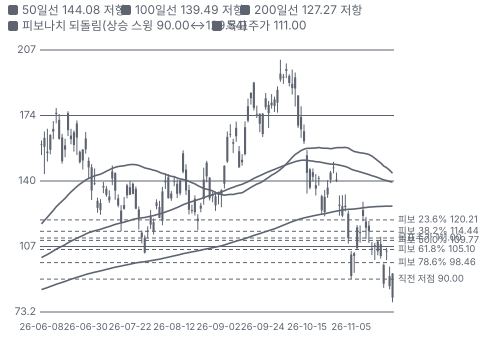

**주봉**

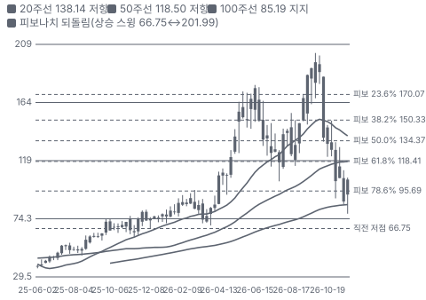

**월봉**

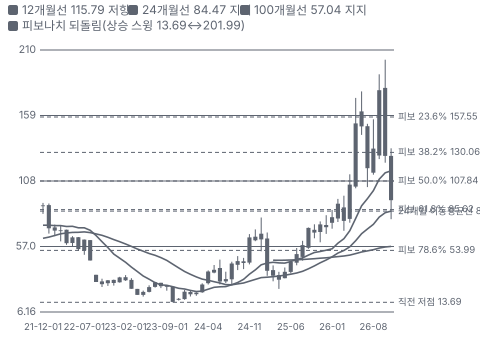

**분기 매출·EPS 실적과 컨센서스**

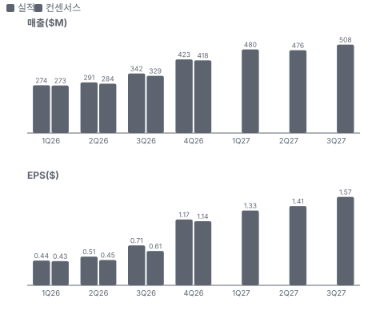

**1Q27 매출 — 지표 추세 vs 가이던스·컨센서스**

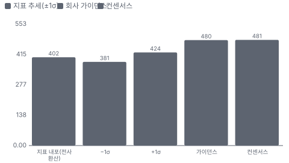

**최근 4개 분기 주가 변화 분석**

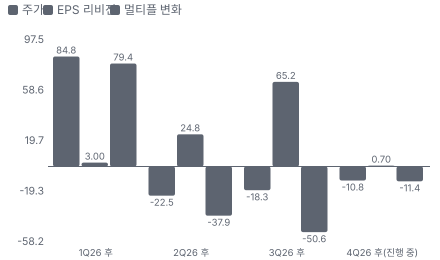

**EPS 리비전**

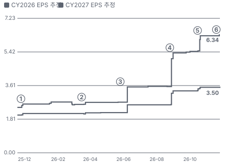

① 25-11-24 3Q FY26 실적 · EPS 리비전 +7%
② 26-03-16 4Q FY26 실적 · EPS 리비전 +4%
③ 26-05-26 1Q FY27 실적 — CopperEdge 첫 하이퍼스케일러 출하 시작 · EPS 리비전 +30%
④ 26-08-25 2Q FY27 실적 — 3Q 가이던스 \$410M, 데이터센터 +45% 예고 · EPS 리비전 +51%
⑤ 26-10-15 Analyst Day — 3Q 가이던스 상향·FY30 틀 공개, 당일 주가 −10% · EPS 리비전 +15%
⑥ 26-11-23 3Q FY27 실적 — 4Q 가이던스 \$480M, FY28 데이터센터 \$1B · EPS 리비전 +1%

**멀티플 프리미엄(Fwd 1Y P/E, 최근 4개 분기말 절대값 — 대상 vs 동종 중앙값)**

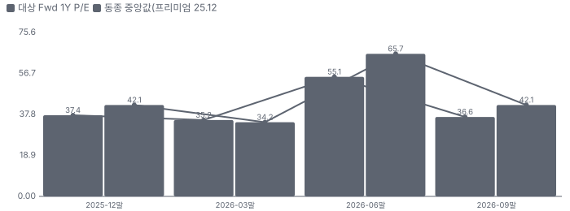

**합리적 멀티플**

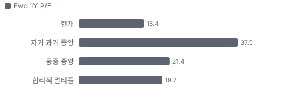

**밸류에이션 주가 시나리오**

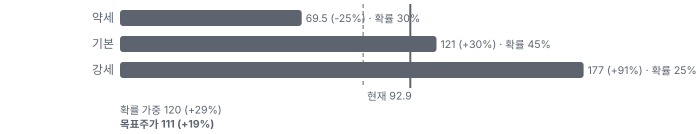

**주가별 업사이드**

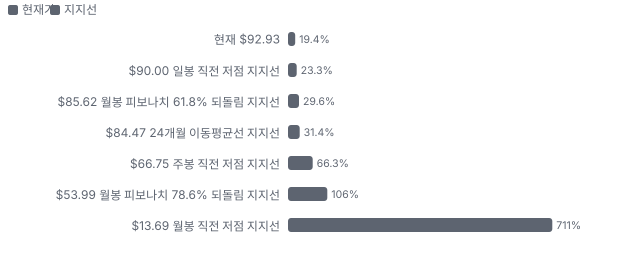
- 제품·서비스 포트폴리오

**고객 믹스(3Q FY27, 매출 대비)**

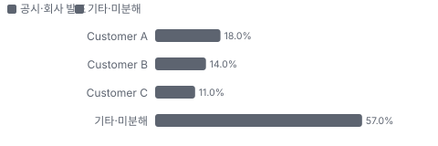

**공급 병목(10점, 낮을수록 병목)**

**CAPEX의 매출 대비 비중**

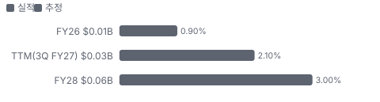

**어닝콜 변화별 주주가치 영향**

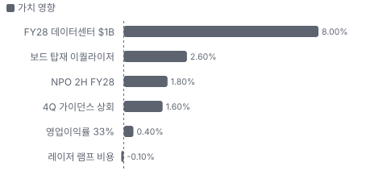

**매출 → 매출총이익 → 영업이익(매출 = 100, 최근 4분기)**

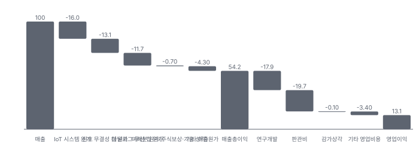

**분기 비용 비중 추이(매출 대비, 공시)**

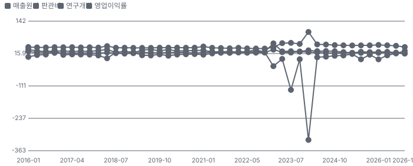

**비용 요인별 매출 대비 비중 1년 변화**

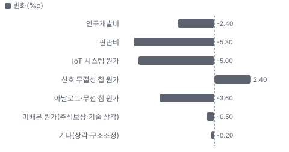

**신호 무결성 칩 BOM 원가 몫**

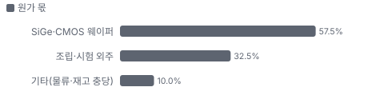

**아날로그·무선 칩 BOM 원가 몫**

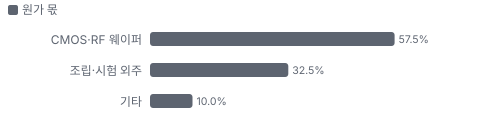

**IoT 시스템·연결 BOM 원가 몫**

**BOM 항목 가격 +10% 시 OPM 변화**

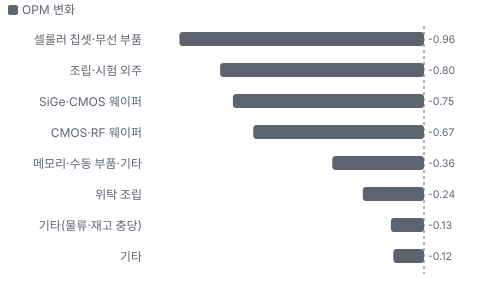

**자산 구성 — 4Q26 분기말 투하자본 \$1,036.7M**

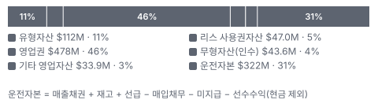

**자산별 변화율 — 최근 12개 분기(4Q23 = 0%) + 다음 4개 분기 추정**

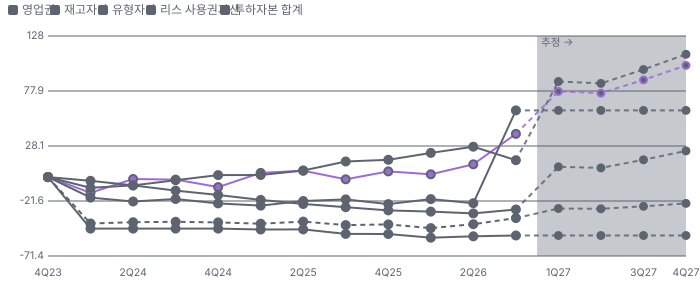

**ROIC 추이 — TTM, 최근 12개 분기 + 다음 4개 분기 추정(컨센서스 NOPAT) · 투하자본이 0 근처라 ROIC가 ±100%를 넘는 분기는 비움**

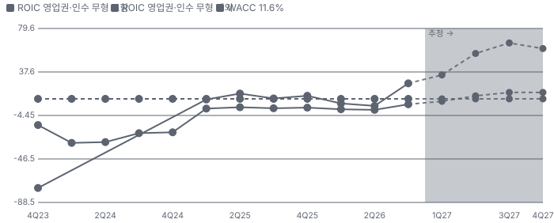

**HieFo(레이저 칩 공장·설계) 인수 효과 — 인수 전 EPS 대비 %, 굵은 선 = 합계 · 시너지 가치 \$0.12B(웃돈 미확인)**

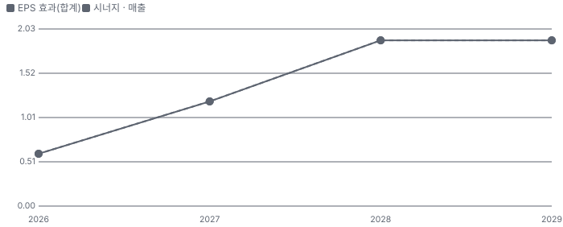

**매출 vs PPI·수출입 — 1Q23 = 100(변화율, 로그 눈금)**

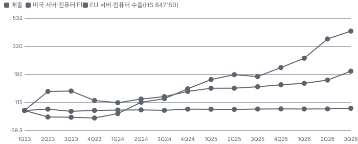

**10년 P·Q 사이클 — 추세(HP 필터) 대비 갭과 8분기 전망**

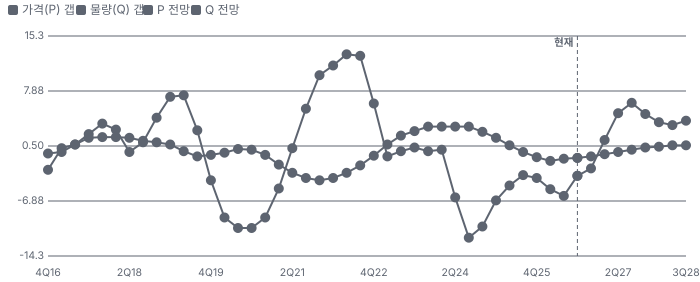

**매출 증가율의 가격·물량 분해와 8분기 전망(전년 대비)**

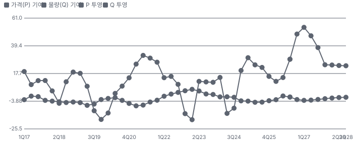

**목표주가 산정 — 약세와 기본 사이(약세 쪽 19%), 도달 확률 약 55%**

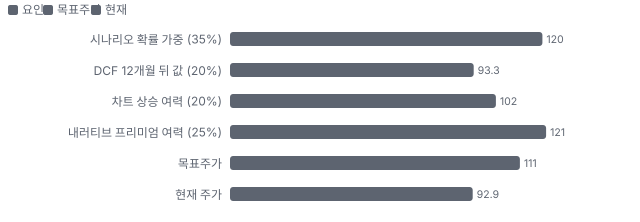

**PEG — 성장 대비 멀티플(낮을수록 성장 대비 쌈)**

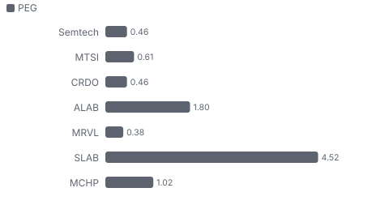

**커뮤니티 언급 수(최근 30일, 채널별)**

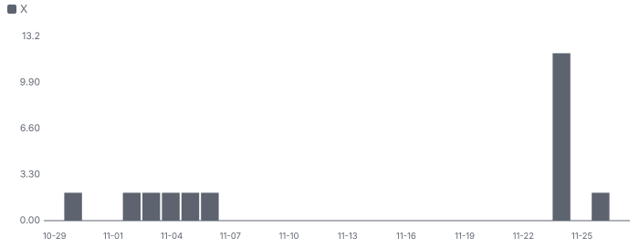

**커뮤니티 게시 수(월, 최근 7개월 — 이번 달은 진행 중)**

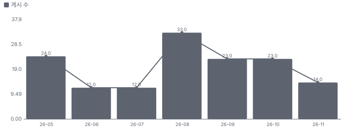

**재고 일수 — 분기별(수주 자료가 없어 수주/출하 비율 없음)**

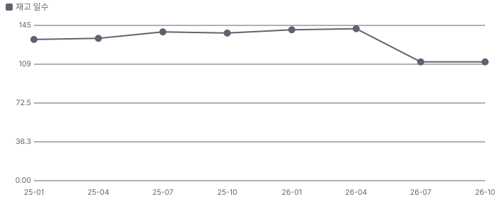

**일별 거래량 분해**

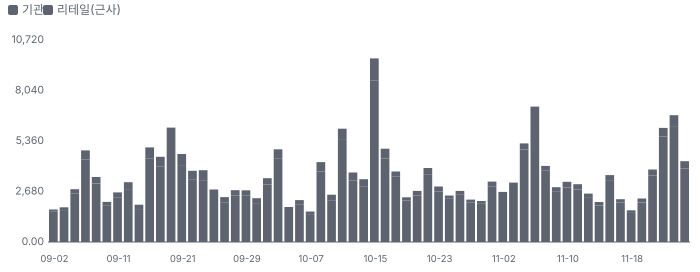

**기관 자금 흐름**

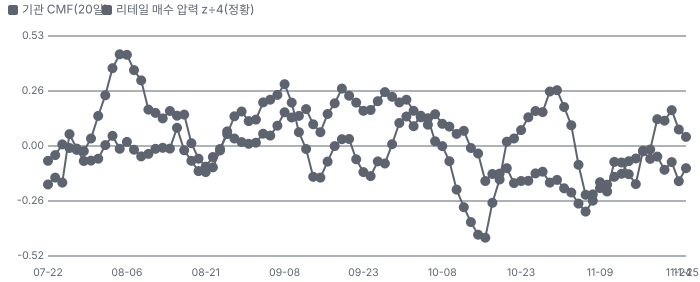

**몬테카를로**

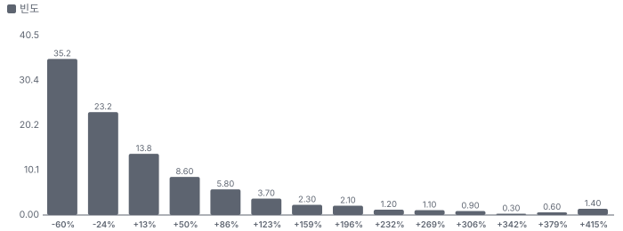

해석: 3,000번 중 1,185번(40%)에서 가치가 지금 주가 이상이었다. 가정을 흔들어도 지금 주가를 뒷받침하지 못하는 경우가 더 많다. 가운데 값은 0.79배이고, 열 번 중 여덟 번은 0.33~2.37배 사이에 든다.

## 내러티브

> **기업가치를 결정하는 이야기:** 값을 정하는 것은 세 가지다. ① 데이터센터 매출이 FY27 약 \$520M에서 FY28 \$1B 이상으로 두 배가 되는가 — 경영진 전망이고 잔고 금액은 공시되지 않는다. ② 매출총이익률이 64%(매각 예정 사업 제외)에서 70%로 가는 속도 — 레이저 칩 공장 램프 비용이 단기에는 누른다. ③ 시장이 AI 하드웨어 이익에 주는 배수 — 동종 전체가 두 달 새 크게 내려왔다.

> **멀티플·EPS 프리미엄**
> **멀티플:** Fwd 1Y P/E 15.4배는 동종 6사 중앙값(약 21배)보다 낮다. 6월 말 55배, 9월 말 37배였다 — 프리미엄이 할인으로 바뀌었다
> **EPS:** FY2028 EPS 추정은 2Q 콜 직전 \$3.65에서 \$6.58로 80% 올랐다(8명). 같은 기간 주가는 27% 내렸다

### 투자자들은 왜 열광했나

8월 25일 2Q 실적 다음 날 +10.4%, 9월 한 달 \$127 → \$178, 10월 2일 장중 \$201.99·10월 6일 종가 \$197.20이 고점이다. 열광의 근거는 '1.6T 전환 + 구리 선형 칩 + 광소자'로 모듈당 탑재 금액이 열 배 가까이 는다는 로드맵이었다. 식은 계기는 10월 15일 Analyst Day다 — 회사는 분기 가이던스를 올렸지만 FY30 틀(매출 \$3.2B·EPS \$12.40~13.00)이 높아진 기대에 못 미쳤다는 반응 속에 당일 −10.0%였고, 그 뒤 나스닥 100이 20거래일 −12.6%인 기술주 조정이 겹쳤다. 11월 23일 실적은 가이던스를 넘었지만 다음 날 −17.0%였다.

### 무엇이 기업가치를 바꾸나

> **구조적 체질 변화**
> **변화:** 조정 영업이익률이 1년 새 20.6%에서 33.0%로 올랐고 회사는 FY30 48~50%를 목표로 낸다. 기간 대출을 다 갚아 순차입 배수가 0.7배다
> **증거:** 3Q FY27 실적 보도자료(8-K EX-99.1) · Analyst Day 8-K
> **반증:** 조정 영업이익률이 30% 아래로 내려간다

> **고부가 믹스 확장**
> **변화:** 부문 매출총이익률 69.8%인 신호 무결성 칩이 매출의 31%에서 43%로 커졌다. 매출총이익률 28.6%(계산)인 휴대통신 모듈 사업은 매각 계약을 맺었다
> **증거:** 3Q FY27 8-K 부문표 · 매각 발표 8-K(2026-08-13)
> **반증:** 매각이 무산되거나 신호 무결성 부문 매출총이익률이 65% 아래로 내려간다

> **기술 혁신**
> **변화:** 1.6T 증폭 칩이 업계 전시회 부품 혁신상을 받았고, 두 번째 하이퍼스케일러가 리타이머(뭉개진 신호를 디지털로 다시 만들어 보내는 칩 — 전력과 지연이 더 든다) 대신 선형 이퀄라이저(거리 때문에 뭉개진 고속 신호를 디지털 처리 없이 아날로그로 다듬는 칩)를 보드에 쓰기로 했다 — 회사는 전력 90% 절감·지연 제거를 든다(회사 주장)
> **증거:** 3Q FY27 어닝콜(2026-11-23)
> **반증:** 보드 탑재 출하가 1H FY28에 시작되지 않는다

> **실행 속도**
> **변화:** 해당 없음(납품 리드타임 수치를 공시하지 않는다) — 고객이 리드타임 안쪽으로 납기를 당겨 달라고 요청하고 있고, 회사는 2년 전 추가 인증한 팹 덕에 파운드리는 제약이 아니라고 말한다
> **증거:** 3Q FY27 어닝콜(2026-11-23) · FY2026 10-K(통상 납기 4~13주)
> **반증:** 출하 지연이나 납기 미달 공시

> **M&A**
> **변화:** 2026-03-03 HieFo를 현금 약 \$34.0M에 사서 레이저 칩 공장을 갖게 됐다. 반대로 2026-08-13 휴대통신 모듈 사업을 Compal에 \$62M에 팔기로 했다(미종결)
> **증거:** FY2026 10-K · 3Q FY27 10-Q Note 2
> **반증:** 레이저 캐파 확장 지연 또는 매각 무산

> **정책·입법 연관성**
> **재정정책:** 해당 없음(보조금·세액공제를 받지 않는다 — 10-K·10-Q에 정부 지원 수령 언급 없음) FY2026 10-K · 3Q FY27 10-Q
> **행정명령:** 해당 없음(회사에 직접 닿는 행정명령을 1차 자료로 확인하지 못했다 — 미국의 중국산 광모듈 규제 논의는 규칙안 전 단계이고 회사는 고객 간 물량 이동이라 영향이 작다고 답했다) 3Q FY27 어닝콜(2026-11-23)
> **연관입법:** 해당 없음(연결되는 법안을 확인하지 못했다) FY2026 10-K

> **고객의 지출 예산**
> **변화:** 데이터센터·통신 인프라 매출은 고객의 설비투자에서, 산업·소비자 매출은 기기 제조원가에서 나온다
> **사업별 예산:** **매출의 49%**: 산업(LoRa·IoT(기기와 센서를 통신망에 연결하는 사물인터넷) 시스템·보호 소자) — 고객 혼합(기기 제조사의 부품 원가와 기업·공공의 현장 통신 장비 투자) · 동인: LoRa 기기 출하, 5G 라우터 교체
**매출의 42%**: 인프라(데이터센터·통신) — 고객 CAPEX(하이퍼스케일러의 서버·네트워크 설비투자 — 광모듈·케이블 구매) · 동인: AI 랙 출하, 800G(초당 800기가비트를 보내는 광모듈 규격) → 1.6T 전환
**매출의 9%**: 고급 소비자(보호 소자·센서) — 고객 OPEX(스마트폰·웨어러블 제조사의 부품 원가) · 동인: 고급 스마트폰 출하와 기기당 탑재량
> **증거:** 3Q FY27 8-K·콜 최종 시장별 매출
> **반증:** 하이퍼스케일러 설비투자 가이던스 하향

### 내러티브 근거

> AI 데이터센터 연결이 전력을 덜 쓰는 아날로그 방식으로 옮겨 가고 Semtech가 그 칩을 판다는 이야기는 셀사이드 전원이 받아들인 컨센서스다. 실적도 그 방향이다. 다만 10월 초부터 시장은 같은 이야기에 주던 배수를 절반 아래로 낮췄다 — 이익 추정은 석 달 새 80% 올랐는데 주가는 내렸다. 동종 대비 멀티플 차이 -28% 중 회사 고유 몫은 -22%다. 단계는 컨센서스, 쏠림은 중간이다.

> **아날로그 연결로의 구조 전환** · 강화
> **논리:** 선 속도가 오를수록 전력이 문제가 되어 디지털 처리 칩을 뺀 선형 구조(LPO(신호 처리 칩을 뺀 광모듈 — 전력을 아끼는 대신 아날로그 칩 성능에 기댄다)·NPO(광 부품을 스위치 칩 바로 옆 기판에 올리는 방식)·ACC(케이블 끝에 신호를 다듬는 아날로그 칩을 넣은 구리 케이블 — 전력을 적게 쓴다)·보드 탑재 이퀄라이저)가 늘고 회사 칩이 그 자리에 들어간다
> **숫자:** 데이터센터 매출 \$145M(+158% YoY), 4Q 약 +40% QoQ 예고, FY28 \$1B 이상(경영진)
> **반증:** 데이터센터 매출 순차 성장이 2개 분기 연속 한 자릿수로 내려간다
> **출처:** 3Q FY27 어닝콜(2026-11-23)

> **믹스 개선과 영업 레버리지** · 강화
> **논리:** 저마진 휴대통신 모듈을 팔고 데이터센터·LoRa 비중이 커지며 매출총이익률 70%·영업이익률 48~50%로 간다
> **숫자:** 조정 영업이익률 20.6% → 33.0%(1년), 매각 예정 사업 제외 매출총이익률 64.0%
> **반증:** 매각 예정 사업 제외 조정 매출총이익률이 2개 분기 연속 64% 근처에 머문다
> **출처:** 8-K EX-99.1 · Analyst Day 8-K

> **LoRa 두 번째 성장축** · 강화
> **논리:** 산업용에서 스마트홈·보안으로 넓어지고 Amazon Sidewalk(Amazon이 가정용 기기로 만든 저전력 이웃 통신망)가 물량을 만든다
> **숫자:** LoRa \$68M(+69% YoY), 4Q도 +18% 안팎 예고
> **반증:** LoRa 매출이 2개 분기 연속 줄어든다
> **출처:** 3Q FY27 어닝콜(2026-11-23)

> **광소자 수직 통합** · 유지
> **논리:** 레이저·게인 칩(파장을 바꿀 수 있는 레이저 안에서 빛을 키우는 반도체 조각)을 직접 만들어 모듈당 탑재 금액을 키운다
> **숫자:** 캐파 3배 뒤 분기 약 \$25M — 4Q 매출 가이던스의 5%
> **반증:** 2026년 말 1차 확장이 늦어지거나 레이저 매출이 FY28 상반기에도 분기 \$25M에 못 미친다
> **출처:** 3Q FY27 어닝콜(2026-11-23)

> **반대 내러티브 — AI 설비투자 고점과 배수 붕괴** · 강화
> **논리:** 하이퍼스케일러 투자가 2028년에 꺾이면 데이터센터 매출 두 배 전망이 무너지고, 지금 이익은 사이클 고점 이익이라 낮은 배수가 맞다
> **숫자:** Fwd 1Y P/E 55배(6월 말) → 15.4배, 나스닥 100 20거래일 −12.6%, 동종 6사 배수도 함께 하락
> **반증:** 하이퍼스케일러 2027년 설비투자 가이던스가 늘고 회사 1Q FY28 가이던스가 4Q를 웃돈다
> **출처:** 주가·배수 계산 · 3Q 콜 BMO 질문

> **반대 내러티브 — 집중과 대체** · 유지
> **논리:** 고객 3곳이 매출의 43%이고 디지털 처리 칩 진영(리타이머·AEC(케이블 끝에 디지털 신호 처리 칩을 넣어 신호를 다시 만드는 구리 케이블))이 같은 자리를 놓고 싸운다
> **숫자:** Customer A 18%·B 14%·C 11%, 케이블 채택은 '시간이 걸린다'(3Q 콜)
> **반증:** 두 번째 하이퍼스케일러 보드 탑재 출하가 1H FY28에 시작되고 고객 수가 늘어난다
> **출처:** 3Q FY27 10-Q Note 14 · 3Q FY27 어닝콜(2026-11-23)

### 투자 포인트

> **이익은 올랐고 배수가 무너졌다**
> **명제:** 주가 하락의 전부가 배수 축소다 — 실적과 추정은 그 사이 계속 올랐다
> **숫자:** 8월 25일 이후 주가 −27%, FY2028 EPS 추정 +80%(\$3.65 → \$6.58). Fwd 1Y P/E 55배(6월 말) → 15.4배
> **시장과 다른 점:** 셀사이드 17명 중 16명이 매수이고 목표가 평균이 \$195라 '시장이 못 봤다'고 말할 자리가 아니다. 다른 점은 가격이다 — 지금 주가는 FY2028 추정이 크게 깎이는 경우를 이미 담고 있다
> **증명:** 1Q FY28 가이던스가 4Q(\$480M)를 웃도는지, 하이퍼스케일러 2027년 설비투자 가이던스
> **출처:** 8-K EX-99.1(2026-11-23) · 컨센서스 이력

> **믹스가 이익률을 끌어올린다**
> **명제:** 매출의 13%인 저마진 사업이 빠지고 70%짜리 사업이 커진다
> **숫자:** 매각 예정 사업 제외 조정 매출총이익률 64.0%(전체 59.3%), 신호 무결성 부문 69.8%, 조정 영업이익률 33.0%
> **시장과 다른 점:** 회사는 70%로 가는 길이 분명하다고 하지만 4Q 개선은 +30bp뿐이다 — 레이저 공장 램프 비용이 얼마나 오래 누르는지는 컨센서스에 뚜렷이 들어 있지 않다(미확인)
> **증명:** 매각 종결 공시, 4Q 매각 예정 사업 제외 매출총이익률 64.3% 달성 여부
> **출처:** 8-K EX-99.1 · 3Q FY27 어닝콜(2026-11-23)

> **구리 선형 칩의 두 번째 고객**
> **명제:** 케이블에서 보드로 자리가 넓어지면 고객 1곳 의존이 풀린다
> **숫자:** 두 번째 하이퍼스케일러 보드 탑재 설계 수주(1H FY28 출하 예상), 첫 고객에서 새 플랫폼 2곳 추가
> **시장과 다른 점:** 설계 수주는 매출이 아니다 — 회사 스스로 케이블 채택은 재설계 시점을 놓치면 미뤄진다고 인정했다. 규모 숫자도 내지 않았다
> **증명:** 1H FY28 출하 시작 확인, 10% 이상 고객 수가 3곳에서 늘어나는지(10-Q)
> **출처:** 3Q FY27 어닝콜(2026-11-23) · 3Q FY27 10-Q Note 14

### 모멘텀 생성·소멸 타임라인

**카탈리스트 달력 — 지난 사건의 주가 반응과 앞으로 확인할 숫자**
| 날짜 | 상태 | 구분 | 사건 | 반응·확인 | 결과에 따라 |
|---|---|---|---|---|---|
| 2026-05-26 | 완료 | 생성 | 1Q FY27 실적 — 구리 선형 칩 첫 하이퍼스케일러 출하 | −4.4% |  |
| 2026-08-25 | 완료 | 생성 | 2Q FY27 실적 — 3Q 가이던스 \$410M, 데이터센터 +45% 예고 | +10.4% |  |
| 2026-10-15 | 완료 | 소멸 | Analyst Day — 분기 가이던스 상향·FY30 틀 공개 | −10.0% |  |
| 2026-11-23 | 완료 | 소멸 | 3Q FY27 실적 — 가이던스 상회, 4Q \$480M | −17.0% |  |
| 2026-11-30 | 예정 | 확인 | UBS 기술 콘퍼런스 발표(이후 12월 7~8일·1월 12일 행사) | 레이저 1차 확장 진행, FY28 수요 발언이 유지되는지 | 유지되면 기본, 톤이 물러서면 약세 쪽 |
| 2027-01 말~02(예상) | 예정 | 매크로 | 하이퍼스케일러 4분기 실적 — 2027년 설비투자 가이던스 | 주요 4사 합산 설비투자 가이던스가 2026년보다 느는지 | 늘면 배수 회복 여지, 줄면 약세 시나리오 |
| 2027-03 중순(예상) | 예정 | 확인 | 4Q FY27 실적·1Q FY28 가이던스, 휴대통신 모듈 매각 종결 여부 | 1Q 가이던스 \$480M 이상(매각분 제외 기준 병기), 매각 예정 사업 제외 매출총이익률 64.3% 이상 | 둘 다 맞으면 기본~강세, 가이던스가 4Q 아래면 약세 |
| 2027-03 말(예상) | 예정 | 확인 | FY2027 10-K — 구매 약정, 10% 이상 고객 | 구매 약정이 \$414M에서 얼마나 늘었는지, 고객 집중이 43%에서 내려가는지 | 약정 급증 + 집중 심화면 위험 상향 |

### 언제 사서 언제 팔아야 할까?

**가격·조건 틀 — 가격은 밸류에이션(약세·기본·강세·목표주가)과 차트 지지 구간에서, 조건은 이벤트에서**
| 구간 | 가격 | 목표주가까지 | 약세까지 | 조건·근거 |
|---|---|---|---|---|
| 관찰 구간 | \$90~\$90 | +23% | -23% | 11월 24일 종가 \$86.46과 25일 장중 \$78.18이 실적 뒤 저점권이다 — 4월 돌파 전 가격대(\$76~83)와 겹친다 |
| 확인 뒤 | 지금 \$93 이상에서 조건 확인 | +19% | -25% | 4Q 실적에서 1Q FY28 가이던스 \$480M 이상, 매각 예정 사업 제외 조정 매출총이익률 64.3% 이상, 데이터센터 매출 약 \$200M |
| 무효화 | 약세 시나리오 \$69 | - | -25% | 1Q FY28 가이던스가 4Q보다 낮거나 FY28 데이터센터 \$1B 발언을 거둔다 |
| 차익 고민 1차 | \$121(기본 시나리오) | +30% | - | 목표주가 부근에서는 배수가 동종 중앙값으로 돌아온 상태다 — 그 위는 FY30 틀 달성을 미리 값 매기는 구간이다 |
| 차익 고민 2차 | \$177(강세 시나리오) | +91% | - | 목표주가 부근에서는 배수가 동종 중앙값으로 돌아온 상태다 — 그 위는 FY30 틀 달성을 미리 값 매기는 구간이다 |

최근 3거래일 +18.8%·−17.0%·+7.5%로 움직였고 전형적 일일 변동이 10%다 — 하루 움직임으로 판단을 바꾸지 않는다 가격·조건 틀이며 매매·비중 지시가 아니다(투자 권유 아님).

## 포트폴리오

| 제품·서비스 | 구분 | 무엇 | 쓰는 곳 | 돈 버는 방식 | Mix | Mix 변화(전 분기 대비) |
|---|---|---|---|---|---|---|
| 신호 무결성 칩 | 제품 | 광모듈·구리 케이블·보드에서 고속 신호를 증폭하고 다듬는 아날로그 칩 | AI 데이터센터 광모듈, 랙 안 구리 연결, 통신·방송 장비 | 3Q 매출의 43%(\$182.4M, +124% YoY), 부문 매출총이익률 69.8% | 43% | +6.2%p |
| 아날로그·무선 칩 | 제품 | LoRa 무선 칩, 정전기 보호 소자, 근접 센서 칩 | 산업용 센서·스마트홈 기기, 고급 스마트폰·웨어러블 | 3Q 매출의 32%(\$133.8M, +38% YoY), 부문 매출총이익률 63.0% — LoRa \$68M | 32% | -2.7%p |
| IoT 시스템·연결 | 제품·서비스 | 셀룰러 모듈·라우터와 연결 관리 서비스 | 차량·현장 설비·공공 안전 통신 | 3Q 매출의 25%(\$106.7M, +21% YoY), 부문 매출총이익률 36.8% — 이 가운데 \$56.7M이 매각 예정 | 25% | -3.5%p |

**Mix 변화가 가장 큰 쪽은 신호 무결성 칩(+6.2%p, 전 분기 대비).** 계절성 판정: 분기 매출 계절 지수 기준 없음 → 직전 분기와 비교.

## 고객

> **3Q FY27 최대 고객 Customer A 18%, 상위 3곳 43%, 집중도 분산.** 공시·회사 발표로 확인한 몫은 매출의 43%이고, 나머지 고객 몫은 추정이거나 미분해다. 이름이 공시된 고객은 없다. 3Q FY27 10-Q는 매출의 10% 이상인 고객 3곳(18%·14%·11%)만 익명으로 적는다. 매출의 78%가 유통사를 거치므로 이 3곳이 유통사인지 최종 고객인지도 확인되지 않는다. 최종 수요처는 광모듈 조립사와 하이퍼스케일러다(회사 발언)

**고객별 매출 몫(3Q FY27)**
| 고객 | 몫 | 변화 | 근거 |
|---|---|---|---|
| Customer A | 18% | +6%p | 공시 |
| Customer B | 14% | +0%p | 공시 |
| Customer C | 11% | 미확인 | 공시 |
| 기타·미분해 | 57% | - | - |

> **Customer A** · 공시
> **사는 것:** 미확인(품목 미공시)

> **Customer B** · 공시
> **사는 것:** 미확인(품목 미공시)

> **Customer C** · 공시
> **사는 것:** 미확인(품목 미공시)

## 마진 구조

> **GPM 58.6%, OPM 26.3%.** 3Q FY26 대비 GPM +6.7%p, OPM +14.6%p. 변동비는 매출의 44%이고, 매출이 10% 늘면 OPM은 +2.7%p 움직인다. 3Q FY27 GAAP 매출총이익률은 58.6%(1년 전 51.9%), 영업이익률은 26.3%(11.6%)다. 이익률이 가장 높은 신호 무결성 칩(부문 매출총이익률 69.8%)이 매출의 43%로 커진 것이 가장 큰 요인이고, 매출이 58% 느는 동안 판관비는 19% 늘었다

> **매출 100 중 매출원가 45.8, 매출총이익 54.2(최근 4분기, 공시).** 매출원가 요인 중 IoT 시스템 원가이 매출의 16.0%로 가장 무겁고, 단가가 +10% 오르면 GPM이 -1.60%p 움직인다. 분기 회귀로 매출 1이 늘 때 매출원가는 0.52 늘고, 매출원가의 고정비 몫은 -16%다.

**비용 요인 강도 — 비중·추세·충격(+10%)·탄력**
| 비용 | 구분 | 매출 대비 | 1년 변화 | 마진 기여 | 충격 시 마진 | 매출 탄력 | 고정비 몫 |
|---|---|---|---|---|---|---|---|
| IoT 시스템 원가 | 매출원가 요인 | 16.0% | -5.0%p | +5.0%p | -1.60%p | 미확인 | 5% |
| 신호 무결성 칩 원가 | 매출원가 요인 | 13.1% | +2.4%p | -2.4%p | -1.31%p | 미확인 | 10% |
| 아날로그·무선 칩 원가 | 매출원가 요인 | 11.7% | -3.6%p | +3.6%p | -1.17%p | 미확인 | 10% |
| 미배분 원가(주식보상·기술 상각) | 매출원가 요인 | 0.7% | -0.5%p | +0.5%p | -0.07%p | 미확인 | 100% |
| 매출원가 | 공시 항목 | 45.8% | -2.2%p | +2.2%p | -4.58%p | 0.52 | -16% |
| 판관비 | 공시 항목 | 19.7% | -1.4%p | +1.4%p | 미확인 | 0.14 | 44% |
| 연구개발 | 공시 항목 | 17.9% | -0.8%p | +0.8%p | 미확인 | 0.17 | 14% |
| 기타 영업비용 | 공시 항목 | 3.4% | -1.8%p | +1.8%p | 미확인 | 0.13 | -20% |
| 감가상각 | 공시 항목 | 0.1% | +0.0%p | -0.0%p | 미확인 | -0.03 | 100% |

매출 탄력 = 분기 비용을 매출에 회귀한 기울기(매출 1당 변동비), 고정비 몫 = 절편 ÷ 평균 비용. 표본이 8분기 미만이면 미확인. 매출원가 요인 비중은 margin 재료의 추정이 섞여 있고, 공시 매출원가와의 차이는 '기타 매출원가'로 둔다.

**GPM에서 OPM까지(GAAP — 10-Q 3개월 손익, 아래는 최근 4개 분기)**
| 기간 | GPM | 연구개발 | 판관비 | 기타 | OPM |
|---|---|---|---|---|---|
| 3Q FY26 | 51.9% | 18.5% | 21.4% | 0.3% | 11.6% |
| 3Q FY27 | 58.6% | 16.1% | 16.0% | 0.1% | 26.3% |
| 2026-01 | 50.4% | - | - | - | -6.7% |
| 2026-04 | 52.0% | - | - | - | 8.9% |
| 2026-07 | 53.8% | - | - | - | 16.3% |
| 2026-10 | 58.6% | - | - | - | 26.3% |

**비용을 움직이는 요인**
| 비용 | 요인 |
|---|---|
| 연구개발비(연구개발) | 데이터센터·광소자·LoRa 개발 인력, 시제품 비용 · 근거 공시 |
| 판관비(판관비) | 인력, 주식보상, 소송·거래 비용 · 근거 공시 |
| IoT 시스템 원가(매출원가) | 셀룰러 칩셋·메모리 부품가, 위탁 조립비 · 근거 공시 |
| 신호 무결성 칩 원가(매출원가) | 출하량, SiGe(실리콘에 게르마늄을 섞어 고속 아날로그 회로를 만드는 반도체 공정)·CMOS(가장 널리 쓰이는 실리콘 반도체 제조 공정) 웨이퍼 단가, 1.6T 비중 · 근거 공시 |
| 아날로그·무선 칩 원가(매출원가) | LoRa·보호 소자 출하량, 웨이퍼·조립 단가 · 근거 공시 |
| 미배분 원가(주식보상·기술 상각, 매출원가) | 인수 기술 상각 일정 · 근거 공시 |
| 기타(상각·구조조정, 기타) | 무형자산 상각 · 근거 공시 |

**신호 무결성 칩 BOM — 매출의 43%, GPM 70%(공시 — 3Q FY27 부문 매출총이익 \$127.2M ÷ 매출 \$182.4M), 항목 가격 +10% 시**
| 항목 | 원가 몫 | 전가 | 제품 GPM | OPM |
|---|---|---|---|---|
| SiGe·CMOS 웨이퍼 | 50~65% | 미확인 | -1.7%p | -0.75%p |
| 조립·시험 외주 | 25~40% | 미확인 | -1.0%p | -0.42%p |
| 기타(물류·재고 충당) | 5~15% | 미확인 | -0.3%p | -0.13%p |

**아날로그·무선 칩 BOM — 매출의 32%, GPM 63%(공시 — 3Q FY27 부문 매출총이익 \$84.3M ÷ 매출 \$133.8M), 항목 가격 +10% 시**
| 항목 | 원가 몫 | 전가 | 제품 GPM | OPM |
|---|---|---|---|---|
| CMOS·RF(무선 통신에 쓰는 높은 주파수 신호) 웨이퍼 | 50~65% | 미확인 | -2.1%p | -0.67%p |
| 조립·시험 외주 | 25~40% | 미확인 | -1.2%p | -0.38%p |
| 기타 | 5~15% | 미확인 | -0.4%p | -0.12%p |

**IoT 시스템·연결 BOM — 매출의 25%, GPM 37%(공시 — 3Q FY27 부문 매출총이익 \$39.3M ÷ 매출 \$106.7M), 항목 가격 +10% 시**
| 항목 | 원가 몫 | 전가 | 제품 GPM | OPM |
|---|---|---|---|---|
| 셀룰러 칩셋·무선 부품 | 50~70% | 미확인 | -3.8%p | -0.96%p |
| 메모리·수동 부품·기타 | 15~30% | 미확인 | -1.4%p | -0.36%p |
| 위탁 조립 | 10~20% | 미확인 | -0.9%p | -0.24%p |
| 미분해 | 3% | - | - | - |

셀룰러 칩셋·무선 부품 가격이 +10% 오르면 영업이익은 -3.6% 움직인다. 판매가 전가를 모르는 항목은 전가 0%로 계산했다.

**BOM 항목 가격을 움직이는 것**
| 항목 | 요인 |
|---|---|
| SiGe·CMOS 웨이퍼 | 파운드리 단가와 수율 — 캐파가 빠듯한 SiGe 공정 단가가 오르면 바로 닿는다 · 근거 추정 |
| 조립·시험 외주 | 고속 시험 장비 시간이 병목이라 시험 비용 몫이 크다 · 근거 추정 |
| 기타(물류·재고 충당) | 재고 평가·운송 · 근거 추정 |
| CMOS·RF 웨이퍼 | 성숙 공정 웨이퍼 단가 · 근거 추정 |
| 조립·시험 외주 | 소형 패키지 대량 조립 · 근거 추정 |
| 기타 | 물류·재고 · 근거 추정 |
| 셀룰러 칩셋·무선 부품 | 칩셋 구매가가 원가의 대부분 · 근거 추정 |
| 위탁 조립 | 조립 단가 · 근거 추정 |
| 메모리·수동 부품·기타 | 메모리 가격 상승기에는 부담 · 근거 추정 |

**투입 물가 — 미국 PPI 3·6·12개월(2026-10, 개정 반영)과 해외 전년비**
| 항목 | 미국 3개월 | 6개월 | 12개월 | 전가 못 할 때 OPM | 일본 | 한국 | 대만 |
|---|---|---|---|---|---|---|---|
| CMOS·RF 웨이퍼 | -0.7% | -5.7% | -2.7%* | - | +1.6%* | 미확인 | 미확인 |
| 셀룰러 칩셋·무선 부품 | +0.0% | +24.0% | +46.4% | - | +11.5% | +1.7% | +12.1% |
| 메모리·수동 부품·기타 | 미확인 | 미확인 | 미확인 | - | 미확인 | 미확인 | 미확인 |

별표는 품목보다 넓은 업종 지수다. 연결한 투입 원가의 미국 PPI(생산자물가지수)는 1년 새 가중 +16.6%이고, 판매가로 넘기지 못하면 GPM -6.8%p·OPM -6.8%p가 움직인다. 물가 지수를 붙이지 못한 매출원가 항목은 미배분 원가(주식보상·기술 상각)다(미연결).

## 자산 구성

> **4Q26 분기말 투하자본 \$1.04B** — 영업권 46%, 운전자본 31%. 최근 12개 분기(4Q23 → 4Q26) 가장 크게 늘어난 자산은 리스 사용권자산(+60%), 투하자본 합계 -37%. 4Q27 추정 투하자본 \$1.26B(+21%, 컨센서스 매출과 회전 일수·CAPEX 강도 유지 가정). 연율 감가 비율(순액 기준)은 직전 4분기 37.63% → 최근 4분기 34.10%, 직전 비율이면 감가상각이 \$4.1M 더 컸다(영업이익의 2.8%).

**자산·운전자본 항목별 분기말 잔액 — 최근 12개 분기와 다음 4개 분기 추정**
| 항목 | 4Q23 | 3Q25 | 4Q26(최근) | 4Q27 추정 | 12개 분기 변화 | 다음 4개 분기 변화 |
|---|---|---|---|---|---|---|
| 매출채권 | \$156.6M | \$153.5M | \$217.9M | \$314.9M | +39% | +45% |
| 재고자산 | \$160.6M | \$183.3M | \$185.2M | \$339.0M | +15% | +83% |
| 선급·기타 유동자산 | \$121.2M | \$97.1M | \$124.6M | \$170.4M | +3% | +37% |
| 미지급비용 | \$184.0M | \$172.2M | \$206.1M | \$338.3M | +12% | +64% |
| 유형자산 | \$158.8M | \$115.6M | \$112.3M | \$196.5M | -29% | +75% |
| 리스 사용권자산 | \$29.3M | \$23.4M | \$47.0M | \$47.0M | +60% | +0% |
| 영업권 | \$1,013.7M | \$492.2M | \$478.3M | \$478.3M | -53% | +0% |
| 무형자산(인수) | \$168.2M | \$34.7M | \$43.6M | \$42.6M | -74% | -2% |

**자산 추정 동인 — 최근 4개 분기 평균(재무상태표 동인 모형)**
| 동인 | 값 | 곱하는 기준 |
|---|---|---|
| 매출채권 | 53일 | 매출 |
| 재고자산 | 123일 | 매출원가 |
| 선급·기타 유동자산 | 29일 | 매출 |
| 미지급비용 | 57일 | 매출 |
| 선수수익(계약부채) | 5일 | 매출 |
| 유형자산 ÷ 분기 매출 | 0.36배 | CAPEX·감가 재료 없음 — 비율 유지 |
| 매출원가율 | 46.2% | 매출(최근 4개 분기) |
| 영업권·리스 사용권·기타 | 유지 | 인수·새 리스는 공시 전 모름 |
| 인수 무형자산 | 분기 \$0.3M 상각 | 최근 4개 분기 평균 상각 |

**추정 방법:** 증권사 3표 모델(손익·재무상태표·현금흐름)의 재무상태표 동인 방식이다. 운전자본은 항목별 회전 일수(매출채권·선급·미지급·선수는 매출, 재고·매입채무는 매출원가 기준)를 최근 4개 분기 평균으로 두고 컨센서스 매출에 곱한다. 유형자산은 기초 + CAPEX − 감가상각으로 굴린다(Koller·Goedhart·Wessels 『Valuation』 재무상태표 추정). 매출 경로는 ROIC 절의 컨센서스와 같다.

**유형·무형자산 항목별 가치(2026-01-25 vs 2025-01-26)**
| 구분 | 항목 | 총액 2026-01-25 | 누적상각 | 순액 | 총액 2025-01-26 | 총액 1년 변화 | 공시 내용연수 |
|---|---|---|---|---|---|---|---|
| 유형 | 유형자산 합계(항목 미분해) | \$449.7M | 총계만 공시 | 총계만 공시 | \$440.2M | +2.2% | 미확인 |
| 영업권 | 영업권 | \$457.9M | \$0.0M | \$457.9M | \$533.1M | -14.1% | 비상각 |
| 무형 | 무형자산 합계(항목 미분해) | \$237.1M | \$74.2M | \$162.8M | \$217.1M | +9.2% | 미확인 |
| 유형 합계 | 유형자산 | \$449.7M | \$340.3M | \$109.3M | \$440.2M | +2.2% | 경과율 76%(상각 대상 기준) |

**내용연수 산식(상각 대상 유형자산 = 총액 − 토지 − 건설중)**
| 기준일 | 연 감가상각 | 상각 대상 총액 | 평균 내용연수 | 경과 연수 | 잔여 연수 | 경과율 |
|---|---|---|---|---|---|---|
| 2026-01-25 | \$29.9M | \$449.7M | 15.0년 | 11.4년 | 3.7년 | 76% |
| 2025-01-26 | \$33.2M | \$440.2M | 13.3년 | 9.5년 | 3.8년 | 71% |

산식 평균 내용연수는 15.0년. 1년 전 13.3년 → 지금 15.0년.

**분기 감가 비율(감가상각 ÷ 평균 유형자산 순액)**
| 분기 | 감가상각 | 평균 유형자산(순액) | 분기 비율 | 연율 | 연율의 역수 |
|---|---|---|---|---|---|
| 4Q23 | \$22.5M | \$160.1M | 14.08% | 56.32% | 1.8년 |
| 2Q24 | \$10.5M | \$152.9M | 6.87% | 27.48% | 3.6년 |
| 3Q24 | \$12.6M | \$143.2M | 8.77% | 35.09% | 2.8년 |
| 4Q24 | \$10.1M | \$136.3M | 7.44% | 29.75% | 3.4년 |
| 2Q25 | \$10.2M | \$126.7M | 8.04% | 32.17% | 3.1년 |
| 3Q25 | \$10.3M | \$117.9M | 8.75% | 34.98% | 2.9년 |
| 4Q25 | \$10.1M | \$113.3M | 8.94% | 35.76% | 2.8년 |
| 2Q26 | \$9.2M | \$108.8M | 8.42% | 33.66% | 3.0년 |

감가상각 기준: 손익계산서 감가상각·상각비(SEC 공시 데이터, 4분기 = 연간 − 1~3분기). 분기 유형자산 총액이 없어 순액 기준.

최근 4분기 연율 감가 비율 34.10%, 직전 4분기 37.63%(-9%) — 경고 문턱(-10%) 안이다.

미공시·미분해: 유형자산 항목별 총액·내용연수(10-K 주석에서 모델이 채움) · 무형자산 항목(10-K 주석에서 모델이 채움) — 이 칸은 비우고 나머지로 계산했다.

### 해석 — 자산이 어디에 쌓이고 있나

- 같은 기간 4개 분기 매출은 +54%. 자산이 매출보다 빨리 쌓이지 않았다 — 회전율이 유지된다.

## ROIC

> **TTM 4Q26 ROIC는 영업권·인수 무형 포함 6.3%, 제외 26.6%**(NOPAT 마진 9.8% × 투하자본 회전율 0.64회). 최근 12개 분기 4Q23 -13.7% → 4Q26 6.3%(고점 4Q26 6.3%). 컨센서스 NOPAT으로 굴리면 4Q27 17.8%(제외 60.2%) — WACC 11.6% 대비 +6.3%p. 1년 변화의 가장 큰 요인은 NOPAT 마진(+2.8%p).

**ROIC 추이(TTM)와 다음 4개 분기 추정 — NOPAT ÷ 평균 투하자본(이번 분기말·4개 분기 전)**
| 분기 | 구분 | TTM 매출 | TTM NOPAT | NOPAT 마진 | 평균 투하자본 | ROIC 포함 | ROIC 제외 |
|---|---|---|---|---|---|---|---|
| 4Q23 | 실적 | \$843.3M | −\$290.5M | -34.4% | \$2,122.5M | -13.7% | -74.5% |
| 1Q24 | 실적 | \$868.8M | −\$742.0M | -85.4% | \$2,393.2M | -31.0% | 미확인 |
| 2Q24 | 실적 | \$838.3M | −\$733.7M | -87.5% | \$2,428.5M | -30.2% | 미확인 |
| 3Q24 | 실적 | \$815.3M | −\$491.0M | -60.2% | \$2,276.8M | -21.6% | 미확인 |
| 4Q24 | 실적 | \$851.2M | −\$470.8M | -55.3% | \$2,276.1M | -20.7% | 미확인 |
| 1Q25 | 실적 | \$909.3M | \$42.0M | 4.6% | \$1,919.2M | 2.2% | 11.0% |
| 2Q25 | 실적 | \$954.2M | \$68.1M | 7.1% | \$1,944.8M | 3.5% | 16.7% |
| 3Q25 | 실적 | \$996.5M | \$48.9M | 4.9% | \$1,922.6M | 2.5% | 12.0% |
| 4Q25 | 실적 | \$1,026.6M | \$59.4M | 5.8% | \$1,923.3M | 3.1% | 14.6% |
| 1Q26 | 실적 | \$1,050.0M | \$27.9M | 2.7% | \$1,886.1M | 1.5% | 7.2% |
| 2Q26 | 실적 | \$1,089.9M | \$19.9M | 1.8% | \$1,929.8M | 1.0% | 4.8% |
| 4Q26 | 실적 | \$1,255.3M | \$122.6M | 9.8% | \$1,949.8M | 6.3% | 26.6% |
| 1Q27 | 추정 | \$1,468.3M | \$187.0M | 12.7% | \$2,027.1M | 9.2% | 34.7% |
| 2Q27 | 추정 | \$1,669.7M | \$290.1M | 17.4% | \$1,997.4M | 14.5% | 55.5% |
| 3Q27 | 추정 | \$1,886.7M | \$363.8M | 19.3% | \$2,045.0M | 17.8% | 65.6% |
| 4Q27 | 추정 | \$2,007.1M | \$376.6M | 18.8% | \$2,111.4M | 17.8% | 60.2% |

**다음 4개 분기 NOPAT — 컨센서스(세율 20%, 리스 이자 별도)**
| 분기 | 매출 | EBITA 마진 | EBITA | NOPAT(분기) | 근거 |
|---|---|---|---|---|---|
| 1Q27 | \$480.0M | 23.3% | \$111.8M | \$89.4M | 컨센서스 매출 × EBIT 마진 FY2027(조정 − 주식보상 5.5%) |
| 2Q27 | \$475.7M | 23.3% | \$110.8M | \$88.6M | 컨센서스 매출 × EBIT 마진 FY2027(조정 − 주식보상 5.5%) |
| 3Q27 | \$508.0M | 23.3% | \$118.3M | \$94.6M | 컨센서스 매출 × EBIT 마진 FY2027(조정 − 주식보상 5.5%) |
| 4Q27 | \$543.4M | 23.3% | \$126.5M | \$101.2M | 컨센서스 매출 × EBIT 마진 FY2027(조정 − 주식보상 5.5%) |

**추정 방법:** NOPAT은 컨센서스(분기 매출 추정 × 회계연도 EBIT 마진 추정)로 잡고, 조정(비 GAAP) 마진이면 주식보상 몫을 빼서 과거 실적과 같은 기준(영업이익 + 인수 무형 상각)으로 맞췄다. 이미 발표했지만 분기 보고서(10-Q)가 아직 없는 분기는 발표 실적을 쓴다. 투하자본은 자산 구성 절의 재무상태표 동인으로 굴렸다. ROIC는 4개 분기 NOPAT을 이번 분기말과 4개 분기 전 투하자본의 평균으로 나눈다 — 추정 분기의 ROIC에는 이미 나온 실적 분기가 섞여 있다.

**투하자본 항목별 회전율과 ROIC 기여(TTM 4Q26, 평균 잔액)**
| 항목 | 투하자본 | 매출 1달러당 자본 | 회전율(매출 ÷ 항목) | 자본 몫 | 이 항목을 빼면 ROIC |
|---|---|---|---|---|---|
| 운전자본 | \$283.7M | 0.23 | 4.42회 | 15% | 7.3% |
| 유형자산 | \$114.0M | 0.09 | 11.01회 | 6% | 6.7% |
| 리스 사용권자산 | \$35.2M | 0.03 | 35.67회 | 2% | 6.4% |
| 영업권 | \$1,449.8M | 1.15 | 0.87회 | 74% | 24.5% |
| 무형자산(인수) | \$39.1M | 0.03 | 32.08회 | 2% | 6.4% |
| 기타 영업자산 | \$28.0M | 0.02 | 44.85회 | 1% | 6.4% |

**ROIC 세 가지 판**
| 판 | NOPAT | 투하자본 | ROIC | 무엇을 재나 |
|---|---|---|---|---|
| 영업권·인수 무형 포함 | \$122.3M | \$1,949.8M | 6.3% | 인수 웃돈까지 낸 돈에 대한 수익률 |
| 영업권·인수 무형 제외 | \$122.3M | \$460.9M | 26.5% | 본업 운영 수익률(동종 비교용) |
| 무형 자본화 조정(판관비 20%·5년, 연구개발 6년) | \$173.5M | \$2,696.3M | 6.4% | 비용으로 처리한 무형 투자를 자산으로 본 판 |
| 경제적 이익(포함판) | −\$103.2M | \$1,949.8M | 자본비용 11.6% | (ROIC − 자본비용) × 투하자본 |

NOPAT = (영업이익 \$149.7M + 인수 무형 상각 + 리스 내재 이자 \$2.5M) × (1 − 세율 20%). 리스 사용권자산을 투하자본에 넣었으므로 임차료 속 이자 몫을 영업이익에 되더했다. 현금은 영업에 필요한 몫을 따로 알 수 없어 투하자본에서 뺐다. SEC 공시 데이터 자동 초안 — 운전자본 = 매출채권 + 재고 + 선급 − (매입채무 + 미지급비용 + 선수수익), 현금 제외. 손상 누계는 공시 데이터 수록분.

**ROIC 1년 변화 분해(포함판, TTM 3Q25 → TTM 4Q26)**
| 요인 | ROIC 기여 |
|---|---|
| NOPAT 마진 | +2.82%p |
| 운전자본 | +0.05%p |
| 유형자산 | +0.09%p |
| 리스 사용권자산 | -0.01%p |
| 영업권 | +0.79%p |
| 무형자산(인수) | +0.01%p |
| 기타 영업자산 | -0.03%p |
| 합계 | +3.71%p |

**무형 자본화 가정별 ROIC(2026년 지출 기준, 포함판에 더함)**
| 투자로 보는 몫 | 상각 연수 | 무형 자산 | NOPAT 조정 | 조정 ROIC |
|---|---|---|---|---|
| 판관비 20% | 2년 | \$682.0M | \$46.9M | 6.4% |
| 판관비 20% | 5년 | \$746.5M | \$51.3M | 6.4% |
| 판관비 30% | 2년 | \$715.4M | \$47.0M | 6.4% |
| 판관비 30% | 5년 | \$812.1M | \$53.5M | 6.4% |

### 해석 — 무엇이 수익성을 끌어올리고 희석하나

- 영업권: 투하자본의 74% — 빼면 ROIC 6.3% → 24.5%. 이 자산의 회전율(0.87회)이 수익성을 희석하는 주된 자리다.
- 운전자본: 투하자본의 15% — 빼면 ROIC 6.3% → 7.3%. 이 자산의 회전율(4.42회)이 수익성을 희석하는 주된 자리다.
- 영업권·인수 무형을 빼면 ROIC가 +20.3%p 오른다 — 과거 인수에 치른 웃돈이 주주 수익률을 그만큼 낮춘다(본업 수익률은 제외판, 인수까지 포함한 가치 창출은 포함판으로 본다).
- 1년 ROIC 개선의 최대 요인은 NOPAT 마진(+2.8%p).
- 비용으로 처리한 무형 투자를 자산으로 보면 ROIC가 +0.2%p 움직인다(무형 자산 \$746.5M). 투자를 늘리는 중이라 NOPAT이 더 커지는 쪽이다.
- 추정 경로 4Q26 6.3% → 4Q27 17.8%: NOPAT 마진 +9.0%p, 투하자본 회전율 +0.31회 — 컨센서스 매출·마진이 맞고 회전 일수·CAPEX 강도가 유지된다는 가정이다. 마진 추정이 내려가거나 재고 일수가 늘면 이 경로가 먼저 틀린다.
- ROIC(포함) − WACC = -5.3%p(4Q26) — 양수면 투하자본을 늘릴수록 가치가 쌓인다.

## 공급망 병목

> **공급망 신뢰성 1.0/10, 병목 심각.** 가장 약한 고리는 레이저 칩(자체 공장) 1.0점이고, 품목 평균은 1.0점이다. 근거가 부족한 3건(SiGe·CMOS 웨이퍼 · 조립·시험 외주 · 셀룰러 칩셋·위탁 조립(IoT 시스템))은 점수에서 뺐다. 점수가 낮게 나오는 까닭은 요인을 숫자로 확인할 수 있는 품목이 자체 레이저 칩 공장뿐이어서다 — 공장 1곳, 캐파 부족. 그런데 레이저는 아직 매출의 5% 미만이라 이 점수를 회사 전체 출하 위험으로 읽으면 과하다. 전체 출하를 좌우하는 SiGe·CMOS 웨이퍼와 고속 시험 장비는 공급사·점유율·리드타임이 공시되지 않아 점수에 들어가지 못했다. 회사는 웨이퍼가 지금은 제약이 아니고 FY28 하반기 물량은 추가 확보 중이라고 말했다

**병목과 마진 — 품목 가격 +10% 시 OPM**
| 품목 | 점수 | 판정 | 구분 | OPM |
|---|---|---|---|---|
| 레이저 칩(자체 공장) | 1.0 | 병목 심각 | 출하 차질 위험 | 미확인 |

> **레이저 칩(자체 공장)** · 1.0/10
> **왜:** 공장 1곳에서만 만든다 — 장비 반입과 수율 램프가 늦으면 레이저 매출과 매출총이익률이 함께 밀린다. 다만 레이저는 아직 매출의 5% 미만(3배 확장 뒤 분기 약 \$25M)이라 막혀도 회사 전체 출하가 멈추지는 않는다
> **병목 요인:** 인증 공급사 1곳 · 캐파 부족 · 리드타임 미확인 · 재인증 미확인 · 1위 점유율 100% · 미국 집중 100% · 물량 확보 미확인
> **풀리는 조건:** 장비 반입·가동·수율이 확인되기 전에는 풀렸다고 보지 않는다 — 1차 확장 목표 2026년 말

**공급사**
| 품목 | 공급사 | 몫 | 근거 |
|---|---|---|---|
| SiGe·CMOS 웨이퍼 | Tower Semiconductor(1.6T 증폭 칩(GN1834D)의 SiGe 공정) | 미확인 | 회사 발표 |
| SiGe·CMOS 웨이퍼 | 기타 파운드리(이름 미공시, 미국·중국·이스라엘·일본·대만 소재 웨이퍼 공급) | 미확인 | 공시 |
| 조립·시험 외주 | 외주 조립·시험 업체(이름 미공시, 중국·말레이시아·대만·베트남 소재) | 미확인 | 공시 |
| 레이저 칩(자체 공장) | 자체 생산(HieFo 공장)(인듐 인화물(레이저 칩을 만드는 화합물 반도체 재료) 레이저·게인 칩 웨이퍼 공정) | 100% | 공시 |
| 셀룰러 칩셋·위탁 조립(IoT 시스템) | 칩셋 공급사·위탁 생산 업체(이름 미공시, 모듈·라우터 부품과 조립) | 미확인 | 공시 |

**무역 통계로 본 공급 지역**
| 품목 | EU 수입처 | 일본 수입처 | EU 1위 전년비 |
|---|---|---|---|
| SiGe·CMOS 웨이퍼 | CN(중국) 33% · MY(말레이시아) 30% · JP 21% | マレーシア 25% · 中華人民共和国 19% | -0.5% |
| 조립·시험 외주 | US 33% · JP 22% · MY 18% | シンガポール 62% · マレーシア 9% | +0.7% |
| 레이저 칩(자체 공장) | CN 42% · MY 24% · JP 18% | 中華人民共和国 32% · マレーシア 21% | +3.1% |
| 셀룰러 칩셋·위탁 조립(IoT 시스템) | CN 85% · TW(대만) 4% · KR(한국) 4% | 中華人民共和国 62% · 台湾 11% | +32.0% |

## 생산능력

> **현재 명목 캐파 미확인, 가동률 미확인.** 착공 이상 증설은 25 분기 매출 \$M(레이저 칩 캐파 환산), 발표까지 합치면 25 분기 매출 \$M(레이저 칩 캐파 환산)이다. TTM(3Q FY27) CAPEX는 \$0.03B로 매출의 2.1%다. 칩 대부분은 외부 파운드리·조립 업체가 만든다. 직접 가진 생산 설비는 2026년 3월 인수한 HieFo 레이저 칩 공장 1곳이고, 회사는 이 공장 캐파를 올해 말까지 3~4배, 내년 말까지 다시 3~4배로 늘린다고 했다. 설비투자는 매출의 2%대이고 회사는 5% 아래로 관리한다고 말했다

**생산시설 1곳**(FY2026 10-K Item 1 — 회계연도 중에는 웨이퍼 공장이 없었고 HieFo 인수 뒤 레이저 칩 공장을 운영한다. Item 2 표의 13개 사업장은 연구개발·시험·사무 용도다), 미확인 1곳. 시설별 생산능력은 공개되지 않았다 — 회사 전체 캐파만 위에 적었다.

**생산시설 1곳 — 명칭·위치·생산능력**
| 시설 | 위치 | 용도 | 생산능력 | 소유·상태 |
|---|---|---|---|---|
| HieFo 레이저 칩 공장 | 미국 캘리포니아(주소 미공시) | 제조(인듐 인화물 레이저·게인 칩 웨이퍼 공정) | 미확인 — 시설별 캐파 미공시 — 연말 3배 확장 뒤 분기 약 \$25M 매출을 댈 수 있다는 발언뿐이다 | 미확인 · 증설 중 |

**생산능력 확충 계획**
| 계획 | 단계 | 증설 | 가동 시점 | CAPEX |
|---|---|---|---|---|
| 레이저 칩 캐파 1차 확장(3~4배) | 장비 반입 | 25 분기 매출 \$M(레이저 칩 캐파 환산) | 2026-12 | 미확인 |
| 레이저 칩 캐파 2차 확장(다시 3~4배) | 발표 | 미확인 | 2027-12 | 미확인 |

남은 계획의 CAPEX 합계는 \$0.00B(금액 미확인 2건 제외)다. 합계는 FY28 매출의 0%다.

**증설 방해 요인**
| 계획 | 방해 요인 |
|---|---|
| 레이저 칩 캐파 1차 확장(3~4배) | 화합물 반도체 공정 장비 납기, 고객 인증 |
| 레이저 칩 캐파 2차 확장(다시 3~4배) | 장비·클린룸 확보, 수요 확정 |

**CAPEX와 매출 대비**
| 기간 | CAPEX | 매출 | 매출 대비 | 구분 |
|---|---|---|---|---|
| FY26 | \$0.01B | \$1.05B | 0.9% | 실적 |
| TTM(3Q FY27) | \$0.03B | \$1.33B | 2.1% | 실적 |
| FY28 | \$0.06B | \$2.10B | 3.0% | 추정 |

## M&A 시너지

> **HieFo(레이저 칩 공장·설계) 인수(2026-03-03, \$0.03B): 시너지가 다 나면 연 \$0.01B(확률 가중 이익 기여).** 세후 시너지 가치는 통합 비용을 빼고 \$0.12B. EPS 효과는 2026년 +0.6%에서 2029년 +1.9%.

**HieFo(레이저 칩 공장·설계) 시너지가 생기는 길**
| 종류 | 시너지 | 연 규모 | 완성 | 확률 | 어떻게 생기나 | 근거 |
|---|---|---|---|---|---|---|
| 매출 | 레이저·게인 칩 매출(캐파 3배 뒤) | \$0.10B(이익률 30%) | 2028 | 50% | 자체 공장 캐파를 2026년 말까지 3~4배로 늘려 분기 약 \$25M(연 \$100M, 계산)을 댄다 — 회사는 장기적으로 데이터센터 수준 매출총이익률을 기대하지만 램프 중에는 낮다고 밝혀 이익률을 30%로 낮춰 잡았다(추정) | 3Q FY27 어닝콜(2026-11-23) · FY2026 10-K(인수가 약 \$34.0M) |

그림의 구성 요소(대상 순이익·시너지·인수 차입 이자·신주 희석)를 더하면 EPS 효과 합계다. 시너지는 세후·확률 가중이다. 시너지 가치 = 세후 이익 기여 5년 + 말기 가치(할인율 9%, 성장 0) − 통합 비용. 매출 시너지는 그 매출의 이익률만 반영하고, 모든 시너지에 실현 확률을 곱했다.

## 피터 린치 분류

> **고성장주(Fast Grower), 중형.** 린치 표의 기대 수익 10~100배, 하방 -80~100%, 위험 고. 10배 경로가 있는 분류다(고성장주·회생주·경기순환주).

**분류 근거 — 크기 먼저, 다음은 이야기 유형**
| 항목 | 값 |
|---|---|
| 크기 | 중형(시가총액 \$8.7B) |
| 장기 성장 | 63.2%(컨센서스 EPS 2년 CAGR) |
| 린치 비율((성장% + 배당%) ÷ P/E) | 4.09 — 2 이상 매력, 1 미만 비싸다 |
| PEG(P/E ÷ 성장%) | 0.24 — 1 적정, 0.5 매우 매력, 2 매우 불리 |
| 근거 | 장기 EPS 성장 63%(컨센서스 EPS 2년 CAGR) — 고성장 구간(≥18%) |
| 반대 근거 | 성장 63%는 오래 지속되기 어렵다(린치: 50% 성장은 오래 못 간다) |

- 점검: 성장을 더 이어 갈 자리(새 시장·점포·고객)가 남았나
- 점검: P/E가 성장률의 2배를 넘지 않나(PEG)
- 점검: 성장 속도가 꺾이는 2단계에 들어섰나
- 팔 때(점검 조건, 매매 지시 아님): 성장 단계가 끝나거나(확장 여지 소진·동일 매장 성장 둔화) P/E가 성장률의 2배를 크게 넘을 때 — 50% 올랐다고 팔지 않는다(10배 경로를 자른다)

분류 = 피터 린치·존 로스차일드 『One Up On Wall Street』(1989)·『Beating the Street』(1993)의 6분류와 위험·보상 표를 숫자 규칙으로 옮긴 자체추론이다(config/lynch.yaml).

## 구루 교차 점검

> **여섯 관점 중 통과 2 · 미달 0 · 미확인 4.** 가장 약한 관점은 해자와 자본수익률 — 제품 경쟁력은 숫자로 보이지만 점유율은 회사 추정뿐이고, 사이클이 꺾였을 때의 수익률은 2023~2024년 대규모 손상 기록이 말해 준다.

판정은 자체추론이고 숫자는 계산값이다.

> **성장 여지** · 통과
> **질문:** 5년 안에 매출이 2배가 될 자리가 있나, 10년 뒤에도 커지나
> **이유:** FY2027 매출 약 \$1.54B에서 FY2029 추정 \$2.71B로 연 33% 경로이고 회사 FY30 목표는 \$3.2B다 — 5년 2배 조건을 넘는다. 단 추정은 경영진 전망을 받은 값이다
> **계산한 숫자:** 매출 경로 FY2027→FY2029 연 32.9%, 2배까지 2.4년
> **근거:** 컨센서스 매출 추정(2026-11-25) · Semtech Analyst Day 8-K · 출처 목록

> **해자와 자본수익률** · 미확인
> **질문:** 경쟁우위가 무엇이고, 투하자본수익률(ROIC)이 자본비용보다 높으며 유지·상승하나
> **이유:** TTM GAAP 기준 투하자본수익률은 12%로 자본비용 근처다. 최근 분기 조정 이익으로 연환산하면 훨씬 높지만 한 분기 값이라 지속성을 확인하지 못했다
> **계산한 숫자:** ROIC 12.2% · 자본비용 11.6%
> **근거:** Semtech 3Q FY27 10-Q · 출처 목록

> **재투자 복리** · 미확인
> **질문:** 번 돈을 높은 수익률로 다시 넣을 곳이 있나 — 자본 배분(재투자·인수·자사주·희석) 이력은
> **이유:** 연구개발에 매출의 16%를 쓰고 설비투자는 2%대다 — 번 돈을 어디에 얼마의 수익률로 다시 넣는지 숫자로 확인하지 못했다
> **계산한 숫자:** 설비 재투자율 0%(설비투자가 감가상각 이하 — 연구개발·인수로 하는 재투자는 이 숫자에 없다) · 소유주 이익 수익률 0.6%(근사)
> **근거:** Semtech 3Q FY27 실적 보도자료 · 출처 목록

> **사람과 문화** · 미확인
> **질문:** 경영진이 주주와 같은 배를 탔나 — 창업자·내부자 지분, 기회형 내부자 매수, 문화가 경쟁우위에 기여하나
> **이유:** CEO 취임 2년 반 동안 차입 상환·저마진 사업 매각·광소자 인수를 했지만 재임이 짧고 내부자 지분은 0.6% 수준이다
> **계산한 숫자:** 서류로 확인(계산 없음)
> **근거:** Semtech 2026년 위임장 · 출처 목록

> **변화의 방향** · 통과
> **질문:** 18~24개월 뒤 이익 그림이 지금과 얼마나 다른가, 유동성 국면은 그 변화를 받쳐 주나
> **이유:** 매출·매출총이익률·영업이익률·가이던스가 모두 위를 향하고 2년 뒤 EPS 추정이 다음 12개월보다 34% 높다. 반대로 유동성 국면은 긴축 쪽이다
> **계산한 숫자:** 2년 뒤 EPS +34.0%(다음 12개월 대비) · 유동성 국면 긴축
> **근거:** Semtech 3Q FY27 실적 보도자료(8-K) · 출처 목록

> **5배 경로와 시장이 모르는 이유** · 미확인
> **질문:** 어떻게 5배 이상이 되나(이익 성장 × 배수 변화), 시장은 왜 아직 값을 안 매기나
> **이유:** 5배는 회사 FY30 목표의 1.7배 매출이 필요해 근거가 없다. 3배는 FY30 목표 달성과 20배 배수가 함께 맞아야 한다
> **계산한 숫자:** 5년에 5배 = 연 38.0% · 10배 = 연 58.5% · Fwd P/E 15.4배
> **근거:** 이 리포트의 2·3·5·10배 경로 계산

**배수별로 필요한 연 성장률 — 이익 성장과 배수 변화를 합친 속도**
| 목표 | 5년 | 7년 | 10년 |
|---|---|---|---|
| 2배 | 14.9% | 10.4% | 7.2% |
| 5배 | 38.0% | 25.8% | 17.5% |
| 10배 | 58.5%(희소) | 38.9% | 25.9% |

### 보유 규율 — 가격이 아니라 지표로 유지·종료를 가른다

- 투자 논리 지표: 데이터센터 매출 순차 성장률 · 매각 예정 사업 제외 조정 매출총이익률 · 10% 이상 고객 수와 합산 비중
- 규칙: 가격만 빠지고 데이터센터 매출 순차 성장과 매출총이익률 개선이 이어지면 투자 논리는 유지된다 — 둘 중 하나가 2개 분기 연속 꺾이면 다시 본다
- 지금 주가는 일봉 760개 기간의 고점 대비 -52.9%, 그 기간 최대 낙폭은 -68.5%다 — 고점 대비 −50%를 넘어 재심사 구간이다. 가격이 아니라 위 지표로 유지·종료를 가른다.

여섯 관점은 베일리 기포드(성장 여지·5배 경로), 워렌 버핏(해자·재투자), 론 바론(사람), 피터 린치(분류·내부자), 스탠리 드러켄밀러(변화의 방향·유동성)의 질문을 옮긴 점검 틀이다. 유동성 국면은 긴축(10년물 20일 -9bp · 하이일드 스프레드 20일 +54bp). 설비 재투자율은 설비투자에서 감가상각을 뺀 몫만 본 근사이고(연구개발·인수·운전자본은 빠진다), 소유주 이익 수익률은 유지 설비투자를 감가상각과 같다고 본 근사다. 점검 틀이며 매매·비중 지시가 아니다.

## 해자

> 해자는 고속 아날로그 신호 보정 설계력과 광모듈 업체 인증이 쌓인 전환 비용, 그리고 LoRa 기술 소유다. 다만 점유율 숫자는 모두 회사 추정이고, 지금의 공급 우위는 경쟁사가 캐파를 확보하면 줄어든다

> **고속 아날로그 신호 보정 설계** · 보통
> **해자:** 디지털 처리 없이 신호를 다듬는 증폭·구동·이퀄라이저 칩에서 성능과 전력으로 앞선다
> **근거:** 3Q FY27 신호 무결성 부문 매출총이익률 69.8%(1년 전 65.1%), 데이터센터 매출 \$145M(+158%). 회사는 800G 증폭 칩 점유율이 2년 전 18%에서 50%를 넘었다고 말한다(3Q 콜 — 회사 추정, 독립 확인 없음)
> **숫자:** 부문 매출총이익률 69.8%, 탑재 금액은 800G 한 자릿수 후반 달러에서 3.2T(초당 3.2테라비트를 보내는 다음 세대 규격) 두 자릿수 후반 달러로(2Q 콜)
> **깨지는 조건:** 1.6T 전환에서 점유율이 800G보다 낮게 굳거나 부문 매출총이익률이 65% 아래로 내려간다

> **광모듈 업체 인증과 전환 비용** · 보통
> **해자:** 목표 시장의 모든 모듈 업체에 설계 채택됐고 일부는 단독 공급이다 — 새 공급사는 모듈 업체와 그 고객의 인증을 다시 거쳐야 한다
> **근거:** 2Q 콜 — 모든 모듈 업체 채택·일부 단독 공급, 3Q 콜 — 새 진입자도 같은 인증 필요. 인증 기간 숫자는 미공시
> **숫자:** 미확인
> **깨지는 조건:** 주요 모듈 업체가 1.6T에서 다른 증폭 칩을 주력으로 쓴다는 공시·발표

> **LoRa 기술 소유** · 보통
> **해자:** 저전력 장거리 무선 칩을 회사가 설계·공급하고 표준 생태계가 그 위에 쌓였다
> **근거:** 3Q LoRa 매출 \$68M(+69% YoY), 4개 분기 연속 사상 최대, FY30까지 연 30% 목표(Analyst Day 8-K). Amazon Sidewalk가 미국에 이어 캐나다·멕시코로 확대
> **숫자:** 3Q \$68M, 매출의 16%
> **깨지는 조건:** LoRa 매출이 2개 분기 연속 줄거나 경쟁 무선 규격이 스마트홈에서 표준이 된다

> **공급 캐파 선확보** · 약함
> **해자:** 2년 전부터 팹을 추가 인증해 공급이 달리는 지금 납기를 맞춘다
> **근거:** 3Q 콜 — 파운드리는 제약이 아니다, 고객이 리드타임 안쪽 납기를 요청. 경쟁사의 캐파 확보 현황은 미확인
> **숫자:** 미확인
> **깨지는 조건:** 공급이 정상화된 뒤 점유율이 되돌아간다

## 경영진·네트워크

> CEO Hong Hou가 2024년 6월부터, CFO Mark Lin이 2023년 10월부터 맡고 있다. 두 사람 모두 취임 3년이 안 됐고 그 사이 차입 상환·광소자 인수·저마진 사업 매각을 했다. 최근 내부자 거래는 사전 계획에 따른 소액 매도뿐이다

> **Hong Q. Hou** · 사장·CEO, 이사 · 2024-06(CEO), 2023-07(이사)
> **프로필:** 위임장은 여러 나라 기술 회사를 이끈 경영자이자 사업 전환 경력을 가진 인물로 소개한다. 이전 직책의 세부는 이 회차에서 대조하지 못했다(미확인)
> **비즈니스:** 취임 뒤 HieFo 인수(2026-03), 휴대통신 모듈 매각 계약(2026-08), Analyst Day에서 FY30 틀 제시
> **정계:** 미확인
> **동문:** 미확인
> **사모임:** 미확인

> **Mark Lin** · 부사장·CFO · 2023-10
> **프로필:** MKS 부사장·경리 책임자(2019-11~2023-10), 그 전 Microsemi 재무 담당(2005~2019)
> **비즈니스:** 취임 뒤 기간 대출 전액 상환, 2030년 만기 0% 전환사채 \$402.5M 발행, \$360M 회전 한도 설정
> **정계:** 미확인
> **동문:** 미확인
> **사모임:** 미확인

**네트워크 정량화**
| 연결 | 강도 | 닿는 매출 | 가중 노출 | 매출 대비 | 근거 |
|---|---|---|---|---|---|
| 비즈니스: Tower Semiconductor — 1.6T 증폭 칩의 SiGe 공정 파운드리 | 3/5 | \$0.58B | \$0.35B | 26% | 3Q 데이터센터 매출 \$145M 연환산 \$580M(계산) — 상한이다, 데이터센터 매출 전부가 이 공정은 아니다 3Q FY27 어닝콜(2026-11-23) |
| 비즈니스: Amazon(Ring·Sidewalk) — LoRa를 쓰는 가정용 기기망 | 2/5 | \$0.27B | \$0.11B | 8% | 3Q LoRa 매출 \$68M 연환산 \$272M(계산) — 상한이다, Amazon 몫은 미공시 3Q FY27 어닝콜(2026-11-23) |

가중 노출은 연결이 닿는 매출의 크기다. 연결이 그 매출을 만들었다는 뜻이 아니며, 인과는 공개 자료로 입증하지 못한다.

## 약세 논리 및 셀온 조건

| 약세 논리 | 근거 | 가를 자료 |
|---|---|---|
| AI 설비투자 사이클 고점 | 인프라 매출이 전체의 41%까지 올랐고 그 대부분이 데이터센터다. 동종 6사 배수가 두 달 새 함께 내려왔고 나스닥 100은 20거래일 −12.6%다. FY28 두 배 전망의 근거인 잔고는 금액이 공시되지 않고 6개월 안 납기·취소 가능이다. | 하이퍼스케일러 2027년 설비투자 가이던스(2027년 1~2월) · 1Q FY28 매출 가이던스(3월 중순 예상) |
| 고객·지역 집중 | 10% 이상 고객 3곳이 매출의 43%(18%·14%·11%)이고 1위 비중은 1년 새 12% → 18%로 올랐다. 유통사 경유 78%, 출하지 기준 중국 47%. 미국의 중국산 광모듈 규제 논의가 진행 중이다. | FY2027 10-K 고객 집중·지역 매출(2027년 3월 말 예상) · 규제 규칙안 공고 |
| 디지털 처리 진영과의 자리 싸움 | 구리 케이블에서는 재설계 시점을 놓치면 기존 방식이 그대로 쓰인다고 회사가 인정했다. 보드 탑재 채택은 1곳이고 출하는 1H FY28부터다. 규모 숫자는 없다. | 1H FY28 보드 탑재 출하 확인 · 경쟁사 리타이머·AEC 매출 추이 |
| 조정 이익과 주주 몫의 차이 | 3Q GAAP EPS \$0.97, 조정 \$1.17. 주식보상 TTM \$89.9M, GAAP 희석 주식 101.2M주(기본 93.5M주). 2030년 전환사채는 주가 \$101 위에서 주식이 된다(캡드콜(전환사채가 주식으로 바뀔 때 생기는 희석을 일정 주가까지 막아 주는 옵션 계약) 상한 약 \$142). | 4Q 주식보상 ÷ 매출 · 희석 주식 수(10-K) |
| 레이저 공장 실행 위험 | 공장 1곳, 캐파가 매출을 막는 중이고 램프 비용이 매출총이익률을 누른다. 3배 확장 뒤에도 분기 약 \$25M으로 4Q 매출 가이던스의 5%다. | 2026년 말 1차 확장 완료 여부 · 4Q 매각 예정 사업 제외 매출총이익률 64.3% |

**변이 관점.** 셀사이드 17명 중 16명이 매수이고 최저 목표가(\$132)도 지금 주가 위다. 그래서 '시장이 못 봤다'고 말할 자리가 아니다. 제가 다르게 보는 곳은 방향이 아니라 가격이다 — 주가는 약세 시나리오에 가까운 이익을 이미 담고 있고, 그 가정이 맞는지는 넉 달 안에 나올 두 숫자(1Q 가이던스, 하이퍼스케일러 설비투자)로 갈린다.

쟁점에 대한 회사 답변: 2028년 수요는 '리드타임 안쪽 납기 요청, 사상 최대 수주·잔고'를 근거로 FY28 데이터센터 \$1B 이상을 제시했지만 잔고 금액은 내지 않았다. 매출총이익률은 '64%는 머무는 지점이 아니다'였고 레이저 비용이 얼마나 가는지는 '짧다'고만 했다.

> **셀온 조건**
> **조건 1:** 1Q FY28 매출 가이던스가 4Q 실적보다 낮게 나온다(2027년 3월 중순 예상) — 매각 종결로 빠지는 휴대통신 모듈 매출(분기 약 \$57M)은 따로 떼어 본다.
> **조건 2:** 데이터센터 매출 순차 성장률이 2개 분기 연속 한 자릿수로 내려가거나 회사가 FY28 \$1B 발언을 거둔다.
> **조건 3:** 매각 예정 사업 제외 조정 매출총이익률이 2개 분기 연속 64% 부근에 머문다 — 70% 경로가 늦어진다는 뜻이다.
> **조건 4:** 10% 이상 고객 합산 비중이 43%에서 더 오르거나 1위 고객 비중이 20%를 넘는다.
> **조건 5:** 하이퍼스케일러 주요 4사의 2027년 설비투자 가이던스가 2026년보다 줄어든다.
> **조건 6:** 레이저 칩 1차 캐파 확장이 2026년 말을 넘기거나 휴대통신 모듈 매각이 무산된다.

## 어닝콜 변화

**직전 콜 대비 새로 나오거나 바뀐 내용 → 가치 영향**
| 항목 | 내용 | 직전 콜 | 최신 콜 | 모델 동인 이동 | 확신도 | 가치 영향 |
|---|---|---|---|---|---|---|
| 업데이트 | 4Q 매출 가이던스 | FY2027 매출 애널리스트 평균 \$1.50B(10월 19일) | 9개월 실적 \$1.056B + 4Q 가이던스 \$480M = \$1.536B(계산) | 기준연도 매출 +\$0.02B | 0.8 | +1.6% |
| 신규 | FY28 데이터센터 매출 | 2Q 콜 — FY28까지 모멘텀 지속(숫자 없음), Analyst Day — FY30 \$2.1B | FY28 데이터센터 매출 \$1B 이상(FY27 약 \$520M의 두 배) | 1년차 성장률 +3.0% | 0.5 | +8.0% |
| 신규 | CopperEdge(구리 연결용 선형 이퀄라이저 칩 제품군) 두 번째 하이퍼스케일러 | 첫 하이퍼스케일러 1곳(케이블) | 두 번째 하이퍼스케일러 보드 탑재 설계 수주, 1H FY28 출하 예상 | 1년차 성장률 +1.0% | 0.5 | +2.6% |
| 업데이트 | 조정 영업이익률 | 3Q 가이던스 31.0%(8월) | 3Q 실적 33.0%, 4Q 가이던스 33.3% | 출발 이익률 +2.0% | 1.0 | +0.4% |
| 부정 | 레이저 칩 램프 비용 | 2Q 콜 — 광소자 확장 순조(마진 부담 언급 없음) | 매각 예정 사업 제외 매출총이익률 4Q +30bp에 그침, 광소자가 단기 부담 | 출발 이익률 -0.50% | 0.8 | -0.1% |
| 신규 | NPO 첫 매출 시점 | 2Q 콜 — NPO 관여 확대(시점 없음) | NPO 첫 매출 2H FY28 | 장기 성장 수렴값 +0.50% | 0.3 | +1.8% |
| 반복 | FY30 재무 틀 | 매출 \$3.2B·조정 매출총이익률 70%·영업이익률 48~50%(10월 15일) | 틀 유지, '넘어서겠다' | 목표 이익률 — | 0.5 | +0.0% |
| **합계** | 단독 합 |  |  | 동시 적용 +15.0% |  | **+14.3%** |

**사건별 EPS 리비전**
| # | 날짜 | 구분 | 사건 | CY2026 EPS 전→후 | CY2027 EPS 전→후 | 리비전 | 주가 반응 |
|---|---|---|---|---|---|---|---|
| ① | 25-11-24 | 실적 | 3Q FY26 실적 | \$2.03 → \$2.11 | \$2.44 → \$2.62 | +7.4% | +2.5% |
| ② | 26-03-16 | 실적 | 4Q FY26 실적 | \$2.11 → \$2.15 | \$2.60 → \$2.71 | +4.2% | -11.0% |
| ③ | 26-05-26 | 실적 | 1Q FY27 실적 — CopperEdge 첫 하이퍼스케일러 출하 시작 | \$2.16 → \$2.58 | \$2.72 → \$3.54 | +30.1% | -4.4% |
| ④ | 26-08-25 | 실적 | 2Q FY27 실적 — 3Q 가이던스 \$410M, 데이터센터 +45% 예고 | \$2.58 → \$3.33 | \$3.56 → \$5.37 | +50.7% | +10.4% |
| ⑤ | 26-10-15 | 내러티브 | Analyst Day — 3Q 가이던스 상향·FY30 틀 공개, 당일 주가 −10% | \$3.33 → \$3.52 | \$5.45 → \$6.29 | +15.3% | -10.0% |
| ⑥ | 26-11-23 | 실적 | 3Q FY27 실적 — 4Q 가이던스 \$480M, FY28 데이터센터 \$1B | \$3.52 → \$3.50 | \$6.29 → \$6.34 | +0.8% | -17.0% |

**추정치 수정 폭:** 최근 30일 EPS 추정은 상향 2건·하향 0건으로 **표본 적음**(순 비율 -), 90일은 상향 7건·하향 0건으로 상향 우세(+1.00)이다. 평균이 몇 % 움직였나(리비전 크기)와 달리 몇 번 같은 방향으로 고쳤나를 본다 — 수정 1건은 애널리스트 수가 그대로인 채 컨센서스가 움직인 날(지표별 하루 1건)이라 같은 날 여러 명이 고치면 1건으로 합쳐지고, 상향 + 하향이 3건 미만이면 순 비율을 쓰지 않는다.

**추정치 수정 폭 — 열린 기간(다음 분기들·올해·내년) 컨센서스 수정 건수, 최근 30·90일**
| 지표 | 30일 상향/하향 | 30일 순 비율 | 90일 상향/하향 | 90일 순 비율 | 90일 커버리지 변화 |
|---|---|---|---|---|---|
| EPS | 2 / 0 | - | 7 / 0 | +1.00 | 2 |
| 매출 | 2 / 0 | - | 7 / 0 | +1.00 | 2 |
| EBITDA | 0 / 1 | - | 1 / 1 | - | 3 |
| EBIT | 1 / 0 | - | 2 / 0 | - | 5 |
| 전체 | 5 / 1 | +0.67 | 17 / 1 | +0.89 | 12 |

**실적 발표 예상 변동폭:** 지난 5번 실적 발표 때 주가는 하루에 평균 ±9.1%(최대 17.0%, 오른 날 2번) 움직였다.

**실적 발표 예상 변동폭 — 과거 실적 발표 다음 거래일 주가 변화**
| 분기 | 발표일 | 주가 변화 |
|---|---|---|
| 4Q25 | 2025-11-24 | +2.5% |
| 1Q26 | 2026-03-16 | -11.0% |
| 2Q26 | 2026-05-26 | -4.4% |
| 3Q26 | 2026-08-25 | +10.4% |
| 4Q26 | 2026-11-23 | -17.0% |

**해석:** 4개 구간(누적) 주가 +4% = EPS 리비전 +114% × 멀티플 -51%. 더 크게 움직인 쪽은 **EPS 리비전**이다.

## 거시 지표 싱크로율

> **EU(유럽연합) 서버·컴퓨터 수출(HS(국제 통일 상품 분류 코드) 847150)와 신호 무결성 칩 싱크로율 74%(0분기 = 약 0개월 선행, 전년 대비, 표본 9개·t 2.9·유의·신뢰 낮음).** 이 지표가 내포하는 1Q27 신호 무결성 칩은 164M(±1σ 143M~185M, 지표 자기회귀 추정 · 지표 범위 밖 → 범위 끝으로 제한)다. 표본 밖 검증(최근 4개 분기)에서 지표 모델 오차는 14.2%p, 기준선(직전 증가율 지속)은 16.3%p다 — 지표가 기준선을 이겨 지표 59%·기준선 41%로 결합했다. 세그먼트 추정에 나머지 사업(직전 증가율 지속)을 더한 전사 매출은 402M(381M~424M)다. 가이던스는 이보다 +19.3%(범위 위), 컨센서스는 +19.5%(범위 위)다. 신호 무결성 칩은 광모듈과 서버 랙에 들어가므로 광 송수신 모듈 교역과 서버 출하를 따라가야 한다. 다만 800G → 1.6T 전환과 점유율 상승으로 탑재 금액이 함께 늘어 물량 지표보다 빠르게 큰다

**지표별 싱크로율(상관계수 × 100) — 위 두 줄이 제품 연관성 × 싱크로율로 고른 PPI·수출입 세부 지표**
| 지표 | 비교 대상 | 증가율 기준 | 지표 선행 | 매출(t값) | 영업이익 | 방향 일치 | 표본·신뢰 | 표본 밖 오차(지표/기준선) | 1Q27 추정 매출 |
|---|---|---|---|---|---|---|---|---|---|
| 미국 서버·컴퓨터 PPI | 신호 무결성 칩 | 전년 대비 | 0분기(0개월) | 66%(t 2.5) | -16%(2분기) | 100% | 10·낮음 | 31.3/24.9%p ✘ | +106.5% → 187M(지표 자기회귀 추정) |
| EU 서버·컴퓨터 수출(HS 847150) | 신호 무결성 칩 | 전년 대비 | 0분기(0개월) | 74%(t 2.9) | -11%(3분기) | 100% | 9·낮음 | 14.2/16.3%p ✔ | +80.9% → 164M(지표 자기회귀 추정 · 지표 범위 밖 → 범위 끝으로 제한) |
| 미국 반도체 PPI | 전사 매출 | 전년 대비 | 3분기(9개월) | -14%(t -0.9) | -14%(0분기) | 22% | 40·보통 | 16.0/10.3%p ✘ | +46.0% → 401M(확정) |

**지표 후보 15개 — 연관성(제품 품목 일치 × 대용 감점 × 매출 비중) × 싱크로율로 고른다. 후보가 많을수록 최대 상관은 우연히 부풀 수 있다**
| 후보 | 종류 | 연관성 | 매출 분기 일치 | 싱크로율(선행) | 점수 | 출처 |
|---|---|---|---|---|---|---|
| EU 서버·컴퓨터 수출(HS 847150) ✔ | 수출입 | 0.50 | 94% | 74%(0분기) | 0.37 | 자동 |
| 미국 서버·컴퓨터 PPI ✔ | PPI | 0.50 | 100% | 66%(0분기) | 0.26 | 자동 |
| EU 서버·컴퓨터 수입(HS 847150) | 수출입 | 0.50 | 94% | 64%(2분기) | 0.26 | 자동 |
| 대만 서버·컴퓨터 PPI(업종 대용) | PPI | 0.30 | 100% | 81%(1분기) | 0.24 | 자동 |
| EU 서버·컴퓨터 PPI(업종 대용) | PPI | 0.30 | 94% | 77%(0분기) | 0.23 | 자동 |
| 미국 서버·컴퓨터 수출(HS 847150) | 수출입 | 0.50 | 94% | 46%(2분기) | 0.18 | 자동 |
| 미국 개별 반도체(MOSFET(전력을 켜고 끄는 개별 반도체 소자)·트랜지스터·다이오드) 수출(HS 854129) | 수출입 | 0.50 | 94% | 30%(0분기) | 0.12 | 자동 |
| 미국 반도체 PPI | PPI | 1.00 | 100% | -14%(3분기) | 0.00 | 모델 지정 |
| 미국 서버·컴퓨터 수입(HS 847150) | 수출입 | 0.50 | 94% | -65%(0분기) | 0.00 | 자동 |
| EU 개별 반도체(MOSFET·트랜지스터·다이오드) 수출(HS 854129) | 수출입 | 0.50 | 94% | -48%(4분기) | 0.00 | 자동 |
| EU 개별 반도체(MOSFET·트랜지스터·다이오드) 수입(HS 854129) | 수출입 | 0.50 | 94% | -40%(4분기) | 0.00 | 자동 |
| 미국 개별 반도체(MOSFET·트랜지스터·다이오드) 수입(HS 854129) | 수출입 | 0.50 | 94% | -50%(4분기) | 0.00 | 자동 |

**선행 지표로 본 향후 분기 매출 전망(이미 나온 지표 값 기준, ±1σ)**
| 지표 | 대상 | 분기 | 지표 증가율 | 내포 매출 증가율 | 내포 매출 |
|---|---|---|---|---|---|
| 미국 반도체 PPI | 전사 매출 | 1Q27 | +0.2% | +8.4% | 297M(255M~340M) |
| 미국 반도체 PPI | 전사 매출 | 2Q27 | -0.6% | +9.1% | 317M(272M~363M) |
| 미국 반도체 PPI | 전사 매출 | 3Q27 | -2.5% | +10.9% | 379M(326M~432M) |
| EU 서버·컴퓨터 수입(HS 847150) | 신호 무결성 칩 | 1Q27 | +103.5% | +73.1% | 157M(133M~181M) |
| 미국 서버·컴퓨터 수출(HS 847150) | 신호 무결성 칩 | 1Q27 | +37.1% | +24.7% | 113M(85M~141M) |
| EU 개별 반도체(MOSFET·트랜지스터·다이오드) 수출(HS 854129) | 전사 매출 | 1Q27 | +14.0% | +10.1% | 302M(261M~343M) |
| EU 개별 반도체(MOSFET·트랜지스터·다이오드) 수출(HS 854129) | 전사 매출 | 2Q27 | +14.9% | +9.6% | 319M(275M~363M) |
| EU 개별 반도체(MOSFET·트랜지스터·다이오드) 수출(HS 854129) | 전사 매출 | 3Q27 | +8.1% | +13.4% | 388M(336M~439M) |
| EU 개별 반도체(MOSFET·트랜지스터·다이오드) 수입(HS 854129) | 전사 매출 | 1Q27 | +23.9% | +6.2% | 291M(248M~334M) |
| EU 개별 반도체(MOSFET·트랜지스터·다이오드) 수입(HS 854129) | 전사 매출 | 2Q27 | +0.0% | +14.2% | 332M(287M~378M) |
| EU 개별 반도체(MOSFET·트랜지스터·다이오드) 수입(HS 854129) | 전사 매출 | 3Q27 | +9.8% | +10.9% | 379M(325M~433M) |
| 미국 개별 반도체(MOSFET·트랜지스터·다이오드) 수입(HS 854129) | 전사 매출 | 1Q27 | -22.6% | +22.3% | 336M(295M~376M) |
| 미국 개별 반도체(MOSFET·트랜지스터·다이오드) 수입(HS 854129) | 전사 매출 | 2Q27 | -4.8% | +15.0% | 335M(291M~378M) |
| 미국 개별 반도체(MOSFET·트랜지스터·다이오드) 수입(HS 854129) | 전사 매출 | 3Q27 | +16.4% | +6.4% | 364M(313M~415M) |
| 영국 서버·컴퓨터 PPI(업종 대용) | 신호 무결성 칩 | 1Q27 | -0.4% | +96.2% | 178M(155M~201M) |
| 영국 서버·컴퓨터 PPI(업종 대용) | 신호 무결성 칩 | 2Q27 | +1.0% | +69.5% | 173M(147M~199M) |
| 영국 서버·컴퓨터 PPI(업종 대용) | 신호 무결성 칩 | 3Q27 | +2.7% | +39.4% | 176M(143M~208M) |
| 영국 서버·컴퓨터 PPI(업종 대용) | 신호 무결성 칩 | 4Q27 | +3.4% | +26.1% | 230M(183M~277M) |
| 대만 서버·컴퓨터 PPI(업종 대용) | 신호 무결성 칩 | 1Q27 | +56.9% | +188.5% | 262M(243M~280M) |
| 일본 개별 반도체(MOSFET·트랜지스터·다이오드) PPI(업종 대용) | 전사 매출 | 1Q27 | -0.4% | +20.2% | 330M(285M~375M) |
| 일본 개별 반도체(MOSFET·트랜지스터·다이오드) PPI(업종 대용) | 전사 매출 | 2Q27 | +1.1% | +17.7% | 342M(295M~390M) |
| 일본 개별 반도체(MOSFET·트랜지스터·다이오드) PPI(업종 대용) | 전사 매출 | 3Q27 | +2.5% | +15.4% | 394M(339M~450M) |
| 일본 개별 반도체(MOSFET·트랜지스터·다이오드) PPI(업종 대용) | 전사 매출 | 4Q27 | +2.1% | +16.1% | 491M(422M~560M) |
| EU 개별 반도체(MOSFET·트랜지스터·다이오드) PPI(업종 대용) | 전사 매출 | 1Q27 | -0.7% | +11.5% | 306M(260M~352M) |
| EU 개별 반도체(MOSFET·트랜지스터·다이오드) PPI(업종 대용) | 전사 매출 | 2Q27 | +3.7% | +8.3% | 315M(267M~364M) |

지표가 k분기 앞서면 이미 발표된 지표로 k분기 뒤까지의 매출 증가율을 회귀식으로 읽는다. 표본이 작거나 t값이 2 미만이면 전망은 참고용이다.

**지표를 고른 이유**
| 지표 | 이유 |
|---|---|
| 미국 서버·컴퓨터 PPI | 서버·컴퓨터 ↔ 서버·컴퓨터 생산자물가 |
| EU 서버·컴퓨터 수출(HS 847150) | 서버·컴퓨터 품목 일치 |
| 미국 반도체 PPI | 반도체 판매가 흐름 — 회사 판매가 대용(업종 지수) |

다음 분기 추정 = 지표 회귀와 기준선(직전 증가율 지속)을 표본 밖 오차의 역제곱으로 가중 결합한 값이다(예측 결합). 지표가 회귀에 쓴 범위를 벗어나면 범위 끝으로 자르고(외삽 제한), 세그먼트 추정은 나머지 사업을 기준선으로 더해 전사로 바꾼다. 싱크로율은 증가율의 상관계수이며 인과가 아니다. 지표 단위·통화는 원자료 그대로이고 나라끼리 더하지 않는다(EU 수입만 상대국 합계). ±1σ는 회귀 잔차 표준편차이고, 지표를 예측한 분기는 지표 예측 오차까지 더해 넓혔다.

## P·Q 사이클

> **10년 위치: Q형 기업(매출 갭 분산의 0%가 가격) — 가격은 추세 대비 -1.1%(회복, 10년 분위 25%), 물량은 -3.5%(회복, 분위 38%). P 프리미엄 -2%, Q 프리미엄 -4%(매출총이익이 정상(추세) 수준보다 요인별로 이만큼 높거나 낮다).** 전망으로 가격 갭은 4분기 뒤 -0.0%·8분기 뒤 +0.6%, 물량 갭은 +6.3%·+3.9%(물량은 컨센서스 몫 58%를 섞었다).

**10년 P·Q 사이클 위치·프리미엄**
| 항목 | 가격(P) | 물량(Q) |
|---|---|---|
| 추세 대비 갭(현재) | -1.1% | -3.5% |
| 사이클 시계 | 회복 | 회복 |
| 10년 분위 | 25% | 38% |
| 프리미엄(현재) | -2% | -4% |
| 프리미엄 4분기 뒤 | 0% | +7% |
| 프리미엄 8분기 뒤 | +1% | +4% |
| 갭 반감기 | 3분기 | 2분기 |
| 갭 4분기 뒤(80% 범위) | -0.0% (-1.8%~+1.8%) | +6.3% (+1.1%~+11.9%) |
| 갭 8분기 뒤(80% 범위) | +0.6% (-1.8%~+3.0%) | +3.9% (-1.5%~+9.5%) |
| 전망 모형 | 자기회귀모델(과거 2개 시점) | 자기회귀모델(과거 2개 시점) + 컨센서스(분기 컨센서스 4개 + 연간 컨센서스 성장률 FY2028→FY2029 +29%, 4분기 뒤 몫 58%) |

방법: P = 가격 지수 4분기 평균(미국 PPI 반도체·관련 소자 대용 — 회사 판매가가 아니라 업종 가격), Q = TTM 매출 ÷ P. 추세는 로그 레벨의 HP 필터(λ 1600)로 정상(mid-cycle) 수준을 잡는다. 프리미엄 = 요인별 매출총이익 증분 ÷ 정상 매출총이익(정상 GPM 59.6% = 10년 중앙값, 물량 증분 마진 65.3% = 전년 대비 ΔGP÷ΔRev 회귀, 가격은 전액 이익 반영). 표본 40개 TTM 분기. 전망: 가격 갭은 BIC(모형 차수를 고르는 정보 기준)로 차수를 고른 자기회귀모델(정상성 보정), 물량은 통계 갭 자기회귀모델과 컨센서스 매출 ÷ 가격 전망(매출 = P × Q)을 분산 역수로 섞는다(Bates·Granger 1969). 끝점 편향을 줄이려고 전망 경로를 이어 붙인 뒤 HP 필터를 다시 건다(Kaiser·Maravall 1999). 80% 범위는 예측 오차(TTM이 4분기씩 겹쳐 생기는 자기상관을 뉴이·웨스트 장기 분산으로 반영)와 애널리스트 범위에서 낸다. 모형 산출이며 가이던스가 아니다.

> **Q 사이클 — 최근 4분기 평균 가격 기여 -1.7%, 물량 기여 +17.7%(전년 대비 로그 증가율).** P 강도 5.3/10, Q 강도 6.0/10, 최근 8분기 중 100%가 같은 요인 우세(구조적). 전망으로는 8분기 안에 전환 신호가 없다(물량은 컨센서스를 섞었다).

**P·Q 사이클 정량**
| 항목 | 가격(P) | 물량(Q) |
|---|---|---|
| 최근 4분기 평균 기여 | -1.7% | +17.7% |
| 강도(0~10, 자기 이력 z) | 5.3 | 6.0 |
| 고유 주기(자기회귀모델 과거 2개 시점일 때) | 16.2분기 | 미확인 |
| 다음 4분기 투영 평균 | -2.8% | +46.9% |
| 4분기 뒤 투영(80% 범위) | -2.5% (-6.6%~+1.7%) | +38.0% (+30.9%~+45.1%) |
| 장기 평균(표본 → 기저율 수축) | -2.4% → -0.7% | +11.1% → +8.4% |
| 투영 모형 | 자기회귀모델(과거 2개 시점) · 4Q26 월간 가격 2개월 반영 | 자기회귀모델(과거 1개 시점) + 컨센서스(분기 컨센서스 4개 + 연간 컨센서스 성장률 FY2028→FY2029 +29%) |

가격 근거: 미국 PPI 반도체·관련 소자 대용 — 회사 판매가가 아니라 업종 가격. PPI를 쓰면 회사 판매가가 아니라 업종 가격 대용이다. 로그 증가율이라 가격·물량 기여의 합이 매출 증가율이다. 전망: 가격은 BIC로 차수를 고른 자기회귀모델에 이미 발표된 월간 가격을 먼저 넣고(나우캐스트), 물량은 자기회귀모델과 '컨센서스 매출 증가율 − 가격 전망'을 분산 역수로 섞는다. 장기 평균은 표본 평균을 장기 기저율(가격 연 2%·물량 연 4%) 쪽으로 줄인다 — 고성장 구간만 담긴 표본이 그 성장을 끝없이 잇지 않게. 범위는 4분기 겹친 표본의 자기상관을 반영한다. 모형 산출이며 가이던스가 아니다. 회사 판매가로 잴 수 없는 이유: 회사가 분기 출하량과 평균 판매가를 공시하지 않는다 — 업종 물가지수 대용으로 본다

## 밸류에이션

> **목표주가 \$111, 업사이드 +19%.** 자리는 약세와 기본 사이(약세 쪽 19%)이고 도달 확률은 약 55%다. 기본 \$121, 강세 \$177(+91%), 약세 \$69(-25%). DCF 기준 업사이드는 기본 -10%, 강세 +83%, 약세 -59%다(WACC 11.6%).

기본 EPS \$6.4는 컨센서스 값이 아니라 제 추정이다. 애널리스트 평균 \$6.58(8명, 범위 \$5.64~7.49)은 석 달 전 \$3.65에서 80% 오른 값이고, 매각 예정 사업(FY2026 매출 \$166M)을 넣었는지가 추정마다 다를 수 있어 조금 낮췄다. 약세 \$4.9는 애널리스트 최저 추정보다 낮다 — 최저 추정도 경영진 전망을 받은 값이기 때문이다.

**DCF와의 차이.** DCF는 주식보상을 비용으로 넣은 GAAP 영업이익률(TTM 13%, 3Q 26.3%)에서 출발해 장기 27%로 수렴시키고 계속가치의 초과수익을 0으로 둔다. 배수 경로는 조정 EPS에 동종 배수를 곱한다. 차이의 원인은 ① 주식보상(매출의 5.5~7%) ② 조정 이익률 48~50% 목표를 DCF는 받지 않는다는 점 ③ 성장이 10년에 걸쳐 3.5%로 식는 가정이다. 두 값의 간격이 큰 만큼 등급은 한쪽에 기대지 않는다.

시나리오 확률: 다음 해 매출 성장 분포로 계산 — 약세 +27.5% 아래·강세 +40.0% 위 확률. 내부 관점(컨센서스 +33.0%, σ 10.9%: 범위 20.7% ÷ d2(8) × 1.5) 100% — 외부 관점 꺼짐(SEC 전 상장사 표본 없음)

> **약세 \$69 (-25%)** · 확률 30%
> **가정:** 14.2배 × EPS \$4.90
> **근거:** 하이퍼스케일러 투자가 2027년 하반기에 꺾여 데이터센터 매출이 두 배가 아니라 +40%에 그친다. 매출 약 \$1.80B, 조정 영업이익률 33%에서 정체(레이저 공장 비용 지속).

> **기본 \$121 (+30%)** · 확률 45%
> **가정:** 18.9배 × EPS \$6.40
> **근거:** 데이터센터 매출 약 \$0.95B(+80%), LoRa +30%, 휴대통신 모듈 매각 종결. 매출 약 \$2.05B, 조정 영업이익률 38~39%. 애널리스트 평균 \$6.58보다 조금 낮게 잡았다.

> **강세 \$177 (+91%)** · 확률 25%
> **가정:** 23.6배 × EPS \$7.50
> **근거:** 데이터센터 매출이 \$1B을 넘고 보드 탑재 칩·NPO가 상반기부터 붙는다. 매출 약 \$2.25B, 조정 영업이익률 41%대. 애널리스트 최고 추정 \$7.49 수준.

**멀티플 선정 — Fwd 1Y P/E**
| 단계 | 조정 | 근거 |
|---|---|---|
| 동종 중앙값 | 21.4배 | 범위 14.5~47.6배, 6곳 · 이상치 제외 SLAB ev_ebitda_fwd 87.2, SLAB ev_ebitda_fwd2 77.9, SLAB ev_ebitda_fwd3 58.1 · 지금 배수를 오늘 가격으로 다시 잼(ev_ebitda_fwd 13.8 → 12.3, ev_ebitda_fwd2 10.4 → 9.3, ev_ebitda_fwd3 8.1 → 7.2) |
| 펀더멘털 | -4% | 성장·이익률·ROIC로 본 합리적 멀티플 19.7배와의 차이의 일부만 인정(로그 차이 × 0.5, 상한 ±20%에 부드럽게 수렴) |
| 해자 | -2% | 고속 아날로그 신호 보정 설계 보통 · 광모듈 업체 인증과 전환 비용 보통 · LoRa 기술 소유 보통 · 공급 캐파 선확보 약함 — 점수 3.0%에서 동종 기준 5.5%를 뺌 |
| 반복 매출 | +0% | 재료 없음 |
| 수주 전환·가시성 | +0% | 재료 없음 |
| 내러티브 | +0% | 단계 컨센서스 |
| 사이클·실행 판단 | -5% | 동종 6사의 Fwd 1Y P/E가 9월 말 19~62배에서 지금 14~48배로 두 달 새 크게 내려와 중앙값 자체가 흔들리는 국면이다. 여기에 고객 3곳 43%·유통사 경유 78%·출하지 기준 중국 47%라는 집중을 더해 5% 낮춘다. 성장률과 이익률은 계산에 이미 들어 있어 더 조정하지 않는다 |
| **선정** | **18.9배** | 지금 15.4배 |

**동종 레인지**
| 회사 | Fwd 1Y P/E | Fwd 2Y P/E | Fwd 3Y P/E | 성장 | 영업이익률 | ROIC |
|---|---|---|---|---|---|---|
| MTSI | 20.2 | 15.2 | 12.9 | 49% | 41% | 34% |
| CRDO | 14.5 | 11.0 | 8.2 | 87% | 51% | 33% |
| ALAB | 27.0 | 23.5 | 18.2 | 113% | 44% | 88% |
| MRVL | 22.6 | 14.1 | 10.3 | 70% | 39% | 15% |
| SLAB | 47.6 | 43.1 | 32.9 | 19% | 17% | 18% |
| MCHP | 14.5 | 12.7 | 12.0 | 23% | 38% | 14% |
| **Semtech** | 15.4 | 11.5 | 8.8 |  |  |  |

> **PEG 0.46** — Fwd 1Y P/E 15.4배를 다음 해 EPS 성장 34%로 나눈 값, 동종 중앙 0.81(성장 대비 싸다). 성장률은 Fwd 1Y·2Y P/E에서 역산한 컨센서스라 다음 해 한 해 성장만 반영하고, 성장 지속 기간은 담지 않는다.

**PEG — Fwd 1Y P/E ÷ 다음 해 EPS 성장률**
| 회사 | Fwd 1Y P/E | 다음 해 EPS 성장 | PEG |
|---|---|---|---|
| **Semtech** | 15.4 | +34% | 0.46 |
| MTSI | 20.2 | +33% | 0.61 |
| CRDO | 14.5 | +32% | 0.46 |
| ALAB | 27.0 | +15% | 1.80 |
| MRVL | 22.6 | +60% | 0.38 |
| SLAB | 47.6 | +11% | 4.52 |
| MCHP | 14.5 | +14% | 1.02 |

지금 주가가 요구하는 5년 매출 CAGR 24%, 기본 시나리오 21%. 몬테카를로 중앙값 업사이드 -21%.

> 의사결정 보조(투자자문 아님): ① 매수 매력: 5년 보유 가정 연 기대수익 +14.2% — 주주가 요구하는 수익률(자기자본비용) 11.7%보다 +2.5%p · 요구수익률을 넘을 확률 38% · 안전마진 없음(비관적 경우(하위 10%) 가치가 시총의 33%) → 정량 신호 약함 / ② 위험 예산 지표(이론): 켈리 기준(수익·손실 확률로 계산한 이론상 최대 노출)의 1/4만 반영 10.0% (상한 10%) · 5년 뒤 나쁜 경우(하위 10%) -46% · 30% 넘게 잃을 확률 20% / ③ 상방(5년): 평균 1.94배 · 2배 이상 확률 32% · 3배 이상 17% · 10배 이상 1% · 잘 풀린 경우(상위 10%) 4.05배 이상

투입 물가 점검: 지난 1년 PPI를 BOM에 넣으면 OPM -2.22%p다(매출원가의 66% 기준).

## 매수 위치(일봉)

> **현재가 \$92.93는 '지지 근접'(가장 가까운 일봉 지지 \$90.00에서 ATR 0.2배 위).** 이 자리에서 목표주가까지 +19.4%, 첫 일봉 저항까지 +6.0%, 다음 지지까지 하방 -3.2%, 손익비 6.2배.

**가격대별 업사이드(일봉 기준)**
| 가격대 | 가격 | 목표주가까지 | 첫 저항까지 | 다음 지지까지 | 손익비 | 근거 기법(강도) |
|---|---|---|---|---|---|---|
| 현재가 | \$92.93 | +19.4% | +6.0% | -3.2% | 6.2 | - |
| 지지 1 | \$90.00 | +23.3% | +9.4% | 미확인 | 미확인 | 120일 지그재그 저점 · 스윙 저점(1.8) |

**일봉 저항**
| 저항 | 가격 | 현재가 대비 | 근거 기법(강도) |
|---|---|---|---|
| 저항 1 | \$98.46 | +6.0% | 피보 78.6%(1.0) |
| 저항 2 | \$103 | +10.9% | 120일 지그재그 저점(0.8) |
| 저항 3 | \$105 | +13.1% | 피보 61.8%(1.0) |

일봉만 쓴다(주봉·월봉 제외). 손익비 = 목표주가까지 업사이드 ÷ 다음 지지까지 하방. 가격대별 기대값 참고표이며 매수·매도 시점 지시가 아니다.

## 애널리스트 토론

> **토론 결론 Buy(규칙 등급 Buy).** 규칙 등급 Buy를 유지한다. 살아남은 반박은 둘이다 — 낮은 배수의 분모가 경영진 전망을 받아 석 달 새 80% 오른 추정이라는 점, 그리고 약세 시나리오 이익으로도 배수가 동종 중앙값 아래라는 점. 등급을 옮길 만큼 한쪽이 이기지 못했다. 가를 자료는 1Q FY28 가이던스(2027년 3월 중순 예상)와 하이퍼스케일러 2027년 설비투자 가이던스다

**패널 — 등급별 자리**
| 자리 | 핵심 논리 | 틀리는 조건 | 최종 투표 |
|---|---|---|---|
| Strong Buy | 매출 +58%·영업이익률 33%인 회사가 다음 12개월 이익의 15배다 — 이익 추정이 80% 오르는 동안 주가가 내렸다 | 1Q FY28 매출 가이던스가 4Q보다 낮다 | Buy |
| Buy | 저마진 사업 매각과 데이터센터 비중 확대로 이익률이 구조적으로 오른다 — 배수는 동종 중앙값만 돼도 된다 | 매각 예정 사업 제외 매출총이익률이 2개 분기 연속 64%에 머문다 | Buy |
| Neutral | 숫자는 좋지만 2028년 수요의 근거가 경영진 발언뿐이고 잔고 금액이 없다 — 배수 회복을 기다릴 이유가 숫자로 확인되지 않았다 | 하이퍼스케일러 2027년 설비투자 가이던스 증가와 1Q 가이던스 상회가 함께 나온다 | Buy |
| Sell | 지금 이익은 공급이 달리는 국면의 이익이다 — 고객 3곳 43%, 유통사 78%라 재고 조정이 오면 매출이 빠르게 꺾인다 | 10% 이상 고객이 늘고 데이터센터 매출이 4개 분기 더 순차 성장한다 | Neutral |
| Strong Sell | 조정 이익은 주식보상과 전환사채 희석을 빼고 본 값이고 DCF는 지금 주가 근처다 — AI 투자 사이클이 꺾이면 약세 시나리오가 기본이 된다 | GAAP 영업이익률이 30%를 넘고 주식 수가 늘지 않는다 | Neutral |

**투표**
| Strong Buy | Buy | Neutral | Sell | Strong Sell |
|---|---|---|---|---|
| 0 | 3 | 2 | 0 | 0 |

> **개회 · Strong Buy**
> **발언:** 3Q는 한 달 전 올린 가이던스 상단도 넘었고 4Q 데이터센터는 다시 40% 는다. 다음 12개월 이익의 15배는 이 성장률에 맞지 않는다.

> **개회 · Buy**
> **발언:** 이익률이 핵심이다. 영업이익률이 1년 새 20.6%에서 33.0%로 올랐고 저마진 사업이 빠지면 매출총이익률이 5%p 더 오른다.

> **개회 · Neutral**
> **발언:** 실적에는 이견이 없다. 문제는 FY28 데이터센터 \$1B가 잔고가 아니라 전망이라는 점이다. 잔고는 6개월짜리이고 취소할 수 있다.

> **개회 · Sell**
> **발언:** 고객 3곳이 매출의 43%다. 1위 고객 비중은 1년 새 12%에서 18%로 올랐다. 집중이 심해지는 방향이다.

> **개회 · Strong Sell**
> **발언:** 조정 EPS \$1.17과 GAAP EPS \$0.97의 차이는 대부분 주식보상이다. 전환사채와 워런트까지 넣으면 주식 수가 8% 많다.

> **반박1 · Strong Buy → Strong Sell**
> **발언:** 주식보상을 다 비용으로 넣은 GAAP 영업이익률도 26.3%다. 주식보상은 매출의 7.0%에서 5.5%로 내려오는 중이다.

> **반박1 · Buy → Sell**
> **발언:** 유통사 78%는 이 회사의 오랜 판매 구조다. 최종 수요처는 모든 광모듈 업체와 하이퍼스케일러 여러 곳이라고 회사가 밝혔다.

> **반박1 · Neutral → Strong Buy**
> **발언:** 15배의 분모 \$6.02는 석 달 전 추정의 거의 두 배다. 분모가 경영진 전망을 받아 오른 값이면 낮은 배수는 그 불신의 표현이다.

> **반박1 · Sell → Buy**
> **발언:** 매출총이익률은 4Q에 30bp만 오른다. 레이저 공장 비용이 얼마나 갈지 회사는 '짧다'고만 했다.

> **반박1 · Strong Sell → Neutral**
> **발언:** 중립이 아니라 더 낮춰야 한다. 2023~2024년에 이 회사는 영업권 손상으로 큰 적자를 냈다. 사이클이 꺾이면 반복된다.

> **반박2 · Strong Buy → Neutral**
> **발언:** 전망이 불신받는다면 가격이 이미 그 값을 치렀다. 약세 시나리오 EPS를 넣어도 배수는 19배다.

> **반박2 · Buy → Strong Sell**
> **발언:** 그 손상은 인수한 휴대통신 사업에서 났고 그 사업을 지금 팔고 있다. 남는 사업의 영업권 위험은 다르다.

> **반박2 · Neutral → Sell**
> **발언:** 집중 위험은 맞지만 익명 고객이 유통사일 가능성이 있어 최종 수요 집중과 같지 않다. 확인할 자료가 없다는 것이 제 요점이다.

> **반박2 · Sell → Strong Buy**
> **발언:** 약세 EPS가 \$4.9에서 멈춘다는 보장이 없다. 메모리·광통신 사이클에서 추정은 항상 늦게 내려왔다.

> **반박2 · Strong Sell → Buy**
> **발언:** 남는 사업도 고객 설비투자에 걸려 있다. 인프라 매출 비중이 41%까지 올랐다.

> **최종 · Strong Buy**
> **발언:** 가를 숫자는 1Q FY28 가이던스다. \$480M을 넘으면 배수 논쟁은 끝난다.

> **최종 · Buy**
> **발언:** 매각 종결과 매출총이익률 64.3%를 확인하면 충분하다. 등급은 유지한다.

> **최종 · Neutral**
> **발언:** 2027년 1~2월 하이퍼스케일러 설비투자 가이던스 전에는 배수 회복을 전제로 삼지 않는다.

> **최종 · Sell**
> **발언:** 10-K의 구매 약정과 고객 집중을 본 뒤에 다시 본다. 지금은 위험이 과소평가돼 있다.

> **최종 · Strong Sell**
> **발언:** 주식보상을 넣은 이익과 희석 주식 수로 다시 계산하면 매력은 절반이다.

남은 반대 의견: Sell 쪽 — 고객 3곳 43%와 6개월짜리 잔고를 두고 FY28 두 배 전망을 값에 넣는 것은 이르다는 주장이 남았다

패널은 등급별 논리를 대표하는 자리이고 실존 IB의 의견이 아니다.

## 커뮤니티 반응

통계: 관심 급증 0.0/10(결합 Z -3.8), 최근 7일 신뢰 가중 감성 +0.34, 최근 언급 2건.

> **X의 소수 계정이 대부분이고 레딧 순위에는 없다. 10월 초 고점에서는 탑재 금액 로드맵이 화제였고, 지금은 '실적은 맞는데 배수를 모르겠다'와 '약세장에서는 \$70까지'가 맞선다**

**강세** — 분기 가이던스를 분기 중간에 올리는 회사는 드물고, 추가 매출의 절반 가까이가 영업이익으로 떨어진다 근거로 드는 것: 10월 15일 가이던스 상향, 2Q → 3Q 영업이익 증가분. (X, 2026-10-24)

**약세** — 반도체 약세장에서는 \$90~100도 과하지 않고 못 지키면 봄 저점 \$70 부근까지 열린다 근거로 드는 것: 차트와 업종 흐름 — 실적 근거는 제시하지 않았다. (X, 2026-11-05) [사실관계 미확인]

**새 쟁점** — 레이저 칩 공장의 내력 — 과거 외국계 인수와 정부 매각 명령을 거친 공장이라는 주장 근거로 드는 것: 개인 조사 글. (X, 2026-11-25) [사실관계 미확인]

**시장과 다른 점** — 셀사이드 목표가 평균은 주가의 두 배인데 커뮤니티는 '회사는 좋지만 시장이 줄 배수를 모르겠다'로 물러섰다 근거로 드는 것: 실적 당일 글. (X, 2026-11-23)

**기대가 바뀐 시점:** 10월 15일 Analyst Day가 전환점이다 — 월간 점수가 10월 90에서 11월 72로 내렸다. 그 전에는 5월 1Q 실적(구리 칩 첫 출하)과 8월 2Q 실적(3Q 가이던스 \$410M)이 기대를 올렸다

커뮤니티 의견은 시장 기대의 증거이지 사실이 아니며, 관심 급증은 주가·펀더멘털 변화가 아니다.

## 수주·출하·재고 사이클

> **수주 미공시 — 재고만 본다.** 재고 일수 111일(2025-01 132일에서) · 재고 전년 대비 0% vs 매출(4개 분기) +30%.

**수주/출하 비율 × 재고 — 분기별**
| 분기 말 | B/B(분기) | B/B(4분기) | 재고 일수 | 재고 전년 대비 | 매출 전년 대비(4분기) |
|---|---|---|---|---|---|
| 2025-01 | - | - | 132 | +13% | +5% |
| 2025-04 | - | - | 133 | +15% | +14% |
| 2025-07 | - | - | 139 | +17% | +22% |
| 2025-10 | - | - | 138 | +14% | +21% |
| 2026-01 | - | - | 141 | +20% | +15% |
| 2026-04 | - | - | 142 | +20% | +14% |
| 2026-07 | - | - | 111 | -7% | +18% |
| 2026-10 | - | - | 111 | 0% | +30% |

B/B가 1을 넘으면 받은 주문이 내보낸 물건보다 많아 잔고가 쌓이고, 재고가 매출보다 빨리 늘면 수요보다 생산이 앞선다는 뜻이다. 둘을 함께 봐야 '주문이 많아 쌓이는 재고'와 '안 팔려 쌓이는 재고'를 가른다.

## 시장 평가

> **셀사이드(IB 애널리스트)**
> **한 줄:** 셀사이드는 거의 전원 매수이고 추정을 계속 올렸지만 목표가는 실적 전후로 내렸다. 숫자는 올리고 배수는 낮춘 것이다. 목표가 평균은 지금 주가의 2.1배라 '시장 기대의 증거'로만 본다
> **3Q 콜 질문 증권사:** 11곳 — Needham·UBS·TD Cowen·StoneX·Morgan Stanley·Oppenheimer·BMO·Stifel·B. Riley·Susquehanna·Baird
> **의견 분포:** 매수 16 · 중립 1 · 매도 0 — 17명(10월 16일 기준)
> **목표가:** 평균 \$194.9(범위 \$132~300) — 16명, 11월 25일 — 실적 전후 UBS \$230 → \$200, Morgan Stanley \$157로 조정
> **FY2028 EPS 추정:** \$3.65 → \$6.58 — 8월 20일 → 11월 25일, 8명(범위 \$5.64~7.49)
> **질문 초점:** 2028년 수요·마진 속도·레이저 캐파 — 점유율 50% 시점, 매출총이익률 +30bp, 분기 \$25M

> **바이사이드(기관 투자자)**
> **한 줄:** 9월 말까지는 순매수였지만 그 뒤 주가가 절반이 됐으므로 지금 보유 현황은 알 수 없다. 소형주 펀드가 규모 때문에 내놓고 중형 펀드가 받는 손바뀜이 있었다. 내부자 매도는 사전 계획분이라 신호로 읽지 않는다
> **13F 보유 기관(3Q26):** 627곳 — 증가 232 · 감소 207 · 순증 131만 주
> **큰 매수:** Invesco +183만 주, Two Sigma +98만 주, Fidelity +79만 주 — 9월 말 기준 — 45일 지연
> **큰 매도:** Jane Street −194만 주, Point72 −67만 주 — 같은 기준
> **최대 주주:** BlackRock 10.4%, Vanguard 계열 10.2% — 지수형 비중이 크다
> **펀드 레터(2Q26):** 소형 성장 펀드 2곳이 '시가총액 상승'을 이유로 매도·청산 — 중형 성장 펀드 1곳 신규 편입
> **내부자:** CEO 11월 6일 2,000주 매도(\$101, 사전 계획) — 최근 장내 매수 1건·매도 75건

> **언론·업계**
> **한 줄:** 언론은 최근 급등락을 업종 흐름과 실적 반응으로 나눠 설명한다. 실적 다음 날 급락의 원인을 특정한 1차 자료는 없다
> **11/23~25 주가 기사:** +19% → −17% → +7% — '기술주 급등'·'실적 뒤 급락'으로 설명
> **실적 기사 제목:** 4Q 매출 \$480M·EPS \$1.33 전망 — 데이터센터 성장 틀이 FY28까지 이어진다
> **11/16 기사:** −10% — 기술주 약세

## 체크리스트

| 시점 | 무엇 | 의미 |
|---|---|---|
| 2026-11-30 | UBS 기술 콘퍼런스(이후 12월 7~8일, 1월 12일 행사) | FY28 수요 발언과 레이저 확장 일정이 유지되는지 |
| 2026-12 말 | 레이저 칩 1차 캐파 확장(3~4배) 목표 시점 | 장비 반입·가동이 확인되면 분기 약 \$25M 캐파 — 수율 확인 전에는 풀렸다고 보지 않는다 |
| 2027-01 말~02(예상) | 하이퍼스케일러 4분기 실적·2027년 설비투자 가이던스 | 배수 회복 여부를 가르는 업종 변수 |
| 2027-03 중순(예상) | 4Q FY27 실적·1Q FY28 가이던스 | 1Q \$480M 이상, 매출총이익률 64.3%, 데이터센터 약 \$200M |
| 2027-03 말(예상) | FY2027 10-K | 구매 약정(\$414M에서 증가 폭), 10% 이상 고객, 지역 매출 |
| 1H FY28 | 두 번째 하이퍼스케일러 보드 탑재 칩 출하 시작 | 고객 1곳 의존 완화 — 설계 수주가 매출로 바뀌는지 |

## 출처
- 타일 대조: 목표주가 \$111·업사이드 +19%·다운사이드 −25%·손익비 3.6·구매 등급 Buy·Fwd 1Y P/E 15.4배·약세 \$69·기본 \$121·강세 \$177 — 판단 문장·요약과 대시보드가 같은 값(완전 희석 기준 타일은 그대로 두고 본문에는 시가총액을 쓰지 않았다)
- 산식 대조: 인프라 \$175.4M ÷ \$423.0M = 41.5%, 10% 이상 고객 18% + 14% + 11% = 43%, \$92.93 ÷ \$197.20 − 1 = −52.9%, FY2028 EPS \$6.58 ÷ \$3.6467 − 1 = +80.4%, \$92.93 ÷ \$4.9 = 19.0배, 매각 예정 사업 \$56.7M ÷ \$423.0M = 13.4%·\$16.2M ÷ \$56.7M = 28.6%, TTM 조정 EPS 0.44 + 0.51 + 0.71 + 1.17 = \$2.83
- 일봉 대조: TradingView 실측 일봉(NASDAQ:SMTC, 종가 기준) — 10/6 종가 고점 \$197.20(장중 고점 10/2 \$201.99), 5/26 \$164.46 → 5/27 \$157.20(−4.4%), 8/25 \$127.52 → 8/26 \$140.80(+10.4%), 10/14 \$160.26 → 10/15 \$144.21(−10.0%), 11/23 \$104.13 → 11/24 \$86.46(−17.0%), 11/25 \$92.93(+7.5%)
- 마스터 노션 자료: 미확인 MS - AlphaWise Smartphone Survey 2026 - Another Down Year Not Priced In.pdf (요지만, 외부 공유 금지)
- 마스터 노션 자료: 미확인 MS - NVIDIA (NVDA) - Earnings, Back to Normal.pdf (요지만, 외부 공유 금지)
- 마스터 노션 자료: 미확인 MS - NVIDIA (NVDA.US) - Earnings Preview - Strong Business but Focus on CEO Transition - Overweight.pdf (요지만, 외부 공유 금지)
- 3Q FY27 10-Q Note 14
- 3Q FY27 10-Q Note 14 https://www.sec.gov/Archives/edgar/data/88941/000008894126000048/smtc-20261025.htm
- 3Q FY27 10-Q Note 14 — 1년 전은 10% 미만
- 3Q FY27 8-K 부문표 — \$3.1M
- 3Q FY27 8-K 부문표 — \$49.5M(1년 전 \$40.8M)
- 3Q FY27 8-K 부문표 — \$55.2M(1년 전 \$28.5M)
- 3Q FY27 8-K 부문표 — \$67.5M(1년 전 \$56.0M)
- 3Q FY27 8-K 손익
- 3Q FY27 8-K 손익 — \$67.9M(주식보상 \$15.7M 포함)
- 3Q FY27 8-K 손익 — \$68.2M(주식보상 \$6.3M 포함)
- FY2026 10-K — 위탁 생산 업체가 조립·시험
- 회사 미공시
- 회사 미공시 — 모듈·라우터의 통상 구조
- 회사 미공시 — 외주 생산 아날로그 칩의 통상 구조
- 회사 미공시 — 통상 구조
- SEC 공시 데이터(10-K·10-Q) 자동 초안 — scripts/tenbagger/asset_pack.py
- 3Q FY27 어닝콜(2026-11-23)
- 3Q FY27 어닝콜(2026-11-23) · 2Q 콜
- 3Q FY27 어닝콜(2026-11-23) · 2Q 콜 · FY2026 10-K
- 3Q FY27 어닝콜(2026-11-23) · FY2026 10-K
- FY2026 10-K
- FY2026 10-K Item 1
- 2Q 콜(올해분 장비 인도 확보·클린룸 확보) · 3Q 콜(3배 뒤 분기 약 \$25M — add는 확장 뒤 도달 캐파)
- https://www.sec.gov/Archives/edgar/data/88941/000008894126000005/smtc-20260125.htm
- 회사 미공시 — '지금은 캐파가 매출을 막는다'(3Q 콜)
- https://www.sec.gov/Archives/edgar/data/88941/000008894126000041/smtc-20261015.htm
- https://www.sec.gov/Archives/edgar/data/88941/000008894126000048/smtc-20261025.htm
- https://www.sec.gov/Archives/edgar/data/88941/000008894126000045/smtc-10252026x8k991.htm
- https://www.sec.gov/Archives/edgar/data/88941/000114036126015949/ny20064946x771_def14a.htm

_구매 등급·목표주가 모두 규칙이 계산한 모델 값으로, 개인의 보유 종목·자금 사정을 반영하지 않는다 · 공개 자료 기반 분석이며 투자 권유가 아님 · 1차 판정, 미검증 · Chiip ten-bagger_