# 텐배거 리포트 2026-11-27 — Google이 받친 \$19B 임대에도 값은 싸지 않다 — TeraWulf, 고점의 3분의 1에서도 EV는 2년 뒤 EBITDA의 14배

> 2026-11-27 · TeraWulf(WULF) · 기업: 뉴욕·켄터키의 전력 부지에 AI 데이터센터를 지어 장기 임대하고 비트코인 채굴을 줄여 가는 미국 디지털 인프라 회사

## Chiip View

목표주가 \$3.70은 지금 주가 \$10.03보다 63% 낮다(구매 등급 Sell — 규칙 등급 Strong Sell에서 토론으로 한 단계 조정). 약세 \$0.03, 기본 \$4.40, 강세 \$9.12이고 강세도 지금 주가 아래라 손익비는 해당 없음이다. 사업은 앞으로 갔다 — Anthropic 401MW·20년 임대(약 \$19B)에 11월 4일 Google 신용 보강(임차인이 못 내면 대신 책임지는 약정)과 Fluor 시공 본계약이 붙었고, 임대 매출은 1년 새 \$7.2M에서 \$63.0M이 됐다. **제 판단은 '계약은 진짜지만, 주가가 65% 내린 지금도 싸다고 말할 숫자가 없다'이다.** ==순차입 \$3.69B 때문에 EV는 \$9.79B로 2년 뒤 EBITDA 추정의 14.3배이고, 동종 2년 뒤 중앙값 8.9배보다 61% 높다.== 계약이 다 가동된 뒤로 봐도 남은 건설비를 더한 EV는 EBITDA의 13배 중반이다(추정). 지분은 차입 원금 \$5.7B 뒤에 남는 몫이라 배수 1배 차이가 시가총액의 약 18%를 움직인다. __값을 가르는 것은 수요가 아니라 Justified(켄터키주 Hawesville의 옛 산업 부지 캠퍼스)를 어떤 금리로 짓느냐이고, 그 조건은 아직 공개되지 않았다.__ DCF 내재가치는 0 부근으로 나오지만 임대 자산에는 보수적인 방법이라 근거로는 약하게 본다.

## 대시보드
| 항목 | 값 | 설명 |
|---|---|---|
| 주가 | \$10.03 | 고점 대비 -65% · 1년 -28% |
| 시가총액 | \$6.10B | 완전 희석 기준 · EV \$9.79B |
| 업사이드 | -63% | 목표주가 \$3.70 · 다운사이드 -100% · 손익비(강세÷약세) -0.1 |
| 구매등급 | Sell | 애널리스트 26명: Strong Buy 21 · Buy 3 · Neutral 2 · Sell 0 · Strong Sell 0 |
| 멀티플 | Fwd 1Y EV/EBITDA 40.0배 | 동종 중앙값 26.8배 |
| 가이던스 | 없음 | 회사가 숫자를 내지 않았다 |
| 알파 | 4.95/10 | 텐배거 가능성 점수 |
| 이벤트 | 4Q26 실적(추정일, 장 전) — CB4 전체 가동과 CB5 1Q27 개시, Justified 프로젝트 차입 조달 확인 | 2027-02-25 |

## 한 장 요약
- **기업가치를 결정하는 내러티브** TeraWulf(WULF)는 전력이 들어오는 옛 발전소·산업 부지에 데이터센터를 지어 AI 회사에 10~20년 빌려주는 회사다. 3분기 매출 \$76.2M의 83%가 임대료다. Anthropic과 맺은 약 \$19B·20년 임대에 Google 신용 보강이 붙었지만, 주가는 6월 종가 고점보다 65% 낮다
- **투자 포인트** **[계약은 늘었고 가격은 3분의 1]** 7월 이후 Anthropic 임대·Google 보강·시공 계약이 차례로 붙었는데 주가는 그 사이 절반 아래가 됐다 Justified 계약 매출 약 \$19B, 3개 동 Google 신용 보강(11/4), HPC(고성능 컴퓨팅 — AI 학습·추론용 서버를 돌리는 용도) 임대 매출 3Q \$63.0M. 주가는 7/6 \$22.21 → 11/25 \$10.03
**[2027년 1분기가 첫 채점일]** 회사가 처음으로 숫자를 걸었다 — 1Q27 말 연환산 임대 매출 약 \$700M 가동 102MW(9/30), CB4(Lake Mariner 4번 데이터센터 건물) 전체 4Q 가동, CB5(Lake Mariner 5번 데이터센터 건물) 1Q27 개시. 4Q 매출 추정은 8월 \$129M에서 \$93M으로 내려와 있다
**[지분 위에 쌓인 것들]** 차입 원금 \$5.7B, 워런트(정해진 값에 새 주식을 살 권리) 7,358만 주, 전환사채(주식으로 바꿀 수 있는 채권) 세 종류가 지분보다 앞에 있다 2030년 만기 \$2.9B 집중, 2030년 전환사채는 전환가 \$8.48로 내가격, 9개월 이자 지급 \$136.1M, 제한 현금 \$753M
- **밸류에이션 모델로 본 주가 상방은 어디까지인가?** **목표주가 \$3.70(-63%), 약세와 기본 사이(약세 쪽 17%)다.** 강세 \$9.12(-9%)는 Fwd 1Y EV/EBITDA 10.0배를 강세 EBITDA에 적용한 값이다. 기본 \$4.40, 약세 \$0.03. 손익비 의미 없음(강세가 지금 주가 아래거나 약세가 5% 안), DCF 기준 업사이드 -100%. 기본 이익이 2년 뒤 컨센서스와 맞아 2년 뒤 멀티플(동종 2년 뒤 중앙값 8.9배 ÷ 1년 뒤 26.8배)을 쓰고 1년을 자기자본비용으로 할인.
- **모멘텀은 어떻게 만들어지고 사라지나?** 2026-11-06 3Q26 실적 — 임대 매출 \$63.0M → +12.8%
2026-11-20 Lansing 타운 데이터센터 금지 의결(11/19)·업종 급락 → −14.9%
**2026-12-31(연말)** CB4 잔여 데이터홀 가동·Justified 장납기 발주 100% — 확인: CB4 4개 데이터홀 모두 임대료 개시
**2027-02-25(추정)** 4Q26 실적 — 확인: 4Q 매출 \$90M 이상, CB5 개시 일정 유지, Justified 프로젝트 차입(개별 캠퍼스의 임대료만 담보로 빌리는 돈) 조건
**2027-05(예상)** 1Q27 실적 — 연환산 임대 매출 약 \$700M 채점 — 확인: 분기 임대 매출 \$129M 이상과 3월 말 가동 용량
- **수주는 어디까지 왔나?** - Justified(Anthropic, 20년) — 확정 · \$19.00B · 진척 0% · 착수 전
- Lake Mariner(Fluidstack, 10년) — 확정 · 금액 비공개 · 진척 25% · 2027-03 종료
- Lake Mariner(Core42) — 확정 · 금액 비공개 · 미확인 종료
- Muskie(켄터키주 동부 Grayson의 개발 부지) 1GW(임차인 미정) — 미확정
- 연 250~500MW 신규 계약 목표 — 미확정
확정 임대는 Lake Mariner(Core42·Fluidstack)와 Justified(Anthropic)다. 금액이 공시로 확인되는 것은 Justified 약 \$19B뿐이다. Muskie는 전력만 확보했고 임차인 협의 중이다
- **누가 사 주나?** 최대 고객 Fluidstack(Lake Mariner 임차인(Google 보강)) 54%, 상위 3곳 100%. 공시·회사 발표로 확인한 몫은 17%다.
- **마진과 공급망은 어디가 약한가?** GPM 67.0%, OPM -115.7%. OPM을 가장 흔드는 BOM(제품 원가를 이루는 부품·재료 명세) 항목은 전기 설비(변전소·개폐기·UPS(정전 때 전기를 이어 주는 무정전 전원 장치))이고 가격 +10%에 -2.58%p다. 공급망 신뢰성은 1.0/10(병목 심각)이고 가장 약한 고리는 계통 전력이다.
- **생산능력은 얼마나 늘어나나?** 현재 명목 캐파 102 critical IT MW(서버가 실제로 쓰는 전력 기준 데이터센터 용량), 착공 이상 증설 701 critical IT MW. FY2028 CAPEX는 매출의 320.0%다.
- **피터 린치라면 어느 분류인가?** **경기순환주(Cyclical) · 중형** — 기대 10배, 하방 -80~100%, 위험 고. TTM 매출이 과거 고점 대비 44% 빠진 적이 있다. 10배 경로가 있는 분류다. 팔 때: 재고가 쌓이고 증설이 시작되고 가격이 꺾일 때 — 정점의 낮은 P/E는 싸다는 뜻이 아니다.
- **구루 여섯 관점으로 보면 어떤가?** **통과 1 · 미달 3 · 미확인 2**(여섯 관점). 가장 약한 관점은 해자와 자본수익률 — 임대 수익률과 프로젝트 차입 금리가 둘 다 공개되지 않아 부지의 값이 지분에 남는지 확인할 수 없다. 판단 기간 5년, 그 안에 10배면 연 58.5%가 필요하다. 투자 논리 지표: 분기 HPC 임대 매출(1Q27 말 연환산 약 \$700M) · Justified 프로젝트 차입 금리와 차입 비율 · critical IT MW당 건설비(Lake Mariner \$8~10M, Justified \$10~12M).
- **지금 가격은 무엇을 가정하나?** 주가 \$10.03에서 완전 희석 시가총액은 \$6.10B, 순차입 \$3.69B를 더한 EV는 \$9.79B다. **이 값은 2년 뒤 EBITDA 추정의 14.3배다** — 동종 4곳 중앙값 8.9배보다 61% 높다. 시장은 4Q27~3Q28이 아니라 Justified까지 다 가동된 뒤의 이익을 미리 값 매기고 있다. 그 기준으로도 남은 건설비를 더한 EV는 EBITDA 약 \$1.07B(추정)의 13배 중반이다.
- **왜 움직였나?** 6월 18일 종가 고점 \$28.98에서 65% 내렸고, 2Q 실적 전날보다 47% 낮다. 같은 기간 FY27 EBITDA 추정은 6% 내렸을 뿐이라 하락의 대부분은 이익이 아니라 배수다. 계기는 셋이다. 신용 스프레드가 벌어졌고, 11월 3일 중간선거 뒤 지방 단위 데이터센터 반대가 번졌고, 4분기 매출 추정이 석 달 새 28% 내려왔다. Google 보강을 발표한 11월 4일에도 업종 급락에 묻혀 이틀 동안 20% 내렸다.
- **3Q에서 무엇이 바뀌었나?** 좋아진 것은 넷이다. Justified 임대에 Google 신용 보강이 붙었고, Fluor와 3개 동 시공 본계약을 맺었고, 임대 매출이 2Q \$31.9M에서 \$63.0M이 됐고, 회사가 처음으로 1Q27 말 연환산 임대 매출 약 \$700M이라는 숫자를 걸었다. 나빠진 것은 둘이다. CFO가 조달 스프레드 상승을 인정했고, 4분기 매출 추정이 \$129M에서 \$93M으로 내려왔다. 임대 수익률을 묻는 질문에 회사는 숫자를 내지 않았다.
- **무엇이 바뀌면 판단이 달라지나?** 위로는 Justified 프로젝트 차입이 7%대 안쪽에서 끝나고, 1Q27 말 연환산 임대 매출 약 \$700M이 확인되고, Muskie에 주식 발행 없는 임대가 붙을 때다. 아래로는 __CB5 개시가 2027년 1분기를 넘기거나, 차입이 8% 이상에서 정해지거나, 조달 전에 주식 발행이 나올 때__다.
- **언제 사서 언제 팔아야 할까?** **관찰 \$9.51~\$9.51**: 목표주가까지 -61%, 약세까지 -100% — 11/25 장중 저점 \$9.045가 52주 최저이고 그 아래 가까운 지지는 2025년 여름 계약 발표 전 거래대다. 지금 가격은 50일선 \$13.13·200일선 \$17.85 아래다
**확인**: 4Q 실적에서 CB4 전체 가동과 Justified 프로젝트 차입 조건이 함께 나오는 것
**무효화**: CB5 개시가 1Q27을 넘기거나 Justified 차입이 조달되지 않은 채 추가 주식 발행이 나온다(약세 \$0.03)
최근 10거래일 중 6일이 하루 8% 넘게 움직였다. 하루 움직임은 업종(AI 인프라·신용) 요인이 크다 — 회사 사건과 섞어 읽지 않는다
가격·조건 틀이며 매매·비중 지시가 아니다.

## 한눈에 보기

**일봉**

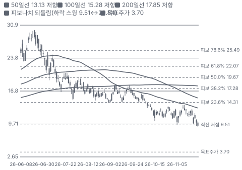

**주봉**

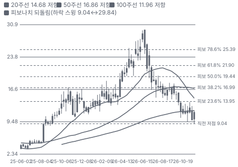

**월봉**

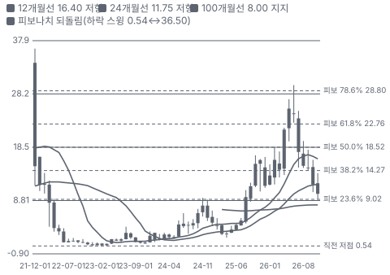

**분기 매출·EPS 실적과 컨센서스**

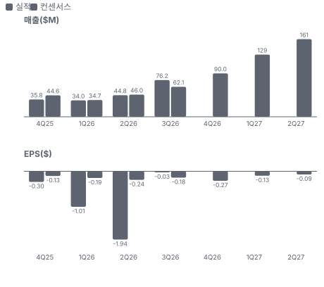

**최근 4개 분기 주가 변화 분석**

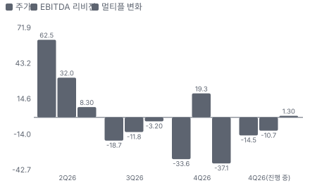

**EPS 리비전**

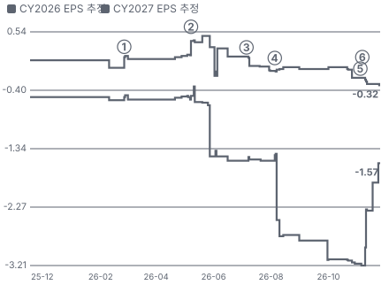

① 26-02-26 4Q25 실적 · EPS 리비전 -377%
② 26-05-08 1Q26 실적 · EPS 리비전 +192%
③ 26-07-06 Anthropic 401MW·20년 임대 체결 · EPS 리비전 -118%
④ 26-08-05 2Q26 실적 · EPS 리비전 -67%
⑤ 26-11-04 Google 신용 보강·Fluor 본계약(중간선거 직후 업종 급락) · EPS 리비전 +0%
⑥ 26-11-06 3Q26 실적 · EPS 리비전 +47%

**멀티플 프리미엄(Fwd 1Y EV/EBITDA, 최근 4개 분기말 절대값 — 대상 vs 동종 중앙값)**

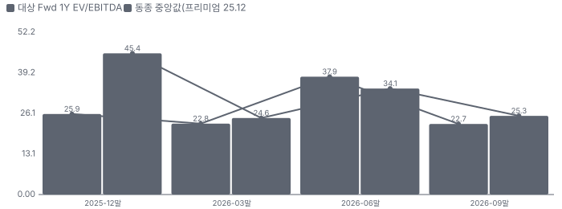

**합리적 멀티플**

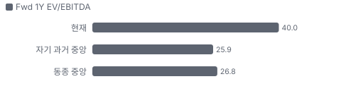

**밸류에이션 주가 시나리오**

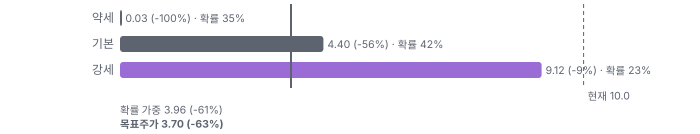

**주가별 업사이드**

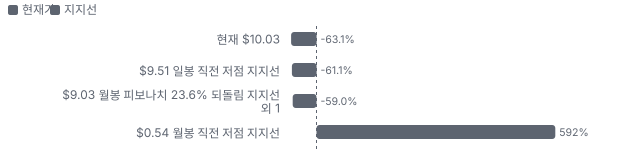
- 제품·서비스 포트폴리오

**고객 믹스(3Q26, 매출 대비)**

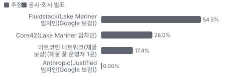

**공급 병목(10점, 낮을수록 병목)**

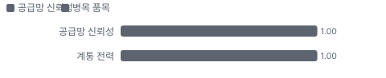

**생산능력 현재와 확충 계획(critical IT MW)**

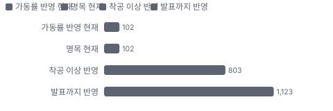

**CAPEX의 매출 대비 비중**

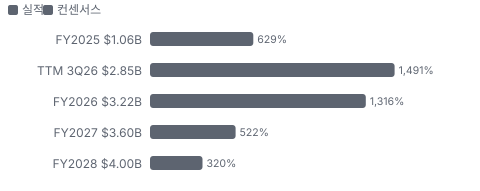

**어닝콜 변화별 주주가치 영향**

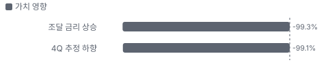

**수주·파이프라인 확실성 사다리**

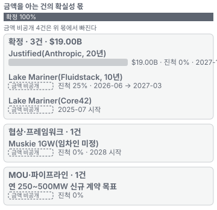

**매출 → 매출총이익 → 영업이익(매출 = 100, 최근 4분기)**

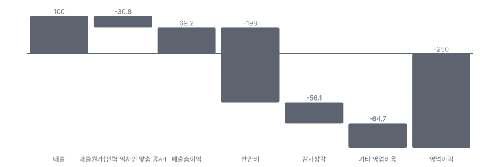

**분기 비용 비중 추이(매출 대비, 공시)**

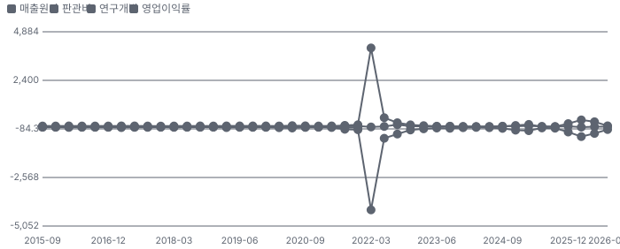

**비용 요인별 매출 대비 비중 1년 변화**

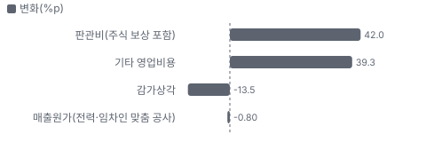

**HPC 데이터센터 임대 BOM 원가 몫**

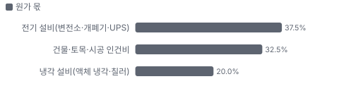

**비트코인 채굴 BOM 원가 몫**

**BOM 항목 가격 +10% 시 OPM 변화**

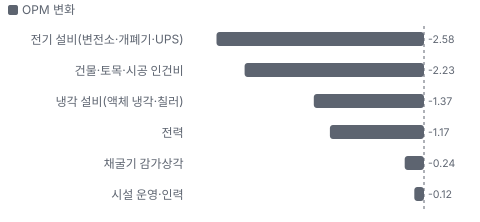

**자산 구성 — 3Q26 분기말 투하자본 \$4.46B**

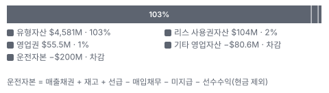

**자산별 변화율 — 최근 12개 분기(1Q21 = 0%) + 다음 4개 분기 추정**

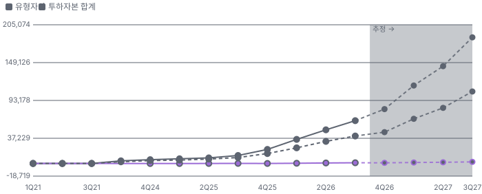

**ROIC 추이 — TTM, 최근 12개 분기 + 다음 4개 분기 추정(컨센서스 NOPAT)**

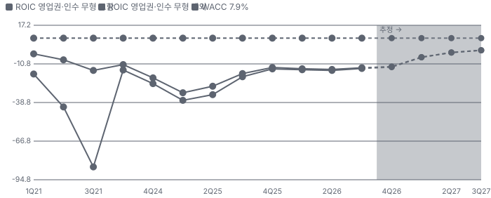

**목표주가 산정 — 약세와 기본 사이(약세 쪽 17%), 도달 확률 약 50%**

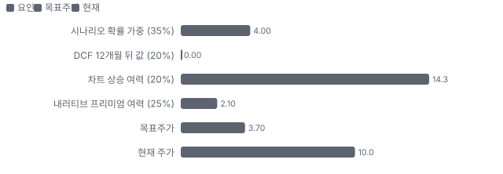

**커뮤니티 언급 수(최근 30일, 채널별)**

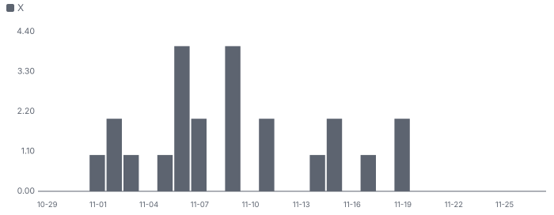

**커뮤니티 게시 수(월, 최근 7개월 — 이번 달은 진행 중)**

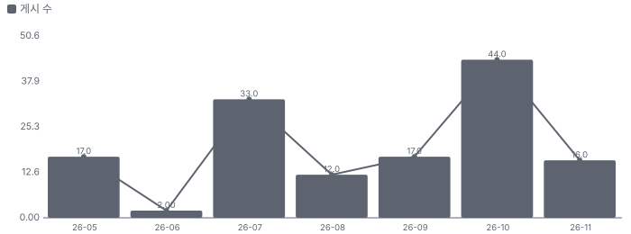

**일별 거래량 분해**

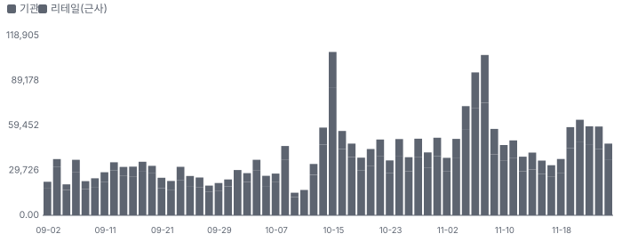

**기관 자금 흐름**

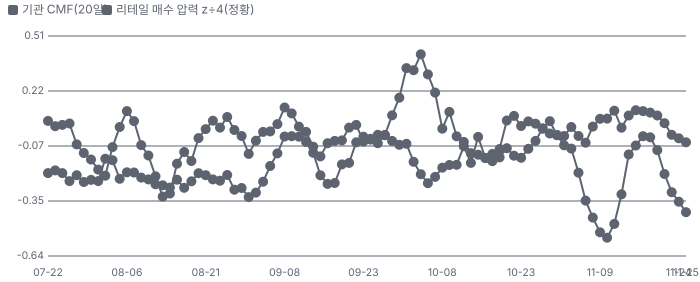

**몬테카를로**

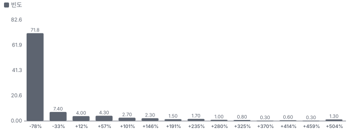

해석: 3,000번 중 598번(20%)에서 가치가 지금 주가 이상이었다. 가정을 흔들어도 지금 주가를 뒷받침하지 못하는 경우가 더 많다. 가운데 값은 -0.15배이고, 열 번 중 여덟 번은 -0.46~2.21배 사이에 든다.

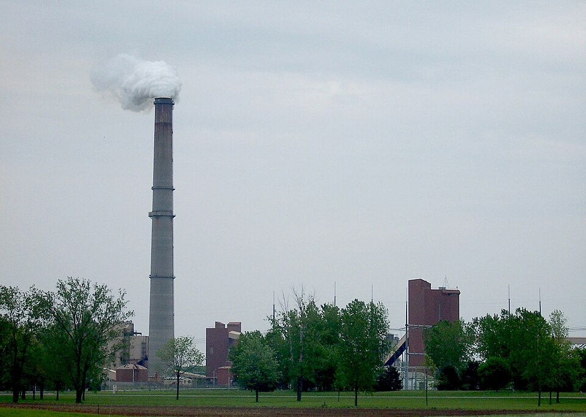
**Lake Mariner Data Campus** — Lake Mariner 캠퍼스가 들어선 옛 석탄 발전소(뉴욕 Somerset·Barker) — 데이터센터 전환 전 모습
_사진: Matthew D. Wilson (LtPowers) · CC BY-SA 2.5 · Wikimedia Commons_

## 내러티브

> **기업가치를 결정하는 이야기:** 기업가치는 세 가지로 정해진다. 계약한 약 800MW(추정)가 제때 가동돼 임대료가 되는가, 그 건설비를 어떤 금리로 빌리는가, 전력만 확보한 Muskie 1GW에 주식 발행 없이 임차인을 붙이는가. 차입 원금이 \$5.7B라 조달 금리와 건설비 편차가 지분 가치를 몇 배로 흔든다

> **멀티플·EPS 프리미엄**
> **멀티플:** Fwd 1Y EV/EBITDA는 40.0배로 동종 중앙값 26.8배보다 높다. 가동 초기라 분모가 작은 탓도 있지만, 5~8번째 분기 이익 기준(Fwd 2Y)으로도 14.3배로 동종 2년 뒤 중앙값 8.9배보다 61% 높다
> **EPS:** 3Q GAAP 순이익 \$709.5M은 Google 워런트 평가이익이 만든 숫자다. 희석 EPS는 −\$0.03, 조정 EBITDA는 −\$12.8M이다

### 투자자들은 왜 열광했나

2025년 Fluidstack·Google 계약과 2026년 7월 Anthropic 임대 뒤 \$3대에서 \$29까지 올랐다. 식은 이유는 셋이다. 4분기 매출 추정이 석 달 새 \$129M에서 \$93M으로 내려왔고, 신용 스프레드가 벌어졌고, 11월 중간선거 뒤 지방 단위 데이터센터 반대가 번졌다

### 무엇이 기업가치를 바꾸나

> **구조적 체질 변화**
> **변화:** 임대 매출 비중 3Q25 14% → 3Q26 83%. 채굴 용량은 245MW에서 145MW로 줄였다
> **증거:** 10-Q 세그먼트·10-K Item 2
> **반증:** 1Q27 임대 매출이 분기 \$100M을 밑돈다

> **고부가 믹스 확장**
> **변화:** 값이 비트코인 가격이 아니라 계약 임대료로 정해진다. 다만 임대 매출에는 마진 없는 전력 전가분이 들어 있다
> **증거:** 10-Q
> **반증:** 운영비가 가동 MW(메가와트 — 전력 용량 단위)보다 빨리 는다

> **기술 혁신**
> **변화:** 해당 없음 — 표준 설계 건물이고 칩은 임차인이 가져온다
> **증거:** 3Q26 어닝콜(2026-11-06)
> **반증:** 해당 없음

> **실행 속도**
> **변화:** Lake Mariner는 건설비 범위 안에서 인도 중, Justified는 임대 체결 뒤 약 17개월에 첫 인도 목표 **납품 리드타임 17개월.** 피어 중앙값 13개월보다 31% 길다(Cipher Digital 13개월). 이전 대비 미확인.
> **증거:** 3Q26 어닝콜(2026-11-06) · 10-Q
> **반증:** Justified 첫 인도가 2028년으로 넘어간다

> **M&A**
> **변화:** 부지 인수가 성장 방식이다 — Justified(\$301.9M)·Muskie·Morgantown(종결 전). Abernathy(텍사스 합작 캠퍼스 — 지분 매각) 합작 지분은 팔았다
> **증거:** 10-Q 주석 3·11
> **반증:** 해당 없음

> **정책·입법 연관성**
> **재정정책:** 해당 없음 — 연방 보조금·세액공제 수령 공시가 없다 3Q26 10-Q 반증: 해당 없음 의회 동의 2/10 — 하원 1/5(데이터센터 임대 직접 지원 세출 논의 없음) · 상원 1/5(같음).
> **행정명령:** 연방 차원의 AI 인프라 인허가 가속은 업종에 우호적이나 이 회사의 직접 수혜 공시는 없다 3Q26 어닝콜(2026-11-06) 반증: 데이터센터 전력 사용을 제한하는 연방 조치 의회 동의 2/10 — 하원 1/5(의회 논의 없음) · 상원 1/5(같음).
> **연관입법:** 값을 정하는 것은 주·지방 규정이다. 켄터키는 공공서비스위원회가 승인한 데이터센터 요금제로 1GW 전력 계약이 맺어졌고, 뉴욕은 Lansing 타운이 데이터센터 금지를 의결했다. 연방 의회 단계가 없다 8-K 10/5 · 보도(11/19) 반증: 뉴욕주가 기존 인허가 부지까지 묶는 규제를 낸다

> **고객의 지출 예산**
> **변화:** 임차인에게 이 돈은 컴퓨트 용량을 빌리는 장기 임차료다. 임차인이 못 내면 Google이 받친다
> **사업별 예산:** **매출의 83%**: HPC 데이터센터 임대 — 고객 OPEX(AI 연구소·네오클라우드(GPU를 사서 빌려주는 신생 클라우드 사업자)의 컴퓨트 용량 임차료(전력 포함)) · 동인: AI 모델 학습·추론 용량 확보, 데이터홀 인도 일정
**매출의 17%**: 비트코인 채굴 — 고객 해당 없음(네트워크 채굴 보상 — 고객 예산이 아니다) · 동인: 비트코인 가격·채굴 난이도
> **증거:** 10-Q·8-K 11/4
> **반증:** AI 연구소의 자금 조달이 막혀 임대 범위가 줄어든다

### 내러티브 근거

> 6월 18일 종가 고점 \$28.98에서 11월 25일 \$10.03까지 65% 내렸다. '채굴장을 AI 데이터센터로 바꿔 Google 보강 임대를 받는 회사'라는 이야기는 그대로인데, 시장이 묻는 것이 '계약이 있나'에서 '그 계약을 어떤 금리로 짓나'로 바뀌었다. 단계는 붕괴, 쏠림은 중간이다.

> **Google이 받치는 임대** · 강화
> **논리:** 임차인이 AI 연구소·네오클라우드여도 Google 신용으로 빌려 짓는다
> **숫자:** Justified 3개 동 모두 보강(8-K 11/4). 대가는 워런트 73.58M주
> **반증:** Justified 프로젝트 차입 금리가 Lake Mariner 채권 7.75%보다 높게 정해진다
> **출처:** https://www.sec.gov/Archives/edgar/data/1083301/000162828026069810/wulf-20261104.htm

> **계약이 매출로 바뀌는 구간** · 강화
> **논리:** 2027년에 분기 매출이 지금의 2~3배가 된다
> **숫자:** 임대 매출 3Q25 \$7.2M → 3Q26 \$63.0M
> **반증:** 1Q27 매출이 \$129M을 밑돈다
> **출처:** 3Q26 어닝콜(2026-11-06)

> **조달 금리와 레버리지** · 강화
> **논리:** 신용 스프레드가 벌어지면 임대 수익률에서 남는 몫이 줄고 지분 가치가 크게 흔들린다
> **숫자:** 9개월 이자 지급 \$136.1M, 3분기 자본화 이자 \$37.3M
> **반증:** 프로젝트 차입이 7% 아래로 조달된다
> **출처:** https://www.sec.gov/Archives/edgar/data/1083301/000162828026071671/wulf-20260930.htm

> **주·지방 규제** · 강화
> **논리:** 중간선거 뒤 데이터센터 반대가 지방 단위로 번져 새 부지 가치가 깎인다
> **숫자:** Lansing 타운 3대 2로 금지 의결(11/19, 보도)
> **반증:** 뉴욕·켄터키 주 차원의 규제 틀이 기존 인허가 부지를 보호한다
> **출처:** 보도(2026-11-19)

> **반대 내러티브: 네오클라우드가 아니라 전력 부지 임대업** · 약화
> **논리:** GPU를 사지 않고 건물과 전력만 빌려주므로 네오클라우드와 같이 팔릴 이유가 없다
> **숫자:** 주가는 네오클라우드·AI 인프라 묶음과 같이 움직였다(11/20 −14.9%, 11/23 +10.8%)
> **반증:** 임차인 장비 반입 지연으로 임대 개시가 밀린다
> **출처:** 3Q26 어닝콜(2026-11-06)

### 투자 포인트

> **계약은 늘었고 가격은 3분의 1**
> **명제:** 7월 이후 Anthropic 임대·Google 보강·시공 계약이 차례로 붙었는데 주가는 그 사이 절반 아래가 됐다
> **숫자:** Justified 계약 매출 약 \$19B, 3개 동 Google 신용 보강(11/4), HPC 임대 매출 3Q \$63.0M. 주가는 7/6 \$22.21 → 11/25 \$10.03
> **시장과 다른 점:** 셀사이드 26명 중 24명이 매수이고 목표가 평균이 주가의 2.5배다 — '시장이 못 봤다'가 아니다. 제가 다르게 보는 곳은 값이다: 주가가 65% 내렸어도 순차입 때문에 EV는 2년 뒤 EBITDA의 14.3배로 동종 2년 뒤 중앙값 8.9배보다 높다. 보강이 붙은 임대도 차입 조건이 나오기 전에는 지분 몫을 계산할 수 없다
> **증명:** Justified 프로젝트 차입 금리·차입 비율 공시
> **출처:** 8-K 2026-11-04 · 3Q26 10-Q

> **2027년 1분기가 첫 채점일**
> **명제:** 회사가 처음으로 숫자를 걸었다 — 1Q27 말 연환산 임대 매출 약 \$700M
> **숫자:** 가동 102MW(9/30), CB4 전체 4Q 가동, CB5 1Q27 개시. 4Q 매출 추정은 8월 \$129M에서 \$93M으로 내려와 있다
> **시장과 다른 점:** 추정이 내려온 것은 수요가 아니라 데이터홀별 순차 개시 때문이다. 그래서 4Q 매출 숫자보다 가동 MW와 개시일이 맞는지를 본다
> **증명:** 4Q26·1Q27 실적의 가동 MW와 분기 임대 매출
> **출처:** 3Q26 어닝콜 · 3Q26 10-Q

> **지분 위에 쌓인 것들**
> **명제:** 차입 원금 \$5.7B, 워런트 7,358만 주, 전환사채 세 종류가 지분보다 앞에 있다
> **숫자:** 2030년 만기 \$2.9B 집중, 2030년 전환사채는 전환가 \$8.48로 내가격, 9개월 이자 지급 \$136.1M, 제한 현금 \$753M
> **시장과 다른 점:** 강세 쪽은 계약 가치를 말하지만 그 값은 차입을 다 갚은 뒤에야 주주 몫이다. 회사는 싼 값의 증자를 하지 않겠다고 했다 — 그 약속이 Muskie 임대 구조에서 지켜지는지가 갈림길이다
> **증명:** Muskie 임대의 자금 구조(임차인 선급·지분 투자·프로젝트 차입)
> **출처:** 3Q26 10-Q 재무상태표·주석 10

### 모멘텀 생성·소멸 타임라인

**카탈리스트 달력 — 지난 사건의 주가 반응과 앞으로 확인할 숫자**
| 날짜 | 상태 | 구분 | 사건 | 반응·확인 | 결과에 따라 |
|---|---|---|---|---|---|
| 2026-07-06 | 완료 | 생성 | Anthropic 401MW·20년 임대와 Abernathy 지분 매각 발표 | +4.9% |  |
| 2026-08-05 | 완료 | 소멸 | 2Q26 실적 — 임대 개시 일정 조정 | −4.3% |  |
| 2026-10-05 | 완료 | 소멸 | Muskie 전력 1GW 계약과 차입 확대 계획 | −4.5% |  |
| 2026-11-04 | 완료 | 소멸 | Google 신용 보강·Fluor 본계약 — 중간선거 직후 업종 급락과 겹침 | −6.6% |  |
| 2026-11-06 | 완료 | 확인 | 3Q26 실적 — 임대 매출 \$63.0M | +12.8% |  |
| 2026-11-20 | 완료 | 소멸 | Lansing 타운 데이터센터 금지 의결(11/19)·업종 급락 | −14.9% |  |
| 2026-12-31(연말) | 예정 | 확인 | CB4 잔여 데이터홀 가동·Justified 장납기 발주 100% | CB4 4개 데이터홀 모두 임대료 개시 | 맞으면 기본, 1Q로 밀리면 4Q 매출 추정이 한 번 더 내려간다 |
| 2027-02-25(추정) | 예정 | 확인 | 4Q26 실적 | 4Q 매출 \$90M 이상, CB5 개시 일정 유지, Justified 프로젝트 차입 조건 | 차입이 7%대 안쪽이면 강세 쪽, 미조달이면 약세 쪽 |
| 2027-05(예상) | 예정 | 확인 | 1Q27 실적 — 연환산 임대 매출 약 \$700M 채점 | 분기 임대 매출 \$129M 이상과 3월 말 가동 용량 | 맞으면 FY27 추정 하향이 멈춘다 |
| 2027년 중반 | 예정 | 생성 | Muskie 둘째 500MW 주 공공서비스위원회 승인·임차인 계약 | 승인 여부와 임대의 자금 구조 | 주식 발행 없는 임대면 3배 경로가 열린다 |
| 2026-12-09~10(예상) | 예정 | 매크로 | 연준 회의·신용 스프레드 | 하이일드 스프레드 방향 | 업종 요인 — 회사 사건과 구분해 읽는다 |

### 언제 사서 언제 팔아야 할까?

**가격·조건 틀 — 가격은 밸류에이션(약세·기본·강세·목표주가)과 차트 지지 구간에서, 조건은 이벤트에서**
| 구간 | 가격 | 목표주가까지 | 약세까지 | 조건·근거 |
|---|---|---|---|---|
| 관찰 구간 | \$9.51~\$9.51 | -61% | -100% | 11/25 장중 저점 \$9.045가 52주 최저이고 그 아래 가까운 지지는 2025년 여름 계약 발표 전 거래대다. 지금 가격은 50일선 \$13.13·200일선 \$17.85 아래다 |
| 확인 뒤 | 지금 \$10.03 이상에서 조건 확인 | -63% | -100% | 4Q 실적에서 CB4 전체 가동과 Justified 프로젝트 차입 조건이 함께 나오는 것 |
| 무효화 | 약세 시나리오 \$0.03 | - | -100% | CB5 개시가 1Q27을 넘기거나 Justified 차입이 조달되지 않은 채 추가 주식 발행이 나온다 |

최근 10거래일 중 6일이 하루 8% 넘게 움직였다. 하루 움직임은 업종(AI 인프라·신용) 요인이 크다 — 회사 사건과 섞어 읽지 않는다 가격·조건 틀이며 매매·비중 지시가 아니다(투자 권유 아님).

## 포트폴리오

| 제품·서비스 | 구분 | 무엇 | 쓰는 곳 | 돈 버는 방식 | Mix | Mix 변화(전년 대비) |
|---|---|---|---|---|---|---|
| HPC 데이터센터 임대 | 시설 | 전력·냉각을 갖춘 건물을 통째로 장기 임대. 서버는 임차인 소유 | AI 학습·추론 서버 | 10~20년 임대료 + 전력비 실비 | 83% | +68.4%p |
| 비트코인 채굴 | 서비스 | 자체 채굴기로 비트코인을 캐서 달러로 바꾼다 | 전환 기간의 현금 — 용량을 임대용으로 돌리는 중 | 채굴 보상 | 17% | -68.4%p |

**Mix 변화가 가장 큰 쪽은 HPC 데이터센터 임대(+68.4%p, 전년 대비).** 계절성 판정: 분기 매출 계절 지수 기준 있음 → 전년 같은 분기와 비교.

## 고객

> **3Q26 최대 고객 Fluidstack(Lake Mariner 임차인(Google 보강)) 54%, 상위 3곳 100%, 집중도 집중.** 공시·회사 발표로 확인한 몫은 매출의 17%이고, 나머지 고객 몫은 추정이거나 미분해다. 3Q 매출 \$76.2M 중 HPC 임대가 \$63.0M(82.6%), 채굴이 \$13.2M(17.4%)다. 10-Q는 HPC 임대 매출이 두 고객에서 나왔다고만 적고 고객별 금액은 밝히지 않는다. 두 고객은 Lake Mariner의 Core42와 Fluidstack(Google이 임대 의무를 보강)이다. Anthropic 임대는 아직 시작 전이다

**고객별 매출 몫(3Q26)**
| 고객 | 몫 | 변화 | 근거 |
|---|---|---|---|
| Fluidstack(Lake Mariner 임차인(Google 보강)) | 52~57% | +31%p | 추정 |
| Core42(Lake Mariner 임차인) | 26~30% | -19%p | 추정 |
| 비트코인 네트워크(채굴 보상, 채굴 풀 운영자 1곳) | 17% | -11%p | 공시 |
| Anthropic(Justified 임차인(Google 보강)) | 0% | +0%p | 공시 |

> **Fluidstack(Lake Mariner 임차인(Google 보강))** · 추정
> **사는 것:** Lake Mariner 데이터센터 10년 임대(전력 포함)
> **추정 근거:** 1Q26 HPC 매출 \$21.0M을 Core42 몫의 분기 수준으로 보고 3Q HPC \$63.0M에서 뺀 계산값. prior는 2Q26. 10-Q는 고객별 금액을 공시하지 않는다

> **Core42(Lake Mariner 임차인)** · 추정
> **사는 것:** Lake Mariner 데이터센터 임대 — 선급 임차료 \$90M을 월 기본 임대료의 50%씩 차감
> **추정 근거:** 임대가 Core42 한 곳뿐이던 1Q26 HPC 매출 \$21.0M 기준 추정. prior는 2Q26

> **비트코인 네트워크(채굴 보상, 채굴 풀 운영자 1곳)** · 공시
> **사는 것:** 채굴 연산
> **추정 근거:** 3Q 채굴 \$13.244M ÷ \$76.230M. prior = 2Q26 \$12.835M ÷ \$44.767M

> **Anthropic(Justified 임차인(Google 보강))** · 공시
> **사는 것:** Justified 401MW, 20년 임대, 계약 매출 약 \$19B
> **추정 근거:** 임대료는 데이터홀 인도 때부터 — 2027년 말~2Q28 단계 인도

## 수주·파이프라인

> **2026-11-06 기준 5건.** 확정 \$19.00B.

**수주 목록**
| 상태 | 계약 | 계약 총액 | 진척 | 기간 | 비고 |
|---|---|---|---|---|---|
| 확정 | Justified(Anthropic, 20년) | \$19.00B | 0% | 2027-12 → 2028-06 | - |
| 확정 | Lake Mariner(Fluidstack, 10년) | 금액 비공개 | 25% | 2026-06 → 2027-03 | 계약 금액은 이번 회차 1차 자료에서 대조하지 못했다. 회사는 1Q27 말 연환산 임대 매출 약 \$700M을 말했다 |
| 확정 | Lake Mariner(Core42) | 금액 비공개 | - | 2025-07 → 미확인 | - |
| 협상 | Muskie 1GW(임차인 미정) | 금액 비공개 | 0% | 2028 → 미확인 | - |
| 파이프라인 | 연 250~500MW 신규 계약 목표 | 금액 비공개 | 0% | 미확인 → 미확인 | - |

**실행 속도와 방해 요인**
| 항목 | 상태 | 실행 속도 | 방해 요인 |
|---|---|---|---|
| Justified(Anthropic, 20년) | 확정 | 임대 체결(2026-07) → 첫 인도 목표 약 17개월 | 프로젝트 차입 조달 · 최대 보장 가격(시공사가 넘지 않겠다고 약속하는 공사비 상한) 확정 · 부지 오염 논란 |
| Lake Mariner(Fluidstack, 10년) | 확정 | 지연(계획 56%, -31%p), 이대로면 2028-02 완료, 11개월 지연 | 데이터홀별 시운전 · 임차인 장비 반입 |
| Lake Mariner(Core42) | 확정 | 미확인 | 선급 임차료 \$90M 차감으로 현금 유입이 장부 매출보다 적다 |
| Muskie 1GW(임차인 미정) | 협상 | 미확인 | 임차인 신용 구조 · 주식 발행 없이 조달할 구조 · 둘째 500MW 승인 |
| 연 250~500MW 신규 계약 목표 | 파이프라인 | 미확인 | 조달 금리 · 지역 규제 |

## 마진 구조

> **GPM 67.0%, OPM -115.7%.** 3Q25 대비 GPM +0.8%p, OPM -67.0%p. 변동비는 매출의 55%이고, 매출이 10% 늘면 OPM은 +14.7%p 움직인다. 3Q 매출 \$76.2M에 매출원가 \$25.2M(33%), 판관비 \$57.1M(75%), 감가상각 \$29.6M(39%), 기타 영업비용 \$52.5M(69%)이 붙어 영업손실이 \$88.2M이다. 임대 매출원가는 마진 없이 넘기는 전력비와 임차인 맞춤 공사비다. 이익을 가르는 것은 건설비와 조달 금리이고, 분기 손익의 비용은 인도가 끝나기 전의 개발 조직·주식 보상 비용이다

> **매출 100 중 매출원가 30.8, 매출총이익 69.2(최근 4분기, 공시).** 매출원가 요인 중 매출원가(전력·임차인 맞춤 공사)이 매출의 33.0%로 가장 무겁고, 단가가 +10% 오르면 GPM이 -3.30%p 움직인다. 분기 회귀로 매출 1이 늘 때 매출원가는 0.35 늘고, 매출원가의 고정비 몫은 22%다. 매출원가 요인 비중은 요인별 공시 기간 값이라 합이 최근 4분기 매출원가를 넘어, 그림에서는 0.93배로 비례 조정했다.

**비용 요인 강도 — 비중·추세·충격(+10%)·탄력**
| 비용 | 구분 | 매출 대비 | 1년 변화 | 마진 기여 | 충격 시 마진 | 매출 탄력 | 고정비 몫 |
|---|---|---|---|---|---|---|---|
| 매출원가(전력·임차인 맞춤 공사) | 매출원가 요인 | 33.0% | -0.8%p | +0.8%p | -3.30%p | 미확인 | 20% |
| 판관비 | 공시 항목 | 198.3% | +130.7%p | -130.7%p | 미확인 | 1.04 | -5% |
| 기타 영업비용 | 공시 항목 | 64.7% | +37.1%p | -37.1%p | 미확인 | 0.48 | -54% |
| 감가상각 | 공시 항목 | 56.1% | +10.9%p | -10.9%p | 미확인 | 0.44 | 8% |
| 매출원가 | 공시 항목 | 30.8% | -18.9%p | +18.9%p | -3.08%p | 0.35 | 22% |

매출 탄력 = 분기 비용을 매출에 회귀한 기울기(매출 1당 변동비), 고정비 몫 = 절편 ÷ 평균 비용. 표본이 8분기 미만이면 미확인. 매출원가 요인 비중은 margin 재료의 추정이 섞여 있고, 공시 매출원가와의 차이는 '기타 매출원가'로 둔다.

**GPM에서 OPM까지(GAAP, 아래는 최근 4개 분기)**
| 기간 | GPM | 연구개발 | 판관비 | 기타 | OPM |
|---|---|---|---|---|---|
| 3Q25 | 66.1% | 0.0% | 33.0% | 82.0% | -48.8% |
| 3Q26 | 67.0% | 0.0% | 75.0% | 107.7% | -115.7% |
| 2025-12 | 47.3% | - | - | - | -240.9% |
| 2026-03 | 93.1% | - | - | - | -476.7% |
| 2026-06 | 72.3% | - | - | - | -313.7% |
| 2026-09 | 67.0% | - | - | - | -115.7% |

**비용을 움직이는 요인**
| 비용 | 요인 |
|---|---|
| 판관비(주식 보상 포함, 판관비) | 개발 조직 인력·주식 보상(3Q \$30.0M) · 근거 공시 |
| 기타 영업비용(기타) | 운영비·Justified 송전 설비 변경 비용 \$9.3M 등 — 세부 항목은 이번 회차 미대조 · 근거 공시 |
| 감가상각(기타) | 가동 건물·채굴기 — 건설 중 자산 \$3.0B가 가동되면 늘어난다 · 근거 공시 |
| 매출원가(전력·임차인 맞춤 공사, 매출원가) | 전력 단가·가동 MW — 임대분 전력비는 마진 없이 임차인에게 넘긴다 · 근거 공시 |

**HPC 데이터센터 임대 BOM — 매출의 83%, GPM 17%(세그먼트 이익 \$10.606M ÷ 세그먼트 매출 — 전력 전가분이 매출과 원가에 총액으로 잡혀 낮게 보인다. 정의가 매출총이익과 다를 수 있다), 항목 가격 +10% 시**
| 항목 | 원가 몫 | 전가 | 제품 GPM | OPM |
|---|---|---|---|---|
| 전기 설비(변전소·개폐기·UPS) | 30~45% | 미확인 | -3.1%p | -2.58%p |
| 건물·토목·시공 인건비 | 25~40% | 미확인 | -2.7%p | -2.23%p |
| 냉각 설비(액체 냉각·칠러) | 15~25% | 미확인 | -1.7%p | -1.37%p |
| 미분해 | 10% | - | - | - |

**비트코인 채굴 BOM — 매출의 17%, GPM 7%(세그먼트 이익 \$0.981M ÷ 세그먼트 매출), 항목 가격 +10% 시**
| 항목 | 원가 몫 | 전가 | 제품 GPM | OPM |
|---|---|---|---|---|
| 전력 | 65~80% | 0% | -6.7%p | -1.17%p |
| 채굴기 감가상각 | 10~20% | 0% | -1.4%p | -0.24%p |
| 시설 운영·인력 | 5~10% | 0% | -0.7%p | -0.12%p |
| 미분해 | 5% | - | - | - |

판매가 전가를 모르는 항목은 전가 0%로 계산했다.

**BOM 항목 가격을 움직이는 것**
| 항목 | 요인 |
|---|---|
| 전기 설비(변전소·개폐기·UPS) | 건설비 critical IT MW당 \$8~12M의 가장 큰 몫(업계 통상, 추정). 회사는 건설비·관세·조달 금리 변화에 맞춰 계약 조건을 바꿔 왔다고 했지만 임대 조항은 비공개다 · 근거 추정 |
| 냉각 설비(액체 냉각·칠러) | 임차인이 요구한 범위 변경분은 추가 기본 임대료로 받는다(10-Q, Fluidstack 임대 개정) · 근거 추정 |
| 건물·토목·시공 인건비 | Justified는 Fluor와 최대 보장 가격을 정하는 중이다 — 설계 90%, 장납기 장비 발주 80% 이상 · 근거 추정 |
| 전력 | 3Q 전력비(수요 반응 수입 차감 뒤) \$9.79M이 채굴 가치의 73.9% — kWh당 \$0.060 · 근거 공시 |
| 채굴기 감가상각 | 채굴기 내용연수 4년(10-K) · 근거 추정 |
| 시설 운영·인력 | 채굴 용량을 HPC로 돌리는 중(245MW → 145MW) · 근거 추정 |

**투입 물가 — 미국 PPI 3·6·12개월(2026-10, 개정 반영)과 해외 전년비**
| 항목 | 미국 3개월 | 6개월 | 12개월 | 전가 못 할 때 OPM | 일본 | 한국 | 대만 |
|---|---|---|---|---|---|---|---|
| 전기 설비(변전소·개폐기·UPS) | +4.1% | +4.9% | +13.5% | - | +23.2% | +1.9% | +10.6%* |
| 냉각 설비(액체 냉각·칠러) | -0.1% | +1.8% | +4.5%* | - | 미확인 | 미확인 | 미확인 |
| 건물·토목·시공 인건비 | -0.0% | +0.5% | +2.4% | - | 미확인 | 미확인 | 미확인 |
| 전력 | -6.1% | +1.8% | +0.6%* | - | 미확인 | 미확인 | 미확인 |

별표는 품목보다 넓은 업종 지수다. 연결한 투입 원가의 미국 PPI(생산자물가지수)는 1년 새 가중 +0.6%이고, 판매가로 넘기지 못하면 GPM -0.2%p·OPM -0.2%p가 움직인다.

## 자산 구성

> **3Q26 분기말 투하자본 \$4.46B** — 유형자산 103%, 리스 사용권자산 2%. 최근 12개 분기(1Q21 → 3Q26) 가장 크게 늘어난 자산은 유형자산(+63274%), 투하자본 합계 +40628%. 3Q27 추정 투하자본 \$11.66B(+161%, 컨센서스 매출과 회전 일수·CAPEX 강도 유지 가정). 연율 감가 비율(총액 기준)은 직전 4분기 4.18% → 최근 4분기 3.97%, 직전 비율이면 감가상각이 \$0.0M 더 컸다(영업이익의 -0.0%).

**자산·운전자본 항목별 분기말 잔액 — 최근 12개 분기와 다음 4개 분기 추정**
| 항목 | 1Q21 | 3Q25 | 3Q26(최근) | 3Q27 추정 | 12개 분기 변화 | 다음 4개 분기 변화 |
|---|---|---|---|---|---|---|
| 매출채권 | \$1.5M | \$3.5M | \$17.0M | \$37.4M | +1000% | +120% |
| 선급·기타 유동자산 | \$0.0M | \$3.0M | \$20.2M | \$75.9M | +404540% | +275% |
| 매입채무 | \$0.0M | \$62.3M | \$237.7M | \$2,013.9M | +625453% | +747% |
| 유형자산 | \$7.2M | \$861.8M | \$4,580.7M | \$13,482.0M | +63274% | +194% |
| 리스 사용권자산 | 미확인 | \$105.1M | \$103.5M | \$103.5M | 비교 불가 | +0% |
| 영업권 | 미확인 | \$55.5M | \$55.5M | \$55.5M | 비교 불가 | +0% |

**자산 추정 동인 — 최근 4개 분기 평균(재무상태표 동인 모형)**
| 동인 | 값 | 곱하는 기준 |
|---|---|---|
| 매출채권 | 16일 | 매출 |
| 선급·기타 유동자산 | 33일 | 매출 |
| 매입채무 | 2857일 | 매출원가 |
| 선수수익(계약부채) | 2일 | 매출 |
| 유형자산 ÷ 분기 매출 | 64.63배 | CAPEX·감가 재료 없음 — 비율 유지 |
| 매출원가율 | 30.8% | 매출(최근 4개 분기) |
| 영업권·리스 사용권·기타 | 유지 | 인수·새 리스는 공시 전 모름 |
| 인수 무형자산 | 분기 \$0.0M 상각 | 최근 4개 분기 평균 상각 |

**추정 방법:** 증권사 3표 모델(손익·재무상태표·현금흐름)의 재무상태표 동인 방식이다. 운전자본은 항목별 회전 일수(매출채권·선급·미지급·선수는 매출, 재고·매입채무는 매출원가 기준)를 최근 4개 분기 평균으로 두고 컨센서스 매출에 곱한다. 유형자산은 기초 + CAPEX − 감가상각으로 굴린다(Koller·Goedhart·Wessels 『Valuation』 재무상태표 추정). 매출 경로는 ROIC 절의 컨센서스와 같다.

**유형·무형자산 항목별 가치(2025-12-31 vs 2024-12-31)**
| 구분 | 항목 | 총액 2025-12-31 | 누적상각 | 순액 | 총액 2024-12-31 | 총액 1년 변화 | 공시 내용연수 |
|---|---|---|---|---|---|---|---|
| 유형 | 유형자산 합계(항목 미분해) | \$1,639.5M | 총계만 공시 | 총계만 공시 | \$477.9M | +243.0% | 미확인 |
| 영업권 | 영업권 | \$55.5M | \$0.0M | \$55.5M | \$0.0M | 미확인 | 비상각 |
| 유형 합계 | 유형자산 | \$1,639.5M | \$131.8M | \$1,507.7M | \$477.9M | +243.0% | 경과율 8%(상각 대상 기준) |

**내용연수 산식(상각 대상 유형자산 = 총액 − 토지 − 건설중)**
| 기준일 | 연 감가상각 | 상각 대상 총액 | 평균 내용연수 | 경과 연수 | 잔여 연수 | 경과율 |
|---|---|---|---|---|---|---|
| 2025-12-31 | \$88.6M | \$1,639.5M | 18.5년 | 1.5년 | 17.0년 | 8% |
| 2024-12-31 | \$59.8M | \$477.9M | 8.0년 | 1.1년 | 6.9년 | 14% |

산식 평균 내용연수는 18.5년. 1년 전 8.0년 → 지금 18.5년.

**분기 감가 비율(감가상각 ÷ 평균 유형자산 총액)**
| 분기 | 감가상각 | 평균 유형자산(총액) | 분기 비율 | 연율 | 연율의 역수 |
|---|---|---|---|---|---|
| 3Q18 | \$0.2M | \$16.4M | 1.17% | 4.69% | 21.3년 |
| 4Q18 | \$0.2M | \$16.4M | 1.05% | 4.18% | 23.9년 |
| 1Q19 | \$0.2M | \$16.3M | 0.99% | 3.97% | 25.2년 |
| 2Q19 | \$0.2M | \$16.4M | 0.97% | 3.88% | 25.8년 |
| 3Q19 | \$0.2M | \$16.5M | 0.95% | 3.78% | 26.4년 |
| 4Q19 | \$0.2M | \$16.5M | 0.99% | 3.96% | 25.3년 |
| 1Q20 | \$0.2M | \$16.5M | 1.02% | 4.08% | 24.5년 |
| 2Q20 | \$0.2M | \$16.5M | 1.02% | 4.07% | 24.6년 |

감가상각 기준: 손익계산서 감가상각·상각비(SEC 공시 데이터, 4분기 = 연간 − 1~3분기).

최근 4분기 연율 감가 비율 3.97%, 직전 4분기 4.18%(-5%) — 경고 문턱(-10%) 안이다.

미공시·미분해: 무형자산 · 유형자산 항목별 총액·내용연수(10-K 주석에서 모델이 채움) · 무형자산 항목(10-K 주석에서 모델이 채움) — 이 칸은 비우고 나머지로 계산했다.

### 해석 — 자산이 어디에 쌓이고 있나

- 같은 기간 4개 분기 매출은 +388% — 매출보다 빨리 늘어난 자산: 매출채권 +1000%, 유형자산 +63274%. 이 자산의 회전율이 떨어지면 ROIC를 희석한다.

## ROIC

> **TTM 3Q26 ROIC는 영업권·인수 무형 포함 -13.6%, 제외 -14.1%**(NOPAT 마진 -196.8% × 투하자본 회전율 0.07회). 최근 12개 분기 1Q21 -3.5% → 3Q26 -13.6%(고점 1Q21 -3.5%). 컨센서스 NOPAT으로 굴리면 3Q27 -0.9%(제외 -0.9%) — WACC 7.9% 대비 -8.7%p.

**ROIC 추이(TTM)와 다음 4개 분기 추정 — NOPAT ÷ 평균 투하자본(이번 분기말·4개 분기 전)**
| 분기 | 구분 | TTM 매출 | TTM NOPAT | NOPAT 마진 | 평균 투하자본 | ROIC 포함 | ROIC 제외 |
|---|---|---|---|---|---|---|---|
| 1Q21 | 실적 | \$13.0M | −\$2.1M | -15.9% | \$60.1M | -3.5% | -18.1% |
| 2Q21 | 실적 | \$14.7M | −\$4.6M | -31.6% | \$59.7M | -7.8% | -42.0% |
| 3Q21 | 실적 | \$16.3M | −\$9.2M | -56.5% | \$59.4M | -15.5% | -85.5% |
| 3Q24 | 실적 | \$39.1M | −\$21.9M | -55.9% | \$192.8M | -11.3% | -15.2% |
| 4Q24 | 실적 | \$71.0M | −\$61.2M | -86.1% | \$292.6M | -20.9% | -25.1% |
| 1Q25 | 실적 | \$101.2M | −\$104.9M | -103.7% | \$330.9M | -31.7% | -37.2% |
| 2Q25 | 실적 | \$144.1M | −\$112.4M | -78.0% | \$416.4M | -27.0% | -33.1% |
| 3Q25 | 실적 | \$167.6M | −\$118.9M | -70.9% | \$668.9M | -17.8% | -20.1% |
| 4Q25 | 실적 | \$168.5M | −\$146.4M | -86.9% | \$1,095.2M | -13.4% | -14.4% |
| 1Q26 | 실적 | \$168.1M | −\$227.4M | -135.3% | \$1,595.3M | -14.3% | -15.0% |
| 2Q26 | 실적 | \$165.2M | −\$325.8M | -197.2% | \$2,201.1M | -14.8% | -15.5% |
| 3Q26 | 실적 | \$190.8M | −\$375.6M | -196.8% | \$2,759.5M | -13.6% | -14.1% |
| 4Q26 | 추정 | \$245.0M | −\$432.4M | -176.5% | \$3,392.9M | -12.7% | -13.1% |
| 1Q27 | 추정 | \$340.0M | −\$290.2M | -85.4% | \$4,936.8M | -5.9% | -6.0% |
| 2Q27 | 추정 | \$456.2M | −\$161.7M | -35.4% | \$6,345.1M | -2.5% | -2.6% |
| 3Q27 | 추정 | \$588.6M | −\$69.2M | -11.8% | \$8,105.6M | -0.9% | -0.9% |

**다음 4개 분기 NOPAT — 컨센서스(세율 21%, 리스 이자 별도)**
| 분기 | 매출 | EBITA 마진 | EBITA | NOPAT(분기) | 근거 |
|---|---|---|---|---|---|
| 4Q26 | \$90.0M | -175.7% | −\$158.1M | −\$124.9M | 컨센서스 매출 × EBIT 마진 FY2026 |
| 1Q27 | \$129.0M | 13.8% | \$17.8M | \$14.1M | 컨센서스 매출 × EBIT 마진 FY2027 |
| 2Q27 | \$161.0M | 13.8% | \$22.2M | \$17.6M | 컨센서스 매출 × EBIT 마진 FY2027 |
| 3Q27 | \$208.6M | 13.8% | \$28.8M | \$22.7M | 컨센서스 매출 × EBIT 마진 FY2027 |

**추정 방법:** NOPAT은 컨센서스(분기 매출 추정 × 회계연도 EBIT 마진 추정)로 잡고, 조정(비 GAAP) 마진이면 주식보상 몫을 빼서 과거 실적과 같은 기준(영업이익 + 인수 무형 상각)으로 맞췄다. 이미 발표했지만 분기 보고서(10-Q)가 아직 없는 분기는 발표 실적을 쓴다. 투하자본은 자산 구성 절의 재무상태표 동인으로 굴렸다. ROIC는 4개 분기 NOPAT을 이번 분기말과 4개 분기 전 투하자본의 평균으로 나눈다 — 추정 분기의 ROIC에는 이미 나온 실적 분기가 섞여 있다.

**투하자본 항목별 회전율과 ROIC 기여(TTM 3Q26, 평균 잔액)**
| 항목 | 투하자본 | 매출 1달러당 자본 | 회전율(매출 ÷ 항목) | 자본 몫 | 이 항목을 빼면 ROIC |
|---|---|---|---|---|---|
| 운전자본 | −\$128.5M | -0.67 | 음수(자금 원천) | -5% | -13.0% |
| 유형자산 | \$2,721.2M | 14.26 | 0.07회 | 99% | -981.9% |
| 리스 사용권자산 | \$104.3M | 0.55 | 1.83회 | 4% | -14.1% |
| 영업권 | \$103.9M | 0.54 | 1.84회 | 4% | -14.1% |
| 기타 영업자산 | −\$41.5M | -0.22 | 음수(자금 원천) | -2% | -13.4% |

**ROIC 세 가지 판**
| 판 | NOPAT | 투하자본 | ROIC | 무엇을 재나 |
|---|---|---|---|---|
| 영업권·인수 무형 포함 | −\$375.6M | \$2,759.5M | -13.6% | 인수 웃돈까지 낸 돈에 대한 수익률 |
| 영업권·인수 무형 제외 | −\$375.6M | \$2,655.6M | -14.1% | 본업 운영 수익률(동종 비교용) |
| 무형 자본화 조정(판관비 20%·5년, 연구개발 6년) | −\$372.0M | \$2,767.8M | -13.4% | 비용으로 처리한 무형 투자를 자산으로 본 판 — 이력이 상각 기간보다 짧아 자산 과소 |
| 경제적 이익(포함판) | −\$593.1M | \$2,759.5M | 자본비용 7.9% | (ROIC − 자본비용) × 투하자본 |

NOPAT = (영업이익 −\$477.1M + 인수 무형 상각 + 리스 내재 이자 \$1.6M) × (1 − 세율 21%). 리스 사용권자산을 투하자본에 넣었으므로 임차료 속 이자 몫을 영업이익에 되더했다. 현금은 영업에 필요한 몫을 따로 알 수 없어 투하자본에서 뺐다. SEC 공시 데이터 자동 초안 — 운전자본 = 매출채권 + 재고 + 선급 − (매입채무 + 미지급비용 + 선수수익), 현금 제외. 손상 누계는 공시 데이터 수록분.

투하자본 또는 NOPAT이 0 이하라 ROIC 분해는 비교 불가 — 경제적 이익으로 본다.

**무형 자본화 가정별 ROIC(2020년 지출 기준, 포함판에 더함)**
| 투자로 보는 몫 | 상각 연수 | 무형 자산 | NOPAT 조정 | 조정 ROIC |
|---|---|---|---|---|
| 판관비 20% | 2년 | \$7.1M | \$4.0M | -13.4% |
| 판관비 20% | 5년 | \$8.3M | \$3.7M | -13.4% |
| 판관비 30% | 2년 | \$9.3M | \$6.0M | -13.3% |
| 판관비 30% | 5년 | \$11.2M | \$5.5M | -13.4% |

### 해석 — 무엇이 수익성을 끌어올리고 희석하나

- 유형자산: 투하자본의 99% — 빼면 ROIC -13.6% → -981.9%. 이 자산의 회전율(0.07회)이 수익성을 희석하는 주된 자리다.
- 리스 사용권자산: 투하자본의 4% — 빼면 ROIC -13.6% → -14.1%. 이 자산의 회전율(1.83회)이 수익성을 희석하는 주된 자리다.
- 기타 영업자산: −\$41.5M(음수), 고객 선수금·공급사 외상이 자본을 대신 댄다 — 빼면 ROIC -13.4%로 낮아진다. 수익성을 끌어올리는 쪽이다.
- 운전자본: −\$128.5M(음수), 고객 선수금·공급사 외상이 자본을 대신 댄다 — 빼면 ROIC -13.0%로 낮아진다. 수익성을 끌어올리는 쪽이다.
- 영업권·인수 무형을 빼면 ROIC가 -0.5%p 오른다 — 과거 인수에 치른 웃돈이 주주 수익률을 그만큼 낮춘다(본업 수익률은 제외판, 인수까지 포함한 가치 창출은 포함판으로 본다).
- 비용으로 처리한 무형 투자를 자산으로 보면 ROIC가 +0.2%p 움직인다(무형 자산 \$8.3M). 투자를 늘리는 중이라 NOPAT이 더 커지는 쪽이다.
- 추정 경로 3Q26 -13.6% → 3Q27 -0.9%: NOPAT 마진 +185.1%p, 투하자본 회전율 +0.00회 — 컨센서스 매출·마진이 맞고 회전 일수·CAPEX 강도가 유지된다는 가정이다. 마진 추정이 내려가거나 재고 일수가 늘면 이 경로가 먼저 틀린다.
- ROIC(포함) − WACC = -21.5%p(3Q26) — 양수면 투하자본을 늘릴수록 가치가 쌓인다.

## 공급망 병목

> **공급망 신뢰성 1.0/10, 병목 심각.** 가장 약한 고리는 계통 전력 1.0점이고, 품목 평균은 1.0점이다. 근거가 부족한 3건(전기 설비(변전소·개폐기·UPS) · 냉각 설비(액체 냉각·칠러) · 건물·토목·시공 인건비)은 점수에서 뺐다. 병목은 전력 인도 시점과 시공 일정이다. 전력은 Lake Mariner가 약 500MW를 2027년 초까지 받고, Muskie는 Kentucky Power와 1GW 계약을 맺었지만 둘째 500MW는 새 발전소와 주 공공서비스위원회 승인이 필요하다. 시공은 Justified를 Fluor에 맡겼고 장납기 장비 발주가 80%를 넘었다

**병목과 마진 — 품목 가격 +10% 시 OPM**
| 품목 | 점수 | 판정 | 구분 | OPM |
|---|---|---|---|---|
| 계통 전력(필수) | 1.0 | 병목 심각 | 출하 차질 위험 | 미확인 |

> **계통 전력** · 1.0/10
> **왜:** 전력이 실제로 들어오는 날짜가 임대 개시일을 정한다
> **병목 요인:** 인증 공급사 1곳 · 캐파 부족 · 리드타임 미확인 · 재인증 미확인 · 1위 점유율 100% · 뉴욕·켄터키 집중 100% · 물량 확보 미확인
> **풀리는 조건:** 미확인

**공급사**
| 품목 | 공급사 | 몫 | 근거 |
|---|---|---|---|
| 계통 전력 | Kentucky Power(AEP 계열, Muskie 송전 설비·전력 공급 1GW) | 미확인 | 공시 |
| 계통 전력 | NYISO(뉴욕주 전력 계통 운영 기관) 계통(Lake Mariner 약 500MW, 750MW 영향 평가 승인) | 미확인 | 공시 |
| 전기 설비(변전소·개폐기·UPS) | 미공시(변전·배전 장비) | 미확인 | 추정 |
| 냉각 설비(액체 냉각·칠러) | 미공시(냉각 장비) | 미확인 | 추정 |
| 건물·토목·시공 인건비 | Fluor(Justified 3개 동 설계·조달·시공·시운전) | 미확인 | 공시 |

**무역 통계로 본 공급 지역**
| 품목 | EU 수입처 | 일본 수입처 | EU 1위 전년비 |
|---|---|---|---|
| 전기 설비(변전소·개폐기·UPS) | CN(중국) 55% · US 25% · JP 6% | 中華人民共和国 46% · アメリカ合衆国 10% | +33.5% |
| 냉각 설비(액체 냉각·칠러) | CN 81% · US 15% · KR(한국) 3% | 中華人民共和国 71% · アメリカ合衆国 21% | +49.6% |
| 건물·토목·시공 인건비 | US 44% · CN 32% · TW(대만) 12% | ドイツ 30% · 台湾 19% | -66.7% |

## 생산능력

> **현재 명목 캐파 102 critical IT MW, 가동률 100%.** 착공 이상 증설은 701 critical IT MW, 발표까지 합치면 1,021 critical IT MW이다. 다 가동하면 지금보다 +1001%, 착공 이상만이면 +687%다. TTM 3Q26 CAPEX는 \$2.85B로 매출의 1491.1%다. 9월 말 임대료를 받는 용량은 Lake Mariner 102MW다. 같은 캠퍼스에 채굴 145MW가 남아 있다. Lake Mariner는 2027년 초까지 총 약 500MW가 통전되고, Justified 401MW는 2027년 말부터 2Q28까지 인도된다. Muskie는 전력 1GW를 계약했지만 임차인이 없다

**생산시설 6곳**(10-K Item 2 Properties(본사·Lake Mariner)와 3Q26 10-Q 주석 3·8(Justified·Muskie·Cayuga(뉴욕주 Lansing의 개발 예정 부지)·Morgantown)), 임차 3곳 · 소유 2곳 · 미확인 1곳. 시설별 생산능력은 4곳만 공개됐다.

**생산시설 6곳 — 명칭·위치·생산능력**
| 시설 | 위치 | 용도 | 생산능력 | 소유·상태 |
|---|---|---|---|---|
| Lake Mariner Data Campus | 미국 뉴욕 Barker | HPC 데이터센터 임대와 채굴 — 옛 석탄 발전소 부지 | 102 critical IT MW(가동) | 임차 · 가동 |
| Justified Data Campus | 미국 켄터키 Hawesville | Anthropic 임대용 데이터센터 3개 동 — 옛 산업 부지, 변전소 보유 | 401 critical IT MW(계약) | 소유 · 건설 중 |
| Muskie Data Campus | 미국 켄터키 Grayson | 대형 AI·HPC 개발 부지 — Kentucky Power 전력 1GW 계약 | 미확인 — 전력 계약 1GW — critical IT(서버가 실제로 쓰는 전력 기준 용량) 용량과 임차인은 미정 | 소유 · 계획 |
| Cayuga 부지 | 미국 뉴욕 Lansing | 개발 예정 부지 — 기존 계통 연계 | 320 critical IT MW(잠재) | 임차 · 계획 |
| Morgantown 발전소 | 미국 메릴랜드 Charles County | 계통 연계 발전 설비 — 데이터센터·저장 설비 개발 후보 | 210 MW(발전) | 미확인 · 계획 |
| 본사 사무실 | 미국 메릴랜드 Easton · 뉴욕 | 경영·관리 | 미확인 — 사무 시설 | 임차 · 가동 |

**생산능력 확충 계획**
| 계획 | 단계 | 증설 | 가동 시점 | CAPEX |
|---|---|---|---|---|
| Lake Mariner CB4·CB5 | 착공 | 300 critical IT MW | 2027-03 | 미확인 |
| Justified(Anthropic) | 착공 | 401 critical IT MW | 2027-12 | \$4.40B |
| Muskie 1단계 | 인허가 | 미확인 | 2028 | 미확인 |
| Cayuga | 발표 | 320 critical IT MW | 미확인 | 미확인 |
| Lake Mariner 750MW 확장(CB6(Lake Mariner 6번 데이터센터 건물, 계획)) | 발표 | 미확인 | 미확인 | 미확인 |

남은 계획의 CAPEX 합계는 \$4.40B(금액 미확인 4건 제외)다. 금액을 아는 계획의 단위당 CAPEX는 \$0.01B/critical IT(서버 등 전산 장비) MW이다. 합계는 FY2028 매출의 352%다.

**증설 방해 요인**
| 계획 | 방해 요인 |
|---|---|
| Lake Mariner CB4·CB5 | 데이터홀별 시운전·임차인 장비 반입 |
| Justified(Anthropic) | 프로젝트 차입 조달·최대 보장 가격 확정·부지 오염 논란 |
| Muskie 1단계 | 임차인 미정·둘째 500MW는 주 공공서비스위원회 승인(2027년 중반 예상) |
| Cayuga | Lansing 타운이 11/19 데이터센터 금지를 의결(보도) — 회사 대응 미확인 |
| Lake Mariner 750MW 확장(CB6) | NYISO 추가 승인·임차인 |

**CAPEX와 매출 대비**
| 기간 | CAPEX | 매출 | 매출 대비 | 구분 |
|---|---|---|---|---|
| FY2025 | \$1.06B | \$0.17B | 629.4% | 실적 |
| TTM 3Q26 | \$2.85B | \$0.19B | 1491.1% | 실적 |
| FY2026 | \$3.22B | \$0.25B | 1315.6% | 컨센서스 |
| FY2027 | \$3.60B | \$0.69B | 521.7% | 컨센서스 |
| FY2028 | \$4.00B | \$1.25B | 320.0% | 컨센서스 |

## 피터 린치 분류

> **경기순환주(Cyclical), 중형.** 린치 표의 기대 수익 10배, 하방 -80~100%, 위험 고. 10배 경로가 있는 분류다(고성장주·회생주·경기순환주).

**분류 근거 — 크기 먼저, 다음은 이야기 유형**
| 항목 | 값 |
|---|---|
| 크기 | 중형(시가총액 \$5.0B) |
| 장기 성장 | 125.9%(컨센서스 매출 2년 CAGR(EPS 없음)) |
| 린치 비율((성장% + 배당%) ÷ P/E) | 미확인 |
| PEG(P/E ÷ 성장%) | 미확인 |
| 근거 | TTM 매출이 과거 고점 대비 44% 빠진 적이 있다 |
| 반대 근거 | 장기 성장률 126%로 고성장주 구간 — 순환 위의 성장주일 수 있다 |

- 점검: 재고·공급과 수요(가격)의 방향
- 점검: 경쟁사의 증설
- 점검: 이익 정점에서 P/E가 낮아 보이는 함정
- 점검: 부채가 바닥을 견딜 수 있나
- 팔 때(점검 조건, 매매 지시 아님): 재고가 쌓이고 증설이 시작되고 가격이 꺾일 때 — 정점의 낮은 P/E는 싸다는 뜻이 아니다

분류 = 피터 린치·존 로스차일드 『One Up On Wall Street』(1989)·『Beating the Street』(1993)의 6분류와 위험·보상 표를 숫자 규칙으로 옮긴 자체추론이다(config/lynch.yaml).

## 구루 교차 점검

> **여섯 관점 중 통과 1 · 미달 3 · 미확인 2.** 가장 약한 관점은 해자와 자본수익률 — 임대 수익률과 프로젝트 차입 금리가 둘 다 공개되지 않아 부지의 값이 지분에 남는지 확인할 수 없다.

판정은 자체추론이고 숫자는 계산값이다.

> **성장 여지** · 통과
> **질문:** 5년 안에 매출이 2배가 될 자리가 있나, 10년 뒤에도 커지나
> **이유:** 이미 맺은 임대만으로 매출이 FY26 약 \$245M에서 FY28 \$1.25B 이상으로 는다. 계약 용량은 가동분의 약 8배다
> **계산한 숫자:** 매출 경로 FY2026→FY2028 연 125.9%, 2배까지 0.9년
> **근거:** TeraWulf 3Q26 10-Q 주석 8  · 8-K 2026-11-04 · 출처 목록

> **해자와 자본수익률** · 미달
> **질문:** 경쟁우위가 무엇이고, 투하자본수익률(ROIC)이 자본비용보다 높으며 유지·상승하나
> **이유:** 투하자본수익률이 −8%이고 임대 수익률은 공개된 적이 없다. 부지와 보강 계약은 장벽이지만 수익으로 증명되기 전이다
> **계산한 숫자:** ROIC -8.3% · 자본비용 7.9%
> **근거:** TeraWulf 3Q26 10-Q 손익계산서·재무상태표

> **재투자 복리** · 미확인
> **질문:** 번 돈을 높은 수익률로 다시 넣을 곳이 있나 — 자본 배분(재투자·인수·자사주·희석) 이력은
> **이유:** 최근 4개 분기 설비투자 \$2.8B가 건설 중 자산으로 쌓여 있다. 그 투자의 수익률은 가동 뒤에야 잴 수 있다
> **계산한 숫자:** 설비 재투자율 미확인 · 지속 가능 성장 미확인(근사) · 소유주 이익 수익률 -11.9%(근사)
> **근거:** TeraWulf 3Q26 10-Q 주석 6

> **사람과 문화** · 미달
> **질문:** 경영진이 주주와 같은 배를 탔나 — 창업자·내부자 지분, 기회형 내부자 매수, 문화가 경쟁우위에 기여하나
> **이유:** 창업자가 이끌고 지분도 있지만 최근 4개 분기 주식 보상 \$222M이 매출 \$191M보다 크고 핵심 부지 두 곳이 경영진 쪽 특수관계 임대다
> **계산한 숫자:** 서류로 확인(계산 없음)
> **근거:** TeraWulf 3Q26 10-Q 주석 8·현금흐름표 · 2026 위임장 · 출처 목록

> **변화의 방향** · 미확인
> **질문:** 18~24개월 뒤 이익 그림이 지금과 얼마나 다른가, 유동성 국면은 그 변화를 받쳐 주나
> **이유:** 계약·보강·시공은 앞으로 갔지만 FY27 EBITDA 추정은 석 달 새 \$522M에서 \$489M으로 내려갔다. 방향이 갈린다
> **계산한 숫자:** 2년 뒤 EPS 미확인(다음 12개월 대비) · 유동성 국면 긴축
> **근거:** 8-K 2026-11-04  · 컨센서스 이력 · 출처 목록

> **5배 경로와 시장이 모르는 이유** · 미달
> **질문:** 어떻게 5배 이상이 되나(이익 성장 × 배수 변화), 시장은 왜 아직 값을 안 매기나
> **이유:** EV가 2년 뒤 EBITDA의 14.3배로 동종 2년 뒤 중앙값 8.9배보다 높아 싸게 산다는 근거가 없다. 5배는 Muskie 1GW 임대와 2030년 차입 재조달이 모두 필요하다
> **계산한 숫자:** 5년에 5배 = 연 38.0% · 10배 = 연 58.5%
> **근거:** 이 리포트의 2·3·5·10배 경로 계산

**배수별로 필요한 연 성장률 — 이익 성장과 배수 변화를 합친 속도**
| 목표 | 5년 | 7년 | 10년 |
|---|---|---|---|
| 2배 | 14.9% | 10.4% | 7.2% |
| 5배 | 38.0% | 25.8% | 17.5% |
| 10배 | 58.5%(희소) | 38.9% | 25.9% |

### 보유 규율 — 가격이 아니라 지표로 유지·종료를 가른다

- 투자 논리 지표: 분기 HPC 임대 매출(1Q27 말 연환산 약 \$700M) · Justified 프로젝트 차입 금리와 차입 비율 · critical IT MW당 건설비(Lake Mariner \$8~10M, Justified \$10~12M)
- 규칙: 가격만 빠지고 인도 일정과 건설비 범위가 유지되면 투자 논리는 그대로다 — CB5가 1Q27을 넘기거나 Justified 차입이 8%를 넘으면 다시 본다
- 지금 주가는 일봉 760개 기간의 고점 대비 -65.4%, 그 기간 최대 낙폭은 -74.6%다 — 고점 대비 −50%를 넘어 재심사 구간이다. 가격이 아니라 위 지표로 유지·종료를 가른다.

여섯 관점은 베일리 기포드(성장 여지·5배 경로), 워렌 버핏(해자·재투자), 론 바론(사람), 피터 린치(분류·내부자), 스탠리 드러켄밀러(변화의 방향·유동성)의 질문을 옮긴 점검 틀이다. 유동성 국면은 긴축(10년물 20일 -9bp · 하이일드 스프레드 20일 +54bp). 설비 재투자율은 설비투자에서 감가상각을 뺀 몫만 본 근사이고(연구개발·인수·운전자본은 빠진다), 소유주 이익 수익률은 유지 설비투자를 감가상각과 같다고 본 근사다. 점검 틀이며 매매·비중 지시가 아니다.

## 해자

> 경쟁을 막는 것은 기술이 아니라 전력이 실제로 들어오는 부지와, 임대료를 Google이 보강하는 계약 구조다. 건물은 누구나 지을 수 있다. 약점은 자본비용이다 — 조달 금리가 임대 수익률을 갉으면 부지 가치는 지분에 남지 않는다

> **전력이 들어오는 부지** · 보통
> **해자:** 계통 전력이 계약·연계된 GW급 부지를 가졌다
> **근거:** 10-Q: Lake Mariner 약 500MW 2027년 초 통전·750MW 영향 평가 승인. 8-K 10/5: Muskie 전력 계약 500MW → 1GW, 둘째 500MW 2030 → 2029
> **숫자:** 가동 102MW / 계약 약 800MW(추정) / Muskie 전력 1GW
> **깨지는 조건:** Muskie 둘째 500MW의 주 공공서비스위원회 승인이 2027년 중반을 넘긴다

> **투자등급 신용 보강 임대** · 강함
> **해자:** 임차인이 못 내면 Google이 임대를 넘겨받거나 차입을 줄이는 해지금을 낸다
> **근거:** 8-K 11/4: Justified CB-1(Justified 1번 데이터센터 건물)~3 Google 신용 보강 계약. 10-Q: Lake Mariner Google 인정 계약 — 임대 개시일부터 효력
> **숫자:** Justified 계약 매출 약 \$19B·20년. 대가로 Google 워런트 73.58M주(완전 희석 주식의 약 12%)
> **깨지는 조건:** 다음 임대가 투자등급 보강 없이 체결된다

> **인도 실적** · 보통
> **해자:** 약속한 건설비 범위 안에서 건물을 넘기고 있다
> **근거:** 3Q 콜: CB3(Lake Mariner 3번 데이터센터 건물) 가동, Lake Mariner 건설비는 MW당 \$8~10M의 중간 부근. 10-Q: 가동 102MW
> **숫자:** 임대 매출 3Q25 \$7.2M → 3Q26 \$63.0M
> **깨지는 조건:** CB5 개시가 1Q27을 넘기거나 건설비가 범위 상단을 넘는다

> **자본비용** · 약함
> **해자:** 조달 금리가 동종보다 낮다는 근거는 없다
> **근거:** 10-Q: 2030년 만기 7.75% 선순위 담보채 \$3.2B, 전환사채 3종 \$2.5B, 9개월 이자 지급 \$136.1M. 8-K 10/23: 회전 한도 약 \$400M
> **숫자:** 원금 \$5.72B, 2030년 만기 \$2.88B 집중
> **깨지는 조건:** Justified 프로젝트 차입 금리가 7% 아래로 정해진다

## 경영진·네트워크

> 공동 창업자 Paul Prager가 회장 겸 CEO, Nazar Khan이 CTO다. 두 사람 모두 발전·에너지 인프라 회사 Beowulf 출신이다. 핵심 부지 두 곳(Lake Mariner·Cayuga)의 임대인이 경영진 쪽 특수관계 회사라는 점이 연결의 실체다. 연결이 계약을 만들었다는 증거는 없다

> **Paul Prager** · 회장·CEO(공동 창업자) · 2021
> **프로필:** 발전·디지털 인프라 회사 Beowulf와 전신 회사 창업, 해운사 Brooklyn Marine & Oil 창업, Direct Gas CEO 역임
> **비즈니스:** Riesling Power를 통해 33.55M주 보유(169만 주는 본인 금융 약정의 담보)
> **정계:** 켄터키 주지사실이 Muskie를 지역에 긍정적인 사업으로 공개 평가했다고 콜에서 언급 — 정치 자금 기록은 이번 회차 미확인
> **동문:** 미 해군사관학교 졸업, 2025년까지 사관학교 재단 투자위원·이사
> **사모임:** 미확인

> **Nazar Khan** · CTO·이사(공동 창업자) · 2021
> **프로필:** 2021~2024 COO, 2002~2021 Beowulf 부사장(인수·개발), 그 전 Evercore 투자은행·사모투자
> **비즈니스:** 부지 평가·데이터센터 설계 총괄
> **정계:** 미확인
> **동문:** University of Pennsylvania
> **사모임:** 미확인

> **Patrick Fleury** · CFO · 미확인
> **프로필:** 바이사이드 부실채권 분석 20년(본인 콜 발언)
> **비즈니스:** 프로젝트 차입·신용 보강 구조 담당
> **정계:** 미확인
> **동문:** 미확인
> **사모임:** 미확인

**네트워크 정량화**
| 연결 | 강도 | 닿는 매출 | 가중 노출 | 매출 대비 | 근거 |
|---|---|---|---|---|---|
| 비즈니스: Lake Mariner 부지 임대인과 Cayuga 부지 임대인이 경영진 지배 특수관계 회사다 — Cayuga 선급 임차료 \$95M어치를 보통주 18.55M주로 지급 | 3/5 | \$1.00B | \$0.60B | 314% | 지금 매출 전부가 Lake Mariner에서 나온다 https://www.sec.gov/Archives/edgar/data/1083301/000162828026071671/wulf-20260930.htm |
| 비즈니스: Google — 임대 보강 당사자이자 워런트 73.58M주 보유 | 3/5 | \$0.55B | \$0.33B | 173% | 3Q 매출 중 Fluidstack 몫 추정 52~57%가 Google 보강 임대 https://www.sec.gov/Archives/edgar/data/1083301/000162828026069810/wulf-20261104.htm |

가중 노출은 연결이 닿는 매출의 크기다. 연결이 그 매출을 만들었다는 뜻이 아니며, 인과는 공개 자료로 입증하지 못한다.

## 약세 논리 및 셀온 조건

| 약세 논리 | 근거 | 가를 자료 |
|---|---|---|
| 차입 조건이 지분 몫을 지운다 | Justified는 MW당 \$10~12M, 총 약 \$4.0B~\$4.8B가 든다(계산). 프로젝트 차입은 아직 조달 전이고 CFO는 스프레드가 올랐다고 인정했다. 임대 수익률은 공개되지 않았다. | Justified 프로젝트 차입 공시(금리·차입 비율) — 4Q26 실적 2027-02-25(추정) 전후 |
| 2030년 만기 벽과 희석 | 원금 \$5,725M 중 \$2,876M이 2030년에 몰려 있다. Google 워런트 7,358만 주와 미확정 주식 보상 3,276만 주로 주식이 약 21% 늘고, 2030년 전환사채(전환가 \$8.48)는 이미 내가격이다. | 10-K 차입 만기표·전환사채 주석(2027-02 말) |
| 인도 지연 | 4Q26 매출 추정이 8월 초 \$129M에서 \$93M으로 내려왔다. 임대 개시가 건물이 아니라 데이터홀 단위라 한두 홀만 늦어도 분기 매출이 밀린다. | 4Q26·1Q27 가동 MW와 분기 임대 매출 — 1Q27 말 연환산 약 \$700M |
| 지방 규제와 부지 가치 | 뉴욕 Lansing 타운이 11월 19일 데이터센터 금지를 3대 2로 의결했다(보도). Cayuga 320MW가 걸려 있다. Justified 부지는 과거 제련소 오염을 다룬 숏 리서치가 나왔다. | 타운 조례 확정문·회사 대응 공시 · 켄터키 환경 당국 문서 |
| 지배구조와 주식 보상 | 최근 4개 분기 주식 보상 \$222M이 매출 \$191M보다 크다. Lake Mariner·Cayuga 부지 임대인이 경영진 쪽 특수관계 회사다. | 2027년 위임장 보상 표 · 10-K 특수관계 주석 |

**변이 관점.** 셀사이드 26명 중 24명이 매수이고 목표가 평균 \$24.8은 주가의 2.5배다. 한 업종 스크린은 이 회사를 노출도에 비해 배수가 더 눌린 쪽으로 분류했다. 제 계산은 반대쪽이다 — 주가가 65% 내렸어도 EV는 순차입 때문에 그만큼 줄지 않았고, 2년 뒤 EBITDA 배수는 여전히 동종보다 61% 높다. 대안 설명은 둘이다. ① 네오클라우드 묶음 매도에 휩쓸린 일시 할인 — 가를 자료는 Justified 프로젝트 차입 금리(2027년 2월 25일 4Q 실적 전후)이고 7%대 안쪽이면 이쪽이 맞다. ② 차입이 큰 건설기 자산의 구조적 재평가 — 가를 자료는 2027년 5월 1Q 실적의 임대 매출과 그때 FY27 EBITDA 추정의 방향이다.

쟁점에 대한 회사 답변: 임대 체결 뒤 자본비용이 오르면 스프레드를 어떻게 지키느냐는 질문에 CFO는 임대 조항이 비공개라며 내용을 밝히지 않았고, Google이 임대 승계 또는 차입 상환 해지금으로 보강한다는 구조만 설명했다. 주식 발행 부담에는 임차인 선급, 더 높은 가격의 임차인 지분 투자, 프로젝트 차입 여력을 쓰고 싼 값의 증자는 하지 않겠다고 답했다. Justified 임대 수익률 숫자는 내지 않았다 — 회사 답변으로 가를 수 없는 쟁점이다.

> **셀온 조건**
> **조건 1:** CB5 임대 개시가 2027년 1분기를 넘긴다 — 1Q27 말 연환산 임대 매출 약 \$700M이 깨진다.
> **조건 2:** Justified 프로젝트 차입이 8% 이상에서 정해지거나 2027년 상반기까지 조달되지 않는다.
> **조건 3:** Justified 건설비가 critical IT MW당 \$12M을 넘는다 — 최대 보장 가격이 범위 밖에서 확정된다.
> **조건 4:** 차입 조달이 끝나기 전에 보통주 공모나 새 전환사채가 나온다 — 회사가 말한 '싼 값의 증자는 없다'와 어긋난다.
> **조건 5:** Google이 보강 조건을 바꾸거나 다음 임대가 투자등급 보강 없이 체결된다.
> **조건 6:** 뉴욕주가 기존 인허가 부지(Lake Mariner 750MW 확장)까지 묶는 규제를 낸다.

## 어닝콜 변화

**직전 콜 대비 새로 나오거나 바뀐 내용 → 가치 영향**
| 항목 | 내용 | 직전 콜 | 최신 콜 | 모델 동인 이동 | 확신도 | 가치 영향 |
|---|---|---|---|---|---|---|
| 신규 | Justified Google 신용 보강 | Anthropic 401MW 임대만 체결(7월) | Google이 CB-1~3 임대 의무를 보강(11/4) | 할인율(WACC) -0.30% | 1.0 | - |
| 신규 | Fluor 시공 본계약 | 초기 설계·사전 시공 단계 | 3개 동 설계·조달·시공 본계약, 최대 보장 가격 확정 중 | 매출÷투하자본 +1.0% | 0.5 | - |
| 업데이트 | HPC 임대 매출 | 2Q HPC 매출 \$31.9M | 3Q HPC 매출 \$63.0M, 가동 102MW | 기준연도 매출 +\$0.03B | 1.0 | - |
| 업데이트 | 1Q27 말 임대 매출 목표 | CB4 시운전·CB5 일정 조정(2Q) | 1Q27 말 계약 용량 절반 가동·연환산 약 \$700M | 1년차 성장률 +5.0% | 0.8 | - |
| 업데이트 | Muskie 전력 1GW | 전력 계약 500MW, 둘째 500MW는 2030년 | 1GW 계약, 둘째 500MW 2029년(승인 조건) | 장기 성장 수렴값 +1.0% | 0.5 | - |
| 부정 | 신용 스프레드 상승 | 프로젝트 차입 경쟁력 강조 | 스프레드가 올랐다고 인정, 임대 조건에 반영 | 할인율(WACC) +0.50% | 0.8 | -99.3% |
| 부정 | 4Q26 매출 추정 하향 | 4Q 매출 추정 \$129M(8월 초) | \$90M~\$93M — 데이터홀별 순차 개시 | 기준연도 매출 -\$0.04B | 0.8 | -99.1% |
| **합계** | 단독 합 |  |  | 동시 적용 - |  | **-198.4%** |

**사건별 EPS 리비전**
| # | 날짜 | 구분 | 사건 | CY2026 EPS 전→후 | CY2027 EPS 전→후 | 리비전 | 주가 반응 |
|---|---|---|---|---|---|---|---|
| ① | 26-02-26 | 실적 | 4Q25 실적 | \$-0.56 → \$-0.55 | \$-0.04 → \$0.10 | -377.3% | -9.3% |
| ② | 26-05-08 | 실적 | 1Q26 실적 | \$-0.55 → \$-0.60 | \$0.16 → \$0.47 | +192.2% | -2.6% |
| ③ | 26-07-06 | 내러티브 | Anthropic 401MW·20년 임대 체결 | \$-1.53 → \$-1.51 | \$0.14 → \$-0.02 | -117.6% | +4.9% |
| ④ | 26-08-05 | 실적 | 2Q26 실적 | \$-1.53 → \$-2.72 | \$-0.09 → \$-0.03 | -66.7% | -4.3% |
| ⑤ | 26-11-04 | 내러티브 | Google 신용 보강·Fluor 본계약(중간선거 직후 업종 급락) | \$-3.18 → \$-3.21 | \$-0.20 → \$-0.20 | +0.0% | -6.6% |
| ⑥ | 26-11-06 | 실적 | 3Q26 실적 | \$-3.21 → \$-1.88 | \$-0.20 → \$-0.30 | +47.0% | +12.8% |

**추정치 수정 폭:** 최근 30일 EPS 추정은 상향 2건·하향 3건으로 **엇갈림**(순 비율 -0.20), 90일은 상향 2건·하향 6건으로 하향 우세(-0.50)이다. 평균이 몇 % 움직였나(리비전 크기)와 달리 몇 번 같은 방향으로 고쳤나를 본다 — 수정 1건은 애널리스트 수가 그대로인 채 컨센서스가 움직인 날(지표별 하루 1건)이라 같은 날 여러 명이 고치면 1건으로 합쳐지고, 상향 + 하향이 3건 미만이면 순 비율을 쓰지 않는다.

**추정치 수정 폭 — 열린 기간(다음 분기들·올해·내년) 컨센서스 수정 건수, 최근 30·90일**
| 지표 | 30일 상향/하향 | 30일 순 비율 | 90일 상향/하향 | 90일 순 비율 | 90일 커버리지 변화 |
|---|---|---|---|---|---|
| EPS | 2 / 3 | -0.20 | 2 / 6 | -0.50 | 8 |
| 매출 | 2 / 4 | -0.33 | 2 / 7 | -0.56 | 3 |
| EBITDA | 0 / 2 | - | 0 / 6 | -1.00 | 5 |
| EBIT | 0 / 2 | - | 1 / 4 | -0.60 | 4 |
| 전체 | 4 / 11 | -0.47 | 5 / 23 | -0.64 | 20 |

**실적 발표 예상 변동폭:** 지난 4번 실적 발표 때 주가는 하루에 평균 ±7.2%(최대 12.8%, 오른 날 1번) 움직였다.

**실적 발표 예상 변동폭 — 과거 실적 발표 다음 거래일 주가 변화**
| 분기 | 발표일 | 주가 변화 |
|---|---|---|
| 4Q25 | 2026-02-26 | -9.3% |
| 1Q26 | 2026-05-08 | -2.6% |
| 2Q26 | 2026-08-05 | -4.3% |
| 3Q26 | 2026-11-06 | +12.8% |

**해석:** 4개 구간 누적 주가 -25%, EV -17% = 선행 EBITDA 리비전 +24% × Fwd EV/EBITDA -33%. 더 크게 움직인 쪽은 **멀티플**이다. 순차입이 있어 주가는 EV보다 크게 움직인다.

## 밸류에이션

> **목표주가 \$3.70, 업사이드 -63%.** 자리는 약세와 기본 사이(약세 쪽 17%)이고 도달 확률은 약 50%다. 기본 \$4.40, 강세 \$9.12(-9%), 약세 \$0.03(-100%). DCF 기준 업사이드는 기본 -100%, 강세 +132%, 약세 -100%(지분가치가 0 아래로 계산돼 0에서 자름)다(WACC 7.9%). DCF 주의: 계속가치가 기업가치의 153% — 1~10년 현금흐름 합이 크게 음수라 먼 미래 가정에 민감하다.

주요 지표는 EBITDA이고 12개월 뒤의 다음 4개 분기(4Q27~3Q28)를 쓴다. 이 기간 EBITDA는 자체 추정 경로로 약 \$683M, 애널리스트 평균 매출 경로 약 \$1.33B에 마진 62%를 곱하면 약 \$830M이다. 회사가 1Q27 말 연환산 임대 매출 약 \$700M을 걸었으므로 기본을 \$830M으로 잡았다. 배수는 동종 2년 뒤 중앙값 8.9배에서 반복 매출(+15%), 수주 전환(−5%), 내러티브 단계(−20%)를 조정해 정해지고, 그 값을 1년 할인한 뒤 순차입 \$3.69B를 뺀다. 결과는 약세 \$0.03, 기본 \$4.40, 강세 \$9.12다.

**세 값이 모두 지금 주가 아래인 이유.** 첫째, 순차입이 EV의 38%라 지분이 배수에 크게 흔들린다 — 기본 EBITDA 기준 배수 1배가 시가총액의 약 14%다. 둘째, 4Q27~3Q28 창에는 Justified가 일부만 들어온다. 계약이 다 가동된 뒤로 보면 EBITDA는 약 \$1.07B(Lake Mariner 연환산 \$700M + Justified 연평균 \$950M에 마진 65%, 추정)이고, 남은 건설비 약 \$4.4B~\$4.75B를 더한 EV는 그 13.3~13.6배다 — 이 기준으로도 동종 2년 뒤 배수보다 높다. 셋째, 약세가 0에 붙는 것은 산술의 결과다. EBITDA \$620M에 낮아진 배수를 얹으면 EV가 순차입과 거의 같아진다. 주가가 0이 된다는 예측이 아니라 지분이 차입 뒤에 남는 얇은 몫이라는 뜻이다.

**DCF와의 차이.** DCF 내재가치는 기본에서 0 부근이다. 이미 맺은 임대를 짓는 돈(critical IT MW당 \$8~12M)과 그 임대가 버는 세후 영업이익을 자본비용 7.9%로 할인하면 지은 값만큼만 나온다는 계산이다. 이 방법은 임대료 인상 조항, 감가상각보다 적은 유지 투자, Google 보강으로 자본비용보다 싸게 빌리는 효과를 담지 못해 임대 자산에는 보수적으로 나온다. 그래서 근거로는 약하게 본다. 다만 '지어서 버는 수익률이 조달 금리보다 얼마나 높은가'가 이 종목의 전부라는 점은 배수 계산과 같은 방향을 가리킨다.

시나리오 확률: 다음 해 매출 성장 분포로 계산 — 약세 +142.8% 아래·강세 +231.9% 위 확률. 내부 관점(컨센서스 +181.6%, σ 93.9%: 범위 178.2% ÷ d2(8) × 1.5) 100% — 외부 관점 꺼짐(SEC 전 상장사 표본 없음) · 모델 조정: Lake Mariner는 인도가 진행 중이고 Justified는 Google 신용 보강과 시공 본계약이 붙어 기본 쪽 근거가 늘었다. 다만 Justified 프로젝트 차입이 아직 조달 전이고 신용 스프레드가 벌어지는 중이며 원금 \$5.7B 차입 위에 새 캠퍼스를 올려야 해 약세 쪽에 35%를 둔다

> **약세 \$0.03 (-100%)** · 확률 35%
> **가정:** 6.0배 × EBITDA \$0.62B
> **근거:** CB5 개시가 2~3분기 늦고 Justified 첫 인도가 2028년으로 넘어간다. 4Q27~3Q28 EBITDA가 약 \$620M에 그치고(Lake Mariner 몫에 Justified 초기 인도분만 더한 값) Justified 프로젝트 차입이 8% 이상에서 정해진다

> **기본 \$4.40 (-56%)** · 확률 42%
> **가정:** 8.0배 × EBITDA \$0.83B
> **근거:** Lake Mariner가 1Q27 말 연환산 임대 매출 약 \$700M에 닿고 Justified가 2027년 말부터 단계 인도된다. 4Q27~3Q28 애널리스트 평균 매출 경로 약 \$1.33B에 EBITDA 마진 62%를 곱한 약 \$830M

> **강세 \$9.12 (-9%)** · 확률 23%
> **가정:** 10.0배 × EBITDA \$0.98B
> **근거:** Justified가 2Q28까지 전부 인도되고 Muskie 첫 500MW에 투자등급 보강 임차인이 주식 발행 없이 붙는다. 배수가 동종 쪽으로 오른다

**멀티플 선정 — Fwd 1Y EV/EBITDA**
| 단계 | 조정 | 근거 |
|---|---|---|
| 동종 중앙값 | 26.8배 | 범위 9.6~51.4배, 4곳 · 이상치 제외 CIFR ev_sales 47.4, APLD ev_sales 8.5, HUT ev_sales 45.0, CIFR pe_fwd 1583.6 · 지금 배수를 오늘 가격으로 다시 잼(ev_ebitda_fwd 19.9 → 40.0, ev_ebitda_fwd2 7.1 → 14.3, ev_ebitda_fwd3 4.5 → 9.2) |
| 펀더멘털 | +0% | 재료 없음 |
| 해자 | +0% | 전력이 들어오는 부지 보통 · 투자등급 신용 보강 임대 강함 · 인도 실적 보통 · 자본비용 약함 — 점수 5.5%에서 동종 기준 5.5%를 뺌 |
| 반복 매출 | +15% | 반복 매출 83%(동종 20%) · 장기 임대료(Lake Mariner 10년 + 연장 옵션, Justified 20년 + 연장 옵션) · 이미 반복 단계 · 기반 가동 102MW(9/30) · Justified 계약 401MW |
| 수주 전환·가시성 | -5% | 가시성 재료 없음 |
| 내러티브 | -20% | 단계 붕괴 |
| 사이클·실행 판단 | +0% | 조정 없음 — 동종 4곳 모두 건설기 차입과 전환사채 구조가 같다. 특수관계 임대와 자본비용은 해자 판정에 이미 넣었다 |
| **선정** | **24.1배** | 지금 40.0배 |

**동종 레인지**
| 회사 | Fwd 1Y EV/EBITDA | Fwd 2Y EV/EBITDA | Fwd 3Y EV/EBITDA | 성장 | 영업이익률 | ROIC |
|---|---|---|---|---|---|---|
| CIFR | 38.5 | 9.4 | 6.4 | 367% | 16% | 0% |
| CORZ | 9.6 | 5.0 | 3.6 | 77% | -73% | -5% |
| APLD | 15.1 | 13.8 | 12.8 | 82% | 11% | 1% |
| HUT | 51.4 | 8.3 | 5.3 | 71% | -227% | -6% |
| **TeraWulf** | 40.0 | 14.3 | 9.2 |  |  |  |

지금 주가가 요구하는 5년 매출 CAGR 86%, 기본 시나리오 56%. 몬테카를로 중앙값 업사이드 -115%.

> 의사결정 보조(투자자문 아님): ① 매수 매력: 5년 보유 가정 연 기대수익 -4.9% — 주주가 요구하는 수익률(자기자본비용) 9.6%보다 -14.5%p · 요구수익률을 넘을 확률 20% · 안전마진 산정 불가 → 정량 신호 약함 / ② 위험 예산 지표(이론): 0% — 기대수익이 요구수익률에 못 미친다(켈리 기준 — 수익·손실 확률로 계산한 이론상 최대 노출 — 0%는 참고) · 5년 뒤 나쁜 경우(하위 10%) -155% · 30% 넘게 잃을 확률 71% / ③ 상방(5년): 평균 0.78배 · 2배 이상 확률 17% · 3배 이상 12% · 10배 이상 1% · 잘 풀린 경우(상위 10%) 3.44배 이상

투입 물가 점검: 지난 1년 PPI를 BOM에 넣으면 OPM -4.54%p다(매출원가의 223% 기준).

## 매수 위치(일봉)

> **현재가 \$10.03는 '지지 근접'(가장 가까운 일봉 지지 \$9.51에서 ATR 0.4배 위).** 이 자리에서 목표주가까지 -63.1%, 첫 일봉 저항까지 +16.1%, 다음 지지까지 하방 -5.2%, 손익비 -12.2배.

**가격대별 업사이드(일봉 기준)**
| 가격대 | 가격 | 목표주가까지 | 첫 저항까지 | 다음 지지까지 | 손익비 | 근거 기법(강도) |
|---|---|---|---|---|---|---|
| 현재가 | \$10.03 | -63.1% | +16.1% | -5.2% | -12.2 | - |
| 지지 1 | \$9.51 | -61.1% | +22.5% | 미확인 | 미확인 | 120일 지그재그 저점 · 스윙 저점(1.8) |

**일봉 저항**
| 저항 | 가격 | 현재가 대비 | 근거 기법(강도) |
|---|---|---|---|
| 저항 1 | \$11.65 | +16.1% | 20일선(0.5) |
| 저항 2 | \$13.13 | +30.9% | 50일선(1.0) |
| 저항 3 | \$14.31 | +42.7% | 피보 23.6%(1.0) |

일봉만 쓴다(주봉·월봉 제외). 손익비 = 목표주가까지 업사이드 ÷ 다음 지지까지 하방. 가격대별 기대값 참고표이며 매수·매도 시점 지시가 아니다.

## 애널리스트 토론

> **토론 결론 Sell(규칙 등급 Strong Sell).** 규칙 등급은 Strong Sell(목표주가 \$3.70, −63%)이다. 살아남은 반박은 '주가가 65% 내려도 EV는 2년 뒤 EBITDA의 14.3배로 동종 2년 뒤 중앙값 8.9배보다 높다'는 것이다. 다만 약세 값이 0에 붙는 것은 순차입 \$3.69B에 낮은 배수를 얹은 산술의 결과이고, Google이 보강한 임대와 인도 실적은 공시로 확인되며 Justified 차입 조건이라는 날짜 있는 확인 지점이 남아 있다. 한 단계 올려 Sell로 둔다

**패널 — 등급별 자리**
| 자리 | 핵심 논리 | 틀리는 조건 | 최종 투표 |
|---|---|---|---|
| Strong Buy | Google이 보강한 약 \$19B 임대와 인도 실적이 있는데 값은 고점의 3분의 1이다 | CB5 개시가 1Q27을 넘긴다 | Buy |
| Buy | 1Q27 말 연환산 임대 매출 약 \$700M이 확인되면 추정 하향이 멈춘다 | 1Q27 매출이 \$129M을 밑돈다 | Neutral |
| Neutral | 계약은 좋지만 Justified를 어떤 금리로 짓는지 모른다 | 차입이 7% 아래로 끝난다 | Sell |
| Sell | 지분 위에 원금 \$5.7B 차입과 워런트·전환사채가 있고 2030년에 \$2.9B가 한꺼번에 돌아온다 | 2030년 만기분을 조기 재조달한다 | Sell |
| Strong Sell | 새 부지는 규제와 금리에 막히고 주식 보상이 매출보다 크다 | Muskie에 주식 발행 없는 임대가 체결된다 | Strong Sell |

**투표**
| Strong Buy | Buy | Neutral | Sell | Strong Sell |
|---|---|---|---|---|
| 0 | 1 | 1 | 2 | 1 |

> **개회 · Strong Buy**
> **발언:** Justified 임대는 20년·약 \$19B이고 Google이 세 동 모두 보강했다. 시공사도 정해졌다. 그런데 주가는 6월 종가 고점보다 65% 낮다

> **개회 · Buy**
> **발언:** 9월 말 102MW가 임대료를 낸다. 회사는 1Q27 말 연환산 약 \$700M을 걸었다. 다섯 달 뒤면 채점된다

> **개회 · Neutral**
> **발언:** 보강이 붙어도 차입 조건이 안 나왔다. 임대 수익률을 묻는 질문에 회사는 숫자를 내지 않았다

> **개회 · Sell**
> **발언:** 차입 원금이 \$5.7B이고 그중 \$2.9B가 2030년에 몰려 있다. 완전 희석하면 주식이 21% 늘어난다

> **개회 · Strong Sell**
> **발언:** 최근 4개 분기 주식 보상이 \$222M으로 매출보다 크다. 핵심 부지 두 곳은 경영진 쪽 회사에서 빌렸다

> **반박1 · Strong Buy → Sell**
> **발언:** 2030년 만기 \$2.9B는 Lake Mariner 임대료가 다 들어온 뒤에 돌아온다. 그때는 가동 자산을 담보로 다시 빌린다

> **반박1 · Buy → Neutral**
> **발언:** 4분기 추정이 \$129M에서 \$93M으로 내려온 것은 데이터홀별 개시 시점 때문이지 계약이 줄어서가 아니다

> **반박1 · Neutral → Strong Buy**
> **발언:** Fwd 3Y 9.2배는 추정 EBITDA가 맞을 때의 값이고 Fwd 2Y로는 14.3배로 동종 2년 뒤 중앙값 8.9배보다 높다. FY27 EBITDA 추정은 석 달 새 \$522M에서 \$489M으로 이미 내려왔다

> **반박1 · Sell → Strong Buy**
> **발언:** 가동 자산 담보 재조달은 그때의 금리에 달렸다. CFO 스스로 스프레드가 올랐다고 인정했다

> **반박1 · Strong Sell → Buy**
> **발언:** Cayuga 320MW는 타운이 금지를 의결했다. 부지 수를 값으로 치면 안 된다

> **반박2 · Strong Buy → Strong Sell**
> **발언:** Cayuga를 0으로 봐도 Lake Mariner와 Justified 계약은 남는다. 지금 값은 그 계약만으로 설명된다

> **반박2 · Buy → Strong Sell**
> **발언:** 건설비가 범위 중간이라는 것은 동종의 비용 초과와 다른 점이다. 실행 위험은 줄고 있다

> **반박2 · Neutral → Strong Buy**
> **발언:** 계약만으로 설명된다는 계산은 차입 금리를 가정해야 나온다. 그 숫자가 없다는 게 제 요점이다

> **반박2 · Sell → Buy**
> **발언:** 회사는 싼 값의 증자를 안 하겠다고 했지만 Muskie를 지으려면 지분이 든다. 임차인 선급이나 지분 투자가 안 붙으면 약속과 성장 중 하나를 버려야 한다

> **반박2 · Strong Sell → Buy**
> **발언:** 공매도가 유통 주식의 29%다. 시장은 차입 조달이 순탄하지 않을 쪽에 걸고 있다

> **최종 · Strong Buy**
> **발언:** 계약과 보강이 확인된 만큼 할인이 과하다 — 유지

> **최종 · Buy**
> **발언:** 인도 실적은 믿지만 배수가 동종보다 높다는 반박에 답하지 못했다 — 1Q27 채점까지 한 단계 내린다

> **최종 · Neutral**
> **발언:** Justified 차입 조건이 나오기 전에는 동종보다 높은 배수를 받칠 근거가 없다 — 한 단계 내린다

> **최종 · Sell**
> **발언:** 차입 조건과 Muskie 자금 구조가 나오기 전에는 지분 몫을 높게 치지 않는다

> **최종 · Strong Sell**
> **발언:** 규제와 주식 보상은 그대로다 — 유지

남은 반대 의견: Strong Buy 자리: 동종 배수는 건설기 회사들의 값이라 Google 보강 20년 임대에 그대로 쓰면 과소평가다 — 차입이 7%대 안쪽에서 끝나면 배수가 다시 매겨진다

패널은 등급별 논리를 대표하는 자리이고 실존 IB의 의견이 아니다.

## 커뮤니티 반응

통계: 관심 급증 0.0/10(결합 Z -1.1).

> **추적 언급은 최근 7일·24시간 모두 없다. 월별 점수는 7월 84(Strong) → 9월 83 → 10월 20(Negative) → 11월 52(Weak)다. 글의 대부분은 X이고 레딧은 드물다**

**강세** — Google·Anthropic·Fluidstack이 묶인 계약 구조를 보면 급락이 과하다는 논지 — 약 \$19B·20년 임대와 Google 보강을 근거로 든다 근거로 드는 것: 계약·신용 보강. (X, 2026-10-26)

**약세** — 네오클라우드는 레버리지가 크고 금리에 민감해 AI 투자가 꺾이면 먼저 무너진다며 이 회사를 같은 묶음에 넣는다 근거로 드는 것: 레버리지·금리 민감도. (X, 2026-10-15) [사실과 다름]

**새 쟁점** — 2028년에 주식 조달이 막히면 개발 일정상 누적 자금 부족이 약 \$2.4B라는 개인 모형, 그리고 Core42 선급 임차료가 앞으로 현금 임대료를 줄인다는 지적 근거로 드는 것: 자금 계획 모형. (X, 2026-10-12) [사실관계 미확인]

**시장과 다른 점** — 목표가 하향은 금리 탓일 뿐 수요는 그대로라는 반응, CEO의 소통을 높이 사는 글이 많다 근거로 드는 것: 수요 지속·경영진 신뢰. (X, 2026-10-24) [사실관계 미확인]

**기대가 바뀐 시점:** 2026-07 Anthropic 임대 발표로 강세(84) → 9월 신규 커버리지·이사 매수로 유지(83) → 10월 업종 급락에 강세론자도 피로를 말하며 급락(20) → 11월 실적·Google 보강 뒤 일부 회복(52), 최근 7일은 언급이 끊겼다

커뮤니티 의견은 시장 기대의 증거이지 사실이 아니며, 관심 급증은 주가·펀더멘털 변화가 아니다.

## 시장 평가

> **셀사이드(IB 애널리스트)**
> **한 줄:** 의견은 매수 일색인데 목표가는 내려오는 중이다. 목표가 평균이 주가의 2.5배라는 것은 저평가의 증거가 아니라 추정이 주가를 못 따라온다는 뜻일 수 있다
> **의견 분포:** Strong Buy 21·Buy 3·Hold 2·Sell 0(26명)
> **목표가:** 평균 \$24.8, 중앙 \$23, \$14~47
> **11월 하향:** Citigroup \$31→\$24, Wells Fargo \$30→\$22(11/10), B. Riley \$26→\$22(11/23)
> **IB 요지(마스터 노션, 라이선스):** 한 업종 스크린은 이 회사를 노출도에 비해 배수가 더 많이 눌린 쪽으로 분류했고, 다른 업종 자료는 전력 자산이 가치의 바닥이라는 시각을 냈다

> **바이사이드(기관 투자자)**
> **한 줄:** 3분기까지 기관은 순증이었다. 13F는 9월 말 기준이라 10~11월 급락 구간의 움직임은 아직 보이지 않는다
> **13F(3Q26):** 보유 기관 506곳 — 늘린 곳 186, 줄인 곳 154
> **상위 보유:** BlackRock 5.4%(+17%), Morgan Stanley 4.3%(+79%), Vanguard 4.2%(−4%), Fidelity 3.5%(+20%), Viking Global 2.9%
> **펀드 레터:** 성장주 펀드는 보유하되 '임대 용량이 매출로 바뀌는 속도'를 걱정, 한 숏 리서치는 Justified 부지 오염을 제기
> **내부자:** 이사 1명이 8~9월 소액 장내 매수 3회, 다른 이사 2명은 8~9월 장내 매도

> **언론·업계**
> **한 줄:** 매체는 업종 전체의 신용·규제 문제로 다루고, 회사 고유 뉴스(Google 보강·시공 계약)는 묻혔다
> **보도 초점:** CEO의 '수요는 그대로' 인터뷰(11/24), 목표가 하향, Lansing 타운 데이터센터 금지, Justified 철골 착수

## 체크리스트

| 시점 | 무엇 | 의미 |
|---|---|---|
| 2026-12 말 | CB4 잔여 데이터홀 가동 · Justified 장납기 발주 100% | 4Q 매출 추정 \$90M~\$93M이 지켜지는지, 건설비 범위의 근거가 완성되는지 |
| 2027-02-25(추정) | 4Q26 실적·10-K | 가동 MW, CB5 일정, Justified 프로젝트 차입 조건, 10-K의 차입 만기표·특수관계 주석 |
| 2027-05(예상) | 1Q27 실적 | 연환산 임대 매출 약 \$700M 채점 — 분기 임대 매출 \$129M 이상 |
| 2027년 중반 | Muskie 둘째 500MW 주 공공서비스위원회 승인 | 전력 1GW가 실제 인도 일정이 되는지, 임차인 계약의 자금 구조 |
| 2027년 말 | Justified 첫 데이터홀 인도 | 임대 체결 뒤 약 17개월 일정이 지켜지는지 — Anthropic 임대료 개시 |
| 분기마다 | 제한 현금·이자 지급·주식 보상 | 3Q 말 제한 현금 \$753M, 9개월 이자 지급 \$136M, 4개 분기 주식 보상 \$222M |

## 출처
- 타일 대조: 목표주가 \$3.70·업사이드 −63%·다운사이드 −100%·구매 등급 Sell(규칙 등급 Strong Sell)·약세 \$0.03·기본 \$4.40·강세 \$9.12·완전 희석 시가총액 \$6.10B·EV \$9.79B·Fwd 1Y EV/EBITDA 40.0배(동종 중앙값 26.8배)·Fwd 2Y 14.3배(동종 2년 뒤 중앙값 8.9배) — 판단 문장·요약과 대시보드가 같은 값
- 산식 대조: \$76.230M ÷ \$50.578M − 1 = +50.7%, \$62.986M ÷ \$76.230M = 82.6%, \$10.03 ÷ \$28.98 − 1 = −65.4%, \$10.03 ÷ \$18.88 − 1 = −46.9%, \$489.1M ÷ \$522.1M − 1 = −6.3%, \$93.1M ÷ \$129.5M − 1 = −28.1%, 14.3 ÷ 8.9 − 1 = +61%, (501.5M + 32.8M + 73.6M)주 × \$10.03 = \$6.10B, \$6.10B + \$3.69B = \$9.79B, \$3.69B ÷ \$9.79B = 38%, (73.58M + 32.76M) ÷ 501.52M = 21.2%, (\$700M + \$950M) × 65% = \$1.07B, (\$9.79B + \$4.4B~\$4.75B) ÷ \$1.07B = 13.3~13.6배, \$1.07B ÷ \$6.10B = 17.5%, \$0.83B ÷ \$6.10B = 13.6%, \$10.08 ÷ \$12.53 − 1 = −19.6%
- 일봉 대조: TradingView 실측 일봉(NASDAQ:WULF, 종가 기준) — 6/18 종가 고점 \$28.98(장중 고점 6/22 \$29.84), 7/2 \$21.18 → 7/6 \$22.21(+4.9%), 8/4 \$18.88 → 8/5 \$18.07(−4.3%), 11/3 \$12.53 → 11/4 \$11.70(−6.6%) → 11/5 \$10.08(−13.8%), 11/5 \$10.08 → 11/6 \$11.37(+12.8%), 11/19 \$11.58 → 11/20 \$9.85(−14.9%), 11/25 종가 \$10.03(장중 저점 \$9.045)
- 라이선스 자료 요지 포함 — 외부 공유 금지
- 마스터 노션 자료: 미확인 AI Capex 3.0Decelerating Growth Rates & Larger Equity .pdf (요지만, 외부 공유 금지)
- 마스터 노션 자료: 미확인 Bernstein - AI Selloff - Which Stocks Are Overly Punished, Part 2, Fuller AI Value Chain Screen.pdf (요지만, 외부 공유 금지)
- https://www.sec.gov/Archives/edgar/data/1083301/000162828026069810/wulf-20261104.htm
- https://www.sec.gov/Archives/edgar/data/1083301/000162828026071671/wulf-20260930.htm
- 3Q26 어닝콜(2026-11-06)
- https://www.sec.gov/Archives/edgar/data/1083301/000162828026064757/wulf-20261001.htm
- https://www.sec.gov/Archives/edgar/data/1083301/000108330126000031/wulf-20251231.htm
- SEC 공시 데이터(10-K·10-Q) 자동 초안 — scripts/tenbagger/asset_pack.py
- 3Q26 어닝콜(2026-11-06) — 증설분 약 300MW는 '1Q27 말 계약 용량의 약 절반 가동'에서 역산한 추정
- https://www.sec.gov/Archives/edgar/data/1083301/000162828026069810/wulf-20261104.htm — 건설비는 MW당 \$10~12M × 401MW의 중간(계산)
- https://www.sec.gov/Archives/edgar/data/1083301/000108330126000077/wulf-20260428.htm

_구매 등급·목표주가 모두 규칙이 계산한 모델 값으로, 개인의 보유 종목·자금 사정을 반영하지 않는다 · 공개 자료 기반 분석이며 투자 권유가 아님 · 1차 판정, 미검증 · Chiip ten-bagger_