# 텐배거 리포트 2026-11-27 — 건설 허가는 한 달 일찍, 주가는 공모가의 3분의 1 — X-Energy, 값은 Dow의 2027년 결정과 공개될 건설비에 걸렸다

> 2026-11-27 · X-Energy(XE) · 기업: 고온가스로 방식 소형 원자로 Xe-100과 전용 핵연료 TRISO-X를 개발하는 미국 원전 기술 회사

## Chiip View

목표주가 \$6.60은 지금 주가 \$8.22보다 20% 낮다(구매 등급 Neutral — 규칙 등급 Sell에서 토론으로 한 단계 조정). 약세 \$4.96, 기본 \$6.21, 강세 \$8.18이고 강세가 지금 주가 아래라 손익비는 해당 없음이다. 진척은 분명하다 — 11월 9일 NRC(미국 원자력규제위원회) 건설 허가가 일정보다 한 달 이상 일찍 나왔고, AEP·Amazon과 960MW 협약을 맺었고, 현금·투자 \$1.81B에 차입이 없다. 그런데 3Q 매출·보조금 \$66.3M의 84.5%가 정부 원가 분담이라 매출이 늘수록 손실이 커진다(영업손실 \$103.6M). **제 판단은 '주가가 공모가의 3분의 1이 됐어도 매출 배수로는 아직 싸지 않고, 값은 숫자가 아니라 Dow의 2027년 투자 결정이라는 사건 하나에 걸려 있다'이다.** ==완전 희석 시가총액 \$3.58B의 절반이 현금이고 나머지 약 \$1.8B가 첫 호기 옵션 값이다.== DCF 내재가치(기본)는 지금 주가보다 9% 높고 강세는 98% 높다 — 꼬리는 열려 있지만 건설비·기술료·연료 가격이 하나도 공시되지 않아 그 꼬리에 확률을 붙일 근거가 없다.

## 대시보드
| 항목 | 값 | 설명 |
|---|---|---|
| 주가 | \$8.22 | 고점 대비 -77% · 상장 첫날 종가 대비 -77% |
| 시가총액 | \$3.58B | 완전 희석 기준 · EV \$1.80B |
| 업사이드 | -20% | 목표주가 \$6.60 · 다운사이드 -40% · 손익비 해당 없음(강세 \$8.18이 지금 주가 아래) |
| 구매등급 | Neutral | 애널리스트 11명: Strong Buy 0 · Buy 7 · Neutral 3 · Sell 1 · Strong Sell 0 |
| 멀티플 | EV/매출 8.9배 | 동종 중앙값 2.4배 |
| 가이던스 | 없음 | 회사가 숫자를 내지 않았다 |
| 알파 | 4.96/10 | 텐배거 가능성 점수 |
| 이벤트 | 4Q26 실적·첫 10-K, 2027년 마일스톤 제시(날짜 미공지 — 3월 추정) | 2027-03-12 |

## 한 장 요약
- **기업가치를 결정하는 내러티브** X-Energy의 기업가치는 **Dow가 2027년에 첫 사업 투자를 결정하느냐 × 그때 공개될 건설비가 받아들일 수준이냐 × 원가 분담 매출이 기술료·연료 매출로 바뀌느냐**로 정해진다. 3Q26 매출·보조금은 \$66.3M(+118%)이었지만 직접 원가가 \$93.6M이라 영업손실 \$103.6M을 냈다. 현금·투자는 \$1.81B, 차입은 없다. 11월 9일 NRC가 Dow 텍사스 공장의 Xe-100(X-Energy의 80MW급 고온가스로) 4기 건설을 허가했다 — 일정보다 한 달 이상 빨랐다. 주가는 그 뒤에도 내려 공모가 \$23의 3분의 1 수준이다.
- **투자 포인트** **[진척은 앞으로, 가격은 뒤로]** 상장 때 약속한 2026년 마일스톤은 맞췄는데 주가는 공모가의 3분의 1이다 NRC 건설 허가 11/9(일정보다 한 달 이상 빠름), AEP 960MW 협약, TX-1(테네시 Oak Ridge의 첫 상업 연료 공장) 골조 완공. 주가 \$35.98 → \$8.22
**[매출은 이익이 아니다]** 매출이 118% 늘어도 원가 분담 구조라 손실이 함께 커진다 3Q26 매출·보조금 \$66.3M, 직접 원가 \$93.6M, 영업손실 \$103.6M. 미국 정부 84.5%
**[현금이 시간을 산다]** 무차입에 현금 \$1.81B — 지금 속도면 Dow 결정과 TX-1 가동까지 증자 없이 간다 9개월 영업 −\$215.8M, 설비투자 −\$178.1M, 정부 환급 +\$80.0M → 순소진 약 \$314M(계산). 구매 약정 \$312.2M은 대부분 2031년 이후
- **밸류에이션 모델로 본 주가 상방은 어디까지인가?** **목표주가 \$6.60(-20%), 기본과 강세 사이(강세 쪽 19%)다.** 강세 \$8.18(0%)는 EV/매출 2.1배를 강세 매출에 적용한 값이다. 기본 \$6.21, 약세 \$4.96. 손익비 의미 없음(강세가 지금 주가 아래거나 약세가 5% 안), DCF 기준 업사이드 +9%.
- **모멘텀은 어떻게 만들어지고 사라지나?** 2026-10-20 보호예수 만료 구간·목표가 하향(10/2 → 10/16) → −28.0%
2026-11-12 3Q26 실적 — 건설 허가 조기 발급 직후 → +2.9%
**2027-03 중순(예상)** 4Q26 실적·첫 10-K, 2027년 마일스톤 — 확인: Dow 예비 투자 결정 분기 명시, 4Q 조정 EBITDA 손실 \$76M 이하
**2027-03(예상)** ARDP(에너지부 첨단 원자로 실증 사업) 예산 기간 만료·연장 신청 — 확인: 연장 승인 공시
**2027(분기 미정)** Dow Long Mott(Dow 텍사스 Seadrift 공장의 Xe-100 4기 사업) 예비 투자 결정 — 확인: 결정 여부와 공개 사업비
- **수주는 어디까지 왔나?** - ARDP 협력 협정(DOE(미국 에너지부)) — Xe-100 설계·인허가·TX-1(미국) — 확정 · \$1.20B · 2031-02 종료
- Long Mott(Dow Seadrift(Dow의 텍사스 화학 공장 부지)) Xe-100 4기 320MW(미국 텍사스) — 미확정
- Cascade(Energy Northwest·Amazon) 4기 320MW, 최대 960MW(미국 워싱턴) — 미확정
- Amazon 5GW 이상 옵션(2039년까지, 미국) — 미확정
- AEP·Amazon 인디애나 Sullivan County 12기 960MW(미국 인디애나) — 미확정
- Centrica 영국 최대 6GW(영국) — 미확정
건설이 확정된 원전은 아직 없다. 계약으로 확인되는 것은 DOE 원가 분담 협정과 개발 단계 협약이고, 값은 Dow의 2027년 예비 투자 결정에서 처음 갈린다
- **누가 사 주나?** 최대 고객 DOE(에너지부 ARDP, DOE) 83%, 상위 3곳 84%. 공시·회사 발표로 확인한 몫은 84%다.
- **마진과 공급망은 어디가 약한가?** GPM -41.0%, OPM -156.2%. OPM을 가장 흔드는 BOM(제품 원가를 이루는 부품·재료 명세) 항목은 기타 직접비이고 가격 +10%에 -0.22%p다. 공급망 신뢰성은 4.8/10(병목 주의)이고 가장 약한 고리는 HALEU(고순도 저농축 우라늄, 농축도 5~20%) 농축 용역이다.
- **생산능력은 얼마나 늘어나나?** 현재 명목 캐파 0 Xe-100 호기분(연료 공장 처리 능력), 착공 이상 증설 11 Xe-100 호기분(연료 공장 처리 능력). FY2026 CAPEX는 매출의 107.8%다.
- **피터 린치라면 어느 분류인가?** **고성장주(Fast Grower) · 중형** — 기대 10~100배, 하방 -80~100%, 위험 고. 장기 EPS 성장 50%(컨센서스 매출 6년 CAGR(EPS 없음)) — 고성장 구간(≥18%). 10배 경로가 있는 분류다. 팔 때: 성장 단계가 끝나거나(확장 여지 소진·동일 매장 성장 둔화) P/E가 성장률의 2배를 크게 넘을 때 — 50% 올랐다고 팔지 않는다(10배 경로를 자른다).
- **구루 여섯 관점으로 보면 어떤가?** **통과 1 · 미달 1 · 미확인 4**(여섯 관점). 가장 약한 관점은 해자와 자본수익률 — 장벽은 인허가와 연료 공장인데 둘 다 아직 돈을 벌지 못했고, 같은 정부 지원 경로를 경쟁 개발사도 쓴다. 판단 기간 7년, 그 안에 10배면 연 38.9%가 필요하다. 투자 논리 지표: Dow 예비 투자 결정과 공개 사업비 · 분기 순현금 소진(영업 + 설비투자 − 정부 환급) · TX-1 설비 설치·공정 인증 일정.
- **지금 가격은 무엇을 가정하나?** 주가 \$8.22에서 완전 희석 시가총액은 \$3.58B이고 그 절반인 \$1.81B가 현금·투자다. **시장은 나머지 약 \$1.8B를 첫 호기 옵션 값으로 낸다** — 최근 4개 분기 매출의 8.9배로 흑자 동종 중앙값 2.4배보다 훨씬 높다. 그 매출은 이익이 남지 않는 원가 분담이므로, 이 가격은 지금 실적이 아니라 2030년대 초 가동과 그 뒤 기술료·연료 매출을 미리 산 값이다.
- **왜 움직였나?** 상장 첫날 종가 \$35.98에서 77% 내렸고 공모가 \$23보다 64% 낮다. 계기는 셋이다. 매출이 늘수록 영업손실이 커졌고 추정이 계속 깎였다. 10월 보호예수 만료 구간에 2주 동안 28% 밀렸다 — 정황이며 원인을 특정한 1차 자료는 없다. 11월에는 건설 허가와 3Q 실적 뒤에도 AI 설비투자 걱정으로 전력·원전주와 함께 27% 더 내렸다.
- **3Q에서 무엇이 바뀌었나?** 좋아진 것은 셋이다. 건설 허가가 2Q 콜에서 말한 2027년 1분기보다 앞당겨 11월 9일에 나왔고, 예고했던 대형 전력회사 사업이 AEP·Amazon 인디애나 960MW 협약으로 발표됐고, 증기발생기 튜브 첫 발주가 나갔다. 나빠진 것은 둘이다. 조정 EBITDA 손실이 \$75.7M으로 추정보다 컸고, CEO는 최종 설계가 Dow의 예비 투자 결정 전에 끝나지 않는다고 답했다.
- **무엇이 바뀌면 판단이 달라지나?** 위로는 Dow가 2027년 예비 투자 결정을 내리고 사업비를 공개할 때, 또는 Amazon·AEP 사업에 구속력 있는 건설 계약이 붙을 때다. 아래로는 __Dow 결정이 2028년으로 밀리거나 ARDP 예산 기간 연장이 늦어질 때__다. 분기 순현금 소진이 \$150M을 넘으면 현금 받침을 다시 계산한다.
- **언제 사서 언제 팔아야 할까?** **관찰 \$7.83~\$7.83**: 목표주가까지 -16%, 약세까지 -37% — 11/25 장중 저점 \$7.835가 상장 뒤 최저다. 그 아래에는 거래 이력이 없어 차트 지지가 없다 — 주당 현금 약 \$4.1(완전 희석)이 유일한 기준선이다
**확인**: 다음 콜에서 Dow 예비 투자 결정 분기와 2027년 마일스톤, 조정 EBITDA 손실이 3Q(−\$75.7M)보다 커지지 않는 것
**무효화**: Dow 결정이 2028년으로 밀리거나 ARDP 예산 기간 연장이 늦어진다(약세 \$4.96)
최근 5거래일 일일 변동이 5~13%였다. 하루 움직임은 업종(AI 설비투자) 요인이 크다 — 회사 사건과 섞어 읽지 않는다
가격·조건 틀이며 매매·비중 지시가 아니다.

## 한눈에 보기

**일봉**

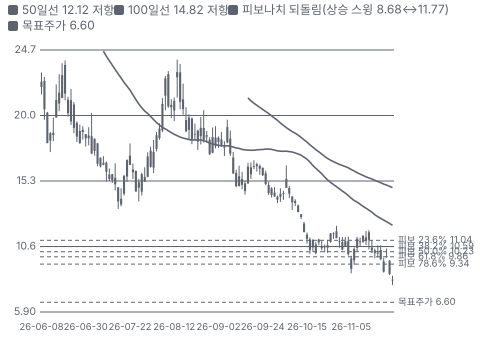

**주봉**

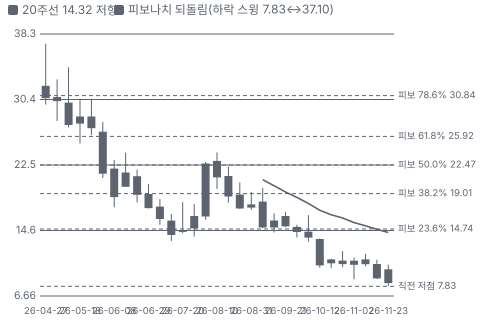

**월봉**

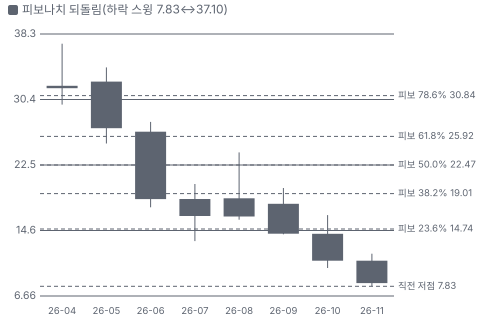

**분기 매출·EPS 실적과 컨센서스**

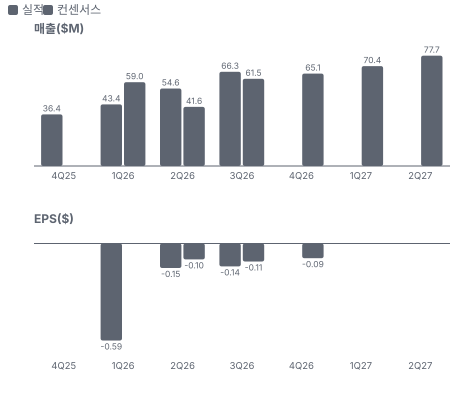

**EPS 리비전**

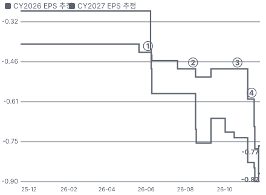

① 26-06-04 1Q26 실적, 상장 뒤 첫 발표 · EPS 리비전 +7%
② 26-08-13 2Q26 실적, ARDP 증액·HALEU 계약 · EPS 리비전 +6%
③ 26-10-21 목표가 하향과 보호예수 만료 구간 · EPS 리비전 +0%
④ 26-11-12 3Q26 실적, 건설 허가 조기 발급 · EPS 리비전 +43%

**밸류에이션 주가 시나리오**

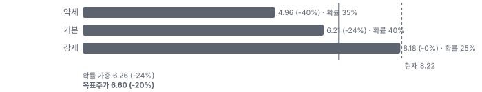

**주가별 업사이드**

- 제품·서비스 포트폴리오

**고객 믹스(3Q26, 매출 대비)**

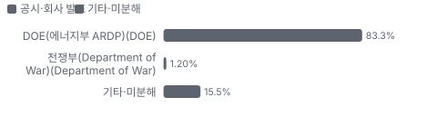

**공급 병목(10점, 낮을수록 병목)**

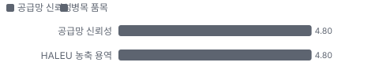

**생산능력 현재와 확충 계획(Xe-100 호기분(연료 공장 처리 능력))**

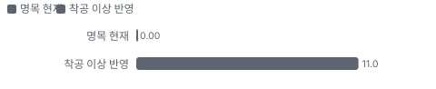

**CAPEX의 매출 대비 비중**

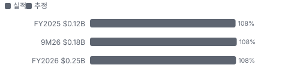

**어닝콜 변화별 주주가치 영향**

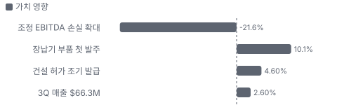

**수주·파이프라인 확실성 사다리**

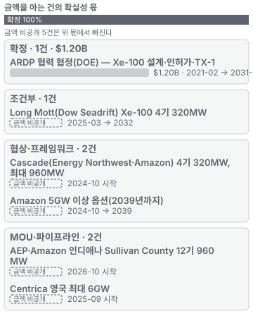

**매출 → 매출총이익 → 영업이익(매출 = 100, 최근 4분기)**

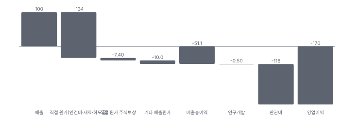

**분기 비용 비중 추이(매출 대비, 공시)**

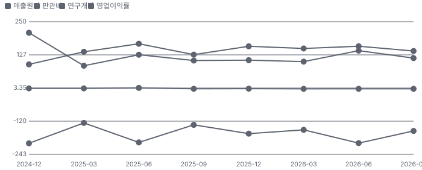

**비용 요인별 매출 대비 비중 1년 변화**

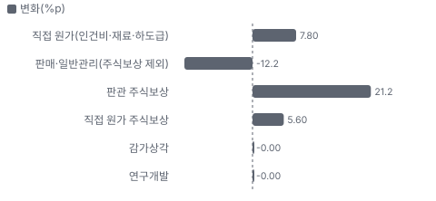

**ARDP 원가 분담 용역·보조금 BOM 원가 몫**

**상업 고객 개발 용역 BOM 원가 몫**

**BOM 항목 가격 +10% 시 OPM 변화**

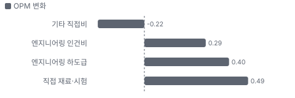

**자산 구성 — 3Q26 분기말 투하자본 \$298.7M**

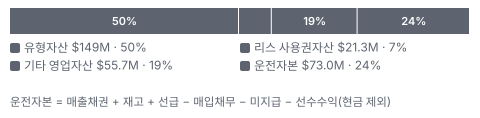

**자산별 변화율 — 최근 3개 분기(1Q26 = 0%)**

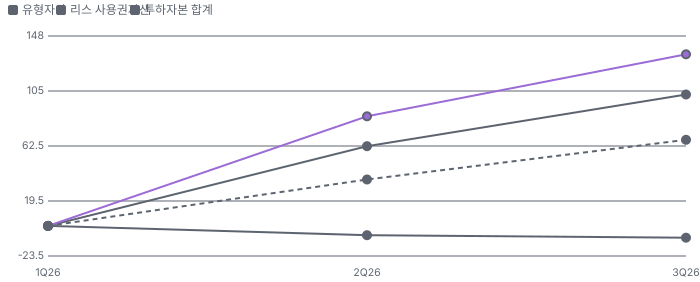

**매출 증가율의 가격·물량 분해와 8분기 전망(전년 대비)**

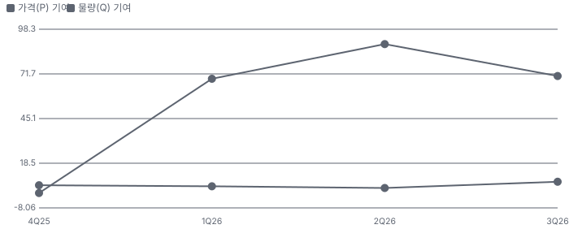

**목표주가 산정 — 기본과 강세 사이(강세 쪽 19%), 도달 확률 약 39%**

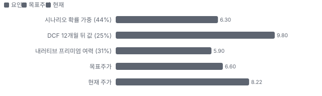

**커뮤니티 언급 수(최근 30일, 채널별)**

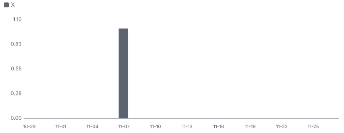

**일별 거래량 분해**

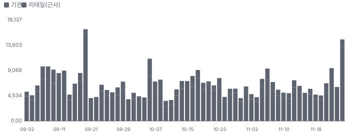

**기관 자금 흐름**

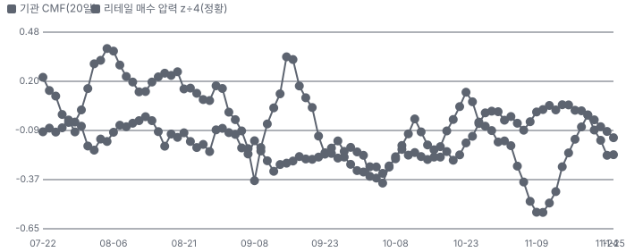

**몬테카를로**

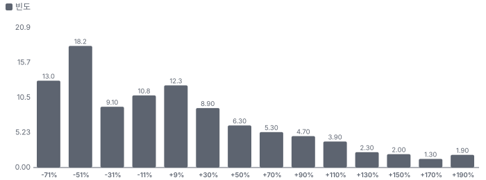

해석: 3,000번 중 1,452번(48%)에서 가치가 지금 주가 이상이었다. 지금 주가를 뒷받침하는 경우와 그렇지 않은 경우가 반반에 가깝다. 가운데 값은 0.97배이고, 열 번 중 여덟 번은 0.36~2.05배 사이에 든다.

## 내러티브

> **기업가치를 결정하는 이야기:** 이 회사는 원전을 직접 소유하지 않는다. 설계를 빌려주고(기술료), 짓는 동안 용역을 팔고, 돌아가는 60년 동안 연료를 판다. 그래서 값은 세 숫자로 갈린다. 몇 기가 실제로 착공하는가, 한 기당 기술료와 연료 값이 얼마인가, 첫 호기가 언제 도는가다. 셋 다 아직 공시되지 않았다. 지금 시가총액(완전 희석 약 \$3.6B)은 현금 \$1.81B와 '나머지 약 \$1.8B짜리 옵션'으로 읽는 것이 맞다.

> **멀티플·EPS 프리미엄**
> **멀티플:** 선행 이익이 모두 적자라 P/E·EV/EBITDA를 쓸 수 없다. 현금을 뺀 사업 가치 약 \$1.8B는 최근 4개 분기 매출 \$200.7M의 8.9배다. 다만 그 매출은 원가 분담 환급이라 이익이 남지 않는다 — 흑자 동종(BWXT 3.3배·Centrus 1.4배)과 같은 잣대로 볼 수 없다.
> **EPS:** EPS 추정은 FY2026 −\$0.77, FY2027 −\$0.87, FY2028 −\$0.61이고 첫 흑자는 FY2030(+\$0.35, 2명)이다. 3Q 실적 뒤 FY2027 추정이 −\$0.60에서 −\$0.87로, FY2030 추정이 +\$0.65에서 +\$0.35로 내려갔다.

### 투자자들은 왜 열광했나

4월 상장 때는 AI 전력난, Amazon의 지분 투자와 5GW 옵션, 정부의 \$1.2B 원가 분담이 겹쳐 첫날 종가가 \$35.98(공모가 \$23)까지 갔다. 식은 이유는 넷이다. 매출이 늘수록 손실이 커졌고(영업손실 3Q25 \$40.7M → 3Q26 \$103.6M), 추정이 계속 깎였고, 10월 보호예수 만료 구간에 주가가 \$14에서 \$10으로 밀렸고(정황), 11월에는 AI 설비투자 걱정으로 전력·원전주가 함께 빠졌다.

### 무엇이 기업가치를 바꾸나

> **구조적 체질 변화**
> **변화:** 정부 연구 용역 회사에서 원자로 기술료·연료 판매 회사로 바뀌는 길목
> **증거:** 지금 매출의 84.5%는 미국 정부(10-Q). 회사가 그리는 매출은 기술료·용역·연료(S-1(상장 신고서) 사업 모델)
> **반증:** 2028년에도 상업 매출 비중이 30% 아래

> **고부가 믹스 확장**
> **변화:** 상업 고객 용역이 늘기 시작했다
> **증거:** 상업 매출 3Q25 \$4.3M → 3Q26 \$10.3M, 비중 14.2% → 15.5%(10-Q 주석 3)
> **반증:** 상업 매출이 2개 분기 연속 줄어든다

> **기술 혁신**
> **변화:** 헬륨 냉각 페블베드 고온가스로 — 565°C 증기로 전기와 공정열을 함께 낸다
> **증거:** 페블베드 고온가스로 첫 NRC 건설 허가(8-K EX-99.1(8-K에 붙는 실적 보도자료)). 연료 조사 시험은 중간 결과가 기대에 맞는다고만 밝혔다(3Q 콜)
> **반증:** 연료 조사 시험 최종 결과가 기준에 못 미친다

> **실행 속도**
> **변화:** 인허가는 일정보다 빨랐고 건설은 아직 시작 전 **납품 리드타임 17개월.** 피어 비교 미확인. 2025-06 NRC가 정한 심사 일정 18개월보다 6% 짧다.
> **증거:** 건설 허가 심사: 2025-06 일정 확정(18개월) → 2026-11-09 발급. 후속 사업은 6~12개월이 NRC의 비공식 목표(3Q 콜). 착공 → 가동 기간은 미공시
> **반증:** Dow 예비 투자 결정이 2028년으로 밀린다

> **M&A**
> **변화:** 해당 없음(최근 3년 인수 없음)
> **증거:** S-1·10-Q
> **반증:** -

> **정책·입법 연관성**
> **재정정책:** ARDP 원가 분담(환급 한도 \$1.2B)이 개발비의 절반을 낸다. 현 예산 기간은 2027-03까지이고 연장은 에너지부 재량이다 3Q26 10-Q MD&A(경영진 재무 분석 절) 반증: 예산 기간 연장 지연 또는 세출 삭감 의회 동의 10/10 — 하원 5/5(ARDP 세출이 2021년 인프라 투자·일자리법(H.R.3684)에 반영돼 통과 — 추가 증액분 세출은 미확인) · 상원 5/5(같은 법 상원 통과 — 추가 증액분 세출은 미확인).
> **행정명령:** 2025-05 원전 행정명령들(NRC 심사 18개월 기한) — 건설 허가 심사가 그 일정 안에서 끝났다 3Q26 10-Q(18개월 심사 일정) 반증: 심사 기한이 법원·규칙으로 무력화 의회 동의 2/10 — 하원 1/5(행정명령 — 의회 의결 없음) · 상원 1/5(같음).
> **연관입법:** ADVANCE(미국 첨단 원전 인허가 촉진법) Act(2024 시행)와 첨단 원전 세액공제(45Y(청정 전력 생산 세액공제)·48E(청정 전력 투자 세액공제) — 2033년 이후 착공분부터 단계 축소) 424B4(확정 투자설명서) 세액공제 절 반증: 세액공제 조기 축소 입법

> **고객의 지출 예산**
> **변화:** 지금 돈은 정부 연구개발 예산에서 나오고, 앞으로 돈은 고객의 발전소 CAPEX에서 나와야 한다
> **사업별 예산:** **매출의 83%**: ARDP 원가 분담 용역·보조금 — 고객 해당 없음(연방 정부 원전 실증 세출) · 동인: ARDP 예산 기간 연장·세출
**매출의 16%**: 상업 고객 개발 용역 — 고객 CAPEX(고객의 발전소 개발·건설 투자(착공 전 개발비)) · 동인: Dow 투자 결정, Amazon 데이터센터 전력 확보
**매출의 1%**: 전쟁부 용역 — 고객 해당 없음(국방 연구개발 예산) · 동인: 마이크로원자로 사업 — 축소 중
> **증거:** DOE 83.3%·상업 15.5%·전쟁부 1.2%(3Q26 10-Q). Amazon은 개발비를 지원한다(8-K EX-99.1)
> **반증:** 하이퍼스케일러 설비투자 감속으로 개발비 지원이 끊긴다

### 내러티브 근거

> 'Amazon과 정부가 미는 첫 상업 고온가스로'라는 이야기는 상장 일곱 달 만에 값이 꺼졌다(4/27 종가 고점 \$35.98 → 11/25 종가 \$8.22, −77%, 공모가 \$23 대비 −64%). 그사이 인허가와 고객 협약은 앞으로 갔다. 지금 가격의 쟁점은 수요가 아니라 Dow의 2027년 투자 결정, 공개될 건설비, 그리고 손실 폭이다. 동종 대비 멀티플 차이 +278% 중 회사 고유 몫은 -66%다. 단계는 소멸, 쏠림은 낮음이다.

> **인허가 선점** · 강화
> **논리:** NRC 건설 허가를 일정보다 일찍 받아 규제 위험이 줄었다
> **숫자:** 건설 허가 11/9 발급(18개월 일정보다 한 달 이상 빠름), 후속 심사 6~12개월이 NRC 비공식 목표
> **반증:** 후속 사업 심사가 12개월을 넘는다
> **출처:** 8-K EX-99.1·3Q 콜

> **하이퍼스케일러 전력 수요(Amazon)** · 약화
> **논리:** Amazon이 주주이자 5GW 이상 옵션의 상대방이라 수요가 받쳐 준다
> **숫자:** Cascade 320MW(최대 960MW)·인디애나 960MW — 모두 개발 단계, 건설 비구속. 11월 AI 설비투자 걱정으로 전력·원전주가 함께 내렸다
> **반증:** 구속력 있는 건설·전력 계약(MW(메가와트)·가격) 공시가 2027년 안에 없다
> **출처:** S-1·8-K EX-99.1

> **연료 수직계열** · 유지
> **논리:** 원자로와 연료를 묶어 60년 동안 반복 매출을 만든다
> **숫자:** TX-1 골조 완공·11기분, 농축 용역 계약 2건, 구매 약정 \$312.2M
> **반증:** TX-1 공정 인증이 2028년을 넘긴다
> **출처:** 8-K EX-99.1·10-Q

> **정부 자금** · 유지
> **논리:** 개발비의 절반을 정부가 내 희석 없이 첫 호기까지 간다
> **숫자:** ARDP 환급 한도 \$1.2B, 9M26 DOE 매출·보조금 \$142.0M + 설비 환급 \$103.3M
> **반증:** 2027-03 예산 기간 연장이 늦어진다
> **출처:** 3Q26 10-Q

> **반대 — 첫 호기 비용·손실** · 강화
> **논리:** 원전 첫 호기는 일정과 비용이 넘치고, 지금 매출은 벌수록 손실이다
> **숫자:** 매출총이익률 −41%, 조정 EBITDA −\$75.7M(추정 −\$49.1M), FY2027 EPS 추정 −\$0.49 → −\$0.87
> **반증:** Dow 공개 사업비가 예산 안이고 분기 손실이 줄어든다
> **출처:** 8-K EX-99.1·컨센서스 이력

### 투자 포인트

> **진척은 앞으로, 가격은 뒤로**
> **명제:** 상장 때 약속한 2026년 마일스톤은 맞췄는데 주가는 공모가의 3분의 1이다
> **숫자:** NRC 건설 허가 11/9(일정보다 한 달 이상 빠름), AEP 960MW 협약, TX-1 골조 완공. 주가 \$35.98 → \$8.22
> **시장과 다른 점:** 셀사이드 목표가 평균 \$23.95는 주가를 못 따라 내려왔다 — '시장이 못 봤다'가 아니라 추정이 아직 깎이는 중이다. 다른 점은 가격이다: 현금을 빼면 사업 가치가 약 \$1.8B다
> **증명:** 다음 콜의 2027년 마일스톤, Dow 예비 투자 결정 시점
> **출처:** 8-K EX-99.1(2026-11-12)

> **매출은 이익이 아니다**
> **명제:** 매출이 118% 늘어도 원가 분담 구조라 손실이 함께 커진다
> **숫자:** 3Q26 매출·보조금 \$66.3M, 직접 원가 \$93.6M, 영업손실 \$103.6M. 미국 정부 84.5%
> **시장과 다른 점:** FY2027 매출 추정이 \$197M~\$845M으로 벌어진 것은 무엇이 매출인지 합의가 없다는 뜻이다. 매출 상향을 가치 상향으로 읽으면 안 된다 — 볼 것은 상업 매출 비중과 손실 폭이다
> **증명:** 상업 고객 매출 비중(3Q26 15.5%)과 조정 EBITDA 손실 추이
> **출처:** 3Q26 10-Q 주석 3·MD&A

> **현금이 시간을 산다**
> **명제:** 무차입에 현금 \$1.81B — 지금 속도면 Dow 결정과 TX-1 가동까지 증자 없이 간다
> **숫자:** 9개월 영업 −\$215.8M, 설비투자 −\$178.1M, 정부 환급 +\$80.0M → 순소진 약 \$314M(계산). 구매 약정 \$312.2M은 대부분 2031년 이후
> **시장과 다른 점:** 약세 쪽은 희석을 걱정하지만 가까운 2년의 위험은 증자가 아니라 ARDP 예산 기간(2027-03) 연장과 TX-2(두 번째 상업 연료 공장 계획) 자체 자금 부담이다
> **증명:** 분기 순현금 소진, ARDP 연장 승인 공시
> **출처:** 3Q26 10-Q 현금흐름표·주석 15

### 모멘텀 생성·소멸 타임라인

**카탈리스트 달력 — 지난 사건의 주가 반응과 앞으로 확인할 숫자**
| 날짜 | 상태 | 구분 | 사건 | 반응·확인 | 결과에 따라 |
|---|---|---|---|---|---|
| 2026-04-27 | 완료 | 생성 | 나스닥 상장 첫 거래 — 공모가 \$23 | +56% |  |
| 2026-06-04 | 완료 | 소멸 | 1Q26 실적 — 상장 뒤 첫 발표 | −10.0% |  |
| 2026-08-13 | 완료 | 생성 | 2Q26 실적 — ARDP 증액 통지·HALEU 계약 | +11.7% |  |
| 2026-10-20 | 완료 | 소멸 | 보호예수 만료 구간·목표가 하향(10/2 → 10/16) | −28.0% |  |
| 2026-11-12 | 완료 | 확인 | 3Q26 실적 — 건설 허가 조기 발급 직후 | +2.9% |  |
| 2027-03 중순(예상) | 예정 | 확인 | 4Q26 실적·첫 10-K, 2027년 마일스톤 | Dow 예비 투자 결정 분기 명시, 4Q 조정 EBITDA 손실 \$76M 이하 | 일정이 분기로 박히면 기본, 2028년으로 밀리면 약세 |
| 2027-03(예상) | 예정 | 확인 | ARDP 예산 기간 만료·연장 신청 | 연장 승인 공시 | 연장이면 유지, 지연이면 현금 소진 가속 |
| 2027(분기 미정) | 예정 | 생성 | Dow Long Mott 예비 투자 결정 | 결정 여부와 공개 사업비 | 승인·사업비 공개면 강세 쪽, 보류면 약세 |
| 2026-12-09~10(예상) | 예정 | 매크로 | 연준 회의·AI 설비투자 가이던스 | 전력·원전주 동반 흐름 | 업종 요인 — 회사 사건과 구분해 읽는다 |

### 언제 사서 언제 팔아야 할까?

**가격·조건 틀 — 가격은 밸류에이션(약세·기본·강세·목표주가)과 차트 지지 구간에서, 조건은 이벤트에서**
| 구간 | 가격 | 목표주가까지 | 약세까지 | 조건·근거 |
|---|---|---|---|---|
| 관찰 구간 | \$7.83~\$7.83 | -16% | -37% | 11/25 장중 저점 \$7.835가 상장 뒤 최저다. 그 아래에는 거래 이력이 없어 차트 지지가 없다 — 주당 현금 약 \$4.1(완전 희석)이 유일한 기준선이다 |
| 확인 뒤 | 지금 \$8.22 이상에서 조건 확인 | -20% | -40% | 다음 콜에서 Dow 예비 투자 결정 분기와 2027년 마일스톤, 조정 EBITDA 손실이 3Q(−\$75.7M)보다 커지지 않는 것 |
| 무효화 | 약세 시나리오 \$4.96 | - | -40% | Dow 결정이 2028년으로 밀리거나 ARDP 예산 기간 연장이 늦어진다 |

최근 5거래일 일일 변동이 5~13%였다. 하루 움직임은 업종(AI 설비투자) 요인이 크다 — 회사 사건과 섞어 읽지 않는다 가격·조건 틀이며 매매·비중 지시가 아니다(투자 권유 아님).

## 포트폴리오

| 제품·서비스 | 구분 | 무엇 | 쓰는 곳 | 돈 버는 방식 | Mix | Mix 변화(3Q26 대 3Q25, 10-Q 주석 3 고객 유형별) |
|---|---|---|---|---|---|---|
| Xe-100 원자로 | 기술 | 헬륨 냉각 페블베드 고온가스로. 한 기 전기 80MW 또는 열 200MW, 4기 묶음이 기본 | 화학 공장 공정열·전기, 데이터센터·전력회사 기저 전력 | 설계 기술료와 건설 지원 용역. 발전소는 고객이 소유한다. 기술료 매출은 아직 0 | 미확인 | 미확인 |
| TRISO-X(X-Energy의 피복 입자 핵연료) 연료 | 제품 | 우라늄 알갱이를 세라믹으로 세 겹 감싸 흑연 공에 넣은 연료 | Xe-100 첫 장전과 60년 재장전, 다른 개발사 원자로용 위탁 제조 | 가공 용역으로 판다(우라늄 재고 위험은 고객 몫). 매출 아직 0 — TX-1 가동 뒤 | 미확인 | 미확인 |
| ARDP 원가 분담 용역·보조금 | 서비스 | 에너지부와 비용을 반씩 내는 설계·인허가·연료 공장 건설 | 첫 사업(Dow Long Mott)과 TX-1 | 3Q26 \$55.3M — 지금 매출의 대부분. 이익은 남지 않는다 | 83% | +0.2%p |
| 상업 고객 개발 용역 | 서비스 | 부지별 엔지니어링·인허가·개발 지원 | Dow·Amazon·전력회사 사업 준비 | 3Q26 \$10.3M | 16% | +1.3%p |

**Mix 변화가 가장 큰 쪽은 상업 고객 개발 용역(+1.3%p, 3Q26 대 3Q25, 10-Q 주석 3 고객 유형별).** 계절성 판정: 분기 매출 계절 지수 기준 없음 → 직전 분기와 비교.

## 고객

> **3Q26 최대 고객 DOE(에너지부 ARDP, DOE) 83%, 상위 3곳 84%, 집중도 집중.** 공시·회사 발표로 확인한 몫은 매출의 84%이고, 나머지 고객 몫은 추정이거나 미분해다. 돈을 내는 고객은 사실상 미국 정부 하나다. 3Q26 매출·보조금 수익의 84.5%가 정부(에너지부 83.3%, 전쟁부 1.2%)이고 나머지 15.5%는 회사별로 공시되지 않은 상업 고객이다. 원전을 살 고객(Dow·Amazon·AEP·Centrica)은 아직 개발비만 낸다

**고객별 매출 몫(3Q26)**
| 고객 | 몫 | 변화 | 근거 |
|---|---|---|---|
| DOE(에너지부 ARDP, DOE) | 83% | +0%p | 공시 |
| 전쟁부(Department of War, Department of War) | 1% | -2%p | 공시 |
| Dow(Dow(특수관계자)) | 미확인 | 미확인 | 공시 |
| Amazon·Energy Northwest·AEP·Centrica(개발 단계 고객) | 미확인 | 미확인 | 회사 발표 |
| 기타·미분해 | 16% | - | - |

> **DOE(에너지부 ARDP, DOE)** · 공시
> **사는 것:** Xe-100 설계·인허가·TX-1 건설의 원가 분담 용역 \$40.5M과 보조금 \$14.8M
> **추정 근거:** 50/50 원가 분담 — 이익이 남지 않는 매출

> **전쟁부(Department of War, Department of War)** · 공시
> **사는 것:** 이동형 마이크로원자로 설계 용역
> **추정 근거:** 비중 축소 — 회사는 Xe-100과 연료에 집중한다고 밝혔다(2Q 콜)

> **Dow(Dow(특수관계자))** · 공시
> **사는 것:** Long Mott 사업 엔지니어링·인허가 용역
> **추정 근거:** 특수관계자 거래로 공시되나 금액을 이번 회차에 확인하지 못했다 — 상업 매출 15.5% 안에 들어 있다

> **Amazon·Energy Northwest·AEP·Centrica(개발 단계 고객)** · 회사 발표
> **사는 것:** 부지별 개발·설계 용역(개발비 지원)
> **추정 근거:** 회사별 매출은 공시되지 않는다. Dow와 합쳐 3Q26 매출의 15.5%(3Q25 14.2%)

## 수주·파이프라인

> **2026-11-12 기준 6건.** 확정 \$1.20B.

**수주 목록**
| 상태 | 계약 | 계약 총액 | 진척 | 기간 | 비고 |
|---|---|---|---|---|---|
| 확정 | ARDP 협력 협정(DOE) — Xe-100 설계·인허가·TX-1(미국) | \$1.20B | - | 2021-02 → 2031-02 | 환급 한도 \$1.2B(적격 비용 \$2.4B의 절반). 2Q 콜에서 DOE의 최대 \$1B 증액 통지를 밝혔으나 10-Q 본문에서 금액을 확인하지 못했다 원가 분담 환급이라 이익이 남지 않는다 |
| 조건부 | Long Mott(Dow Seadrift) Xe-100 4기 320MW(미국 텍사스) | 금액 비공개 | - | 2025-03 → 2032 | - |
| 협상 | Cascade(Energy Northwest·Amazon) 4기 320MW, 최대 960MW(미국 워싱턴) | 금액 비공개 | - | 2024-10 → 미확인 | - |
| 프레임워크 | Amazon 5GW 이상 옵션(2039년까지, 미국) | 금액 비공개 | - | 2024-10 → 2039 | (Cascade·인디애나 포함에 포함) |
| MOU(양해각서) | AEP·Amazon 인디애나 Sullivan County 12기 960MW(미국 인디애나) | 금액 비공개 | - | 2026-10 → 미확인 | - |
| MOU | Centrica 영국 최대 6GW(영국) | 금액 비공개 | - | 2025-09 → 미확인 | - |

**실행 속도와 방해 요인**
| 항목 | 상태 | 실행 속도 | 방해 요인 |
|---|---|---|---|
| ARDP 협력 협정(DOE) — Xe-100 설계·인허가·TX-1 | 확정 | 9M26 DOE 매출·보조금 \$142.0M + 설비투자 환급 \$103.3M, 현 예산 기간 2025-03~2027-03 | 예산 기간 연장은 DOE 재량 · 세출 확보 · 총 수행 기간 10년 상한 |
| Long Mott(Dow Seadrift) Xe-100 4기 320MW | 조건부 | 2025-03 건설 허가 신청 → 2026-11-09 발급(18개월 일정보다 한 달 이상 빠름), 예비 투자 결정 2027, 가동 2030년대 초 | Dow 예비·최종 투자 결정 · 최종 설계 완료 · 운영 허가(심사 약 18개월) · 총사업비 미공시 |
| Cascade(Energy Northwest·Amazon) 4기 320MW, 최대 960MW | 협상 | 기본설계 초기, 2026-11-05 Fluor 핵섬 설계 계약 | 건설 허가 신청 전 · Amazon·Energy Northwest 투자 결정 |
| Amazon 5GW 이상 옵션(2039년까지) | 프레임워크 | Cascade와 인디애나 사업이 이 틀의 첫 두 건 | 옵션 — 행사 의무 없음 |
| AEP·Amazon 인디애나 Sullivan County 12기 960MW | MOU | 2026-10 공동개발협약 — 타당성·건설 허가 준비·지역 협의 | 건설 비구속 · 주 규제 승인 · Amazon·AEP 상업 조건 미확정 |
| Centrica 영국 최대 6GW | MOU | 2025-09 공동개발협약, 2026-09 일반설계평가 접수 | 일반설계평가 수년 소요 · 부지·자금 미정 |

## 마진 구조

> **GPM -41.0%, OPM -156.2%.** 2Q26 대비 GPM +17.7%p, OPM +45.4%p. 변동비는 매출의 114%이고, 매출이 10% 늘면 OPM은 +12.9%p 움직인다. 지금 매출은 벌수록 손실이 나는 구조다. 3Q26 매출·보조금 \$66.3M에 직접 원가가 \$93.6M 들어 매출총이익률은 −41%다. 정부가 적격 비용의 절반만 돌려주는 원가 분담 사업이기 때문이다. 판관비 \$76.0M에는 주식보상 \$22.0M과 TX-2 설계비가 들어 있다

> **매출 100 중 매출원가 151.1, 매출총이익 -51.1(최근 4분기, 공시).** 매출원가 요인 중 직접 원가(인건비·재료·하도급)이 매출의 133.7%로 가장 무겁고, 단가가 +10% 오르면 GPM이 -13.37%p 움직인다. 분기 회귀로 매출 1이 늘 때 매출원가는 1.51 늘고, 매출원가의 고정비 몫은 -6%다.

**비용 요인 강도 — 비중·추세·충격(+10%)·탄력**
| 비용 | 구분 | 매출 대비 | 1년 변화 | 마진 기여 | 충격 시 마진 | 매출 탄력 | 고정비 몫 |
|---|---|---|---|---|---|---|---|
| 직접 원가(인건비·재료·하도급) | 매출원가 요인 | 133.7% | +7.8%p | -7.8%p | -13.37%p | 미확인 | 30% |
| 직접 원가 주식보상 | 매출원가 요인 | 7.4% | +5.6%p | -5.6%p | -0.74%p | 미확인 | 80% |
| 매출원가 | 공시 항목 | 151.1% | +24.9%p | -24.9%p | -15.11%p | 1.51 | -6% |
| 판관비 | 공시 항목 | 117.9% | -21.3%p | +21.3%p | 미확인 | 1.24 | 1% |
| 연구개발 | 공시 항목 | 0.5% | -1.4%p | +1.4%p | 미확인 | -0.01 | 100% |

매출 탄력 = 분기 비용을 매출에 회귀한 기울기(매출 1당 변동비), 고정비 몫 = 절편 ÷ 평균 비용. 표본이 8분기 미만이면 미확인. 매출원가 요인 비중은 margin 재료의 추정이 섞여 있고, 공시 매출원가와의 차이는 '기타 매출원가'로 둔다.

**GPM에서 OPM까지(GAAP, 아래는 최근 4개 분기)**
| 기간 | GPM | 연구개발 | 판관비 | 기타 | OPM |
|---|---|---|---|---|---|
| 2Q26 | -58.7% | 0.4% | 142.4% | 0.0% | -201.5% |
| 3Q26 | -41.0% | 0.5% | 114.6% | 0.0% | -156.2% |
| 2025-12 | -58.6% | - | - | - | -166.4% |
| 2026-03 | -50.5% | - | - | - | -152.2% |
| 2026-06 | -58.7% | - | - | - | -201.5% |
| 2026-09 | -41.0% | - | - | - | -156.2% |

**비용을 움직이는 요인**
| 비용 | 요인 |
|---|---|
| 직접 원가(인건비·재료·하도급, 매출원가) | ARDP 설계·인허가 작업량, 엔지니어링 하도급 · 근거 공시 |
| 판매·일반관리(주식보상 제외, 판관비) | 본사 인력, 전문 용역, TX-2 설계·부지 준비 · 근거 공시 |
| 판관 주식보상(판관비) | 상장 뒤 주식보상 · 근거 공시 |
| 직접 원가 주식보상(매출원가) | 상장 뒤 주식보상 · 근거 공시 |
| 감가상각(판관비) | 설비 완공 전이라 작다 · 근거 공시 |
| 연구개발(연구개발) | 설계 작업 대부분은 직접 원가로 잡힌다 · 근거 공시 |

**ARDP 원가 분담 용역·보조금 BOM — 매출의 83%, GPM -41%(회사 전체 매출총이익률 −41.0%(3Q26 매출·보조금 \$66.3M − 직접 원가 \$93.6M) — 사업별 원가는 공시되지 않는다), 항목 가격 +10% 시**
| 항목 | 원가 몫 | 전가 | 제품 GPM | OPM |
|---|---|---|---|---|
| 엔지니어링 인건비 | 40~60% | 50% | -2.0%p | +1.60%p |
| 엔지니어링 하도급 | 25~40% | 50% | -1.3%p | +1.05%p |
| 직접 재료·시험 | 10~20% | 50% | -0.6%p | +0.49%p |
| 미분해 | 2% | - | - | - |

**상업 고객 개발 용역 BOM — 매출의 16%, GPM -41%(회사 전체 매출총이익률 −41.0%(3Q26 매출·보조금 \$66.3M − 직접 원가 \$93.6M) — 사업별 원가는 공시되지 않는다), 항목 가격 +10% 시**
| 항목 | 원가 몫 | 전가 | 제품 GPM | OPM |
|---|---|---|---|---|
| 엔지니어링 인건비 | 50~70% | 미확인 | -8.5%p | -1.31%p |
| 엔지니어링 하도급 | 20~40% | 미확인 | -4.2%p | -0.66%p |
| 기타 직접비 | 5~15% | 미확인 | -1.4%p | -0.22%p |

판매가 전가를 모르는 항목은 전가 0%로 계산했다.

**BOM 항목 가격을 움직이는 것**
| 항목 | 요인 |
|---|---|
| 엔지니어링 인건비 | 설계·인허가 인력 · 근거 추정 |
| 엔지니어링 하도급 | 외주 설계 · 근거 추정 |
| 직접 재료·시험 | 시험·시제품 재료 · 근거 추정 |
| 엔지니어링 인건비 | 부지별 설계·인허가 지원 · 근거 추정 |
| 기타 직접비 | 출장·시험 · 근거 추정 |

물가 지수를 붙이지 못한 매출원가 항목은 직접 원가(인건비·재료·하도급), 직접 원가 주식보상다(미연결).

## 자산 구성

> **3Q26 분기말 투하자본 \$298.7M** — 유형자산 50%, 운전자본 24%. 최근 3개 분기(1Q26 → 3Q26) 가장 크게 늘어난 자산은 매출채권(+134%), 투하자본 합계 +67%.

**자산·운전자본 항목별 분기말 잔액 — 최근 12개 분기와 다음 4개 분기 추정**
| 항목 | 1Q26 | 1년 전 | 3Q26(최근) | 추정 | 3개 분기 변화 | 다음 4개 분기 변화 |
|---|---|---|---|---|---|---|
| 매출채권 | \$22.0M | 미확인 | \$51.4M | — | +134% | — |
| 선급·기타 유동자산 | \$23.5M | 미확인 | \$23.7M | — | +1% | — |
| 매입채무 | \$10.0M | 미확인 | \$1.7M | — | -83% | — |
| 선수수익(계약부채) | \$3.8M | 미확인 | \$0.4M | — | -88% | — |
| 유형자산 | \$73.4M | 미확인 | \$148.7M | — | +103% | — |
| 리스 사용권자산 | \$23.5M | 미확인 | \$21.3M | — | -9% | — |

미공시·미분해: 분기 감가상각·유형자산(순액) 9분기 · 분기 매출·영업이익 8분기 · 유형자산 항목별 총액·내용연수(10-K 주석에서 모델이 채움) · 무형자산 항목(10-K 주석에서 모델이 채움) — 이 칸은 비우고 나머지로 계산했다.

## 공급망 병목

> **공급망 신뢰성 4.8/10, 병목 주의.** 가장 약한 고리는 HALEU 농축 용역 4.8점이고, 품목 평균은 4.8점이다. 근거가 부족한 4건(원자로 등급 흑연 · 증기발생기 튜브 · 핵섬 엔지니어링 · 대형 강 단조(원자로 용기))은 점수에서 뺐다. 병목은 연료다. 미국에 상업 HALEU 공급이 아직 없어 첫 사업 물량은 DOE 배정에 기대고, 후속 물량은 8월에 맺은 농축 용역 장기 계약 2건에 달렸다. 흑연과 증기발생기 튜브는 캐파 예약과 첫 발주로 앞당겨 잡았다

**병목과 마진 — 품목 가격 +10% 시 OPM**
| 품목 | 점수 | 판정 | 구분 | OPM |
|---|---|---|---|---|
| HALEU 농축 용역(필수) | 4.8 | 병목 주의 | 출하 차질 위험 | 미확인 |

> **HALEU 농축 용역** · 4.8/10
> **왜:** HALEU가 없으면 두 번째 노심부터 연료를 만들 수 없다
> **병목 요인:** 인증 공급사 2곳 · 캐파 빠듯 · 리드타임 미확인 · 재인증 미확인 · 1위 점유율 미확인 · 미국 집중 100% · 물량 확보 장기계약
> **풀리는 조건:** 일부 — 계약은 체결, 농축 증설은 확인 전

**공급사**
| 품목 | 공급사 | 몫 | 근거 |
|---|---|---|---|
| HALEU 농축 용역 | DOE HALEU 공급 사업(첫 사업용 배정(약 7.6톤 중 1차 4톤)) | 미확인 | 공시 |
| HALEU 농축 용역 | 미국 농축 사업자 2곳(회사명은 10-Q 미기재, 장기 농축 용역, 단계별 최소 구매·선급) | 미확인 | 공시 |
| 원자로 등급 흑연 | Toyo Tanso(흑연 캐파 예약) | 미확인 | 회사 발표 |
| 원자로 등급 흑연 | SGL(흑연 캐파 예약 — 원재료 입고 시작) | 미확인 | 회사 발표 |
| 증기발생기 튜브 | Alleima(고온 합금 튜브 제조) | 미확인 | 회사 발표 |
| 증기발생기 튜브 | Doosan Enerbility(나선형 코일 가공) | 미확인 | 회사 발표 |
| 핵섬 엔지니어링 | Fluor(Long Mott·Cascade 핵섬 설계) | 미확인 | 회사 발표 |
| 대형 강 단조(원자로 용기) | 미확인(공급사 미공개) | 미확인 | 추정 |

**무역 통계로 본 공급 지역**
| 품목 | EU 수입처 | 일본 수입처 | EU 1위 전년비 |
|---|---|---|---|
| HALEU 농축 용역 | CN(중국) 90% · US 8% · KR(한국) 1% | フランス 84% · 英国 8% | 미확인 |
| 증기발생기 튜브 | KR 39% · TW(대만) 26% · MY(말레이시아) 15% | 大韓民国 49% · 中華人民共和国 14% | -25.9% |

## 생산능력

> **현재 명목 캐파 0 Xe-100 호기분(연료 공장 처리 능력), 가동률 미확인.** 착공 이상 증설은 11 Xe-100 호기분(연료 공장 처리 능력), 발표까지 합치면 11 Xe-100 호기분(연료 공장 처리 능력)이다. 9M26 CAPEX는 \$0.18B로 매출의 108.4%다. 지금 돌아가는 상업 설비는 없다. 첫 연료 공장 TX-1(테네시 Oak Ridge)이 골조를 마치고 설비 설치 단계로 들어갔고 처리 능력은 Xe-100 11기분이다. 개발 중인 원자로가 그보다 많아 두 번째 공장 TX-2를 2030년대 초에 맞춰 설계 중이다

**생산시설 6곳**(상장 첫 해라 10-K가 아직 없다. 424B4 사업 절의 시설 설명과 3Q26 콜·8-K에 나온 시설(계획 포함)), 임차 1곳 · 소유 3곳 · 미확인 2곳. 시설별 생산능력은 1곳만 공개됐다.

**생산시설 6곳 — 명칭·위치·생산능력**
| 시설 | 위치 | 용도 | 생산능력 | 소유·상태 |
|---|---|---|---|---|
| 본사 | 미국 메릴랜드 Rockville | 경영·엔지니어링 | 미확인 — 사무 시설 | 임차 · 가동 |
| TX-1 연료 공장 | 미국 테네시 Oak Ridge | 첫 상업 규모 TRISO-X 연료 제조 — 골조 완공, 내부 설비 설치 단계(부지 약 180에이커) | 11 Xe-100 호기분(계획) | 소유 · 건설 중 |
| TX-2 연료 공장 | 미국 테네시 Oak Ridge | 두 번째 상업 연료 공장 | 미확인 — 설계 단계 — 처리 능력 미공시 | 소유 · 계획 |
| TX-L(연료 연구개발센터 계획) 연구개발센터 | 미국 테네시 Oak Ridge | 연료 연구개발 | 미확인 — 연구 시설 | 소유 · 계획 |
| XTAC(메릴랜드 프레더릭의 부품 시험 시설) 부품 시험 시설 | 미국 메릴랜드 Frederick | 연료 취급 계통·헬륨 순환기·제어봉 구동장치 시험(약 90,000제곱피트) — 단계 개보수 중 | 미확인 — 시험 시설 | 미확인 · 증설 중 |
| 운전원 교육 시설 | 미국 메릴랜드 Frederick | Xe-100 시뮬레이터·운전원 교육(10,447제곱피트) | 미확인 — 교육 시설 | 미확인 · 가동 |

**생산능력 확충 계획**
| 계획 | 단계 | 증설 | 가동 시점 | CAPEX |
|---|---|---|---|---|
| TX-1 연료 공장 | 착공 | 11 Xe-100 호기분(연료 공장 처리 능력) | 미확인 | 미확인 |
| TX-2 연료 공장 | 발표 | 미확인 | 2030년대 초 | 미확인 |

남은 계획의 CAPEX 합계는 \$0.00B(금액 미확인 2건 제외)다. 합계는 FY2026 매출의 0%다.

**증설 방해 요인**
| 계획 | 방해 요인 |
|---|---|
| TX-1 연료 공장 | 내부 설비 설치·시운전·공정 인증, HALEU 농축 물량 인도 |
| TX-2 연료 공장 | 설계 단계 — ARDP 환급 대상 아님, 자체 자금 |

**CAPEX와 매출 대비**
| 기간 | CAPEX | 매출 | 매출 대비 | 구분 |
|---|---|---|---|---|
| FY2025 | \$0.12B | \$0.11B | 107.5% | 실적 |
| 9M26 | \$0.18B | \$0.16B | 108.4% | 실적 |
| FY2026 | \$0.25B | \$0.23B | 107.8% | 추정 |

## 피터 린치 분류

> **고성장주(Fast Grower), 중형.** 린치 표의 기대 수익 10~100배, 하방 -80~100%, 위험 고. 10배 경로가 있는 분류다(고성장주·회생주·경기순환주).

**분류 근거 — 크기 먼저, 다음은 이야기 유형**
| 항목 | 값 |
|---|---|
| 크기 | 중형(시가총액 \$2.4B) |
| 장기 성장 | 49.8%(컨센서스 매출 6년 CAGR(EPS 없음)) |
| 린치 비율((성장% + 배당%) ÷ P/E) | 미확인 |
| PEG(P/E ÷ 성장%) | 미확인 |
| 근거 | 장기 EPS 성장 50%(컨센서스 매출 6년 CAGR(EPS 없음)) — 고성장 구간(≥18%) |
| 반대 근거 | 없음 |

- 점검: 성장을 더 이어 갈 자리(새 시장·점포·고객)가 남았나
- 점검: P/E가 성장률의 2배를 넘지 않나(PEG)
- 점검: 성장 속도가 꺾이는 2단계에 들어섰나
- 팔 때(점검 조건, 매매 지시 아님): 성장 단계가 끝나거나(확장 여지 소진·동일 매장 성장 둔화) P/E가 성장률의 2배를 크게 넘을 때 — 50% 올랐다고 팔지 않는다(10배 경로를 자른다)

분류 = 피터 린치·존 로스차일드 『One Up On Wall Street』(1989)·『Beating the Street』(1993)의 6분류와 위험·보상 표를 숫자 규칙으로 옮긴 자체추론이다(config/lynch.yaml).

## 구루 교차 점검

> **여섯 관점 중 통과 1 · 미달 1 · 미확인 4.** 가장 약한 관점은 해자와 자본수익률 — 장벽은 인허가와 연료 공장인데 둘 다 아직 돈을 벌지 못했고, 같은 정부 지원 경로를 경쟁 개발사도 쓴다.

판정은 자체추론이고 숫자는 계산값이다.

> **성장 여지** · 미확인
> **질문:** 5년 안에 매출이 2배가 될 자리가 있나, 10년 뒤에도 커지나
> **이유:** 매출 추정은 2030년 \$1.7B까지 늘지만 2명 추정이고, 지금 매출은 원가 분담 환급이라 같은 성격의 매출이 이어진다고 볼 수 없다
> **계산한 숫자:** 매출 경로 FY2026→FY2032 연 49.8%, 2배까지 1.7년
> **근거:** X-Energy 3Q26 10-Q · 출처 목록

> **해자와 자본수익률** · 미달
> **질문:** 경쟁우위가 무엇이고, 투하자본수익률(ROIC)이 자본비용보다 높으며 유지·상승하나
> **이유:** 최근 4개 분기 영업손실이 매출의 1.7배라 자본수익률은 음수다. 인허가·연료 공장은 장벽이지만 수익으로 증명된 적이 없다
> **계산한 숫자:** ROIC -53.4% · 자본비용 10.2%
> **근거:** X-Energy 3Q26 10-Q 손익계산서

> **재투자 복리** · 미확인
> **질문:** 번 돈을 높은 수익률로 다시 넣을 곳이 있나 — 자본 배분(재투자·인수·자사주·희석) 이력은
> **이유:** 설비투자의 절반 가까이를 정부가 환급하고 나머지를 연료 공장에 넣고 있다. 그 투자의 수익률은 공장 가동 전이라 잴 수 없다
> **계산한 숫자:** 설비 재투자율 미확인 · 지속 가능 성장 미확인(근사) · 소유주 이익 수익률 -14.0%(근사)
> **근거:** X-Energy 3Q26 10-Q 현금흐름표·주석 5

> **사람과 문화** · 통과
> **질문:** 경영진이 주주와 같은 배를 탔나 — 창업자·내부자 지분, 기회형 내부자 매수, 문화가 경쟁우위에 기여하나
> **이유:** CEO가 2019년부터 7년째이고 창업자가 Class B의 70.9%를 들고 있다. 상장 때 내놓은 2026년 마일스톤을 제때 또는 앞당겨 맞췄다
> **계산한 숫자:** 서류로 확인(계산 없음)
> **근거:** X-Energy 424B4 주요 주주·경영진 절  · 3Q26 8-K EX-99.1 · 출처 목록

> **변화의 방향** · 미확인
> **질문:** 18~24개월 뒤 이익 그림이 지금과 얼마나 다른가, 유동성 국면은 그 변화를 받쳐 주나
> **이유:** 인허가·고객·공급망은 앞으로 갔지만 FY2027 EPS 추정은 두 달 사이 −\$0.49에서 −\$0.87로 나빠졌다. 방향이 갈린다
> **계산한 숫자:** 2년 뒤 EPS 미확인(다음 12개월 대비) · 유동성 국면 긴축
> **근거:** X-Energy 3Q26 8-K EX-99.1  · 컨센서스 이력 · 출처 목록

> **5배 경로와 시장이 모르는 이유** · 미확인
> **질문:** 어떻게 5배 이상이 되나(이익 성장 × 배수 변화), 시장은 왜 아직 값을 안 매기나
> **이유:** 현금이 시가총액의 절반을 넘지만 5배는 2030년대 초 가동과 후속 착공이 모두 필요해 근거가 없다
> **계산한 숫자:** 7년에 5배 = 연 25.8% · 10배 = 연 38.9%
> **근거:** 이 리포트의 2·3·5·10배 경로 계산

**배수별로 필요한 연 성장률 — 이익 성장과 배수 변화를 합친 속도**
| 목표 | 5년 | 7년 | 10년 |
|---|---|---|---|
| 2배 | 14.9% | 10.4% | 7.2% |
| 5배 | 38.0% | 25.8% | 17.5% |
| 10배 | 58.5%(희소) | 38.9% | 25.9% |

### 보유 규율 — 가격이 아니라 지표로 유지·종료를 가른다

- 투자 논리 지표: Dow 예비 투자 결정과 공개 사업비 · 분기 순현금 소진(영업 + 설비투자 − 정부 환급) · TX-1 설비 설치·공정 인증 일정
- 규칙: 가격만 빠지고 Dow 일정과 현금 소진 속도가 유지되면 투자 논리는 그대로다 — 투자 결정이 2028년으로 밀리거나 분기 소진이 \$150M을 넘으면 다시 본다
- 지금 주가는 일봉 149개 기간의 고점 대비 -77.1%, 그 기간 최대 낙폭은 -77.1%다 — 고점 대비 −50%를 넘어 재심사 구간이다. 가격이 아니라 위 지표로 유지·종료를 가른다.

여섯 관점은 베일리 기포드(성장 여지·5배 경로), 워렌 버핏(해자·재투자), 론 바론(사람), 피터 린치(분류·내부자), 스탠리 드러켄밀러(변화의 방향·유동성)의 질문을 옮긴 점검 틀이다. 유동성 국면은 긴축(10년물 20일 -9bp · 하이일드 스프레드 20일 +54bp). 설비 재투자율은 설비투자에서 감가상각을 뺀 몫만 본 근사이고(연구개발·인수·운전자본은 빠진다), 소유주 이익 수익률은 유지 설비투자를 감가상각과 같다고 본 근사다. 점검 틀이며 매매·비중 지시가 아니다.

## 해자

> 해자는 원자로 설계보다 '연료 공장과 인허가를 먼저 쥔 것'이다. 숫자로 확인되는 것은 NRC 허가 두 건과 DOE 지원 규모이고, 건설비 경쟁력은 아직 증거가 없다

> **인허가 선점** · 보통
> **해자:** 상업용 첨단 원전의 NRC 건설 허가와 연료 공장 핵물질 면허를 모두 받았다
> **근거:** Long Mott 건설 허가 2026-11-09 발급(8-K EX-99.1), TRISO-X 특수핵물질 면허 2026-02(S-1). 핵섬 설계가 같아 후속 사업 심사에 재사용(3Q 콜)
> **숫자:** 건설 허가 심사 18개월 일정보다 한 달 이상 단축
> **깨지는 조건:** 후속 사업 건설 허가 심사가 12개월을 넘거나 운영 허가가 지연된다

> **연료 수직계열** · 보통
> **해자:** TRISO(세라믹으로 세 겹 감싼 입자 핵연료) 연료를 직접 만들 공장을 짓고 있어 원자로와 연료를 묶어 판다
> **근거:** TX-1 골조 완공(8-K EX-99.1), 처리 능력 Xe-100 11기분(2Q 콜), 농축 용역 장기 계약 2건(10-Q)
> **숫자:** 무조건 구매 약정 \$312.2M
> **깨지는 조건:** TX-1 설비 설치·공정 인증이 2028년을 넘긴다

> **정부·고객 자금** · 보통
> **해자:** 개발비의 절반을 정부가 내고 현금이 4년 넘는 소진을 덮는다
> **근거:** ARDP 환급 한도 \$1.2B, 현금·투자 \$1.81B·무차입(10-Q)
> **숫자:** 9개월 순현금 소진 약 \$314M(계산)
> **깨지는 조건:** ARDP 예산 기간 연장 불발 또는 분기 소진이 \$150M을 넘는다

> **건설비 경쟁력** · 약함
> **해자:** 모듈 반복 건설로 원가를 낮춘다는 주장
> **근거:** 미확인 — 총사업비·kW당 건설비 미공시
> **숫자:** 미확인
> **깨지는 조건:** Dow 예비 투자 결정 때 공개될 사업비

## 경영진·네트워크

> 창업자 Ghaffarian이 Class B의 70.9%를 쥐고, 에너지부 부장관 출신 CEO가 2019년부터 이끈다. 연결은 에너지부와 Amazon(상장 뒤 Class A(의결권과 경제적 권리가 있는 상장 보통주)의 22.9%) 쪽에 몰려 있다. 연결이 지원금이나 계약을 만들었다는 증거는 없다

> **J. Clay Sell** · CEO·이사 · 2019
> **프로필:** 2005~2008 에너지부 부장관, 2003~2005 대통령 특별보좌관, 2008~2018 Hunt Energy Horizons 사장
> **비즈니스:** Hunt Consolidated(댈러스 에너지 기업) 재생에너지 자회사 경영
> **정계:** George W. Bush 행정부 에너지부 부장관(공직 이력)
> **동문:** 미확인
> **사모임:** 미확인

> **Kamal Ghaffarian** · 창업자·이사 · 2009
> **프로필:** 1994년 Stinger Ghaffarian Technologies 창업(KBR에 매각), Lockheed Martin·Ford Aerospace·Loral 근무
> **비즈니스:** Class B 84.3M주(70.9%)·Class A 8.4M주 보유. 2026-11-02 108,174주 취득(기타)
> **정계:** 미확인
> **동문:** Catholic University of America · George Washington University
> **사모임:** 미확인

> **Daniel Gross** · CFO · 미확인
> **프로필:** 3Q 콜에서 재무 발표
> **비즈니스:** 2026-06 주식 246,665주 부여
> **정계:** 미확인
> **동문:** 미확인
> **사모임:** 미확인

**네트워크 정량화**
| 연결 | 강도 | 닿는 매출 | 가중 노출 | 매출 대비 | 근거 |
|---|---|---|---|---|---|
| 정계: CEO가 전 에너지부 부장관 — 매출의 83%가 에너지부 ARDP | 4/5 | \$0.83B | \$0.67B | 332% | ARDP는 2020년 경쟁 선정이고 연결이 선정을 만들었다는 자료는 없다. 노출 크기만 잰다 424B4 · 3Q26 10-Q 주석 3 |
| 비즈니스: Amazon이 주주(Class A 22.9%)이자 5GW 이상 옵션의 상대방 | 4/5 | 미확인 | 미확인 | 미확인 | Amazon 관련 매출은 상업 고객 15.5% 안에 들어 있고 회사별로 공시되지 않는다 424B4 주요 주주 · S-1 |

가중 노출은 연결이 닿는 매출의 크기다. 연결이 그 매출을 만들었다는 뜻이 아니며, 인과는 공개 자료로 입증하지 못한다.

## 약세 논리 및 셀온 조건

| 약세 논리 | 근거 | 가를 자료 |
|---|---|---|
| 첫 호기 일정·비용 초과 | 원전 첫 호기는 일정과 비용이 넘치는 것이 기저율이다. 총사업비는 공시된 적이 없고, 최종 설계(제작 도면·시공 계획)는 Dow의 예비 투자 결정 전에 끝나지 않는다. | Dow 예비 투자 결정과 공개 사업비(2027년, 분기 미정) |
| 구속력 있는 계약 0건 | AEP 960MW·Centrica 6GW·Amazon 5GW 이상은 모두 개발 단계 협약이거나 옵션이다. 수주잔고 금액은 공시되지 않는다. Amazon이 내는 것은 개발비다. | 건설·연료 공급 계약 공시(8-K Item 1.01) |
| 정부 의존 | 매출·보조금의 84.5%가 미국 정부다. ARDP 현 예산 기간은 2027년 3월까지이고 연장은 에너지부 재량이다. 2Q 콜에서 밝힌 최대 \$1B 증액은 10-Q 본문에서 금액을 확인하지 못했다. | ARDP 연장 승인(2027년 3월 전후) · 첫 10-K의 정부 지원 주석 |
| 손실 확대와 추정 하향 | 매출총이익률 −41%, 조정 EBITDA 손실 \$75.7M(추정 \$49.1M). FY2027 EPS 추정이 두 달 사이 −\$0.49에서 −\$0.87로 내려갔고 FY2030 흑자 추정도 +\$0.65에서 +\$0.35로 줄었다. | 4Q 조정 EBITDA(2027년 3월 예상) · 상업 매출 비중 |
| 주식 공급 | Class B 1.09억 주가 Class A로 바뀔 수 있고(3Q에 약 1천만 주 전환), 특수관계 고객 워런트 1,410만 주(행사가 \$6.487)가 남아 있다. 11월 24일 은퇴 예정 임원의 12.5만 주 매도 예정 신고가 나왔다. | 분기별 Class B 잔량(10-Q 표지) · Form 4(내부자 지분 변동 신고서)·Form 144(임원·대주주의 매도 예정 신고서) |

**변이 관점.** 셀사이드 13명 중 8명이 매수이고 목표가 평균 \$23.95는 지금 주가의 2.9배다. 그래서 '시장이 못 봤다'고 말할 자리가 아니다 — 오히려 목표가가 주가를 못 따라 내려오는 중이다. 제가 다르게 보는 곳은 두 가지다. 매출 성장을 가치 성장으로 읽지 않는다는 점, 그리고 가까운 2년의 위험이 증자가 아니라 Dow 결정 지연과 ARDP 연장이라는 점이다.

쟁점에 대한 회사 답변: Dow 예비 투자 결정의 선행 조건을 묻는 질문에 CEO는 Dow의 단계별 내부 심사 절차이고 양쪽 입력으로 시점이 정해진다고만 답했다. FID(최종 투자 결정) 전 설계 완성도를 묻는 질문에는 설계는 착공 전에 끝내고 예비 결정 전에는 끝나지 않는다고 했다. AEP 협약의 자본 보호 장치 내용은 초기 범위가 정해져 있다는 답뿐이었다 — 회사 답변으로 가를 수 없는 쟁점이다.

> **셀온 조건**
> **조건 1:** Dow가 예비 투자 결정을 2028년으로 미루거나 Long Mott 사업 범위를 줄인다.
> **조건 2:** ARDP 예산 기간(2027년 3월 만료) 연장 승인이 늦어지거나 세출이 깎인다 — 매출의 83%와 설비투자 환급이 함께 걸려 있다.
> **조건 3:** 분기 순현금 소진(영업 + 설비투자 − 정부 환급)이 \$150M을 넘는다 — 3분기까지 9개월 평균은 약 \$105M이다.
> **조건 4:** TX-1 연료 공장의 설비 설치·공정 인증 일정이 2028년 뒤로 밀린다.
> **조건 5:** 연료 조사 시험 최종 결과가 기준에 못 미친다 — 지금은 중간 결과가 기대에 맞는다고만 밝혔다.
> **조건 6:** Amazon이 지분을 줄이거나 Cascade·인디애나 사업의 개발비 지원을 멈춘다.

## 어닝콜 변화

**직전 콜 대비 새로 나오거나 바뀐 내용 → 가치 영향**
| 항목 | 내용 | 직전 콜 | 최신 콜 | 모델 동인 이동 | 확신도 | 가치 영향 |
|---|---|---|---|---|---|---|
| 업데이트 | NRC 건설 허가 조기 발급 | 2Q 콜: 2026년 말 심사 종료, 1Q27 발급 예상 | 11/9 발급 — 18개월 일정보다 한 달 이상 빠름, 페블베드 고온가스로 첫 허가 | 할인율(WACC) -0.30% | 1.0 | +4.6% |
| 신규 | AEP·Amazon 인디애나 12기 960MW 공동개발협약 | 2Q 콜: 대형 투자자 소유 전력회사와 1GW 사업 발표 예고 | 10월 발표 — 타당성·건설 허가 준비 단계, Amazon이 개발비 지원, 건설 비구속 | 장기 성장 수렴값 +0.50% | 0.3 | +0.0% |
| 신규 | 증기발생기 튜브 첫 발주·Fluor 두 번째 설계 계약 | 2Q 콜: 흑연·HALEU 계약, 증기발생기는 협의 중 | Alleima·Doosan 첫 발주, Fluor Cascade 핵섬 설계 — 무조건 구매 약정 \$312.2M | 1년차 성장률 +2.0% | 0.5 | +10.1% |
| 부정 | 분기 손실·비용 확대 | 2Q 조정 EBITDA −\$70.5M | 3Q −\$75.7M(컨센서스 −\$49.1M), 총 영업비용 +139% | 출발 이익률 -5.0% | 1.0 | -21.6% |
| 업데이트 | 매출·보조금 수익 성장 | 2Q \$54.6M | 3Q \$66.3M(+118% YoY) — ARDP 용역 \$51.6M + Dow 실증로 보조금 \$14.8M | 기준연도 매출 +\$0.01B | 1.0 | +2.6% |
| 반복 | Dow 예비 투자 결정 2027·가동 2030년대 초 | 같음 | 같음 — 최종 설계는 착공 전 완료, 예비 결정 전에는 끝나지 않음 | 1년차 성장률 — | 0.8 | +0.0% |
| **합계** | 단독 합 |  |  | 동시 적용 -7.0% |  | **-4.4%** |

**사건별 EPS 리비전**
| # | 날짜 | 구분 | 사건 | CY2026 EPS 전→후 | CY2027 EPS 전→후 | 리비전 | 주가 반응 |
|---|---|---|---|---|---|---|---|
| ① | 26-06-04 | 실적 | 1Q26 실적, 상장 뒤 첫 발표 | \$-0.28 → \$-0.58 | \$-0.43 → \$-0.46 | +7.0% | -10.0% |
| ② | 26-08-13 | 실적 | 2Q26 실적, ARDP 증액·HALEU 계약 | \$-0.58 → \$-0.76 | \$-0.49 → \$-0.52 | +6.1% | +11.7% |
| ③ | 26-10-21 | 내러티브 | 목표가 하향과 보호예수 만료 구간 | \$-0.74 → \$-0.74 | \$-0.49 → \$-0.49 | +0.0% | +1.4% |
| ④ | 26-11-12 | 실적 | 3Q26 실적, 건설 허가 조기 발급 | \$-0.83 → \$-0.77 | \$-0.60 → \$-0.87 | +43.4% | +2.9% |

**추정치 수정 폭:** 최근 30일 EPS 추정은 상향 0건·하향 3건으로 **하향 우세**(순 비율 -1.00), 90일은 상향 0건·하향 4건으로 하향 우세(-1.00)이다. 평균이 몇 % 움직였나(리비전 크기)와 달리 몇 번 같은 방향으로 고쳤나를 본다 — 수정 1건은 애널리스트 수가 그대로인 채 컨센서스가 움직인 날(지표별 하루 1건)이라 같은 날 여러 명이 고치면 1건으로 합쳐지고, 상향 + 하향이 3건 미만이면 순 비율을 쓰지 않는다.

**추정치 수정 폭 — 열린 기간(다음 분기들·올해·내년) 컨센서스 수정 건수, 최근 30·90일**
| 지표 | 30일 상향/하향 | 30일 순 비율 | 90일 상향/하향 | 90일 순 비율 | 90일 커버리지 변화 |
|---|---|---|---|---|---|
| EPS | 0 / 3 | -1.00 | 0 / 4 | -1.00 | 3 |
| 매출 | 0 / 1 | - | 0 / 1 | - | 2 |
| EBITDA | 0 / 2 | - | 0 / 2 | - | 6 |
| EBIT | 0 / 2 | - | 0 / 2 | - | 2 |
| 전체 | 0 / 8 | -1.00 | 0 / 9 | -1.00 | 13 |

**실적 발표 예상 변동폭:** 지난 3번 실적 발표 때 주가는 하루에 평균 ±8.2%(최대 11.7%, 오른 날 2번) 움직였다.

**실적 발표 예상 변동폭 — 과거 실적 발표 다음 거래일 주가 변화**
| 분기 | 발표일 | 주가 변화 |
|---|---|---|
| 1Q26 | 2026-06-04 | -10.0% |
| 2Q26 | 2026-08-13 | +11.7% |
| 3Q26 | 2026-11-12 | +2.9% |

**해석:** 3개 구간 모두 선행 EPS가 적자·0 근처라 EPS 리비전 × 멀티플로 나눌 수 없다 — 주가만 표시했다.

## P·Q 사이클

> **Q 사이클 — 최근 4분기 평균 가격 기여 +5.4%, 물량 기여 +57.4%(전년 대비 로그 증가율).** P 강도 5.0/10, Q 강도 5.0/10, 최근 8분기 중 75%가 같은 요인 우세(구조적).

**P·Q 사이클 정량**
| 항목 | 가격(P) | 물량(Q) |
|---|---|---|
| 최근 4분기 평균 기여 | +5.4% | +57.4% |
| 강도(0~10, 자기 이력 z) | 5.0 | 5.0 |
| 고유 주기(자기회귀모델 과거 2개 시점일 때) | 미확인 | 미확인 |
| 다음 4분기 투영 평균 | 미확인 | 미확인 |

가격 근거: 미국 PPI(생산자물가지수) 변압기·배전 기기 대용 — 회사 판매가가 아니라 업종 가격. PPI를 쓰면 회사 판매가가 아니라 업종 가격 대용이다. 로그 증가율이라 가격·물량 기여의 합이 매출 증가율이다. 전망: 가격은 BIC(모형 차수를 고르는 정보 기준)로 차수를 고른 자기회귀모델에 이미 발표된 월간 가격을 먼저 넣고(나우캐스트), 물량은 자기회귀모델과 '컨센서스 매출 증가율 − 가격 전망'을 분산 역수로 섞는다. 장기 평균은 표본 평균을 장기 기저율(가격 연 2%·물량 연 4%) 쪽으로 줄인다 — 고성장 구간만 담긴 표본이 그 성장을 끝없이 잇지 않게. 범위는 4분기 겹친 표본의 자기상관을 반영한다. 모형 산출이며 가이던스가 아니다. 회사 판매가로 잴 수 없는 이유: 매출이 원가 보전형 정부 용역과 보조금이라 판매 가격·물량 이력이 없다 — 원자로·연료 판매 전 단계

10년 위치·프리미엄: TTM 표본 5개로 20개에 못 미친다 — quarters.js로 분기 44개를 다시 받으면 나온다.

## 밸류에이션

> **목표주가 \$6.60, 업사이드 -20%.** 자리는 기본과 강세 사이(강세 쪽 19%)이고 도달 확률은 약 39%다. 기본 \$6.21, 강세 \$8.18(0%), 약세 \$4.96(-40%). DCF 기준 업사이드는 기본 +9%, 강세 +98%, 약세 -57%다(WACC 10.2%).

선행 EPS·EBITDA가 2029년까지 모두 적자라 기준 멀티플은 EV/매출이고, 12개월 뒤의 다음 4개 분기(4Q27~3Q28) 매출을 쓴다. 이 기간 추정은 낮은 쪽 약 \$350M(자체 모델)에서 애널리스트 평균 약 \$771M(3명)까지 벌어져 있어 기본을 \$550M으로 잡았다. 적용 배수는 동종 중앙값 2.4배에서 해자·내러티브 단계·판단 조정 −15%를 반영해 낮춘 값이다. 그 값에 순현금을 더하면 약세 \$4.96, 기본 \$6.21, 강세 \$8.18이다.

**세 값이 모두 지금 주가 아래인 이유.** 완전 희석 주당 현금이 약 \$4.1이라 이 방법은 '현금 + 매출의 1~2배'만 인정한다. 첫 호기가 돈 뒤의 기술료·연료 매출은 12개월 창 밖이라 값에 들어가지 않는다. 즉 이 숫자는 '옵션 값을 거의 0으로 볼 때의 바닥'에 가깝다.

**DCF와의 차이.** DCF 내재가치는 기본이 지금 주가보다 9% 높고 강세는 98% 높고 약세는 57% 낮다. DCF는 2030년 영업 흑자 전환과 장기 영업이익률 25%까지 10년 경로를 넣기 때문에 매출 배수보다 높게 나온다. 다만 그 경로의 이익률은 흑자 SMR(소형 모듈 원자로) 개발사 선례가 없는 자체 가정이라 근거가 약하다. 목표주가는 두 방법과 차트·내러티브 요인을 가중한 값이고, 간격이 큰 만큼 한쪽에 기대지 않는다.

시나리오 확률: 다음 해 매출 성장 분포로 계산 — 약세 +63.8% 아래·강세 +214.2% 위 확률. 내부 관점(컨센서스 +135.8%, σ 194.0%: 범위 300.9% ÷ d2(5) × 1.5) 100% — 외부 관점 꺼짐(SEC 전 상장사 표본 없음) · 모델 조정: 첫 호기 원전은 일정·비용 초과 기저율이 높고 Dow의 예비 투자 결정이 2027년으로 남아 있어 약세 쪽에 35%를 둔다. NRC 건설 허가를 한 달 넘게 일찍 받은 것은 기본 쪽 근거다

> **약세 \$4.96 (-40%)** · 확률 35%
> **가정:** 1.3배 × 매출 \$300M
> **근거:** Dow 예비 투자 결정이 2028년으로 밀리고 ARDP 작업량이 지금 수준에서 멈춘다. 매출이 낮은 쪽 추정 경로(2027년 \$311M)에도 못 미친다

> **기본 \$6.21 (-24%)** · 확률 40%
> **가정:** 1.7배 × 매출 \$550M
> **근거:** Dow가 2027년 예비 결정을 내리고 상업 고객 용역이 늘지만 애널리스트 평균 경로(약 \$771M)보다는 약 30% 낮다. 3Q 뒤에도 추정이 깎였고 무엇이 매출인지 합의가 없기 때문이다

> **강세 \$8.18 (0%)** · 확률 25%
> **가정:** 2.1배 × 매출 \$850M
> **근거:** Dow 결정 뒤 장납기 조달과 건설 지원 용역이 붙고 두 번째 사업(Cascade)이 건설 허가 신청 단계로 간다. 애널리스트 평균을 넘는다

**멀티플 선정 — EV/매출**
| 단계 | 조정 | 근거 |
|---|---|---|
| 동종 중앙값 | 2.4배 | 범위 1.4~3.3배, 2곳 |
| 펀더멘털 | +0% | 재료 없음 |
| 해자 | -2% | 인허가 선점 보통 · 연료 수직계열 보통 · 정부·고객 자금 보통 · 건설비 경쟁력 약함 — 점수 3.0%에서 동종 기준 5.5%를 뺌 |
| 반복 매출 | -2% | 반복 매출 0%(동종 20%) · TRISO-X 연료 재장전·운전원 교육·정비 용역(60년 수명 동안) — 아직 반복 매출 없음 · 반복 단계까지 5년(할인 ×0.31) · 기반 가동 중인 Xe-100 0기(첫 사업 Long Mott 4기는 2030년대 초 목표) |
| 수주 전환·가시성 | +0% | 가시성 재료 없음 |
| 내러티브 | -10% | 단계 소멸 |
| 사이클·실행 판단 | -15% | 매출이 원가 보전형 정부 용역이라(매출총이익률 −41%) 매출 배수를 흑자 동종(BWXT·Centrus)과 같은 선에 놓으면 과대다. 다만 NRC 건설 허가와 현금 \$1.81B가 확인돼 하한까지는 내리지 않는다 |
| **선정** | **1.7배** | 지금 8.9배 |

**동종 레인지**
| 회사 | EV/매출 | 성장 | 영업이익률 | ROIC |
|---|---|---|---|---|
| BWXT | 3.3 | 18% | 12% | 13% |
| LEU(저농축 우라늄) | 1.4 | 0% | -1% | -9% |
| **X-Energy** | 8.9 |  |  |  |

지금 주가가 요구하는 5년 매출 CAGR 51%, 기본 시나리오 55%. 몬테카를로 중앙값 업사이드 -3%.

> 의사결정 보조(투자자문 아님): ① 매수 매력: 5년 보유 가정 연 기대수익 +11.1% — 주주가 요구하는 수익률(자기자본비용) 10.2%보다 +0.9%p · 요구수익률을 넘을 확률 46% · 안전마진 없음(비관적 경우(하위 10%) 가치가 시총의 36%) → 정량 신호 약함 / ② 위험 예산 지표(이론): 켈리 기준(수익·손실 확률로 계산한 이론상 최대 노출)의 1/4만 반영 10.0% (상한 10%) · 5년 뒤 나쁜 경우(하위 10%) -50% · 30% 넘게 잃을 확률 24% / ③ 상방(5년): 평균 1.69배 · 2배 이상 확률 33% · 3배 이상 14% · 10배 이상 0% · 잘 풀린 경우(상위 10%) 3.27배 이상

## 애널리스트 토론

> **토론 결론 Neutral(규칙 등급 Sell).** 인허가와 현금은 확인됐지만 값을 정할 건설비·기술료·구속력 있는 계약이 없다. 살아남은 반박은 손실 확대와 추정 하향이다

**패널 — 등급별 자리**
| 자리 | 핵심 논리 | 틀리는 조건 | 최종 투표 |
|---|---|---|---|
| Strong Buy | 현금이 시가총액의 절반이고 건설 허가를 일찍 받았다. 사업 가치 \$1.8B는 상장 첫날의 6분의 1이다 | Dow 예비 투자 결정이 2028년으로 밀린다 | Buy |
| Buy | 2026년 마일스톤을 모두 제때 맞췄다. 같은 실행이 2027년 Dow 결정으로 이어지면 재평가된다 | 2027년 마일스톤이 일정에서 벗어난다 | Buy |
| Neutral | 진척은 확인됐지만 값을 정할 건설비·기술료·연료 가격이 하나도 없다 | Dow 결정과 함께 사업비가 공개된다 | Neutral |
| Sell | 매출이 늘수록 손실이 커지고 추정은 계속 깎인다 | 분기 영업손실이 2개 분기 연속 줄어든다 | Neutral |
| Strong Sell | 구속력 있는 건설 계약이 0건이고 매출의 84.5%가 정부다. 첫 호기 원전의 기저율은 지연과 비용 초과다 | 구속력 있는 건설·연료 계약 공시 | Sell |

**투표**
| Strong Buy | Buy | Neutral | Sell | Strong Sell |
|---|---|---|---|---|
| 0 | 2 | 2 | 1 | 0 |

> **개회 · Strong Buy**
> **발언:** 현금이 하방을 받치고 인허가 위험이 줄었다

> **개회 · Buy**
> **발언:** 약속한 마일스톤을 지킨 기록이 있다

> **개회 · Neutral**
> **발언:** 값을 매길 단가가 없다

> **개회 · Sell**
> **발언:** 손실과 추정 하향이 같은 방향이다

> **개회 · Strong Sell**
> **발언:** 구속력 있는 계약이 없다

> **반박1 · Neutral → Strong Buy**
> **발언:** 현금은 9개월에 약 \$314M 줄었다. 받침이 아니라 줄어드는 받침이다

> **반박1 · Strong Buy → Strong Sell**
> **발언:** 건설 허가는 서류다. 기저율이 말하는 인허가 지연은 이 사업에서 일어나지 않았다

> **반박1 · Sell → Buy**
> **발언:** 마일스톤은 인허가와 협약이고 손익은 반대로 갔다. 조정 EBITDA가 추정보다 \$27M 나빴다

> **반박1 · Buy → Sell**
> **발언:** 손실의 \$22M은 주식보상이고 판관비에는 TX-2 설계비가 들어 있다. 사업이 커지는 비용이다

> **반박1 · Strong Sell → Neutral**
> **발언:** 단가가 없다는 것은 중립이 아니라 값을 매길 수 없다는 뜻이다

> **반박2 · Strong Buy → Neutral**
> **발언:** 그 소진 속도로도 현금은 4년을 넘긴다. Dow 결정은 1년 안이다

> **반박2 · Neutral → Strong Sell**
> **발언:** 값을 못 매기는 자산이 현금의 두 배 밑에서 거래되면 매도 근거도 약하다

> **반박2 · Sell → Strong Buy**
> **발언:** CEO는 최종 설계가 예비 결정 전에 끝나지 않는다고 했다. 사업비는 그때도 범위일 것이다

> **반박2 · Buy → Strong Sell**
> **발언:** Amazon은 주주로 묶여 있고 인디애나에서 개발비를 낸다. 계약 전이라도 돈이 움직인다

> **반박2 · Strong Sell → Buy**
> **발언:** 개발비는 옵션 값이다. 5GW 옵션은 행사 의무가 없다

> **최종 · Strong Buy** · Buy
> **발언:** Dow 결정 전까지는 한 단계 낮춘다

> **최종 · Buy**
> **발언:** 2027년 마일스톤 제시가 다음 가를 자료다

> **최종 · Neutral**
> **발언:** 사업비 공개가 상향 조건이다

> **최종 · Sell** · Neutral
> **발언:** 현금이 시총의 절반이라 중립으로 옮긴다

> **최종 · Strong Sell** · Sell
> **발언:** 구속력 있는 계약 전에는 매도를 유지한다

남은 반대 의견: 구속력 있는 계약 전에는 Amazon·AEP 수요를 셀 수 없다(Strong Sell)

패널은 등급별 논리를 대표하는 자리이고 실존 IB의 의견이 아니다.

## 커뮤니티 반응

통계: 관심 급증 0.0/10(결합 Z -0.5).

> **추적 언급은 최근 7일·24시간 모두 없다. 상장 직후(4~5월) 레딧과 X에 강세 글이 있었고 7~8월에는 Amazon 연결과 정부 지원 기대가 돌았다. 11월에는 임원 매도 예정 신고와 로비 신고만 잡혔다**

언급 적음 — 풀이할 만한 논지가 모이지 않았다.

**강세** — 데이터센터가 전력 부족으로 막히니 SMR이 다음 수혜라는 논지, Oklo보다 이 회사 원자로를 낫게 본다는 댓글 근거로 드는 것: AI 전력 수요. (레딧 r/wallstreetbets, 2026-05-08) [사실관계 미확인]

**강세** — Amazon이 주주이자 고객이라는 점과 정부 원전 사업 선정을 근거로 든 글 근거로 드는 것: Amazon 연결·정부 지원. (X, 2026-07-22) [사실관계 미확인]

**새 쟁점** — AEP 실적 콜을 근거로 인디애나 960MW가 Amazon의 단계별 자금 지원 구조라는 해석 근거로 드는 것: AEP 3Q 콜. (X, 2026-11-06)

**약세** — TRISO-X 사장의 125,000주 매도 예정 신고가 잡혔다 근거로 드는 것: Form 144. (공시 추적, 2026-11-24)

**기대가 바뀐 시점:** 2026-04~05 상장 직후 강세 글 → 7~8월 Amazon·정부 지원 기대 → 11월 추적 언급 없음. 주가가 공모가 아래로 내려온 10월 이후 리테일 글이 끊겼다

커뮤니티 의견은 시장 기대의 증거이지 사실이 아니며, 관심 급증은 주가·펀더멘털 변화가 아니다.

## 시장 평가

> **셀사이드(IB 애널리스트)**
> **한 줄:** 셀사이드는 매수 쪽이지만 추정은 매출을 깎고 손실을 키우는 방향이다. 질문은 'FID 선행 조건과 비용 초과 위험'으로 옮겨 갔다. 목표가는 기대의 증거일 뿐 결론이 아니다.
> **의견 분포:** 13명 중 Strong Buy 7·Buy 1·Hold 4·Strong Sell 1 — 매수 쪽이 다수지만 매도 의견도 있다
> **목표가 평균·범위:** \$23.95(\$9~\$42, 10명) — 지금 주가의 2.9배 — 주가를 따라 내려오지 못했다
> **FY2027 EPS 추정:** −\$0.87(5명) — 10월 초 −\$0.49에서 두 달 사이 악화
> **FY2027 매출 추정:** \$311M~\$508M(범위 \$197M~\$845M) — 3Q 뒤 평균 \$603M → \$508M으로 하향
> **커버리지 변화:** Needham 개시(10/26)·Wedbush 개시(11/3), UBS 목표가 \$34 → \$18(10/21) — 개시는 늘고 목표가는 내려온다

> **바이사이드(기관 투자자)**
> **한 줄:** 수급의 큰 변수는 신규 매수보다 10월 보호예수 만료 구간의 공급이었다(정황 — 10/2 \$14.38 → 10/16 \$10.36). 결제 실패 잔량이 10/28 211만 주까지 늘었다.
> **기관 보유:** 약 49% — 상장 일곱 달째
> **공매도:** 유동 주식의 9.1%, 상환 3.0일 — 과열 수준은 아니다
> **펀드 레터:** 3건 — 롱 2(4Q25 신규·2Q26)·단기 숏 뒤 청산 1(2Q26) — 숏 쪽은 상장 직후 밸류에이션을 문제 삼았다
> **내부자:** 상장 때 이사 3명 장내 매수(공모가 \$23), 11/24 TRISO-X 사장 125,000주 매도 예정 신고 — 매수는 4월, 매도 신고는 11월

> **언론·업계**
> **한 줄:** 언론은 진척 뉴스를 쓰지만 주가는 AI 설비투자 걱정과 원전 테마 약세에 더 크게 반응했다(나스닥 100 최근 20거래일 −12.6%).
> **2026-11-09:** NRC, Long Mott 건설 허가 발급 — 첫 산업용 첨단 원전 허가
> **2026-11-12:** 3Q 실적 — Dow 예비 투자 결정 2027 — 당일 +2.9%
> **2026-11-12:** 전력·에너지주가 AI 설비투자 우려에 동반 약세 — 업종 요인

## 체크리스트

| 시점 | 무엇 | 의미 |
|---|---|---|
| 2027-03 중순(예상) | 4Q26 실적·첫 10-K, 2027년 마일스톤 | Dow 예비 투자 결정 분기, 조정 EBITDA 손실이 3Q \$75.7M보다 커지는지, 10-K의 구매 약정·정부 지원 주석 |
| 2027-03 전후 | ARDP 예산 기간 연장 | 연장 승인 공시 여부 — 최대 \$1B 증액의 실제 금액과 조건 |
| 2027(분기 미정) | Dow Long Mott 예비 투자 결정 | 승인 여부와 공개 사업비 — 값을 처음 숫자로 가르는 사건 |
| 2027 상반기 | Cascade 사업 건설 허가 신청 | 두 번째 사업 심사가 6~12개월 안에 끝나는지(인허가 반복성) |
| 분기마다 | 상업 매출 비중(3Q26 15.5%) | 원가 분담 매출에서 상업 매출로 바뀌는 속도 |
| 분기마다 | Class B 잔량·내부자 신고 | 주식 공급 — 3Q 말 1.09억 주 |

## 출처
- 타일 대조: 목표주가 \$6.60·업사이드 −20%·다운사이드 −40%·구매 등급 Neutral(규칙 등급 Sell)·약세 \$4.96·기본 \$6.21·강세 \$8.18·완전 희석 시가총액 \$3.58B·EV \$1.80B·EV/매출 8.9배·동종 중앙값 2.4배 — 판단 문장·요약과 대시보드가 같은 값
- 산식 대조: \$66.340M ÷ \$30.427M − 1 = +118.0%, (\$66.340M − \$93.553M) ÷ \$66.340M = −41.0%, \$8.22 ÷ \$35.98 − 1 = −77.2%, \$8.22 ÷ \$23 − 1 = −64.3%, \$10.36 ÷ \$14.38 − 1 = −28.0%, \$8.22 ÷ \$11.26 − 1 = −27.0%, 순현금 소진 215.8 + 178.1 − 80.0 = \$313.9M(9개월), (\$1,805.5M − \$24.3M) ÷ 435.2M주 = \$4.09, 애널리스트 평균 경로 \$507.7M × ¼ + \$858.7M × ¾ = \$770.9M
- 일봉 대조: TradingView 실측 일봉(NASDAQ:XE, 종가 기준) — 4/27 첫날 종가 \$35.98(장중 고점 4/28 \$37.10), 6/3 \$26.27 → 6/4 \$23.65(−10.0%), 8/12 \$20.35 → 8/13 \$22.73(+11.7%), 10/2 \$14.38 → 10/16 \$10.36, 11/11 \$10.94 → 11/12 \$11.26(+2.9%), 11/25 종가 \$8.22(장중 저점 \$7.835)
- 마스터 노션 자료: 미확인 US_Data_Center_Bills_Tracker.xlsx (요지만, 외부 공유 금지)
- 마스터 노션 자료: 미확인 AI_Datacenters_Power_and_liquid_cooling_model_update_Assessing_xPU.pdf (요지만, 외부 공유 금지)
- 마스터 노션 자료: 미확인 JPM - AIDC Energy Storage - Expert Call, Behind-the-Meter Power Supports BESS.pdf (요지만, 외부 공유 금지)
- 마스터 노션 자료: 미확인 Bernstein - Global Semis - Power Discretes Primer, Powering the World.pdf (요지만, 외부 공유 금지)
- 3Q26 10-Q 주석 14
- 3Q26 10-Q 주석 3
- 8-K EX-99.1
- 3Q26 10-Q MD&A·주석 5
- 8-K EX-99.1·3Q26 콜
- S-1
- S-1·8-K EX-99.1
- 10-Q 직접 원가 설명
- 10-Q 직접 원가 설명(직접 노무·재료·하도급)
- 3Q26 10-Q MD&A
- 8-K EX-99.1(Fluor 핵섬 설계)
- SEC 공시 데이터(10-K·10-Q) 자동 초안 — scripts/tenbagger/asset_pack.py
- 2Q26 콜
- 2Q26 콜(대형 강 부품 조기 조달 언급)
- 3Q26 10-Q
- 3Q26 콜
- 3Q26 콜·10-Q 주석 15
- 424B4
- 2Q26·3Q26 콜
- 8-K EX-99.1 · 2Q26 콜
- 8-K EX-99.1(2026-11-12)
- https://www.sec.gov/Archives/edgar/data/2088896/000110465926049515/tm2527015-22_424b4.htm
- https://www.sec.gov/Archives/edgar/data/2088896/000119312526456659/xe-20260930.htm
- https://www.sec.gov/Archives/edgar/data/2088896/000119312526456633/xe-ex99_1.htm

_구매 등급·목표주가 모두 규칙이 계산한 모델 값으로, 개인의 보유 종목·자금 사정을 반영하지 않는다 · 공개 자료 기반 분석이며 투자 권유가 아님 · 1차 판정, 미검증 · Chiip ten-bagger_